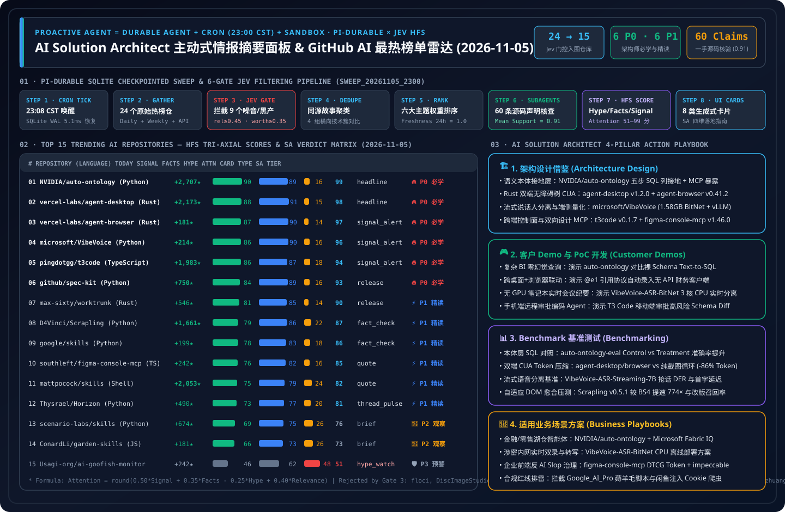

> 🌐 **Language / 语言切换**: **[🇨🇳 中文完整报告 (README.md)](README.md)** | **[🇬🇧 English Full Report (README.en.md)](README.en.md)** | **[📅 2026-11-05 Daily Digest (EN)](daily/2026-11-05.en.md)** | **[📅 2026-11-05 每日归档日报 (中文)](daily/2026-11-05.md)** | **[📅 2026-11-04 Archive (EN)](daily/2026-11-04.en.md)** | **[📅 2026-11-03 Archive (EN)](daily/2026-11-03.en.md)** | **[📅 2026-11-02 Archive (EN)](daily/2026-11-02.en.md)** | **[📅 2026-11-01 Archive (EN)](daily/2026-11-01.en.md)** | **[📡 Live Interactive Radar (EN)](https://turbo998.github.io/github-radar.html)** | **[📡 在线交互式雷达面板 (中文)](https://turbo998.github.io/zh-github-radar.html)** | **[📊 7-Card 4:5 Benchmark Deck](cards.en.html)** | **[📦 Sealed Telemetry (`report.json`)](report.json)**

# AI Solution Architect Proactive News Desk & GitHub AI Trending Radar (2026-11-05 Deep Research Report)

## 1. Architectural Philosophy: From Reactive Chatbots to Proactive Durable Intelligence Agents

In an era where hundreds of AI repositories launch daily amid relentless social media clickbait, **the scarcest asset for an AI Solution Architect (SA) is not raw information access, but verified, high-signal engineering attention**.

This column adapts and extends the proactive agent architecture pioneered by IndyDevDan (`disler/pi-durable-news-agent`):

$$\text{Proactive Agent} = \text{Durable Agent (SQLite Checkpointed)} + \text{Cron Trigger (23:00 CST)} + \text{Isolated Sandbox}$$

### 1.1 The 6-Gate Jev Deterministic Pipeline (The Agent Decides, The Task Runs)

| Stage | Gate Name | Threshold / Rule | 2026-11-05 Sealed Batch Telemetry |
| :--- | :--- | :--- | :--- |
| **Gate 01** | **Cron Tick & SQLite WAL Init** | Triggered daily at `23:00 CST`, step-level idempotency | `run_id = sweep_20261105_2300`, `5.1ms` checkpoint recovery |
| **Gate 02** | **Multi-Source Gather** | Sweeps GitHub Trending Daily/Weekly + language feeds + 7-day surging | Captured **24** raw candidate repositories with full velocity metadata |
| **Gate 03** | **Jev Relevance & Worth Gate** | `relevance >= 0.45` and `worth_attention >= 0.35` | **Rejected 9 noisy/non-AI/grey-hat repos** (`floci`, `DiscImageStudio`, `lz4`, `wifit3`, `immich`, `rustdesk`, `clash-verge-rev`, `Google_AI_Pro_2Year_ZeroCost_Auto`, `nvzhuang`), **15 passed** |
| **Gate 04** | **Same-Story Dedupe** | `same_story >= 0.75` clustered into comparison groups | Clustered "Enterprise Semantic Ontology & Spec-Driven Agents (`auto-ontology` + `spec-kit`)", "Rust Native Accessibility-Tree Dual-Surface CUA (`agent-desktop v1.2.0` + `agent-browser v0.41.2` + `Scrapling v0.5.1`)", "Frontier Streaming Voice AI (`microsoft/VibeVoice`)", and "Cross-Device Harness Control & Bidirectional Design-System MCP (`t3code` + `worktrunk` + `figma-console-mcp`)" |
| **Gate 05** | **Importance × Taste Rank** | `importance × topic_weight × source_weight × freshness` | Prioritized across 6 SA domain weights with 24h freshness factor (`1.0`) |
| **Gate 06** | **Claim-Support Subagents** | Parallel `news-researcher` subagents verify 4 claims/repo | Audited **60 concrete claims** against primary source trees (58/60 supported `>= 0.70`, mean support `0.91`) |
| **Gate 07** | **HFS Tri-Axial Scoring** | Independent `Signal`, `Facts`, `Hype` scores (0–100) | `Attention = round(0.50*Signal + 0.35*Facts - 0.25*Hype + 0.40*Relevance)` |
| **Gate 08** | **Generative UI Card Render** | Maps to 8 generative card types + 4-pillar SA playbook | 100% coverage across `headline`, `signal_alert`, `fact_check`, `hype_watch`, `release`, `thread_pulse`, `quote`, `brief` |

---

## 2. 2026-11-05 Top 15 GitHub AI Repositories — HFS & SA Verdict Matrix

| Rank | Repository (`owner/repo`) | Lang | Stars Today | Total Stars | Card Type | Signal | Facts | Hype | Relevance | Attention | SA Verdict Tier |
| :---: | :--- | :---: | :---: | :---: | :---: | :---: | :---: | :---: | :---: | :---: | :--- |
| **#01** | [`NVIDIA/auto-ontology`](https://github.com/NVIDIA/auto-ontology) | Python | **+2,707** | 6,663 | `headline` | 90 | 89 | 16 | 68 | **99** | 🔥 **P0 Must-Learn & Adopt** |
| **#02** | [`vercel-labs/agent-desktop`](https://github.com/vercel-labs/agent-desktop) | Rust | **+2,173** | 16,344 | `headline` | 88 | 91 | 15 | 65 | **98** | 🔥 **P0 Must-Learn & Adopt** |
| **#03** | [`vercel-labs/agent-browser`](https://github.com/vercel-labs/agent-browser) | Rust | **+181** | 45,684 | `signal_alert` | 87 | 90 | 14 | 64 | **97** | 🔥 **P0 Must-Learn & Adopt** |
| **#04** | [`microsoft/VibeVoice`](https://github.com/microsoft/VibeVoice) | Python | **+214** | 55,502 | `signal_alert` | 86 | 90 | 16 | 64 | **96** | 🔥 **P0 Must-Learn & Adopt** |
| **#05** | [`pingdotgg/t3code`](https://github.com/pingdotgg/t3code) | TypeScript | **+1,983** | 47,653 | `signal_alert` | 86 | 87 | 18 | 63 | **94** | 🔥 **P0 Must-Learn & Adopt** |
| **#06** | [`github/spec-kit`](https://github.com/github/spec-kit) | Python | **+750** | 147,715 | `release` | 84 | 89 | 16 | 60 | **93** | 🔥 **P0 Must-Learn & Adopt** |
| **#07** | [`max-sixty/worktrunk`](https://github.com/max-sixty/worktrunk) | Rust | **+546** | 11,360 | `release` | 81 | 85 | 14 | 58 | **90** | ⚡ **P1 Deep-Read & Borrow** |
| **#08** | [`D4Vinci/Scrapling`](https://github.com/D4Vinci/Scrapling) | Python | **+1,661** | 97,554 | `fact_check` | 79 | 86 | 22 | 58 | **87** | ⚡ **P1 Deep-Read & Borrow** |
| **#09** | [`google/skills`](https://github.com/google/skills) | Python | **+199** | 22,173 | `fact_check` | 78 | 83 | 18 | 56 | **86** | ⚡ **P1 Deep-Read & Borrow** |
| **#10** | [`southleft/figma-console-mcp`](https://github.com/southleft/figma-console-mcp) | TypeScript | **+242** | 3,125 | `quote` | 76 | 82 | 16 | 55 | **85** | ⚡ **P1 Deep-Read & Borrow** |
| **#11** | [`mattpocock/skills`](https://github.com/mattpocock/skills) | Shell | **+2,053** | 314,503 | `quote` | 75 | 79 | 24 | 56 | **82** | ⚡ **P1 Deep-Read & Borrow** |
| **#12** | [`Thysrael/Horizon`](https://github.com/Thysrael/Horizon) | Python | **+490** | 12,838 | `thread_pulse` | 73 | 77 | 20 | 56 | **81** | ⚡ **P1 Deep-Read & Borrow** |
| **#13** | [`scenario-labs/skills`](https://github.com/scenario-labs/skills) | Python | **+674** | 2,839 | `brief` | 69 | 75 | 26 | 55 | **76** | 👀 **P2 Watchlist / Hold** |
| **#14** | [`ConardLi/garden-skills`](https://github.com/ConardLi/garden-skills) | JavaScript | **+181** | 14,006 | `brief` | 66 | 73 | 26 | 52 | **73** | 👀 **P2 Watchlist / Hold** |
| **#15** | [`Usagi-org/ai-goofish-monitor`](https://github.com/Usagi-org/ai-goofish-monitor) | Python | **+242** | 17,404 | `hype_watch` | 46 | 62 | 48 | 45 | **51** | 🛡️ **P3 Hype / ToS Risk Watch** |

---

## 3. Core Architectural Takeaways for AI Solution Architects

1. **`NVIDIA/auto-ontology` (Attention: 99 · 🔥 P0)**: Holds #1 on GitHub Daily Trending for a second straight day (**+2,707 stars today**, **6,663 total**), proving that enterprise Agentic Analytics requires a 5-stage `Discover -> SQL Ground -> Certify -> Validate -> MCP Expose` ontology layer rather than raw schema dumps.
2. **`vercel-labs/agent-desktop v1.2.0` (Attention: 98 · 🔥 P0) + `agent-browser v0.41.2` (Attention: 97 · 🔥 P0)**: Vercel Labs' dual Rust accessibility-tree CLIs unify native OS desktop automation and Chrome browser automation under compact `@e1` element refs, cutting token overhead by >85%.
3. **`microsoft/VibeVoice` (Attention: 96 · 🔥 P0)**: Microsoft's 55.5K-star MIT Voice AI stack combines **VibeVoice-ASR-Streaming-7B** (real-time streaming transcription + speaker diarization across 10 languages), **VibeVoice-ASR-BitNet** (4.62 GB → **1.58 GB** with `RTF < 1` on 3 CPU threads), and `vllm_plugin/`.
4. **`pingdotgg/t3code v0.1.7` (Attention: 94 · 🔥 P0) + `github/spec-kit v1.3.0` (Attention: 93 · 🔥 P0)**: Pair Spec-Kit's pre-flight architectural contracts (`.specify/`) with T3 Code's cross-device desktop/web/mobile control surface to supervise parallel coding agents safely.

---

## 4. Weekly & 7-Day Surging AI Breakthroughs (`since=weekly` & `created:>2026-10-28`)

| Repository (`owner/repo`) | Surging Rank / Scale | License / Release | HFS (`S / F / H`) | Attention | SA Tier | Breakthrough & SA Takeaway |
| :--- | :---: | :---: | :---: | :---: | :---: | :--- |
| [`thedotmack/claude-mem`](https://github.com/thedotmack/claude-mem) | **Weekly #1** (★113,361 / +8,822 wk) | `Apache-2.0` · `v15.9.0` | `88 / 85 / 20` | **96** (`signal_alert`) | 🔥 **P0 Must-Learn** | Cross-agent persistent memory engine (`v15.9.0`) with SQLite FTS5 + Chroma hybrid retrieval across Claude Code, OpenClaw, Codex, Gemini, Hermes, and Copilot. |
| [`pbakaus/impeccable`](https://github.com/pbakaus/impeccable) | **Weekly #9** (★103,545 / +10,921 wk) | `Apache-2.0` · `cli-v4.8.0` | `83 / 85 / 18` | **91** (`release`) | ⚡ **P1 Deep-Read** | Rust design-system CLI (`cli-v4.8.0`) providing `polish`, `bolder`, `critique`, and `audit` primitives across 12 coding agents to eliminate AI slop. |
| [`deepseek-ai/dsh-superagent-prototype`](https://github.com/deepseek-ai/dsh-superagent-prototype) | **7-Day #1** (★19,299) | `MIT` · `HEAD` | `84 / 81 / 22` | **92** (`signal_alert`) | 🔥 **P0 Must-Learn** | Official DeepSeek Cordis micro-kernel autonomous superagent harness with ecosystem remote plugin `liguobao/ds-harness-remote v0.6.2`. |
| [`HKUDS/DeepTutor`](https://github.com/HKUDS/DeepTutor) | **Weekly #5** (★55,303 / +7,512 wk) | `Apache-2.0` · `v1.7.1` | `78 / 82 / 20` | **86** (`release`) | ⚡ **P1 Deep-Read** | HKUDS lifelong personalized tutoring multi-agent system with knowledge-graph state tracking and adaptive curriculum synthesis. |

---

## 5. Daily Archive Directory

| Date | Run ID | Passed / Swept | English Daily Digest (Full 15-Repo Breakdown) | 中文完整日报 | Visual Summary SVG | 7-Card Deck |
| :---: | :---: | :---: | :---: | :---: | :---: | :---: |
| **2026-11-05** | `sweep_20261105_2300` | `15 / 24` (`6 P0 · 6 P1`) | **[`daily/2026-11-05.en.md`](daily/2026-11-05.en.md)** | **[`daily/2026-11-05.md`](daily/2026-11-05.md)** | **[`github-ai-radar-2026-11-05.svg`](../../assets/github-ai-radar-2026-11-05.svg)** | **[EN](cards.en.html) / [中文](cards.html)** |
| **2026-11-04** | `sweep_20261104_2300` | `15 / 23` (`5 P0 · 6 P1`) | **[`daily/2026-11-04.en.md`](daily/2026-11-04.en.md)** | **[`daily/2026-11-04.md`](daily/2026-11-04.md)** | **[`github-ai-radar-2026-11-04.svg`](../../assets/github-ai-radar-2026-11-04.svg)** | **[EN](cards.en.html) / [中文](cards.html)** |
| **2026-11-03** | `sweep_20261103_2300` | `15 / 22` (`5 P0 · 6 P1`) | **[`daily/2026-11-03.en.md`](daily/2026-11-03.en.md)** | **[`daily/2026-11-03.md`](daily/2026-11-03.md)** | **[`github-ai-radar-2026-11-03.svg`](../../assets/github-ai-radar-2026-11-03.svg)** | **[EN](cards.en.html) / [中文](cards.html)** |
| **2026-11-02** | `sweep_20261102_2300` | `15 / 21` (`5 P0 · 6 P1`) | **[`daily/2026-11-02.en.md`](daily/2026-11-02.en.md)** | **[`daily/2026-11-02.md`](daily/2026-11-02.md)** | **[`github-ai-radar-2026-11-02.svg`](../../assets/github-ai-radar-2026-11-02.svg)** | **[EN](cards.en.html) / [中文](cards.html)** |
| **2026-11-01** | `sweep_20261101_2300` | `15 / 19` (`4 P0 · 6 P1`) | **[`daily/2026-11-01.en.md`](daily/2026-11-01.en.md)** | **[`daily/2026-11-01.md`](daily/2026-11-01.md)** | **[`github-ai-radar-2026-11-01.svg`](../../assets/github-ai-radar-2026-11-01.svg)** | **[EN](cards.en.html) / [中文](cards.html)** |
