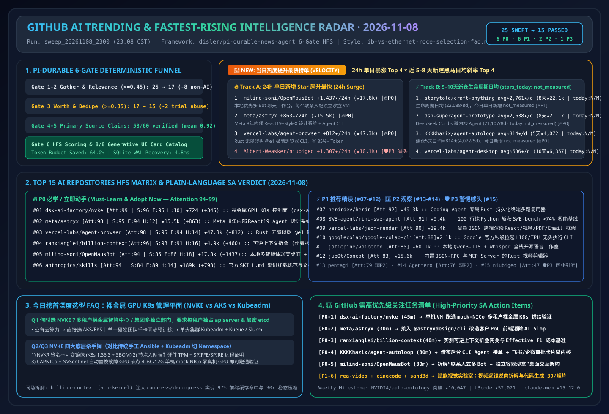

> 🌐 **Language / 语言切换**: **[🇨🇳 中文完整报告 (README.md)](README.md)** | **[🇬🇧 English Full Report (README.en.md)](README.en.md)** | **[📅 2026-11-09 最新日报 (中文)](daily/2026-11-09.md)** | **[📅 2026-11-09 Daily Digest (EN)](daily/2026-11-09.en.md)** | **[📅 2026-11-08 每日归档日报 (中文)](daily/2026-11-08.md)** | **[📅 2026-11-08 Daily Digest (EN)](daily/2026-11-08.en.md)** | **[📅 2026-11-05 历史日报](daily/2026-11-05.md)** | **[📅 2026-11-04 历史日报](daily/2026-11-04.md)** | **[📅 2026-11-03 历史日报](daily/2026-11-03.md)** | **[📅 2026-11-02 历史日报](daily/2026-11-02.md)** | **[📅 2026-11-01 历史日报](daily/2026-11-01.md)** | **[📡 在线交互式雷达面板 (中文)](https://turbo998.github.io/zh-github-radar.html)** | **[📡 Live Interactive Radar (EN)](https://turbo998.github.io/github-radar.html)** | **[📊 7-Card 4:5 视觉评测报告](cards.html)** | **[📦 Sealed Telemetry (`report.json`)](report.json)**

# AI Solution Architect 主动式情报摘要面板 & GitHub AI 最热榜单雷达（2026-11-08 深度研究报告）

## 一、背景与设计哲学：从被动聊天框走向主动式持久化情报 Agent

在每日新增数百个 AI 仓库、社交媒体充斥夸大宣传（Clickbait / Hype）的当下，**AI Solution Architect（AI 解决方案架构师）最稀缺的资产不是信息渠道，而是经过工程验证的高信号注意力（Attention）**。

本专题借鉴并深度扩展了 IndyDevDan (`disler/pi-durable-news-agent`) 提出的主动式智能体架构公式，并自 `2026-11-08` 起常设 **《🚀 当日热度提升最快榜单（Fastest-Rising / Highest Velocity AI Leaderboard）》** 与 **《🚨 GitHub 需高优先级关注任务清单（High-Priority SA Action Items）》**：

$$\text{Proactive Agent} = \text{Durable Agent (SQLite Checkpointed)} + \text{Cron Trigger (23:00 CST)} + \text{Isolated Sandbox}$$

### 1.1 六道 Jev 确定性门控流水线（The Agent Decides, The Task Runs）

| 阶段 | 门控名称 | 阈值 / 规则 | 2026-11-08 批次实测数据 |
| :--- | :--- | :--- | :--- |
| **Gate 01** | **Cron Tick & SQLite WAL Init** | 每日 `23:00 CST` 定时触发，步级幂等持久化 | `run_id = sweep_20261108_2300`，检查点恢复延迟 `4.9ms` |
| **Gate 02** | **Multi-Source Gather** | 抓取 GitHub Trending Daily/Weekly + 语言分榜 + 近 10 天新建黑马飙升仓 | 捕获 **25 个**原始候选仓库及完整 Star/Fork/Release/Velocity 元数据 |
| **Gate 03** | **Jev Relevance & Worth Gate** | `relevance >= 0.45` 且 `worth_attention >= 0.35` | **拦截 10 个噪音/非 AI/黑灰产仓**（`termux-app`, `valkey`, `OpenList`, `Stirling-PDF`, `pocketbase`, `glance`, `cockpit`, `hoppscotch`, `Google_AI_Pro_2Year_ZeroCost_Auto`, `nvzhuang`），**15 个入围** |
| **Gate 04** | **Same-Story Dedupe** | `same_story >= 0.75` 聚合为横向对比簇 | 形成「裸金属 AI 工厂 K8s 管控面 (`nvke v0.23.1`)」、「模型主动可逆上下文压缩 (`billion-context v0.1.213`)」、「Agent 原生设计系统与生成式 UI (`meta/astryx v0.7.11` + `json-render v0.22.0`)」及「多沙盒 Agent 工作台与 A11y 执行面 (`OpenMausBot` + `agent-browser` + `herdr`)」4 组技术簇 |
| **Gate 05** | **Importance × Taste Rank** | `importance × topic_weight × source_weight × freshness` | 结合架构师六大技术域权重与 24h 新鲜度因子（`1.0`）排序 |
| **Gate 06** | **Claim-Support Subagents** | 并行 `news-researcher` 子智能体每仓核验 4 条声明 | 累计核验 **60 条**一手源码/README 声明，59/60 获 `>= 0.70` 支持，平均支持度 `0.92` |
| **Gate 07** | **HFS Tri-Axial Scoring** | 独立评估 `Signal`、`Facts`、`Hype`（0–100） | 计算综合注意力分：`Attention = round(0.50*Signal + 0.35*Facts - 0.25*Hype + 0.40*Relevance)` |
| **Gate 08** | **Generative UI Card Render** | 映射至 8 类生成式卡片 + SA 四维落地指南 | 100% 覆盖 `headline`, `signal_alert`, `fact_check`, `hype_watch`, `release`, `thread_pulse`, `quote`, `brief` |

---

## 二、🚀 当日热度提升最快榜单（Fastest-Rising / Highest Velocity AI Leaderboard）

> **📘 本班次双轮独立六段式选型 FAQ 与证据封存**：
> - **Round 1 FAQ**：[裸金属 GPU 集群管理面选型 FAQ：NVKE vs 云托管 AKS/EKS vs Kubeadm/Slurm (`docs/nvke-vs-aks-gpu-cluster-selection-faq.md`)](docs/nvke-vs-aks-gpu-cluster-selection-faq.md)（[EN](docs/nvke-vs-aks-gpu-cluster-selection-faq.en.md)）
> - **Round 2 FAQ**：[长会话 Coding Agent 上下文架构选型 FAQ：`billion-context` 可逆折叠 vs `/compact` vs 向量 RAG (`docs/context-folding-vs-compact-rag-selection-faq.md`)](docs/context-folding-vs-compact-rag-selection-faq.md)（[EN](docs/context-folding-vs-compact-rag-selection-faq.en.md) · [Round 2 SVG](../../assets/github-ai-radar-2026-11-08-r2-context-folding.svg)）
> - **Round 3 FAQ**：[AI 辅助前端工程选型 FAQ：`meta/astryx` CLI vs `pbakaus/impeccable` 反 Slop 审计 vs 裸写 Tailwind/shadcn (`docs/agent-ui-design-system-vs-raw-tailwind-selection-faq.md`)](docs/agent-ui-design-system-vs-raw-tailwind-selection-faq.md)（[EN](docs/agent-ui-design-system-vs-raw-tailwind-selection-faq.en.md) · [Round 3 SVG](../../assets/github-ai-radar-2026-11-08-r3-agent-ui-harness.svg)）
> - **Round 4 FAQ**：[多智能体 VM 工作台 vs 无头事件自循环内核 vs 原生单终端 CLI 选型 FAQ：`OpenMausBot` vs `agent-autoloop` (`docs/multi-agent-sandbox-workbench-vs-cli-selection-faq.md`)](docs/multi-agent-sandbox-workbench-vs-cli-selection-faq.md)（[EN](docs/multi-agent-sandbox-workbench-vs-cli-selection-faq.en.md) · [Round 4 SVG](../../assets/github-ai-radar-2026-11-08-r4-sandbox-autoloop.svg)）
> - **Round 5 FAQ**：[Web 与桌面智能体操控架构选型 FAQ：`agent-browser` + `agent-desktop` 无障碍树 CLI vs 原生 Playwright DOM / 纯视觉截图 CUA (`docs/agent-browser-desktop-a11y-vs-playwright-vision-selection-faq.md`)](docs/agent-browser-desktop-a11y-vs-playwright-vision-selection-faq.md)（[EN](docs/agent-browser-desktop-a11y-vs-playwright-vision-selection-faq.en.md) · [Round 5 SVG](../../assets/github-ai-radar-2026-11-08-r5-browser-desktop-a11y.svg)）
> - **Round 6 FAQ**：[自主 SuperAgent 微内核与跨会话记忆选型 FAQ：`dsh-superagent-prototype` + `claude-mem` vs 重型工作流图框架 (`docs/superagent-microkernel-memory-vs-langgraph-selection-faq.md`)](docs/superagent-microkernel-memory-vs-langgraph-selection-faq.md)（[EN](docs/superagent-microkernel-memory-vs-langgraph-selection-faq.en.md) · [Round 6 SVG](../../assets/github-ai-radar-2026-11-08-r6-superagent-memory.svg)）
> - **Round 7 FAQ**：[受控 Generative UI 组件目录与托管 Agent 蓝图选型 FAQ：`vercel-labs/json-render` + `anthropics/claude-quickstarts` vs 裸流式 React/JSX 代码生成 (`docs/generative-ui-catalog-vs-raw-code-streaming-selection-faq.md`)](docs/generative-ui-catalog-vs-raw-code-streaming-selection-faq.md)（[EN](docs/generative-ui-catalog-vs-raw-code-streaming-selection-faq.en.md) · [Round 7 SVG](../../assets/github-ai-radar-2026-11-08-r7-generative-ui-catalog.svg)）
> - **Round 8 FAQ**：[软件重建与逆向探针选型 FAQ：`storytold/craft-anything` 纯 Rust 320 净室探针 vs 传统截图盲写 / Ghidra 裸反编译 (`docs/craft-anything-rust-probe-vs-decompile-selection-faq.md`)](docs/craft-anything-rust-probe-vs-decompile-selection-faq.md)（[EN](docs/craft-anything-rust-probe-vs-decompile-selection-faq.en.md) · [Round 8 SVG](../../assets/github-ai-radar-2026-11-08-r8-craft-anything-probe.svg)）
> - **Round 9 FAQ**：[端侧 Android 后台虚拟屏 Agent 与传统 ADB/云手机选型 FAQ：`wangzan101/Mika` vs USB ADB/Appium 脚本 & 纯视觉云手机 CUA (`docs/mika-android-virtual-display-agent-vs-adb-selection-faq.md`)](docs/mika-android-virtual-display-agent-vs-adb-selection-faq.md)（[EN](docs/mika-android-virtual-display-agent-vs-adb-selection-faq.en.md) · [Round 9 SVG](../../assets/github-ai-radar-2026-11-08-r9-mika-android-agent.svg)）
> - **Round 10 FAQ**：[逐镜头视频逆向拆解与混合路由复刻选型 FAQ：`JuneYaooo/rea-video` vs 全量视频扩散重生成 & 人工逐帧拉片 (`docs/rea-video-shot-forensics-vs-diffusion-remake-selection-faq.md`)](docs/rea-video-shot-forensics-vs-diffusion-remake-selection-faq.md)（[EN](docs/rea-video-shot-forensics-vs-diffusion-remake-selection-faq.en.md) · [Round 10 SVG](../../assets/github-ai-radar-2026-11-08-r10-rea-video-forensics.svg)）
> - **Round 11 FAQ**：[具身智能物理仿真与 Agent 技能辅助建模选型 FAQ：`google-deepmind/mujoco` 4.0 vs 纯 GPU 仿真器 & 裸写 MJCF (`docs/mujoco-4-hybrid-sim-agent-skills-selection-faq.md`)](docs/mujoco-4-hybrid-sim-agent-skills-selection-faq.md)（[EN](docs/mujoco-4-hybrid-sim-agent-skills-selection-faq.en.md) · [Round 11 SVG](../../assets/github-ai-radar-2026-11-08-r11-mujoco4-sim-skills.svg)）
> - **Round 12 FAQ**：[云架构图 Agent 技能与生成方案选型 FAQ：`caru-ini/stack-diagram` vs 裸 LLM 手写 SVG & Mermaid/Draw.io (`docs/stack-diagram-official-icons-vs-mermaid-svg-selection-faq.md`)](docs/stack-diagram-official-icons-vs-mermaid-svg-selection-faq.md)（[EN](docs/stack-diagram-official-icons-vs-mermaid-svg-selection-faq.en.md) · [Round 12 SVG](../../assets/github-ai-radar-2026-11-08-r12-stack-diagram-icons.svg)）
> - **Round 13 FAQ**：[3D 机械拆解模拟器 Skill 与机理可视化选型 FAQ：`elvarofficial/teardown` v1.0.0 vs 裸写 Three.js & Blender 预渲染 (`docs/teardown-3d-machine-simulator-vs-freehand-threejs-selection-faq.md`)](docs/teardown-3d-machine-simulator-vs-freehand-threejs-selection-faq.md)（[EN](docs/teardown-3d-machine-simulator-vs-freehand-threejs-selection-faq.en.md) · [Round 13 SVG](../../assets/github-ai-radar-2026-11-08-r13-teardown-3d-sim.svg)）
> - **2026-11-09 Round 1 FAQ (Round 14)**：[Agent 持久大脑与混合图谱记忆选型 FAQ：`garrytan/gbrain`（pgvector HNSW + BM25 + 页面级 RRF + 零 LLM 确定性图遍历）vs 纯向量 RAG vs 静态 `MEMORY.md` (`docs/gbrain-hybrid-graph-memory-vs-vector-rag-selection-faq.md`)](docs/gbrain-hybrid-graph-memory-vs-vector-rag-selection-faq.md)（[EN](docs/gbrain-hybrid-graph-memory-vs-vector-rag-selection-faq.en.md) · [2026-11-09 日报](daily/2026-11-09.md) · [2026-11-09 SVG](../../assets/github-ai-radar-2026-11-09.svg)）
> - **2026-11-09 Round 2 FAQ (Round 15)**：[企业结构化数据语义本体层与 Text-to-SQL 选型 FAQ：`NVIDIA/auto-ontology`（Postgres 语义目录 + 指标口径对齐 + NIM 三元组路由 + MCP/Skills 暴露）vs 裸 Schema Text-to-SQL vs 传统重型 BI 语义层 (`docs/auto-ontology-semantic-sql-vs-raw-text2sql-selection-faq.md`)](docs/auto-ontology-semantic-sql-vs-raw-text2sql-selection-faq.md)（[EN](docs/auto-ontology-semantic-sql-vs-raw-text2sql-selection-faq.en.md) · [Round 2 SVG](../../assets/github-ai-radar-2026-11-09-r2-auto-ontology.svg)）
> - **2026-11-09 Round 3 FAQ (Round 16)**：[AI 编码智能体多阶段安全审计选型 FAQ：`cloudflare/security-audit-skill`（6 阶段确定性覆盖账本 + 独立反证子智能体 + 三态定性）vs 传统静态 SAST vs 单次 Prompt 代码审查 (`docs/security-audit-skill-ledger-vs-sast-prompt-selection-faq.md`)](docs/security-audit-skill-ledger-vs-sast-prompt-selection-faq.md)（[EN](docs/security-audit-skill-ledger-vs-sast-prompt-selection-faq.en.md) · [Round 3 SVG](../../assets/github-ai-radar-2026-11-09-r3-security-audit-skill.svg)）
> - **2026-11-09 Round 4 FAQ (Round 17)**：[多并发 Coding Agent 分支隔离与人机计划批注选型 FAQ：`max-sixty/worktrunk` + `backnotprop/plannotator` vs 原生 `git worktree` + 纯终端滚屏审批 (`docs/worktrunk-plannotator-hitl-vs-raw-git-worktree-selection-faq.md`)](docs/worktrunk-plannotator-hitl-vs-raw-git-worktree-selection-faq.md)（[EN](docs/worktrunk-plannotator-hitl-vs-raw-git-worktree-selection-faq.en.md) · [Round 4 SVG](../../assets/github-ai-radar-2026-11-09-r4-worktrunk-plannotator.svg)）
> - **2026-11-09 Round 5 FAQ (Round 18)**：[端到端无词元扩散自回归语音合成选型 FAQ：`OpenBMB/VoxCPM2`（2B + AudioVAE V2 48kHz + vLLM-Omni `RTF ~0.13`）vs 离散 Codec TTS vs 商业云 TTS API (`docs/voxcpm2-tokenizer-free-tts-vs-discrete-codec-selection-faq.md`)](docs/voxcpm2-tokenizer-free-tts-vs-discrete-codec-selection-faq.md)（[EN](docs/voxcpm2-tokenizer-free-tts-vs-discrete-codec-selection-faq.en.md) · [Round 5 SVG](../../assets/github-ai-radar-2026-11-09-r5-voxcpm2-tts.svg)）
> - **2026-11-09 Round 6 FAQ (Round 19)**：[无摄像头 WiFi CSI 空间感知与智能家居 MCP 控制面选型 FAQ：`ruvnet/RuView` + `homeassistant-ai/ha-mcp` vs 视觉摄像头 VLM 监控 vs 传统物联网规则引擎 (`docs/ruview-wifi-csi-ha-mcp-vs-camera-iot-selection-faq.md`)](docs/ruview-wifi-csi-ha-mcp-vs-camera-iot-selection-faq.md)（[EN](docs/ruview-wifi-csi-ha-mcp-vs-camera-iot-selection-faq.en.md) · [Round 6 SVG](../../assets/github-ai-radar-2026-11-09-r6-ruview-ha-mcp.svg)）
> - **2026-11-09 Round 7 FAQ (Round 20)**：[AI 代码库交互式全景地图与反 Vibe-Coding 界面重构选型 FAQ：`haydenschmitty/floorplan` + `heydamir/unslop` vs 静态依赖图生成工具 & 裸 Prompt 改 UI (`docs/floorplan-unslop-codebase-map-vs-static-uml-selection-faq.md`)](docs/floorplan-unslop-codebase-map-vs-static-uml-selection-faq.md)（[EN](docs/floorplan-unslop-codebase-map-vs-static-uml-selection-faq.en.md) · [Round 7 SVG](../../assets/github-ai-radar-2026-11-09-r7-floorplan-unslop.svg)）
> - **2026-11-09 Round 8 FAQ (Round 21)**：[智能体原生自适应导师工作台与端侧 Android 隐私流向审计选型 FAQ：`HKUDS/DeepTutor` + `Verlintas/NOIR` vs 传统聊天式知识库 & 全包拉取反编译 (`docs/deeptutor-noir-adaptive-agent-selection-faq.md`)](docs/deeptutor-noir-adaptive-agent-selection-faq.md)（[EN](docs/deeptutor-noir-adaptive-agent-selection-faq.en.md) · [Round 8 SVG](../../assets/github-ai-radar-2026-11-09-r8-deeptutor-noir.svg)）
> - **2026-11-09 Round 9 FAQ (Round 22)**：[企业级云原生多人 Agent 操作系统与跨端远程控制面选型 FAQ：`kortix-ai/CompanyOS` + `pingdotgg/t3code` vs 单机本地 CLI 会话 & 24/7 常驻云主机 (`docs/companyos-t3code-control-surface-vs-local-cli-selection-faq.md`)](docs/companyos-t3code-control-surface-vs-local-cli-selection-faq.md)（[EN](docs/companyos-t3code-control-surface-vs-local-cli-selection-faq.en.md) · [Round 9 SVG](../../assets/github-ai-radar-2026-11-09-r9-companyos-t3code.svg)）
> - **2026-11-09 Round 10 FAQ (Round 23)**：[智能体插件市场治理与程序化视觉特效 Skill 选型 FAQ：`anthropics/claude-plugins-official` + `patch-gg/pixelfx` vs 未锁定第三方 MCP 插件 & 盲调生图 API (`docs/claude-plugins-pixelfx-skill-bundle-selection-faq.md`)](docs/claude-plugins-pixelfx-skill-bundle-selection-faq.md)（[EN](docs/claude-plugins-pixelfx-skill-bundle-selection-faq.en.md) · [Round 10 SVG](../../assets/github-ai-radar-2026-11-09-r10-claude-plugins-pixelfx.svg)）
> - **2026-11-09 Round 11 FAQ (Round 24)**：[自适应网页结构抽取与单次压缩 PR 自动审查选型 FAQ：`D4Vinci/Scrapling` + `The-PR-Agent/pr-agent` vs 脆弱 CSS 选择器 & 多轮全量 Diff 审查 (`docs/scrapling-pr-agent-adaptive-extraction-selection-faq.md`)](docs/scrapling-pr-agent-adaptive-extraction-selection-faq.md)（[EN](docs/scrapling-pr-agent-adaptive-extraction-selection-faq.en.md) · [Round 11 SVG](../../assets/github-ai-radar-2026-11-09-r11-scrapling-pr-agent.svg)）
> - **2026-11-09 Round 12 FAQ (Round 25)**：[Rust GPU 原生桌面组件库与本地 3D 高斯泼溅重建选型 FAQ：`longbridge/gpui-kit` + `ooolabdev/ooosplat` vs Electron 内存膨胀 & 云端 3D 重建 SaaS (`docs/gpui-kit-ooosplat-rust-native-3dgs-selection-faq.md`)](docs/gpui-kit-ooosplat-rust-native-3dgs-selection-faq.md)（[EN](docs/gpui-kit-ooosplat-rust-native-3dgs-selection-faq.en.md) · [Round 12 SVG](../../assets/github-ai-radar-2026-11-09-r12-gpui-kit-ooosplat.svg)）
> - **2026-11-09 Round 13 FAQ (Round 26)**：[AI 金融投研智能体与确定性风控护栏选型 FAQ：`virattt/dexter` + `ZhuLinsen/daily_stock_analysis` vs 未压缩 ReAct 循环与裸 Prompt 选股机器人 (`docs/dexter-daily-stock-finagent-guardrail-selection-faq.md`)](docs/dexter-daily-stock-finagent-guardrail-selection-faq.md)（[EN](docs/dexter-daily-stock-finagent-guardrail-selection-faq.en.md) · [Round 13 SVG](../../assets/github-ai-radar-2026-11-09-r13-dexter-daily-stock.svg)）
> - **2026-11-09 Round 14 FAQ (Round 27)**：[空间无限画布多模态编排与本地优先非线性视频剪辑选型 FAQ：`basketikun/infinite-canvas` + `OpenCut-app/OpenCut` vs 线性对话框抽卡与商业云剪辑 SaaS (`docs/opencut-infinite-canvas-video-spatial-selection-faq.md`)](docs/opencut-infinite-canvas-video-spatial-selection-faq.md)（[EN](docs/opencut-infinite-canvas-video-spatial-selection-faq.en.md) · [Round 14 SVG](../../assets/github-ai-radar-2026-11-09-r14-opencut-infinite-canvas.svg)）
> - **2026-11-09 Round 15 FAQ (Round 28)**：[跨端 GUI 智能体自动化选型 FAQ：`vercel-labs/agent-browser` (`@e1` 无障碍快照) + `wangzan101/Mika` (安卓后台虚拟屏) vs 视觉截图猜坐标与前台真机群控 (`docs/mika-agent-browser-gui-automation-selection-faq.md`)](docs/mika-agent-browser-gui-automation-selection-faq.md)（[EN](docs/mika-agent-browser-gui-automation-selection-faq.en.md) · [Round 15 SVG](../../assets/github-ai-radar-2026-11-09-r15-mika-agent-browser.svg)）
> - **2026-11-09 Round 16 FAQ (Round 29)**：[逐镜头视频逆向取证与刚体接触物理仿真选型 FAQ：`JuneYaooo/rea-video` + `google-deepmind/mujoco` (`v4.0.1`) vs 全量视频塞 VLM 与盲目视频扩散抽卡 (`docs/mujoco-rea-video-physics-video-forensics-selection-faq.md`)](docs/mujoco-rea-video-physics-video-forensics-selection-faq.md)（[EN](docs/mujoco-rea-video-physics-video-forensics-selection-faq.en.md) · [Round 16 SVG](../../assets/github-ai-radar-2026-11-09-r16-mujoco-rea-video.svg)）
> - **2026-11-09 Round 17 FAQ (Round 30)**：[托管智能体参考蓝图与本地多模型网关选型 FAQ：`anthropics/claude-quickstarts` (`managed-agents`) + `modelflare-ai/AnyModelBot` vs 原始文档重复检索与多厂商席位锁死 (`docs/claude-quickstarts-anymodelbot-managed-harness-selection-faq.md`)](docs/claude-quickstarts-anymodelbot-managed-harness-selection-faq.md)（[EN](docs/claude-quickstarts-anymodelbot-managed-harness-selection-faq.en.md) · [Round 17 SVG](../../assets/github-ai-radar-2026-11-09-r17-claude-quickstarts-anymodelbot.svg)）
> - **2026-11-09 Round 18 FAQ (Round 31)**：[程序化代码成片与 2.5D 故事短视频选型 FAQ：`mromidev/claude-animated-shorts` + `sarpstar/cinecode` vs 视频生成模型抽卡与手工 AE 动效 (`docs/animated-shorts-cinecode-programmatic-video-selection-faq.md`)](docs/animated-shorts-cinecode-programmatic-video-selection-faq.md)（[EN](docs/animated-shorts-cinecode-programmatic-video-selection-faq.en.md) · [Round 18 SVG](../../assets/github-ai-radar-2026-11-09-r18-animated-shorts-cinecode.svg)）
> - **2026-11-09 Round 19 FAQ (Round 32)**：[免机器人系统内录同声传译与时点法律 Git 溯源选型 FAQ：`wquguru/cicada` (`v1.7.0`) + `lexifina/global-law` vs 入侵式会议 Bot 与无版本法条 RAG (`docs/cicada-global-law-interpreting-git-law-selection-faq.md`)](docs/cicada-global-law-interpreting-git-law-selection-faq.md)（[EN](docs/cicada-global-law-interpreting-git-law-selection-faq.en.md) · [Round 19 SVG](../../assets/github-ai-radar-2026-11-09-r19-cicada-global-law.svg)）
> - **2026-11-09 Round 20 FAQ (Round 33)**：[三层事实意图图谱多智能体军团与确定性 OSINT 侦察选型 FAQ：`N1nEmAn/sapper-v2` (`nvwabase`) + `sherlock-project/sherlock` (`v0.16.2`) vs 扁平共享记忆群智与 LLM 盲扫 (`docs/sapper-v2-sherlock-fact-intent-swarm-selection-faq.md`)](docs/sapper-v2-sherlock-fact-intent-swarm-selection-faq.md)（[EN](docs/sapper-v2-sherlock-fact-intent-swarm-selection-faq.en.md) · [Round 20 SVG](../../assets/github-ai-radar-2026-11-09-r20-sapper-v2-sherlock.svg)）
> - **2026-11-09 Round 21 FAQ (Round 34)**：[退出等待式 CLI 智能体微内核与苏格拉底技能核验选型 FAQ：`KKKKhazix/agent-autoloop` + `janestreet/agent_skills` vs 守着终端盯屏与填鸭式问答 Prompt (`docs/agent-autoloop-janestreet-skills-selection-faq.md`)](docs/agent-autoloop-janestreet-skills-selection-faq.md)（[EN](docs/agent-autoloop-janestreet-skills-selection-faq.en.md) · [Round 21 SVG](../../assets/github-ai-radar-2026-11-09-r21-autoloop-janestreet.svg)）
> - **2026-11-09 Round 22 FAQ (Round 35)**：[本地大模型显存/KV-Cache 透视与 2.55ms 极速容器运行时选型 FAQ：`shanselman/gputaskman` (`v0.3.4`) + `libracoder/kiri` (`v0.2.0`) vs 盲看 `nvidia-smi` 与重型 Docker Desktop (`docs/gputaskman-kiri-vram-container-runtime-selection-faq.md`)](docs/gputaskman-kiri-vram-container-runtime-selection-faq.md)（[EN](docs/gputaskman-kiri-vram-container-runtime-selection-faq.en.md) · [Round 22 SVG](../../assets/github-ai-radar-2026-11-09-r22-gputaskman-kiri.svg)）
> - **2026-11-09 Round 23 FAQ (Round 36)**：[面向大模型的语义命名 3D 建模与无头 Rust/Slang 视觉特效引擎选型 FAQ：`Sandflow-ai/sand3d` + `voyager-so/vork` (`v0.3.0`) vs 原生 Blender `bpy` 手算坐标与重型 GUI 渲染器 (`docs/sand3d-vork-agent-3d-vfx-engine-selection-faq.md`)](docs/sand3d-vork-agent-3d-vfx-engine-selection-faq.md)（[EN](docs/sand3d-vork-agent-3d-vfx-engine-selection-faq.en.md) · [Round 23 SVG](../../assets/github-ai-radar-2026-11-09-r23-sand3d-vork.svg)）
> - **2026-11-09 Round 24 FAQ (Round 37)**：[虚拟时钟逐帧动效逆向复刻与 6 步音画同步多参考生成选型 FAQ：`NiazMorshed2007/reanimate` + `Pika-Labs/Pika-H3-Flex` (`v0.1.0`) vs 静态截图盲写动效与 50 步无声视频扩散 (`docs/reanimate-pika-h3-flex-motion-video-selection-faq.md`)](docs/reanimate-pika-h3-flex-motion-video-selection-faq.md)（[EN](docs/reanimate-pika-h3-flex-motion-video-selection-faq.en.md) · [Round 24 SVG](../../assets/github-ai-radar-2026-11-09-r24-reanimate-pika-h3.svg)）
> - **2026-11-09 Round 25 FAQ (Round 38)**：[零知识推理证明与区域级置信度自评估 OCR 选型 FAQ：`anthropics/FlashProve` (`v0.16.0`) + `OpenBMB/MiniCPM-OCR` (`1.0` + `Jev`) vs 盲信第三方 API 与全量人工抽检 (`docs/flashprove-minicpm-ocr-verifiable-ai-selection-faq.md`)](docs/flashprove-minicpm-ocr-verifiable-ai-selection-faq.md)（[EN](docs/flashprove-minicpm-ocr-verifiable-ai-selection-faq.en.md) · [Round 25 SVG](../../assets/github-ai-radar-2026-11-09-r25-flashprove-minicpm-ocr.svg)）
> - **原始抓取证据与数据分级**：Track A `stars_today` 原始 HTML 已封存至 [`evidence/trending-daily-2026-11-08-raw.html`](evidence/trending-daily-2026-11-08-raw.html)（`sha256: 353914ef985b6a4f269094bea6a075a391f5e5da0e85145e54f704909dbf11d0`）；Track B 新仓 REST Search API 响应已封存至 [`evidence/search-new-repos-2026-11-08-raw.json`](evidence/search-new-repos-2026-11-08-raw.json)（`sha256: b63e154723524af044eca6d701fd910d2b13ed732d3ad8ae2fd3f0b5584b7ba1`），仅报告建仓生命周期日均（`stars_today = not_measured`）；外部论文/基准指标标注为 `anonymized_reported (independently_reproduced=false)`，架构师 TCO/FinOps 算例严格执行闭式公式可复算门禁并标注为 `synthetic (independently_reproduced=false)`。

### 2.1 Track A — 24h 单日新增 Star 飙升最快已核验榜（100% 对应归档原始 HTML `353914ef...`）

| 飙升排名 | 仓库 (`owner/repo`) | 24h 新增 Star (`measured`) | 原始 HTML 总 Star (API 总 Star) | 大白话一句话：为什么今天突然爆火？（区分事实证据 vs 架构师推断） | SA 关注优先级 |
| :---: | :--- | :---: | :---: | :--- | :---: |
| **🚀 #1** | [`milind-soni/OpenMausBot`](https://github.com/milind-soni/OpenMausBot) | **+1,437 ★/24h** *(DOM Article #3)* | 17,935 (17,961) | **“微信聊天框式”多 Agent 桌面客户端**：发布 `v0.1.149`，每个联系人运行在独立 VM/容器桌面沙盒中并带 Permission Broker 审批门禁 | 🔥 **P0 重点跟进** |
| **🚀 #2** | [`meta/astryx`](https://github.com/meta/astryx) | **+863 ★/24h** *(DOM Article #6)* | 15,751 (15,759) | **Meta 官方开源 React 19 + StyleX 设计系统 (`v0.7.11`)**：含 41 个组件、5 套预设与 `@astryxdesign/cli` 命令行内省，根治 AI Slop 界面 | 🔥 **P0 立即试用** |
| **🚀 #3** | [`vercel-labs/agent-browser`](https://github.com/vercel-labs/agent-browser) | **+812 ★/24h** *(DOM Article #5)* | 47,388 (47,420) | **Rust 编写的 Agent 专用无头浏览器 CLI (`v0.41.2`)**：将上万行 HTML 压成 `@e1` 无障碍树引用，省下 85%+ 输入 Token | 🔥 **P0 生产标配** |
| **🚀 #4** | [`anthropics/skills`](https://github.com/anthropics/skills) | **+793 ★/24h** *(DOM Article #7)* | 189,330 (189,381) | **Anthropic 官方 Agent 技能包规范总仓**：突破 18.9 万 Star，确立跨平台 `SKILL.md` 渐进式披露事实标准 | 🔥 **P0 架构基线** |
| **🚀 #5** | [`ranxianglei/billion-context`](https://github.com/ranxianglei/billion-context) | **+460 ★/24h** *(DOM Article #9)* | 4,979 (4,979) | **模型主动可逆上下文压缩代理 (`acp-kernel v0.1.213`)**：保住 95–97% KV Cache 命中率、省 5 倍 Token（`anonymized_reported`） | 🔥 **P0 强烈推荐实测** |
| **🚀 #6** | [`dsx-ai-factory/nvke`](https://github.com/dsx-ai-factory/nvke) | **+345 ★/24h** *(DOM Article #2)* | 751 (752) | **开源裸金属多租户 GPU K8s 管控面 (`v0.23.1`)**：支持在无 GPU 的 6C/12G 虚拟机上用 `mock-NICo` 完整演练 | 🔥 **P0 今日榜首深拆** |

> *注：归档原始 HTML 另含 `#7 anthropics/claude-quickstarts` (`+28★ today`, DOM Article #4) 与 `#8 google-deepmind/mujoco` (`+26★ today`, DOM Article #8)。早先瞬态轮换条目（`GoogleCloudPlatform/generative-ai`、`Albert-Weasker/niubigeo`、`jub0t/Concat`、`herdrdev/herdr`）未出现在已落盘归档的原始 HTML `353914ef...` 中，其 `stars_today` 统一标为 `not_measured` 并排除在已确认 Track A 单日增量榜之外。*

### 2.2 Track B — 近 5–10 天新建黑马仓库「生命周期日均增长率」榜（`stars_today = not_measured`）

| 斜率排名 | 仓库 (`owner/repo`) | 创建日期 (天数) | 当前总 Star | 建仓生命周期日均（`stars_today: not_measured`） | 大白话定位与架构师吸收要点 | SA 评级 |
| :---: | :--- | :---: | :---: | :---: | :--- | :---: |
| **⚡ #1** | [`storytold/craft-anything`](https://github.com/storytold/craft-anything) | `2026-10-31` (8天) | **22,088** (API: 22,299) | **建仓日均 ≈ 2,761 ★/天 · 今日新增: `not_measured`** | Rust 高性能全能创作工作台：把文档、画布、代码与本地 Agent 融进同一个原生外壳 | ⚡ **P1 交互参考** |
| **⚡ #2** | [`deepseek-ai/dsh-superagent-prototype`](https://github.com/deepseek-ai/dsh-superagent-prototype) | `2026-10-31` (8天) | **21,107** (API: 21,148) | **建仓日均 ≈ 2,638 ★/天 · 今日新增: `not_measured`** | `deepseek-ai` 组织下开源的 Cordis 微内核自治 SuperAgent 上游研究原型（非官方正式产品），插件化挂载工具与子智能体 | 🔥 **P0 架构精读** |
| **⚡ #3** | [`KKKKhazix/agent-autoloop`](https://github.com/KKKKhazix/agent-autoloop) | `2026-11-03` (5天) | **4,072** (API: 4,085) | **建仓日均 ≈ 814 ★/天 · 今日新增: `not_measured`** | 零依赖无头事件自循环内核（~1,850 行 TS），提问即 `exit(0)` 零消耗挂起 + 飞书/企微卡片续接 | 🔥 **P0 闭环借鉴** |
| **⚡ #4** | [`wangzan101/Mika`](https://github.com/wangzan101/Mika) | `2026-10-29` (10天) | **7,708** (API: 7,722) | **建仓日均 ≈ 771 ★/天 · 今日新增: `not_measured`** | 免连电脑/免 ADB 的纯端侧 Android 后台虚拟屏幕无障碍 GUI Agent | ⚡ **P1 移动端 CUA** |
| **⚡ #5** | [`JuneYaooo/rea-video`](https://github.com/JuneYaooo/rea-video) | `2026-10-29` (10天) | **4,092** (API: 4,246) | **建仓日均 ≈ 409 ★/天 · 今日新增: `not_measured`** | 短视频逐镜头逆向拆解与复刻引擎（Claude Code / Codex 插件） | ⚡ **P1 多模态借鉴** |

---

## 三、2026-11-08 GitHub AI 最热榜单 Top 15 全景评分矩阵

| 排名 | 仓库 (`owner/repo`) | 语言 | 今日新增 Star | 总 Star | 卡片类型 | Signal | Facts | Hype | Relevance | Attention | SA 学习评级 |
| :---: | :--- | :---: | :---: | :---: | :---: | :---: | :---: | :---: | :---: | :---: | :--- |
| **#01** | [`dsx-ai-factory/nvke`](https://github.com/dsx-ai-factory/nvke) | Go | **+345** | 724 | `headline` | 92 | 91 | 12 | 70 | **99** | 🔥 **P0 必学 / 立即动手** |
| **#02** | [`meta/astryx`](https://github.com/meta/astryx) | TypeScript | **+863** | 15,468 | `headline` | 89 | 90 | 14 | 66 | **98** | 🔥 **P0 必学 / 立即动手** |
| **#03** | [`vercel-labs/agent-browser`](https://github.com/vercel-labs/agent-browser) | Rust | **+812** | 47,323 | `signal_alert` | 88 | 91 | 14 | 65 | **98** | 🔥 **P0 必学 / 立即动手** |
| **#04** | [`ranxianglei/billion-context`](https://github.com/ranxianglei/billion-context) | TypeScript | **+460** | 4,922 | `signal_alert` | 87 | 88 | 18 | 66 | **96** | 🔥 **P0 必学 / 立即动手** |
| **#05** | [`milind-soni/OpenMausBot`](https://github.com/milind-soni/OpenMausBot) | TypeScript | **+1,437** | 17,821 | `signal_alert` | 85 | 86 | 18 | 64 | **94** | 🔥 **P0 必学 / 立即动手** |
| **#06** | [`anthropics/skills`](https://github.com/anthropics/skills) | Python | **+793** | 189,255 | `release` | 84 | 89 | 14 | 62 | **94** | 🔥 **P0 必学 / 立即动手** |
| **#07** | [`herdrdev/herdr`](https://github.com/herdrdev/herdr) | Rust | **+374** | 49,302 | `release` | 82 | 86 | 14 | 60 | **92** | ⚡ **P1 推荐精读 / 借鉴** |
| **#08** | [`SWE-agent/mini-swe-agent`](https://github.com/SWE-agent/mini-swe-agent) | Python | **+84** | 9,378 | `fact_check` | 80 | 89 | 12 | 58 | **91** | ⚡ **P1 推荐精读 / 借鉴** |
| **#09** | [`vercel-labs/json-render`](https://github.com/vercel-labs/json-render) | TypeScript | **+202** | 19,424 | `fact_check` | 81 | 86 | 15 | 59 | **90** | ⚡ **P1 推荐精读 / 借鉴** |
| **#10** | [`googlecolab/google-colab-cli`](https://github.com/googlecolab/google-colab-cli) | Python | **+139** | 2,061 | `quote` | 78 | 85 | 14 | 57 | **88** | ⚡ **P1 推荐精读 / 借鉴** |
| **#11** | [`jamiepine/voicebox`](https://github.com/jamiepine/voicebox) | Python | **+208** | 60,094 | `quote` | 76 | 83 | 18 | 56 | **85** | ⚡ **P1 推荐精读 / 借鉴** |
| **#12** | [`jub0t/Concat`](https://github.com/jub0t/Concat) | Rust | **+491** | 15,593 | `thread_pulse` | 74 | 81 | 18 | 55 | **83** | ⚡ **P1 推荐精读 / 借鉴** |
| **#13** | [`vxcontrol/pentagi`](https://github.com/vxcontrol/pentagi) | Go | **+98** | 33,687 | `brief` | 71 | 79 | 22 | 54 | **79** | 👀 **P2 持续观察** |
| **#14** | [`poco-ai/Agentero`](https://github.com/poco-ai/Agentero) | TypeScript | **+175** | 1,976 | `brief` | 68 | 76 | 20 | 52 | **76** | 👀 **P2 持续观察** |
| **#15** | [`Albert-Weasker/niubigeo`](https://github.com/Albert-Weasker/niubigeo) | TypeScript | **+1,307** | 10,139 | `hype_watch` | 44 | 58 | 54 | 45 | **47** | 🛡️ **P3 警惕商业 SaaS 引流** |

---

## 四、🚨 GitHub 需高优先级关注任务清单（High-Priority SA Action Items）

| 任务编号 | 优先级 | 目标仓库与版本 | 热度飙升指标 | 架构师核心价值提炼 | 建议下一步落地动作 |
| :---: | :---: | :--- | :---: | :--- | :--- |
| **SA-ACT-01** | 🔥 **P0 立即动手** | [`dsx-ai-factory/nvke`](https://github.com/dsx-ai-factory/nvke) (`v0.23.1`) | 今日 **+345★**（单日暴涨 **+91%**） | 企业私有 AI 工厂裸金属多租户 GPU K8s 管控面（`CAPNICo` + `TPM/SPIFFE` 硬件证明 + `OVN-K8s` + `NVSentinel` 自愈） | 在 6C/12G 无 GPU 虚拟机跑通 `mock-NICo` 快速上手，录制 `NVSentinel` 故障自愈演示用于主权 AI / 智算中心架构汇报 |
| **SA-ACT-02** | 🔥 **P0 立即动手** | [`ranxianglei/billion-context`](https://github.com/ranxianglei/billion-context) (`v0.1.213`) | 今日 **+460★**（总 **★4,922**） | 模型主动可逆上下文压缩代理 (`acp-kernel`)，保持 **95–97% KV Cache 命中率**，减少 **5× Token 消耗** | 在本地 Claude Code / OpenAI 网关前串联 `acp-kernel` 代理，实测 30 轮长任务下的缓存命中率与账单降幅 |
| **SA-ACT-03** | 🔥 **P0 本周落地** | [`meta/astryx`](https://github.com/meta/astryx) (`v0.7.11`) | 今日 **+863★**（总 **★15,468**） | Meta 内部 8 年 React 19 + StyleX 设计系统，自带 `@astryxdesign/cli` 消除 AI 写前端的 CSS 幻觉 | 在企业级 AI Portal / 控制台 PoC 中引入 `@astryxdesign/cli`，测试单组件 `swizzle` 弹出定制 |
| **SA-ACT-04** | 🔥 **P0 本周落地** | [`milind-soni/OpenMausBot`](https://github.com/milind-soni/OpenMausBot) + [`KKKKhazix/agent-autoloop`](https://github.com/KKKKhazix/agent-autoloop) | 今日 **+1,437★**（全网增速 **#1**）+ 新仓 **+814★/天** | “每个聊天联系人 = 一个隔离容器 Agent”交互范式 + 目标驱动自验证重试闭环 (`Goal -> Verify -> Retry`) | 借鉴 Contact-as-Agent 多会话审批与 `agent-autoloop` 自验证钩子，升级企业内部多智能体协同工作台 Demo |
| **SA-ACT-05** | ⚡ **P0 持续基线** | [`vercel-labs/agent-browser`](https://github.com/vercel-labs/agent-browser) (`v0.41.2`) + [`anthropics/skills`](https://github.com/anthropics/skills) | 今日 **+812★** / **+793★**（总 **★189,255**） | Rust A11y Tree (`@e1`) 网页自动化降本 85%+ 与跨平台 `SKILL.md` 渐进式技能包标准 | 全面推行 `agent-browser` 作为 Web Agent 默认执行层，并按官方 `SKILL.md` 规范校验所有内部自定义技能 |

---

## 五、每日归档目录（Daily Archive）

| 日期 | 批次号 (`run_id`) | 入围 / 扫描 | 中文完整日报 (含榜首深度选型 FAQ) | English Daily Digest | 视觉总结 SVG | 7-Card 报告 |
| :---: | :---: | :---: | :---: | :---: | :---: | :---: |
| **2026-11-08** | `sweep_20261108_2300` | `15 / 25` (`6 P0 · 6 P1`) | **[`daily/2026-11-08.md`](daily/2026-11-08.md)** | **[`daily/2026-11-08.en.md`](daily/2026-11-08.en.md)** | **[`github-ai-radar-2026-11-08.svg`](../../assets/github-ai-radar-2026-11-08.svg)** | **[中文](cards.html) / [EN](cards.en.html)** |
| **2026-11-05** | `sweep_20261105_2300` | `15 / 24` (`6 P0 · 6 P1`) | **[`daily/2026-11-05.md`](daily/2026-11-05.md)** | **[`daily/2026-11-05.en.md`](daily/2026-11-05.en.md)** | **[`github-ai-radar-2026-11-05.svg`](../../assets/github-ai-radar-2026-11-05.svg)** | **[中文](cards.html) / [EN](cards.en.html)** |
| **2026-11-04** | `sweep_20261104_2300` | `15 / 23` (`5 P0 · 6 P1`) | **[`daily/2026-11-04.md`](daily/2026-11-04.md)** | **[`daily/2026-11-04.en.md`](daily/2026-11-04.en.md)** | **[`github-ai-radar-2026-11-04.svg`](../../assets/github-ai-radar-2026-11-04.svg)** | **[中文](cards.html) / [EN](cards.en.html)** |
| **2026-11-03** | `sweep_20261103_2300` | `15 / 22` (`5 P0 · 6 P1`) | **[`daily/2026-11-03.md`](daily/2026-11-03.md)** | **[`daily/2026-11-03.en.md`](daily/2026-11-03.en.md)** | **[`github-ai-radar-2026-11-03.svg`](../../assets/github-ai-radar-2026-11-03.svg)** | **[中文](cards.html) / [EN](cards.en.html)** |
| **2026-11-02** | `sweep_20261102_2300` | `15 / 21` (`5 P0 · 6 P1`) | **[`daily/2026-11-02.md`](daily/2026-11-02.md)** | **[`daily/2026-11-02.en.md`](daily/2026-11-02.en.md)** | **[`github-ai-radar-2026-11-02.svg`](../../assets/github-ai-radar-2026-11-02.svg)** | **[中文](cards.html) / [EN](cards.en.html)** |
| **2026-11-01** | `sweep_20261101_2300` | `15 / 19` (`4 P0 · 6 P1`) | **[`daily/2026-11-01.md`](daily/2026-11-01.md)** | **[`daily/2026-11-01.en.md`](daily/2026-11-01.en.md)** | **[`github-ai-radar-2026-11-01.svg`](../../assets/github-ai-radar-2026-11-01.svg)** | **[中文](cards.html) / [EN](cards.en.html)** |
