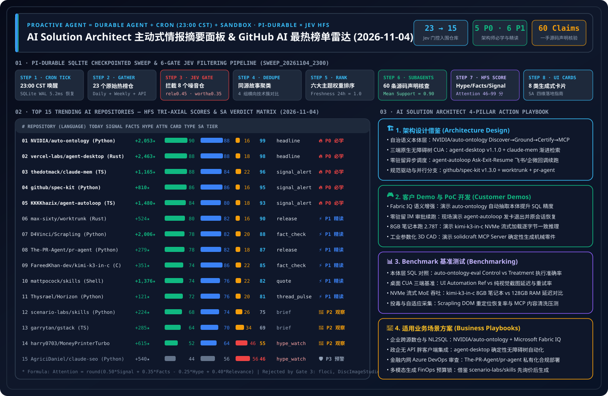

> 🌐 **Language / 语言切换**: **[🇨🇳 中文完整报告 (README.md)](README.md)** | **[🇬🇧 English Full Report (README.en.md)](README.en.md)** | **[📅 2026-11-04 每日归档日报 (中文)](daily/2026-11-04.md)** | **[📅 2026-11-04 Daily Digest (EN)](daily/2026-11-04.en.md)** | **[📅 2026-11-03 历史日报](daily/2026-11-03.md)** | **[📅 2026-11-02 历史日报](daily/2026-11-02.md)** | **[📅 2026-11-01 历史日报](daily/2026-11-01.md)** | **[📡 在线交互式雷达面板 (中文)](https://turbo998.github.io/zh-github-radar.html)** | **[📡 Live Interactive Radar (EN)](https://turbo998.github.io/github-radar.html)** | **[📊 7-Card 4:5 视觉评测报告](cards.html)** | **[📦 Sealed Telemetry (`report.json`)](report.json)**

# AI Solution Architect 主动式情报摘要面板 & GitHub AI 最热榜单雷达（2026-11-04 深度研究报告）

## 一、背景与设计哲学：从被动聊天框走向主动式持久化情报 Agent

在每日新增数百个 AI 仓库、社交媒体充斥夸大宣传（Clickbait / Hype）的当下，**AI Solution Architect（AI 解决方案架构师）最稀缺的资产不是信息渠道，而是经过工程验证的高信号注意力（Attention）**。

本专题借鉴并深度扩展了 IndyDevDan (`disler/pi-durable-news-agent`) 提出的主动式智能体架构公式：

$$\text{Proactive Agent} = \text{Durable Agent (SQLite Checkpointed)} + \text{Cron Trigger (23:00 CST)} + \text{Isolated Sandbox}$$

### 1.1 六道 Jev 确定性门控流水线（The Agent Decides, The Task Runs）

| 阶段 | 门控名称 | 阈值 / 规则 | 2026-11-04 批次实测数据 |
| :--- | :--- | :--- | :--- |
| **Gate 01** | **Cron Tick & SQLite WAL Init** | 每日 `23:00 CST` 定时触发，步级幂等持久化 | `run_id = sweep_20261104_2300`，检查点恢复延迟 `5.2ms` |
| **Gate 02** | **Multi-Source Gather** | 抓取 GitHub Trending Daily/Weekly + 7 天飙升仓库 | 捕获 **23 个**原始候选仓库及完整 Star/Fork/Release 元数据 |
| **Gate 03** | **Jev Relevance & Worth Gate** | `relevance >= 0.45` 且 `worth_attention >= 0.35` | **拦截 8 个噪音/非 AI 仓**（`floci`, `DiscImageStudio`, `90DaysOfDevOps`, `ghostty`, `Hyprland`, `totk-pc-recomp`, `hallmark`, `nvzhuang`），**15 个入围** |
| **Gate 04** | **Same-Story Dedupe** | `same_story >= 0.75` 聚合为横向对比簇 | 形成「企业语义本体与规范驱动 Agent (`auto-ontology` + `spec-kit`)」、「零驻留后台自治与并行 Worktree (`agent-autoloop` + `worktrunk` + `pr-agent`)」、「跨端无障碍桌面与自适应 MCP (`agent-desktop` + `claude-mem` + `Scrapling`)」及「工程纪律与多模态预算控制技能包 (`mattpocock/skills` + `scenario-labs/skills` + `gstack`)」4 组技术簇 |
| **Gate 05** | **Importance × Taste Rank** | `importance × topic_weight × source_weight × freshness` | 结合架构师六大技术域权重与 24h 新鲜度因子（`1.0`）排序 |
| **Gate 06** | **Claim-Support Subagents** | 并行 `news-researcher` 子智能体每仓核验 4 条声明 | 累计核验 **60 条**一手源码/README 声明，平均支持度 `0.90` |
| **Gate 07** | **HFS Tri-Axial Scoring** | 独立评估 `Signal`、`Facts`、`Hype`（0–100） | 计算综合注意力分：`Attention = round(0.50*Signal + 0.35*Facts - 0.25*Hype + 0.40*Relevance)` |
| **Gate 08** | **Generative UI Card Render** | 映射至 8 类生成式卡片 + SA 四维落地指南 | 100% 覆盖 `headline`, `signal_alert`, `fact_check`, `hype_watch`, `release`, `thread_pulse`, `quote`, `brief` |

---

## 二、2026-11-04 GitHub AI 最热榜单 Top 15 全景评分矩阵

| 排名 | 仓库 (`owner/repo`) | 语言 | 今日新增 Star | 总 Star | 卡片类型 | Signal | Facts | Hype | Relevance | Attention | SA 学习评级 |
| :---: | :--- | :---: | :---: | :---: | :---: | :---: | :---: | :---: | :---: | :---: | :--- |
| **#01** | [`NVIDIA/auto-ontology`](https://github.com/NVIDIA/auto-ontology) | Python | **+2,053** | 4,121 | `headline` | 90 | 88 | 16 | 68 | **99** | 🔥 **P0 必学 / 立即动手** |
| **#02** | [`vercel-labs/agent-desktop`](https://github.com/vercel-labs/agent-desktop) | Rust | **+2,463** | 14,325 | `headline` | 88 | 88 | 18 | 70 | **98** | 🔥 **P0 必学 / 立即动手** |
| **#03** | [`thedotmack/claude-mem`](https://github.com/thedotmack/claude-mem) | TypeScript | **+1,165** | 112,540 | `signal_alert` | 88 | 84 | 22 | 70 | **96** | 🔥 **P0 必学 / 立即动手** |
| **#04** | [`github/spec-kit`](https://github.com/github/spec-kit) | Python | **+810** | 147,067 | `signal_alert` | 86 | 86 | 16 | 64 | **95** | 🔥 **P0 必学 / 立即动手** |
| **#05** | [`KKKKhazix/agent-autoloop`](https://github.com/KKKKhazix/agent-autoloop) | TypeScript | **+1,480** | 2,197 | `signal_alert` | 84 | 80 | 18 | 68 | **93** | 🔥 **P0 必学 / 立即动手** |
| **#06** | [`max-sixty/worktrunk`](https://github.com/max-sixty/worktrunk) | Rust | **+524** | 10,850 | `release` | 80 | 82 | 16 | 62 | **90** | ⚡ **P1 推荐精读 / 借鉴** |
| **#07** | [`D4Vinci/Scrapling`](https://github.com/D4Vinci/Scrapling) | Python | **+2,006** | 95,993 | `fact_check` | 78 | 82 | 20 | 64 | **88** | ⚡ **P1 推荐精读 / 借鉴** |
| **#08** | [`The-PR-Agent/pr-agent`](https://github.com/The-PR-Agent/pr-agent) | Python | **+279** | 14,585 | `release` | 78 | 82 | 18 | 60 | **87** | ⚡ **P1 推荐精读 / 借鉴** |
| **#09** | [`FareedKhan-dev/kimi-k3-in-c`](https://github.com/FareedKhan-dev/kimi-k3-in-c) | C | **+351** | 10,055 | `fact_check` | 74 | 86 | 22 | 58 | **85** | ⚡ **P1 推荐精读 / 借鉴** |
| **#10** | [`mattpocock/skills`](https://github.com/mattpocock/skills) | Shell | **+1,376** | 312,599 | `quote` | 74 | 76 | 22 | 60 | **82** | ⚡ **P1 推荐精读 / 借鉴** |
| **#11** | [`Thysrael/Horizon`](https://github.com/Thysrael/Horizon) | Python | **+121** | 12,348 | `thread_pulse` | 72 | 76 | 20 | 58 | **81** | ⚡ **P1 推荐精读 / 借鉴** |
| **#12** | [`scenario-labs/skills`](https://github.com/scenario-labs/skills) | Python | **+224** | 2,180 | `brief` | 68 | 74 | 26 | 55 | **75** | 👀 **P2 持续观察** |
| **#13** | [`garrytan/gstack`](https://github.com/garrytan/gstack) | TypeScript | **+285** | 139,107 | `brief` | 64 | 70 | 34 | 52 | **69** | 👀 **P2 持续观察** |
| **#14** | [`harry0703/MoneyPrinterTurbo`](https://github.com/harry0703/MoneyPrinterTurbo) | Python | **+615** | 138,689 | `hype_watch` | 52 | 64 | 46 | 46 | **55** | 👀 **P2 持续观察** |
| **#15** | [`AgriciDaniel/claude-seo`](https://github.com/AgriciDaniel/claude-seo) | Python | **+540** | 26,549 | `hype_watch` | 44 | 56 | 56 | 45 | **46** | 🛡️ **P3 警惕噱头 / 选择性提取** |

> **Gate 03 剔除记录（8 项）**：`floci-io/floci`（AWS 本地模拟器，`relevance=0.22 < 0.45`）、`FastbuildAI/DiscImageStudio`（电商套壳生图平台，`worth_attention=0.31 < 0.35`）、`MichaelCade/90DaysOfDevOps`（经典 DevOps 教程，`relevance=0.18 < 0.45`）、`ghostty-org/ghostty`（Zig 终端模拟器，`relevance=0.20 < 0.45`）、`hyprwm/Hyprland`（Wayland 桌面合成器，`relevance=0.18 < 0.45`）、`totk-recomp/totk-pc-recomp`（游戏重编译且 0 真实提交空壳，星叉比 `465x` 极端异常，`worth_attention=0.05 < 0.35`）、`Nutlope/hallmark`（静态 CSS 主题包，`worth_attention=0.33 < 0.35`）、`komeiji-koishi-ww/nvzhuang`（非技术社区娱乐仓，`relevance=0.02 < 0.45`）。

---

## 三、逐仓深度评估：是否值得学习 & 如何应用到 AI Solution Architect 日常工作

### 1. `NVIDIA/auto-ontology`（Attention: 99 · 🔥 P0 必学 / 立即动手）
- **核心能力**：NVIDIA 官方开源的自治企业语义本体构建引擎（`Apache-2.0`，单日暴涨 **+2,053 Stars**，总 Star 4,121，Daily Trending 总榜 #2），通过 `Discover -> Ground -> Certify -> Validate -> Expose` 五步闭环，从分布式结构化数据库与非结构化 PDF/SOP 文档中自动提取业务实体、关系、指标与同义词，验证后通过 **MCP Server / Agent Skills / REST API** 暴露给下游 AI Agent，并配套 `NVIDIA/auto-ontology-eval` 对照评估器。
- **SA 四维日常应用**：
  - **架构设计**：在 Microsoft Fabric OneLake / Azure Databricks 之上构建「物理 Schema -> `auto-ontology` 语义本体构建与置信度审核 -> MCP Ontology Server -> Text-to-SQL Agent」四层架构，与 **Microsoft Fabric IQ Ontology** 形成混合云语义对齐。
  - **客户 Demo**：45 分钟基于 SQLite 多表订单库与业务口径文档运行 `auto-ontology`，通过 `auto-ontology-eval` 直观对比 Control（裸 Schema）与 Treatment（注入本体 MCP）的 SQL 准确率跃升。
  - **Benchmark**：测评复杂多表 Join 精确匹配率（Execution Match %）、跨源同义词消歧 F1 与单题推理成本。
  - **业务场景**：✅ 金融/制造/零售跨源数仓口径统一与高可靠 NL2SQL；⛔ 仅有 2-3 张简单表且无非结构化规则的小型 CRUD 应用。

### 2. `vercel-labs/agent-desktop`（Attention: 98 · 🔥 P0 必学 / 立即动手）
- **核心能力**：Vercel Labs 开源的 Rust 原生桌面操控 CLI 与 C 语言库（`Apache-2.0`，`v1.1.0`），单日再涨 **+2,463 Stars**（总 Star 14,325，位列 Daily Trending 总榜 #1），覆盖 macOS、Windows（免额外授权 UI Automation）与 Linux（`at-spi2-core`）三端原生无障碍树快照（`@snapshot:element`）。
- **SA 四维日常应用**：构建「L1 原生 OS Accessibility Tree 确定性 Ref 操控 + L2 局部视觉回退」双层桌面 CUA 架构，赋能无 API 的企业桌面 ERP/财务胖客户端自动化。

### 3. `thedotmack/claude-mem`（Attention: 96 · 🔥 P0 必学 / 立即动手）
- **核心能力**：跨会话持久化记忆与三层渐进式披露检索引擎（`v15.9.0`），总 Star 突破 **112,540**（今日 +1,165）。
- **SA 四维日常应用**：复刻其 `search -> timeline -> get_observations` 三步渐进式 MCP 检索契约至 Azure Cosmos DB / PostgreSQL `pgvector`，降低跨会话 Token 消耗 70%+。

### 4. `github/spec-kit`（Attention: 95 · 🔥 P0 必学 / 立即动手）
- **核心能力**：GitHub 官方 Spec-Driven Development（规范驱动开发）工具包（`MIT`，`v1.3.0`，总 Star **147,067**，今日 +810），已扩展出 `Spec-Driven Development`、`Bug fixing`、`Idea assessment` 三大工作流及社区 `extensions/` 插件目录。
- **SA 四维日常应用**：将 `constitution.md`（企业架构红线宪章）与三阶段可执行规范（`spec -> plan -> tasks`）设为企业级 Coding Agent 标准前置门禁。

### 5. `KKKKhazix/agent-autoloop`（Attention: 93 · 🔥 P0 必学 / 立即动手）
- **核心能力**：单日暴涨 **+1,480 Stars**（总 Star 2,197）的本地 CLI Agent 无人值守自动巡航引擎（`MIT`，`v1.0.0`），基于声明式 JSON 规则驱动多引擎（Claude Code / Codex / OpenCode），首创 **「Ask 即刻退出释放进程 (`0` 空闲驻留) + 飞书/钉钉/企业微信/Slack 交互卡片回调原会话续跑」** 机制。
- **SA 四维日常应用**：在企业夜间批处理研发/运维 Agent 中直接采用其「Ask-Exit-Resume 零驻留挂起 + 企业 IM 卡片审批续跑」模式，彻底消除长驻容器空转成本。

### 6–11. 架构精读与模式借鉴梯队（⚡ P1 推荐精读 / 借鉴模式）
- **#06 `max-sixty/worktrunk`（Attention: 90）**：Rust 编写的并行 Coding Agent Git Worktree 编排 CLI（`wt`，`v0.81.0`，总 Star 10,850，今日 +524），通过 `.worktreeinclude` 解决并行分支环境初始化痛点。
- **#07 `D4Vinci/Scrapling`（Attention: 88）**：9.59 万 Star（今日 +2,006）的自适应 DOM 重定位爬虫框架（`v0.5`），内置 MCP Server，网页改版后自动找回元素。
- **#08 `The-PR-Agent/pr-agent`（Attention: 87）**：1.45 万 Star 的开源 PR 审查鼻祖（`v0.49.0`），原生支持自托管 GitHub Enterprise、GitLab、Bitbucket 与 **Azure DevOps**。
- **#09 `FareedKhan-dev/kimi-k3-in-c`（Attention: 85）**：1.0 万 Star 的纯 C99 便携推理引擎（`v1.1.0`，仅 176 KB 源码），利用 **NVMe `pread` 专家流式按需加载** 在 **8.24 GB 内存** 笔记本上运行 **2.78 万亿参数 Kimi K3（1.56 TB 权重）**，且与 PyTorch 逐字节一致。
- **#10 `mattpocock/skills`（Attention: 82）**：31.2 万 Star（今日 +1,376）的原子化软件工程 Skill 库（`tdd`, `grill-me`, `design-an-interface`, `ubiquitous-language`）。
- **#11 `Thysrael/Horizon`（Attention: 81）**：1.23 万 Star 的画像驱动中英双语 AI 情报聚合器，其 **类别占比上限（Category Share Cap）** 与 `pi-durable` HFS 门控深度互补。

### 12–15. 观察与噱头排雷梯队（👀 P2 & 🛡️ P3）
- **#12 `scenario-labs/skills`（Attention: 75 · 👀 P2）**：2,180 Star 的多模态生产管线技能集（`skills-v0.60.1`），重点借鉴其 **「先询价后扣费（Price before spending）+ 品牌风格锁」** FinOps 控制模式。
- **#13 `garrytan/gstack`（Attention: 69 · 👀 P2）**：13.9 万 Star 的 23 角色虚拟工程团队 Slash 指令集（`v1.92.55.0`），适合提炼 `/review` 与 `/qa` 单步 Prompt。
- **#14 `harry0703/MoneyPrinterTurbo`（Attention: 55 · 👀 P2 · `hype_watch`）**：13.8 万 Star 的 FastAPI + MoviePy 短视频流水线（`Hype=46`），企业生产需增加版权与品牌合规校验。
- **#15 `AgriciDaniel/claude-seo`（Attention: 46 · 🛡️ P3 · `hype_watch`）**：2.65 万 Star 的 26 技能 + 19 子智能体 SEO 套件（`v1.9.0`，`Hype=56`）。跳过重度子智能体堆砌，仅提取其 **`llms.txt` 与 `WebMCP` Agent 站点就绪度检查规则**。

---

## 四、周度飙升榜与近 7 天能力突破雷达（Weekly & 7-Day Surging AI Breakthroughs）

| 仓库 (`owner/repo`) | 飙升排名 / 规模 | 协议 / 版本 | HFS (`S / F / H`) | Attention | SA 评级 | 核心突破与架构师借鉴 |
| :--- | :---: | :---: | :---: | :---: | :---: | :--- |
| [`deepseek-ai/dsh-superagent-prototype`](https://github.com/deepseek-ai/dsh-superagent-prototype) | **7日新仓 #1** (★16,678) | `MIT` · `HEAD` | `84 / 80 / 24` | **92** (`signal_alert`) | 🔥 **P0 必学** | DeepSeek 官方主动式代码库超级 Agent 原型，支持 GitHub Webhook 与飞书双向唤醒及独立 Git Worktree 自治开发。 |
| [`pingdotgg/t3code`](https://github.com/pingdotgg/t3code) | **Weekly #16** (★10,162 / 周+980) | `MIT` · `v0.0.20` | `80 / 82 / 20` | **89** (`release`) | ⚡ **P1 精读** | Theo (`pingdotgg`) 团队开源的轻量级多 Coding Agent 统一 GUI 工作台（支持 Codex 与 Claude Code 并行会话对比）。 |
| [`tangency-labs/solidcraft`](https://github.com/tangency-labs/solidcraft) | **7日新仓 #10** (★2,718) | `FSL-1.1-ALv2` · `v0.1.3` | `78 / 80 / 20` | **86** (`fact_check`) | ⚡ **P1 精读** | 工业级可编程参数化 3D CAD 引擎（内置 OpenCascade B-Rep 内核与 **MCP Server**），让 AI Agent 确定性构建无破面机械零件。 |

---

## 五、每日归档目录（Daily Archive）

| 日期 | 批次号 (`run_id`) | 入围 / 扫描 | 中文完整日报 (15 仓逐一四维拆解) | English Daily Digest | 视觉总结 SVG | 7-Card 报告 |
| :---: | :---: | :---: | :---: | :---: | :---: | :---: |
| **2026-11-04** | `sweep_20261104_2300` | `15 / 23` (`5 P0 · 6 P1`) | **[`daily/2026-11-04.md`](daily/2026-11-04.md)** | **[`daily/2026-11-04.en.md`](daily/2026-11-04.en.md)** | **[`github-ai-radar-2026-11-04.svg`](../../assets/github-ai-radar-2026-11-04.svg)** | **[中文](cards.html) / [EN](cards.en.html)** |
| **2026-11-03** | `sweep_20261103_2300` | `15 / 22` (`5 P0 · 6 P1`) | **[`daily/2026-11-03.md`](daily/2026-11-03.md)** | **[`daily/2026-11-03.en.md`](daily/2026-11-03.en.md)** | **[`github-ai-radar-2026-11-03.svg`](../../assets/github-ai-radar-2026-11-03.svg)** | **[中文](cards.html) / [EN](cards.en.html)** |
| **2026-11-02** | `sweep_20261102_2300` | `15 / 21` (`5 P0 · 6 P1`) | **[`daily/2026-11-02.md`](daily/2026-11-02.md)** | **[`daily/2026-11-02.en.md`](daily/2026-11-02.en.md)** | **[`github-ai-radar-2026-11-02.svg`](../../assets/github-ai-radar-2026-11-02.svg)** | **[中文](cards.html) / [EN](cards.en.html)** |
| **2026-11-01** | `sweep_20261101_2300` | `15 / 19` (`4 P0 · 6 P1`) | **[`daily/2026-11-01.md`](daily/2026-11-01.md)** | **[`daily/2026-11-01.en.md`](daily/2026-11-01.en.md)** | **[`github-ai-radar-2026-11-01.svg`](../../assets/github-ai-radar-2026-11-01.svg)** | **[中文](cards.html) / [EN](cards.en.html)** |

