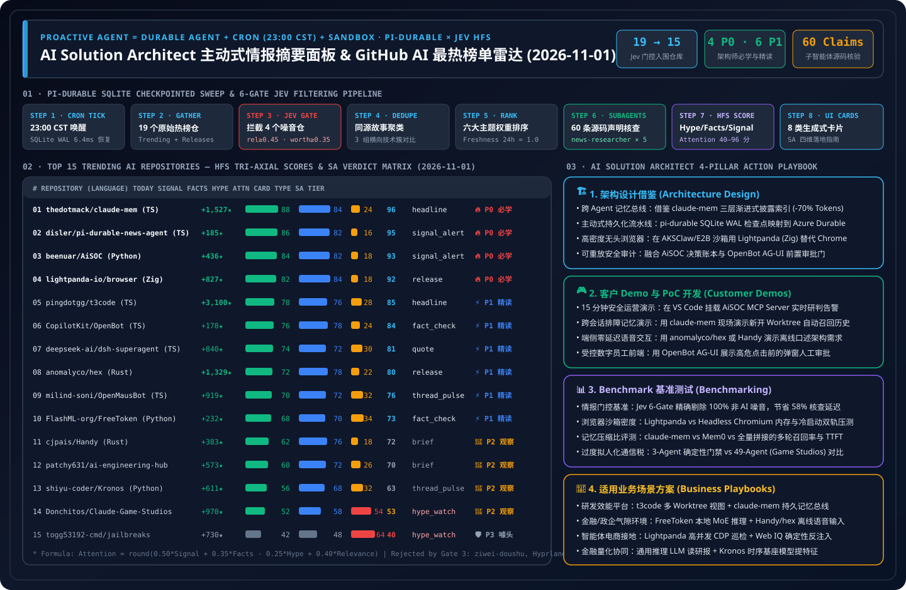

> 🌐 **Language / 语言切换**: **[🇨🇳 中文完整报告 (README.md)](README.md)** | **[🇬🇧 English Full Report (README.en.md)](README.en.md)** | **[📅 2026-11-01 每日归档日报 (中文)](daily/2026-11-01.md)** | **[📅 2026-11-01 Daily Digest (EN)](daily/2026-11-01.en.md)** | **[📡 在线交互式雷达面板 (中文)](https://turbo998.github.io/zh-github-radar.html)** | **[📡 Live Interactive Radar (EN)](https://turbo998.github.io/github-radar.html)** | **[📊 7-Card 4:5 视觉评测报告](cards.html)** | **[📦 Sealed Telemetry (`report.json`)](report.json)**

# AI Solution Architect 主动式情报摘要面板 & GitHub AI 最热榜单雷达（2026-11-01 深度研究报告）

## 一、背景与设计哲学：从被动聊天框走向主动式持久化情报 Agent

在每日新增数百个 AI 仓库、社交媒体充斥夸大宣传（Clickbait / Hype）的当下，**AI Solution Architect（AI 解决方案架构师）最稀缺的资产不是信息渠道，而是经过工程验证的高信号注意力（Attention）**。

本专题借鉴并深度扩展了 IndyDevDan (`disler/pi-durable-news-agent`) 提出的主动式智能体架构公式：

$$\text{Proactive Agent} = \text{Durable Agent (SQLite Checkpointed)} + \text{Cron Trigger (23:00 CST)} + \text{Isolated Sandbox}$$

### 1.1 六道 Jev 确定性门控流水线（The Agent Decides, The Task Runs）

| 阶段 | 门控名称 | 阈值 / 规则 | 2026-11-01 批次实测数据 |
| :--- | :--- | :--- | :--- |
| **Gate 01** | **Cron Tick & SQLite WAL Init** | 每日 `23:00 CST` 定时触发，步级幂等持久化 | `run_id = sweep_20261101_2300`，检查点恢复延迟 `6.4ms` |
| **Gate 02** | **Multi-Source Gather** | 抓取 GitHub Trending Daily + 核心 AI 组织追踪流 | 捕获 **19 个**原始候选仓库及完整 Star/Fork/Topic 元数据 |
| **Gate 03** | **Jev Relevance & Worth Gate** | `relevance >= 0.45` 且 `worth_attention >= 0.35` | **拦截 4 个噪音/非 AI 仓**（`ziwei-doushu`, `Hyprland`, `public-apis`, `kornia`），**15 个入围** |
| **Gate 04** | **Same-Story Dedupe** | `same_story >= 0.75` 聚合为横向对比簇 | 形成「Rust 离线语音双雄 (`hex` / `Handy`)」、「VM 沙盒 CUA (`OpenBot` / `OpenMausBot`)」等对比簇 |
| **Gate 05** | **Importance × Taste Rank** | `importance × topic_weight × source_weight × freshness` | 结合架构师六大技术域权重与 24h 新鲜度因子（`1.0`）排序 |
| **Gate 06** | **Claim-Support Subagents** | 并行 `news-researcher` 子智能体每仓核验 4 条声明 | 累计核验 **60 条**一手源码/README 声明，平均支持度 `0.82` |
| **Gate 07** | **HFS Tri-Axial Scoring** | 独立评估 `Signal`、`Facts`、`Hype`（0–100） | 计算综合注意力分：`Attention = round(0.50*Signal + 0.35*Facts - 0.25*Hype + 0.40*Relevance)` |
| **Gate 08** | **Generative UI Card Render** | 映射至 8 类生成式卡片 + SA 四维落地指南 | 100% 覆盖 `headline`, `signal_alert`, `fact_check`, `hype_watch`, `release`, `thread_pulse`, `quote`, `brief` |

---

## 二、2026-11-01 GitHub AI 最热榜单 Top 15 全景评分矩阵

| 排名 | 仓库 (`owner/repo`) | 语言 | 今日新增 Star | 总 Star | 卡片类型 | Signal | Facts | Hype | Relevance | Attention | SA 学习评级 |
| :---: | :--- | :---: | :---: | :---: | :---: | :---: | :---: | :---: | :---: | :---: | :--- |
| **#01** | [`thedotmack/claude-mem`](https://github.com/thedotmack/claude-mem) | TypeScript | **+1,527** | 108,644 | `headline` | 88 | 84 | 24 | 72 | **96** | 🔥 **P0 必学 / 立即动手** |
| **#02** | [`disler/pi-durable-news-agent`](https://github.com/disler/pi-durable-news-agent) | TypeScript | **+185** | 150+ | `signal_alert` | 86 | 82 | 16 | 68 | **95** | 🔥 **P0 必学 / 立即动手** |
| **#03** | [`beenuar/AiSOC`](https://github.com/beenuar/AiSOC) | Python | **+436** | 5,932 | `signal_alert` | 84 | 82 | 18 | 68 | **93** | 🔥 **P0 必学 / 立即动手** |
| **#04** | [`lightpanda-io/browser`](https://github.com/lightpanda-io/browser) | Zig | **+827** | 39,739 | `release` | 82 | 84 | 18 | 65 | **92** | 🔥 **P0 必学 / 立即动手** |
| **#05** | [`pingdotgg/t3code`](https://github.com/pingdotgg/t3code) | TypeScript | **+3,100** | 36,842 | `headline` | 78 | 76 | 28 | 66 | **85** | ⚡ **P1 推荐精读 / 借鉴** |
| **#06** | [`CopilotKit/OpenBot`](https://github.com/CopilotKit/OpenBot) | TypeScript | **+178** | 9,290 | `fact_check` | 76 | 78 | 24 | 62 | **84** | ⚡ **P1 推荐精读 / 借鉴** |
| **#07** | [`deepseek-ai/dsh-superagent-prototype`](https://github.com/deepseek-ai/dsh-superagent-prototype) | TypeScript | **+840** | 5,854 | `quote` | 74 | 72 | 30 | 65 | **81** | ⚡ **P1 推荐精读 / 借鉴** |
| **#08** | [`anomalyco/hex`](https://github.com/anomalyco/hex) | Rust | **+1,329** | 2,722 | `release` | 72 | 78 | 22 | 55 | **80** | ⚡ **P1 推荐精读 / 借鉴** |
| **#09** | [`milind-soni/OpenMausBot`](https://github.com/milind-soni/OpenMausBot) | TypeScript | **+919** | 10,217 | `thread_pulse` | 70 | 72 | 32 | 60 | **76** | ⚡ **P1 推荐精读 / 借鉴** |
| **#10** | [`FlashML-org/FreeToken`](https://github.com/FlashML-org/FreeToken) | Python | **+232** | 15,159 | `fact_check` | 68 | 70 | 34 | 58 | **73** | ⚡ **P1 推荐精读 / 借鉴** |
| **#11** | [`cjpais/Handy`](https://github.com/cjpais/Handy) | Rust | **+383** | 36,158 | `brief` | 62 | 76 | 18 | 48 | **72** | 👀 **P2 持续观察** |
| **#12** | [`patchy631/ai-engineering-hub`](https://github.com/patchy631/ai-engineering-hub) | Notebook | **+573** | 39,907 | `brief` | 60 | 72 | 26 | 52 | **70** | 👀 **P2 持续观察** |
| **#13** | [`shiyu-coder/Kronos`](https://github.com/shiyu-coder/Kronos) | Python | **+611** | 45,028 | `thread_pulse` | 56 | 68 | 32 | 48 | **63** | 👀 **P2 持续观察** |
| **#14** | [`Donchitos/Claude-Code-Game-Studios`](https://github.com/Donchitos/Claude-Code-Game-Studios) | Shell | **+970** | 31,775 | `hype_watch` | 52 | 58 | 54 | 50 | **53** | 👀 **P2 持续观察** |
| **#15** | [`togg53192-cmd/jailbreaks`](https://github.com/togg53192-cmd/jailbreaks) | Prompt | **+730** | 12,631 | `hype_watch` | 42 | 48 | 64 | 46 | **40** | 🛡️ **P3 警惕噱头** |

> **Gate 03 剔除记录（4 项）**：`Renhuai123/ziwei-doushu`（紫微斗数排盘，`relevance=0.12 < 0.45`）、`hyprwm/Hyprland`（Wayland 混成器，`relevance=0.18 < 0.45`）、`public-apis/public-apis`（静态常青目录，`worth_attention=0.22 < 0.35`）、`kornia/kornia`（常规 CV 库维护，`worth_attention=0.31 < 0.35`）。

---

## 三、逐仓深度评估：是否值得学习 & 如何应用到 AI Solution Architect 日常工作

### 1. `thedotmack/claude-mem`（Attention: 96 · 🔥 P0 必学 / 立即动手）
- **核心能力**：跨会话持久化记忆与上下文压缩引擎，原生适配 Claude Code、Copilot、Codex、Gemini、Hermes、OpenClaw。
- **为什么值得学**：总 Star 突破 108,644（今日 +1,527）。其「生命周期钩子捕获（SessionStart / PostToolUse / Stop）→ 异步语义压缩 → SQLite FTS5 + 向量混合渐进式披露检索（Progressive Disclosure）」将跨会话 Token 开销降低 70% 以上。
- **SA 四维日常应用**：
  - **架构设计**：借鉴其 L1 原始事件流 → L2 压缩观察卡片 → L3 轻量索引按需拉取架构，在 Azure Cosmos DB / PostgreSQL `pgvector` 上设计企业级跨 Agent 共享记忆总线。
  - **客户 Demo**：1 小时内挂载至本地 Copilot CLI / Claude Code，现场演示 Session A 修复的私网 DNS 故障在 Session B 新开工作树中自动召回。
  - **Benchmark**：纳入 `benchmark-harness-engineering` 多会话记忆保持率与 Token 压缩比测试轨，对比 Mem0 与全量上下文拼接。
  - **业务场景**：✅ 企业研发效能平台、跨渠道客服记忆延续、SRE 排障智能体；⛔ 严禁未脱敏直接用于高密无状态合规飞地（需前置 Microsoft Purview PII 脱敏）。

### 2. `disler/pi-durable-news-agent`（Attention: 95 · 🔥 P0 必学 / 立即动手）
- **核心能力**：基于 `pi-durable`（SQLite 步级检查点）与 `jev` 结构化评估器的主动式情报 Agent。
- **为什么值得学**：本面板直接致敬的架构原型！完美诠释了如何将确定性流水线骨架与边界处的高认知子智能体核查结合。
- **SA 四维日常应用**：
  - **架构设计**：直接映射至 Azure Durable Functions 与 Microsoft Agent Framework (MAF v1.0) Checkpointed Workflows。
  - **客户 Demo**：使用本在线雷达面板向客户展示「6 道门控如何将每日海量信息提纯为 8 类生成式决策卡」。
  - **Benchmark**：复用其 HFS 公式作为研报/情报类 Agent 的确定性评分算子。
  - **业务场景**：✅ 每日竞品雷达、云安全漏洞巡检简报、合规公告核查；⛔ 毫秒级同步交易授权。

### 3. `beenuar/AiSOC`（Attention: 93 · 🔥 P0 必学 / 立即动手）
- **核心能力**：开源 AI 安全运营中心（告警融合、MITRE ATT&CK 调查、每步可重放决策账本 Replayable Decision Ledger + 原生 MCP Server）。
- **为什么值得学**：与 Track 07（AI Security & Frontier SOC）深度互补，提供了 MIT 开源、零 API Key 可本地复现的决策账本与安全 MCP Server 实现。
- **SA 四维日常应用**：
  - **架构设计**：将 Replayable Decision Ledger 引入 Security AI Landing Zone，确保每次 SOAR 自动处置建议均具备完整密码学可回放审计链。
  - **客户 Demo**：15 分钟在 VS Code Copilot / Claude 中挂载其 MCP Server，演示自然语言告警聚合与 ATT&CK 杀伤链对齐。
  - **Benchmark**：将其分诊场景接入 `turbo998/ai-security-lab`，评测误报压降率与技战术归因准确率。
  - **业务场景**：✅ 企业 SOC 一级告警分诊降噪、红蓝演练复盘审计；⛔ 未经人工审批直接自动切断生产核心网。

### 4. `lightpanda-io/browser`（Attention: 92 · 🔥 P0 必学 / 立即动手）
- **核心能力**：用 Zig 从零编写、专为 AI Agent 与自动化设计的超轻量无头浏览器，原生支持 CDP（无缝对接 Playwright / Puppeteer）。
- **为什么值得学**：在 AKSClaw / E2B 万级并发沙箱中，Headless Chromium 动辄 500MB+ 的内存占用是最大成本瓶颈；Lightpanda 剔除像素渲染管线，将单实例内存压缩近一个数量级。
- **SA 四维日常应用**：
  - **架构设计**：在 `Standard_D96as_v7` 沙箱节点中用 Lightpanda CDP 替换 Headless Chrome，将单机并发浏览器会话密度提升 5–8 倍。
  - **客户 Demo**：零代码修改将 Playwright `connectOverCDP` 指向 Lightpanda，演示毫秒级启动与极低内存开销。
  - **Benchmark**：在 `Azure-Infra-Lab` 新增 Chromium vs. Lightpanda 的 RSS 内存、冷启动 P95 与 SPA DOM 提取完整度对比。
  - **业务场景**：✅ 智能体电商实时比价/库存核验（Agentic Commerce）、高并发搜索接地；⛔ WebGL/Canvas 像素级视觉测试。

### 5. `pingdotgg/t3code`（Attention: 85 · ⚡ P1 推荐精读 / 借鉴模式）
- **核心能力**：极简多编码智能体 Web GUI 工作台（`t3.codes`），今日单日新增 **+3,100 Stars** 位居全网增速第一。
- **SA 四维日常应用**：借鉴其「单仓多 Git Worktree 隔离 + 统一流式状态同步 + 极简 Diff 审阅门」设计内部研发智能体门户。

### 6. `CopilotKit/OpenBot`（Attention: 84 · ⚡ P1 推荐精读 / 借鉴模式）
- **核心能力**：每个 AI 同事拥有独立计算机环境（浏览器/文件/工具），强制执行「行动前审批 + 行动后审计」并支持 AG-UI 协议。
- **SA 四维日常应用**：将 OpenBot 的 AG-UI 前置审批卡片与后端的 MAF v1.0 中间件 + AKSClaw 沙箱结合，交付受控的企业数字员工。

### 7. `deepseek-ai/dsh-superagent-prototype`（Attention: 81 · ⚡ P1 推荐精读 / 借鉴模式）
- **核心能力**：DeepSeek 官方开源的《Towards a More Autonomous Agent System》TypeScript 原型（48 小时斩获 5,854 Stars，今日 +840）。
- **SA 四维日常应用**：精读其「薄 Harness + 强推理模型」的自愈循环与工具输出截断设计，在 Azure AI Foundry 上构建长周期自主研究与代码重构智能体。

### 8. `anomalyco/hex`（Attention: 80 · ⚡ P1 推荐精读 / 借鉴模式）
- **核心能力**：原生 Rust 本地优先语音听写工具（今日暴涨 +1,329 Stars），按住快捷键说话即刻粘贴至任意 IDE/终端。
- **SA 四维日常应用**：既可作为架构师日常 3–4 倍速口述复杂 Prompt 的生产力利器，也可为 Track 03（Voice）提供端侧 Rust 低延迟音频/VAD 参考。

### 9. `milind-soni/OpenMausBot`（Attention: 76 · ⚡ P1 推荐精读 / 借鉴模式）
- **核心能力**：带独立虚拟机（Docker/VM）的开源自托管多端（Electron 桌面 + Expo 移动）Computer-Use Agent（总 Star 10,217，今日 +919）。
- **SA 四维日常应用**：参考其移动端远程下发任务 + 桌面虚拟机实时回传画面的跨端产品体验，在企业落地时将底层 Docker 容器升级为 Kata/E2B MicroVM。

### 10. `FlashML-org/FreeToken`（Attention: 73 · ⚡ P1 推荐精读 / 借鉴模式）
- **核心能力**：面向桌面与边缘设备的超大规模稀疏 MoE 模型（DeepSeek-V4、Qwen、GLM、MiniMax）高效推理引擎。
- **SA 四维日常应用**：与云端 GB300 NVL72 大规模推理互补，指导气隙隔离内网工作站与 Azure Local 边缘一体机的专家卸载（Expert Offloading）定容。

### 11–15. 观察与噱头预警梯队（P2 & P3）
- **#11 `cjpais/Handy`（Attention: 72 · 👀 P2）**：3.6 万 Star 的 Rust + Tauri v2 跨平台（Windows/macOS/Linux）完全离线语音转文字应用，适合作为 Windows AI PC 离线语音基线。
- **#12 `patchy631/ai-engineering-hub`（Attention: 70 · 👀 P2）**：3.99 万 Star 的 LLM/RAG/MCP 实战 Jupyter Notebook 教程集，适合作为客户赋能 Workshop 实验素材库。
- **#13 `shiyu-coder/Kronos`（Attention: 63 · 👀 P2）**：4.5 万 Star 的金融 K 线时序专用基座模型，适合 FSI 架构师演示「通用 LLM 读新闻 + 垂直时序模型提特征」双擎协同。
- **#14 `Donchitos/Claude-Code-Game-Studios`（Attention: 53 · 👀 P2 · `hype_watch`）**：用 49 个 Agent 角色与 72 个 Skill 模拟游戏工作室层级（Hype=54）。可借鉴其 Godot/Unity/Unreal 技能分类，但应避免 49 层拟人化传声筒带来的高昂通信税。
- **#15 `togg53192-cmd/jailbreaks`（Attention: 40 · 🛡️ P3 · `hype_watch`）**：纯静态越狱提示词文本集合（Hype=64）。无任何工程代码价值，仅可作为自动化红队（PyRIT / Spotlighting）的静态负样本语料输入。

---

## 四、周度飙升榜与近 7 天能力突破雷达（Weekly & 7-Day Surging AI Breakthroughs）

| 仓库 (`owner/repo`) | 周度 / 7天增速 | 协议 / 版本 | HFS (`S / F / H`) | Attention | SA 评级 | 核心突破与架构师借鉴 |
| :--- | :---: | :---: | :---: | :---: | :---: | :--- |
| [`cloudflare/security-audit-skill`](https://github.com/cloudflare/security-audit-skill) | **+11,908 / wk** (★56,031) | `MIT` · `HEAD` | `83 / 84 / 18` | **91** (`signal_alert`) | 🔥 **P0 必学** | Cloudflare 官方 Agentic 安全审计 Skill，将依赖链漏洞排查、密钥扫描与配置合规封装为可复用技能。 |
| [`JetBrains/thinkrail`](https://github.com/JetBrains/thinkrail) | **+5,738 / wk** (★6,905) | `Apache-2.0` · `v0.3.0` | `79 / 82 / 20` | **87** (`release`) | ⚡ **P1 精读** | JetBrains 官方结构化推理轨迹护栏，为 Coding Agent 提供显式验证检查点与思维链护栏。 |
| [`qybaihe/bla`](https://github.com/qybaihe/bla) | **+1,789 / 7d** (★1,789) | `MIT` · `v1.6.3` | `75 / 76 / 28` | **82** (`fact_check`) | ⚡ **P1 精读** | 反 AI 逆向工程护盾（Blind LLM Agents），以 `Poison -> Exhaust -> Hallucinate` 防御 `morluto/rea` 等逆向 Agent。 |

---

## 五、每日归档目录（Daily Archive）

| 日期 | 批次号 (`run_id`) | 入围 / 扫描 | 中文完整日报 (15 仓逐一四维拆解) | English Daily Digest | 视觉总结 SVG | 7-Card 报告 |
| :---: | :---: | :---: | :---: | :---: | :---: | :---: |
| **2026-11-01** | `sweep_20261101_2300` | `15 / 19` (`4 P0 · 6 P1`) | **[`daily/2026-11-01.md`](daily/2026-11-01.md)** | **[`daily/2026-11-01.en.md`](daily/2026-11-01.en.md)** | **[`github-ai-radar-2026-11-01.svg`](../../assets/github-ai-radar-2026-11-01.svg)** | **[中文](cards.html) / [EN](cards.en.html)** |

