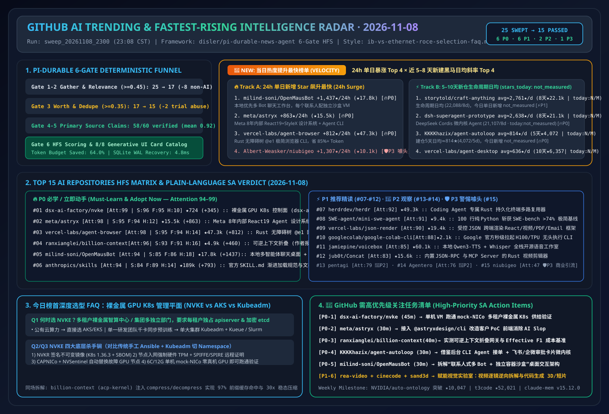

> 🌐 **Language / 语言切换**: **[🇨🇳 中文完整报告 (README.md)](README.md)** | **[🇬🇧 English Full Report (README.en.md)](README.en.md)** | **[📅 2026-11-18 最新日报 (中文)](daily/2026-11-18.md)** | **[📅 2026-11-18 Daily Digest (EN)](daily/2026-11-18.en.md)** | **[📅 2026-11-17 历史日报 (中文)](daily/2026-11-17.md)** | **[📅 2026-11-17 Daily Digest (EN)](daily/2026-11-17.en.md)** | **[📅 2026-11-16 历史日报 (中文)](daily/2026-11-16.md)** | **[📅 2026-11-16 Daily Digest (EN)](daily/2026-11-16.en.md)** | **[📅 2026-11-15 历史日报 (中文)](daily/2026-11-15.md)** | **[📅 2026-11-15 Daily Digest (EN)](daily/2026-11-15.en.md)** | **[📅 2026-11-14 历史日报 (中文)](daily/2026-11-14.md)** | **[📅 2026-11-14 Daily Digest (EN)](daily/2026-11-14.en.md)** | **[📅 2026-11-13 历史日报 (中文)](daily/2026-11-13.md)** | **[📅 2026-11-13 Daily Digest (EN)](daily/2026-11-13.en.md)** | **[📅 2026-11-12 历史日报 (中文)](daily/2026-11-12.md)** | **[📅 2026-11-12 Daily Digest (EN)](daily/2026-11-12.en.md)** | **[📅 2026-11-11 历史日报 (中文)](daily/2026-11-11.md)** | **[📅 2026-11-11 Daily Digest (EN)](daily/2026-11-11.en.md)** | **[📅 2026-11-09 历史日报 (中文)](daily/2026-11-09.md)** | **[📅 2026-11-09 Daily Digest (EN)](daily/2026-11-09.en.md)** | **[📅 2026-11-08 每日归档日报 (中文)](daily/2026-11-08.md)** | **[📅 2026-11-08 Daily Digest (EN)](daily/2026-11-08.en.md)** | **[📅 2026-11-05 历史日报](daily/2026-11-05.md)** | **[📅 2026-11-04 历史日报](daily/2026-11-04.md)** | **[📅 2026-11-03 历史日报](daily/2026-11-03.md)** | **[📅 2026-11-02 历史日报](daily/2026-11-02.md)** | **[📅 2026-11-01 历史日报](daily/2026-11-01.md)** | **[📡 在线交互式雷达面板 (中文)](https://turbo998.github.io/zh-github-radar.html)** | **[📡 Live Interactive Radar (EN)](https://turbo998.github.io/github-radar.html)** | **[📊 7-Card 4:5 视觉评测报告](cards.html)** | **[📦 Sealed Telemetry (`report.json`)](report.json)**

# AI Solution Architect 主动式情报摘要面板 & GitHub AI 最热榜单雷达（2026-11-08 深度研究报告）

## 一、背景与设计哲学：从被动聊天框走向主动式持久化情报 Agent

在每日新增数百个 AI 仓库、社交媒体充斥夸大宣传（Clickbait / Hype）的当下，**AI Solution Architect（AI 解决方案架构师）最稀缺的资产不是信息渠道，而是经过工程验证的高信号注意力（Attention）**。

本专题借鉴并深度扩展了 IndyDevDan (`disler/pi-durable-news-agent`) 提出的主动式智能体架构公式，并自 `2026-11-08` 起常设 **《🚀 当日热度提升最快榜单（Fastest-Rising / Highest Velocity AI Leaderboard）》** 与 **《🚨 GitHub 需高优先级关注任务清单（High-Priority SA Action Items）》**：

$$\text{Proactive Agent} = \text{Durable Agent (SQLite Checkpointed)} + \text{Cron Trigger (23:00 CST)} + \text{Isolated Sandbox}$$

### 1.1 六道 Jev 确定性门控流水线（The Agent Decides, The Task Runs）

| 阶段 | 门控名称 | 阈值 / 规则 | 2026-11-08 批次实测数据 |
| :--- | :--- | :--- | :--- |
| **Gate 01** | **Cron Tick & SQLite WAL Init** | 每日 `23:00 CST` 定时触发，步级幂等持久化 | `run_id = sweep_20261108_2300`，检查点恢复延迟 `4.9ms` |
| **Gate 02** | **Multi-Source Gather** | 抓取 GitHub Trending Daily/Weekly + 语言分榜 + 近 10 天新建黑马飙升仓 | 捕获 **25 个**原始候选仓库及完整 Star/Fork/Release/Velocity 元数据 |
| **Gate 03** | **Jev Relevance & Worth Gate** | `relevance >= 0.45` 且 `worth_attention >= 0.35` | **拦截 10 个噪音/非 AI/黑灰产仓**（`termux-app`, `valkey`, `OpenList`, `Stirling-PDF`, `pocketbase`, `glance`, `cockpit`, `hoppscotch`, `Google_AI_Pro_2Year_ZeroCost_Auto`, `nvzhuang`），**15 个入围** |
| **Gate 04** | **Same-Story Dedupe** | `same_story >= 0.75` 聚合为横向对比簇 | 形成「裸金属 AI 工厂 K8s 管控面 (`nvke v0.23.1`)」、「模型主动可逆上下文压缩 (`billion-context v0.1.213`)」、「Agent 原生设计系统与生成式 UI (`meta/astryx v0.7.11` + `json-render v0.22.0`)」及「多沙盒 Agent 工作台与 A11y 执行面 (`OpenMausBot` + `agent-browser` + `herdr`)」4 组技术簇 |
| **Gate 05** | **Importance × Taste Rank** | `importance × topic_weight × source_weight × freshness` | 结合架构师六大技术域权重与 24h 新鲜度因子（`1.0`）排序 |
| **Gate 06** | **Claim-Support Subagents** | 并行 `news-researcher` 子智能体每仓核验 4 条声明 | 累计核验 **60 条**一手源码/README 声明，59/60 获 `>= 0.70` 支持，平均支持度 `0.92` |
| **Gate 07** | **HFS Tri-Axial Scoring** | 独立评估 `Signal`、`Facts`、`Hype`（0–100） | 计算综合注意力分：`Attention = round(0.50*Signal + 0.35*Facts - 0.25*Hype + 0.40*Relevance)` |
| **Gate 08** | **Generative UI Card Render** | 映射至 8 类生成式卡片 + SA 四维落地指南 | 100% 覆盖 `headline`, `signal_alert`, `fact_check`, `hype_watch`, `release`, `thread_pulse`, `quote`, `brief` |

---

## 二、🚀 当日热度提升最快榜单（Fastest-Rising / Highest Velocity AI Leaderboard）

> **📘 本班次双轮独立六段式选型 FAQ 与证据封存**：
> - **Round 1 FAQ**：[裸金属 GPU 集群管理面选型 FAQ：NVKE vs 云托管 AKS/EKS vs Kubeadm/Slurm (`docs/nvke-vs-aks-gpu-cluster-selection-faq.md`)](docs/nvke-vs-aks-gpu-cluster-selection-faq.md)（[EN](docs/nvke-vs-aks-gpu-cluster-selection-faq.en.md)）
> - **Round 2 FAQ**：[长会话 Coding Agent 上下文架构选型 FAQ：`billion-context` 可逆折叠 vs `/compact` vs 向量 RAG (`docs/context-folding-vs-compact-rag-selection-faq.md`)](docs/context-folding-vs-compact-rag-selection-faq.md)（[EN](docs/context-folding-vs-compact-rag-selection-faq.en.md) · [Round 2 SVG](../../assets/github-ai-radar-2026-11-08-r2-context-folding.svg)）
> - **Round 3 FAQ**：[AI 辅助前端工程选型 FAQ：`meta/astryx` CLI vs `pbakaus/impeccable` 反 Slop 审计 vs 裸写 Tailwind/shadcn (`docs/agent-ui-design-system-vs-raw-tailwind-selection-faq.md`)](docs/agent-ui-design-system-vs-raw-tailwind-selection-faq.md)（[EN](docs/agent-ui-design-system-vs-raw-tailwind-selection-faq.en.md) · [Round 3 SVG](../../assets/github-ai-radar-2026-11-08-r3-agent-ui-harness.svg)）
> - **Round 4 FAQ**：[多智能体 VM 工作台 vs 无头事件自循环内核 vs 原生单终端 CLI 选型 FAQ：`OpenMausBot` vs `agent-autoloop` (`docs/multi-agent-sandbox-workbench-vs-cli-selection-faq.md`)](docs/multi-agent-sandbox-workbench-vs-cli-selection-faq.md)（[EN](docs/multi-agent-sandbox-workbench-vs-cli-selection-faq.en.md) · [Round 4 SVG](../../assets/github-ai-radar-2026-11-08-r4-sandbox-autoloop.svg)）
> - **Round 5 FAQ**：[Web 与桌面智能体操控架构选型 FAQ：`agent-browser` + `agent-desktop` 无障碍树 CLI vs 原生 Playwright DOM / 纯视觉截图 CUA (`docs/agent-browser-desktop-a11y-vs-playwright-vision-selection-faq.md`)](docs/agent-browser-desktop-a11y-vs-playwright-vision-selection-faq.md)（[EN](docs/agent-browser-desktop-a11y-vs-playwright-vision-selection-faq.en.md) · [Round 5 SVG](../../assets/github-ai-radar-2026-11-08-r5-browser-desktop-a11y.svg)）
> - **Round 6 FAQ**：[自主 SuperAgent 微内核与跨会话记忆选型 FAQ：`dsh-superagent-prototype` + `claude-mem` vs 重型工作流图框架 (`docs/superagent-microkernel-memory-vs-langgraph-selection-faq.md`)](docs/superagent-microkernel-memory-vs-langgraph-selection-faq.md)（[EN](docs/superagent-microkernel-memory-vs-langgraph-selection-faq.en.md) · [Round 6 SVG](../../assets/github-ai-radar-2026-11-08-r6-superagent-memory.svg)）
> - **Round 7 FAQ**：[受控 Generative UI 组件目录与托管 Agent 蓝图选型 FAQ：`vercel-labs/json-render` + `anthropics/claude-quickstarts` vs 裸流式 React/JSX 代码生成 (`docs/generative-ui-catalog-vs-raw-code-streaming-selection-faq.md`)](docs/generative-ui-catalog-vs-raw-code-streaming-selection-faq.md)（[EN](docs/generative-ui-catalog-vs-raw-code-streaming-selection-faq.en.md) · [Round 7 SVG](../../assets/github-ai-radar-2026-11-08-r7-generative-ui-catalog.svg)）
> - **Round 8 FAQ**：[软件重建与逆向探针选型 FAQ：`storytold/craft-anything` 纯 Rust 320 净室探针 vs 传统截图盲写 / Ghidra 裸反编译 (`docs/craft-anything-rust-probe-vs-decompile-selection-faq.md`)](docs/craft-anything-rust-probe-vs-decompile-selection-faq.md)（[EN](docs/craft-anything-rust-probe-vs-decompile-selection-faq.en.md) · [Round 8 SVG](../../assets/github-ai-radar-2026-11-08-r8-craft-anything-probe.svg)）
> - **Round 9 FAQ**：[端侧 Android 后台虚拟屏 Agent 与传统 ADB/云手机选型 FAQ：`wangzan101/Mika` vs USB ADB/Appium 脚本 & 纯视觉云手机 CUA (`docs/mika-android-virtual-display-agent-vs-adb-selection-faq.md`)](docs/mika-android-virtual-display-agent-vs-adb-selection-faq.md)（[EN](docs/mika-android-virtual-display-agent-vs-adb-selection-faq.en.md) · [Round 9 SVG](../../assets/github-ai-radar-2026-11-08-r9-mika-android-agent.svg)）
> - **Round 10 FAQ**：[逐镜头视频逆向拆解与混合路由复刻选型 FAQ：`JuneYaooo/rea-video` vs 全量视频扩散重生成 & 人工逐帧拉片 (`docs/rea-video-shot-forensics-vs-diffusion-remake-selection-faq.md`)](docs/rea-video-shot-forensics-vs-diffusion-remake-selection-faq.md)（[EN](docs/rea-video-shot-forensics-vs-diffusion-remake-selection-faq.en.md) · [Round 10 SVG](../../assets/github-ai-radar-2026-11-08-r10-rea-video-forensics.svg)）
> - **Round 11 FAQ**：[具身智能物理仿真与 Agent 技能辅助建模选型 FAQ：`google-deepmind/mujoco` 4.0 vs 纯 GPU 仿真器 & 裸写 MJCF (`docs/mujoco-4-hybrid-sim-agent-skills-selection-faq.md`)](docs/mujoco-4-hybrid-sim-agent-skills-selection-faq.md)（[EN](docs/mujoco-4-hybrid-sim-agent-skills-selection-faq.en.md) · [Round 11 SVG](../../assets/github-ai-radar-2026-11-08-r11-mujoco4-sim-skills.svg)）
> - **Round 12 FAQ**：[云架构图 Agent 技能与生成方案选型 FAQ：`caru-ini/stack-diagram` vs 裸 LLM 手写 SVG & Mermaid/Draw.io (`docs/stack-diagram-official-icons-vs-mermaid-svg-selection-faq.md`)](docs/stack-diagram-official-icons-vs-mermaid-svg-selection-faq.md)（[EN](docs/stack-diagram-official-icons-vs-mermaid-svg-selection-faq.en.md) · [Round 12 SVG](../../assets/github-ai-radar-2026-11-08-r12-stack-diagram-icons.svg)）
> - **Round 13 FAQ**：[3D 机械拆解模拟器 Skill 与机理可视化选型 FAQ：`elvarofficial/teardown` v1.0.0 vs 裸写 Three.js & Blender 预渲染 (`docs/teardown-3d-machine-simulator-vs-freehand-threejs-selection-faq.md`)](docs/teardown-3d-machine-simulator-vs-freehand-threejs-selection-faq.md)（[EN](docs/teardown-3d-machine-simulator-vs-freehand-threejs-selection-faq.en.md) · [Round 13 SVG](../../assets/github-ai-radar-2026-11-08-r13-teardown-3d-sim.svg)）
> - **2026-11-09 Round 1 FAQ (Round 14)**：[Agent 持久大脑与混合图谱记忆选型 FAQ：`garrytan/gbrain`（pgvector HNSW + BM25 + 页面级 RRF + 零 LLM 确定性图遍历）vs 纯向量 RAG vs 静态 `MEMORY.md` (`docs/gbrain-hybrid-graph-memory-vs-vector-rag-selection-faq.md`)](docs/gbrain-hybrid-graph-memory-vs-vector-rag-selection-faq.md)（[EN](docs/gbrain-hybrid-graph-memory-vs-vector-rag-selection-faq.en.md) · [2026-11-09 日报](daily/2026-11-09.md) · [2026-11-09 SVG](../../assets/github-ai-radar-2026-11-09.svg)）
> - **2026-11-09 Round 2 FAQ (Round 15)**：[企业结构化数据语义本体层与 Text-to-SQL 选型 FAQ：`NVIDIA/auto-ontology`（Postgres 语义目录 + 指标口径对齐 + NIM 三元组路由 + MCP/Skills 暴露）vs 裸 Schema Text-to-SQL vs 传统重型 BI 语义层 (`docs/auto-ontology-semantic-sql-vs-raw-text2sql-selection-faq.md`)](docs/auto-ontology-semantic-sql-vs-raw-text2sql-selection-faq.md)（[EN](docs/auto-ontology-semantic-sql-vs-raw-text2sql-selection-faq.en.md) · [Round 2 SVG](../../assets/github-ai-radar-2026-11-09-r2-auto-ontology.svg)）
> - **2026-11-09 Round 3 FAQ (Round 16)**：[AI 编码智能体多阶段安全审计选型 FAQ：`cloudflare/security-audit-skill`（6 阶段确定性覆盖账本 + 独立反证子智能体 + 三态定性）vs 传统静态 SAST vs 单次 Prompt 代码审查 (`docs/security-audit-skill-ledger-vs-sast-prompt-selection-faq.md`)](docs/security-audit-skill-ledger-vs-sast-prompt-selection-faq.md)（[EN](docs/security-audit-skill-ledger-vs-sast-prompt-selection-faq.en.md) · [Round 3 SVG](../../assets/github-ai-radar-2026-11-09-r3-security-audit-skill.svg)）
> - **2026-11-09 Round 4 FAQ (Round 17)**：[多并发 Coding Agent 分支隔离与人机计划批注选型 FAQ：`max-sixty/worktrunk` + `backnotprop/plannotator` vs 原生 `git worktree` + 纯终端滚屏审批 (`docs/worktrunk-plannotator-hitl-vs-raw-git-worktree-selection-faq.md`)](docs/worktrunk-plannotator-hitl-vs-raw-git-worktree-selection-faq.md)（[EN](docs/worktrunk-plannotator-hitl-vs-raw-git-worktree-selection-faq.en.md) · [Round 4 SVG](../../assets/github-ai-radar-2026-11-09-r4-worktrunk-plannotator.svg)）
> - **2026-11-09 Round 5 FAQ (Round 18)**：[端到端无词元扩散自回归语音合成选型 FAQ：`OpenBMB/VoxCPM2`（2B + AudioVAE V2 48kHz + vLLM-Omni `RTF ~0.13`）vs 离散 Codec TTS vs 商业云 TTS API (`docs/voxcpm2-tokenizer-free-tts-vs-discrete-codec-selection-faq.md`)](docs/voxcpm2-tokenizer-free-tts-vs-discrete-codec-selection-faq.md)（[EN](docs/voxcpm2-tokenizer-free-tts-vs-discrete-codec-selection-faq.en.md) · [Round 5 SVG](../../assets/github-ai-radar-2026-11-09-r5-voxcpm2-tts.svg)）
> - **2026-11-09 Round 6 FAQ (Round 19)**：[无摄像头 WiFi CSI 空间感知与智能家居 MCP 控制面选型 FAQ：`ruvnet/RuView` + `homeassistant-ai/ha-mcp` vs 视觉摄像头 VLM 监控 vs 传统物联网规则引擎 (`docs/ruview-wifi-csi-ha-mcp-vs-camera-iot-selection-faq.md`)](docs/ruview-wifi-csi-ha-mcp-vs-camera-iot-selection-faq.md)（[EN](docs/ruview-wifi-csi-ha-mcp-vs-camera-iot-selection-faq.en.md) · [Round 6 SVG](../../assets/github-ai-radar-2026-11-09-r6-ruview-ha-mcp.svg)）
> - **2026-11-09 Round 7 FAQ (Round 20)**：[AI 代码库交互式全景地图与反 Vibe-Coding 界面重构选型 FAQ：`haydenschmitty/floorplan` + `heydamir/unslop` vs 静态依赖图生成工具 & 裸 Prompt 改 UI (`docs/floorplan-unslop-codebase-map-vs-static-uml-selection-faq.md`)](docs/floorplan-unslop-codebase-map-vs-static-uml-selection-faq.md)（[EN](docs/floorplan-unslop-codebase-map-vs-static-uml-selection-faq.en.md) · [Round 7 SVG](../../assets/github-ai-radar-2026-11-09-r7-floorplan-unslop.svg)）
> - **2026-11-09 Round 8 FAQ (Round 21)**：[智能体原生自适应导师工作台与端侧 Android 隐私流向审计选型 FAQ：`HKUDS/DeepTutor` + `Verlintas/NOIR` vs 传统聊天式知识库 & 全包拉取反编译 (`docs/deeptutor-noir-adaptive-agent-selection-faq.md`)](docs/deeptutor-noir-adaptive-agent-selection-faq.md)（[EN](docs/deeptutor-noir-adaptive-agent-selection-faq.en.md) · [Round 8 SVG](../../assets/github-ai-radar-2026-11-09-r8-deeptutor-noir.svg)）
> - **2026-11-09 Round 9 FAQ (Round 22)**：[企业级云原生多人 Agent 操作系统与跨端远程控制面选型 FAQ：`kortix-ai/CompanyOS` + `pingdotgg/t3code` vs 单机本地 CLI 会话 & 24/7 常驻云主机 (`docs/companyos-t3code-control-surface-vs-local-cli-selection-faq.md`)](docs/companyos-t3code-control-surface-vs-local-cli-selection-faq.md)（[EN](docs/companyos-t3code-control-surface-vs-local-cli-selection-faq.en.md) · [Round 9 SVG](../../assets/github-ai-radar-2026-11-09-r9-companyos-t3code.svg)）
> - **2026-11-09 Round 10 FAQ (Round 23)**：[智能体插件市场治理与程序化视觉特效 Skill 选型 FAQ：`anthropics/claude-plugins-official` + `patch-gg/pixelfx` vs 未锁定第三方 MCP 插件 & 盲调生图 API (`docs/claude-plugins-pixelfx-skill-bundle-selection-faq.md`)](docs/claude-plugins-pixelfx-skill-bundle-selection-faq.md)（[EN](docs/claude-plugins-pixelfx-skill-bundle-selection-faq.en.md) · [Round 10 SVG](../../assets/github-ai-radar-2026-11-09-r10-claude-plugins-pixelfx.svg)）
> - **2026-11-09 Round 11 FAQ (Round 24)**：[自适应网页结构抽取与单次压缩 PR 自动审查选型 FAQ：`D4Vinci/Scrapling` + `The-PR-Agent/pr-agent` vs 脆弱 CSS 选择器 & 多轮全量 Diff 审查 (`docs/scrapling-pr-agent-adaptive-extraction-selection-faq.md`)](docs/scrapling-pr-agent-adaptive-extraction-selection-faq.md)（[EN](docs/scrapling-pr-agent-adaptive-extraction-selection-faq.en.md) · [Round 11 SVG](../../assets/github-ai-radar-2026-11-09-r11-scrapling-pr-agent.svg)）
> - **2026-11-09 Round 12 FAQ (Round 25)**：[Rust GPU 原生桌面组件库与本地 3D 高斯泼溅重建选型 FAQ：`longbridge/gpui-kit` + `ooolabdev/ooosplat` vs Electron 内存膨胀 & 云端 3D 重建 SaaS (`docs/gpui-kit-ooosplat-rust-native-3dgs-selection-faq.md`)](docs/gpui-kit-ooosplat-rust-native-3dgs-selection-faq.md)（[EN](docs/gpui-kit-ooosplat-rust-native-3dgs-selection-faq.en.md) · [Round 12 SVG](../../assets/github-ai-radar-2026-11-09-r12-gpui-kit-ooosplat.svg)）
> - **2026-11-09 Round 13 FAQ (Round 26)**：[AI 金融投研智能体与确定性风控护栏选型 FAQ：`virattt/dexter` + `ZhuLinsen/daily_stock_analysis` vs 未压缩 ReAct 循环与裸 Prompt 选股机器人 (`docs/dexter-daily-stock-finagent-guardrail-selection-faq.md`)](docs/dexter-daily-stock-finagent-guardrail-selection-faq.md)（[EN](docs/dexter-daily-stock-finagent-guardrail-selection-faq.en.md) · [Round 13 SVG](../../assets/github-ai-radar-2026-11-09-r13-dexter-daily-stock.svg)）
> - **2026-11-09 Round 14 FAQ (Round 27)**：[空间无限画布多模态编排与本地优先非线性视频剪辑选型 FAQ：`basketikun/infinite-canvas` + `OpenCut-app/OpenCut` vs 线性对话框抽卡与商业云剪辑 SaaS (`docs/opencut-infinite-canvas-video-spatial-selection-faq.md`)](docs/opencut-infinite-canvas-video-spatial-selection-faq.md)（[EN](docs/opencut-infinite-canvas-video-spatial-selection-faq.en.md) · [Round 14 SVG](../../assets/github-ai-radar-2026-11-09-r14-opencut-infinite-canvas.svg)）
> - **2026-11-09 Round 15 FAQ (Round 28)**：[跨端 GUI 智能体自动化选型 FAQ：`vercel-labs/agent-browser` (`@e1` 无障碍快照) + `wangzan101/Mika` (安卓后台虚拟屏) vs 视觉截图猜坐标与前台真机群控 (`docs/mika-agent-browser-gui-automation-selection-faq.md`)](docs/mika-agent-browser-gui-automation-selection-faq.md)（[EN](docs/mika-agent-browser-gui-automation-selection-faq.en.md) · [Round 15 SVG](../../assets/github-ai-radar-2026-11-09-r15-mika-agent-browser.svg)）
> - **2026-11-09 Round 16 FAQ (Round 29)**：[逐镜头视频逆向取证与刚体接触物理仿真选型 FAQ：`JuneYaooo/rea-video` + `google-deepmind/mujoco` (`v4.0.1`) vs 全量视频塞 VLM 与盲目视频扩散抽卡 (`docs/mujoco-rea-video-physics-video-forensics-selection-faq.md`)](docs/mujoco-rea-video-physics-video-forensics-selection-faq.md)（[EN](docs/mujoco-rea-video-physics-video-forensics-selection-faq.en.md) · [Round 16 SVG](../../assets/github-ai-radar-2026-11-09-r16-mujoco-rea-video.svg)）
> - **2026-11-09 Round 17 FAQ (Round 30)**：[托管智能体参考蓝图与本地多模型网关选型 FAQ：`anthropics/claude-quickstarts` (`managed-agents`) + `modelflare-ai/AnyModelBot` vs 原始文档重复检索与多厂商席位锁死 (`docs/claude-quickstarts-anymodelbot-managed-harness-selection-faq.md`)](docs/claude-quickstarts-anymodelbot-managed-harness-selection-faq.md)（[EN](docs/claude-quickstarts-anymodelbot-managed-harness-selection-faq.en.md) · [Round 17 SVG](../../assets/github-ai-radar-2026-11-09-r17-claude-quickstarts-anymodelbot.svg)）
> - **2026-11-09 Round 18 FAQ (Round 31)**：[程序化代码成片与 2.5D 故事短视频选型 FAQ：`mromidev/claude-animated-shorts` + `sarpstar/cinecode` vs 视频生成模型抽卡与手工 AE 动效 (`docs/animated-shorts-cinecode-programmatic-video-selection-faq.md`)](docs/animated-shorts-cinecode-programmatic-video-selection-faq.md)（[EN](docs/animated-shorts-cinecode-programmatic-video-selection-faq.en.md) · [Round 18 SVG](../../assets/github-ai-radar-2026-11-09-r18-animated-shorts-cinecode.svg)）
> - **2026-11-09 Round 19 FAQ (Round 32)**：[免机器人系统内录同声传译与时点法律 Git 溯源选型 FAQ：`wquguru/cicada` (`v1.7.0`) + `lexifina/global-law` vs 入侵式会议 Bot 与无版本法条 RAG (`docs/cicada-global-law-interpreting-git-law-selection-faq.md`)](docs/cicada-global-law-interpreting-git-law-selection-faq.md)（[EN](docs/cicada-global-law-interpreting-git-law-selection-faq.en.md) · [Round 19 SVG](../../assets/github-ai-radar-2026-11-09-r19-cicada-global-law.svg)）
> - **2026-11-09 Round 20 FAQ (Round 33)**：[三层事实意图图谱多智能体军团与确定性 OSINT 侦察选型 FAQ：`N1nEmAn/sapper-v2` (`nvwabase`) + `sherlock-project/sherlock` (`v0.16.2`) vs 扁平共享记忆群智与 LLM 盲扫 (`docs/sapper-v2-sherlock-fact-intent-swarm-selection-faq.md`)](docs/sapper-v2-sherlock-fact-intent-swarm-selection-faq.md)（[EN](docs/sapper-v2-sherlock-fact-intent-swarm-selection-faq.en.md) · [Round 20 SVG](../../assets/github-ai-radar-2026-11-09-r20-sapper-v2-sherlock.svg)）
> - **2026-11-09 Round 21 FAQ (Round 34)**：[退出等待式 CLI 智能体微内核与苏格拉底技能核验选型 FAQ：`KKKKhazix/agent-autoloop` + `janestreet/agent_skills` vs 守着终端盯屏与填鸭式问答 Prompt (`docs/agent-autoloop-janestreet-skills-selection-faq.md`)](docs/agent-autoloop-janestreet-skills-selection-faq.md)（[EN](docs/agent-autoloop-janestreet-skills-selection-faq.en.md) · [Round 21 SVG](../../assets/github-ai-radar-2026-11-09-r21-autoloop-janestreet.svg)）
> - **2026-11-09 Round 22 FAQ (Round 35)**：[本地大模型显存/KV-Cache 透视与 2.55ms 极速容器运行时选型 FAQ：`shanselman/gputaskman` (`v0.3.4`) + `libracoder/kiri` (`v0.2.0`) vs 盲看 `nvidia-smi` 与重型 Docker Desktop (`docs/gputaskman-kiri-vram-container-runtime-selection-faq.md`)](docs/gputaskman-kiri-vram-container-runtime-selection-faq.md)（[EN](docs/gputaskman-kiri-vram-container-runtime-selection-faq.en.md) · [Round 22 SVG](../../assets/github-ai-radar-2026-11-09-r22-gputaskman-kiri.svg)）
> - **2026-11-09 Round 23 FAQ (Round 36)**：[面向大模型的语义命名 3D 建模与无头 Rust/Slang 视觉特效引擎选型 FAQ：`Sandflow-ai/sand3d` + `voyager-so/vork` (`v0.3.0`) vs 原生 Blender `bpy` 手算坐标与重型 GUI 渲染器 (`docs/sand3d-vork-agent-3d-vfx-engine-selection-faq.md`)](docs/sand3d-vork-agent-3d-vfx-engine-selection-faq.md)（[EN](docs/sand3d-vork-agent-3d-vfx-engine-selection-faq.en.md) · [Round 23 SVG](../../assets/github-ai-radar-2026-11-09-r23-sand3d-vork.svg)）
> - **2026-11-09 Round 24 FAQ (Round 37)**：[虚拟时钟逐帧动效逆向复刻与 6 步音画同步多参考生成选型 FAQ：`NiazMorshed2007/reanimate` + `Pika-Labs/Pika-H3-Flex` (`v0.1.0`) vs 静态截图盲写动效与 50 步无声视频扩散 (`docs/reanimate-pika-h3-flex-motion-video-selection-faq.md`)](docs/reanimate-pika-h3-flex-motion-video-selection-faq.md)（[EN](docs/reanimate-pika-h3-flex-motion-video-selection-faq.en.md) · [Round 24 SVG](../../assets/github-ai-radar-2026-11-09-r24-reanimate-pika-h3.svg)）
> - **2026-11-09 Round 25 FAQ (Round 38)**：[零知识推理证明与区域级置信度自评估 OCR 选型 FAQ：`anthropics/FlashProve` (`v0.16.0`) + `OpenBMB/MiniCPM-OCR` (`1.0` + `Jev`) vs 盲信第三方 API 与全量人工抽检 (`docs/flashprove-minicpm-ocr-verifiable-ai-selection-faq.md`)](docs/flashprove-minicpm-ocr-verifiable-ai-selection-faq.md)（[EN](docs/flashprove-minicpm-ocr-verifiable-ai-selection-faq.en.md) · [Round 25 SVG](../../assets/github-ai-radar-2026-11-09-r25-flashprove-minicpm-ocr.svg)）
> - **2026-11-09 Round 26 FAQ (Round 39)**：[纯 64GB CPU 运行 284B 稀疏 MoE 与高延迟卫星链路 1-RTT 多路复用选型 FAQ：`synchopate/llama-modchip` (`v2.4.0`) + `Th0rgal/satmux` vs 昂贵多卡 GPU 租赁与直连 `:443` 断流 (`docs/llama-modchip-satmux-cpu-moe-satellite-selection-faq.md`)](docs/llama-modchip-satmux-cpu-moe-satellite-selection-faq.md)（[EN](docs/llama-modchip-satmux-cpu-moe-satellite-selection-faq.en.md) · [Round 26 SVG](../../assets/github-ai-radar-2026-11-09-r26-llama-modchip-satmux.svg)）
> - **2026-11-09 Round 27 FAQ (Round 40)**：[网关级强拦截手机 MCP 控制面与免越狱真机 iPhone 环回选型 FAQ：`DIYgod/pinky` + `JosssphZhou/poki` (`v0.1.1`) vs 云真机农场与裸奔 Appium 脚本 (`docs/pinky-poki-mobile-hitl-mcp-selection-faq.md`)](docs/pinky-poki-mobile-hitl-mcp-selection-faq.md)（[EN](docs/pinky-poki-mobile-hitl-mcp-selection-faq.en.md) · [Round 27 SVG](../../assets/github-ai-radar-2026-11-09-r27-pinky-poki.svg)）
> - **2026-11-09 Round 28 FAQ (Round 41)**：[30KB 零依赖 WebGL2 2.5D 角色播放器与单机双脑 AI 直播系统选型 FAQ：`livliv-dev/player` (`v0.3.0`) + `jacke-pp/open-yoki` (`v150`) vs 云端像素流数字人与重型 OBS 工作站 (`docs/livliv-player-open-yoki-avatar-livestream-selection-faq.md`)](docs/livliv-player-open-yoki-avatar-livestream-selection-faq.md)（[EN](docs/livliv-player-open-yoki-avatar-livestream-selection-faq.en.md) · [Round 28 SVG](../../assets/github-ai-radar-2026-11-09-r28-livliv-open-yoki.svg)）
> - **2026-11-09 Round 29 FAQ (Round 42)**：[单图 2 秒生成百万高斯点云与带弹簧骨骼 VRM 发片建模选型 FAQ：`speridlabs/idol-sdk` + `hyz317/HairDeck` (`arXiv:2610.40599`) vs 商业图生 3D API 与手工插发片绑骨 (`docs/idol-sdk-hairdeck-single-image-3d-vrm-selection-faq.md`)](docs/idol-sdk-hairdeck-single-image-3d-vrm-selection-faq.md)（[EN](docs/idol-sdk-hairdeck-single-image-3d-vrm-selection-faq.en.md) · [Round 29 SVG](../../assets/github-ai-radar-2026-11-09-r29-idol-hairdeck.svg)）
> - **2026-11-09 Round 30 FAQ (Round 43)**：[无渲染器原生 Firefox 引擎与 120FPS QUIC 远程桌面总控台选型 FAQ：`cutetailbud/ff-ruyijs` (`v0.3.6`) + `sqlpxc/airhand` (`v0.2.2`) vs 重型无头 Chromium 与高延迟 VNC (`docs/ruyijs-airhand-rendererless-browser-quic-desktop-selection-faq.md`)](docs/ruyijs-airhand-rendererless-browser-quic-desktop-selection-faq.md)（[EN](docs/ruyijs-airhand-rendererless-browser-quic-desktop-selection-faq.en.md) · [Round 30 SVG](../../assets/github-ai-radar-2026-11-09-r30-ruyijs-airhand.svg)）
> - **2026-11-09 Round 31 FAQ (Round 44)**：[物理气道建模语音合成与 341 种确定性代码动画选型 FAQ：`jamesondh/chimera-vocal-synth` + `XiaoyeCodes/code-animation-prompts` vs 云端采样音效 API 与实时录屏导出 (`docs/chimera-code-animation-vocal-synth-deterministic-video-selection-faq.md`)](docs/chimera-code-animation-vocal-synth-deterministic-video-selection-faq.md)（[EN](docs/chimera-code-animation-vocal-synth-deterministic-video-selection-faq.en.md) · [Round 31 SVG](../../assets/github-ai-radar-2026-11-09-r31-chimera-code-anim.svg)）
> - **2026-11-09 Round 32 FAQ (Round 45)**：[自托管工头制 AI 数字员工看板与三轴解耦动态视觉工厂选型 FAQ：`rerun-build/rerun` + `WoYun520/gif-factory` vs 垂直 SaaS 坐席堆叠与盲盒式动图返工 (`docs/rerun-gif-factory-coworker-board-three-axis-gif-selection-faq.md`)](docs/rerun-gif-factory-coworker-board-three-axis-gif-selection-faq.md)（[EN](docs/rerun-gif-factory-coworker-board-three-axis-gif-selection-faq.en.md) · [Round 32 SVG](../../assets/github-ai-radar-2026-11-09-r32-rerun-giffactory.svg)）
> - **2026-11-11 Round 1 FAQ (Round 46)**：[AI 编码智能体「规划-执行双模解耦」与 SDLC 质量门禁选型 FAQ：`shadcn/improve` + `addyosmani/agent-skills` (`v0.6.15`) vs 单一旗舰模型裸写代码 (`docs/shadcn-improve-addyosmani-agent-skills-sdlc-selection-faq.md`)](docs/shadcn-improve-addyosmani-agent-skills-sdlc-selection-faq.md)（[EN](docs/shadcn-improve-addyosmani-agent-skills-sdlc-selection-faq.en.md) · [2026-11-11 日报](daily/2026-11-11.md) · [2026-11-11 SVG](../../assets/github-ai-radar-2026-11-11.svg)）
> - **2026-11-11 Round 2 FAQ (Round 47)**：[AI 代码安全扫描、第三方告警降噪与自动修补闭环选型 FAQ：`openai/codex-security` (`npm-v0.9.1`) vs `cloudflare/security-audit-skill` vs 传统 SAST/SCA (`docs/codex-security-vs-audit-skill-sast-selection-faq.md`)](docs/codex-security-vs-audit-skill-sast-selection-faq.md)（[EN](docs/codex-security-vs-audit-skill-sast-selection-faq.en.md) · [Round 2 SVG](../../assets/github-ai-radar-2026-11-11-r2-codex-security.svg)）
> - **2026-11-11 Round 3 FAQ (Round 48)**：[四大浏览器官方现代 Web 平台技能、浏览器端原生 `WebMCP` (`document.modelContext`) 与内置 AI 选型 FAQ：`GoogleChrome/modern-web-guidance-src` vs 传统重型 JS Polyfill & 脆弱 DOM 爬虫 (`docs/modern-web-guidance-webmcp-vs-legacy-polyfills-selection-faq.md`)](docs/modern-web-guidance-webmcp-vs-legacy-polyfills-selection-faq.md)（[EN](docs/modern-web-guidance-webmcp-vs-legacy-polyfills-selection-faq.en.md) · [Round 3 SVG](../../assets/github-ai-radar-2026-11-11-r3-modern-web-guidance.svg)）
> - **2026-11-11 Round 4 FAQ (Round 49)**：[Agent 原生四端 UI 运行时与 AWS Trainium2 百万上下文推理引擎选型 FAQ：`expo/exact` + `RunanywhereAI/trnrt` vs React Native/Electron & 商用云 API (`docs/expo-exact-trnrt-agent-ui-trainium-inference-selection-faq.md`)](docs/expo-exact-trnrt-agent-ui-trainium-inference-selection-faq.md)（[EN](docs/expo-exact-trnrt-agent-ui-trainium-inference-selection-faq.en.md) · [Round 4 SVG](../../assets/github-ai-radar-2026-11-11-r4-expo-exact-trnrt.svg)）
> - **2026-11-11 Round 5 FAQ (Round 50)**：[单一可微世界模型人形全身动作追踪与 Coding Agent 实时空间可观测性/跨智能体经验复用选型 FAQ：`HybridRobotics/supermimic` (`arXiv:2610.28480`) + `alexeyw/lot-map` & `vzroslieigry/maxagent` (`docs/supermimic-lotmap-maxagent-world-model-observability-selection-faq.md`)](docs/supermimic-lotmap-maxagent-world-model-observability-selection-faq.md)（[EN](docs/supermimic-lotmap-maxagent-world-model-observability-selection-faq.en.md) · [Round 5 SVG](../../assets/github-ai-radar-2026-11-11-r5-supermimic-lotmap.svg)）
> - **2026-11-11 Round 6 FAQ (Round 51)**：[工业管道仪表流程图（P&ID PDF）转工艺知识图谱与航空级受控技术英语（ASD-STE100）去 AI 腔调选型 FAQ：`ScottDuncanAI/PID-to-Knowledge-Graph` + `Dodaios/ste80-humanizer` (`docs/pid-knowledge-graph-ste80-humanizer-selection-faq.md`)](docs/pid-knowledge-graph-ste80-humanizer-selection-faq.md)（[EN](docs/pid-knowledge-graph-ste80-humanizer-selection-faq.en.md) · [Round 6 SVG](../../assets/github-ai-radar-2026-11-11-r6-pid-kg-ste80.svg)）
> - **2026-11-11 Round 7 FAQ (Round 52)**：[Chrome 153+ 共享内存原生 120FPS AV1 录制与零依赖 SVG 生物力学步态动画选型 FAQ：`paulirish/chrome-capture` + `JDhruv14/line-art-animation` (`docs/chrome-capture-line-art-animation-selection-faq.md`)](docs/chrome-capture-line-art-animation-selection-faq.md)（[EN](docs/chrome-capture-line-art-animation-selection-faq.en.md) · [Round 7 SVG](../../assets/github-ai-radar-2026-11-11-r7-chrome-capture-lineart.svg)）
> - **2026-11-11 Round 8 FAQ (Round 53)**：[Coding Agent 一次性真机级 Windows 11 沙盒与免拷贝写时复制（CoW）跨机工作区选型 FAQ：`shanselman/sandbox-mcp` (`v1.2.0`) + `stencil-hq/ovnfs` (`v0.2.3`) (`docs/sandbox-mcp-ovnfs-cow-checkout-selection-faq.md`)](docs/sandbox-mcp-ovnfs-cow-checkout-selection-faq.md)（[EN](docs/sandbox-mcp-ovnfs-cow-checkout-selection-faq.en.md) · [Round 8 SVG](../../assets/github-ai-radar-2026-11-11-r8-sandbox-ovnfs.svg)）
> - **2026-11-11 Round 9 FAQ (Round 54)**：[单图相机标定可验证 3D 雕刻建模与统一风格动态图标/截面投影 Bot 头像选型 FAQ：`gokayfem/image-to-sculpt` + `kubai087/kubai-icons` & `DominikScholz/open-bot-avatar` (`docs/image-to-sculpt-kubai-icons-avatar-selection-faq.md`)](docs/image-to-sculpt-kubai-icons-avatar-selection-faq.md)（[EN](docs/image-to-sculpt-kubai-icons-avatar-selection-faq.en.md) · [Round 9 SVG](../../assets/github-ai-radar-2026-11-11-r9-image-sculpt-kubai.svg)）
> - **2026-11-11 Round 10 FAQ (Round 55)**：[纯 Go 无 CGO GPU 原生桌面 UI 组件库与 iPhone/iPad 本机内嵌 Python 3.15 + `libgit2` 智能体运行时选型 FAQ：`lobehub/lobe-mygo` + `imsai-sh/fish-pocket` (`docs/lobe-mygo-fish-pocket-native-go-ios-agent-selection-faq.md`)](docs/lobe-mygo-fish-pocket-native-go-ios-agent-selection-faq.md)（[EN](docs/lobe-mygo-fish-pocket-native-go-ios-agent-selection-faq.en.md) · [Round 10 SVG](../../assets/github-ai-radar-2026-11-11-r10-lobe-mygo-fish-pocket.svg)）
> - **2026-11-11 Round 11 FAQ (Round 56)**：[免自托管 NIM 的本地 SQLite 语义本体 MCP 与全平台多轨完整性归档选型 FAQ：`gogoymh/auto-ontology-mcp` + `nengong/download-anything` (`docs/auto-ontology-mcp-download-anything-selection-faq.md`)](docs/auto-ontology-mcp-download-anything-selection-faq.md)（[EN](docs/auto-ontology-mcp-download-anything-selection-faq.en.md) · [Round 11 SVG](../../assets/github-ai-radar-2026-11-11-r11-auto-ontology-mcp-da.svg)）
> - **2026-11-11 Round 12 FAQ (Round 57)**：[云端 Blackwell 98GB 显存四级 PCIe Gen5 DMA 热交换工作站与 GPT 生图鱼鳞纹无损去噪选型 FAQ：`designfuchen/worldforge` + `CXP-2024/gpt-anime-denoise` (`docs/worldforge-gpt-anime-denoise-selection-faq.md`)](docs/worldforge-gpt-anime-denoise-selection-faq.md)（[EN](docs/worldforge-gpt-anime-denoise-selection-faq.en.md) · [Round 12 SVG](../../assets/github-ai-radar-2026-11-11-r12-worldforge-denoise.svg)）
> - **2026-11-11 Round 13 FAQ (Round 58)**：[浏览器端侧 WebAssembly (`wllama` + `PLaMo-3-0.8B`) 零出境翻译与新闻驱动供应链多跳冲击传导选型 FAQ：`jammaru/sakutto` + `zandy700/Ultimate-Tracker` (`scsm`) (`docs/sakutto-wllama-plamo-supply-chain-shock-selection-faq.md`)](docs/sakutto-wllama-plamo-supply-chain-shock-selection-faq.md)（[EN](docs/sakutto-wllama-plamo-supply-chain-shock-selection-faq.en.md) · [Round 13 SVG](../../assets/github-ai-radar-2026-11-11-r13-sakutto-shockmap.svg)）
> - **2026-11-11 Round 14 FAQ (Round 59)**：[多智能体研究证据链依赖白板与无损投机解码自治系统优化选型 FAQ：`chutingyean/Agent-Cockpit` + `StargazerX0/SpecPilot` (`arXiv:2611.02501`) (`docs/agent-cockpit-specpilot-evidence-speculative-decoding-selection-faq.md`)](docs/agent-cockpit-specpilot-evidence-speculative-decoding-selection-faq.md)（[EN](docs/agent-cockpit-specpilot-evidence-speculative-decoding-selection-faq.en.md) · [Round 14 SVG](../../assets/github-ai-radar-2026-11-11-r14-cockpit-specpilot.svg)）
> - **2026-11-11 Round 15 FAQ (Round 60)**：[异构触觉基础模型（5D-RoPE Tactile JEPA）与全尺度前馈 3D 高斯重建（Gaussian Spacing Normalization）选型 FAQ：`Robbyant/lingbot-touch` (`arXiv:2611.12806`) + `zju3dv/SplatAnything` (`arXiv:2611.08264`) (`docs/lingbot-touch-splatanything-tactile-jepa-3dgs-selection-faq.md`)](docs/lingbot-touch-splatanything-tactile-jepa-3dgs-selection-faq.md)（[EN](docs/lingbot-touch-splatanything-tactile-jepa-3dgs-selection-faq.en.md) · [Round 15 SVG](../../assets/github-ai-radar-2026-11-11-r15-lingbot-splatanything.svg)）
> - **2026-11-11 Round 16 FAQ (Round 61)**：[13.7B 音视频联合生成 6 步流蒸馏与多镜头跨机位视觉记忆工作台选型 FAQ：`Video-Rebirth/hyperflow-h3-flash` + `KadoBOT/ComfyUI-H3-Continuity-Studio` (`docs/hyperflow-h3-flash-continuity-studio-video-audio-selection-faq.md`)](docs/hyperflow-h3-flash-continuity-studio-video-audio-selection-faq.md)（[EN](docs/hyperflow-h3-flash-continuity-studio-video-audio-selection-faq.en.md) · [Round 16 SVG](../../assets/github-ai-radar-2026-11-11-r16-hyperflow-continuity.svg)）
> - **2026-11-11 Round 17 FAQ (Round 62)**：[代码级逐词对齐纪录片渲染（Python Skia）与零依赖端侧手势交互套件选型 FAQ：`Moh4696/cinematic-skill` + `abouchedidxcode/open-source-hands` (`docs/cinematic-skill-open-source-hands-code-film-gesture-selection-faq.md`)](docs/cinematic-skill-open-source-hands-code-film-gesture-selection-faq.md)（[EN](docs/cinematic-skill-open-source-hands-code-film-gesture-selection-faq.en.md) · [Round 17 SVG](../../assets/github-ai-radar-2026-11-11-r17-cinematic-hands.svg)）
> - **2026-11-11 Round 18 FAQ (Round 63)**：[本地多 Harness 频道协同工作台与 ACP 跨模型双人复核研发引擎选型 FAQ：`eduwxyz/tucano` + `mdiri-ai/SoduWork` (`docs/tucano-soduwork-multi-harness-team-governance-selection-faq.md`)](docs/tucano-soduwork-multi-harness-team-governance-selection-faq.md)（[EN](docs/tucano-soduwork-multi-harness-team-governance-selection-faq.en.md) · [Round 18 SVG](../../assets/github-ai-radar-2026-11-11-r18-tucano-soduwork.svg)）
> - **2026-11-11 Round 19 FAQ (Round 64)**：[旗舰模型主从拆解节流（SWE-bench 省 63% Opus Token）与会话节拍门禁状态机选型 FAQ：`muaaz9329/cheap-ag` + `danyuchn/claude-work-mode` (`docs/cheap-ag-claude-work-mode-quota-routing-selection-faq.md`)](docs/cheap-ag-claude-work-mode-quota-routing-selection-faq.md)（[EN](docs/cheap-ag-claude-work-mode-quota-routing-selection-faq.en.md) · [Round 19 SVG](../../assets/github-ai-radar-2026-11-11-r19-cheapag-workmode.svg)）
> - **2026-11-11 Round 20 FAQ (Round 65)**：[7.29MiB 零依赖 Go 标准库终端 Harness 与双向 AST 协议归一化网关选型 FAQ：`Balanov/shim` + `sksarvesh007/antiglaude` (`docs/shim-antiglaude-zero-dep-harness-protocol-gateway-selection-faq.md`)](docs/shim-antiglaude-zero-dep-harness-protocol-gateway-selection-faq.md)（[EN](docs/shim-antiglaude-zero-dep-harness-protocol-gateway-selection-faq.en.md) · [Round 20 SVG](../../assets/github-ai-radar-2026-11-11-r20-shim-antiglaude.svg)）
> - **2026-11-11 Round 21 FAQ (Round 66)**：[白盒 Agent Harness 工程解构（1,400 行 Terminal-Bench 2.1 季军与 18 讲逐格透视）选型 FAQ：`phuryn/mini-harness` + `aa1143/NamiAgent` (`docs/namiagent-mini-harness-glassbox-agent-engineering-selection-faq.md`)](docs/namiagent-mini-harness-glassbox-agent-engineering-selection-faq.md)（[EN](docs/namiagent-mini-harness-glassbox-agent-engineering-selection-faq.en.md) · [Round 21 SVG](../../assets/github-ai-radar-2026-11-11-r21-nami-miniharness.svg)）
> - **2026-11-11 Round 22 FAQ (Round 67)**：[终端共享内存 macOS 客机虚拟化与零直连回退（Fail-Closed）隔离工作台选型 FAQ：`govijr/terminal-mac` + `Lee-xeo/Claude-Cage` (`docs/terminal-mac-claude-cage-computer-use-vm-isolation-selection-faq.md`)](docs/terminal-mac-claude-cage-computer-use-vm-isolation-selection-faq.md)（[EN](docs/terminal-mac-claude-cage-computer-use-vm-isolation-selection-faq.en.md) · [Round 22 SVG](../../assets/github-ai-radar-2026-11-11-r22-claudecage-terminalmac.svg)）
> - **2026-11-11 Round 23 FAQ (Round 68)**：[反 AI 逆向工程防御盾（投毒-耗尽-纠缠）与证据驱动攻击面评估引擎选型 FAQ：`qybaihe/bla` + `hevnsnt/CVEngine` v1.3 (`docs/bla-cvengine-counter-rea-shield-attack-surface-mcp-selection-faq.md`)](docs/bla-cvengine-counter-rea-shield-attack-surface-mcp-selection-faq.md)（[EN](docs/bla-cvengine-counter-rea-shield-attack-surface-mcp-selection-faq.en.md) · [Round 23 SVG](../../assets/github-ai-radar-2026-11-11-r23-bla-cvengine.svg)）
> - **2026-11-11 Round 24 FAQ (Round 69)**：[4.7MB 极简 Rust 智能体看板（每次回复仅 10–60 Token）与本地全格式 OCR/语义检索 MCP 选型 FAQ：`emanuele-em/kanzo` + `yjid/kensaku` (`docs/kanzo-kensaku-rust-agent-kanban-local-ocr-search-mcp-selection-faq.md`)](docs/kanzo-kensaku-rust-agent-kanban-local-ocr-search-mcp-selection-faq.md)（[EN](docs/kanzo-kensaku-rust-agent-kanban-local-ocr-search-mcp-selection-faq.en.md) · [Round 24 SVG](../../assets/github-ai-radar-2026-11-11-r24-kanzo-kensaku.svg)）
> - **2026-11-11 Round 25 FAQ (Round 70)**：[零 WebView 原生 Go 运维工作台（终端脱敏与 `mcp-serve`）与云端真机 iPhone/Android 桥接选型 FAQ：`t8y2/motty` + `phone-harness/mcp` (`docs/motty-phone-harness-native-ssh-mobile-mcp-selection-faq.md`)](docs/motty-phone-harness-native-ssh-mobile-mcp-selection-faq.md)（[EN](docs/motty-phone-harness-native-ssh-mobile-mcp-selection-faq.en.md) · [Round 25 SVG](../../assets/github-ai-radar-2026-11-11-r25-motty-phoneharness.svg)）
> - **2026-11-11 Round 26 FAQ (Round 71)**：[判分器自审计 Issue RAG（置信区间与编造悖论）与决策模型门控知识图谱选型 FAQ：`zaxiu88888/issue-rag` + `Dongbumlee/ontosmith` (`docs/issue-rag-ontosmith-judge-audited-rag-governed-kg-selection-faq.md`)](docs/issue-rag-ontosmith-judge-audited-rag-governed-kg-selection-faq.md)（[EN](docs/issue-rag-ontosmith-judge-audited-rag-governed-kg-selection-faq.en.md) · [Round 26 SVG](../../assets/github-ai-radar-2026-11-11-r26-issuerag-ontosmith.svg)）
> - **2026-11-11 Round 27 FAQ (Round 72)**：[42px Patch 对齐实时屏幕拼图视觉（222-Token 帧差过滤）与真实浏览器协同接力 MCP 选型 FAQ：`SAOS-3624/dsh-see-now` + `anomalyco/browse` (`docs/dsh-see-now-anomaly-browse-screen-vision-browser-mcp-selection-faq.md`)](docs/dsh-see-now-anomaly-browse-screen-vision-browser-mcp-selection-faq.md)（[EN](docs/dsh-see-now-anomaly-browse-screen-vision-browser-mcp-selection-faq.en.md) · [Round 27 SVG](../../assets/github-ai-radar-2026-11-11-r27-dshseenow-browse.svg)）
> - **2026-11-11 Round 28 FAQ (Round 73)**：[主动式人机协同工作台（密码盲盒与外发 DLP）与工业级数字人口播流水线选型 FAQ：`CopilotKit/OpenDuet` + `andyhuo520/digital-human-koubo` (`docs/openduet-digital-human-koubo-proactive-agent-video-mcp-selection-faq.md`)](docs/openduet-digital-human-koubo-proactive-agent-video-mcp-selection-faq.md)（[EN](docs/openduet-digital-human-koubo-proactive-agent-video-mcp-selection-faq.en.md) · [Round 28 SVG](../../assets/github-ai-radar-2026-11-11-r28-openduet-koubo.svg)）
> - **2026-11-11 Round 29 FAQ (Round 74)**：[12 阶段 55 门可复现科研工作台与开源 C++20 3D 雕刻/高斯泼溅互转引擎选型 FAQ：`yzlin286-wq/Deepscient` + `islandmed/SculptForge` v0.8 (`docs/deepscient-sculptforge-scientific-workbench-3d-sculpt-mcp-selection-faq.md`)](docs/deepscient-sculptforge-scientific-workbench-3d-sculpt-mcp-selection-faq.md)（[EN](docs/deepscient-sculptforge-scientific-workbench-3d-sculpt-mcp-selection-faq.en.md) · [Round 29 SVG](../../assets/github-ai-radar-2026-11-11-r29-deepscient-sculptforge.svg)）
> - **2026-11-11 Round 30 FAQ (Round 75)**：[免 Root 端侧安卓 JNI 智能体引擎（虚拟屏操控）与安全审计型离线知识库（引用强制清洗）选型 FAQ：`jackwener/DSH-Android` + `anonnerdfrenzy/survival-llm` (`docs/dsh-android-survival-llm-on-device-agent-offline-rag-selection-faq.md`)](docs/dsh-android-survival-llm-on-device-agent-offline-rag-selection-faq.md)（[EN](docs/dsh-android-survival-llm-on-device-agent-offline-rag-selection-faq.en.md) · [Round 30 SVG](../../assets/github-ai-radar-2026-11-11-r30-dshandroid-survivalllm.svg)）
> - **2026-11-11 Round 31 FAQ (Round 76)**：[一次构建跨 25+ Agent 复用的节拍视频模板（0.1s 拆片重建）与本地 6 步视频续写 OAuth 网关选型 FAQ：`actionow-ai/vvv` + `andrew-babo/muse4ai` (`docs/vvv-muse4ai-reusable-video-template-local-media-mcp-selection-faq.md`)](docs/vvv-muse4ai-reusable-video-template-local-media-mcp-selection-faq.md)（[EN](docs/vvv-muse4ai-reusable-video-template-local-media-mcp-selection-faq.en.md) · [Round 31 SVG](../../assets/github-ai-radar-2026-11-11-r31-muse4ai-vvv.svg)）
> - **2026-11-11 Round 32 FAQ (Round 77)**：[工业制造 B2B 证据门控工作台（285 例离线评测）与跨源冲突感知团队记忆层选型 FAQ：`Luciferutts/partspilot` + `dodo-labs-ai/mem-forge` (`docs/partspilot-mem-forge-b2b-evidence-workbench-team-memory-selection-faq.md`)](docs/partspilot-mem-forge-b2b-evidence-workbench-team-memory-selection-faq.md)（[EN](docs/partspilot-mem-forge-b2b-evidence-workbench-team-memory-selection-faq.en.md) · [Round 32 SVG](../../assets/github-ai-radar-2026-11-11-r32-partspilot-memforge.svg)）
> - **2026-11-11 Round 33 FAQ (Round 78)**：[Claude Code 与 Codex 亚秒级共享记忆双剑合璧与多模态检索双路线消融（Qwen LoRA vs. InfoNCE）选型 FAQ：`saksham10arora-dotcom/everything-claude-codex` + `liangjianshu/multimodal-image-retrieval` (`docs/everything-claude-codex-multimodal-retrieval-infonce-selection-faq.md`)](docs/everything-claude-codex-multimodal-retrieval-infonce-selection-faq.md)（[EN](docs/everything-claude-codex-multimodal-retrieval-infonce-selection-faq.en.md) · [Round 33 SVG](../../assets/github-ai-radar-2026-11-11-r33-ecx-multimodal.svg)）
> - **2026-11-11 Round 34 FAQ (Round 79)**：[PR 全生命周期自治技能栈（三模型议会与 CI 盯梢）与地道 Rust 五典蒸馏技能集选型 FAQ：`t3dotgg/tstack` + `morganlinton/BeautifulRust` (`docs/tstack-beautifulrust-pr-lifecycle-idiomatic-rust-skills-selection-faq.md`)](docs/tstack-beautifulrust-pr-lifecycle-idiomatic-rust-skills-selection-faq.md)（[EN](docs/tstack-beautifulrust-pr-lifecycle-idiomatic-rust-skills-selection-faq.en.md) · [Round 34 SVG](../../assets/github-ai-radar-2026-11-11-r34-tstack-beautifulrust.svg)）
> - **2026-11-11 Round 35 FAQ (Round 80)**：[电影级网页自截屏修复技能（55+ 动效配方）与免 Xcode GUI 原生 Mac 应用工厂（21 技能闭环）选型 FAQ：`Motionsites-AI/claude-skill` + `daveebbelaar/bama` (`docs/motionsites-bama-cinematic-web-native-mac-app-skills-selection-faq.md`)](docs/motionsites-bama-cinematic-web-native-mac-app-skills-selection-faq.md)（[EN](docs/motionsites-bama-cinematic-web-native-mac-app-skills-selection-faq.en.md) · [Round 35 SVG](../../assets/github-ai-radar-2026-11-11-r35-motionsites-bama.svg)）
> - **2026-11-11 Round 36 FAQ (Round 81)**：[等算力（±1% FLOPs）下一代 Transformer 评测擂台与 12-Agent 隐藏集自动科研系统选型 FAQ：`Interactive-Active-AI/NextTransformer` + `zzp1221/Research-Assistant-Agent` (`docs/nexttransformer-research-assistant-agent-compute-matched-autoresearch-selection-faq.md`)](docs/nexttransformer-research-assistant-agent-compute-matched-autoresearch-selection-faq.md)（[EN](docs/nexttransformer-research-assistant-agent-compute-matched-autoresearch-selection-faq.en.md) · [Round 36 SVG](../../assets/github-ai-radar-2026-11-11-r36-nexttransformer-research-agent.svg)）
> - **2026-11-11 Round 37 FAQ (Round 82)**：[浏览器探索全栈网站重构基准（46,916 隐藏用例）与长程多步视觉检索评测选型 FAQ：`TIGER-AI-Lab/WebsiteBench` + `antins-labs/VisSearch-Bench-v1` (`docs/websitebench-vissearch-bench-browser-exploration-visual-search-selection-faq.md`)](docs/websitebench-vissearch-bench-browser-exploration-visual-search-selection-faq.md)（[EN](docs/websitebench-vissearch-bench-browser-exploration-visual-search-selection-faq.en.md) · [Round 37 SVG](../../assets/github-ai-radar-2026-11-11-r37-websitebench-vissearch.svg)）
> - **2026-11-11 Round 38 FAQ (Round 83)**：[0.25s 全双工副语言语音大模型家族与零 Twilio 自托管 VoIP Agent 电话呼叫网桥选型 FAQ：`adventists-ai/sophon-realtime` + `mutonby/agentring` (`docs/sophon-realtime-agentring-full-duplex-voice-voip-mcp-selection-faq.md`)](docs/sophon-realtime-agentring-full-duplex-voice-voip-mcp-selection-faq.md)（[EN](docs/sophon-realtime-agentring-full-duplex-voice-voip-mcp-selection-faq.en.md) · [Round 38 SVG](../../assets/github-ai-radar-2026-11-11-r38-sophon-agentring.svg)）
> - **2026-11-11 Round 39 FAQ (Round 84)**：[家庭开放世界具身智能基准（1,470 初始态）与 VLA 过程级物理安全诊断基准（IROS 2026）选型 FAQ：`AetherLabsAI/RobotAgentBench` + `tuotuoLyu/ForesightSafety-VLA` (`docs/robotagentbench-foresightsafety-vla-household-autonomy-safety-selection-faq.md`)](docs/robotagentbench-foresightsafety-vla-household-autonomy-safety-selection-faq.md)（[EN](docs/robotagentbench-foresightsafety-vla-household-autonomy-safety-selection-faq.en.md) · [Round 39 SVG](../../assets/github-ai-radar-2026-11-11-r39-robotagentbench-foresightsafety.svg)）
> - **2026-11-11 Round 40 FAQ (Round 85)**：[9+ Coding Agent 统一提示词人设热切治理与自托管三级记忆多列控制室选型 FAQ：`ZiChuanLan/agent-purge` + `makushingu/harness-maxxing` (`docs/agent-purge-harness-maxxing-persona-governance-control-room-selection-faq.md`)](docs/agent-purge-harness-maxxing-persona-governance-control-room-selection-faq.md)（[EN](docs/agent-purge-harness-maxxing-persona-governance-control-room-selection-faq.en.md) · [Round 40 SVG](../../assets/github-ai-radar-2026-11-11-r40-agentpurge-harnessmaxxing.svg)）
> - **2026-11-11 Round 41 FAQ (Round 86)**：[“造策略而非亲自下场”Rust 策略仿真擂台（960 题）与 74 画板 Whisper 逐词同步动效工作流选型 FAQ：`MCG-NJU/AutoTavern` + `sirioberati/YouTube-AI-Motion-Graphics` (`docs/autotavern-youtube-ai-motion-graphics-strategy-gym-gsap-skills-selection-faq.md`)](docs/autotavern-youtube-ai-motion-graphics-strategy-gym-gsap-skills-selection-faq.md)（[EN](docs/autotavern-youtube-ai-motion-graphics-strategy-gym-gsap-skills-selection-faq.en.md) · [Round 41 SVG](../../assets/github-ai-radar-2026-11-11-r41-autotavern-ytmotion.svg)）
> - **2026-11-11 Round 42 FAQ (Round 87)**：[免越狱免插线 iPhone 投屏蓝牙 HID 操控与 CoreDevice 级 iOS 自动化 MCP 平台选型 FAQ：`lxe/phoneuse` + `swipt-automation/swipt` (`docs/phoneuse-swipt-airplay-bluetooth-hid-coredevice-ios-agent-selection-faq.md`)](docs/phoneuse-swipt-airplay-bluetooth-hid-coredevice-ios-agent-selection-faq.md)（[EN](docs/phoneuse-swipt-airplay-bluetooth-hid-coredevice-ios-agent-selection-faq.en.md) · [Round 42 SVG](../../assets/github-ai-radar-2026-11-11-r42-phoneuse-swipt.svg)）
> - **2026-11-11 Round 43 FAQ (Round 88)**：[“一项目一虚拟机”工具链自动探测沙箱与带 AT-SPI/CDP 有头桌面 Agent 虚拟机选型 FAQ：`devvmhq/devvm` + `tobi/wrapvm` (`docs/devvm-wrapvm-per-project-vm-xfce-agent-desktop-selection-faq.md`)](docs/devvm-wrapvm-per-project-vm-xfce-agent-desktop-selection-faq.md)（[EN](docs/devvm-wrapvm-per-project-vm-xfce-agent-desktop-selection-faq.en.md) · [Round 43 SVG](../../assets/github-ai-radar-2026-11-11-r43-devvm-wrapvm.svg)）
> - **2026-11-11 Round 44 FAQ (Round 89)**：[44 技能全周期产品交付套件与企业制度确定性决策数据编译器选型 FAQ：`phuryn/product-engineering` + `Juneo-Lab/decision-forge` (`docs/product-engineering-decision-forge-44-skills-policy-compiler-selection-faq.md`)](docs/product-engineering-decision-forge-44-skills-policy-compiler-selection-faq.md)（[EN](docs/product-engineering-decision-forge-44-skills-policy-compiler-selection-faq.en.md) · [Round 44 SVG](../../assets/github-ai-radar-2026-11-11-r44-producteng-decisionforge.svg)）
> - **2026-11-11 Round 45 FAQ (Round 90)**：[零静默截断无头 Go 极简执行器（837 行）与 Agent 原生全栈性能剖析验证器选型 FAQ：`Balanov/uncut` + `anomalyco/strobe` (`docs/uncut-strobe-lossless-headless-harness-agent-profiler-selection-faq.md`)](docs/uncut-strobe-lossless-headless-harness-agent-profiler-selection-faq.md)（[EN](docs/uncut-strobe-lossless-headless-harness-agent-profiler-selection-faq.en.md) · [Round 45 SVG](../../assets/github-ai-radar-2026-11-11-r45-uncut-strobe.svg)）
> - **2026-11-11 Round 46 FAQ (Round 91)**：[双时态六变量衰减 AI 记忆库与零依赖 44 种纯 SVG 叙事图表 MCP 选型 FAQ：`gh9ko8y/graphmemory` + `Junhan2/ztd-charts` (`docs/graphmemory-ztd-charts-bitemporal-decay-memory-svg-mcp-selection-faq.md`)](docs/graphmemory-ztd-charts-bitemporal-decay-memory-svg-mcp-selection-faq.md)（[EN](docs/graphmemory-ztd-charts-bitemporal-decay-memory-svg-mcp-selection-faq.en.md) · [Round 46 SVG](../../assets/github-ai-radar-2026-11-11-r46-graphmemory-ztdcharts.svg)）
> - **2026-11-11 Round 47 FAQ (Round 92)**：[双模型赛马写真级 Blender 3D 场景构建技能与 Echo Show 硬件级语音视觉 Agent 终端选型 FAQ：`apekshik/anyscene` + `majorminorlabs/hermes-voice` (`docs/anyscene-hermes-voice-blender-3d-scene-echo-show-agent-selection-faq.md`)](docs/anyscene-hermes-voice-blender-3d-scene-echo-show-agent-selection-faq.md)（[EN](docs/anyscene-hermes-voice-blender-3d-scene-echo-show-agent-selection-faq.en.md) · [Round 47 SVG](../../assets/github-ai-radar-2026-11-11-r47-anyscene-hermesvoice.svg)）
> - **2026-11-11 Round 48 FAQ (Round 93)**：[32 技能临床医学科研论文工作流与 DeepSeek Harness 本地文献库插件选型 FAQ：`duyunzhoudyz/dyz-med-paper-skills` + `poco-ai/agentero-dsh-plugin` (`docs/dyz-med-paper-skills-agentero-dsh-clinical-research-vault-selection-faq.md`)](docs/dyz-med-paper-skills-agentero-dsh-clinical-research-vault-selection-faq.md)（[EN](docs/dyz-med-paper-skills-agentero-dsh-clinical-research-vault-selection-faq.en.md) · [Round 48 SVG](../../assets/github-ai-radar-2026-11-11-r48-medpaper-agentero.svg)）
> - **2026-11-11 Round 49 FAQ (Round 94)**：[权重空间直接读写编程实验全集与编译进 Qwen3.5 权重内的 RISC-V 向量处理器选型 FAQ：`RikiyaT/lm_understand-logs` + `divagr18/QwenPU` (`docs/lm-understand-logs-qwenpu-weight-space-programming-in-weights-npu-selection-faq.md`)](docs/lm-understand-logs-qwenpu-weight-space-programming-in-weights-npu-selection-faq.md)（[EN](docs/lm-understand-logs-qwenpu-weight-space-programming-in-weights-npu-selection-faq.en.md) · [Round 49 SVG](../../assets/github-ai-radar-2026-11-11-r49-weightspace-qwenpu.svg)）
> - **2026-11-11 Round 50 FAQ (Round 95)**：[301 工具净室/深度逆向工程 DSH 桥与五层解耦角色持久记忆 SDK 选型 FAQ：`Fanqi89/dsh-craft-anything` + `tavern-labs-ai/persona-ai-sdk` (`docs/dsh-craft-anything-persona-ai-sdk-cleanroom-reverse-persona-runtime-selection-faq.md`)](docs/dsh-craft-anything-persona-ai-sdk-cleanroom-reverse-persona-runtime-selection-faq.md)（[EN](docs/dsh-craft-anything-persona-ai-sdk-cleanroom-reverse-persona-runtime-selection-faq.en.md) · [Round 50 SVG](../../assets/github-ai-radar-2026-11-11-r50-dshcraft-personasdk.svg)）
> - **2026-11-11 Round 51 FAQ (Round 96)**：[“脚本采集去重+Agent判断+人工拍板”增长智能体与 50-Agent 持久会话自脚本化沙盒选型 FAQ：`Pluviobyte/saas-growth-agents` + `yc-software/minecraft-agent-harness` (`docs/saas-growth-agents-minecraft-agent-harness-deterministic-sop-50-agent-teams-selection-faq.md`)](docs/saas-growth-agents-minecraft-agent-harness-deterministic-sop-50-agent-teams-selection-faq.md)（[EN](docs/saas-growth-agents-minecraft-agent-harness-deterministic-sop-50-agent-teams-selection-faq.en.md) · [Round 51 SVG](../../assets/github-ai-radar-2026-11-11-r51-saasgrowth-minecraft.svg)）
> - **2026-11-11 Round 52 FAQ (Round 97)**：[中日韩（CJK）零模型调用毫秒级记忆引擎（PrecisionMemBench 42/43）与 25 款 Agent 记忆 MCP 横评矩阵选型 FAQ：`SparkofSpike/Brain4Agent` + `Glen-Web-App/best-agent-memory-mcp` (`docs/brain4agent-best-agent-memory-mcp-cjk-bm25-precisionmembench-selection-faq.md`)](docs/brain4agent-best-agent-memory-mcp-cjk-bm25-precisionmembench-selection-faq.md)（[EN](docs/brain4agent-best-agent-memory-mcp-cjk-bm25-precisionmembench-selection-faq.en.md) · [Round 52 SVG](../../assets/github-ai-radar-2026-11-11-r52-brain4agent-memorymcp.svg)）
> - **2026-11-11 Round 53 FAQ (Round 98)**：[iOS/Android 跨平台多手机 Agent 群控中枢与按请求动态对齐热切换引擎选型 FAQ：`mylea1/phongent` + `Aevonix/FlashAlign` (`docs/phongent-flashalign-multi-phone-fleet-per-request-alignment-selection-faq.md`)](docs/phongent-flashalign-multi-phone-fleet-per-request-alignment-selection-faq.md)（[EN](docs/phongent-flashalign-multi-phone-fleet-per-request-alignment-selection-faq.en.md) · [Round 53 SVG](../../assets/github-ai-radar-2026-11-11-r53-phongent-flashalign.svg)）
> - **2026-11-11 Round 54 FAQ (Round 99)**：[全球实时漏洞攻击态势与 `/fix/<CVE>` 修复手册 MCP 及 Live2D 参数仲裁具身运行时选型 FAQ：`yorkeccak/globalhackmap` + `tequed232/DSH-L2D` (`docs/globalhackmap-dsh-l2d-cve-fix-runbooks-live2d-arbitration-selection-faq.md`)](docs/globalhackmap-dsh-l2d-cve-fix-runbooks-live2d-arbitration-selection-faq.md)（[EN](docs/globalhackmap-dsh-l2d-cve-fix-runbooks-live2d-arbitration-selection-faq.en.md) · [Round 54 SVG](../../assets/github-ai-radar-2026-11-11-r54-globalhackmap-dshl2d.svg)）
> - **2026-11-12 Round 1 FAQ (Round 100)**：[开源全栈终端/IDE/IM 编码智能体与 12-Harness × 61-Provider 零锁死路由网关选型 FAQ：`QwenLM/qwen-code` (`1.0 Preview` + `sdk-typescript-v0.1.32`) + `Alishahryar1/free-claude-code` (`v6.19.11`, RTK + Headroom `-90%` Token 压缩与 PR #2362 完整工具调用缓冲) (`docs/qwen-code-free-claude-code-multi-harness-coding-agent-selection-faq.md`)](docs/qwen-code-free-claude-code-multi-harness-coding-agent-selection-faq.md)（[EN](docs/qwen-code-free-claude-code-multi-harness-coding-agent-selection-faq.en.md) · [2026-11-12 日报](daily/2026-11-12.md) · [2026-11-12 SVG](../../assets/github-ai-radar-2026-11-12.svg)）
> - **2026-11-12 Round 2 FAQ (Round 101)**：[纯 Zig 跨芯片零 Python 推理引擎与华为 32.5GB 显存全模态校准量化选型 FAQ：`ashhart/TensorFold` (`v1.2.7` + `ATC`) + `huawei-csl/MACaQ` (`arXiv:2611.10649` + `MACaQ-R`) (`docs/tensorfold-macaq-zig-cross-gpu-inference-calibrated-gguf-quantization-selection-faq.md`)](docs/tensorfold-macaq-zig-cross-gpu-inference-calibrated-gguf-quantization-selection-faq.md)（[EN](docs/tensorfold-macaq-zig-cross-gpu-inference-calibrated-gguf-quantization-selection-faq.en.md) · [Round 2 SVG](../../assets/github-ai-radar-2026-11-12-r2-tensorfold-macaq.svg)）
> - **2026-11-12 Round 3 FAQ (Round 102)**：[自托管人机共用 Slack 协同中枢与预授权录制企业 AI 同事工作区选型 FAQ：`agentes-chat/agentes-chat` + `CopilotKit/OpenBot` (`v1.0.2`) (`docs/agentes-chat-openbot-multiplayer-agent-slack-coworker-workspace-selection-faq.md`)](docs/agentes-chat-openbot-multiplayer-agent-slack-coworker-workspace-selection-faq.md)（[EN](docs/agentes-chat-openbot-multiplayer-agent-slack-coworker-workspace-selection-faq.en.md) · [Round 3 SVG](../../assets/github-ai-radar-2026-11-12-r3-agentes-openbot.svg)）
> - **2026-11-12 Round 4 FAQ (Round 103)**：[事件驱动响应式智能体执行器与“一人统筹多 AI 团队”派收核协作技能包选型 FAQ：`pmndrs/pine` + `dabingfy-dot/solo-to-team-skills` (`docs/pine-solo-to-team-skills-reactive-event-harness-human-led-ai-teams-selection-faq.md`)](docs/pine-solo-to-team-skills-reactive-event-harness-human-led-ai-teams-selection-faq.md)（[EN](docs/pine-solo-to-team-skills-reactive-event-harness-human-led-ai-teams-selection-faq.en.md) · [Round 4 SVG](../../assets/github-ai-radar-2026-11-12-r4-pine-solototeam.svg)）
> - **2026-11-12 Round 5 FAQ (Round 104)**：[个人编码会话 9 步脱敏蒸馏本地模型与 12GB 消费级显卡运行 125B 个人智能体选型 FAQ：`drost-ai/tinker-ai-skill` + `simplexai-labs/linger` (`PolyStrata`) (`docs/tinker-ai-skill-linger-polystrata-session-distillation-local-125b-agent-selection-faq.md`)](docs/tinker-ai-skill-linger-polystrata-session-distillation-local-125b-agent-selection-faq.md)（[EN](docs/tinker-ai-skill-linger-polystrata-session-distillation-local-125b-agent-selection-faq.en.md) · [Round 5 SVG](../../assets/github-ai-radar-2026-11-12-r5-tinker-linger.svg)）
> - **2026-11-12 Round 6 FAQ (Round 105)**：[免入会 Bot 端侧私有 AI 会议纪要与零 npm 依赖 10 技能全平台视觉/口播工厂选型 FAQ：`FrigadeHQ/yogurt` + `threerocks/article2media` (`v2.3.1`) (`docs/yogurt-article2media-botfree-private-meeting-notes-zero-dep-media-skills-selection-faq.md`)](docs/yogurt-article2media-botfree-private-meeting-notes-zero-dep-media-skills-selection-faq.md)（[EN](docs/yogurt-article2media-botfree-private-meeting-notes-zero-dep-media-skills-selection-faq.en.md) · [Round 6 SVG](../../assets/github-ai-radar-2026-11-12-r6-yogurt-article2media.svg)）
> - **2026-11-12 Round 7 FAQ (Round 106)**：[1600 万像素开源生图模型、浏览器 3D 动作游戏构建技能与神经插帧无损录制对比器选型 FAQ：`MiniMax-AI/MiniMax-H3-Image` + `op7418/guizang-game-skill` + `apex-compute/ANR` (`nr-record`) (`docs/minimax-h3-image-guizang-game-skill-anr-16mp-3d-action-neural-rendering-selection-faq.md`)](docs/minimax-h3-image-guizang-game-skill-anr-16mp-3d-action-neural-rendering-selection-faq.md)（[EN](docs/minimax-h3-image-guizang-game-skill-anr-16mp-3d-action-neural-rendering-selection-faq.en.md) · [Round 7 SVG](../../assets/github-ai-radar-2026-11-12-r7-h3image-guizang-anr.svg)）
> - **2026-11-12 Round 8 FAQ (Round 107)**：[开源 Chromium 157 指纹隔离工作区与单机多屏 Hermes 智能体指挥部选型 FAQ：`aronhy/pibrowse` (`v0.5.5`) + `nickvasilescu/bot-hq` (`docs/pibrowse-bot-hq-chromium157-fingerprint-workspaces-multi-screen-hermes-selection-faq.md`)](docs/pibrowse-bot-hq-chromium157-fingerprint-workspaces-multi-screen-hermes-selection-faq.md)（[EN](docs/pibrowse-bot-hq-chromium157-fingerprint-workspaces-multi-screen-hermes-selection-faq.en.md) · [Round 8 SVG](../../assets/github-ai-radar-2026-11-12-r8-pibrowse-bothq.svg)）
> - **2026-11-12 Round 9 FAQ (Round 108)**：[零依赖 Rust 实时 JIT 编译器与四层权限边界自托管 Pi Agent 工作台选型 FAQ：`makepad/relax` + `2SinceJuly/SkyDot` (`docs/makepad-relax-skydot-rust-live-jit-multi-dot-pi-agent-workbench-selection-faq.md`)](docs/makepad-relax-skydot-rust-live-jit-multi-dot-pi-agent-workbench-selection-faq.md)（[EN](docs/makepad-relax-skydot-rust-live-jit-multi-dot-pi-agent-workbench-selection-faq.en.md) · [Round 9 SVG](../../assets/github-ai-radar-2026-11-12-r9-relax-skydot.svg)）
> - **2026-11-12 Round 10 FAQ (Round 109)**：[快速分类模型实时前向评测框与零私钥马丁格尔/网格风险审计器选型 FAQ：`zadescoxp/calibrain-harness` (`Kairos` / `Jev`) + `tigerogijzooav/Hyperliquid-Trade-Bot` (`docs/calibrain-harness-hyperliquid-trade-bot-fast-classifier-forward-test-risk-audit-selection-faq.md`)](docs/calibrain-harness-hyperliquid-trade-bot-fast-classifier-forward-test-risk-audit-selection-faq.md)（[EN](docs/calibrain-harness-hyperliquid-trade-bot-fast-classifier-forward-test-risk-audit-selection-faq.en.md) · [Round 10 SVG](../../assets/github-ai-radar-2026-11-12-r10-calibrain-hyperliquid.svg)）
> - **2026-11-12 Round 11 FAQ (Round 110)**：[零依赖专业书籍转 Agent Skill 编译器与反智能体混淆护盾静态去盲器选型 FAQ：`bookleme/bookleme` + `pktq/lasik` (`v0.3`, `1,262×` Token 压缩) (`docs/bookleme-lasik-book-to-skill-compiler-static-deblinding-mcp-selection-faq.md`)](docs/bookleme-lasik-book-to-skill-compiler-static-deblinding-mcp-selection-faq.md)（[EN](docs/bookleme-lasik-book-to-skill-compiler-static-deblinding-mcp-selection-faq.en.md) · [Round 11 SVG](../../assets/github-ai-radar-2026-11-12-r11-bookleme-lasik.svg)）
> - **2026-11-12 Round 12 FAQ (Round 111)**：[分布式事务级 SRE 故障诊断智能体运行时与零密码暴露跨平台无头主机配置技能选型 FAQ：`rainyZhou2/SreAgentHarness` + `kunchenguid/headless` (`docs/sre-agent-harness-headless-recoverable-sre-transactions-zero-password-ssh-selection-faq.md`)](docs/sre-agent-harness-headless-recoverable-sre-transactions-zero-password-ssh-selection-faq.md)（[EN](docs/sre-agent-harness-headless-recoverable-sre-transactions-zero-password-ssh-selection-faq.en.md) · [Round 12 SVG](../../assets/github-ai-radar-2026-11-12-r12-sreharness-headless.svg)）
> - **2026-11-12 Round 13 FAQ (Round 112)**：[三层幕僚长-项目经理-Worktree 编码智能体架构与人机同编建筑信息模型引擎选型 FAQ：`stevenmichaelthomas/numbrone` + `permitzip/mutinybim` (`bim-mcp`) (`docs/numbrone-mutinybim-chief-manager-worktree-hierarchy-multiplayer-bim-mcp-selection-faq.md`)](docs/numbrone-mutinybim-chief-manager-worktree-hierarchy-multiplayer-bim-mcp-selection-faq.md)（[EN](docs/numbrone-mutinybim-chief-manager-worktree-hierarchy-multiplayer-bim-mcp-selection-faq.en.md) · [Round 13 SVG](../../assets/github-ai-radar-2026-11-12-r13-numbrone-mutinybim.svg)）
> - **2026-11-12 Round 14 FAQ (Round 113)**：[单图转纯代码 3D 爆炸拆解演示技能与立绘 19 层遮挡脑补 PSD 拆图技能选型 FAQ：`Nyxera0x/cutaway` + `link-ding/image-to-psd` (`docs/cutaway-image-to-psd-code-built-3d-exploding-sim-19-layer-psd-skill-selection-faq.md`)](docs/cutaway-image-to-psd-code-built-3d-exploding-sim-19-layer-psd-skill-selection-faq.md)（[EN](docs/cutaway-image-to-psd-code-built-3d-exploding-sim-19-layer-psd-skill-selection-faq.en.md) · [Round 14 SVG](../../assets/github-ai-radar-2026-11-12-r14-cutaway-imagetopsd.svg)）
> - **2026-11-12 Round 15 FAQ (Round 114)**：[异构批次 13 倍加速灵巧操作物理求解器与端侧多人 3D 视频动捕导出工作站选型 FAQ：`skild-ai/steel` (`Newton` + `steel-webgpu`) + `xiaoerofficial021-collab/FlowHMR-Windows` (`docs/skild-steel-flowhmr-windows-heterogeneous-robot-physics-multiperson-mocap-selection-faq.md`)](docs/skild-steel-flowhmr-windows-heterogeneous-robot-physics-multiperson-mocap-selection-faq.md)（[EN](docs/skild-steel-flowhmr-windows-heterogeneous-robot-physics-multiperson-mocap-selection-faq.en.md) · [Round 15 SVG](../../assets/github-ai-radar-2026-11-12-r15-steel-flowhmr.svg)）
> - **2026-11-12 Round 16 FAQ (Round 115)**：[零依赖构造级只读节点监控与 $3 Arduino 硬件在环汽车 ECU 诊断智能体选型 FAQ：`ValidatorStack/solana-vigil` (`CGO_ENABLED=0`) + `MZULALI/xj-scanner` (`docs/solana-vigil-xj-scanner-zero-dep-readonly-node-health-arduino-ecu-agent-selection-faq.md`)](docs/solana-vigil-xj-scanner-zero-dep-readonly-node-health-arduino-ecu-agent-selection-faq.md)（[EN](docs/solana-vigil-xj-scanner-zero-dep-readonly-node-health-arduino-ecu-agent-selection-faq.en.md) · [Round 16 SVG](../../assets/github-ai-radar-2026-11-12-r16-vigil-xjscanner.svg)）
> - **2026-11-12 Round 17 FAQ (Round 116)**：[混合架构大模型 Agent 状态管理推理引擎与单二进制 Go 155-Provider 节流网关选型 FAQ：`FutureMLS-Lab/FlashStates` (`87%` 命中率) + `yanstd888/9routerx` (`docs/flashstates-9routerx-hybrid-state-agentic-inference-go-ai-router-selection-faq.md`)](docs/flashstates-9routerx-hybrid-state-agentic-inference-go-ai-router-selection-faq.md)（[EN](docs/flashstates-9routerx-hybrid-state-agentic-inference-go-ai-router-selection-faq.en.md) · [Round 17 SVG](../../assets/github-ai-radar-2026-11-12-r17-flashstates-9routerx.svg)）
> - **2026-11-12 Round 18 FAQ (Round 117)**：[源码重编去后门安全测试智能体与拒采样严口径流量分析 MCP 选型 FAQ：`failsafe-security/artex` (`v0.3.15`) + `DevCrabs-Inc/yandex-metrika-mcp` (`v1.0.0`) (`docs/failsafe-artex-yandex-metrika-mcp-supply-chain-hardened-secagent-verified-analytics-selection-faq.md`)](docs/failsafe-artex-yandex-metrika-mcp-supply-chain-hardened-secagent-verified-analytics-selection-faq.md)（[EN](docs/failsafe-artex-yandex-metrika-mcp-supply-chain-hardened-secagent-verified-analytics-selection-faq.en.md) · [Round 18 SVG](../../assets/github-ai-radar-2026-11-12-r18-artex-metrikamcp.svg)）
> - **2026-11-12 Round 19 FAQ (Round 118)**：[零外部资产程序化 3D 世界传送门引擎与带灰盒/脚本 Bot 验收的全栈创作技能包选型 FAQ：`emollick/ai-portals` (471 世界 `1.4M` 行 JS) + `codepawl/creator-generalist` (`docs/ai-portals-creator-generalist-zero-asset-procedural-3d-worlds-greybox-verified-creative-skills-selection-faq.md`)](docs/ai-portals-creator-generalist-zero-asset-procedural-3d-worlds-greybox-verified-creative-skills-selection-faq.md)（[EN](docs/ai-portals-creator-generalist-zero-asset-procedural-3d-worlds-greybox-verified-creative-skills-selection-faq.en.md) · [Round 19 SVG](../../assets/github-ai-radar-2026-11-12-r19-aiportals-creatorgen.svg)）
> - **2026-11-12 Round 20 FAQ (Round 119)**：[常驻双向 `stream-json` 聊天管线与 Xcode 27 双重 `exec` ACP 隔离器选型 FAQ：`Saekisui/claude-p-pipeline` + `yusuke-114/claude-xcode-agent` (`docs/claude-p-pipeline-claude-xcode-agent-resident-stream-json-dual-exec-acp-selection-faq.md`)](docs/claude-p-pipeline-claude-xcode-agent-resident-stream-json-dual-exec-acp-selection-faq.md)（[EN](docs/claude-p-pipeline-claude-xcode-agent-resident-stream-json-dual-exec-acp-selection-faq.en.md) · [Round 20 SVG](../../assets/github-ai-radar-2026-11-12-r20-claudep-xcodeacp.svg)）
> - **2026-11-12 Round 21 FAQ (Round 120)**：[Android 免 Root 后台虚拟屏幕智能体支架与 DOM 原生金融交易图表 MCP 选型 FAQ：`kilolonion/agent-vscreen` (`v1.2.0`) + `funnest-xyz/funnest-charts` (`docs/agent-vscreen-funnest-charts-android-virtual-display-financial-charts-mcp-selection-faq.md`)](docs/agent-vscreen-funnest-charts-android-virtual-display-financial-charts-mcp-selection-faq.md)（[EN](docs/agent-vscreen-funnest-charts-android-virtual-display-financial-charts-mcp-selection-faq.en.md) · [Round 21 SVG](../../assets/github-ai-radar-2026-11-12-r21-vscreen-funnestcharts.svg)）
> - **2026-11-12 Round 22 FAQ (Round 121)**：[持久化三角色多模型科研战队与零依赖确定性意图路由电商智能体选型 FAQ：`wanshuiyin/SuperARIS` + `lawandrorder/mate` (`docs/superaris-mate-persistent-3role-research-team-deterministic-intent-shopping-agent-selection-faq.md`)](docs/superaris-mate-persistent-3role-research-team-deterministic-intent-shopping-agent-selection-faq.md)（[EN](docs/superaris-mate-persistent-3role-research-team-deterministic-intent-shopping-agent-selection-faq.en.md) · [Round 22 SVG](../../assets/github-ai-radar-2026-11-12-r22-superaris-mate.svg)）
> - **2026-11-12 Round 23 FAQ (Round 122)**：[千智能体并发 `567 pushes/s` 无锁对象存储 Git 服务与零 FFI 纯 Rust 15 阶评测编排器选型 FAQ：`reason-machines/aspen` + `TechTideOhio/binnacle` (`docs/aspen-binnacle-agent-scale-git-server-pure-rust-15tool-eval-orchestrator-selection-faq.md`)](docs/aspen-binnacle-agent-scale-git-server-pure-rust-15tool-eval-orchestrator-selection-faq.md)（[EN](docs/aspen-binnacle-agent-scale-git-server-pure-rust-15tool-eval-orchestrator-selection-faq.en.md) · [Round 23 SVG](../../assets/github-ai-radar-2026-11-12-r23-aspen-binnacle.svg)）
> - **2026-11-12 Round 24 FAQ (Round 123)**：[跨机器零入站端口智能体菌丝网络与免 SSH 反向网关 K8s/服务器运维控制面选型 FAQ：`chenhg5/myco` + `symansun/doops` (`docs/myco-doops-cross-machine-agent-mycelium-hub-sshless-reverse-ops-gateway-selection-faq.md`)](docs/myco-doops-cross-machine-agent-mycelium-hub-sshless-reverse-ops-gateway-selection-faq.md)（[EN](docs/myco-doops-cross-machine-agent-mycelium-hub-sshless-reverse-ops-gateway-selection-faq.en.md) · [Round 24 SVG](../../assets/github-ai-radar-2026-11-12-r24-myco-doops.svg)）
> - **2026-11-12 Round 25 FAQ (Round 124)**：[画布直编独立 Python 项目的 Agent 编排编译器与单样本零梯度世界上下文学习具身框架选型 FAQ：`YT-Proteus-bot/MineAgent` + `ArcheOne-AI/RoboScript` (`arXiv:2611.12885`) (`docs/mineagent-roboscript-canvas-to-python-agent-compiler-world-in-context-robot-learning-selection-faq.md`)](docs/mineagent-roboscript-canvas-to-python-agent-compiler-world-in-context-robot-learning-selection-faq.md)（[EN](docs/mineagent-roboscript-canvas-to-python-agent-compiler-world-in-context-robot-learning-selection-faq.en.md) · [Round 25 SVG](../../assets/github-ai-radar-2026-11-12-r25-mineagent-roboscript.svg)）
> - **2026-11-12 Round 26 FAQ (Round 125)**：[物理副屏 AI 额度/权限审批中控台与“人类永远亲自付款（ADR-0001）”零结账代码电商 MCP 选型 FAQ：`ersinkoc/phonebox` + `NJohansen/handle-mcp` (`docs/phonebox-handle-mcp-physical-ai-quota-permission-panel-human-always-pays-mcp-selection-faq.md`)](docs/phonebox-handle-mcp-physical-ai-quota-permission-panel-human-always-pays-mcp-selection-faq.md)（[EN](docs/phonebox-handle-mcp-physical-ai-quota-permission-panel-human-always-pays-mcp-selection-faq.en.md) · [Round 26 SVG](../../assets/github-ai-radar-2026-11-12-r26-phonebox-handlemcp.svg)）
> - **2026-11-12 Round 27 FAQ (Round 126)**：[零素材代码渲染竖屏动画技能包与“真跑参考解 + 2 万随机用例”技术面试评测技能库选型 FAQ：`artemnovitckii/claude-animation-skills` + `nishant-Tiwari24/cracked` (`docs/claude-animation-skills-cracked-safezone-code-reels-executed-oracle-interview-skills-selection-faq.md`)](docs/claude-animation-skills-cracked-safezone-code-reels-executed-oracle-interview-skills-selection-faq.md)（[EN](docs/claude-animation-skills-cracked-safezone-code-reels-executed-oracle-interview-skills-selection-faq.en.md) · [Round 27 SVG](../../assets/github-ai-radar-2026-11-12-r27-animskills-cracked.svg)）
> - **2026-11-12 Round 28 FAQ (Round 127)**：[7000 万级政企开放数据本地毫秒级 MCP 编译器与防自我投毒双层记忆自扩展端侧智能体选型 FAQ：`wendersoon/radar-cnpj-mcp` + `shany9200/Three` (`docs/radar-cnpj-mcp-three-70m-local-opendata-mcp-antipoisoning-dual-memory-agent-selection-faq.md`)](docs/radar-cnpj-mcp-three-70m-local-opendata-mcp-antipoisoning-dual-memory-agent-selection-faq.md)（[EN](docs/radar-cnpj-mcp-three-70m-local-opendata-mcp-antipoisoning-dual-memory-agent-selection-faq.en.md) · [Round 28 SVG](../../assets/github-ai-radar-2026-11-12-r28-radarcnpj-three.svg)）
> - **2026-11-12 Round 29 FAQ (Round 128)**：[代码级法条行号映射合规扫描与粘着语底层句法重构反 AI 腔技能选型 FAQ：`mhfed/vn-law-check` + `yucezerey/turkish-anti-ai-skill` (`docs/vn-law-check-turkish-anti-ai-skill-statutory-code-compliance-morphosyntactic-antislop-selection-faq.md`)](docs/vn-law-check-turkish-anti-ai-skill-statutory-code-compliance-morphosyntactic-antislop-selection-faq.md)（[EN](docs/vn-law-check-turkish-anti-ai-skill-statutory-code-compliance-morphosyntactic-antislop-selection-faq.en.md) · [Round 29 SVG](../../assets/github-ai-radar-2026-11-12-r29-vnlaw-turkishantiai.svg)）
> - **2026-11-13 Round 1 FAQ (Round 129)**：[确定性工程×Agent 混合代码审查（`~1/9` Token + 免 Key 委派）与运行态 Chrome DevTools 性能/源码栈调试 MCP 选型 FAQ：`alibaba/open-code-review` (`v1.13.9`, 主日榜 DOM `#1`) + `ChromeDevTools/chrome-devtools-mcp` (`v1.13.0`, 主日榜 DOM `#12`) (`docs/open-code-review-chrome-devtools-mcp-deterministic-review-runtime-debug-selection-faq.md`)](docs/open-code-review-chrome-devtools-mcp-deterministic-review-runtime-debug-selection-faq.md)（[EN](docs/open-code-review-chrome-devtools-mcp-deterministic-review-runtime-debug-selection-faq.en.md) · [2026-11-13 日报](daily/2026-11-13.md) · [2026-11-13 SVG](../../assets/github-ai-radar-2026-11-13.svg)）
> - **2026-11-13 Round 2 FAQ (Round 130)**：[主权签名事件流人机同室工作区与零改代码跨云运行 Cloudflare Workers/Durable Objects 引擎选型 FAQ：`block/buzz` (`★37,204`) + `rivet-dev/open-orange` (`v1.0.2`, 计算省 `4.8×` / 存储省 `8.7×`) (`docs/buzz-open-orange-sovereign-signed-event-workspace-multicloud-workers-selection-faq.md`)](docs/buzz-open-orange-sovereign-signed-event-workspace-multicloud-workers-selection-faq.md)（[EN](docs/buzz-open-orange-sovereign-signed-event-workspace-multicloud-workers-selection-faq.en.md) · [Round 2 SVG](../../assets/github-ai-radar-2026-11-13-r2-buzz-openorange.svg)）
> - **2026-11-13 Round 3 FAQ (Round 131)**：[DeepSeek 官方零后端纯静态对话工作台与 7.5Hz 单位置融合全双工连续语音模型选型 FAQ：`deepseek-ai/chat-demo` (`v0.1.1`) + `higurashi-ai/Haru` (`Haru-4B`, `133ms` 1-step MeanFlow) (`docs/deepseek-chat-demo-haru-4b-zero-backend-chat-full-duplex-meanflow-speech-selection-faq.md`)](docs/deepseek-chat-demo-haru-4b-zero-backend-chat-full-duplex-meanflow-speech-selection-faq.md)（[EN](docs/deepseek-chat-demo-haru-4b-zero-backend-chat-full-duplex-meanflow-speech-selection-faq.en.md) · [Round 3 SVG](../../assets/github-ai-radar-2026-11-13-r3-deepseek-haru.svg)）
> - **2026-11-13 Round 4 FAQ (Round 132)**：[机器可读 YAML 风控门禁交易技能库与 DirectX 12 双通道超分/节点图实时神经渲染工作台选型 FAQ：`tradermonty/claude-trading-skills` (`--strict-workflows`) + `Likely7/Veyra-NRVideo` (`v2.1.5`) (`docs/claude-trading-skills-veyra-nrvideo-risk-gated-workflows-dx12-neural-video-selection-faq.md`)](docs/claude-trading-skills-veyra-nrvideo-risk-gated-workflows-dx12-neural-video-selection-faq.md)（[EN](docs/claude-trading-skills-veyra-nrvideo-risk-gated-workflows-dx12-neural-video-selection-faq.en.md) · [Round 4 SVG](../../assets/github-ai-radar-2026-11-13-r4-trading-veyra.svg)）
> - **2026-11-13 Round 5 FAQ (Round 133)**：[双角色三视图受控 3D 打印制造工作台与 257 期全本篇字幕提炼游戏打击感/交互审查技能选型 FAQ：`AFangTeam/PrintLab` (`v0.4.0`) + `kociden/sakurai-skill` (`001–259` 全字幕) (`docs/printlab-sakurai-skill-3d-printing-workbench-257-video-game-feel-skill-selection-faq.md`)](docs/printlab-sakurai-skill-3d-printing-workbench-257-video-game-feel-skill-selection-faq.md)（[EN](docs/printlab-sakurai-skill-3d-printing-workbench-257-video-game-feel-skill-selection-faq.en.md) · [Round 5 SVG](../../assets/github-ai-radar-2026-11-13-r5-printlab-sakurai.svg)）
> - **2026-11-13 Round 6 FAQ (Round 134)**：[跨机器智能体舰队实时战情室与带 `secret-paths` 门禁的全屏 Worktree 协同终端选型 FAQ：`IluvatarLabs/sitrep` + `ELU-Labs/elu` (`v0.1.12`) (`docs/sitrep-elu-cross-machine-agent-fleet-console-worktree-tui-selection-faq.md`)](docs/sitrep-elu-cross-machine-agent-fleet-console-worktree-tui-selection-faq.md)（[EN](docs/sitrep-elu-cross-machine-agent-fleet-console-worktree-tui-selection-faq.en.md) · [Round 6 SVG](../../assets/github-ai-radar-2026-11-13-r6-sitrep-elu.svg)）
> - **2026-11-13 Round 7 FAQ (Round 135)**：[边缘 IP 核验智能体流量分类器与断线自愈跨机 ACP-over-HTTP 传输协议选型 FAQ：`mintlify/agent-traffic` (`loadIpRanges`) + `varops/actp` (`v0.1.0`) (`docs/agent-traffic-actp-ip-verified-agent-classifier-acp-over-http-selection-faq.md`)](docs/agent-traffic-actp-ip-verified-agent-classifier-acp-over-http-selection-faq.md)（[EN](docs/agent-traffic-actp-ip-verified-agent-classifier-acp-over-http-selection-faq.en.md) · [Round 7 SVG](../../assets/github-ai-radar-2026-11-13-r7-agenttraffic-actp.svg)）
> - **2026-11-13 Round 8 FAQ (Round 136)**：[`<0.05%` 门控权重置零微调与 65 行词嵌入零梯度具身权重手术选型 FAQ：`agentic-learning-ai-lab/deleting-weights` (NeurIPS 2026) + `jushengzhang/robot-weight-debugging` (`86.3%→92.0%`) (`docs/deleting-weights-robot-weight-debugging-posttraining-vla-weight-surgery-selection-faq.md`)](docs/deleting-weights-robot-weight-debugging-posttraining-vla-weight-surgery-selection-faq.md)（[EN](docs/deleting-weights-robot-weight-debugging-posttraining-vla-weight-surgery-selection-faq.en.md) · [Round 8 SVG](../../assets/github-ai-radar-2026-11-13-r8-deletingweights-robotweight.svg)）
> - **2026-11-13 Round 9 FAQ (Round 137)**：[零未来函数时点新闻回测交易智能体与国际清算银行 7 阶段宏观计量研究伴侣选型 FAQ：`jackson-cmd/risk-aware-trading-agents` (`v0.7.2`) + `bis-med-it/marco-BIS` (BIS WP 1395) (`docs/risk-aware-trading-agents-marco-bis-point-in-time-backtest-central-bank-econometrics-selection-faq.md`)](docs/risk-aware-trading-agents-marco-bis-point-in-time-backtest-central-bank-econometrics-selection-faq.md)（[EN](docs/risk-aware-trading-agents-marco-bis-point-in-time-backtest-central-bank-econometrics-selection-faq.en.md) · [Round 9 SVG](../../assets/github-ai-radar-2026-11-13-r9-riskaware-marcobis.svg)）
> - **2026-11-13 Round 10 FAQ (Round 138)**：[跨设备双端回执事实共享 MCP 与 KiCad 10 原生 ERC/DRC 可打样 PCB 设计 MCP 选型 FAQ：`siwen-121/agent-shared-facts` + `claynicholson/copper-kicad-mcp` (`v1.1.0`) (`docs/agent-shared-facts-copper-kicad-mcp-cross-device-ssot-orderable-pcb-selection-faq.md`)](docs/agent-shared-facts-copper-kicad-mcp-cross-device-ssot-orderable-pcb-selection-faq.md)（[EN](docs/agent-shared-facts-copper-kicad-mcp-cross-device-ssot-orderable-pcb-selection-faq.en.md) · [Round 10 SVG](../../assets/github-ai-radar-2026-11-13-r10-sharedfacts-copperkicad.svg)）
> - **2026-11-13 Round 11 FAQ (Round 139)**：[7 步四档智能体架构设计审查技能与跨 Claude/Codex 三角色工程项目操作系统选型 FAQ：`geniusjia666/agent-system-design-cn` + `ferhatcore/claude-codex-project-os` (`docs/agent-system-design-cn-claude-codex-project-os-architecture-gate-pm-dev-qa-selection-faq.md`)](docs/agent-system-design-cn-claude-codex-project-os-architecture-gate-pm-dev-qa-selection-faq.md)（[EN](docs/agent-system-design-cn-claude-codex-project-os-architecture-gate-pm-dev-qa-selection-faq.en.md) · [Round 11 SVG](../../assets/github-ai-radar-2026-11-13-r11-agentsysdesign-projectos.svg)）
> - **2026-11-13 Round 12 FAQ (Round 140)**：[流式 JSON 可打断白板 AI 导师与单图 Spine 骨骼代码化 2D 角色动画技能选型 FAQ：`molly554/whiteboard-ai-tutor` (`$0.0277`/堂) + `enoch3712/spine-hero-skill` (`docs/whiteboard-ai-tutor-spine-hero-skill-json-stroke-protocol-2d-rig-animation-selection-faq.md`)](docs/whiteboard-ai-tutor-spine-hero-skill-json-stroke-protocol-2d-rig-animation-selection-faq.md)（[EN](docs/whiteboard-ai-tutor-spine-hero-skill-json-stroke-protocol-2d-rig-animation-selection-faq.en.md) · [Round 12 SVG](../../assets/github-ai-radar-2026-11-13-r12-whiteboard-spinehero.svg)）
> - **2026-11-13 Round 13 FAQ (Round 141)**：[127 测可追溯 RAG/提示词版本/只读 NL2SQL 三合一工程基线与 3.9 万真实物理尺寸免费 3D 资产检索 MCP 选型 FAQ：`8hjkkwikl8/ai-portfolio` (127 Tests) + `kanaworksai-hue/sozai-search-mcp` (39k 3D Assets) (`docs/ai-portfolio-sozai-search-mcp-traceable-rag-nl2sql-39k-3d-assets-selection-faq.md`)](docs/ai-portfolio-sozai-search-mcp-traceable-rag-nl2sql-39k-3d-assets-selection-faq.md)（[EN](docs/ai-portfolio-sozai-search-mcp-traceable-rag-nl2sql-39k-3d-assets-selection-faq.en.md) · [Round 13 SVG](../../assets/github-ai-radar-2026-11-13-r13-aiportfolio-sozai.svg)）
> - **2026-11-13 Round 14 FAQ (Round 142)**：[跨 CLI 纠错记录三层经验蒸馏引擎与 450KB 纯 Rust 多账号配额任务栏监控器选型 FAQ：`assassin808/learn-from-lessons` + `AbdoSarmini/claude-usage-widget-for-windows-taskbar` (`docs/learn-from-lessons-claude-usage-widget-transcript-correction-graph-rust-taskbar-selection-faq.md`)](docs/learn-from-lessons-claude-usage-widget-transcript-correction-graph-rust-taskbar-selection-faq.md)（[EN](docs/learn-from-lessons-claude-usage-widget-transcript-correction-graph-rust-taskbar-selection-faq.en.md) · [Round 14 SVG](../../assets/github-ai-radar-2026-11-13-r14-learnfrom-taskbarwidget.svg)）
> - **2026-11-13 Round 15 FAQ (Round 143)**：[可编辑 VFML 爆款短视频结构复刻工厂与带预算硬顶/缓存账单的单文件 3D FPS 无人生成实验选型 FAQ：`fendouai/ViralForge` (`v0.1.0`) + `wquguru/fable52-fps-repro` (`$15.96` 73 轮) (`docs/viralforge-fable52-fps-repro-vfml-video-studio-budget-capped-3d-fps-selection-faq.md`)](docs/viralforge-fable52-fps-repro-vfml-video-studio-budget-capped-3d-fps-selection-faq.md)（[EN](docs/viralforge-fable52-fps-repro-vfml-video-studio-budget-capped-3d-fps-selection-faq.en.md) · [Round 15 SVG](../../assets/github-ai-radar-2026-11-13-r15-viralforge-fable52fps.svg)）
> - **2026-11-13 Round 16 FAQ (Round 144)**：[自托管 Cloudflare 频道计算机个人 AI 工作空间与 34 技能“先自测再交差”工程纪律体系选型 FAQ：`gitcommit90/1Helm` + `nevertoday/xxd-pstack` (`pstack` 34 技能) (`docs/1helm-xxd-pstack-cloudflare-channel-computer-self-verifying-agent-skills-selection-faq.md`)](docs/1helm-xxd-pstack-cloudflare-channel-computer-self-verifying-agent-skills-selection-faq.md)（[EN](docs/1helm-xxd-pstack-cloudflare-channel-computer-self-verifying-agent-skills-selection-faq.en.md) · [Round 16 SVG](../../assets/github-ai-radar-2026-11-13-r16-1helm-xxdpstack.svg)）
> - **2026-11-13 Round 17 FAQ (Round 145)**：[`agy + claude + codex` 三阶段契约编排器与端侧零付费 API 光流/Vision 口播动效剪辑双技能选型 FAQ：`abhigyan6/tri-agent-orchestrator` + `QQTangBa/cangshu-koubo-video-skills` (`docs/tri-agent-orchestrator-cangshu-koubo-video-skills-agy-claude-codex-local-nle-selection-faq.md`)](docs/tri-agent-orchestrator-cangshu-koubo-video-skills-agy-claude-codex-local-nle-selection-faq.md)（[EN](docs/tri-agent-orchestrator-cangshu-koubo-video-skills-agy-claude-codex-local-nle-selection-faq.en.md) · [Round 17 SVG](../../assets/github-ai-radar-2026-11-13-r17-triagent-cangshukoubo.svg)）
> - **2026-11-13 Round 18 FAQ (Round 146)**：[在线自适应 Agent 推理引擎（`arXiv:2611.12304`）与 321B FP8 零幻觉工具调用多模态智能体模型选型 FAQ：`mit-han-lab/EvolvingInfra` (`14×` P95 TTFT, `2.7×` 吞吐) + `sii-nex/Nex-N2.6` (OSWorld `83.0`, 重复率 `16.0%→1.6%`) (`docs/evolving-infra-nex-n2-6-agent-adaptive-serving-321b-fp8-cua-model-selection-faq.md`)](docs/evolving-infra-nex-n2-6-agent-adaptive-serving-321b-fp8-cua-model-selection-faq.md)（[EN](docs/evolving-infra-nex-n2-6-agent-adaptive-serving-321b-fp8-cua-model-selection-faq.en.md) · [Round 18 SVG](../../assets/github-ai-radar-2026-11-13-r18-evolvinginfra-nexn26.svg)）
> - **2026-11-13 Round 19 FAQ (Round 147)**：[一次性孪生环境隐藏测试故障自愈 Agent 与基于历史 PR/Revert 的 Harbor 评测驱动智能体优化闭环选型 FAQ：`spacesky-cell/TwinFix` (`v0.1 alpha`) + `relai-ai/agent-eval-loop` (`EvalsWiki` + Harbor) (`docs/twinfix-agent-eval-loop-disposable-twin-incident-remediation-harbor-eval-driven-agents-selection-faq.md`)](docs/twinfix-agent-eval-loop-disposable-twin-incident-remediation-harbor-eval-driven-agents-selection-faq.md)（[EN](docs/twinfix-agent-eval-loop-disposable-twin-incident-remediation-harbor-eval-driven-agents-selection-faq.en.md) · [Round 19 SVG](../../assets/github-ai-radar-2026-11-13-r19-twinfix-agenteval.svg)）
> - **2026-11-13 Round 20 FAQ (Round 148)**：[观察对齐多师同策略蒸馏视觉推理模型（`arXiv:2611.12886`）与免训练稀疏证据控制面（`arXiv:2608.22237`）选型 FAQ：`EliYuan30/Reframe` (HR-Bench 8K SOTA, `75.53` 观察依赖度) + `Liuzedooong/SparseReading` (`v0.1.3`, 省 `92.9%` Token) (`docs/reframe-sparsereading-observation-aligned-visual-rl-sparse-evidence-reading-layer-selection-faq.md`)](docs/reframe-sparsereading-observation-aligned-visual-rl-sparse-evidence-reading-layer-selection-faq.md)（[EN](docs/reframe-sparsereading-observation-aligned-visual-rl-sparse-evidence-reading-layer-selection-faq.en.md) · [Round 20 SVG](../../assets/github-ai-radar-2026-11-13-r20-reframe-sparsereading.svg)）
> - **2026-11-13 Round 21 FAQ (Round 149)**：[去中心化签名投票跨 15 宿主规则协同器与 Antigravity / `agy` 进程级防删防断网五层守卫选型 FAQ：`aryehlev/PeerHarness` (`v0.5.0`) + `anyu0804/antigravity-agent-rules` (194/242 自检) (`docs/peerharness-antigravity-agent-rules-team-voted-agent-governance-process-hook-guardrails-selection-faq.md`)](docs/peerharness-antigravity-agent-rules-team-voted-agent-governance-process-hook-guardrails-selection-faq.md)（[EN](docs/peerharness-antigravity-agent-rules-team-voted-agent-governance-process-hook-guardrails-selection-faq.en.md) · [Round 21 SVG](../../assets/github-ai-radar-2026-11-13-r21-peerharness-antigravity.svg)）
> - **2026-11-13 Round 22 FAQ (Round 150)**：[七阶段 23 技能硬件打样/装壳物理门禁与逆向光度分解/Cycles 非负求解 3D 真实感材质灯光技能选型 FAQ：`makoshan/vibehw-stack` (6,197 板参考库) + `gokayfem/blockout-to-real` (`LPIPS 0.463→0.134`) (`docs/vibehw-stack-blockout-to-real-7stage-hardware-fab-gates-cycles-solved-pbr-scene-skill-selection-faq.md`)](docs/vibehw-stack-blockout-to-real-7stage-hardware-fab-gates-cycles-solved-pbr-scene-skill-selection-faq.md)（[EN](docs/vibehw-stack-blockout-to-real-7stage-hardware-fab-gates-cycles-solved-pbr-scene-skill-selection-faq.en.md) · [Round 22 SVG](../../assets/github-ai-radar-2026-11-13-r22-vibehw-blockouttoreal.svg)）
> - **2026-11-13 Round 23 FAQ (Round 151)**：[多窗格 `herdr` 智能体防遗忘看板与零订阅 16 宿主原生 iOS/iPad/Watch 远程控制端选型 FAQ：`fivetaku/whosup` (`:4790` 看板) + `gettogo/togo` (16 款 Agent iOS/Watch 远程端) (`docs/whosup-togo-herdr-multipane-attention-board-16-harness-ios-watch-tmux-remote-selection-faq.md`)](docs/whosup-togo-herdr-multipane-attention-board-16-harness-ios-watch-tmux-remote-selection-faq.md)（[EN](docs/whosup-togo-herdr-multipane-attention-board-16-harness-ios-watch-tmux-remote-selection-faq.en.md) · [Round 23 SVG](../../assets/github-ai-radar-2026-11-13-r23-whosup-togo.svg)）
> - **2026-11-13 Round 24 FAQ (Round 152)**：[四阶段行为证明反混淆逆向技能与 12 工具 `(Y/n)` 边界受控终端 OSINT 侦察智能体选型 FAQ：`memcpython/deobf` (`extract→decode→lift→verify`) + `RouteInferno/shamus-osint-ai-agent` (`v1.4.0`) (`docs/deobf-shamus-osint-behavior-verified-deobfuscation-terminal-osint-agent-selection-faq.md`)](docs/deobf-shamus-osint-behavior-verified-deobfuscation-terminal-osint-agent-selection-faq.md)（[EN](docs/deobf-shamus-osint-behavior-verified-deobfuscation-terminal-osint-agent-selection-faq.en.md) · [Round 24 SVG](../../assets/github-ai-radar-2026-11-13-r24-deobf-shamus.svg)）
> - **2026-11-13 Round 25 FAQ (Round 153)**：[原话引证防注入多智能体简历初筛系统与零宿主访问隔离 Postgres 双生文档框架选型 FAQ：`punit2911/Hirepanel` (`No Quote, No Credit`) + `maniculehq/margin` (Postgres/Isolate 双生文档) (`docs/hirepanel-margin-quote-verified-multiagent-recruiting-postgres-isolate-agent-docs-selection-faq.md`)](docs/hirepanel-margin-quote-verified-multiagent-recruiting-postgres-isolate-agent-docs-selection-faq.md)（[EN](docs/hirepanel-margin-quote-verified-multiagent-recruiting-postgres-isolate-agent-docs-selection-faq.en.md) · [Round 25 SVG](../../assets/github-ai-radar-2026-11-13-r25-hirepanel-margin.svg)）
> - **2026-11-13 Round 26 FAQ (Round 154)**：[`17×` 极速零依赖流式 Markdown 双端渲染引擎与基于 10.5 万条真实差评的移动端反 AI Slop 交互审查技能选型 FAQ：`localixai/flowdown` (`0.14 s` / `32 KB`) + `erkamyaman/unslopovich` (105,027 条评论) (`docs/flowdown-unslopovich-17x-streaming-markdown-engine-105k-review-mobile-ux-audit-selection-faq.md`)](docs/flowdown-unslopovich-17x-streaming-markdown-engine-105k-review-mobile-ux-audit-selection-faq.md)（[EN](docs/flowdown-unslopovich-17x-streaming-markdown-engine-105k-review-mobile-ux-audit-selection-faq.en.md) · [Round 26 SVG](../../assets/github-ai-radar-2026-11-13-r26-flowdown-unslopovich.svg)）
> - **2026-11-13 Round 27 FAQ (Round 155)**：[15 款智能体开发环境（ADE）同机实测基准与 Obsidian 内置 22 宿主持久化可撤销终端选型 FAQ：`zqkra/ademark` (15 ADEs vs Bare CLI) + `AgriciDaniel/obsidian-herdr` (22 Agents + Undo) (`docs/ademark-obsidian-herdr-15-ade-benchmark-persistent-undoable-obsidian-agent-terminals-selection-faq.md`)](docs/ademark-obsidian-herdr-15-ade-benchmark-persistent-undoable-obsidian-agent-terminals-selection-faq.md)（[EN](docs/ademark-obsidian-herdr-15-ade-benchmark-persistent-undoable-obsidian-agent-terminals-selection-faq.en.md) · [Round 27 SVG](../../assets/github-ai-radar-2026-11-13-r27-ademark-obsidianherdr.svg)）
> - **2026-11-13 Round 28 FAQ (Round 156)**：[单一业主目标树团队协同技能集与告别 `tmux capture-pane` 抓屏的 Leader+ACP 共享会话架构指南选型 FAQ：`QiYueran-source/weave-your-work` (`waymark` 目标树) + `Pyruslili/tmux-shared-session-notes` (Leader+ACP 共享会话) (`docs/weave-your-work-tmux-shared-session-target-tree-team-skills-acp-shared-tui-selection-faq.md`)](docs/weave-your-work-tmux-shared-session-target-tree-team-skills-acp-shared-tui-selection-faq.md)（[EN](docs/weave-your-work-tmux-shared-session-target-tree-team-skills-acp-shared-tui-selection-faq.en.md) · [Round 28 SVG](../../assets/github-ai-radar-2026-11-13-r28-weaveyourwork-tmuxshared.svg)）
> - **2026-11-13 Round 29 FAQ (Round 157)**：[ESP32-S3 玻璃棱镜 24fps 物理状态桌宠与基于 CrossDesk WebRTC 的手机看屏一键接管 CUA 系统选型 FAQ：`joebentham/desk-buddy` (`$20` ESP32-S3 棱镜) + `yolilin642-byte/screen-handoff` (WebRTC 接管锁) (`docs/desk-buddy-screen-handoff-esp32-prism-companion-webrtc-cua-human-takeover-selection-faq.md`)](docs/desk-buddy-screen-handoff-esp32-prism-companion-webrtc-cua-human-takeover-selection-faq.md)（[EN](docs/desk-buddy-screen-handoff-esp32-prism-companion-webrtc-cua-human-takeover-selection-faq.en.md) · [Round 29 SVG](../../assets/github-ai-radar-2026-11-13-r29-deskbuddy-screenhandoff.svg)）
> - **2026-11-13 Round 30 FAQ (Round 158)**：[本机零扩散 Three.js 3D 骨骼竖屏动画技能与 5 分钟纯 Swift SceneKit iOS 应用 3D 宣传片渲染技能选型 FAQ：`thuann-vn/claude-3d-animated-shorts` (Three.js 3D Rig) + `huypham85/app-3d-video-skill` (SceneKit 20s 宣传片) (`docs/claude-3d-animated-shorts-app-3d-video-skill-threejs-rig-swift-scenekit-promo-selection-faq.md`)](docs/claude-3d-animated-shorts-app-3d-video-skill-threejs-rig-swift-scenekit-promo-selection-faq.md)（[EN](docs/claude-3d-animated-shorts-app-3d-video-skill-threejs-rig-swift-scenekit-promo-selection-faq.en.md) · [Round 30 SVG](../../assets/github-ai-radar-2026-11-13-r30-3dshorts-app3dvideo.svg)）
> - **2026-11-13 Round 31 FAQ (Round 159)**：[防作弊五重门禁形式化验证工具栈与 `-30.7%` 账单压缩的护缓存滑雪租赁上下文去重器选型 FAQ：`hao-ai-lab/vstack` (TLA+/Apalache/TLAPS/Z3) + `Neal006/deja` (`dejactx` `-30.7%`) (`docs/vstack-deja-anticheat-formal-verification-stack-cache-safe-context-dedup-selection-faq.md`)](docs/vstack-deja-anticheat-formal-verification-stack-cache-safe-context-dedup-selection-faq.md)（[EN](docs/vstack-deja-anticheat-formal-verification-stack-cache-safe-context-dedup-selection-faq.en.md) · [Round 31 SVG](../../assets/github-ai-radar-2026-11-13-r31-vstack-deja.svg)）
> - **2026-11-13 Round 32 FAQ (Round 160)**：[九源许可证强制门禁 UI/动效聚合 MCP 与 Microsoft Fabric `PlanV1` 20-Schema 离线校验技能选型 FAQ：`Faixiang/UI-Kit-Aggregator-MCP` (9 源四态许可证门禁) + `tmdaidevs/fabric-planning-skill` (`PlanV1` 20-Schema) (`docs/ui-kit-aggregator-mcp-fabric-planning-skill-9catalog-license-gate-fabric-planv1-selection-faq.md`)](docs/ui-kit-aggregator-mcp-fabric-planning-skill-9catalog-license-gate-fabric-planv1-selection-faq.md)（[EN](docs/ui-kit-aggregator-mcp-fabric-planning-skill-9catalog-license-gate-fabric-planv1-selection-faq.en.md) · [Round 32 SVG](../../assets/github-ai-radar-2026-11-13-r32-uikitmcp-fabricplan.svg)）
> - **2026-11-13 Round 33 FAQ (Round 161)**：[对话内实时自重构 ACP 浏览器桌面与七步三模型端侧去 AI 味旁白克隆技能选型 FAQ：`latent-spaces/codesk` (ACP 自重构桌面) + `syydaniel/kaikou`《开口》(7 步端侧配音) (`docs/codesk-kaikou-self-reshaping-acp-browser-desktop-7stage-local-voice-cloning-selection-faq.md`)](docs/codesk-kaikou-self-reshaping-acp-browser-desktop-7stage-local-voice-cloning-selection-faq.md)（[EN](docs/codesk-kaikou-self-reshaping-acp-browser-desktop-7stage-local-voice-cloning-selection-faq.en.md) · [Round 33 SVG](../../assets/github-ai-radar-2026-11-13-r33-codesk-kaikou.svg)）
> - **2026-11-13 Round 34 FAQ (Round 162)**：[HOL Light 零未证步骤庞加莱猜想形式化工程与基于 Kitty 图形协议的终端内像素级 Chrome 浏览器选型 FAQ：`hol-light-family/Poincare` (HOL Light 3 公理证明) + `graiz/kittybrowser` (`kb` 终端像素浏览器) (`docs/poincare-kittybrowser-hol-light-perelman-formalization-terminal-pane-chrome-browser-selection-faq.md`)](docs/poincare-kittybrowser-hol-light-perelman-formalization-terminal-pane-chrome-browser-selection-faq.md)（[EN](docs/poincare-kittybrowser-hol-light-perelman-formalization-terminal-pane-chrome-browser-selection-faq.en.md) · [Round 34 SVG](../../assets/github-ai-radar-2026-11-13-r34-poincare-kittybrowser.svg)）
> - **2026-11-13 Round 35 FAQ (Round 163)**：[进程内毫秒级游戏运行态探针与自动回滚试验 MCP 及 Unreal Engine 离线构建反射/线程安全测试 MCP 选型 FAQ：`Krixx1337/ReAgentLive` (`touches`/`trial`) + `SternI/FortniteMCP` (主线程 `ProcessEvent`) (`docs/reagentlive-fortnitemcp-inprocess-game-runtime-inspection-ue-testing-mcp-selection-faq.md`)](docs/reagentlive-fortnitemcp-inprocess-game-runtime-inspection-ue-testing-mcp-selection-faq.md)（[EN](docs/reagentlive-fortnitemcp-inprocess-game-runtime-inspection-ue-testing-mcp-selection-faq.en.md) · [Round 35 SVG](../../assets/github-ai-radar-2026-11-13-r35-reagentlive-fortnitemcp.svg)）
> - **2026-11-13 Round 36 FAQ (Round 164)**：[跨项目 `CLAUDE.md`/`AGENTS.md` 五态审计合并器与自托管分权审批邮件中枢 MCP 选型 FAQ：`disinfeqt/rulebook` (5 态规则审计) + `gopkg-dev/damail` (自托管邮件 MCP) (`docs/rulebook-damail-claude-agents-md-auditor-selfhosted-scoped-mail-mcp-selection-faq.md`)](docs/rulebook-damail-claude-agents-md-auditor-selfhosted-scoped-mail-mcp-selection-faq.md)（[EN](docs/rulebook-damail-claude-agents-md-auditor-selfhosted-scoped-mail-mcp-selection-faq.en.md) · [Round 36 SVG](../../assets/github-ai-radar-2026-11-13-r36-rulebook-damail.svg)）
> - **2026-11-13 Round 37 FAQ (Round 165)**：[跨 9 大工具本地私有共享记忆层与四重独立校验硬三角形预算 Low-Poly 建模技能选型 FAQ：`rjcuff/Woolly` (`.woolly/` 本地共享记忆) + `gokayfem/image-to-lowpoly` (4 重计面 Low-Poly) (`docs/woolly-image-to-lowpoly-local-cross-tool-memory-exact-triangle-budget-3d-skill-selection-faq.md`)](docs/woolly-image-to-lowpoly-local-cross-tool-memory-exact-triangle-budget-3d-skill-selection-faq.md)（[EN](docs/woolly-image-to-lowpoly-local-cross-tool-memory-exact-triangle-budget-3d-skill-selection-faq.en.md) · [Round 37 SVG](../../assets/github-ai-radar-2026-11-13-r37-woolly-imagetolowpoly.svg)）
> - **2026-11-13 Round 38 FAQ (Round 166)**：[五级渐进披露视频结构化规范（`VIDEO.md`）与单卡不抢屏 `tmux` 终端注意力队列选型 FAQ：`videomd/videomd` (`L0–L4` `VIDEO.md`) + `nodo-labs-uk/attention-queue` (`aq` 队列) (`docs/videomd-attention-queue-5level-progressive-video-spec-rust-tmux-attention-queue-selection-faq.md`)](docs/videomd-attention-queue-5level-progressive-video-spec-rust-tmux-attention-queue-selection-faq.md)（[EN](docs/videomd-attention-queue-5level-progressive-video-spec-rust-tmux-attention-queue-selection-faq.en.md) · [Round 38 SVG](../../assets/github-ai-radar-2026-11-13-r38-videomd-attentionqueue.svg)）
> - **2026-11-13 Round 39 FAQ (Round 167)**：[GitHub Next OP-1 四旋钮视觉参数精调技能与存量云架构逆向生成关联 Terraform 拓扑 MCP 选型 FAQ：`githubnext/quadknob-skill` (`<quadknob-panel>`) + `Askrike/desprawl` (云逆向 Terraform MCP) (`docs/quadknob-skill-desprawl-op1-visual-parameter-knobs-live-cloud-to-terraform-map-selection-faq.md`)](docs/quadknob-skill-desprawl-op1-visual-parameter-knobs-live-cloud-to-terraform-map-selection-faq.md)（[EN](docs/quadknob-skill-desprawl-op1-visual-parameter-knobs-live-cloud-to-terraform-map-selection-faq.en.md) · [Round 39 SVG](../../assets/github-ai-radar-2026-11-13-r39-quadknob-desprawl.svg)）
> - **2026-11-13 Round 40 FAQ (Round 168)**：[`8.5 MiB` 纯 Rust 连续内存池无头网页引擎与 Windows 原生 ConPTY 三 CLI 交接卡工作台选型 FAQ：`DhanushNehru/GhostWalk` (`8.5 MiB` Arena DOM) + `qianshuixia/Shoal` (Windows 三 CLI 交接卡) (`docs/ghostwalk-shoal-rust-arena-dom-web-engine-windows-conpty-multi-cli-workbench-selection-faq.md`)](docs/ghostwalk-shoal-rust-arena-dom-web-engine-windows-conpty-multi-cli-workbench-selection-faq.md)（[EN](docs/ghostwalk-shoal-rust-arena-dom-web-engine-windows-conpty-multi-cli-workbench-selection-faq.en.md) · [Round 40 SVG](../../assets/github-ai-radar-2026-11-13-r40-ghostwalk-shoal.svg)）
> - **2026-11-13 Round 41 FAQ (Round 169)**：[零拷贝库内 Postgres 数据/Schema 分支扩展与 23 亿浮点数 0 位误差跨 GPU 大模型逐位对齐技能选型 FAQ：`bitsinfra/gnomon` (Postgres 数据 Git) + `lifeiteng/fitskills` (`/fit-bitexact` 23 亿数 0 位误差) (`docs/gnomon-fitskills-postgres-data-git-branching-bitexact-cross-gpu-llm-alignment-selection-faq.md`)](docs/gnomon-fitskills-postgres-data-git-branching-bitexact-cross-gpu-llm-alignment-selection-faq.md)（[EN](docs/gnomon-fitskills-postgres-data-git-branching-bitexact-cross-gpu-llm-alignment-selection-faq.en.md) · [Round 41 SVG](../../assets/github-ai-radar-2026-11-13-r41-gnomon-fitskills.svg)）
> - **2026-11-13 Round 42 FAQ (Round 170)**：[免签名零 WDA 真机 iPhone CoreDevice MCP 与零依赖统计重算学术核验选型 FAQ：`HyunSeob/iphone-cli` (`iph` 真机 CoreDevice MCP) + `ItsShreyamHere/warrant` (2,063 个 $p$ 值重算与 `13×` 压缩证据卡) (`docs/iphone-cli-warrant-zero-wda-real-iphone-mcp-statcheck-research-claim-verifier-selection-faq.md`)](docs/iphone-cli-warrant-zero-wda-real-iphone-mcp-statcheck-research-claim-verifier-selection-faq.md)（[EN](docs/iphone-cli-warrant-zero-wda-real-iphone-mcp-statcheck-research-claim-verifier-selection-faq.en.md) · [Round 42 SVG](../../assets/github-ai-radar-2026-11-13-r42-iphone-cli-warrant.svg)）
> - **2026-11-13 Round 43 FAQ (Round 171)**：[远端大脑本地工具 SSH 透明代理与 DOM 元素锚定 MCP 审阅墙选型 FAQ：`oshinop/claudette` (SSH 远端会话 + 本地工具执行) + `dungnguyenv/pinwall` (DOM 元素锚定 OAuth MCP 审阅墙) (`docs/claudette-pinwall-remote-ssh-local-tool-claude-proxy-element-pinned-mcp-review-wall-selection-faq.md`)](docs/claudette-pinwall-remote-ssh-local-tool-claude-proxy-element-pinned-mcp-review-wall-selection-faq.md)（[EN](docs/claudette-pinwall-remote-ssh-local-tool-claude-proxy-element-pinned-mcp-review-wall-selection-faq.en.md) · [Round 43 SVG](../../assets/github-ai-radar-2026-11-13-r43-claudette-pinwall.svg)）
> - **2026-11-13 Round 44 FAQ (Round 172)**：[只读 SQL 调用链与执行计划审计技能及 MacBook 合盖风扇温控看门狗选型 FAQ：`kbdevs/query-tune` (`543ms→25.2ms` 只读 SQL 审计) + `delef/ClamDown` (合盖锁屏与风扇温控曲线) (`docs/query-tune-clamdown-readonly-sql-caller-audit-skill-closed-lid-macbook-fan-watchdog-selection-faq.md`)](docs/query-tune-clamdown-readonly-sql-caller-audit-skill-closed-lid-macbook-fan-watchdog-selection-faq.md)（[EN](docs/query-tune-clamdown-readonly-sql-caller-audit-skill-closed-lid-macbook-fan-watchdog-selection-faq.en.md) · [Round 44 SVG](../../assets/github-ai-radar-2026-11-13-r44-query-tune-clamdown.svg)）
> - **2026-11-13 Round 45 FAQ (Round 173)**：[缓存回本定价的可逆上下文折叠代理与进程级 AI 出口 IP/DNS 守卫选型 FAQ：`jeremiebergel/context-manager-intelligence` (`CMI` 少发 `30%–49%` Token) + `in-devp/MySafeAI` (AI 进程出口守卫) (`docs/cmi-mysafeai-cache-priced-reversible-context-folding-per-process-ai-egress-guard-selection-faq.md`)](docs/cmi-mysafeai-cache-priced-reversible-context-folding-per-process-ai-egress-guard-selection-faq.md)（[EN](docs/cmi-mysafeai-cache-priced-reversible-context-folding-per-process-ai-egress-guard-selection-faq.en.md) · [Round 45 SVG](../../assets/github-ai-radar-2026-11-13-r45-cmi-mysafeai.svg)）
> - **2026-11-13 Round 46 FAQ (Round 174)**：[零依赖原生 HTTP/2 Gemini-OpenAI 协议网关与 T3 Code 路径隔离 Worktree 看板调度器选型 FAQ：`ShawTim/gemini-app2api` (Node 22+ 0 依赖 HTTP/2 网关) + `ApostPap/yardmaster` (T3 Code 路径隔离 Worktree 看板) (`docs/gemini-app2api-yardmaster-zero-dep-http2-gemini-gateway-t3code-worktree-kanban-selection-faq.md`)](docs/gemini-app2api-yardmaster-zero-dep-http2-gemini-gateway-t3code-worktree-kanban-selection-faq.md)（[EN](docs/gemini-app2api-yardmaster-zero-dep-http2-gemini-gateway-t3code-worktree-kanban-selection-faq.en.md) · [Round 46 SVG](../../assets/github-ai-radar-2026-11-13-r46-gemini-app2api-yardmaster.svg)）
> - **2026-11-13 Round 47 FAQ (Round 175)**：[源码证据锚定 3D 代码城市（Mermaid/`.drawio`）与 4 秒开机权限降级 Agent 恢复器选型 FAQ：`azerturk/kodyurd` (`v0.6.0` 3D 代码城与 `.drawio`) + `Heretikio/herdr-wake` (4 秒恢复与 `--yolo` 过滤) (`docs/kodyurd-herdr-wake-evidenced-3d-code-city-drawio-safe-flag-reboot-agent-resumer-selection-faq.md`)](docs/kodyurd-herdr-wake-evidenced-3d-code-city-drawio-safe-flag-reboot-agent-resumer-selection-faq.md)（[EN](docs/kodyurd-herdr-wake-evidenced-3d-code-city-drawio-safe-flag-reboot-agent-resumer-selection-faq.en.md) · [Round 47 SVG](../../assets/github-ai-radar-2026-11-13-r47-kodyurd-herdr-wake.svg)）
> - **2026-11-13 Round 48 FAQ (Round 176)**：[Codex 优先 8 技能工程治理手册与动态 MoE 显存伸缩 Windows 本地 Agent 选型 FAQ：`WeiBeta/skill-forge-public` (四角色 8 技能手册) + `IsValorum/V-Agent` (`Strata` 动态 MoE 显存伸缩) (`docs/skill-forge-public-v-agent-8skill-codex-governance-dynamic-moe-vram-windows-agent-selection-faq.md`)](docs/skill-forge-public-v-agent-8skill-codex-governance-dynamic-moe-vram-windows-agent-selection-faq.md)（[EN](docs/skill-forge-public-v-agent-8skill-codex-governance-dynamic-moe-vram-windows-agent-selection-faq.en.md) · [Round 48 SVG](../../assets/github-ai-radar-2026-11-13-r48-skill-forge-v-agent.svg)）
> - **2026-11-13 Round 49 FAQ (Round 177)**：[`~1 ms/帧` Rust 基因组浏览器 MCP 与 `file:line` 代码强校验专利/侵权排查 MCP 选型 FAQ：`DylanCosto/ggv` (`~1ms` 基因组桌面与 MCP) + `ckaico/patty` (`patty_check` 专利与侵权排查 MCP) (`docs/ggv-patty-1ms-rust-genome-viewer-mcp-file-line-verified-patent-clearance-mcp-selection-faq.md`)](docs/ggv-patty-1ms-rust-genome-viewer-mcp-file-line-verified-patent-clearance-mcp-selection-faq.md)（[EN](docs/ggv-patty-1ms-rust-genome-viewer-mcp-file-line-verified-patent-clearance-mcp-selection-faq.en.md) · [Round 49 SVG](../../assets/github-ai-radar-2026-11-13-r49-ggv-patty.svg)）
> - **2026-11-13 Round 50 FAQ (Round 178)**：[Rust 零信任 AI Agent 身份网关平台与 OBD-II 实车/虚拟车诊断技能选型 FAQ：`IanuaIDP/ianua` (Rust 零信任 Agent 网关) + `october-dev/car-use` (OBD-II 实车与虚拟车诊断技能) (`docs/ianua-car-use-rust-zero-trust-agent-idp-gateway-obd2-virtual-car-diagnostic-skill-selection-faq.md`)](docs/ianua-car-use-rust-zero-trust-agent-idp-gateway-obd2-virtual-car-diagnostic-skill-selection-faq.md)（[EN](docs/ianua-car-use-rust-zero-trust-agent-idp-gateway-obd2-virtual-car-diagnostic-skill-selection-faq.en.md) · [Round 50 SVG](../../assets/github-ai-radar-2026-11-13-r50-ianua-car-use.svg)）
> - **2026-11-13 Round 51 FAQ (Round 179)**：[`32.5 GB` 显存 122B 全模态校准量化与零依赖书籍编译 Agent Skill 选型 FAQ：`huawei-csl/MACaQ` (`arXiv:2611.10649` 全模态量化与 `MACaQ-R`) + `bookleme/bookleme` (`S0–S9` 书籍编译 Skill) (`docs/macaq-bookleme-32gb-122b-multimodal-gguf-quantization-zero-dep-book-to-skill-compiler-selection-faq.md`)](docs/macaq-bookleme-32gb-122b-multimodal-gguf-quantization-zero-dep-book-to-skill-compiler-selection-faq.md)（[EN](docs/macaq-bookleme-32gb-122b-multimodal-gguf-quantization-zero-dep-book-to-skill-compiler-selection-faq.en.md) · [Round 51 SVG](../../assets/github-ai-radar-2026-11-13-r51-macaq-bookleme.svg)）
> - **2026-11-13 Round 52 FAQ (Round 180)**：[`3.8×–13×` 异构机器人 GPU 物理求解器与零配置响应式事件驱动 Agent 框架选型 FAQ：`skild-ai/steel` (Newton `3.8×–13×` 物理求解器) + `pmndrs/pine` (响应式事件驱动 Agent 框架) (`docs/steel-pine-13x-heterogeneous-robot-physics-solver-reactive-event-driven-agent-harness-selection-faq.md`)](docs/steel-pine-13x-heterogeneous-robot-physics-solver-reactive-event-driven-agent-harness-selection-faq.md)（[EN](docs/steel-pine-13x-heterogeneous-robot-physics-solver-reactive-event-driven-agent-harness-selection-faq.en.md) · [Round 52 SVG](../../assets/github-ai-radar-2026-11-13-r52-steel-pine.svg)）
> - **2026-11-13 Round 53 FAQ (Round 181)**：[12GB 显卡跑 125B MoE 本地个人 Agent（`45.5 tok/s`）与单云主机四屏 Hermes 战队中枢选型 FAQ：`simplexai-labs/linger` (`PolyStrata` 本地 125B MoE) + `nickvasilescu/bot-hq` (单机四屏 Hermes 战队) (`docs/linger-bot-hq-125b-moe-on-12gb-gpu-personal-agent-4screen-orgo-hermes-bot-hq-selection-faq.md`)](docs/linger-bot-hq-125b-moe-on-12gb-gpu-personal-agent-4screen-orgo-hermes-bot-hq-selection-faq.md)（[EN](docs/linger-bot-hq-125b-moe-on-12gb-gpu-personal-agent-4screen-orgo-hermes-bot-hq-selection-faq.en.md) · [Round 53 SVG](../../assets/github-ai-radar-2026-11-13-r53-linger-bot-hq.svg)）
> - **2026-11-13 Round 54 FAQ (Round 182)**：[零依赖只读节点运维诊断（`solana-vigil`）与 `$3` Arduino 复古 ECU 串口 Agent 桥接器选型 FAQ：`ValidatorStack/solana-vigil` (零依赖只读节点审计) + `MZULALI/xj-scanner` (`$3` Nano OBD-I 桥接与 Claude Skills) (`docs/solana-vigil-xj-scanner-readonly-alpenglow-validator-ops-3dollar-arduino-obd1-agent-skill-selection-faq.md`)](docs/solana-vigil-xj-scanner-readonly-alpenglow-validator-ops-3dollar-arduino-obd1-agent-skill-selection-faq.md)（[EN](docs/solana-vigil-xj-scanner-readonly-alpenglow-validator-ops-3dollar-arduino-obd1-agent-skill-selection-faq.en.md) · [Round 54 SVG](../../assets/github-ai-radar-2026-11-13-r54-solana-vigil-xj-scanner.svg)）
> - **2026-11-13 Round 55 FAQ (Round 183)**：[System-One 快速分类器前向实盘检验框架与 143 项实测可玩 Claude Fable 5.2 基准库选型 FAQ：`zadescoxp/calibrain-harness` (`Kairos`/`Jev` 前向校准检验) + `fengyiqicoder/awesome-fable-5.2` (143 项实测可玩作品库) (`docs/calibrain-harness-awesome-fable-5-2-systemone-forward-testing-143-verified-live-artifacts-selection-faq.md`)](docs/calibrain-harness-awesome-fable-5-2-systemone-forward-testing-143-verified-live-artifacts-selection-faq.md)（[EN](docs/calibrain-harness-awesome-fable-5-2-systemone-forward-testing-143-verified-live-artifacts-selection-faq.en.md) · [Round 55 SVG](../../assets/github-ai-radar-2026-11-13-r55-calibrain-fable52.svg)）
> - **2026-11-14 全景日报**：[`daily/2026-11-14.md`](daily/2026-11-14.md)（[English Digest](daily/2026-11-14.en.md) · [2026-11-14 全景 SVG](../../assets/github-ai-radar-2026-11-14.svg)）
> - **2026-11-14 Daytime Round 1 FAQ (Round 184)**：[单二进制嵌入式 Cypher-25 图数据库与 5,000 实时 React 屏幕 WebGPU 无限画布选型 FAQ：`relatedb/relate` (`v1.0.2` `.rl` 嵌入式图数据库) + `berkantay/gpucanvas` (WebGPU 5,000 屏无限画布与 `agentView`) (`docs/relate-gpucanvas-embedded-cypher25-graph-db-webgpu-5000-live-dom-canvas-selection-faq.md`)](docs/relate-gpucanvas-embedded-cypher25-graph-db-webgpu-5000-live-dom-canvas-selection-faq.md)（[EN](docs/relate-gpucanvas-embedded-cypher25-graph-db-webgpu-5000-live-dom-canvas-selection-faq.en.md) · [Daytime R1 SVG](../../assets/github-ai-radar-2026-11-14-r1-relate-gpucanvas.svg)）
> - **2026-11-14 Daytime Round 2 FAQ (Round 185)**：[跨本体具身智能统一 Harness（`uni-robot-agent`）与 Apple 感知全身人形运动控制（`HALO`）选型 FAQ：`Open-RUA/uni-robot-agent` (`v0.2.0` 跨本体机器人 Harness) + `apple-aiml-research/ml-halo` (`arXiv:2611.06908` Apple 感知人形控制) (`docs/uni-robot-agent-ml-halo-unified-robot-use-harness-perceptive-humanoid-motion-selection-faq.md`)](docs/uni-robot-agent-ml-halo-unified-robot-use-harness-perceptive-humanoid-motion-selection-faq.md)（[EN](docs/uni-robot-agent-ml-halo-unified-robot-use-harness-perceptive-humanoid-motion-selection-faq.en.md) · [Daytime R2 SVG](../../assets/github-ai-radar-2026-11-14-r2-uni-robot-halo.svg)）
> - **2026-11-14 Daytime Round 3 FAQ (Round 186)**：[硬件保险库零明文 Agent 密钥管理（`good-door`）与智能体七维故障轨迹复盘平台（`agentcase-lab`）选型 FAQ：`dreamers-laboratory/good-door` (`elbab` 硬件密钥保险库) + `TngSHoO/agentcase-lab` (7 维故障轨迹复盘) (`docs/good-door-agentcase-lab-hardware-vault-agent-secrets-failure-replay-rca-selection-faq.md`)](docs/good-door-agentcase-lab-hardware-vault-agent-secrets-failure-replay-rca-selection-faq.md)（[EN](docs/good-door-agentcase-lab-hardware-vault-agent-secrets-failure-replay-rca-selection-faq.en.md) · [Daytime R3 SVG](../../assets/github-ai-radar-2026-11-14-r3-good-door-agentcase.svg)）
> - **2026-11-14 Daytime Round 4 FAQ (Round 187)**：[`119 ms` 启动 / `52 MB` 内存 1GB 大文件 Rust 桌面编辑器（`Winc`）与 3D 循环 Transformer 多视角求解器（`Solv3R`）选型 FAQ：`DEEIX-AI/Winc` (`220ms` 1GB 文件编辑器) + `ubc-vision/solv3r` (`arXiv:2611.02857` 3D 循环求解器) (`docs/winc-solv3r-119ms-52mb-rust-1gb-editor-3d-looped-transformer-multiview-solver-selection-faq.md`)](docs/winc-solv3r-119ms-52mb-rust-1gb-editor-3d-looped-transformer-multiview-solver-selection-faq.md)（[EN](docs/winc-solv3r-119ms-52mb-rust-1gb-editor-3d-looped-transformer-multiview-solver-selection-faq.en.md) · [Daytime R4 SVG](../../assets/github-ai-radar-2026-11-14-r4-winc-solv3r.svg)）
> - **2026-11-14 Daytime Round 5 FAQ (Round 188)**：[1GB 电视盒子跑 16B / 手机跑 80B 闪存分页推理（`smolmaxxing`）与单卡 `3.38 分钟` 训练 Unitree G1 全身动作策略（`BlinkMimic`）选型 FAQ：`hyperionaidev/smolmaxxing` (1GB 跑 16B / 手机跑 80B) + `fuyichen0725/blinkmimic` (`3.38m` 单卡 G1 策略) (`docs/smolmaxxing-blinkmimic-1gb-ram-16b-phone-80b-flash-llm-3min-g1-motion-tracking-selection-faq.md`)](docs/smolmaxxing-blinkmimic-1gb-ram-16b-phone-80b-flash-llm-3min-g1-motion-tracking-selection-faq.md)（[EN](docs/smolmaxxing-blinkmimic-1gb-ram-16b-phone-80b-flash-llm-3min-g1-motion-tracking-selection-faq.en.md) · [Daytime R5 SVG](../../assets/github-ai-radar-2026-11-14-r5-smolmaxxing-blinkmimic.svg)）
> - **2026-11-14 Daytime Round 6 FAQ (Round 189)**：[零音频生成模型音符级编曲混音技能（`music-skill`）与人机同画可编辑笔触 2D 动画工作室（`klad`）选型 FAQ：`owoevan-dev/music-skill` (`v0.6.0` 36 声部符号编曲) + `klad-app/klad` (人机同画可编辑笔触与 Godot 直出) (`docs/music-skill-klad-symbolic-note-composer-skill-stroke-editable-agent-painting-studio-selection-faq.md`)](docs/music-skill-klad-symbolic-note-composer-skill-stroke-editable-agent-painting-studio-selection-faq.md)（[EN](docs/music-skill-klad-symbolic-note-composer-skill-stroke-editable-agent-painting-studio-selection-faq.en.md) · [Daytime R6 SVG](../../assets/github-ai-radar-2026-11-14-r6-music-skill-klad.svg)）
> - **2026-11-14 Daytime Round 7 FAQ (Round 190)**：[5+1 多智能体无头 Blender 电影级短片工程管线（`escapement`）与零 WebView 物理像素对齐 Rust `wgpu` 原生 UI 框架（`AntiWebUI`）选型 FAQ：`Leonxlnx/escapement` (5+1 Agent 无头 Blender 电影管线) + `bea4dev/AntiWebUI` (零 WebView 物理像素对齐 Rust `wgpu` UI) (`docs/escapement-antiwebui-5agent-headless-blender-film-pipeline-zero-webview-rust-wgpu-ui-selection-faq.md`)](docs/escapement-antiwebui-5agent-headless-blender-film-pipeline-zero-webview-rust-wgpu-ui-selection-faq.md)（[EN](docs/escapement-antiwebui-5agent-headless-blender-film-pipeline-zero-webview-rust-wgpu-ui-selection-faq.en.md) · [Daytime R7 SVG](../../assets/github-ai-radar-2026-11-14-r7-escapement-antiwebui.svg)）
> - **2026-11-14 Daytime Round 8 FAQ (Round 191)**：[AI 编码订阅套餐与按量 API 混合 FinOps 指南（`awesome-coding-plan`）与 2–4 智能体真机同题并跑对比插件（`dsh-agent-compare`）选型 FAQ：`supercli-site/awesome-coding-plan` (`TokenPlan` 8 大 Coding Plan 对比) + `lijiaqi-AI-Product-Manager/dsh-agent-compare` (DSH 2–4 Agent 真机并跑横评) (`docs/awesome-coding-plan-dsh-agent-compare-ai-coding-subscription-finops-2to4-agent-real-run-arena-selection-faq.md`)](docs/awesome-coding-plan-dsh-agent-compare-ai-coding-subscription-finops-2to4-agent-real-run-arena-selection-faq.md)（[EN](docs/awesome-coding-plan-dsh-agent-compare-ai-coding-subscription-finops-2to4-agent-real-run-arena-selection-faq.en.md) · [Daytime R8 SVG](../../assets/github-ai-radar-2026-11-14-r8-coding-plan-agent-compare.svg)）
> - **2026-11-14 Daytime Round 9 FAQ (Round 192)**：[Agent 驱动 YAML 脱敏网络架构图生成（`homelab-diagram`）与零封号风险 9 大 AI 额度监控灵动岛（`xiaotang-daozai`）选型 FAQ：`Goblinmine/homelab-diagram` (`inventory.yaml` 脱敏拓扑图) + `Renly1994/xiaotang-daozai` (Rust + `egui` 9 大 AI 额度灵动岛) (`docs/homelab-diagram-xiaotang-daozai-agentic-yaml-network-svg-rust-windows-9ai-quota-island-selection-faq.md`)](docs/homelab-diagram-xiaotang-daozai-agentic-yaml-network-svg-rust-windows-9ai-quota-island-selection-faq.md)（[EN](docs/homelab-diagram-xiaotang-daozai-agentic-yaml-network-svg-rust-windows-9ai-quota-island-selection-faq.en.md) · [Daytime R9 SVG](../../assets/github-ai-radar-2026-11-14-r9-homelab-diagram-daozai.svg)）
> - **2026-11-14 Daytime Round 10 FAQ (Round 193)**：[离线语音与混元 `HY-MT` 互译 Linux/macOS 输入法（`WowType`）与零依赖弹簧物理原地变形通知组件（`ding`）选型 FAQ：`Gloridust/WowType` (`v0.3.12` 离线语音与 `HY-MT` 互译输入法) + `YusufCeng1z/ding` (零依赖弹簧物理原地变形 Toast) (`docs/wowtype-ding-linux-macos-offline-voice-hymt-ime-zero-dep-spring-morphing-toast-selection-faq.md`)](docs/wowtype-ding-linux-macos-offline-voice-hymt-ime-zero-dep-spring-morphing-toast-selection-faq.md)（[EN](docs/wowtype-ding-linux-macos-offline-voice-hymt-ime-zero-dep-spring-morphing-toast-selection-faq.en.md) · [Daytime R10 SVG](../../assets/github-ai-radar-2026-11-14-r10-wowtype-ding.svg)）
> - **2026-11-14 Daytime Round 11 FAQ (Round 194)**：[`5.5 GB` 显存半本地 Live2D 伴侣智能体（`OpenAmika`）与 10 工具自测单文件 2D/3D 游戏工坊（`dsh-game-studio`）选型 FAQ：`zeekk0/OpenAmika` (`5.5 GB` 显存半本地伴侣) + `ZSeven-W/dsh-game-studio` (10 工具无头自测 2D/3D 游戏工坊) (`docs/openamika-dsh-game-studio-5gb-vram-semilocal-live2d-companion-10tool-autoplay-game-studio-selection-faq.md`)](docs/openamika-dsh-game-studio-5gb-vram-semilocal-live2d-companion-10tool-autoplay-game-studio-selection-faq.md)（[EN](docs/openamika-dsh-game-studio-5gb-vram-semilocal-live2d-companion-10tool-autoplay-game-studio-selection-faq.en.md) · [Daytime R11 SVG](../../assets/github-ai-radar-2026-11-14-r11-openamika-game-studio.svg)）
> - **2026-11-14 Daytime Round 12 FAQ (Round 195)**：[`$0.70` 一键微信动态表情包工坊技能（`ray-sticker-shop`）与 AirPods 3 `RemoteHID` 协议逆向 Linux 头动追踪（`mousepods`）选型 FAQ：`imraywang/ray-sticker-shop` (`$0.70` 微信表情包全套生成 Skill) + `starman-tech/mousepods` (AirPods 3 `RemoteHID` Linux 头动追踪) (`docs/ray-sticker-shop-mousepods-70cent-wechat-sticker-pack-skill-airpods3-remotehid-linux-head-tracker-selection-faq.md`)](docs/ray-sticker-shop-mousepods-70cent-wechat-sticker-pack-skill-airpods3-remotehid-linux-head-tracker-selection-faq.md)（[EN](docs/ray-sticker-shop-mousepods-70cent-wechat-sticker-pack-skill-airpods3-remotehid-linux-head-tracker-selection-faq.en.md) · [Daytime R12 SVG](../../assets/github-ai-radar-2026-11-14-r12-sticker-shop-mousepods.svg)）
> - **2026-11-14 Daytime Round 13 FAQ (Round 196)**：[五站式明文 JSON 动效视频剪辑系统（`youtube-ai-video-editing-system`）与 24 项带故障自检的实战 Claude 技能集（`simcraft`）选型 FAQ：`dhruvthakur11/youtube-ai-video-editing-system` (五站式 `Eyeline` + `seek(t)` 视频管线) + `dotslashsimran/simcraft` (24 项防翻车 Claude 技能) (`docs/youtube-ai-video-editing-system-simcraft-5stage-eyeline-json-video-pipeline-24-claude-skills-selection-faq.md`)](docs/youtube-ai-video-editing-system-simcraft-5stage-eyeline-json-video-pipeline-24-claude-skills-selection-faq.md)（[EN](docs/youtube-ai-video-editing-system-simcraft-5stage-eyeline-json-video-pipeline-24-claude-skills-selection-faq.en.md) · [Daytime R13 SVG](../../assets/github-ai-radar-2026-11-14-r13-youtube-video-simcraft.svg)）
> - **2026-11-14 Daytime Round 14 FAQ (Round 197)**：[飞机多普勒与电网频率声学反定位清洗器（`flyover-scrub`）与免越狱 iOS 五层持久化追踪取证工具（`iOS-NOIR`）选型 FAQ：`lizTheDeveloper/flyover-scrub` (`61–134 m` 飞机多普勒声学反定位) + `arnold117/iOS-NOIR` (免越狱 iOS 五层身份链与 `.ips` 取证) (`docs/flyover-scrub-ios-noir-aircraft-doppler-enf-audio-scrubber-unjailbroken-ios-forensic-auditor-selection-faq.md`)](docs/flyover-scrub-ios-noir-aircraft-doppler-enf-audio-scrubber-unjailbroken-ios-forensic-auditor-selection-faq.md)（[EN](docs/flyover-scrub-ios-noir-aircraft-doppler-enf-audio-scrubber-unjailbroken-ios-forensic-auditor-selection-faq.en.md) · [Daytime R14 SVG](../../assets/github-ai-radar-2026-11-14-r14-flyover-scrub-ios-noir.svg)）
> - **2026-11-14 Daytime Round 15 FAQ (Round 198)**：[Rust + `GPUI` 显卡加速本地文件管理器（`atlas-filemanager`）与五合一 MLOps 及智能体评测交互模拟器（`interactive-ai-ml-tools`）选型 FAQ：`neondeex/atlas-filemanager` (Rust + `GPUI` 五视图文件管理器) + `Future-Proof-DS/interactive-ai-ml-tools` (5 款 MLOps 与 Agent 评测模拟器) (`docs/atlas-filemanager-interactive-ai-ml-tools-rust-gpui-filemanager-mlops-agentic-eval-simulators-selection-faq.md`)](docs/atlas-filemanager-interactive-ai-ml-tools-rust-gpui-filemanager-mlops-agentic-eval-simulators-selection-faq.md)（[EN](docs/atlas-filemanager-interactive-ai-ml-tools-rust-gpui-filemanager-mlops-agentic-eval-simulators-selection-faq.en.md) · [Daytime R15 SVG](../../assets/github-ai-radar-2026-11-14-r15-atlas-interactive-ml-tools.svg)）
> - **2026-11-14 Daytime Round 16 FAQ (Round 199)**：[浏览器 DevTools 控制台 React 应用框架（`Text.js`）与跨 12 大编码智能体的闭环 UI/UX 审查 CLI（`flawless-ui-ux`）选型 FAQ：`anomalyco/textjs` (浏览器控制台 React 框架) + `smokeeaasd/flawless-ui-ux` (12-Agent UI/UX 审查 CLI) (`docs/textjs-flawless-ui-ux-browser-console-react-framework-12agent-ui-ux-inspection-cli-selection-faq.md`)](docs/textjs-flawless-ui-ux-browser-console-react-framework-12agent-ui-ux-inspection-cli-selection-faq.md)（[EN](docs/textjs-flawless-ui-ux-browser-console-react-framework-12agent-ui-ux-inspection-cli-selection-faq.en.md) · [Daytime R16 SVG](../../assets/github-ai-radar-2026-11-14-r16-textjs-flawless-ui-ux.svg)）
> - **2026-11-14 Daytime Round 17 FAQ (Round 200)**：[千行零依赖 Cordis 插件化 Agent 内核拆解（`NamiDSH`）与前后台解耦回执校验桌面语音智能体（`Lingbo-Desk`）选型 FAQ：`aa1143/NamiDSH` (680 行 Mini Cordis + 11 个 DSH 包) + `liguozheng-ac/Lingbo-Desk` (`v0.3.5` 前后台解耦语音办公 Agent) (`docs/namidsh-lingbo-desk-1000line-cordis-plugin-agent-kernel-receipt-hardened-live2d-voice-worker-selection-faq.md`)](docs/namidsh-lingbo-desk-1000line-cordis-plugin-agent-kernel-receipt-hardened-live2d-voice-worker-selection-faq.md)（[EN](docs/namidsh-lingbo-desk-1000line-cordis-plugin-agent-kernel-receipt-hardened-live2d-voice-worker-selection-faq.en.md) · [Daytime R17 SVG](../../assets/github-ai-radar-2026-11-14-r17-namidsh-lingbo-desk.svg)）
> - **2026-11-14 Daytime Round 18 FAQ (Round 201)**：[零空转按需销毁 Colab GPU 手机工作台（`colab-gpu-studio`）与零克隆跨平台仓库安装手册 MCP（`gitmanual`）选型 FAQ：`TizenryA/colab-gpu-studio` (`v0.3.1` 按需 Colab L4 ComfyUI 工作台) + `zainudinnoori/gitmanual` (3 次 API 零克隆安装手册与 MCP) (`docs/colab-gpu-studio-gitmanual-ephemeral-colab-comfyui-workbench-zero-clone-repo-setup-mcp-selection-faq.md`)](docs/colab-gpu-studio-gitmanual-ephemeral-colab-comfyui-workbench-zero-clone-repo-setup-mcp-selection-faq.md)（[EN](docs/colab-gpu-studio-gitmanual-ephemeral-colab-comfyui-workbench-zero-clone-repo-setup-mcp-selection-faq.en.md) · [Daytime R18 SVG](../../assets/github-ai-radar-2026-11-14-r18-colab-gpu-studio-gitmanual.svg)）
> - **2026-11-14 Daytime Round 19 FAQ (Round 202)**：[校准陪审团与锦标赛进化自动巡航创意白板（`idea-generator-2`）与原生 macOS `GPUI` 双语字幕录屏工作台（`Capwise`）选型 FAQ：`fltman/idea-generator-2` (校准陪审团与自动进化建仓) + `joeseesun/capwise` (macOS `GPUI` 录屏双语字幕与 ACP 剪辑) (`docs/idea-generator-2-capwise-calibrated-jury-evolution-board-macos-gpui-bilingual-screen-studio-selection-faq.md`)](docs/idea-generator-2-capwise-calibrated-jury-evolution-board-macos-gpui-bilingual-screen-studio-selection-faq.md)（[EN](docs/idea-generator-2-capwise-calibrated-jury-evolution-board-macos-gpui-bilingual-screen-studio-selection-faq.en.md) · [Daytime R19 SVG](../../assets/github-ai-radar-2026-11-14-r19-idea-generator-capwise.svg)）
> - **2026-11-14 Daytime Round 20 FAQ (Round 203)**：[事实账本门控 160 镜头 Remotion 短视频套件（`shorts-kit`）与百万字 `<6ms` 飞书 DocxXML 原生编辑器（`Quiet.md`）选型 FAQ：`howznguyen/shorts-kit` (事实门控 160 镜头 Remotion 套件) + `s1dashu/quiet-md` (Rust+`GPUI` 百万字 `5.06ms` 飞书 `DocxXML` 编辑器) (`docs/shorts-kit-quiet-md-fact-gated-160shot-remotion-agent-kit-5ms-rust-gpui-feishu-docxxml-editor-selection-faq.md`)](docs/shorts-kit-quiet-md-fact-gated-160shot-remotion-agent-kit-5ms-rust-gpui-feishu-docxxml-editor-selection-faq.md)（[EN](docs/shorts-kit-quiet-md-fact-gated-160shot-remotion-agent-kit-5ms-rust-gpui-feishu-docxxml-editor-selection-faq.en.md) · [Daytime R20 SVG](../../assets/github-ai-radar-2026-11-14-r20-shorts-kit-quiet-md.svg)）
> - **2026-11-14 Daytime Round 21 FAQ (Round 204)**：[内置 MCP 的多云 Linux 集群自托管控制面（`serveroshq/panel`）与四态分体式 React 灵动岛组件库（`islandcn`）选型 FAQ：`serveroshq/panel` (`serverosd` 多机控制面板与 MCP) + `opencoredev/islandcn` (`shadcn` 四态分体式 React 灵动岛) (`docs/serveros-panel-islandcn-selfhosted-multiserver-mcp-control-plane-4state-react-dynamic-island-selection-faq.md`)](docs/serveros-panel-islandcn-selfhosted-multiserver-mcp-control-plane-4state-react-dynamic-island-selection-faq.md)（[EN](docs/serveros-panel-islandcn-selfhosted-multiserver-mcp-control-plane-4state-react-dynamic-island-selection-faq.en.md) · [Daytime R21 SVG](../../assets/github-ai-radar-2026-11-14-r21-serveros-panel-islandcn.svg)）
> - **2026-11-14 Daytime Round 22 FAQ (Round 205)**：[单二进制 Go + DuckDB 零 Cookie 网站分析（`tinytraffic`）与纯 Go `MyGo` 原生 GPU 空间编辑器（`ArcMD`）选型 FAQ：`egoist/tinytraffic` (Go + DuckDB 单文件统计) + `Ciao1019/ArcMD` (纯 Go + `MyGo` 原生 GPU 编辑器) (`docs/tinytraffic-arcmd-single-binary-duckdb-web-analytics-pure-go-mygo-native-gpu-markdown-editor-selection-faq.md`)](docs/tinytraffic-arcmd-single-binary-duckdb-web-analytics-pure-go-mygo-native-gpu-markdown-editor-selection-faq.md)（[EN](docs/tinytraffic-arcmd-single-binary-duckdb-web-analytics-pure-go-mygo-native-gpu-markdown-editor-selection-faq.en.md) · [Daytime R22 SVG](../../assets/github-ai-radar-2026-11-14-r22-tinytraffic-arcmd.svg)）
> - **2026-11-14 Daytime Round 23 FAQ (Round 206)**：[单云主机四屏 `grok-4.7` 电脑操控战队（`grokbot-clone`）与 Blender 视口内无缝 PBR 材质及深度投射工坊（`ai-texture-forge`）选型 FAQ：`nickvasilescu/grokbot-clone` (4 屏 Orgo + Composio Grok 战队) + `linknimiball1974/ai-texture-forge` (Blender 4.2+ 无缝 PBR 与深度投射) (`docs/grokbot-clone-ai-texture-forge-4desktop-orgo-composio-grok-team-blender-seamless-pbr-projection-selection-faq.md`)](docs/grokbot-clone-ai-texture-forge-4desktop-orgo-composio-grok-team-blender-seamless-pbr-projection-selection-faq.md)（[EN](docs/grokbot-clone-ai-texture-forge-4desktop-orgo-composio-grok-team-blender-seamless-pbr-projection-selection-faq.en.md) · [Daytime R23 SVG](../../assets/github-ai-radar-2026-11-14-r23-grokbot-clone-texture-forge.svg)）
> - **2026-11-14 Daytime Round 24 FAQ (Round 207)**：[`5.5×` 提速纯 Rust 跨平台下载器（`misterdownloadmanager`）与 2,727 套无人物纯净服饰及 AI 试穿图集（`nvzhuang`）选型 FAQ：`anefzaoui/misterdownloadmanager` (`1.0s` 1GB 纯 Rust 下载器) + `paipiange/nvzhuang` (`COSTUME-DB-01` 2,727 套纯净服饰与 AI 试穿) (`docs/misterdownloadmanager-nvzhuang-5x-faster-rust-download-manager-2727-ai-garment-tryon-corpus-selection-faq.md`)](docs/misterdownloadmanager-nvzhuang-5x-faster-rust-download-manager-2727-ai-garment-tryon-corpus-selection-faq.md)（[EN](docs/misterdownloadmanager-nvzhuang-5x-faster-rust-download-manager-2727-ai-garment-tryon-corpus-selection-faq.en.md) · [Daytime R24 SVG](../../assets/github-ai-radar-2026-11-14-r24-misterdownloadmanager-nvzhuang.svg)）
> - **2026-11-14 Daytime Round 25 FAQ (Round 208)**：[本地 OCR 推文回看扩展（`rewind-for-x`）与 421 篇论文编译型天文 AI 知识库及技能（`Awesome-AI-for-Astronomy`）选型 FAQ：`yetone/rewind-for-x` (本地 OCR 推文回看) + `Xin-YuXiao/Awesome-AI-for-Astronomy` (421 篇天文 AI 编译库与技能) (`docs/rewind-for-x-awesome-ai-astronomy-local-ocr-x-timeline-rewind-421paper-astroai-skill-selection-faq.md`)](docs/rewind-for-x-awesome-ai-astronomy-local-ocr-x-timeline-rewind-421paper-astroai-skill-selection-faq.md)（[EN](docs/rewind-for-x-awesome-ai-astronomy-local-ocr-x-timeline-rewind-421paper-astroai-skill-selection-faq.en.md) · [Daytime R25 SVG](../../assets/github-ai-radar-2026-11-14-r25-rewind-for-x-astro-ai.svg)）
> - **2026-11-14 Daytime Round 26 FAQ (Round 209)**：[Rust+SwiftUI 本地加密银行保险库（`GiroCrab`）与免安装双文件无损视频裁剪及 FFmpeg 命令生成器（`FFmpeg-GUI-Editor-Windows`）选型 FAQ：`GiroCrab/GiroCrab` (`v0.6.3` `SQLCipher` 本地加密银行保险库) + `DevedevT/FFmpeg-GUI-Editor-Windows` (双文件无损裁剪与 FFmpeg 命令生成器) (`docs/girocrab-ffmpeg-gui-editor-windows-rust-swiftui-sqlcipher-fints-vault-portable-lossless-video-trimmer-selection-faq.md`)](docs/girocrab-ffmpeg-gui-editor-windows-rust-swiftui-sqlcipher-fints-vault-portable-lossless-video-trimmer-selection-faq.md)（[EN](docs/girocrab-ffmpeg-gui-editor-windows-rust-swiftui-sqlcipher-fints-vault-portable-lossless-video-trimmer-selection-faq.en.md) · [Daytime R26 SVG](../../assets/github-ai-radar-2026-11-14-r26-girocrab-ffmpeg-gui.svg)）
> - **2026-11-14 Daytime Round 27 FAQ (Round 210)**：[端云分离 ARCore 点云采集与工作站 COLMAP 重建套件（`ScanDot`）与受控三角色单次纠错 Blender 实验台（`blender-ai-copilot-lab`）选型 FAQ：`faizfahmi77/ScanDot` (ARCore 点云 + COLMAP 重建) + `precygtrucqui1981/blender-ai-copilot-lab` (三角色受控 Blender 实验台) (`docs/scandot-blender-ai-copilot-lab-arcore-colmap-3d-scanner-supervised-manager-worker-reviewer-blender-mcp-selection-faq.md`)](docs/scandot-blender-ai-copilot-lab-arcore-colmap-3d-scanner-supervised-manager-worker-reviewer-blender-mcp-selection-faq.md)（[EN](docs/scandot-blender-ai-copilot-lab-arcore-colmap-3d-scanner-supervised-manager-worker-reviewer-blender-mcp-selection-faq.en.md) · [Daytime R27 SVG](../../assets/github-ai-radar-2026-11-14-r27-scandot-blender-copilot-lab.svg)）
> - **2026-11-14 Daytime Round 28 FAQ (Round 211)**：[12,022 张图三合一 AI 角色合成与 ComfyUI 原生节点工作台（`ai-pose-gallery-zh`）与 8 小时单提示词 Claude Fable 5.2 3D 射击游戏源码剖析（`saltline-fable-5.2`）选型 FAQ：`anhao/ai-pose-gallery-zh` (1.2 万图三合一角色合成与 ComfyUI 插件) + `realcodebear/saltline-fable-5.2` (8 小时单提示词 `Saltline` 3D FPS) (`docs/ai-pose-gallery-zh-saltline-fable-5-2-12022image-comfyui-character-studio-8hr-1prompt-3d-fps-selection-faq.md`)](docs/ai-pose-gallery-zh-saltline-fable-5-2-12022image-comfyui-character-studio-8hr-1prompt-3d-fps-selection-faq.md)（[EN](docs/ai-pose-gallery-zh-saltline-fable-5-2-12022image-comfyui-character-studio-8hr-1prompt-3d-fps-selection-faq.en.md) · [Daytime R28 SVG](../../assets/github-ai-radar-2026-11-14-r28-pose-gallery-saltline.svg)）
> - **2026-11-14 Daytime Round 29 FAQ (Round 212)**：[单容器 16.1 MB 媒体自动化引擎（`HolyArrs`）与 QQ 原生会话转 OneBot v11 + MCP 双模运行时（`SnowLuma`）选型 FAQ：`HolyArrs/HolyArrs` (16.1MB / 95MiB 单容器替代 6 容器 `*arr`) + `TomyJan/SnowLuma` (QQ 转 OneBot v11 + SDK + MCP 运行时) (`docs/holyarrs-snowluma-single-container-16mb-arr-media-stack-qq-onebot11-mcp-runtime-selection-faq.md`)](docs/holyarrs-snowluma-single-container-16mb-arr-media-stack-qq-onebot11-mcp-runtime-selection-faq.md)（[EN](docs/holyarrs-snowluma-single-container-16mb-arr-media-stack-qq-onebot11-mcp-runtime-selection-faq.en.md) · [Daytime R29 SVG](../../assets/github-ai-radar-2026-11-14-r29-holyarrs-snowluma.svg)）
> - **2026-11-14 Daytime Round 30 FAQ (Round 213)**：[零空闲 CPU 的 Rust Wayland 桌面外壳（`shoji-bar-4`）与支持光学字号轴的可变圆体 UI 字体（`Intern`）选型 FAQ：`bea4dev/shoji-bar-4` (`0%` 空闲 CPU Wayland 桌面外壳) + `bvvst/intern` (`Intern[opsz,wght].woff2` 双轴可变圆体字体) (`docs/shoji-bar-4-intern-zero-idle-cpu-rust-wayland-shell-optical-size-variable-rounded-inter-font-selection-faq.md`)](docs/shoji-bar-4-intern-zero-idle-cpu-rust-wayland-shell-optical-size-variable-rounded-inter-font-selection-faq.md)（[EN](docs/shoji-bar-4-intern-zero-idle-cpu-rust-wayland-shell-optical-size-variable-rounded-inter-font-selection-faq.en.md) · [Daytime R30 SVG](../../assets/github-ai-radar-2026-11-14-r30-shoji-bar-4-intern.svg)）
> - **2026-11-14 Daytime Round 31 FAQ (Round 214)**：[四协议融合型 QQ 智能体客户端（`SnowCatQQ`）与 Claude 10 大持久化记忆架构横评（`claude-memory`）选型 FAQ：`DandanLLab/SnowCatQQ` (V8 注入 + OneBot v12/v11/Milky 1.3 + `/mcp`) + `claudememory/claude-memory` (10 大 Claude 长效记忆方案横评) (`docs/snowcatqq-claude-memory-v8-onebot12-milky-mcp-qq-client-10way-persistent-memory-architecture-selection-faq.md`)](docs/snowcatqq-claude-memory-v8-onebot12-milky-mcp-qq-client-10way-persistent-memory-architecture-selection-faq.md)（[EN](docs/snowcatqq-claude-memory-v8-onebot12-milky-mcp-qq-client-10way-persistent-memory-architecture-selection-faq.en.md) · [Daytime R31 SVG](../../assets/github-ai-radar-2026-11-14-r31-snowcatqq-claude-memory.svg)）
> - **2026-11-14 Daytime Round 32 FAQ (Round 215)**：[零依赖赫兹接触物理黑胶仿真器（`rauchg/vinyl`）与 317.9 小时视频课程全量蒸馏智能体技能（`xuehui-shortvideo-skill`）选型 FAQ：`rauchg/vinyl` (零依赖赫兹接触黑胶仿真) + `zhangkunlv-ship-it/xuehui-shortvideo-skill` (317.9h 视频全量蒸馏两跳路由技能) (`docs/vinyl-xuehui-shortvideo-skill-zero-dep-hertzian-audioworklet-turntable-318hr-distilled-agent-skill-selection-faq.md`)](docs/vinyl-xuehui-shortvideo-skill-zero-dep-hertzian-audioworklet-turntable-318hr-distilled-agent-skill-selection-faq.md)（[EN](docs/vinyl-xuehui-shortvideo-skill-zero-dep-hertzian-audioworklet-turntable-318hr-distilled-agent-skill-selection-faq.en.md) · [Daytime R32 SVG](../../assets/github-ai-radar-2026-11-14-r32-vinyl-xuehui-skill.svg)）
> - **2026-11-14 Daytime Round 33 FAQ (Round 216)**：[零元数据泄露端到端加密社区平台（`Orwell`）与零单据费 Cloudflare 幂等电子税票引擎（`emissor-nfse-nacional`）选型 FAQ：`magnuslab-sudo/Orwell` (零明文元数据 + 逐帧音视频 E2EE) + `gabrielbuzziv/emissor-nfse-nacional` (Cloudflare 零抽成幂等电子税票网关) (`docs/orwell-emissor-nfse-nacional-zero-metadata-e2ee-community-webrtc-cloudflare-idempotent-tax-issuer-selection-faq.md`)](docs/orwell-emissor-nfse-nacional-zero-metadata-e2ee-community-webrtc-cloudflare-idempotent-tax-issuer-selection-faq.md)（[EN](docs/orwell-emissor-nfse-nacional-zero-metadata-e2ee-community-webrtc-cloudflare-idempotent-tax-issuer-selection-faq.en.md) · [Daytime R33 SVG](../../assets/github-ai-radar-2026-11-14-r33-orwell-nfse.svg)）
> - **2026-11-14 Daytime Round 34 FAQ (Round 217)**：[故障闭合型 Claude Code 容器沙箱（`blackhole`）与 Apple Silicon 本地 4-Bit MLX 代理守卫（`mightyCode`）选型 FAQ：`tommy0103/blackhole` (`$PWD` 容器沙箱 + `net-watch` 故障闭合断网) + `shi3z/mightyCode` (本地 4.7GB MLX + EoCC 压缩 + `guard.py` 守卫) (`docs/blackhole-mightycode-colima-failclose-claude-code-sandbox-local-mlx-4bit-anthropic-proxy-guard-selection-faq.md`)](docs/blackhole-mightycode-colima-failclose-claude-code-sandbox-local-mlx-4bit-anthropic-proxy-guard-selection-faq.md)（[EN](docs/blackhole-mightycode-colima-failclose-claude-code-sandbox-local-mlx-4bit-anthropic-proxy-guard-selection-faq.en.md) · [Daytime R34 SVG](../../assets/github-ai-radar-2026-11-14-r34-blackhole-mightycode.svg)）
> - **2026-11-14 Daytime Round 35 FAQ (Round 218)**：[零外部资产单文件 HTML 90 秒双龙 3D 影片（`crimson-loong`）与 46 万沙粒真实物理单位 WebGL2 仿真器（`safe-sand`）选型 FAQ：`ChetasLua/crimson-loong` (0 资产单文件 HTML 90 秒 3D 双龙长片) + `av/safe-sand` (46 万沙粒 WebGL2 + 空帧探针自适应画质) (`docs/crimson-loong-safe-sand-zero-asset-single-html-threejs-film-460k-grain-webgl2-sand-physics-selection-faq.md`)](docs/crimson-loong-safe-sand-zero-asset-single-html-threejs-film-460k-grain-webgl2-sand-physics-selection-faq.md)（[EN](docs/crimson-loong-safe-sand-zero-asset-single-html-threejs-film-460k-grain-webgl2-sand-physics-selection-faq.en.md) · [Daytime R35 SVG](../../assets/github-ai-radar-2026-11-14-r35-crimson-loong-safe-sand.svg)）
> - **2026-11-14 Daytime Round 36 FAQ (Round 219)**：[Claude Fable 5.2 76 组视觉研究与双 SHA-256 增量截图管线（`Claude-Fable-5.2-HTML-Files`）及 Omarchy 零后台扫盘 Tailnet 文件管理器（`omacom/folio`）选型 FAQ：`MiaAI-Lab/Claude-Fable-5.2-HTML-Files` (76 组 Fable 5.2 研究 + 双 SHA-256 增量截图) + `omacom/folio` (零后台扫盘 Qt Quick + Tailnet SFTP 文件管理器) (`docs/claude-fable-5-2-html-files-omacom-folio-76study-sha256-playwright-gallery-zero-crawl-qtquick-tailnet-filemanager-selection-faq.md`)](docs/claude-fable-5-2-html-files-omacom-folio-76study-sha256-playwright-gallery-zero-crawl-qtquick-tailnet-filemanager-selection-faq.md)（[EN](docs/claude-fable-5-2-html-files-omacom-folio-76study-sha256-playwright-gallery-zero-crawl-qtquick-tailnet-filemanager-selection-faq.en.md) · [Daytime R36 SVG](../../assets/github-ai-radar-2026-11-14-r36-fable52-html-folio.svg)）
> - **2026-11-14 Daytime Round 37 FAQ (Round 220 Milestone)**：[纯离线五语种实时会议双向同传（`tinglongWu`）与 Rust 业务边界 + Pi 执行环分离的自托管个人 AI 助手（`tomorrow-ai`）选型 FAQ：`sunososobro-hub/tinglongwu` (100% 离线五语种双向会议同传) + `lihailong00/tomorrow-ai` (Rust Axum 治理层 + TS Pi 自托管个人 AI 伴侣) (`docs/tinglongwu-tomorrow-ai-offline-5lang-meeting-speech-translator-rust-axum-pi-selfhosted-ai-companion-selection-faq.md`)](docs/tinglongwu-tomorrow-ai-offline-5lang-meeting-speech-translator-rust-axum-pi-selfhosted-ai-companion-selection-faq.md)（[EN](docs/tinglongwu-tomorrow-ai-offline-5lang-meeting-speech-translator-rust-axum-pi-selfhosted-ai-companion-selection-faq.en.md) · [Daytime R37 SVG](../../assets/github-ai-radar-2026-11-14-r37-tinglongwu-tomorrow-ai.svg)）
> - **2026-11-14 Daytime Round 38 FAQ (Round 221)**：[诚实实时遥测与一街区定位脱敏数字公共品（`Paradero`）及三源 MAC 聚合 9,200 OUI 的 OpenWrt 边缘网关控制台（`luci-theme-carbon`）选型 FAQ：`croma-labs/paradero` (1 街区定位脱敏 + 诚实遥测数字公共品) + `mrjoechen/luci-theme-carbon` (三源 MAC 合并 9,200 OUI OpenWrt 控制台) (`docs/paradero-luci-theme-carbon-wcag22-civic-transit-telemetry-mac-merged-9200oui-openwrt-dashboard-selection-faq.md`)](docs/paradero-luci-theme-carbon-wcag22-civic-transit-telemetry-mac-merged-9200oui-openwrt-dashboard-selection-faq.md)（[EN](docs/paradero-luci-theme-carbon-wcag22-civic-transit-telemetry-mac-merged-9200oui-openwrt-dashboard-selection-faq.en.md) · [Daytime R38 SVG](../../assets/github-ai-radar-2026-11-14-r38-paradero-luci-carbon.svg)）
> - **2026-11-14 Daytime Round 39 FAQ (Round 222)**：[零代码砍半 Agent 回合数与云端送审率的 I/O 加速规则（`agy-fast-io`）与流式思考自动暂停内嵌街机（`dsh-think-game`）选型 FAQ：`oil-oil/agy-fast-io` (回合与耗时砍半的 `AGENTS.md` 规则) + `NorthGateChat/dsh-think-game` (思考期 7 合 1 自动暂停内嵌小游戏) (`docs/agy-fast-io-dsh-think-game-50pct-fewer-agent-turns-allowlist-io-rules-inline-reasoning-arcade-selection-faq.md`)](docs/agy-fast-io-dsh-think-game-50pct-fewer-agent-turns-allowlist-io-rules-inline-reasoning-arcade-selection-faq.md)（[EN](docs/agy-fast-io-dsh-think-game-50pct-fewer-agent-turns-allowlist-io-rules-inline-reasoning-arcade-selection-faq.en.md) · [Daytime R39 SVG](../../assets/github-ai-radar-2026-11-14-r39-agy-fast-io-dsh-think-game.svg)）
> - **2026-11-14 Daytime Round 40 FAQ (Round 223)**：[自建 SIP 实时语音智能体电话总机（`DeskVoice`）与单 Bot 独享 Linux 沙箱及持久化云盘的多智能体平台（`MatiSolina/busy`）选型 FAQ：`DeskLabs-OpenSource/DeskVoice` (380MiB 自建 SIP 实时语音 PBX) + `MatiSolina/busy` (每 Bot 独享 Linux Sandbox 与持久盘) (`docs/deskvoice-busy-selfhosted-sip-realtime-agent-pbx-per-bot-linux-sandbox-drive-platform-selection-faq.md`)](docs/deskvoice-busy-selfhosted-sip-realtime-agent-pbx-per-bot-linux-sandbox-drive-platform-selection-faq.md)（[EN](docs/deskvoice-busy-selfhosted-sip-realtime-agent-pbx-per-bot-linux-sandbox-drive-platform-selection-faq.en.md) · [Daytime R40 SVG](../../assets/github-ai-radar-2026-11-14-r40-deskvoice-busy.svg)）
> - **2026-11-14 Daytime Round 41 FAQ (Round 224)**：[零上下文丢失本地/API 混合桌面伴侣（`CapriCore`）与无损固件外置 Shim 的四代宝马 iDrive 虚拟化台架（`IDEmu`）选型 FAQ：`CapriChooms/CapriCore` (Windows 懒加载混合桌面伴侣) + `herrbimmer/IDEmu` (外置 Shim 四代宝马车机 QEMU 台架) (`docs/capricore-idemu-openclaw-windows-desktop-companion-qemu-idrive-qnx-linux-emulator-selection-faq.md`)](docs/capricore-idemu-openclaw-windows-desktop-companion-qemu-idrive-qnx-linux-emulator-selection-faq.md)（[EN](docs/capricore-idemu-openclaw-windows-desktop-companion-qemu-idrive-qnx-linux-emulator-selection-faq.en.md) · [Daytime R41 SVG](../../assets/github-ai-radar-2026-11-14-r41-capricore-idemu.svg)）
> - **2026-11-14 Daytime Round 42 FAQ (Round 225)**：[带预审 Diff 与自动试玩排错闭环的 Roblox Studio 智能体（`Studsmith`）及纯 Rust 原生跨平台编辑器（`rustudio`）选型 FAQ：`RapidSailorFreeze/studsmith` (Diff 预审 + 自动试玩排错 Luau Agent) + `rippelz/rustudio` (纯 Rust `wgpu`+`rapier3d` 跨平台 Studio) (`docs/studsmith-rustudio-luau-playtest-loop-agent-native-rust-wgpu-rapier3d-roblox-studio-selection-faq.md`)](docs/studsmith-rustudio-luau-playtest-loop-agent-native-rust-wgpu-rapier3d-roblox-studio-selection-faq.md)（[EN](docs/studsmith-rustudio-luau-playtest-loop-agent-native-rust-wgpu-rapier3d-roblox-studio-selection-faq.en.md) · [Daytime R42 SVG](../../assets/github-ai-radar-2026-11-14-r42-studsmith-rustudio.svg)）
> - **2026-11-14 Daytime Round 43 FAQ (Round 226)**：[5MB 跨八大品牌笔记本 EC/WMI 固件温控与电池寿命预测引擎（`Fanatic`）及免 Root 投屏任意应用至 Android Auto 的虚拟显示层（`AnyAuto`）选型 FAQ：`Avalanchevonproxy69/fanatic-laptop-control` (5MB 八品牌笔记本温控与锁电引擎) + `GitMag/AnyAuto` (Shizuku 免 Root 车载 VirtualDisplay 投屏) (`docs/fanatic-laptop-control-anyauto-5mb-8oem-ec-wmi-controller-shizuku-android-auto-virtualdisplay-selection-faq.md`)](docs/fanatic-laptop-control-anyauto-5mb-8oem-ec-wmi-controller-shizuku-android-auto-virtualdisplay-selection-faq.md)（[EN](docs/fanatic-laptop-control-anyauto-5mb-8oem-ec-wmi-controller-shizuku-android-auto-virtualdisplay-selection-faq.en.md) · [Daytime R43 SVG](../../assets/github-ai-radar-2026-11-14-r43-fanatic-anyauto.svg)）
> - **2026-11-14 Daytime Round 44 FAQ (Round 227)**：[单一事实源投影与三轴状态诚实性运营审查台（`KonaklamaFlow`）及 MSIX 桌面应用双阶段窗口交接启动器（`AstralCodex`）选型 FAQ：`erenariel/konaklamaflow` (`--check` 单一事实源 20 视图投影) + `bohuis686-creator/AstralCodex` (`8.25s/9.90s` 窗口交接启动器) (`docs/konaklamaflow-astralcodex-canonical-projection-reviewer-wpf-msix-window-handoff-launcher-selection-faq.md`)](docs/konaklamaflow-astralcodex-canonical-projection-reviewer-wpf-msix-window-handoff-launcher-selection-faq.md)（[EN](docs/konaklamaflow-astralcodex-canonical-projection-reviewer-wpf-msix-window-handoff-launcher-selection-faq.en.md) · [Daytime R44 SVG](../../assets/github-ai-radar-2026-11-14-r44-konaklamaflow-astralcodex.svg)）
> - **2026-11-14 Daytime Round 45 FAQ (Round 228)**：[零人类示教具身推理强化学习后训练引擎（MIT HAN Lab `PEAR`）与分布式训练基础设施递归自演进系统（`InfraRSI`）选型 FAQ：`mit-han-lab/pear` (0 示教 27B 具身 RL + `LMCache` + `RTX 5090` 超算子) + `TokenRhythm/InfraRSI` (`1.83×` 训练加速 · MFU `17.4%->30.0%`) (`docs/mit-han-lab-pear-infrarsi-zero-demo-sim-robotic-rl-183x-mfu-recursive-training-infra-selection-faq.md`)](docs/mit-han-lab-pear-infrarsi-zero-demo-sim-robotic-rl-183x-mfu-recursive-training-infra-selection-faq.md)（[EN](docs/mit-han-lab-pear-infrarsi-zero-demo-sim-robotic-rl-183x-mfu-recursive-training-infra-selection-faq.en.md) · [Daytime R45 SVG](../../assets/github-ai-radar-2026-11-14-r45-pear-infrarsi.svg)）
> - **2026-11-14 Daytime Round 46 FAQ (Round 229)**：[单二进制跨三大显卡精准 GGUF 推理引擎（`Veloresearch/kinetic`）与基于真实代码行号的 Depth 提示词重写器（`nicobailon/pi-better`）选型 FAQ：`Veloresearch/kinetic` (单二进制跨 NVIDIA/AMD/Intel 零漂移 GGUF 引擎) + `nicobailon/pi-better` (只读翻仓 `file:line` 锚定 `/better` 重写器) (`docs/kinetic-pi-better-exact-multivendor-rust-gguf-engine-repo-grounded-depth-prompt-rewriter-selection-faq.md`)](docs/kinetic-pi-better-exact-multivendor-rust-gguf-engine-repo-grounded-depth-prompt-rewriter-selection-faq.md)（[EN](docs/kinetic-pi-better-exact-multivendor-rust-gguf-engine-repo-grounded-depth-prompt-rewriter-selection-faq.en.md) · [Daytime R46 SVG](../../assets/github-ai-radar-2026-11-14-r46-kinetic-pi-better.svg)）
> - **2026-11-14 Daytime Round 47 FAQ (Round 230 Milestone)**：[路线逐站并发执行与看板双向同步智能体白板（`hermes-whiteboard`）及单区块先验门控的 Apple Silicon 等距像素城市生成管线（`isometric-cities`）选型 FAQ：`Adolanium/hermes-whiteboard` (3 光标路线接力与幂等 Kanban 白板) + `Statecraft-Labs/isometric-cities` (1-Patch 门控 Apple Silicon 等距像素城市生成) (`docs/hermes-whiteboard-isometric-cities-route-executing-agent-board-apple-silicon-isometric-city-builder-selection-faq.md`)](docs/hermes-whiteboard-isometric-cities-route-executing-agent-board-apple-silicon-isometric-city-builder-selection-faq.md)（[EN](docs/hermes-whiteboard-isometric-cities-route-executing-agent-board-apple-silicon-isometric-city-builder-selection-faq.en.md) · [Daytime R47 SVG](../../assets/github-ai-radar-2026-11-14-r47-hermes-whiteboard-isometric-cities.svg)）
> - **2026-11-14 Daytime Round 48 FAQ (Round 231)**：[词级口播清洗与 148 款 GSAP 节拍特效视频创作技能（`chaojifeng-video-content-creator`）及 57 源四级漏斗 AI 语义情报雷达（`freebie-radar`）选型 FAQ：`mileson/chaojifeng-video-content-creator` (词级口播清洗 + 148 款 GSAP 视频 Skill) + `ZiChuanLan/freebie-radar` (57 源四级漏斗 AI 情报雷达) (`docs/chaojifeng-video-creator-freebie-radar-148gsap-video-skill-57source-ai-triage-radar-selection-faq.md`)](docs/chaojifeng-video-creator-freebie-radar-148gsap-video-skill-57source-ai-triage-radar-selection-faq.md)（[EN](docs/chaojifeng-video-creator-freebie-radar-148gsap-video-skill-57source-ai-triage-radar-selection-faq.en.md) · [Daytime R48 SVG](../../assets/github-ai-radar-2026-11-14-r48-chaojifeng-freebie-radar.svg)）
> - **2026-11-14 Daytime Round 49 FAQ (Round 232)**：[Blender 交互范式的纯 Rust 开源 BIM/IFC4 建模器（`CreaBIM`）与 585 万次/秒零分配 NDR 编解码的 74 工具全对齐 AD 协议套件（`Impacket-RS`）选型 FAQ：`chopinregis/CreaBIM` (Rust 一模多图 `IFC4` BIM) + `nestho/impacket-rs` (`<2ms` 74 工具全对齐纯 Rust AD 套件) (`docs/creabim-impacket-rs-blender-style-rust-ifc4-bim-585m-roundtrip-74tool-ad-protocol-suite-selection-faq.md`)](docs/creabim-impacket-rs-blender-style-rust-ifc4-bim-585m-roundtrip-74tool-ad-protocol-suite-selection-faq.md)（[EN](docs/creabim-impacket-rs-blender-style-rust-ifc4-bim-585m-roundtrip-74tool-ad-protocol-suite-selection-faq.en.md) · [Daytime R49 SVG](../../assets/github-ai-radar-2026-11-14-r49-creabim-impacket-rs.svg)）
> - **2026-11-14 Daytime Round 50 FAQ (Round 233)**：[1.2 万页科学手稿证伪式 AI 深读管线（`Project Lighthouse`）与 50,400 个九参数色块可微渲染引擎（`gradient-descent-for-a-face`）选型 FAQ：`professorsolderin/project-lighthouse` (1.2 万页手稿证伪挖掘 `L-019`) + `sirioberati/gradient-descent-for-a-face` (50,400 色块纯代码可微渲染) (`docs/project-lighthouse-gradient-descent-face-12000page-adversarial-manuscript-ai-50400blob-differentiable-renderer-selection-faq.md`)](docs/project-lighthouse-gradient-descent-face-12000page-adversarial-manuscript-ai-50400blob-differentiable-renderer-selection-faq.md)（[EN](docs/project-lighthouse-gradient-descent-face-12000page-adversarial-manuscript-ai-50400blob-differentiable-renderer-selection-faq.en.md) · [Daytime R50 SVG](../../assets/github-ai-radar-2026-11-14-r50-lighthouse-gradient-face.svg)）
> - **2026-11-14 Daytime Round 51 FAQ (Round 234)**：[内置 MCP 与单篇加密 S3 同步的跨端纯文本 Markdown 编辑器（`bjarneo/quire`）及信源核验优先的自适应杂志套图生成技能（`su-zine`）选型 FAQ：`bjarneo/quire` (纯文件夹 `.md` + 内置 MCP + 单篇加密 S3 同步) + `doublesq97-ui/su-zine` (信源核验 HTML/CSS 自适应杂志套图 Skill) (`docs/quire-su-zine-rust-rune-mcp-markdown-editor-source-verified-html-magazine-card-skill-selection-faq.md`)](docs/quire-su-zine-rust-rune-mcp-markdown-editor-source-verified-html-magazine-card-skill-selection-faq.md)（[EN](docs/quire-su-zine-rust-rune-mcp-markdown-editor-source-verified-html-magazine-card-skill-selection-faq.en.md) · [Daytime R51 SVG](../../assets/github-ai-radar-2026-11-14-r51-quire-su-zine.svg)）
> - **2026-11-14 Daytime Round 52 FAQ (Round 235)**：[100% 物理只读 iOS 沙盒逃逸与 Mach-O 静态审计引擎（`WQGuard`）及 2.9MB 内存零 GPU 的纯 C11 实时通信客户端（`Astra DS`）选型 FAQ：`Kianuni/WQGuard` (只读 iOS 沙盒与 Mach-O 审计 681 测试) + `Flaim92/astra-ds` (`~2.9MB` 纯 C11 零 GPU 客户端) (`docs/wqguard-astra-ds-readonly-ios-macho-sandbox-auditor-29mb-c11-zero-gpu-discord-client-selection-faq.md`)](docs/wqguard-astra-ds-readonly-ios-macho-sandbox-auditor-29mb-c11-zero-gpu-discord-client-selection-faq.md)（[EN](docs/wqguard-astra-ds-readonly-ios-macho-sandbox-auditor-29mb-c11-zero-gpu-discord-client-selection-faq.en.md) · [Daytime R52 SVG](../../assets/github-ai-radar-2026-11-14-r52-wqguard-astra-ds.svg)）
> - **2026-11-14 Daytime Round 53 FAQ (Round 236 压轴轮)**：[基于 `libghostty-vt` 与屏幕帧率反压的五端 E2EE 同步终端（`localtonet/elio`）及 `BirdNET-Go` 边缘声学 AI 博物学图版可视化器（`birdsong`）选型 FAQ：`localtonet/elio` (`libghostty-vt`+`Skia` 五端终端与自建 E2EE 同步) + `dopeytree/birdsong` (`v0.42` 1800 年代手绘声学 AI 图版) (`docs/elio-birdsong-libghostty-skia-5os-e2ee-ssh-terminal-birdnet-go-1800s-plate-visualizer-selection-faq.md`)](docs/elio-birdsong-libghostty-skia-5os-e2ee-ssh-terminal-birdnet-go-1800s-plate-visualizer-selection-faq.md)（[EN](docs/elio-birdsong-libghostty-skia-5os-e2ee-ssh-terminal-birdnet-go-1800s-plate-visualizer-selection-faq.en.md) · [Daytime R53 SVG](../../assets/github-ai-radar-2026-11-14-r53-elio-birdsong.svg)）
> - **2026-11-14 Night Round 54 FAQ (Round 237)**：[跨 13 大编码 Harness 的三阶段工具拦截代理（`huggingface/safeagents`）与单题解决成本实测基准（`garrytan/g-harness-evals`）选型 FAQ：`huggingface/safeagents` (`atif-scan` + 盲审工具拦截代理) + `garrytan/g-harness-evals` (单题解决成本与 `30/30` vs `0/30` 规则放置定律) (`docs/safeagents-g-harness-evals-preharness-atif-tool-proxy-cost-per-solved-task-benchmark-selection-faq.md`)](docs/safeagents-g-harness-evals-preharness-atif-tool-proxy-cost-per-solved-task-benchmark-selection-faq.md)（[EN](docs/safeagents-g-harness-evals-preharness-atif-tool-proxy-cost-per-solved-task-benchmark-selection-faq.en.md) · [Night R54 SVG](../../assets/github-ai-radar-2026-11-14-r54-safeagents-gharnessevals.svg)）
> - **2026-11-14 Night Round 55 FAQ (Round 238)**：[三层长周期人机协同操作系统（`RUC-NLPIR/CoworkOS`）与 PID 路径锁有界 CLI 委派技能（`Luminousyyh/skill-wb-exec`）选型 FAQ：`RUC-NLPIR/CoworkOS` (`arXiv:2611.03178` 三层运行时与 RSI 后训练) + `Luminousyyh/skill-wb-exec` (`owned_paths` + OS PID 路径锁有界委派) (`docs/coworkos-skill-wb-exec-3layer-hitl-cowork-runtime-pid-locked-worktree-delegation-selection-faq.md`)](docs/coworkos-skill-wb-exec-3layer-hitl-cowork-runtime-pid-locked-worktree-delegation-selection-faq.md)（[EN](docs/coworkos-skill-wb-exec-3layer-hitl-cowork-runtime-pid-locked-worktree-delegation-selection-faq.en.md) · [Night R55 SVG](../../assets/github-ai-radar-2026-11-14-r55-coworkos-wbexec.svg)）
> - **2026-11-14 Night Round 56 FAQ (Round 239)**：[远端模型 + 本地工具与 MCP 分离执行适配器（`AkaraChen/cc-remote`）及锁死测试哈希的爬山验证技能（`Bil0000/Hill-Climb`）选型 FAQ：`AkaraChen/cc-remote` (SSH 远端模型 + 本机工具与本地 OAuth MCP) + `Bil0000/Hill-Climb` (SHA-256 锁测试多仓原子爬山) (`docs/cc-remote-hill-climb-remote-ssh-local-tool-acp-locked-benchmark-atomic-climb-selection-faq.md`)](docs/cc-remote-hill-climb-remote-ssh-local-tool-acp-locked-benchmark-atomic-climb-selection-faq.md)（[EN](docs/cc-remote-hill-climb-remote-ssh-local-tool-acp-locked-benchmark-atomic-climb-selection-faq.en.md) · [Night R56 SVG](../../assets/github-ai-radar-2026-11-14-r56-ccremote-hillclimb.svg)）
> - **2026-11-14 Night Round 57 FAQ (Round 240 里程碑)**：[虚拟时钟四轴 UI 复刻评分技能（`albertirgi/replica`）与零模型 Key 的 Screen Studio 级录屏导演 MCP（`gmpetrov/agent-screenplay`）选型 FAQ：`albertirgi/replica` (虚拟时钟四轴 UI 门禁) + `gmpetrov/agent-screenplay` (`check/record/render` 免重录演示导演 MCP) (`docs/replica-agent-screenplay-4axis-virtual-clock-ui-clone-scorer-screen-studio-mcp-selection-faq.md`)](docs/replica-agent-screenplay-4axis-virtual-clock-ui-clone-scorer-screen-studio-mcp-selection-faq.md)（[EN](docs/replica-agent-screenplay-4axis-virtual-clock-ui-clone-scorer-screen-studio-mcp-selection-faq.en.md) · [Night R57 SVG](../../assets/github-ai-radar-2026-11-14-r57-replica-screenplay.svg)）
> - **2026-11-14 Night Round 58 FAQ (Round 241)**：[零数据库指纹校验 Git-Markdown 任务追踪器（`QiYueran-source/waymark`）与“每格即终端/Agent”反应式电子表格（`sshah03/recalc`）选型 FAQ：`QiYueran-source/waymark` (`work/` Markdown 工单与 `waymark-mcp`) + `sshah03/recalc` (反应式终端/Agent 电子表格) (`docs/waymark-recalc-git-markdown-work-tracker-mcp-reactive-agent-terminal-spreadsheet-selection-faq.md`)](docs/waymark-recalc-git-markdown-work-tracker-mcp-reactive-agent-terminal-spreadsheet-selection-faq.md)（[EN](docs/waymark-recalc-git-markdown-work-tracker-mcp-reactive-agent-terminal-spreadsheet-selection-faq.en.md) · [Night R58 SVG](../../assets/github-ai-radar-2026-11-14-r58-waymark-recalc.svg)）
> - **2026-11-14 Night Round 59 FAQ (Round 242)**：[长程桌面/Web 电脑操控 Harness（`beipo-ai/NorthCUA`）与 12 步门禁 KiCad/CadQuery 硬件在环工程体系（`Kemerd/claude-hardware-in-the-loop`）选型 FAQ：`beipo-ai/NorthCUA` (`arXiv:2611.02102` SOTA CUA Harness) + `Kemerd/claude-hardware-in-the-loop` (12 步 KiCad 10 门禁与 Chain 编排) (`docs/northcua-claude-hardware-in-the-loop-sota-desktop-web-cua-harness-12step-kicad-cadquery-hil-selection-faq.md`)](docs/northcua-claude-hardware-in-the-loop-sota-desktop-web-cua-harness-12step-kicad-cadquery-hil-selection-faq.md)（[EN](docs/northcua-claude-hardware-in-the-loop-sota-desktop-web-cua-harness-12step-kicad-cadquery-hil-selection-faq.en.md) · [Night R59 SVG](../../assets/github-ai-radar-2026-11-14-r59-northcua-claudehil.svg)）
> - **2026-11-14 Night Round 60 FAQ (Round 243)**：[基于 JDK 25 虚拟线程与每请求瞬态实例的 Spring Boot 智能体底座（`sinabs/spring-agent-scope`）及五合一 CLI 逐轮快照 Neovim 审查套件（`alpcanaydin/rexmod`）选型 FAQ：`sinabs/spring-agent-scope` (`Yoke` JDK 25 瞬态 Agent 与 Redis 隔离) + `alpcanaydin/rexmod` (单轮 Diff 快照与并排 Neovim 批注) (`docs/spring-agent-scope-rexmod-jdk25-ephemeral-agent-harness-5cli-neovim-review-loop-selection-faq.md`)](docs/spring-agent-scope-rexmod-jdk25-ephemeral-agent-harness-5cli-neovim-review-loop-selection-faq.md)（[EN](docs/spring-agent-scope-rexmod-jdk25-ephemeral-agent-harness-5cli-neovim-review-loop-selection-faq.en.md) · [Night R60 SVG](../../assets/github-ai-radar-2026-11-14-r60-springagentscope-rexmod.svg)）
> - **2026-11-14 Night Round 61 FAQ (Round 244)**：[持久化点对点协同智能体插件（`Burns1028/moa-plus`）与冻结 4B 模型跨钩子状态自进化框架（`HuangShengZeBlueSky/dsh-harness-evolution`）选型 FAQ：`Burns1028/moa-plus` (Worker 点对点直连与三端沙箱) + `HuangShengZeBlueSky/dsh-harness-evolution` (`Scope C` 驱动冻结 4B 达 `95.41%`/`70.56%`) (`docs/moa-plus-dsh-harness-evolution-persistent-peer-workers-frozen-4b-scope-c-harness-evolution-selection-faq.md`)](docs/moa-plus-dsh-harness-evolution-persistent-peer-workers-frozen-4b-scope-c-harness-evolution-selection-faq.md)（[EN](docs/moa-plus-dsh-harness-evolution-persistent-peer-workers-frozen-4b-scope-c-harness-evolution-selection-faq.en.md) · [Night R61 SVG](../../assets/github-ai-radar-2026-11-14-r61-moaplus-dshevolution.svg)）
> - **2026-11-14 Night Round 62 FAQ (Round 245)**：[20 大 UX 动效法则与逐帧打磨技能包（`LemonFace0309/charles-skills`）及半精度 Alpha 表面分类 3D 移轴字符微缩景观（`JDhruv14/ascii-diorama`）选型 FAQ：`LemonFace0309/charles-skills` (10 大前端与解说视频工艺 Skill) + `JDhruv14/ascii-diorama` (WebGL2 半精度 Alpha 材质分类 3D 移轴字符) (`docs/charles-skills-ascii-diorama-20law-ux-motion-polish-halffloat-3d-tiltshift-ascii-shader-selection-faq.md`)](docs/charles-skills-ascii-diorama-20law-ux-motion-polish-halffloat-3d-tiltshift-ascii-shader-selection-faq.md)（[EN](docs/charles-skills-ascii-diorama-20law-ux-motion-polish-halffloat-3d-tiltshift-ascii-shader-selection-faq.en.md) · [Night R62 SVG](../../assets/github-ai-radar-2026-11-14-r62-charlesskills-asciidiorama.svg)）
> - **2026-11-14 Night Round 63 FAQ (Round 246)**：[`~2 MB` 纯 Zig 跨三端 Raycast 兼容启动器（`justrach/nanolight`）与 1,500 万步恶意仿真验证的纯状态机平铺窗口管理器（`gakonst/tatami`）选型 FAQ：`justrach/nanolight` (`~2 MB` Zig 三端启动器与 `@raycast/api`) + `gakonst/tatami` (纯状态机 Zig 平铺窗口管理器) (`docs/nanolight-tatami-2mb-zig-cross-os-raycast-launcher-pure-state-machine-macos-tiling-wm-selection-faq.md`)](docs/nanolight-tatami-2mb-zig-cross-os-raycast-launcher-pure-state-machine-macos-tiling-wm-selection-faq.md)（[EN](docs/nanolight-tatami-2mb-zig-cross-os-raycast-launcher-pure-state-machine-macos-tiling-wm-selection-faq.en.md) · [Night R63 SVG](../../assets/github-ai-radar-2026-11-14-r63-nanolight-tatami.svg)）
> - **2026-11-14 Night Round 64 FAQ (Round 247)**：[终结“过得了 Demo 扛不住生产”的后端三大防御技能（`globalmpc/backendskills`）与 Vibe-Coding 上线前九维巡检清单（`globalmpc/vibe-preflight`）选型 FAQ：`globalmpc/backendskills` (150 次盲测致命错误 `25/150->2/150`) + `globalmpc/vibe-preflight` (九维只读上线体检) (`docs/backendskills-vibe-preflight-production-backend-guardrails-9area-launch-readiness-audit-selection-faq.md`)](docs/backendskills-vibe-preflight-production-backend-guardrails-9area-launch-readiness-audit-selection-faq.md)（[EN](docs/backendskills-vibe-preflight-production-backend-guardrails-9area-launch-readiness-audit-selection-faq.en.md) · [Night R64 SVG](../../assets/github-ai-radar-2026-11-14-r64-backendskills-vibepreflight.svg)）
> - **2026-11-14 Night Round 65 FAQ (Round 248)**：[沙箱内嵌 SQLite 的单机百应用 Rust-Wasm 宿主（`michaelmagan/spared`）与带 GitOps 围栏及原子前置校验的 K8s 恢复控制面（`TargetReconciliationService`）选型 FAQ：`michaelmagan/spared` (沙箱内 SQLite Wasm 宿主) + `TargetReconciliationService` (原子 K8s 回滚控制面) (`docs/spared-target-reconciliation-service-wasm-in-sandbox-sqlite-host-atomic-k8s-crd-rollback-selection-faq.md`)](docs/spared-target-reconciliation-service-wasm-in-sandbox-sqlite-host-atomic-k8s-crd-rollback-selection-faq.md)（[EN](docs/spared-target-reconciliation-service-wasm-in-sandbox-sqlite-host-atomic-k8s-crd-rollback-selection-faq.en.md) · [Night R65 SVG](../../assets/github-ai-radar-2026-11-14-r65-spared-targetreconciliation.svg)）
> - **2026-11-14 Night Round 66 FAQ (Round 249)**：[独立零上下文 Critic 评审 3D 短片工坊（`nocodehack/make-short`）与六口型逐词对轨成片复核解说引擎（`brewed-ops/talking-explainer`）选型 FAQ：`nocodehack/make-short` (Fresh Critic `4.2->7.9` 与 `CONTRACT.md` 四工兵) + `brewed-ops/talking-explainer` (6 口型逐帧与成片二次转写验真) (`docs/make-short-talking-explainer-fresh-critic-blender-shorts-6mouth-word-timed-explainer-selection-faq.md`)](docs/make-short-talking-explainer-fresh-critic-blender-shorts-6mouth-word-timed-explainer-selection-faq.md)（[EN](docs/make-short-talking-explainer-fresh-critic-blender-shorts-6mouth-word-timed-explainer-selection-faq.en.md) · [Night R66 SVG](../../assets/github-ai-radar-2026-11-14-r66-makeshort-talkingexplainer.svg)）
> - **2026-11-14 Night Round 67 FAQ (Round 250 里程碑)**：[失败点重启零搜索 6.6M 实体 Transformer 强化学习（`HalfVulpes/sts2ai`）与 `3200×1800@60fps` 红线批注形变 UI 走查技能（`rjmahesh/ui-redline-walkthrough`）选型 FAQ：`HalfVulpes/sts2ai` (`arXiv:2611.12088` 6.6M 零搜索 RL 与无头 `.NET 9` 宿主) + `rjmahesh/ui-redline-walkthrough` (`measure.py` 像素测量与 `3200×1800@60fps` 红线形变) (`docs/sts2ai-ui-redline-walkthrough-6m-zero-search-failure-restart-rl-3200p60-redline-morph-skill-selection-faq.md`)](docs/sts2ai-ui-redline-walkthrough-6m-zero-search-failure-restart-rl-3200p60-redline-morph-skill-selection-faq.md)（[EN](docs/sts2ai-ui-redline-walkthrough-6m-zero-search-failure-restart-rl-3200p60-redline-morph-skill-selection-faq.en.md) · [Night R67 SVG](../../assets/github-ai-radar-2026-11-14-r67-sts2ai-uiredline.svg)）
> - **2026-11-14 Night Round 68 FAQ (Round 251)**：[自编程 Python 类与 DAG 上下文智能体底座（`FuzzyKuji/OpenProgram`）及 95 行白盒循环与门控记忆引擎（`DAgogo04/gogo-agent`）选型 FAQ：`FuzzyKuji/OpenProgram` (Python 类自编程与 DAG 分支上下文) + `DAgogo04/gogo-agent` (95 行白盒循环与门控三层记忆) (`docs/openprogram-gogo-agent-self-programming-dag-classes-95line-glassbox-gated-memory-harness-selection-faq.md`)](docs/openprogram-gogo-agent-self-programming-dag-classes-95line-glassbox-gated-memory-harness-selection-faq.md)（[EN](docs/openprogram-gogo-agent-self-programming-dag-classes-95line-glassbox-gated-memory-harness-selection-faq.en.md) · [Night R68 SVG](../../assets/github-ai-radar-2026-11-14-r68-openprogram-gogoagent.svg)）
> - **2026-11-14 Night Round 69 FAQ (Round 252)**：[命令内核驱动的本地 WebCodecs 视频剪辑 Harness（`PansaLegrand/dojo-video-harness`）与基于 Pi Durable 的自后台监控原语（`ebetica/recurse`）选型 FAQ：`PansaLegrand/dojo-video-harness` (本地 WebCodecs NLE 与命令内核) + `ebetica/recurse` (Pi Durable 自动后台与 `Monitor` 原语) (`docs/dojo-video-harness-recurse-local-webcodecs-nle-command-kernel-pi-durable-monitor-primitives-selection-faq.md`)](docs/dojo-video-harness-recurse-local-webcodecs-nle-command-kernel-pi-durable-monitor-primitives-selection-faq.md)（[EN](docs/dojo-video-harness-recurse-local-webcodecs-nle-command-kernel-pi-durable-monitor-primitives-selection-faq.en.md) · [Night R69 SVG](../../assets/github-ai-radar-2026-11-14-r69-dojovideo-recurse.svg)）
> - **2026-11-14 Night Round 70 FAQ (Round 253)**：[零孤儿机器的 Colab GPU 全自动 MiniMax H3 技能（`dseditor/h3-colab-skill`）与 4 次生图直出六大平台 24 连发动态表情包工坊（`fantuan-lab/animated-sticker-studio`）选型 FAQ：`dseditor/h3-colab-skill` (`0.5 点` L4 批处理与独立 15m 关机看门狗) + `fantuan-lab/animated-sticker-studio` (4 次生图六端 24 枚动态表情) (`docs/h3-colab-skill-animated-sticker-studio-quota-guarded-colab-h3-4sheet-6platform-sticker-pack-selection-faq.md`)](docs/h3-colab-skill-animated-sticker-studio-quota-guarded-colab-h3-4sheet-6platform-sticker-pack-selection-faq.md)（[EN](docs/h3-colab-skill-animated-sticker-studio-quota-guarded-colab-h3-4sheet-6platform-sticker-pack-selection-faq.en.md) · [Night R70 SVG](../../assets/github-ai-radar-2026-11-14-r70-h3colab-stickerstudio.svg)）
> - **2026-11-14 Night Round 71 FAQ (Round 254)**：[四层认识论隔离的算力供应链投研底座（`Aeternitasoo/Aeternitas`）与基于 TubeLab MCP 实证数据的六角色视频调研技能（`TubeLabHQ/youtube-research-skills`）选型 FAQ：`Aeternitasoo/Aeternitas` (四层认识论隔离与无越权 `SKILL.md`) + `TubeLabHQ/youtube-research-skills` (TubeLab MCP 六角色视频调研) (`docs/aeternitas-youtube-research-skills-epistemic-supply-chain-harness-tubelab-mcp-video-intelligence-selection-faq.md`)](docs/aeternitas-youtube-research-skills-epistemic-supply-chain-harness-tubelab-mcp-video-intelligence-selection-faq.md)（[EN](docs/aeternitas-youtube-research-skills-epistemic-supply-chain-harness-tubelab-mcp-video-intelligence-selection-faq.en.md) · [Night R71 SVG](../../assets/github-ai-radar-2026-11-14-r71-aeternitas-tubelabskills.svg)）
> - **2026-11-14 Night Round 72 FAQ (Round 255)**：[面向 AI Agent 的五框架无头交互原语库（`vercel-labs/ui`）与基于 Workflow SDK 的持久化编程 Agent 底座（`vercel-labs/durable-harness`）选型 FAQ：`vercel-labs/ui` (`@ui-sdk/core` 五框架原语) + `vercel-labs/durable-harness` (Workflow SDK 持久化 Coding Agent) (`docs/vercel-ui-durable-harness-agent-behavior-primitives-workflow-sdk-durable-coding-agents-selection-faq.md`)](docs/vercel-ui-durable-harness-agent-behavior-primitives-workflow-sdk-durable-coding-agents-selection-faq.md)（[EN](docs/vercel-ui-durable-harness-agent-behavior-primitives-workflow-sdk-durable-coding-agents-selection-faq.en.md) · [Night R72 SVG](../../assets/github-ai-radar-2026-11-14-r72-vercelui-durableharness.svg)）
> - **2026-11-14 Night Round 73 FAQ (Round 256)**：[8 KB 零 MCP 逆向工程极简技能（`aicodeking/leanrea`）与 5,191 条全领域逆向实证知识库（`reacher-z/Awesome-REA`）选型 FAQ：`aicodeking/leanrea` (8 KB 替代 207 个 MCP 工具，省 60% Token) + `reacher-z/Awesome-REA` (5,191 项逆向资源与 4,025 案例 JSON 库) (`docs/leanrea-awesome-rea-8kb-zero-mcp-reverse-engineering-skill-5191-resource-corpus-selection-faq.md`)](docs/leanrea-awesome-rea-8kb-zero-mcp-reverse-engineering-skill-5191-resource-corpus-selection-faq.md)（[EN](docs/leanrea-awesome-rea-8kb-zero-mcp-reverse-engineering-skill-5191-resource-corpus-selection-faq.en.md) · [Night R73 SVG](../../assets/github-ai-radar-2026-11-14-r73-leanrea-awesomerea.svg)）
> - **2026-11-14 Night Round 74 FAQ (Round 257)**：[认知依赖图谱驱动的深度学习 Harness（`amosblomqvist/learnharness`）与“预测-动手-解释”因果交互图解技能（`ywEdAi/teachable-figures`）选型 FAQ：`amosblomqvist/learnharness` (四阶段认知图谱) + `ywEdAi/teachable-figures` (Predict-Try-Explain 交互图解) (`docs/learnharness-teachable-figures-cognitive-knowledge-graph-harness-causal-predict-try-explain-skill-selection-faq.md`)](docs/learnharness-teachable-figures-cognitive-knowledge-graph-harness-causal-predict-try-explain-skill-selection-faq.md)（[EN](docs/learnharness-teachable-figures-cognitive-knowledge-graph-harness-causal-predict-try-explain-skill-selection-faq.en.md) · [Night R74 SVG](../../assets/github-ai-radar-2026-11-14-r74-learnharness-teachablefigures.svg)）
> - **2026-11-14 Night Round 75 FAQ (Round 258)**：[端到端加密的跨机器团队 Agent 点对点网络（`reason-machines/reason-network`）与工具边界注入唤醒的跨终端即时通讯（`Bearisbug/imbo`）选型 FAQ：`reason-machines/reason-network` (E2EE P2P 团队网格) + `Bearisbug/imbo` (Mid-Turn 注入与自动唤醒 IM) (`docs/reason-network-imbo-e2ee-p2p-team-agent-mesh-mid-turn-wake-instant-messaging-selection-faq.md`)](docs/reason-network-imbo-e2ee-p2p-team-agent-mesh-mid-turn-wake-instant-messaging-selection-faq.md)（[EN](docs/reason-network-imbo-e2ee-p2p-team-agent-mesh-mid-turn-wake-instant-messaging-selection-faq.en.md) · [Night R75 SVG](../../assets/github-ai-radar-2026-11-14-r75-reasonnetwork-imbo.svg)）
> - **2026-11-14 Night Round 76 FAQ (Round 259)**：[单文件自托管 Rust 元搜索底座（`sahenjp/RustXNG`）与省 99% 上下文的带数值防丢锁网页阅读器（`fatsearch/fatsearch`）选型 FAQ：`sahenjp/RustXNG` (Rust 元搜索 MCP) + `fatsearch/fatsearch` (918-Token 大纲阅读器与数值防丢锁) (`docs/rustxng-fatsearch-self-hosted-rust-metasearch-mcp-918-token-outline-loss-guard-web-reader-selection-faq.md`)](docs/rustxng-fatsearch-self-hosted-rust-metasearch-mcp-918-token-outline-loss-guard-web-reader-selection-faq.md)（[EN](docs/rustxng-fatsearch-self-hosted-rust-metasearch-mcp-918-token-outline-loss-guard-web-reader-selection-faq.en.md) · [Night R76 SVG](../../assets/github-ai-radar-2026-11-14-r76-rustxng-fatsearch.svg)）
> - **2026-11-14 Night Round 77 FAQ (Round 260 Milestone)**：[基于 Dogwood 时序语义策略的 Agent 操作系统沙箱（`strands-agents/box`）与 Erlang 级受监管 Rust 流水线运行时（`joydle/borg`）选型 FAQ：`strands-agents/box` (Dogwood 时序防外泄沙箱) + `joydle/borg` (受监管 Rust 流水线运行时) (`docs/strands-box-borg-dogwood-temporal-os-sandbox-supervised-rust-agent-pipeline-runtime-selection-faq.md`)](docs/strands-box-borg-dogwood-temporal-os-sandbox-supervised-rust-agent-pipeline-runtime-selection-faq.md)（[EN](docs/strands-box-borg-dogwood-temporal-os-sandbox-supervised-rust-agent-pipeline-runtime-selection-faq.en.md) · [Night R77 (R260) SVG](../../assets/github-ai-radar-2026-11-14-r77-strandsbox-borg.svg)）
> - **2026-11-14 Night Round 78 FAQ (Round 261)**：[提速 10 倍的 Rust 增量代码图谱与决策记忆底座（`Graphicle-AI/graphicle`）与 THOL 榜首省 39% 账单的无损 Token 压缩网关（`pi-infected/tokenade`）选型 FAQ：`Graphicle-AI/graphicle` (3m20s K8s 代码图谱) + `pi-infected/tokenade` (THOL 榜首省 39% 账单) (`docs/graphicle-tokenade-rust-incremental-code-graph-thol-top1-token-compaction-proxy-selection-faq.md`)](docs/graphicle-tokenade-rust-incremental-code-graph-thol-top1-token-compaction-proxy-selection-faq.md)（[EN](docs/graphicle-tokenade-rust-incremental-code-graph-thol-top1-token-compaction-proxy-selection-faq.en.md) · [Night R78 SVG](../../assets/github-ai-radar-2026-11-14-r78-graphicle-tokenade.svg)）
> - **2026-11-14 Night Round 79 FAQ (Round 262)**：[余量感知的多 Agent 路由与联审控制面（`Sheernox/cedr`）与跨刘海屏/手表的 27+ 编程 Agent 实时配额审批 HUD（`jazzenchen/agent-hud-open`）选型 FAQ：`Sheernox/cedr` (余量路由与多模型联审) + `jazzenchen/agent-hud-open` (刘海屏/手表配额审批 HUD) (`docs/cedr-agent-hud-open-quota-aware-multi-agent-router-council-notch-watch-approval-hud-selection-faq.md`)](docs/cedr-agent-hud-open-quota-aware-multi-agent-router-council-notch-watch-approval-hud-selection-faq.md)（[EN](docs/cedr-agent-hud-open-quota-aware-multi-agent-router-council-notch-watch-approval-hud-selection-faq.en.md) · [Night R79 SVG](../../assets/github-ai-radar-2026-11-14-r79-cedr-agenthud.svg)）
> - **2026-11-14 Night Round 80 FAQ (Round 263)**：[108/108 满分的 Windows 原生 Rust Agent Bash（`lemonadesaltbagel/sill`）与提速 20 倍的 Rust 全格式文档/网页解析引擎（`YOLOW92/pagesift`）选型 FAQ：`lemonadesaltbagel/sill` (108/108 原生 Windows Bash) + `YOLOW92/pagesift` (20 倍速 PDF/网页解析引擎) (`docs/sill-pagesift-native-windows-rust-agent-bash-20x-pdf-office-web-markdown-engine-selection-faq.md`)](docs/sill-pagesift-native-windows-rust-agent-bash-20x-pdf-office-web-markdown-engine-selection-faq.md)（[EN](docs/sill-pagesift-native-windows-rust-agent-bash-20x-pdf-office-web-markdown-engine-selection-faq.en.md) · [Night R80 SVG](../../assets/github-ai-radar-2026-11-14-r80-sill-pagesift.svg)）
> - **2026-11-14 Night Round 81 FAQ (Round 264)**：[无障碍树增量 Diff 驱动的三栖 Computer-Use MCP（`ctoldigital/axuse`）与零密钥托管的自建多机 RBAC 远控工作台（`wiva-hq/CodeRail`）选型 FAQ：`ctoldigital/axuse` (无障碍树增量 Diff MCP) + `wiva-hq/CodeRail` (自建零 Key 多机 RBAC 远控) (`docs/axuse-coderail-accessibility-first-browser-computer-use-mcp-self-hosted-rbac-agent-remote-selection-faq.md`)](docs/axuse-coderail-accessibility-first-browser-computer-use-mcp-self-hosted-rbac-agent-remote-selection-faq.md)（[EN](docs/axuse-coderail-accessibility-first-browser-computer-use-mcp-self-hosted-rbac-agent-remote-selection-faq.en.md) · [Night R81 SVG](../../assets/github-ai-radar-2026-11-14-r81-axuse-coderail.svg)）
> - **2026-11-14 Night Round 82 FAQ (Round 265)**：[本地 Stable Audio 3 音乐音效工作站 MCP（`kanaworksai-hue/audio-studio-mcp`）与免浏览器的 Rust GPU 代码视频渲染引擎（`0xS4N4TG/kinetograph`）选型 FAQ：`kanaworksai-hue/audio-studio-mcp` (本地 Stable Audio 3 无缝 Loop) + `0xS4N4TG/kinetograph` (免浏览器 Rust GPU 视频引擎) (`docs/audio-studio-mcp-kinetograph-local-stable-audio-3-mcp-browserless-rust-gpu-video-engine-selection-faq.md`)](docs/audio-studio-mcp-kinetograph-local-stable-audio-3-mcp-browserless-rust-gpu-video-engine-selection-faq.md)（[EN](docs/audio-studio-mcp-kinetograph-local-stable-audio-3-mcp-browserless-rust-gpu-video-engine-selection-faq.en.md) · [Night R82 SVG](../../assets/github-ai-radar-2026-11-14-r82-audiostudiomcp-kinetograph.svg)）
> - **2026-11-14 Night Round 83 FAQ (Round 266)**：[证据锚定的增长引擎逆向分析器（`dansugc/reverse-engineer-marketing`）与 130-Token 极简 SaaS 全量规格/数据模型逆向套件（`alextnetto/res`）选型 FAQ：`dansugc/reverse-engineer-marketing` (GTM 证据逆向) + `alextnetto/res` (130-Token SaaS 施工包套件) (`docs/reverse-engineer-marketing-res-evidence-cited-gtm-teardown-130-token-saas-build-kit-selection-faq.md`)](docs/reverse-engineer-marketing-res-evidence-cited-gtm-teardown-130-token-saas-build-kit-selection-faq.md)（[EN](docs/reverse-engineer-marketing-res-evidence-cited-gtm-teardown-130-token-saas-build-kit-selection-faq.en.md) · [Night R83 SVG](../../assets/github-ai-radar-2026-11-14-r83-rem-res.svg)）
> - **2026-11-14 Night Round 84 FAQ (Round 267)**：[支持跨月休眠唤醒的跨组织蜂群通信协议（`scphq/scp`）与基于官方扩展 API 的非侵入式 Pi 多端镜像控制器（`Xpropel/Pi-Remote`）选型 FAQ：`scphq/scp` (`scp/1` 跨工具蜂群协议) + `Xpropel/Pi-Remote` (`pi` 官方扩展多端镜像) (`docs/scp-pi-remote-turn-level-swarm-communication-protocol-extension-api-pi-session-mirror-selection-faq.md`)](docs/scp-pi-remote-turn-level-swarm-communication-protocol-extension-api-pi-session-mirror-selection-faq.md)（[EN](docs/scp-pi-remote-turn-level-swarm-communication-protocol-extension-api-pi-session-mirror-selection-faq.en.md) · [Night R84 SVG](../../assets/github-ai-radar-2026-11-14-r84-scp-piremote.svg)）
> - **2026-11-14 Night Round 85 FAQ (Round 268)**：[贯通 Harness/推理引擎/算子内核的统一评测框架（`ARSI-LAB/ARSI-Evaluator`）与中英双语多轮多说话人语音生成基准（`ASLP-lab/DRAMA-Eval`）选型 FAQ：`ARSI-LAB/ARSI-Evaluator` (Ember 全栈评测与断点续跑) + `ASLP-lab/DRAMA-Eval` (三层多说话人语音基准) (`docs/arsi-evaluator-drama-eval-unified-harness-inference-kernel-eval-bilingual-multi-speaker-speech-benchmark-selection-faq.md`)](docs/arsi-evaluator-drama-eval-unified-harness-inference-kernel-eval-bilingual-multi-speaker-speech-benchmark-selection-faq.md)（[EN](docs/arsi-evaluator-drama-eval-unified-harness-inference-kernel-eval-bilingual-multi-speaker-speech-benchmark-selection-faq.en.md) · [Night R85 SVG](../../assets/github-ai-radar-2026-11-14-r85-arsievaluator-dramaeval.svg)）
> - **2026-11-14 Night Round 86 FAQ (Round 269)**：[腾讯音乐编译器级多语言可信交付 Harness（`tencentmusic/modus`）与基于 DeepSeek Harness 的企业私有化治理平台（`knowflow-ai/KnowWork`）选型 FAQ：`tencentmusic/modus` (`openmodus` 多语言编译器语义) + `knowflow-ai/KnowWork` (企业级 DSH 治理平台) (`docs/modus-knowwork-polyglot-compiler-semantic-harness-enterprise-deepseek-harness-rbac-platform-selection-faq.md`)](docs/modus-knowwork-polyglot-compiler-semantic-harness-enterprise-deepseek-harness-rbac-platform-selection-faq.md)（[EN](docs/modus-knowwork-polyglot-compiler-semantic-harness-enterprise-deepseek-harness-rbac-platform-selection-faq.en.md) · [Night R86 SVG](../../assets/github-ai-radar-2026-11-14-r86-modus-knowwork.svg)）
> - **2026-11-14 Night Round 87 FAQ (Round 270 Milestone)**：[跨 Mac/Linux/Win 多机舰队与自暂停容器工作台（`LumaryLabsLLC/muxin`）与支持一键人工接管 2FA 的自托管真 Chrome MCP（`julianosig/easi.run`）选型 FAQ：`LumaryLabsLLC/muxin` (多机 Agent 与自暂停 Box 中枢) + `julianosig/easi.run` (自托管真 Chrome 一键接管 MCP) (`docs/muxin-easi-run-multi-machine-agent-workspace-hub-self-hosted-chrome-human-takeover-mcp-selection-faq.md`)](docs/muxin-easi-run-multi-machine-agent-workspace-hub-self-hosted-chrome-human-takeover-mcp-selection-faq.md)（[EN](docs/muxin-easi-run-multi-machine-agent-workspace-hub-self-hosted-chrome-human-takeover-mcp-selection-faq.en.md) · [Night R87 (R270) SVG](../../assets/github-ai-radar-2026-11-14-r87-muxin-easirun.svg)）
> - **2026-11-14 Night Round 88 FAQ (Round 271)**：[省 6.9 倍 Token 且带支付拦截门的手机操控 MCP（`hridaya423/phonedriver`）与 Kakao 免 Android Studio 一秒浏览器重绘的 Compose 预览引擎（`kakao/prevue`）选型 FAQ：`hridaya423/phonedriver` (省 6.9 倍 Token 手机 MCP 与支付门禁) + `kakao/prevue` (1 秒免 IDE 浏览器 Compose 预览) (`docs/phonedriver-prevue-6-9x-leaner-payment-gated-phone-mcp-1s-studio-free-compose-preview-selection-faq.md`)](docs/phonedriver-prevue-6-9x-leaner-payment-gated-phone-mcp-1s-studio-free-compose-preview-selection-faq.md)（[EN](docs/phonedriver-prevue-6-9x-leaner-payment-gated-phone-mcp-1s-studio-free-compose-preview-selection-faq.en.md) · [Night R88 SVG](../../assets/github-ai-radar-2026-11-14-r88-phonedriver-prevue.svg)）
> - **2026-11-14 Night Round 89 FAQ (Round 272)**：[仅占 18MB 内存且缓存命中率达 90% 的原生 Rust 终端 Agent（`timwuhaotian/killi`）与基于真实网页案例防饱和的 RL 环境与提示词爬山器（`browser-use/rl-env-use`）选型 FAQ：`timwuhaotian/killi` (18MB 内存与 90% 缓存命中) + `browser-use/rl-env-use` (真实网页案例 RL 环境与提示词爬山) (`docs/killi-rl-env-use-18mb-rust-prompt-cache-coding-agent-automated-post-cutoff-rl-environment-builder-selection-faq.md`)](docs/killi-rl-env-use-18mb-rust-prompt-cache-coding-agent-automated-post-cutoff-rl-environment-builder-selection-faq.md)（[EN](docs/killi-rl-env-use-18mb-rust-prompt-cache-coding-agent-automated-post-cutoff-rl-environment-builder-selection-faq.en.md) · [Night R89 SVG](../../assets/github-ai-radar-2026-11-14-r89-killi-rlenvuse.svg)）
> - **2026-11-14 Night Round 90 FAQ (Round 273)**：[六平台硬件事件级全自动 Computer-Use 战队（`ComputerUseAgent/AutoCua`）与阿里开源本地优先 Chrome 浏览器 Agent（`alibaba/qz-browser-agent`）选型 FAQ：`ComputerUseAgent/AutoCua` (6.1s 六端 CUA 战队) + `alibaba/qz-browser-agent` (阿里本地优先已登录 Chrome MCP) (`docs/autocua-qz-browser-agent-6-os-hardware-event-cua-team-alibaba-local-first-signed-in-chrome-mcp-selection-faq.md`)](docs/autocua-qz-browser-agent-6-os-hardware-event-cua-team-alibaba-local-first-signed-in-chrome-mcp-selection-faq.md)（[EN](docs/autocua-qz-browser-agent-6-os-hardware-event-cua-team-alibaba-local-first-signed-in-chrome-mcp-selection-faq.en.md) · [Night R90 SVG](../../assets/github-ai-radar-2026-11-14-r90-autocua-qzbrowser.svg)）
> - **2026-11-14 Night Round 91 FAQ (Round 274)**：[4.5 万行 Rust 内核的自演化智能体操作系统（`miuuyy/Octopus-SI-OS`）与纯 Rust 多物理场有限元仿真 CAE MCP（`tangency-labs/fieldcraft`）选型 FAQ：`miuuyy/Octopus-SI-OS` (4.5 万行 Rust 自演化内核) + `tangency-labs/fieldcraft` (纯 Rust 有限元 CAE MCP) (`docs/octopus-si-os-fieldcraft-45k-loc-rust-self-evolving-agent-os-pure-rust-cae-fea-mcp-selection-faq.md`)](docs/octopus-si-os-fieldcraft-45k-loc-rust-self-evolving-agent-os-pure-rust-cae-fea-mcp-selection-faq.md)（[EN](docs/octopus-si-os-fieldcraft-45k-loc-rust-self-evolving-agent-os-pure-rust-cae-fea-mcp-selection-faq.en.md) · [Night R91 SVG](../../assets/github-ai-radar-2026-11-14-r91-octopusos-fieldcraft.svg)）
> - **2026-11-14 Night Round 92 FAQ (Round 275)**：[聚合 46 信源与 42 个 MCP 工具的本地 SSVC 漏洞研判实验室（`Fazmin/cve-intel`）与带事务级发件箱的混合检索 AIOps 平台（`kkjiangk/agent-py`）选型 FAQ：`Fazmin/cve-intel` (46 信源 SSVC 修复实验室) + `kkjiangk/agent-py` (混合检索与事务级 Outbox AIOps) (`docs/cve-intel-agent-py-46-source-ssvc-remediation-lab-mcp-durable-kafka-outbox-aiops-selection-faq.md`)](docs/cve-intel-agent-py-46-source-ssvc-remediation-lab-mcp-durable-kafka-outbox-aiops-selection-faq.md)（[EN](docs/cve-intel-agent-py-46-source-ssvc-remediation-lab-mcp-durable-kafka-outbox-aiops-selection-faq.en.md) · [Night R92 SVG](../../assets/github-ai-radar-2026-11-14-r92-cveintel-agentpy.svg)）
> - **2026-11-14 Night Round 93 FAQ (Round 276)**：[OpenAI 净室从零实现 SQLite 多语言基准（`openai/MultiLangBench`）与 AI2 揭示大模型创新性裁判 50 分剧烈震荡的实证评测（`allenai/novelty-eval`）选型 FAQ：`openai/MultiLangBench` (272 题净室 SQLite 实现基准) + `allenai/novelty-eval` (AI2 创新性裁判抗扰动校准) (`docs/multilangbench-novelty-eval-openai-clean-room-sqlite-benchmark-ai2-llm-novelty-judge-instability-selection-faq.md`)](docs/multilangbench-novelty-eval-openai-clean-room-sqlite-benchmark-ai2-llm-novelty-judge-instability-selection-faq.md)（[EN](docs/multilangbench-novelty-eval-openai-clean-room-sqlite-benchmark-ai2-llm-novelty-judge-instability-selection-faq.en.md) · [Night R93 SVG](../../assets/github-ai-radar-2026-11-14-r93-multilangbench-noveltyeval.svg)）
> - **2026-11-14 Night Round 94 FAQ (Round 277)**：[超实时本地 GPU 渲染的 React 全能动画/游戏引擎（`shinyobjectz/raea`）与逐帧同步核验的视频转 24KB SVG+GSAP 代码技能（`lovisdotio/motion2code`）选型 FAQ：`shinyobjectz/raea` (React/TS 本地 GPU 万物渲染) + `lovisdotio/motion2code` (逐帧同步 SVG+GSAP 重建) (`docs/raea-motion2code-react-gpu-render-anything-engine-frame-synced-svg-gsap-motion-rebuild-selection-faq.md`)](docs/raea-motion2code-react-gpu-render-anything-engine-frame-synced-svg-gsap-motion-rebuild-selection-faq.md)（[EN](docs/raea-motion2code-react-gpu-render-anything-engine-frame-synced-svg-gsap-motion-rebuild-selection-faq.en.md) · [Night R94 SVG](../../assets/github-ai-radar-2026-11-14-r94-raea-motion2code.svg)）
> - **2026-11-14 Night Round 95 FAQ (Round 278)**：[零生成模型纯代码 120BPM 卡点大片技能（`Moessif/code-video-showcase`）与包含机械爆炸图/Safari 透明视频的八合一 3D 网页技能包（`Moh4696/open-3d-skills`）选型 FAQ：`Moessif/code-video-showcase` (零模型纯代码 120BPM 卡点大片) + `Moh4696/open-3d-skills` (8 合 1 3D 机械爆炸图与 60fps 录制) (`docs/code-video-showcase-open-3d-skills-zero-model-beat-synced-film-pipeline-8-skill-3d-web-suite-selection-faq.md`)](docs/code-video-showcase-open-3d-skills-zero-model-beat-synced-film-pipeline-8-skill-3d-web-suite-selection-faq.md)（[EN](docs/code-video-showcase-open-3d-skills-zero-model-beat-synced-film-pipeline-8-skill-3d-web-suite-selection-faq.en.md) · [Night R95 SVG](../../assets/github-ai-radar-2026-11-14-r95-codevideoshowcase-open3dskills.svg)）
> - **2026-11-14 Night Round 96 FAQ (Round 279)**：[零上下文毒舌裁判驱动的整晚视觉精炼循环（`Leonxlnx/cook`）与 20 角色六层架构的 Java/Spring Boot 可信研发工作流（`Lanqiao-Luca/ai-java-workflow`）选型 FAQ：`Leonxlnx/cook` (7 步零上下文 Critic 视觉精炼环) + `Lanqiao-Luca/ai-java-workflow` (20 角色六层 Spring Boot 研发工作流) (`docs/cook-ai-java-workflow-7-stage-zero-context-critic-loop-20-role-brain-routed-spring-boot-workflow-selection-faq.md`)](docs/cook-ai-java-workflow-7-stage-zero-context-critic-loop-20-role-brain-routed-spring-boot-workflow-selection-faq.md)（[EN](docs/cook-ai-java-workflow-7-stage-zero-context-critic-loop-20-role-brain-routed-spring-boot-workflow-selection-faq.en.md) · [Night R96 SVG](../../assets/github-ai-radar-2026-11-14-r96-cook-aijavaworkflow.svg)）
> - **2026-11-14 Night Round 97 FAQ (Round 280 Milestone)**：[基于真 Chromium 158 分叉且内置 MCP 的开发者 Arc 替代浏览器（`lucianodiisouza/flecha-browser`）与融合 Zed 与原生 pi 1.3.0 的 Rust AI 研发工作台（`tony3liu/eido`）选型 FAQ：`lucianodiisouza/flecha-browser` (Chromium 158 开发者 MCP 浏览器) + `tony3liu/eido` (Zed + pi 1.3.0 原生工作台) (`docs/flecha-browser-eido-chromium-158-dev-browser-mcp-zed-pi-ultrafast-agent-workspace-selection-faq.md`)](docs/flecha-browser-eido-chromium-158-dev-browser-mcp-zed-pi-ultrafast-agent-workspace-selection-faq.md)（[EN](docs/flecha-browser-eido-chromium-158-dev-browser-mcp-zed-pi-ultrafast-agent-workspace-selection-faq.en.md) · [Night R97 (R280) SVG](../../assets/github-ai-radar-2026-11-14-r97-flechabrowser-eido.svg)）
> - **2026-11-14 Night Round 98 FAQ (Round 281)**：[先写谱再拍片且能“指着画面改”的商业发布片工作室（`alchaincyf/huashu-motion`）与 51 种人脸防遮挡口播特效包（`Vibha-Ramprakash/claude-video-effects`）选型 FAQ：`alchaincyf/huashu-motion` (ABC 先谱后片 + 按 C 指哪改哪) + `Vibha-Ramprakash/claude-video-effects` (51 款防遮挡口播特效) (`docs/huashu-motion-claude-video-effects-abc-score-point-to-edit-launch-films-51-face-tracked-reels-selection-faq.md`)](docs/huashu-motion-claude-video-effects-abc-score-point-to-edit-launch-films-51-face-tracked-reels-selection-faq.md)（[EN](docs/huashu-motion-claude-video-effects-abc-score-point-to-edit-launch-films-51-face-tracked-reels-selection-faq.en.md) · [Night R98 SVG](../../assets/github-ai-radar-2026-11-14-r98-huashumotion-claudevideoeffects.svg)）
> - **2026-11-14 Night Round 99 FAQ (Round 282)**：[自带验证码过盾与分步录像回放的开源浏览器 Agent（`outcrawlai/scout`）与不抢焦点且共享已登录标签页的桌面浏览器（`jackwener/Kaze`）选型 FAQ：`outcrawlai/scout` (云端过盾带 replayUrl) + `jackwener/Kaze` (已登录独立标签组 + MCP) (`docs/outcrawl-scout-kaze-cloud-replay-browser-agent-signed-in-tab-group-mcp-browser-selection-faq.md`)](docs/outcrawl-scout-kaze-cloud-replay-browser-agent-signed-in-tab-group-mcp-browser-selection-faq.md)（[EN](docs/outcrawl-scout-kaze-cloud-replay-browser-agent-signed-in-tab-group-mcp-browser-selection-faq.en.md) · [Night R99 SVG](../../assets/github-ai-radar-2026-11-14-r99-outcrawlscout-kaze.svg)）
> - **2026-11-14 Night Round 100 Milestone FAQ (Round 283)**：[显存自适应一站式本地 AI 浏览器（`amurgola/LumaBrowser`）与拔掉电脑数据线仍能独立操控手机的 Android Agent（`moonoops/Droy`）选型 FAQ：`amurgola/LumaBrowser` (显存 Fit Badge + 本地多模态 + MCP) + `moonoops/Droy` (手机常驻 DeepSeek Harness + MemOS) (`docs/lumabrowser-droy-gpu-aware-local-ai-browser-mcp-phone-resident-android-deepseek-harness-selection-faq.md`)](docs/lumabrowser-droy-gpu-aware-local-ai-browser-mcp-phone-resident-android-deepseek-harness-selection-faq.md)（[EN](docs/lumabrowser-droy-gpu-aware-local-ai-browser-mcp-phone-resident-android-deepseek-harness-selection-faq.en.md) · [Night R100 SVG](../../assets/github-ai-radar-2026-11-14-r100-lumabrowser-droy.svg)）
> - **2026-11-14 Night Round 101 FAQ (Round 284)**：[任意单机游戏逆向联机改造 MCP（`cranebeaker/coop-anything`）与自带引擎编译及自动试玩的跨引擎游戏工作台（`genex-games/genex-desktop`）选型 FAQ：`cranebeaker/coop-anything` (逆向联机 MCP + Bot 自测) + `genex-games/genex-desktop` (多 Agent 跨引擎自动试玩) (`docs/coop-anything-genex-desktop-singleplayer-to-coop-mcp-multi-agent-game-engine-playtest-selection-faq.md`)](docs/coop-anything-genex-desktop-singleplayer-to-coop-mcp-multi-agent-game-engine-playtest-selection-faq.md)（[EN](docs/coop-anything-genex-desktop-singleplayer-to-coop-mcp-multi-agent-game-engine-playtest-selection-faq.en.md) · [Night R101 SVG](../../assets/github-ai-radar-2026-11-14-r101-coopanything-genexdesktop.svg)）
> - **2026-11-14 Night Round 102 FAQ (Round 285)**：[直出可编辑剪映专业版工程的短视频工坊（`konlu/story-studio`）与内置 59 套影片风格的源码级导演方法论（`mileson/chaojifeng-video-design`）选型 FAQ：`konlu/story-studio` (离线 sherpa-onnx 对齐 + 剪映草稿导出) + `mileson/chaojifeng-video-design` (源码说明片 + 59 套影片风格) (`docs/story-studio-chaojifeng-video-design-jianying-draft-sherpa-onnx-59-film-styles-selection-faq.md`)](docs/story-studio-chaojifeng-video-design-jianying-draft-sherpa-onnx-59-film-styles-selection-faq.md)（[EN](docs/story-studio-chaojifeng-video-design-jianying-draft-sherpa-onnx-59-film-styles-selection-faq.en.md) · [Night R102 SVG](../../assets/github-ai-radar-2026-11-14-r102-storystudio-chaojifengvideo.svg)）
> - **2026-11-14 Night Round 103 FAQ (Round 286)**：[一人公司 AI 创业 7 步全链路总控 Skill（`huaxialucaicaizi/ai-startup-skills`）与强制外部核验的“高度·深度·广度”元认知升维 Skill（`robonuggets/be-ambitious`）选型 FAQ：`huaxialucaicaizi/ai-startup-skills` (7 步 OPC 总入口路由) + `robonuggets/be-ambitious` (高度/深度/广度 + 外部校验) (`docs/ai-startup-skills-be-ambitious-7-step-opc-router-altitude-depth-range-verification-selection-faq.md`)](docs/ai-startup-skills-be-ambitious-7-step-opc-router-altitude-depth-range-verification-selection-faq.md)（[EN](docs/ai-startup-skills-be-ambitious-7-step-opc-router-altitude-depth-range-verification-selection-faq.en.md) · [Night R103 SVG](../../assets/github-ai-radar-2026-11-14-r103-aistartupskills-beambitious.svg)）
> - **2026-11-14 Night Round 104 FAQ (Round 287)**：[仅占 6.1 MiB 内存的 Rust 原生智能家居/IoT 中枢（`rudy-io/moli-os`）与免 API Key 三态合一的 Rust 金融行情终端（`fzn0x/idx`）选型 FAQ：`rudy-io/moli-os` (6.1 MiB Rust 安全 IoT 中枢) + `fzn0x/idx` (免 Key 单二进制 CLI/JSON/MCP) (`docs/moli-os-idx-rust-6mib-agent-home-automation-mcp-keyless-stock-market-cli-mcp-selection-faq.md`)](docs/moli-os-idx-rust-6mib-agent-home-automation-mcp-keyless-stock-market-cli-mcp-selection-faq.md)（[EN](docs/moli-os-idx-rust-6mib-agent-home-automation-mcp-keyless-stock-market-cli-mcp-selection-faq.en.md) · [Night R104 SVG](../../assets/github-ai-radar-2026-11-14-r104-molios-idx.svg)）
> - **2026-11-14 Night Round 105 FAQ (Round 288)**：[原生读写 `.fig` 且内置 8 语言代码生成的 Rust GPU 设计工具（`jangtrinh/design-os-studio`）与 61 KB 零引擎 WebGPU 实时海洋渲染器（`Noniv/web-ocean`）选型 FAQ：`jangtrinh/design-os-studio` (Rust wgpu .fig MCP + 8 端生成) + `Noniv/web-ocean` (61 KB WebGPU FFT + CDLOD) (`docs/design-os-studio-web-ocean-rust-wgpu-fig-mcp-61kb-webgpu-fft-cdlod-ocean-selection-faq.md`)](docs/design-os-studio-web-ocean-rust-wgpu-fig-mcp-61kb-webgpu-fft-cdlod-ocean-selection-faq.md)（[EN](docs/design-os-studio-web-ocean-rust-wgpu-fig-mcp-61kb-webgpu-fft-cdlod-ocean-selection-faq.en.md) · [Night R105 SVG](../../assets/github-ai-radar-2026-11-14-r105-designos-webocean.svg)）
> - **2026-11-14 Night Round 106 FAQ (Round 289)**：[仅需 7 美元硬件免越狱免 Mac 操控真机 iPhone 的智能体（`onehumanbeing/esp32-iphone-agent`）与赋予 Coding Agent 听觉审片及代码合成音效的 CPU 声学引擎（`Leonxlnx/earshot`）选型 FAQ：`onehumanbeing/esp32-iphone-agent` ($7 ESP32 AirPlay+HID 真机 iPhone Agent) + `Leonxlnx/earshot` (CPU 23 指标审片 + 252 款代码音效 MCP) (`docs/esp32-iphone-agent-earshot-7usd-airplay-hid-ios-agent-cpu-audio-critic-forge-mcp-selection-faq.md`)](docs/esp32-iphone-agent-earshot-7usd-airplay-hid-ios-agent-cpu-audio-critic-forge-mcp-selection-faq.md)（[EN](docs/esp32-iphone-agent-earshot-7usd-airplay-hid-ios-agent-cpu-audio-critic-forge-mcp-selection-faq.en.md) · [Night R106 SVG](../../assets/github-ai-radar-2026-11-14-r106-esp32iphone-earshot.svg)）
> - **2026-11-14 Night Round 107 FAQ (Round 290 Milestone)**：[买方受控的 Base 链 USDC x402 微支付客户端（`vAPI-Network/vapi-network`）与领先传统关键词工具两周捕获 AI 新词的五步雷达（`zhuyansen/new-term-radar`）选型 FAQ：`vAPI-Network/vapi-network` (非托管 x402 微支付金库) + `zhuyansen/new-term-radar` (Day-1 AI 新词雷达 MCP) (`docs/vapi-network-new-term-radar-x402-usdc-base-buyer-vault-day1-ai-term-mcp-radar-selection-faq.md`)](docs/vapi-network-new-term-radar-x402-usdc-base-buyer-vault-day1-ai-term-mcp-radar-selection-faq.md)（[EN](docs/vapi-network-new-term-radar-x402-usdc-base-buyer-vault-day1-ai-term-mcp-radar-selection-faq.en.md) · [Night R107 (R290) SVG](../../assets/github-ai-radar-2026-11-14-r107-vapinetwork-newtermradar.svg)）
> - **2026-11-14 Night Round 108 FAQ (Round 291)**：[开源双内核防关联指纹浏览器 MCP（`chienbm98/foxprofile`）与 Rust + GPUI 原生多主机远程调度及审计底座（`weidu12123/vps-switch`）选型 FAQ：`chienbm98/foxprofile` (Camoufox+Chrome 防关联 MCP) + `weidu12123/vps-switch` (Rust GPUI VPS & SSH/SFTP 审计 MCP) (`docs/foxprofile-vps-switch-camoufox-antidetect-browser-mcp-rust-gpui-vps-ssh-sftp-mcp-selection-faq.md`)](docs/foxprofile-vps-switch-camoufox-antidetect-browser-mcp-rust-gpui-vps-ssh-sftp-mcp-selection-faq.md)（[EN](docs/foxprofile-vps-switch-camoufox-antidetect-browser-mcp-rust-gpui-vps-ssh-sftp-mcp-selection-faq.en.md) · [Night R108 SVG](../../assets/github-ai-radar-2026-11-14-r108-foxprofile-vpsswitch.svg)）
> - **2026-11-14 Night Round 109 FAQ (Round 292)**：[原生与浏览器双栖且内置 Agent 控制面的 Rust GPUI 框架（`1bye/rake`）与脱离游戏引擎在浏览器闭环开发并导出 Unity 的游戏 UI 框架（`LumioGames/LGUI`）选型 FAQ：`1bye/rake` (GPUI Native+WASM + Agent 自省) + `LumioGames/LGUI` (免引擎浏览器游戏 UI → Unity) (`docs/rake-lgui-rust-gpui-native-wasm-agent-framework-engine-free-browser-unity-game-ui-selection-faq.md`)](docs/rake-lgui-rust-gpui-native-wasm-agent-framework-engine-free-browser-unity-game-ui-selection-faq.md)（[EN](docs/rake-lgui-rust-gpui-native-wasm-agent-framework-engine-free-browser-unity-game-ui-selection-faq.en.md) · [Night R109 SVG](../../assets/github-ai-radar-2026-11-14-r109-rake-lgui.svg)）
> - **2026-11-14 Night Round 110 Milestone FAQ (Round 293)**：[6.4 微秒直出原生机器码的 128 位 Agent 专属二进制编程语言（`rul-lang/rul`）与驱动 20 款纯 Rust 创意/CAD 套件的实证技能库（`midasmatterhorn/artcraft-skills`）选型 FAQ：`rul-lang/rul` (128-bit Agent 语言 + 6.4µs 编译) + `midasmatterhorn/artcraft-skills` (20 款 Rust 创意套件实证 MCP/CLI) (`docs/rul-artcraft-skills-128bit-binary-agent-language-20-rust-creative-cad-suite-mcp-skills-selection-faq.md`)](docs/rul-artcraft-skills-128bit-binary-agent-language-20-rust-creative-cad-suite-mcp-skills-selection-faq.md)（[EN](docs/rul-artcraft-skills-128bit-binary-agent-language-20-rust-creative-cad-suite-mcp-skills-selection-faq.en.md) · [Night R110 SVG](../../assets/github-ai-radar-2026-11-14-r110-rul-artcraftskills.svg)）
> - **2026-11-14 Night Round 111 FAQ (Round 294)**：[实测降本 18.4%–30.9% 且提分 Pass@1 的经验驱动 Agent 控费插件（`microsoft/TokenEconomizer`）与 API 降智监控及一键切线工具（`Folkbench/folkbench`）选型 FAQ：`microsoft/TokenEconomizer` (SWE-Bench 降本 18.4%-30.9%) + `Folkbench/folkbench` (API 降智监控 + Switch) (`docs/tokeneconomizer-folkbench-experience-driven-agent-cost-control-api-relay-fingerprint-switch-selection-faq.md`)](docs/tokeneconomizer-folkbench-experience-driven-agent-cost-control-api-relay-fingerprint-switch-selection-faq.md)（[EN](docs/tokeneconomizer-folkbench-experience-driven-agent-cost-control-api-relay-fingerprint-switch-selection-faq.en.md) · [Night R111 SVG](../../assets/github-ai-radar-2026-11-14-r111-tokeneconomizer-folkbench.svg)）
> - **2026-11-14 Night Round 112 FAQ (Round 295)**：[把抽象技术变成可交互等距机械装置图的现象级 Skill（`wheresryan22/anatomy`）与内置 MCP 的纯 Rust 参数化三维 CAD（`tangency-labs/solidcraft`）选型 FAQ：`wheresryan22/anatomy` (★ 27.2k 等距机械图解 SVG+WebGL) + `tangency-labs/solidcraft` (★ 16.2k 纯 Rust 3D CAD + MCP) (`docs/anatomy-solidcraft-isometric-svg-webgl-physical-explainer-rust-parametric-3d-cad-mcp-selection-faq.md`)](docs/anatomy-solidcraft-isometric-svg-webgl-physical-explainer-rust-parametric-3d-cad-mcp-selection-faq.md)（[EN](docs/anatomy-solidcraft-isometric-svg-webgl-physical-explainer-rust-parametric-3d-cad-mcp-selection-faq.en.md) · [Night R112 SVG](../../assets/github-ai-radar-2026-11-14-r112-anatomy-solidcraft.svg)）
> - **2026-11-14 Night Round 113 FAQ (Round 296)**：[单函数 `frame(t)` 双向可视编辑并导出达芬奇/PR 时间轴的开源视频 Agent（`openfilm/openfilm`）与提速 90.6 倍的 Rust `wgpu` 3D 数学动画引擎（`academa-labs/manimgx`）选型 FAQ：`openfilm/openfilm` (frame(t) + 双向 Studio + NLE 导出) + `academa-labs/manimgx` (90.6x Rust wgpu Manim) (`docs/openfilm-manimgx-frame-t-studio-nle-timeline-90x-rust-wgpu-manim-engine-selection-faq.md`)](docs/openfilm-manimgx-frame-t-studio-nle-timeline-90x-rust-wgpu-manim-engine-selection-faq.md)（[EN](docs/openfilm-manimgx-frame-t-studio-nle-timeline-90x-rust-wgpu-manim-engine-selection-faq.en.md) · [Night R113 SVG](../../assets/github-ai-radar-2026-11-14-r113-openfilm-manimgx.svg)）
> - **2026-11-14 Night Round 114 FAQ (Round 297)**：[11 步净室逆向重构并专修竞品差评的复刻技能包（`Jakeschincariol/replica-skill`）与内置三巨头董事会及 100 名买家智能体压测的商业验证技能包（`Jakeschincariol/founder-skill`）选型 FAQ：`Jakeschincariol/replica-skill` (★ 9.3k 11 步净室复刻) + `Jakeschincariol/founder-skill` (★ 3.6k 董事会 + 100 买家团) (`docs/replica-skill-founder-skill-11-stage-clean-room-app-clone-100-buyer-agent-board-selection-faq.md`)](docs/replica-skill-founder-skill-11-stage-clean-room-app-clone-100-buyer-agent-board-selection-faq.md)（[EN](docs/replica-skill-founder-skill-11-stage-clean-room-app-clone-100-buyer-agent-board-selection-faq.en.md) · [Night R114 SVG](../../assets/github-ai-radar-2026-11-14-r114-replicaskill-founderskill.svg)）
> - **2026-11-14 Night Round 115 FAQ (Round 298)**：[内置 35 种艺术流派与 9 种科普叙事语法的代码动画 Skill（`alchaincyf/huashu-art-motion`）与省 8 倍输出 Token、50ms 编译可视化网页回答的 Skill（`QingYunA/answer-me-with-html`）选型 FAQ：`alchaincyf/huashu-art-motion` (35 种艺术风格 + 9 种解说语法) + `QingYunA/answer-me-with-html` (省 8x Token 可视化网页回答) (`docs/huashu-art-motion-answer-me-with-html-35-art-styles-9-explainer-grammars-8x-fewer-tokens-html-cli-selection-faq.md`)](docs/huashu-art-motion-answer-me-with-html-35-art-styles-9-explainer-grammars-8x-fewer-tokens-html-cli-selection-faq.md)（[EN](docs/huashu-art-motion-answer-me-with-html-35-art-styles-9-explainer-grammars-8x-fewer-tokens-html-cli-selection-faq.en.md) · [Night R115 SVG](../../assets/github-ai-radar-2026-11-14-r115-huashuartmotion-answerhtml.svg)）
> - **2026-11-14 Night Round 116 FAQ (Round 299)**：[单张立绘自动拆层绑骨的 2D 网格数字人工作台（`shinshin86/mesh-avatar-studio`）与经 Opus+GPT 双盲实测的 86 款 AI 短剧/漫剧技能评测集（`UnderleveledBuilder/awesome-short-drama-skills`）选型 FAQ：`shinshin86/mesh-avatar-studio` (Agent 拆层绑骨 + 本地编辑器) + `awesome-short-drama-skills` (86 款双盲评测短剧 Skill) (`docs/mesh-avatar-studio-awesome-short-drama-skills-2d-mesh-rigging-agent-86-benchmarked-drama-skills-selection-faq.md`)](docs/mesh-avatar-studio-awesome-short-drama-skills-2d-mesh-rigging-agent-86-benchmarked-drama-skills-selection-faq.md)（[EN](docs/mesh-avatar-studio-awesome-short-drama-skills-2d-mesh-rigging-agent-86-benchmarked-drama-skills-selection-faq.en.md) · [Night R116 SVG](../../assets/github-ai-radar-2026-11-14-r116-meshavatar-shortdramaskills.svg)）
> - **2026-11-14 Night Round 117 FAQ (Round 300 Milestone)**：[面向授权防御演练的多智能体安全图谱系统（`jiwoochris/artex-global`）与内置 `egress_verifier.py` 零泄漏校验的 Fail-Closed 网络环境护栏（`DUNHKpcc/Claude-Guardian`）选型 FAQ：`jiwoochris/artex-global` (多 Agent 防御图谱 + 5 语种报告) + `DUNHKpcc/Claude-Guardian` (Fail-Closed 出口 + egress_verifier.py) (`docs/artex-global-claude-guardian-multi-agent-defensive-security-graph-fail-closed-egress-verifier-selection-faq.md`)](docs/artex-global-claude-guardian-multi-agent-defensive-security-graph-fail-closed-egress-verifier-selection-faq.md)（[EN](docs/artex-global-claude-guardian-multi-agent-defensive-security-graph-fail-closed-egress-verifier-selection-faq.en.md) · [Night R117 (R300) SVG](../../assets/github-ai-radar-2026-11-14-r117-artexglobal-claudeguardian.svg)）
> - **2026-11-14 Night Round 118 FAQ (Round 301)**：[历史管辖权对齐与可复现 CSV 证据账本的档案考据 Skill（`DenisSergeevitch/ex-ussr-kinship-research`）与按工程任务路由的二进制/固件逆向工具矩阵（`morluto/awesome-reverse-engineering`）选型 FAQ：`ex-ussr-kinship-research` (五表 CSV 证据链 + 时点管辖权) + `awesome-reverse-engineering` (任务路由逆向矩阵) (`docs/ex-ussr-kinship-research-awesome-reverse-engineering-evidence-csv-registers-task-routed-re-matrix-selection-faq.md`)](docs/ex-ussr-kinship-research-awesome-reverse-engineering-evidence-csv-registers-task-routed-re-matrix-selection-faq.md)（[EN](docs/ex-ussr-kinship-research-awesome-reverse-engineering-evidence-csv-registers-task-routed-re-matrix-selection-faq.en.md) · [Night R118 SVG](../../assets/github-ai-radar-2026-11-14-r118-kinshipresearch-awesomere.svg)）
> - **2026-11-14 Night Round 119 FAQ (Round 302)**：[自带录屏自检的 React 拟真产品 UI 与光标演示 Skill（`benjitaylor/skills` Stageshow）与零 API Key 桥接网页聊天到 VS Code/MCP 的连接器（`herdodp/snapgent-connector`）选型 FAQ：`benjitaylor/skills` (Stageshow 拟真产品 UI + 录屏自检) + `herdodp/snapgent-connector` (网页聊天直连 VS Code/MCP) (`docs/benjitaylor-skills-snapgent-connector-stageshow-react-product-ui-film-verifier-mv3-vscode-mcp-bridge-selection-faq.md`)](docs/benjitaylor-skills-snapgent-connector-stageshow-react-product-ui-film-verifier-mv3-vscode-mcp-bridge-selection-faq.md)（[EN](docs/benjitaylor-skills-snapgent-connector-stageshow-react-product-ui-film-verifier-mv3-vscode-mcp-bridge-selection-faq.en.md) · [Night R119 SVG](../../assets/github-ai-radar-2026-11-14-r119-benjitaylorskills-snapgent.svg)）
> - **2026-11-15 Night Round 1 FAQ (Round 303)**：[多 CLI 编码智能体 SOP 交付工作台（`Tencent/LoopForge`）与三层 Harbor 技能实效评测框架（`NVIDIA/SkillEvaluator`）选型 FAQ：`Tencent/LoopForge` (`v0.3.9-rc.1` 10 大编码 CLI 编排、5 类 SOP 节点、Docker 沙盒与 `loopforge-cli` 本地模式) + `NVIDIA/SkillEvaluator` (`v0.9.0` Tier 1 `86.2/100` 静态打分 + `SkillSpector`+`Gitleaks` Fail-Closed、Tier 2 `--catalog` 去重与 Tier 3 `Harbor` 真机 A/B 实测) (`docs/loopforge-skillevaluator-multi-cli-sop-delivery-3tier-harbor-skill-eval-selection-faq.md`)](docs/loopforge-skillevaluator-multi-cli-sop-delivery-3tier-harbor-skill-eval-selection-faq.md)（[EN](docs/loopforge-skillevaluator-multi-cli-sop-delivery-3tier-harbor-skill-eval-selection-faq.en.md) · [2026-11-15 日报](daily/2026-11-15.md) · [Night R1 SVG](../../assets/github-ai-radar-2026-11-15-r1-loopforge-skillevaluator.svg)）
> - **2026-11-15 Night Round 2 FAQ (Round 304)**：[Agent-UI 事件流交互协议（`ag-ui-protocol/ag-ui`）与 Google Stitch 双向设计/代码技能包（`google-labs-code/stitch-skills`）选型 FAQ：`ag-ui-protocol/ag-ui` (`~16` 种标准事件打通 20+ 后端框架 `shared_state` 与生成式 UI) + `google-labs-code/stitch-skills` (`v1.0` 三大插件 16 项技能贯通 `code-to-design`、`DESIGN.md`、React/RN/`shadcn-ui` 与 Remotion 视频) (`docs/ag-ui-stitch-skills-agent-user-interaction-protocol-bidirectional-design-build-skills-selection-faq.md`)](docs/ag-ui-stitch-skills-agent-user-interaction-protocol-bidirectional-design-build-skills-selection-faq.md)（[EN](docs/ag-ui-stitch-skills-agent-user-interaction-protocol-bidirectional-design-build-skills-selection-faq.en.md) · [Night R2 SVG](../../assets/github-ai-radar-2026-11-15-r2-agui-stitchskills.svg)）
> - **2026-11-15 Night Round 3 FAQ (Round 305 里程碑)**：[人机共创可编程 Office 引擎（`dream-num/univer`）与 681 漏洞模式外网红队技能包（`elementalsouls/Claude-BugHunter`）选型 FAQ：`dream-num/univer` (`v1.5.0` 日榜 `#1`，`univerAPI` Facade、确定性公式重算、跨插件 Undo 合成与 Node.js Headless) + `elementalsouls/Claude-BugHunter` (`v2.1` 83 项技能、681 份公开漏洞报告模式、七问真伪门禁与 5 宿主安装器) (`docs/univer-claude-bughunter-programmable-ai-office-sdk-681-pattern-redteam-skill-bundle-selection-faq.md`)](docs/univer-claude-bughunter-programmable-ai-office-sdk-681-pattern-redteam-skill-bundle-selection-faq.md)（[EN](docs/univer-claude-bughunter-programmable-ai-office-sdk-681-pattern-redteam-skill-bundle-selection-faq.en.md) · [Night R3 (R305) SVG](../../assets/github-ai-radar-2026-11-15-r3-univer-bughunter.svg)）
> - **2026-11-15 Night Round 4 FAQ (Round 306)**：[60fps 硬件光追 Three.js 引擎（`meshy-dev/ThreeRT`）与 100% 端侧 AI 媒体鉴伪插件（`hikaku-io/hikaku-extension`）选型 FAQ：`meshy-dev/ThreeRT` (Rust + `wgpu` 硬件光追，Bistro 夜景 `15.5 ms / 60 fps` 且 `ΔE = 3.4`) + `hikaku-io/hikaku-extension` (`v0.1.0` 端侧 C2PA/IPTC/ComfyUI 解析、WebGPU `SwinV2` 与 `23 MB` 独立二审模型) (`docs/threert-hikaku-extension-hardware-raytraced-threejs-ondevice-ai-media-provenance-selection-faq.md`)](docs/threert-hikaku-extension-hardware-raytraced-threejs-ondevice-ai-media-provenance-selection-faq.md)（[EN](docs/threert-hikaku-extension-hardware-raytraced-threejs-ondevice-ai-media-provenance-selection-faq.en.md) · [Night R4 SVG](../../assets/github-ai-radar-2026-11-15-r4-threert-hikaku.svg)）
> - **2026-11-15 Night Round 5 FAQ (Round 307)**：[自托管直播流边播边切工作台（`haziqahmedqasmi/PeakCut`）与短剧逐镜逆向拆解 Skill（`JuneYaooo/rea-toon`）选型 FAQ：`haziqahmedqasmi/PeakCut` (`~480 MB` 本地转写、滚动缓冲直播切片、1h 视频仅 `~4` 次请求与无 Key 响度降级) + `JuneYaooo/rea-toon` (`Study | Script | Shot script` 三视图可回放报告与分层 `VIDEO.md`) (`docs/peakcut-rea-toon-selfhosted-live-stream-clipper-short-drama-videomd-forensics-selection-faq.md`)](docs/peakcut-rea-toon-selfhosted-live-stream-clipper-short-drama-videomd-forensics-selection-faq.md)（[EN](docs/peakcut-rea-toon-selfhosted-live-stream-clipper-short-drama-videomd-forensics-selection-faq.en.md) · [Night R5 SVG](../../assets/github-ai-radar-2026-11-15-r5-peakcut-reatoon.svg)）
> - **2026-11-15 Night Round 6 FAQ (Round 308)**：[190 行纯 JAX 实现 DeepSeek-V3（`Vaibhaav-Tiwari/deepseek-v3-jax`）与单卡 RTX 5090 极速 Qwen3.8-27B 引擎（`yasakani-dev/yasakani`）选型 FAQ：`deepseek-v3-jax` (`v1.0` 190 行纯 JAX 实现 MLA `480→144`、无辅损负载均衡 `5.7%–6.9%` 与 MTP) + `yasakani` (`v0.1.4` 64-Token 复制校验提速 `1.67×–2.04×` 与 `229,376` Token 长文档 TTFT `116 s → 0.37 s`) (`docs/deepseek-v3-jax-yasakani-190line-pure-jax-mla-moe-rtx5090-qwen38-27b-engine-selection-faq.md`)](docs/deepseek-v3-jax-yasakani-190line-pure-jax-mla-moe-rtx5090-qwen38-27b-engine-selection-faq.md)（[EN](docs/deepseek-v3-jax-yasakani-190line-pure-jax-mla-moe-rtx5090-qwen38-27b-engine-selection-faq.en.md) · [Night R6 SVG](../../assets/github-ai-radar-2026-11-15-r6-deepseekjax-yasakani.svg)）
> - **2026-11-15 Night Round 7 FAQ (Round 309)**：[4.5M 参数 `$9.56` 从零训练端侧 TTS（`n4ze3m/tiny-voca`）与 9.2MB 浏览器 20 倍速语音蒸馏管线（`loanhviet/kokoro-vietnamese-distill`）选型 FAQ：`tiny-voca` (`4.5M` 参数 / `18 MB` 含声码器，4 核 CPU `~70×` 实时，`$9.56` 总训练成本) + `kokoro-vietnamese-distill` (`326 MB → 9.2 MB int8`，单线程 WASM `RTF 1.50 → 0.075` 提速 `20×`) (`docs/tiny-voca-kokoro-vietnamese-distill-4m-9dollar-tts-9mb-20x-wasm-browser-distillation-selection-faq.md`)](docs/tiny-voca-kokoro-vietnamese-distill-4m-9dollar-tts-9mb-20x-wasm-browser-distillation-selection-faq.md)（[EN](docs/tiny-voca-kokoro-vietnamese-distill-4m-9dollar-tts-9mb-20x-wasm-browser-distillation-selection-faq.en.md) · [Night R7 SVG](../../assets/github-ai-radar-2026-11-15-r7-tinyvoca-kokorodistill.svg)）
> - **2026-11-15 Night Round 8 FAQ (Round 310 里程碑)**：[原生非破坏性对话精剪台（`Forward-Future/scarlet`）与带 Hermes 价格审批卡的 39 模型多模态工坊（`nickvasilescu/parallax`）选型 FAQ：`Scarlet` (Tauri v2、`/dialogue-pass`、`\` 键切口正反盲听与 DaVinci Resolve `.otio` 导出) + `Parallax` (Node 22.13 单 SQLite、39 模型事前精确报价、`TREG_DAILY_BUDGET_USD` 熔断与 Hermes MCP 审批卡) (`docs/scarlet-parallax-nondestructive-ai-video-editor-hermes-budget-gated-multimodal-studio-selection-faq.md`)](docs/scarlet-parallax-nondestructive-ai-video-editor-hermes-budget-gated-multimodal-studio-selection-faq.md)（[EN](docs/scarlet-parallax-nondestructive-ai-video-editor-hermes-budget-gated-multimodal-studio-selection-faq.en.md) · [Night R8 (R310) SVG](../../assets/github-ai-radar-2026-11-15-r8-scarlet-parallax.svg)）
> - **2026-11-15 Night Round 9 FAQ (Round 311)**：[4,500h 三段式编码审查工作流（`vaibhav-space/my-ai-coding-workflow`）与 Turnpack 原子回滚折返加速 MCP（`OnlyTerp/turnpack`）选型 FAQ：`my-ai-coding-workflow` (10 大工程准则、新上下文对抗式方案挑刺与 `Ponytail`/`Superpowers`) + `turnpack` (Node 22+ 零依赖本地 MCP，`pack`/`ship`/`batch` 将轮次 `6→3`、耗时 `23.4s→12.7s` 且测试失败逐字节自动回滚) (`docs/my-ai-coding-workflow-turnpack-3stage-critic-pipeline-test-gated-atomic-rollback-mcp-selection-faq.md`)](docs/my-ai-coding-workflow-turnpack-3stage-critic-pipeline-test-gated-atomic-rollback-mcp-selection-faq.md)（[EN](docs/my-ai-coding-workflow-turnpack-3stage-critic-pipeline-test-gated-atomic-rollback-mcp-selection-faq.en.md) · [Night R9 SVG](../../assets/github-ai-radar-2026-11-15-r9-codingworkflow-turnpack.svg)）
> - **2026-11-15 Night Round 10 FAQ (Round 312)**：[省 98.9% 表单 Token 的批处理浏览器 MCP（`Tthanh2k6/turbo-browser-mcp`）与多 Profile 标签组真机 Chrome MCP（`214140846/browser-hands`）选型 FAQ：`turbo-browser-mcp` (`v0.5.0` 407 测，56-tok 增量快照、10 字段表单 `11→1` 轮省 `98.9%` 累积 Token 与 85-tok 磁盘上传) + `browser-hands` (`~450 KB` 本地 MCP，独立 Tab Group 隔离、多 Profile 切换与 `stopBefore` 门禁) (`docs/turbo-browser-mcp-browser-hands-delta-dom-batching-multi-profile-tabgroup-chrome-mcp-selection-faq.md`)](docs/turbo-browser-mcp-browser-hands-delta-dom-batching-multi-profile-tabgroup-chrome-mcp-selection-faq.md)（[EN](docs/turbo-browser-mcp-browser-hands-delta-dom-batching-multi-profile-tabgroup-chrome-mcp-selection-faq.en.md) · [Night R10 SVG](../../assets/github-ai-radar-2026-11-15-r10-turbobrowser-browserhands.svg)）
> - **2026-11-15 Night Round 11 FAQ (Round 313)**：[反例优先 Go 补丁形式化核验（`rainyZhou2/PatchProof`）与零依赖 CI 日志分诊台（`brunnojob/devrescue`）选型 FAQ：`PatchProof` (6 引擎差分 Fuzz、CAS 可重放反例与 Ed25519 Merkle 离线签名) + `DevRescue` (Node 22+ 零依赖本地故障签名聚类、敏感脱敏与 `doctor .` 体检) (`docs/patchproof-devrescue-counterexample-go-patch-verifier-zero-dep-ci-log-triage-selection-faq.md`)](docs/patchproof-devrescue-counterexample-go-patch-verifier-zero-dep-ci-log-triage-selection-faq.md)（[EN](docs/patchproof-devrescue-counterexample-go-patch-verifier-zero-dep-ci-log-triage-selection-faq.en.md) · [Night R11 SVG](../../assets/github-ai-radar-2026-11-15-r11-patchproof-devrescue.svg)）
> - **2026-11-15 Night Round 12 FAQ (Round 314)**：[三态生成域异构编排（`AgenticOrgLab/ExecOrchestra`）与 Herdr 三并发舰队总管（`petekp/coordinator`）选型 FAQ：`ExecOrchestra` (`Direct`/`Localized`/`Extended` 三模路由 + `CoEvoke` 数据集) + `coordinator` (`<= 3` 并发 Worktree 子会话、`fleet_watch.py` 自动唤醒与 `fleet-sweep` 防丢代码清扫) (`docs/execorchestra-coordinator-3mode-heterogeneous-routing-herdr-worktree-fleet-manager-selection-faq.md`)](docs/execorchestra-coordinator-3mode-heterogeneous-routing-herdr-worktree-fleet-manager-selection-faq.md)（[EN](docs/execorchestra-coordinator-3mode-heterogeneous-routing-herdr-worktree-fleet-manager-selection-faq.en.md) · [Night R12 SVG](../../assets/github-ai-radar-2026-11-15-r12-execorchestra-coordinator.svg)）
> - **2026-11-15 Night Round 13 FAQ (Round 315)**：[SHA-256 计划/Diff 评审伴侣（`ineedfoundmyway/planrelay`）与 17 种终端图表/线框图渲染器（`allen-hsu/claude-code-sketch`）选型 FAQ：`planrelay` (Node 22 零依赖 `:4387` 评审台、`blocker` 硬门禁与 `--plan-sha256` 哈希锁) + `claude-code-sketch` (4 大类 17 种 CJK 宽字符对齐终端图表与 UI 线框图) (`docs/planrelay-claude-code-sketch-sha256-plan-diff-review-companion-17tool-terminal-diagram-selection-faq.md`)](docs/planrelay-claude-code-sketch-sha256-plan-diff-review-companion-17tool-terminal-diagram-selection-faq.md)（[EN](docs/planrelay-claude-code-sketch-sha256-plan-diff-review-companion-17tool-terminal-diagram-selection-faq.en.md) · [Night R13 SVG](../../assets/github-ai-radar-2026-11-15-r13-planrelay-claudecodesketch.svg)）
> - **2026-11-15 Night Round 14 FAQ (Round 316)**：[反坍缩创意设计技能（`mankidev/antialgorithm`）与 Claude API/中转层实测故障图谱（`Cheiineeey/api-where-it-breaks`）选型 FAQ：`antialgorithm` (`seed.py` 跨界锚点、`rough.py` 手绘微扰与 `check.py` 双尺度防裁切验图) + `api-where-it-breaks` (`[实测]/[倒推]` 证据图谱与零依赖 `api/stream/tool-check.mjs` 探针) (`docs/antialgorithm-api-where-it-breaks-anti-mode-collapse-skill-claude-api-relay-diagnostic-selection-faq.md`)](docs/antialgorithm-api-where-it-breaks-anti-mode-collapse-skill-claude-api-relay-diagnostic-selection-faq.md)（[EN](docs/antialgorithm-api-where-it-breaks-anti-mode-collapse-skill-claude-api-relay-diagnostic-selection-faq.en.md) · [Night R14 SVG](../../assets/github-ai-radar-2026-11-15-r14-antialgorithm-apiwhereitbreaks.svg)）
> - **2026-11-15 Night Round 15 FAQ (Round 317 Milestone)**：[AI 容器供应链反汇编取证（`darkfibr/artex-forensics`）与 Rust 内存映射 AD/OT 攻击图谱咽喉点引擎（`BenTheCyberOne/Copperhound`）选型 FAQ：`artex-forensics` (`0x8d5bc0` `!` RCE 反汇编、被删 `guard.go` 符号差分与 YARA 规则) + `Copperhound` (Rust `memmap2` 图引擎、Purdue OT L0–5 与支配树咽喉点修复规划) (`docs/artex-forensics-copperhound-ai-container-backdoor-disassembly-rust-ad-ot-attack-graph-selection-faq.md`)](docs/artex-forensics-copperhound-ai-container-backdoor-disassembly-rust-ad-ot-attack-graph-selection-faq.md)（[EN](docs/artex-forensics-copperhound-ai-container-backdoor-disassembly-rust-ad-ot-attack-graph-selection-faq.en.md) · [Night R15 SVG](../../assets/github-ai-radar-2026-11-15-r15-artexforensics-copperhound.svg)）
> - **2026-11-15 Night Round 16 FAQ (Round 318)**：[模型权重训练卡 SM 硬件指纹取证（`macrogrants/checkpoint-forensics`）与 AMD MI355X FlyDSL 零日算子库（`Inferact/amd-kernels`）选型 FAQ：`checkpoint-forensics` (Philox 步长 `G = 2048 × SMs` 词表死行鉴定 H100/B200/GB200) + `amd-kernels` (MI355X `gfx950` 纯 FlyDSL 算子、唯一 `reference.py` 契约与 `warm_up.entry` 全档位预编译) (`docs/checkpoint-forensics-amd-kernels-philox-sm-gpu-fingerprint-mi355x-flydsl-vllm-selection-faq.md`)](docs/checkpoint-forensics-amd-kernels-philox-sm-gpu-fingerprint-mi355x-flydsl-vllm-selection-faq.md)（[EN](docs/checkpoint-forensics-amd-kernels-philox-sm-gpu-fingerprint-mi355x-flydsl-vllm-selection-faq.en.md) · [Night R16 SVG](../../assets/github-ai-radar-2026-11-15-r16-checkpointforensics-amdkernels.svg)）
> - **2026-11-15 Night Round 17 FAQ (Round 319)**：[Qwen3-TTS 417 副语言神经元操控（`areu01or00/qwen-tts-neuron-mapping`）与 Wan2.2 单步流式视频超分（`PedroMarinhoDev/ComfyUI-ReCaVSR`）选型 FAQ：`qwen-tts-neuron-mapping` (零微调操控 L17–27 层 417 个呼吸/边说边笑/耳语/停顿神经元) + `ComfyUI-ReCaVSR` (单步 `21+8` 帧流式 KV 缓存超分与 `FlashDecoder`，`8GB` 跑 1440p / `24GB` 跑 4K) (`docs/qwen-tts-neuron-mapping-comfyui-recavsr-417-speech-neuron-steering-1step-streaming-vsr-selection-faq.md`)](docs/qwen-tts-neuron-mapping-comfyui-recavsr-417-speech-neuron-steering-1step-streaming-vsr-selection-faq.md)（[EN](docs/qwen-tts-neuron-mapping-comfyui-recavsr-417-speech-neuron-steering-1step-streaming-vsr-selection-faq.en.md) · [Night R17 SVG](../../assets/github-ai-radar-2026-11-15-r17-qwenttsneurons-recavsr.svg)）
> - **2026-11-15 Night Round 18 FAQ (Round 320 Milestone)**：[4GB 老显卡跑 Z-Image-Turbo 高清生图（`alexturkey/z-image-turbo-pascal-4gb`）与语义图谱/属性图谱双界合一（`mdhabibi/one-graph-two-worlds`）选型 FAQ：`z-image-turbo-pascal-4gb` (`4GB` GTX 1050 Ti `sm_61` 跑 `768x1344` `Q8_0 GGUF` 逐像素确定性生图) + `one-graph-two-worlds` (同一目录打通 `RDF/OWL 2 DL/SPARQL/SHACL/HermiT` 与 `Neo4j 5.26.30/Cypher` 双验证夹具) (`docs/z-image-turbo-pascal-4gb-one-graph-two-worlds-sm61-gguf-diffusion-rdf-shacl-neo4j-graphrag-selection-faq.md`)](docs/z-image-turbo-pascal-4gb-one-graph-two-worlds-sm61-gguf-diffusion-rdf-shacl-neo4j-graphrag-selection-faq.md)（[EN](docs/z-image-turbo-pascal-4gb-one-graph-two-worlds-sm61-gguf-diffusion-rdf-shacl-neo4j-graphrag-selection-faq.en.md) · [Night R18 SVG](../../assets/github-ai-radar-2026-11-15-r18-zimageturbo4gb-onegraphtwoworlds.svg)）
> - **2026-11-15 Night Round 19 FAQ (Round 321)**：[代码驱动 3D 游戏全链路工厂（`msveshnikov/claude-game-pipeline`）与 Agent 对话式 Blender 60帧立体海报视频模板（`amirmushichge/shred-kit`）选型 FAQ：`claude-game-pipeline` (OpenCV ECC 对齐 + 10k 行无头 Blender Python 生成 glTF/JSON + Godot 4 自动巡检) + `shred-kit` (`AGENTS.md` 驱动 Blender 5.2 `1080x1920@60fps` 碎纸重组与 `-14 LUFS` 拟音) (`docs/claude-game-pipeline-shred-kit-headless-blender-godot-3d-game-agent-video-template-selection-faq.md`)](docs/claude-game-pipeline-shred-kit-headless-blender-godot-3d-game-agent-video-template-selection-faq.md)（[EN](docs/claude-game-pipeline-shred-kit-headless-blender-godot-3d-game-agent-video-template-selection-faq.en.md) · [Night R19 SVG](../../assets/github-ai-radar-2026-11-15-r19-gamepipeline-shredkit.svg)）
> - **2026-11-15 Night Round 20 FAQ (Round 322)**：[零 MitM 的 Apple Intelligence/PCC OHTTP 极简分流（`Kianuni/AppleFlow`）与评分候选门禁短视频精剪技能（`lowdevco/Clip-Forge`）选型 FAQ：`AppleFlow` (100% 零 MitM 绕过 iOS 27.2 证书固定、修复中文 Siri `Fake-IP` 与相册消除 `Code=32033`) + `Clip-Forge` (8–12 个高光时刻 `0–100` 评分门禁 + 9:16 调色与镜头 Punch-in 精剪) (`docs/appleflow-clip-forge-zero-mitm-pcc-ohttp-routing-scored-shortlist-vertical-shorts-selection-faq.md`)](docs/appleflow-clip-forge-zero-mitm-pcc-ohttp-routing-scored-shortlist-vertical-shorts-selection-faq.md)（[EN](docs/appleflow-clip-forge-zero-mitm-pcc-ohttp-routing-scored-shortlist-vertical-shorts-selection-faq.en.md) · [Night R20 SVG](../../assets/github-ai-radar-2026-11-15-r20-appleflow-clipforge.svg)）
> - **2026-11-15 Night Round 21 FAQ (Round 323)**：[单卡 RTX 5090 30分钟人形机器人世界模型训练（`RoboticsResearchHubVN/InstantAMP`）与编码 Agent 物理功能可交互三维世界评测基准（`PranaLabs/3DSceneBench`）选型 FAQ：`InstantAMP` (JAX + `MuJoCo Warp` 48 步解析梯度 BPTT 与双 WGAN-GP 先验训出 Unitree G1 行走与跌倒起身) + `3DSceneBench` (49 房间 / 36,871 隐藏测试评估 `scene.xml` 外观、几何与物理功能性) (`docs/instantamp-3dscenebench-30min-rtx5090-world-model-amp-mujoco-functional-scene-benchmark-selection-faq.md`)](docs/instantamp-3dscenebench-30min-rtx5090-world-model-amp-mujoco-functional-scene-benchmark-selection-faq.md)（[EN](docs/instantamp-3dscenebench-30min-rtx5090-world-model-amp-mujoco-functional-scene-benchmark-selection-faq.en.md) · [Night R21 SVG](../../assets/github-ai-radar-2026-11-15-r21-instantamp-3dscenebench.svg)）
> - **2026-11-15 Night Round 22 FAQ (Round 324)**：[资源安全零拷贝 Rust 端侧推理绑定（`Edwardssss/ncnn.rust`）与 5.4 倍极速 Rust 三维高斯泼溅重建引擎（`voyager-so/vauss`）选型 FAQ：`ncnn.rust` (`10.9µs` 零拷贝请求路径、图绑定令牌、`continue_session()` KV 缓存与 Vulkan 后端) + `vauss` (比 `gsplat-MCMC` 快 `5.4x`、省一半显存、`3–6m` 重建并导出体素/Blender 5.3/Unity 碰撞体) (`docs/ncnn-rust-vauss-zero-copy-vulkan-inference-bindings-5x-gaussian-splat-trainer-selection-faq.md`)](docs/ncnn-rust-vauss-zero-copy-vulkan-inference-bindings-5x-gaussian-splat-trainer-selection-faq.md)（[EN](docs/ncnn-rust-vauss-zero-copy-vulkan-inference-bindings-5x-gaussian-splat-trainer-selection-faq.en.md) · [Night R22 SVG](../../assets/github-ai-radar-2026-11-15-r22-ncnnrust-vauss.svg)）
> - **2026-11-15 Night Round 23 FAQ (Round 325 Milestone)**：[43模型供应商独立 DeepSeek Harness 终端界面（`nuskey8/lazydsh`）与跨重启自动恢复 Agent 会话守护进程（`fazxes/rex-durable`）选型 FAQ：`lazydsh` (基于 `pi` 的独立 DSH TUI、43 家模型供应商、`/fork` 与 `/export .zip`) + `rex-durable` (30 秒自动快照、通过锁文件与打开 FD 精准原位恢复 `fx`/`Claude Code`/`Codex` 会话 ID) (`docs/lazydsh-rex-durable-43provider-deepseek-harness-tui-reboot-resilient-session-restorer-selection-faq.md`)](docs/lazydsh-rex-durable-43provider-deepseek-harness-tui-reboot-resilient-session-restorer-selection-faq.md)（[EN](docs/lazydsh-rex-durable-43provider-deepseek-harness-tui-reboot-resilient-session-restorer-selection-faq.en.md) · [Night R23 SVG](../../assets/github-ai-radar-2026-11-15-r23-lazydsh-rexdurable.svg)）
> - **2026-11-15 Night Round 24 FAQ (Round 326)**：[零框架 WebMCP 原生可操控组件库（`rauchg/winamp-ui-sdk`）与免生成器参数默认值类型化效应库（`folsomintel/defect`）选型 FAQ：`winamp-ui-sdk` (`@ui-sdk/web` 纯 Light-DOM Web Components + `createAgent` 零 DOM 抓取 WebMCP 控制) + `defect` (Node 24+ 零依赖用函数参数默认值自动推导 `Eff<A, E, R>` 与 `durable` 持久化执行) (`docs/winamp-ui-sdk-defect-webmcp-light-dom-primitives-parameter-default-typed-effects-selection-faq.md`)](docs/winamp-ui-sdk-defect-webmcp-light-dom-primitives-parameter-default-typed-effects-selection-faq.md)（[EN](docs/winamp-ui-sdk-defect-webmcp-light-dom-primitives-parameter-default-typed-effects-selection-faq.en.md) · [Night R24 SVG](../../assets/github-ai-radar-2026-11-15-r24-winampuisdk-defect.svg)）
> - **2026-11-15 Night Round 25 FAQ (Round 327)**：[复用存量 Embedding 的 3.15MB 向量决策模型（`markrussinovich/venn-vdm`）与 200万步上下文多变量时序基座（`continuousintelligence/ci`）选型 FAQ：`Venn-VDM` (`3.15 MB` CPU 通用决策头、Decisions API `Choice`/`Score`/`Noul` 与 `49K` 参数编译头) + `ci-proto` (`2M+` 步上下文窗口、`fev-bench` #1 与 `0.1–0.9` 九分位不确定性区间) (`docs/venn-vdm-ci-proto-3mb-vector-decision-model-2m-context-timeseries-foundation-selection-faq.md`)](docs/venn-vdm-ci-proto-3mb-vector-decision-model-2m-context-timeseries-foundation-selection-faq.md)（[EN](docs/venn-vdm-ci-proto-3mb-vector-decision-model-2m-context-timeseries-foundation-selection-faq.en.md) · [Night R25 SVG](../../assets/github-ai-radar-2026-11-15-r25-vennvdm-ciproto.svg)）
> - **2026-11-15 Night Round 26 FAQ (Round 328)**：[96KB 单文件 WebGPU 两百万水草程序化世界（`Noniv/abyssal-garden`）与逐顶点路径追踪烘焙 4K HDR10 曙光卧室（`Leonxlnx/room-at-dawn`）选型 FAQ：`abyssal-garden` (`96 KB` 单 HTML 原生 WebGPU `2M` 海藻、`180 fps @ 1440p` 与崩溃降档自愈) + `room-at-dawn` (`three-mesh-bvh` 逐顶点定向 GI `gi.bin`、Radeon 780M 核显漫游与 `4K HDR10 PQ/BT.2020` 电影渲染) (`docs/abyssal-garden-room-at-dawn-96kb-webgpu-procedural-world-bvh-pathtraced-4k-hdr10-selection-faq.md`)](docs/abyssal-garden-room-at-dawn-96kb-webgpu-procedural-world-bvh-pathtraced-4k-hdr10-selection-faq.md)（[EN](docs/abyssal-garden-room-at-dawn-96kb-webgpu-procedural-world-bvh-pathtraced-4k-hdr10-selection-faq.en.md) · [Night R26 SVG](../../assets/github-ai-radar-2026-11-15-r26-abyssalgarden-roomatdawn.svg)）
> - **2026-11-15 Night Round 27 FAQ (Round 329)**：[中英混杂粤语零复读热词语音识别（`joe2643/qwen3-asr-cantonese-hk`）与穿戴录音笔本地解密只读 MCP 驱动（`imraywang/openbean`）选型 FAQ：`qwen3-asr-cantonese-hk` (`3.89%` FLEURS CER、`0.0%` 热词复读率与 `NVFP4`/`GGUF` 全栈量化) + `OpenBean` (`soundcore Work D3200` 零云端 BLE/Wi-Fi 解密与只读 `openbean-mcp`) (`docs/qwen3-asr-cantonese-hk-openbean-nvfp4-gguf-codeswitch-asr-local-recorder-mcp-selection-faq.md`)](docs/qwen3-asr-cantonese-hk-openbean-nvfp4-gguf-codeswitch-asr-local-recorder-mcp-selection-faq.md)（[EN](docs/qwen3-asr-cantonese-hk-openbean-nvfp4-gguf-codeswitch-asr-local-recorder-mcp-selection-faq.en.md) · [Night R27 SVG](../../assets/github-ai-radar-2026-11-15-r27-qwen3cantonese-openbean.svg)）
> - **2026-11-15 Night Round 28 FAQ (Round 330 Milestone)**：[6GB 显存跑 MiniMax H3 三采高清导演台（`alinuo666/ComfyUI-Banzhang-All`）与音素覆盖度/信噪比门禁 60 语种本地声音克隆（`tarpetos/mimvox`）选型 FAQ：`ComfyUI-Banzhang-All` (`6 GB` 三采工作流、`_h3mc` 钉帧防漂移与 SQLite v5 内容哈希池) + `Mimvox` (前置音素覆盖度分析、逐条 SNR/爆音门禁与 CUDA/ROCm/MPS 60 语种本地克隆) (`docs/comfyui-banzhang-all-mimvox-6gb-minimax-h3-three-pass-director-60lang-phoneme-voice-cloning-selection-faq.md`)](docs/comfyui-banzhang-all-mimvox-6gb-minimax-h3-three-pass-director-60lang-phoneme-voice-cloning-selection-faq.md)（[EN](docs/comfyui-banzhang-all-mimvox-6gb-minimax-h3-three-pass-director-60lang-phoneme-voice-cloning-selection-faq.en.md) · [Night R28 SVG](../../assets/github-ai-radar-2026-11-15-r28-banzhangh3-mimvox.svg)）
> - **2026-11-15 Night Round 29 FAQ (Round 331)**：[华为 eNSP 17工具 MCP 网络实验自动化引擎（`lizi600jin/dsh-ensp`）与 Cordis 有界脱敏轮转日志插件（`WforEvery/dsh-runtime-log`）选型 FAQ：`dsh-ensp` (`ensp doctor` UIPI/遮挡检测、幂等下发、OSPF 轮询与实机配置 `.docx` 报告) + `dsh-runtime-log` (零依赖 `sn` 去重、`2,000` 条/`1 MiB` 有界队列与 close 超时文件保护) (`docs/dsh-ensp-dsh-runtime-log-huawei-ensp-17tool-mcp-automation-cordis-rotating-jsonl-logger-selection-faq.md`)](docs/dsh-ensp-dsh-runtime-log-huawei-ensp-17tool-mcp-automation-cordis-rotating-jsonl-logger-selection-faq.md)（[EN](docs/dsh-ensp-dsh-runtime-log-huawei-ensp-17tool-mcp-automation-cordis-rotating-jsonl-logger-selection-faq.en.md) · [Night R29 SVG](../../assets/github-ai-radar-2026-11-15-r29-dshensp-dshruntimelog.svg)）
> - **2026-11-15 Night Round 30 FAQ (Round 332)**：[事务级防过期预览本地 AI 表格工作台（`beiwocaishijia/gezhi-sheets`）与五池轮转术语强约束 Zotero 双语文献插件（`Muanyan-mjq/zotero-interlinear`）选型 FAQ：`Gezhi-Sheets` (5 大国产模型、过期预览硬拦截、`Decimal` 受限查询计划与 Windows DPAPI 加密，144 项测试) + `Zotero-Interlinear` (Google 5 池自动轮转、`6x` 批量合并、`oskv1:` 密钥加密与 CSV 术语表强制替换) (`docs/gezhi-sheets-zotero-interlinear-dpapi-transactional-ai-spreadsheet-5pool-bilingual-pdf-selection-faq.md`)](docs/gezhi-sheets-zotero-interlinear-dpapi-transactional-ai-spreadsheet-5pool-bilingual-pdf-selection-faq.md)（[EN](docs/gezhi-sheets-zotero-interlinear-dpapi-transactional-ai-spreadsheet-5pool-bilingual-pdf-selection-faq.en.md) · [Night R30 SVG](../../assets/github-ai-radar-2026-11-15-r30-gezhisheets-zoterointerlinear.svg)）
> - **2026-11-15 Night Round 31 FAQ (Round 333)**：[零依赖 QNX 8.0 实时内核调度延迟分析器（`samertall/pulseguard-rt`）与四维空间定位 OSINT 图像/视频取证台（`cloudriverwedge/loupe-osint-image-verification`）选型 FAQ：`PulseGuard-RT` (零依赖解析 `traceprinter`、`THREADY->THRUNNING` `p50/p95/p99`、自包含离线 HTML 与 CI 门禁) + `Loupe` (ELA + 传感器噪声 + 反向首发日 + AI 伪影四合一与 `#FF4FD8` 克隆源定位) (`docs/pulseguard-rt-loupe-osint-qnx8-dispatch-latency-analyzer-4test-copy-move-image-forensics-selection-faq.md`)](docs/pulseguard-rt-loupe-osint-qnx8-dispatch-latency-analyzer-4test-copy-move-image-forensics-selection-faq.md)（[EN](docs/pulseguard-rt-loupe-osint-qnx8-dispatch-latency-analyzer-4test-copy-move-image-forensics-selection-faq.en.md) · [Night R31 SVG](../../assets/github-ai-radar-2026-11-15-r31-pulseguardrt-loupeosint.svg)）
> - **2026-11-15 Night Round 32 FAQ (Round 334)**：[线性注意力循环状态无损量化加速（`leapquant/LeapQuant`）与 Apple Silicon 3.23GB 流式预取高清生图（`Anionex/h3-image-mlx`）选型 FAQ：`LeapQuant` (窗口跳跃量化 + 秩 1 补偿 Token，`84.4%` 均分对齐 FP32、算子提速 `2.05–3.70x` / vLLM `1.57x`) + `H3-Image-MLX` (`H3_ASYNC=1 H3_PREFETCH=1` 砍掉 85% 内存 `21.18GB -> 3.23GB` 且保持 `23.61s` 满速) (`docs/leapquant-h3-image-mlx-linear-attention-recurrent-state-quantization-apple-silicon-3gb-stream-selection-faq.md`)](docs/leapquant-h3-image-mlx-linear-attention-recurrent-state-quantization-apple-silicon-3gb-stream-selection-faq.md)（[EN](docs/leapquant-h3-image-mlx-linear-attention-recurrent-state-quantization-apple-silicon-3gb-stream-selection-faq.en.md) · [Night R32 SVG](../../assets/github-ai-radar-2026-11-15-r32-leapquant-h3imagemlx.svg)）
> - **2026-11-15 Night Round 33 FAQ (Round 335 Milestone)**：[Servo 0.8 嵌入式 Agent 浏览器引擎（`Omodaka9375/browserr`）与 2–5W 闲置安卓手机零 Root 边缘服务器（`thisuxhq/dukoi`）选型 FAQ：`Browserr` (Servo 0.8 + PyO3、42 个 MCP 工具、5s Fail-Closed 拦截与原生窗口人工过盾) + `Dukoi` (Android 10+ 免 Root/免 Termux、`2–5W` 电池 UPS 与 Cloudflare HTTPS) (`docs/browserr-dukoi-servo-agent-browser-mcp-fail-closed-intercept-android-edge-server-selection-faq.md`)](docs/browserr-dukoi-servo-agent-browser-mcp-fail-closed-intercept-android-edge-server-selection-faq.md)（[EN](docs/browserr-dukoi-servo-agent-browser-mcp-fail-closed-intercept-android-edge-server-selection-faq.en.md) · [Night R33 SVG](../../assets/github-ai-radar-2026-11-15-r33-browserr-dukoi.svg)）
> - **2026-11-15 Night Round 34 FAQ (Round 336)**：[PS4 裸机 PM4 离线 `Qwen3.5-9B` 多模态引擎（`leonardo-alegria/garlic-llm`）与带栈帧 `defer`/`errdefer` 的 TinyCC 扩展编译器（`c6lang/c6`）选型 FAQ：`Garlic LLM` (手写 PM4 包、`Q4+Q3` 省下 `384 MiB`、2-Token MTP 达 `31–43 tok/s` 与 Parakeet/Chatterbox/MicroPython) + `c6` (栈帧 LIFO `defer`/`errdefer`、防撞错误码与 `.c6` 后缀隔离) (`docs/garlic-llm-c6lang-ps4-pm4-qwen35-9b-mtp-tinycc-defer-errdefer-systems-c-selection-faq.md`)](docs/garlic-llm-c6lang-ps4-pm4-qwen35-9b-mtp-tinycc-defer-errdefer-systems-c-selection-faq.md)（[EN](docs/garlic-llm-c6lang-ps4-pm4-qwen35-9b-mtp-tinycc-defer-errdefer-systems-c-selection-faq.en.md) · [Night R34 SVG](../../assets/github-ai-radar-2026-11-15-r34-garlicllm-c6lang.svg)）
> - **2026-11-15 Night Round 35 FAQ (Round 337)**：[第一视角长时程 SLAM 相机漂移与陀螺仪内参联合标定（`jacobvm04/slam-dunk`）与 Rust 字节码 IR 追踪/0.053ms 五语言信号编解码器（`BottingRocks/Shape`）选型 FAQ：`SLAM Dunk` (LaMAria `69.1 -> 82.4`、3/5 类别超越 Meta Aria SLAM、UZH-FPV `#2`) + `Shape` (241 算子/602 函数恢复、64 信号 Schema 与 `0.053ms` 五语言 6-Header 编解码) (`docs/slam-dunk-shape-egocentric-slam-camera-gyro-calibration-vm-deobfuscation-signal-codec-selection-faq.md`)](docs/slam-dunk-shape-egocentric-slam-camera-gyro-calibration-vm-deobfuscation-signal-codec-selection-faq.md)（[EN](docs/slam-dunk-shape-egocentric-slam-camera-gyro-calibration-vm-deobfuscation-signal-codec-selection-faq.en.md) · [Night R35 SVG](../../assets/github-ai-radar-2026-11-15-r35-slamdunk-shape.svg)）
> - **2026-11-15 Night Round 36 FAQ (Round 338)**：[本地私有化美股期权希腊值与 18 工具只读 MCP 终端（`jackson-cmd/zeus-options-terminal`）与可审计 Dify 企业售后 Agent / 45 用例诚实评测套件（`KaelLee335/enterprise-support-agent`）选型 FAQ：`ZEUS v0.7.1` (18 个只读 MCP 工具、四层 `/pretrade-checkup` 与 VaR/CVaR 压力测试) + `Enterprise Support Agent` (政策 RAG 引用、20 条只读订单、越权硬拒答与 45 用例 `not_measured` 评测) (`docs/zeus-options-terminal-enterprise-support-agent-18tool-mcp-greeks-checkup-dify-45case-eval-selection-faq.md`)](docs/zeus-options-terminal-enterprise-support-agent-18tool-mcp-greeks-checkup-dify-45case-eval-selection-faq.md)（[EN](docs/zeus-options-terminal-enterprise-support-agent-18tool-mcp-greeks-checkup-dify-45case-eval-selection-faq.en.md) · [Night R36 SVG](../../assets/github-ai-radar-2026-11-15-r36-zeus-supportagent.svg)）
> - **2026-11-15 Night Round 37 FAQ (Round 339)**：[Vercel UI SDK 掌上硬件质感组件库（`shuding/spec-01`）与零虚拟驱动 macOS Core Audio Process Tap 独立混音器（`lishuangqiang/mixbar`）选型 FAQ：`SPEC-01` (61 控件/52 示例/7 整机、零 Tailwind `[data-skin="hardware"]` 与 OKLCH `keyColor`) + `Mixbar` (`CATapDescription` 零虚拟声卡、`0–200%` `-0.5 dBFS` 峰值限幅、`systemsoundserverd` 通知音与自愈) (`docs/spec-01-mixbar-vercel-ui-sdk-hardware-registry-macos-coreaudio-process-tap-mixer-selection-faq.md`)](docs/spec-01-mixbar-vercel-ui-sdk-hardware-registry-macos-coreaudio-process-tap-mixer-selection-faq.md)（[EN](docs/spec-01-mixbar-vercel-ui-sdk-hardware-registry-macos-coreaudio-process-tap-mixer-selection-faq.en.md) · [Night R37 SVG](../../assets/github-ai-radar-2026-11-15-r37-spec01-mixbar.svg)）
> - **2026-11-15 Night Round 38 FAQ (Round 340 Milestone)**：[Google Colab G4 (96GB Blackwell) 一键部署 `262K` 上下文 `Qwen3.8-NVFP4`（`mizorewww/colab-qwen38-g4`）与 Rust GPUI 游戏化多 Agent 蜂群 IDE（`CrommaAI/crommacode`）选型 FAQ：`colab-qwen38-g4` (RTX PRO 6000 96GB、`MTP NEXTN` `130–176 tok/s`、12h 保活与自动配置 `pi`) + `CrommaCode` (5 大 GPU 机械视图、`bees` 独立 Git Worktree 蜂群与 `127.0.0.1` 协议网关) (`docs/colab-qwen38-g4-crommacode-blackwell-96gb-262k-mtp-gpui-gamified-agent-swarm-ide-selection-faq.md`)](docs/colab-qwen38-g4-crommacode-blackwell-96gb-262k-mtp-gpui-gamified-agent-swarm-ide-selection-faq.md)（[EN](docs/colab-qwen38-g4-crommacode-blackwell-96gb-262k-mtp-gpui-gamified-agent-swarm-ide-selection-faq.en.md) · [Night R38 SVG](../../assets/github-ai-radar-2026-11-15-r38-colabqwen38g4-crommacode.svg)）
> - **2026-11-15 Night Round 39 FAQ (Round 341)**：[单片 ESP32-S3 68FPS 图形桌面操作系统（`andrisgauracs/bevel-os`）与比 QEMU TCG 快 5.3 倍的可嵌入 Arm64-to-Arm64 JIT 虚拟机引擎（`oneamendez/crate`）选型 FAQ：`Bevel OS` (`0.7s` 启动、`5.6%` 单核 VGA 扫描、24 函数 ELF 加载 Doom `32fps` 与 `12/12` 掉电测试) + `crate` (Debian 13 基准 `24.5s vs 130.5s`、iPhone `A20` `165ms` 跑 Claude Code 与 `Crate.xcframework`) (`docs/bevel-os-crate-esp32s3-vga-elf-desktop-os-arm64-to-arm64-jit-vm-engine-selection-faq.md`)](docs/bevel-os-crate-esp32s3-vga-elf-desktop-os-arm64-to-arm64-jit-vm-engine-selection-faq.md)（[EN](docs/bevel-os-crate-esp32s3-vga-elf-desktop-os-arm64-to-arm64-jit-vm-engine-selection-faq.en.md) · [Night R39 SVG](../../assets/github-ai-radar-2026-11-15-r39-bevelos-crate.svg)）
> - **2026-11-15 Night Round 40 FAQ (Round 342)**：[人形机器人零重置连续技能自进化工厂（`IoET-y/robot-skill-factory`）与 MiniMax-H3 3 步 2K 潜空间精炼节点包（`slmonker/ComfyUI-OpenH3Regenerate2KIC`）选型 FAQ：`Robot Skill Factory` (ORCHESTRA `8192/8192` 零重置组合、12.7 万血统审计、回归门禁 `21/37 -> 31/37` 与 `688s -> 27s` 复学) + `ComfyUI-OpenH3Regenerate2KIC` (312 层 $\to$ 208 模块零缺失 LoRA 转换、`noise_mask=0` 静音锁定与 `up3` 3 步 `2560x1440` 精炼) (`docs/robot-skill-factory-openh3-regenerate-2k-ic-humanoid-orchestra-comfyui-2k-refinement-selection-faq.md`)](docs/robot-skill-factory-openh3-regenerate-2k-ic-humanoid-orchestra-comfyui-2k-refinement-selection-faq.md)（[EN](docs/robot-skill-factory-openh3-regenerate-2k-ic-humanoid-orchestra-comfyui-2k-refinement-selection-faq.en.md) · [Night R40 SVG](../../assets/github-ai-radar-2026-11-15-r40-robotskillfactory-openh3regen2k.svg)）
> - **2026-11-15 Night Round 41 FAQ (Round 343)**：[Artificial Analysis 订阅成本与多档推理强度帕累托插件（`adamholter/aa-plus`）与 18pt 原生学术/答辩 PPT+讲稿双技能包（`dminghao12-dotcom/bluewhite-ppt-skills`）选型 FAQ：`AA Plus` (Priors 订阅定价、多档 `Effort`、孤立帕累托前沿线与子项雷达图) + `bluewhite-ppt-skills` (17 页型/22 版式、$\ge 18\text{ pt}$ 原生 PPTX、`lint.py` 与同步 Word 讲稿) (`docs/aa-plus-bluewhite-ppt-skills-artificial-analysis-pareto-effort-radar-native-18pt-pptx-lint-selection-faq.md`)](docs/aa-plus-bluewhite-ppt-skills-artificial-analysis-pareto-effort-radar-native-18pt-pptx-lint-selection-faq.md)（[EN](docs/aa-plus-bluewhite-ppt-skills-artificial-analysis-pareto-effort-radar-native-18pt-pptx-lint-selection-faq.en.md) · [Night R41 SVG](../../assets/github-ai-radar-2026-11-15-r41-aaplus-bluewhiteppt.svg)）
> - **2026-11-15 Night Round 42 FAQ (Round 344)**：[强网杯季军四角色共享预算 CTF Agent（`Team-intN18-SoybeanSeclab/prtseek`）与免时钟同步浏览器分布式声学 TDOA 定位阵列（`simonw/beep-locator`）选型 FAQ：`prtseek` (`triage/command/2–6 solver/writeup`、整轮共享调用预算、停滞检查点与拦截异常流假完成) + `beep-locator` (60s `AudioContext` 帧缓冲、BeepBeep 双向测距抵消时钟漂移、MDS/SMACOF 与 `ctl push` 远程 JS 热替换) (`docs/prtseek-beep-locator-4role-ctf-agent-shared-budget-beepbeep-tdoa-acoustic-array-selection-faq.md`)](docs/prtseek-beep-locator-4role-ctf-agent-shared-budget-beepbeep-tdoa-acoustic-array-selection-faq.md)（[EN](docs/prtseek-beep-locator-4role-ctf-agent-shared-budget-beepbeep-tdoa-acoustic-array-selection-faq.en.md) · [Night R42 SVG](../../assets/github-ai-radar-2026-11-15-r42-prtseek-beeplocator.svg)）
> - **2026-11-15 Night Round 43 FAQ (Round 345 Milestone)**：[基于 Shizuku Binder 免 Root 清除安卓预置遥测组件（`Eynnzerr/TelemetryCleaner`）与 macOS `coresymbolicationd` 39GB 隐形缓存安全修剪守护进程（`adriancmurray/symcache-prune`）选型 FAQ：`TelemetryCleaner` (`PackageBinder` + `app_process` 隐藏 API 兜底、14 款预置遥测包清理与保留原始系统报错) + `symcache-prune` (WebKit Bug 291979 10GB 在线修剪、全链路 `root:wheel` 校验与 `#!/bin/zsh -f` 防提权加固) (`docs/telemetrycleaner-symcache-prune-shizuku-binder-android-debloat-macos-coresymbolicationd-launchd-selection-faq.md`)](docs/telemetrycleaner-symcache-prune-shizuku-binder-android-debloat-macos-coresymbolicationd-launchd-selection-faq.md)（[EN](docs/telemetrycleaner-symcache-prune-shizuku-binder-android-debloat-macos-coresymbolicationd-launchd-selection-faq.en.md) · [Night R43 SVG](../../assets/github-ai-radar-2026-11-15-r43-telemetrycleaner-symcacheprune.svg)）
> - **2026-11-15 Night Round 44 FAQ (Round 346)**：[面向科学智能的昇腾 NPU 代码自动迁移智能体（`DEGger21/numpilot`）与多材质 GPU 并行具身物理引擎及 MCP 服务端（`argonrobotics-ai/alloy`）选型 FAQ：`NumPilot` (6 角色哈希收据管线、维生素 C 量子化学链 `25.98x`、66 用例最高 `612.41x` 与自动合成 Ascend C 算子) + `Alloy` (MuJoCo Warp+VBD+MPM+DFSPH 四求解器同循环、单卡 `2,048–4,096` 机械臂世界、5,400 张卡片与 `alloy mcp`) (`docs/numpilot-alloy-ascend-npu-asnumpy-migration-agent-multimaterial-gpu-robot-physics-mcp-selection-faq.md`)](docs/numpilot-alloy-ascend-npu-asnumpy-migration-agent-multimaterial-gpu-robot-physics-mcp-selection-faq.md)（[EN](docs/numpilot-alloy-ascend-npu-asnumpy-migration-agent-multimaterial-gpu-robot-physics-mcp-selection-faq.en.md) · [Night R44 SVG](../../assets/github-ai-radar-2026-11-15-r44-numpilot-alloy.svg)）
> - **2026-11-15 Night Round 45 FAQ (Round 347)**：[二维 Haar 小波无分词器零样本语音合成（`VoxDance-Lab/VoxMel`）与 System-1 可解释全双工语音话轮控制器（`native-bond-lab/Jev-Interaction`）选型 FAQ：`VoxMel-0.6B` (双轴 Haar 小波分解、46.875Hz Coarse-Mel 自回归 + Frozen-Head GRPO 达 `1.15%` EN WER / `0.753` SIM) + `Jev-Interaction` (5 大白话文话轮决策门、真停顿误判率 `0.06` 全球第 1、穿透 `"mm-hm"` 附和与零会话时长上限) (`docs/voxmel-jev-interaction-wavelet-ar-tts-grpo-system1-full-duplex-turn-taking-selection-faq.md`)](docs/voxmel-jev-interaction-wavelet-ar-tts-grpo-system1-full-duplex-turn-taking-selection-faq.md)（[EN](docs/voxmel-jev-interaction-wavelet-ar-tts-grpo-system1-full-duplex-turn-taking-selection-faq.en.md) · [Night R45 SVG](../../assets/github-ai-radar-2026-11-15-r45-voxmel-jevinteraction.svg)）
> - **2026-11-15 Night Round 46 FAQ (Round 348)**：[算力自适应分词单图转 3D 高斯泼溅（`BudgetAny/Budget3D`）与 2 分钟视觉记忆回溯开放世界单目具身导航基座（`OpenDriveLab/Compass`）选型 FAQ：`Budget3D` (优先合并空白三维空间、单 Checkpoint 支持任意 `--budget` 导出 `.ply`) + `Compass 1` (近 2 分钟关键帧历史表征图 + 稀疏视频生成实现开放世界 `79.4% vs 17.8%` 导航成功率) (`docs/budget3d-compass-compute-adaptive-3dgs-tokenization-monocular-2min-history-vln-selection-faq.md`)](docs/budget3d-compass-compute-adaptive-3dgs-tokenization-monocular-2min-history-vln-selection-faq.md)（[EN](docs/budget3d-compass-compute-adaptive-3dgs-tokenization-monocular-2min-history-vln-selection-faq.en.md) · [Night R46 SVG](../../assets/github-ai-radar-2026-11-15-r46-budget3d-compass.svg)）
> - **2026-11-15 Night Round 47 FAQ (Round 349)**：[前端还原三层定量视觉验证技能（`linggan121/visual-fidelity`）与 M/G/c 离散事件分布式架构/Terraform 压测模拟器（`minchenlee/loadsketch`）选型 FAQ：`visual-fidelity` (像素 + `1px` 几何盒配对 + DOM 节点差异归因与 22 条可执行规范) + `loadsketch` (M/G/c 排队论 `24/25` 精度校验、47 个故障案例、`"Why it happened"` 因果时间线与 Terraform `plan.json` 导入) (`docs/visual-fidelity-loadsketch-numeric-ui-reconstruction-1px-audit-discrete-event-system-simulator-selection-faq.md`)](docs/visual-fidelity-loadsketch-numeric-ui-reconstruction-1px-audit-discrete-event-system-simulator-selection-faq.md)（[EN](docs/visual-fidelity-loadsketch-numeric-ui-reconstruction-1px-audit-discrete-event-system-simulator-selection-faq.en.md) · [Night R47 SVG](../../assets/github-ai-radar-2026-11-15-r47-visualfidelity-loadsketch.svg)）
> - **2026-11-15 Night Round 48 FAQ (Round 350 Milestone)**：[无视 CPU 快慢的指令/周期数确定性基准测试框架（`phpstan/tally`）与 0.36 秒扫完百万行 Python 的全变量/属性类型契约检查器（`matheuzgomes/gawain`）选型 FAQ：`tally` (内置 `valgrind-codspeed` + `tally_hooks.so`、指令波动 `±0.4%`、内存波动 `0%` 与大 $O$ 复杂度断言) + `gawain` (强制变量 `GW001` / 类属性 `GW004` / 禁用 `Any` `GW020`、串联 `ty`/`pyrefly`、扫 CPython 97.4 万行仅 `0.36s` 快 `31.7 倍`) (`docs/tally-gawain-cpu-independent-valgrind-instruction-benchmark-rust-python-type-covenant-selection-faq.md`)](docs/tally-gawain-cpu-independent-valgrind-instruction-benchmark-rust-python-type-covenant-selection-faq.md)（[EN](docs/tally-gawain-cpu-independent-valgrind-instruction-benchmark-rust-python-type-covenant-selection-faq.en.md) · [Night R48 SVG](../../assets/github-ai-radar-2026-11-15-r48-tally-gawain.svg)）
> - **2026-11-15 Night Round 49 FAQ (Round 351)**：[自托管 14 语言可视化系统设计/Git 协同/MCP 部署平台（`martian56/tessery`）与五层低额度消耗跨聊天入口上下文接续桥（`Elisekaiu/Cross-entry-continuity`）选型 FAQ：`Tessery` (69 技术画布、14 语言生成、`tessery/generated` 合并入 `main`、Postgres 自动 SQL CRUD 与 `/api/mcp`) + `Cross-entry-continuity` (五层记忆分离、最近 4 条/`~600` 字增量、`dirty/request/ACK` 一次性消费与失败快速 `skip`) (`docs/tessery-cross-entry-continuity-14lang-git-system-codegen-mcp-5layer-chat-continuity-selection-faq.md`)](docs/tessery-cross-entry-continuity-14lang-git-system-codegen-mcp-5layer-chat-continuity-selection-faq.md)（[EN](docs/tessery-cross-entry-continuity-14lang-git-system-codegen-mcp-5layer-chat-continuity-selection-faq.en.md) · [Night R49 SVG](../../assets/github-ai-radar-2026-11-15-r49-tessery-crossentry.svg)）
> - **2026-11-15 Night Round 50 FAQ (Round 352)**：[原生 SwiftUI+GhosttyKit 多项目终端工作台（`shadowDragons/vsux`）与拦截 AMD 驱动每日 55GB 狂写 SSD 的单文件权限锁（`candygoogy/atieclxx-fix`）选型 FAQ：`vsux` (macOS 14+ Apple Silicon 原生多项目分屏 PTY、`Fill Terminal` 先看再跑、防越界 Markdown 预览与 `cloudflared` 确认门禁) + `atieclxx-fix` (单条 `*S-1-5-18:(W,D)` 权限将 `662 KB/s` / `55 GB/天` 降为 `0 B/s`、100% 保住 FreeSync/VRR 并支持 Adrenalin `26.11.1` 自动识别) (`docs/vsux-atieclxx-fix-ghostty-swiftui-macos-workspace-amd-ssd-write-acl-fix-selection-faq.md`)](docs/vsux-atieclxx-fix-ghostty-swiftui-macos-workspace-amd-ssd-write-acl-fix-selection-faq.md)（[EN](docs/vsux-atieclxx-fix-ghostty-swiftui-macos-workspace-amd-ssd-write-acl-fix-selection-faq.en.md) · [Night R50 SVG](../../assets/github-ai-radar-2026-11-15-r50-vsux-atieclxxfix.svg)）
> - **2026-11-15 Night Round 51 FAQ (Round 353)**：[断点续传 CoW 零拷贝 ZSTD 打包传输管线（`nankhor/kite-pack`）与纯 HTTP 有状态会话引导/防误报协议研究（`duwqijlk/muse-protocol`）选型 FAQ：`kite-pack` (APFS/btrfs/XFS CoW 克隆叠层、`/user/appmeta` 只读预检防盲传、步级持久化 `kite-pipeline` 与 `AVA1` 传输) + `muse-protocol` (11 步纯 HTTP 状态机、Next Flight 动态披露解析、`POST /api/hatch/vm/wake` 防 `invalid` 误报、Sticky 代理与内存级凭证) (`docs/kite-pack-muse-protocol-zstd-cow-ava1-pipeline-stateful-http-protocol-audit-selection-faq.md`)](docs/kite-pack-muse-protocol-zstd-cow-ava1-pipeline-stateful-http-protocol-audit-selection-faq.md)（[EN](docs/kite-pack-muse-protocol-zstd-cow-ava1-pipeline-stateful-http-protocol-audit-selection-faq.en.md) · [Night R51 SVG](../../assets/github-ai-radar-2026-11-15-r51-kitepack-museprotocol.svg)）
> - **2026-11-15 Night Round 52 FAQ (Round 354)**：[10 天 489 次提交的 AArch64→C 静态重编译器（`adriadam10/mkw-recomp`）与 Windows CLFS `.cnpf` 认证缓解机制反噬漏洞防御审计（`MSNightmare/SignDrop`）选型 FAQ：`mkw-recomp` (ARMv8.1–8.3 → C 静态重编译、11,561 个 SM86→SPIR-V 离线测试、同进程 A/B 测速与 4K `60fps`/`16.7ms`) + `SignDrop` (`CclfsContainer::Create` 空容器 `.cnpf` 补签继承原文件 DACL、穿透 EDR 自保护机制与 `Mode=0/1` 蓝队检测) (`docs/mkw-recomp-signdrop-aarch64-c-static-recompiler-sm86-spirv-windows-clfs-cnpf-audit-selection-faq.md`)](docs/mkw-recomp-signdrop-aarch64-c-static-recompiler-sm86-spirv-windows-clfs-cnpf-audit-selection-faq.md)（[EN](docs/mkw-recomp-signdrop-aarch64-c-static-recompiler-sm86-spirv-windows-clfs-cnpf-audit-selection-faq.en.md) · [Night R52 SVG](../../assets/github-ai-radar-2026-11-15-r52-mkwrecomp-signdrop.svg)）
> - **2026-11-15 Night Round 53 FAQ (Round 355 Milestone)**：[iOS 27 `worse_query` 硬件身份零篡改与恢复器（`huamidev/GestaltX`）、原位 `pwrite` 动态偏移防白苹果工具箱（`Kianuni/Erosion-CN`）与秒级容器索引器（`kolbicz/WQFiles`）选型 FAQ：`GestaltX` (`SiriMode=2` 零硬件篡改、核对内核 Board/CPU 与 `CacheUUID` 恢复硬件身份、Keychain 设备绑定密钥) + `Erosion-CN` (`pwrite+F_FULLFSYNC` 保留 Inode、运行时解析 `libMobileGestalt.dylib` 零硬编码偏移、双 `SHA-256` 金库) + `WQFiles` (秒级 `LaunchServices` 索引与 12 组 ASan 测试) (`docs/gestaltx-erosion-cn-wqfiles-ios27-worse-query-mobilegestalt-pwrite-vault-selection-faq.md`)](docs/gestaltx-erosion-cn-wqfiles-ios27-worse-query-mobilegestalt-pwrite-vault-selection-faq.md)（[EN](docs/gestaltx-erosion-cn-wqfiles-ios27-worse-query-mobilegestalt-pwrite-vault-selection-faq.en.md) · [Night R53 SVG](../../assets/github-ai-radar-2026-11-15-r53-gestaltx-erosioncn.svg)）
> - **2026-11-15 Night Round 54 FAQ (Round 356)**：[零插件 Win32 原生通道关卡编辑器 MCP（`EpicMorg/Hammer-MCP`）、Redis 作者 `antirez` 端侧 `Qwen3-ASR` + `VoiceFixer` 创作者相机（`antirez/YouRecApp`）与 `42.95 MS/s` 第一性原理磁带物理仿真（`allthemalware/vhs-phys`）选型 FAQ：`Hammer-MCP` (`WM_COPYDATA` 跨 152 构建实时 `~28 edits/s`、`Ctrl+Z` 撤销与双重防 VAC 注入锁) + `YouRecApp` (离线 `713MB` `Qwen3-ASR-0.6B`、`~200MB` `VoiceFixer`、60 分钟四摄热切 `0.58ms` 同步) + `vhs-phys` (`42.95 MS/s` Karlqvist 读出涌现 Wallace `54.6 d/λ` 损耗与 450+ 物理测试) (`docs/hammer-mcp-yourec-vhs-phys-wm-copydata-mcp-qwen3-asr-voicefixer-karlqvist-fm-selection-faq.md`)](docs/hammer-mcp-yourec-vhs-phys-wm-copydata-mcp-qwen3-asr-voicefixer-karlqvist-fm-selection-faq.md)（[EN](docs/hammer-mcp-yourec-vhs-phys-wm-copydata-mcp-qwen3-asr-voicefixer-karlqvist-fm-selection-faq.en.md) · [Night R54 SVG](../../assets/github-ai-radar-2026-11-15-r54-hammermcp-yourec-vhsphys.svg)）
> - **2026-11-15 Night Round 55 FAQ (Round 357)**：[内置 WAMR/QuickJS/Magika/MCP 的 C++17 单文件内网服务（`nwdxlgzs/HttpLocalServer`）与零落盘 macOS Accessibility 密码快启器（`jessekhach/QuickPass`）选型 FAQ：`HttpLocalServer` (`v3.5.1` 静态嵌入 SQLite FTS5 `250k` 索引、WAMR `2.4.5`、QuickJS-NG、Magika、MCP `2026-07-28`、版本绑定 `409` Range 下载与应用层 CoW) + `QuickPass` (`⌃⌥Space` 全局搜索、隐藏态 `Reveal Password` 免剪贴板直读、2 分钟内存 TTL、机密剪贴板 60 秒自毁与逐字段读回校验) (`docs/httplocalserver-quickpass-cpp17-wamr-quickjs-mcp-lan-server-macos-accessibility-passwords-selection-faq.md`)](docs/httplocalserver-quickpass-cpp17-wamr-quickjs-mcp-lan-server-macos-accessibility-passwords-selection-faq.md)（[EN](docs/httplocalserver-quickpass-cpp17-wamr-quickjs-mcp-lan-server-macos-accessibility-passwords-selection-faq.en.md) · [Night R55 SVG](../../assets/github-ai-radar-2026-11-15-r55-httplocalserver-quickpass.svg)）
> - **2026-11-16 Night Round 1 FAQ (Round 358)**：[Google Research 五角色论文编排框架（`google-research/paper-orchestra`）与 42 工具自验证本地视频剪辑技能（`kajisho5/ffmpeg-skill`）选型 FAQ：`PaperOrchestra` (`arXiv:2604.05018` 5 角色 Agent、读写/反思模型解耦、5 大 Autoraters 与 `cvpr2025`/`iclr2025` 模板) + `ffmpeg-skill` (`v3.10.1` 42 个纯 Python 标准库工具、运行时 `argparse` SPEC 契约、`probe → edit → check → look.py` 验证闭环与 10 大社媒安全区模板) (`docs/paper-orchestra-ffmpeg-skill-5agent-latex-research-writer-42tool-spec-verified-video-mcp-selection-faq.md`)](docs/paper-orchestra-ffmpeg-skill-5agent-latex-research-writer-42tool-spec-verified-video-mcp-selection-faq.md)（[EN](docs/paper-orchestra-ffmpeg-skill-5agent-latex-research-writer-42tool-spec-verified-video-mcp-selection-faq.en.md) · [Night R1 SVG](../../assets/github-ai-radar-2026-11-16-r1-paperorchestra-ffmpegskill.svg)）
> - **2026-11-16 Night Round 2 FAQ (Round 359)**：[22 源真实参与度加权情报研究技能（`mvanhorn/last30days-skill`）与零经纬度 4D 时空历史地理 MCP/WebMCP 引擎（`DeanChensj/jiangshan-map`）选型 FAQ：`last30days-skill` (`v4.2.0` 跨 Reddit/X/HN/Polymarket/GitHub/Patents/`--hiring-signals` 22 源并行检索合成) + `jiangshan-map` (`v1.3.0` 18 朝代 198 快照、`?year=&place=` 0D/1D/4D 语义协议、`<5ms` 零依赖本地 MCP 与浏览器 WebMCP) (`docs/last30days-skill-jiangshan-map-22source-social-prediction-research-4d-spatiotemporal-atlas-mcp-selection-faq.md`)](docs/last30days-skill-jiangshan-map-22source-social-prediction-research-4d-spatiotemporal-atlas-mcp-selection-faq.md)（[EN](docs/last30days-skill-jiangshan-map-22source-social-prediction-research-4d-spatiotemporal-atlas-mcp-selection-faq.en.md) · [Night R2 SVG](../../assets/github-ai-radar-2026-11-16-r2-last30days-jiangshanmap.svg)）
> - **2026-11-16 Night Round 3 FAQ (Round 360 Milestone)**：[现代 Docker 领域隔离管控台（`getarcaneapp/arcane`）与 Rust 多 Harness 共享主机 Bot 舰队（`davidondrej/superbot`）选型 FAQ：`Arcane v3.0.1` (`Echo v5` + `Huma v2` + Agent Tunnel + 递归 `children/<feature>` 单向导入与 `AGENTS.md` 反腐化规范) + `SuperBot` (Rust `botd`/`botctl` 适配器挂载 Claude Code/Codex/Pi 共享单台 VPS Linux 电脑 + 9 篇 `grok-bot-internals/`) (`docs/arcane-superbot-huma-v2-docker-control-plane-rust-multi-harness-grok-bot-team-selection-faq.md`)](docs/arcane-superbot-huma-v2-docker-control-plane-rust-multi-harness-grok-bot-team-selection-faq.md)（[EN](docs/arcane-superbot-huma-v2-docker-control-plane-rust-multi-harness-grok-bot-team-selection-faq.en.md) · [Night R3 SVG](../../assets/github-ai-radar-2026-11-16-r3-arcane-superbot.svg)）
> - **2026-11-16 Night Round 4 FAQ (Round 361)**：[WebKit+Chromium 双擎隔离 Agent 浏览器（`yetanotherbrowser/yab`）与 GGUF 逐词元量化分叉/采样器透视工作台（`manuelgscom/inside-llm`）选型 FAQ：`yab` (Swift + `YabCore` CEF 按标签切换、Agent 专属隔离标签页发/付/删门禁与 `SharedContracts` E2EE 同步) + `inside-llm` (`llama.cpp` 双 GGUF 同屏对比第 31 词元 `"six"` vs `"eight"` 分叉、6 级采样门存活数与无 GPU 静态回放) (`docs/yab-inside-llm-webkit-chromium-agent-browser-gguf-quantization-divergence-sampler-xray-selection-faq.md`)](docs/yab-inside-llm-webkit-chromium-agent-browser-gguf-quantization-divergence-sampler-xray-selection-faq.md)（[EN](docs/yab-inside-llm-webkit-chromium-agent-browser-gguf-quantization-divergence-sampler-xray-selection-faq.en.md) · [Night R4 SVG](../../assets/github-ai-radar-2026-11-16-r4-yab-insidellm.svg)）
> - **2026-11-16 Night Round 5 FAQ (Round 362)**：[免训练权重空间直接编程三剑客（`brianbell-x/codehygiene` + `brianbell-x/ssd-ransomware-guard` + `Eppy-EpHard/AHA`）选型 FAQ：`codehygiene` (`13.0 KiB` `1.58-bit` 三值 `574K` 参数 CPU `~10 ms` 跨 11 语言反 Slop 门禁) + `ssd-ransomware-guard` (`88.75 KB` 三值权重驻留 `189.02 KB` SSD 片上 SRAM，`4.0 ms` 冻结 GC 翻转 `L2P` 实现 `9/9` 攻击 `0 B` 丢失与 `7/7` Z3 `UNSAT`) + `AHA` (零外部 LLM 同前缀配对 + 8 列线性规划秩-1 修正让 `Qwen3.5-0.8B` GSM8K `14.0% → 71.2%`、IFEval `19.6% → 62.7%`) (`docs/codehygiene-ssd-ransomware-guard-aha-ternary-weight-space-programming-without-llms-selection-faq.md`)](docs/codehygiene-ssd-ransomware-guard-aha-ternary-weight-space-programming-without-llms-selection-faq.md)（[EN](docs/codehygiene-ssd-ransomware-guard-aha-ternary-weight-space-programming-without-llms-selection-faq.en.md) · [Night R5 SVG](../../assets/github-ai-radar-2026-11-16-r5-weightspace-trio.svg)）
> - **2026-11-16 Night Round 6 FAQ (Round 363)**：[Three.js 虚拟几何簇 LOD（`apekshik/three-nanite`）与代码驱动 SDF 像素高斯泼溅工坊（`siliconjungle/shapeshift-labs-ink-studio` + `iamvillain/SyntaxSplat`）选型 FAQ：`three-nanite` (`1.97M` 面 `4–7s` 构建 128-Tri 簇 DAG、`300k` 预算误差 `<0.3%` 与 `WEBGL_multi_draw` 原生材质渲染) + `ink-studio` & `SyntaxSplat` (零依赖 Node 18+ / 浏览器 Worker SDF 布尔骨骼树烘焙像素 3DGS 并导出标准 `.ply`) (`docs/three-nanite-ink-studio-syntaxsplat-cluster-lod-virtual-geometry-sdf-pixelart-gaussian-splats-selection-faq.md`)](docs/three-nanite-ink-studio-syntaxsplat-cluster-lod-virtual-geometry-sdf-pixelart-gaussian-splats-selection-faq.md)（[EN](docs/three-nanite-ink-studio-syntaxsplat-cluster-lod-virtual-geometry-sdf-pixelart-gaussian-splats-selection-faq.en.md) · [Night R6 SVG](../../assets/github-ai-radar-2026-11-16-r6-threenanite-inkstudio.svg)）
> - **2026-11-16 Night Round 7 FAQ (Round 364)**：[服务器内存条跨重启 RAS 故障定位仪（`agenticode/my`）与多 Worktree 零丢代码磁盘清理 MCP（`morajabi/poo`）选型 FAQ：`MemorY` (按 DIMM 序列号跨重启/换槽缝合 `rasdaemon`/`EDAC`/`BMC`、绘制 Bank 行列二维地址图并验证 Hard PPR 后 `764` 次复发 `[R-REP-02]`) + `poo` (7 级后悔度安全清理多 Agent Worktree 构建产物，移除前自动备份 `.env`、Stash 未提交改动并保存游离提交分支) (`docs/agenticode-my-morajabi-poo-dimm-serial-ras-memory-forensics-worktree-safe-disk-cleaner-mcp-selection-faq.md`)](docs/agenticode-my-morajabi-poo-dimm-serial-ras-memory-forensics-worktree-safe-disk-cleaner-mcp-selection-faq.md)（[EN](docs/agenticode-my-morajabi-poo-dimm-serial-ras-memory-forensics-worktree-safe-disk-cleaner-mcp-selection-faq.en.md) · [Night R7 SVG](../../assets/github-ai-radar-2026-11-16-r7-memory-poo.svg)）
> - **2026-11-16 Night Round 8 FAQ (Round 365 Milestone)**：[医疗 AI 数据集 SHA-256 证据绑定合规库（`mdexa-ai/mdexa-ai-native-database`）与 21 画风蛋白质结构零坐标偏移渲染器（`martin-steinegger/molart`）选型 FAQ：`Mdexa` (`evidence-index/` SHA-256 逐字快照引文、正交分离 `repo_license` 与数据 `license_status`、4 类 `risk_flags` 与 `/v1/batch-check`) + `molart` (零原子坐标偏移渲染 21 种科学/艺术画风、分多肽链 `Science | Art` 模式与 4K 无头 `cli/molart.mjs`) (`docs/mdexa-ai-native-database-molart-sha256-medical-dataset-license-mcp-21style-protein-renderer-selection-faq.md`)](docs/mdexa-ai-native-database-molart-sha256-medical-dataset-license-mcp-21style-protein-renderer-selection-faq.md)（[EN](docs/mdexa-ai-native-database-molart-sha256-medical-dataset-license-mcp-21style-protein-renderer-selection-faq.en.md) · [Night R8 SVG](../../assets/github-ai-radar-2026-11-16-r8-mdexa-molart.svg)）
> - **2026-11-16 Night Round 9 FAQ (Round 366)**：[7 技能全状态 UI 设计系统（`diego3g/craft`）、12 组件作画级动效库（`finktheartist/sakuga-vfx`）与 `2.8ms` 免浏览器安全 Rust/WASM 推文光栅化引擎（`rauchg/xeet`）选型 FAQ：`craft` (`DESIGN.md` 契约、`craft-states` 全状态枚举与强制 `Stop` 门禁) + `sakuga-vfx` (12 款单文件零依赖作画级 Web Components) + `xeet` (`#![forbid(unsafe_code)]` Rust + WASM `2.8ms` p50 3x Retina 渲染，`159/159` 对齐 Chrome Oracle) (`docs/diego3g-craft-sakuga-vfx-rauchg-xeet-7skill-ui-states-anime-webcomponents-2ms-rust-wasm-tweet-renderer-selection-faq.md`)](docs/diego3g-craft-sakuga-vfx-rauchg-xeet-7skill-ui-states-anime-webcomponents-2ms-rust-wasm-tweet-renderer-selection-faq.md)（[EN](docs/diego3g-craft-sakuga-vfx-rauchg-xeet-7skill-ui-states-anime-webcomponents-2ms-rust-wasm-tweet-renderer-selection-faq.en.md) · [Night R9 SVG](../../assets/github-ai-radar-2026-11-16-r9-craft-sakuga-xeet.svg)）
> - **2026-11-16 Night Round 10 FAQ (Round 367)**：[60% 上下文自动交接多会话编码增强层（`AI4XE/Parallax`）与 380KB 软盘级 DOS Transformer（`WollyMonjac/Tiny-2.1`）选型 FAQ：`Parallax` (`Wish → Choose → Hand off`、`solo`/`team` 双轨、计划获批切换净室会话与 `~60%` 上下文自动交接) + `Tiny-2.1` (Turbo C 2.0 `367,000` 参数 4×96 字符级问答 Transformer，`380 KB` 8-bit 逐行缩放权重在 `~540 KB` DOS 常规内存下运行) (`docs/ai4xe-parallax-tiny21-60pct-context-handoff-team-harness-380kb-dos-floppy-transformer-selection-faq.md`)](docs/ai4xe-parallax-tiny21-60pct-context-handoff-team-harness-380kb-dos-floppy-transformer-selection-faq.md)（[EN](docs/ai4xe-parallax-tiny21-60pct-context-handoff-team-harness-380kb-dos-floppy-transformer-selection-faq.en.md) · [Night R10 SVG](../../assets/github-ai-radar-2026-11-16-r10-parallax-tiny21.svg)）
> - **2026-11-16 Night Round 11 FAQ (Round 368)**：[188 镜头块 H3 打戏门禁（`huangserva/h3-fight`）、真人感六支柱分镜（`seedance-storyboard-generator-realman`）与达芬奇 `.fcpxml` 粗剪工作台（`ramazansubasi/davar`）选型 FAQ：`h3-fight` (188 实测镜头块 + 免显卡 `工具/检查.py` 前置拦截穿模换边) + `Seedance Realman` (真人感六支柱、`文→资→视→剪` 锁脸与免费积分报价) + `Davar` (零原片损伤输出免费版 DaVinci Resolve `.fcpxml` 粗剪时间线与透明人名条) (`docs/h3-fight-seedance-realman-davar-188block-action-prompts-6pillar-liveaction-resolve-fcpxml-selection-faq.md`)](docs/h3-fight-seedance-realman-davar-188block-action-prompts-6pillar-liveaction-resolve-fcpxml-selection-faq.md)（[EN](docs/h3-fight-seedance-realman-davar-188block-action-prompts-6pillar-liveaction-resolve-fcpxml-selection-faq.en.md) · [Night R11 SVG](../../assets/github-ai-radar-2026-11-16-r11-h3fight-seedance-davar.svg)）
> - **2026-11-16 Night Round 12 FAQ (Round 369)**：[多账号额度秒切与会话漫游吧台（`nadim-sheikh/AccountDeck`）与录音豆本地 `Qwen3-ASR` 知识库 MCP（`andyhuo520/beanpod`）选型 FAQ：`AccountDeck` (`CLAUDE_CONFIG_DIR`/`CODEX_HOME` 隔离、`~1s` 实时 5h/周限额监控、跨号自动备份同步对话与一键克隆 MCP/Skills) + `BeanPod` (Anker D3200 蓝牙/`~500 KB/s` Wi-Fi 解密、飞书妙记 `lark-cli` 找回、本地 `Qwen3-ASR-0.6B`+`Qwen3-4B`、CEFR 英语学习模式与 Agent MCP) (`docs/accountdeck-beanpod-multi-account-claude-codex-quota-switcher-d3200-local-qwen3-asr-mcp-selection-faq.md`)](docs/accountdeck-beanpod-multi-account-claude-codex-quota-switcher-d3200-local-qwen3-asr-mcp-selection-faq.md)（[EN](docs/accountdeck-beanpod-multi-account-claude-codex-quota-switcher-d3200-local-qwen3-asr-mcp-selection-faq.en.md) · [Night R12 SVG](../../assets/github-ai-radar-2026-11-16-r12-accountdeck-beanpod.svg)）
> - **2026-11-16 Night Round 13 FAQ (Round 370 Milestone)**：[230万对象 AD/Entra 最小割集攻击路径引擎（`marbas207/Pathwarden`）、7 源 CVE 威胁情报研判台（`Aabyss-Team/Threat-Broadcast-Plus`）与离线二维码防钓插件（`IsaacJoel06/qr-snip`）选型 FAQ：`Pathwarden` (`2.3M` 对象 `6.2 GB` 内存峰值、免管理员 Kerberos 采集、Tier Zero 图最小割集修复与加密 Git/Jira 闭环) + `Threat-Broadcast-Plus` (7 大活源、原生 `sqlite3` 自动 `VACUUM` 与 Kimi K3 近 5 日高危摘要) + `qr-snip` (零联网 MV3 二维码扫描与 Punycode/`javascript:` 钓鱼拦截) (`docs/pathwarden-threat-broadcast-plus-qr-snip-2m-object-ad-entra-mincut-7feed-cve-radar-mv3-quishing-guard-selection-faq.md`)](docs/pathwarden-threat-broadcast-plus-qr-snip-2m-object-ad-entra-mincut-7feed-cve-radar-mv3-quishing-guard-selection-faq.md)（[EN](docs/pathwarden-threat-broadcast-plus-qr-snip-2m-object-ad-entra-mincut-7feed-cve-radar-mv3-quishing-guard-selection-faq.en.md) · [Night R13 SVG](../../assets/github-ai-radar-2026-11-16-r13-pathwarden-threat-qrsnip.svg)）
> - **2026-11-16 Night Round 14 FAQ (Round 371)**：[智能体组织工程六步法（`lizhenjie137/intelligent-organization`）与「底层系统到现代 AI」112 专题学习地图（`nagavineerpasam/systems-to-ai-reading-map`）选型 FAQ：`intelligent-organization` (五层组织映射、原子化 `<150` 行 `SKILL.md`、信息损失预算与四档人机审批交接) + `systems-to-ai-reading-map` (112 专题 × 8 本经典计算机教材精准章节页码对照、4 条学习路线与必做自造轮子实验) (`docs/intelligent-organization-systems-to-ai-reading-map-6step-atomic-skill-handoff-112topic-8book-curriculum-selection-faq.md`)](docs/intelligent-organization-systems-to-ai-reading-map-6step-atomic-skill-handoff-112topic-8book-curriculum-selection-faq.md)（[EN](docs/intelligent-organization-systems-to-ai-reading-map-6step-atomic-skill-handoff-112topic-8book-curriculum-selection-faq.en.md) · [Night R14 SVG](../../assets/github-ai-radar-2026-11-16-r14-intellorg-readingmap.svg)）
> - **2026-11-16 Night Round 15 FAQ (Round 372 Milestone)**：[免 VAE 像素空间视频生成（`ZhouTimeMachine/JVT`）、WebGL2 两百万世界空间油画笔触山谷（`remorses/castle-valley`）与复古 CD 侧脊拼画技能（`stvlynn/spines`）选型 FAQ：`JVT` (`arXiv:2604.10035` 免时空 VAE 直接在原始像素空间生成视频、时空频率解耦与语义对齐) + `castle-valley` (单次实例化 Draw Call 驱动 `~2,000,000` 个世界空间锁定油画笔触、零淋浴门伪影与 10 秒无缝循环) + `spines` (300 DPI `151×1394 px` 黄金模板、ImageMagick 去白底与 OBI 侧封规则) (`docs/jvt-castle-valley-spines-pixel-space-video-dit-2m-world-pinned-oil-dabs-cd-spine-art-skill-selection-faq.md`)](docs/jvt-castle-valley-spines-pixel-space-video-dit-2m-world-pinned-oil-dabs-cd-spine-art-skill-selection-faq.md)（[EN](docs/jvt-castle-valley-spines-pixel-space-video-dit-2m-world-pinned-oil-dabs-cd-spine-art-skill-selection-faq.en.md) · [Night R15 SVG](../../assets/github-ai-radar-2026-11-16-r15-jvt-castlevalley-spines.svg)）
> - **2026-11-16 Night Round 16 FAQ (Round 373)**：[Unity IL2CPP 方法体反编译器（`ratman-bit/Rewind-IL2CPP-Decompiler`）与 785 子技能渐进披露攻防库（`W4L33Dx/Cyber-Monster`）选型 FAQ：`Rewind` (`.NET 10` 从 APK/IPA/EXE 的 IL2CPP 二进制重建带真实方法体的 `.NET` 程序集与可读 C# 源码，严守合规不绕过反作弊) + `Cyber-Monster` (单根 `SKILL.md` 按需调遣 19 族 785 个子技能［571 红队 + 214 蓝队］，强制 Baseline-vs-Probe 差分与 6 类伴随文件) (`docs/rewind-il2cpp-decompiler-cyber-monster-net10-unity-method-recovery-785-red-blue-security-skills-selection-faq.md`)](docs/rewind-il2cpp-decompiler-cyber-monster-net10-unity-method-recovery-785-red-blue-security-skills-selection-faq.md)（[EN](docs/rewind-il2cpp-decompiler-cyber-monster-net10-unity-method-recovery-785-red-blue-security-skills-selection-faq.en.md) · [Night R16 SVG](../../assets/github-ai-radar-2026-11-16-r16-rewind-cybermonster.svg)）
> - **2026-11-16 Night Round 17 FAQ (Round 374)**：[多智能体加密投研与 `bytx` 统一执行层（`Dart-veider01/TradingAgents-crypto`）及 `34.8k` AST 多周期价格行为引擎（`AlphaCoreICT/Fractal-ultra-pro-`）选型 FAQ：`TradingAgents-crypto` (`arXiv:2412.20138` 多角色辩论 + `bytx` 跨 7 大交易所统一接口、默认 Demo 模拟盘、`20 bps` Post-Only 挂单保护与 `3x` 仓位上限) + `Fractal-ultra-pro-` (Pine Script v6 在 `34.8k / 65k` AST Tokens［`46%` 编译余量］内集成四K线 `C1–C4`、`CISD`、`T-Spot` 与多资产 `SMT` 背离) (`docs/tradingagents-crypto-fractal-ultra-pro-multi-agent-bytx-execution-34k-ast-ict-engine-selection-faq.md`)](docs/tradingagents-crypto-fractal-ultra-pro-multi-agent-bytx-execution-34k-ast-ict-engine-selection-faq.md)（[EN](docs/tradingagents-crypto-fractal-ultra-pro-multi-agent-bytx-execution-34k-ast-ict-engine-selection-faq.en.md) · [Night R17 SVG](../../assets/github-ai-radar-2026-11-16-r17-tradingagentscrypto-fractal.svg)）
> - **2026-11-16 Night Round 18 FAQ (Round 375 Milestone)**：[麦田 7 平台创作者人机协同工作台（`CzzzzzzJ/mdldm-maitian`）与 161 电商 AI 技能导航（`zarockfat/zgg-find-ecommerce-skills`）选型 FAQ：`mdldm-maitian` (`Node.js ≥ 22.5` `node:sqlite`、零存密码、国内四平台“只填写不自动点发布”防封号与 L1–L3 站点收入漏斗) + `zgg-find-ecommerce-skills` (按 6 大电商平台 × 5 大环节检索 161 个开源电商 AI 技能，自带离线本地网页与前置费用披露) (`docs/mdldm-maitian-zgg-ecommerce-skills-7platform-hitl-creator-workbench-161-ecommerce-skill-router-selection-faq.md`)](docs/mdldm-maitian-zgg-ecommerce-skills-7platform-hitl-creator-workbench-161-ecommerce-skill-router-selection-faq.md)（[EN](docs/mdldm-maitian-zgg-ecommerce-skills-7platform-hitl-creator-workbench-161-ecommerce-skill-router-selection-faq.en.md) · [Night R18 SVG](../../assets/github-ai-radar-2026-11-16-r18-maitian-ecommerceskills.svg)）
> - **2026-11-16 Night Round 19 FAQ (Round 376)**：[`$0/月` 边缘端到端加密知识库（`homielab/noteflare`）、防断流自动化画布（`AdamJBurns/workflows`）与液态玻璃 ASCII 输入台（`DesignerStephen1/ascii-animals`）选型 FAQ：`NoteFlare` (Cloudflare Workers + D1 `$0/月` 免费层、浏览器/SDK 端 `AES-256-GCM` 加密、Passkey 解锁与逐行 `git merge` 同步) + `workflows` (拒绝断流删除并给出原因的全键盘无障碍规则画布) + `ascii-animals` (零依赖 7 种景深 ASCII 生物 + Dia 风格 SVG 折射玻璃聊天框) (`docs/noteflare-workflows-ascii-animals-e2ee-cloudflare-d1-notes-safe-automation-canvas-glass-ascii-ui-selection-faq.md`)](docs/noteflare-workflows-ascii-animals-e2ee-cloudflare-d1-notes-safe-automation-canvas-glass-ascii-ui-selection-faq.md)（[EN](docs/noteflare-workflows-ascii-animals-e2ee-cloudflare-d1-notes-safe-automation-canvas-glass-ascii-ui-selection-faq.en.md) · [Night R19 SVG](../../assets/github-ai-radar-2026-11-16-r19-noteflare-workflows-asciianimals.svg)）
> - **2026-11-16 Night Round 20 FAQ (Round 377)**：[280 页手写贝叶斯推导与 JAX/PyMC 6 实战课（`Danuzco/bayesian-modelling-notes`）及剪刀叉折叠锂电 3D 打印机（`ethangao907/stow-p1`）选型 FAQ：`bayesian-modelling-notes` (10 讲 280 页手写公式推导 + 9 个从零手写 `JAX` 推断与 `PyMC 6` 双轨 Notebook) + `stow-p1` (剪刀叉升降 Z 轴将 `~180×200×175 mm` 打印空间折叠进 `300×300×80 mm` 背包薄板，内置 `6S` 电池并开源 CAD/BOM/Klipper 固件) (`docs/bayesian-modelling-notes-stow-p1-280page-jax-pymc6-probabilistic-ai-scissor-lift-portable-klipper-printer-selection-faq.md`)](docs/bayesian-modelling-notes-stow-p1-280page-jax-pymc6-probabilistic-ai-scissor-lift-portable-klipper-printer-selection-faq.md)（[EN](docs/bayesian-modelling-notes-stow-p1-280page-jax-pymc6-probabilistic-ai-scissor-lift-portable-klipper-printer-selection-faq.en.md) · [Night R20 SVG](../../assets/github-ai-radar-2026-11-16-r20-bayesiannotes-stowp1.svg)）
> - **2026-11-16 Night Round 21 FAQ (Round 378)**：[离线内容感知文件桌宠（`linggan121/lingling-desktop-pet`）与双唤醒词跨轮记忆音箱改装（`rolazd/xiaoai-doubao`）选型 FAQ：`lingling-desktop-pet` (按拖入文件内部结构动态弹出数字菜单、100% 离线内置引擎支持 30+ 图片/HEIC/PDF/Office/ZIP/视频与 `converted/` 监听) + `xiaoai-doubao` (保留原生“小爱同学”控家电，新增“豆包豆包”认人且记事的英语语音伴侣与家长看板) (`docs/lingling-desktop-pet-xiaoai-doubao-offline-content-aware-file-agent-dual-wakeword-speaker-mod-selection-faq.md`)](docs/lingling-desktop-pet-xiaoai-doubao-offline-content-aware-file-agent-dual-wakeword-speaker-mod-selection-faq.md)（[EN](docs/lingling-desktop-pet-xiaoai-doubao-offline-content-aware-file-agent-dual-wakeword-speaker-mod-selection-faq.en.md) · [Night R21 SVG](../../assets/github-ai-radar-2026-11-16-r21-lingling-xiaoidoubao.svg)）
> - **2026-11-16 Night Round 22 FAQ (Round 379)**：[KMP 单查询 GraphQL 跨端客户端（`neutron42-jp/github-mobile-maxxing`）与 13 倍省内存原生桌面壳（`crafter-station/Muelle` & `alztrk/opentaskbar` + `SpolzerMod/yamusic-rs`）选型 FAQ：`github-mobile-maxxing` (KMP + Compose Android/Linux 客户端、零密钥 OAuth 设备流、Keystore/Secret Service 加密与单次 GraphQL PR 时间线) + `Muelle`/`OpenTaskbar` (Genie 折叠、隐私指示顶栏与 DWM 实时缩略图) + `yamusic-rs` (将 7 进程 `850 MB` Electron 瘦身为 `65 MB` 单 Rust `.exe`，省内存 `13x`) (`docs/github-mobile-maxxing-muelle-opentaskbar-yamusic-rs-kmp-graphql-client-rust-native-desktop-13x-ram-selection-faq.md`)](docs/github-mobile-maxxing-muelle-opentaskbar-yamusic-rs-kmp-graphql-client-rust-native-desktop-13x-ram-selection-faq.md)（[EN](docs/github-mobile-maxxing-muelle-opentaskbar-yamusic-rs-kmp-graphql-client-rust-native-desktop-13x-ram-selection-faq.en.md) · [Night R22 SVG](../../assets/github-ai-radar-2026-11-16-r22-githubmaxxing-muelle-yamusicrs.svg)）
> - **2026-11-16 Night Round 23 FAQ (Round 380 Milestone)**：[Claude Code 多会话指挥室（`petritavd/airoom`）、六步越界审查技能（`oil-oil/oil-dev-skills`）与上线前 FinOps 小票审计（`globalmpc/vibe-bill`）选型 FAQ：`airoom` (`127.0.0.1` 零遥测四色工位灯、10 分钟未决自动 Deny、多身份浏览器窗格与三问招募并行 Worktree 队) + `oil-dev-skills` (6 技能工程纪律、审查前脚本硬拦截 Diff 越界与跨 Worktree 分支治理看板) + `vibe-bill` (零 `.env` 读取扫描 9 类烧钱反模式并生成 `100~100k` 用户 `receipt.png` 小票) (`docs/airoom-oil-dev-skills-vibe-bill-claude-control-room-6skill-scope-gate-finops-receipt-selection-faq.md`)](docs/airoom-oil-dev-skills-vibe-bill-claude-control-room-6skill-scope-gate-finops-receipt-selection-faq.md)（[EN](docs/airoom-oil-dev-skills-vibe-bill-claude-control-room-6skill-scope-gate-finops-receipt-selection-faq.en.md) · [Night R23 SVG](../../assets/github-ai-radar-2026-11-16-r23-airoom-oildev-vibebill.svg)）
> - **2026-11-16 Night Round 24 FAQ (Round 381)**：[Rust 推拉式建筑 3D 建模 MCP（`jasonsutter87/sketchcraft`）、`1.1ms` GPUI 实时数据表（`GigLaboCom/gpui-kit-grid`）与 `3.1kB` 代码音效库（`maximilianfeix/plinkfx`）选型 FAQ：`SketchCraft` (纯 Rust 推拉式 CAD、100% 鼠标动作映射 JSON/CLI/MCP、原生导入 SketchUp `.skp` 至 `26.2` 并导出 GLB/IFC/PDF/立面 PNG) + `gpui-kit-grid` (单元素字形直绘将 1500 格 @ 2000次/秒更新帧耗从 `14ms` 压至 `~1.1ms`，支持 WASM/WebGPU) + `plinkfx` (`3.1kB` 播放器实时合成 274 个 CC0 音效，自带 4 变体与 `30ms` 防叠音) (`docs/sketchcraft-gpui-kit-grid-plinkfx-rust-pushpull-cad-mcp-1ms-gpui-datagrid-3kb-code-sfx-selection-faq.md`)](docs/sketchcraft-gpui-kit-grid-plinkfx-rust-pushpull-cad-mcp-1ms-gpui-datagrid-3kb-code-sfx-selection-faq.md)（[EN](docs/sketchcraft-gpui-kit-grid-plinkfx-rust-pushpull-cad-mcp-1ms-gpui-datagrid-3kb-code-sfx-selection-faq.en.md) · [Night R24 SVG](../../assets/github-ai-radar-2026-11-16-r24-sketchcraft-gpuigrid-plinkfx.svg)）
> - **2026-11-16 Night Round 25 FAQ (Round 382)**：[本地 `SQLite+FTS5` 情感连续性记忆核（`spearsheep/anima-brain`）、零积分全本地数字人口播（`walkskysu/digital-human-koubo-comfyui`）与 Rust 实体 SIM 电话/视频监控（`h4lo-void/bageo-call` & `HuskerMinion/AmberSight`）选型 FAQ：`Anima Brain` (无头 `SQLite+FTS5` 双层事实溯源与情绪共鸣记忆、上下文预算与请求回放) + `Koubo ComfyUI` (单张 24GB 显卡零积分串联 `Qwen3-TTS`+`MiniMax H3`+48 包装组件出片) + `bageo-call`/`AmberSight` (Root Pixel 真 SIM 卡 9 语种代接并反耗诈骗犯 30 分钟 + 跨平台 Rust RTSP AI 监控 NVR) (`docs/anima-brain-koubo-comfyui-bageo-call-ambersight-sqlite-fts5-companion-memory-local-talking-head-rust-sim-nvr-selection-faq.md`)](docs/anima-brain-koubo-comfyui-bageo-call-ambersight-sqlite-fts5-companion-memory-local-talking-head-rust-sim-nvr-selection-faq.md)（[EN](docs/anima-brain-koubo-comfyui-bageo-call-ambersight-sqlite-fts5-companion-memory-local-talking-head-rust-sim-nvr-selection-faq.en.md) · [Night R25 SVG](../../assets/github-ai-radar-2026-11-16-r25-animabrain-koubo-bageocall.svg)）
> - **2026-11-16 Night Round 26 FAQ (Round 383)**：[零抢焦点 WebKit 多 Agent 浏览器（`paul-nameless/agweb`）、6,165 技能路由 MCP（`tammo1007/alyn`）与时间戳播客检索技能（`next-token-tv/next-token-skill`）选型 FAQ：`agweb` (macOS 原生 WebKit 永不抢焦点、5 空闲页 `590 MB`/`0%` CPU、`-p work` 共享登录与 `⌘D` 大屏) + `Alyn` (索引 446 位作者 6,165 个开源技能并按周排行自动加载的 MCP) + `next-token-skill` (零依赖 Python 逐字稿检索并附 B站/YouTube 秒级直跳链接) (`docs/agweb-alyn-next-token-skill-zero-focus-webkit-agent-browser-6165-skill-mcp-timestamped-podcast-rag-selection-faq.md`)](docs/agweb-alyn-next-token-skill-zero-focus-webkit-agent-browser-6165-skill-mcp-timestamped-podcast-rag-selection-faq.md)（[EN](docs/agweb-alyn-next-token-skill-zero-focus-webkit-agent-browser-6165-skill-mcp-timestamped-podcast-rag-selection-faq.en.md) · [Night R26 SVG](../../assets/github-ai-radar-2026-11-16-r26-agweb-alyn-nexttoken.svg)）
> - **2026-11-16 Night Round 27 FAQ (Round 384)**：[面向 AI Agent 的无重绘结构化 K 线 JSON 遥测镜（`roan-maverick/tradingview-indicator-for-ai-agents`）与 Apple Ads 保本出价审计技能（`filippkowalski/apple-ads-playbook-skill`）选型 FAQ：`AI Agent Lens` (`ai-agent-lens.pine` 每根收盘 K 线直出 5-Bar 序列、4 态 Regime、VWAP 与 `0–100` 多空评分 JSON) + `apple-ads-playbook-skill` (Thomas Petit 十年 ASA 实战 4 大工作流、保本出价测算与 `references/outdated-advice.md` 过时建议黑名单) (`docs/ai-agent-lens-apple-ads-playbook-skill-structured-json-candle-telemetry-asa-breakeven-audit-selection-faq.md`)](docs/ai-agent-lens-apple-ads-playbook-skill-structured-json-candle-telemetry-asa-breakeven-audit-selection-faq.md)（[EN](docs/ai-agent-lens-apple-ads-playbook-skill-structured-json-candle-telemetry-asa-breakeven-audit-selection-faq.en.md) · [Night R27 SVG](../../assets/github-ai-radar-2026-11-16-r27-agentlens-appleads.svg)）
> - **2026-11-16 Night Round 28 FAQ (Round 385 Milestone)**：[118 形态键中文语义表情套组（`AaBb-coder/LumenAct`）、一句话 Blender 竖屏短片引擎（`nocodehack/nocodehack-roblox-engine`）与带骨骼动画像素 3DGS（`cobanov/pixelart-gaussiansplat`）选型 FAQ：`LumenAct` (中文语义驱动 `lumen-reference-face.blend` 118 形态键曲线、WebGL2 本地预览与 Blender MCP 指南) + `nocodehack-roblox-engine` (一句话生成带前置排错、运镜、音效与字幕的 `9:16` Blender 动画短片) + `pixelart-gaussiansplat` (`Three.js`+`Spark` 保留骨骼动画的 `glTF/GLB` 转有序抖动像素 3DGS) (`docs/lumenact-nocodehack-roblox-pixelart-gaussiansplat-118key-facial-mcp-blender-shorts-spark-3dgs-selection-faq.md`)](docs/lumenact-nocodehack-roblox-pixelart-gaussiansplat-118key-facial-mcp-blender-shorts-spark-3dgs-selection-faq.md)（[EN](docs/lumenact-nocodehack-roblox-pixelart-gaussiansplat-118key-facial-mcp-blender-shorts-spark-3dgs-selection-faq.en.md) · [Night R28 SVG](../../assets/github-ai-radar-2026-11-16-r28-lumenact-robloxshorts-pixelsplat.svg)）
> - **2026-11-16 Night Round 29 FAQ (Round 386)**：[`34.2×` 省磁盘写时复制 Git Worktree（`leostera/git-twig`）与免编译链秒级桌面应用打包 MCP（`sinhong2011/mypack`）选型 FAQ：`git-twig` (APFS/Btrfs/XFS 原生 CoW 将 10 个 Linux 内核 Worktree 从 `18.3 GiB` 压至 `549 MiB`［省 `34.2×` 空间］，`Axo` 提速 `2.02×` 且省 `18.8×` 空间，附 `git twig skill`) + `MyPack` (免装 Rust/Node/Xcode 秒级注入预编译系统 WebView 运行时、独立 Cookie、自动回滚更新与内置 MCP Server) (`docs/git-twig-mypack-34x-smaller-cow-git-worktrees-zero-toolchain-webview-desktop-builder-mcp-selection-faq.md`)](docs/git-twig-mypack-34x-smaller-cow-git-worktrees-zero-toolchain-webview-desktop-builder-mcp-selection-faq.md)（[EN](docs/git-twig-mypack-34x-smaller-cow-git-worktrees-zero-toolchain-webview-desktop-builder-mcp-selection-faq.en.md) · [Night R29 SVG](../../assets/github-ai-radar-2026-11-16-r29-gittwig-mypack.svg)）
> - **2026-11-16 Night Round 30 FAQ (Round 387)**：[双 Colab G4 `1.0x` 音画锁死电影生产线（`STARKTANG108/ai-cinema-studio-kit`）、MiniMax H3 光流防抖脸部精修（`AnniCodex/ComfyUI-H3-FaceRefine-Plus`）与画布智能对齐（`nomadoor/ComfyUI-Smart-Guides`）选型 FAQ：`ai-cinema-studio-kit` (7 阶段双 G4 96GB 并行、`spoken`/`monologue` 分离、`F=17k+5`、`95s→2.5s` `8K` WEBP、`colab_meter.py` 即时关机与 `1.0x 24fps` 多机位剪辑) + `H3-FaceRefine-Plus` (DIS 光流 `Flow Lock`、小脸超分与 `Tone Match` 去紫唇) + `Smart-Guides` (连线水平拉直吸附与等距手柄) (`docs/ai-cinema-studio-kit-h3-facerefine-plus-smart-guides-dual-g4-1x-avlock-optical-flow-face-stitch-selection-faq.md`)](docs/ai-cinema-studio-kit-h3-facerefine-plus-smart-guides-dual-g4-1x-avlock-optical-flow-face-stitch-selection-faq.md)（[EN](docs/ai-cinema-studio-kit-h3-facerefine-plus-smart-guides-dual-g4-1x-avlock-optical-flow-face-stitch-selection-faq.en.md) · [Night R30 SVG](../../assets/github-ai-radar-2026-11-16-r30-cinemakit-facerefine-smartguides.svg)）
> - **2026-11-16 Night Round 31 FAQ (Round 388)**：[`[SEG]` 病灶描边放射报告模型（`Hitheshkaranth/Skanda-0`）、JAX 四大神经算子库（`zenteiq-research/scirex`）与带死人开关的 Linux VPS 加固引擎（`abrantess/vps-cybersec-orchestrator` & `VisionXLab/RSLiveBench-UAV`）选型 FAQ：`Skanda-0` (`Qwen3-VL-30B-A3B` + `SAM 2.1` 通过 `[SEG]` 词元为 2D 胸片与 33 层 CT/MRI 逐条病灶描边) + `ScireX` (统一 JAX/Flax 接口封装 `FNO`/`WNO`/`GINO`/`Transolver` 跨 9 大 PDE 基准) + `vps-cybersec-orchestrator`/`RSLiveBench-UAV` (死人开关防 SSH 锁死 CIS 加固 + 35,491 题低空无人机空间智能基准) (`docs/skanda-0-scirex-vps-cybersec-orchestrator-rslivebench-qwen3vl-sam2-radiology-jax-neural-operators-anti-lockout-cis-selection-faq.md`)](docs/skanda-0-scirex-vps-cybersec-orchestrator-rslivebench-qwen3vl-sam2-radiology-jax-neural-operators-anti-lockout-cis-selection-faq.md)（[EN](docs/skanda-0-scirex-vps-cybersec-orchestrator-rslivebench-qwen3vl-sam2-radiology-jax-neural-operators-anti-lockout-cis-selection-faq.en.md) · [Night R31 SVG](../../assets/github-ai-radar-2026-11-16-r31-skanda0-scirex-vpsorchestrator.svg)）
> - **2026-11-16 Night Round 32 FAQ (Round 389)**：[Qwen 边做边交付长程编码插件（`QwenLM/Qwen-Live-Delivery-Plugin`）与可证明持久化 Harness 语言（`nanocodexyz/harnesslang`）选型 FAQ：`Qwen-Live-Delivery` (`$ld:go` 渐进版本快照、四原语 MCP、防早退 Lifecycle Hooks 与同线程实时纠偏) + `harnesslang` (编译期强制处理 `effect external` 崩溃后 `unknown` 分支、`hl check` 静态配额证明与 `hl sim` 百种子崩溃/租约接管仿真) (`docs/qwen-live-delivery-plugin-harnesslang-iterative-codex-version-snapshots-provably-durable-agent-compiler-selection-faq.md`)](docs/qwen-live-delivery-plugin-harnesslang-iterative-codex-version-snapshots-provably-durable-agent-compiler-selection-faq.md)（[EN](docs/qwen-live-delivery-plugin-harnesslang-iterative-codex-version-snapshots-provably-durable-agent-compiler-selection-faq.en.md) · [Night R32 SVG](../../assets/github-ai-radar-2026-11-16-r32-qwenlivedelivery-harnesslang.svg)）
> - **2026-11-16 Night Round 33 FAQ (Round 390 Milestone)**：[8 通道工业图表多模态 RAG（`punit2911/meridian-multimodal-rag`）、5 引擎向量库合规扫描（`Vecshield/VecShield`）与 90% 上下文瘦身/WAL 燃尽监控（`Domush/antigravity-plugin-context-mode` & `STARKTANG108/antigravity-token-monitor`）选型 FAQ：`Meridian` (校准坐标轴图表数字化仪、8 路混合 RRF、新公告覆盖旧手册冲突消解与带单位逐声明校验) + `VecShield` (13 连接器入库前 PII 拦截与 5 引擎投毒/暴露面体检) + `Context Mode`/`Token Monitor` (`-90%+` 上下文体积与 `<1ms` 只读 SQLite `.db-wal` 实时燃尽率看板) (`docs/meridian-multimodal-rag-vecshield-antigravity-context-mode-8channel-chart-rag-5engine-vector-audit-90pct-context-trim-selection-faq.md`)](docs/meridian-multimodal-rag-vecshield-antigravity-context-mode-8channel-chart-rag-5engine-vector-audit-90pct-context-trim-selection-faq.md)（[EN](docs/meridian-multimodal-rag-vecshield-antigravity-context-mode-8channel-chart-rag-5engine-vector-audit-90pct-context-trim-selection-faq.en.md) · [Night R33 SVG](../../assets/github-ai-radar-2026-11-16-r33-meridianrag-vecshield-contextmode.svg)）
> - **2026-11-16 Night Round 34 FAQ (Round 391)**：[DGX Spark 零损 `296 tok/s` 推理配方（`Picom-code/pico-dgx-qwen38` & `jayleaton/qwen4-tensorfold-spark`）、79 分钟 MacBook 训宇树 G1（`VittorioPastore/m1mic-mlx`）与零词元视觉感知（`ivanfioravanti/mlx-d1-gestures`）选型 FAQ：`pico-dgx-qwen38`/`tensorfold-spark` (单/双台 DGX Spark `GB10` 跑官方 NVFP4 权重，逐字零偏差下文件改写达 `296 tok/s`［`+112%`］、16 并发 `288 tok/s` 与双机 1M 上下文 Compute Lanes) + `M1mic-MLX`/`mlx-d1-gestures` (16GB M1 Pro 仅用 `2.6 GB` 内存 `79 分钟` 训完 40 段 G1 动作 + `LiquidAI/d1-2B` `system_one` 单次前向零词元手势/表情定位) (`docs/pico-dgx-qwen38-tensorfold-m1mic-mlx-d1-gestures-dgx-spark-296toks-79min-macbook-g1-tracker-zero-token-vlm-selection-faq.md`)](docs/pico-dgx-qwen38-tensorfold-m1mic-mlx-d1-gestures-dgx-spark-296toks-79min-macbook-g1-tracker-zero-token-vlm-selection-faq.md)（[EN](docs/pico-dgx-qwen38-tensorfold-m1mic-mlx-d1-gestures-dgx-spark-296toks-79min-macbook-g1-tracker-zero-token-vlm-selection-faq.en.md) · [Night R34 SVG](../../assets/github-ai-radar-2026-11-16-r34-picodgx-m1micmlx-d1gestures.svg)）
> - **2026-11-16 Night Round 35 FAQ (Round 392)**：[109 风格零 API 密钥视频工作台（`owlinthebarnai/video-studio-kit`）与 2D 角色入 3D 世界双画幅代码动画厂（`DuongVuIT/video-short-animation`）选型 FAQ：`video-studio-kit` (50+ 视频技能、109 种风格［44 个《火的发现》同题样片］、`340 MB` 本地 `Kokoro` TTS 与无头 `claude -p` 零密钥渲染) + `video-short-animation` (`Remotion 4.0` + `Three.js` 213 个函数将 2D 角色融入 3D 手绘世界，一套代码双出 `9:16` 与 `16:9` 并配齐逐帧黑屏/卡死自动 QA) (`docs/video-studio-kit-video-short-animation-109style-claude-video-skills-remotion-threejs-2d3d-modal-qa-selection-faq.md`)](docs/video-studio-kit-video-short-animation-109style-claude-video-skills-remotion-threejs-2d3d-modal-qa-selection-faq.md)（[EN](docs/video-studio-kit-video-short-animation-109style-claude-video-skills-remotion-threejs-2d3d-modal-qa-selection-faq.en.md) · [Night R35 SVG](../../assets/github-ai-radar-2026-11-16-r35-videostudiokit-videoshortanim.svg)）
> - **2026-11-16 Night Round 36 FAQ (Round 393)**：[Blender 比例感知骨骼重定向（`toyxyz/toyxyz-blender-retargeter`）、SOMA 本地动作 AI 工坊（`toyxyz/toyxyz-motion-ai-tool`）与全开源 FOC 摆线关节执行器（`KoshiroRobot/KRC-Actuator`）选型 FAQ：`toyxyz-blender-retargeter` (Blender 5.0+ 比例感知根位移与足底接触求解，消除短腿/长腿跨体型滑步) + `toyxyz-motion-ai-tool` (本地 `NF4` 运行 Kimodo/ARDY/MotionBricks、ARDY 跨块接触平滑与 `AGENT_GUIDE.md`) + `KRC-Actuator` (MIT 完整开源摆线减速器 STEP、FOC 驱动 Gerber/BOM/CPL 与 STM32 固件) (`docs/toyxyz-blender-retargeter-motion-ai-tool-krc-actuator-proportion-aware-ik-soma-motion-foc-cycloidal-actuator-selection-faq.md`)](docs/toyxyz-blender-retargeter-motion-ai-tool-krc-actuator-proportion-aware-ik-soma-motion-foc-cycloidal-actuator-selection-faq.md)（[EN](docs/toyxyz-blender-retargeter-motion-ai-tool-krc-actuator-proportion-aware-ik-soma-motion-foc-cycloidal-actuator-selection-faq.en.md) · [Night R36 SVG](../../assets/github-ai-radar-2026-11-16-r36-toyxyzretarget-motionai-krcactuator.svg)）
> - **2026-11-16 Night Round 37 FAQ (Round 394)**：[残差流神经调制 OS（`ShutongLiang/Neural-State-OS`）、ESP32-C3 `2 Mbit/s` 无线电卸载基站（`LNYmachines/pictochat-host`）与三轴可变 UI 字体（`joshpuckett/allo` & `cnrad/interspace`）选型 FAQ：`Neural-State-OS` (零 Prompt 扮演直写 Gemma 4 31B / 12B MLX 残差流 `write`/`read`/`compare`/`embody`) + `pictochat-host` (`ESP32-C3` `--offload` 实现 `100–143 polls/s` `802.11b` 轮询与 `127.0.0.1:7777` JSON-Lines 桥接) + `Allo`/`Interspace` (OFL-1.1 三轴可变字体与 120Hz ProMotion 零延迟桌面切换) (`docs/neural-state-os-pictochat-host-allo-interspace-residual-stream-steering-esp32c3-80211b-variable-ui-font-selection-faq.md`)](docs/neural-state-os-pictochat-host-allo-interspace-residual-stream-steering-esp32c3-80211b-variable-ui-font-selection-faq.md)（[EN](docs/neural-state-os-pictochat-host-allo-interspace-residual-stream-steering-esp32c3-80211b-variable-ui-font-selection-faq.en.md) · [Night R37 SVG](../../assets/github-ai-radar-2026-11-16-r37-neuralstateos-pictochat-allo-interspace.svg)）
> - **2026-11-16 Night Round 38 FAQ (Round 395 Milestone)**：[跨 Harness 本地 SQLite 范围记忆（`c410979729-bit/scope-recall-hermes`）、认知时序图谱（`d6u/story-timeline`）与纯本地 AI 笔记（`Timaga/noda-local-ai-notes`）选型 FAQ：`scope-recall-hermes` (跨 Claude Code/Hermes/Codex/OpenCode/`dsh` 共享 `SQLite+FTS5`、项目/全局隔离与置信度衰减) + `story-timeline` (双时态事实账本、跨角色认知隔离与矛盾检测 GraphQL 引擎) + `Noda` (零遥测 Tauri+Ollama 本地 Markdown 笔记) (`docs/scope-recall-hermes-story-timeline-noda-cross-harness-sqlite-memory-epistemic-graphql-timeline-local-notes-selection-faq.md`)](docs/scope-recall-hermes-story-timeline-noda-cross-harness-sqlite-memory-epistemic-graphql-timeline-local-notes-selection-faq.md)（[EN](docs/scope-recall-hermes-story-timeline-noda-cross-harness-sqlite-memory-epistemic-graphql-timeline-local-notes-selection-faq.en.md) · [Night R38 SVG](../../assets/github-ai-radar-2026-11-16-r38-scoperecall-storytimeline-noda.svg)）
> - **2026-11-16 Night Round 39 FAQ (Round 396)**：[WASM C++ CAD 齿轮特征库（`bherbruck/solidcraft-gears`）、3D 世界导演台（`bloomway-ai/bloomway-world-director`）与带骨骼 3DGS 时装秀（`willeastcott/splat-fashion` & `sparklecatta-lang/XSXB-Slash`）选型 FAQ：`solidcraft-gears` (36,800 行 C++17 `solidcraft-core` WASM B-Rep 上的零布尔渐开线齿轮、行星轮系与蜗杆) + `bloomway-world-director` (多镜头 3D 预演与 `world-director-prompt.json` 导出) + `splat-fashion`/`XSXB-Slash` (带 Mixamo 骨骼蒙皮的 3DGS 走秀 + GLSL 二次元刀光引擎) (`docs/solidcraft-gears-bloomway-world-director-splat-fashion-xsxb-slash-wasm-cad-features-3d-previs-rigged-3dgs-vfx-selection-faq.md`)](docs/solidcraft-gears-bloomway-world-director-splat-fashion-xsxb-slash-wasm-cad-features-3d-previs-rigged-3dgs-vfx-selection-faq.md)（[EN](docs/solidcraft-gears-bloomway-world-director-splat-fashion-xsxb-slash-wasm-cad-features-3d-previs-rigged-3dgs-vfx-selection-faq.en.md) · [Night R39 SVG](../../assets/github-ai-radar-2026-11-16-r39-solidcraftgears-bloomway-splatfashion-slash.svg)）
> - **2026-11-16 Night Round 40 FAQ (Round 397)**：[零抢焦点跨端按住说话听写（`AIwithhassan/likhari-ai`）、单 T4 微调 `62M` 端侧 TTS（`Prahaladha-Reddy/hima-finetune`）与词边界播客切片技能（`RealAdii/clipper-skill` & `sinhs0301-prog/kimbiseo`）选型 FAQ：`likhari-ai` (`PyObjC`/`WS_EX_NOACTIVATE`/Wayland `wtype` 零丢焦点听写与剪贴板恢复) + `hima-finetune` (单张免费 T4 训练 `~5M` 参数 Adapter 定制 `62M` 端侧 CPU/手机语音模型) + `clipper-skill`/`KimBiseo` (本地 Whisper 词边界 `ffmpeg` 切片直出 Google Doc + 多屏异构 DPI 与 `<6GB` 显存降级语音秘书) (`docs/likhari-ai-hima-finetune-clipper-skill-kimbiseo-nonactivating-ptt-whisper-62m-cpu-tts-word-boundary-clipper-selection-faq.md`)](docs/likhari-ai-hima-finetune-clipper-skill-kimbiseo-nonactivating-ptt-whisper-62m-cpu-tts-word-boundary-clipper-selection-faq.md)（[EN](docs/likhari-ai-hima-finetune-clipper-skill-kimbiseo-nonactivating-ptt-whisper-62m-cpu-tts-word-boundary-clipper-selection-faq.en.md) · [Night R40 SVG](../../assets/github-ai-radar-2026-11-16-r40-likhari-himafinetune-clipperskill-kimbiseo.svg)）
> - **2026-11-16 Night Round 41 FAQ (Round 398)**：[官方 `agy acp` 协议网关（`acking-you/liftgate`）、AI 协作判断证据链回溯（`MolMind/SteerTrace`）与闲置电脑 NixOS Agent 专机（`makors/agency` & `wycocoyu/agy-context-dashboard`）选型 FAQ：`Liftgate` (官方 `agy acp` 空目录温池暴露 `/v1/responses` 与 `/v1/messages`) + `SteerTrace` (决策时刻信息边界还原与引文校验 HTML 报告) + `agency`/`agy-context-dashboard` (闲置笔记本刷 NixOS Agent 专机 + Antigravity 输入框旁缓存/5h/周额度面板) (`docs/liftgate-steertrace-agency-agy-context-dashboard-official-acp-gateway-judgment-audit-nixos-agent-appliance-selection-faq.md`)](docs/liftgate-steertrace-agency-agy-context-dashboard-official-acp-gateway-judgment-audit-nixos-agent-appliance-selection-faq.md)（[EN](docs/liftgate-steertrace-agency-agy-context-dashboard-official-acp-gateway-judgment-audit-nixos-agent-appliance-selection-faq.en.md) · [Night R41 SVG](../../assets/github-ai-radar-2026-11-16-r41-liftgate-steertrace-agency-agydashboard.svg)）
> - **2026-11-16 Night Round 42 FAQ (Round 399)**：[第一人称 3D 工厂化 K8s 管控（`DasCondor/kubefactory`）、驻场零上传网络勘测（`influxnetwork/meshwork`）与 Tailscale 全路径地图（`lij768423-svg/meshatlas` & `Ctuna89/ha-connection-map-card`）选型 FAQ：`KubeFactory` (Godot 4.3 将 K8s/Docker 转化为 3D 自动化工厂) + `Meshwork` (零上传驻场网络摸底与交接报告) + `MeshAtlas`/`HA Map` (零依赖 Python 绘制 Tailscale 直连/DERP 路径与 `N×N` 延迟矩阵 + Home Assistant 全协议一图拓扑) (`docs/kubefactory-meshwork-meshatlas-ha-connection-map-3d-k8s-factory-onsite-network-audit-tailscale-derp-map-selection-faq.md`)](docs/kubefactory-meshwork-meshatlas-ha-connection-map-3d-k8s-factory-onsite-network-audit-tailscale-derp-map-selection-faq.md)（[EN](docs/kubefactory-meshwork-meshatlas-ha-connection-map-3d-k8s-factory-onsite-network-audit-tailscale-derp-map-selection-faq.en.md) · [Night R42 SVG](../../assets/github-ai-radar-2026-11-16-r42-kubefactory-meshwork-meshatlas-hamap.svg)）
> - **2026-11-16 Night Round 43 FAQ (Round 400 Milestone)**：[【第 400 轮里程碑】纯 Go `3.94×` 极速 ES2026 引擎（`hajimehoshi/ekuma`）、`19.82s` 扫 2960 亿分子神经张量分解（`mireklzicar/synfactor`）与 NASA 跨星火点标定（`vishalbg02/global-fire-harmonization` & `vi-is-ramen/genum`）选型 FAQ：`Ekuma` (零 `unsafe` 纯 Go ES2026 引擎，V8 基准比 `goja` 快 `3.94×`) + `SynFactor` (秩-16 `CP16` 合成子分解，`19.82s` 扫完 `2,960 亿` 路径) + `global-fire-harmonization`/`genum` (NASA 24 年 MODIS+VIIRS 统一标尺 `6,491,894` 数值 `0` 误差 + Rust 编译期零开销子枚举) (`docs/ekuma-synfactor-global-fire-harmonization-genum-pure-go-es2026-vm-296b-synthon-cp16-nasa-modis-viirs-selection-faq.md`)](docs/ekuma-synfactor-global-fire-harmonization-genum-pure-go-es2026-vm-296b-synthon-cp16-nasa-modis-viirs-selection-faq.md)（[EN](docs/ekuma-synfactor-global-fire-harmonization-genum-pure-go-es2026-vm-296b-synthon-cp16-nasa-modis-viirs-selection-faq.en.md) · [Night R43 SVG](../../assets/github-ai-radar-2026-11-16-r43-ekuma-synfactor-fireharmonization-genum.svg)）
> - **2026-11-16 Night Round 44 FAQ (Round 401)**：[Git 级 AI 短剧桌面工坊（`PineComputer/pine-drama-studio`）、本地 `Qwen3-14B` 对话精剪（`hajdu-patrik/clippy`）与 Material 3 Expressive 技能（`10291124jcjc-dotcom/guiji-cutting-video` & `asimawdah/material-expressive-skill`）选型 FAQ：`Pine Drama Studio` (Code-OSS 单对象单文件夹 Git 短剧工坊 + 每步付费前确认) + `Clippy` (本地 `Qwen3-14B` + 发言人追踪 + `-14 LUFS` 母带与聊天改片) + `guiji-cutting`/`M3 Expressive` (本地 `Three.js` 三向切割视频 + M3 6 原则技能) (`docs/pine-drama-studio-clippy-guiji-cutting-material-expressive-git-drama-ide-local-qwen-clipper-m3-skill-selection-faq.md`)](docs/pine-drama-studio-clippy-guiji-cutting-material-expressive-git-drama-ide-local-qwen-clipper-m3-skill-selection-faq.md)（[EN](docs/pine-drama-studio-clippy-guiji-cutting-material-expressive-git-drama-ide-local-qwen-clipper-m3-skill-selection-faq.en.md) · [Night R44 SVG](../../assets/github-ai-radar-2026-11-16-r44-pinedrama-clippy-guijicutting-materialexpressive.svg)）
> - **2026-11-16 Night Round 45 FAQ (Round 402)**：[托盘仅 `5MB` 的 Rust 电报客户端（`Timon2306/oxigram`）、macOS 自动工时追踪平替（`lxyeternal/Trace`）与免 Xcode 装表应用（`AdminZachary/WatchBridge` & `ursishant/airbridge`）选型 FAQ：`Oxigram` (关窗销毁 WebView 将托盘内存压至 `5 MB`) + `Trace` (读取时动态重算全量历史工时标签) + `WatchBridge`/`AirBridge` (Windows/Linux 免 Xcode 装 Apple Watch 应用与 7 天无线续签 + 五端千兆局域网 PIN 互传) (`docs/oxigram-trace-watchbridge-airbridge-5mb-tray-rust-telegram-macos-time-tracker-xcode-free-watch-sideloader-selection-faq.md`)](docs/oxigram-trace-watchbridge-airbridge-5mb-tray-rust-telegram-macos-time-tracker-xcode-free-watch-sideloader-selection-faq.md)（[EN](docs/oxigram-trace-watchbridge-airbridge-5mb-tray-rust-telegram-macos-time-tracker-xcode-free-watch-sideloader-selection-faq.en.md) · [Night R45 SVG](../../assets/github-ai-radar-2026-11-16-r45-oxigram-trace-watchbridge-airbridge.svg)）
> - **2026-11-16 Night Round 46 FAQ (Round 403)**：[零依赖 DeepSeek 多模态全能技能（`joeseesun/qiaomu-deepseek-api`）、韩国国标 HWPX 公文插件（`BlackBuddle/hwpx-docs`）与实时堆内存取证（`S12cybersecurity/HeapExplorer` & `krishkhinchi/leaked-key-playbooks`）选型 FAQ：`qiaomu-deepseek-api` (纯标准库一统搜索/OCR/转写/配音并返回 `cleanup.deleted: true`) + `hwpx-docs` (免装 Hancom Office 从单一 JSON 生成 `KS X 6101` `.hwpx` 公文) + `HeapExplorer`/`leaked-key-playbooks` (MinHook 实时检测 `>7.0` 熵值与无磁盘堆块 + 密钥泄露分平台止损手册) (`docs/qiaomu-deepseek-api-hwpx-docs-heapexplorer-leaked-key-playbooks-zero-dep-multimodal-skill-ksx6101-hwpx-heap-forensics-selection-faq.md`)](docs/qiaomu-deepseek-api-hwpx-docs-heapexplorer-leaked-key-playbooks-zero-dep-multimodal-skill-ksx6101-hwpx-heap-forensics-selection-faq.md)（[EN](docs/qiaomu-deepseek-api-hwpx-docs-heapexplorer-leaked-key-playbooks-zero-dep-multimodal-skill-ksx6101-hwpx-heap-forensics-selection-faq.en.md) · [Night R46 SVG](../../assets/github-ai-radar-2026-11-16-r46-qiaomudeepseek-hwpxdocs-heapexplorer-leakedkeys.svg)）
> - **2026-11-16 Night Round 47 FAQ (Round 404)**：[分镜门禁 `1080p60` 3D 拆解教学电影引擎（`zeative/motion-educator`）与 `2–4×` WebCodecs 框选批注视频工坊（`staryone/motlab` & `CocoSgt/dsh-game-tidemark`）选型 FAQ：`Motion Educator` (铅笔分镜门禁、事实表几何绑定、3D 实物拆解与 4 秒局部重渲) + `motlab` (`renderAt(t)` 页面内 WebCodecs 比 Remotion 快 `2–4 倍`、`selection.json` 画面框选批注与 `motlab-assets`) + `Tidemark` (零构建纯 HTML/JS 33 兵种战棋) (`docs/motion-educator-motlab-tidemark-storyboard-gated-1080p60-3d-teardown-films-webcodecs-4k-video-engine-selection-faq.md`)](docs/motion-educator-motlab-tidemark-storyboard-gated-1080p60-3d-teardown-films-webcodecs-4k-video-engine-selection-faq.md)（[EN](docs/motion-educator-motlab-tidemark-storyboard-gated-1080p60-3d-teardown-films-webcodecs-4k-video-engine-selection-faq.en.md) · [Night R47 SVG](../../assets/github-ai-radar-2026-11-16-r47-motioneducator-motlab-tidemark.svg)）
> - **2026-11-16 Night Round 48 FAQ (Round 405 Milestone)**：[【第 405 轮里程碑】3/4 分钟缓存过期预警胶囊（`Lumidarin/agy-capsule`）、Claude/Codex 双流工时日历（`szmichalczyk/focus-app`）与 `~3MB` Windows 灵动岛（`raminturne/peeky`）选型 FAQ：`agy-capsule` (输入框底栏内联双胶囊、3m 黄灯 / 4m 红灯 Cache 过期倒计时与 `Turn0/Read/Think/Write` 拆解) + `Focus` (单 SQLite 周历将登记工时与真实 Claude Code/Codex 会话并排对账) + `Peeky` (`~3 MB` Rust Windows 顶部灵动岛) (`docs/agy-capsule-focus-app-peeky-3min-cache-expiry-capsule-claude-codex-session-calendar-3mb-windows-island-selection-faq.md`)](docs/agy-capsule-focus-app-peeky-3min-cache-expiry-capsule-claude-codex-session-calendar-3mb-windows-island-selection-faq.md)（[EN](docs/agy-capsule-focus-app-peeky-3min-cache-expiry-capsule-claude-codex-session-calendar-3mb-windows-island-selection-faq.en.md) · [Night R48 SVG](../../assets/github-ai-radar-2026-11-16-r48-agycapsule-focusapp-peeky.svg)）
> - **2026-11-16 Night Round 49 FAQ (Round 406)**：[原句引用+`Jev` 双重核验 AI 导师（`lynote-ai/ai-tutor`）、带 `-30%` 点击回滚规则的 SEO 技能（`tipsai/product-seo`）与 Delta Chat 终端 Agent（`omidz4t/sigma`）选型 FAQ：`Lynote` (连续原句 Quote Gate + 独立 `Jev` 模型核验，服务端锁章与防 SSRF 内存解析) + `product-seo` (基于真实 Search Console 数据，强制 1w/3w 复查且点击跌 `30%` 自动回滚) + `sigma` (基于 `chatmail core` 与 `bubblewrap` 沙盒的 Delta Chat Rust CLI) (`docs/lynote-ai-tutor-product-seo-sigma-quote-gated-jev-verified-courses-30pct-rollback-seo-chatmail-agent-selection-faq.md`)](docs/lynote-ai-tutor-product-seo-sigma-quote-gated-jev-verified-courses-30pct-rollback-seo-chatmail-agent-selection-faq.md)（[EN](docs/lynote-ai-tutor-product-seo-sigma-quote-gated-jev-verified-courses-30pct-rollback-seo-chatmail-agent-selection-faq.en.md) · [Night R49 SVG](../../assets/github-ai-radar-2026-11-16-r49-lynote-productseo-sigma.svg)）
> - **2026-11-16 Night Round 50 FAQ (Round 407)**：[蚂蚁全双工交互世界模型（`inclusionAI/Duo`）、推理注意力头非均匀 KV 压缩（`Maverick720/Focus-KV`）与 26 分钟全身人形模仿（`Roboparty/PartyMimic`）选型 FAQ：`Duo` (`arXiv:2611.15131` `Intent`+`Realization` 分块因果掩码与 `vLLM-Omni`/`SGLang-Omni` 流式分支) + `Focus-KV` (因果消融识别稀疏推理头并倾斜 `4,096` KV 预算保住 `MATH-500`) + `PartyMimic` (单张 RTX 4090 `26 分钟` 32 步世界模型反传训完 `41h` 动作库，G1 误差 `20.5 mm`) (`docs/duo-focus-kv-partymimic-full-duplex-reciprocal-world-model-reasoning-head-kv-compression-26min-humanoid-tracker-selection-faq.md`)](docs/duo-focus-kv-partymimic-full-duplex-reciprocal-world-model-reasoning-head-kv-compression-26min-humanoid-tracker-selection-faq.md)（[EN](docs/duo-focus-kv-partymimic-full-duplex-reciprocal-world-model-reasoning-head-kv-compression-26min-humanoid-tracker-selection-faq.en.md) · [Night R50 SVG](../../assets/github-ai-radar-2026-11-16-r50-duo-focuskv-partymimic.svg)）
> - **2026-11-16 Night Round 51 FAQ (Round 408)**：[KiCad 推挤式 PCB 布线 Agent（`chip-ai-agent/PCBRouteAgent`）、开源个性化 mRNA 肿瘤疫苗管线（`popvax/yash`）与量子计算工作台（`xia1314tong/quantum-circuit-studio` & `utai-utai/Qutai`）选型 FAQ：`PCBRouteAgent` (`arXiv:2611.08175` 全局规划器 + KiCad 原生 `PNS` 路由器闭环) + `popvax/yash` (`157+ GB` SHA-256 肿瘤组学与 `30` 抗原 `885-aa` mRNA 疫苗 Design #3) + `Quantum Studio`/`Qutai` (PennyLane `default.mixed` 噪声桌面台 + 零依赖三后端 `Tensor`/MoE/DiT/`PQC` SDK) (`docs/pcbrouteagent-popvax-yash-quantum-circuit-studio-qutai-kicad-pns-routing-agent-open-mrna-vaccine-quantum-sdk-selection-faq.md`)](docs/pcbrouteagent-popvax-yash-quantum-circuit-studio-qutai-kicad-pns-routing-agent-open-mrna-vaccine-quantum-sdk-selection-faq.md)（[EN](docs/pcbrouteagent-popvax-yash-quantum-circuit-studio-qutai-kicad-pns-routing-agent-open-mrna-vaccine-quantum-sdk-selection-faq.en.md) · [Night R51 SVG](../../assets/github-ai-radar-2026-11-16-r51-pcbrouteagent-popvaxyash-quantumstudio-qutai.svg)）
> - **2026-11-16 Night Round 52 FAQ (Round 409)**：[Google Play `~780` 行数据安全 CSV 技能（`wajahatkarim3/play-data-safety-skill`）、端侧内核隐私探针（`starriv/privacy-probe`）与无 WebView 原生编辑器（`ox0pine/mojian` & `10k11/flux`）选型 FAQ：`play-data-safety-skill` (外部 Gradle 扫描真实代码与 36 款 SDK 直出 `~780` 行导入 CSV) + `PrivacyProbe` (Android 端侧 `dumpsys`/`logcat`/`/proc`/内核抓包隐私审计) + `Mojian`/`Flux` (无 WebView/无 CGO 原生 MyGo 编辑器《墨间》+ 零前端构建步 2 依赖 `axe` WCAG 媒体台) (`docs/play-data-safety-skill-privacy-probe-mojian-flux-780row-play-csv-kernel-privacy-audit-mygo-editor-selection-faq.md`)](docs/play-data-safety-skill-privacy-probe-mojian-flux-780row-play-csv-kernel-privacy-audit-mygo-editor-selection-faq.md)（[EN](docs/play-data-safety-skill-privacy-probe-mojian-flux-780row-play-csv-kernel-privacy-audit-mygo-editor-selection-faq.en.md) · [Night R52 SVG](../../assets/github-ai-radar-2026-11-16-r52-playdatasafety-privacyprobe-mojian-flux.svg)）
> - **2026-11-16 Night Round 53 FAQ (Round 410 Milestone)**：[【第 410 轮里程碑】RL 判分器漏洞红队蜂群（`standardnormal-ai/nudi`）、基座模型泄题 Anti-Hack 审计（`GAIR-NLP/Benchleaking`）与本地会话转评测（`jackulau/coding.sh`）选型 FAQ：`nudi` (管理员 `hack_inspector` + 三级披露 `attacker` 与自然仿真量化 Harbor 判分器漏洞) + `Benchleaking` (20 基准测试集泄题取证，检出 `96.3%` HumanEval 连号背诵并用 Anti-Hack 净分重排座次) + `coding.sh` (`0.2s` 导入本地 Claude Code/Codex 会话并将失败运行转为回归 Evals) (`docs/nudi-benchleaking-coding-sh-rl-reward-hack-swarms-20benchmark-antihack-audit-local-agent-evals-selection-faq.md`)](docs/nudi-benchleaking-coding-sh-rl-reward-hack-swarms-20benchmark-antihack-audit-local-agent-evals-selection-faq.md)（[EN](docs/nudi-benchleaking-coding-sh-rl-reward-hack-swarms-20benchmark-antihack-audit-local-agent-evals-selection-faq.en.md) · [Night R53 SVG](../../assets/github-ai-radar-2026-11-16-r53-nudi-benchleaking-codingsh.svg)）
> - **2026-11-16 Night Round 54 FAQ (Round 411)**：[3,230 数字零差错财报估值团队（`joaquimmj/deskstack`）、Tree-sitter 语义折叠 Diff（`plannotator/sem-jiff` & `amalucelli/dffy`）与双运行时状态接替（`vellwarren/the-conversation-is-yours` & `samo33ddd/winmux`）选型 FAQ：`deskstack` (SEC/欧洲财报直连 + `/associate` 核对实现 `0 / 3,230` 差错 vs 纯搜索 `3.5%` 错误率) + `sem-jiff`/`dffy` (Tree-sitter 折叠移动/重命名噪音 + Rust 流式秒开 `13,000` 文件 Diff) + `Dual-Runtime`/`Winmux` (应用层权威状态跨 Claude Code 与 API 双向接替 + Windows `ConPTY` 多路复用) (`docs/deskstack-sem-jiff-dffy-conversation-is-yours-winmux-zero-error-xbrl-dcf-treesitter-semantic-diff-dual-runtime-selection-faq.md`)](docs/deskstack-sem-jiff-dffy-conversation-is-yours-winmux-zero-error-xbrl-dcf-treesitter-semantic-diff-dual-runtime-selection-faq.md)（[EN](docs/deskstack-sem-jiff-dffy-conversation-is-yours-winmux-zero-error-xbrl-dcf-treesitter-semantic-diff-dual-runtime-selection-faq.en.md) · [Night R54 SVG](../../assets/github-ai-radar-2026-11-16-r54-deskstack-semjiff-dffy-dualruntime-winmux.svg)）
> - **2026-11-16 Night Round 55 FAQ (Round 412)**：[AMD R9700 `618 tok/s` 推理引擎（`GGZ14/saber-engine`）、4GB 显卡跑 `pi0.5` VLA（`KhushiJ2911/microVLA` & `blixvip/BlendClone`）与免 Mac 开发 iOS（`kimikr/peek` & `react-native-feel/react-native-deploy`）选型 FAQ：`Saber` (双张 R9700 210W/卡通过 `MACaQ MXFP4` + `DFlash2` 跑 `Qwen3.8-27B` 达 `618 tok/s`、`47 ms` TTFT 与 `262K` 上下文) + `microVLA`/`BlendClone` (核显卸载 MuJoCo 在 4GB RTX 3050 上训 10M VLA 并跑通 4-bit `3B` `pi0.5` + 视频编译为可编辑 `.blend`) + `peek`/`rnd` (Linux `1.3s` 保留 `@State` 真机预览 iPhone SwiftUI + 复用 `eas.json` 免按次费发版) (`docs/saber-engine-microvla-blendclone-peek-react-native-deploy-rdna4-618toks-4gb-pi05-vla-video-to-blend-macfree-ios-selection-faq.md`)](docs/saber-engine-microvla-blendclone-peek-react-native-deploy-rdna4-618toks-4gb-pi05-vla-video-to-blend-macfree-ios-selection-faq.md)（[EN](docs/saber-engine-microvla-blendclone-peek-react-native-deploy-rdna4-618toks-4gb-pi05-vla-video-to-blend-macfree-ios-selection-faq.en.md) · [Night R55 SVG](../../assets/github-ai-radar-2026-11-16-r55-saberengine-microvla-blendclone-peek-rndeploy.svg)）
> - **2026-11-16 Night Round 56 FAQ (Round 413)**：[滞回裁剪+缝份滚动摘要缓存对齐（`Lentlily22/rolling-summary-tutorial`）、`0.5B` 个人语气受控微调（`Fedeparg/talk-like-me`）与 DSH 古法编程 IDE（`zhukunpenglinyutong/dsh-ccgui` & `liujiangnanchenjbguo/dsh-gufa-code`）选型 FAQ：`rolling-summary-tutorial` (`20–40` 条滞回裁剪、2 条缝份与 `BP1–BP4` Prompt Cache 对齐) + `talk-like-me` (5,400 条聊天 MLX 微调 `Qwen2.5-0.5B` 对照组实证，困惑度多降 `19.8 pts`) + `dsh-ccgui`/`dsh-gufa-code` (DSH 内直调 6 大 CLI + 81 语言离线 Monaco 三栏 IDE) (`docs/rolling-summary-tutorial-talk-like-me-dsh-ccgui-gufa-code-hysteresis-cache-alignment-05b-lora-dsh-monaco-ide-selection-faq.md`)](docs/rolling-summary-tutorial-talk-like-me-dsh-ccgui-gufa-code-hysteresis-cache-alignment-05b-lora-dsh-monaco-ide-selection-faq.md)（[EN](docs/rolling-summary-tutorial-talk-like-me-dsh-ccgui-gufa-code-hysteresis-cache-alignment-05b-lora-dsh-monaco-ide-selection-faq.en.md) · [Night R56 SVG](../../assets/github-ai-radar-2026-11-16-r56-rollingsummary-talklikeme-dshccgui-gufacode.svg)）
> - **2026-11-16 Night Round 57 FAQ (Round 414)**：[闭式弹簧轮廓变形引擎（`useFluid/fluidui`）、灰阶线框去 AI 味技能（`gustavo-henriq/antislop-ui-ux-skill`）与单文件 3D 发光字形（`kasperzackgames/chatgpt-pixel-effects` & `winchxyz/afterglyph`）选型 FAQ：`FluidUI` (零依赖 `@usefluid/motion` 闭式弹簧与 `Metamorph` 轮廓流变) + `antislop-ui-ux-skill` (灰阶骨架先行门禁 + Before/After 案例库) + `chatgpt-pixel-effects`/`Afterglyph` (GIF 转 Godot 4 像素特效 + 单 HTML `7×9` 边缘感知 3D 发光字形) (`docs/fluidui-antislop-ui-ux-chatgpt-pixel-effects-afterglyph-spring-contour-morph-gray-wireframe-godot-vfx-selection-faq.md`)](docs/fluidui-antislop-ui-ux-chatgpt-pixel-effects-afterglyph-spring-contour-morph-gray-wireframe-godot-vfx-selection-faq.md)（[EN](docs/fluidui-antislop-ui-ux-chatgpt-pixel-effects-afterglyph-spring-contour-morph-gray-wireframe-godot-vfx-selection-faq.en.md) · [Night R57 SVG](../../assets/github-ai-radar-2026-11-16-r57-fluidui-antislop-pixeleffects-afterglyph.svg)）
> - **2026-11-16 Night Round 58 FAQ (Round 415 Milestone)**：[【第 415 轮里程碑】92 规则 AI 代码与 Skill 安全扫描器（`avivgerz-hue/vibe-shield`）、全本地 `PLaMo 3` 翻译/同传字幕（`highants/PLaMo_Translate_EX` & `sp-yduck/overlaysubs`）与声明式 KVM 靶场（`withcoresystem/v-EMU`）选型 FAQ：`vibe-shield` (零依赖 92 规则审计 160 个公开 AI/MCP/Skill 包检出 `597` 漏洞 `167 Critical`) + `PLaMo_Translate_EX`/`OverlaySubs` (Chrome MV3 `<50MB` `NDLOCR-Lite` + `Wllama`/`LM Studio` + Rust 系统音频实时翻译字幕) + `v-EMU` (`seal → clone → lab` 声明式 `lab.yaml` KVM 靶场与 `vemu gc`) (`docs/vibe-shield-plamo-translate-ex-overlaysubs-v-emu-92rule-ai-security-gate-local-plamo3-ocr-subtitles-kvm-lab-selection-faq.md`)](docs/vibe-shield-plamo-translate-ex-overlaysubs-v-emu-92rule-ai-security-gate-local-plamo3-ocr-subtitles-kvm-lab-selection-faq.md)（[EN](docs/vibe-shield-plamo-translate-ex-overlaysubs-v-emu-92rule-ai-security-gate-local-plamo3-ocr-subtitles-kvm-lab-selection-faq.en.md) · [Night R58 SVG](../../assets/github-ai-radar-2026-11-16-r58-vibeshield-plamotranslate-overlaysubs-vemu.svg)）
> - **2026-11-16 Night Round 59 FAQ (Round 416)**：[阿伦森-安拜尼斯猜想 Lean 4 形式化（`physical-superintelligence/aaronson-ambainis`）、计算机体系结构 SV/VHDL 双语 HDL（`hevangel/computer_architecture_a_quantitative_approach`）与 WebGL2 海洋仿真（`bgbg108555/NeuralSpecOcean`）选型 FAQ：`aaronson-ambainis` (4,686 行零 `sorry` Lean 4 证明将指数恢复至度数 12 多项式) + `computer_architecture` (10 章 SystemVerilog+VHDL 双语硬件实现) + `NeuralSpecOcean` (60fps WebGL2 Phillips 海洋与 SIREN 神经水波) (`docs/aaronson-ambainis-hennessy-patterson-hdl-neuralspecocean-lean4-proof-dual-sv-vhdl-webgl2-ocean-selection-faq.md`)](docs/aaronson-ambainis-hennessy-patterson-hdl-neuralspecocean-lean4-proof-dual-sv-vhdl-webgl2-ocean-selection-faq.md)（[EN](docs/aaronson-ambainis-hennessy-patterson-hdl-neuralspecocean-lean4-proof-dual-sv-vhdl-webgl2-ocean-selection-faq.en.md) · [Night R59 SVG](../../assets/github-ai-radar-2026-11-16-r59-aaronsonambainis-comparch-neuralspecocean.svg)）
> - **2026-11-16 Night Round 60 FAQ (Round 417)**：[实时烘焙四边面发型建模（`riel-gab/hairmesh`）、WebGPU 3DGS 第一人称漫游（`willeastcott/splat-walk`）、参数化木工榫卯（`TomasDJo/solidcraft-woodwork`）与零重排圆角字体（`Hairline-UI/inrond`）选型 FAQ：`hairmesh` (调整控制点即时烘焙干净四边面发束并秒导出 OBJ/glTF) + `splat-walk` (PlayCanvas v2.17 WebGPU 3DGS 漫游与 Compute Shader 点燃瓦解) + `solidcraft-woodwork`/`inrond` (13 款参数化榫卯与零 CLS 偏移圆角 Inter 字体) (`docs/hairmesh-splat-walk-solidcraft-woodwork-inrond-live-baked-quad-hair-webgpu-3dgs-burn-zero-reflow-inter-selection-faq.md`)](docs/hairmesh-splat-walk-solidcraft-woodwork-inrond-live-baked-quad-hair-webgpu-3dgs-burn-zero-reflow-inter-selection-faq.md)（[EN](docs/hairmesh-splat-walk-solidcraft-woodwork-inrond-live-baked-quad-hair-webgpu-3dgs-burn-zero-reflow-inter-selection-faq.en.md) · [Night R60 SVG](../../assets/github-ai-radar-2026-11-16-r60-hairmesh-splatwalk-woodwork-inrond.svg)）
> - **2026-11-16 Night Round 61 FAQ (Round 418)**：[50万次崩溃零丢笔记的 Obsidian 加密同步（`humanglitch191/ownsync`）、DSH 创作/亚马逊 A+ 工作台（`wm-1688/dsh-workbench` & `liangdabiao/dsh-amazon-image-studio`）与手机指向遥控/口袋服务器（`onkeloki/point-remote-card` & `PrivyXe/PocketHost`）选型 FAQ：`ownsync` (自有免费 Cloudflare Worker 上 <1s 端到端加密同步，500,000 次随机崩溃/重命名测试 0 丢笔记) + `dsh-workbench`/`amazon-studio` (10 表 SQLite 创作台 + MAIN+PT01-06 与四档 A+ 策划及 XMP 合规打标) + `point-remote-card`/`PocketHost` (罗盘倾角零信标指向遥控 + 免 Root 安卓 Go/Termux SSE 反代主机) (`docs/ownsync-dsh-workbench-amazon-image-studio-point-remote-pockethost-500k-crash-e2ee-sync-sqlite-panels-selection-faq.md`)](docs/ownsync-dsh-workbench-amazon-image-studio-point-remote-pockethost-500k-crash-e2ee-sync-sqlite-panels-selection-faq.md)（[EN](docs/ownsync-dsh-workbench-amazon-image-studio-point-remote-pockethost-500k-crash-e2ee-sync-sqlite-panels-selection-faq.en.md) · [Night R61 SVG](../../assets/github-ai-radar-2026-11-16-r61-ownsync-dshworkbench-amazonstudio-pointremote-pockethost.svg)）
> - **2026-11-16 Night Round 62 FAQ (Round 419)**：[人形与人类统一惯性编码器（`amazon-far/Unified-Inertial-Encoder`）、`¥152.40` 开源 TARS 具身机器人（`doubleZ-dev/TASK-TARS-Embodied-Robotics`）与物理自进化视频生成（`DAGroup-PKU/PhysLoop`）选型 FAQ：`Unified-Inertial-Encoder` (免物理仿真/免微调零样本迁移物理 Unitree G1 达 `0.099 m/s` 速度误差) + `TASK-TARS` (`¥152.40` 四舵机双屏语音 TARS 完整嘉立创 PCB 与 Excel BOM) + `PhysLoop` (`arXiv:2611.16748` LLM 物理常识自进化视频生成) (`docs/unified-inertial-encoder-task-tars-physloop-0099ms-zeroshot-g1-imu-152rmb-tars-robot-selection-faq.md`)](docs/unified-inertial-encoder-task-tars-physloop-0099ms-zeroshot-g1-imu-152rmb-tars-robot-selection-faq.md)（[EN](docs/unified-inertial-encoder-task-tars-physloop-0099ms-zeroshot-g1-imu-152rmb-tars-robot-selection-faq.en.md) · [Night R62 SVG](../../assets/github-ai-radar-2026-11-16-r62-unifiedinertial-tasktars-physloop.svg)）
> - **2026-11-16 Night Round 63 FAQ (Round 420 Milestone)**：[【第 420 轮里程碑】免推理权重空间读写（`suayptalha/wsr`）、10 情境主动唤醒引擎（`KKarsyline/wake_UP`）与移动端实时数字人陪伴（`hsuehly/xiaoyu`）选型 FAQ：`wsr` (纯 CPU 沙箱免前向运行直接读写模型权重 `wsr read`/`program`) + `wake_UP` (SLM 驱动 10 类并发情境、到期合并报告与 `update_scene`/`set_alarm`) + `xiaoyu` (Flutter + Vidu S2-Avatar + Agora 106 动作数字人与切后台断联保护) (`docs/wsr-wake-up-xiaoyu-weight-space-reading-10scene-proactive-wake-vidu-agora-avatar-selection-faq.md`)](docs/wsr-wake-up-xiaoyu-weight-space-reading-10scene-proactive-wake-vidu-agora-avatar-selection-faq.md)（[EN](docs/wsr-wake-up-xiaoyu-weight-space-reading-10scene-proactive-wake-vidu-agora-avatar-selection-faq.en.md) · [Night R63 SVG](../../assets/github-ai-radar-2026-11-16-r63-wsr-wakeup-xiaoyu.svg)）
> - **2026-11-16 Night Round 64 FAQ (Round 421)**：[20时代程序化动画短片《鹈鹕测试》（`orbitoo/pelican-test`）、Blender 3D 跑步轨迹/剧本转动态视频（`AlFontal/strava-home-runs` & `kstost/script-to-motion`）与 Go 版 Neovim GUI（`Shougo/ng`, `jorjanion/BatteryDock` & `circularsquare/trainsworld`）选型 FAQ：`pelican-test` (`2:17` 无状态纯函数 `renderAt(t)` 跨越 20 个艺术时代 + `OfflineAudioContext` 零采样音轨) + `strava-home-runs`/`script-to-motion` (免 Key Blender 5.0 3D 跑步热力图 + Fish Audio 4K 动态视频) + `Shougo/ng`/`BatteryDock`/`trainsworld` (单次 Draw Call Go 版 Neovim GUI + Rust 任务栏电量胶囊 + MapLibre/Rust-Wasm 全球铁路仿真) (`docs/pelican-test-strava-home-runs-script-to-motion-shougo-ng-trainsworld-20era-procedural-film-selection-faq.md`)](docs/pelican-test-strava-home-runs-script-to-motion-shougo-ng-trainsworld-20era-procedural-film-selection-faq.md)（[EN](docs/pelican-test-strava-home-runs-script-to-motion-shougo-ng-trainsworld-20era-procedural-film-selection-faq.en.md) · [Night R64 SVG](../../assets/github-ai-radar-2026-11-16-r64-pelicantest-strava-scripttomotion-ng-trainsworld.svg)）
> - **2026-11-16 Night Round 65 FAQ (Round 422)**：[266题生产级 Agent 架构面试题库（`oujingzhou/agent-interview-questions`）、RevScope 逆向工程工具地图（`brunnojob/revscope`）与 Hermes Borealis 极光主题（`Adolanium/hermes-borealis` & `DMS-Menula/WebMuseum`）选型 FAQ：`agent-interview-questions` (21 章 266 道中英双语生产级 Agent 架构与可靠性题库) + `revscope` (四维可检索逆向工程与授权分析指南) + `hermes-borealis`/`WebMuseum` (1/3px 昼夜双态 Hermes 主题 + 交互式互联网历史数字博物馆) (`docs/agent-interview-questions-revscope-hermes-borealis-webmuseum-266q-agent-rubric-re-guide-selection-faq.md`)](docs/agent-interview-questions-revscope-hermes-borealis-webmuseum-266q-agent-rubric-re-guide-selection-faq.md)（[EN](docs/agent-interview-questions-revscope-hermes-borealis-webmuseum-266q-agent-rubric-re-guide-selection-faq.en.md) · [Night R65 SVG](../../assets/github-ai-radar-2026-11-16-r65-agentinterview-revscope-borealis-webmuseum.svg)）
> - **2026-11-16 Night Round 66 FAQ (Round 423)**：[HY320 投影仪 `+235%` 可逆提速技能（`cavaleiro-ai/projetor-hy320-mini-otimizador`）、耄耋猫猫免 Root 预装清理（`ClaudeZaks/MaoDie-Cat-Clean`）与 Boox 墨水屏 Obsidian 手写本（`senihdal34/DeusNotebook` & `xnoviiq/MacOS-26-Gnome`）选型 FAQ：`hy320-otimizador` (Wi-Fi ADB 将 93 个应用 AOT 编译为原生码、回收 69 MB 内存并提速 `235%`) + `MaoDie-Cat-Clean` (带一加 10 秒防呆锁的免 Root 预装清理) + `DeusNotebook`/`MacOS-26-Gnome` (10.3 寸墨水屏零动画五级手写日程本 + Ubuntu 26.04 GNOME 50.1 液态玻璃) (`docs/hy320-mini-otimizador-maodie-cat-clean-deusnotebook-macos26-gnome-235pct-adb-eink-obsidian-selection-faq.md`)](docs/hy320-mini-otimizador-maodie-cat-clean-deusnotebook-macos26-gnome-235pct-adb-eink-obsidian-selection-faq.md)（[EN](docs/hy320-mini-otimizador-maodie-cat-clean-deusnotebook-macos26-gnome-235pct-adb-eink-obsidian-selection-faq.en.md) · [Night R66 SVG](../../assets/github-ai-radar-2026-11-16-r66-hy320mini-maodiecat-deusnotebook-macos26gnome.svg)）
> - **2026-11-16 Night Round 67 FAQ (Round 424)**：[真实产品打包 Agent 强化学习靶场（`raphaelDkhn/miroir`）、双向对话记忆泡 16 坑指南（`Cheiineeey/keepsake`）与动态签名/字体管家（`tangyx527/tyx-signature` & `atunfrito/tuna-fonts`）选型 FAQ：`miroir` (将含 Postgres/Redis/Worker 的真实产品封装为 OpenEnv/MCP 靶场并按 DB 行与邮件副作用判分) + `keepsake` (双向上下文记忆泡、回复内联标记与 16 个真实踩坑复盘) + `tyx-signature`/`tuna-fonts` (浏览器直出 1080p MP4/透明 GIF 动态签名 + Win11 免删除字体管理器) (`docs/miroir-keepsake-tyx-signature-tuna-fonts-product-rl-env-memory-bubbles-selection-faq.md`)](docs/miroir-keepsake-tyx-signature-tuna-fonts-product-rl-env-memory-bubbles-selection-faq.md)（[EN](docs/miroir-keepsake-tyx-signature-tuna-fonts-product-rl-env-memory-bubbles-selection-faq.en.md) · [Night R67 SVG](../../assets/github-ai-radar-2026-11-16-r67-miroir-keepsake-tyxsignature-tunafonts.svg)）
> - **2026-11-17 Night Round 1 FAQ (Round 425)**：[企业级 AI 编码插件与 SaaS 连接器治理市场（`cursor/plugins`）及私有大模型推理 Roofline 交替 A/B 调优架构（`sybil-solutions/inference-optimisation-skill`）选型 FAQ：`cursor/plugins` (`.cursor-plugin/marketplace.json` 统一编目 17 款官方研发工作流与 76+ 款 SAP/Salesforce/ServiceNow/Databricks 企业连接器) + `inference-optimisation-skill` (`ceiling.py` 物理上限先行 + `queue.sh ctl NEW ctl` 夹心对照过滤 ±10% 漂移 + 256K 大海捞针与满载浸泡六门禁) (`docs/cursor-plugins-inference-optimisation-skill-enterprise-agent-plugin-marketplace-roofline-ab-llm-serving-selection-faq.md`)](docs/cursor-plugins-inference-optimisation-skill-enterprise-agent-plugin-marketplace-roofline-ab-llm-serving-selection-faq.md)（[EN](docs/cursor-plugins-inference-optimisation-skill-enterprise-agent-plugin-marketplace-roofline-ab-llm-serving-selection-faq.en.md) · [2026-11-17 全景 SVG](../../assets/github-ai-radar-2026-11-17.svg) · [Night R1 SVG](../../assets/github-ai-radar-2026-11-17-r1-cursor-plugins-inference-optimisation.svg)）
> - **2026-11-17 Night Round 2 FAQ (Round 426)**：[企业遗留应用边界录制与影子验证渐进式 Rust 现代化架构（`erkamyaman/rust-anything`）及 60-FPS 实时语义方向盘交互范式（`chuanqisun/spaceship`）选型 FAQ：`rust-anything` (支持 TS/Python/Go/Java/Ruby/C 六语言 `bridge --batch` 批量跨界、`38,251` 录制用例 `0` 失配与 `shadow` 线上双跑) + `spaceship` (MIT Media Lab 60-FPS 注意力监视器、合规注意力锁与特征向量滑块) (`docs/rust-anything-spaceship-boundary-recorded-shadow-rust-migration-60fps-latent-steering-ide-selection-faq.md`)](docs/rust-anything-spaceship-boundary-recorded-shadow-rust-migration-60fps-latent-steering-ide-selection-faq.md)（[EN](docs/rust-anything-spaceship-boundary-recorded-shadow-rust-migration-60fps-latent-steering-ide-selection-faq.en.md) · [Night R2 SVG](../../assets/github-ai-radar-2026-11-17-r2-rust-anything-spaceship.svg)）
> - **2026-11-17 Night Round 3 FAQ (Round 427)**：[网页版大模型受控本地办公控制面（`ysunyang4/Nexus v1.3.1`）与 32 技能企业全漏斗 GEO/营销增长引擎（`boring-marketing-skills`）选型 FAQ：`Nexus` (`332` 标准 MCP 工具、ACID `.wal` 账本与 `1,200+` 测试) + `boring-marketing-skills` (`/start-here`、`ai-search` GEO 与 `ads-incrementality-check`) (`docs/nexus-boring-marketing-skills-332tool-wal-local-mcp-control-plane-32skill-geo-growth-engine-selection-faq.md`)](docs/nexus-boring-marketing-skills-332tool-wal-local-mcp-control-plane-32skill-geo-growth-engine-selection-faq.md)（[EN](docs/nexus-boring-marketing-skills-332tool-wal-local-mcp-control-plane-32skill-geo-growth-engine-selection-faq.en.md) · [Night R3 SVG](../../assets/github-ai-radar-2026-11-17-r3-nexus-boring-marketing.svg)）
> - **2026-11-17 Night Round 4 FAQ (Round 428)**：[千智能体离线合成 64 万行零权重规则机器人（`huggingface/pybot`）与零监听端口断网可溯源应急知识库（`Immortal-Protocols/lastbook`）选型 FAQ：`pybot` (千 Agent 合成 `640k` 行 Python 与 `550k` 行测试，运行期 0 权重 / 0 GPU) + `lastbook` (`v1.1.11` 零监听端口内存桥与 `gaps.json` 知识空白账本) (`docs/pybot-lastbook-swarm-synthesized-640k-line-zero-weight-chatbot-zero-port-airgapped-citation-rag-selection-faq.md`)](docs/pybot-lastbook-swarm-synthesized-640k-line-zero-weight-chatbot-zero-port-airgapped-citation-rag-selection-faq.md)（[EN](docs/pybot-lastbook-swarm-synthesized-640k-line-zero-weight-chatbot-zero-port-airgapped-citation-rag-selection-faq.en.md) · [Night R4 SVG](../../assets/github-ai-radar-2026-11-17-r4-pybot-lastbook.svg)）
> - **2026-11-17 Night Round 5 FAQ (Round 429)**：[企业多智能体统一 MCP 网关（`Andsu-dev/runelay`）、跨 Harness 消息总线（`yocontra/pulsar`）与 Prompt Cache 寿命治理 FinOps（`harness-profiler` & `claude-code-usage-analysis`）选型 FAQ：`runelay` (统一 ~25 个 OAuth MCP 与 `[[slug]]` 记忆) + `pulsar` (跨 7 大 Harness 实时推送唤醒总线) + `harness-profiler`/`usage-analysis` (UML 调用树与 5m/1h 缓存悬崖治理) (`docs/runelay-pulsar-harness-profiler-claude-usage-selfhosted-mcp-gateway-inter-agent-bus-cache-ttl-finops-selection-faq.md`)](docs/runelay-pulsar-harness-profiler-claude-usage-selfhosted-mcp-gateway-inter-agent-bus-cache-ttl-finops-selection-faq.md)（[EN](docs/runelay-pulsar-harness-profiler-claude-usage-selfhosted-mcp-gateway-inter-agent-bus-cache-ttl-finops-selection-faq.en.md) · [Night R5 SVG](../../assets/github-ai-radar-2026-11-17-r5-runelay-pulsar-cache-finops.svg)）
> - **2026-11-17 Night Round 6 FAQ (Round 430 Milestone)**：[【第 430 轮里程碑】源码引文校验的 Agent 业务流变更风险图谱（`GenesisAgentInfra/genesis`）与自托管跨源实时 AI 经营看板（`thesysdev/opendashboards`）选型 FAQ：`genesis` (冻结快照引文+AST 校验与 4 级测试真值判定) + `opendashboards` (只读凭证留内网、跨库与 SaaS MCP 实时下钻及单图表重绘) (`docs/genesis-opendashboards-quote-verified-business-flow-pr-risk-map-selfhosted-multi-source-bi-dashboard-selection-faq.md`)](docs/genesis-opendashboards-quote-verified-business-flow-pr-risk-map-selfhosted-multi-source-bi-dashboard-selection-faq.md)（[EN](docs/genesis-opendashboards-quote-verified-business-flow-pr-risk-map-selfhosted-multi-source-bi-dashboard-selection-faq.en.md) · [Night R6 SVG](../../assets/github-ai-radar-2026-11-17-r6-genesis-opendashboards.svg)）
> - **2026-11-17 Night Round 7 FAQ (Round 431)**：[单卡 5.7GB 显存并发驱动 64 路摄像头的 SAM 2.1/EdgeTAM 视觉推理引擎（`aryamandarda/tamserve`）与本地多端 AI 团队协同工作台（`teydra/OpenAutark`）选型 FAQ：`tamserve` (8 路显存省 `4x`、64 路 `5.7GB @ 321fps`、长流恒定 `0.28GB` 与自然语言 `Tracker`) + `OpenAutark` (五端本地主管+专职 Agent 团队工作台) (`docs/tamserve-openautark-64camera-57gb-vram-sam2-edgetam-serving-engine-local-multi-device-agent-company-selection-faq.md`)](docs/tamserve-openautark-64camera-57gb-vram-sam2-edgetam-serving-engine-local-multi-device-agent-company-selection-faq.md)（[EN](docs/tamserve-openautark-64camera-57gb-vram-sam2-edgetam-serving-engine-local-multi-device-agent-company-selection-faq.en.md) · [Night R7 SVG](../../assets/github-ai-radar-2026-11-17-r7-tamserve-openautark.svg)）
> - **2026-11-17 Night Round 8 FAQ (Round 432)**：[11 格式沙盒隔离 MIT 企业文档 RAG 解析引擎（`hyeonsang010716/OpenDocKit`）与访客自带算力账户的零推理成本 Web AI SDK（`tensorpass/aiconnect`）选型 FAQ：`OpenDocKit` (零 GPU、零 AGPL、`IsolatedConverter` 进程沙盒与合并单元格展开) + `aiconnect` (访客 `AI Wallet` 自付推理 + 站点自有 MCP 工具) (`docs/opendockit-aiconnect-isolated-11format-mit-rag-document-parser-visitor-byo-ai-wallet-mcp-sdk-selection-faq.md`)](docs/opendockit-aiconnect-isolated-11format-mit-rag-document-parser-visitor-byo-ai-wallet-mcp-sdk-selection-faq.md)（[EN](docs/opendockit-aiconnect-isolated-11format-mit-rag-document-parser-visitor-byo-ai-wallet-mcp-sdk-selection-faq.en.md) · [Night R8 SVG](../../assets/github-ai-radar-2026-11-17-r8-opendockit-aiconnect.svg)）
> - **2026-11-17 Night Round 9 FAQ (Round 433)**：[436 项 AWS 服务本地仿真可视化中控台（`D33ptar00p/emulator-ui`）与 30–50MB 内存零锁冲突原生 Agent 代码审查工作台（`ihou/DiffCode`）选型 FAQ：`emulator-ui` (436 项 AWS 仿真服务可视控制台) + `DiffCode` (`30–50MB` 内存、`~40ms` 3万行 Diff 与零 `index.lock` 争抢) (`docs/emulator-ui-diffcode-436service-local-aws-emulator-console-40ms-30mb-lockfree-agent-diff-desk-selection-faq.md`)](docs/emulator-ui-diffcode-436service-local-aws-emulator-console-40ms-30mb-lockfree-agent-diff-desk-selection-faq.md)（[EN](docs/emulator-ui-diffcode-436service-local-aws-emulator-console-40ms-30mb-lockfree-agent-diff-desk-selection-faq.en.md) · [Night R9 SVG](../../assets/github-ai-radar-2026-11-17-r9-emulator-ui-diffcode.svg)）
> - **2026-11-17 Night Round 10 FAQ (Round 434)**：[事件驱动反应式智能体总线（`pmndre/pine`）与防静默丢附件/支持 RTK 90% 降 Token 的多模型网关（`ACP-Ant` & `community-claude-code`）选型 FAQ：`pine` (事件驱动总线与 BM25 自发现手册) + `ACP-Ant` & `CCC` (HTTP `400` 模态护栏、`150k` 保尾截断与 RTK `-90%` Token 压缩路由) (`docs/pine-acp-ant-community-claude-code-event-driven-reactive-agent-bus-multi-provider-acp-gateway-selection-faq.md`)](docs/pine-acp-ant-community-claude-code-event-driven-reactive-agent-bus-multi-provider-acp-gateway-selection-faq.md)（[EN](docs/pine-acp-ant-community-claude-code-event-driven-reactive-agent-bus-multi-provider-acp-gateway-selection-faq.en.md) · [Night R10 SVG](../../assets/github-ai-radar-2026-11-17-r10-pine-acpant-ccc.svg)）
> - **2026-11-17 Night Round 11 FAQ (Round 435 Milestone)**：[【第 435 轮里程碑】四级证据链财报归因投研技能（`AlphaGBM`）、单步探针可复现科研工作流（`real-scientist-skills`）与八步系统性逻辑缺陷审计套件（`muse-agent-operations-kit` & `ai-detection-eval`）选型 FAQ：`AlphaGBM` (`/gbm` 13 技能四级信源等级) + `real-scientist-skills` (`.science/` 单步探针与 `/promote` 门禁) + `Muse Ops Kit` (8 步怀疑式复审缺陷矩阵与写作脚手架 MCP) (`docs/alphagbm-real-scientist-muse-ops-kit-13skill-earnings-attribution-one-probe-science-8step-defect-discovery-selection-faq.md`)](docs/alphagbm-real-scientist-muse-ops-kit-13skill-earnings-attribution-one-probe-science-8step-defect-discovery-selection-faq.md)（[EN](docs/alphagbm-real-scientist-muse-ops-kit-13skill-earnings-attribution-one-probe-science-8step-defect-discovery-selection-faq.en.md) · [Night R11 SVG](../../assets/github-ai-radar-2026-11-17-r11-alphagbm-scientist-muse-ops.svg)）
> - **2026-11-17 Night Round 12 FAQ (Round 436)**：[28 平台 201 端点全网社媒/电商渐进式检索技能（`liangdabiao/redfox_api_skill`）与人机共管容器化微信桌面 MCP（`invzhi/wechat-use`）选型 FAQ：`redfox_api_skill` (28 平台 201 端点三步按需检索与 0 重试防重扣费) + `wechat-use` (Docker 官方微信 GUI + `:5800` 人工接管 + `:3211/mcp`) (`docs/redfox-api-skill-wechat-use-201endpoint-28platform-social-data-skill-hitl-container-wechat-mcp-selection-faq.md`)](docs/redfox-api-skill-wechat-use-201endpoint-28platform-social-data-skill-hitl-container-wechat-mcp-selection-faq.md)（[EN](docs/redfox-api-skill-wechat-use-201endpoint-28platform-social-data-skill-hitl-container-wechat-mcp-selection-faq.en.md) · [Night R12 SVG](../../assets/github-ai-radar-2026-11-17-r12-redfox-wechat-use.svg)）
> - **2026-11-17 Night Round 13 FAQ (Round 437)**：[共享 `~/.claude` 底座的多账号桌面隔离启动器（`jackson-cmd/claude-multi-desktop`）与零依赖 SwiftUI 企业 AI 网关移动控制中心（`zxfccmm4/magpie-remote`）选型 FAQ：`claude-multi-desktop` (共享 `~/.claude` 与跨账号 `SendMessage`) + `magpie-remote` (零依赖 SwiftUI 11 模块管控 `yetone/magpie` 网关与 PII 脱敏沙盒) (`docs/claude-multi-desktop-magpie-remote-shared-dotclaude-multi-account-launcher-zero-dep-swiftui-ai-gateway-control-center-selection-faq.md`)](docs/claude-multi-desktop-magpie-remote-shared-dotclaude-multi-account-launcher-zero-dep-swiftui-ai-gateway-control-center-selection-faq.md)（[EN](docs/claude-multi-desktop-magpie-remote-shared-dotclaude-multi-account-launcher-zero-dep-swiftui-ai-gateway-control-center-selection-faq.en.md) · [Night R13 SVG](../../assets/github-ai-radar-2026-11-17-r13-claude-multi-desktop-magpie-remote.svg)）
> - **2026-11-17 Night Round 14 FAQ (Round 438)**：[143 模块企业 AI 卓越中心（CoE）实战课程与参考工程库（`ngophatneknha/ai-engineering-hub`）及防投屏泄露本地实时售前会议提词器（`ai-meeting-assistant-copilot`）选型 FAQ：`ai-engineering-hub` (50 套课程 + 93+ 个可运行 RAG/Multi-Agent 工程) + `ai-meeting-assistant-copilot` (术语预注入 ASR、`2–5s` 投屏隐身悬浮窗与 `$0` API 账单) (`docs/ai-engineering-hub-meeting-assistant-copilot-143module-enterprise-ai-coe-curriculum-local-screen-hidden-meeting-overlay-selection-faq.md`)](docs/ai-engineering-hub-meeting-assistant-copilot-143module-enterprise-ai-coe-curriculum-local-screen-hidden-meeting-overlay-selection-faq.md)（[EN](docs/ai-engineering-hub-meeting-assistant-copilot-143module-enterprise-ai-coe-curriculum-local-screen-hidden-meeting-overlay-selection-faq.en.md) · [Night R14 SVG](../../assets/github-ai-radar-2026-11-17-r14-ai-eng-hub-meeting-copilot.svg)）
> - **2026-11-17 Night Round 15 FAQ (Round 439)**：[一次性孪生环境线上故障自愈 Agent（`spacesky-cell/TwinFix`）与跨端角色分离研发验收操作系统（`claude-codex-project-os` & `my-ai-coding-workflow`）选型 FAQ：`TwinFix` (一次性孪生沙盒先复现后修复 + 隐藏测试独立验证) + `claude-codex-project-os` (`PM / Developer / 只读 QA` 三角色跨 Claude Code 与 Codex 接力) (`docs/twinfix-claude-codex-project-os-disposable-twin-hidden-test-remediation-role-separated-qa-governance-selection-faq.md`)](docs/twinfix-claude-codex-project-os-disposable-twin-hidden-test-remediation-role-separated-qa-governance-selection-faq.md)（[EN](docs/twinfix-claude-codex-project-os-disposable-twin-hidden-test-remediation-role-separated-qa-governance-selection-faq.en.md) · [Night R15 SVG](../../assets/github-ai-radar-2026-11-17-r15-twinfix-project-os.svg)）
> - **2026-11-17 Night Round 16 FAQ (Round 440 Milestone)**：[增量快照与四层防误提门禁浏览器 MCP（`Tthanh2k6/turbo-browser-mcp`）与零抢焦点多 Agent 专属浏览器（`paul-nameless/agweb`）选型 FAQ：`turbo-browser-mcp` (`smart_fill_form` 省 `98.9%` 累积 Token + 四层防误提与 `submissionKey` 防重账本) + `agweb` (永不抢焦点、`590MB / 0% CPU` 与 `--secret-cmd` 免进上下文注入) (`docs/turbo-browser-mcp-agweb-delta-snapshot-submit-ledger-guard-zero-focus-steal-agent-browser-selection-faq.md`)](docs/turbo-browser-mcp-agweb-delta-snapshot-submit-ledger-guard-zero-focus-steal-agent-browser-selection-faq.md)（[EN](docs/turbo-browser-mcp-agweb-delta-snapshot-submit-ledger-guard-zero-focus-steal-agent-browser-selection-faq.en.md) · [Night R16 SVG](../../assets/github-ai-radar-2026-11-17-r16-turbo-browser-mcp-agweb.svg)）
> - **2026-11-17 Night Round 17 FAQ (Round 441)**：[跨机多 Agent 阻塞队列总控台（`IluvatarLabs/sitrep`）与写时复制省 97% 磁盘的 Agent Worktree 引擎（`leostera/git-twig`）选型 FAQ：`sitrep` (跨机置顶阻塞队列与零落盘原文) + `git-twig` (APFS `clonefile` / Linux `FICLONE` 写时复制省 `29.5x–155.8x` 磁盘) (`docs/sitrep-git-twig-cross-machine-agent-unblocking-console-verified-cow-git-worktrees-selection-faq.md`)](docs/sitrep-git-twig-cross-machine-agent-unblocking-console-verified-cow-git-worktrees-selection-faq.md)（[EN](docs/sitrep-git-twig-cross-machine-agent-unblocking-console-verified-cow-git-worktrees-selection-faq.en.md) · [Night R17 SVG](../../assets/github-ai-radar-2026-11-17-r17-sitrep-git-twig.svg)）
> - **2026-11-17 Night Round 18 FAQ (Round 442)**：[私有化 SIP 语音客服总机（`DeskLabs-OpenSource/DeskVoice`）与多租户权限隔离售后 LangGraph 客服系统（`KaelLee335/enterprise-support-agent-v2`）选型 FAQ：`DeskVoice` (直连 SIP 中继、通话中人工审批与挂机后任务续航) + `enterprise-support-agent-v2` (服务端租户隔离、Chroma 政策引用与拒绝自批退款内控) (`docs/deskvoice-enterprise-support-agent-v2-self-hosted-sip-voice-pbx-multi-tenant-langgraph-aftersales-rag-selection-faq.md`)](docs/deskvoice-enterprise-support-agent-v2-self-hosted-sip-voice-pbx-multi-tenant-langgraph-aftersales-rag-selection-faq.md)（[EN](docs/deskvoice-enterprise-support-agent-v2-self-hosted-sip-voice-pbx-multi-tenant-langgraph-aftersales-rag-selection-faq.en.md) · [Night R18 SVG](../../assets/github-ai-radar-2026-11-17-r18-deskvoice-support-v2.svg)）
> - **2026-11-17 Night Round 19 FAQ (Round 443)**：[原文引用核验盲审招聘多智能体（`punit2911/Hirepanel`）与逐句引用校验 RAG / 受控 NL2SQL 工程套件（`8hjkkwikl8/ai-portfolio`）选型 FAQ：`Hirepanel` (本地 Ollama 盲审 + 无原文引用不给分) + `ai-portfolio` (127 项测试 `InsightRAG` 逐句引用回退 + `PromptLens` 诚实分母 + `DataChat BI` 只读受控 NL2SQL) (`docs/hirepanel-ai-portfolio-quote-verified-blind-resume-screener-sentence-grounded-rag-nl2sql-selection-faq.md`)](docs/hirepanel-ai-portfolio-quote-verified-blind-resume-screener-sentence-grounded-rag-nl2sql-selection-faq.md)（[EN](docs/hirepanel-ai-portfolio-quote-verified-blind-resume-screener-sentence-grounded-rag-nl2sql-selection-faq.en.md) · [Night R19 SVG](../../assets/github-ai-radar-2026-11-17-r19-hirepanel-ai-portfolio.svg)）
> - **2026-11-17 Night Round 20 FAQ (Round 444)**：[跨框架稀疏证据阅读层（`Liuzedooong/SparseReading`）与大模型 API / 中转网关断路体检工程（`Cheiineeey/api-where-it-breaks`）选型 FAQ：`SparseReading` (`sro_preview/read/raw` 稀疏证据包最高省 `92.9%` Token) + `api-where-it-breaks` (假流式、工具循环错位、假缓存探针与 CC↔API 补课水位) (`docs/sparsereading-api-where-it-breaks-evidence-pack-sparse-agent-reader-llm-gateway-pitfall-probes-selection-faq.md`)](docs/sparsereading-api-where-it-breaks-evidence-pack-sparse-agent-reader-llm-gateway-pitfall-probes-selection-faq.md)（[EN](docs/sparsereading-api-where-it-breaks-evidence-pack-sparse-agent-reader-llm-gateway-pitfall-probes-selection-faq.en.md) · [Night R20 SVG](../../assets/github-ai-radar-2026-11-17-r20-sparseread-api-breaks.svg)）
> - **2026-11-17 Night Round 21 FAQ (Round 445 Milestone)**：[分钟级零前视偏差投研智能体（`jackson-cmd/risk-aware-trading-agents`）与开源金融图表 MCP 组件库（`funnest-xyz/funnest-charts`）选型 FAQ：`risk-aware-trading-agents` (精确到分钟新闻回放、自动 Look-Ahead Check、匿名盲测与 `30%` 现金底线) + `funnest-charts` (免 iframe `<FnChart />` 挂单拖拽与 `@funnest/charts-mcp`) (`docs/risk-aware-trading-agents-funnest-charts-minute-exact-zero-lookahead-backtest-mcp-financial-charts-selection-faq.md`)](docs/risk-aware-trading-agents-funnest-charts-minute-exact-zero-lookahead-backtest-mcp-financial-charts-selection-faq.md)（[EN](docs/risk-aware-trading-agents-funnest-charts-minute-exact-zero-lookahead-backtest-mcp-financial-charts-selection-faq.en.md) · [Night R21 SVG](../../assets/github-ai-radar-2026-11-17-r21-risk-aware-funnest-charts.svg)）
> - **2026-11-17 Night Round 22 FAQ (Round 446)**：[许可证门禁九源 UI 动效聚合 MCP（`Faixiang/UI-Kit-Aggregator-MCP`）与全状态设计系统 Agent 技能组（`diego3g/craft`）选型 FAQ：`UI-Kit-Aggregator-MCP` (9 大官方 UI/动效目录聚合与 `allowed/flagged/blocked/needs_token` 再分发门禁) + `diego3g/craft` (`DESIGN.md` 契约与 `craft-states` 全交互状态矩阵) (`docs/ui-kit-aggregator-mcp-craft-license-gated-9catalog-ui-mcp-7skill-design-system-state-matrix-selection-faq.md`)](docs/ui-kit-aggregator-mcp-craft-license-gated-9catalog-ui-mcp-7skill-design-system-state-matrix-selection-faq.md)（[EN](docs/ui-kit-aggregator-mcp-craft-license-gated-9catalog-ui-mcp-7skill-design-system-state-matrix-selection-faq.en.md) · [Night R22 SVG](../../assets/github-ai-radar-2026-11-17-r22-uikit-mcp-craft.svg)）
> - **2026-11-17 Night Round 23 FAQ (Round 447)**：[IP 验真 Agent 流量识别引擎（`mintlify/agent-traffic`）与语义图谱 / 属性图谱双范式 GraphRAG 工程（`mdhabibi/one-graph-two-worlds`）选型 FAQ：`@mintlify/agent-traffic` (CIDR 验真拦截李鬼爬虫与边缘直出 Markdown) + `one-graph-two-worlds` (`v0.2.0` SHACL 缺失数据门禁与 SPARQL↔Cypher 等价架构) (`docs/agent-traffic-one-graph-two-worlds-ip-verified-agent-crawler-classifier-semantic-vs-property-graphrag-selection-faq.md`)](docs/agent-traffic-one-graph-two-worlds-ip-verified-agent-crawler-classifier-semantic-vs-property-graphrag-selection-faq.md)（[EN](docs/agent-traffic-one-graph-two-worlds-ip-verified-agent-crawler-classifier-semantic-vs-property-graphrag-selection-faq.en.md) · [Night R23 SVG](../../assets/github-ai-radar-2026-11-17-r23-agent-traffic-graph-worlds.svg)）
> - **2026-11-17 Night Round 24 FAQ (Round 448)**：[爆款视频基因拆解与 10 变体矩阵工作台（`fendouai/ViralForge`）及 WebCodecs 代码级 4K 视频渲染引擎（`staryone/motlab`）选型 FAQ：`ViralForge` (`Viral DNA` 解构、参考图锁定 `VFML` 与 10 套 A/B 变体 MCP) + `motlab` (`renderAt(t)` 页内 WebCodecs 提速 `2.4x–3.7x` 与 `selection.json` 画框批注) (`docs/viralforge-motlab-viral-dna-vfml-10variant-video-mcp-webcodecs-video-as-code-selection-faq.md`)](docs/viralforge-motlab-viral-dna-vfml-10variant-video-mcp-webcodecs-video-as-code-selection-faq.md)（[EN](docs/viralforge-motlab-viral-dna-vfml-10variant-video-mcp-webcodecs-video-as-code-selection-faq.en.md) · [Night R24 SVG](../../assets/github-ai-radar-2026-11-17-r24-viralforge-motlab.svg)）
> - **2026-11-17 Night Round 25 FAQ (Round 449)**：[本机 Qwen3-ASR 硬件录音与知识库 MCP 中枢（`andyhuo520/beanpod`）及流式 JSON 交互白板教学协议与评测（`molly554/whiteboard-ai-tutor`）选型 FAQ：`beanpod` (录音豆 `500KB/s` Wi-Fi 同步、`lark-cli` 飞书妙记回拉与本机 `Qwen3-ASR` MCP) + `whiteboard-ai-tutor` (流式 JSON 笔画协议与 Haiku `$0.0019` / Argon `11/11` 80/20 路由) (`docs/beanpod-whiteboard-ai-tutor-local-qwen3-asr-voice-hardware-mcp-stroke-streaming-whiteboard-benchmark-selection-faq.md`)](docs/beanpod-whiteboard-ai-tutor-local-qwen3-asr-voice-hardware-mcp-stroke-streaming-whiteboard-benchmark-selection-faq.md)（[EN](docs/beanpod-whiteboard-ai-tutor-local-qwen3-asr-voice-hardware-mcp-stroke-streaming-whiteboard-benchmark-selection-faq.en.md) · [Night R25 SVG](../../assets/github-ai-radar-2026-11-17-r25-beanpod-whiteboard-tutor.svg)）
> - **2026-11-17 Night Round 26 FAQ (Round 450 Milestone)**：[5000 屏实时 DOM 无限画布引擎（`berkantay/gpucanvas`）与单机多屏幕多智能体协同总部（`nickvasilescu/bot-hq` & `hermes-whiteboard`）选型 FAQ：`gpucanvas` (WebGPU 5,000 屏实时 React 画布、`3ms` `agentView` JSON 与 `40ms` GPU 像素 Diff) + `bot-hq` & `hermes-whiteboard` (单机多虚拟屏幕总部与白板路线图自动接力) (`docs/gpucanvas-bot-hq-hermes-whiteboard-5000screen-webgpu-agent-canvas-multiscreen-agent-hq-selection-faq.md`)](docs/gpucanvas-bot-hq-hermes-whiteboard-5000screen-webgpu-agent-canvas-multiscreen-agent-hq-selection-faq.md)（[EN](docs/gpucanvas-bot-hq-hermes-whiteboard-5000screen-webgpu-agent-canvas-multiscreen-agent-hq-selection-faq.en.md) · [Night R26 SVG](../../assets/github-ai-radar-2026-11-17-r26-gpucanvas-bot-hq.svg)）
> - **2026-11-17 Night Round 27 FAQ (Round 451)**：[零依赖交互式昼夜线稿 SVG 引擎（`JDhruv14/line-art-animation`）与 9 阶段 148 特效口播长转短流水线（`chaojifeng-video-content-creator` & `Clip-Forge`）选型 FAQ：`line-art-animation` (4 模块零依赖步态/昼夜 SVG 引擎与单角色先行审批) + `chaojifeng` & `Clip-Forge` (Stage 0–8 词级去口水词、148 特效与高光短名单竖屏切片) (`docs/line-art-animation-chaojifeng-clipforge-zero-dep-interactive-svg-148effect-video-pipeline-selection-faq.md`)](docs/line-art-animation-chaojifeng-clipforge-zero-dep-interactive-svg-148effect-video-pipeline-selection-faq.md)（[EN](docs/line-art-animation-chaojifeng-clipforge-zero-dep-interactive-svg-148effect-video-pipeline-selection-faq.en.md) · [Night R27 SVG](../../assets/github-ai-radar-2026-11-17-r27-line-art-video-creator.svg)）
> - **2026-11-17 Night Round 28 FAQ (Round 452)**：[国际清算银行 7 阶段宏观计量研究智能体（`bis-med-it/marco-BIS`）与原子能力人机协同组织空间（`lizhenjie137/intelligent-organization`）选型 FAQ：`marco-BIS` (BIS 官方 >1,000 项测试计量库、7 阶段 `✋` 人工门禁与价格之谜/爆炸根拦截) + `intelligent-organization` (原子能力匹配与证据包版本化交接) (`docs/marco-bis-intelligent-organization-7stage-macroeconometric-companion-atomic-human-agent-handoff-selection-faq.md`)](docs/marco-bis-intelligent-organization-7stage-macroeconometric-companion-atomic-human-agent-handoff-selection-faq.md)（[EN](docs/marco-bis-intelligent-organization-7stage-macroeconometric-companion-atomic-human-agent-handoff-selection-faq.en.md) · [Night R28 SVG](../../assets/github-ai-radar-2026-11-17-r28-marco-bis-intelligent-org.svg)）
> - **2026-11-17 Night Round 29 FAQ (Round 453)**：[越界改动门禁与 Worktree 分支治理套件（`oil-oil/oil-dev-skills`）及 6165 技能动态匹配 MCP 引擎（`tammo1007/alyn`）选型 FAQ：`oil-dev-skills` (`review_helper.py` 范围预检与 `oil-govern` 分支看板) + `alyn` (6,165 技能远程 MCP 动态赋能 Haiku/Sonnet 提效 `+16.2 pts`) (`docs/oil-dev-skills-alyn-scope-gated-review-branch-board-6165skill-mcp-registry-selection-faq.md`)](docs/oil-dev-skills-alyn-scope-gated-review-branch-board-6165skill-mcp-registry-selection-faq.md)（[EN](docs/oil-dev-skills-alyn-scope-gated-review-branch-board-6165skill-mcp-registry-selection-faq.en.md) · [Night R29 SVG](../../assets/github-ai-radar-2026-11-17-r29-oil-dev-skills-alyn.svg)）
> - **2026-11-17 Night Round 30 FAQ (Round 454)**：[端侧 C2PA 与双模型 AI 媒体鉴伪插件（`hikaku-io/hikaku-extension`）及术语表强制对齐 Zotero 10 双语研读系统（`zotero-interlinear` & `ai-era-job-kit`）选型 FAQ：`hikaku-extension` (端侧 C2PA/IPTC/ComfyUI 解析 + WebGPU `SwinV2` 与 `--offline` 内网打包) + `zotero-interlinear` & `ai-era-job-kit` (Zotero 10 双栏术语锁定翻译与 O*NET/BLS 能力对标) (`docs/hikaku-extension-zotero-interlinear-on-device-c2pa-swinv2-media-forensics-bilingual-zotero-pdf-selection-faq.md`)](docs/hikaku-extension-zotero-interlinear-on-device-c2pa-swinv2-media-forensics-bilingual-zotero-pdf-selection-faq.md)（[EN](docs/hikaku-extension-zotero-interlinear-on-device-c2pa-swinv2-media-forensics-bilingual-zotero-pdf-selection-faq.en.md) · [Night R30 SVG](../../assets/github-ai-radar-2026-11-17-r30-hikaku-zotero-interlinear.svg)）
> - **2026-11-17 Night Round 31 FAQ (Round 455 Milestone)**：[39 模型多模态预算门禁工作台（`nickvasilescu/parallax`）与反均值坍缩创意及时间戳知识检索套件（`mankidev/antialgorithm` & `next-token-skill`）选型 FAQ：`parallax` (单 SQLite 39 模型工作台与 `/supercomputer` MCP 价格审批卡) + `antialgorithm` & `next-token-skill` (`seed.py` 破除均值坍缩、`check.py` 双尺度 SVG 质检与 `?t=` 视频时间戳溯源) (`docs/parallax-antialgorithm-next-token-39model-multimodal-mcp-studio-anti-mode-collapse-svg-qa-selection-faq.md`)](docs/parallax-antialgorithm-next-token-39model-multimodal-mcp-studio-anti-mode-collapse-svg-qa-selection-faq.md)（[EN](docs/parallax-antialgorithm-next-token-39model-multimodal-mcp-studio-anti-mode-collapse-svg-qa-selection-faq.en.md) · [Night R31 SVG](../../assets/github-ai-radar-2026-11-17-r31-parallax-antialgorithm.svg)）
> - **2026-11-17 Night Round 32 FAQ (Round 456)**：[本机优先多 Agent 观测与失败转评测引擎（`jackulau/coding.sh`）及测试门禁字节级自动回滚 MCP（`OnlyTerp/turnpack`）选型 FAQ：`coding.sh` (本机 SQLite 观测、未测改动告警与一键失败转配对统计评测) + `turnpack` (`pack/ship/batch` 轮次 `6➔3` 与测试失败字节级自动回滚) (`docs/coding-sh-turnpack-local-agent-observability-eval-engine-transactional-rollback-mcp-selection-faq.md`)](docs/coding-sh-turnpack-local-agent-observability-eval-engine-transactional-rollback-mcp-selection-faq.md)（[EN](docs/coding-sh-turnpack-local-agent-observability-eval-engine-transactional-rollback-mcp-selection-faq.en.md) · [Night R32 SVG](../../assets/github-ai-radar-2026-11-17-r32-coding-sh-turnpack.svg)）
> - **2026-11-17 Night Round 33 FAQ (Round 457)**：[工具返回 Prefill 阶段注入片段手术刀（`SilentGuard-SG/silentguard`）与网络层只读浏览器护栏及上线前 9 维安检（`onlyread` & `vibe-preflight`）选型 FAQ：`silentguard` (观察器 Prefill 冻结探针与 16-Token 滑窗切除夹带注入) + `onlyread` & `vibe-preflight` (浏览器网络层只读拦截与 9 维上线前安检) (`docs/silentguard-onlyread-vibe-preflight-prefill-injection-filter-readonly-browser-agent-launch-audit-selection-faq.md`)](docs/silentguard-onlyread-vibe-preflight-prefill-injection-filter-readonly-browser-agent-launch-audit-selection-faq.md)（[EN](docs/silentguard-onlyread-vibe-preflight-prefill-injection-filter-readonly-browser-agent-launch-audit-selection-faq.en.md) · [Night R33 SVG](../../assets/github-ai-radar-2026-11-17-r33-silentguard-onlyread-preflight.svg)）
> - **2026-11-17 Night Round 34 FAQ (Round 458)**：[SHA-256 绑定计划审批工作台（`ineedfoundmyway/planrelay`）与跨机 Agent 委托网络及双端核验事实库（`chenhg5/myco` & `agent-shared-facts`）选型 FAQ：`planrelay` (SHA-256 快照绑定防过期批准) + `myco` & `agent-shared-facts` (跨机 Agent 委托网与双设备拉取核验只读 MCP 事实库) (`docs/planrelay-myco-agent-shared-facts-sha256-plan-checkpoint-cross-machine-agent-mesh-selection-faq.md`)](docs/planrelay-myco-agent-shared-facts-sha256-plan-checkpoint-cross-machine-agent-mesh-selection-faq.md)（[EN](docs/planrelay-myco-agent-shared-facts-sha256-plan-checkpoint-cross-machine-agent-mesh-selection-faq.en.md) · [Night R34 SVG](../../assets/github-ai-radar-2026-11-17-r34-planrelay-myco-shared-facts.svg)）
> - **2026-11-17 Night Round 35 FAQ (Round 459)**：[XBRL 财报绑定零差错估值交易团队（`joaquimmj/deskstack`）与四模式本地多 Agent 交付审阅工作台（`taoqi132/Qwork`）选型 FAQ：`deskstack` (SEC/欧股 XBRL 连接器与 `/associate` 对账 `0/3,230` 差错) + `Qwork` (6 大本地 CLI 四模式协同与并排审阅) (`docs/deskstack-qwork-xbrl-filing-tied-dcf-deal-team-4mode-multi-agent-deliverable-workspace-selection-faq.md`)](docs/deskstack-qwork-xbrl-filing-tied-dcf-deal-team-4mode-multi-agent-deliverable-workspace-selection-faq.md)（[EN](docs/deskstack-qwork-xbrl-filing-tied-dcf-deal-team-4mode-multi-agent-deliverable-workspace-selection-faq.en.md) · [Night R35 SVG](../../assets/github-ai-radar-2026-11-17-r35-deskstack-qwork.svg)）
> - **2026-11-17 Night Round 36 FAQ (Round 460 Milestone)**：[独立纯净上下文核查多智能体办公室（`weixijia/mas-office`）与 `claude -p` 常驻流式管线及磁盘清理 MCP（`claude-p-pipeline` & `morajabi/poo`）选型 FAQ：`mas-office` (锁定角色工具与独立 Clean-Context Checker) + `claude-p-pipeline` & `poo` (剥离 `ANTHROPIC_API_KEY` 防误扣与按清理代价分级回收磁盘的 Rust MCP) (`docs/mas-office-claude-p-pipeline-poo-clean-context-checker-office-stream-json-harness-disk-mcp-selection-faq.md`)](docs/mas-office-claude-p-pipeline-poo-clean-context-checker-office-stream-json-harness-disk-mcp-selection-faq.md)（[EN](docs/mas-office-claude-p-pipeline-poo-clean-context-checker-office-stream-json-harness-disk-mcp-selection-faq.en.md) · [Night R36 SVG](../../assets/github-ai-radar-2026-11-17-r36-mas-office-claude-p-poo.svg)）
> - **2026-11-17 Night Round 37 FAQ (Round 461)**：[Rust 监督式容错智能体运行时（`joydle/borg`）与 34 技能先自测再报喜教程及重启会话复活器（`xxd-pstack` & `rex-durable`）选型 FAQ：`borg` (Erlang 级监督树隔离 Panic、派发前预算准入与 `execute_resumable` 断点恢复) + `xxd-pstack` & `rex-durable` (10 语种 34 技能先自测体系与服务器重启秒级复活 `claude/codex --resume`) (`docs/borg-xxd-pstack-rex-durable-supervised-rust-agent-runtime-pstack-verification-session-resurrection-selection-faq.md`)](docs/borg-xxd-pstack-rex-durable-supervised-rust-agent-runtime-pstack-verification-session-resurrection-selection-faq.md)（[EN](docs/borg-xxd-pstack-rex-durable-supervised-rust-agent-runtime-pstack-verification-session-resurrection-selection-faq.en.md) · [Night R37 SVG](../../assets/github-ai-radar-2026-11-17-r37-borg-pstack-rex-durable.svg)）
> - **2026-11-17 Night Round 38 FAQ (Round 462)**：[B2B 预售验证与可点击原型 11 技能全链路套件（`Jakeschincariol/whale-skill`）与 161 技能跨平台电商 AI 导航工作台（`zarockfat/zgg-find-ecommerce-skills`）选型 FAQ：`whale-skill` (共享零依赖 `board.py` 串联带出处调研、可点击 Demo 与自有 Gmail/Stripe 预售收款转需求) + `zgg-find-ecommerce-skills` (覆盖 6 大电商平台 161 个开源技能导航与付费 API 透明标注) (`docs/whale-skill-zgg-find-ecommerce-skills-11skill-b2b-presale-validation-161skill-ecommerce-navigator-selection-faq.md`)](docs/whale-skill-zgg-find-ecommerce-skills-11skill-b2b-presale-validation-161skill-ecommerce-navigator-selection-faq.md)（[EN](docs/whale-skill-zgg-find-ecommerce-skills-11skill-b2b-presale-validation-161skill-ecommerce-navigator-selection-faq.en.md) · [Night R38 SVG](../../assets/github-ai-radar-2026-11-17-r38-whale-skill-zgg-ecommerce.svg)）
> - **2026-11-17 Night Round 39 FAQ (Round 463)**：[跨机断线重连 ACP 传输协议（`varops/actp`）与 Xcode 27 双重 Exec 企业网关桥接器及 11 厂商配额/进程监控台（`claude-xcode-agent` & `ensignalp/kota`）选型 FAQ：`actp` (两端原生 `stdio` ACP、合盖断网自动追平与目录级 Token) + `claude-xcode-agent` & `kota` (双重 `exec` 隔离 Xcode 27 企业网关与 11 厂商配额耗尽预测/进程强杀) (`docs/actp-claude-xcode-agent-kota-acp-over-http-xcode27-dual-exec-gateway-11provider-quota-monitor-selection-faq.md`)](docs/actp-claude-xcode-agent-kota-acp-over-http-xcode27-dual-exec-gateway-11provider-quota-monitor-selection-faq.md)（[EN](docs/actp-claude-xcode-agent-kota-acp-over-http-xcode27-dual-exec-gateway-11provider-quota-monitor-selection-faq.en.md) · [Night R39 SVG](../../assets/github-ai-radar-2026-11-17-r39-actp-claude-xcode-kota.svg)）
> - **2026-11-17 Night Round 40 FAQ (Round 464)**：[基于 Servo 的默认安全阻断与人机交接浏览器引擎（`Omodaka9375/browserr`）与零 FFI 纯 Rust 15 引擎智能体评测编排器（`TechTideOhio/binnacle`）选型 FAQ：`browserr` (Servo 0.8 42 工具 MCP、5s 默认阻断与 `e7` 编号人机交接) + `binnacle` (零 FFI 纯 Rust 编排 15 评测引擎与 `tether capture` 失败收割) (`docs/browserr-binnacle-servo-fail-closed-agent-browser-42tool-mcp-pure-rust-15tool-eval-orchestrator-selection-faq.md`)](docs/browserr-binnacle-servo-fail-closed-agent-browser-42tool-mcp-pure-rust-15tool-eval-orchestrator-selection-faq.md)（[EN](docs/browserr-binnacle-servo-fail-closed-agent-browser-42tool-mcp-pure-rust-15tool-eval-orchestrator-selection-faq.en.md) · [Night R40 SVG](../../assets/github-ai-radar-2026-11-17-r40-browserr-binnacle.svg)）
> - **2026-11-17 Night Round 41 FAQ (Round 465 Milestone)**：[防作弊形式化验证技能栈（`hao-ai-lab/vstack`）与 Claude Code 缓存失效 FinOps 实证指南及五步幂等交易契约（`claude-code-usage-analysis` & `Balanov/latch`）选型 FAQ：`vstack` (6 道机械防作弊门禁与 `file:line@commit` 锚定) + `claude-code-usage-analysis` & `latch` (规避 `10x–22x` 缓存惩罚法则与五步 SHA-256 报价幂等契约) (`docs/vstack-claude-code-usage-analysis-latch-anti-reward-hacking-formal-verification-cache-miss-finops-quote-commit-selection-faq.md`)](docs/vstack-claude-code-usage-analysis-latch-anti-reward-hacking-formal-verification-cache-miss-finops-quote-commit-selection-faq.md)（[EN](docs/vstack-claude-code-usage-analysis-latch-anti-reward-hacking-formal-verification-cache-miss-finops-quote-commit-selection-faq.en.md) · [Night R41 SVG](../../assets/github-ai-radar-2026-11-17-r41-vstack-cache-latch.svg)）
> - **2026-11-17 Night Round 42 FAQ (Round 466)**：[秒级零拷贝数据库分支 MCP（`db-branch/db-branch`）与可视化代码审查守护进程及跨平台并行智能体工作台（`bashovski/reflektor` & `icode-workbench`）选型 FAQ：`db-branch` (ZFS 写时复制克隆 PG `~0.5s` / MySQL `~3s` 与内置 MCP) + `reflektor` & `icode-workbench` (UI→DB 数据流/Schema/E2E 截图审查报告与并行 Worktree ADE) (`docs/db-branch-reflektor-icode-workbench-zfs-cow-db-branching-mcp-visual-code-review-daemon-parallel-ade-selection-faq.md`)](docs/db-branch-reflektor-icode-workbench-zfs-cow-db-branching-mcp-visual-code-review-daemon-parallel-ade-selection-faq.md)（[EN](docs/db-branch-reflektor-icode-workbench-zfs-cow-db-branching-mcp-visual-code-review-daemon-parallel-ade-selection-faq.en.md) · [Night R42 SVG](../../assets/github-ai-radar-2026-11-17-r42-dbbranch-reflektor-icode.svg)）
> - **2026-11-17 Night Round 43 FAQ (Round 467)**：[109 风格本地免 Key 视频工坊（`owlinthebarnai/video-studio-kit`）与 30 角色实时语音数字人舞台及共享 JSON 代码审查器（`livliv-dev/stage` & `diff-review`）选型 FAQ：`video-studio-kit` (109 风格与 340 MB 本地 Kokoro 语音免 API Key) + `livliv-dev/stage` & `diff-review` (单台 30 角色数字人舞台与共享 `.git/review/*.json` 真实 Buffer 审查) (`docs/video-studio-kit-livliv-stage-diff-review-109style-local-video-30avatar-stage-lsp-json-diff-selection-faq.md`)](docs/video-studio-kit-livliv-stage-diff-review-109style-local-video-30avatar-stage-lsp-json-diff-selection-faq.md)（[EN](docs/video-studio-kit-livliv-stage-diff-review-109style-local-video-30avatar-stage-lsp-json-diff-selection-faq.en.md) · [Night R43 SVG](../../assets/github-ai-radar-2026-11-17-r43-video-studio-livliv-diff-review.svg)）
> - **2026-11-17 Night Round 44 FAQ (Round 468)**：[Tree-Sitter AST 本地上下文防火墙（`tokensafe-dev/tokensafe`）与 40→20 滞回裁剪缓存对齐及纠错记忆图谱（`rolling-summary-tutorial` & `learn-from-lessons`）选型 FAQ：`tokensafe` v4.0 (9 语言 AST 切片、`#a1b2c3d4` 可逆还原与 `doctor` 审计) + `rolling-summary-tutorial` & `learn-from-lessons` (`40→20` 滞回裁剪 + 2 条重叠缝份 + `Principle→Rule→Case` 纠错图谱) (`docs/tokensafe-rolling-summary-tutorial-learn-from-lessons-ast-context-firewall-hysteresis-cache-correction-memory-selection-faq.md`)](docs/tokensafe-rolling-summary-tutorial-learn-from-lessons-ast-context-firewall-hysteresis-cache-correction-memory-selection-faq.md)（[EN](docs/tokensafe-rolling-summary-tutorial-learn-from-lessons-ast-context-firewall-hysteresis-cache-correction-memory-selection-faq.en.md) · [Night R44 SVG](../../assets/github-ai-radar-2026-11-17-r44-tokensafe-rolling-lessons.svg)）
> - **2026-11-17 Night Round 45 FAQ (Round 469)**：[Herdr 多智能体战队总控（`petekp/coordinator`）与 1px 几何/DOM 归因前端还原验证器及 Wasm+SQLite 微应用宿主（`visual-fidelity` & `spared`）选型 FAQ：`coordinator` (3 委托上限、`fleet_watch.py` 唤醒与 `≤5` 题批量请示) + `visual-fidelity` & `spared` (`1px` 几何盒配对/DOM 归因与 `wasm32-wasip2` + 内置 SQLite `148 µs` 宿主) (`docs/coordinator-visual-fidelity-spared-herdr-fleet-manager-1px-dom-ui-verdict-wasm-sqlite-host-selection-faq.md`)](docs/coordinator-visual-fidelity-spared-herdr-fleet-manager-1px-dom-ui-verdict-wasm-sqlite-host-selection-faq.md)（[EN](docs/coordinator-visual-fidelity-spared-herdr-fleet-manager-1px-dom-ui-verdict-wasm-sqlite-host-selection-faq.en.md) · [Night R45 SVG](../../assets/github-ai-radar-2026-11-17-r45-coordinator-visual-fidelity-spared.svg)）
> - **2026-11-17 Night Round 46 FAQ (Round 470 Milestone)**：[跨境选品反证与专利核查雷达（`crossborder-product-radar-zgg`）与 GEO/WebMCP 智能体搜索优化套件及零插件 Next.js 16 建站底座（`claude-seo` & `ultimapress`）选型 FAQ：`crossborder-product-radar-zgg` (反证记录、专利排查与离线 HTML 机会卡) + `claude-seo` & `ultimapress` (14 命令 `/seo geo`·`/seo agentic` 审计与零插件 Next.js 16 + PG 17 CMS) (`docs/crossborder-product-radar-zgg-claude-seo-ultimapress-openboost-mcp-geo-agentic-seo-nextjs16-cms-selection-faq.md`)](docs/crossborder-product-radar-zgg-claude-seo-ultimapress-openboost-mcp-geo-agentic-seo-nextjs16-cms-selection-faq.md)（[EN](docs/crossborder-product-radar-zgg-claude-seo-ultimapress-openboost-mcp-geo-agentic-seo-nextjs16-cms-selection-faq.en.md) · [Night R46 SVG](../../assets/github-ai-radar-2026-11-17-r46-product-radar-claude-seo-ultimapress.svg)）
> - **2026-11-17 Night Round 47 FAQ (Round 471)**：[SVG 逐笔生长+GIF 微动效确定性讲解视频（`whiteboard-teacher-video-motion`）与距离/重量感知 GSAP 动效曲线及单图 Spine 骨骼动画技能（`motion-kit` & `spine-hero-skill`）选型 FAQ：`whiteboard-teacher-video-motion` (`11/11` 页像素级确定性 SVG+GIF 管线) + `motion-kit` & `spine-hero-skill` (`dur(px,weight)` 物理曲线与单图 Spine 骨骼代码化) (`docs/whiteboard-teacher-video-motion-motion-kit-spine-hero-skill-svg-gif-deterministic-explainer-gsap-curves-spine-rig-selection-faq.md`)](docs/whiteboard-teacher-video-motion-motion-kit-spine-hero-skill-svg-gif-deterministic-explainer-gsap-curves-spine-rig-selection-faq.md)（[EN](docs/whiteboard-teacher-video-motion-motion-kit-spine-hero-skill-svg-gif-deterministic-explainer-gsap-curves-spine-rig-selection-faq.en.md) · [Night R47 SVG](../../assets/github-ai-radar-2026-11-17-r47-whiteboard-motionkit-spinehero.svg)）
> - **2026-11-17 Night Round 48 FAQ (Round 472)**：[150 图谱结论先行文档插件（`u-ichi/agent-plugins` `figure-docs`）与三容器盲测验收软件工厂及 11 技能全流程研发套件（`software-factory` & `devflow-kit`）选型 FAQ：`figure-docs` (112 商业图 + 38 工程图与删正文自检) + `software-factory` & `devflow-kit` (三容器盲测验收工厂与 11 技能交互式 Mock 路由) (`docs/agent-plugins-figure-docs-software-factory-devflow-kit-150diagram-docs-3container-blind-acceptance-11skill-sdlc-selection-faq.md`)](docs/agent-plugins-figure-docs-software-factory-devflow-kit-150diagram-docs-3container-blind-acceptance-11skill-sdlc-selection-faq.md)（[EN](docs/agent-plugins-figure-docs-software-factory-devflow-kit-150diagram-docs-3container-blind-acceptance-11skill-sdlc-selection-faq.en.md) · [Night R48 SVG](../../assets/github-ai-radar-2026-11-17-r48-figuredocs-factory-devflow.svg)）
> - **2026-11-17 Night Round 49 FAQ (Round 473)**：[15 款智能体开发环境基准评测（`zqkra/ademark`）与 40+ 厂商 Claude 本地路由网关及内置 MCP 自托管 PaaS（`alissonpaganini/rotaz` & `hackclub/orchard`）选型 FAQ：`ademark` (15 款 ADE 首轮 Token 税与内存实测) + `rotaz` & `orchard` (本地零依赖 40+ 厂商网关与自带 Postgres S3 PITR 及 MCP 的 k3s/Talos PaaS) (`docs/ademark-rotaz-orchard-15ade-benchmark-40provider-claude-gateway-self-hosted-mcp-paas-selection-faq.md`)](docs/ademark-rotaz-orchard-15ade-benchmark-40provider-claude-gateway-self-hosted-mcp-paas-selection-faq.md)（[EN](docs/ademark-rotaz-orchard-15ade-benchmark-40provider-claude-gateway-self-hosted-mcp-paas-selection-faq.en.md) · [Night R49 SVG](../../assets/github-ai-radar-2026-11-17-r49-ademark-rotaz-orchard.svg)）
> - **2026-11-17 Night Round 50 FAQ (Round 474)**：[零 Token 等待 12 智能体总指挥（`capthvnsen/hermes-conductor`）与屏幕边缘 8 状态会话感知条及历史回测本地智能中枢（`elrincondeldev/tomari` & `RazvanR1/Vatra`）选型 FAQ：`hermes-conductor` (12+ Agent 零 Token 等待与增量追问) + `tomari` & `Vatra` (8 状态屏幕边缘条与历史日志回测/安全死锁) (`docs/hermes-conductor-tomari-vatra-zero-token-wait-12agent-ceo-8state-session-strip-backtested-local-brain-selection-faq.md`)](docs/hermes-conductor-tomari-vatra-zero-token-wait-12agent-ceo-8state-session-strip-backtested-local-brain-selection-faq.md)（[EN](docs/hermes-conductor-tomari-vatra-zero-token-wait-12agent-ceo-8state-session-strip-backtested-local-brain-selection-faq.en.md) · [Night R50 SVG](../../assets/github-ai-radar-2026-11-17-r50-conductor-tomari-vatra.svg)）
> - **2026-11-17 Night Round 51 FAQ (Round 475 Milestone)**：[三重 MCP 达芬奇本地后期工作站（`willturner-maker/resolve-ai-workflow`）与官方页面核验科研基金雷达及多光标序列演示编排（`dryang21/Fundlark` & `ruvnet/mouse-swarm`）选型 FAQ：`resolve-ai-workflow` (SSD 前缀缓存 `~200ms` TTFT、3 个 Resolve MCP 与无头 Blender EXR) + `Fundlark` & `mouse-swarm` (官方页面核验基金追踪器与多光标 DOM 生长编排) (`docs/resolve-ai-workflow-fundlark-mouse-swarm-3mcp-local-postproduction-verified-grant-tracker-cursor-reveal-selection-faq.md`)](docs/resolve-ai-workflow-fundlark-mouse-swarm-3mcp-local-postproduction-verified-grant-tracker-cursor-reveal-selection-faq.md)（[EN](docs/resolve-ai-workflow-fundlark-mouse-swarm-3mcp-local-postproduction-verified-grant-tracker-cursor-reveal-selection-faq.en.md) · [Night R51 SVG](../../assets/github-ai-radar-2026-11-17-r51-resolve-fundlark-mouseswarm.svg)）
> - **2026-11-17 Night Round 52 FAQ (Round 476)**：[零依赖标准库区域政务/商业 API 技能包（`b44x/ai-polish-skills`）与 1.1K/9K 双层渐进式日语商务润色及防切脸印刷排版质检（`AnIT012/nihongo` & `rega-album-maker`）选型 FAQ：`ai-polish-skills` (Python 标准库零依赖 JSON 与 `official_api` 溯源) + `nihongo` & `rega-album-maker` (`1.1K/9K` 双层按需日语润色与零切脸/零压字印前质检) (`docs/ai-polish-skills-nihongo-rega-album-maker-pipfree-regional-json-2tier-1100token-keigo-print-qa-selection-faq.md`)](docs/ai-polish-skills-nihongo-rega-album-maker-pipfree-regional-json-2tier-1100token-keigo-print-qa-selection-faq.md)（[EN](docs/ai-polish-skills-nihongo-rega-album-maker-pipfree-regional-json-2tier-1100token-keigo-print-qa-selection-faq.en.md) · [Night R52 SVG](../../assets/github-ai-radar-2026-11-17-r52-polishskills-nihongo-rega.svg)）
> - **2026-11-17 Night Round 53 FAQ (Round 477)**：[六级回退开源情报态势台（`alexandephilia/sitrep-osint`）与 DeepSeek Harness 按需懒加载资源管理器及声画解构原创动效技能（`dsh-workspace-explorer` & `motion-library-skill`）选型 FAQ：`sitrep-osint` (6 级正文穿透梯队与社媒作者多样性上限) + `dsh-workspace-explorer` & `motion-library-skill` (大文件封面按需加载与 `ffprobe/analyze_sound.py` 原创动效解构) (`docs/sitrep-osint-dsh-workspace-explorer-motion-library-skill-6stage-reader-osint-lazy-preview-plugin-motion-study-selection-faq.md`)](docs/sitrep-osint-dsh-workspace-explorer-motion-library-skill-6stage-reader-osint-lazy-preview-plugin-motion-study-selection-faq.md)（[EN](docs/sitrep-osint-dsh-workspace-explorer-motion-library-skill-6stage-reader-osint-lazy-preview-plugin-motion-study-selection-faq.en.md) · [Night R53 SVG](../../assets/github-ai-radar-2026-11-17-r53-sitreposint-dshexplorer-motionlib.svg)）
> - **2026-11-17 Night Round 54 FAQ (Round 478)**：[70 主题 JSON 转 9:16 视频/4:5 信息图卡管线（`effectcraft-motion-skills`）与 ComfyUI 水平连线磁吸及 K8s 3D 工厂拓扑巡检（`ComfyUI-Smart-Guides` & `kubefactory`）选型 FAQ：`effectcraft-motion-skills` (70 主题、Contact Sheet 预览与 `nice -n 19` 后台渲染) + `ComfyUI-Smart-Guides` & `kubefactory` (水平连线磁吸/间距手柄与 3D K8s 工厂) (`docs/effectcraft-motion-skills-comfyui-smart-guides-kubefactory-70theme-916-carousel-wire-snap-3d-k8s-selection-faq.md`)](docs/effectcraft-motion-skills-comfyui-smart-guides-kubefactory-70theme-916-carousel-wire-snap-3d-k8s-selection-faq.md)（[EN](docs/effectcraft-motion-skills-comfyui-smart-guides-kubefactory-70theme-916-carousel-wire-snap-3d-k8s-selection-faq.en.md) · [Night R54 SVG](../../assets/github-ai-radar-2026-11-17-r54-effectcraft-smartguides-kubefactory.svg)）
> - **2026-11-17 Night Round 55 FAQ (Round 479)**：[昇腾 NPU 可审计迁移智能体（`DEGger21/numpilot`）与三大梯度提升树客户流失实证对决及批量合约异常解码器（`churn-boosting-showdown` & `multicall-error-decoder`）选型 FAQ：`numpilot` (`NumPy→AsNumpy` 昇腾迁移与逐阶段回执) + `churn-boosting-showdown` & `multicall-error-decoder` (7,043 样本 GBDT 实证与批量合约本地异常解码) (`docs/numpilot-churn-boosting-showdown-multicall-error-decoder-ascend-npu-migration-gbdt-benchmark-rpc-decoder-selection-faq.md`)](docs/numpilot-churn-boosting-showdown-multicall-error-decoder-ascend-npu-migration-gbdt-benchmark-rpc-decoder-selection-faq.md)（[EN](docs/numpilot-churn-boosting-showdown-multicall-error-decoder-ascend-npu-migration-gbdt-benchmark-rpc-decoder-selection-faq.en.md) · [Night R55 SVG](../../assets/github-ai-radar-2026-11-17-r55-numpilot-churn-multicall.svg)）
> - **2026-11-17 Night Round 56 FAQ (Round 480 Milestone)**：[真实产品界面转五模态宣传片技能（`ultrademo-hq/ultrademo`）与端侧自动打码密钥/隐私截图器及人机共管微信桌面容器（`tw4/lumela` & `invzhi/wechat-use`）选型 FAQ：`ultrademo` (5 类代码化产品视频与 9:16 原生重排) + `lumela` & `wechat-use` (端侧 OCR 自动模糊密钥截图与人机共管微信 MCP 容器) (`docs/ultrademo-lumela-wechat-use-5mode-code-product-video-auto-pii-blur-screenshots-supervised-wechat-mcp-selection-faq.md`)](docs/ultrademo-lumela-wechat-use-5mode-code-product-video-auto-pii-blur-screenshots-supervised-wechat-mcp-selection-faq.md)（[EN](docs/ultrademo-lumela-wechat-use-5mode-code-product-video-auto-pii-blur-screenshots-supervised-wechat-mcp-selection-faq.en.md) · [Night R56 SVG](../../assets/github-ai-radar-2026-11-17-r56-ultrademo-lumela-wechatuse.svg)）
> - **2026-11-18 Night Round 1 FAQ (Round 481)**：[企业级 Agent 技能三层质量/安全/实测增益门禁（`NVIDIA/SkillEvaluator`）与 W3C SHACL 加密签名语义治理注册中心（`therandomsecurityguy/signet`）架构选型 FAQ：`NVIDIA/SkillEvaluator` (Tier 1 免密钥 500+ 静态规则 + 6 端 `harness-check` + `SkillSpector`/`Gitleaks`、Tier 2 目录去重、Tier 3 `Harbor` Docker 沙盒任务增益) + `therandomsecurityguy/signet` (8 态认证流水线、五层 W3C SHACL/OWL 校验、RFC 8785/RDFC-1.0 双签名与 RFC 6962 透明日志) (`docs/nvidia-skillevaluator-signet-3tier-agent-skill-ci-eval-shacl-signed-governance-registry-selection-faq.md`)](docs/nvidia-skillevaluator-signet-3tier-agent-skill-ci-eval-shacl-signed-governance-registry-selection-faq.md)（[EN](docs/nvidia-skillevaluator-signet-3tier-agent-skill-ci-eval-shacl-signed-governance-registry-selection-faq.en.md) · [2026-11-18 全景 SVG](../../assets/github-ai-radar-2026-11-18.svg) · [Night R1 SVG](../../assets/github-ai-radar-2026-11-18-r1-skillevaluator-signet.svg)）
> - **2026-11-18 Night Round 2 FAQ (Round 482)**：[Agent 原生全栈自托管云底座（`appwrite/appwrite v2.7.2`）、无数据库 S3 权限感知检索层（`fyrr-ai/fyrr`）与 OpenVINO CPU 推理加速选型 FAQ：`appwrite` (内置 `Appwrite MCP` + Auth/Databases/Storage/Functions/Sites/Messaging/Firewall) + `fyrr` (零数据库 S3 桶 `16 ms` P50 排序前 Fail-Closed 权限过滤检索) + `openvino` (同机 Xeon CPU 零独立 GPU 驱动 `/embeddings`) (`docs/appwrite-fyrr-openvino-agent-native-mcp-backend-cloud-serverless-s3-acl-rag-cpu-inference-selection-faq.md`)](docs/appwrite-fyrr-openvino-agent-native-mcp-backend-cloud-serverless-s3-acl-rag-cpu-inference-selection-faq.md)（[EN](docs/appwrite-fyrr-openvino-agent-native-mcp-backend-cloud-serverless-s3-acl-rag-cpu-inference-selection-faq.en.md) · [Night R2 SVG](../../assets/github-ai-radar-2026-11-18-r2-appwrite-fyrr-openvino.svg)）
> - **2026-11-18 Night Round 3 FAQ (Round 483)**：[云端 GPU 会话成本护栏工作台（`scarletkc/colab-playground`）、Claude Code 请求前静态 Token 死重清理器（`msertdev/deadweight`）与缓存过期倒计时接力条（`5m0k3/cache-maxxing`）选型 FAQ：`colab-playground` (远端 Runtime 自动停机守护与最低显存退卡重试) + `deadweight` (`61.2k` 首轮请求归因、修复 `~30.0k` 字符截断导致 `151/214` 技能丢失描述并省 `~6.8k`/轮) + `cache-maxxing` (四色倒计时条与 `/cmaxx-handoff` 规避 `80×` 缓存过期重建) (`docs/colab-playground-deadweight-cache-maxxing-gpu-cost-guards-pre-request-token-audit-prompt-cache-ttl-handoff-selection-faq.md`)](docs/colab-playground-deadweight-cache-maxxing-gpu-cost-guards-pre-request-token-audit-prompt-cache-ttl-handoff-selection-faq.md)（[EN](docs/colab-playground-deadweight-cache-maxxing-gpu-cost-guards-pre-request-token-audit-prompt-cache-ttl-handoff-selection-faq.en.md) · [Night R3 SVG](../../assets/github-ai-radar-2026-11-18-r3-colab-deadweight-cmaxx.svg)）
> - **2026-11-18 Night Round 4 FAQ (Round 484)**：[9 工具统一会话管理与跨工具转生（`haczen/ai-dialog-manage`）、带未提交代码跨机热迁移（`felitrejos/magi`）与零模型本地代码爆炸半径图谱（`aileron-tech/wingbox`）选型 FAQ：`ai-dialog-manage` (9 工具扫描、`parentUuid` 自动修复与 `--transplant` 跨工具转生) + `magi` (带未提交代码与 `localhost:3000` 跨机热迁移) + `wingbox` (16 语言本地静态图谱、`~1s` 增量补丁与最高省 `8.8x` Token) (`docs/ai-dialog-manage-magi-wingbox-9tool-session-transplant-cross-machine-live-handoff-local-code-graph-selection-faq.md`)](docs/ai-dialog-manage-magi-wingbox-9tool-session-transplant-cross-machine-live-handoff-local-code-graph-selection-faq.md)（[EN](docs/ai-dialog-manage-magi-wingbox-9tool-session-transplant-cross-machine-live-handoff-local-code-graph-selection-faq.en.md) · [Night R4 SVG](../../assets/github-ai-radar-2026-11-18-r4-adm-magi-wingbox.svg)）
> - **2026-11-18 Night Round 5 FAQ (Round 485 Milestone)**：[【第 485 轮里程碑】代码化 GitHub 软件工厂（`openfabriq/openfabriq`）、7×24 常驻 SQLite 审批内核（`bubbleptr/aoa`）与 20 路真机人设并行移动测试矩阵（`pierridotite/mobile-agent-testers`）选型 FAQ：`openfabriq` (`plan/apply`、Agent 零 GitHub 凭证与四列成本看板) + `aoa` (Bun+SQLite `C1–C20` Inbox/Worker 与 `risk: "high"` 单次审批) + `mobile-agent-testers` (20 台模拟器 14 语言抓出 `149 px` 溢出等 46 Bug) (`docs/openfabriq-aoa-mobile-agent-testers-software-factory-as-code-24x7-sqlite-inbox-worker-20phone-parallel-qa-selection-faq.md`)](docs/openfabriq-aoa-mobile-agent-testers-software-factory-as-code-24x7-sqlite-inbox-worker-20phone-parallel-qa-selection-faq.md)（[EN](docs/openfabriq-aoa-mobile-agent-testers-software-factory-as-code-24x7-sqlite-inbox-worker-20phone-parallel-qa-selection-faq.en.md) · [Night R5 SVG](../../assets/github-ai-radar-2026-11-18-r5-openfabriq-aoa-mobileqa.svg)）
> - **2026-11-18 Night Round 6 FAQ (Round 486)**：[词级坐标溯源文档解析引擎（`arpitpatel25/ReadAnyDoc`）、全版本协议确定性 MCP 仿真器（`axium-lab/mcp-mock`）与双时态防覆盖共享记忆图谱（`amkkoussay/Mersad`）选型 FAQ：`ReadAnyDoc` (`olmOCR-bench 84.2`、词级坐标引文与零 Token `review=True`) + `mcp-mock` (覆盖 `2024-11-05` 至 `2026-07-28` 全部 MCP 协议与 `_meta` 故障注入) + `Mersad` (SQLite/D1 双时态事实与决策记忆库) (`docs/readanydoc-mcp-mock-mersad-word-cited-reducto-doc-parser-multirevision-mcp-mock-bitemporal-decision-memory-selection-faq.md`)](docs/readanydoc-mcp-mock-mersad-word-cited-reducto-doc-parser-multirevision-mcp-mock-bitemporal-decision-memory-selection-faq.md)（[EN](docs/readanydoc-mcp-mock-mersad-word-cited-reducto-doc-parser-multirevision-mcp-mock-bitemporal-decision-memory-selection-faq.en.md) · [Night R6 SVG](../../assets/github-ai-radar-2026-11-18-r6-readanydoc-mcpmock-mersad.svg)）
> - **2026-11-18 Night Round 7 FAQ (Round 487)**：[免 Docker 嵌入式 PGlite 自托管 AI 团队工作台（`phuocka/a-company`）、人机耗时归因与技能自进化闭环（`oriliz/agent-crop`）及 Antigravity 双协议自定义模型网关（`codewith-aditya/agy-bridge`）选型 FAQ：`a-company v0.2.2` (免 Docker `PGlite`、复用本地 CLI 订阅与 Token Spend Caps) + `agent-crop` (人机耗时剥离与 `crop ledger` 技能补丁 `10m ➔ 30s`) + `agy-bridge` (双协议选择性代理至自有 vLLM/OpenRouter) (`docs/a-company-agent-crop-agy-bridge-zero-docker-pglite-ai-teammates-trace-self-evolving-skills-antigravity-openai-bridge-selection-faq.md`)](docs/a-company-agent-crop-agy-bridge-zero-docker-pglite-ai-teammates-trace-self-evolving-skills-antigravity-openai-bridge-selection-faq.md)（[EN](docs/a-company-agent-crop-agy-bridge-zero-docker-pglite-ai-teammates-trace-self-evolving-skills-antigravity-openai-bridge-selection-faq.en.md) · [Night R7 SVG](../../assets/github-ai-radar-2026-11-18-r7-acompany-agentcrop-agybridge.svg)）
> - **2026-11-18 Night Round 8 FAQ (Round 488)**：[Java 编译期规格注解锁（`Cherobin/speclok`）、人机双向动态架构画板（`archinario/archinario-agent`）、预报价双确认 SEO/GEO 终端（`AgriciDaniel/dataforseo-agent`）与纯 Rust 离线 Kiwix 百科 MCP（`gordonbrander/zim-mcp`）选型 FAQ：`speclok` (`@Spec/@AC` 编译期报错与 `allowedFiles` 范围锁) + `archinario-agent` (动态架构图与整批撤销) + `dataforseo-agent` (576 端点预报价与 `$1` 硬顶) + `zim-mcp` (纯 Rust 离线 Xapian 检索) (`docs/speclok-archinario-dataforseo-zim-mcp-java-compiler-spec-annotations-visual-architecture-board-prepriced-seo-offline-kiwix-selection-faq.md`)](docs/speclok-archinario-dataforseo-zim-mcp-java-compiler-spec-annotations-visual-architecture-board-prepriced-seo-offline-kiwix-selection-faq.md)（[EN](docs/speclok-archinario-dataforseo-zim-mcp-java-compiler-spec-annotations-visual-architecture-board-prepriced-seo-offline-kiwix-selection-faq.en.md) · [Night R8 SVG](../../assets/github-ai-radar-2026-11-18-r8-speclok-archinario-dataforseo-zim.svg)）
> - **2026-11-18 Night Round 9 FAQ (Round 489)**：[部件级哈希复用制品库（`fblgit/artifacts-done-properly`）、评改分离 UI/文案打磨闭环（`mubarakmarafa/designloop`）、双语体克制派设计技能（`suzhe-ai/suzhe-ui`）与零 Token 终端语义胶囊（`johnlindquist/pi-emphasis`）选型 FAQ：`ADP v2.1.1` (141 组件套件与 Part ID 寻址) + `designloop` (每轮全新 Judge/Cold Reader 闭环) + `suzhe-ui` (商业/社论双语体) + `pi-emphasis` (零 Token 终端状态胶囊) (`docs/artifacts-done-properly-designloop-suzhe-ui-pi-emphasis-reusable-part-hash-artifacts-fresh-judge-ui-loop-two-register-design-selection-faq.md`)](docs/artifacts-done-properly-designloop-suzhe-ui-pi-emphasis-reusable-part-hash-artifacts-fresh-judge-ui-loop-two-register-design-selection-faq.md)（[EN](docs/artifacts-done-properly-designloop-suzhe-ui-pi-emphasis-reusable-part-hash-artifacts-fresh-judge-ui-loop-two-register-design-selection-faq.en.md) · [Night R9 SVG](../../assets/github-ai-radar-2026-11-18-r9-adp-designloop-suzheui-piemphasis.svg)）
> - **2026-11-18 Night Round 10 FAQ (Round 490 Milestone)**：[【第 490 轮里程碑】百万 QPS 原生 MCP 混合数据库（`yzsind/mydb`）、Calico 无锁缓冲池向量加速扩展（`mitdbg/pgvectorfast`）与快慢双轨企业 RAG（`agentic-rag-kb` & `Replyze`）选型 FAQ：`mydb` (`132.7万 QPS` HTAP+MCP) + `pgvectorfast` (Calico 无锁读与 `io_uring` 预取) + `agentic-rag-kb` & `Replyze` (Reranker 快速通道 vs 零向量库 BM25 客服) (`docs/mydb-pgvectorfast-agentic-rag-kb-replyze-rust-htap-mcp-db-calico-buffer-pgvector-dual-tier-rag-selection-faq.md`)](docs/mydb-pgvectorfast-agentic-rag-kb-replyze-rust-htap-mcp-db-calico-buffer-pgvector-dual-tier-rag-selection-faq.md)（[EN](docs/mydb-pgvectorfast-agentic-rag-kb-replyze-rust-htap-mcp-db-calico-buffer-pgvector-dual-tier-rag-selection-faq.en.md) · [Night R10 SVG](../../assets/github-ai-radar-2026-11-18-r10-mydb-pgvectorfast-agenticrag.svg)）
> - **2026-11-18 Night Round 11 FAQ (Round 491)**：[终端 Agent 本机越权自检与一键加固（`globalmpc/agent-leakcheck`）、MCP 实时鉴权合规靶场（`Balanov/mcp-attest`）、Commit 锁定技能清单（`itsmeyaw/skillset`）与零密钥验证码测试 MCP（`SecFathy/otpkit`）选型 FAQ：`agent-leakcheck` (`--fix` 一键修复 `.env` 漏拦与 `Bash(*)`) + `mcp-attest` (24 规则多身份实弹 MCP 鉴权验证) + `skillset` (精确 Commit SHA 锁定) + `otpkit` (零密钥临时邮箱/短信 OTP 提取) (`docs/agent-leakcheck-mcp-attest-skillset-otpkit-host-reachability-fix-live-mcp-auth-conformance-commit-pinned-skills-selection-faq.md`)](docs/agent-leakcheck-mcp-attest-skillset-otpkit-host-reachability-fix-live-mcp-auth-conformance-commit-pinned-skills-selection-faq.md)（[EN](docs/agent-leakcheck-mcp-attest-skillset-otpkit-host-reachability-fix-live-mcp-auth-conformance-commit-pinned-skills-selection-faq.en.md) · [Night R11 SVG](../../assets/github-ai-radar-2026-11-18-r11-leakcheck-mcpattest-skillset-otpkit.svg)）
> - **2026-11-18 Night Round 12 FAQ (Round 492)**：[零服务端全渠道 IM 智能体桥（`earayu/Mingle`）、DeepSeek Harness 20 合 1 Codex 增强套件（`Asuta/dsh-cdx-plus`）、预计算上下文包代码图谱（`namiq-ai/devkb`）与端侧圈选语音输入器（`sksareen/point`）选型 FAQ：`Mingle` (全渠道 IM 共享本地记忆) + `dsh-cdx-plus` (20 子插件合集) + `devkb` (`devkb pack` 降本 `55%`、质量 `0.981`) + `Point` (端侧语音+画圈截图) (`docs/mingle-dsh-cdx-plus-devkb-point-multi-im-local-agent-bridge-20plugin-dsh-suite-precomputed-context-packs-selection-faq.md`)](docs/mingle-dsh-cdx-plus-devkb-point-multi-im-local-agent-bridge-20plugin-dsh-suite-precomputed-context-packs-selection-faq.md)（[EN](docs/mingle-dsh-cdx-plus-devkb-point-multi-im-local-agent-bridge-20plugin-dsh-suite-precomputed-context-packs-selection-faq.en.md) · [Night R12 SVG](../../assets/github-ai-radar-2026-11-18-r12-mingle-dshcdx-devkb-point.svg)）
> - **2026-11-18 Night Round 13 FAQ (Round 493)**：[哈希守卫多语种本地化工程技能（`superwyh/Game-Localization-Engineering`）、零依赖浏览器钱包签名 `x402` 支付靶场（`growvib/x402-mcp-lab`）、Beeper 500MB 伴侣 MCP（`juulieen/beeper-mcp-addon`）与关键帧无损剪辑 MCP（`bariswha/losslesscut-mcp`）选型 FAQ：`Game-Localization-Engineering` (占位符保护与目标哈希防误覆盖) + `x402-mcp-lab` (零运行时依赖与浏览器钱包签名) + `beeper-mcp-addon` (`500 MB` 直传与 `wait_for_message`) + `losslesscut-mcp` (零重编码关键帧切片) (`docs/game-localization-x402-mcp-lab-beeper-losslesscut-mcp-hash-guarded-l10n-browser-wallet-x402-500mb-beeper-lossless-video-selection-faq.md`)](docs/game-localization-x402-mcp-lab-beeper-losslesscut-mcp-hash-guarded-l10n-browser-wallet-x402-500mb-beeper-lossless-video-selection-faq.md)（[EN](docs/game-localization-x402-mcp-lab-beeper-losslesscut-mcp-hash-guarded-l10n-browser-wallet-x402-500mb-beeper-lossless-video-selection-faq.en.md) · [Night R13 SVG](../../assets/github-ai-radar-2026-11-18-r13-gameloc-x402lab-beeper-losslesscut.svg)）
> - **2026-11-18 Night Round 14 FAQ (Round 494)**：[无窗口单实例共享 MCP 集线器（`AndrianLeah/craft-mcp-hub`）、Obsidian 多源阅读与 Claudian 一键移交台（`wangkefan0309-ui/guanlan`）、1/3/7/14 天迁移实证培训技能（`olele114/teach-to-learn`）与本地岗位对标 MCP（`tau-linkedin-job-research-mcp`）选型 FAQ：`craft-mcp-hub` (单引擎复用消除锁冲突) + `guanlan` (一键 Claudian Handoff) + `teach-to-learn` (`1/3/7/14d` 队列与陌生迁移终考) + `Tau Scout` (本地岗位证据比对) (`docs/craft-mcp-hub-guanlan-teach-to-learn-tau-linkedin-mcp-shared-windowless-mcp-obsidian-claudian-handoff-spaced-transfer-selection-faq.md`)](docs/craft-mcp-hub-guanlan-teach-to-learn-tau-linkedin-mcp-shared-windowless-mcp-obsidian-claudian-handoff-spaced-transfer-selection-faq.md)（[EN](docs/craft-mcp-hub-guanlan-teach-to-learn-tau-linkedin-mcp-shared-windowless-mcp-obsidian-claudian-handoff-spaced-transfer-selection-faq.en.md) · [Night R14 SVG](../../assets/github-ai-radar-2026-11-18-r14-crafthub-guanlan-teach-tauscout.svg)）
> - **2026-11-18 Night Round 15 FAQ (Round 495 Milestone)**：[【第 495 轮里程碑】说做分离双会话智能体 IDE（`AnnenkovLabs/flecten`）、13 项实测几何校验建模工作坊（`T-Crypt/replicator`）、量化防泄漏与风控技能集（`JaneStreet-Agentic-Skills`）与六大文档站 AI 接入蓝图（`ai-chatbot-for-website`）选型 FAQ：`flecten` (Talker/Worker 分离与影子 Git `/undo`) + `replicator` (`manifold3d` 13 项实测校验与逆向证据账本) + `JaneStreet-Skills` (防泄漏与交易前风控) + `Replyze` (六大文档框架接入) (`docs/flecten-replicator-janestreet-skills-website-chatbot-talker-worker-ide-manifold3d-cad-mcp-quant-risk-docs-selection-faq.md`)](docs/flecten-replicator-janestreet-skills-website-chatbot-talker-worker-ide-manifold3d-cad-mcp-quant-risk-docs-selection-faq.md)（[EN](docs/flecten-replicator-janestreet-skills-website-chatbot-talker-worker-ide-manifold3d-cad-mcp-quant-risk-docs-selection-faq.en.md) · [Night R15 SVG](../../assets/github-ai-radar-2026-11-18-r15-flecten-replicator-janestreet-docsbot.svg)）
> - **2026-11-18 Night Round 16 FAQ (Round 496)**：[对象存储 95ms 指针分叉文件系统与千万向量索引（`skywakehq/skywake`）、跨租户越权写实证引擎（`theasbug/reprocase`）、1.3ms 纯 NumPy 预检门禁（`drtikov/microbrainsforagents`）与 Java 21/Spring Boot 3 防退化钩子（`wkd09/modern-java-guidance`）选型 FAQ：`skywake` (`95 ms` 分叉 1GB 树与 `10.1 ms` 千万向量查询) + `reprocase` (受害者观测写证明) + `microbrains` (`1.3 ms` 预检与省 `39%` Schema Token) + `modern-java-guidance` (拦截 `javax.*`) (`docs/skywake-reprocase-microbrains-modern-java-guidance-s3-pointer-fork-fs-idor-proof-sub2ms-preflight-java21-hook-selection-faq.md`)](docs/skywake-reprocase-microbrains-modern-java-guidance-s3-pointer-fork-fs-idor-proof-sub2ms-preflight-java21-hook-selection-faq.md)（[EN](docs/skywake-reprocase-microbrains-modern-java-guidance-s3-pointer-fork-fs-idor-proof-sub2ms-preflight-java21-hook-selection-faq.en.md) · [Night R16 SVG](../../assets/github-ai-radar-2026-11-18-r16-skywake-reprocase-microbrains-modernjava.svg)）
> - **2026-11-18 Night Round 17 FAQ (Round 497)**：[存量前端抽离可运行 PRD 批注台（`xinyuefangfang/pmprd`）、单依赖本地优先通用 Harness（`UH-Universal-Harness`）、共享浏览器跨模型无损故障切换（`Haven-Public`）与成本透明多智能体指挥舱（`herdr-plugins`）选型 FAQ：`pmprd` (`data-prd` 双向锚定) + `uh-harness` (单 `httpx` 依赖与四级回退) + `Haven` (共享 Playwright 切换) + `herdr-plugins` (未登录预检停跑) (`docs/pmprd-uh-universal-harness-haven-herdr-plugins-live-code-prd-anchor-single-dep-harness-shared-browser-failover-selection-faq.md`)](docs/pmprd-uh-universal-harness-haven-herdr-plugins-live-code-prd-anchor-single-dep-harness-shared-browser-failover-selection-faq.md)（[EN](docs/pmprd-uh-universal-harness-haven-herdr-plugins-live-code-prd-anchor-single-dep-harness-shared-browser-failover-selection-faq.en.md) · [Night R17 SVG](../../assets/github-ai-radar-2026-11-18-r17-pmprd-uhharness-haven-herdrcc.svg)）
> - **2026-11-18 Night Round 18 FAQ (Round 498)**：[零 Token 门卫个人 Agent OS（`zjshen14/agy-hq`）、52 组件沙箱工作台（`lukeinx/dsh-workboard`）、高星技能内化蒸馏器（`JL-GUO/skill-siphon`）与 100 概念 Karpathy LLM Wiki（`yibie/claude-best-practices-zh`）选型 FAQ：`agy-hq` (前台 3 次调用上限与 0-Token SHA-256 门卫) + `dsh-workboard` (52 组件与独立沙箱自定义卡片) + `skill-siphon` (只读蒸馏三件套) + `claude-best-practices-zh` (100 原子概念与 202 关系图谱) (`docs/agy-hq-dsh-workboard-skill-siphon-claude-best-practices-zh-zero-token-gatekeeper-sandboxed-widgets-skill-distillation-llm-wiki-selection-faq.md`)](docs/agy-hq-dsh-workboard-skill-siphon-claude-best-practices-zh-zero-token-gatekeeper-sandboxed-widgets-skill-distillation-llm-wiki-selection-faq.md)（[EN](docs/agy-hq-dsh-workboard-skill-siphon-claude-best-practices-zh-zero-token-gatekeeper-sandboxed-widgets-skill-distillation-llm-wiki-selection-faq.en.md) · [Night R18 SVG](../../assets/github-ai-radar-2026-11-18-r18-agyhq-dshworkboard-skillsiphon-claudewiki.svg)）
> - **2026-11-18 Night Round 19 FAQ (Round 499)**：[90% 额度自动切号与共享会话（`codeFi/clauds`）、双跳代理与退出自动还原（`slobys/ClaudeLink`）、多端登录态 MCP 桥（`xerrors/aBridge`）与 OAuth 2.1 远程 PC 网关（`dqIndieGames/remote-pc-mcp-gateway`）选型 FAQ：`clauds` (共享 Code 会话与 90% 自动切号) + `ClaudeLink` (双跳代理与退出回滚) + `aBridge` (四端登录态 MCP) + `remote-pc-mcp-gateway` (OAuth 2.1 PKCE 与 Fake-IP QUIC 绕行) (`docs/clauds-claudelink-abridge-remote-pc-mcp-gateway-90pct-account-autoswitch-exit-rollback-device-mcp-oauth21-tunnel-selection-faq.md`)](docs/clauds-claudelink-abridge-remote-pc-mcp-gateway-90pct-account-autoswitch-exit-rollback-device-mcp-oauth21-tunnel-selection-faq.md)（[EN](docs/clauds-claudelink-abridge-remote-pc-mcp-gateway-90pct-account-autoswitch-exit-rollback-device-mcp-oauth21-tunnel-selection-faq.en.md) · [Night R19 SVG](../../assets/github-ai-radar-2026-11-18-r19-clauds-claudelink-abridge-remotemcp.svg)）
> - **2026-11-18 Night Round 20 FAQ (Round 500 里程碑)**：[298 条语义判读长文工作台（`peacefulj/SSCI-SCI-skills`）、专利图纸级动态架构解说（`intincrab/blueprint`）、Serverless 电子税务发票 MCP（`xaviigna/openfactura`）与模型升级 Token 成本审计（`sktjgudals/fable-5-2-prompting`）选型 FAQ：`PaperMate v1.3.0` (298 条语义规则与双目录分离) + `/blueprint` (`<blueprint-scene>` 与 Playwright 自检) + `openfactura` (Workers `DTE` 原生 MCP) + `fable-5-2-prompting` (量化 `+30%` / `+70%–80%` 输出 Token 税) (`docs/ssci-sci-skills-blueprint-openfactura-fable-prompting-298-rule-audit-patent-explainer-dte-mcp-prompt-cost-audit-selection-faq.md`)](docs/ssci-sci-skills-blueprint-openfactura-fable-prompting-298-rule-audit-patent-explainer-dte-mcp-prompt-cost-audit-selection-faq.md)（[EN](docs/ssci-sci-skills-blueprint-openfactura-fable-prompting-298-rule-audit-patent-explainer-dte-mcp-prompt-cost-audit-selection-faq.en.md) · [Night R20 R500 SVG](../../assets/github-ai-radar-2026-11-18-r20-r500-papermate-blueprint-openfactura-fableprompt.svg) · [R500 交互式沙盘](r500-enterprise-agent-finops-workbench.html)）
> - **2026-11-18 Night Round 21 FAQ (Round 501)**：[精确 Token 预算元搜索 MCP（`RustXNG/RustXNG`）、200ms 百万字零 LLM 索引知识库（`Zleap-AI/SAG-Wiki`）、零 Chromium 18+ 协议编码工作台（`aicodeking/pandacode`）与跨对话上下文侧边栏（`StashDock/StashDock`）选型 FAQ：`RustXNG` (同会话 URL 绑定与 `o200k` Token 上限) + `SAG-Wiki` (`200ms/百万字` 零 LLM 索引) + `PandaCode` (零 Chromium 6 分屏) + `StashDock` (ChatGPT/DSH 侧边栏) (`docs/rustxng-sag-wiki-pandacode-stashdock-token-budgeted-metasearch-200ms-zero-llm-index-tauri2-multi-cli-context-dock-selection-faq.md`)](docs/rustxng-sag-wiki-pandacode-stashdock-token-budgeted-metasearch-200ms-zero-llm-index-tauri2-multi-cli-context-dock-selection-faq.md)（[EN](docs/rustxng-sag-wiki-pandacode-stashdock-token-budgeted-metasearch-200ms-zero-llm-index-tauri2-multi-cli-context-dock-selection-faq.en.md) · [Night R21 SVG](../../assets/github-ai-radar-2026-11-18-r21-rustxng-sagwiki-pandacode-stashdock.svg)）
> - **2026-11-18 Night Round 22 FAQ (Round 502)**：[零凭证限额环与 tmux 终端（`dominikmartn/harp`）、127 屏真图质检看板技能（`abdiraimov-otabek/dashboard-design-skill`）、苏格拉底式第一性原理推导（`EricJujianZou/rederive`）与零依赖思维导图菜单栏（`tang1693/KIKUmap`）选型 FAQ：`harp` (0 凭证限额环与 `tmux` 同步) + `dashboard-design-skill` (127 屏规范与真图 QA) + `/rederive` (第一性原理重推导) + `KIKUmap` (0 依赖菜单栏导图) (`docs/harp-dashboard-design-skill-rederive-kikumap-zero-cred-limit-rings-127-screen-qa-socratic-rederive-mindmap-selection-faq.md`)](docs/harp-dashboard-design-skill-rederive-kikumap-zero-cred-limit-rings-127-screen-qa-socratic-rederive-mindmap-selection-faq.md)（[EN](docs/harp-dashboard-design-skill-rederive-kikumap-zero-cred-limit-rings-127-screen-qa-socratic-rederive-mindmap-selection-faq.en.md) · [Night R22 SVG](../../assets/github-ai-radar-2026-11-18-r22-harp-dashboardskill-rederive-kikumap.svg)）
> - **2026-11-18 Night Round 23 FAQ (Round 503)**：[5,347 条溯源 Computer-Use 目录（`reacher-z/Awesome-CUA`）、45+ 框架全栈 i18n 过期检测器（`x18n-dev/x18n`）、防编造 GB/T 9704 国标公文引擎（`duyunzhoudyz/dyz-gongwen-skills`）与零 API 账单来源核验外呼 Agent（`GortexAI/franco`）选型 FAQ：`Awesome-CUA` (5,347 条快照审校 SQLite 库) + `x18n` (45+ 框架 Stale 过期检测) + `dyz-gongwen-skills` (`【待补】` 与 GB/T 9704 97.2分) + `franco` ($0 API 账单 `raad` 模式) (`docs/awesome-cua-x18n-dyz-gongwen-skills-franco-5347-cua-catalog-45-preset-i18n-lint-gbt9704-docx-raad-outbound-selection-faq.md`)](docs/awesome-cua-x18n-dyz-gongwen-skills-franco-5347-cua-catalog-45-preset-i18n-lint-gbt9704-docx-raad-outbound-selection-faq.md)（[EN](docs/awesome-cua-x18n-dyz-gongwen-skills-franco-5347-cua-catalog-45-preset-i18n-lint-gbt9704-docx-raad-outbound-selection-faq.en.md) · [Night R23 SVG](../../assets/github-ai-radar-2026-11-18-r23-awesomecua-x18n-gongwen-franco.svg)）
> - **2026-11-18 Night Round 24 FAQ (Round 504)**：[$0 真实生产故障回放 CI（`jwuthri-cloud/Tracely-ai`）、独立进程双阶引证代码审查（`openqodex/openqodex`）、行级/引文溯源本体图谱（`HelixDB/helix-foundry`）与 Scion 架构并发合入系统（`feder-cr/git-ai`）选型 FAQ：`Tracely-ai` ($0 夹具回放) + `openqodex` (失忆独立进程双阶审查) + `helix-foundry` (行/引文级溯源本体) + `git-ai` (Scion 架构 `200/250` CAS 合入) (`docs/tracely-ai-openqodex-helix-foundry-git-ai-zero-cost-trace-replay-finder-verifier-gate-ontology-graph-scion-cas-selection-faq.md`)](docs/tracely-ai-openqodex-helix-foundry-git-ai-zero-cost-trace-replay-finder-verifier-gate-ontology-graph-scion-cas-selection-faq.md)（[EN](docs/tracely-ai-openqodex-helix-foundry-git-ai-zero-cost-trace-replay-finder-verifier-gate-ontology-graph-scion-cas-selection-faq.en.md) · [Night R24 SVG](../../assets/github-ai-radar-2026-11-18-r24-tracely-openqodex-helixfoundry-gitai.svg)）
> - **2026-11-18 Night Round 25 FAQ (Round 505 里程碑)**：[免注册全网大模型底价寻源 MCP（`hanzohanzhe/Grandet`）、零重复 SDK 宿主桥接器（`helloHub1212/dsh-windows-mcp`）、OpenUI Lang 1.0 流式生成式界面（`thesysdev/open-intelligent-ui`）与单 `.tsx` 零依赖 Agent 组件库（`flohoeller/affectui`）选型 FAQ：`Grandet` (免注册底价寻源 MCP) + `dsh-windows-mcp` (零重复 SDK 宿主桥) + `open-intelligent-ui` (OpenUI Lang 1.0 流式界面) + `affectui` (74 个单文件 `.tsx` 组件) (`docs/grandet-dsh-windows-mcp-open-intelligent-ui-affectui-api-price-arbitrage-carrier-bundle-openui-lang-single-tsx-agent-ui-selection-faq.md`)](docs/grandet-dsh-windows-mcp-open-intelligent-ui-affectui-api-price-arbitrage-carrier-bundle-openui-lang-single-tsx-agent-ui-selection-faq.md)（[EN](docs/grandet-dsh-windows-mcp-open-intelligent-ui-affectui-api-price-arbitrage-carrier-bundle-openui-lang-single-tsx-agent-ui-selection-faq.en.md) · [Night R25 R505 SVG](../../assets/github-ai-radar-2026-11-18-r25-r505-grandet-dshwinmcp-openui-affectui.svg)）
> - **2026-11-18 Night Round 26 FAQ (Round 506)**：[32-Agent 零依赖双角色协同队列（`pullboard-dev/pullboard`）、42 类 JSON 动态图谱编译器（`Aryanutkarsh/SeeCode`）、多模态标注帧按需放大包（`kitlangton/scrawl`）与零权限穿透屏幕指引箭头（`franzenzenhofer/big-arrow-on-the-screen`）选型 FAQ：`pullboard` (独立第二审查 Agent 24h 合入 180 项) + `SeeCode` (42 类 JSON 动态图谱) + `scrawl` (`scrawl zoom --mark` 按需放大) + `bigarrow` (0 权限穿透屏幕箭头) (`docs/pullboard-seecode-scrawl-big-arrow-on-the-screen-32-agent-queue-42-diagram-spec-keyframe-zoom-clickthrough-overlay-selection-faq.md`)](docs/pullboard-seecode-scrawl-big-arrow-on-the-screen-32-agent-queue-42-diagram-spec-keyframe-zoom-clickthrough-overlay-selection-faq.md)（[EN](docs/pullboard-seecode-scrawl-big-arrow-on-the-screen-32-agent-queue-42-diagram-spec-keyframe-zoom-clickthrough-overlay-selection-faq.en.md) · [Night R26 SVG](../../assets/github-ai-radar-2026-11-18-r26-pullboard-seecode-scrawl-bigarrow.svg)）
> - **2026-11-18 Night Round 27 FAQ (Round 507)**：[NTFS 300万文件毫秒级拼音搜索 MCP（`LingCore/WinShun`）、额度耗尽前精确 Commit 交接与夜间自省技能（`sno-ai/sno-station-skills`）、反投毒 AI 爬虫可观测性 GEO 医生（`Fangx-AI/geo-doctor`）与 38 页 SOP 合规拆解 7-Agent 工具箱（`AI-Cross-Border-Ecommerce-Agent-Toolkit`）选型 FAQ：`WinShun` (NTFS MFT 300万文件秒搜) + `sno-station-skills` (精确 Commit 交接) + `geo-doctor` (白帽爬虫体检) + `Ecommerce-Agent-Toolkit` (`03_Compliance_Guard` 7-Agent 流水线) (`docs/winshun-sno-station-skills-geo-doctor-ecommerce-sop-toolkit-ntfs-mft-mcp-quota-handover-crawler-geo-compliance-sop-selection-faq.md`)](docs/winshun-sno-station-skills-geo-doctor-ecommerce-sop-toolkit-ntfs-mft-mcp-quota-handover-crawler-geo-compliance-sop-selection-faq.md)（[EN](docs/winshun-sno-station-skills-geo-doctor-ecommerce-sop-toolkit-ntfs-mft-mcp-quota-handover-crawler-geo-compliance-sop-selection-faq.en.md) · [Night R27 SVG](../../assets/github-ai-radar-2026-11-18-r27-winshun-snostationskills-geodoctor-soptoolkit.svg)）
> - **2026-11-18 Night Round 28 FAQ (Round 508)**：[零密钥 Markdown+SQLite 睡眠整理记忆运行时（`tigerless-labs/agent-memory`）、纯标准库源码实证多端协同器（`dagoSte/squadra`）、解耦式跨 Harness 电脑控制引擎（`amontlabs/lcu`）与本机-云端会话瞬移沙箱（`davidondrej/cloudroom`）选型 FAQ：`agent-memory` (只返路径与睡眠期整理) + `squadra` (纯标准库源码实证) + `lcu` (解耦 CUA 与 `lcu-approve`) + `cloudroom` (7 大 Harness 跨端瞬移) (`docs/agent-memory-squadra-lcu-cloudroom-markdown-sqlite-sleep-memory-stdlib-proofs-decoupled-cua-session-teleport-selection-faq.md`)](docs/agent-memory-squadra-lcu-cloudroom-markdown-sqlite-sleep-memory-stdlib-proofs-decoupled-cua-session-teleport-selection-faq.md)（[EN](docs/agent-memory-squadra-lcu-cloudroom-markdown-sqlite-sleep-memory-stdlib-proofs-decoupled-cua-session-teleport-selection-faq.en.md) · [Night R28 SVG](../../assets/github-ai-radar-2026-11-18-r28-agentmemory-squadra-lcu-cloudroom.svg)）
> - **2026-11-18 Night Round 29 FAQ (Round 509)**：[Google 大象设计-金鱼盲审插件（`google/elephant-goldfish-model`）、降本 30% 代码相关性寻源 CLI（`dzhng/jevgrep`）、0.4秒非生成式第二大脑路由（`kerpopule/hermes-jev-skills`）与冻结权重破损重建技能训练（`skilltraining-project/skill-training`）选型 FAQ：`elephant-goldfish-model` (0 历史金鱼盲审) + `jevgrep` (SWE-bench 同分降本 `~30%`) + `hermes-jev-skills` (`~0.4s` 路由与 60 段防注入) + `skill-training` (冻结权重反向提炼技能卡) (`docs/elephant-goldfish-model-jevgrep-hermes-jev-skills-skill-training-context-free-review-30pct-code-search-04s-routing-backward-skill-loop-selection-faq.md`)](docs/elephant-goldfish-model-jevgrep-hermes-jev-skills-skill-training-context-free-review-30pct-code-search-04s-routing-backward-skill-loop-selection-faq.md)（[EN](docs/elephant-goldfish-model-jevgrep-hermes-jev-skills-skill-training-context-free-review-30pct-code-search-04s-routing-backward-skill-loop-selection-faq.en.md) · [Night R29 SVG](../../assets/github-ai-radar-2026-11-18-r29-egm-jevgrep-hermesjev-skilltraining.svg)）
> - **2026-11-18 Night Round 30 FAQ (Round 510 里程碑)**：[自带隔离电脑的个人网页执行 Agent（`n8n-io/nod`）、Rust/GPUI 守护进程级多智能体工作台（`sheprd-labs/sheprd`）、Herdr 手机一键审批终端伴侣（`devswha/ovis`）与计划哈希绑定六路云投产技能（`mikehasa/golive-skill`）选型 FAQ：`nod` (独立电脑跑网页事务) + `sheprd` (Rust/GPUI 关窗不断连) + `ovis` (手机一键审批命令) + `golive-skill` (Plan ID 六路云投产与一键卸载) (`docs/nod-sheprd-ovis-golive-skill-isolated-personal-computer-agent-rust-gpui-herdr-mobile-approval-plan-id-deploy-selection-faq.md`)](docs/nod-sheprd-ovis-golive-skill-isolated-personal-computer-agent-rust-gpui-herdr-mobile-approval-plan-id-deploy-selection-faq.md)（[EN](docs/nod-sheprd-ovis-golive-skill-isolated-personal-computer-agent-rust-gpui-herdr-mobile-approval-plan-id-deploy-selection-faq.en.md) · [Night R30 R510 SVG](../../assets/github-ai-radar-2026-11-18-r30-r510-nod-sheprd-ovis-golive.svg)）
> - **2026-11-18 Night Round 31 FAQ (Round 511)**：[灵动岛/刘海屏多端看护与离线语音听写（`Louis-CFM/coucou`）、免 Root 端侧 Android/macOS 操控智能体（`kuafuai/andee`）、盲测 87 分三方向真机截图 UI 技能（`oil-oil/oil-ui`）与盒盖定时防休眠回滚守卫（`krishhgg/Insomnia`）选型 FAQ：`coucou` (Parakeet 离线语音与灵动岛看护) + `andee` (免 Root 端侧操控) + `oil-ui` (3 方向截图精修盲测 87分) + `Insomnia` (有界倒计时防休眠) (`docs/coucou-andee-oil-ui-insomnia-notch-dynamic-island-parakeet-zero-root-mobile-agent-3-direction-ui-timed-awake-selection-faq.md`)](docs/coucou-andee-oil-ui-insomnia-notch-dynamic-island-parakeet-zero-root-mobile-agent-3-direction-ui-timed-awake-selection-faq.md)（[EN](docs/coucou-andee-oil-ui-insomnia-notch-dynamic-island-parakeet-zero-root-mobile-agent-3-direction-ui-timed-awake-selection-faq.en.md) · [Night R31 SVG](../../assets/github-ai-radar-2026-11-18-r31-coucou-andee-oilui-insomnia.svg)）
> - **2026-11-18 Night Round 32 FAQ (Round 512)**：[双次独立打分行业热点聚簇引擎（`KKKKhazix/AIHOT`）、全端自托管中继个人智能体（`nano-muse/nanoMuse`）、零 Python 零按字计费本地语音配乐 MCP（`leemysw/yovoice`）与五层手册 72 命令第二大脑工程体系（`undefined-ui/second-brain-os`）选型 FAQ：`AIHOT` (双次打分与同事件聚簇) + `nanoMuse` (自托管全端中继) + `yovoice` (100% 本地语音配乐 MCP) + `second-brain-os` (5 本手册与 72 命令工具箱) (`docs/aihot-nanomuse-yovoice-second-brain-os-dual-score-event-clustering-selfhosted-relay-local-tts-mcp-5-handbooks-selection-faq.md`)](docs/aihot-nanomuse-yovoice-second-brain-os-dual-score-event-clustering-selfhosted-relay-local-tts-mcp-5-handbooks-selection-faq.md)（[EN](docs/aihot-nanomuse-yovoice-second-brain-os-dual-score-event-clustering-selfhosted-relay-local-tts-mcp-5-handbooks-selection-faq.en.md) · [Night R32 SVG](../../assets/github-ai-radar-2026-11-18-r32-aihot-nanomuse-yovoice-secondbrainos.svg)）
> - **2026-11-18 Night Round 33 FAQ (Round 513)**：[免守护进程 198 品牌设计套件（`feimacode/open-design-agent-kit`）、2 分钟本地 Kokoro+Whisper 录屏解说室（`vincentsch/explainroo`）、526 仓安全评级与 16 技能实测视频榜（`zhuyansen/awesome-claude-video-skills`）与 AI 工作台高稳玻璃态组件库（`deeplethe/solid-glass`）选型 FAQ：`open-design-agent-kit` (0 Daemon 198 品牌套件) + `explainroo` (2 分钟本地有声成片) + `awesome-claude-video-skills` (526 仓安全评级与 16 技能横评) + `solid-glass` (React 19 固态玻璃组件) (`docs/open-design-agent-kit-explainroo-awesome-video-skills-solid-glass-198-brand-kit-2min-kokoro-video-526-security-graded-shadcn-selection-faq.md`)](docs/open-design-agent-kit-explainroo-awesome-video-skills-solid-glass-198-brand-kit-2min-kokoro-video-526-security-graded-shadcn-selection-faq.md)（[EN](docs/open-design-agent-kit-explainroo-awesome-video-skills-solid-glass-198-brand-kit-2min-kokoro-video-526-security-graded-shadcn-selection-faq.en.md) · [Night R33 SVG](../../assets/github-ai-radar-2026-11-18-r33-opendesignkit-explainroo-videoskills-solidglass.svg)）
> - **2026-11-18 Night Round 34 FAQ (Round 514)**：[1,400+ SVG 库与 16px 光学检验标志设计技能（`kaankiziltug/logo-design-skill`）、21 钩子与 5 项去 AI 味检测 LinkedIn 技能包（`Jakeschincariol/linkedin-agent-skill`）、44 镜双语 Remotion 定量质检长视频工坊（`Vincentwei1021/anything2explainer`）与 7 原则日语技术文档语义保真推敲器（`nanaism/yomiyasu`）选型 FAQ：`logo-design-skill` (1,400+ SVG 库与 16px 测试) + `linkedin-agent-skill` (`/li-human` 5 项去水印) + `anything2explainer` (44 镜双语共享分镜) + `yomiyasu` (7 原则日语保真推敲) (`docs/logo-design-skill-linkedin-agent-skill-anything2explainer-yomiyasu-1400-svg-16px-test-5check-humanizer-44shot-remotion-selection-faq.md`)](docs/logo-design-skill-linkedin-agent-skill-anything2explainer-yomiyasu-1400-svg-16px-test-5check-humanizer-44shot-remotion-selection-faq.md)（[EN](docs/logo-design-skill-linkedin-agent-skill-anything2explainer-yomiyasu-1400-svg-16px-test-5check-humanizer-44shot-remotion-selection-faq.en.md) · [Night R34 SVG](../../assets/github-ai-radar-2026-11-18-r34-logodesign-linkedinskill-anything2explainer-yomiyasu.svg)）
> - **2026-11-18 Night Round 35 FAQ (Round 515 里程碑)**：[单文件连续镜头动态图形技能（`bangtutorial/bang-motion`）、造梦目标图-3D构建-独立评论家闭环（`achimala/dream-loop`）、223 配方 Three.js 0.180 场景工坊（`viettranx/3dviz-pro-max`）与双生 `/awwwards`+`/jury` 评审团建站技能（`juliobsz/skills`）选型 FAQ：`bang-motion` (连续运镜单 HTML) + `dream-loop` (造梦目标图与 Critic 闭环) + `3dviz-pro-max` (223 个 Three.js 配方) + `juliobsz/skills` (`/awwwards` 与 `/jury` 评审团打分) (`docs/bang-motion-dream-loop-3dviz-pro-max-awwwards-skills-continuous-camera-html-dream-critic-loop-223-threejs-recipes-jury-selection-faq.md`)](docs/bang-motion-dream-loop-3dviz-pro-max-awwwards-skills-continuous-camera-html-dream-critic-loop-223-threejs-recipes-jury-selection-faq.md)（[EN](docs/bang-motion-dream-loop-3dviz-pro-max-awwwards-skills-continuous-camera-html-dream-critic-loop-223-threejs-recipes-jury-selection-faq.en.md) · [Night R35 R515 SVG](../../assets/github-ai-radar-2026-11-18-r35-r515-bangmotion-dreamloop-3dviz-awwwards.svg)）
> - **2026-11-18 Night Round 36 FAQ (Round 516)**：[参考片剪辑节奏逆向克隆班组（`edenfunf/reelmimic`）、无服务端 3D 数学等价判题交互课本（`DozenTwelve/Papermorph`）、12 缓动曲线与 G0–G5 六阶门禁动效精修（`Tejashmakwana/motionmaxxing`）与 47 本专著蒸馏 26 项叙事剧作技能（`jtydhr88/screenwriting-skills`）选型 FAQ：`reelmimic` (参考视频节奏提取与 AI 班组) + `Papermorph` (0 服务器 3D 静态课本与数学等价判题) + `motionmaxxing` (12 条实测缓动曲线与 `G0–G5` 门禁) + `screenwriting-skills` (47 书蒸馏 26 项叙事技能) (`docs/reelmimic-papermorph-motionmaxxing-screenwriting-skills-reference-rhythm-static-math-lessons-g0g5-motion-gates-26-narrative-skills-selection-faq.md`)](docs/reelmimic-papermorph-motionmaxxing-screenwriting-skills-reference-rhythm-static-math-lessons-g0g5-motion-gates-26-narrative-skills-selection-faq.md)（[EN](docs/reelmimic-papermorph-motionmaxxing-screenwriting-skills-reference-rhythm-static-math-lessons-g0g5-motion-gates-26-narrative-skills-selection-faq.en.md) · [Night R36 SVG](../../assets/github-ai-radar-2026-11-18-r36-reelmimic-papermorph-motionmaxxing-screenwriting.svg)）
> - **2026-11-18 Night Round 37 FAQ (Round 517)**：[冻结权重 Epoch/留出集夜间自进化技能训练器（`microsoft/SkillOpt`）、单二进制免 JVM 省 2.7× Token 检索引擎（`xerj-org/xerj`）、受保护内核+自编写 `agent_helpers.py` 浏览器底座（`browser-use/browser-harness`）与三协议跨厂子智能体本地网关（`lidge-jun/opencodex`）选型 FAQ：`SkillOpt` (`skillopt-sleep` 与留出集门禁) + `xerj` (单 Rust 二进制省 `2.7×` Token 与 `Query-1` 160 题仅 1 错) + `browser-harness` (已登录 Chrome 与自编写 `agent_helpers.py`) + `opencodex` (三协议本地网关) (`docs/skillopt-xerj-browser-harness-opencodex-heldout-skill-sleep-trainer-rust-bm25-knn-search-self-writing-browser-helpers-tri-protocol-gateway-selection-faq.md`)](docs/skillopt-xerj-browser-harness-opencodex-heldout-skill-sleep-trainer-rust-bm25-knn-search-self-writing-browser-helpers-tri-protocol-gateway-selection-faq.md)（[EN](docs/skillopt-xerj-browser-harness-opencodex-heldout-skill-sleep-trainer-rust-bm25-knn-search-self-writing-browser-helpers-tri-protocol-gateway-selection-faq.en.md) · [Night R37 SVG](../../assets/github-ai-radar-2026-11-18-r37-skillopt-xerj-browserharness-opencodex.svg)）
> - **2026-11-18 Night Round 38 FAQ (Round 518)**：[源码证据绑定跨仓活体知识库（`langchain-ai/openwiki`）、Google 99%+ AndroidWorld 真机测试与 Logcat MCP（`google/artemis`）、20+ 工具精确一次领用与会话投影记忆（`akitaonrails/ai-memory`）与 Y Combinator 多人分域 Slack/Web 团队底座（`yc-software/qm`）选型 FAQ：`openwiki` (Grounded Claims 源码证据追踪与 `openwiki link`) + `artemis` (AndroidWorld `99%+` 与 IDE Logcat MCP) + `ai-memory` (20+ 工具 `ai-memory run` 本地历史投影) + `yc-software/qm` (每人/每房间独立 Keychain 与持久沙盒) (`docs/openwiki-artemis-ai-memory-yc-qm-claim-grounded-multi-repo-wiki-99pct-androidworld-mcp-20harness-handoff-multiplayer-slack-harness-selection-faq.md`)](docs/openwiki-artemis-ai-memory-yc-qm-claim-grounded-multi-repo-wiki-99pct-androidworld-mcp-20harness-handoff-multiplayer-slack-harness-selection-faq.md)（[EN](docs/openwiki-artemis-ai-memory-yc-qm-claim-grounded-multi-repo-wiki-99pct-androidworld-mcp-20harness-handoff-multiplayer-slack-harness-selection-faq.en.md) · [Night R38 SVG](../../assets/github-ai-radar-2026-11-18-r38-openwiki-artemis-aimemory-ycqm.svg)）
> - **2026-11-18 Night Round 39 FAQ (Round 519)**：[字节级保真开源 AI 办公套件与单元格脱敏（`genspark-ai/genoffice`）、9 模板 8 纸色 PDF/PNG/可编辑 PPT 排版技能（`tw93/Kami`）、多账号额度无感切换与本地密钥脱敏网关（`yetone/magpie`）与 25MB 100+ 数据库客户端及原生 MCP（`t8y2/dbx`）选型 FAQ：`genoffice` (`.docx/.xlsx/.pptx` 字节保真与选区占位符隐藏) + `Kami` (9 模板与 8 纸色导出 PDF/PNG/PPTX) + `magpie` (多账号 Quota 无感切换与本地密钥掩码) + `dbx` (25MB Rust 100+ 数据库客户端与原生 MCP) (`docs/genoffice-kami-magpie-dbx-byte-preserving-ooxml-office-9template-pdf-pptx-quota-failover-gateway-25mb-100db-mcp-selection-faq.md`)](docs/genoffice-kami-magpie-dbx-byte-preserving-ooxml-office-9template-pdf-pptx-quota-failover-gateway-25mb-100db-mcp-selection-faq.md)（[EN](docs/genoffice-kami-magpie-dbx-byte-preserving-ooxml-office-9template-pdf-pptx-quota-failover-gateway-25mb-100db-mcp-selection-faq.en.md) · [Night R39 SVG](../../assets/github-ai-radar-2026-11-18-r39-genoffice-kami-magpie-dbx.svg)）
> - **2026-11-18 Night Round 40 FAQ (Round 520 里程碑)**：[【第 520 轮里程碑】46.8万★全栈应用与二进制逆向取证 MCP（`morluto/rea`）、28.3万★ DeepSeek 万物皆插件时空可组合底座（`deepseek-ai/deepseek-harness`）、19.3万★砍掉 53% 冗余代码且 98% 高危逻辑带测试的极简老兵技能（`DietrichGebert/ponytail`）与 10.8万★本地优先协同 AI 设计工作台（`nexu-io/open-design`）选型 FAQ：`rea` (JS/Electron/.NET/原生二进制逆向证据 MCP) + `deepseek-harness` (`Cordis` 万物皆插件底座) + `Ponytail 5` (`-53%` 代码量、`-45%` Token 与 `98%` 高危逻辑带测试) + `open-design` (协同设计工作台) (`docs/rea-deepseek-harness-ponytail-open-design-468k-reverse-engineer-mcp-cordis-plugin-harness-53pct-less-code-98pct-test-collaborative-design-selection-faq.md`)](docs/rea-deepseek-harness-ponytail-open-design-468k-reverse-engineer-mcp-cordis-plugin-harness-53pct-less-code-98pct-test-collaborative-design-selection-faq.md)（[EN](docs/rea-deepseek-harness-ponytail-open-design-468k-reverse-engineer-mcp-cordis-plugin-harness-53pct-less-code-98pct-test-collaborative-design-selection-faq.en.md) · [Night R40 R520 SVG](../../assets/github-ai-radar-2026-11-18-r40-r520-rea-deepseekharness-ponytail5-opendesign.svg)）
> - **2026-11-18 Night Round 41 FAQ (Round 521)**：[9.7万★源码锚定交互式架构图（`tt-a1i/archify`）、6.8万★ 50 类品牌对齐零 Mermaid 塑料感出版级图表（`cathrynlavery/diagram-design`）、6.1万★ 10 铁律动作先行零寒暄输出技能（`ayghri/i-have-adhd`）与 4.6万★ AI Agent 隐蔽违规独立审计框架（`ifixai-ai/iFixAi`）选型 FAQ：`archify` (源码点击与路径高亮 HTML) + `diagram-design` (50 类官网品牌对齐 HTML+SVG) + `i-have-adhd` (10 铁律动作先行零寒暄) + `iFixAi` (独立轨迹失对齐审计) (`docs/archify-diagram-design-i-have-adhd-ifixai-interactive-source-diagrams-50type-editorial-svg-10rule-action-first-independent-agent-audit-selection-faq.md`)](docs/archify-diagram-design-i-have-adhd-ifixai-interactive-source-diagrams-50type-editorial-svg-10rule-action-first-independent-agent-audit-selection-faq.md)（[EN](docs/archify-diagram-design-i-have-adhd-ifixai-interactive-source-diagrams-50type-editorial-svg-10rule-action-first-independent-agent-audit-selection-faq.en.md) · [Night R41 SVG](../../assets/github-ai-radar-2026-11-18-r41-archify-diagramdesign-ihaveadhd-ifixai.svg)）
> - **2026-11-18 Night Round 42 FAQ (Round 522)**：[省 24×–51× Token 技术书籍转技能引擎（`virgiliojr94/book-to-skill`）、30MB 内存/85ms 免 Chromium Rust 无头浏览器（`h4ckf0r0day/obscura`）、30ms 防爆音并行子智能体视频剪辑室（`browser-use/video-use`）与 xAI 官方 Rust TUI/ACP 编码底座（`xai-org/grok-build`）选型 FAQ：`book-to-skill` (省 `24×–51×` Token 章节技能) + `obscura` (`30 MB` 内存/`85 ms` 免 Chromium Rust 浏览器) + `video-use` (`30ms` 防爆音与并行子 Agent 覆层) + `grok-build` (SpaceXAI Rust TUI 与 ACP) (`docs/book-to-skill-obscura-video-use-grok-build-24to51x-token-book-distiller-30mb-85ms-rust-browser-parallel-subagent-video-editor-xai-rust-acp-tui-selection-faq.md`)](docs/book-to-skill-obscura-video-use-grok-build-24to51x-token-book-distiller-30mb-85ms-rust-browser-parallel-subagent-video-editor-xai-rust-acp-tui-selection-faq.md)（[EN](docs/book-to-skill-obscura-video-use-grok-build-24to51x-token-book-distiller-30mb-85ms-rust-browser-parallel-subagent-video-editor-xai-rust-acp-tui-selection-faq.en.md) · [Night R42 SVG](../../assets/github-ai-radar-2026-11-18-r42-booktoskill-obscura-videouse-grokbuild.svg)）
> - **2026-11-18 Night Round 43 FAQ (Round 523)**：[双美学单文件 HTML 排练式网页 PPT 技能（`op7418/guizang-ppt-skill`）、六选三方向与外观账本防撞脸设计引擎（`alchaincyf/huashu-design`）、7.1秒单请求投机决策极速网页智能体（`browser-use/jev-ultrafast`）与结构优先按需像素渲染 Rust 浏览器（`lexmount/moli`）选型 FAQ：`guizang-ppt-skill` (Monocle/瑞士双美学与排练模式) + `huashu-design 3.1` (6 缩略图挑 3 真稿与外观账本) + `jev-ultrafast` (`7.1s` 单请求投机决策) + `moli` (结构优先按需像素渲染) (`docs/guizang-ppt-skill-huashu-design-jev-ultrafast-moli-monocle-swiss-html-deck-6to3-92style-ledger-71s-speculative-jev-browser-on-demand-pixel-rust-selection-faq.md`)](docs/guizang-ppt-skill-huashu-design-jev-ultrafast-moli-monocle-swiss-html-deck-6to3-92style-ledger-71s-speculative-jev-browser-on-demand-pixel-rust-selection-faq.md)（[EN](docs/guizang-ppt-skill-huashu-design-jev-ultrafast-moli-monocle-swiss-html-deck-6to3-92style-ledger-71s-speculative-jev-browser-on-demand-pixel-rust-selection-faq.en.md) · [Night R43 SVG](../../assets/github-ai-radar-2026-11-18-r43-guizangppt-huashudesign-jevultrafast-moli.svg)）
> - **2026-11-18 Night Round 44 FAQ (Round 524 收官专题)**：[AI 业务系统治理基座（`nocobase/nocobase`）、零额外账单端到端加密手机/多人协同底座（`slopus/happy`）、人机共享登录态并行工作区浏览器（`citrolabs/ego-lite`）与递归语言模型 RLM 自进化编码智能体（`PrimeIntellect-ai/prime-agent`）选型 FAQ：`nocobase` (RBAC/工作流/审批治理基座) + `happy` (复用存量订阅与 E2EE 手机/多人同屏) + `ego-lite` (浏览器内隔离 Spaces 共享登录态) + `prime-agent` (RLM 提示词即变量 REPL 与 `Continual Harness`) (`docs/nocobase-happy-ego-lite-prime-agent-ai-business-governance-e2ee-mobile-multiplayer-harness-parallel-browser-spaces-rlm-continual-harness-selection-faq.md`)](docs/nocobase-happy-ego-lite-prime-agent-ai-business-governance-e2ee-mobile-multiplayer-harness-parallel-browser-spaces-rlm-continual-harness-selection-faq.md)（[EN](docs/nocobase-happy-ego-lite-prime-agent-ai-business-governance-e2ee-mobile-multiplayer-harness-parallel-browser-spaces-rlm-continual-harness-selection-faq.en.md) · [Night R44 SVG](../../assets/github-ai-radar-2026-11-18-r44-nocobase-happy-egolite-primeagent.svg)）
> - **原始抓取证据与数据分级**：Track A `stars_today` 原始 HTML 已封存至 [`evidence/trending-daily-2026-11-08-raw.html`](evidence/trending-daily-2026-11-08-raw.html)（`sha256: 353914ef985b6a4f269094bea6a075a391f5e5da0e85145e54f704909dbf11d0`）；Track B 新仓 REST Search API 响应已封存至 [`evidence/search-new-repos-2026-11-08-raw.json`](evidence/search-new-repos-2026-11-08-raw.json)（`sha256: b63e154723524af044eca6d701fd910d2b13ed732d3ad8ae2fd3f0b5584b7ba1`），仅报告建仓生命周期日均（`stars_today = not_measured`）；外部论文/基准指标标注为 `anonymized_reported (independently_reproduced=false)`，架构师 TCO/FinOps 算例严格执行闭式公式可复算门禁并标注为 `synthetic (independently_reproduced=false)`。

### 2.1 Track A — 24h 单日新增 Star 飙升最快已核验榜（100% 对应归档原始 HTML `353914ef...`）

| 飙升排名 | 仓库 (`owner/repo`) | 24h 新增 Star (`measured`) | 原始 HTML 总 Star (API 总 Star) | 大白话一句话：为什么今天突然爆火？（区分事实证据 vs 架构师推断） | SA 关注优先级 |
| :---: | :--- | :---: | :---: | :--- | :---: |
| **🚀 #1** | [`milind-soni/OpenMausBot`](https://github.com/milind-soni/OpenMausBot) | **+1,437 ★/24h** *(DOM Article #3)* | 17,935 (17,961) | **“微信聊天框式”多 Agent 桌面客户端**：发布 `v0.1.149`，每个联系人运行在独立 VM/容器桌面沙盒中并带 Permission Broker 审批门禁 | 🔥 **P0 重点跟进** |
| **🚀 #2** | [`meta/astryx`](https://github.com/meta/astryx) | **+863 ★/24h** *(DOM Article #6)* | 15,751 (15,759) | **Meta 官方开源 React 19 + StyleX 设计系统 (`v0.7.11`)**：含 41 个组件、5 套预设与 `@astryxdesign/cli` 命令行内省，根治 AI Slop 界面 | 🔥 **P0 立即试用** |
| **🚀 #3** | [`vercel-labs/agent-browser`](https://github.com/vercel-labs/agent-browser) | **+812 ★/24h** *(DOM Article #5)* | 47,388 (47,420) | **Rust 编写的 Agent 专用无头浏览器 CLI (`v0.41.2`)**：将上万行 HTML 压成 `@e1` 无障碍树引用，省下 85%+ 输入 Token | 🔥 **P0 生产标配** |
| **🚀 #4** | [`anthropics/skills`](https://github.com/anthropics/skills) | **+793 ★/24h** *(DOM Article #7)* | 189,330 (189,381) | **Anthropic 官方 Agent 技能包规范总仓**：突破 18.9 万 Star，确立跨平台 `SKILL.md` 渐进式披露事实标准 | 🔥 **P0 架构基线** |
| **🚀 #5** | [`ranxianglei/billion-context`](https://github.com/ranxianglei/billion-context) | **+460 ★/24h** *(DOM Article #9)* | 4,979 (4,979) | **模型主动可逆上下文压缩代理 (`acp-kernel v0.1.213`)**：保住 95–97% KV Cache 命中率、省 5 倍 Token（`anonymized_reported`） | 🔥 **P0 强烈推荐实测** |
| **🚀 #6** | [`dsx-ai-factory/nvke`](https://github.com/dsx-ai-factory/nvke) | **+345 ★/24h** *(DOM Article #2)* | 751 (752) | **开源裸金属多租户 GPU K8s 管控面 (`v0.23.1`)**：支持在无 GPU 的 6C/12G 虚拟机上用 `mock-NICo` 完整演练 | 🔥 **P0 今日榜首深拆** |

> *注：归档原始 HTML 另含 `#7 anthropics/claude-quickstarts` (`+28★ today`, DOM Article #4) 与 `#8 google-deepmind/mujoco` (`+26★ today`, DOM Article #8)。早先瞬态轮换条目（`GoogleCloudPlatform/generative-ai`、`Albert-Weasker/niubigeo`、`jub0t/Concat`、`herdrdev/herdr`）未出现在已落盘归档的原始 HTML `353914ef...` 中，其 `stars_today` 统一标为 `not_measured` 并排除在已确认 Track A 单日增量榜之外。*

### 2.2 Track B — 近 5–10 天新建黑马仓库「生命周期日均增长率」榜（`stars_today = not_measured`）

| 斜率排名 | 仓库 (`owner/repo`) | 创建日期 (天数) | 当前总 Star | 建仓生命周期日均（`stars_today: not_measured`） | 大白话定位与架构师吸收要点 | SA 评级 |
| :---: | :--- | :---: | :---: | :---: | :--- | :---: |
| **⚡ #1** | [`storytold/craft-anything`](https://github.com/storytold/craft-anything) | `2026-10-31` (8天) | **22,088** (API: 22,299) | **建仓日均 ≈ 2,761 ★/天 · 今日新增: `not_measured`** | Rust 高性能全能创作工作台：把文档、画布、代码与本地 Agent 融进同一个原生外壳 | ⚡ **P1 交互参考** |
| **⚡ #2** | [`deepseek-ai/dsh-superagent-prototype`](https://github.com/deepseek-ai/dsh-superagent-prototype) | `2026-10-31` (8天) | **21,107** (API: 21,148) | **建仓日均 ≈ 2,638 ★/天 · 今日新增: `not_measured`** | `deepseek-ai` 组织下开源的 Cordis 微内核自治 SuperAgent 上游研究原型（非官方正式产品），插件化挂载工具与子智能体 | 🔥 **P0 架构精读** |
| **⚡ #3** | [`KKKKhazix/agent-autoloop`](https://github.com/KKKKhazix/agent-autoloop) | `2026-11-03` (5天) | **4,072** (API: 4,085) | **建仓日均 ≈ 814 ★/天 · 今日新增: `not_measured`** | 零依赖无头事件自循环内核（~1,850 行 TS），提问即 `exit(0)` 零消耗挂起 + 飞书/企微卡片续接 | 🔥 **P0 闭环借鉴** |
| **⚡ #4** | [`wangzan101/Mika`](https://github.com/wangzan101/Mika) | `2026-10-29` (10天) | **7,708** (API: 7,722) | **建仓日均 ≈ 771 ★/天 · 今日新增: `not_measured`** | 免连电脑/免 ADB 的纯端侧 Android 后台虚拟屏幕无障碍 GUI Agent | ⚡ **P1 移动端 CUA** |
| **⚡ #5** | [`JuneYaooo/rea-video`](https://github.com/JuneYaooo/rea-video) | `2026-10-29` (10天) | **4,092** (API: 4,246) | **建仓日均 ≈ 409 ★/天 · 今日新增: `not_measured`** | 短视频逐镜头逆向拆解与复刻引擎（Claude Code / Codex 插件） | ⚡ **P1 多模态借鉴** |

---

## 三、2026-11-08 GitHub AI 最热榜单 Top 15 全景评分矩阵

| 排名 | 仓库 (`owner/repo`) | 语言 | 今日新增 Star | 总 Star | 卡片类型 | Signal | Facts | Hype | Relevance | Attention | SA 学习评级 |
| :---: | :--- | :---: | :---: | :---: | :---: | :---: | :---: | :---: | :---: | :---: | :--- |
| **#01** | [`dsx-ai-factory/nvke`](https://github.com/dsx-ai-factory/nvke) | Go | **+345** | 724 | `headline` | 92 | 91 | 12 | 70 | **99** | 🔥 **P0 必学 / 立即动手** |
| **#02** | [`meta/astryx`](https://github.com/meta/astryx) | TypeScript | **+863** | 15,468 | `headline` | 89 | 90 | 14 | 66 | **98** | 🔥 **P0 必学 / 立即动手** |
| **#03** | [`vercel-labs/agent-browser`](https://github.com/vercel-labs/agent-browser) | Rust | **+812** | 47,323 | `signal_alert` | 88 | 91 | 14 | 65 | **98** | 🔥 **P0 必学 / 立即动手** |
| **#04** | [`ranxianglei/billion-context`](https://github.com/ranxianglei/billion-context) | TypeScript | **+460** | 4,922 | `signal_alert` | 87 | 88 | 18 | 66 | **96** | 🔥 **P0 必学 / 立即动手** |
| **#05** | [`milind-soni/OpenMausBot`](https://github.com/milind-soni/OpenMausBot) | TypeScript | **+1,437** | 17,821 | `signal_alert` | 85 | 86 | 18 | 64 | **94** | 🔥 **P0 必学 / 立即动手** |
| **#06** | [`anthropics/skills`](https://github.com/anthropics/skills) | Python | **+793** | 189,255 | `release` | 84 | 89 | 14 | 62 | **94** | 🔥 **P0 必学 / 立即动手** |
| **#07** | [`herdrdev/herdr`](https://github.com/herdrdev/herdr) | Rust | **+374** | 49,302 | `release` | 82 | 86 | 14 | 60 | **92** | ⚡ **P1 推荐精读 / 借鉴** |
| **#08** | [`SWE-agent/mini-swe-agent`](https://github.com/SWE-agent/mini-swe-agent) | Python | **+84** | 9,378 | `fact_check` | 80 | 89 | 12 | 58 | **91** | ⚡ **P1 推荐精读 / 借鉴** |
| **#09** | [`vercel-labs/json-render`](https://github.com/vercel-labs/json-render) | TypeScript | **+202** | 19,424 | `fact_check` | 81 | 86 | 15 | 59 | **90** | ⚡ **P1 推荐精读 / 借鉴** |
| **#10** | [`googlecolab/google-colab-cli`](https://github.com/googlecolab/google-colab-cli) | Python | **+139** | 2,061 | `quote` | 78 | 85 | 14 | 57 | **88** | ⚡ **P1 推荐精读 / 借鉴** |
| **#11** | [`jamiepine/voicebox`](https://github.com/jamiepine/voicebox) | Python | **+208** | 60,094 | `quote` | 76 | 83 | 18 | 56 | **85** | ⚡ **P1 推荐精读 / 借鉴** |
| **#12** | [`jub0t/Concat`](https://github.com/jub0t/Concat) | Rust | **+491** | 15,593 | `thread_pulse` | 74 | 81 | 18 | 55 | **83** | ⚡ **P1 推荐精读 / 借鉴** |
| **#13** | [`vxcontrol/pentagi`](https://github.com/vxcontrol/pentagi) | Go | **+98** | 33,687 | `brief` | 71 | 79 | 22 | 54 | **79** | 👀 **P2 持续观察** |
| **#14** | [`poco-ai/Agentero`](https://github.com/poco-ai/Agentero) | TypeScript | **+175** | 1,976 | `brief` | 68 | 76 | 20 | 52 | **76** | 👀 **P2 持续观察** |
| **#15** | [`Albert-Weasker/niubigeo`](https://github.com/Albert-Weasker/niubigeo) | TypeScript | **+1,307** | 10,139 | `hype_watch` | 44 | 58 | 54 | 45 | **47** | 🛡️ **P3 警惕商业 SaaS 引流** |

---

## 四、🚨 GitHub 需高优先级关注任务清单（High-Priority SA Action Items）

| 任务编号 | 优先级 | 目标仓库与版本 | 热度飙升指标 | 架构师核心价值提炼 | 建议下一步落地动作 |
| :---: | :---: | :--- | :---: | :--- | :--- |
| **SA-ACT-01** | 🔥 **P0 立即动手** | [`dsx-ai-factory/nvke`](https://github.com/dsx-ai-factory/nvke) (`v0.23.1`) | 今日 **+345★**（单日暴涨 **+91%**） | 企业私有 AI 工厂裸金属多租户 GPU K8s 管控面（`CAPNICo` + `TPM/SPIFFE` 硬件证明 + `OVN-K8s` + `NVSentinel` 自愈） | 在 6C/12G 无 GPU 虚拟机跑通 `mock-NICo` 快速上手，录制 `NVSentinel` 故障自愈演示用于主权 AI / 智算中心架构汇报 |
| **SA-ACT-02** | 🔥 **P0 立即动手** | [`ranxianglei/billion-context`](https://github.com/ranxianglei/billion-context) (`v0.1.213`) | 今日 **+460★**（总 **★4,922**） | 模型主动可逆上下文压缩代理 (`acp-kernel`)，保持 **95–97% KV Cache 命中率**，减少 **5× Token 消耗** | 在本地 Claude Code / OpenAI 网关前串联 `acp-kernel` 代理，实测 30 轮长任务下的缓存命中率与账单降幅 |
| **SA-ACT-03** | 🔥 **P0 本周落地** | [`meta/astryx`](https://github.com/meta/astryx) (`v0.7.11`) | 今日 **+863★**（总 **★15,468**） | Meta 内部 8 年 React 19 + StyleX 设计系统，自带 `@astryxdesign/cli` 消除 AI 写前端的 CSS 幻觉 | 在企业级 AI Portal / 控制台 PoC 中引入 `@astryxdesign/cli`，测试单组件 `swizzle` 弹出定制 |
| **SA-ACT-04** | 🔥 **P0 本周落地** | [`milind-soni/OpenMausBot`](https://github.com/milind-soni/OpenMausBot) + [`KKKKhazix/agent-autoloop`](https://github.com/KKKKhazix/agent-autoloop) | 今日 **+1,437★**（全网增速 **#1**）+ 新仓 **+814★/天** | “每个聊天联系人 = 一个隔离容器 Agent”交互范式 + 目标驱动自验证重试闭环 (`Goal -> Verify -> Retry`) | 借鉴 Contact-as-Agent 多会话审批与 `agent-autoloop` 自验证钩子，升级企业内部多智能体协同工作台 Demo |
| **SA-ACT-05** | ⚡ **P0 持续基线** | [`vercel-labs/agent-browser`](https://github.com/vercel-labs/agent-browser) (`v0.41.2`) + [`anthropics/skills`](https://github.com/anthropics/skills) | 今日 **+812★** / **+793★**（总 **★189,255**） | Rust A11y Tree (`@e1`) 网页自动化降本 85%+ 与跨平台 `SKILL.md` 渐进式技能包标准 | 全面推行 `agent-browser` 作为 Web Agent 默认执行层，并按官方 `SKILL.md` 规范校验所有内部自定义技能 |

---

## 五、每日归档目录（Daily Archive）

| 日期 | 批次号 (`run_id`) | 入围 / 扫描 | 中文完整日报 (含榜首深度选型 FAQ) | English Daily Digest | 视觉总结 SVG | 7-Card 报告 |
| :---: | :---: | :---: | :---: | :---: | :---: | :---: |
| **2026-11-08** | `sweep_20261108_2300` | `15 / 25` (`6 P0 · 6 P1`) | **[`daily/2026-11-08.md`](daily/2026-11-08.md)** | **[`daily/2026-11-08.en.md`](daily/2026-11-08.en.md)** | **[`github-ai-radar-2026-11-08.svg`](../../assets/github-ai-radar-2026-11-08.svg)** | **[中文](cards.html) / [EN](cards.en.html)** |
| **2026-11-05** | `sweep_20261105_2300` | `15 / 24` (`6 P0 · 6 P1`) | **[`daily/2026-11-05.md`](daily/2026-11-05.md)** | **[`daily/2026-11-05.en.md`](daily/2026-11-05.en.md)** | **[`github-ai-radar-2026-11-05.svg`](../../assets/github-ai-radar-2026-11-05.svg)** | **[中文](cards.html) / [EN](cards.en.html)** |
| **2026-11-04** | `sweep_20261104_2300` | `15 / 23` (`5 P0 · 6 P1`) | **[`daily/2026-11-04.md`](daily/2026-11-04.md)** | **[`daily/2026-11-04.en.md`](daily/2026-11-04.en.md)** | **[`github-ai-radar-2026-11-04.svg`](../../assets/github-ai-radar-2026-11-04.svg)** | **[中文](cards.html) / [EN](cards.en.html)** |
| **2026-11-03** | `sweep_20261103_2300` | `15 / 22` (`5 P0 · 6 P1`) | **[`daily/2026-11-03.md`](daily/2026-11-03.md)** | **[`daily/2026-11-03.en.md`](daily/2026-11-03.en.md)** | **[`github-ai-radar-2026-11-03.svg`](../../assets/github-ai-radar-2026-11-03.svg)** | **[中文](cards.html) / [EN](cards.en.html)** |
| **2026-11-02** | `sweep_20261102_2300` | `15 / 21` (`5 P0 · 6 P1`) | **[`daily/2026-11-02.md`](daily/2026-11-02.md)** | **[`daily/2026-11-02.en.md`](daily/2026-11-02.en.md)** | **[`github-ai-radar-2026-11-02.svg`](../../assets/github-ai-radar-2026-11-02.svg)** | **[中文](cards.html) / [EN](cards.en.html)** |
| **2026-11-01** | `sweep_20261101_2300` | `15 / 19` (`4 P0 · 6 P1`) | **[`daily/2026-11-01.md`](daily/2026-11-01.md)** | **[`daily/2026-11-01.en.md`](daily/2026-11-01.en.md)** | **[`github-ai-radar-2026-11-01.svg`](../../assets/github-ai-radar-2026-11-01.svg)** | **[中文](cards.html) / [EN](cards.en.html)** |
