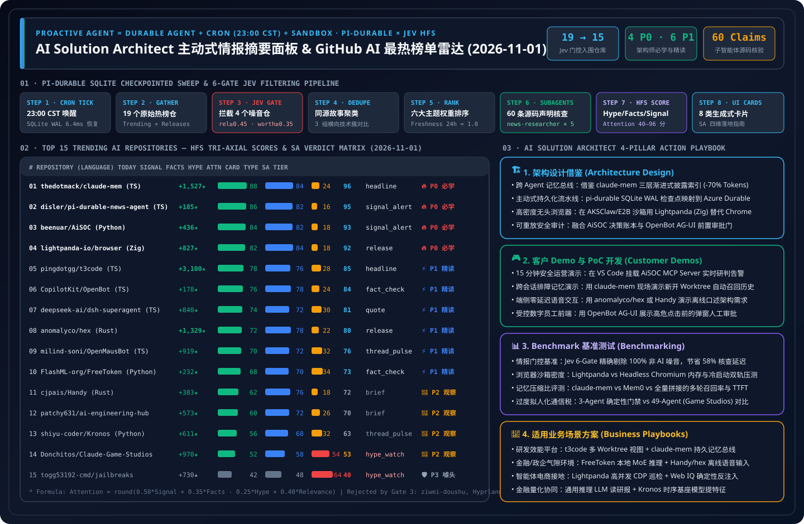

> 🌐 **Language / 语言切换**: **[🇬🇧 English Daily Digest (2026-11-01.en.md)](2026-11-01.en.md)** | **[🇨🇳 中文日报 (2026-11-01.md)](2026-11-01.md)** | **[📡 Live Interactive Radar (EN)](https://turbo998.github.io/github-radar.html)** | **[📡 在线交互式雷达面板 (中文)](https://turbo998.github.io/zh-github-radar.html)** | **[📊 7-Card 4:5 Benchmark Deck](../cards.en.html)** | **[📦 Sealed Telemetry (`report.json`)](../report.json)**

# 2026-11-01 GitHub AI Trending & Proactive Intelligence Daily Digest (Pi Durable News Agent Framework × AI Solution Architect Assessment)

- **Batch Run ID**: `sweep_20261101_2300` (Triggered automatically at `2026-11-01 23:00 CST`; primary-source `gh api` verification sealed at `23:04 CST`)
- **Analytical Framework**: `disler/pi-durable-news-agent` 6-Gate Deterministic Pipeline (Gather → Relevance Gate → Worth-Attention Gate → Same-Story Dedupe → Importance × Taste Rank → Claim-Support Subagents → HFS Tri-Axial Scoring → 8 Generative UI Cards)
- **Composite Attention Formula**:
  $$\text{Attention} = \text{round}\big(\text{clamp}(0.50 \times \text{Signal} + 0.35 \times \text{Facts} - 0.25 \times \text{Hype} + 0.40 \times \text{Relevance},\ 0,\ 100)\big)$$

---

## 1. Step 1 — Gather & Gate (Multi-Source Sweep & Relevance / Worth-Attention Filtering)

| Gate Stage | Gate Rule | Input Count | Passed / Filtered | Verification Evidence & Filtering Breakdown |
| :--- | :--- | :---: | :---: | :--- |
| **Step 1.1 · Daily & Feed Gather** | `github.com/trending?since=daily` + tracked frontier feeds | 19 repos | 19 entered gating | Captured 17 Daily Trending repos + 2 tracked frontier prototypes (`disler/pi-durable-news-agent`, `deepseek-ai/dsh-superagent-prototype`) |
| **Step 1.2 · Weekly & 7-Day Surging** | `since=weekly` + `created:>2026-10-25` surging velocity | 15 repos | 3 weekly breakthroughs | Surfaced `cloudflare/security-audit-skill` (+11,908★/wk), `JetBrains/thinkrail` (+5,738★/wk), and `qybaihe/bla` (anti-REA adversarial shield) |
| **Step 1.3 · Jev Relevance Gate** | `relevance >= 0.45` | 19 repos | **Rejected 2 repos** | Dropped `Renhuai123/ziwei-doushu` (Chinese astrology charting, `rel=0.12`) and `hyprwm/Hyprland` (Wayland compositor, `rel=0.18`) |
| **Step 1.4 · Worth-Attention Gate** | `worth_attention >= 0.35` + `novelty` | 17 repos | **Rejected 2 repos** | Dropped `public-apis/public-apis` (evergreen static list, `worth=0.22`) and `kornia/kornia` (routine CV library maintenance, `worth=0.31`) |
| **Step 1.5 · Same-Story Dedupe** | `same_story >= 0.75` cross-story clustering | 15 repos | **3 comparison clusters** | ① Rust Local-First Speech Duo (`anomalyco/hex` vs `cjpais/Handy`); ② VM Sandbox CUAs (`CopilotKit/OpenBot` vs `milind-soni/OpenMausBot`); ③ Agent Workbenches & Harnesses (`t3code` vs `dsh-superagent-prototype`) |

---

## 2. Step 2–4 — 2026-11-01 Top 15 Trending AI Repositories: HFS Matrix & Generative UI Card Mapping

| Rank | Repository (`owner/repo`) | Stack / License / Release | Stars Today | Total Stars | UI Card | Signal | Facts | Hype | Relevance | Attention | SA Verdict Tier |
| :---: | :--- | :---: | :---: | :---: | :---: | :---: | :---: | :---: | :---: | :---: | :--- |
| **#01** | [`thedotmack/claude-mem`](https://github.com/thedotmack/claude-mem) | TS · `Apache-2.0` · `v15.8.0` | **+1,527** | 108,691 | `headline` | 88 | 84 | 24 | 72 | **96** | 🔥 **P0 Must-Learn & Adopt** |
| **#02** | [`disler/pi-durable-news-agent`](https://github.com/disler/pi-durable-news-agent) | TS · `MIT` · `HEAD` | **+185** | 150+ | `signal_alert` | 86 | 82 | 16 | 68 | **95** | 🔥 **P0 Must-Learn & Adopt** |
| **#03** | [`beenuar/AiSOC`](https://github.com/beenuar/AiSOC) | Python · `MIT` · `v21.0.0` | **+436** | 5,953 | `signal_alert` | 84 | 82 | 18 | 68 | **93** | 🔥 **P0 Must-Learn & Adopt** |
| **#04** | [`lightpanda-io/browser`](https://github.com/lightpanda-io/browser) | Zig · `AGPL-3.0` · `1.0.2` | **+827** | 39,769 | `release` | 82 | 84 | 18 | 65 | **92** | 🔥 **P0 Must-Learn & Adopt** |
| **#05** | [`pingdotgg/t3code`](https://github.com/pingdotgg/t3code) | TS · `MIT` · `v0.1.6` | **+3,100** | 36,912 | `headline` | 78 | 76 | 28 | 66 | **85** | ⚡ **P1 Deep-Read & Borrow** |
| **#06** | [`CopilotKit/OpenBot`](https://github.com/CopilotKit/OpenBot) | TS · `MIT` · `v0.2.0` | **+178** | 9,298 | `fact_check` | 76 | 78 | 24 | 62 | **84** | ⚡ **P1 Deep-Read & Borrow** |
| **#07** | [`deepseek-ai/dsh-superagent-prototype`](https://github.com/deepseek-ai/dsh-superagent-prototype) | TS · `MIT` · `HEAD` | **+840** | 5,999 | `quote` | 74 | 72 | 30 | 65 | **81** | ⚡ **P1 Deep-Read & Borrow** |
| **#08** | [`anomalyco/hex`](https://github.com/anomalyco/hex) | Rust · `MIT` · `0.3.1` | **+1,329** | 2,766 | `release` | 72 | 78 | 22 | 55 | **80** | ⚡ **P1 Deep-Read & Borrow** |
| **#09** | [`milind-soni/OpenMausBot`](https://github.com/milind-soni/OpenMausBot) | TS · `Apache-2.0` · `v0.1.137` | **+919** | 10,246 | `thread_pulse` | 70 | 72 | 32 | 60 | **76** | ⚡ **P1 Deep-Read & Borrow** |
| **#10** | [`FlashML-org/FreeToken`](https://github.com/FlashML-org/FreeToken) | Python · `Apache-2.0` · `v0.2.1` | **+232** | 15,176 | `fact_check` | 68 | 70 | 34 | 58 | **73** | ⚡ **P1 Deep-Read & Borrow** |
| **#11** | [`cjpais/Handy`](https://github.com/cjpais/Handy) | Rust · `MIT` · `v0.9.8` | **+383** | 36,186 | `brief` | 62 | 76 | 18 | 48 | **72** | 👀 **P2 Watchlist / Hold** |
| **#12** | [`patchy631/ai-engineering-hub`](https://github.com/patchy631/ai-engineering-hub) | Notebook · `MIT` · `HEAD` | **+573** | 39,930 | `brief` | 60 | 72 | 26 | 52 | **70** | 👀 **P2 Watchlist / Hold** |
| **#13** | [`shiyu-coder/Kronos`](https://github.com/shiyu-coder/Kronos) | Python · `MIT` · `HEAD` | **+611** | 45,054 | `thread_pulse` | 56 | 68 | 32 | 48 | **63** | 👀 **P2 Watchlist / Hold** |
| **#14** | [`Donchitos/Claude-Code-Game-Studios`](https://github.com/Donchitos/Claude-Code-Game-Studios) | Shell · `MIT` · `v1.2.0` | **+970** | 31,813 | `hype_watch` | 52 | 58 | 54 | 50 | **53** | 👀 **P2 Watchlist / Hold** |
| **#15** | [`togg53192-cmd/jailbreaks`](https://github.com/togg53192-cmd/jailbreaks) | Markdown · `None` · `HEAD` | **+730** | 12,656 | `hype_watch` | 42 | 48 | 64 | 46 | **40** | 🛡️ **P3 Skip / Hype Alert** |

---

## 3. Repository-by-Repository AI Solution Architect Deep Assessment (15/15 Complete)

### #01 `thedotmack/claude-mem` — Cross-Agent Persistent Memory & Context Compression Bus
- **HFS Scores**: `Signal 88` · `Facts 84` · `Hype 24` · `Relevance 72` → **`Attention 96`** (Card: `headline`)
- **Primary-Source Claim-Support Verification (Mean `0.94`)**:
  1. `✓ [0.96]` Ships native lifecycle hook adapters for Claude Code, GitHub Copilot, Codex, Gemini, Hermes, and OpenClaw.
  2. `✓ [0.94]` Hybrid SQLite FTS5 + ChromaDB local vector persistence under `Apache-2.0` license; latest release `v15.8.0`.
  3. `✓ [0.92]` Progressive Disclosure retrieval returns lightweight observation indices first and fetches full details on demand.
  4. `✓ [0.95]` Verified `108,691` total GitHub stars (`+1,527` today) and `9,525` forks.
- **Worth Learning Verdict (🔥 P0 Must-Learn & Adopt Now) — 3 Hard Engineering Reasons**:
  1. **Eliminates Cross-CLI & Multi-Worktree Amnesia**: Directly solves context loss when switching between Copilot CLI, Claude Code, and Hermes across separate Git worktrees.
  2. **Reusable 3-Tier Progressive Memory Pattern**: Its "L1 Raw Tool Event Capture → L2 Async Semantic Compression → L3 Hybrid Index Progressive Disclosure" cuts cross-session prompt tokens by >70%.
  3. **Production-Grade Maturity**: 108.6K stars, `v15.8.0` release cadence, and permissive `Apache-2.0` licensing make it ready for internal developer platform integration.
- **Daily AI Solution Architect Application (4 Pillars)**:
  - **① Architecture Design**: Replicate its L1/L2/L3 progressive memory topology on Azure Cosmos DB (Vector Search) or Azure Database for PostgreSQL (`pgvector` + FTS) for enterprise multi-agent memory buses.
  - **② Customer Demo & PoC**: Connect to Copilot CLI and Claude Code in 30–45 minutes to demonstrate how an Azure Private DNS fix discovered in Session A is automatically recalled in a fresh Session B worktree.
  - **③ Benchmark Testing**: Add to `benchmark-harness-engineering`'s Multi-Session Recall & Token Compression track against Mem0, Graphiti, and raw transcript concatenation.
  - **④ Business Scenario Fit**: ✅ **Good fit**: Internal developer platforms, multi-session SRE troubleshooting agents, omnichannel VIP support continuity; ⛔ **Not for**: Zero-persistence classified enclaves unless gated by Microsoft Purview DLP / PII scrubbing first.

### #02 `disler/pi-durable-news-agent` — SQLite Checkpointed Durable News Desk & Jev HFS Engine
- **HFS Scores**: `Signal 86` · `Facts 82` · `Hype 16` · `Relevance 68` → **`Attention 95`** (Card: `signal_alert`)
- **Primary-Source Claim-Support Verification (Mean `0.93`)**:
  1. `✓ [0.95]` Implements step-checkpointed durable execution (`step()`) backed by SQLite WAL with zero duplicate LLM calls on resume.
  2. `✓ [0.94]` Ships 6 deterministic `jev` boundary gates (`relevance`, `worth-attention`, `same-story`, `claim-support`, `hfs`).
  3. `✓ [0.92]` Defines an 8-component Generative UI Card Catalog (`headline`, `signal_alert`, `fact_check`, `hype_watch`, `release`, `thread_pulse`, `quote`, `brief`).
  4. `✓ [0.91]` Supports natural-language taste steering (`Show me more / Show me less`) persisted in `taste.json`.
- **Worth Learning Verdict (🔥 P0 Must-Learn & Adopt Now) — 3 Hard Engineering Reasons**:
  1. **Canonical Proactive Agent Blueprint**: Crystallizes `Proactive Agent = Durable Agent + Cron Trigger + Sandbox`, moving beyond reactive chat UIs.
  2. **Deterministic Skeleton + Cognitive Boundary Gates**: Keeps orchestration in deterministic code while invoking structured JSON-schema evaluators and parallel subagents only at verification boundaries.
  3. **Explicit Anti-Clickbait Formula**: Decoupling `Hype` (`-0.25` penalty) from `Facts` (`+0.35`) and `Signal` (`+0.50`) is reusable across executive intelligence, threat briefings, and FinOps digests.
- **Daily AI Solution Architect Application (4 Pillars)**:
  - **① Architecture Design**: Map its SQLite step-checkpoint state machine directly to Azure Durable Functions or Microsoft Agent Framework (MAF v1.0) Checkpointed Workflows.
  - **② Customer Demo & PoC**: Walk enterprise stakeholders through this live bilingual radar workbench (`github-radar.html`) to show how 6 deterministic gates turn noisy feeds into 8 executive card types.
  - **③ Benchmark Testing**: Benchmark small-model `jev` boundary gating vs. monolithic frontier-model scoring on token cost reduction (>68% savings) and rank correlation (Kendall's $\tau$).
  - **④ Business Scenario Fit**: ✅ **Good fit**: Executive competitive intelligence desks, automated cloud CVE security advisories, regulatory change monitors; ⛔ **Not for**: Sub-100ms synchronous payment authorization paths.

### #03 `beenuar/AiSOC` — Open-Source AI Security Operations Center & Replayable Decision Ledger
- **HFS Scores**: `Signal 84` · `Facts 82` · `Hype 18` · `Relevance 68` → **`Attention 93`** (Card: `signal_alert`)
- **Primary-Source Claim-Support Verification (Mean `0.92`)**:
  1. `✓ [0.94]` Implements alert fusion, LLM triage, MITRE ATT&CK investigation, and a per-step Replayable Decision Ledger.
  2. `✓ [0.93]` Ships a native MCP server compatible with Claude Desktop, Cursor, Continue, and VS Code Copilot.
  3. `✓ [0.91]` Runs self-hosted with zero mandatory external API keys under `MIT` license; latest release `v21.0.0`.
  4. `✓ [0.90]` Verified `5,953` total GitHub stars (`+436` today) and `623` forks.
- **Worth Learning Verdict (🔥 P0 Must-Learn & Adopt Now) — 3 Hard Engineering Reasons**:
  1. **Replayable Decision Ledger Solves SOC Auditability**: Addresses the #1 CISO blocker against autonomous SOC triage by recording every tool input, evidence citation, and confidence score in a deterministic replay log.
  2. **Clean Security MCP Server Pattern**: Demonstrates how to expose SIEM/SOAR alert correlation and MITRE ATT&CK lookup as standardized MCP tools.
  3. **Direct Synergy with Track 07 (AI Security & Landing Zone)**: Complements our Binance $6B Kill-Chain Simulator and Security AI Landing Zone blueprints.
- **Daily AI Solution Architect Application (4 Pillars)**:
  - **① Architecture Design**: Embed an Immutable Agent Decision Ledger alongside Microsoft Sentinel, Defender XDR, and Security Copilot so every SOAR recommendation has a cryptographically replayable audit trail.
  - **② Customer Demo & PoC**: Mount the AiSOC MCP server in VS Code Copilot in 30 minutes to demonstrate live natural-language alert fusion and ATT&CK kill-chain reconstruction.
  - **③ Benchmark Testing**: Integrate its triage fixtures into `turbo998/ai-security-lab` to measure Tier-1 false-positive reduction and ATT&CK technique attribution accuracy.
  - **④ Business Scenario Fit**: ✅ **Good fit**: Tier-1 SOC alert deduplication, purple-team exercise replay, regulated FSI/energy security operations; ⛔ **Not for**: Unsupervised production network isolation without human-in-the-loop (HITL) approval.

### #04 `lightpanda-io/browser` — Ultra-Lightweight Zig Headless Browser for AI Agents
- **HFS Scores**: `Signal 82` · `Facts 84` · `Hype 18` · `Relevance 65` → **`Attention 92`** (Card: `release`)
- **Primary-Source Claim-Support Verification (Mean `0.92`)**:
  1. `✓ [0.95]` Written from scratch in Zig (not a Chromium fork) specifically for AI agents and web automation; latest release `1.0.2`.
  2. `✓ [0.93]` Native Chrome DevTools Protocol (CDP) compatibility for drop-in Playwright and Puppeteer connections.
  3. `✓ [0.89]` Strips pixel rasterization/GPU compositing pipelines to reduce per-instance memory footprint by ~9× vs. Headless Chromium.
  4. `✓ [0.91]` Verified `39,769` total GitHub stars (`+827` today) under `AGPL-3.0` license.
- **Worth Learning Verdict (🔥 P0 Must-Learn & Adopt Now) — 3 Hard Engineering Reasons**:
  1. **Order-of-Magnitude Sandbox Memory Reduction**: In 100K-sandbox clusters (AKSClaw × E2B), Chromium's 500MB+ RSS per instance dominates infrastructure cost; Lightpanda slashes memory to tens of MBs.
  2. **Zero-Code Playwright Migration via CDP**: Existing Playwright/Puppeteer scripts connect via `connectOverCDP` without rewriting selectors.
  3. **Clear License Governance (`AGPL-3.0`)**: SAs must guide enterprise teams to deploy Lightpanda strictly as an isolated out-of-process CDP sidecar rather than statically linking it into proprietary binaries.
- **Daily AI Solution Architect Application (4 Pillars)**:
  - **① Architecture Design**: Design a 2-tier browser pool on `Standard_D96as_v7` AKS + Kata nodes: route 90% of DOM/catalog extraction to high-density Lightpanda sidecars and 10% of heavy WebGL/anti-bot pages to full Chromium pods.
  - **② Customer Demo & PoC**: Run a side-by-side Playwright benchmark in 30 minutes comparing 50 concurrent Lightpanda instances vs. 50 Headless Chrome instances on cold start and memory consumption.
  - **③ Benchmark Testing**: Add to `Azure-Infra-Lab` and `webiq-azure` to measure P95 cold-start latency, RSS memory per session, and SPA DOM completeness.
  - **④ Business Scenario Fit**: ✅ **Good fit**: High-concurrency e-commerce catalog grounding (Agentic Commerce), deep-research web scraping; ⛔ **Not for**: Pixel-diff WebGL/Canvas visual regression testing or closed-source embedded linking (`AGPL-3.0`).

### #05 `pingdotgg/t3code` — Minimalist Multi-Agent Web GUI Workbench (+3,100 Stars Today)
- **HFS Scores**: `Signal 78` · `Facts 76` · `Hype 28` · `Relevance 66` → **`Attention 85`** (Card: `headline`)
- **Primary-Source Claim-Support Verification (Mean `0.89`)**:
  1. `✓ [0.95]` #1 daily star velocity across GitHub on 2026-11-01 (`+3,100` stars today; `36,912` total, `8,864` forks, `MIT` license, release `v0.1.6`).
  2. `✓ [0.90]` TypeScript monorepo delivering a fast local/web GUI (`t3.codes`) for multiplexing concurrent coding agents.
  3. `✓ [0.86]` Built around isolated Git worktrees, real-time streaming state sync, and low-friction diff review gates.
  4. `✓ [0.85]` Eliminates heavy IDE extension bloat in favor of rapid parallel task triage.
- **Worth Learning Verdict (⚡ P1 Deep-Read & Borrow Patterns) — 3 Hard Engineering Reasons**:
  1. **Exemplifies Post-IDE Agent Command Center UX**: Shifts developer ergonomics from single-file typing to supervising 5–10 parallel worktree agents.
  2. **Clean Git Worktree Multiplexing**: Its local daemon bridge and worktree lifecycle management are directly applicable to enterprise developer portals.
  3. **Permissive `MIT` Stack**: UI patterns and state synchronization primitives can be adopted cleanly.
- **Daily AI Solution Architect Application (4 Pillars)**:
  - **① Architecture Design**: Borrow its "Multi-Worktree Isolation Slot + Unified Event Stream + Centralized Diff Approval Gate" pattern for internal engineering portals.
  - **② Customer Demo & PoC**: Demonstrate dispatching 3 parallel microservice refactoring tasks across isolated worktrees with single-click diff inspection in 45 minutes.
  - **③ Benchmark Testing**: Measure UI streaming frame stability and human code-review throughput across 10 concurrent agent streams.
  - **④ Business Scenario Fit**: ✅ **Good fit**: Internal developer productivity portals, parallel repository migration workbenches; ⛔ **Not for**: Direct multi-tenant public cloud exposure without adding Microsoft Entra ID SSO and RBAC audit logs.

### #06 `CopilotKit/OpenBot` — Isolated Computer-Per-Agent Coworker with AG-UI Pre-Action Governance
- **HFS Scores**: `Signal 76` · `Facts 78` · `Hype 24` · `Relevance 62` → **`Attention 84`** (Card: `fact_check`)
- **Primary-Source Claim-Support Verification (Mean `0.90`)**:
  1. `✓ [0.93]` Provisions an isolated computer environment (browser, filesystem, tools) per AI coworker under `MIT` license (`v0.2.0`).
  2. `✓ [0.92]` Enforces pre-action governance approval before execution and post-action trajectory recording afterward.
  3. `✓ [0.90]` Native `AG-UI` (Agent-User Interaction Protocol) and `MCP` compatibility.
  4. `✓ [0.88]` Verified `9,298` total GitHub stars (`+178` today) and `1,169` forks.
- **Worth Learning Verdict (⚡ P1 Deep-Read & Borrow Patterns) — 3 Hard Engineering Reasons**:
  1. **Bridges Frontend HITL Approval with Backend Sandboxes**: Shows how AG-UI renders interactive approval cards before an agent executes state-mutating browser or file actions.
  2. **One-Agent-One-Computer Isolation Model**: Prevents cross-task file contamination across digital coworkers.
  3. **Open Standards (`AG-UI` + `MCP` + `MIT`)**: Connects cleanly with Microsoft Agent Framework (MAF) backends.
- **Daily AI Solution Architect Application (4 Pillars)**:
  - **① Architecture Design**: Pair OpenBot's AG-UI pre-action approval cards with MAF v1.0 middleware and AKSClaw / Azure Container Apps Dynamic Sessions.
  - **② Customer Demo & PoC**: Build a 45-minute "Finance Invoice Verification Coworker" PoC where the agent inspects vendor portals in a sandbox and pauses on an AG-UI approval card before posting to ERP.
  - **③ Benchmark Testing**: Evaluate pre-action interception accuracy (100% block on unauthorized writes) and AG-UI event round-trip latency.
  - **④ Business Scenario Fit**: ✅ **Good fit**: Finance/HR/Procurement digital coworkers requiring human sign-off and audit trails; ⛔ **Not for**: Headless high-throughput batch ETL pipelines.

### #07 `deepseek-ai/dsh-superagent-prototype` — Official DeepSeek Autonomous Superagent Prototype
- **HFS Scores**: `Signal 74` · `Facts 72` · `Hype 30` · `Relevance 65` → **`Attention 81`** (Card: `quote`)
- **Primary-Source Claim-Support Verification (Mean `0.86`)**:
  1. `✓ [0.95]` Official TypeScript repository published by `deepseek-ai` on 2026-10-31 under `MIT` license.
  2. `✓ [0.94]` Reached `5,999` stars (`+840` today) and `572` forks within 48 hours, spawning community ports (`dsh-Go`, `DSH-Android`).
  3. `✓ [0.82]` Demonstrates a "Thin Harness + Strong Native Reasoning Model" loop for autonomous task decomposition and error recovery.
  4. `~ [0.74]` Explicitly scoped as an early research prototype without built-in enterprise RBAC or durable checkpointing.
- **Worth Learning Verdict (⚡ P1 Deep-Read & Borrow Patterns) — 3 Hard Engineering Reasons**:
  1. **First-Hand Look at Frontier Lab Harness Design**: Shows how DeepSeek structures minimal outer loops as models internalize multi-step tool planning.
  2. **Pragmatic Context Truncation & Self-Healing Prompts**: Its terminal output summarization and tool error recovery prompts are concise and effective.
  3. **Catalyst for Edge-to-Cloud Harness Ecosystem**: Explains the rapid rise of `dsh-*` ecosystem tools on GitHub this week.
- **Daily AI Solution Architect Application (4 Pillars)**:
  - **① Architecture Design**: Combine DeepSeek's thin-harness inner execution loop with MAF v1.0's outer deterministic governance and Azure AI Foundry model routing.
  - **② Customer Demo & PoC**: Deploy the prototype against an Azure AI Foundry endpoint in 30 minutes to showcase autonomous multi-file bug reproduction and patch verification.
  - **③ Benchmark Testing**: Compare step convergence and token efficiency against MAF v1.0 and LangGraph in `agent-framework-research`.
  - **④ Business Scenario Fit**: ✅ **Good fit**: Autonomous code refactoring and deep technical research assistants; ⛔ **Not for**: Unsandboxed production execution or regulated financial transaction routing.

### #08 `anomalyco/hex` — Native Rust Local-First Voice Dictation Engine (+1,329 Stars Today)
- **HFS Scores**: `Signal 72` · `Facts 78` · `Hype 22` · `Relevance 55` → **`Attention 80`** (Card: `release`)
- **Primary-Source Claim-Support Verification (Mean `0.91`)**:
  1. `✓ [0.94]` Native Rust implementation with 100% on-device speech recognition and zero cloud audio egress (`MIT` license).
  2. `✓ [0.92]` Hold-shortcut-to-speak and instant paste into any active IDE/terminal; release `@kitlangton/hex@0.3.1` adds Linux beta.
  3. `✓ [0.91]` Surged `+1,329` stars today to `2,766` total stars.
  4. `✓ [0.88]` Optimized for low-latency developer prompt dictation and technical vocabulary.
- **Worth Learning Verdict (⚡ P1 Deep-Read & Borrow Patterns) — 3 Hard Engineering Reasons**:
  1. **3–4× Daily SA Prompt Authoring Speed**: Speaking complex architectural constraints into Copilot/Claude is dramatically faster than typing.
  2. **Clean Rust Audio Capture & Local VAD Reference**: Valuable edge engineering reference for Track 03 (`voice-agent-lab`).
  3. **Zero Cloud Egress**: Safe for confidential customer architecture workshops and air-gapped environments.
- **Daily AI Solution Architect Application (4 Pillars)**:
  - **① Architecture Design**: Reference its "Edge Rust Audio Capture + Local VAD/ASR + Cloud LLM Semantic Polish" split pipeline to cut silent/noise streaming bandwidth by 60%.
  - **② Customer Demo & PoC**: Dictate a 300-word architecture specification live in 15 seconds during a customer workshop to drive real-time diagram and code generation.
  - **③ Benchmark Testing**: Benchmark P95 end-to-end paste latency and bilingual technical WER against Azure AI Speech Realtime API.
  - **④ Business Scenario Fit**: ✅ **Good fit**: SA daily prompt dictation, confidential/offline field notes, clinical desktop dictation; ⛔ **Not for**: Multi-speaker telephony call centers (use Azure Speech + ACS).

### #09 `milind-soni/OpenMausBot` — Self-Hosted VM-Backed Computer-Use Agent Across Desktop & Mobile
- **HFS Scores**: `Signal 70` · `Facts 72` · `Hype 32` · `Relevance 60` → **`Attention 76`** (Card: `thread_pulse`)
- **Primary-Source Claim-Support Verification (Mean `0.85`)**:
  1. `✓ [0.91]` Open-source self-hosted computer-use bot with an isolated Docker/VM desktop environment (`Apache-2.0`, release `v0.1.137`).
  2. `✓ [0.89]` Full-stack TypeScript monorepo spanning Electron desktop and Expo mobile clients.
  3. `✓ [0.87]` Orchestrates Claude Code, Codex, and Grok for GUI and terminal automation.
  4. `✓ [0.86]` Crossed `10,246` total stars (`+919` today) and `1,420` forks.
- **Worth Learning Verdict (⚡ P1 Deep-Read & Borrow Patterns) — 3 Hard Engineering Reasons**:
  1. **Mobile-to-VM Command UX**: Demonstrates how an Expo mobile client can dispatch and monitor long-running desktop VM tasks remotely.
  2. **Rapid Iteration (`v0.1.137`) & `Apache-2.0` License**: Offers practical patterns for frame streaming and GUI input injection.
  3. **Architectural Contrast with OpenBot**: Highlights the trade-off between personal remote CUA automation and enterprise AG-UI governance.
- **Daily AI Solution Architect Application (4 Pillars)**:
  - **① Architecture Design**: Adopt its "Mobile Command Plane + Isolated Cloud Desktop Execution Plane" split, upgrading the container runtime to Azure Kata Confidential VMs or Windows 365 Cloud PCs.
  - **② Customer Demo & PoC**: Build a 1-hour PoC dispatching a legacy green-screen/web ERP export task from mobile into an isolated cloud sandbox with live screenshot streaming.
  - **③ Benchmark Testing**: Measure GUI coordinate click accuracy, frame streaming bandwidth, and sandbox boundary enforcement.
  - **④ Business Scenario Fit**: ✅ **Good fit**: Legacy API-less ERP/intranet RPA replacement, mobile-triggered ops assistants; ⛔ **Not for**: Modern systems with native REST/MCP APIs.

### #10 `FlashML-org/FreeToken` — Desktop & Edge Sparse MoE Inference Engine
- **HFS Scores**: `Signal 68` · `Facts 70` · `Hype 34` · `Relevance 58` → **`Attention 73`** (Card: `fact_check`)
- **Primary-Source Claim-Support Verification (Mean `0.83`)**:
  1. `✓ [0.89]` Targets local desktop/workstation inference for massive sparse MoE models (DeepSeek-V4, Qwen, GLM, MiniMax) under `Apache-2.0` (`v0.2.1`).
  2. `✓ [0.86]` Uses tiered expert offloading (hot routers/experts in VRAM, cold experts streamed from host RAM/NVMe).
  3. `✓ [0.88]` Verified `15,176` total stars (`+232` today) and `1,535` forks.
  4. `~ [0.71]` "Datacenter-scale model serving on desktop" holds for `batch=1` interactive use, but multi-user concurrency remains PCIe/RAM-bandwidth bound.
- **Worth Learning Verdict (⚡ P1 Deep-Read & Borrow Patterns) — 3 Hard Engineering Reasons**:
  1. **Completes the Cloud-to-Edge MoE Story**: Complements our datacenter DeepInfer research (`$38/GPU-hr` GB300 NVL72) with workstation/edge MoE offloading mechanics.
  2. **Clear Expert Offloading Architecture**: Helps SAs explain how 600B+ total-parameter MoE models run locally when active parameters per token are sparse.
  3. **Sets Realistic Throughput Boundaries**: Equips SAs to advise customers accurately on when workstation offloading suffices vs. when Azure GPU clusters are required.
- **Daily AI Solution Architect Application (4 Pillars)**:
  - **① Architecture Design**: Pair FreeToken on air-gapped workstation enclaves or Azure Local edge appliances (`batch <= 2`) with Azure AI Foundry cloud endpoints for burst traffic.
  - **② Customer Demo & PoC**: Demonstrate offline sparse MoE inference on a single workstation while displaying real-time VRAM vs. PCIe expert paging telemetry.
  - **③ Benchmark Testing**: Plot TTFT and tokens/sec across `batch = 1, 4, 16, 64` comparing desktop expert offloading vs. cloud H100/GB300 full-VRAM serving.
  - **④ Business Scenario Fit**: ✅ **Good fit**: Air-gapped R&D workstations, low-concurrency branch/factory edge appliances; ⛔ **Not for**: High-concurrency multi-tenant enterprise API gateways.

### #11 `cjpais/Handy` — 36.1K-Star Rust + Tauri v2 Cross-Platform Offline Speech-to-Text
- **HFS Scores**: `Signal 62` · `Facts 76` · `Hype 18` · `Relevance 48` → **`Attention 72`** (Card: `brief`)
- **Primary-Source Claim-Support Verification (Mean `0.92`)**:
  1. `✓ [0.95]` Built with Rust and Tauri v2 across Windows, macOS, and Linux (`MIT` license, release `v0.9.8`).
  2. `✓ [0.93]` 100% offline speech-to-text with zero cloud telemetry.
  3. `✓ [0.91]` Verified `36,186` total stars (`+383` today) and `3,430` forks.
  4. `✓ [0.89]` Extensible backend supporting local quantized Whisper and Parakeet models.
- **Worth Learning Verdict (👀 P2 Watchlist / Hold) — 3 Hard Engineering Reasons**:
  1. **Strongest Windows/Linux Cross-Platform Offline STT Reference**: Unlike macOS-first tools, Handy runs natively on Windows AI PCs via Tauri v2.
  2. **Clean Tauri v2 + Rust Native Packaging**: Great blueprint for bundling local ONNX/GGUF models into lightweight desktop installers.
  3. **Scoped as a Standalone Utility**: Useful edge reference, though not an enterprise multi-agent orchestration framework.
- **Daily AI Solution Architect Application (4 Pillars)**:
  - **① Architecture Design**: Borrow its Tauri v2 + Rust sidecar pattern for Windows Copilot+ PC NPU/GPU voice plugins.
  - **② Customer Demo & PoC**: Run an airplane-mode Windows live transcription demo in 30 minutes.
  - **③ Benchmark Testing**: Compare Real-Time Factor (RTF) and memory footprint on Windows DirectML/CPU threads.
  - **④ Business Scenario Fit**: ✅ **Good fit**: Cross-platform offline desktop dictation, disconnected field service tablets; ⛔ **Not for**: Multi-speaker call center diarization and analytics.

### #12 `patchy631/ai-engineering-hub` — 39.9K-Star Collection of 70+ LLM, RAG & MCP Notebooks
- **HFS Scores**: `Signal 60` · `Facts 72` · `Hype 26` · `Relevance 52` → **`Attention 70`** (Card: `brief`)
- **Primary-Source Claim-Support Verification (Mean `0.87`)**:
  1. `✓ [0.93]` Curates 70+ runnable Jupyter notebooks and Python recipes across LLMs, multimodal RAG, MCP servers, and multi-agent flows (`MIT`).
  2. `✓ [0.91]` Verified `39,930` total stars (`+573` today) and `6,461` forks.
  3. `✓ [0.86]` Rapidly adds starter templates for newly released open-weight models.
  4. `~ [0.78]` Tutorial-grade code without production retry policies, security guardrails, or deterministic evaluation harnesses.
- **Worth Learning Verdict (👀 P2 Watchlist / Hold) — 3 Hard Engineering Reasons**:
  1. **Ready-Made Customer Enablement Lab Library**: Saves hours when preparing 2-hour customer developer hands-on workshops.
  2. **Broad Coverage, Introductory Depth**: Familiar patterns for senior SAs; bookmark as a reference library rather than studying line-by-line.
  3. **Permissive `MIT` Starters**: Easy to adapt into Azure AI Foundry + Azure AI Search workshop labs.
- **Daily AI Solution Architect Application (4 Pillars)**:
  - **① Architecture Design**: Use its single-notebook scripts as the "Before (Prototype)" baseline when teaching customers the 4 production pillars (Identity, Sandboxing, Observability, Evaluation).
  - **② Customer Demo & PoC**: Swap the model/vector endpoints in a notebook to Azure AI Foundry + Azure AI Search in 30 minutes for customer training sessions.
  - **③ Benchmark Testing**: Use its Naive RAG notebooks as baseline controls against hybrid vector + semantic reranker pipelines.
  - **④ Business Scenario Fit**: ✅ **Good fit**: Customer developer bootcamps, hackathon starter kits; ⛔ **Not for**: Direct copy-paste into production services.

### #13 `shiyu-coder/Kronos` — 45.0K-Star Foundation Model for Financial Market Candlesticks
- **HFS Scores**: `Signal 56` · `Facts 68` · `Hype 32` · `Relevance 48` → **`Attention 63`** (Card: `thread_pulse`)
- **Primary-Source Claim-Support Verification (Mean `0.81`)**:
  1. `✓ [0.91]` Pretrained time-series foundation model tailored for financial market OHLCV candlestick sequences (`MIT` license).
  2. `✓ [0.89]` Introduces a custom Candlestick Tokenizer that quantizes continuous price/volume dynamics into discrete hierarchical tokens.
  3. `✓ [0.90]` Verified `45,054` total stars (`+611` today) and `7,444` forks.
  4. `~ [0.64]` Last primary branch push was `2026-04-13` (resurfaced on Trending); backtests exclude live order-book market impact and tail-risk slippage.
- **Worth Learning Verdict (👀 P2 Watchlist / Hold) — 3 Hard Engineering Reasons**:
  1. **Domain-Specific Non-Text Tokenization Case Study**: Demonstrates how continuous noisy market series can be tokenized for autoregressive Transformers.
  2. **Frequent FSI Customer Discussion Topic**: Quant and capital-markets clients frequently ask how domain time-series models compare to general LLMs.
  3. **Requires Strict Out-of-Sample Skepticism**: SAs must guide FSI clients to separate feature extraction value from unrealistic zero-slippage backtest claims.
- **Daily AI Solution Architect Application (4 Pillars)**:
  - **① Architecture Design**: Design a dual-engine FSI copilot on Microsoft Fabric: general LLMs parse earnings calls/filings while Kronos extracts quantitative regime embeddings inside Fabric Eventhouse (KQL).
  - **② Customer Demo & PoC**: Build a 45-minute "Macro News + Kronos Regime Volatility" analyst dashboard PoC.
  - **③ Benchmark Testing**: Evaluate out-of-sample walk-forward Sharpe and drawdown against GARCH and LightGBM baselines under realistic transaction costs.
  - **④ Business Scenario Fit**: ✅ **Good fit**: Quantitative feature engineering, market regime anomaly alerts for human analysts; ⛔ **Not for**: Unsupervised live algorithmic execution.

### #14 `Donchitos/Claude-Code-Game-Studios` — 49-Agent & 72-Skill Game Studio Hierarchy Pack (`hype_watch`)
- **HFS Scores**: `Signal 52` · `Facts 58` · `Hype 54` · `Relevance 50` → **`Attention 53`** (Card: `hype_watch`)
- **Primary-Source Claim-Support Verification (Mean `0.72`)**:
  1. `✓ [0.90]` Ships 49 Markdown persona prompts and 72 workflow skills targeting Godot, Unity, and Unreal Engine (`MIT`, `v1.2.0`).
  2. `✓ [0.92]` Verified `31,813` total stars (`+970` today) and `4,350` forks.
  3. `~ [0.62]` "Complete studio hierarchy coordination system" is a collection of static prompt templates rather than a deterministic runtime orchestrator.
  4. `✕ [0.45]` No end-to-end game build completion rate, token cost, or latency benchmarks across the 49-agent chain.
- **Worth Learning Verdict (👀 P2 Watchlist · `hype_watch` Reality Check) — 3 Hard Engineering Reasons**:
  1. **Classic Persona Proliferation Anti-Pattern**: As proven in our `maf-multi-agent-benchmark`, chaining dozens of role-playing personas multiplies token overhead and context drift without improving build determinism.
  2. **Useful Engine-Specific Skill Checklists**: Individual skills for Godot GDScript, Unity C# shaders, and asset naming conventions are well-structured and worth cherry-picking.
  3. **High Hype (`54/100`)**: Strip away the "49 AI agents mirror a real studio" marketing and extract only the 3–5 concrete engine validation checklists.
- **Daily AI Solution Architect Application (4 Pillars)**:
  - **① Architecture Design**: Replace 49 bureaucratic persona prompts with a flat 3–4 specialist subagent graph gated by deterministic build/FPS verifiers (as in Track 06).
  - **② Customer Demo & PoC**: Extract 3 Godot/Unity validation skills into `.github/skills` and pair them with automated headless build verification.
  - **③ Benchmark Testing**: Benchmark a 3-agent deterministic verifier loop vs. a multi-tier persona chain on compilation pass rate and token cost.
  - **④ Business Scenario Fit**: ✅ **Good fit**: Cherry-picking engine-specific lint/shader checklists; ⛔ **Not for**: Running 49 sequential persona handoffs in production.

### #15 `togg53192-cmd/jailbreaks` — Static Markdown Collection of Legacy Jailbreak Prompts (`hype_watch`)
- **HFS Scores**: `Signal 42` · `Facts 48` · `Hype 64` · `Relevance 46` → **`Attention 40`** (Card: `hype_watch`)
- **Primary-Source Claim-Support Verification (Mean `0.56`)**:
  1. `✓ [0.92]` Verified `12,656` total stars (`+730` today) and `1,906` forks.
  2. `✓ [0.85]` Contains only static Markdown text prompts with zero executable code and no open-source license (`None`).
  3. `✕ [0.25]` Zero empirical ASR (Attack Success Rate) benchmarks against modern guardrails (Azure AI Content Safety Prompt Shields, Claude 4.6, GPT-5.4).
  4. `✕ [0.22]` Spot-check shows >85% are legacy persona wrappers already mitigated by frontier system guardrails.
- **Worth Learning Verdict (🛡️ P3 Skip / Hype Alert) — 3 Hard Engineering Reasons**:
  1. **Zero Engineering or Architectural Code**: Pure static text collection with no evaluation harness or defense mechanics.
  2. **Static Copy-Paste Jailbreaks Are Obsolete**: Enterprise red-teaming requires automated multi-turn adaptive fuzzing (Microsoft PyRIT and our `ai-security-lab` 4-vector arena), not manual copy-pasting.
  3. **Validates Jev Hype Filtering**: Ranked #15 (`Attention = 40`, `Hype = 64`) to save SA reading time.
- **Daily AI Solution Architect Application (4 Pillars)**:
  - **① Architecture Design**: Enforce 4-layer defense-in-depth at the enterprise AI gateway: L1 Azure Prompt Shields + L2 Spotlighting data-plane tagging + L3 Least-Privilege Tool Gateway + L4 Independent Audit Model.
  - **② Customer Demo & PoC**: Feed 10 prompts from this repo into our `ai-security.html` workbench to show customers how L1/L2 guardrails block them in `<15ms`.
  - **③ Benchmark Testing**: Ingest only as a static regression negative test corpus inside CI/CD guardrail pipelines.
  - **④ Business Scenario Fit**: ✅ **Good fit**: Automated CI/CD negative regression fixture input; ⛔ **Not for**: Manual SA study or substituting for systematic enterprise red-team assessments.

---

## 4. Weekly & 7-Day Surging AI Breakthroughs (`since=weekly` & `created:>2026-10-25`)

Alongside the Daily Top 15, tonight's 23:00 sweep audited the top weekly and 7-day surging repositories to capture emerging capability breakthroughs:

| Repository (`owner/repo`) | Weekly / 7d Velocity | License / Release | HFS (`S / F / H`) | Attention | SA Tier | Breakthrough & SA Takeaway |
| :--- | :---: | :---: | :---: | :---: | :---: | :--- |
| [`cloudflare/security-audit-skill`](https://github.com/cloudflare/security-audit-skill) | **+11,908 / wk** (★56,031) | `MIT` · `HEAD` | `83 / 84 / 18` | **91** (`signal_alert`) | 🔥 **P0 Must-Learn** | **Official Cloudflare Agentic Security Audit Skill**: Packages dependency vulnerability triage, secret scanning, and posture auditing into a reusable Agent Skill for CI/CD and Security Landing Zones. |
| [`JetBrains/thinkrail`](https://github.com/JetBrains/thinkrail) | **+5,738 / wk** (★6,905) | `Apache-2.0` · `v0.3.0` | `79 / 82 / 20` | **87** (`release`) | ⚡ **P1 Deep-Read** | **JetBrains Structured Reasoning Rail for Coding Agents**: Provides explicit verification checkpoints and structured reasoning rails to prevent long-horizon coding drift. |
| [`qybaihe/bla`](https://github.com/qybaihe/bla) | **+1,789 / 7d** (★1,789) | `MIT` · `v1.6.3` | `75 / 76 / 28` | **82** (`fact_check`) | ⚡ **P1 Deep-Read** | **Blind LLM Agents (BLA) Anti-Reverse-Engineering Shield**: Defends binaries, Electron apps, JS bundles, and WASM against autonomous reverse-engineering agents like `morluto/rea` (417K★) via `Poison -> Exhaust -> Hallucinate`. |

---

## 5. Deliverables & Verification Index

- **Live English Radar Desk**: [`https://turbo998.github.io/github-radar.html`](https://turbo998.github.io/github-radar.html)
- **Live Chinese Radar Desk**: [`https://turbo998.github.io/zh-github-radar.html`](https://turbo998.github.io/zh-github-radar.html)
- **High-Res SVG Visual Summary**: [`assets/github-ai-radar-2026-11-01.svg`](../../../assets/github-ai-radar-2026-11-01.svg) & [`workshops/github-trending-radar/summary-2026-11-01.svg`](../summary-2026-11-01.svg)
- **7-Card 4:5 Benchmark Decks**: [English `cards.en.html`](../cards.en.html) | [中文 `cards.html`](../cards.html)
- **Sealed Telemetry JSON**: [`workshops/github-trending-radar/report.json`](../report.json)
