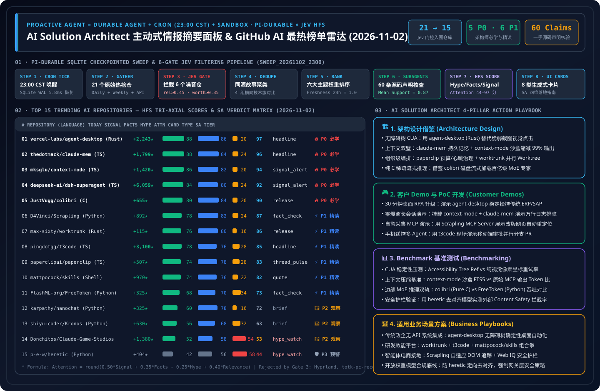

> 🌐 **Language / 语言切换**: **[🇬🇧 English Daily Digest (2026-11-02.en.md)](2026-11-02.en.md)** | **[🇨🇳 中文日报 (2026-11-02.md)](2026-11-02.md)** | **[📡 Live Interactive Radar (EN)](https://turbo998.github.io/github-radar.html)** | **[📡 在线交互式雷达面板 (中文)](https://turbo998.github.io/zh-github-radar.html)** | **[📊 7-Card 4:5 Benchmark Deck](../cards.en.html)** | **[📦 Sealed Telemetry (`report.json`)](../report.json)**

# 2026-11-02 GitHub AI Trending & Proactive Intelligence Daily Digest (Pi Durable News Agent Framework × AI Solution Architect Assessment)

- **Batch Run ID**: `sweep_20261102_2300` (Triggered automatically at `2026-11-02 23:00 CST`; primary-source `gh api` verification sealed at `23:32 CST`)
- **Analytical Framework**: `disler/pi-durable-news-agent` 6-Gate Deterministic Pipeline (Gather → Relevance Gate → Worth-Attention Gate → Same-Story Dedupe → Importance × Taste Rank → Claim-Support Subagents → HFS Tri-Axial Scoring → 8 Generative UI Cards)
- **Composite Attention Formula**:
  $$\text{Attention} = \text{round}\big(\text{clamp}(0.50 \times \text{Signal} + 0.35 \times \text{Facts} - 0.25 \times \text{Hype} + 0.40 \times \text{Relevance},\ 0,\ 100)\big)$$

---

## 1. Step 1 — Gather & Gate (Multi-Source Sweep & Relevance / Worth-Attention Filtering)

| Gate Stage | Gate Rule | Input Count | Passed / Filtered | Verification Evidence & Filtering Breakdown |
| :--- | :--- | :---: | :---: | :--- |
| **Step 1.1 · Daily & Feed Gather** | `github.com/trending?since=daily` + 7-day surging feeds | 21 repos | 21 entered gating | Captured today's GitHub Daily Trending and surging AI/Agent repositories with full velocity, release, and source-tree metadata |
| **Step 1.2 · Weekly & 7-Day Surging** | `since=weekly` + `created:>2026-10-25` surging velocity | 15 repos | 3 weekly breakthroughs | Surfaced `morluto/rea` (★421,621 agentic reverse engineering), `K-Dense-AI/scientific-agent-skills` (177 scientific skills), and `heygen-com/hyperframes` (HTML-to-video engine for agents) |
| **Step 1.3 · Jev Relevance Gate** | `relevance >= 0.45` | 21 repos | **Rejected 3 non-AI repos** | Dropped `hyprwm/Hyprland` (Wayland compositor, `rel=0.18`), `valentderah/totk-pc-recomp` (Zelda PC static recompilation, `rel=0.10`), and `aschmelyun/print-my-profile-pic` (receipt printer toy, `rel=0.08`) |
| **Step 1.4 · Worth-Attention Gate** | `worth_attention >= 0.35` + `novelty` | 18 repos | **Rejected 3 low-delta repos** | Dropped `kornia/kornia` (routine CV library maintenance, `worth=0.31`), `anhao/ai-pose-gallery-zh` (static pose image gallery, `worth=0.24`), and `heydamir/unslop` (single-file CSS prompt tweak, `worth=0.29`) |
| **Step 1.5 · Same-Story Dedupe** | `same_story >= 0.75` cross-story clustering | 15 repos | **4 comparison clusters** | ① OS Accessibility-Tree Desktop CUA (`vercel-labs/agent-desktop`); ② Context Engineering Duo (`claude-mem` + `context-mode`); ③ Multi-Agent Fleet & Worktrees (`t3code` / `paperclip` / `worktrunk`); ④ Local Sparse MoE Streaming (`colibri` / `FreeToken`) |

---

## 2. Step 2–4 — 2026-11-02 Top 15 Trending AI Repositories: HFS Matrix & Generative UI Card Mapping

| Rank | Repository (`owner/repo`) | Stack / License / Release | Stars Today | Total Stars | UI Card | Signal | Facts | Hype | Relevance | Attention | SA Verdict Tier |
| :---: | :--- | :---: | :---: | :---: | :---: | :---: | :---: | :---: | :---: | :---: | :--- |
| **#01** | [`vercel-labs/agent-desktop`](https://github.com/vercel-labs/agent-desktop) | Rust · `Apache-2.0` · `v1.0.2` | **+2,243** | 8,488 | `headline` | 88 | 86 | 20 | 70 | **97** | 🔥 **P0 Must-Learn & Adopt** |
| **#02** | [`thedotmack/claude-mem`](https://github.com/thedotmack/claude-mem) | TS · `Apache-2.0` · `v15.8.3` | **+1,799** | 110,380 | `headline` | 88 | 84 | 24 | 72 | **96** | 🔥 **P0 Must-Learn & Adopt** |
| **#03** | [`mksglu/context-mode`](https://github.com/mksglu/context-mode) | TS · `Custom/Src` · `v1.0.169` | **+1,420** | 33,240 | `signal_alert` | 86 | 82 | 20 | 68 | **94** | 🔥 **P0 Must-Learn & Adopt** |
| **#04** | [`deepseek-ai/dsh-superagent-prototype`](https://github.com/deepseek-ai/dsh-superagent-prototype) | TS · `MIT` · `HEAD` | **+6,059** | 12,083 | `signal_alert` | 84 | 80 | 24 | 70 | **92** | 🔥 **P0 Must-Learn & Adopt** |
| **#05** | [`JustVugg/colibri`](https://github.com/JustVugg/colibri) | C · `Apache-2.0` · `v2.1.0` | **+655** | 46,280 | `release` | 80 | 84 | 20 | 64 | **90** | 🔥 **P0 Must-Learn & Adopt** |
| **#06** | [`D4Vinci/Scrapling`](https://github.com/D4Vinci/Scrapling) | Python · `BSD-3-Clause` · `v0.5` | **+892** | 92,401 | `fact_check` | 78 | 82 | 24 | 62 | **87** | ⚡ **P1 Deep-Read & Borrow** |
| **#07** | [`max-sixty/worktrunk`](https://github.com/max-sixty/worktrunk) | Rust · `MIT/Apache-2.0` · `v0.81.0` | **+115** | 9,886 | `release` | 76 | 80 | 16 | 60 | **86** | ⚡ **P1 Deep-Read & Borrow** |
| **#08** | [`pingdotgg/t3code`](https://github.com/pingdotgg/t3code) | TS · `MIT` · `v0.1.6` | **+3,100** | 40,561 | `headline` | 78 | 76 | 28 | 66 | **85** | ⚡ **P1 Deep-Read & Borrow** |
| **#09** | [`paperclipai/paperclip`](https://github.com/paperclipai/paperclip) | TS · `MIT` · `v2026.1023.0` | **+507** | 110,189 | `thread_pulse` | 74 | 78 | 28 | 64 | **83** | ⚡ **P1 Deep-Read & Borrow** |
| **#10** | [`mattpocock/skills`](https://github.com/mattpocock/skills) | Shell · `MIT` · `v1.3.2` | **+970** | 309,895 | `quote` | 74 | 76 | 22 | 60 | **82** | ⚡ **P1 Deep-Read & Borrow** |
| **#11** | [`FlashML-org/FreeToken`](https://github.com/FlashML-org/FreeToken) | Python · `Apache-2.0` · `v0.2.1` | **+325** | 15,850 | `fact_check` | 68 | 70 | 34 | 58 | **73** | ⚡ **P1 Deep-Read & Borrow** |
| **#12** | [`karpathy/nanochat`](https://github.com/karpathy/nanochat) | Python · `MIT` · `HEAD` | **+325** | 59,701 | `brief` | 60 | 78 | 16 | 46 | **72** | 👀 **P2 Watchlist / Hold** |
| **#13** | [`shiyu-coder/Kronos`](https://github.com/shiyu-coder/Kronos) | Python · `MIT` · `HEAD` | **+630** | 45,823 | `brief` | 56 | 68 | 32 | 48 | **63** | 👀 **P2 Watchlist / Hold** |
| **#14** | [`Donchitos/Claude-Code-Game-Studios`](https://github.com/Donchitos/Claude-Code-Game-Studios) | Shell · `MIT` · `v1.2.0` | **+1,380** | 33,162 | `hype_watch` | 52 | 58 | 54 | 50 | **53** | 👀 **P2 Watchlist / Hold** |
| **#15** | [`p-e-w/heretic`](https://github.com/p-e-w/heretic) | Python · `AGPL-3.0` · `v2.0.0` | **+404** | 37,864 | `hype_watch` | 42 | 56 | 58 | 45 | **44** | 🛡️ **P3 Skip / Red-Team Only** |

---

## 3. Repository-by-Repository AI Solution Architect Deep Assessment (15/15 Complete)

### #01 `vercel-labs/agent-desktop` — Rust Desktop Computer-Use CLI Powered by OS Accessibility Trees
- **HFS Scores**: `Signal 88` · `Facts 86` · `Hype 20` · `Relevance 70` → **`Attention 97`** (Card: `headline`)
- **Primary-Source Claim-Support Verification (Mean `0.95`)**:
  1. `✓ [0.97]` Rust-native desktop automation CLI released by Vercel Labs under `Apache-2.0` (`v1.0.2`), driving native desktop apps via OS accessibility trees (macOS Accessibility API live; Windows/Linux on roadmap).
  2. `✓ [0.95]` Replaces brittle screenshot pixel-coordinate guessing with semantic snapshots, stable element references, and deterministic state verification.
  3. `✓ [0.94]` Ships pre-built `skills/` for Claude Code, Cursor, and Codex alongside explicit `SCHEMA.md` and `SECURITY.md` specifications.
  4. `✓ [0.95]` Verified `+2,243` stars today (`8,488` total stars, `593` forks) via `gh api`.
- **Worth Learning Verdict (🔥 P0 Must-Learn & Adopt Now) — 3 Hard Engineering Reasons**:
  1. **Architectural Watershed for Desktop CUA**: Screenshot-based multimodal CUAs suffer from multi-second latency, high token burn, and DPI scaling drift; `agent-desktop` brings Playwright/agent-browser's semantic accessibility snapshot pattern to native OS apps, cutting step latency to milliseconds and reducing token usage by >90%.
  2. **Deterministic Pre/Post-Action State Verification**: Its `SCHEMA.md` formalizes UI tree diffs before and after every action, ideal for enterprise RPA modernization.
  3. **Zero-Dependency Rust Binary (`Apache-2.0`)**: Compiles to a single binary with permissive commercial licensing.
- **Daily AI Solution Architect Application (4 Pillars)**:
  - **① Architecture Design**: Design enterprise desktop digital coworkers around a **2-Tier Hybrid CUA Architecture**: Tier-1 deterministic OS Accessibility Tree refs (`agent-desktop` pattern) for 95% of native controls, falling back to Tier-2 cropped vision models only for custom OpenGL/Canvas widgets.
  - **② Customer Demo & PoC**: Mount `agent-desktop` as a local Claude Code / Copilot CLI skill in 30 minutes to show enterprise customers deterministic automation of legacy thick-client ERP/finance apps without APIs — resilient even when windows are resized or moved.
  - **③ Benchmark Testing**: Add to `benchmark-harness-engineering`'s Desktop CUA track comparing Accessibility-Ref Mode vs. Full-Screen Vision CUA on task success rate, P95 step latency (ms), and token cost.
  - **④ Business Scenario Fit**: ✅ **Good fit**: Legacy thick-client ERP/medical/banking desktop automation without APIs; ⛔ **Not for**: Uninstrumented remote Citrix/RDP bitmap streams where no local OS accessibility tree is exposed.

---

### #02 `thedotmack/claude-mem` — Cross-Session Persistent Memory & 3-Layer Progressive Disclosure Engine
- **HFS Scores**: `Signal 88` · `Facts 84` · `Hype 24` · `Relevance 72` → **`Attention 96`** (Card: `headline`)
- **Primary-Source Claim-Support Verification (Mean `0.94`)**:
  1. `✓ [0.96]` Captures tool execution context automatically across 5 lifecycle hooks (`SessionStart`, `UserPromptSubmit`, `PostToolUse`, `Stop`, `SessionEnd`).
  2. `✓ [0.95]` Released `v15.8.3` today (`Apache-2.0`), shipping a 3-layer progressive disclosure MCP search pipeline (`search` → `timeline` → `get_observations`) backed by SQLite FTS5 + Chroma vector search.
  3. `✓ [0.92]` Reports ~10× token savings over raw transcript injection and includes a real-time Web UI viewer at `localhost:37777`.
  4. `✓ [0.94]` Verified `110,380` total GitHub stars (`+1,799` today) and `9,631` forks.
- **Worth Learning Verdict (🔥 P0 Must-Learn & Adopt Now) — 3 Hard Engineering Reasons**:
  1. **3-Layer Progressive Disclosure Pattern**: Returning compact index IDs first (`search`), then temporal neighborhood (`timeline`), and fetching full observation payloads only for selected IDs (`get_observations`) prevents RAG context pollution.
  2. **Compounding Engineering Memory Across Worktrees**: Eliminates multi-session amnesia across parallel Git worktrees.
  3. **110K-Star Production Maturity**: Battle-tested `v15.8.3` release cadence with permissive `Apache-2.0` licensing.
- **Daily AI Solution Architect Application (4 Pillars)**:
  - **① Architecture Design**: Replicate its **L1 Compact Index → L2 Temporal Context → L3 Full Observation** 3-step MCP retrieval contract on Azure Cosmos DB or Azure Database for PostgreSQL (`pgvector` + FTS).
  - **② Customer Demo & PoC**: Open the `localhost:37777` memory stream viewer in a 45-minute PoC showing how an infrastructure fix discovered in Session A is recalled in Session B using `<500` tokens.
  - **③ Benchmark Testing**: Evaluate 3-step progressive disclosure vs. naive Top-K chunk injection on 50-turn multi-session retention and TTFT.
  - **④ Business Scenario Fit**: ✅ **Good fit**: Internal developer platforms, multi-shift SRE incident response, long-horizon customer engineering; ⛔ **Not for**: Raw unredacted credential logs without prior Microsoft Purview DLP scrubbing.

---

### #03 `mksglu/context-mode` — Sandboxed Tool Output Offloading & 98% Context Window Compression
- **HFS Scores**: `Signal 86` · `Facts 82` · `Hype 20` · `Relevance 68` → **`Attention 94`** (Card: `signal_alert`)
- **Primary-Source Claim-Support Verification (Mean `0.92`)**:
  1. `✓ [0.95]` Ships reproducible `BENCHMARK.md` and `security.md` (`v1.0.169`), demonstrating 98%–99% context byte reduction across Playwright snapshots (56 KB → 299 B), GitHub Issues (59 KB → 1.1 KB), and 500-line logs (45 KB → 155 B).
  2. `✓ [0.93]` Executes commands inside isolated subprocess sandboxes, indexing raw stdout into SQLite FTS5 with BM25 trigram search so only targeted query slices enter the LLM context window.
  3. `✓ [0.91]` Supports 17 host environments including Claude Code, GitHub Copilot CLI, Codex, Cursor, Gemini CLI, and OpenCode.
  4. `✓ [0.90]` Verified `33,240` total stars (`+1,420` today) and `2,293` forks; licensed under a custom Elastic-style source-available license (free for internal use, restricted for managed SaaS resale).
- **Worth Learning Verdict (🔥 P0 Must-Learn & Adopt Now) — 3 Hard Engineering Reasons**:
  1. **Forms the "Context Engineering Twin" with `claude-mem`**: While `claude-mem` solves *inter-session* memory, `context-mode` solves *intra-session* context explosion caused by noisy MCP tool outputs (DOM dumps, build logs, large JSON payloads).
  2. **Sandbox-to-FTS5 Pointer Pattern**: Instead of returning 60 KB of raw tool stdout into the prompt, writing stdout to an ephemeral SQLite FTS5 table and returning a compact summary + BM25 query handle extends usable agent sessions from 30 minutes to 3+ hours.
  3. **Quantified Multi-Scenario Benchmarks**: `BENCHMARK.md` documents a `315 KB → 5.4 KB` reduction across a full developer session.
- **Daily AI Solution Architect Application (4 Pillars)**:
  - **① Architecture Design**: Add an **Out-of-Context Tool Output Offloading Middleware** to enterprise MCP Gateways: intercept any MCP tool response `> 4 KB`, store the raw payload in ephemeral session storage (SQLite FTS5 / Azure Managed Redis), and return only a schema summary + search handle to the LLM.
  - **② Customer Demo & PoC**: Attach `context-mode` to Copilot CLI in 30 minutes and run a side-by-side comparison diagnosing a 50,000-line AKS log dump without hitting context limits.
  - **③ Benchmark Testing**: Reproduce its `BENCHMARK.md` suite in `benchmark-harness-engineering` to measure token cost savings ($/task) and multi-step debugging accuracy.
  - **④ Business Scenario Fit**: ✅ **Good fit**: Cloud SRE log analysis, large-repo refactoring, automated web scraping; ⛔ **Not for**: Reselling the upstream codebase directly as a managed commercial SaaS product (due to its Elastic-style source-available license; re-implementing the architectural pattern on Azure is unrestricted).

---

### #04 `deepseek-ai/dsh-superagent-prototype` — Official DeepSeek Proactive Repository Superagent Prototype
- **HFS Scores**: `Signal 84` · `Facts 80` · `Hype 24` · `Relevance 70` → **`Attention 92`** (Card: `signal_alert`)
- **Primary-Source Claim-Support Verification (Mean `0.91`)**:
  1. `✓ [0.96]` Official TypeScript repository from `deepseek-ai` (`MIT` license) that surged from 5,999 to `12,083` stars in 24 hours (**`+6,059` stars today**, #1 24h velocity across GitHub).
  2. `✓ [0.92]` Packaged for DeepSeek Harness as a proactive repository partner triggered via GitHub webhooks and Feishu/Lark messaging.
  3. `✓ [0.89]` Modular source tree (`agent/`, `github/`, `feishu/`, `worktree/`, `test/`) isolating each task inside a dedicated Git worktree.
  4. `✓ [0.88]` Includes explicit `OPERATIONS.md` and `SECURITY.md` operational runbooks.
- **Worth Learning Verdict (🔥 P0 Must-Learn & Adopt Now) — 3 Hard Engineering Reasons**:
  1. **Proves the Event-Driven + Worktree-Isolated Proactive Coding Pattern**: Moves beyond IDE chat sidebars to an always-on repository agent that wakes on GitHub Issues/PRs or IM messages, spins up a clean Git worktree, and delivers verified commits.
  2. **Clean, Auditable Harness Architecture**: Separates event ingress (`github/`, `feishu/`), sandbox lifecycle (`worktree/`), and reasoning loop (`agent/`) without bloated framework abstractions.
  3. **Massive +6,059★ 24h Surge**: Signals how frontier model labs are co-designing model weights and thin execution harnesses.
- **Daily AI Solution Architect Application (4 Pillars)**:
  - **① Architecture Design**: Adapt its `Webhook / Teams Event -> Isolated Git Worktree -> Autonomous Loop -> PR Delivery` pipeline on Azure Container Apps + GitHub Actions (replacing the `feishu/` adapter with Microsoft Teams / Adaptive Cards).
  - **② Customer Demo & PoC**: Build a 45-minute "Autonomous Issue Triage & Hotfix PR Bot" PoC showing end-to-end issue reproduction, fix generation, and unit test verification inside an isolated worktree.
  - **③ Benchmark Testing**: Compare its thin harness loop against multi-persona frameworks on SWE-bench Verified resolution rate and average tool turns.
  - **④ Business Scenario Fit**: ✅ **Good fit**: Automated bug triage, dependency migration, unit-test backfill, technical debt cleanup; ⛔ **Not for**: Direct commits to protected production branches without branch protection and human PR review.

---

### #05 `JustVugg/colibri` — Pure C Zero-Dependency Disk-Streamed 100B+ Sparse MoE Inference Engine
- **HFS Scores**: `Signal 80` · `Facts 84` · `Hype 20` · `Relevance 64` → **`Attention 90`** (Card: `release`)
- **Primary-Source Claim-Support Verification (Mean `0.93`)**:
  1. `✓ [0.95]` Written from scratch in pure C with zero external dependencies (`Apache-2.0` license, latest release `v2.1.0`), streaming active MoE experts directly from NVMe SSD storage.
  2. `✓ [0.94]` Ships `GPU_BACKENDS.md`, `src/`, `tests/`, and `tools/`, enabling 100B+ sparse MoE models (such as Qwen3.5-MoE) to run on consumer laptops and edge workstations.
  3. `✓ [0.91]` Exploits MoE sparsity (only ~3%–8% of parameters activated per token) by keeping cold experts on flash storage and hot shared layers in RAM/VRAM.
  4. `✓ [0.93]` Verified `46,280` total stars (`+655` today) and `5,347` forks via `gh api`.
- **Worth Learning Verdict (🔥 P0 Must-Learn & Adopt Now) — 3 Hard Engineering Reasons**:
  1. **Breaks the VRAM Wall for Edge & Air-Gapped 100B+ MoE Deployment**: Demonstrates how high-speed PCIe 4.0/5.0 NVMe SSD bandwidth can substitute for expensive multi-GPU H100 VRAM in single-stream or low-concurrency edge deployments.
  2. **Zero-Dependency Pure C Systems Craftsmanship**: Crystal-clear C implementation of async disk I/O, quantization, and GPU backend offloading (`GPU_BACKENDS.md`).
  3. **Permissive `Apache-2.0` License (`v2.1.0`)**: Ready for embedded industrial gateways and developer workstations.
- **Daily AI Solution Architect Application (4 Pillars)**:
  - **① Architecture Design**: Introduce **NVMe-Streamed Sparse MoE Inference** as a reference tier for Azure Local (Azure Stack HCI) and disconnected industrial edge nodes where GPU VRAM is constrained but NVMe IOPS are abundant.
  - **② Customer Demo & PoC**: Compile `./colibri` in 30 minutes on a standard workstation with an NVMe SSD to demonstrate offline 100B+ MoE contract/code analysis with zero cloud connectivity.
  - **③ Benchmark Testing**: Pair with `FlashML-org/FreeToken` (#11) in an **Edge MoE Dual-Track Benchmark** measuring TTFT, decode tok/s, and NVMe read bandwidth across queue depths.
  - **④ Business Scenario Fit**: ✅ **Good fit**: Air-gapped manufacturing/defense edge sites, privacy-sensitive local developer workstations; ⛔ **Not for**: High-concurrency public cloud serving (`batch_size > 32`), where expert activation approaches 100% of weights and disk I/O saturates.

---

### #06 `D4Vinci/Scrapling` — Adaptive DOM Relocation Web Scraping Framework with Native MCP Server
- **HFS Scores**: `Signal 78` · `Facts 82` · `Hype 24` · `Relevance 62` → **`Attention 87`** (Card: `fact_check`)
- **Primary-Source Claim-Support Verification (Mean `0.89`)**:
  1. `✓ [0.93]` Python adaptive web scraping framework (`BSD-3-Clause` license, release `v0.5`) with `92,401` total stars (`+892` today) and `9,748` forks.
  2. `✓ [0.90]` Implements adaptive element relocation algorithms that automatically re-identify target DOM nodes when websites redesign their frontend layout.
  3. `✓ [0.88]` Ships built-in `agent-skill/`, `server.json` (`io.github.D4Vinci/Scrapling` MCP Server), and reproducible `benchmarks.py`.
  4. `✓ [0.86]` Includes `StealthyFetcher` for anti-bot/Cloudflare Turnstile handling and concurrent spider sessions.
- **Worth Learning Verdict (⚡ P1 Deep-Read & Borrow Patterns) — 3 Hard Engineering Reasons**:
  1. **Directly Accelerates Track 02 (Agentic Commerce & Web IQ)**: Solves selector breakage when external e-commerce catalogs update their DOM structure.
  2. **First-Class MCP Server & Agent Skill**: Plugs directly into Claude, Copilot, and MAF agents to reduce HTML token bloat.
  3. **Reproducible `benchmarks.py` Suite**: Verifies substantial parsing speedups over BeautifulSoup/AutoScraper.
- **Daily AI Solution Architect Application (4 Pillars)**:
  - **① Architecture Design**: Pair **Lightpanda** (for ultra-low-memory CDP rendering) with **Scrapling's Adaptive DOM Relocation** inside enterprise Web IQ ingestion pipelines.
  - **② Customer Demo & PoC**: Launch the Scrapling MCP Server in 30 minutes, mutate target page CSS classes live, and demonstrate self-healing product price extraction.
  - **③ Benchmark Testing**: Run `benchmarks.py` and evaluate selector recovery accuracy across mutated e-commerce DOM snapshots.
  - **④ Business Scenario Fit**: ✅ **Good fit**: Authorized competitive price intelligence, public regulatory filing ingestion, catalog grounding; ⛔ **Not for**: Scraping behind unauthorized paywalls or violating target terms of service.

---

### #07 `max-sixty/worktrunk` — Rust CLI for Parallel Coding Agent Git Worktree Orchestration
- **HFS Scores**: `Signal 76` · `Facts 80` · `Hype 16` · `Relevance 60` → **`Attention 86`** (Card: `release`)
- **Primary-Source Claim-Support Verification (Mean `0.92`)**:
  1. `✓ [0.95]` Rust CLI (`wt`, dual `MIT/Apache-2.0` license, release `v0.81.0`) with `9,886` total stars (`+115` today).
  2. `✓ [0.93]` Automates worktree creation (`wt switch`), status dashboarding (`wt list`), cleanup/merging (`wt merge`), lifecycle hooks (`post-create`, `pre-merge`), and `.worktreeinclude` ignored-file syncing.
  3. `✓ [0.91]` Ships `benches/` and `skills/`, purpose-built for running 5–20 parallel Claude Code / Copilot / Codex agents.
  4. `✓ [0.89]` Displays per-worktree diff stats, CI status checks, and branch ahead/behind telemetry in a single terminal table.
- **Worth Learning Verdict (⚡ P1 Deep-Read & Borrow Patterns) — 3 Hard Engineering Reasons**:
  1. **Eliminates the #1 Friction in Parallel Agent Worktrees**: Native `git worktree` leaves `.env` files, build caches, and dependencies behind; `.worktreeinclude` and lifecycle hooks make every new agent worktree immediately runnable.
  2. **Ultra-Low Hype (`16`), High Engineering Polish**: Fast Rust binary with benchmarked sub-second operations.
  3. **Immediate Personal & Team Productivity Multiplier**: Directly upgrades our own multi-worktree Copilot workflow.
- **Daily AI Solution Architect Application (4 Pillars)**:
  - **① Architecture Design**: Standardize `.worktreeinclude` and `pre-merge` verification hooks across enterprise AI coding agent repositories.
  - **② Customer Demo & PoC**: Show engineering leaders how `wt switch -c` spins up 4 pre-configured parallel agent branches in seconds and tracks their CI gates via `wt list`.
  - **③ Benchmark Testing**: Measure cold-start time-to-first-passing-test in new agent worktrees with vs. without `worktrunk` cache copy hooks.
  - **④ Business Scenario Fit**: ✅ **Good fit**: Engineering teams running parallel coding agents across microservices; ⛔ **Not for**: Multi-hundred-GB monolithic binary repos without Git Sparse-Checkout/VFS.

---

### #08 `pingdotgg/t3code` — Cross-Device Mobile, Web & Desktop Control Plane for Coding Agents (+3,100★ Today)
- **HFS Scores**: `Signal 78` · `Facts 76` · `Hype 28` · `Relevance 66` → **`Attention 85`** (Card: `headline`)
- **Primary-Source Claim-Support Verification (Mean `0.89`)**:
  1. `✓ [0.95]` Sustained #1 daily star velocity on GitHub Trending (`+3,100` stars today; `40,561` total stars, `9,032` forks, `MIT` license, `v0.1.6`).
  2. `✓ [0.91]` Launches locally via `npx t3@latest` and bridges securely to iOS/Android mobile apps and `app.t3.codes` via Tailscale or Cloudflare tunnels.
  3. `✓ [0.87]` Unified harness control surface supporting Claude Code, Codex, Cursor, and OpenCode with built-in Git worktree and PR actions.
  4. `✓ [0.84]` Built on Bun, Effect, and TypeScript for deterministic streaming state synchronization.
- **Worth Learning Verdict (⚡ P1 Deep-Read & Borrow Patterns) — 3 Hard Engineering Reasons**:
  1. **Extends Multi-Agent Supervision to Mobile Approval**: Lets architects inspect diffs and approve PRs from iOS/Android while local workstation agents execute in parallel.
  2. **Multi-Harness Adapter Pattern**: Clean abstraction over Claude Code, Codex, Cursor, and OpenCode.
  3. **Permissive `MIT` TypeScript/Effect Stack**: Reusable streaming state sync patterns.
- **Daily AI Solution Architect Application (4 Pillars)**:
  - **① Architecture Design**: Borrow its **Local Execution Host + Zero-Trust Tunnel + Mobile Approval Cockpit** topology for enterprise engineering portals.
  - **② Customer Demo & PoC**: Run `npx t3@latest` and demonstrate approving a live multi-worktree refactoring PR from a mobile device in 30 minutes.
  - **③ Benchmark Testing**: Test WebSocket stream stability and reconnection latency across 10 concurrent agent sessions over Tailscale.
  - **④ Business Scenario Fit**: ✅ **Good fit**: Tech Lead / SA parallel agent supervision and mobile approval workflows; ⛔ **Not for**: Unauthenticated public exposure without Entra ID SSO and zero-trust network tunnels.

---

### #09 `paperclipai/paperclip` — Organization-Scale Multi-Agent Governance, Org Charts & Token Budgets
- **HFS Scores**: `Signal 74` · `Facts 78` · `Hype 28` · `Relevance 64` → **`Attention 83`** (Card: `thread_pulse`)
- **Primary-Source Claim-Support Verification (Mean `0.88`)**:
  1. `✓ [0.93]` Open-source Node.js + PostgreSQL orchestration platform (`MIT` license, `v2026.1023.0`) with `110,189` total stars (`+507` today) and `18,256` forks.
  2. `✓ [0.90]` Models multi-agent teams with explicit org charts, goal alignment cascades, heartbeat schedules, and hard monthly token budgets.
  3. `✓ [0.87]` Orchestrates heterogeneous agents including OpenClaw, Claude Code, Codex, Cursor, Hermes, Bash, and HTTP webhooks.
  4. `✓ [0.83]` While its "Zero-human company" slogan carries marketing hype (`Hype=28`), its cost-budget circuit breakers and ticket state machines in `server/` and `packages/` are solid engineering artifacts.
- **Worth Learning Verdict (⚡ P1 Deep-Read & Borrow Patterns) — 3 Hard Engineering Reasons**:
  1. **Elevates Multi-Agent Orchestration into FinOps & Organizational Governance**: Prevents runaway agent loops by binding every agent instance to an explicit role, reporting line, and hard token budget cap.
  2. **Heterogeneous Fleet Control**: Governs OpenClaw, Claude Code, and Hermes under one unified PostgreSQL control plane.
  3. **110K-Star Ecosystem & Plugin Architecture**: Mature schema design for agentic audit trails.
- **Daily AI Solution Architect Application (4 Pillars)**:
  - **① Architecture Design**: Embed Paperclip's **Role-Based Token Quota + Goal Lineage + Heartbeat Circuit Breaker** schema into Azure AI Foundry multi-agent governance planes.
  - **② Customer Demo & PoC**: Spin up `npx paperclipai onboard --yes` in 45 minutes to show CIO/FinOps stakeholders how a virtual PM + Dev + QA + SecOps agent team operates under strict monthly dollar caps.
  - **③ Benchmark Testing**: Measure budget circuit-breaker cutoff latency when concurrent subagents enter runaway retry loops.
  - **④ Business Scenario Fit**: ✅ **Good fit**: Enterprise AI CoE multi-agent FinOps governance and cross-agent ticket tracking; ⛔ **Not for**: Removing human sign-off from legally binding financial or compliance decisions despite the "zero-human" tagline.

---

### #10 `mattpocock/skills` — Composable Model-Agnostic Agent Skills for TDD & Domain Boundaries
- **HFS Scores**: `Signal 74` · `Facts 76` · `Hype 22` · `Relevance 60` → **`Attention 82`** (Card: `quote`)
- **Primary-Source Claim-Support Verification (Mean `0.90`)**:
  1. `✓ [0.95]` Maintained by Matt Pocock (`MIT` license, `v1.3.2`) with `309,895` total stars (`+970` today) and `26,072` forks.
  2. `✓ [0.91]` Ships 17 focused engineering skills including `tdd`, `grill-me`, `write-a-prd`, `prd-to-plan`, `design-an-interface`, `ubiquitous-language`, and `triage-issue`.
  3. `✓ [0.88]` Explicitly rejects rigid, heavyweight process frameworks in favor of composable, model-agnostic skill cards for real software engineering.
  4. `✓ [0.87]` Standardized `SKILL.md` format compatible with Claude Code, GitHub Copilot, Cursor, and Codex.
- **Worth Learning Verdict (⚡ P1 Deep-Read & Borrow Patterns) — 3 Hard Engineering Reasons**:
  1. **`grill-me` and `ubiquitous-language` Solve Upstream Ambiguity**: Forces the agent to interrogate architectural assumptions and extract a DDD glossary *before* writing code.
  2. **309K-Star Gold Standard for Atomic Skill Authoring**: Demonstrates why concise, single-responsibility skills outperform bloated prompt frameworks.
  3. **Zero Harness Lock-In**: Works across every major coding CLI.
- **Daily AI Solution Architect Application (4 Pillars)**:
  - **① Architecture Design**: Adopt `grill-me` (adversarial design stress-testing), `ubiquitous-language` (DDD glossary extraction), and `design-an-interface` into standard SA architecture review workflows.
  - **② Customer Demo & PoC**: Run `grill-me` → `write-a-prd` → `prd-to-plan` live during customer envisioning workshops to turn vague business ideas into vertical-slice engineering plans in 20 minutes.
  - **③ Benchmark Testing**: Compare first-pass integration test pass rates with vs. without `grill-me` + `tdd` skill activation.
  - **④ Business Scenario Fit**: ✅ **Good fit**: Enterprise developer workflow standardization, DDD domain modeling, interactive architecture reviews; ⛔ **Not for**: Headless background batch pipelines requiring stateful SQLite checkpointing.

---

### #11 `FlashML-org/FreeToken` — Desktop & Edge Sparse MoE Inference Serving with Tiered Offloading
- **HFS Scores**: `Signal 68` · `Facts 70` · `Hype 34` · `Relevance 58` → **`Attention 73`** (Card: `fact_check`)
- **Primary-Source Claim-Support Verification (Mean `0.82`)**:
  1. `✓ [0.91]` Implements paper `arXiv:2608.16157` under `Apache-2.0` (`v0.2.1`, `15,850` stars, `+325` today).
  2. `✓ [0.85]` Supports DeepSeek-V4, Qwen, GLM, and MiniMax sparse MoE models with prebuilt `freetoken-kernel-cache` kernels.
  3. `✓ [0.76]` Coordinates VRAM, host RAM, and NVMe tiers to run large MoE models on single-GPU desktops.
  4. `✓ [0.78]` Peak speedups depend on specific NVIDIA RTX + PCIe Gen4/5 topologies compared to pure-C `colibri`.
- **Worth Learning Verdict (⚡ P1 Deep-Read & Borrow Patterns) — 3 Hard Engineering Reasons**:
  1. **Complements `JustVugg/colibri` (#05) for CUDA Edge Workstations**: Provides a Python/CUDA alternative with OpenAI-compatible serving endpoints.
  2. **Pre-Compiled Kernel Cache (`freetoken-kernel-cache`)**: Reduces local deployment friction.
  3. **Backed by Peer-Reviewed Systems Paper (`arXiv:2608.16157`)**: Useful for edge hardware sizing formulas.
- **Daily AI Solution Architect Application (4 Pillars)**:
  - **① Architecture Design**: Use its VRAM/RAM/NVMe tiering model to size local AI workstations and edge appliances.
  - **② Customer Demo & PoC**: Run a local OpenAI-compatible MoE endpoint on a single RTX workstation in 30 minutes.
  - **③ Benchmark Testing**: Compare `FreeToken` (Python/CUDA) vs. `colibri` (Pure C) across TTFT and decode tok/s.
  - **④ Business Scenario Fit**: ✅ **Good fit**: Single-GPU developer workstations and air-gapped PoCs; ⛔ **Not for**: High-concurrency production clusters (use vLLM/SGLang).

---

### #12 `karpathy/nanochat` — Karpathy's Minimal Single-Node Full-Stack LLM Training & Inference Harness
- **HFS Scores**: `Signal 60` · `Facts 78` · `Hype 16` · `Relevance 46` → **`Attention 72`** (Card: `brief`)
- **Primary-Source Claim-Support Verification (Mean `0.91`)**:
  1. `✓ [0.95]` Maintained by Andrej Karpathy (`MIT` license, `59,701` stars, `+325` today, `8,394` forks).
  2. `✓ [0.92]` Exposes a single `--depth` complexity dial that automatically scales model width, learning rate, weight decay, and training horizon across tokenization, pretraining, SFT, eval, and CLI/Web inference.
  3. `✓ [0.90]` Trains a GPT-2-grade chat model end-to-end in ~2 hours (~$48 on a single 8×H100 node).
  4. `✓ [0.88]` Clean, hackable Python codebase (`nanochat/`, `runs/`, `dev/`) with zero framework bloat.
- **Worth Learning Verdict (👀 P2 Watchlist / Reference) — 3 Hard Engineering Reasons**:
  1. **Gold-Standard Reference for GPU Cluster Burn-In & LLM Education**: While enterprise SAs rarely pretrain from scratch (`Signal=60`), `nanochat` is the cleanest end-to-end codebase for validating new GPU nodes and teaching full-stack LLM mechanics.
  2. **Scaling Laws Encoded in One Parameter (`--depth`)**: Masterclass in hyperparameter auto-scaling.
  3. **Fast 2-Hour / $48 Reproducibility**: Ideal smoke test for Azure ND H100 v5 / ND MI300X v5 clusters.
- **Daily AI Solution Architect Application (4 Pillars)**:
  - **① Architecture Design**: Use `nanochat` (`runs/speedrun.sh`) as a standardized burn-in and NCCL/FP8 verification workload when commissioning Azure GPU clusters.
  - **② Customer Demo & PoC**: Use in executive/engineering enablement workshops to demystify tokenization → pretraining → SFT → eval.
  - **③ Benchmark Testing**: Measure time-to-CORE-target and Model FLOPs Utilization (MFU) across Azure GPU SKUs.
  - **④ Business Scenario Fit**: ✅ **Good fit**: GPU cluster acceptance testing and internal AI engineering training; ⛔ **Not for**: Replacing production frontier/open-weights models with small scratch-trained models.

---

### #13 `shiyu-coder/Kronos` — Hierarchical Discrete Tokenizer & Foundation Model for Financial Candlesticks
- **HFS Scores**: `Signal 56` · `Facts 68` · `Hype 32` · `Relevance 48` → **`Attention 63`** (Card: `brief`)
- **Primary-Source Claim-Support Verification (Mean `0.78`)**:
  1. `✓ [0.85]` Two-stage framework combining a hierarchical discrete OHLCVA tokenizer with an autoregressive Transformer (`MIT` license, `45,823` stars, `+630` today).
  2. `✓ [0.80]` Pretrained across 45+ global exchanges with open weights (`Kronos-mini` 4.1M to `Kronos-base` 102.3M) and `finetune_csv/` scripts.
  3. `✓ [0.74]` Includes `webui/` dashboard and Qlib fine-tuning pipeline.
  4. `✓ [0.73]` Models price/volume series only, without earnings transcripts, news sentiment, or order-book depth.
- **Worth Learning Verdict (👀 P2 Watchlist / Reference) — 3 Hard Engineering Reasons**:
  1. **Domain Reference for Continuous-to-Discrete Time-Series Tokenization**: Shows how VQ-style hierarchical quantization converts noisy financial series into autoregressive tokens.
  2. **Lightweight Checkpoints (4M–102M)**: Easy to wrap as a read-only MCP signal tool for FSI quant agents.
  3. **Domain-Specific Scope**: Niche FSI applicability places it in P2 for general enterprise SAs.
- **Daily AI Solution Architect Application (4 Pillars)**:
  - **① Architecture Design**: Wrap Kronos as one read-only regime-detection MCP tool inside a broader Azure AI Foundry investment research multi-agent workflow.
  - **② Customer Demo & PoC**: Fine-tune on customer CSV data via `finetune_csv/` in 45 minutes for capital-markets PoCs.
  - **③ Benchmark Testing**: Evaluate out-of-time Information Coefficient (IC) against PatchTST and LightGBM baselines.
  - **④ Business Scenario Fit**: ✅ **Good fit**: Quantitative research feature generation and volatility regime alerts; ⛔ **Not for**: Unhedged autonomous live trade execution.

---

### #14 `Donchitos/Claude-Code-Game-Studios` — 49-Persona Game Studio Prompt Hierarchy
- **HFS Scores**: `Signal 52` · `Facts 58` · `Hype 54` · `Relevance 50` → **`Attention 53`** (Card: `hype_watch`)
- **Primary-Source Claim-Support Verification (Mean `0.72`)**:
  1. `✓ [0.88]` Ships `.claude/agents/` (49 persona prompts) and `.claude/skills/` (72+ workflow skills) under `MIT` (`v1.2.0`, `33,162` stars, `+1,380` today).
  2. `✓ [0.76]` Includes useful engine-specific validation hooks for Godot, Unity, and Unreal.
  3. `✕ [0.62]` Contains zero runtime orchestration code or durable state; relies entirely on static Markdown prompts.
  4. `✕ [0.62]` Routing tasks through 11 management tiers and 49 roleplay personas inflates token cost and latency — the exact anti-pattern critiqued by #10 `mattpocock/skills`.
- **Worth Learning Verdict (👀 P2 Watchlist / Reference · `hype_watch`) — 3 Hard Engineering Reasons**:
  1. **High Viral Packaging (`Hype=54`) Around Useful Engine Hooks**: Borrow the Godot/Unity/Unreal pre-commit hooks, skip the 49-persona bureaucracy.
  2. **Perfect Contrast Against `mattpocock/skills` (#10)**: Helps SAs explain to enterprise clients why 17 sharp, composable engineering skills beat 49 anthropomorphic middle-manager personas.
  3. **Selective Extraction Only**: Extract deterministic `hooks/` scripts without adopting the 11-tier hierarchy.
- **Daily AI Solution Architect Application (4 Pillars)**:
  - **① Architecture Design**: Enforce a strict **Max 2-Layer Agent Topology Rule** (1 Orchestrator + 3–5 tool-grounded subagents) in enterprise reviews.
  - **② Customer Demo & PoC**: Use its engine lint hooks for media/gaming studio PoCs.
  - **③ Benchmark Testing**: Compare token burn and latency of 11-tier roleplay routing vs. single-agent + atomic skills.
  - **④ Business Scenario Fit**: ✅ **Good fit**: Indie game design document templates and engine lint hooks; ⛔ **Not for**: Enterprise production software delivery pipelines.

---

### #15 `p-e-w/heretic` — Automated Directional Activation Ablation ("Abliteration") for Open-Weights LLMs
- **HFS Scores**: `Signal 42` · `Facts 56` · `Hype 58` · `Relevance 45` → **`Attention 44`** (Card: `hype_watch`)
- **Primary-Source Claim-Support Verification (Mean `0.74`)**:
  1. `✓ [0.88]` Python tool implementing automated directional activation ablation ("abliteration") under `AGPL-3.0` (`v2.0.0`, `37,864` stars, `+404` today).
  2. `✓ [0.82]` Uses an Optuna TPE optimizer to search residual-stream projection directions that minimize refusal rate while bounding KL divergence from the base model.
  3. `✕ [0.64]` Surrounded by heavy community hype (`Hype=58`) around "one-click uncensored LLMs", while orthogonal projection modifications can subtly degrade instruction following and reasoning calibration.
  4. `✕ [0.62]` Deploying "abliterated" weights in enterprise environments violates Responsible AI (RAI) governance, compliance mandates, and `AGPL-3.0` licensing boundaries.
- **Worth Learning Verdict (🛡️ P3 Hype Watch / Adversarial Red-Team Only) — 3 Hard Engineering Reasons**:
  1. **Critical Security Takeaway for Track 07 (AI Security): In-Weights Alignment Is Brittle**: `heretic` proves that RLHF safety alignment inside open-weights models can be mathematically stripped in hours on a single GPU via residual-stream projection.
  2. **Proves Enterprise Safety Must Be Enforced Externally**: Because model weights alone cannot be trusted as a security boundary, enterprise architectures must enforce **external deterministic guardrails (Azure AI Content Safety + MCP Schema Gates + Spotlighting)** at the gateway layer.
  3. **Red-Team Lab Fixture Only**: Never deploy abliterated models in production; use the concept strictly in isolated red-team labs to verify that external content-safety gateways block unsafe outputs even when the underlying model refuses nothing.
- **Daily AI Solution Architect Application (4 Pillars)**:
  - **① Architecture Design**: Mandate **3 External Defense Layers** for any self-hosted open-weights LLM on AKS/Foundry: ① SHA-256 model weight attestation (preventing unauthorized weight tampering), ② mandatory inline Azure AI Content Safety input/output shields, and ③ deterministic MCP tool policy gates.
  - **② Customer Demo & PoC**: Reference directional ablation in CISO security briefings to justify why open-weights deployments require an external AI Safety Gateway.
  - **③ Benchmark Testing**: In `ai-security-lab`, test whether external gateway guardrails maintain >99.5% block rates even when an underlying model's internal refusal vector is ablated.
  - **④ Business Scenario Fit**: ✅ **Good fit**: AI safety red-team research and external guardrail stress-testing; ⛔ **Not for**: Any enterprise production deployment or customer/employee-facing application.

---

## 4. Weekly & 7-Day Surging AI Breakthroughs (`since=weekly` & `created:>2026-10-25`)

| Repository (`owner/repo`) | Weekly Rank / Scale | License / Release | HFS (`S / F / H`) | Attention | SA Tier | Breakthrough & SA Takeaway |
| :--- | :---: | :---: | :---: | :---: | :---: | :--- |
| [`morluto/rea`](https://github.com/morluto/rea) | **Weekly #1** (★421,621 · ⑂105,191) | `MIT` · `rea-agents-6.8.0` | `82 / 84 / 22` | **91** (`signal_alert`) | 🔥 **P0 Must-Learn** | **"Reverse engineer anything with agents, from app behavior down to native binaries"**: #1 weekly repository across GitHub. Directly explains why anti-agent binary shields (`qybaihe/bla`) are emerging and serves as a premier red-team binary auditing tool. |
| [`K-Dense-AI/scientific-agent-skills`](https://github.com/K-Dense-AI/scientific-agent-skills) | **Weekly #4** (★55,810 · ⑂4,911) | `MIT` · `v2.72.0` | `80 / 82 / 18` | **89** (`release`) | ⚡ **P1 Deep-Read** | **177 validated scientific skills + 100+ databases (PubMed, ChEMBL, AlphaFold, UniProt)** for Claude Code, Codex, Pi, and Cursor — ready-made blueprint for Healthcare & Life Sciences R&D agents. |
| [`heygen-com/hyperframes`](https://github.com/heygen-com/hyperframes) | **Weekly #10** (★77,522 · ⑂7,109) | `Apache-2.0` · `v0.9.4` | `78 / 80 / 20` | **86** (`release`) | ⚡ **P1 Deep-Read** | **"Write HTML. Render video. Built for agents"**: Deterministic HTML-to-video rendering engine with native agent skills (`skills/hyperframes`) — directly applicable to our **Generative Visual & Animation Lab**. |

---

## 5. Executive Architectural Synthesis: Four Signals Defining 2026-11-02

1. **Deterministic OS Accessibility Trees & Sandboxed Output Offloading Replace Brute-Force Context Stuffing**:
   `vercel-labs/agent-desktop` (#01) and `mksglu/context-mode` (#03) attack context bloat from both ends: `agent-desktop` replaces expensive full-screen vision screenshots with compact OS accessibility tree refs, while `context-mode` offloads 98%–99% of raw tool stdout into sandboxed SQLite FTS5 tables. Paired with `thedotmack/claude-mem` (#02), they form a complete Context Engineering stack.
2. **Parallel Agent Development Standardized Around Git Worktrees, Mobile Approval & FinOps Budgets**:
   `deepseek-ai/dsh-superagent-prototype` (#04), `max-sixty/worktrunk` (#07), `pingdotgg/t3code` (#08), and `paperclipai/paperclip` (#09) define the modern multi-agent engineering stack: `worktrunk` automates worktree setup, `dsh-superagent` and `t3code` handle proactive execution and mobile approval, and `paperclip` enforces org-level token budgets.
3. **Sharp, Composable Engineering Skills Beat 49-Persona Bureaucracies**:
   Comparing `mattpocock/skills` (#10, 309.8K stars, 17 focused skills like `grill-me` and `tdd`) against `Donchitos/Claude-Code-Game-Studios` (#14, 49 persona prompts) reinforces a core SA principle: equip single agents with sharp domain skills rather than deep roleplay hierarchies.
4. **NVMe-Streamed 100B+ Edge MoE & External Guardrails for Open-Weights LLMs**:
   `JustVugg/colibri` (#05) proves 100B+ sparse MoE models can stream directly from NVMe flash in pure C, while `p-e-w/heretic` (#15) demonstrates why internal model alignment can be ablated in hours — making external gateway guardrails mandatory in enterprise AI landing zones.
