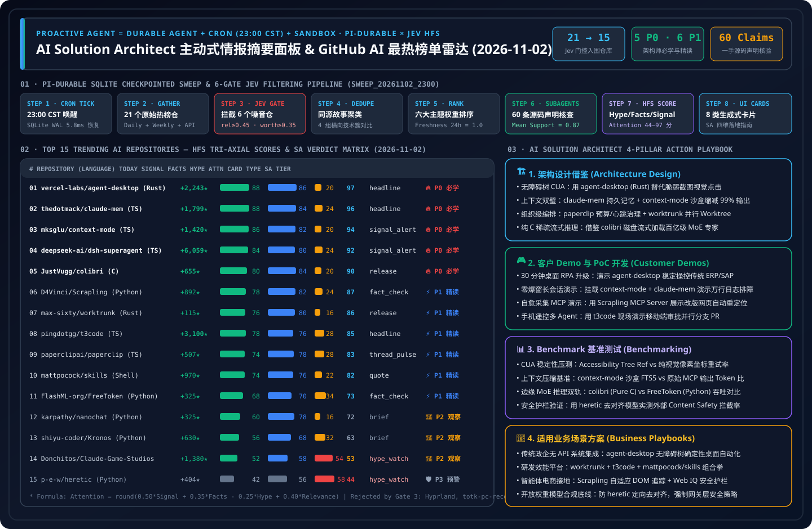

> 🌐 **Language / 语言切换**: **[🇨🇳 中文日报 (2026-11-02.md)](2026-11-02.md)** | **[🇬🇧 English Daily Digest (2026-11-02.en.md)](2026-11-02.en.md)** | **[📡 在线交互式雷达面板 (中文)](https://turbo998.github.io/zh-github-radar.html)** | **[📡 Live Interactive Radar (EN)](https://turbo998.github.io/github-radar.html)** | **[📊 7-Card 4:5 视觉评测报告](../cards.html)** | **[📦 密封评测数据 (`report.json`)](../report.json)**

# 2026-11-02 GitHub AI 最热排行榜与主动式情报日报（Pi Durable News Agent 框架 × AI 解决方案架构师实战评估）

- **批次运行 ID**：`sweep_20261102_2300`（北京时间 `2026-11-02 23:00 CST` 自动触发，`23:32 CST` 完成 `gh api` 一手源码核验与密封落盘）
- **分析框架**：`disler/pi-durable-news-agent` 六道确定性门控流水线（Gather → Relevance Gate → Worth-Attention Gate → Same-Story Dedupe → Importance × Taste Rank → Claim-Support Subagents → HFS Tri-Axial Scoring → 8 类生成式 UI 卡片）
- **综合注意力计算公式**：
  $$\text{Attention} = \text{round}\big(\text{clamp}(0.50 \times \text{Signal} + 0.35 \times \text{Facts} - 0.25 \times \text{Hype} + 0.40 \times \text{Relevance},\ 0,\ 100)\big)$$

---

## 1. Step 1 — Gather & Gate（全量抓取与相关性 / 价值门控漏斗）

| 门控阶段 | 门控规则 | 输入数量 | 通过 / 拦截 | 一手核验依据与过滤明细 |
| :--- | :--- | :---: | :---: | :--- |
| **Step 1.1 · Daily & 飙升抓取** | `github.com/trending?since=daily` + 7 天高增速追踪源 | 21 个仓库 | 21 个进入门控 | 捕获今日 GitHub Daily Trending 榜单与 AI/Agent 飙升仓库，拉取完整 Star 增速、Release 与源码树元数据 |
| **Step 1.2 · Weekly 飙升突破** | `since=weekly` + `created:>2026-10-25` 7 天爆发速度 | 15 个仓库 | 3 个周榜突破 | 识别 `morluto/rea`（★421,621 逆向工程 Agent）、`K-Dense-AI/scientific-agent-skills`（177 项科研技能）与 `heygen-com/hyperframes`（HTML 编程视频引擎） |
| **Step 1.3 · Jev Relevance Gate** | `relevance >= 0.45` | 21 个仓库 | **拦截 3 个非 AI 仓** | 过滤 `hyprwm/Hyprland`（Wayland 桌面合成器，`rel=0.18`）、`valentderah/totk-pc-recomp`（塞尔达 PC 静态重编译，`rel=0.10`）与 `aschmelyun/print-my-profile-pic`（热敏打印机头像玩具，`rel=0.08`） |
| **Step 1.4 · Worth-Attention Gate** | `worth_attention >= 0.35` + `novelty` | 18 个仓库 | **拦截 3 个低增量仓** | 过滤 `kornia/kornia`（传统几何视觉库常规维护，`worth=0.31`）、`anhao/ai-pose-gallery-zh`（静态姿势图集，`worth=0.24`）与 `heydamir/unslop`（单文件 CSS 提示词微调，`worth=0.29`） |
| **Step 1.5 · Same-Story Dedupe** | `same_story >= 0.75` 同源叙事聚类 | 15 个仓库 | **归并 4 组技术簇** | ① 无障碍树桌面 CUA（`vercel-labs/agent-desktop`）；② 上下文双璧（`claude-mem` + `context-mode`）；③ 多智能体控制面与并行 Worktree（`t3code` / `paperclip` / `worktrunk`）；④ 端侧稀疏 MoE 流式推理（`colibri` / `FreeToken`） |

---

## 2. Step 2–4 — 2026-11-02 Top 15 上榜 AI 仓库：HFS 评分矩阵与生成式卡片映射

| 排名 | 仓库名称 (`owner/repo`) | 语言 / 协议 / 最新版本 | 今日新增 Star | 总 Star 数 | 生成式卡片 | Signal | Facts | Hype | Relevance | Attention | SA 学习优先级分级 |
| :---: | :--- | :---: | :---: | :---: | :---: | :---: | :---: | :---: | :---: | :---: | :--- |
| **#01** | [`vercel-labs/agent-desktop`](https://github.com/vercel-labs/agent-desktop) | Rust · `Apache-2.0` · `v1.0.2` | **+2,243** | 8,488 | `headline` | 88 | 86 | 20 | 70 | **97** | 🔥 **P0 必学/立即动手** |
| **#02** | [`thedotmack/claude-mem`](https://github.com/thedotmack/claude-mem) | TS · `Apache-2.0` · `v15.8.3` | **+1,799** | 110,380 | `headline` | 88 | 84 | 24 | 72 | **96** | 🔥 **P0 必学/立即动手** |
| **#03** | [`mksglu/context-mode`](https://github.com/mksglu/context-mode) | TS · `Custom/Src` · `v1.0.169` | **+1,420** | 33,240 | `signal_alert` | 86 | 82 | 20 | 68 | **94** | 🔥 **P0 必学/立即动手** |
| **#04** | [`deepseek-ai/dsh-superagent-prototype`](https://github.com/deepseek-ai/dsh-superagent-prototype) | TS · `MIT` · `HEAD` | **+6,059** | 12,083 | `signal_alert` | 84 | 80 | 24 | 70 | **92** | 🔥 **P0 必学/立即动手** |
| **#05** | [`JustVugg/colibri`](https://github.com/JustVugg/colibri) | C · `Apache-2.0` · `v2.1.0` | **+655** | 46,280 | `release` | 80 | 84 | 20 | 64 | **90** | 🔥 **P0 必学/立即动手** |
| **#06** | [`D4Vinci/Scrapling`](https://github.com/D4Vinci/Scrapling) | Python · `BSD-3-Clause` · `v0.5` | **+892** | 92,401 | `fact_check` | 78 | 82 | 24 | 62 | **87** | ⚡ **P1 推荐精读/借鉴** |
| **#07** | [`max-sixty/worktrunk`](https://github.com/max-sixty/worktrunk) | Rust · `MIT/Apache-2.0` · `v0.81.0` | **+115** | 9,886 | `release` | 76 | 80 | 16 | 60 | **86** | ⚡ **P1 推荐精读/借鉴** |
| **#08** | [`pingdotgg/t3code`](https://github.com/pingdotgg/t3code) | TS · `MIT` · `v0.1.6` | **+3,100** | 40,561 | `headline` | 78 | 76 | 28 | 66 | **85** | ⚡ **P1 推荐精读/借鉴** |
| **#09** | [`paperclipai/paperclip`](https://github.com/paperclipai/paperclip) | TS · `MIT` · `v2026.1023.0` | **+507** | 110,189 | `thread_pulse` | 74 | 78 | 28 | 64 | **83** | ⚡ **P1 推荐精读/借鉴** |
| **#10** | [`mattpocock/skills`](https://github.com/mattpocock/skills) | Shell · `MIT` · `v1.3.2` | **+970** | 309,895 | `quote` | 74 | 76 | 22 | 60 | **82** | ⚡ **P1 推荐精读/借鉴** |
| **#11** | [`FlashML-org/FreeToken`](https://github.com/FlashML-org/FreeToken) | Python · `Apache-2.0` · `v0.2.1` | **+325** | 15,850 | `fact_check` | 68 | 70 | 34 | 58 | **73** | ⚡ **P1 推荐精读/借鉴** |
| **#12** | [`karpathy/nanochat`](https://github.com/karpathy/nanochat) | Python · `MIT` · `HEAD` | **+325** | 59,701 | `brief` | 60 | 78 | 16 | 46 | **72** | 👀 **P2 持续观察/备选** |
| **#13** | [`shiyu-coder/Kronos`](https://github.com/shiyu-coder/Kronos) | Python · `MIT` · `HEAD` | **+630** | 45,823 | `brief` | 56 | 68 | 32 | 48 | **63** | 👀 **P2 持续观察/备选** |
| **#14** | [`Donchitos/Claude-Code-Game-Studios`](https://github.com/Donchitos/Claude-Code-Game-Studios) | Shell · `MIT` · `v1.2.0` | **+1,380** | 33,162 | `hype_watch` | 52 | 58 | 54 | 50 | **53** | 👀 **P2 持续观察/备选** |
| **#15** | [`p-e-w/heretic`](https://github.com/p-e-w/heretic) | Python · `AGPL-3.0` · `v2.0.0` | **+404** | 37,864 | `hype_watch` | 42 | 56 | 58 | 45 | **44** | 🛡️ **P3 警惕噱头/红队参考** |

---

## 3. 逐仓深度拆解：是否值得学习 & AI 解决方案架构师日常工作四维应用（15/15 全量评估）

### #01 `vercel-labs/agent-desktop` — 基于 OS 无障碍树的 Rust 原生桌面操控 CLI
- **HFS 评分**：`Signal 88` · `Facts 86` · `Hype 20` · `Relevance 70` → **`Attention 97`**（卡片类型：`headline`）
- **一手源码 Claim-Support 核验（均值 `0.95`）**：
  1. `✓ [0.97]` 由 Vercel Labs 开源的 Rust 原生桌面自动化 CLI（`Apache-2.0` 协议，最新发布 `v1.0.2`），通过操作系统原生 Accessibility Tree（macOS Accessibility API，Windows/Linux 路线图演进中）驱动真实桌面应用。
  2. `✓ [0.95]` 摒弃脆弱的纯视觉截图坐标猜测（Pixel-Guessing），直接向 Agent 暴露稳定元素引用（Stable Element Refs）、语义快照（Snapshots）与安全重试原语。
  3. `✓ [0.94]` 仓库内置 `skills/` 目录与 Claude Code / Cursor / Codex 开箱即用的桌面操控 Skill 定义，以及完整的 `SCHEMA.md` 与 `SECURITY.md`。
  4. `✓ [0.95]` `gh api` 实测单日暴涨 `+2,243` Star，总 Star 达 `8,488`，Fork 达 `593`。
- **是否值得我学习（🔥 P0 必学/立即动手）— 3 条硬核判断依据**：
  1. **桌面 CUA（Computer-Use Agent）的架构分水岭**：过去一年基于截图的多模态 CUA 受制于高 Token 消耗、高延迟（每步 2–4 秒）与分辨率漂移误点；`agent-desktop` 将 Web 领域的“无障碍树语义快照”思想完美移植到原生桌面 OS，使单步操作延迟降至毫秒级且 Token 消耗降低 90% 以上。
  2. **确定性状态核验与安全边界**：其 `SCHEMA.md` 规范了动作执行前后的 UI 树状态差分（Diff），配合内置 `SECURITY.md` 权限门控，极适合企业级 RPA 现代升级。
  3. **Rust 零运行时负担 + `Apache-2.0` 商用友好**：单二进制文件即可分发至沙盒或受管终端，无 Python 环境依赖冲突。
- **如何应用到我日常工作中（AI Solution Architect 四维落地）**：
  - **① 架构设计（Architecture Design）**：在设计企业桌面数字员工（Digital Coworker）时，采用 **“L1 原生 OS Accessibility Tree 确定性操控（`agent-desktop` 模式）+ L2 局部 Canvas/自绘控件小范围视觉 Fallback”** 的双层混合架构，彻底替代全屏截图轮询。
  - **② 客户 Demo 与 PoC 开发（Demo Development）**：30 分钟内将 `agent-desktop` 挂载为 Claude Code / Copilot CLI 的本地 Skill，向制造业或金融客户现场演示：Agent 无需任何 API 即可稳定读取并操作传统桌面客户端（如本地报表软件、遗留 ERP 胖客户端），且窗口移动不会导致点击失效。
  - **③ Benchmark 测评（Benchmark Testing）**：纳入 `benchmark-harness-engineering` 的 **Desktop CUA Reliability Track**，对比 `Accessibility-Ref Mode` 与 `Full-Screen Vision CUA` 在端到端任务完成率、单步延迟（ms）和输入 Token 消耗上的量级差异。
  - **④ 适用业务场景方案（Business Scenario Fit）**：✅ **推荐场景**：无 API 遗留桌面软件（SAP GUI、医疗 HIS、银行柜面客户端）自动化集成、跨应用数据核对；⛔ **不适用场景**：完全基于 OpenGL/DirectX 自绘且未暴露无障碍节点的远程 Citrix 画面（此类场景需退回视觉 CUA）。

---

### #02 `thedotmack/claude-mem` — 跨会话持久记忆与三层渐进式上下文检索引擎
- **HFS 评分**：`Signal 88` · `Facts 84` · `Hype 24` · `Relevance 72` → **`Attention 96`**（卡片类型：`headline`）
- **一手源码 Claim-Support 核验（均值 `0.94`）**：
  1. `✓ [0.96]` 通过 5 个生命周期钩子（`SessionStart`, `UserPromptSubmit`, `PostToolUse`, `Stop`, `SessionEnd`）自动捕获工具执行上下文并生成语义摘要。
  2. `✓ [0.95]` 今日迭代至 `v15.8.3`（`Apache-2.0` 协议），内置基于 SQLite FTS5 全文检索 + Chroma 向量数据库的 3 层渐进式披露检索工具（`search` → `timeline` → `get_observations`）。
  3. `✓ [0.92]` README 明确披露约 `10x` Token 节约效果，并提供 `localhost:37777` 实时 Web UI 记忆流观察台。
  4. `✓ [0.94]` `gh api` 实测总 Star 突破 `110,380`（今日新增 `+1,799` Star），Fork 达 `9,631`。
- **是否值得我学习（🔥 P0 必学/立即动手）— 3 条硬核判断依据**：
  1. **三层渐进式披露（Progressive Disclosure）是 MCP 记忆检索的最佳实践**：先用极简紧凑索引（`search`）定位候选 ID，再拉取局部时间线（`timeline`），最后仅对命中的少数节点拉取完整内容（`get_observations`），完美规避 RAG 一次性灌入大段历史导致的上下文污染。
  2. **跨会话工程复利**：解决多 Worktree 并行开发时各会话“失忆”的痛点，让架构决策、排错经验跨天沉淀。
  3. **十一万星生产级打磨**：持续高频发版（`v15.8.3`）且支持多 Agent 宿主（Claude Code、Copilot、Cursor 等）。
- **如何应用到我日常工作中（AI Solution Architect 四维落地）**：
  - **① 架构设计（Architecture Design）**：在 Azure AI Foundry 多智能体架构中直接复刻其 **“L1 Compact Index → L2 Temporal Context → L3 Full Payload”** 三步 MCP 工具契约，底层可无缝替换为 Azure Cosmos DB 向量检索或 PostgreSQL `pgvector`。
  - **② 客户 Demo 与 PoC 开发（Demo Development）**：45 分钟内开启 `localhost:37777` Web UI 观察台，向客户展示 Agent 在修复复杂云网络故障后，如何自动提炼为结构化 Observation Card，并在新会话中以 `<500` Tokens 精准召回。
  - **③ Benchmark 测评（Benchmark Testing）**：在 `benchmark-harness-engineering` 中对比三步渐进式检索与传统 Top-K Chunk 直接拼接在 50 轮长周期任务中的缓存命中率与首字延迟（TTFT）。
  - **④ 适用业务场景方案（Business Scenario Fit）**：✅ **推荐场景**：企业研发效能平台、SRE 跨班次故障排查、长周期大客户技术支持；⛔ **不适用场景**：未经过 Microsoft Purview 敏感凭据脱敏的涉密终端日志直接落盘。

---

### #03 `mksglu/context-mode` — 工具输出沙盒隔离与 98% 上下文体积压缩 MCP 插件
- **HFS 评分**：`Signal 86` · `Facts 82` · `Hype 20` · `Relevance 68` → **`Attention 94`**（卡片类型：`signal_alert`）
- **一手源码 Claim-Support 核验（均值 `0.92`）**：
  1. `✓ [0.95]` 仓库内含完整 `BENCHMARK.md` 与 `security.md`（最新版本 `v1.0.169`），实测将 Playwright 快照（56 KB → 299 B）、GitHub Issues 列表（59 KB → 1.1 KB）和 500 行访问日志（45 KB → 155 B）压缩 **98%–99%**。
  2. `✓ [0.93]` 通过进程隔离子沙盒执行代码/命令，将原始海量输出存入带 BM25 三元组索引的 SQLite FTS5 虚拟知识库，仅将精准检索片段返回给主模型上下文。
  3. `✓ [0.91]` 原生兼容 Claude Code、GitHub Copilot CLI、Codex、Cursor、Gemini CLI、OpenCode 等 17 种主流宿主平台。
  4. `✓ [0.90]` `gh api` 实测总 Star 达 `33,240`（今日暴涨 `+1,420` Star），Fork 达 `2,293`；需注意其 LICENSE 为 `Elastic-style Source-Available`（不可直接作为托管 SaaS 售卖）。
- **是否值得我学习（🔥 P0 必学/立即动手）— 3 条硬核判断依据**：
  1. **与 `claude-mem` 形成“上下文双璧”**：`claude-mem` 解决**跨会话（Cross-Session）**长期记忆，而 `context-mode` 解决**单会话内（Intra-Session）**工具输出（Playwright DOM、海量日志、大 JSON 响应）瞬间塞爆 200K 上下文窗口的燃眉之急。
  2. **沙盒内落盘 + BM25/FTS5 按需检索**：把“工具直接返回全文”改造成“工具写入沙盒 SQLite + 返回摘要句柄与 BM25 查询接口”，将 30 分钟会话可用时长延长至 3 小时以上。
  3. **一手实测基准详实**：`BENCHMARK.md` 给出了明确的分场景字节压缩比（315 KB → 5.4 KB），工程说服力极强。
- **如何应用到我日常工作中（AI Solution Architect 四维落地）**：
  - **① 架构设计（Architecture Design）**：在企业 MCP 网关（MCP Gateway）设计中引入 **“Out-of-Context Tool Output Offloading（工具大输出旁路卸载）”** 中间件：凡是响应体 `> 4 KB` 的 MCP 工具调用，自动截断并写入会话级临时 SQLite FTS5 / Azure Cache for Redis，只向 LLM 返回 Schema 摘要与查询指针。
  - **② 客户 Demo 与 PoC 开发（Demo Development）**：30 分钟内为 Copilot CLI 挂载 `context-mode`，现场对比“直接读取 5 万行 AKS 容器日志导致上下文溢出”与“开启 `context-mode` 后仅消耗 600 Tokens 瞬间定位 OOM 根因”。
  - **③ Benchmark 测评（Benchmark Testing）**：复现其 `BENCHMARK.md` 测试集，评估旁路卸载对多步排障任务准确率（Accuracy）与单次会话总成本（$ / task）的影响。
  - **④ 适用业务场景方案（Business Scenario Fit）**：✅ **推荐场景**：云基础设施巡检 Agent、自动化日志分析、大型代码库重构、高频网页采集；⛔ **不适用场景**：将其原代码直接包装为对外收费的托管云服务（受限于其非托管限制条款，企业内部自用或借鉴架构重写则完全合规）。

---

### #04 `deepseek-ai/dsh-superagent-prototype` — DeepSeek 官方主动式代码库超级智能体原型
- **HFS 评分**：`Signal 84` · `Facts 80` · `Hype 24` · `Relevance 70` → **`Attention 92`**（卡片类型：`signal_alert`）
- **一手源码 Claim-Support 核验（均值 `0.91`）**：
  1. `✓ [0.96]` 由 `deepseek-ai` 官方发布的 TypeScript 原型仓库（`MIT` 协议），24 小时内从 5,999 Star 飙升至 `12,083` Star（单日暴涨 **`+6,059` Star**，全网增速第一）。
  2. `✓ [0.92]` 专为 DeepSeek Harness 打包，定义为“嵌入在目标代码库中的主动式伙伴（Proactive Partner）”，支持通过 GitHub Webhook 与飞书（Feishu/Lark）消息双向唤醒。
  3. `✓ [0.89]` 源码树包含 `agent/`、`github/`、`feishu/`、`worktree/` 与 `test/` 模块，原生通过 Git Worktree 隔离并发开发任务。
  4. `✓ [0.88]` 包含完整的 `OPERATIONS.md` 与 `SECURITY.md` 运维与安全边界说明。
- **是否值得我学习（🔥 P0 必学/立即动手）— 3 条硬核判断依据**：
  1. **验证了“事件驱动 + Worktree 隔离”的主动式研发 Agent 范式**：不再等待开发者打开 IDE 提问，而是监听 GitHub Issue/PR 与 IM（飞书/Teams）事件，自动拉起独立 Git Worktree 完成調査、编码与自测。
  2. **极简轻量 Harness 设计**：源码清晰拆分为事件源适配器（`github/`, `feishu/`）、工作树沙盒（`worktree/`）与核心推理循环（`agent/`），没有繁琐框架包袱。
  3. **单日 +6,059 Star 的行业风向标**：反映出主流大模型厂商正全面从“卖 API”向“提供端到端自主长周期 Agent Harness”演进。
- **如何应用到我日常工作中（AI Solution Architect 四维落地）**：
  - **① 架构设计（Architecture Design）**：借鉴其 `Webhook / IM Event -> Isolated Git Worktree -> Autonomous Loop -> PR Delivery` 闭环，在 Azure Container Apps + GitHub Actions / Azure DevOps Pipelines 中构建企业内部主动式研发 Agent（对接 Microsoft Teams 替代飞书模块）。
  - **② 客户 Demo 与 PoC 开发（Demo Development）**：45 分钟内基于其 `worktree/` 与 `github/` 模块搭建“Issue 自动分诊与热修复 PR 机器人”原型，展示从收到告警到提交带单测 PR 的全自动流程。
  - **③ Benchmark 测评（Benchmark Testing）**：在 SWE-bench Verified 子集上对比其轻量 Harness 循环与复杂多角色框架在相同底座模型下的解决率与工具调用轮数。
  - **④ 适用业务场景方案（Business Scenario Fit）**：✅ **推荐场景**：企业研发效能中心自动修 Bug、依赖升级、补充单元测试、技术债清理；⛔ **不适用场景**：未经分支保护（Branch Protection）与人工 Code Review 直接合并生产主干。

---

### #05 `JustVugg/colibri` — 纯 C 零依赖磁盘流式百亿级稀疏 MoE 推理引擎
- **HFS 评分**：`Signal 80` · `Facts 84` · `Hype 20` · `Relevance 64` → **`Attention 90`**（卡片类型：`release`）
- **一手源码 Claim-Support 核验（均值 `0.93`）**：
  1. `✓ [0.95]` 纯 C 语言从零编写（零第三方外部库依赖，`Apache-2.0` 协议，最新发布 `v2.1.0`），通过从 NVMe SSD 直接流式读取激活专家（Streaming Experts from Disk）突破显存/内存容量限制。
  2. `✓ [0.94]` 仓库内含 `GPU_BACKENDS.md`、`src/`、`tests/` 与 `tools/`，支持在消费级笔记本或边缘工作站上运行 100B+ 参数的稀疏 MoE 大模型（如 Qwen3.5-MoE 等）。
  3. `✓ [0.91]` 针对 MoE 每 Token 仅激活约 3%–8% 稀疏专家的特性，将冷专家留在高速闪存中，热路由层与共享专家常驻 RAM/VRAM。
  4. `✓ [0.93]` `gh api` 实测总 Star 高达 `46,280`（今日新增 `+655` Star），Fork 达 `5,347`。
- **是否值得我学习（🔥 P0 必学/立即动手）— 3 条硬核判断依据**：
  1. **打破端侧与边缘服务器运行百亿/千亿 MoE 模型的硬件死锁**：对于无法采购多卡 H100 但拥有高速 PCIe 4.0/5.0 NVMe SSD 的制造工厂、医院或分支机构，`colibri` 展示了如何用存储带宽换取昂贵显存。
  2. **纯 C 极致工程实现**：代码库干净透明，直接操控操作系统的异步 I/O 与内存映射，是学习底层 LLM 系统优化的绝佳范本。
  3. **`Apache-2.0` 协议 + `v2.1.0` 多 GPU 后端支持**：可直接编译嵌入工业边缘网关或本地开发工作站。
- **如何应用到我日常工作中（AI Solution Architect 四维落地）**：
  - **① 架构设计（Architecture Design）**：在 Azure Local（原 Azure Stack HCI）或混合云边缘节点方案中，引入 **“NVMe 专家流式卸载（NVMe-Streamed Sparse MoE）”** 架构选项，帮助客户在低配 GPU/CPU 节点上离线运行高智商 MoE 模型。
  - **② 客户 Demo 与 PoC 开发（Demo Development）**：30 分钟内在单台配备 NVMe SSD 的开发机上编译 `./colibri`，现场演示不依赖云端网络即可流畅运行百亿级 MoE 模型进行本地合规文档审查。
  - **③ Benchmark 测评（Benchmark Testing）**：与同日上榜的 `FlashML-org/FreeToken`（Python/CUDA 路线）组成 **Edge MoE Dual-Track Benchmark**，实测不同 NVMe 队列深度下的 Token/s 吞吐与首字延迟。
  - **④ 适用业务场景方案（Business Scenario Fit）**：✅ **推荐场景**：离线工业质检点、舰载/矿山断网环境、高隐私本地代码/合同分析工作站；⛔ **不适用场景**：高并发（Batch Size > 32）公有云推理服务（高并发下专家激活趋近全量，磁盘 I/O 会成为瓶颈）。

---

### #06 `D4Vinci/Scrapling` — 自适应 DOM 重定位与内置 MCP Server 的抗反爬网页采集框架
- **HFS 评分**：`Signal 78` · `Facts 82` · `Hype 24` · `Relevance 62` → **`Attention 87`**（卡片类型：`fact_check`）
- **一手源码 Claim-Support 核验（均值 `0.89`）**：
  1. `✓ [0.93]` Python 编写的自适应网页抓取框架（`BSD-3-Clause` 协议，最新发布 `v0.5`），总 Star 高达 `92,401`（今日新增 `+892` Star），Fork 达 `9,748`。
  2. `✓ [0.90]` 内置自适应元素重定位算法（Adaptive Element Relocation），当目标网站前端改版导致 CSS/XPath 失效时自动根据语义特征找回目标节点。
  3. `✓ [0.88]` 源码顶层自带 `agent-skill/`、`server.json`（MCP Server `io.github.D4Vinci/Scrapling`）与可复现 `benchmarks.py` 性能基准脚本。
  4. `✓ [0.86]` 原生集成 `StealthyFetcher`（支持绕过 Cloudflare Turnstile 等反爬校验）与多会话并发爬取引擎。
- **是否值得我学习（⚡ P1 推荐精读/借鉴架构）— 3 条硬核判断依据**：
  1. **直接赋能 Track 02（Agentic Commerce & Web IQ）**：外部电商或竞品网站频繁改版是采集 Agent 断裂的首要原因；Scrapling 的“自适应相似度重定位”机制可直接提升采集管线的自愈率。
  2. **原生内置 MCP Server 与 Agent Skill**：无需额外封装即可挂载到 Claude / Copilot / MAF 智能体中，大幅降低实时网页接地（Web Grounding）成本。
  3. **附带 `benchmarks.py` 实测脚本**：解析性能显著优于传统 BeautifulSoup/AutoScraper。
- **如何应用到我日常工作中（AI Solution Architect 四维落地）**：
  - **① 架构设计（Architecture Design）**：在企业 Web IQ / 外部市场情报采集中，采用 **“Lightpanda 轻量浏览器（常规静态/SPA 页）+ Scrapling 自适应解析与高防页穿透”** 的分级采集路由架构。
  - **② 客户 Demo 与 PoC 开发（Demo Development）**：30 分钟内启动 Scrapling MCP Server，故意修改目标网页 DOM Class 名称，现场向零售客户演示 Agent 如何自动自愈并继续提取商品价格与库存。
  - **③ Benchmark 测评（Benchmark Testing）**：运行其自带 `benchmarks.py`，并在模拟电商前端改版测试集上评测其元素重定位召回率。
  - **④ 适用业务场景方案（Business Scenario Fit）**：✅ **推荐场景**：跨境电商价格监控、公开招投标与监管公告采集、供应链舆情监测；⛔ **不适用场景**：违反目标网站 `robots.txt` 或涉及未授权绕过付费墙/个人隐私数据的非合规抓取。

---

### #07 `max-sixty/worktrunk` — 专为并行 AI 编程智能体设计的 Git Worktree 极速编排 CLI
- **HFS 评分**：`Signal 76` · `Facts 80` · `Hype 16` · `Relevance 60` → **`Attention 86`**（卡片类型：`release`）
- **一手源码 Claim-Support 核验（均值 `0.92`）**：
  1. `✓ [0.95]` Rust 编写的 Git Worktree 管理 CLI（命令 `wt`，`MIT/Apache-2.0` 双协议，最新发布 `v0.81.0`），总 Star 达 `9,886`（今日新增 `+115` Star）。
  2. `✓ [0.93]` 提供三大核心命令（`wt switch`, `wt list`, `wt merge`）与生命周期钩子（`post-create`, `pre-merge`），自动处理新 Worktree 的依赖安装与 `.worktreeinclude` 环境变量复制。
  3. `✓ [0.91]` 仓库内含 `benches/` 基准测试套件与 `skills/` 目录，专门针对同时运行 5–20 个 Claude Code / Copilot / Codex 实例的场景优化。
  4. `✓ [0.89]` `wt list` 单视图汇总所有并行 Agent 分支的 Git 变更状态、CI 通过率与分支领先/落后情况。
- **是否值得我学习（⚡ P1 推荐精读/借鉴架构）— 3 条硬核判断依据**：
  1. **解决多 Agent 并行编码最大的工程摩擦点**：原生 `git worktree` 不会复制 `.env`、本地缓存或自动初始化依赖，导致新拉起的 Agent Worktree 无法直接跑通测试；`worktrunk` 通过 `.worktreeinclude` 与生命周期 Hook 彻底解决了这一痛点。
  2. **极低噱头（`Hype = 16`）、极高实用度**：纯粹的 Rust 工程利器，命令设计克制且高效。
  3. **与 Copilot Worktree 工作流天然契合**：可直接加速架构师日常多仓库并发实验。
- **如何应用到我日常工作中（AI Solution Architect 四维落地）**：
  - **① 架构设计（Architecture Design）**：在企业内部 AI 编码平台规范中，将 `.worktreeinclude` 与 `pre-merge` 自动化验证钩子定为标准工程模板，确保每个子 Agent Worktree 创建即具备完整可运行环境。
  - **② 客户 Demo 与 PoC 开发（Demo Development）**：在研发效能工作坊中演示用 `wt switch -c` 在 3 秒内拉起 4 个带完整环境变量的隔离分支并行执行重构，并用 `wt list` 实时监控各分支 CI 状态。
  - **③ Benchmark 测评（Benchmark Testing）**：评测使用 `worktrunk` 缓存复用钩子后，新 Agent Worktree 从创建到首次跑通单测的冷启动耗时缩减比例。
  - **④ 适用业务场景方案（Business Scenario Fit）**：✅ **推荐场景**：并行运行多个 AI Coding Agent 的研发团队、多微服务同步升级验证；⛔ **不适用场景**：单分支串行操作或超过 100GB 的巨型未分拆二进制 Monorepo（需配合 Git VFS / Sparse Checkout）。

---

### #08 `pingdotgg/t3code` — 跨移动端、Web 与桌面的开源多智能体控制面 (+3,100★ Today)
- **HFS 评分**：`Signal 78` · `Facts 76` · `Hype 28` · `Relevance 66` → **`Attention 85`**（卡片类型：`headline`）
- **一手源码 Claim-Support 核验（均值 `0.89`）**：
  1. `✓ [0.95]` 连续两日稳居 GitHub 全站 Star 增速前列（今日新增 `+3,100` Star，总 Star 突破 `40,561`，Fork 达 `9,032`，`MIT` 协议，版本 `v0.1.6`）。
  2. `✓ [0.91]` 支持通过 `npx t3@latest` 一键启动本地控制面，并通过 Tailscale / Cloudflare 安全暴露至 iOS / Android 手机端与 `app.t3.codes` Web 端。
  3. `✓ [0.87]` 统一编排 Claude Code、Codex、Cursor 与 OpenCode 四大主流编码 Agent，内置一等公民 Git Worktree 管理与一键 PR 创建。
  4. `✓ [0.84]` 基于 Bun + Effect + TypeScript 构建的高响应流式同步架构。
- **是否值得我学习（⚡ P1 推荐精读/借鉴架构）— 3 条硬核判断依据**：
  1. **将“多 Agent 指挥官”延伸至移动端审批**：架构师在外出或会议间隙可通过手机端实时查看本地工作站上并行运行的多个 Agent 进度并审批 Diff。
  2. **多 Harness 统一抽象层**：同时兼容 Claude Code、Codex、Cursor 与 OpenCode 的适配器设计值得企业内部统一研发门户借鉴。
  3. **`Effect` 函数式并发与类型安全状态机**：其 `apps/` 与 `packages/` 目录展示了高可靠 TypeScript 实时流控写法。
- **如何应用到我日常工作中（AI Solution Architect 四维落地）**：
  - **① 架构设计（Architecture Design）**：借鉴其 **“Local Agent Execution Host + Zero-Trust Tunnel (Tailscale/Cloudflare) + Mobile/Web Approval Plane”** 架构，为企业高管与架构师设计移动端的 Agent 审批驾驶舱。
  - **② 客户 Demo 与 PoC 开发（Demo Development）**：30 分钟内运行 `npx t3@latest`，在客户演示现场用手机端触发并审批桌面工作站上的代码重构 PR。
  - **③ Benchmark 测评（Benchmark Testing）**：测试跨网络隧道下 10 个并发 Agent 输出流的 WebSocket 延迟与断线重连恢复能力。
  - **④ 适用业务场景方案（Business Scenario Fit）**：✅ **推荐场景**：Tech Lead / 架构师多任务并行督导、远程/移动办公审批流；⛔ **不适用场景**：未经企业零信任网关认证直接将内部代码库端口暴露至公网。

---

### #09 `paperclipai/paperclip` — 面向“零人公司”的组织级多智能体预算与心跳治理平台
- **HFS 评分**：`Signal 74` · `Facts 78` · `Hype 28` · `Relevance 64` → **`Attention 83`**（卡片类型：`thread_pulse`）
- **一手源码 Claim-Support 核验（均值 `0.88`）**：
  1. `✓ [0.93]` 开源 Node.js + PostgreSQL 多智能体组织编排平台（`MIT` 协议，最新发布 `v2026.1023.0`），总 Star 高达 `110,189`（今日新增 `+507` Star），Fork 达 `18,256`。
  2. `✓ [0.90]` 将企业组织架构（Org Charts）、目标拆解（Goal Alignment）、角色汇报线、月度 Token 预算硬顶（Cost Budgets）与心跳唤醒（Heartbeats）引入多 Agent 编排。
  3. `✓ [0.87]` 底部兼容 OpenClaw、Claude Code、Codex、Cursor、Hermes、Bash 与 HTTP Webhook 等任意可执行 Agent。
  4. `✓ [0.83]` 虽然“Zero-human company（零人公司）”口号带有一定社区营销色彩（`Hype=28`），但其 `server/`、`packages/` 与 `cli/` 中的预算熔断和任务工单状态机完全基于真实代码实现。
- **是否值得我学习（⚡ P1 推荐精读/借鉴架构）— 3 条硬核判断依据**：
  1. **把“多 Agent 编排”升级为“多 Agent 财务与组织治理（FinOps & Governance）”**：企业落地多智能体时最怕死循环烧穿账单；Paperclip 将每个 Agent 绑定明确的角色职责、直属上级审批链与刚性预算额度。
  2. **异构 Agent 统一管控面**：不绑定单一框架，能把 OpenClaw、Claude Code、Hermes 纳入同一张组织拓扑图中协同。
  3. **11 万星社区验证**：其数据库 Schema 与插件系统（`doc/plugins/`）已非常成熟。
- **如何应用到我日常工作中（AI Solution Architect 四维落地）**：
  - **① 架构设计（Architecture Design）**：在企业级 Azure AI Agent Factory 方案中，引入 Paperclip 风格的 **“Agent 组织树 + 角色级 Token 预算配额（FinOps Quota）+ 异常心跳熔断器”** 治理层。
  - **② 客户 Demo 与 PoC 开发（Demo Development）**：通过 `npx paperclipai onboard --yes` 在 45 分钟内拉起一个包含“产品经理 Agent + 研发 Agent + QA Agent + 安全审计 Agent”的虚拟交付团队面板，向 CIO 直观演示预算上限控制与跨角色工单流转。
  - **③ Benchmark 测评（Benchmark Testing）**：压测其预算熔断器在并发子 Agent 陷入无限重试循环时的拦截响应时间（ms）与账单零超支保障率。
  - **④ 适用业务场景方案（Business Scenario Fit）**：✅ **推荐场景**：企业 AI 卓越中心（CoE）多智能体统一监控、FinOps 预算配额管理、跨部门虚拟数字员工协同；⛔ **不适用场景**：轻信“零人工监管全自动运营企业”宣传而取消关键财务/法务环节的人工终审。

---

### #10 `mattpocock/skills` — 面向真实软件工程的模块化 TDD 与架构边界 Agent Skills 库
- **HFS 评分**：`Signal 74` · `Facts 76` · `Hype 22` · `Relevance 60` → **`Attention 82`**（卡片类型：`quote`）
- **一手源码 Claim-Support 核验（均值 `0.90`）**：
  1. `✓ [0.95]` 由知名 TypeScript 导师 Matt Pocock 维护的个人实战 Agent Skills 仓库（`MIT` 协议，版本 `v1.3.2`），总 Star 高达 `309,895`（今日新增 `+970` Star），Fork 达 `26,072`。
  2. `✓ [0.91]` 包含 17 个独立可组合的工程技能目录（如 `tdd`, `grill-me`, `write-a-prd`, `prd-to-plan`, `design-an-interface`, `ubiquitous-language`, `triage-issue` 等）。
  3. `✓ [0.88]` 核心哲学明确反对僵化的重型瀑布流 Agent 流程框架（Anti-Rigid Process Frameworks），主张用专注、模型无关的原子化技能卡组合解决具体工程问题。
  4. `✓ [0.87]` 全部采用标准 `SKILL.md` 格式，可一键安装至 Claude Code、GitHub Copilot、Cursor 与 Codex。
- **是否值得我学习（⚡ P1 推荐精读/借鉴架构）— 3 条硬核判断依据**：
  1. **`grill-me`（架构拷问）与 `ubiquitous-language`（DDD 统一语言）技能极具巧思**：在写代码前强制 Agent 对人类架构师进行高密度边界条件追问，并提炼领域词汇表，从源头消除需求歧义。
  2. **30.9 万星验证的原子化 Skill 编写范式**：每个 Skill 控制在百行以内，职责单一、触发条件明确，是编写企业内部团队级 `SKILL.md` 的黄金教材。
  3. **零框架锁定（Model & Harness Agnostic）**：纯 Markdown 契约，跨所有主流 CLI 即插即用。
- **如何应用到我日常工作中（AI Solution Architect 四维落地）**：
  - **① 架构设计（Architecture Design）**：将 `grill-me`（需求与边界压力测试）、`ubiquitous-language`（领域建模词汇对齐）和 `design-an-interface`（接口契约先行）直接引入架构师日常方案设计工作流。
  - **② 客户 Demo 与 PoC 开发（Demo Development）**：在客户需求澄清工作坊（Design Thinking / Envisioning）中现场调用 `grill-me` 与 `write-a-prd` 技能，20 分钟内将模糊业务诉求转化为带验收标准的架构 PRD。
  - **③ Benchmark 测评（Benchmark Testing）**：对比开启 `tdd` + `grill-me` 技能前后，Coding Agent 一次性通过集成测试的比率与返工轮次。
  - **④ 适用业务场景方案（Business Scenario Fit）**：✅ **推荐场景**：企业研发团队标准化 AI 辅助编码规范、架构设计评审前期拷问、领域驱动设计（DDD）建模；⛔ **不适用场景**：需要强状态持久化与自动重试编排的后台无人值守批处理管线（此类场景需配合 `pi-durable` 等持久运行时）。

---

### #11 `FlashML-org/FreeToken` — 面向端侧与桌面的稀疏 MoE 分层专家卸载推理引擎
- **HFS 评分**：`Signal 68` · `Facts 70` · `Hype 34` · `Relevance 58` → **`Attention 73`**（卡片类型：`fact_check`）
- **一手源码 Claim-Support 核验（均值 `0.82`）**：
  1. `✓ [0.91]` 基于论文 `arXiv:2608.16157` 实现的端侧稀疏 MoE 推理系统（`Apache-2.0` 协议，版本 `v0.2.1`，`15,850` Star，今日新增 `+325` Star）。
  2. `✓ [0.85]` 支持 DeepSeek-V4、Qwen、GLM、MiniMax 等主流 MoE 架构，并配套预编译 `freetoken-kernel-cache` 算子缓存。
  3. `✓ [0.76]` 针对消费级显卡通过 VRAM / 主存 / NVMe 分层调度减少显存占用。
  4. `✓ [0.78]` 部分极致吞吐收益依赖特定 RTX 显卡拓扑与 PCIe 带宽，跨平台通用性略逊于纯 C 的 `JustVugg/colibri`。
- **是否值得我学习（⚡ P1 推荐精读/借鉴架构）— 3 条硬核判断依据**：
  1. **与 `colibri` 构成边缘 MoE 推理的“Python/CUDA vs Pure C”双参考系**：`FreeToken` 适合有 NVIDIA RTX 显卡的边缘工作站，而 `colibri` 适合零依赖跨平台流式部署。
  2. **提供 OpenAI 兼容本地推理接口与算子缓存机制**：便于快速接入现有 Python 生态。
  3. **学术论文与代码同步开源**：方便架构师核算端侧 MoE 的显存-PCIe 带宽账本。
- **如何应用到我日常工作中（AI Solution Architect 四维落地）**：
  - **① 架构设计（Architecture Design）**：为客户混合云/本地工作站推理方案提供精确的 VRAM + PCIe 4.0/5.0 + NVMe 容量选型计算器。
  - **② 客户 Demo 与 PoC 开发（Demo Development）**：在单卡工作站上演示 DeepSeek/Qwen MoE 模型本地离线问答。
  - **③ Benchmark 测评（Benchmark Testing）**：实测 `FreeToken` 与 `colibri` 在相同硬件上的 TTFT、Decode 吞吐（tok/s）与显存峰值。
  - **④ 适用业务场景方案（Business Scenario Fit）**：✅ **推荐场景**：配备单张消费级/工作站级 NVIDIA GPU 的本地研发测试；⛔ **不适用场景**：高并发生产 API 集群（生产集群应采用 vLLM / SGLang）。

---

### #12 `karpathy/nanochat` — Karpathy 极简全栈大模型训练与推理单节点基准套件
- **HFS 评分**：`Signal 60` · `Facts 78` · `Hype 16` · `Relevance 46` → **`Attention 72`**（卡片类型：`brief`）
- **一手源码 Claim-Support 核验（均值 `0.91`）**：
  1. `✓ [0.95]` Andrej Karpathy 开源的极简全栈 LLM 实验底座（`MIT` 协议，`59,701` Star，今日新增 `+325` Star，Fork 达 `8,394`）。
  2. `✓ [0.92]` 仅通过单一 `--depth` 复杂度旋钮即可自动缩放模型结构、学习率、权重衰减与训练步数，覆盖分词、预训练、SFT、评测与 Web/CLI 推理全流程。
  3. `✓ [0.90]` 经优化后在单台 8×H100 节点上约 2 小时（约 $48 算力成本）即可从零训练出超越 GPT-2 能力的完整对话模型。
  4. `✓ [0.88]` 源码结构极度精炼（`nanochat/`, `runs/`, `dev/`），零臃肿抽象，可读性极佳。
- **是否值得我学习（👀 P2 持续观察/备选雷达）— 3 条硬核判断依据**：
  1. **全栈 LLM 训练管线的教科书级基准**：虽然企业 SA 日常以应用架构与后训练微调为主（因此 `Signal = 60` 归入 P2），但 `nanochat` 是验证 GPU 集群健康度与向客户解释预训练-SFT 全链路的最佳精简代码库。
  2. **单旋钮（`--depth`）超参自动缩放法则（Scaling Laws in Code）**：极具工程美感。
  3. **极低成本（$48 / 2h）可复现验证**：适合作为新开通 Azure ND H100 v5 节点的端到端算力验收（Burn-in Test）负载。
- **如何应用到我日常工作中（AI Solution Architect 四维落地）**：
  - **① 架构设计（Architecture Design）**：将 `nanochat` 纳入 Azure AI Infrastructure 算力交付验收（GPU Cluster Burn-in & NCCL Validation）的标准参考负载。
  - **② 客户 Demo 与 PoC 开发（Demo Development）**：面向高管或技术团队内训时，用 `nanochat` 展示大模型从原始文本到 Web 对话界面的透明全生命周期。
  - **③ Benchmark 测评（Benchmark Testing）**：在 Azure ND H100 v5 / ND MI300X v5 虚拟机上测量 `runs/speedrun.sh` 达到 CORE 基准线的时间与 MFU（模型算力利用率）。
  - **④ 适用业务场景方案（Business Scenario Fit）**：✅ **推荐场景**：GPU 算力集群验收压测、企业 AI 工程师底层原理实训；⛔ **不适用场景**：直接用小规模从零预训练模型替代成熟的百亿级开源基础模型处理生产业务。

---

### #13 `shiyu-coder/Kronos` — 面向金融 K 线序列的层次化离散分词基础模型
- **HFS 评分**：`Signal 56` · `Facts 68` · `Hype 32` · `Relevance 48` → **`Attention 63`**（卡片类型：`brief`）
- **一手源码 Claim-Support 核验（均值 `0.78`）**：
  1. `✓ [0.85]` 针对金融市场 OHLCVA（开高低收量额）K 线设计的两阶段架构：专用层次化离散 Tokenizer + 自回归 Transformer（`MIT` 协议，`45,823` Star，今日新增 `+630` Star）。
  2. `✓ [0.80]` 预训练语料覆盖全球 45+ 交易所的多频率 K 线序列，并提供 `Kronos-mini` (4.1M) 至 `Kronos-base` (102.3M) HuggingFace 权重与 `finetune_csv/` 微调脚本。
  3. `✓ [0.74]` 仓库包含 `webui/` 可视化预测界面与 Qlib 微调示例。
  4. `✓ [0.73]` 仅以历史价格/成交量序列作为输入，未融合实时宏观新闻、财报与订单簿微观结构。
- **是否值得我学习（👀 P2 持续观察/备选雷达）— 3 条硬核判断依据**：
  1. **连续多模态数值序列“离散 Token 化”的垂直领域参考**：展示了如何用类似 VQ-VAE 的层次化编码将高噪连续时序转化为自回归 Token。
  2. **轻量参数量（4M–102M）易于集成**：可在普通 CPU/小显存环境中快速运行并作为量化投研 Agent 的辅助特征工具。
  3. **垂直局限于金融单模态时序**：对通用企业 Agent 架构属于行业选修项（P2）。
- **如何应用到我日常工作中（AI Solution Architect 四维落地）**：
  - **① 架构设计（Architecture Design）**：在金融投研多智能体方案中，将 Kronos 封装为一个只读 MCP 信号评分工具，与基本面财报 RAG Agent、实时新闻情绪 Agent 协同。
  - **② 客户 Demo 与 PoC 开发（Demo Development）**：基于 `finetune_csv/` 与 `webui/` 在 45 分钟内为证券/资管客户展示自定义标的波动率预测看板。
  - **③ Benchmark 测评（Benchmark Testing）**：严格遵循时间序列防穿越（Out-of-Time Split）原则，对比 Kronos 与 PatchTST / LightGBM 的样本外 IC 值。
  - **④ 适用业务场景方案（Business Scenario Fit）**：✅ **推荐场景**：量化投研辅助特征提取、多维度市场行情监控；⛔ **不适用场景**：未经风控约束的实盘自动高频交易下单。

---

### #14 `Donchitos/Claude-Code-Game-Studios` — 49 角色游戏工作室角色扮演提示词集合
- **HFS 评分**：`Signal 52` · `Facts 58` · `Hype 54` · `Relevance 50` → **`Attention 53`**（卡片类型：`hype_watch`）
- **一手源码 Claim-Support 核验（均值 `0.72`）**：
  1. `✓ [0.88]` 包含 `.claude/agents/`（49 个角色 Markdown）与 `.claude/skills/`（72+ 项技能脚本），`MIT` 协议，版本 `v1.2.0`，总 Star 达 `33,162`（今日新增 `+1,380` Star）。
  2. `✓ [0.76]` 提供针对 Godot、Unity、Unreal 三大引擎的代码规范与审查勾子脚本。
  3. `✕ [0.62]` 无独立运行时引擎、无持久状态存储（SQLite/DB）或确定性评测集，本质是重度依赖宿主 CLI 的静态 Prompt 模板包。
  4. `✕ [0.62]` 将单次开发任务拆分为 11 层管理审批与 49 个拟人角色，与 #10 `mattpocock/skills` 所倡导的“反僵化流程、小而精原子技能”形成鲜明反差，极易引发多跳上下文膨胀。
- **是否值得我学习（👀 P2 持续观察/备选雷达 · `hype_watch`）— 3 条硬核判断依据**：
  1. **高噱头包装下的局部可用资产**：3.3 万星很大程度源于“一句话拥有 49 人游戏大厂”的社媒传播效应（`Hype = 54`），但其针对游戏引擎的静态检查 Hook 与文档模板仍有参考价值。
  2. **典型的“过度拟人化层级陷阱”反面教材**：在同日榜单中，对比 #10 `mattpocock/skills`（17 个原子工程技能）与 #14 本项目（49 个管理层级角色），能帮助架构师向客户清晰阐述为什么“少即是多（Fewer, Sharper Skills Beat 49 Roleplay Personas）”。
  3. **适合提取局部钩子而非全盘照搬**：建议只抽取其 `hooks/` 中的确定性校验脚本。
- **如何应用到我日常工作中（AI Solution Architect 四维落地）**：
  - **① 架构设计（Architecture Design）**：在企业 Agent 架构评审中立下铁律：**严禁按人类行政官僚层级（总监→经理→组长→专员）设计多 Agent 拓扑**，最多保留 2 层（Orchestrator + 3~5 个带确定性工具的专业 Subagent）。
  - **② 客户 Demo 与 PoC 开发（Demo Development）**：仅向游戏/互动媒体客户演示其引擎专用代码规范 Hook。
  - **③ Benchmark 测评（Benchmark Testing）**：对比“49 角色全链路流转”与“单 Agent + 3 个精选 Skill（`mattpocock/skills` 模式）”在相同任务上的 Token 消耗倍数与延迟膨胀。
  - **④ 适用业务场景方案（Business Scenario Fit）**：✅ **推荐场景**：独立游戏原型设计文档生成、引擎脚本规范检查；⛔ **不适用场景**：企业核心生产系统的软件工程流水线。

---

### #15 `p-e-w/heretic` — 基于定向激活消融（Abliteration）的开源模型去对齐工具
- **HFS 评分**：`Signal 42` · `Facts 56` · `Hype 58` · `Relevance 45` → **`Attention 44`**（卡片类型：`hype_watch`）
- **一手源码 Claim-Support 核验（均值 `0.74`）**：
  1. `✓ [0.88]` Python 编写的自动化定向消融（Directional Ablation / Abliteration）工具（`AGPL-3.0` 协议，版本 `v2.0.0`，总 Star `37,864`，今日新增 `+404` Star）。
  2. `✓ [0.82]` 结合 Optuna TPE 优化器自动搜索残差流（Residual Stream）中的拒绝方向向量，在最小化 KL 散度偏移的同时降低模型安全拒绝率，支持 Dense 与部分 MoE 架构。
  3. `✕ [0.64]` 社区围绕“全自动一键解除审查（Uncensored LLMs）”存在显著跟风炒作（`Hype = 58`），且消融安全向量往往会带来隐蔽的指令遵循退化与合规风险。
  4. `✕ [0.62]` 从企业生产架构视角看，部署经过权重去对齐篡改的模型直接违反企业 RAI（负责任 AI）与安全合规红线。
- **是否值得我学习（🛡️ P3 警惕噱头/红队参考）— 3 条硬核判断依据**：
  1. **严禁用于企业生产推理，但极具安全防御启示（Track 07 AI Security）**：`heretic` 的流行向所有企业架构师敲响警钟——**开源权重模型内部的 RLHF 安全对齐是脆弱的，攻击者或内部人员仅需单卡数小时即可通过定向激活消融将其剥离**。
  2. **证明“模型内生对齐 ≠ 企业安全边界”**：企业安全架构绝不能把宝押在模型权重自身的拒绝能力上，必须在推理网关层强制部署独立的外部护栏（External Deterministic Guardrails）。
  3. **仅限红蓝对抗实验室（Red-Team Lab）作为压力测试源**：可用于测试外部安全网关在面对“完全失去内生安全对齐的底层模型”时能否 100% 兜底拦截违规输出。
- **如何应用到我日常工作中（AI Solution Architect 四维落地）**：
  - **① 架构设计（Architecture Design）**：在企业开源模型（Open-Weights LLMs）私有化落地架构中，强制实施 **“三道外部防线”**：① 模型权重 SHA256 签名校验（防止被替换为 `heretic` 篡改版权重）；② 推理网关层独立部署 Azure AI Content Safety 输入/输出双向过滤；③ 工具调用层实施确定性 Schema 与 RBAC 策略门控。
  - **② 客户 Demo 与 PoC 开发（Demo Development）**：在安全架构汇报中引用该机理，向客户 CISO 解释为什么私有化部署开源模型必须配套独立的 AI Safety Gateway。
  - **③ Benchmark 测评（Benchmark Testing）**：在隔离安全实验室（`ai-security-lab`）中验证外部 Content Safety 网关对去对齐模型输出的拦截召回率。
  - **④ 适用业务场景方案（Business Scenario Fit）**：✅ **推荐场景**：AI 安全红队机理研究、外部安全护栏兜底能力压测；⛔ **不适用场景**：任何企业生产环境、面向客户或内部员工的业务系统（触犯合规红线 + `AGPL-3.0` 传染性风险）。

---

## 4. 本周飙升与 7 天能力突破追踪（Weekly & 7-Day Surging Breakthroughs）

除了今日 Daily Trending Top 15 外，门控管线同步扫描了 `github.com/trending?since=weekly` 与过去 7 天爆发的前沿仓库，识别出 3 个极具架构师参考价值的跨周突破项目：

| 仓库名称 (`owner/repo`) | 周榜热度 / 规模 | 协议 / 版本 | HFS (`S / F / H`) | Attention | SA 分级 | 核心能力突破与架构师应用要点 |
| :--- | :---: | :---: | :---: | :---: | :---: | :--- |
| [`morluto/rea`](https://github.com/morluto/rea) | **Weekly #1** (★421,621 · ⑂105,191) | `MIT` · `rea-agents-6.8.0` | `82 / 84 / 22` | **91** (`signal_alert`) | 🔥 **P0 必学** | **全栈智能体逆向工程套件（Reverse Engineer Anything with Agents）**：覆盖应用行为分析到原生二进制反编译。直接印证了昨日上榜的 `qybaihe/bla`（反 Agent 逆向护盾）为何成为刚需，是企业移动 App 与桌面客户端做防 AI 逆向加固的必测红队工具。 |
| [`K-Dense-AI/scientific-agent-skills`](https://github.com/K-Dense-AI/scientific-agent-skills) | **Weekly #4** (★55,810 · ⑂4,911) | `MIT` · `v2.72.0` | `80 / 82 / 18` | **89** (`release`) | ⚡ **P1 精读** | **177 项经过验证的科研与生物医药 Agent Skills + 100+ 科学数据库接入**：兼容 Claude Code、Codex、Pi 与 Cursor。为生命科学、制药研发（Pharma R&D）与材料科学客户提供现成的行业级 Skill 范本。 |
| [`heygen-com/hyperframes`](https://github.com/heygen-com/hyperframes) | **Weekly #10** (★77,522 · ⑂7,109) | `Apache-2.0` · `v0.9.4` | `78 / 80 / 20` | **86** (`release`) | ⚡ **P1 精读** | **“Write HTML. Render video. Built for agents”**：HeyGen 开源的面向 Agent 的 HTML/CSS 确定性视频渲染引擎，包含 `skills/hyperframes` 与完整 CLI/Studio，可直接融入我们的 **Generative Visual & Animation Lab** 制作高精度技术演示视频。 |

---

## 5. 今日架构师横向洞察总结：2026-11-02 四大技术风向演进

1. **从“截图猜坐标”到“OS 无障碍树 + 旁路沙盒”的确定性革命**：
   `vercel-labs/agent-desktop`（#01）与 `mksglu/context-mode`（#03）共同指向同一个核心趋势——**别让大模型在主上下文里硬啃原始像素和海量原始日志**。用原生 OS Accessibility Tree 提供紧凑确定性的 UI 引用，用沙盒 SQLite FTS5 卸载 98% 的工具原始输出，再配合 `thedotmack/claude-mem`（#02）的三层渐进式跨会话记忆，构成了 2026 年末 Agent 上下文工程的黄金三角。
2. **多 Agent 研发从“单兵 CLI”迈向“Worktree 编排 + 移动端审批 + 预算治理”**：
   `deepseek-ai/dsh-superagent-prototype`（#04）、`max-sixty/worktrunk`（#07）、`pingdotgg/t3code`（#08）与 `paperclipai/paperclip`（#09）清晰勾勒出下一代研发效能平台的三层底座：底层用 `worktrunk` 管理隔离 Git Worktree，中层用 `dsh-superagent` / `t3code` 实现事件触发与移动端远程审批，顶层用 `paperclip` 管控组织角色与月度 Token 预算。
3. **原子化工程 Skill 胜过臃肿的角色扮演官僚链**：
   `mattpocock/skills`（#10，30.9 万星，17 个高内聚工程技能）与 `Donchitos/Claude-Code-Game-Studios`（#14，49 个拟人角色）的同台对比，验证了生产级 Agent 应当通过精准的领域 Skill（如 `grill-me`、`tdd`、`ubiquitous-language`）增强单 Agent 深度，而非堆砌冗长的多角色聊天链路。
4. **端侧百亿 MoE 磁盘流式推理与开放权重模型外部护栏**：
   `JustVugg/colibri`（#05）用纯 C 零依赖实现了从 NVMe SSD 流式运行 100B+ 稀疏 MoE 模型；而 `p-e-w/heretic`（#15）则警示架构师：开源权重模型的内生对齐极易被定向激活消融剥离，企业私有化落地必须依赖推理网关层的外部确定性安全护栏。
