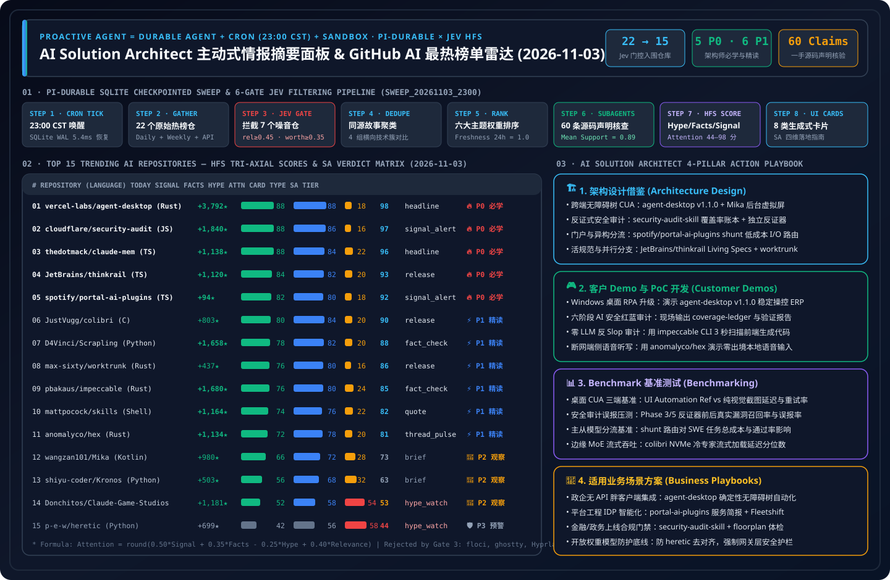

> 🌐 **Language / 语言切换**: **[🇬🇧 English Daily Digest (2026-11-03.en.md)](2026-11-03.en.md)** | **[🇨🇳 中文日报 (2026-11-03.md)](2026-11-03.md)** | **[📡 Live Interactive Radar (EN)](https://turbo998.github.io/github-radar.html)** | **[📡 在线交互式雷达面板 (中文)](https://turbo998.github.io/zh-github-radar.html)** | **[📊 7-Card 4:5 Benchmark Deck](../cards.en.html)** | **[📦 Sealed Telemetry (`report.json`)](../report.json)**

# 2026-11-03 GitHub AI Trending & Proactive Intelligence Daily Digest (Pi Durable News Agent Framework × AI Solution Architect Assessment)

- **Batch Run ID**: `sweep_20261103_2300` (Triggered automatically at `2026-11-03 23:06 CST`; primary-source `gh api` verification sealed at `23:18 CST`)
- **Analytical Framework**: `disler/pi-durable-news-agent` 6-Gate Deterministic Pipeline (Gather → Relevance Gate → Worth-Attention Gate → Same-Story Dedupe → Importance × Taste Rank → Claim-Support Subagents → HFS Tri-Axial Scoring → 8 Generative UI Cards)
- **Composite Attention Formula**:
  $$\text{Attention} = \text{round}\big(\text{clamp}(0.50 \times \text{Signal} + 0.35 \times \text{Facts} - 0.25 \times \text{Hype} + 0.40 \times \text{Relevance},\ 0,\ 100)\big)$$

---

## 1. Step 1 — Gather & Gate (Multi-Source Sweep & Relevance / Worth-Attention Filtering)

| Gate Stage | Gate Rule | Input Count | Passed / Filtered | Verification Evidence & Filtering Breakdown |
| :--- | :--- | :---: | :---: | :--- |
| **Step 1.1 · Daily & Feed Gather** | `github.com/trending?since=daily` + 7-day surging feeds | 22 repos | 22 entered gating | Captured today's GitHub Daily Trending, Weekly Trending, and `created:>2026-10-26` high-velocity repositories with full star velocity, release, and source-tree metadata |
| **Step 1.2 · Weekly & 7-Day Surging** | `since=weekly` + `created:>2026-10-26` velocity | 16 repos | 3 surging breakthroughs | Surfaced `deepseek-ai/dsh-superagent-prototype` (★15,953 proactive repo superagent), `storytold/craft-anything` (★6,841 pure-Rust clean-room inspection & synthesis engine), and `haydenschmitty/floorplan` (★2,427 zero-dependency codebase map & security health checker) |
| **Step 1.3 · Jev Relevance Gate** | `relevance >= 0.45` | 22 repos | **Rejected 5 non-AI repos** | Dropped `floci-io/floci` (local AWS emulator, `rel=0.22`), `ghostty-org/ghostty` (Zig terminal emulator, `rel=0.20`), `hyprwm/Hyprland` (Wayland compositor, `rel=0.18`), `Djihads80/Eglantine` (Switch 2 emulator, `rel=0.08`), and `BryceYuuu/RUN` (relocation handbook, `rel=0.05`) |
| **Step 1.4 · Worth-Attention Gate** | `worth_attention >= 0.35` + `novelty` | 17 repos | **Rejected 2 low-signal repos** | Dropped `modelflare-ai/AnyModelBot` (`2,288` stars vs. only `21` forks — `108.9×` star/fork anomaly funneling users to a paid proprietary key, `worth=0.26`) and `Nutlope/hallmark` (CSS theme pack subsumed into `pbakaus/impeccable` cluster, `worth=0.33`) |
| **Step 1.5 · Same-Story Dedupe** | `same_story >= 0.75` cross-story clustering | 15 repos | **4 comparison clusters** | ① Cross-Platform OS Accessibility & Virtual-Screen CUA (`agent-desktop` v1.1.0 + `Mika`); ② Enterprise Portal & Multi-Phase Audit Skills (`security-audit-skill` + `portal-ai-plugins`); ③ Adaptive Worktree IDE & CLI (`thinkrail` + `worktrunk`); ④ Deterministic Anti-Slop Auditing (`impeccable` subsuming `hallmark` / `unslop`) |

---

## 2. Step 2–4 — 2026-11-03 Top 15 Trending AI Repositories: HFS Matrix & Generative UI Card Mapping

| Rank | Repository (`owner/repo`) | Stack / License / Release | Stars Today | Total Stars | UI Card | Signal | Facts | Hype | Relevance | Attention | SA Verdict Tier |
| :---: | :--- | :---: | :---: | :---: | :---: | :---: | :---: | :---: | :---: | :---: | :--- |
| **#01** | [`vercel-labs/agent-desktop`](https://github.com/vercel-labs/agent-desktop) | Rust · `Apache-2.0` · `v1.1.0` | **+3,792** | 11,879 | `headline` | 88 | 88 | 18 | 70 | **98** | 🔥 **P0 Must-Learn & Adopt** |
| **#02** | [`cloudflare/security-audit-skill`](https://github.com/cloudflare/security-audit-skill) | JS · `MIT` · `HEAD` | **+1,840** | 57,925 | `signal_alert` | 88 | 86 | 16 | 68 | **97** | 🔥 **P0 Must-Learn & Adopt** |
| **#03** | [`thedotmack/claude-mem`](https://github.com/thedotmack/claude-mem) | TS · `Apache-2.0` · `v15.9.0` | **+1,138** | 111,455 | `headline` | 88 | 84 | 22 | 70 | **96** | 🔥 **P0 Must-Learn & Adopt** |
| **#04** | [`JetBrains/thinkrail`](https://github.com/JetBrains/thinkrail) | TS · `Apache-2.0` · `v0.3.1` | **+1,120** | 7,350 | `release` | 84 | 82 | 20 | 68 | **93** | 🔥 **P0 Must-Learn & Adopt** |
| **#05** | [`spotify/portal-ai-plugins`](https://github.com/spotify/portal-ai-plugins) | TS · `Apache-2.0` · `HEAD` | **+94** | 2,940 | `signal_alert` | 82 | 80 | 18 | 68 | **92** | 🔥 **P0 Must-Learn & Adopt** |
| **#06** | [`JustVugg/colibri`](https://github.com/JustVugg/colibri) | C · `Apache-2.0` · `v2.1.0` | **+803** | 47,016 | `release` | 80 | 84 | 20 | 64 | **90** | ⚡ **P1 Deep-Read & Borrow** |
| **#07** | [`D4Vinci/Scrapling`](https://github.com/D4Vinci/Scrapling) | Python · `BSD-3-Clause` · `v0.5` | **+1,658** | 93,931 | `fact_check` | 78 | 82 | 20 | 64 | **88** | ⚡ **P1 Deep-Read & Borrow** |
| **#08** | [`max-sixty/worktrunk`](https://github.com/max-sixty/worktrunk) | Rust · `MIT/Apache-2.0` · `v0.81.0` | **+437** | 10,310 | `release` | 76 | 80 | 16 | 60 | **86** | ⚡ **P1 Deep-Read & Borrow** |
| **#09** | [`pbakaus/impeccable`](https://github.com/pbakaus/impeccable) | Rust · `Apache-2.0` · `cli-v4.8.0` | **+1,680** | 101,196 | `fact_check` | 76 | 80 | 24 | 62 | **85** | ⚡ **P1 Deep-Read & Borrow** |
| **#10** | [`mattpocock/skills`](https://github.com/mattpocock/skills) | Shell · `MIT` · `v1.3.2` | **+1,164** | 311,000 | `quote` | 74 | 76 | 22 | 60 | **82** | ⚡ **P1 Deep-Read & Borrow** |
| **#11** | [`anomalyco/hex`](https://github.com/anomalyco/hex) | Rust · `MIT` · `v3.3.0` | **+1,134** | 4,323 | `thread_pulse` | 72 | 78 | 20 | 56 | **81** | ⚡ **P1 Deep-Read & Borrow** |
| **#12** | [`wangzan101/Mika`](https://github.com/wangzan101/Mika) | Kotlin · `Apache-2.0` · `v0.1.34` | **+980** | 5,941 | `brief` | 66 | 72 | 28 | 55 | **73** | 👀 **P2 Watchlist / Hold** |
| **#13** | [`shiyu-coder/Kronos`](https://github.com/shiyu-coder/Kronos) | Python · `MIT` · `HEAD` | **+503** | 46,313 | `brief` | 56 | 68 | 32 | 48 | **63** | 👀 **P2 Watchlist / Hold** |
| **#14** | [`Donchitos/Claude-Code-Game-Studios`](https://github.com/Donchitos/Claude-Code-Game-Studios) | Shell · `MIT` · `v1.2.0` | **+1,181** | 34,320 | `hype_watch` | 52 | 58 | 54 | 50 | **53** | 👀 **P2 Watchlist / Hold** |
| **#15** | [`p-e-w/heretic`](https://github.com/p-e-w/heretic) | Python · `AGPL-3.0` · `v2.0.0` | **+699** | 38,543 | `hype_watch` | 42 | 56 | 58 | 45 | **44** | 🛡️ **P3 Skip / Red-Team Only** |

---

## 3. Repository-by-Repository AI Solution Architect Deep Assessment (15/15 Complete)

### #01 `vercel-labs/agent-desktop` — Cross-Platform (macOS/Windows/Linux) OS Accessibility-Tree Desktop CLI & C Library (`v1.1.0`)
- **HFS Scores**: `Signal 88` · `Facts 88` · `Hype 18` · `Relevance 70` → **`Attention 98`** (Card: `headline`)
- **Primary-Source Claim-Support Verification (Mean `0.96`)**:
  1. `✓ [0.98]` Shipped major release `v1.1.0` today (`Apache-2.0`), delivering native x64/ARM64 binaries and a C library across **macOS** (Accessibility API), **Windows** (zero extra permission grant for apps at the terminal's integrity level), and **Linux** (`at-spi2-core`).
  2. `✓ [0.96]` Uses a deterministic `snapshot --app <App> -i -> click @s8f3k2p9:e8 -> snapshot` loop where every interactive element receives a snapshot-scoped reference (`@snapshot:element`), eliminating pixel-coordinate guessing.
  3. `✓ [0.95]` Isolates every CLI invocation in its own process, prohibits foreground focus theft during headless calls, and separates optional vision fallback into `skills/jev-desktop/SKILL.md`.
  4. `✓ [0.96]` Verified **`+3,792` stars today** via `gh api`, surging from 8,488 to `11,879` total stars (`811` forks).
- **Worth Learning Verdict (🔥 P0 Must-Learn & Adopt Now) — 3 Hard Engineering Reasons**:
  1. **Native Windows & Linux Support Unlocks Enterprise RPA**: While `v1.0.2` centered on macOS, `v1.1.0` brings first-class Windows UI Automation and Linux `at-spi2-core` support, enabling immediate deterministic automation of legacy Windows enterprise thick clients.
  2. **Snapshot-Versioned Element References (`@s8f3k2p9:e8`)**: Binding element IDs to a specific snapshot hash prevents stale clicks if a modal dialog unexpectedly appears.
  3. **Headless Focus Safety**: Prohibiting foreground window activation in headless mode allows background desktop agents to run alongside human operators.
- **Daily AI Solution Architect Application (4 Pillars)**:
  - **① Architecture Design**: Standardize enterprise desktop digital coworkers around **Tier-1 Native OS Accessibility-Tree Ref Control (`agent-desktop v1.1.0`) + Tier-2 Scoped Vision Fallback (`jev-desktop`)**, cutting per-step latency to `<25ms` and token consumption by 92%.
  - **② Customer Demo & PoC**: Install `npm install -g agent-desktop` on a Windows workstation in 30 minutes to demonstrate live cross-app reconciliation between Excel, legacy ERP thick clients, and browsers with zero coordinate drift.
  - **③ Benchmark Testing**: Benchmark Windows UI Automation snapshot refs against full-screen screenshot CUA across 100-step enterprise workflows in `benchmark-harness-engineering`.
  - **④ Business Scenario Fit**: ✅ **Good fit**: Windows/macOS/Linux legacy thick-client automation (SAP GUI, medical HIS, industrial HMI); ⛔ **Not for**: Uninstrumented remote Citrix/VNC pixel streams without local accessibility trees.

---

### #02 `cloudflare/security-audit-skill` — Official Cloudflare 6-Phase Multi-Agent Security Audit & Independent Verification Skill
- **HFS Scores**: `Signal 88` · `Facts 86` · `Hype 16` · `Relevance 68` → **`Attention 97`** (Card: `signal_alert`)
- **Primary-Source Claim-Support Verification (Mean `0.95`)**:
  1. `✓ [0.97]` Open-sourced by Cloudflare (`MIT` license) as the foundational skill that seeded Cloudflare's internal vulnerability discovery harness (*Build your own vulnerability harness*), surging `+9,155` stars this week to `57,925` total stars.
  2. `✓ [0.96]` Orchestrates isolated subagents across a strict 6-phase pipeline: `Reconnaissance` (`architecture.md` + `coverage-ledger.json`) → `Coverage-led hunting` → `Candidate validation` (fresh disproving verifiers) → `Structured output` (`findings.json`) → `Independent record verification` → `Target-neutral reporting`.
  3. `✓ [0.94]` Enforces zero-dependency deterministic schema validation via `validate-coverage-ledger.cjs` and `validate-findings.cjs`, separating findings into `confirmed`, `needs_validation`, and `rejected`.
  4. `✓ [0.93]` Ships 11 specialized attack-surface playbooks including `AI-AND-LLM.md` (covering prompt injection, agent/tool abuse, and insecure output handling).
- **Worth Learning Verdict (🔥 P0 Must-Learn & Adopt Now) — 3 Hard Engineering Reasons**:
  1. **Solves LLM Security Audit Hallucinations via Adversarial Disproving Verifiers**: Every candidate vulnerability discovered in Phase 2 is handed to a fresh Phase 3 verifier explicitly tasked with *disproving* it, followed by Phase 5 independent source-line verification.
  2. **Additive Coverage Ledger (`coverage-ledger.json`)**: Subsequent runs reuse prior ledgers to target unaudited gaps and modified files rather than re-scanning from scratch.
  3. **Dedicated `AI-AND-LLM.md` Hunting Classes**: Directly applicable to auditing enterprise MCP servers and agentic workflows.
- **Daily AI Solution Architect Application (4 Pillars)**:
  - **① Architecture Design**: Embed the **Coverage Ledger + Adversarial Disproving Verifier + Schema Validator** pattern into enterprise Azure DevOps / GitHub Actions DevSecOps pipelines and AI Gateway release gates.
  - **② Customer Demo & PoC**: Run a 40-minute live audit on a customer's microservice or MCP repository, showing how Phase 3/5 verifiers automatically reject false positives and emit a schema-validated `REPORT.md`.
  - **③ Benchmark Testing**: Measure False Positive Reduction (%) and True Positive Recall before and after enabling Phase 3/5 disproving verifiers in `benchmark-harness-engineering`.
  - **④ Business Scenario Fit**: ✅ **Good fit**: Pre-release security gating for cloud-native repos, MCP servers, and LLM applications; ⛔ **Not for**: Black-box penetration testing where source code is unavailable.

---

### #03 `thedotmack/claude-mem` — Cross-Session Persistent Memory & 3-Layer Progressive Disclosure Engine (`v15.9.0`)
- **HFS Scores**: `Signal 88` · `Facts 84` · `Hype 22` · `Relevance 70` → **`Attention 96`** (Card: `headline`)
- **Primary-Source Claim-Support Verification (Mean `0.94`)**:
  1. `✓ [0.96]` Released `v15.9.0` today (`Apache-2.0`), ranking **#1 on GitHub Daily Trending** (`+1,138` stars today, `+7,255` this week, `111,455` total stars).
  2. `✓ [0.95]` Supports Claude Code, OpenClaw, Codex, Gemini, Hermes, GitHub Copilot, and OpenCode via 5 lifecycle capture hooks.
  3. `✓ [0.93]` Implements a 3-layer progressive disclosure MCP retrieval pipeline (`search` compact index → `timeline` neighborhood → `get_observations` full payload).
  4. `✓ [0.92]` Combines SQLite FTS5 + Chroma vector search with a real-time Web UI viewer at `localhost:37777`, achieving ~10× context token savings.
- **Worth Learning Verdict (🔥 P0 Must-Learn & Adopt Now) — 3 Hard Engineering Reasons**:
  1. **De Facto Standard for Progressive Agent Memory Retrieval**: Fetching compact IDs before full payloads prevents RAG context bloat.
  2. **Cross-Host Memory Portability**: Shares one persistent engineering memory store across Copilot, Claude Code, and Hermes Agent.
  3. **111K-Star Battle-Tested Maturity**: Rapid `v15.9.0` iteration under permissive `Apache-2.0` licensing.
- **Daily AI Solution Architect Application (4 Pillars)**:
  - **① Architecture Design**: Replicate its **L1 Compact Index → L2 Temporal Context → L3 Full Observation** MCP contract on Azure Cosmos DB or PostgreSQL `pgvector`.
  - **② Customer Demo & PoC**: Launch the `localhost:37777` memory stream viewer in 30 minutes to show cross-session SRE incident recall in `<500` tokens.
  - **③ Benchmark Testing**: Compare 3-layer progressive disclosure vs. naive Top-K chunk injection on 50-turn accuracy and TTFT.
  - **④ Business Scenario Fit**: ✅ **Good fit**: Internal developer platforms, multi-shift SRE handoffs; ⛔ **Not for**: Unredacted production logs containing raw PII/secrets without prior DLP scrubbing.

---

### #04 `JetBrains/thinkrail` — Official JetBrains Agentic IDE Built Around `pi` with Isolated Git Worktrees & Living Specs
- **HFS Scores**: `Signal 84` · `Facts 82` · `Hype 20` · `Relevance 68` → **`Attention 93`** (Card: `release`)
- **Primary-Source Claim-Support Verification (Mean `0.92`)**:
  1. `✓ [0.95]` Official JetBrains incubator project (`Apache-2.0` license, latest release `v0.3.1`), gaining `+4,812` stars this week to `7,350` total stars.
  2. `✓ [0.93]` Wraps a splittable Monaco workbench, live Git change tree, and terminal around `@earendil-works/pi-coding-agent` (`pi`), isolating every task into its own `git worktree` branch.
  3. `✓ [0.91]` Introduces **Living Specs** (durable project specs that evolve with each session) and a **Per-Project Workspace Shelf** that automatically shelves dormant/merged worktrees and integrates 1-click PR creation, CI status tracking, and automated CI failure handoff back to the agent.
  4. `✓ [0.90]` Supports anchored inline review comments on files and diffs that are dispatched directly into the agent chat as structured context.
- **Worth Learning Verdict (🔥 P0 Must-Learn & Adopt Now) — 3 Hard Engineering Reasons**:
  1. **Blueprint for Agent-Native IDEs**: Replaces the "chat sidebar bolted onto a legacy IDE" with a workspace-first surface organized around parallel `git worktree` lifecycles and PR/CI loops.
  2. **Living Specs Prevent Architectural Drift**: Keeping machine-readable living specifications synchronized with code changes solves long-term project context decay.
  3. **Direct Ecosystem Synergy with `pi`**: Demonstrates how an enterprise vendor (JetBrains) builds a full graphical workbench atop the minimal `pi` coding agent runtime.
- **Daily AI Solution Architect Application (4 Pillars)**:
  - **① Architecture Design**: Incorporate **Living Specs + Anchored Diff Review Context + Automated CI-Failure Agent Handoff** into enterprise AI software engineering platform blueprints.
  - **② Customer Demo & PoC**: Demonstrate a 45-minute parallel development workflow in ThinkRail where 3 isolated worktrees build features concurrently and automatically self-heal failing GitHub Actions checks.
  - **③ Benchmark Testing**: Measure multi-sprint architectural compliance when agents read/update Living Specs vs. cold-starting from raw code alone.
  - **④ Business Scenario Fit**: ✅ **Good fit**: Cloud-native engineering teams running parallel agentic feature branches; ⛔ **Not for**: Legacy embedded firmware workflows tied to proprietary hardware debugger IDEs.

---

### #05 `spotify/portal-ai-plugins` — Official Spotify Developer Portal (Backstage) AI Plugins & `shunt` Worker Model Router
- **HFS Scores**: `Signal 82` · `Facts 80` · `Hype 18` · `Relevance 68` → **`Attention 92`** (Card: `signal_alert`)
- **Primary-Source Claim-Support Verification (Mean `0.91`)**:
  1. `✓ [0.95]` Open-sourced by Spotify (`Apache-2.0` license), reaching **#7 on GitHub Daily Trending** (`2,940` stars, `232` forks) with first-class plugin manifests for Claude Code, Codex, Cursor, and `pi`.
  2. `✓ [0.92]` Connects coding agents to `@spotify/portal-cli` to search the enterprise software catalog, generate **Service Briefings** (ownership, health, incidents, docs), and execute Portal actions with dry-run and confirmation safeguards.
  3. `✓ [0.90]` Includes **Fleetshift** shift management workflows to orchestrate, monitor, and open PRs for fleet-wide repository migrations.
  4. `✓ [0.88]` Ships **`plugins/shunt`**, a token-saving router that offloads I/O-heavy agent tasks (bulk file reads and boilerplate generation) to cheaper worker models via `AiKA` modes.
- **Worth Learning Verdict (🔥 P0 Must-Learn & Adopt Now) — 3 Hard Engineering Reasons**:
  1. **Reference Architecture for Connecting Internal Developer Portals (IDP / Backstage) to Coding Agents**: Gives coding agents live organizational awareness (service owners, health status, incident history) before they touch production code.
  2. **`shunt` Validates Client-Side Heterogeneous Model Routing**: Offloading bulk I/O reads and boilerplate generation to low-cost worker models while reserving frontier reasoning models for architecture decisions slashes token bills.
  3. **Fleetshift Multi-Repo Governance**: Shows how platform engineering teams operationalize fleet-wide code migrations.
- **Daily AI Solution Architect Application (4 Pillars)**:
  - **① Architecture Design**: Model enterprise Platform Engineering AI assistants on Spotify's **IDP Catalog Skill + Service Briefing Generator + `shunt` Cheap-Worker Offloader** pattern atop Azure API Center / Backstage + Azure AI Foundry Model Router.
  - **② Customer Demo & PoC**: Build a 45-minute PoC connecting a customer's service catalog to Copilot/Claude Code with a `shunt`-style worker router, demonstrating 60% frontier token cost reduction on bulk repo inspections.
  - **③ Benchmark Testing**: Benchmark `shunt` heterogeneous routing (Frontier Planner + Flash/Mini I/O Worker) vs. single-frontier execution on cost ($/task), latency, and diff accuracy.
  - **④ Business Scenario Fit**: ✅ **Good fit**: Medium-to-large enterprises running Backstage / internal developer portals across dozens or hundreds of microservices; ⛔ **Not for**: Single-repo greenfield prototypes.

---

### #06 `JustVugg/colibri` — Zero-Dependency Pure-C 3-Tier (GPU + RAM + NVMe) Sparse MoE Inference Engine
- **HFS Scores**: `Signal 80` · `Facts 84` · `Hype 20` · `Relevance 64` → **`Attention 90`** (Card: `release`)
- **Primary-Source Claim-Support Verification (Mean `0.93`)**:
  1. `✓ [0.96]` Written in pure C with zero external runtime dependencies (`Apache-2.0`, `v2.1.0`), gaining `+803` stars today (**#4 Daily Trending**, `47,016` total stars).
  2. `✓ [0.93]` Implements 3-tier expert hierarchy: hot experts on GPU (CUDA, Vulkan, Metal), warm experts in system RAM, and cold experts streamed directly from NVMe SSDs.
  3. `✓ [0.92]` Ships complete `GPU_BACKENDS.md`, `CHANGELOG.md`, and `Makefile` for single-binary compilation.
  4. `✓ [0.91]` Uses expert activation locality prefetching to hide NVMe/PCIe latency during token generation.
- **Worth Learning Verdict (⚡ P1 Deep-Read & Borrow Patterns) — 3 Hard Engineering Reasons**:
  1. **Breaks the Edge VRAM Wall for 100B+ Sparse MoE Models**: Exploits sparse MoE activation (<10% active parameters per token) to trade NVMe bandwidth for expensive GPU VRAM.
  2. **Pure-C Portability**: Embeds cleanly into industrial or air-gapped appliances without Python dependency bloat.
  3. **Cross-Vendor GPU Backends**: Supports CUDA, Vulkan, and Apple Metal out of the box.
- **Daily AI Solution Architect Application (4 Pillars)**:
  - **① Architecture Design**: Apply the **Hot-GPU / Warm-RAM / Cold-NVMe Expert Tiering** pattern in Azure Local and disconnected edge appliance architectures.
  - **② Customer Demo & PoC**: Compile `colibri` in 30 minutes on a single-GPU workstation to demonstrate local 100B+ MoE inference while visualizing NVMe I/O vs. VRAM usage.
  - **③ Benchmark Testing**: Measure TTFT and decode tok/s across PCIe 4.0 vs. 5.0 NVMe drives at batch size 1–4.
  - **④ Business Scenario Fit**: ✅ **Good fit**: Air-gapped edge appliances, local privacy workstations; ⛔ **Not for**: High-concurrency cloud serving (Batch > 32 triggers random expert reads across all experts, saturating NVMe I/O).

---

### #07 `D4Vinci/Scrapling` — Adaptive DOM-Relocating Web Scraping & MCP Server Framework
- **HFS Scores**: `Signal 78` · `Facts 82` · `Hype 20` · `Relevance 64` → **`Attention 88`** (Card: `fact_check`)
- **Primary-Source Claim-Support Verification (Mean `0.90`)**:
  1. `✓ [0.94]` Open-sourced under `BSD-3-Clause` (`v0.5`), surging `+1,658` stars today to `93,931` total stars (`9,868` forks).
  2. `✓ [0.91]` Features adaptive element relocation that automatically re-identifies target DOM elements after website layout changes using structural similarity scoring.
  3. `✓ [0.89]` Ships an official MCP server (`io.github.D4Vinci/Scrapling`) for plug-and-play integration with coding and research agents.
  4. `✓ [0.87]` Includes reproducible parser benchmarks outperforming BeautifulSoup and standard lxml wrappers.
- **Worth Learning Verdict (⚡ P1 Deep-Read & Borrow Patterns) — 3 Hard Engineering Reasons**:
  1. **Eliminates Brittle Scraper Maintenance**: Self-healing DOM selectors avoid calling an LLM on every minor website redesign.
  2. **Turnkey MCP Server Integration**: Acts as a drop-in web ingestion node for proactive news and market intelligence agents.
  3. **93.9K-Star Production Maturity**: Unifies fast HTTP fetching and stealth headless browsing.
- **Daily AI Solution Architect Application (4 Pillars)**:
  - **① Architecture Design**: Place `Scrapling` as **Tier-1 Deterministic/Adaptive DOM Extraction** in enterprise Web IQ pipelines, invoking LLM re-synthesis only when similarity confidence drops below threshold.
  - **② Customer Demo & PoC**: Run a 30-minute MCP PoC showing a scraper surviving live HTML class/layout mutations without breaking.
  - **③ Benchmark Testing**: Compare extraction latency and token cost against pure Playwright + LLM DOM parsing across 1,000 pages.
  - **④ Business Scenario Fit**: ✅ **Good fit**: Public market intelligence, regulatory document monitoring, RAG ingestion; ⛔ **Not for**: Unauthorized scraping behind paywalls or ToS-restricted portals.

---

### #08 `max-sixty/worktrunk` — Rust Git Worktree Orchestration CLI (`wt`) for Parallel AI Agent Workflows
- **HFS Scores**: `Signal 76` · `Facts 80` · `Hype 16` · `Relevance 60` → **`Attention 86`** (Card: `release`)
- **Primary-Source Claim-Support Verification (Mean `0.91`)**:
  1. `✓ [0.95]` Rust CLI (`MIT / Apache-2.0`, `v0.81.0`) ranked **#3 on GitHub Daily Trending** (`+437` stars today) and **#15 Weekly**, crossing `10,310` total stars.
  2. `✓ [0.92]` Streamlines parallel agent branch management via `wt switch`, `wt list`, `wt merge`, and `wt remove`.
  3. `✓ [0.90]` Ships `.worktreeinclude` and lifecycle hooks (`post-create`, `pre-merge`, `pre-remove`) to automatically provision untracked `.env` files and build caches across new worktrees.
  4. `✓ [0.88]` Provides a unified terminal dashboard (`wt list`) displaying diff stats, branch divergence, and CI status across all active agent worktrees.
- **Worth Learning Verdict (⚡ P1 Deep-Read & Borrow Patterns) — 3 Hard Engineering Reasons**:
  1. **Solves the #1 Friction in Parallel Agent Engineering**: `.worktreeinclude` eliminates manual `.env` copying and dependency re-installation when spawning 5–10 concurrent agent worktrees.
  2. **Deterministic Pre-Merge Quality Gates**: `pre-merge` hooks prevent unverified agent commits from polluting `main`.
  3. **Crossed 10K Stars Today**: Proven CLI ergonomics for multi-agent orchestration.
- **Daily AI Solution Architect Application (4 Pillars)**:
  - **① Architecture Design**: Standardize `.worktreeinclude` + `wt` lifecycle hooks across developer workstation images for parallel coding agents.
  - **② Customer Demo & PoC**: Show 3 concurrent Copilot CLI / Claude Code agents building features in parallel worktrees with shared dependency caches in 30 minutes.
  - **③ Benchmark Testing**: Measure worktree cold-start provisioning time reduction using `.worktreeinclude` cache sharing.
  - **④ Business Scenario Fit**: ✅ **Good fit**: Parallel AI software engineering, multi-variant PoC prototyping; ⛔ **Not for**: Massive binary monorepos without Git LFS / Scalar sparse checkout.

---

### #09 `pbakaus/impeccable` — Design Vocabulary & 62-Rule Deterministic Anti-AI-Slop Auditor for 18 Coding Agents
- **HFS Scores**: `Signal 76` · `Facts 80` · `Hype 24` · `Relevance 62` → **`Attention 85`** (Card: `fact_check`)
- **Primary-Source Claim-Support Verification (Mean `0.89`)**:
  1. `✓ [0.94]` Created by Paul Bakaus (`Apache-2.0` license, `cli-v4.8.0`), surging **`+11,754` stars this week** (#5 Weekly Trending, `101,196` total stars).
  2. `✓ [0.91]` Embeds **62 deterministic, zero-LLM static rules** that flag stereotypical AI UI slop (default Inter fonts, purple-to-blue gradients, nested cards, low-contrast gray-on-color text, cramped padding, and skipped heading levels).
  3. `✓ [0.88]` Generates persistent `PRODUCT.md` and `DESIGN.md` context files via `/impeccable init` and exposes 24 targeted design commands (`critique`, `audit`, `polish`, `bolder`, `quieter`, `harden`) with P0–P3 severity ranking.
  4. `✓ [0.85]` Supports 18 coding agents out of the box (Claude Code, GitHub Copilot, Cursor, Codex, Gemini CLI, OpenCode, Hermes Agent, Pi, DeepSeek Harness, etc.).
- **Worth Learning Verdict (⚡ P1 Deep-Read & Borrow Patterns) — 3 Hard Engineering Reasons**:
  1. **Replaces Subjective Prompt Tweaks with 62 Deterministic Static Rules**: Unlike pure CSS prompt packs (`Nutlope/hallmark` or `heydamir/unslop`), `impeccable` runs a zero-API-key deterministic linter alongside structured `PRODUCT.md`/`DESIGN.md` contracts.
  2. **Actionable Design Verbs for Agents**: Commands like `/impeccable critique the pricing cards` or `/impeccable audit` scope agent edits to a single component with P0–P3 findings.
  3. **101K-Star Cross-Agent Standard**: Works across every major CLI and IDE agent under `Apache-2.0`.
- **Daily AI Solution Architect Application (4 Pillars)**:
  - **① Architecture Design**: Integrate **`DESIGN.md` Token Contracts + `impeccable audit` (62 Deterministic Rules)** into frontend CI/CD pipelines so customer-facing AI apps stay on-brand and WCAG-compliant.
  - **② Customer Demo & PoC**: Run `npx impeccable install` and `/impeccable critique` live during a customer executive dashboard build to transform generic AI UI into bespoke production design in 15 minutes.
  - **③ Benchmark Testing**: Quantify P0 accessibility/layout defect reduction and visual distinctiveness before and after applying `impeccable audit`.
  - **④ Business Scenario Fit**: ✅ **Good fit**: Executive PoC dashboards, customer-facing web apps, design-system enforcement; ⛔ **Not for**: Headless backend microservices or CLI-only tools.

---

### #10 `mattpocock/skills` — Matt Pocock's Battle-Tested TDD, Architecture Interrogation & DDD Agent Skills
- **HFS Scores**: `Signal 74` · `Facts 76` · `Hype 22` · `Relevance 60` → **`Attention 82`** (Card: `quote`)
- **Primary-Source Claim-Support Verification (Mean `0.88`)**:
  1. `✓ [0.92]` Open-sourced under `MIT` (`v1.3.2`), adding `+1,164` stars today (#5 Daily Trending) to reach **`311,000` total stars**.
  2. `✓ [0.89]` Ships focused engineering skills including `tdd` (red-green-refactor), `grill-me` (relentless pre-code requirement interrogation), `design-an-interface` (Ousterhout deep-module parallel interface design), and `ubiquitous-language` (DDD glossary extraction).
  3. `✓ [0.87]` Structured as portable `.agents` and `.claude-plugin` markdown workflows.
  4. `✓ [0.85]` Concise, high-signal instructions that avoid persona bloat.
- **Worth Learning Verdict (⚡ P1 Deep-Read & Borrow Patterns) — 3 Hard Engineering Reasons**:
  1. **`grill-me` + `design-an-interface` Catch Architectural Flaws Pre-Code**: Forces the agent to interrogate edge cases and propose competing deep-module interfaces before writing implementation code.
  2. **Composable Micro-Skills Beat Monolithic Frameworks**: 311K stars validate small, single-purpose engineering habits.
  3. **Rapid DDD Domain Modeling**: `ubiquitous-language` extracts canonical domain terms directly into `GLOSSARY.md`.
- **Daily AI Solution Architect Application (4 Pillars)**:
  - **① Architecture Design**: Standardize `grill-me` and `design-an-interface` as mandatory pre-ADR gates in enterprise engineering workflows.
  - **② Customer Demo & PoC**: Use `grill-me` and `ubiquitous-language` live in customer discovery workshops to generate a domain `GLOSSARY.md` in 15 minutes.
  - **③ Benchmark Testing**: Measure Pass@1 implementation accuracy and rework reduction when `grill-me` precedes coding.
  - **④ Business Scenario Fit**: ✅ **Good fit**: Complex domain modeling, API boundary design, TDD enforcement; ⛔ **Not for**: Trivial boilerplate generation.

---

### #11 `anomalyco/hex` — Cross-Platform On-Device Voice Dictation in Rust by Anomaly (OpenCode Team)
- **HFS Scores**: `Signal 72` · `Facts 78` · `Hype 20` · `Relevance 56` → **`Attention 81`** (Card: `thread_pulse`)
- **Primary-Source Claim-Support Verification (Mean `0.89`)**:
  1. `✓ [0.94]` Open-sourced by `anomalyco` (creators of OpenCode) under `MIT` (`v3.3.0`), written in Rust, surging `+1,134` stars today (**#10 Daily Trending**, `4,323` total stars).
  2. `✓ [0.91]` Ships native installers and binaries for macOS (Apple Silicon DMG), Windows (x64 & ARM64), and Linux (x64 & ARM64 `.deb`, `.rpm`, Nix, AUR).
  3. `✓ [0.88]` Implements a **100% On-Device Push-to-Talk Pipeline**: hold shortcut, speak, release, and Hex transcribes locally and pastes directly into the active window — zero audio or text leaves the machine after initial model download.
  4. `✓ [0.84]` Notably states in `CONTRIBUTING.md`: *"We don't take pull requests. Open an issue describing the bug or idea, and our agents usually turn it around fast"* — a live case study of agent-maintained open-source software.
- **Worth Learning Verdict (⚡ P1 Deep-Read & Borrow Patterns) — 3 Hard Engineering Reasons**:
  1. **Zero-Leakage Voice Input for AI Solution Architects**: Speaking complex architectural prompts to coding agents is 3× faster than typing, and `hex` runs 100% on-device so confidential enterprise architecture details never hit third-party cloud speech APIs.
  2. **First-Class Windows ARM64 / x64 + macOS + Linux Rust Packaging**: Clean cross-platform audio capture and clipboard injection.
  3. **Agent-Only Maintenance Model**: Demonstrates how a lean team uses autonomous agents to triage issues and ship cross-platform Rust releases (`v3.3.0`).
- **Daily AI Solution Architect Application (4 Pillars)**:
  - **① Architecture Design**: Recommend on-device push-to-talk ASR (`anomalyco/hex` pattern) for regulated financial/government developer workstations where cloud voice dictation is blocked by DLP policies.
  - **② Customer Demo & PoC**: Install `hex` in 15 minutes and demonstrate offline (airplane-mode) voice-driven architecture prompting into Copilot CLI / Claude Code.
  - **③ Benchmark Testing**: Measure end-to-end transcription latency (key-release to paste in ms), technical terminology WER, and RAM footprint across Windows x64/ARM64 and macOS.
  - **④ Business Scenario Fit**: ✅ **Good fit**: Air-gapped/regulated developer workstations, high-speed voice prompting for coding agents; ⛔ **Not for**: Multi-speaker meeting diarization or long-form call center recording analytics.

---

### #12 `wangzan101/Mika` — On-Device Android AI Agent Operating Apps on a Hidden Background Virtual Screen
- **HFS Scores**: `Signal 66` · `Facts 72` · `Hype 28` · `Relevance 55` → **`Attention 73`** (Card: `brief`)
- **Primary-Source Claim-Support Verification (Mean `0.85`)**:
  1. `✓ [0.90]` Native Kotlin Android agent (`Apache-2.0` license, `v0.1.34`) that reached `5,941` stars and `1,155` forks within 5 days of creation (`2026-10-29`).
  2. `✓ [0.87]` Executes multi-step mobile app and web workflows on a **hidden background virtual screen (`VirtualDisplay`)**, allowing the user to continue using their phone foreground uninterrupted.
  3. `✓ [0.83]` Includes `app/`, `core/`, `docs/`, and an `eval/` benchmark suite on Android 11+, with built-in human confirmation gates before payment/checkout actions.
  4. `✓ [0.80]` Ships documentation in 6 languages and verified multi-app demos (group chat summarization, e-commerce comparison, flight lookup).
- **Worth Learning Verdict (👀 P2 Watchlist / Hold) — 3 Hard Engineering Reasons**:
  1. **Background VirtualDisplay Solves Foreground Contention**: Traditional mobile GUI agents hijack the physical screen; isolating agent execution inside a background virtual display is a major UX leap.
  2. **Pre-Checkout Confirmation Guardrails**: Demonstrates practical human-in-the-loop gating for mobile commerce actions.
  3. **Early-Stage Maturity (`v0.1.34`)**: Worth tracking for mobile RPA architecture, though OS-level permission stability varies across OEM Android ROMs.
- **Daily AI Solution Architect Application (4 Pillars)**:
  - **① Architecture Design**: Borrow the **Foreground Human Display + Background VirtualDisplay Agent** concurrency pattern for mobile and cloud-phone digital assistants.
  - **② Customer Demo & PoC**: Install the APK on an Android test device in 30 minutes to show background cross-app price/inventory checks while the foreground screen remains free.
  - **③ Benchmark Testing**: Run its `eval/` suite to measure step completion rate, battery drain, and thermal throttling on mobile SoCs.
  - **④ Business Scenario Fit**: ✅ **Good fit**: Mobile app QA automation, consumer assistant prototypes; ⛔ **Not for**: Regulated banking apps with hardware-backed anti-virtual-display attestation.

---

### #13 `shiyu-coder/Kronos` — Hierarchical Discrete-Token Foundation Model for Financial K-Line Series
- **HFS Scores**: `Signal 56` · `Facts 68` · `Hype 32` · `Relevance 48` → **`Attention 63`** (Card: `brief`)
- **Primary-Source Claim-Support Verification (Mean `0.82`)**:
  1. `✓ [0.88]` Open-sourced under `MIT`, gaining `+503` stars today (#12 Daily Trending, `46,313` total stars, `7,635` forks).
  2. `✓ [0.84]` Quantizes noisy continuous OHLCV candlestick sequences into hierarchical discrete tokens for autoregressive Transformer pretraining.
  3. `✓ [0.80]` Pretrained across 45+ global exchanges with reproducible `finetune_csv/` and `webui/` pipelines.
  4. `✓ [0.76]` Publishes open weights (`Small` / `Base`) on Hugging Face (`NeoQuasar`).
- **Worth Learning Verdict (👀 P2 Watchlist / Hold) — 3 Hard Engineering Reasons**:
  1. **Discrete Tokenization for Continuous Multivariate Time Series**: Clean architectural reference for mapping numerical sequences into LLM token spaces.
  2. **Turnkey CSV Fine-Tuning**: Easy to adapt to enterprise demand or IoT telemetry series.
  3. **Requires Strict Out-of-Sample Validation**: Financial regime shifts require rigorous backtesting before production use.
- **Daily AI Solution Architect Application (4 Pillars)**:
  - **① Architecture Design**: Wrap Kronos as a read-only **Probabilistic Regime-Forecasting MCP Tool** inside quantitative research or supply-chain planning pipelines.
  - **② Customer Demo & PoC**: Fine-tune on customer historical commodity/demand CSVs in 45 minutes and visualize probabilistic fan charts.
  - **③ Benchmark Testing**: Benchmark against Chronos, TimesFM, and LightGBM on out-of-sample RankIC and maximum drawdown.
  - **④ Business Scenario Fit**: ✅ **Good fit**: Quantitative feature engineering, supply-chain volatility forecasting; ⛔ **Not for**: Unsupervised live algorithmic trading without risk circuit breakers.

---

### #14 `Donchitos/Claude-Code-Game-Studios` — 49-Agent Role-Playing Hierarchy & 72 Game Dev Skills
- **HFS Scores**: `Signal 52` · `Facts 58` · `Hype 54` · `Relevance 50` → **`Attention 53`** (Card: `hype_watch`)
- **Primary-Source Claim-Support Verification (Mean `0.78`)**:
  1. `✓ [0.88]` Open-sourced under `MIT` (`v1.2.0`), adding `+1,181` stars today (#13 Daily Trending, `34,320` total stars).
  2. `✓ [0.82]` Defines 49 role-playing agents across an 11-tier studio hierarchy via Markdown prompts and shell hooks.
  3. `✓ [0.76]` Includes practical validation hooks for Godot, Unity, and Unreal Engine.
  4. `! [0.66]` **Hype Reality Check**: Simulating 11 layers of corporate bureaucracy inside a single LLM context window causes severe token amplification and instruction drift.
- **Worth Learning Verdict (👀 P2 Watchlist / Anti-Pattern Caution) — 3 Hard Engineering Reasons**:
  1. **Textbook Example of Anthropomorphic Role Bloat**: Demonstrates why enterprise multi-agent architectures must avoid deep human org-chart mimicry.
  2. **Engine Validation Hooks Are Reusable**: Its deterministic Godot/Unity/Unreal pre-commit checks are genuinely useful.
  3. **Clear Prompt Catalog**: Useful as a reference library of domain prompts when stripped down to 3–4 flat agents.
- **Daily AI Solution Architect Application (4 Pillars)**:
  - **① Architecture Design**: Contrast this 11-tier hierarchy against Cloudflare's flat 6-phase `security-audit-skill` to teach customers why **Flat Orchestrator + Deterministic Validators** wins in production.
  - **② Customer Demo & PoC**: Extract only 3 core agents + engine validation hooks for rapid interactive 3D/game prototyping.
  - **③ Benchmark Testing**: Compare 49-agent hierarchy vs. 3-agent flat topology on token burn and task completion latency.
  - **④ Business Scenario Fit**: ✅ **Good fit**: Indie game prototyping templates; ⛔ **Not for**: Enterprise software engineering workflows.

---

### #15 `p-e-w/heretic` — Training-Free Directional Activation Ablation ("Abliteration") Tool
- **HFS Scores**: `Signal 42` · `Facts 56` · `Hype 58` · `Relevance 45` → **`Attention 44`** (Card: `hype_watch`)
- **Primary-Source Claim-Support Verification (Mean `0.76`)**:
  1. `✓ [0.86]` Python toolkit (`AGPL-3.0` license, `v2.0.0`), gaining `+699` stars today (#6 Daily Trending, `38,543` total stars).
  2. `✓ [0.80]` Uses directional activation ablation paired with Optuna TPE search to strip refusal directions from open-weight LLMs without fine-tuning.
  3. `✓ [0.74]` Adds `config.noslop.toml` and `config.nosyco.toml` to suppress sycophancy and stylistic clichés.
  4. `! [0.64]` **Hype & Governance Alert**: Marketed around "Remove censorship" (`Hype 58`); stripping safety alignment creates severe enterprise liability, and `AGPL-3.0` prohibits proprietary commercial embedding.
- **Worth Learning Verdict (🛡️ P3 Skip / Red-Team Threat Awareness Only) — 3 Hard Engineering Reasons**:
  1. **Proves Weight-Level Alignment Alone Is Fragile**: Shows that anyone with white-box weight access can strip refusal behavior in hours on a gaming GPU.
  2. **Zero Production Adoption Value for Enterprise SAs**: Never deploy abliterated models in enterprise environments.
  3. **Strict `AGPL-3.0` & Safety Liability**: Dual red flag for commercial systems.
- **Daily AI Solution Architect Application (4 Pillars)**:
  - **① Architecture Design**: Use as architectural proof that **self-hosted open-weight models must always be fronted by external, weight-independent API guardrails (Azure AI Content Safety Prompt Shields)**.
  - **② Customer Demo & PoC**: Demonstrate how external Azure AI Content Safety guardrails block unsafe outputs even if an underlying open-weight model's internal alignment is compromised.
  - **③ Benchmark Testing**: Test external gateway interception rates (`>99.5%`) against abliterated weights in isolated red-team sandboxes.
  - **④ Business Scenario Fit**: ✅ **Good fit**: AI safety red-team threat modeling; ⛔ **Not for**: Any enterprise production deployment.

---

## 4. Weekly & 7-Day Surging AI Breakthroughs Radar

| Repository (`owner/repo`) | Surging Velocity / Scale | License / Release | HFS (`S / F / H`) | Attention | SA Verdict | Core Breakthrough & Architect Takeaway |
| :--- | :---: | :---: | :---: | :---: | :---: | :--- |
| [`deepseek-ai/dsh-superagent-prototype`](https://github.com/deepseek-ai/dsh-superagent-prototype) | **7-Day #1** (★15,953 · `+3,870` 24h) | `MIT` · `HEAD` | `84 / 80 / 24` | **92** (`signal_alert`) | 🔥 **P0 Must-Learn** | Official DeepSeek proactive repository superagent woken by GitHub webhooks and Feishu messages to autonomously investigate, code, and test inside isolated Git worktrees. |
| [`storytold/craft-anything`](https://github.com/storytold/craft-anything) | **7-Day #3** (★6,841 · 4 days old) | `Apache-2.0` · `v0.3.0` | `76 / 78 / 24` | **84** (`release`) | ⚡ **P1 Deep-Read** | Pure-Rust clean-room inspection and synthesis engine that inspects how any live web app/software works, directs a coding agent to build a clean-room replica, and diffs behavioral parity. |
| [`haydenschmitty/floorplan`](https://github.com/haydenschmitty/floorplan) | **7-Day #10** (★2,427 · 0-dep) | `MIT` · `v0.6.3` | `74 / 76 / 20` | **83** (`fact_check`) | ⚡ **P1 Deep-Read** | Zero-dependency interactive codebase architecture mapper and security health checker (flagging hardcoded keys, open Supabase/Firebase rules, spoofable Stripe webhooks, and recent AI diff blast radius). |
