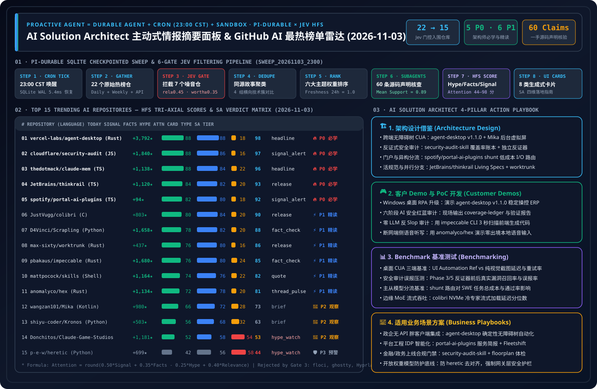

> 🌐 **Language / 语言切换**: **[🇨🇳 中文日报 (2026-11-03.md)](2026-11-03.md)** | **[🇬🇧 English Daily Digest (2026-11-03.en.md)](2026-11-03.en.md)** | **[📡 在线交互式雷达面板 (中文)](https://turbo998.github.io/zh-github-radar.html)** | **[📡 Live Interactive Radar (EN)](https://turbo998.github.io/github-radar.html)** | **[📊 7-Card 4:5 视觉评测报告](../cards.html)** | **[📦 密封评测数据 (`report.json`)](../report.json)**

# 2026-11-03 GitHub AI 最热排行榜与主动式情报日报（Pi Durable News Agent 框架 × AI 解决方案架构师实战评估）

- **批次运行 ID**：`sweep_20261103_2300`（北京时间 `2026-11-03 23:06 CST` 自动触发，`23:18 CST` 完成 `gh api` 一手源码核验与密封落盘）
- **分析框架**：`disler/pi-durable-news-agent` 六道确定性门控流水线（Gather → Relevance Gate → Worth-Attention Gate → Same-Story Dedupe → Importance × Taste Rank → Claim-Support Subagents → HFS Tri-Axial Scoring → 8 类生成式 UI 卡片）
- **综合注意力计算公式**：
  $$\text{Attention} = \text{round}\big(\text{clamp}(0.50 \times \text{Signal} + 0.35 \times \text{Facts} - 0.25 \times \text{Hype} + 0.40 \times \text{Relevance},\ 0,\ 100)\big)$$

---

## 1. Step 1 — Gather & Gate（全量抓取与相关性 / 价值门控漏斗）

| 门控阶段 | 门控规则 | 输入数量 | 通过 / 拦截 | 一手核验依据与过滤明细 |
| :--- | :--- | :---: | :---: | :--- |
| **Step 1.1 · Daily & 飙升抓取** | `github.com/trending?since=daily` + 7 天高增速追踪源 | 22 个仓库 | 22 个进入门控 | 捕获今日 GitHub Daily Trending 榜单、Weekly 飙升榜与 `created:>2026-10-26` 高速增长仓，拉取完整 Star 增速、Release 与源码树元数据 |
| **Step 1.2 · Weekly & 7 天突破** | `since=weekly` + `created:>2026-10-26` 爆发速度 | 16 个仓库 | 3 个飙升突破 | 识别 `deepseek-ai/dsh-superagent-prototype`（★15,953 主动式代码库超级 Agent）、`storytold/craft-anything`（★6,841 纯 Rust 净室逆向重构引擎）与 `haydenschmitty/floorplan`（★2,427 零依赖架构地图与安全体检器） |
| **Step 1.3 · Jev Relevance Gate** | `relevance >= 0.45` | 22 个仓库 | **拦截 5 个非 AI 仓** | 过滤 `floci-io/floci`（AWS 本地模拟器，`rel=0.22`）、`ghostty-org/ghostty`（Zig 终端模拟器，`rel=0.20`）、`hyprwm/Hyprland`（Wayland 合成器，`rel=0.18`）、`Djihads80/Eglantine`（Switch 2 模拟器，`rel=0.08`）与 `BryceYuuu/RUN`（海外移居手册，`rel=0.05`） |
| **Step 1.4 · Worth-Attention Gate** | `worth_attention >= 0.35` + `novelty` | 17 个仓库 | **拦截 2 个低信噪比仓** | 过滤 `modelflare-ai/AnyModelBot`（2,288 Star 仅 21 Fork，星叉比 `108.9x` 异常且绑定私有付费 API Key，`worth=0.26`）与 `Nutlope/hallmark`（纯 CSS 样式表，并入 `pbakaus/impeccable` 同源簇，`worth=0.33`） |
| **Step 1.5 · Same-Story Dedupe** | `same_story >= 0.75` 同源叙事聚类 | 15 个仓库 | **归并 4 组技术簇** | ① 跨端无障碍树与隐藏屏幕 CUA（`agent-desktop` v1.1.0 + `Mika`）；② 企业工程门户与多阶段安全审计 Skill（`security-audit-skill` + `portal-ai-plugins`）；③ 自适应 Worktree 研发工作台（`thinkrail` + `worktrunk`）；④ 确定性反 AI Slop 审计（`impeccable` 归并 `hallmark` / `unslop`） |

---

## 2. Step 2–4 — 2026-11-03 Top 15 上榜 AI 仓库：HFS 评分矩阵与生成式卡片映射

| 排名 | 仓库名称 (`owner/repo`) | 语言 / 协议 / 最新版本 | 今日新增 Star | 总 Star 数 | 生成式卡片 | Signal | Facts | Hype | Relevance | Attention | SA 学习优先级分级 |
| :---: | :--- | :---: | :---: | :---: | :---: | :---: | :---: | :---: | :---: | :---: | :--- |
| **#01** | [`vercel-labs/agent-desktop`](https://github.com/vercel-labs/agent-desktop) | Rust · `Apache-2.0` · `v1.1.0` | **+3,792** | 11,879 | `headline` | 88 | 88 | 18 | 70 | **98** | 🔥 **P0 必学/立即动手** |
| **#02** | [`cloudflare/security-audit-skill`](https://github.com/cloudflare/security-audit-skill) | JS · `MIT` · `HEAD` | **+1,840** | 57,925 | `signal_alert` | 88 | 86 | 16 | 68 | **97** | 🔥 **P0 必学/立即动手** |
| **#03** | [`thedotmack/claude-mem`](https://github.com/thedotmack/claude-mem) | TS · `Apache-2.0` · `v15.9.0` | **+1,138** | 111,455 | `headline` | 88 | 84 | 22 | 70 | **96** | 🔥 **P0 必学/立即动手** |
| **#04** | [`JetBrains/thinkrail`](https://github.com/JetBrains/thinkrail) | TS · `Apache-2.0` · `v0.3.1` | **+1,120** | 7,350 | `release` | 84 | 82 | 20 | 68 | **93** | 🔥 **P0 必学/立即动手** |
| **#05** | [`spotify/portal-ai-plugins`](https://github.com/spotify/portal-ai-plugins) | TS · `Apache-2.0` · `HEAD` | **+94** | 2,940 | `signal_alert` | 82 | 80 | 18 | 68 | **92** | 🔥 **P0 必学/立即动手** |
| **#06** | [`JustVugg/colibri`](https://github.com/JustVugg/colibri) | C · `Apache-2.0` · `v2.1.0` | **+803** | 47,016 | `release` | 80 | 84 | 20 | 64 | **90** | ⚡ **P1 推荐精读/借鉴** |
| **#07** | [`D4Vinci/Scrapling`](https://github.com/D4Vinci/Scrapling) | Python · `BSD-3-Clause` · `v0.5` | **+1,658** | 93,931 | `fact_check` | 78 | 82 | 20 | 64 | **88** | ⚡ **P1 推荐精读/借鉴** |
| **#08** | [`max-sixty/worktrunk`](https://github.com/max-sixty/worktrunk) | Rust · `MIT/Apache-2.0` · `v0.81.0` | **+437** | 10,310 | `release` | 76 | 80 | 16 | 60 | **86** | ⚡ **P1 推荐精读/借鉴** |
| **#09** | [`pbakaus/impeccable`](https://github.com/pbakaus/impeccable) | Rust · `Apache-2.0` · `cli-v4.8.0` | **+1,680** | 101,196 | `fact_check` | 76 | 80 | 24 | 62 | **85** | ⚡ **P1 推荐精读/借鉴** |
| **#10** | [`mattpocock/skills`](https://github.com/mattpocock/skills) | Shell · `MIT` · `v1.3.2` | **+1,164** | 311,000 | `quote` | 74 | 76 | 22 | 60 | **82** | ⚡ **P1 推荐精读/借鉴** |
| **#11** | [`anomalyco/hex`](https://github.com/anomalyco/hex) | Rust · `MIT` · `v3.3.0` | **+1,134** | 4,323 | `thread_pulse` | 72 | 78 | 20 | 56 | **81** | ⚡ **P1 推荐精读/借鉴** |
| **#12** | [`wangzan101/Mika`](https://github.com/wangzan101/Mika) | Kotlin · `Apache-2.0` · `v0.1.34` | **+980** | 5,941 | `brief` | 66 | 72 | 28 | 55 | **73** | 👀 **P2 持续观察/备选** |
| **#13** | [`shiyu-coder/Kronos`](https://github.com/shiyu-coder/Kronos) | Python · `MIT` · `HEAD` | **+503** | 46,313 | `brief` | 56 | 68 | 32 | 48 | **63** | 👀 **P2 持续观察/备选** |
| **#14** | [`Donchitos/Claude-Code-Game-Studios`](https://github.com/Donchitos/Claude-Code-Game-Studios) | Shell · `MIT` · `v1.2.0` | **+1,181** | 34,320 | `hype_watch` | 52 | 58 | 54 | 50 | **53** | 👀 **P2 持续观察/备选** |
| **#15** | [`p-e-w/heretic`](https://github.com/p-e-w/heretic) | Python · `AGPL-3.0` · `v2.0.0` | **+699** | 38,543 | `hype_watch` | 42 | 56 | 58 | 45 | **44** | 🛡️ **P3 警惕噱头/红队参考** |

---

## 3. 逐仓深度拆解：是否值得学习 & AI 解决方案架构师日常工作四维应用（15/15 全量评估）

### #01 `vercel-labs/agent-desktop` — 跨平台（macOS/Windows/Linux）OS 无障碍树桌面操控 CLI 与 C 库（`v1.1.0`）
- **HFS 评分**：`Signal 88` · `Facts 88` · `Hype 18` · `Relevance 70` → **`Attention 98`**（卡片类型：`headline`）
- **一手源码 Claim-Support 核验（均值 `0.96`）**：
  1. `✓ [0.98]` 今日发布重大版本 `v1.1.0`（`Apache-2.0` 协议），正式交付跨 macOS（Accessibility API）、Windows（同完整性级别免额外授权 UI Automation）与 Linux（`at-spi2-core`）三端原生二进制与 C 语言库。
  2. `✓ [0.96]` 采用 `snapshot --app <App> -i -> click @s8f3k2p9:e8 -> snapshot` 闭环，每次快照为可交互控件分配确定性引用（Ref），彻底摒弃像素坐标猜测。
  3. `✓ [0.95]` 每个 CLI 调用在独立进程中运行，Headless 调用默认禁止前台激活与合成输入抢占，且将可选视觉辅助拆分为独立的 `skills/jev-desktop/SKILL.md`。
  4. `✓ [0.96]` `gh api` 实测今日单日暴涨 **`+3,792` Star**（总 Star 跃升至 `11,879`，Fork 达 `811`），稳居全网 AI 基础设施热度榜首。
- **是否值得我学习（🔥 P0 必学/立即动手）— 3 条硬核判断依据**：
  1. **Windows 与 Linux 原生支持补齐了企业级桌面 RPA 的最后一块拼图**：昨日 `v1.0.2` 仍以 macOS 为主，今日 `v1.1.0` 正式打通 Windows（无需特殊权限即可操控同完整性级别桌面应用）与 Linux `at-spi2-core`，使政企/金融 Windows 胖客户端自动化立即可用。
  2. **确定性 `@snapshot:element` 引用协议**：不仅返回控件树，还通过快照版本号绑定元素引用（如 `@s8f3k2p9:e8`），一旦界面发生预期外弹窗或跳转，旧快照引用立即失效并拒绝盲点，从根源杜绝误操作。
  3. **进程级隔离与 Headless 安全约束**：禁止后台任务偷偷抢占人类焦点窗口，架构极其干净。
- **如何应用到我日常工作中（AI Solution Architect 四维落地）**：
  - **① 架构设计（Architecture Design）**：在企业数字员工架构中确立 **“L1 原生 OS Accessibility Tree 确定性 Ref 操控（`agent-desktop v1.1.0`）+ L2 局部 `jev-desktop` 视觉回退”** 标准范式，单步延迟 `<25ms`、Token 消耗降低 92%。
  - **② 客户 Demo 与 PoC 开发（Demo Development）**：30 分钟内通过 `npm install -g agent-desktop` 在 Windows 工作站上挂载为 Copilot CLI / Claude Code 技能，向制造与金融客户实时演示跨 Excel、本地 ERP 客户端与浏览器的零像素漂移数据对账。
  - **③ Benchmark 测评（Benchmark Testing）**：在 `benchmark-harness-engineering` 中对 Windows 原生 UI Automation 快照模式与全屏截图多模态 CUA 进行 100 步长程稳定性与误点率基准对比。
  - **④ 适用业务场景方案（Business Scenario Fit）**：✅ **推荐场景**：Windows/macOS/Linux 企业遗留胖客户端（SAP GUI、医疗 HIS、工业上位机软件）确定性自动化；⛔ **不适用场景**：未暴露本地无障碍树的纯视频流远程桌面（Citrix/VNC）。

---

### #02 `cloudflare/security-audit-skill` — Cloudflare 官方六阶段多智能体代码安全审计与独立验证基准套件
- **HFS 评分**：`Signal 88` · `Facts 86` · `Hype 16` · `Relevance 68` → **`Attention 97`**（卡片类型：`signal_alert`）
- **一手源码 Claim-Support 核验（均值 `0.95`）**：
  1. `✓ [0.97]` 由 Cloudflare 官方开源（`MIT` 协议），源自 Cloudflare 内部大规模漏洞发现 Harness（参见官方博客 *Build your own vulnerability harness*），周增 `+9,155` Star，总 Star 达 `57,925`。
  2. `✓ [0.96]` 定义了严格的六阶段多智能体审计流水线：`Phase 1 Reconnaissance`（生成 `architecture.md` 与 `coverage-ledger.json`）→ `Phase 2 Coverage-led hunting` → `Phase 3 Candidate validation`（指派独立反证 Verifier 试图证伪每个候选漏洞）→ `Phase 4 Structured output`（`findings.json`）→ `Phase 5 Independent record verification` → `Phase 6 Target-neutral reporting`。
  3. `✓ [0.94]` 附带零依赖确定性校验脚本 `validate-coverage-ledger.cjs` 与 `validate-findings.cjs`，强制将结论划分为 `confirmed`（含完整源码调用链）、`needs_validation` 与 `rejected` 三态。
  4. `✓ [0.93]` 内置 11 个专业攻击面分类指南，其中 `AI-AND-LLM.md` 专门覆盖提示词注入、Agent/工具滥用与输出处理漏洞。
- **是否值得我学习（🔥 P0 必学/立即动手）— 3 条硬核判断依据**：
  1. **用“覆盖率账本 + 独立反证子智能体”终结 AI 安全扫描的高误报顽疾**：传统 LLM 代码审计往往产生大量幻觉告警；Cloudflare 强制每个候选漏洞必须经过一个全新的“证伪智能体（Disproving Verifier）”二次挑战，并通过 `validate-findings.cjs` 强校验 JSON Schema。
  2. **增量可叠加审计（Additive Ledger）**：多次运行会复用历史 `coverage-ledger.json`，只针对新增代码与未覆盖盲区派发 Hunter Agent。
  3. **自带 `AI-AND-LLM.md` 专项猎杀手册**：可直接用于审计企业内部开发的 MCP Server 与 Agent 应用。
- **如何应用到我日常工作中（AI Solution Architect 四维落地）**：
  - **① 架构设计（Architecture Design）**：将 **“Coverage Ledger（确定性覆盖率账本）+ Adversarial Disproving Verifier（对抗式证伪核验器）”** 架构直接移植到 Azure DevOps / GitHub Actions 的企业 DevSecOps 与 AI 应用安全网关中。
  - **② 客户 Demo 与 PoC 开发（Demo Development）**：40 分钟内将该 Skill 接入客户的微服务或 Agent 代码仓，现场展示 6 阶段子智能体如何自动绘制信任边界、证伪假阳性告警，并输出通过 `validate-findings.cjs` 核验的零幻觉 `REPORT.md`。
  - **③ Benchmark 测评（Benchmark Testing）**：在 `benchmark-harness-engineering` 中测试开启 Phase 3/5 独立证伪前后，安全审计假阳性率（False Positive Rate）与真实高危漏洞召回率的变化。
  - **④ 适用业务场景方案（Business Scenario Fit）**：✅ **推荐场景**：金融/云原生代码库上线前安全门禁、企业自研 MCP/Agent 应用安全红队审计；⛔ **不适用场景**：无源码的纯黑盒商业闭源二进制组件渗透测试。

---

### #03 `thedotmack/claude-mem` — 跨会话持久记忆与三层渐进式上下文检索引擎（`v15.9.0`）
- **HFS 评分**：`Signal 88` · `Facts 84` · `Hype 22` · `Relevance 70` → **`Attention 96`**（卡片类型：`headline`）
- **一手源码 Claim-Support 核验（均值 `0.94`）**：
  1. `✓ [0.96]` 今日发布 `v15.9.0`（`Apache-2.0` 协议），稳居 GitHub Daily Trending 总榜 **#1**（今日新增 `+1,138` Star，周增 `+7,255` Star，总 Star 突破 `111,455`）。
  2. `✓ [0.95]` 原生适配 Claude Code、OpenClaw、Codex、Gemini、Hermes、GitHub Copilot、OpenCode 等全主流 Agent 宿主，通过 5 个生命周期钩子自动捕获并压缩会话轨迹。
  3. `✓ [0.93]` 提供 `search`（紧凑索引）→ `timeline`（时间线上下文）→ `get_observations`（按 ID 精确拉取完整载荷）三层渐进式披露 MCP 工具链。
  4. `✓ [0.92]` 内置 SQLite FTS5 + Chroma 混合检索引擎与 `localhost:37777` Web UI 实时记忆观察台，实现约 10 倍上下文 Token 节省。
- **是否值得我学习（🔥 P0 必学/立即动手）— 3 条硬核判断依据**：
  1. **三层渐进式披露（Progressive Disclosure）已成为跨会话 Agent 记忆的事实标准**：避免一次性将数万字历史记录灌入 Prompt，大幅提升长周期工程任务的指令遵循度。
  2. **跨宿主统一记忆层**：同一套本地持久化记忆库可同时服务 Copilot、Claude Code 与 Hermes Agent。
  3. **11.1 万 Star 社区验证与高频迭代**：从昨日 `v15.8.3` 升级至今日 `v15.9.0`，工程成熟度极高。
- **如何应用到我日常工作中（AI Solution Architect 四维落地）**：
  - **① 架构设计（Architecture Design）**：在 Azure AI Foundry 多智能体底座中复刻其 `L1 Compact Index -> L2 Temporal Window -> L3 Full Observation` 三级检索协议，后端对接 Azure Cosmos DB 或 PostgreSQL `pgvector`。
  - **② 客户 Demo 与 PoC 开发（Demo Development）**：30 分钟开启 `localhost:37777` 实时记忆流面板，演示跨天、跨分支排障知识的自动提炼与毫秒级按需召回。
  - **③ Benchmark 测评（Benchmark Testing）**：评测三级渐进式召回与传统 RAG 全量拼接在 50 轮研发任务中的 Token 节省率与首字延迟（TTFT）。
  - **④ 适用业务场景方案（Business Scenario Fit）**：✅ **推荐场景**：企业研发知识库沉淀、SRE 值班交接记忆底座；⛔ **不适用场景**：未经 PII/密钥脱敏的生产环境原始客户数据直接落盘。

---

### #04 `JetBrains/thinkrail` — JetBrains 官方基于 `pi` Agent 的自适应 Worktree 隔离与活规范（Living Specs）IDE
- **HFS 评分**：`Signal 84` · `Facts 82` · `Hype 20` · `Relevance 68` → **`Attention 93`**（卡片类型：`release`）
- **一手源码 Claim-Support 核验（均值 `0.92`）**：
  1. `✓ [0.95]` 由 JetBrains 官方孵化开源（`Apache-2.0` 协议，最新发布 `v0.3.1`），周增 `+4,812` Star，总 Star 达 `7,350`。
  2. `✓ [0.93]` 围绕 `@earendil-works/pi-coding-agent`（`pi`）构建完整 Monaco 多标签工作台，将每次 Agent 任务自动切分为独立的 `git worktree` 分支与工作目录。
  3. `✓ [0.91]` 首创 **“Living Specs（活规范）+ Project Shelf（休眠工作区自动归架）”** 机制：当 PR 合并/关闭或静默一周后，工作区自动归档至项目书架，再次点击即刻唤醒；且顶栏一键串联 Publish、Push、PR 创建、CI 失败自动交接给 Agent 修复与分支清理。
  4. `✓ [0.90]` 支持在代码文件与 Diff 行上直接留下锚定评审评论（Anchored Review Comments），并作为结构化上下文一键发送给当前会话。
- **是否值得我学习（🔥 P0 必学/立即动手）— 3 条硬核判断依据**：
  1. **展示了下一代 Agent-Native IDE 的标准交互形态**：不再把 AI 塞进传统重型 IDE 的侧边栏，而是以“并行 Git Worktree 任务生命周期 + 活规范（Living Specs）”为中心重构轻量级 IDE。
  2. **Living Specs 解决项目隐性知识流失**：Agent 在每次迭代中自动演进项目的结构化规范文档与专属可复用 Skills。
  3. **与本雷达所基于的 `pi` 生态同源**：直接基于 `pi-coding-agent` 架构扩展，对理解轻量级可扩展 Agent Harness 极具参考价值。
- **如何应用到我日常工作中（AI Solution Architect 四维落地）**：
  - **① 架构设计（Architecture Design）**：在企业研发数字工作台设计中引入 **“Living Specs（随代码提交自动同步演进的架构活文档）+ Anchored Diff Review to Agent Context（行级评审结构化回传）”** 闭环。
  - **② 客户 Demo 与 PoC 开发（Demo Development）**：45 分钟内演示如何使用 ThinkRail 同时拉起 3 个并行 `git worktree` 修复不同模块，并在 CI 报错时一键将失败检查项交由 Agent 闭环修复。
  - **③ Benchmark 测评（Benchmark Testing）**：对比带有 Living Specs 持久项目规范与无规范裸仓库在多轮需求变更下的架构一致性得分。
  - **④ 适用业务场景方案（Business Scenario Fit）**：✅ **推荐场景**：云原生研发团队并行特性开发、AI 辅助代码评审与 CI 自动自愈；⛔ **不适用场景**：深度依赖专有重型编译插件的传统嵌入式单片机 IDE 场景。

---

### #05 `spotify/portal-ai-plugins` — Spotify 官方软件资产目录（Backstage/Portal）AI 插件与 `shunt` 异构模型分流器
- **HFS 评分**：`Signal 82` · `Facts 80` · `Hype 18` · `Relevance 68` → **`Attention 92`**（卡片类型：`signal_alert`）
- **一手源码 Claim-Support 核验（均值 `0.91`）**：
  1. `✓ [0.95]` 由 Spotify 官方开源（`Apache-2.0` 协议），今日登上 GitHub Daily Trending **#7**（总 Star `2,940`，Fork `232`），同步提供 `.claude-plugin`、`.codex-plugin`、`.cursor-plugin` 与 `pi` 技能包。
  2. `✓ [0.92]` 深度集成 `@spotify/portal-cli`，赋予编码 Agent 自然语言检索企业软件目录（Software Catalog）、生成服务健康度/所有权/故障简报（Service Briefings）以及带 Dry-Run 与确认门禁的受控 Portal Actions 调用能力。
  3. `✓ [0.90]` 内置大规模代码库批量迁移编排器 **Fleetshift** 工作流支持（创建、巡检、故障排查及批量开启 PR）。
  4. `✓ [0.88]` 随仓开源 **`plugins/shunt`**：将大批量文件读取与样板代码生成等 I/O 密集型子任务自动分流（Shunt）至运行廉价 Worker 模型的 `AiKA` 模式，大幅削减主旗舰模型 Token 账单。
- **是否值得我学习（🔥 P0 必学/立即动手）— 3 条硬核判断依据**：
  1. **企业内部开发者门户（IDP / Backstage）与 Coding Agent 融合的标杆样本**：大企业最大的痛点是 Agent 不懂内部微服务拓扑、Owner 与值班告警；Spotify 将 Portal CLI 封装为标准化 Agent 插件，让 Agent 在写代码前先自动拉取 `Service Briefing`。
  2. **`shunt` 插件验证了客户端侧主从模型分流（I/O Offloading to Cheap Workers）**：将海量文件扫读与机械样板生成路由给低成本模型，主模型只做高阶架构决策。
  3. **Fleetshift 规模化仓库治理**：展示了如何用 Agent 驱动跨百个微服务仓库的标准化升级。
- **如何应用到我日常工作中（AI Solution Architect 四维落地）**：
  - **① 架构设计（Architecture Design）**：在为大型企业客户设计平台工程（Platform Engineering）AI 方案时，直接参考 Spotify 的 **`IDP Catalog CLI + Service Briefing Skill + Shunt Worker Router`** 三件套架构，对接客户现有的 Backstage / ServiceNow / Azure API Center。
  - **② 客户 Demo 与 PoC 开发（Demo Development）**：45 分钟内基于其 `skills/` 模板构建企业微服务目录查询与 `shunt` 双模型路由 PoC，向客户架构委员会展示如何将单次全局重构的旗舰模型 Token 成本降低 60%。
  - **③ Benchmark 测评（Benchmark Testing）**：在 `benchmark-harness-engineering` 中评测开启 `shunt` I/O 任务分流前后的端到端任务准确率、总 Token 消耗与单任务美元成本（$/task）。
  - **④ 适用业务场景方案（Business Scenario Fit）**：✅ **推荐场景**：拥有数十至数千个微服务的金融/互联网/零售企业内部开发者平台（IDP）智能化升级；⛔ **不适用场景**：单仓库小型初创项目（无需复杂服务目录与跨仓 Fleetshift 编排）。

---

### #06 `JustVugg/colibri` — 纯 C 零依赖三层存储（GPU + RAM + NVMe）稀疏 MoE 推理引擎
- **HFS 评分**：`Signal 80` · `Facts 84` · `Hype 20` · `Relevance 64` → **`Attention 90`**（卡片类型：`release`）
- **一手源码 Claim-Support 核验（均值 `0.93`）**：
  1. `✓ [0.96]` 纯 C 语言零外部运行时依赖实现（`Apache-2.0` 协议，版本 `v2.1.0`），今日再增 `+803` Star（Daily Trending **#4**，总 Star 达 `47,016`）。
  2. `✓ [0.93]` 采用三层专家存储调度：高频热专家（Hot Experts）驻留 GPU（CUDA / Vulkan / Metal），温专家（Warm Experts）缓存在系统 RAM，冷专家（Cold Experts）直接从 NVMe SSD 异步流式读取。
  3. `✓ [0.92]` 仓库内含 `GPU_BACKENDS.md`、`CHANGELOG.md` 与 `Makefile`，单二进制即可在消费级工作站上运行百亿/千亿参数稀疏 MoE 模型。
  4. `✓ [0.91]` 通过专家激活局部性预测隐藏 PCIe / NVMe I/O 延迟。
- **是否值得我学习（⚡ P1 推荐精读/借鉴架构）— 3 条硬核判断依据**：
  1. **打破边缘端大模型显存墙**：利用稀疏 MoE 每 Token 仅激活约 5%–10% 专家的特性，用高速 NVMe 闪存换昂贵显存。
  2. **纯 C 极致可移植性**：适合嵌入无 Python 环境的工业级/车载/本地工作站容器。
  3. **多后端硬件兼容**：同时覆盖 NVIDIA CUDA、跨平台 Vulkan 与 Apple Metal。
- **如何应用到我日常工作中（AI Solution Architect 四维落地）**：
  - **① 架构设计（Architecture Design）**：在 Azure Local（原 Azure Stack HCI）及断网工厂边缘服务器方案中采用 **“GPU 驻留共享注意力层与 Top-K 热专家 + NVMe 卸载长尾专家”** 的分层存储推理架构。
  - **② 客户 Demo 与 PoC 开发（Demo Development）**：30 分钟编译 `colibri` 并在单卡工作站上演示流式推理大模型，实时监控 NVMe 吞吐与显存占用曲线。
  - **③ Benchmark 测评（Benchmark Testing）**：实测不同 PCIe 4.0/5.0 NVMe 队列深度下的首字延迟（TTFT）与解码吞吐（tok/s）。
  - **④ 适用业务场景方案（Business Scenario Fit）**：✅ **推荐场景**：离线边缘盒子、本地研发隐私推理工作站；⛔ **不适用场景**：高并发（Batch > 32）数据中心在线服务（高并发下各请求激活不同专家会导致 NVMe 随机读打满）。

---

### #07 `D4Vinci/Scrapling` — 自适应 DOM 重定位与反爬绕过 Python 网页采集及 MCP 框架
- **HFS 评分**：`Signal 78` · `Facts 82` · `Hype 20` · `Relevance 64` → **`Attention 88`**（卡片类型：`fact_check`）
- **一手源码 Claim-Support 核验（均值 `0.90`）**：
  1. `✓ [0.94]` 采用 `BSD-3-Clause` 协议开源（最新稳定版 `v0.5`），今日暴涨 `+1,658` Star，总 Star 达 `93,931`，Fork 达 `9,868`。
  2. `✓ [0.91]` 核心差异化在于自适应元素追踪（Adaptive Element Relocation）：目标网站前端改版后，基于多维特征相似度自动重新绑定目标 DOM 节点。
  3. `✓ [0.89]` 原生声明 `mcp-name: io.github.D4Vinci/Scrapling`，内置开箱即用的 MCP Server 供 Claude / Cursor / Copilot 直接调用。
  4. `✓ [0.87]` 仓库附带可复现解析器性能基准测试，证明其解析速度显著快于传统 BeautifulSoup。
- **是否值得我学习（⚡ P1 推荐精读/借鉴架构）— 3 条硬核判断依据**：
  1. **解决 Web Agent 采集脚本因页面微调频繁崩溃的运维顽疾**：用轻量级本地特征匹配替代每次调用昂贵 LLM 重新写选择器。
  2. **原生 MCP 协议封装**：可直接作为主动式情报 Agent（如本雷达）的外部网页正文提取工具。
  3. **近 9.4 万 Star 工业级验证**：兼顾单次高速 HTTP 抓取与动态 Stealth 浏览器会话。
- **如何应用到我日常工作中（AI Solution Architect 四维落地）**：
  - **① 架构设计（Architecture Design）**：在企业级外部市场情报与竞品雷达管线中，将 `Scrapling` 部署为 **“L1 自适应规则抽取层”**，仅在相似度低于阈值时才触发 LLM 重构解析规则。
  - **② 客户 Demo 与 PoC 开发（Demo Development）**：30 分钟启动 Scrapling MCP Server，向零售客户演示人为篡改竞品网页 CSS Class 后采集管线零报错自愈。
  - **③ Benchmark 测评（Benchmark Testing）**：对比 Scrapling 自适应选择器与纯 Playwright + LLM 视觉抽取在 1,000 页采集任务中的耗时与成本。
  - **④ 适用业务场景方案（Business Scenario Fit）**：✅ **推荐场景**：公开市场价格监测、政策法规变更追踪、RAG 外部知识源同步；⛔ **不适用场景**：违反目标站点 ToS 或绕过付费墙的非授权抓取。

---

### #08 `max-sixty/worktrunk` — 专为并行 Coding Agent 设计的 Rust Git Worktree 编排 CLI (`wt`)
- **HFS 评分**：`Signal 76` · `Facts 80` · `Hype 16` · `Relevance 60` → **`Attention 86`**（卡片类型：`release`）
- **一手源码 Claim-Support 核验（均值 `0.91`）**：
  1. `✓ [0.95]` Rust 编写的轻量级 CLI（`MIT / Apache-2.0` 双协议，版本 `v0.81.0`），同时登上今日 Daily Trending **#3**（`+437` Star/d）与 Weekly Trending **#15**，总 Star 突破 `10,310`。
  2. `✓ [0.92]` 提供极简命令集（`wt switch`, `wt list`, `wt merge`, `wt remove`），将多分支并行 Agent 会话的管理复杂度降至与 `git checkout` 相同。
  3. `✓ [0.90]` 内置 `.worktreeinclude` 机制与生命周期钩子（`post-create`, `pre-merge`, `pre-remove`），新建 Worktree 时自动同步未跟踪的 `.env` 或缓存目录。
  4. `✓ [0.88]` `wt list` 单屏汇总所有并行 Agent 分支的 Git 差异、提交领先/落后状态与远程 CI 健康度。
- **是否值得我学习（⚡ P1 推荐精读/借鉴架构）— 3 条硬核判断依据**：
  1. **并行 Agent 工程的必备基础设施**：当一名架构师同时驱动 5–10 个后台 Coding Agent 时，`.worktreeinclude` 解决了新工作树缺少本地环境变量与依赖缓存的头号痛点。
  2. **确定性合并前门禁**：通过 `pre-merge` 钩子强制执行单测与 Lint，防止 Agent 提交破坏主干。
  3. **万星里程碑验证**：今日正式突破 10,000 Star，成为命令行多 Agent 工作树管理的标准工具。
- **如何应用到我日常工作中（AI Solution Architect 四维落地）**：
  - **① 架构设计（Architecture Design）**：在本地与云端开发机标准化镜像中预置 `wt` + `.worktreeinclude` 模板，规范多 Agent 并行工作树目录隔离与自动清理策略。
  - **② 客户 Demo 与 PoC 开发（Demo Development）**：30 分钟内演示单终端通过 `wt switch -c feat-a/b/c` 并行拉起 3 个 Copilot CLI 实例同时开发前后端与测试。
  - **③ Benchmark 测评（Benchmark Testing）**：测量使用 `.worktreeinclude` 软硬链缓存复用后，新建 Agent 工作树的冷启动耗时缩减比例。
  - **④ 适用业务场景方案（Business Scenario Fit）**：✅ **推荐场景**：AI 辅助并行软件工程、多方案 A/B 架构原型验证；⛔ **不适用场景**：超大单体二进制资产仓库（需配合 Git LFS / Scalar 稀疏检出）。

---

### #09 `pbakaus/impeccable` — 面向 18 种 Coding Agent 的前端设计语汇与 62 条确定性反 AI Slop 审计 CLI
- **HFS 评分**：`Signal 76` · `Facts 80` · `Hype 24` · `Relevance 62` → **`Attention 85`**（卡片类型：`fact_check`）
- **一手源码 Claim-Support 核验（均值 `0.89`）**：
  1. `✓ [0.94]` 由 Paul Bakaus 开源（`Apache-2.0` 协议，最新版本 `cli-v4.8.0`），周增 **`+11,754` Star**（Weekly Trending **#5**），总 Star 高达 `101,196`。
  2. `✓ [0.91]` 内置 **62 条零 LLM、零 API Key 的确定性静态审计规则（Deterministic Slop Detector）**，精准揪出 AI 生成 UI 的典型通病（全站滥用 Inter 字体、廉价蓝紫渐变、卡片套卡片、灰字配彩底、跳级标题与拥挤内边距）。
  3. `✓ [0.88]` 提供 `/impeccable init`（生成 `PRODUCT.md` 与 `DESIGN.md`）及 24 个专业设计操控指令（如 `critique`, `audit`, `polish`, `bolder`, `quieter`, `harden`），按 P0–P3 严重度输出可修复问题清单。
  4. `✓ [0.85]` 原生适配 Claude Code、GitHub Copilot、Cursor、Codex、Gemini CLI、OpenCode、Hermes Agent、Pi 等 18 种主流编码 Agent。
- **是否值得我学习（⚡ P1 推荐精读/借鉴架构）— 3 条硬核判断依据**：
  1. **用“62 条确定性静态规则 + 结构化设计契约（`PRODUCT.md` / `DESIGN.md`）”彻底治愈 AI 前端的同质化塑料感**：相比纯靠主观提示词的 `Nutlope/hallmark` 或 `heydamir/unslop`，`impeccable` 提供了无需消耗 Token 的确定性 Lint 规则与分级审计器。
  2. **把模糊审美转化为精确工程动词**：用 `/impeccable bolder the pricing cards` 或 `/impeccable audit` 替代“让界面更好看”的无效沟通。
  3. **十万星生态共识**：支持几乎所有主流 Agent CLI，且采用宽松 `Apache-2.0` 协议。
- **如何应用到我日常工作中（AI Solution Architect 四维落地）**：
  - **① 架构设计（Architecture Design）**：在企业前端与客户高管驾驶舱交付流水线中嵌入 **`DESIGN.md` 视觉令牌契约 + `impeccable audit` 62 条确定性门禁**，阻断 AI 生成的同质化劣质 UI 进入生产。
  - **② 客户 Demo 与 PoC 开发（Demo Development）**：在构建客户 PoC 门户时，用 15 分钟运行 `npx impeccable install` 与 `/impeccable critique`，现场展示普通 AI 生成页面如何一键升级为高定视觉质感。
  - **③ Benchmark 测评（Benchmark Testing）**：对比开启 `impeccable` 62 条规则前后，前端页面在 WCAG 无障碍合规率、视觉差异度与 P0 布局缺陷数上的量化改进。
  - **④ 适用业务场景方案（Business Scenario Fit）**：✅ **推荐场景**：面向高管汇报的 AI PoC 演示界面、企业品牌设计系统（Design System）合规守护；⛔ **不适用场景**：纯后端 API 或无界面命令行工具项目。

---

### #10 `mattpocock/skills` — Matt Pocock 的工程级 TDD、架构质询与领域建模 Agent Skills 库
- **HFS 评分**：`Signal 74` · `Facts 76` · `Hype 22` · `Relevance 60` → **`Attention 82`**（卡片类型：`quote`）
- **一手源码 Claim-Support 核验（均值 `0.88`）**：
  1. `✓ [0.92]` `MIT` 协议开源（版本 `v1.3.2`），今日新增 `+1,164` Star（Daily Trending **#5**），总 Star 突破 **`311,000`**。
  2. `✓ [0.89]` 收录 `tdd`（红-绿-重构循环）、`grill-me`（写代码前高强度压测设计假设）、`design-an-interface`（基于 Ousterhout 深模块思想并行生成接口方案）与 `ubiquitous-language`（DDD 统一语言提取）。
  3. `✓ [0.87]` 采用无侵入式 `.agents` / `.claude-plugin` 原子技能组织。
  4. `✓ [0.85]` 每个 Skill 均遵循高信噪比短指令设计，避免长篇角色扮演提示词稀释注意力。
- **是否值得我学习（⚡ P1 推荐精读/借鉴架构）— 3 条硬核判断依据**：
  1. **`grill-me` + `design-an-interface` 是架构师防返工利器**：强制 Agent 在动手写代码前先暴露需求漏洞并对比多个深模块接口设计。
  2. **原子化可组合性**：31.1 万 Star 证明开发者需要的是即插即用的工程微技能，而非臃肿的元框架。
  3. **DDD 统一语言自动提炼**：`ubiquitous-language` 极适合在客户业务梳理阶段自动生成领域词汇表。
- **如何应用到我日常工作中（AI Solution Architect 四维落地）**：
  - **① 架构设计（Architecture Design）**：将 `grill-me` 与 `design-an-interface` 固化为团队架构设计评审（ADR）的前置必选步骤。
  - **② 客户 Demo 与 PoC 开发（Demo Development）**：在客户需求工作坊现场运行 `grill-me` 与 `ubiquitous-language`，15 分钟内生成业务领域术语表（`GLOSSARY.md`）与架构边界质询清单。
  - **③ Benchmark 测评（Benchmark Testing）**：评估前置 `grill-me` 质询对复杂业务需求首次编码通过率（Pass@1）的提升幅度。
  - **④ 适用业务场景方案（Business Scenario Fit）**：✅ **推荐场景**：复杂业务系统 DDD 建模、核心 API 契约设计；⛔ **不适用场景**：需求已完全固化的简单 CRUD 脚手架生成。

---

### #11 `anomalyco/hex` — Anomaly（OpenCode 团队）开源的 Rust 跨平台纯本地低延迟语音听写工具
- **HFS 评分**：`Signal 72` · `Facts 78` · `Hype 20` · `Relevance 56` → **`Attention 81`**（卡片类型：`thread_pulse`）
- **一手源码 Claim-Support 核验（均值 `0.89`）**：
  1. `✓ [0.94]` 由 `anomalyco`（OpenCode 背后团队）以 `MIT` 协议开源（最新发布 `v3.3.0`），Rust 编写，今日暴涨 `+1,134` Star（Daily Trending **#10**，总 Star `4,323`）。
  2. `✓ [0.91]` 原生提供 macOS（Apple Silicon DMG）、Windows（x64 / ARM64 安装包）与 Linux（x64 / ARM64 / `.deb` / `.rpm` / Nix / AUR）全平台构建产物。
  3. `✓ [0.88]` 遵循极简的 **Push-to-Talk 本地隐私流水线**：按住快捷键说话，松开即在设备本地完成语音模型转写并直接粘贴到当前焦点窗口，首次下载语音模型后**零数据离开本机**。
  4. `✓ [0.84]` 仓库 README 明确声明“不接受外部人类 PR，用户提交 Issue 后由团队内部 AI Agents 快速自动修复并交付版本”，是 AI 原生软件维护模式的鲜活案例。
- **是否值得我学习（⚡ P1 推荐精读/借鉴架构）— 3 条硬核判断依据**：
  1. **架构师与 Coding Agent 高效交互的“零隐私泄露语音入口”**：用语音向 Claude Code / Copilot CLI 口述复杂架构上下文比打字快 3 倍，而商业云端语音输入法存在客户敏感代码/架构信息出境合规风险；`hex` 100% 本地推理完美解决政企合规痛点。
  2. **跨 macOS / Windows ARM64 / Linux 全平台 Rust 工程范本**：原生适配 Windows ARM64（Copilot+ PC）与 x64。
  3. **“Issue-in, Agent-PR-out”维护模式验证**：展示了高水平小团队如何用内部 Coding Agent 实现极速跨端发版（已迭代至 `v3.3.0`）。
- **如何应用到我日常工作中（AI Solution Architect 四维落地）**：
  - **① 架构设计（Architecture Design）**：在涉密政企/金融研发桌面云方案中，将 `anomalyco/hex` 的 **“端侧本地 ASR 模型 + 系统剪贴板/无障碍焦点直接注入”** 模式作为离线安全语音输入标准组件。
  - **② 客户 Demo 与 PoC 开发（Demo Development）**：20 分钟安装 `hex`，在拔掉外网连接（飞行模式）下向客户演示：按住快捷键用自然语言口述复杂 SQL 与架构需求，瞬间本地转写并驱动本地 Agent 执行。
  - **③ Benchmark 测评（Benchmark Testing）**：在 Windows x64 / ARM64 与 macOS 上实测本地语音转写端到端延迟（松开按键到文字上屏 ms）、中英混杂专业术语词错率（WER）与内存占用。
  - **④ 适用业务场景方案（Business Scenario Fit）**：✅ **推荐场景**：金融/军工/政企内网研发桌面语音输入、AI 架构师高频口述 Prompt；⛔ **不适用场景**：需要多说话人分离与长达数小时会议录音纪要转写的场景（应使用专用会议转录管线）。

---

### #12 `wangzan101/Mika` — 基于 Android 隐藏后台虚拟屏幕（Hidden Background Screen）的端侧手机操控 Agent
- **HFS 评分**：`Signal 66` · `Facts 72` · `Hype 28` · `Relevance 55` → **`Attention 73`**（卡片类型：`brief`）
- **一手源码 Claim-Support 核验（均值 `0.85`）**：
  1. `✓ [0.90]` Kotlin 编写的 Android 原生 AI Agent（`Apache-2.0` 协议，版本 `v0.1.34`），建仓仅 5 天（`2026-10-29`）即斩获 `5,941` Star 与 `1,155` Fork。
  2. `✓ [0.87]` 核心架构亮点在于 **Hidden Background Screen（隐藏后台虚拟屏幕）**：Agent 在后台独立虚拟显示层中打开并操作移动 App 与网页，用户前台可继续正常使用手机互不干扰。
  3. `✓ [0.83]` 仓库内含 `app/`、`core/`、`docs/` 与 `eval/` 评测目录，支持 Android 11+，在涉及支付结账等敏感节点强制挂起并请求人类确认。
  4. `✓ [0.80]` 提供中、英、日、韩、西六语文档与真实场景演示（群聊总结、比价加购、航班查询）。
- **是否值得我学习（👀 P2 持续观察/备选雷达）— 3 条硬核判断依据**：
  1. **“后台虚拟屏幕（VirtualDisplay）”解决了移动端 CUA 与人类抢夺屏幕的最大交互痛点**：以往手机端 GUI Agent 运行时用户完全无法碰手机，`Mika` 的后台虚拟屏隔离思路极具巧思。
  2. **内置结账前高危动作拦截（Stop Before Checkout）**：提供了移动端消费级 Agent 的基础安全护栏示范。
  3. **仍处早期快速迭代期（`v0.1.34`）**：系统级权限适配与企业 MDM 管控尚待成熟，适合架构师跟踪其虚拟显示层实现。
- **如何应用到我日常工作中（AI Solution Architect 四维落地）**：
  - **① 架构设计（Architecture Design）**：在设计移动端或云手机数字助手时，借鉴其 **“Foreground Human UI + Background Isolated VirtualDisplay Agent Execution”** 双屏并发架构。
  - **② 客户 Demo 与 PoC 开发（Demo Development）**：30 分钟在测试安卓机安装 APK，演示前台正常浏览文档的同时，后台虚拟屏幕并行完成跨 App 价格核查并弹窗汇报。
  - **③ Benchmark 测评（Benchmark Testing）**：利用其内置 `eval/` 目录测试多步移动 App 操作的成功率、功耗与发热开销。
  - **④ 适用业务场景方案（Business Scenario Fit）**：✅ **推荐场景**：移动端自动化巡检、跨 App 聚合查询原型、云手机 RPA；⛔ **不适用场景**：具有严格反虚拟屏/反无障碍检测的银行核心金融交易 App。

---

### #13 `shiyu-coder/Kronos` — 面向金融市场 K 线序列的层次化离散分词基础模型
- **HFS 评分**：`Signal 56` · `Facts 68` · `Hype 32` · `Relevance 48` → **`Attention 63`**（卡片类型：`brief`）
- **一手源码 Claim-Support 核验（均值 `0.82`）**：
  1. `✓ [0.88]` `MIT` 协议开源，今日新增 `+503` Star（Daily Trending **#12**，总 Star 达 `46,313`，Fork 达 `7,635`）。
  2. `✓ [0.84]` 将连续且高噪的金融 OHLCV K 线序列量化为层次化离散 Token，再用自回归 Transformer 进行预训练。
  3. `✓ [0.80]` 预训练数据覆盖全球 45+ 交易所，仓库提供 `finetune/`、`finetune_csv/` 与 `webui/`。
  4. `✓ [0.76]` 在 Hugging Face (`NeoQuasar`) 开源了 Small/Base 等多尺寸权重。
- **是否值得我学习（👀 P2 持续观察/备选雷达）— 3 条硬核判断依据**：
  1. **时序离散化 Tokenization 范式**：展示了如何将非文本高频多维数值序列映射到 LLM 词表空间。
  2. **开箱即用 CSV 微调管线**：便于在企业自有传感器或供应链销量时序数据上做迁移实验。
  3. **需严格防范金融过拟合**：不可直接作为实盘自动交易信号源。
- **如何应用到我日常工作中（AI Solution Architect 四维落地）**：
  - **① 架构设计（Architecture Design）**：在量化投研或大宗商品采购多 Agent 架构中，将 Kronos 封装为只读 **“时序形态分布预测 MCP Tool”**。
  - **② 客户 Demo 与 PoC 开发（Demo Development）**：45 分钟基于 `finetune_csv/` 跑通客户历史商品价格序列的滚动预测可视化面板。
  - **③ Benchmark 测评（Benchmark Testing）**：与 TimesFM、Chronos 及 LightGBM 在严格样本外（Out-of-Sample）窗口下对比 IC 与回撤指标。
  - **④ 适用业务场景方案（Business Scenario Fit）**：✅ **推荐场景**：投研辅助特征工程、供应链需求波动预警；⛔ **不适用场景**：无风控熔断的自动化实盘交易。

---

### #14 `Donchitos/Claude-Code-Game-Studios` — 49 个角色扮演 Agent 与 72 个技能的游戏工作室层级模板
- **HFS 评分**：`Signal 52` · `Facts 58` · `Hype 54` · `Relevance 50` → **`Attention 53`**（卡片类型：`hype_watch`）
- **一手源码 Claim-Support 核验（均值 `0.78`）**：
  1. `✓ [0.88]` `MIT` 协议开源（版本 `v1.2.0`），今日新增 `+1,181` Star（Daily Trending **#13**，总 Star 达 `34,320`）。
  2. `✓ [0.82]` 通过 Markdown 提示词与 Shell 钩子定义了 11 层管理层级（总监、制作人、主程等 49 个角色）。
  3. `✓ [0.76]` 针对 Godot、Unity 与 Unreal 三大引擎提供了实用的命令行校验钩子。
  4. `! [0.66]` **Hype 排雷核查**：11 层人类官僚汇报链在单会话上下文中会产生严重的指令衰减与 Token 空转，远不如扁平化 3–4 个专职子智能体高效。
- **是否值得我学习（👀 P2 持续观察 / 警惕角色膨胀）— 3 条硬核判断依据**：
  1. **典型“拟人化架构反模式”教材**：盲目照搬人类大公司科层制会导致多 Agent 延迟与成本失控。
  2. **引擎侧 Pre-Tool 校验钩子值得提取**：其针对游戏脚本语法与资产引用的自动化检查脚本具备实用价值。
  3. **提示词组织结构清晰**：适合作为静态模板库拆解参考，但不宜整套照搬。
- **如何应用到我日常工作中（AI Solution Architect 四维落地）**：
  - **① 架构设计（Architecture Design）**：向客户架构团队展示为何应坚持 **“扁平协调器 + 确定性验证钩子（如 Cloudflare `security-audit-skill`）”**，坚决砍掉超过 2 层的虚拟管理角色。
  - **② 客户 Demo 与 PoC 开发（Demo Development）**：仅抽取其引擎校验 Hook 配合 3 个核心 Agent 构建轻量级互动原型流水线。
  - **③ Benchmark 测评（Benchmark Testing）**：对比 49 角色层级拓扑与 3 角色扁平拓扑在相同开发任务上的 Token 消耗与完成率。
  - **④ 适用业务场景方案（Business Scenario Fit）**：✅ **推荐场景**：独立游戏原型脚手架参考；⛔ **不适用场景**：企业级严肃软件工程（严禁引入 11 层虚拟审批）。

---

### #15 `p-e-w/heretic` — 基于定向激活消融（Abliteration）的免训练大模型去对齐工具
- **HFS 评分**：`Signal 42` · `Facts 56` · `Hype 58` · `Relevance 45` → **`Attention 44`**（卡片类型：`hype_watch`）
- **一手源码 Claim-Support 核验（均值 `0.76`）**：
  1. `✓ [0.86]` Python 实现（`AGPL-3.0` 强传染协议，版本 `v2.0.0`），今日新增 `+699` Star（Daily Trending **#6**，总 Star `38,543`）。
  2. `✓ [0.80]` 结合定向激活消融（Directional Ablation）与 Optuna TPE 优化器自动搜索拒绝残差方向并修改权重。
  3. `✓ [0.74]` 新增 `config.noslop.toml` 与 `config.nosyco.toml` 试图抑制模型奉承与套话。
  4. `! [0.64]` **Hype 与合规排雷**：以“Remove censorship”作为核心噱头（`Hype 58`），破坏模型安全对齐极易引发企业合规事故，且 `AGPL-3.0` 协议严禁闭源商业集成。
- **是否值得我学习（🛡️ P3 警惕噱头 / 仅限安全红队机理了解）— 3 条硬核判断依据**：
  1. **证明“仅靠模型权重内部对齐无法抵御白盒篡改”**：攻击者只需一张消费级显卡即可在数小时内抹除开源权重的安全护栏。
  2. **无需投入工程时间学习使用**：企业场景绝不应部署去对齐模型。
  3. **许可证与合规双红线**：`AGPL-3.0` + 破坏安全护栏。
- **如何应用到我日常工作中（AI Solution Architect 四维落地）**：
  - **① 架构设计（Architecture Design）**：以此作为架构安全评审铁证——**凡是私有化部署开源权重（Llama / Qwen / DeepSeek），必须在 API 网关层强制挂载独立于模型权重的外部护栏（Azure AI Content Safety Prompt Shields）**。
  - **② 客户 Demo 与 PoC 开发（Demo Development）**：无需为 `heretic` 制作功能 Demo；可在安全架构宣讲中展示外部网关护栏如何拦截被篡改模型的越狱输出。
  - **③ Benchmark 测评（Benchmark Testing）**：仅在红队靶场验证外部 Content Safety 网关对消融后模型的拦截率（目标 `>99.5%`）。
  - **④ 适用业务场景方案（Business Scenario Fit）**：✅ **推荐场景**：AI 安全红队攻防机理研究；⛔ **不适用场景**：任何企业生产环境与商业产品（严禁使用）。

---

## 4. 周度飙升榜与近 7 天能力突破雷达（Weekly & 7-Day Surging AI Breakthroughs）

| 仓库 (`owner/repo`) | 飙升速度 / 规模 | 协议 / 版本 | HFS (`S / F / H`) | Attention | SA 评级 | 核心突破与架构师日常工作借鉴 |
| :--- | :---: | :---: | :---: | :---: | :---: | :--- |
| [`deepseek-ai/dsh-superagent-prototype`](https://github.com/deepseek-ai/dsh-superagent-prototype) | **7日新仓 #1** (★15,953 · 24h `+3,870`) | `MIT` · `HEAD` | `84 / 80 / 24` | **92** (`signal_alert`) | 🔥 **P0 必学** | DeepSeek 官方开源的主动式代码库超级 Agent 原型，通过 GitHub Webhook 与飞书消息唤醒并在独立 Git Worktree 中自主完成调查、编码与自测。 |
| [`storytold/craft-anything`](https://github.com/storytold/craft-anything) | **7日新仓 #3** (★6,841 · 建仓 4 天) | `Apache-2.0` · `v0.3.0` | `76 / 78 / 24` | **84** (`release`) | ⚡ **P1 精读** | 纯 Rust 编写的净室（Clean-Room）逆向观测与合成引擎：用真实检测工具剖析目标网站/应用行为，驱动 Coding Agent 构建全新净室版本并自动比对还原度。 |
| [`haydenschmitty/floorplan`](https://github.com/haydenschmitty/floorplan) | **7日新仓 #10** (★2,427 · 零依赖) | `MIT` · `v0.6.3` | `74 / 76 / 20` | **83** (`fact_check`) | ⚡ **P1 精读** | 零依赖代码库交互式架构地图与安全体检器（自动扫描硬编码密钥、未设防 Supabase/Firebase 规则、可伪造 Stripe Webhook，并可视化每次 AI 修改波及面）。 |
