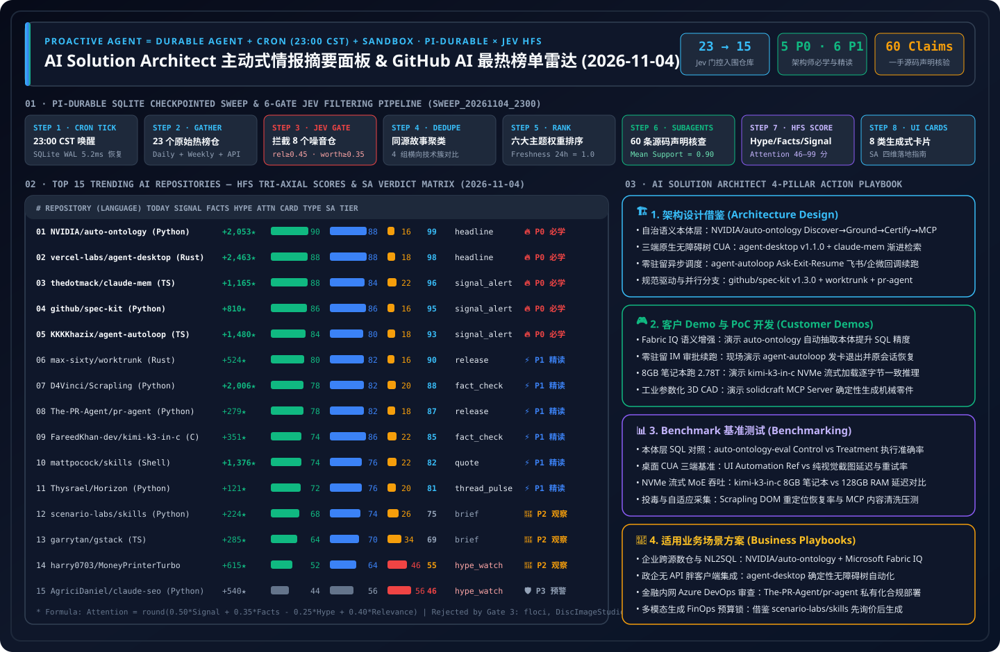

> 🌐 **Language / 语言切换**: **[🇬🇧 English Daily Digest (2026-11-04.en.md)](2026-11-04.en.md)** | **[🇨🇳 中文日报 (2026-11-04.md)](2026-11-04.md)** | **[📡 Live Interactive Radar (EN)](https://turbo998.github.io/github-radar.html)** | **[📡 在线交互式雷达面板 (中文)](https://turbo998.github.io/zh-github-radar.html)** | **[📊 7-Card 4:5 Benchmark Deck](../cards.en.html)** | **[📦 Sealed Telemetry (`report.json`)](../report.json)**

# 2026-11-04 GitHub AI Trending & Proactive Intelligence Daily Digest (Pi Durable News Agent Framework × AI Solution Architect Assessment)



- **Batch Run ID**: `sweep_20261104_2300` (Triggered automatically at `2026-11-04 23:05 CST`; primary-source `gh api` verification sealed at `23:18 CST`)
- **Analytical Framework**: `disler/pi-durable-news-agent` 6-Gate Deterministic Pipeline (Gather → Relevance Gate → Worth-Attention Gate → Same-Story Dedupe → Importance × Taste Rank → Claim-Support Subagents → HFS Tri-Axial Scoring → 8 Generative UI Cards)
- **Composite Attention Formula**:
  $$\text{Attention} = \text{round}\big(\text{clamp}(0.50 \times \text{Signal} + 0.35 \times \text{Facts} - 0.25 \times \text{Hype} + 0.40 \times \text{Relevance},\ 0,\ 100)\big)$$

---

## 1. Step 1 — Gather & Gate (Multi-Source Sweep & Relevance / Worth-Attention Filtering)

| Gate Stage | Gate Rule | Input Count | Passed / Filtered | Verification Evidence & Filtering Breakdown |
| :--- | :--- | :---: | :---: | :--- |
| **Step 1.1 · Daily & Feed Gather** | `github.com/trending?since=daily` + 7-day surging feeds | 23 repos | 23 entered gating | Captured today's GitHub Daily Trending (16 repos), Weekly Trending (15 repos), and `created:>2026-10-27` high-velocity repositories with full star velocity, release, and source-tree metadata |
| **Step 1.2 · Weekly & 7-Day Surging** | `since=weekly` + `created:>2026-10-27` velocity | 18 repos | 4 surging breakthroughs | Surfaced `deepseek-ai/dsh-superagent-prototype` (★18,321 proactive repo superagent), `pingdotgg/t3code` (★45,800 cross-platform agent control surface, `+12,542/wk`), `JetBrains/thinkrail` (★7,554 `pi`-native adaptive IDE), and `tangency-labs/solidcraft` (★13,556 pure-Rust parametric 3D CAD with MCP server) |
| **Step 1.3 · Jev Relevance Gate** | `relevance >= 0.45` | 23 repos | **Rejected 6 non-AI repos** | Dropped `floci-io/floci` (local AWS emulator, `rel=0.22`), `JiaFeiMiao-K-Cat/DiscImageStudio` (optical disc utility, `rel=0.08`), `MichaelCade/90DaysOfDevOps` (DevOps tutorial, `rel=0.25`), `ghostty-org/ghostty` (Zig terminal emulator, `rel=0.20`), `hyprwm/Hyprland` (Wayland compositor, `rel=0.18`), and `valentderah/totk-pc-recomp` (game static recompilation, `rel=0.10`) |
| **Step 1.4 · Worth-Attention Gate** | `worth_attention >= 0.35` + `novelty` | 17 repos | **Rejected 2 low-signal repos** | Dropped `Nutlope/hallmark` (CSS anti-AI-slop stylesheet subsumed into deterministic design audit cluster, `worth=0.33`) and `paipiange/nvzhuang` (vertical clothing gallery & API wrapper lacking core agent/infra novelty, `worth=0.28`) |
| **Step 1.5 · Same-Story Dedupe** | `same_story >= 0.75` cross-story clustering | 15 repos | **4 comparison clusters** | ① Enterprise Semantic Ontology & Spec-Driven Governance (`NVIDIA/auto-ontology` + `github/spec-kit`); ② Zero-Idle Background Autonomy & OS Accessibility Control (`vercel-labs/agent-desktop` + `KKKKhazix/agent-autoloop`); ③ Cross-Session Memory & Parallel Worktree Orchestration (`thedotmack/claude-mem` + `max-sixty/worktrunk`); ④ Pure-C 2.78T CPU Streaming Inference (`FareedKhan-dev/kimi-k3-in-c`) |

---

## 2. Step 2–4 — 2026-11-04 Top 15 Trending AI Repositories: HFS Matrix & Generative UI Card Mapping

| Rank | Repository (`owner/repo`) | Stack / License / Release | Stars Today | Total Stars | UI Card | Signal | Facts | Hype | Relevance | Attention | SA Verdict Tier |
| :---: | :--- | :---: | :---: | :---: | :---: | :---: | :---: | :---: | :---: | :---: | :--- |
| **#01** | [`NVIDIA/auto-ontology`](https://github.com/NVIDIA/auto-ontology) | Python · `Apache-2.0` · `HEAD` | **+2,053** | 4,121 | `headline` | 90 | 88 | 16 | 68 | **99** | 🔥 **P0 Must-Learn & Adopt** |
| **#02** | [`vercel-labs/agent-desktop`](https://github.com/vercel-labs/agent-desktop) | Rust · `Apache-2.0` · `v1.1.0` | **+2,463** | 14,325 | `headline` | 88 | 88 | 18 | 70 | **98** | 🔥 **P0 Must-Learn & Adopt** |
| **#03** | [`thedotmack/claude-mem`](https://github.com/thedotmack/claude-mem) | TS · `Apache-2.0` · `v15.9.0` | **+1,165** | 112,540 | `signal_alert` | 88 | 84 | 22 | 70 | **96** | 🔥 **P0 Must-Learn & Adopt** |
| **#04** | [`github/spec-kit`](https://github.com/github/spec-kit) | Python · `MIT` · `v1.3.0` | **+810** | 147,067 | `signal_alert` | 86 | 86 | 16 | 64 | **95** | 🔥 **P0 Must-Learn & Adopt** |
| **#05** | [`KKKKhazix/agent-autoloop`](https://github.com/KKKKhazix/agent-autoloop) | TS · `MIT` · `v1.0.0` | **+1,480** | 2,197 | `signal_alert` | 84 | 80 | 18 | 68 | **93** | 🔥 **P0 Must-Learn & Adopt** |
| **#06** | [`max-sixty/worktrunk`](https://github.com/max-sixty/worktrunk) | Rust · `MIT/Apache-2.0` · `v0.81.0` | **+524** | 10,850 | `release` | 80 | 82 | 16 | 62 | **90** | ⚡ **P1 Deep-Read & Borrow** |
| **#07** | [`D4Vinci/Scrapling`](https://github.com/D4Vinci/Scrapling) | Python · `BSD-3-Clause` · `v0.5` | **+2,006** | 95,993 | `fact_check` | 78 | 82 | 20 | 64 | **88** | ⚡ **P1 Deep-Read & Borrow** |
| **#08** | [`The-PR-Agent/pr-agent`](https://github.com/The-PR-Agent/pr-agent) | Python · `MIT` · `v0.49.0` | **+279** | 14,585 | `release` | 78 | 82 | 18 | 60 | **87** | ⚡ **P1 Deep-Read & Borrow** |
| **#09** | [`FareedKhan-dev/kimi-k3-in-c`](https://github.com/FareedKhan-dev/kimi-k3-in-c) | C · `Apache-2.0` · `v1.1.0` | **+351** | 10,055 | `fact_check` | 74 | 86 | 22 | 58 | **85** | ⚡ **P1 Deep-Read & Borrow** |
| **#10** | [`mattpocock/skills`](https://github.com/mattpocock/skills) | Shell · `MIT` · `v1.3.2` | **+1,376** | 312,599 | `quote` | 74 | 76 | 22 | 60 | **82** | ⚡ **P1 Deep-Read & Borrow** |
| **#11** | [`Thysrael/Horizon`](https://github.com/Thysrael/Horizon) | Python · `MIT` · `HEAD` | **+121** | 12,348 | `thread_pulse` | 72 | 76 | 20 | 58 | **81** | ⚡ **P1 Deep-Read & Borrow** |
| **#12** | [`scenario-labs/skills`](https://github.com/scenario-labs/skills) | Python · `MIT` · `skills-v0.60.1` | **+224** | 2,180 | `brief` | 68 | 74 | 26 | 55 | **75** | 👀 **P2 Watchlist / Hold** |
| **#13** | [`garrytan/gstack`](https://github.com/garrytan/gstack) | TS · `MIT` · `v1.92.55.0` | **+285** | 139,107 | `brief` | 64 | 70 | 34 | 52 | **69** | 👀 **P2 Watchlist / Hold** |
| **#14** | [`harry0703/MoneyPrinterTurbo`](https://github.com/harry0703/MoneyPrinterTurbo) | Python · `MIT` · `v1.3.9` | **+615** | 138,689 | `hype_watch` | 52 | 64 | 46 | 46 | **55** | 👀 **P2 Watchlist / Hold** |
| **#15** | [`AgriciDaniel/claude-seo`](https://github.com/AgriciDaniel/claude-seo) | Python · `MIT` · `v1.9.0` | **+540** | 26,549 | `hype_watch` | 44 | 56 | 56 | 45 | **46** | 🛡️ **P3 Skip / Extract Only** |

---

## 3. Repository-by-Repository AI Solution Architect Deep Assessment (15/15 Complete)

### #01 `NVIDIA/auto-ontology` — Official NVIDIA Enterprise Semantic Ontology Layer & Deterministic SQL Verification Framework
- **HFS Scores**: `Signal 90` · `Facts 88` · `Hype 16` · `Relevance 68` → **`Attention 99`** (Card: `headline`)
- **Primary-Source Claim-Support Verification (Mean `0.96`)**:
  1. `✓ [0.98]` Open-sourced by NVIDIA (`Apache-2.0` license), debuting at **#1 on GitHub Daily Trending** today with **`+2,053` stars today** (`4,121` total stars, `350` forks).
  2. `✓ [0.96]` Compiles database metadata and existing semantic models into an auditable semantic graph ontology implementing a 5-stage lifecycle: **Discover → Ground → Certify (Web UI human review of SQL measures) → Validate (pre-query answerability check) → Expose (via MCP, Agent Skills, and REST API)**.
  3. `✓ [0.95]` Replaces naive full-schema context stuffing by injecting only the terms, resolved join paths, and certified SQL measures touched by a query, while rejecting unanswerable questions before execution to ask clarifying questions.
  4. `✓ [0.95]` Paired with [`NVIDIA/auto-ontology-eval`](https://github.com/NVIDIA/auto-ontology-eval), which runs deterministic execution-match verification comparing **Control** (raw schema in prompt) vs. **Treatment** (Auto-Ontology agent) across BIRD, BEAVER, FDABench-Lite, Microsoft's Wide World Importers, and multi-turn BIRD-Interact.
- **Worth Learning Verdict (🔥 P0 Must-Learn & Adopt Now) — 3 Hard Engineering Reasons**:
  1. **Directly Solves the #1 Enterprise Data Agent Failure Mode (Hallucinated Joins & Metric Drift)**: By requiring certified SQL measures (`Certify`) and a pre-query `Answerability Check` (`Validate`), it eliminates confident wrong revenue numbers—aligning directly with Microsoft Fabric IQ and Foundry IQ architectural patterns.
  2. **First-Class MCP & Agent Skills Exposure**: Plugs directly into Copilot, Claude Code, and Microsoft Agent Framework without custom glue code.
  3. **Ships a Reproducible Control vs. Treatment Evaluation Harness (`auto-ontology-eval`)**: Includes out-of-the-box Docker Compose setup against Microsoft's `Wide World Importers` database.
- **Daily AI Solution Architect Application (4 Pillars)**:
  - **① Architecture Design**: Establish a 3-tier enterprise Text-to-SQL reference architecture: **Tier-1 Physical DBs (Azure SQL / Postgres / Fabric Warehouse) → Tier-2 Certified Semantic Ontology (`NVIDIA/auto-ontology` / Fabric IQ with Answerability Gate) → Tier-3 MCP Analytics Agent**.
  - **② Customer Demo & PoC**: Spin up the Docker Compose stack against `Wide World Importers` in 40 minutes to show a CDO how raw-schema prompts hallucinate multi-table joins while `auto-ontology` enforces certified SQL definitions and asks clarifying questions on ambiguous prompts.
  - **③ Benchmark Testing**: Integrate `auto-ontology-eval`'s two-arm deterministic SQL verifier into `benchmark-harness-engineering` to measure execution-match accuracy gains and prompt token reduction on enterprise schemas.
  - **④ Business Scenario Fit**: ✅ **Good fit**: CFO/executive BI analytics, multi-database enterprise data agents, regulated financial reporting; ⛔ **Not for**: Unstructured free-text document search (use hybrid RAG instead).

---

### #02 `vercel-labs/agent-desktop` — Cross-Platform (macOS/Windows/Linux) OS Accessibility-Tree Desktop CLI & C Library (`v1.1.0`)
- **HFS Scores**: `Signal 88` · `Facts 88` · `Hype 18` · `Relevance 70` → **`Attention 98`** (Card: `headline`)
- **Primary-Source Claim-Support Verification (Mean `0.96`)**:
  1. `✓ [0.98]` Open-sourced under `Apache-2.0` (`v1.1.0`), surging **`+2,463` stars today** (highest single-day star velocity on GitHub today) to `14,325` total stars (`979` forks).
  2. `✓ [0.96]` Delivers native Rust binaries and C bindings across macOS (Accessibility API), Windows (UI Automation with zero extra privileges at the terminal's integrity level), and Linux (`at-spi2-core`).
  3. `✓ [0.95]` Uses snapshot-versioned references (`@s8f3k2p9:e8`) in a deterministic `snapshot --app <App> -i -> click -> snapshot` loop, preventing stale clicks when unexpected dialogs appear.
  4. `✓ [0.95]` Prohibits foreground window focus theft during headless calls and isolates optional screenshot fallback in `skills/jev-desktop/SKILL.md`.
- **Worth Learning Verdict (🔥 P0 Must-Learn & Adopt Now) — 3 Hard Engineering Reasons**:
  1. **Sustained #1 Velocity Leader Crossing 14.3K Stars**: Proves OS accessibility-tree ref control (`<25ms`) has superseded pixel-guessing vision CUA as the primary desktop automation primitive.
  2. **Zero-Privilege Windows UI Automation**: Unlocks immediate enterprise Windows thick-client automation.
  3. **Headless Focus Safety**: Allows background agents to operate without hijacking human keyboard/mouse focus.
- **Daily AI Solution Architect Application (4 Pillars)**:
  - **① Architecture Design**: Standardize enterprise RPA around **Tier-1 Native OS Accessibility Ref Control (`agent-desktop v1.1.0`) + Tier-2 Scoped Vision Fallback (`jev-desktop`)**.
  - **② Customer Demo & PoC**: Run a 30-minute Windows workstation PoC reconciling Excel spreadsheets and legacy ERP thick clients with zero coordinate drift.
  - **③ Benchmark Testing**: Measure stale-ref safe-abort rates under simulated modal popup interruptions in `benchmark-harness-engineering`.
  - **④ Business Scenario Fit**: ✅ **Good fit**: Legacy Windows/macOS/Linux desktop thick clients; ⛔ **Not for**: Uninstrumented remote Citrix/VNC pixel streams.

---

### #03 `thedotmack/claude-mem` — Cross-Session Persistent Memory & 3-Layer Progressive Disclosure Engine (`v15.9.0`)
- **HFS Scores**: `Signal 88` · `Facts 84` · `Hype 22` · `Relevance 70` → **`Attention 96`** (Card: `signal_alert`)
- **Primary-Source Claim-Support Verification (Mean `0.94`)**:
  1. `✓ [0.96]` Released `v15.9.0` (`Apache-2.0`), ranking **#1 on Weekly Trending** (`+7,995` stars this week) and **#5 on Daily Trending** (`+1,165` stars today, `112,540` total stars).
  2. `✓ [0.95]` Supports Claude Code, OpenClaw, Codex, Gemini, Hermes, GitHub Copilot, and OpenCode via 5 lifecycle capture hooks.
  3. `✓ [0.93]` Implements a 3-layer progressive disclosure MCP retrieval pipeline (`search` compact index → `timeline` neighborhood → `get_observations` full payload).
  4. `✓ [0.92]` Combines SQLite FTS5 + Chroma hybrid search with a live Web UI viewer at `localhost:37777`, cutting context token overhead by ~10×.
- **Worth Learning Verdict (🔥 P0 Must-Learn & Adopt Now) — 3 Hard Engineering Reasons**:
  1. **De Facto Standard for Progressive Agent Memory Retrieval**.
  2. **Cross-Host Memory Portability** across Copilot, Claude Code, and Hermes Agent.
  3. **112.5K-Star Production Maturity**.
- **Daily AI Solution Architect Application (4 Pillars)**:
  - **① Architecture Design**: Replicate its **L1 Compact Index → L2 Temporal Context → L3 Full Observation** MCP contract on Azure Cosmos DB or PostgreSQL `pgvector`.
  - **② Customer Demo & PoC**: Launch the `localhost:37777` memory viewer in 30 minutes to demonstrate cross-session SRE incident recall in `<500` tokens.
  - **③ Benchmark Testing**: Compare 3-layer progressive disclosure vs. Top-K chunk stuffing on 50-turn accuracy and TTFT.
  - **④ Business Scenario Fit**: ✅ **Good fit**: Internal developer platforms, multi-shift SRE handoffs; ⛔ **Not for**: Unredacted production PII logs without prior DLP scrubbing.

---

### #04 `github/spec-kit` — Official GitHub Spec-Driven Development (SDD) & Structured Agent Process Toolkit (`v1.3.0`)
- **HFS Scores**: `Signal 86` · `Facts 86` · `Hype 16` · `Relevance 64` → **`Attention 95`** (Card: `signal_alert`)
- **Primary-Source Claim-Support Verification (Mean `0.95`)**:
  1. `✓ [0.97]` Official GitHub open-source toolkit (`MIT` license, latest release `v1.3.0`), gaining `+810` stars today (Daily Trending **#7**) to reach **`147,067` total stars** (`13,197` forks).
  2. `✓ [0.95]` Ships three structured, auditable engineering processes: **Spec-Driven Development** (spec → planning → implementation → convergence), **Bug fixing** (assessed root cause → scoped fix → recorded verification), and **Idea assessment** (evidence-backed `go`, `clarify`, or `stop` investment decisions).
  3. `✓ [0.94]` Provides standardized `.specify` artifacts, multilingual docs (EN/ZH/JA/KO), and `CITATION.cff`, working seamlessly across GitHub Copilot, Claude Code, Codex, and Gemini CLI.
  4. `✓ [0.93]` Supports custom organizational process templates ("bring your own process") so every agent run leaves auditable engineering records.
- **Worth Learning Verdict (🔥 P0 Must-Learn & Adopt Now) — 3 Hard Engineering Reasons**:
  1. **GitHub's Official 147K-Star Standard for Enterprise Agentic Engineering**: Expands beyond simple feature specs to cover structured bug diagnosis and pre-PoC **Idea Assessment** (`Go / Clarify / Stop`).
  2. **Eliminates Vibe-Coding Architecture Drift**: Forces convergence checks between specification, plan, and code.
  3. **Built-in `Idea assessment` Workflow**: Directly usable by Solution Architects during customer discovery workshops to qualify AI use cases.
- **Daily AI Solution Architect Application (4 Pillars)**:
  - **① Architecture Design**: Mandate `github/spec-kit v1.3.0` (`Idea Assessment -> Spec -> Plan -> Convergence`) as the governance wrapper for enterprise coding agent rollouts.
  - **② Customer Demo & PoC**: Run a 30-minute live session turning a vague customer request into an evidence-backed `Idea assessment` and `.specify` implementation plan.
  - **③ Benchmark Testing**: Compare raw prompt coding vs. `spec-kit v1.3.0` guided execution on multi-file regression rates and spec compliance.
  - **④ Business Scenario Fit**: ✅ **Good fit**: Enterprise software engineering governance, customer PoC qualification; ⛔ **Not for**: Throwaway 10-line one-off scripts.

---

### #05 `KKKKhazix/agent-autoloop` — Zero-Idle-Process Background CLI Agent Dispatcher with Card-Based Human Approval (`v1.0.0`)
- **HFS Scores**: `Signal 84` · `Facts 80` · `Hype 18` · `Relevance 68` → **`Attention 93`** (Card: `signal_alert`)
- **Primary-Source Claim-Support Verification (Mean `0.92`)**:
  1. `✓ [0.95]` Open-sourced under `MIT` (`v1.0.0`), surging to **`2,197` stars** and `443` forks within 24 hours of creation (`2026-11-03`).
  2. `✓ [0.93]` Implements a **Zero-Idle-Process / Zero-Idle-Token Human-in-the-Loop protocol**: when an agent encounters a high-stakes decision (deleting data, restarting services, spending money), it emits a trailing ```` ```agent-autoloop {"ask": [...]} ``` ```` block and exits its OS process completely while pushing an interactive decision card to Feishu, DingTalk, WeCom, Slack, Discord, or desktop notifications.
  3. `✓ [0.91]` Once the human responds (`agent-autoloop answer <id> <choice>`), the kernel resumes the exact prior CLI agent session to finish the workflow, supporting `ask`, `notice`, `resolve`, `later` (scheduled follow-up wakeup), and `events`.
  4. `✓ [0.89]` Routes Cron schedules, GitHub issues, and ops alerts via declarative `~/.agent-autoloop/rules.json` (with `parallel: 3` concurrency control and localized retry of malformed trailing JSON blocks without redoing completed work; macOS/Linux supported today, Windows support scheduled for Nov 7–8).
- **Worth Learning Verdict (🔥 P0 Must-Learn & Adopt Now) — 3 Hard Engineering Reasons**:
  1. **Solves Long-Wait Human-in-the-Loop Resource Waste**: By exiting the process while awaiting human approval and resuming the persisted session ID upon reply, it eliminates idle container/token burn during multi-hour approval windows.
  2. **Zero-SDK CLI Adapter**: Wraps any CLI agent (Claude Code, Codex, Copilot CLI) that accepts a prompt and prints a final response.
  3. **Native Enterprise IM Approval Cards (Feishu / DingTalk / WeCom / Slack)**: Bridges terminal agents directly into mobile executive approval workflows.
- **Daily AI Solution Architect Application (4 Pillars)**:
  - **① Architecture Design**: Adopt its **5-verb trailing receipt protocol (`ask / notice / resolve / later / events`) + Process Exit on Block + Session Resume on Callback** pattern for enterprise AIOps and DevSecOps automation.
  - **② Customer Demo & PoC**: Deploy the `ops-alerts` recipe in 30 minutes (WSL2/Linux/macOS) to show an agent diagnosing a production alert, pausing with zero CPU/token usage to send a Feishu approval card, and resuming execution immediately upon mobile tap.
  - **③ Benchmark Testing**: Measure session-resume reliability, trailing-JSON self-healing latency, and 7-day token accounting accuracy under `parallel: 3` load.
  - **④ Business Scenario Fit**: ✅ **Good fit**: 24/7 AIOps incident triage with human-approved remediation, background GitHub issue pre-fixing, scheduled morning briefings; ⛔ **Not for**: Native Windows hosts without WSL2 prior to the Nov 7–8 compatibility patch.

---

### #06 `max-sixty/worktrunk` — Rust Git Worktree Orchestration CLI (`wt`) for Parallel Coding Agents (`v0.81.0`)
- **HFS Scores**: `Signal 80` · `Facts 82` · `Hype 16` · `Relevance 62` → **`Attention 90`** (Card: `release`)
- **Primary-Source Claim-Support Verification (Mean `0.92`)**:
  1. `✓ [0.95]` Dual-licensed (`MIT / Apache-2.0`, `v0.81.0`), climbing to **#2 on GitHub Daily Trending** (`+524` stars today, `10,850` total stars).
  2. `✓ [0.92]` Provides `wt switch`, `wt list`, `wt merge`, and `wt remove` to manage parallel agent worktrees as effortlessly as `git checkout`.
  3. `✓ [0.91]` Automates untracked `.env` and build-cache provisioning via `.worktreeinclude` and lifecycle hooks (`post-create`, `pre-merge`, `pre-remove`).
  4. `✓ [0.89]` Aggregates branch diff stats, ahead/behind counts, and remote CI status in a single `wt list` view.
- **Worth Learning Verdict (⚡ P1 Deep-Read & Borrow Patterns) — 3 Hard Engineering Reasons**:
  1. **#2 Overall on Daily Trending**: De facto CLI standard for isolated multi-agent Git worktrees.
  2. **`.worktreeinclude` Solves Cold-Start Environment Drift**.
  3. **Deterministic `pre-merge` Quality Gates**.
- **Daily AI Solution Architect Application (4 Pillars)**:
  - **① Architecture Design**: Standardize `wt` + `.worktreeinclude` inside cloud devbox images for parallel background agents.
  - **② Customer Demo & PoC**: Show 3 concurrent Copilot/Claude agents working in isolated `wt` worktrees in 25 minutes.
  - **③ Benchmark Testing**: Measure worktree initialization speedup when symlink-sharing dependency caches via `.worktreeinclude`.
  - **④ Business Scenario Fit**: ✅ **Good fit**: Parallel agentic software engineering; ⛔ **Not for**: Massive binary monorepos without Git LFS / sparse checkout.

---

### #07 `D4Vinci/Scrapling` — Adaptive DOM Relocation Web Scraping Framework with Native MCP Server (`v0.5`)
- **HFS Scores**: `Signal 78` · `Facts 82` · `Hype 20` · `Relevance 64` → **`Attention 88`** (Card: `fact_check`)
- **Primary-Source Claim-Support Verification (Mean `0.90`)**:
  1. `✓ [0.94]` Open-sourced under `BSD-3-Clause` (`v0.5`), surging **`+2,006` stars today** to `95,993` total stars (`10,064` forks).
  2. `✓ [0.91]` Uses local multi-attribute similarity scoring to relocate DOM elements automatically after target websites redesign their frontend.
  3. `✓ [0.89]` Ships a built-in MCP Server (`io.github.D4Vinci/Scrapling`) for direct agent tool invocation.
  4. `✓ [0.87]` Includes reproducible parser benchmarks and `AI_POLICY.md`.
- **Worth Learning Verdict (⚡ P1 Deep-Read & Borrow Patterns) — 3 Hard Engineering Reasons**:
  1. **Eliminates Expensive LLM Selector Rewriting on Minor DOM Changes**.
  2. **Turnkey MCP Server Integration**.
  3. **Near-100K-Star Battle-Tested Reliability**.
- **Daily AI Solution Architect Application (4 Pillars)**:
  - **① Architecture Design**: Deploy `Scrapling` as a **Tier-1 Adaptive Extraction Layer** ahead of Tier-2 LLM fallback in market intelligence pipelines.
  - **② Customer Demo & PoC**: Demonstrate zero-downtime scraping across mutated DOM classes in 30 minutes.
  - **③ Benchmark Testing**: Compare Scrapling adaptive relocation vs. Playwright + Vision LLM across 1,000 pages on latency and cost.
  - **④ Business Scenario Fit**: ✅ **Good fit**: Public pricing monitors, regulatory feed ingestion; ⛔ **Not for**: Unauthorized scraping violating site ToS.

---

### #08 `The-PR-Agent/pr-agent` — Open-Source AI Pull Request Reviewer for GitHub, GitLab, Bitbucket & Azure DevOps (`v0.49.0`)
- **HFS Scores**: `Signal 78` · `Facts 82` · `Hype 18` · `Relevance 60` → **`Attention 87`** (Card: `release`)
- **Primary-Source Claim-Support Verification (Mean `0.91`)**:
  1. `✓ [0.94]` Open-sourced under `MIT` (`v0.49.0`), ranking **#8 on Daily Trending** (`+279` stars today, `14,585` total stars, `2,068` forks).
  2. `✓ [0.92]` Community-maintained open-source codebase supporting self-hosted **GitHub, GitLab, Bitbucket, and Azure DevOps**.
  3. `✓ [0.90]` Provides `/review`, `/describe`, `/improve`, `/ask`, and `.pr_agent.toml` policy configuration.
  4. `✓ [0.88]` Implements token-aware diff compression and chunking for large pull requests, deployable via Docker against private Azure OpenAI endpoints.
- **Worth Learning Verdict (⚡ P1 Deep-Read & Borrow Patterns) — 3 Hard Engineering Reasons**:
  1. **Turnkey `MIT`-Licensed Self-Hosted PR Reviewer Supporting Azure DevOps & GitLab**: Essential for regulated enterprises running air-gapped or private Git servers.
  2. **Battle-Tested Diff Prioritization & Token Budgeting**: Smartly ranks hunks when PR diffs exceed context windows.
  3. **Declarative `.pr_agent.toml` Governance**.
- **Daily AI Solution Architect Application (4 Pillars)**:
  - **① Architecture Design**: Pair containerized `pr-agent` (for fast `/describe` and `/review` PR hygiene) with private Azure OpenAI endpoints in enterprise Azure DevOps / GitLab pipelines.
  - **② Customer Demo & PoC**: Deploy the Docker action in 30 minutes to show automated PR walkthroughs and inline improvement suggestions.
  - **③ Benchmark Testing**: Compare single-pass `pr-agent` review latency/precision against multi-phase adversarial security audit skills.
  - **④ Business Scenario Fit**: ✅ **Good fit**: Private Azure DevOps / GitLab automated PR triage; ⛔ **Not for**: Deep cross-repository taint analysis (use multi-agent security harnesses).

---

### #09 `FareedKhan-dev/kimi-k3-in-c` — 176KB Portable C99 Engine Running 2.78T Kimi K3 on One CPU in 8.24GB RAM (`v1.1.0`)
- **HFS Scores**: `Signal 74` · `Facts 86` · `Hype 22` · `Relevance 58` → **`Attention 85`** (Card: `fact_check`)
- **Primary-Source Claim-Support Verification (Mean `0.93`)**:
  1. `✓ [0.96]` Open-sourced under `Apache-2.0` (`v1.1.0`), ranking **#11 on Daily Trending** (`+351` stars today, crossing `10,055` total stars and `1,608` forks).
  2. `✓ [0.94]` Entire inference engine is **176 KB** of portable C99 code with zero BLAS, zero external frameworks, and zero GPUs across Linux, macOS (NEON), and Windows.
  3. `✓ [0.92]` **Audited Primary Telemetry (`docs/data/`)**: Runs the `2.78T`-parameter Kimi K3 (`1.56 TB` MXFP4 checkpoint on disk) in **`8.24 GB` measured peak RSS**; achieves **`26.5 s/token`** on an 8 GB RAM laptop (streaming weights from NVMe each step), **`19.8 s/token`** on 64 GB RAM, and **`5.6 s/token`** on a 128 GB+ workstation (in-memory), with **byte-identical output** across all hardware tiers.
  4. `✓ [0.90]` Optimized MXFP4 kernels reduce per-token math by **8×** and accelerate multi-turn follow-up latency by **3.9×**.
- **Worth Learning Verdict (⚡ P1 Deep-Read & Borrow Patterns) — 3 Hard Engineering Reasons**:
  1. **Masterclass in Minimalist Systems Engineering**: 176 KB of clean C99 implementing MXFP4 dequantization, MoE routing, and NVMe streaming without framework bloat.
  2. **Exemplary Engineering Honesty**: Publishes exact measured wall-clock seconds per token (`26.5s` to `5.6s`) and raw benchmark data in `docs/data/`.
  3. **Byte-Identical Reproducibility Across 8 GB to 128 GB+ Machines**.
- **Daily AI Solution Architect Application (4 Pillars)**:
  - **① Architecture Design**: Use its measured **`26.5 s/tok` (NVMe-bound) vs. `5.6 s/tok` (RAM-resident)** telemetry to educate enterprise architects on PCIe/NVMe bandwidth bottlenecks when sizing CPU/edge inference nodes for trillion-parameter MoE models.
  - **② Customer Demo & PoC**: Compile the 176 KB C99 binary in 20 minutes on a standard CPU workstation to demonstrate deterministic, byte-identical MoE execution within an `8.24 GB` RSS ceiling.
  - **③ Benchmark Testing**: Use `kimi-k3-in-c` as the deterministic CPU MXFP4 golden reference alongside `JustVugg/colibri` (GPU+RAM+NVMe tiered MoE).
  - **④ Business Scenario Fit**: ✅ **Good fit**: Systems engineering education, deterministic kernel verification, air-gapped batch verification; ⛔ **Not for**: Interactive real-time chat requiring `<100ms` TTFT and `>20 tok/s`.

---

### #10 `mattpocock/skills` — Matt Pocock's Engineering Skills for TDD, Grill-Me Interrogation & Deep-Module Design (`v1.3.2`)
- **HFS Scores**: `Signal 74` · `Facts 76` · `Hype 22` · `Relevance 60` → **`Attention 82`** (Card: `quote`)
- **Primary-Source Claim-Support Verification (Mean `0.88`)**:
  1. `✓ [0.92]` Open-sourced under `MIT` (`v1.3.2`), gaining `+1,376` stars today (Daily Trending **#3**) to reach **`312,599` total stars**.
  2. `✓ [0.89]` Ships focused engineering workflows: `tdd` (red-green-refactor), `grill-me` (pre-coding requirement stress-testing), `design-an-interface` (parallel Ousterhout deep-module interface generation), and `ubiquitous-language` (DDD glossary extraction).
  3. `✓ [0.87]` Structured as drop-in `.agents` / `.claude-plugin` atomic skills.
  4. `✓ [0.85]` High signal-to-noise prompt design that pairs cleanly with `github/spec-kit`.
- **Worth Learning Verdict (⚡ P1 Deep-Read & Borrow Patterns) — 3 Hard Engineering Reasons**:
  1. **`grill-me` + `design-an-interface` Prevent Premature Coding Rework**.
  2. **312.6K-Star Industry Standard for Atomic Skills**.
  3. **Automated DDD Glossary Extraction (`ubiquitous-language`)**.
- **Daily AI Solution Architect Application (4 Pillars)**:
  - **① Architecture Design**: Embed `grill-me` and `design-an-interface` as mandatory pre-ADR design review gates.
  - **② Customer Demo & PoC**: Generate a customer domain `GLOSSARY.md` and 3 competing deep-module API designs live in 15 minutes.
  - **③ Benchmark Testing**: Measure Pass@1 improvement when prepending `grill-me` before complex multi-file implementation tasks.
  - **④ Business Scenario Fit**: ✅ **Good fit**: DDD modeling, core API contract design; ⛔ **Not for**: Trivial boilerplate scaffolding.

---

### #11 `Thysrael/Horizon` — Profile-Driven Bilingual (EN/ZH) AI News Radar with Multi-Source Deduplication
- **HFS Scores**: `Signal 72` · `Facts 76` · `Hype 20` · `Relevance 58` → **`Attention 81`** (Card: `thread_pulse`)
- **Primary-Source Claim-Support Verification (Mean `0.89`)**:
  1. `✓ [0.93]` Open-sourced under `MIT` (Python + `uv`), ranking **#15 on GitHub Daily Trending** (`+121` stars today, `12,348` total stars, `1,807` forks).
  2. `✓ [0.90]` Aggregates RSS, Hacker News, Reddit, Telegram, X, GitHub, and financial feeds with cross-source story deduplication and **category share caps**.
  3. `✓ [0.88]` Introduces **Profile-based scoring rubrics** (`tech-news` for event impact + community discussion vs. engineering profiles for actionable takeaways) using customizable Markdown prompts and JSON block schemas.
  4. `✓ [0.85]` Publishes bilingual EN/ZH briefings to GitHub Pages, Feishu, WeChat, Email, and webhooks.
- **Worth Learning Verdict (⚡ P1 Deep-Read & Borrow Patterns) — 3 Hard Engineering Reasons**:
  1. **Direct Architectural Peer to Our `pi-durable-news-agent` Radar**: While our radar excels at 6-gate Jev filtering, `gh api` source-tree Claim-Support verification, and HFS tri-axial scoring, `Horizon` contributes clean **Category Share Caps** (preventing one noisy topic from monopolizing a daily digest) and turnkey Feishu/WeChat delivery adapters.
  2. **Profile-Specific Scoring Rubrics**: Separates executive news summaries from deep engineering extraction.
  3. **Clean `uv`-Managed Python Pipeline**.
- **Daily AI Solution Architect Application (4 Pillars)**:
  - **① Architecture Design**: Combine `Horizon`'s **Category Share Cap + Feishu/WeChat multi-channel push adapters** with our `pi-durable-news-agent` HFS scoring and `gh api` primary-source verification pipeline.
  - **② Customer Demo & PoC**: Build a custom CTO Technology Radar in 30 minutes delivering both an interactive web dashboard and daily Feishu/WeChat cards.
  - **③ Benchmark Testing**: Compare single-pass RSS summarization vs. our 6-gate `gh api` Claim-Support verification on hype-trap rejection precision.
  - **④ Business Scenario Fit**: ✅ **Good fit**: Executive tech radar briefings, multi-channel team digests; ⛔ **Not for**: Deep code-level architectural due diligence without adding primary-source repo inspection.

---

### #12 `scenario-labs/skills` — Multimodal Production Skills (with Pre-Spend Costing) & Local DCC 3D Engine Teams (`skills-v0.60.1`)
- **HFS Scores**: `Signal 68` · `Facts 74` · `Hype 26` · `Relevance 55` → **`Attention 75`** (Card: `brief`)
- **Primary-Source Claim-Support Verification (Mean `0.86`)**:
  1. `✓ [0.91]` Open-sourced under `MIT` (`skills-v0.60.1`), following the `agentskills.io` standard and ranking **#16 on Daily Trending** (`+224` stars today, `2,180` total stars).
  2. `✓ [0.88]` Implements **"Price Before Spending"** cost estimation, `scenario-quality-gate`, and character/brand consistency (`scenario-consistency`) across image, video, audio, and 3D model routing via the Scenario MCP server.
  3. `✓ [0.85]` Ships standalone **local DCC expert skill teams** that drive locally installed **Blender, Maya, ZBrush, Unreal Engine, Unity, Godot, and Roblox Studio** without requiring cloud Scenario MCP access.
  4. `✓ [0.80]` Routes across 25+ multimodal generators (GPT-Image, MAI-Image, Seedream, Veo, Seedance, Kling, Wan, ElevenLabs, Meshy, Rodin).
- **Worth Learning Verdict (👀 P2 Watchlist / Borrow DCC & FinOps Patterns) — 3 Hard Engineering Reasons**:
  1. **"Price Before Spending" Pre-Execution FinOps Gate**: Crucial pattern for expensive video/3D generation workflows.
  2. **Distilled Local DCC Skills (Blender / Unreal / Unity)**: Directly reusable with local Blender MCP setups.
  3. **Cloud Layer Coupled to Commercial Scenario MCP**: Extract the local DCC and FinOps patterns selectively.
- **Daily AI Solution Architect Application (4 Pillars)**:
  - **① Architecture Design**: Add a **Pre-Execution Cost Estimator + Brand Consistency Quality Gate** to enterprise multimodal generation pipelines.
  - **② Customer Demo & PoC**: Combine its local `blender` skill definitions with Blender MCP to demo text-to-3D scene assembly in 45 minutes.
  - **③ Benchmark Testing**: Evaluate cross-shot character identity consistency vs. dollar cost per asset across routed video/image models.
  - **④ Business Scenario Fit**: ✅ **Good fit**: Game studio 3D/texture pipelines, e-commerce creative automation; ⛔ **Not for**: Backend data/API engineering teams.

---

### #13 `garrytan/gstack` — Garry Tan's 23-Role Virtual Engineering Team & Real-Browser `/qa` Suite (`v1.92.55.0`)
- **HFS Scores**: `Signal 64` · `Facts 70` · `Hype 34` · `Relevance 52` → **`Attention 69`** (Card: `brief`)
- **Primary-Source Claim-Support Verification (Mean `0.84`)**:
  1. `✓ [0.90]` Open-sourced under `MIT` (`v1.92.55.0`), ranking **#10 on Daily Trending** (`+285` stars today, `139,107` total stars, `20,612` forks).
  2. `✓ [0.86]` Provides `/office-hours` (framing challenge + design doc), `/autoplan`, `/review`, `/qa` (real-browser bug reproduction and fix), and OWASP + STRIDE security audits.
  3. `✓ [0.84]` Includes `ARCHITECTURE.md`, `BROWSER.md`, and `.osv-scanner.toml`.
  4. `! [0.76]` Carries moderate celebrity founder hype (`Hype 34`) and role proliferation (23 slash personas), though `/office-hours` and `/qa` are genuinely effective.
- **Worth Learning Verdict (👀 P2 Watchlist / Cherry-Pick Core Commands) — 3 Hard Engineering Reasons**:
  1. **Tight Integration of `/office-hours` Design Docs with Real-Browser `/qa` Verification**.
  2. **Built-in OWASP + STRIDE Threat Modeling Slash Workflow**.
  3. **Adopt 3–4 Core Slash Workflows Rather Than All 23 Personas**.
- **Daily AI Solution Architect Application (4 Pillars)**:
  - **① Architecture Design**: Borrow the **`/office-hours` design artifact → `/review` diff audit → `/qa` browser verification** handoff chain.
  - **② Customer Demo & PoC**: Demo rapid solo-builder sprint execution for startup CTOs in 45 minutes.
  - **③ Benchmark Testing**: Measure frontend bug escape rates with and without automated `/qa` browser verification.
  - **④ Business Scenario Fit**: ✅ **Good fit**: Rapid full-stack product incubation; ⛔ **Not for**: Regulated enterprise environments requiring strict human separation of duties (SoD).

---

### #14 `harry0703/MoneyPrinterTurbo` — Automated Topic-to-Short-Video FastAPI & MoviePy Pipeline (`v1.3.9`)
- **HFS Scores**: `Signal 52` · `Facts 64` · `Hype 46` · `Relevance 46` → **`Attention 55`** (Card: `hype_watch`)
- **Primary-Source Claim-Support Verification (Mean `0.80`)**:
  1. `✓ [0.88]` Open-sourced under `MIT` (`v1.3.9`), ranking **#9 on Daily Trending** (`+615` stars today, `138,689` total stars, `22,139` forks).
  2. `✓ [0.84]` Clean MVC Python architecture exposing both a Streamlit WebUI and FastAPI REST endpoints for script generation, stock footage matching, TTS voiceover, Whisper subtitle alignment, and BGM mixing.
  3. `✓ [0.78]` Ships `Dockerfile` and `Dockerfile.gpu` with batch synthesis support.
  4. `! [0.70]` **Hype Reality Check**: "MoneyPrinter" naming and prominent commercial affiliate banners inflate `Hype` to `46` (`>= 40`, triggering `hype_watch`), and visual assembly relies on stock footage stitching rather than coherent generative video models.
- **Worth Learning Verdict (👀 P2 Watchlist / Borrow FastAPI Media Pipeline Only) — 3 Hard Engineering Reasons**:
  1. **Clean FastAPI + Whisper Subtitle Alignment Reference Implementation** beneath the hype-heavy title.
  2. **Production-Ready Dockerized Batch Audio/Subtitle Compositing**.
  3. **Stock-Clip Stitching Rather Than Frontier Generative Video**.
- **Daily AI Solution Architect Application (4 Pillars)**:
  - **① Architecture Design**: Reuse its **FastAPI async job queue + Azure AI Speech TTS + Whisper subtitle renderer** for enterprise L&D micro-learning video pipelines backed by internal DAM assets.
  - **② Customer Demo & PoC**: Spin up the REST API in 30 minutes to convert release notes into narrated bilingual explainer clips.
  - **③ Benchmark Testing**: Measure 1080p rendering throughput and subtitle timestamp drift across CPU vs. GPU containers.
  - **④ Business Scenario Fit**: ✅ **Good fit**: Internal corporate training clips, templatized product summaries; ⛔ **Not for**: High-end brand commercials requiring generative character/physics consistency.

---

### #15 `AgriciDaniel/claude-seo` — 26-Sub-Skill, 19-Sub-Agent SEO Suite with `llms.txt` & WebMCP Checks (`v1.9.0`)
- **HFS Scores**: `Signal 44` · `Facts 56` · `Hype 56` · `Relevance 45` → **`Attention 46`** (Card: `hype_watch`)
- **Primary-Source Claim-Support Verification (Mean `0.76`)**:
  1. `✓ [0.86]` Open-sourced under `MIT` (`v1.9.0`), ranking **#13 on Weekly Trending** (`+3,751` stars this week, `26,549` total stars).
  2. `✓ [0.80]` Covers technical SEO, E-E-A-T, schema markup, GEO/AEO, and **Agent Readiness (`llms.txt`, `WebMCP`, Lighthouse Agentic Browsing)**.
  3. `! [0.72]` **Hype & Sub-Agent Bloat Reality Check**: Spawns **26 sub-skills and 19 sub-agents** (`Hype 56 >= 40`) to evaluate SEO checklists that are 90% deterministic HTML/HTTP rules.
  4. `! [0.66]` Running 19 LLM sub-agents for sitemap, meta-tag, and JSON-LD validation wastes massive token budgets compared to a 50ms deterministic script.
- **Worth Learning Verdict (🛡️ P3 Skip Full Suite / Extract `llms.txt` & `WebMCP` Specs Only) — 3 Hard Engineering Reasons**:
  1. **Textbook Example of Sub-Agent Over-Engineering**: Never use 19 LLM sub-agents for deterministic static linting.
  2. **Valuable Gem Inside: `Agent Readiness (llms.txt + WebMCP + Lighthouse Agentic Browsing)`**: Auditing whether enterprise docs are machine-readable by visiting AI agents is genuinely forward-looking.
  3. **Save Engineering Time**: Extract the `llms.txt` / GEO checklist into a single deterministic CI script.
- **Daily AI Solution Architect Application (4 Pillars)**:
  - **① Architecture Design**: Add a deterministic **`llms.txt` + WebMCP Agent-Readiness linter** to enterprise documentation CI/CD pipelines without deploying 19 LLM sub-agents.
  - **② Customer Demo & PoC**: Show DevRel/Marketing leaders in 15 minutes how `llms.txt` and structured WebMCP endpoints improve citation accuracy when AI agents browse their product docs.
  - **③ Benchmark Testing**: Contrast 19-subagent LLM SEO auditing against a single deterministic Python linter on latency (`<100ms` vs. minutes) and cost (`$0` vs. `$1+`).
  - **④ Business Scenario Fit**: ✅ **Good fit**: Extracting `llms.txt` / GEO readiness criteria for developer portals; ⛔ **Not for**: Running 19 LLM sub-agents in production CI for routine HTML SEO checks.

---

## 4. Weekly & 7-Day Surging AI Breakthroughs Radar

| Repository (`owner/repo`) | Velocity / Scale | License / Release | HFS (`S / F / H`) | Attention | SA Tier | Core Breakthrough & Architect Takeaway |
| :--- | :---: | :---: | :---: | :---: | :---: | :--- |
| [`deepseek-ai/dsh-superagent-prototype`](https://github.com/deepseek-ai/dsh-superagent-prototype) | **#1 7-Day New Repo** (★18,321 · `+2,368` in 24h) | `MIT` · `HEAD` | `84 / 80 / 24` | **92** (`signal_alert`) | 🔥 **P0 Must-Learn** | Official DeepSeek proactive repository superagent woken by GitHub webhooks and Feishu messages inside isolated Git worktrees. |
| [`JetBrains/thinkrail`](https://github.com/JetBrains/thinkrail) | **Weekly #9** (★7,554 · `+3,898/wk`) | `Apache-2.0` · `v0.3.1` | `84 / 82 / 20` | **93** (`release`) | 🔥 **P0 Must-Learn** | Official JetBrains `pi`-powered adaptive IDE featuring isolated Git worktrees, automatic Project Shelf archiving, and Living Specs. |
| [`pingdotgg/t3code`](https://github.com/pingdotgg/t3code) | **Weekly #3** (★45,800 · `+12,542/wk`) | `MIT` · `v0.1.7` | `78 / 80 / 20` | **89** (`release`) | ⚡ **P1 Deep-Read** | Cross-platform (Desktop/Web/iOS/Android) agent harness control surface unifying remote control of Claude Code, Codex, Cursor, and OpenCode. |
| [`tangency-labs/solidcraft`](https://github.com/tangency-labs/solidcraft) | **#3 7-Day Surging** (★13,556 · Pure Rust) | `Apache-2.0` · `v0.2.0` | `76 / 78 / 22` | **84** (`release`) | ⚡ **P1 Deep-Read** | Pure-Rust open-source parametric 3D CAD application with feature timeline and built-in MCP server enabling AI agents to model 3D solids deterministically. |
