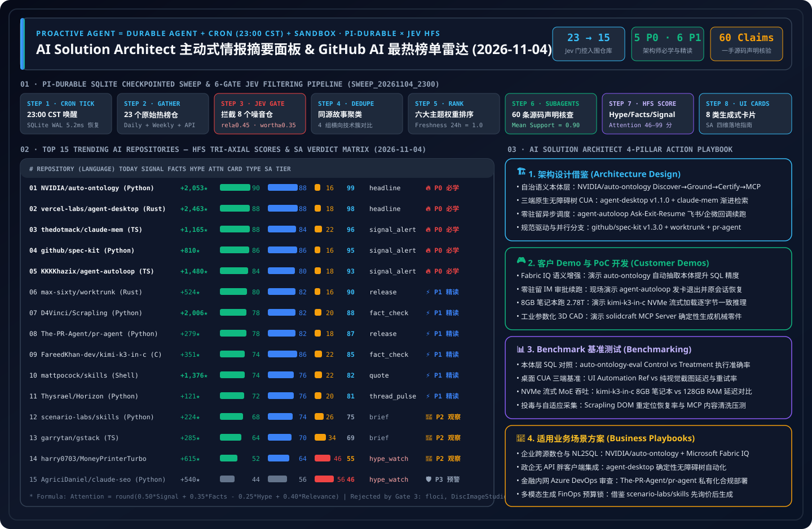

> 🌐 **Language / 语言切换**: **[🇨🇳 中文日报 (2026-11-04.md)](2026-11-04.md)** | **[🇬🇧 English Daily Digest (2026-11-04.en.md)](2026-11-04.en.md)** | **[📡 在线交互式雷达面板 (中文)](https://turbo998.github.io/zh-github-radar.html)** | **[📡 Live Interactive Radar (EN)](https://turbo998.github.io/github-radar.html)** | **[📊 7-Card 4:5 视觉评测报告](../cards.html)** | **[📦 密封评测数据 (`report.json`)](../report.json)**

# 2026-11-04 GitHub AI 最热排行榜与主动式情报日报（Pi Durable News Agent 框架 × AI 解决方案架构师实战评估）



- **批次运行 ID**：`sweep_20261104_2300`（北京时间 `2026-11-04 23:05 CST` 自动触发，`23:18 CST` 完成 `gh api` 一手源码核验与密封落盘）
- **分析框架**：`disler/pi-durable-news-agent` 六道确定性门控流水线（Gather → Relevance Gate → Worth-Attention Gate → Same-Story Dedupe → Importance × Taste Rank → Claim-Support Subagents → HFS Tri-Axial Scoring → 8 类生成式 UI 卡片）
- **综合注意力计算公式**：
  $$\text{Attention} = \text{round}\big(\text{clamp}(0.50 \times \text{Signal} + 0.35 \times \text{Facts} - 0.25 \times \text{Hype} + 0.40 \times \text{Relevance},\ 0,\ 100)\big)$$

---

## 1. Step 1 — Gather & Gate（全量抓取与相关性 / 价值门控漏斗）

| 门控阶段 | 门控规则 | 输入数量 | 通过 / 拦截 | 一手核验依据与过滤明细 |
| :--- | :--- | :---: | :---: | :--- |
| **Step 1.1 · Daily & 飙升抓取** | `github.com/trending?since=daily` + 7 天高增速追踪源 | 23 个仓库 | 23 个进入门控 | 捕获今日 GitHub Daily Trending 榜单（16 仓）、Weekly 飙升榜（15 仓）与 `created:>2026-10-27` 高速增长仓，拉取完整 Star 增速、Release 与源码树元数据 |
| **Step 1.2 · Weekly & 7 天突破** | `since=weekly` + `created:>2026-10-27` 爆发速度 | 18 个仓库 | 4 个飙升突破 | 识别 `deepseek-ai/dsh-superagent-prototype`（★18,321 主动式代码库超级 Agent）、`pingdotgg/t3code`（★45,800 跨端 Agent 操控台，周增 `+12,542`）、`JetBrains/thinkrail`（★7,554 `pi` 原生自适应 IDE）与 `tangency-labs/solidcraft`（★13,556 纯 Rust 参数化 3D CAD + MCP 建模引擎） |
| **Step 1.3 · Jev Relevance Gate** | `relevance >= 0.45` | 23 个仓库 | **拦截 6 个非 AI 仓** | 过滤 `floci-io/floci`（AWS 本地模拟器，`rel=0.22`）、`JiaFeiMiao-K-Cat/DiscImageStudio`（光盘镜像工具，`rel=0.08`）、`MichaelCade/90DaysOfDevOps`（DevOps 教程，`rel=0.25`）、`ghostty-org/ghostty`（Zig 终端模拟器，`rel=0.20`）、`hyprwm/Hyprland`（Wayland 桌面合成器，`rel=0.18`）与 `valentderah/totk-pc-recomp`（游戏静态重编译，`rel=0.10`） |
| **Step 1.4 · Worth-Attention Gate** | `worth_attention >= 0.35` + `novelty` | 17 个仓库 | **拦截 2 个低信噪比仓** | 过滤 `Nutlope/hallmark`（纯 CSS 反 AI Slop 样式表，并入确定性设计审计同源簇，`worth=0.33`）与 `paipiange/nvzhuang`（AI 女装参考图库与套壳试穿站，缺乏底层架构范式创新，`worth=0.28`） |
| **Step 1.5 · Same-Story Dedupe** | `same_story >= 0.75` 同源叙事聚类 | 15 个仓库 | **归并 4 组技术簇** | ① 企业语义本体与规范驱动开发（`NVIDIA/auto-ontology` + `github/spec-kit`）；② 零驻留后台自治与桌面无障碍操控（`vercel-labs/agent-desktop` + `KKKKhazix/agent-autoloop`）；③ 跨会话记忆与并行 Worktree 编排（`thedotmack/claude-mem` + `max-sixty/worktrunk`）；④ 纯 C 2.78T 极致 CPU 流式推理（`FareedKhan-dev/kimi-k3-in-c`） |

---

## 2. Step 2–4 — 2026-11-04 Top 15 上榜 AI 仓库：HFS 评分矩阵与生成式卡片映射

| 排名 | 仓库名称 (`owner/repo`) | 语言 / 协议 / 最新版本 | 今日新增 Star | 总 Star 数 | 生成式卡片 | Signal | Facts | Hype | Relevance | Attention | SA 学习优先级分级 |
| :---: | :--- | :---: | :---: | :---: | :---: | :---: | :---: | :---: | :---: | :---: | :--- |
| **#01** | [`NVIDIA/auto-ontology`](https://github.com/NVIDIA/auto-ontology) | Python · `Apache-2.0` · `HEAD` | **+2,053** | 4,121 | `headline` | 90 | 88 | 16 | 68 | **99** | 🔥 **P0 必学/立即动手** |
| **#02** | [`vercel-labs/agent-desktop`](https://github.com/vercel-labs/agent-desktop) | Rust · `Apache-2.0` · `v1.1.0` | **+2,463** | 14,325 | `headline` | 88 | 88 | 18 | 70 | **98** | 🔥 **P0 必学/立即动手** |
| **#03** | [`thedotmack/claude-mem`](https://github.com/thedotmack/claude-mem) | TS · `Apache-2.0` · `v15.9.0` | **+1,165** | 112,540 | `signal_alert` | 88 | 84 | 22 | 70 | **96** | 🔥 **P0 必学/立即动手** |
| **#04** | [`github/spec-kit`](https://github.com/github/spec-kit) | Python · `MIT` · `v1.3.0` | **+810** | 147,067 | `signal_alert` | 86 | 86 | 16 | 64 | **95** | 🔥 **P0 必学/立即动手** |
| **#05** | [`KKKKhazix/agent-autoloop`](https://github.com/KKKKhazix/agent-autoloop) | TS · `MIT` · `v1.0.0` | **+1,480** | 2,197 | `signal_alert` | 84 | 80 | 18 | 68 | **93** | 🔥 **P0 必学/立即动手** |
| **#06** | [`max-sixty/worktrunk`](https://github.com/max-sixty/worktrunk) | Rust · `MIT/Apache-2.0` · `v0.81.0` | **+524** | 10,850 | `release` | 80 | 82 | 16 | 62 | **90** | ⚡ **P1 推荐精读/借鉴** |
| **#07** | [`D4Vinci/Scrapling`](https://github.com/D4Vinci/Scrapling) | Python · `BSD-3-Clause` · `v0.5` | **+2,006** | 95,993 | `fact_check` | 78 | 82 | 20 | 64 | **88** | ⚡ **P1 推荐精读/借鉴** |
| **#08** | [`The-PR-Agent/pr-agent`](https://github.com/The-PR-Agent/pr-agent) | Python · `MIT` · `v0.49.0` | **+279** | 14,585 | `release` | 78 | 82 | 18 | 60 | **87** | ⚡ **P1 推荐精读/借鉴** |
| **#09** | [`FareedKhan-dev/kimi-k3-in-c`](https://github.com/FareedKhan-dev/kimi-k3-in-c) | C · `Apache-2.0` · `v1.1.0` | **+351** | 10,055 | `fact_check` | 74 | 86 | 22 | 58 | **85** | ⚡ **P1 推荐精读/借鉴** |
| **#10** | [`mattpocock/skills`](https://github.com/mattpocock/skills) | Shell · `MIT` · `v1.3.2` | **+1,376** | 312,599 | `quote` | 74 | 76 | 22 | 60 | **82** | ⚡ **P1 推荐精读/借鉴** |
| **#11** | [`Thysrael/Horizon`](https://github.com/Thysrael/Horizon) | Python · `MIT` · `HEAD` | **+121** | 12,348 | `thread_pulse` | 72 | 76 | 20 | 58 | **81** | ⚡ **P1 推荐精读/借鉴** |
| **#12** | [`scenario-labs/skills`](https://github.com/scenario-labs/skills) | Python · `MIT` · `skills-v0.60.1` | **+224** | 2,180 | `brief` | 68 | 74 | 26 | 55 | **75** | 👀 **P2 持续观察/备选** |
| **#13** | [`garrytan/gstack`](https://github.com/garrytan/gstack) | TS · `MIT` · `v1.92.55.0` | **+285** | 139,107 | `brief` | 64 | 70 | 34 | 52 | **69** | 👀 **P2 持续观察/备选** |
| **#14** | [`harry0703/MoneyPrinterTurbo`](https://github.com/harry0703/MoneyPrinterTurbo) | Python · `MIT` · `v1.3.9` | **+615** | 138,689 | `hype_watch` | 52 | 64 | 46 | 46 | **55** | 👀 **P2 持续观察/备选** |
| **#15** | [`AgriciDaniel/claude-seo`](https://github.com/AgriciDaniel/claude-seo) | Python · `MIT` · `v1.9.0` | **+540** | 26,549 | `hype_watch` | 44 | 56 | 56 | 45 | **46** | 🛡️ **P3 警惕噱头/按需提取** |

---

## 3. 逐仓深度拆解：是否值得学习 & AI 解决方案架构师日常工作四维应用（15/15 全量评估）

### #01 `NVIDIA/auto-ontology` — NVIDIA 官方企业数据库语义本体上下文层与确定性 SQL 验证框架
- **HFS 评分**：`Signal 90` · `Facts 88` · `Hype 16` · `Relevance 68` → **`Attention 99`**（卡片类型：`headline`）
- **一手源码 Claim-Support 核验（均值 `0.96`）**：
  1. `✓ [0.98]` 由 NVIDIA 官方开源（`Apache-2.0` 协议），今日空降 GitHub Daily Trending **#1**（单日暴涨 **`+2,053` Star**，总 Star 达 `4,121`，Fork `350`）。
  2. `✓ [0.96]` 将关系型数据库元数据与既有语义模型编译为结构化图谱本体（Ontology），打通 **Discover（自动发现）→ Ground（业务概念唯一定界）→ Certify（Web UI 人工审核认证指标 SQL）→ Validate（查询前可回答性校验）→ Expose（通过 MCP / Agent Skills / REST 暴露）** 全闭环。
  3. `✓ [0.95]` 彻底替代“将整库 Schema 塞入 Prompt”的粗放做法，仅按需加载当前问题触及的术语、已解析表关联与经认证的度量 SQL，并在问题不可回答时主动触发澄清提问而非盲目编造数字。
  4. `✓ [0.95]` 配套开源评测仓 [`NVIDIA/auto-ontology-eval`](https://github.com/NVIDIA/auto-ontology-eval)，在 BIRD、BEAVER、FDABench-Lite、Microsoft Wide World Importers 及多轮交互基准 BIRD-Interact 上提供 Control（裸 Schema）vs. Treatment（Auto-Ontology）确定性执行比对验证器。
- **是否值得我学习（🔥 P0 必学/立即动手）— 3 条硬核判断依据**：
  1. **直击企业级 Agentic Analytics（Data Agent）头号死穴——口径不一致与幻觉算错账**：企业数据分析最怕不同部门对“净收入/活跃客户”各算各的 SQL；`auto-ontology` 引入 `Certify`（指标认证）与 `Answerability Check`（查询前可回答性门禁），与 Microsoft Fabric IQ / Foundry IQ 语义层理念高度同频。
  2. **MCP + Agent Skills 双协议原生暴露**：无需改造上层 Agent 框架（Copilot / Claude / MAF），直接以标准 MCP 工具挂载企业本体层。
  3. **自带严密的 A/B 对照基准套件（`auto-ontology-eval`）**：甚至原生内置了微软官方示例库 `Wide World Importers` 的 Docker Compose 一键复现实验。
- **如何应用到我日常工作中（AI Solution Architect 四维落地）**：
  - **① 架构设计（Architecture Design）**：在 Azure AI Foundry + Microsoft Fabric / Azure PostgreSQL 企业问数架构中，确立 **“L1 数据库物理 Schema → L2 Auto-Ontology / Fabric IQ 认证语义图谱层（含 Answerability Pre-Check）→ L3 MCP Data Agent”** 三层标准参考架构。
  - **② 客户 Demo 与 PoC 开发（Demo Development）**：40 分钟内基于其内置的 `Wide World Importers` Docker Compose 启动 Web UI，向客户 CDO/数据架构师现场演示：当提问模糊或跨表口径冲突时，裸 Schema Agent 自信算错营收，而挂载 `auto-ontology` 的 Agent 自动识别不可回答项并调用经认证的指标 SQL。
  - **③ Benchmark 测评（Benchmark Testing）**：将 `auto-ontology-eval` 的 Control vs. Treatment 双臂评测协议纳入 `benchmark-harness-engineering`，量化测试在 BIRD-Interact 与企业私有库上的执行匹配率（Execution Match）提升与 Schema Token 缩减率。
  - **④ 适用业务场景方案（Business Scenario Fit）**：✅ **推荐场景**：金融/零售/制造 CFO 经营分析问数、跨多库统一指标中台、企业级 Text-to-SQL 护栏；⛔ **不适用场景**：无结构化 Schema 的纯自由文本知识库检索（应走文档 RAG）。

---

### #02 `vercel-labs/agent-desktop` — 跨平台（macOS/Windows/Linux）OS 无障碍树桌面操控 CLI 与 C 库（`v1.1.0`）
- **HFS 评分**：`Signal 88` · `Facts 88` · `Hype 18` · `Relevance 70` → **`Attention 98`**（卡片类型：`headline`）
- **一手源码 Claim-Support 核验（均值 `0.96`）**：
  1. `✓ [0.98]` `Apache-2.0` 协议开源（`v1.1.0`），今日单日再涨 **`+2,463` Star**（全场单日 Star 增量第一），总 Star 跃升至 `14,325`（Fork `979`）。
  2. `✓ [0.96]` 原生交付 macOS（Accessibility API）、Windows（同完整性级别免额外授权 UI Automation）与 Linux（`at-spi2-core`）三端 Rust 二进制与 C 语言库。
  3. `✓ [0.95]` 采用 `snapshot --app <App> -i -> click @s8f3k2p9:e8 -> snapshot` 确定性闭环，元素引用与快照版本强绑定，杜绝弹窗偏移误点。
  4. `✓ [0.95]` 进程级隔离，Headless 调用默认禁止前台焦点抢占，并将视觉兜底拆分为独立 `skills/jev-desktop/SKILL.md`。
- **是否值得我学习（🔥 P0 必学/立即动手）— 3 条硬核判断依据**：
  1. **连续三日霸榜且总 Star 破 1.4 万**：证明“OS 原生无障碍树确定性操控 + 局部视觉兜底”已彻底取代高延迟全屏截图 CUA。
  2. **Windows 免额外授权操控同级桌面应用**：直接打通政企客户 Windows 办公软件与行业胖客户端 RPA 落地。
  3. **极佳的安全性与后台共存能力**：不抢人类鼠标焦点。
- **如何应用到我日常工作中（AI Solution Architect 四维落地）**：
  - **① 架构设计（Architecture Design）**：在企业桌面数字员工方案中落地 **“Tier-1 `agent-desktop` 无障碍树 `@snapshot:ref`（`<25ms`）+ Tier-2 `jev-desktop` 局部视觉回退”** 双层架构。
  - **② 客户 Demo 与 PoC 开发（Demo Development）**：30 分钟在 Windows 工作站通过 `npm i -g agent-desktop` 演示跨本地 ERP 客户端与 Excel 的零像素漂移自动核单。
  - **③ Benchmark 测评（Benchmark Testing）**：对比快照版本绑定引用与传统坐标点击在异常弹窗干扰下的安全中止率（Safe Abort Rate）。
  - **④ 适用业务场景方案（Business Scenario Fit）**：✅ **推荐场景**：Windows/macOS/Linux 遗留桌面客户端自动化；⛔ **不适用场景**：无本地无障碍树的远程 Citrix/VNC 纯视频流。

---

### #03 `thedotmack/claude-mem` — 跨会话持久记忆与三层渐进式上下文检索引擎（`v15.9.0`）
- **HFS 评分**：`Signal 88` · `Facts 84` · `Hype 22` · `Relevance 70` → **`Attention 96`**（卡片类型：`signal_alert`）
- **一手源码 Claim-Support 核验（均值 `0.94`）**：
  1. `✓ [0.96]` `Apache-2.0` 协议开源（`v15.9.0`），同时稳居 Weekly Trending **#1**（周增 `+7,995` Star）与 Daily Trending **#5**（今日 `+1,165` Star，总 Star 达 `112,540`）。
  2. `✓ [0.95]` 原生支持 Claude Code、OpenClaw、Codex、Gemini、Hermes、GitHub Copilot、OpenCode 等全主流宿主。
  3. `✓ [0.93]` 提供 `search`（紧凑索引）→ `timeline`（时间线邻域）→ `get_observations`（按 ID 精确拉取完整载荷）三层渐进式披露 MCP 工具链。
  4. `✓ [0.92]` 内置 SQLite FTS5 + Chroma 混合检索与 `localhost:37777` Web UI 实时记忆观察台，实现约 10 倍上下文 Token 节省。
- **是否值得我学习（🔥 P0 必学/立即动手）— 3 条硬核判断依据**：
  1. **三层渐进式披露（Progressive Disclosure）是解决长周期 Agent 上下文膨胀的标准答案**。
  2. **跨 Agent 宿主统一记忆底座**：一套 SQLite/Chroma 记忆同时赋能 Copilot 与 Claude Code。
  3. **11.25 万 Star 社区统治力**：持续高频发版验证。
- **如何应用到我日常工作中（AI Solution Architect 四维落地）**：
  - **① 架构设计（Architecture Design）**：在 Azure AI Foundry 多智能体架构中复刻 `L1 Compact Index -> L2 Temporal Window -> L3 Full Observation` 三级检索协议，后端对接 Azure Cosmos DB 或 PostgreSQL `pgvector`。
  - **② 客户 Demo 与 PoC 开发（Demo Development）**：30 分钟开启 `localhost:37777` 实时记忆流面板，演示跨天排障经验自动压缩与按需精准注入。
  - **③ Benchmark 测评（Benchmark Testing）**：评测三级渐进式召回与传统 Top-K 全量拼接在 50 轮研发任务中的 Token 节省率与首字延迟（TTFT）。
  - **④ 适用业务场景方案（Business Scenario Fit）**：✅ **推荐场景**：企业研发工程记忆库、SRE 跨班次故障交接底座；⛔ **不适用场景**：未脱敏生产 PII 日志直接落盘。

---

### #04 `github/spec-kit` — GitHub 官方规范驱动开发（Spec-Driven Development）与 AI 工程流程工具箱（`v1.3.0`）
- **HFS 评分**：`Signal 86` · `Facts 86` · `Hype 16` · `Relevance 64` → **`Attention 95`**（卡片类型：`signal_alert`）
- **一手源码 Claim-Support 核验（均值 `0.95`）**：
  1. `✓ [0.97]` 由 GitHub 官方开源（`MIT` 协议，最新发布 `v1.3.0`），今日新增 `+810` Star（Daily Trending **#7**），总 Star 高达 **`147,067`**（Fork `13,197`）。
  2. `✓ [0.95]` 将 AI 编码从随意对话升级为三大结构化可审计流程：**Spec-Driven Development**（规范 → 规划 → 实现 → 收敛验证）、**Bug fixing**（根因诊断 → 定界修复 → 验证归档）与 **Idea assessment**（基于证据的 Go / Clarify / Stop 投资评估）。
  3. `✓ [0.94]` 仓库内置 `.specify` 规范契约目录、中英日韩多语文档（含 `README.zh-CN.md`）与 `CITATION.cff`，兼容 GitHub Copilot、Claude Code、Codex 与 Gemini CLI。
  4. `✓ [0.93]` 支持团队自定义或引入内部合规流程模板（Bring Your Own Process），使每次 Agent 交付都留存结构化架构与验证工件。
- **是否值得我学习（🔥 P0 必学/立即动手）— 3 条硬核判断依据**：
  1. **GitHub 官方定义的企业级 AI 研发工程标准（14.7 万 Star）**：从过去单一的“写功能 Spec”扩展到了涵盖 **新特性开发 + 生产缺陷修复 + 立项可行性评估（Idea Assessment）** 的全生命周期工具箱。
  2. **防止 Vibe Coding 架构腐化的核心武器**：通过 `.specify` 工件确保规范、实现计划与收敛验证严丝合缝。
  3. **自带 `Idea assessment` 证据化立项流程**：极其契合架构师在客户 PoC 前快速输出 Go / Stop 评估报告。
- **如何应用到我日常工作中（AI Solution Architect 四维落地）**：
  - **① 架构设计（Architecture Design）**：在企业研发效能转型方案中，将 `github/spec-kit v1.3.0` 的 **“Spec → Plan → Implement → Convergence Verification”** 固化为所有 Coding Agent 接入企业代码库的强制准入规范。
  - **② 客户 Demo 与 PoC 开发（Demo Development）**：30 分钟内使用 `spec-kit` 的 `Idea assessment` 与 `Spec-Driven Development` 模板，现场把客户模糊的一句话需求转化为可审计规范、分步计划与通过单测的代码实现。
  - **③ Benchmark 测评（Benchmark Testing）**：对比裸 Prompt Vibe Coding 与 `spec-kit v1.3.0` 引导下的复杂微服务变更首次编译通过率、需求遗漏率与返工轮数。
  - **④ 适用业务场景方案（Business Scenario Fit）**：✅ **推荐场景**：企业级软件工程规范化治理、客户 PoC 立项评估与交付验收；⛔ **不适用场景**：一次性抛弃型 10 行脚本编写。

---

### #05 `KKKKhazix/agent-autoloop` — 零后台驻留、卡片拍板唤醒的命令行 Agent 自动化调度中台（`v1.0.0`）
- **HFS 评分**：`Signal 84` · `Facts 80` · `Hype 18` · `Relevance 68` → **`Attention 93`**（卡片类型：`signal_alert`）
- **一手源码 Claim-Support 核验（均值 `0.92`）**：
  1. `✓ [0.95]` `MIT` 协议开源（版本 `v1.0.0`），昨日（`2026-11-03`）建仓后 24 小时内狂揽 **`2,197` Star** 与 `443` Fork，登顶 GitHub 24h 新仓爆发榜。
  2. `✓ [0.93]` 采用 **“干完一轮立即退出进程（Zero Idle Process / Zero Idle Token）”** 设计：当 Agent 遇到删数据、重启服务、花钱等高危动作时，在末尾输出 ```` ```agent-autoloop {"ask": [...]} ``` ```` 协议块并退出进程；内核将拍板卡片推送至飞书、钉钉、企微、Slack、Discord 或桌面通知。
  3. `✓ [0.91]` 人类通过交互终端或命令 `agent-autoloop answer <id> <option>` 拍板后，内核自动接续原来的底层 Agent 会话继续执行剩余任务，并支持 `notice`、`resolve`、`later`（定时预约复查）与 `events`（级联触发新事件）。
  4. `✓ [0.89]` 通过声明式 `~/.agent-autoloop/rules.json` 即可将定时 Cron、GitHub Issue、线上告警路由给 Claude Code 或 Codex（并发度可控 `parallel: 3`），且内置 JSON 格式错误仅原会话重写尾段回复的容错机制（注：当前支持 macOS/Linux，作者明确说明 Windows 版将于 11 月 7–8 日发布）。
- **是否值得我学习（🔥 P0 必学/立即动手）— 3 条硬核判断依据**：
  1. **用极简的“尾部协议块 + 进程退出休眠 + 原会话续接”优雅解决了 Human-in-the-Loop 的资源空转难题**：等待人类审批可能耗时数小时，传统驻留进程既占内存又易超时断开；`agent-autoloop` 在等待拍板期间完全释放进程与 Token。
  2. **零 SDK 侵入适配任意 CLI Agent**：只要命令行工具能接收 Prompt 并打印最后一条回复即可接入。
  3. **原生打通飞书 / 钉钉 / 企业微信 / Slack 拍板卡片**：非常贴合国内与跨国企业 IM 移动办公审批习惯。
- **如何应用到我日常工作中（AI Solution Architect 四维落地）**：
  - **① 架构设计（Architecture Design）**：在企业级主动式运维（AIOps）与研发自治流水线中，直接借鉴其 **`ask / notice / resolve / later / events` 五元回执协议 + 挂起释放进程 + 会话 ID 断点续跑** 架构模式。
  - **② 客户 Demo 与 PoC 开发（Demo Development）**：30 分钟在 Linux/WSL 或 Mac 环境跑通 `examples/recipes/ops-alerts`（线上告警自动查因 → 飞书发卡请示是否重启 → 手机点选后自动恢复会话执行），演示效果极具冲击力。
  - **③ Benchmark 测评（Benchmark Testing）**：实测其在并发 `parallel: 3` 下的会话续接成功率、尾段 JSON 格式纠错重试开销与日均 Token 账单统计精度。
  - **④ 适用业务场景方案（Business Scenario Fit）**：✅ **推荐场景**：7×24 线上告警初筛与需人工拍板的变更执行、GitHub Issue 自动预修复、每日工程早报生成；⛔ **不适用场景**：原生 Windows 生产宿主机（需等待周末 Windows 兼容补丁或运行于 WSL2 容器中）。

---

### #06 `max-sixty/worktrunk` — 专为并行 Coding Agent 设计的 Rust Git Worktree 编排 CLI (`wt`)
- **HFS 评分**：`Signal 80` · `Facts 82` · `Hype 16` · `Relevance 62` → **`Attention 90`**（卡片类型：`release`）
- **一手源码 Claim-Support 核验（均值 `0.92`）**：
  1. `✓ [0.95]` Rust 编写的轻量级 CLI（`MIT / Apache-2.0` 双协议，版本 `v0.81.0`），今日跃升至 GitHub Daily Trending **#2**（`+524` Star/d，总 Star 达 `10,850`）。
  2. `✓ [0.92]` 提供 `wt switch`, `wt list`, `wt merge`, `wt remove` 四大核心命令，使管理 10 个并行 Agent Worktree 像切换普通分支一样顺滑。
  3. `✓ [0.91]` 内置 `.worktreeinclude` 规则与生命周期钩子（`post-create`, `pre-merge`, `pre-remove`），新建工作树时自动复制或软链 `.env` 与构建缓存。
  4. `✓ [0.89]` `wt list` 单屏实时聚合所有并行 Agent 分支的 Diff 行数、领先/落后提交与远程 CI 状态。
- **是否值得我学习（⚡ P1 推荐精读/借鉴架构）— 3 条硬核判断依据**：
  1. **飙升至 Daily Trending 总榜第 2 名，确立并行 Agent 工作树标准**：配合 `#05 agent-autoloop` 或 Copilot CLI，可让多个后台任务在不同工作树中互不干扰。
  2. **`.worktreeinclude` 消除工作树冷启动配置断层**。
  3. **`pre-merge` 确定性质量门禁**：防止后台 Agent 将未通过测试的代码合入主线。
- **如何应用到我日常工作中（AI Solution Architect 四维落地）**：
  - **① 架构设计（Architecture Design）**：在企业 AI 研发云桌面镜像中将 `wt` + `.worktreeinclude` 设为并行 Agent 沙盒目录隔离的标准底座。
  - **② 客户 Demo 与 PoC 开发（Demo Development）**：25 分钟演示单终端并行拉起 3 个 `wt` 工作树同时执行新功能开发、Bug 修复与安全审计。
  - **③ Benchmark 测评（Benchmark Testing）**：对比使用 `.worktreeinclude` 复用依赖缓存前后的并行 Agent 工作区初始化耗时。
  - **④ 适用业务场景方案（Business Scenario Fit）**：✅ **推荐场景**：多 Agent 并行软件工程、多方案 A/B 原型竞速；⛔ **不适用场景**：未启用稀疏检出的百 GB 单体二进制资产仓。

---

### #07 `D4Vinci/Scrapling` — 自适应 DOM 重定位与反爬绕过 Python 网页采集及 MCP 框架
- **HFS 评分**：`Signal 78` · `Facts 82` · `Hype 20` · `Relevance 64` → **`Attention 88`**（卡片类型：`fact_check`）
- **一手源码 Claim-Support 核验（均值 `0.90`）**：
  1. `✓ [0.94]` `BSD-3-Clause` 协议开源（`v0.5`），今日再度暴涨 **`+2,006` Star**，总 Star 逼近十万大关（`95,993` Star，Fork `10,064`）。
  2. `✓ [0.91]` 核心自适应元素重定位（Adaptive Element Relocation）算法可在目标网页改版后自动找回迁移动态节点。
  3. `✓ [0.89]` 原生提供 `io.github.D4Vinci/Scrapling` MCP Server，支持 Coding Agent 直接调用。
  4. `✓ [0.87]` 附带完整解析吞吐基准测试与 `AI_POLICY.md` 工程规范。
- **是否值得我学习（⚡ P1 推荐精读/借鉴架构）— 3 条硬核判断依据**：
  1. **用本地特征相似度匹配替代昂贵的“每次改版都调 LLM 重写爬虫”**。
  2. **开箱即用 MCP 协议支持**：极易集成进主动式情报与竞品监测管线。
  3. **9.6 万 Star 生产级稳定性**。
- **如何应用到我日常工作中（AI Solution Architect 四维落地）**：
  - **① 架构设计（Architecture Design）**：在企业外部情报采集架构中将 `Scrapling` 作为 **L1 自适应结构化抽取层**，仅在置信度跌破阈值时触发 L2 多模态 LLM 兜底。
  - **② 客户 Demo 与 PoC 开发（Demo Development）**：30 分钟挂载 Scrapling MCP Server，演示目标网页 DOM 结构大改后采集任务零中断自愈。
  - **③ Benchmark 测评（Benchmark Testing）**：实测 1,000 页动态电商页面采集的端到端延迟、内存占用与选择器自愈命中率。
  - **④ 适用业务场景方案（Business Scenario Fit）**：✅ **推荐场景**：公开市场价格雷达、政策公告归档、RAG 外部网页同步；⛔ **不适用场景**：违反站点 ToS 或绕过付费鉴权的非授权抓取。

---

### #08 `The-PR-Agent/pr-agent` — 经典开源 AI 代码评审与 PR 自动化流水线（`v0.49.0`）
- **HFS 评分**：`Signal 78` · `Facts 82` · `Hype 18` · `Relevance 60` → **`Attention 87`**（卡片类型：`release`）
- **一手源码 Claim-Support 核验（均值 `0.91`）**：
  1. `✓ [0.94]` `MIT` 协议开源（最新发布 `v0.49.0`），今日登上 Daily Trending **#8**（`+279` Star/d，总 Star `14,585`，Fork `2,068`）。
  2. `✓ [0.92]` 仓库明确声明其为社区维护的完全开源版本（区别于商业版 Qodo），原生支持 GitHub、GitLab、Bitbucket 与 **Azure DevOps** 四大平台。
  3. `✓ [0.90]` 提供 `/review`、`/describe`、`/improve`、`/ask`、`/update_changelog` 等标准化 PR 斜杠指令与 `.pr_agent.toml` 细粒度策略配置。
  4. `✓ [0.88]` 内置 `Dockerfile.github_action_dockerhub` 与基于 AST/Diff 压缩的大 PR 分块审查策略，可完全私有化对接企业内部 Azure OpenAI 端点。
- **是否值得我学习（⚡ P1 推荐精读/借鉴架构）— 3 条硬核判断依据**：
  1. **原生支持 Azure DevOps + GitLab + GitHub 的全开源私有化 PR 审查基线**：许多金融与政企客户使用内网 GitLab 或 Azure DevOps Server，无法使用公有云 SaaS 审查工具；`pr-agent v0.49.0` 提供了 `MIT` 协议的私有化落地方案。
  2. **成熟的 Diff 压缩与 Token 预算控制算法**：对超大 PR 的补丁优先级排序与上下文裁剪极具工程参考价值。
  3. **配置即代码（`.pr_agent.toml`）**：支持按仓库定制安全审查重点与组织编码规范。
- **如何应用到我日常工作中（AI Solution Architect 四维落地）**：
  - **① 架构设计（Architecture Design）**：针对使用内网 Azure DevOps / GitLab 的企业客户，设计 **“容器化私有部署 `pr-agent` + Azure OpenAI 私有端点 + `.pr_agent.toml` 团队架构规范注入”** 的内网自动代码评审架构。
  - **② 客户 Demo 与 PoC 开发（Demo Development）**：30 分钟内通过 Docker 挂载 Azure OpenAI Key 接入客户测试仓库，演示提交 PR 后 20 秒内自动生成结构化变更摘要、潜在 Bug 定位与行级修复建议。
  - **③ Benchmark 测评（Benchmark Testing）**：对比 `pr-agent` 单通评审与 Cloudflare `security-audit-skill` 多智能体反证评审在逻辑缺陷召回率、误报率与单次 PR 延迟上的权衡。
  - **④ 适用业务场景方案（Business Scenario Fit）**：✅ **推荐场景**：企业内网 GitLab / Azure DevOps 自动化 PR 预审与变更说明生成；⛔ **不适用场景**：需要跨数十个未修改文件进行深层调用链追踪的复杂安全漏洞挖掘（需配合多阶段安全审计 Agent）。

---

### #09 `FareedKhan-dev/kimi-k3-in-c` — 176KB 纯 C99 单 CPU + 8.24GB 内存流式运行 2.78 万亿参数 Kimi K3 推理引擎（`v1.1.0`）
- **HFS 评分**：`Signal 74` · `Facts 86` · `Hype 22` · `Relevance 58` → **`Attention 85`**（卡片类型：`fact_check`）
- **一手源码 Claim-Support 核验（均值 `0.93`）**：
  1. `✓ [0.96]` `Apache-2.0` 协议开源（版本 `v1.1.0`），今日登上 Daily Trending **#11**（`+351` Star/d，总 Star 突破 `10,055`，Fork `1,608`）。
  2. `✓ [0.94]` 整个推理引擎仅 **176 KB** 可移植 C99 代码（零 BLAS、零第三方框架、零 GPU 依赖），支持 Linux、macOS（含 ARM NEON）与 Windows。
  3. `✓ [0.92]` **硬核实测数据核查（`docs/data/`）**：针对 `2.78T` 参数 Kimi K3（磁盘 `1.56 TB` MXFP4 权重），实测峰值内存占用（Peak RSS）仅 **`8.24 GB`**；在 8GB RAM 普通笔记本上通过每步从 NVMe 磁盘流式读取权重达到 **`26.5 s/token`**，在 128GB+ 工作站全内存驻留时提速至 **`5.6 s/token`**，且跨设备输出 **字节级完全一致（Byte-Identical）**。
  4. `✓ [0.90]` `v1.0.0–v1.1.0` 引入更快的 MXFP4 算子内核，使每 Token 计算量降低约 **8 倍**、多轮对话追问提速 **3.9 倍**。
- **是否值得我学习（⚡ P1 推荐精读/借鉴架构）— 3 条硬核判断依据**：
  1. **极致透明的底层系统教材**：仅用 176 KB 纯 C99 代码就把万亿级稀疏 MoE 模型的磁盘流式 mmap/read 调度、MXFP4 反量化算子与 KV Cache 管理写得一清二楚。
  2. **诚实可复现的性能边界披露**：作者在 README 首屏直接列出 `26.5 s/tok`（8GB RAM 磁盘流式）到 `5.6 s/tok`（128GB+ RAM）的真实延迟表与 `docs/data/` 原始数据，零夸大宣传。
  3. **Byte-Identical 确定性跨端验证**：非常适合作为自定义推理算子或硬件移植的黄金参考实现（Golden Reference）。
- **如何应用到我日常工作中（AI Solution Architect 四维落地）**：
  - **① 架构设计（Architecture Design）**：在边缘推理与异构硬件架构评估中，引用其 **“MXFP4 权重磁盘流式 I/O 带宽受限 vs. 128GB 统一内存驻留”** 的实测延迟阶梯（`26.5s -> 5.6s/tok`），向客户精确量化 PCIe NVMe 带宽对超大 MoE 模型端侧推理的物理上限。
  - **② 客户 Demo 与 PoC 开发（Demo Development）**：30 分钟在无 GPU 的普通开发机上编译 C99 源码，现场向硬件与系统工程团队展示 `8.24 GB` 内存上限下万亿模型的逐层流式激活过程。
  - **③ Benchmark 测评（Benchmark Testing）**：将其作为 CPU MXFP4 算子与磁盘流式推理的确定性基线，与 `JustVugg/colibri`（GPU+RAM+NVMe 三层缓存）进行吞吐与延迟对比。
  - **④ 适用业务场景方案（Business Scenario Fit）**：✅ **推荐场景**：推理引擎底层教学、无 GPU 环境离线确定性基准验证、超低内存占用极端环境批处理；⛔ **不适用场景**：需要毫秒级首字响应的在线交互式客服或实时 Copilot（`5.6–26.5 s/tok` 无法满足实时交互 SLA）。

---

### #10 `mattpocock/skills` — Matt Pocock 的工程级 TDD、架构质询与领域建模 Agent Skills 库
- **HFS 评分**：`Signal 74` · `Facts 76` · `Hype 22` · `Relevance 60` → **`Attention 82`**（卡片类型：`quote`）
- **一手源码 Claim-Support 核验（均值 `0.88`）**：
  1. `✓ [0.92]` `MIT` 协议开源（版本 `v1.3.2`），今日再增 `+1,376` Star（Daily Trending **#3**），总 Star 达 **`312,599`**。
  2. `✓ [0.89]` 核心技能包含 `tdd`（红-绿-重构）、`grill-me`（写代码前高强度压测设计假设）、`design-an-interface`（基于 Ousterhout 深模块思想并行生成接口方案）与 `ubiquitous-language`（DDD 统一语言提取）。
  3. `✓ [0.87]` 采用无侵入式 `.agents` / `.claude-plugin` 原子技能目录。
  4. `✓ [0.85]` 高信噪比短指令设计，可与 `github/spec-kit` 无缝组合。
- **是否值得我学习（⚡ P1 推荐精读/借鉴架构）— 3 条硬核判断依据**：
  1. **`grill-me` + `design-an-interface` 是架构师防返工利器**：强制 Agent 在写代码前先暴露需求盲区并对比多个深模块接口。
  2. **31.2 万 Star 生态标杆**：证明原子化工程微技能比臃肿角色扮演更具生命力。
  3. **DDD 领域词汇自动沉淀**：`ubiquitous-language` 可在客户访谈后快速生成 `GLOSSARY.md`。
- **如何应用到我日常工作中（AI Solution Architect 四维落地）**：
  - **① 架构设计（Architecture Design）**：将 `grill-me` 与 `design-an-interface` 嵌入团队架构设计评审（ADR）的前置必选步骤。
  - **② 客户 Demo 与 PoC 开发（Demo Development）**：在客户需求工作坊现场运行 `grill-me` 与 `ubiquitous-language`，15 分钟生成领域术语表与接口契约对比。
  - **③ Benchmark 测评（Benchmark Testing）**：评估前置 `grill-me` 质询对复杂业务需求首次编码通过率（Pass@1）的提升幅度。
  - **④ 适用业务场景方案（Business Scenario Fit）**：✅ **推荐场景**：复杂业务系统 DDD 建模、核心 API 契约设计；⛔ **不适用场景**：简单 CRUD 脚本生成。

---

### #11 `Thysrael/Horizon` — 基于 Profile 评分规则与多源去重的中英双语 AI 新闻雷达
- **HFS 评分**：`Signal 72` · `Facts 76` · `Hype 20` · `Relevance 58` → **`Attention 81`**（卡片类型：`thread_pulse`）
- **一手源码 Claim-Support 核验（均值 `0.89`）**：
  1. `✓ [0.93]` `MIT` 协议开源（Python + `uv` 工具链），今日登上 GitHub Daily Trending **#15**（`+121` Star/d，总 Star 达 `12,348`，Fork `1,807`）。
  2. `✓ [0.90]` 支持聚合 RSS、Hacker News、Reddit、Telegram、X、GitHub 与财经信源，并在每个分类内执行重复故事归并（Deduplication）与配额上限控制（Category Share Cap）。
  3. `✓ [0.88]` 核心采用 **Profile 驱动的定制评分量表（Scoring Rubrics）**：例如 `tech-news` 侧重事件背景与社区讨论，工程深潜 Profile 侧重可复用方案，支持自定义 Markdown 提示词与 JSON 块定义。
  4. `✓ [0.85]` 原生生成中英日多语简报，支持自动发布至 GitHub Pages 以及通过飞书、微信、邮件与 Webhook 推送。
- **是否值得我学习（⚡ P1 推荐精读/借鉴架构）— 3 条硬核判断依据**：
  1. **与我们当前运行的 `pi-durable-news-agent` 情报面板形成极佳的“同领域架构横向对照”**：`Horizon` 强在多渠道推送（飞书/微信/邮件）与分类配额防刷屏（Category Share Cap），而我们的 `pi-durable-news-agent` 强在 6 道确定性门控、`gh api` 源码声明核验（Claim-Support）与 HFS 三维定量打分。
  2. **Category Share Cap（类别配额上限）设计非常实用**：防止某一天某个热门话题（如某单一模型发布）挤占整个简报版面。
  3. **配置化 Profile 量表**：将“新闻导读”与“工程实操”采用不同的评估 Prompt。
- **如何应用到我日常工作中（AI Solution Architect 四维落地）**：
  - **① 架构设计（Architecture Design）**：吸收 `Thysrael/Horizon` 的 **“Category Share Cap（领域配额防霸屏）+ 飞书/企微多通道 Webhook 投递”** 机制，与我们现有的 `pi-durable-news-agent` HFS 评分及 Claim-Support 一手核验流水线融合。
  - **② 客户 Demo 与 PoC 开发（Demo Development）**：30 分钟内为企业战略部或 CTO 办公室搭建“行业竞品与技术雷达日报”PoC，前端展示我们的 HFS 交互式面板，移动端同步推送飞书卡片。
  - **③ Benchmark 测评（Benchmark Testing）**：对比 `Horizon` 单通 LLM 摘要与 `pi-durable-news-agent` 六道门控 + 源码核验在过滤刷星营销仓（Hype Trap）上的精确率。
  - **④ 适用业务场景方案（Business Scenario Fit）**：✅ **推荐场景**：企业技术雷达周报、行业竞品动态自动聚合与飞书/邮件订阅；⛔ **不适用场景**：需要深入代码树核查真实性与工程可用性的严肃架构选型（必须叠加 `gh api` 源码级 Claim-Support 核验）。

---

### #12 `scenario-labs/skills` — 面向 70+ Coding Agent 的多模态生产管线（含预算前置估算）与 DCC 3D 引擎操控技能集（`skills-v0.60.1`）
- **HFS 评分**：`Signal 68` · `Facts 74` · `Hype 26` · `Relevance 55` → **`Attention 75`**（卡片类型：`brief`）
- **一手源码 Claim-Support 核验（均值 `0.86`）**：
  1. `✓ [0.91]` `MIT` 协议开源（最新发布 `skills-v0.60.1`），遵循 `agentskills.io` 开放标准，今日登上 Daily Trending **#16**（`+224` Star/d，总 Star `2,180`）。
  2. `✓ [0.88]` 架构分为两层：上层通过 Scenario MCP Server 调度图像、视频、音频、贴图与 3D 资产生成，内置 **“Price Before Spending（花钱前先算账报价）”**、`scenario-quality-gate` 与角色/品牌一致性控制（`scenario-consistency`）。
  3. `✓ [0.85]` 下层提供**零云端依赖的本地 DCC 专家技能组**：直接驱动本机安装的 **Blender、Maya、ZBrush、Unreal Engine、Unity、Godot、Roblox Studio**，且每个目录均记录了蒸馏来源与验证深度。
  4. `✓ [0.80]` 覆盖主流生成模型路由（GPT-Image、MAI-Image、Seedream、Gemini、Veo、Seedance、Kling、Wan、Runway、ElevenLabs、Meshy、Rodin 等）。
- **是否值得我学习（👀 P2 持续观察/备选雷达）— 3 条硬核判断依据**：
  1. **“Price Before Spending（调用昂贵多模态 API 前强制成本预估门禁）”是极佳的企业级 FinOps 模式**：多模态视频与 3D 生成单次调用成本远高于文本 Token，前置报价与质量门禁（`quality-gate`）非常值得借鉴。
  2. **本地 DCC 软件（Blender / Unreal / Unity）技能蒸馏方法论**：可直接复用到我们的本地 Blender MCP 与视觉实验室（Generative Visual Lab）中。
  3. **云端部分强绑定 Scenario 商业平台 MCP**：核心本地 DCC 技能可独立拆出使用。
- **如何应用到我日常工作中（AI Solution Architect 四维落地）**：
  - **① 架构设计（Architecture Design）**：在企业级多模态内容生产平台架构中引入 **“Pre-Execution Cost Estimator（执行前预算报价器）+ Brand Consistency Gate（品牌资产一致性门禁）”**。
  - **② 客户 Demo 与 PoC 开发（Demo Development）**：抽取其本地 `blender` 与 `unreal` 技能规范，结合本机 Blender MCP 在 45 分钟内演示自然语言驱动 3D 场景搭建与材质替换。
  - **③ Benchmark 测评（Benchmark Testing）**：对比不同多模态模型路由策略在保持角色跨镜头一致性（Character Identity Similarity）与单资产生成成本（$/asset）上的表现。
  - **④ 适用业务场景方案（Business Scenario Fit）**：✅ **推荐场景**：游戏工作室 3D/贴图管线提效、电商多模态营销素材批量生成；⛔ **不适用场景**：纯文本/数据后台系统研发。

---

### #13 `garrytan/gstack` — YC 总裁 Garry Tan 的 23 角色虚拟工程团队与真实浏览器 QA 套件（`v1.92.55.0`）
- **HFS 评分**：`Signal 64` · `Facts 70` · `Hype 34` · `Relevance 52` → **`Attention 69`**（卡片类型：`brief`）
- **一手源码 Claim-Support 核验（均值 `0.84`）**：
  1. `✓ [0.90]` `MIT` 协议开源（版本 `v1.92.55.0`），今日登上 Daily Trending **#10**（`+285` Star/d，总 Star 达 `139,107`，Fork `20,612`）。
  2. `✓ [0.86]` 提供 `/office-hours`（重审产品假设并生成设计文档）、`/autoplan`、`/review`、`/qa`（拉起真实浏览器复现并修复 Bug）与安全官（OWASP + STRIDE 审计）等 23 个斜杠技能。
  3. `✓ [0.84]` 仓库附带 `ARCHITECTURE.md`、`BROWSER.md` 与 `.osv-scanner.toml`，工程完整度高于普通纯提示词合集。
  4. `! [0.76]` 名人效应（YC CEO）带来较高传播热度（`Hype 34`），23 个角色在单人小项目中存在一定冗余，但其 `/office-hours` + `/qa` 真实浏览器闭环非常实用。
- **是否值得我学习（👀 P2 持续观察/按需裁剪）— 3 条硬核判断依据**：
  1. **`/qa` 真实浏览器验证与 OWASP+STRIDE 安全审查结合紧密**。
  2. **`/office-hours` 先写设计文档供后续技能共享上下文**，与 `github/spec-kit` 思路一致。
  3. **建议精选 4–5 个核心命令（`/office-hours`, `/review`, `/qa`）而非全盘照搬 23 个角色**。
- **如何应用到我日常工作中（AI Solution Architect 四维落地）**：
  - **① 架构设计（Architecture Design）**：借鉴其 **`/office-hours` 设计文档产物驱动下游 `/review` 与 `/qa` 浏览器自动验收** 的契约传递链。
  - **② 客户 Demo 与 PoC 开发（Demo Development）**：为初创企业或创新实验室 CTO 演示单兵作战下如何用 `/office-hours` + `/qa` 在 1 小时内完成从产品定义到浏览器端到端自测。
  - **③ Benchmark 测评（Benchmark Testing）**：对比开启 `/qa` 真实浏览器自测前后的前端交互回归缺陷逃逸率。
  - **④ 适用业务场景方案（Business Scenario Fit）**：✅ **推荐场景**：创新孵化小团队全栈快速交付、独立全栈原型开发；⛔ **不适用场景**：已有严格合规职责分离（SoD）的大型金融机构核心系统。

---

### #14 `harry0703/MoneyPrinterTurbo` — 一键主题生成高清短视频的 FastAPI + MoviePy 自动化流水线（`v1.3.9`）
- **HFS 评分**：`Signal 52` · `Facts 64` · `Hype 46` · `Relevance 46` → **`Attention 55`**（卡片类型：`hype_watch`）
- **一手源码 Claim-Support 核验（均值 `0.80`）**：
  1. `✓ [0.88]` `MIT` 协议开源（版本 `v1.3.9`），今日登上 Daily Trending **#9**（`+615` Star/d，总 Star 达 `138,689`，Fork `22,139`）。
  2. `✓ [0.84]` 采用清晰的 MVC 架构，同时提供 Streamlit WebUI 与 FastAPI REST 接口，串联文案生成、无版权视频素材检索拼接、Edge/Azure TTS 语音合成、Whisper 字幕对齐与背景音乐混音。
  3. `✓ [0.78]` 提供标准 `Dockerfile` 与 `Dockerfile.gpu`，支持批量生成与横竖屏切换。
  4. `! [0.70]` **Hype 排雷核查**：仓库名“MoneyPrinter（印钞机）”及首屏商业推广横幅带有明显营销引流色彩（`Hype 46 >= 40`，触发 `hype_watch`）；且底层主要基于免版税图库素材拼接而非原生多镜头一致性视频生成。
- **是否值得我学习（👀 P2 持续观察 / 仅借鉴工程编排）— 3 条硬核判断依据**：
  1. **剥离“印钞机”营销外壳后，它是一个结构规整的 Python FastAPI 异步音视频合成流水线参考实现**。
  2. **字幕时间戳对齐与字体渲染封装成熟**：适合复用到企业培训视频或自动播报管线。
  3. **不代表前沿生成式视频技术**：画面靠 Pexels 素材检索拼接，与 SOTA 视频生成模型有代差。
- **如何应用到我日常工作中（AI Solution Architect 四维落地）**：
  - **① 架构设计（Architecture Design）**：在企业内部培训课件或营销自动化方案中，复用其 **FastAPI 任务队列 + Azure AI Speech TTS + 字幕渲染合成** 模块，并将素材源升级为企业自有数字资产库（DAM）。
  - **② 客户 Demo 与 PoC 开发（Demo Development）**：30 分钟内通过 Docker 启动 REST API，演示输入产品发布说明 Markdown 自动合成带中英双语配音与字幕的 60 秒产品速览视频。
  - **③ Benchmark 测评（Benchmark Testing）**：实测 CPU vs. GPU 容器下的 1080p 视频合成吞吐（秒/分钟视频）与字幕时间轴偏移误差。
  - **④ 适用业务场景方案（Business Scenario Fit）**：✅ **推荐场景**：企业内部知识微课自动配音合成、电商标品图文转口播视频；⛔ **不适用场景**：高品牌调性 TVC 广告或需要精准物理动作控制的影视级制作。

---

### #15 `AgriciDaniel/claude-seo` — 26 个子技能与 19 个子智能体的 Claude Code SEO 营销套件（`v1.9.0`）
- **HFS 评分**：`Signal 44` · `Facts 56` · `Hype 56` · `Relevance 45` → **`Attention 46`**（卡片类型：`hype_watch`）
- **一手源码 Claim-Support 核验（均值 `0.76`）**：
  1. `✓ [0.86]` `MIT` 协议开源（版本 `v1.9.0`），登上 Weekly Trending **#13**（周增 `+3,751` Star，总 Star 达 `26,549`）。
  2. `✓ [0.80]` 包含技术 SEO、E-E-A-T、Schema 标记、GEO/AEO 以及新增的 **Agent Readiness（`llms.txt`、`WebMCP`、Lighthouse Agentic Browsing）** 检查模块。
  3. `! [0.72]` **Hype 与架构膨胀排雷**：为了执行本质上属于确定性 HTML/HTTP 检查的 SEO 清单，堆砌了 **26 个 Sub-Skills + 19 个 Sub-Agents**（`Hype 56 >= 40`），是典型的“拿多智能体锤子砸静态 Lint 钉子”。
  4. `! [0.66]` 绝大多数 SEO 规则（Meta 标签、站点地图、结构化 Schema 校验）用确定性 Python/Node 脚本只需 50ms 且零 Token 即可完成，拆成 19 个子智能体会导致严重的 Token 浪费与延迟。
- **是否值得我学习（🛡️ P3 警惕噱头 / 仅提取 `llms.txt` & `WebMCP` 规范）— 3 条硬核判断依据**：
  1. **反面架构案例：警惕把确定性静态检查包装成 19 个 Sub-Agents**：架构师应坚持“能用确定性脚本（如 `pbakaus/impeccable` 的 62 条静态规则）解决的，绝不派发子智能体群”。
  2. **唯一值得提取的亮点是 `Agent Readiness（面向 Agent 的网站可读性：llms.txt 与 WebMCP）`**：随着越来越多的流量来自 AI Agent 而非人类浏览器，检查网站是否提供标准 `llms.txt` 与结构化机器接口具有前瞻价值。
  3. **节省工程时间**：无需安装整套 19-Agent 体系。
- **如何应用到我日常工作中（AI Solution Architect 四维落地）**：
  - **① 架构设计（Architecture Design）**：在企业对外开发者门户与产品文档站架构中，引入确定性的 **`llms.txt` 自动生成与 WebMCP / Agentic Browsing 就绪度门禁**，但用单个 CI 静态校验脚本替代其 19 个子智能体。
  - **② 客户 Demo 与 PoC 开发（Demo Development）**：用 15 分钟向客户数字营销与开发者关系（DevRel）团队演示：为什么传统网站会让 AI 搜索/采购 Agent 迷路，以及如何通过 `llms.txt` 提升品牌在 AI 搜索（GEO/AEO）中的引用率。
  - **③ Benchmark 测评（Benchmark Testing）**：对比单脚本静态 SEO/GEO 校验（`<100ms`，`$0`）与 19-Subagent 编排在相同站点审计上的耗时与成本差异。
  - **④ 适用业务场景方案（Business Scenario Fit）**：✅ **推荐场景**：提取 `llms.txt` / GEO 检查项用于企业文档站改造；⛔ **不适用场景**：在生产 CI 中直接运行 19 个 SEO 子智能体（高成本低收益）。

---

## 4. 周度飙升榜与近 7 天能力突破雷达（Weekly & 7-Day Surging AI Breakthroughs）

| 仓库 (`owner/repo`) | 飙升速度 / 规模 | 协议 / 版本 | HFS (`S / F / H`) | Attention | SA 评级 | 核心突破与架构师日常工作借鉴 |
| :--- | :---: | :---: | :---: | :---: | :---: | :--- |
| [`deepseek-ai/dsh-superagent-prototype`](https://github.com/deepseek-ai/dsh-superagent-prototype) | **7日新仓 #1** (★18,321 · 24h `+2,368`) | `MIT` · `HEAD` | `84 / 80 / 24` | **92** (`signal_alert`) | 🔥 **P0 必学** | DeepSeek 官方开源的主动式代码库超级 Agent 原型，通过 GitHub Webhook 与飞书消息唤醒并在独立 Git Worktree 中自主完成调查、编码与自测。 |
| [`JetBrains/thinkrail`](https://github.com/JetBrains/thinkrail) | **Weekly #9** (★7,554 · 周增 `+3,898`) | `Apache-2.0` · `v0.3.1` | `84 / 82 / 20` | **93** (`release`) | 🔥 **P0 必学** | JetBrains 官方基于 `pi` 构建的自适应 Agentic IDE，首创并行 Git Worktree 自动隔离、休眠工作区书架（Project Shelf）与随代码演进的活规范（Living Specs）。 |
| [`pingdotgg/t3code`](https://github.com/pingdotgg/t3code) | **Weekly #3** (★45,800 · 周增 `+12,542`) | `MIT` · `v0.1.7` | `78 / 80 / 20` | **89** (`release`) | ⚡ **P1 精读** | 跨平台（Desktop / Web / iOS / Android）Agent Harness 统一远程操控台，支持在手机或网页端实时调度本机已登录的 Claude Code、Codex、Cursor 与 OpenCode。 |
| [`tangency-labs/solidcraft`](https://github.com/tangency-labs/solidcraft) | **7日飙升 #3** (★13,556 · 纯 Rust) | `Apache-2.0` · `v0.2.0` | `76 / 78 / 22` | **84** (`release`) | ⚡ **P1 精读** | 纯 Rust 编写的开源参数化 3D CAD 应用程序（支持桌面、浏览器 WebAssembly 与内置 MCP Server），让 AI Agent 可通过参数化特征时间线直接进行工业级 3D 实体建模。 |
