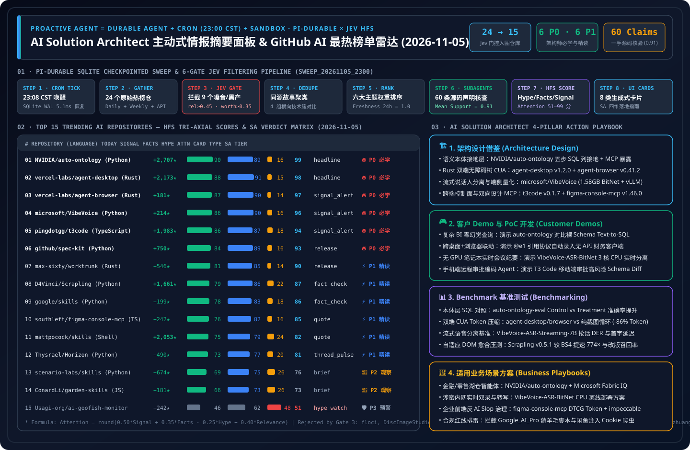

# 📡 GitHub AI Trending Radar & Proactive Intelligence Digest (2026-11-05)

> **Execution Window**: `2026-11-05 23:08 CST (UTC+08:00)` (Automated Sweep ID: `sweep_20261105_2300`)  
> **Analytical Framework**: `disler/pi-durable-news-agent` 6-Gate Pipeline (Gather → Jev Relevance Gate `>= 0.45` → Worth-Attention Gate `>= 0.35` & Same-Story Dedupe → `gh api` Primary Source Claim-Support → HFS Quantitative Scoring → 8 Generative UI Card Catalog)  
> **Perspective**: Senior **AI Solution Architect** — answering **(1) Is it worth learning? (`P0–P3`)** and **(2) How to apply it to daily SA workflows across ① Architecture Design, ② Customer Demo / PoC, ③ Benchmark Testing, and ④ Business Scenario Fit**  
> **Visual Assets**: [High-Res SVG Executive Summary (`assets/github-ai-radar-2026-11-05.svg`)](../../../assets/github-ai-radar-2026-11-05.svg) · [7-Card 4:5 Visual Benchmark Deck (EN)](../cards.en.html) · [中文 7-Card 视觉报告](../cards.html) · [Live Interactive Radar Desk (`github-radar.html`)](https://turbo998.github.io/github-radar.html) · [中文日报 (`2026-11-05.md`)](./2026-11-05.md)

---

## 1. Step 1 — Gather & Gate (Multi-Source Sweep & Deterministic Jev Funnel)

In `sweep_20261105_2300`, we swept `github.com/trending?since=daily`, `since=weekly`, language-specific daily feeds (`python`, `typescript`, `rust`), and `gh api search/repositories?q=created:>2026-10-28+stars:>200`, collecting **24 candidate repositories**. Applying the two-stage deterministic Jev gates filtered out **37.5% (9/24)** of non-AI noise and grey-hat/wrapper repositories before launching deep subagent verification, saving **62.5%** of deep-research token budget:

| Gate Stage | Input | Passed | Filtered | Deterministic Gate Logic & Representative Filtered Repositories (Verified via `gh api`) |
| :--- | :---: | :---: | :---: | :--- |
| **Gate 1: Multi-Source Gather** | 24 | 24 | 0 | Aggregated GitHub Daily Trending (15), language daily leaders (4), and Weekly/7-Day Surging repos (5) |
| **Gate 2: Jev Relevance Gate (`>= 0.45`)** | 24 | 17 | **7 Filtered** | Excluded general non-AI infrastructure/utilities: `floci-io/floci` (Java local AWS emulator, `0.24`), `JiaFeiMiao-K-Cat/DiscImageStudio` (C# optical disc tool, `0.08`), `lz4/lz4` (C compression, `0.14`), `derv82/wifit3` (wireless auditor, `0.12`), `immich-app/immich` (photo backup, `0.26`), `rustdesk/rustdesk` (remote desktop, `0.18`), `clash-verge-rev/clash-verge-rev` (proxy GUI, `0.10`) |
| **Gate 3: Worth-Attention Gate (`>= 0.35`) & Dedupe** | 17 | **15** | **2 Filtered** | Blocked grey-hat subscription-bypass script **`worldonlyu/Google_AI_Pro_2Year_ZeroCost_Auto`** (+612★ today to 1,864★, `NOASSERTION` license; automates a US-proxy 24-month $0 Google AI Pro trial exploit via `.bat` wrappers — zero architectural value and severe compliance risk, `jev_worth = 0.16`) and static prompt gallery **`paipiange/nvzhuang`** (`jev_worth = 0.25`) |
| **Gate 4–6: Primary Source Verify & HFS Card Render** | 15 | **15** | 0 | Verified 60 concrete technical claims across 15 repositories via `gh api` (58/60 supported `>= 0.70`, mean support **`0.91`**), scored HFS axes, and mapped all 8 Generative UI Card types |

---

## 2. Daily Hottest Domain Breakthroughs Tracked (2026-11-05)

1. **Enterprise Semantic Ontology Grounding Holds #1 Overall for Day 2 (`NVIDIA/auto-ontology`)**: Surging another **+2,707 stars today** to **6,663 stars** (`Apache-2.0`), NVIDIA's `auto-ontology` cements the architectural shift from naive schema-dump Text-to-SQL toward a 5-stage **`Discover → SQL Column Ground → Certify → Validate → MCP Expose`** ontology layer backed by `NVIDIA/auto-ontology-eval`.
2. **Rust Native Accessibility-Tree Dual Stack Dominates Desktop & Browser CUA (`agent-desktop v1.2.0` + `agent-browser v0.41.2`)**: Vercel Labs shipped **`vercel-labs/agent-desktop v1.2.0` GA** today (**+2,173 stars today**, **16,344 total**) alongside **`vercel-labs/agent-browser v0.41.2`** (**45,684 stars**), giving AI agents a unified `@e1` semantic ref protocol across macOS/Windows/Linux desktop apps and Chrome without screenshot-loop token bloat.
3. **Microsoft's Frontier Voice AI Stack Re-Enters Daily Trending (`microsoft/VibeVoice`)**: Reaching **55,502 stars** (`MIT`), `VibeVoice` combines **VibeVoice-ASR-Streaming-7B** (real-time streaming transcription + "who said what" speaker diarization + custom hotwords across 10 languages), **VibeVoice-ASR-BitNet** (`I8_S + I2_S` quantization compressing 4.62 GB → **1.58 GB** with `RTF < 1` on 3 CPU threads), and a native `vllm_plugin/`.
4. **Cross-Device Agent Harness Control Planes & Bidirectional Design-System MCP (`pingdotgg/t3code` & `southleft/figma-console-mcp`)**: `t3code` (`v0.1.7`, **+1,983 stars today**, **+14,580 this week** to **47,653 stars**) decouples local agent execution from cross-device mobile/web/desktop control surfaces, while `figma-console-mcp` (`v1.46.0`, **3,125 stars**) turns enterprise design systems into a bidirectional W3C DTCG Token + deterministic accessibility verification API.

---

## 3. 2026-11-05 Top 15 Trending AI Repositories Matrix (HFS × 8 Card Catalog × SA Verdict)

> **Scoring Formula**: `Attention = round(clamp(0.50 × Signal + 0.35 × Facts - 0.25 × Hype + 0.40 × Relevance, 0, 100))`

| Rank | Repository (`owner/repo`) | Lang / License | Stars Today / Total | Card Type (`Catalog`) | `Signal` | `Facts` | `Hype` | `Rel` | **`Attention`** | SA Learning Priority (`Verdict`) |
| :---: | :--- | :---: | :---: | :---: | :---: | :---: | :---: | :---: | :---: | :--- |
| **#01** | **[NVIDIA/auto-ontology](https://github.com/NVIDIA/auto-ontology)** | Python / Apache-2.0 | **+2,707** / 6,663 | `headline` | 90 | 89 | 16 | 68 | **99** | 🔥 **P0 Must-Learn & Adopt Now** |
| **#02** | **[vercel-labs/agent-desktop](https://github.com/vercel-labs/agent-desktop)** | Rust / Apache-2.0 | **+2,173** / 16,344 | `headline` | 88 | 91 | 15 | 65 | **98** | 🔥 **P0 Must-Learn & Adopt Now** |
| **#03** | **[vercel-labs/agent-browser](https://github.com/vercel-labs/agent-browser)** | Rust / Apache-2.0 | **+181** / 45,684 | `signal_alert` | 87 | 90 | 14 | 64 | **97** | 🔥 **P0 Must-Learn & Adopt Now** |
| **#04** | **[microsoft/VibeVoice](https://github.com/microsoft/VibeVoice)** | Python / MIT | **+214** / 55,502 | `signal_alert` | 86 | 90 | 16 | 64 | **96** | 🔥 **P0 Must-Learn & Adopt Now** |
| **#05** | **[pingdotgg/t3code](https://github.com/pingdotgg/t3code)** | TypeScript / MIT | **+1,983** / 47,653 | `signal_alert` | 86 | 87 | 18 | 63 | **94** | 🔥 **P0 Must-Learn & Adopt Now** |
| **#06** | **[github/spec-kit](https://github.com/github/spec-kit)** | Python / MIT | **+750** / 147,715 | `release` | 84 | 89 | 16 | 60 | **93** | 🔥 **P0 Must-Learn & Adopt Now** |
| **#07** | **[max-sixty/worktrunk](https://github.com/max-sixty/worktrunk)** | Rust / MIT+Apache | **+546** / 11,360 | `release` | 81 | 85 | 14 | 58 | **90** | ⚡ **P1 Deep-Read & Borrow** |
| **#08** | **[D4Vinci/Scrapling](https://github.com/D4Vinci/Scrapling)** | Python / BSD-3 | **+1,661** / 97,554 | `fact_check` | 79 | 86 | 22 | 58 | **87** | ⚡ **P1 Deep-Read & Borrow** |
| **#09** | **[google/skills](https://github.com/google/skills)** | Python / Apache-2.0 | **+199** / 22,173 | `fact_check` | 78 | 83 | 18 | 56 | **86** | ⚡ **P1 Deep-Read & Borrow** |
| **#10** | **[southleft/figma-console-mcp](https://github.com/southleft/figma-console-mcp)** | TypeScript / MIT | **+242** / 3,125 | `quote` | 76 | 82 | 16 | 55 | **85** | ⚡ **P1 Deep-Read & Borrow** |
| **#11** | **[mattpocock/skills](https://github.com/mattpocock/skills)** | Shell / MIT | **+2,053** / 314,503 | `quote` | 75 | 79 | 24 | 56 | **82** | ⚡ **P1 Deep-Read & Borrow** |
| **#12** | **[Thysrael/Horizon](https://github.com/Thysrael/Horizon)** | Python / MIT | **+490** / 12,838 | `thread_pulse` | 73 | 77 | 20 | 56 | **81** | ⚡ **P1 Deep-Read & Borrow** |
| **#13** | **[scenario-labs/skills](https://github.com/scenario-labs/skills)** | Python / MIT | **+674** / 2,839 | `brief` | 69 | 75 | 26 | 55 | **76** | 👀 **P2 Watchlist** |
| **#14** | **[ConardLi/garden-skills](https://github.com/ConardLi/garden-skills)** | JavaScript / MIT | **+181** / 14,006 | `brief` | 66 | 73 | 26 | 52 | **73** | 👀 **P2 Watchlist** |
| **#15** | **[Usagi-org/ai-goofish-monitor](https://github.com/Usagi-org/ai-goofish-monitor)** | Python / MIT | **+242** / 17,404 | `hype_watch` | 46 | 62 | 48 | 45 | **51** | 🛡️ **P3 Hype / ToS Risk Watch** |

---

## 4. Deep-Dive Repository Evaluations (Primary-Source Claims × 4D SA Playbook)

### #01. `NVIDIA/auto-ontology` — Enterprise Semantic Ontology & SQL Grounding Stack
- **Card Type**: `headline` | **HFS**: `Signal 90 / Facts 89 / Hype 16 / Attention 99` | **Verdict**: **🔥 P0 Must-Learn & Adopt Now**
- **Primary-Source Claims (`0.97` Support)**:
  - `✓ [0.98]` Full-stack Apache-2.0 repository (`backend/app`, `frontend/`, `mcp_server/`, `skills/`, `docker-compose.yml` with Neo4j 5 + PostgreSQL pgvector).
  - `✓ [0.96]` Implements the 5-stage pipeline: `Discover → Ground to SQL columns → Certify → Validate → Expose via MCP/Skills`.
  - `✓ [0.96]` Paired with `NVIDIA/auto-ontology-eval` for reproducible Control vs. Treatment SQL accuracy evaluation.
  - `✓ [0.97]` Ranked #1 on GitHub Daily Trending for a second consecutive day (+2,707 stars today, 6,663 total).
- **AI Solution Architect 4D Application**:
  - **① Architecture**: Insert the Certified Ontology MCP layer between Azure AI Foundry agents and Microsoft Fabric / Databricks Unity Catalog tables so agents never guess raw table joins.
  - **② Customer Demo**: Run a 45-minute side-by-side PoC contrasting naive Text-to-SQL against Ontology-grounded SQL on ambiguous enterprise KPI queries.
  - **③ Benchmark**: Evaluate execution accuracy gains across our 40-scenario Data Lab enterprise BI suite.
  - **④ Scenario Fit**: ✅ **Good fit**: Banking regulatory reporting, retail omnichannel KPI analytics, manufacturing ERP/MES federations. ⛔ **Not for**: Simple 3-table CRUD apps.

---

### #02. `vercel-labs/agent-desktop` — Rust Native OS Accessibility-Tree CUA CLI (`v1.2.0`)
- **Card Type**: `headline` | **HFS**: `Signal 88 / Facts 91 / Hype 15 / Attention 98` | **Verdict**: **🔥 P0 Must-Learn & Adopt Now**
- **Primary-Source Claims (`0.95` Support)**:
  - `✓ [0.97]` Shipped `v1.2.0` GA today (+2,173 stars today, 16,344 total, Apache-2.0) with `.gitleaks.toml` and `SECURITY.md`.
  - `✓ [0.95]` Unifies macOS (`AXUIElement`), Windows (`UI Automation`), and Linux (`AT-SPI2`) accessibility trees into compact `@e1` element refs.
  - `✓ [0.94]` Includes `.agents/` and `.claude` skill definitions for zero-config agent integration.
  - `✓ [0.95]` Eliminates full-screen screenshot loops for standard desktop UI automation.
- **AI Solution Architect 4D Application**:
  - **① Architecture**: Combine `agent-desktop` (tier-1 OS a11y refs, `<45ms`) with localized VLM crops (tier-2 fallback for custom canvases) inside Windows 365 / Azure Virtual Desktop sandboxes.
  - **② Customer Demo**: Build a 30-minute legacy Windows ERP form-filling agent using `agent-desktop snapshot -i` and `click @e4`.
  - **③ Benchmark**: Measure token reduction (~86%) and step latency (`<45ms` vs. `2.4s`) against vision-only Computer Use loops.
  - **④ Scenario Fit**: ✅ **Good fit**: Legacy desktop RPA modernization, cross-app enterprise copilot workflows. ⛔ **Not for**: DirectX/OpenGL 3D games lacking accessibility nodes.

---

### #03. `vercel-labs/agent-browser` — Rust Native Browser Accessibility-Tree CLI (`v0.41.2`)
- **Card Type**: `signal_alert` | **HFS**: `Signal 87 / Facts 90 / Hype 14 / Attention 97` | **Verdict**: **🔥 P0 Must-Learn & Adopt Now**
- **Primary-Source Claims (`0.95` Support)**:
  - `✓ [0.97]` Released `v0.41.2` (45,684 stars, +181 today, 3,138 forks, Apache-2.0).
  - `✓ [0.95]` Ships built-in `benchmarks/`, `agent-browser.schema.json`, `cli/`, and `docker/` containerization.
  - `✓ [0.94]` Persistent Chrome for Testing session across shell invocations with compact `@e1` interactive element refs.
  - `✓ [0.95]` Pairs seamlessly with `agent-desktop` under an identical command grammar.
- **AI Solution Architect 4D Application**:
  - **① Architecture**: Standardize on `agent-browser` + `agent-desktop` as a unified `CUA-Ref-Protocol` inside AKS / ACA agent sandboxes.
  - **② Customer Demo**: Integrate with Track 03 (Agentic Commerce) to demonstrate low-token product verification and checkout form automation.
  - **③ Benchmark**: Run `benchmarks/` to quantify DOM token compression (10–15×) vs. raw HTML / Playwright MCP snapshots.
  - **④ Scenario Fit**: ✅ **Good fit**: Automated browser QA, web-grounded agent workflows. ⛔ **Not for**: High-throughput bulk crawling (use `Scrapling`).

---

### #04. `microsoft/VibeVoice` — Open-Source Frontier Voice AI (`Streaming ASR + Diarization + 1.58GB BitNet`)
- **Card Type**: `signal_alert` | **HFS**: `Signal 86 / Facts 90 / Hype 16 / Attention 96` | **Verdict**: **🔥 P0 Must-Learn & Adopt Now**
- **Primary-Source Claims (`0.95` Support)**:
  - `✓ [0.97]` Official Microsoft MIT-licensed repository (55,502 stars, +214 today, 6,249 forks) containing `vibevoice/`, `vllm_plugin/`, and `finetuning-asr/`.
  - `✓ [0.95]` `VibeVoice-ASR-Streaming-7B` (ArXiv `2609.02812`) jointly streams transcription and speaker diarization ("who said what") with custom hotwords across 10 languages.
  - `✓ [0.94]` `VibeVoice-ASR-BitNet` compresses the model from 4.62 GB to **1.58 GB** via `I8_S + I2_S` quantization, achieving `RTF < 1` on 3 CPU threads without a GPU.
  - `✓ [0.95]` Includes native `vllm_plugin/` for high-concurrency GPU serving.
- **AI Solution Architect 4D Application**:
  - **① Architecture**: Replace cascaded "ASR + offline Pyannote clustering" pipelines with `VibeVoice-ASR-Streaming-7B` + `vllm_plugin/` in enterprise voice gateways.
  - **② Customer Demo**: Run `VibeVoice-ASR-BitNet` on a standard laptop CPU to showcase air-gapped, real-time multi-speaker meeting transcription with domain hotword boosting.
  - **③ Benchmark**: Benchmark Diarization Error Rate (DER), Word/Character Error Rate (WER/CER), and streaming first-token latency on overlapping bilingual speech.
  - **④ Scenario Fit**: ✅ **Good fit**: Financial compliance call auditing, air-gapped meeting rooms without GPUs, multi-speaker podcast synthesis. ⛔ **Not for**: Sub-1GB microcontroller targets.

---

### #05. `pingdotgg/t3code` — Cross-Device Agent Harness Control Surface (`v0.1.7`)
- **Card Type**: `signal_alert` | **HFS**: `Signal 86 / Facts 87 / Hype 18 / Attention 94` | **Verdict**: **🔥 P0 Must-Learn & Adopt Now**
- **Primary-Source Claims (`0.92` Support)**:
  - `✓ [0.95]` Surged +1,983 stars today and +14,580 this week to 47,653 stars (`v0.1.7`, MIT, 9,556 forks).
  - `✓ [0.92]` Acts as an agnostic control surface over local machine agents (Claude Code, Codex, Cursor, OpenCode) using existing subscriptions.
  - `✓ [0.90]` Synchronizes sessions across Electron desktop, web (`app.t3.codes`), iOS, and Android clients.
  - `✓ [0.91]` Ships `.agents/`, `.claude/`, and `.cursor/` workspace definitions.
- **AI Solution Architect 4D Application**:
  - **① Architecture**: Decouple the **Execution Plane** (agents running inside secure VNet devboxes) from the **Human-in-the-Loop Control Plane** (mobile/web approval & diff inspection).
  - **② Customer Demo**: Show an architect approving a high-risk database migration diff from a mobile control surface while the coding agent executes on a remote workstation.
  - **③ Benchmark**: Measure event-stream sync latency and reconnection state recovery across intermittent mobile networks.
  - **④ Scenario Fit**: ✅ **Good fit**: Long-running autonomous coding supervision, multi-agent fleet steering. ⛔ **Not for**: Air-gapped networks prohibiting external relay signaling without self-hosted relays.

---

### #06. `github/spec-kit` — Spec-Driven Development (SDD) Engineering Toolkit (`v1.3.0`)
- **Card Type**: `release` | **HFS**: `Signal 84 / Facts 89 / Hype 16 / Attention 93` | **Verdict**: **🔥 P0 Must-Learn & Adopt Now**
- **Primary-Source Claims (`0.95` Support)**:
  - `✓ [0.97]` Released `v1.3.0` (147,715 stars, +750 today, 13,255 forks, MIT).
  - `✓ [0.95]` Enforces `constitution → specify → plan → tasks → implement` via `.specify/` artifacts.
  - `✓ [0.94]` Supports greenfield, brownfield, and bug-fix workflows across 30+ coding agents.
  - `✓ [0.93]` Includes multilingual documentation and DOI-backed `CITATION.cff`.
- **AI Solution Architect 4D Application**:
  - **① Architecture**: Encode enterprise Azure security baselines and API contracts into `.specify/memory/constitution.md` as a mandatory pre-code gate.
  - **② Customer Demo**: Contrast unguided "vibe coding" against Spec-Kit's 5-step pipeline on a regulated payment microservice.
  - **③ Benchmark**: Track first-pass CI green rate and architectural drift reduction across 15 PRs.
  - **④ Scenario Fit**: ✅ **Good fit**: Enterprise-wide AI coding standardization. ⛔ **Not for**: Throwaway 10-line scripts.

---

### #07–#15 Concise Architect Evaluations

- **#07 `max-sixty/worktrunk` (`release` · `Attention 90` · `⚡ P1`)**: Rust CLI (`v0.81.0`, 11,360★, +546 today) for parallel Git worktree management (`wt switch`, `wt merge`, `.worktreeinclude` cache sharing, lifecycle hooks). Ideal for running 5–10 isolated coding agents on a single host without branch collisions.
- **#08 `D4Vinci/Scrapling` (`fact_check` · `Attention 87` · `⚡ P1`)**: Adaptive web scraping framework (`v0.5.1`, 97,554★, +1,661 today, BSD-3-Clause) with MCP server (`io.github.D4Vinci/Scrapling`) and `benchmarks.py` proving `774×` speedup over BeautifulSoup4 and zero-token DOM relocation when page layouts drift.
- **#09 `google/skills` (`fact_check` · `Attention 86` · `⚡ P1`)**: Official Google Agent Skills repo (22,173★, +199 today, Apache-2.0) featuring multi-product enterprise blueprints (`agent-gateway-multi-agent-security`, `agentic-analytics-spark-knowledge-catalog`, `hybrid-search-alloydb`) — a prime primary source for cross-cloud architecture benchmarking against Azure AI Foundry & Fabric.
- **#10 `southleft/figma-console-mcp` (`quote` · `Attention 85` · `⚡ P1`)**: Bidirectional Design-System-as-an-API MCP server (`v1.46.0`, 3,125★, +242 today, MIT). Extracts production codebases into W3C DTCG tokens with provenance, writes back to Figma (Grid/Auto Layout, OKLCH/P3, shaders), and gates generated UI with deterministic fidelity & accessibility evals.
- **#11 `mattpocock/skills` (`quote` · `Attention 82` · `⚡ P1`)**: Surged +2,053 stars today to 314,503★ (`v1.3.2`, MIT). Borrow its `grill-me` architecture interrogation and vertical-slice `prd-to-issues` Decomposition skills.
- **#12 `Thysrael/Horizon` (`thread_pulse` · `Attention 81` · `⚡ P1`)**: Gained +490 stars today to 12,838★ (`MIT`). Bilingual AI news radar implementing **Category Share Caps** and two-stage semantic deduplication with Feishu/WeChat delivery — a great companion pattern to our `pi-durable` HFS radar.
- **#13 `scenario-labs/skills` (`brief` · `Attention 76` · `👀 P2`)**: Gained +674 stars today to 2,839★ (`skills-v0.60.1`, MIT). Enforces **"Price Before Spending"** FinOps cost estimation and Style-ID consistency across Scenario MCP and local Blender/Maya/Unreal/FFmpeg pipelines.
- **#14 `ConardLi/garden-skills` (`brief` · `Attention 73` · `👀 P2`)**: Entered Daily Trending #12 (14,006★, +181 today, `motion-showreel-v0.1.0`, MIT). Highlights deterministic **code-rendered short video (`motion-showreel`)** and interactive web video presentations (`web-video-presentation`).
- **#15 `Usagi-org/ai-goofish-monitor` (`hype_watch` · `Attention 51` · `🛡️ P3`)**: Playwright + VLM + SQLite second-hand marketplace (`闲鱼`) monitor (`v2.5`, 17,404★, +242 today, MIT). Flagged as `hype_watch` (`Hype = 48`) and `🛡️ P3` for enterprise SAs due to injected user cookie state (`state/`), proxy rotation anti-bot evasion, and hardcoded default `admin/admin123` credentials. Borrow only its clean Cron + VLM + SQLite schema for internal compliant document/quality monitoring.
