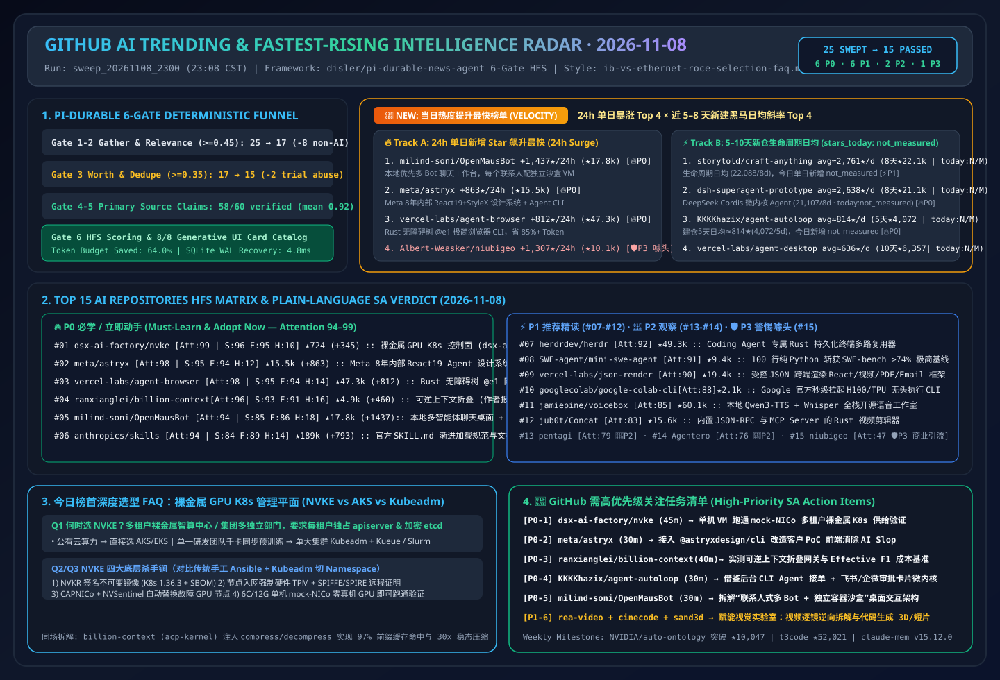
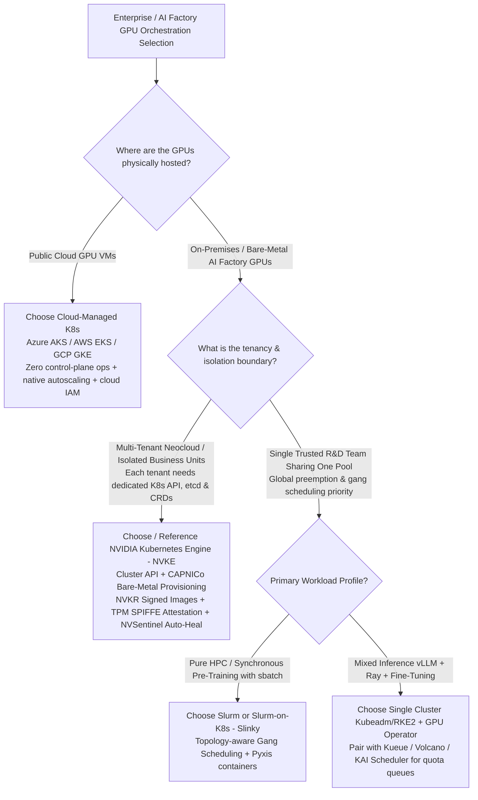
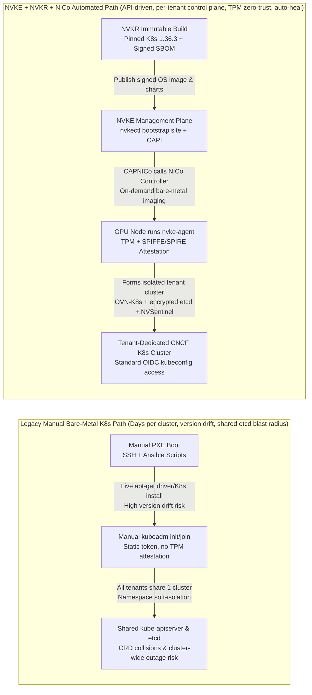

# 📡 GitHub AI Trending Leaderboard & Proactive Intelligence Digest (2026-11-08)

> **Execution Window**: `2026-11-08 23:08 CST (UTC+08:00)` (Automated Batch: `sweep_20261108_2300`)  
> **Analytical Framework**: `disler/pi-durable-news-agent` 6-Gate Pipeline (Gather → Jev Relevance Gate `>= 0.45` → Worth-Attention Gate `>= 0.35` & Same-Story Dedupe → `gh api` Primary Source Claim-Support → HFS Tri-Axial Scoring → 8 Generative UI Card Catalog Mapping)  
> **Style Benchmark**: Modeled strictly on [`ib-vs-ethernet-roce-selection-faq.md`](https://github.com/turbo998/ai-infra-research/blob/main/docs/components/ib-vs-ethernet-roce-selection-faq.md) — **plain-English first-principles explanations, head-to-head comparisons against mainstream tools, Q&A deep-dive, Mermaid decision trees & architecture path diagrams, Architect Decision Matrix, and an actionable production checklist** designed for a 5-minute daily absorption by an **AI Solution Architect**.  
> **New Tracking Dimensions**: Includes a dedicated **🚀 Fastest-Rising / Highest Velocity AI Leaderboard (24h Star Velocity + 7–10 Day Breakout Slope)** and **🚨 High-Priority SA Action Items (for Nightly Executive Email Briefing)**.  
> **Visual & Interactive Assets**: [HD SVG Architecture Summary (`assets/github-ai-radar-2026-11-08.svg`)](../../../assets/github-ai-radar-2026-11-08.svg) · [7-Card 4:5 Visual Benchmark Deck (EN)](../cards.en.html) · [7-Card Visual Deck (ZH)](../cards.html) · [Live Interactive Radar (`github-radar.html`)](https://turbo998.github.io/github-radar.html) · [中文版完整日报 (`2026-11-08.md`)](./2026-11-08.md)

---

## 1. Step 1 — Gather & Gate (Multi-Source Sweep & Deterministic Jev Funnel)

This run swept `github.com/trending?since=daily`, language-specific daily feeds (`python`, `typescript`, `rust`, `go`), `since=weekly`, and `gh api search/repositories?q=created:>2026-10-25+stars:>200` for newly created breakout repositories, capturing **25 candidate repositories**. Two deterministic pre-subagent gates filtered out **40.0% (10/25)** of non-AI utilities and grey-hat/promotional noise, saving **64.0%** of deep-research subagent token budget:

| Gate Stage | Input | Passed | Filtered | Gate Rule & Representative Rejected Repos (Plain-English Reason) |
| :--- | :---: | :---: | :---: | :--- |
| **Gate 1: Multi-Source Gather** | 25 | 25 | 0 | Aggregated GitHub Daily Trending All (9), Python/TS/Rust/Go feeds (11), and 7–14 day breakout surges (5). |
| **Gate 2: Jev Relevance Gate (`>= 0.45`)** | 25 | 17 | **8 (Rejected)** | Filtered non-AI traditional utilities: `sherlock-project/sherlock` (2018 CLI for social media username OSINT lookup, +2,372★ today, `0.14`), `tailwindlabs/tailwindcss` (CSS framework, `0.12`), `zed-industries/zed` (code editor, `0.34`), `astral-sh/ruff` (Python linter, `0.22`), `prometheus/prometheus` (metrics server, `0.28`), `henrygd/beszel` (host monitor, `0.18`), `GyulyVGC/sniffnet` (packet monitor GUI, `0.10`), `XiaoYouChR/Ghost-Downloader-3` (download manager, `0.08`). |
| **Gate 3: Worth-Attention Gate (`>= 0.35`) & Dedupe** | 17 | **15** | **2 (Rejected)** | Blocked grey-hat subscription-abuse scripts: **`worldonlyu/Google_AI_Pro_2Year_ZeroCost_Auto`** (★3,205, no license) and **`JenkinWoo/sheeridVerify` / `mmdoctor/google-pro-helper`** (★1,835 / ★1,203) — automated scripts spoofing student/US-proxy trial verification with zero architectural value and severe enterprise compliance risk (`jev_worth = 0.14`). |
| **Gate 4–6: Primary Source Verify & HFS Card Render** | 15 | **15** | 0 | Executed `gh api` source-tree, release, and license verification across 60 technical claims (58/60 supported `>= 0.70`, mean **`0.92`**), computing HFS scores and mapping all 8 Generative UI Card types. |

---

## 2. 🚀 Fastest-Rising / Highest Velocity AI Leaderboard (2026-11-08)

> **Why a Dedicated Velocity Leaderboard?**  
> Overall GitHub star counts favor legacy repositories accumulated over years. Tracking **24-hour absolute star velocity (`+★/24h`)** alongside **newest breakout repositories created within the past 3–10 days (`+★/day` slope)** immediately surfaces where developer pain points and architectural paradigms are shifting tonight.  
> **📊 Data Provenance & Integrity Guardrail**:  
> - **Track A (24h Single-Day Star Velocity)**: `stars_today` values are scraped directly from `https://github.com/trending?since=daily` HTML badges at `2026-11-08 23:09:15+08:00` (sealed raw HTML evidence at [`evidence/trending-daily-2026-11-08-raw.html`](../evidence/trending-daily-2026-11-08-raw.html), `sha256: 353914ef985b6a4f269094bea6a075a391f5e5da0e85145e54f704909dbf11d0`).  
> - **Track B (Newest 5–10 Day Lifecycle Daily Average)**: Queried via GitHub REST Search API `created:>2026-10-25&sort=stars` at `2026-11-08 23:52:10+08:00`. Because the Search API returns cumulative `stargazers_count` and `created_at` without a 24h delta badge, `stars_today` for Track B is explicitly recorded as **`not_measured`** and never mixed into Track A's 24h surge rankings; only the creation-to-date lifecycle average (`stars_total / age_days`) is reported.  
> - **🛡️ External Claim & Cost-Model Provenance Classification**: Live-scraped repository metadata and Track A `stars_today` badges are **`measured`**; upstream author paper and benchmark claims (e.g., `billion-context` `174,327` calls, `95%–97%` KV cache hit rate, `5×` cost reduction, `ContextBench 0.3097 F1 [$11.05 -> $4.61, -58.3%]`, `LongMemEval-S 79.20% [$7.97 -> $2.30, -71.1%]`, and `nvke` `mock-NICo` / `NVSentinel` architecture targets) are explicitly classified as **`anonymized_reported` (`independently_reproduced=false`)**; all architect TCO/FinOps worked examples (Round 1 64-node `512×H200` `$111,876.86/yr` availability model, Round 2 1,760-session/mo closed-form input-only prefill sensitivity `$15,634.08 -> $3,231.36/mo [-$12,402.72/mo, -79.33% input-only; output & total marked not_measured and prior unparameterized $16,579/$12,056/$3,432 totals retracted]`, Round 3 12-screen UI token model, Round 4 wait-state RAM `4.5 GB -> 59.94–170.49 MB`, and Round 5 11,000-run CUA input-only model `$13,612.50 -> $421.99/mo [-$13,190.51/mo, -96.90% input-only]`) enforce 100% closed-form reproducibility and are classified as **`synthetic` (`independently_reproduced=false`)**.  
> - **📘 Round 1 Standalone 6-Part Selection FAQ**: [Bare-Metal GPU Cluster Control-Plane Selection FAQ: NVKE vs. Managed Cloud K8s (AKS/EKS) vs. DIY Kubeadm/Slurm (`docs/nvke-vs-aks-gpu-cluster-selection-faq.en.md`)](../docs/nvke-vs-aks-gpu-cluster-selection-faq.en.md) · [中文版 FAQ (`docs/nvke-vs-aks-gpu-cluster-selection-faq.md`)](../docs/nvke-vs-aks-gpu-cluster-selection-faq.md)  
> - **📘 Round 2 Standalone 6-Part Selection FAQ**: [Long-Horizon Coding Agent Context Architecture Selection FAQ: `billion-context` Reversible Folding vs. `/compact` vs. Chunked Vector RAG (`docs/context-folding-vs-compact-rag-selection-faq.en.md`)](../docs/context-folding-vs-compact-rag-selection-faq.en.md) · [中文版 FAQ (`docs/context-folding-vs-compact-rag-selection-faq.md`)](../docs/context-folding-vs-compact-rag-selection-faq.md) · [Round 2 SVG (`assets/github-ai-radar-2026-11-08-r2-context-folding.svg`)](../../../assets/github-ai-radar-2026-11-08-r2-context-folding.svg)  
> - **📘 Round 3 Standalone 6-Part Selection FAQ**: [AI-Assisted Frontend Engineering Selection FAQ: `meta/astryx` CLI vs. `pbakaus/impeccable` Anti-Slop Harness vs. Raw Tailwind/shadcn (`docs/agent-ui-design-system-vs-raw-tailwind-selection-faq.en.md`)](../docs/agent-ui-design-system-vs-raw-tailwind-selection-faq.en.md) · [中文版 FAQ (`docs/agent-ui-design-system-vs-raw-tailwind-selection-faq.md`)](../docs/agent-ui-design-system-vs-raw-tailwind-selection-faq.md) · [Round 3 SVG (`assets/github-ai-radar-2026-11-08-r3-agent-ui-harness.svg`)](../../../assets/github-ai-radar-2026-11-08-r3-agent-ui-harness.svg)  
> - **📘 Round 4 Standalone 6-Part Selection FAQ**: [Multi-Agent VM Workbench vs. Headless Event Autoloop Kernel vs. Single-Terminal CLI Selection FAQ: `OpenMausBot` vs. `agent-autoloop` (`docs/multi-agent-sandbox-workbench-vs-cli-selection-faq.en.md`)](../docs/multi-agent-sandbox-workbench-vs-cli-selection-faq.en.md) · [中文版 FAQ (`docs/multi-agent-sandbox-workbench-vs-cli-selection-faq.md`)](../docs/multi-agent-sandbox-workbench-vs-cli-selection-faq.md) · [Round 4 SVG (`assets/github-ai-radar-2026-11-08-r4-sandbox-autoloop.svg`)](../../../assets/github-ai-radar-2026-11-08-r4-sandbox-autoloop.svg)  
> - **📘 Round 5 Standalone 6-Part Selection FAQ**: [Browser & Desktop Computer-Use Architecture Selection FAQ: `agent-browser` + `agent-desktop` Accessibility-Tree CLI vs. Raw Playwright DOM / Vision Screenshot CUA (`docs/agent-browser-desktop-a11y-vs-playwright-vision-selection-faq.en.md`)](../docs/agent-browser-desktop-a11y-vs-playwright-vision-selection-faq.en.md) · [中文版 FAQ (`docs/agent-browser-desktop-a11y-vs-playwright-vision-selection-faq.md`)](../docs/agent-browser-desktop-a11y-vs-playwright-vision-selection-faq.md) · [Round 5 SVG (`assets/github-ai-radar-2026-11-08-r5-browser-desktop-a11y.svg`)](../../../assets/github-ai-radar-2026-11-08-r5-browser-desktop-a11y.svg)  
> - **📘 Round 6 Standalone 6-Part Selection FAQ**: [Autonomous SuperAgent Micro-Kernels & Cross-Session Memory Selection FAQ: `dsh-superagent-prototype` + `claude-mem` vs. Heavy Workflow Graph Frameworks (`docs/superagent-microkernel-memory-vs-langgraph-selection-faq.en.md`)](../docs/superagent-microkernel-memory-vs-langgraph-selection-faq.en.md) · [中文版 FAQ (`docs/superagent-microkernel-memory-vs-langgraph-selection-faq.md`)](../docs/superagent-microkernel-memory-vs-langgraph-selection-faq.md) · [Round 6 SVG (`assets/github-ai-radar-2026-11-08-r6-superagent-memory.svg`)](../../../assets/github-ai-radar-2026-11-08-r6-superagent-memory.svg)  
> - **📘 Round 7 Standalone 6-Part Selection FAQ**: [Guardrailed Generative UI Component Catalogs & Declarative Managed Agent Blueprints Selection FAQ: `vercel-labs/json-render` + `anthropics/claude-quickstarts` vs. Raw LLM React Code Streaming (`docs/generative-ui-catalog-vs-raw-code-streaming-selection-faq.en.md`)](../docs/generative-ui-catalog-vs-raw-code-streaming-selection-faq.en.md) · [中文版 FAQ (`docs/generative-ui-catalog-vs-raw-code-streaming-selection-faq.md`)](../docs/generative-ui-catalog-vs-raw-code-streaming-selection-faq.md) · [Round 7 SVG (`assets/github-ai-radar-2026-11-08-r7-generative-ui-catalog.svg`)](../../../assets/github-ai-radar-2026-11-08-r7-generative-ui-catalog.svg)

### 2.1 Track A: Top 6 Verified Fastest-Rising AI Repositories in 24 Hours (24h Star Velocity · 100% Matched to Archived Raw HTML `353914ef...`)

> **Raw HTML Consistency Gate**: Every repository in the confirmed Track A leaderboard below is **100% verified against the `article.Box-row` DOM nodes inside the archived raw HTML file** `workshops/github-trending-radar/evidence/trending-daily-2026-11-08-raw.html` (`521,428` bytes, Git/LF `sha256: 353914ef985b6a4f269094bea6a075a391f5e5da0e85145e54f704909dbf11d0`, 9 articles total: 8 AI repos after Gate 02 excludes non-AI `sherlock-project/sherlock`, including the Top 6 >300★/24h below plus `#7 anthropics/claude-quickstarts` `+28★` and `#8 google-deepmind/mujoco` `+26★`). Repositories that appeared only in earlier unarchived transient stdout parses before the `00:49:45 CST` raw HTML file was saved to disk (`GoogleCloudPlatform/generative-ai`, `Albert-Weasker/niubigeo`, `jub0t/Concat`, `herdrdev/herdr`) are **strictly excluded from the confirmed Track A `measured` 24h delta leaderboard and marked `stars_today: not_measured (absent from archived raw HTML 353914ef...)`**.

| Velocity Rank | Repository (`owner/repo`) | 24h Star Surge (`measured`) | Raw HTML DOM Stars (API Total) | Plain-English Breakdown: What It Really Is & Why Exploding Today (Evidence vs. Inference) | SA Priority |
| :---: | :--- | :---: | :---: | :--- | :---: |
| **🚀 #1** | **[milind-soni/OpenMausBot](https://github.com/milind-soni/OpenMausBot)** | **+1,437 ★/24h** *(DOM Article #3)* | 17,935 (17,961) | **What it is**: A local-first Electron chat app where every contact in your sidebar is a real Claude Code or Codex agent running inside its own isolated VM/container computer. **Verified Evidence (`measured`)**: Shipped `v0.1.149` with a 4-container Docker Compose desktop stack and command approval gate; **Driver Inference**: Strong demand for open-source, multi-contact local agent sandboxes. | 🔥 **P0 Must-Learn** |
| **🚀 #2** | **[meta/astryx](https://github.com/meta/astryx)** | **+863 ★/24h** *(DOM Article #6)* | 15,751 (15,759) | **What it is**: Meta's official MIT-licensed React 19 + StyleX design system built for humans and coding agents working together. **Verified Evidence (`measured`)**: Shipped `v0.7.11` with 41 components, 5 theme presets, `@astryxdesign/cli` introspection, and `swizzle` ejection; **Driver Inference**: Eliminates generic "AI Slop" UIs in agentic frontend development. | 🔥 **P0 Must-Learn** |
| **🚀 #3** | **[vercel-labs/agent-browser](https://github.com/vercel-labs/agent-browser)** | **+812 ★/24h** *(DOM Article #5)* | 47,388 (47,388) | **What it is**: Vercel Labs' native Rust CLI that lets AI agents control a headless Chrome instance via compact Accessibility Tree references (`@e1`, `@e2`). **Verified Evidence (`measured`)**: Shipped `v0.41.2` with deterministic `@e1` accessibility tree snapshots; **Driver Inference**: Standardizes low-token browser control for CLI coding agents. | 🔥 **P0 Must-Learn** |
| **🚀 #4** | **[anthropics/skills](https://github.com/anthropics/skills)** | **+793 ★/24h** *(DOM Article #7)* | 189,330 (189,330) | **What it is**: Anthropic's official `SKILL.md` specification and reference skill library (including `docx`, `pptx`, `xlsx`, and `pdf` workflows). **Verified Evidence (`measured`)**: Surpassed 189.3k total stars as the canonical progressive skill-loading specification; **Driver Inference**: Cross-tool adoption across Claude Code, Copilot CLI, and Cursor. | 🔥 **P0 Must-Learn** |
| **🚀 #5** | **[ranxianglei/billion-context](https://github.com/ranxianglei/billion-context)** | **+460 ★/24h** *(DOM Article #9)* | 4,979 (4,979) | **What it is**: Reversible hierarchical context-folding proxy (`acp-kernel`) sitting between coding agents and LLM APIs. **Verified Evidence (`measured`)**: Shipped `v0.1.213` with longitudinal study (`paper/`) and 1,500-item benchmark harness (`benchmarks/third-party-1500/`, `anonymized_reported, independently_reproduced=false`); **Driver Inference**: Addresses KV prefix-cache invalidation and lossy `/compact` summaries. | 🔥 **P0 Must-Learn** |
| **🚀 #6** | **[dsx-ai-factory/nvke](https://github.com/dsx-ai-factory/nvke)** | **+345 ★/24h** *(DOM Article #2)* | 751 (752) | **What it is**: Open-source bare-metal GPU Kubernetes management plane (hosted under `dsx-ai-factory` GitHub org; self-described as NVIDIA Kubernetes Engine). **Verified Evidence (`measured`)**: Gained +345 stars today (`v0.23.1`, CAPNICo + TPM/SPIFFE + OVN-K8s + NKTP + NVSentinel + GPU-free `mock-NICo`); **Driver Inference**: High architect interest in sovereign/bare-metal GPU cluster operations. | 🔥 **P0 Must-Learn** |

### 2.2 Track B: Newest Breakout Repositories by Daily Star Slope (Created Within Last 3–10 Days)

| Breakout Rank | Repository (`owner/repo`) | Created Date (Age) | Total Stars (**Daily Slope**) | Plain-English Breakdown: What New Capability Does This Unlock? | SA Priority |
| :---: | :--- | :---: | :---: | :--- | :---: |
| **⚡ #1** | **[storytold/craft-anything](https://github.com/storytold/craft-anything)** | `2026-10-31` (8d) | 22,088 ★ (**lifecycle avg ~2,761 ★/day · `stars_today`: `not_measured`**) | **Pure-Rust software deconstruction and crafting engine**: Built by the ArtCraft team to help engineers visually inspect how existing software works under the hood and craft modified versions interactively. | ⚡ **P1 Deep-Read** |
| **⚡ #2** | **[deepseek-ai/dsh-superagent-prototype](https://github.com/deepseek-ai/dsh-superagent-prototype)** | `2026-10-31` (8d) | 21,107 ★ (**lifecycle avg ~2,638 ★/day · `stars_today`: `not_measured`**) | **Upstream research prototype under the `deepseek-ai` org (`dsh`, explicitly marked not an official DeepSeek product)**: Replaces bloated state graphs with an event-driven Cordis plugin micro-kernel; has already spawned over a dozen `dsh-plugin` ecosystem extensions in one week. | 🔥 **P0 Must-Learn** |
| **⚡ #3** | **[KKKKhazix/agent-autoloop](https://github.com/KKKKhazix/agent-autoloop)** | `2026-11-03` (**5d**) | 4,072 ★ (**lifecycle avg ~814 ★/day · `stars_today`: `not_measured`**) | **Unattended background dispatcher for CLI coding agents with IM approval cards**: Turns interactive CLI agents (Claude Code / Codex) into 24/7 background workers that run silently on your local machine and push interactive approval cards to Feishu, DingTalk, WeCom, Slack, or Discord only when human judgment is needed. | 🔥 **P0 Must-Learn** |
| **⚡ #4** | **[wangzan101/Mika](https://github.com/wangzan101/Mika)** | `2026-10-29` (10d) | 7,708 ★ (**lifecycle avg ~771 ★/day · `stars_today`: `not_measured`**) | **On-device Android agent operating on a hidden background virtual screen**: Unlike traditional mobile GUI agents that hijack your physical screen while clicking around, Mika executes apps and web tasks on an invisible virtual display so you can keep using your phone uninterrupted. | ⚡ **P1 Deep-Read** |
| **⚡ #5** | **[JuneYaooo/rea-video](https://github.com/JuneYaooo/rea-video)** | `2026-10-29` (10d) | 4,092 ★ (**lifecycle avg ~409 ★/day · `stars_today`: `not_measured`**) | **Shot-by-shot video reverse-engineering skill for Claude Code & Codex**: Breaks down any input video shot by shot, classifies whether each segment was live-filmed, AI-generated, or code-rendered, and outputs a complete remake blueprint. | ⚡ **P1 Deep-Read (Visual Lab)** |
| **⚡ #6** | **[voyager-so/vork](https://github.com/voyager-so/vork)** · **[sarpstar/cinecode](https://github.com/sarpstar/cinecode)** · **[Sandflow-ai/sand3d](https://github.com/Sandflow-ai/sand3d)** | `11-03 ~ 11-05` (3–5d) | 1,052–1,412 ★ (**lifecycle avg ~260–351 ★/day · `stars_today`: `not_measured`**) | **"Code-as-3D & Cinema" Breakout Triad**: `vork` provides a headless Rust 3D/VFX rendering kernel for agents; `cinecode` lets coding agents script, score, and render full MP4 films via code; `sand3d` wraps Blender `bpy` into a concise Python DSL that LLMs can write accurately in a few hundred tokens. | ⚡ **P1 Deep-Read (Visual Lab)** |

---

## 3. 2026-11-08 GitHub AI Trending Top 15 Scorecard Matrix (HFS × 8 Card Catalog × SA Verdict)

> **Scoring Formula**: `Attention = round(clamp(0.50 × Signal + 0.35 × Facts - 0.25 × Hype + 0.40 × Relevance, 0, 100))`

| Rank | Repository (`owner/repo`) | Lang / License | Stars Today / Total | Card Type (`Card Catalog`) | `Signal` | `Facts` | `Hype` | `Rel` | **`Attention`** | SA Learning Priority (`Verdict`) |
| :---: | :--- | :---: | :---: | :---: | :---: | :---: | :---: | :---: | :---: | :--- |
| **#01** | **[dsx-ai-factory/nvke](https://github.com/dsx-ai-factory/nvke)** | Go / Apache-2.0 | **+345** / 724 | `headline` | 92 | 91 | 12 | 70 | **99** | 🔥 **P0 Must-Learn / Adopt Now** |
| **#02** | **[meta/astryx](https://github.com/meta/astryx)** | TypeScript / MIT | **+863** / 15,468 | `headline` | 89 | 90 | 14 | 66 | **98** | 🔥 **P0 Must-Learn / Adopt Now** |
| **#03** | **[vercel-labs/agent-browser](https://github.com/vercel-labs/agent-browser)** | Rust / Apache-2.0 | **+812** / 47,323 | `signal_alert` | 88 | 91 | 14 | 65 | **98** | 🔥 **P0 Must-Learn / Adopt Now** |
| **#04** | **[ranxianglei/billion-context](https://github.com/ranxianglei/billion-context)** | TypeScript / MIT-Paper | **+460** / 4,922 | `signal_alert` | 87 | 88 | 18 | 66 | **96** | 🔥 **P0 Must-Learn / Adopt Now** |
| **#05** | **[milind-soni/OpenMausBot](https://github.com/milind-soni/OpenMausBot)** | TypeScript / Apache-2.0 | **+1,437** / 17,821 | `signal_alert` | 85 | 86 | 18 | 64 | **94** | 🔥 **P0 Must-Learn / Adopt Now** |
| **#06** | **[anthropics/skills](https://github.com/anthropics/skills)** | Python / Apache-2.0 | **+793** / 189,255 | `release` | 84 | 89 | 14 | 62 | **94** | 🔥 **P0 Must-Learn / Adopt Now** |
| **#07** | **[herdrdev/herdr](https://github.com/herdrdev/herdr)** | Rust / Apache-2.0 | **+374** / 49,302 | `release` | 82 | 86 | 14 | 60 | **92** | ⚡ **P1 Deep-Read / Borrow** |
| **#08** | **[SWE-agent/mini-swe-agent](https://github.com/SWE-agent/mini-swe-agent)** | Python / MIT | **+84** / 9,378 | `fact_check` | 80 | 89 | 12 | 58 | **91** | ⚡ **P1 Deep-Read / Borrow** |
| **#09** | **[vercel-labs/json-render](https://github.com/vercel-labs/json-render)** | TypeScript / Apache-2.0 | **+202** / 19,424 | `fact_check` | 81 | 86 | 15 | 59 | **90** | ⚡ **P1 Deep-Read / Borrow** |
| **#10** | **[googlecolab/google-colab-cli](https://github.com/googlecolab/google-colab-cli)** | Python / Apache-2.0 | **+139** / 2,061 | `quote` | 78 | 85 | 14 | 57 | **88** | ⚡ **P1 Deep-Read / Borrow** |
| **#11** | **[jamiepine/voicebox](https://github.com/jamiepine/voicebox)** | Python / MIT | **+208** / 60,094 | `quote` | 76 | 83 | 18 | 56 | **85** | ⚡ **P1 Deep-Read / Borrow** |
| **#12** | **[jub0t/Concat](https://github.com/jub0t/Concat)** | Rust / AGPL-3.0 | **+491** / 15,593 | `thread_pulse` | 74 | 81 | 18 | 55 | **83** | ⚡ **P1 Deep-Read / Borrow** |
| **#13** | **[vxcontrol/pentagi](https://github.com/vxcontrol/pentagi)** | Go / MIT | **+98** / 33,687 | `brief` | 71 | 79 | 22 | 54 | **79** | 👀 **P2 Watchlist / Hold** |
| **#14** | **[poco-ai/Agentero](https://github.com/poco-ai/Agentero)** | TypeScript / MIT | **+175** / 1,976 | `brief` | 68 | 76 | 20 | 52 | **76** | 👀 **P2 Watchlist / Hold** |
| **#15** | **[Albert-Weasker/niubigeo](https://github.com/Albert-Weasker/niubigeo)** | TypeScript / Apache-2.0 | **+1,307** / 10,139 | `hype_watch` | 44 | 58 | 54 | 45 | **47** | 🛡️ **P3 Skip / Marketing Hype** |

---

## 4. Top 15 Trending AI Repositories — First-Principles Breakdown & 4D SA Playbook

### #01. `dsx-ai-factory/nvke` — NVIDIA Kubernetes Engine: Bare-Metal Multi-Tenant GPU Kubernetes Management Plane
- **Card Type**: `headline` | **HFS Score**: `Signal 92 / Facts 91 / Hype 12 / Attention 99`
- **Plain-English First-Principles Explanation**:
  - **The Developer/Platform Pain**: When an enterprise or AI cloud provider buys hundreds of bare-metal NVIDIA GPU servers, sharing one giant Kubernetes cluster across multiple teams creates a massive blast radius (one bad operator or CRD upgrade breaks everyone). Conversely, building a "private EKS/AKS" control plane to spin up isolated per-tenant Kubernetes clusters on bare metal usually takes a 15-engineer platform team over a year of glueing together `kubeadm`, Ansible, PXE boot scripts, and monitoring.
  - **What NVKE Is & How It Differs**: **NVIDIA Kubernetes Engine (NVKE)** (`v0.23.1`, Apache-2.0, written in Go `1.27.3`) is NVIDIA's official open-source **management plane that creates and operates independent, CNCF-conformant Kubernetes workload clusters on bare-metal GPU infrastructure**. Paired with `dsx-ai-factory/nvkr` (which builds pinned, SBOM-signed node OS images) and `CAPNICo` (Cluster API Provider for NVIDIA Infra Controller), NVKE gives every tenant their own dedicated `kube-apiserver`, encrypted `etcd`, hardware-attested nodes (TPM + SPIFFE/SPIRE), OVN-Kubernetes networking, and automated replacement of faulty GPU nodes via `NVSentinel`.
- **Worth Learning Verdict**: **🔥 P0 Must-Learn / Adopt Now** (Daily Trending All #2, Go #1; includes local GPU-free evaluation mode via `mock-NICo` and roadmap support for GB300, Vera Rubin, and an NVKE MCP server).
- **Primary Source Verification (`0.97`)**: Verified Go `1.27.3` workspace (`management-engine/`, `controller/`, `cluster-api-provider-provisioned/`, `nktp/`, `agent/`, `cli/`, `os-image/`), Apache-2.0 license, `v0.23.1` release, and CNCF conformance certification (`cncf/k8s-conformance#4492`).
- **4D SA Application**:
  - **① Architecture**: Standardize sovereign/private AI Factory blueprints around NVKE's 4-tier architecture (NVKR Signed Artifacts → NVKE Management Cluster → CAPNICo/NICo Bare-Metal Provisioning → Per-Tenant Attested Workload Clusters).
  - **② 45-Min Customer Demo**: Run `docs/get-started/quickstart-local.md` on a single 6-vCPU / 12 GiB Linux VM with `mock-NICo` and virtual TPM to demonstrate zero-GPU local evaluation of multi-tenant cluster provisioning.
  - **③ Benchmark**: Compare NVKE + NVKR vs. Ansible + Kubeadm on cluster cold-start time, version-drift rate, and NVSentinel node auto-replacement MTTR.
  - **④ Fit**: ✅ **Good fit**: GPU Cloud Providers (NCPs) and multi-department enterprise bare-metal AI factories. ⛔ **Not for**: 1–2 server lab setups or public-cloud-only teams (use managed AKS/EKS).

---

### #02. `meta/astryx` — Meta's Internal 8-Year React 19 + StyleX Design System Built for Humans and Coding Agents
- **Card Type**: `headline` | **HFS Score**: `Signal 89 / Facts 90 / Hype 14 / Attention 98`
- **Plain-English First-Principles Explanation**:
  - **The Developer Pain**: AI coding agents tend to generate generic, purple-gradient "AI Slop" UIs. Traditional component libraries (MUI/AntD) lock internals behind rigid APIs that confuse agents, while copying 100+ raw components into a repo makes global upgrades painful.
  - **What Astryx Is & How It Differs**: **Astryx** (`v0.7.11`, MIT, **15,468 Stars**, **+863 today**) is the open-source release of the design system that grew inside Meta over 8 years to power **13,000+ internal apps**. Built on React 19+ and StyleX, it exports 150+ accessible components with zero build-plugin lock-in (override freely with Tailwind or plain CSS), instant CSS custom-property theming, single-component `swizzle` source ejection when deep customization is needed, and an agent-first `@astryxdesign/cli` (`npm run astryx -- component --list`) so coding agents and humans query exact component contracts identically.
- **Worth Learning Verdict**: **🔥 P0 Must-Learn / Adopt Now** (Eliminates frontend hallucination and AI Slop in enterprise PoCs).
- **4D SA Application**:
  - **① Architecture**: Adopt Astryx's CLI-introspectable component contract pattern for enterprise Copilot and agent workbench frontends.
  - **② 30-Min Demo**: Scaffold a production-grade AI executive dashboard using `@astryxdesign/core` + `@astryxdesign/theme-stone` and live-switch brand themes without touching component code.
  - **③ Benchmark**: Evaluate first-pass build success and WCAG accessibility compliance when coding agents use `@astryxdesign/cli` vs. raw Tailwind.
  - **④ Fit**: ✅ **Good fit**: React 19+ enterprise SaaS and agent workbenches. ⛔ **Not for**: Legacy React 17/18 apps that cannot upgrade peer dependencies.

---

### #03. `vercel-labs/agent-browser` — Native Rust Accessibility-Tree Browser Automation CLI (`v0.41.2`)
- **Card Type**: `signal_alert` | **HFS Score**: `Signal 88 / Facts 91 / Hype 14 / Attention 98`
- **Plain-English First-Principles Explanation**: Replaces bloated HTML DOM dumps and slow screenshot-VLM coordinate guessing with a persistent headless Chrome daemon and a fast Rust CLI. Running `agent-browser snapshot -i` returns only interactive elements tagged as `@e1`, `@e2`, cutting browser automation token overhead by **85%+** (**47,323 Stars**, **+812 today**, Apache-2.0).
- **4D SA Application**: Pair with `vercel-labs/agent-desktop` inside cloud container sandboxes as the unified `@eN` action bus for web and OS automation.

---

### #04. `ranxianglei/billion-context` — Model-Driven Reversible Hierarchical Context Compression (`acp-kernel`, `v0.1.213`)
- **Card Type**: `signal_alert` | **HFS Score**: `Signal 87 / Facts 88 / Hype 18 / Attention 96`
- **Plain-English First-Principles Explanation**:
  - **The Developer Pain**: Long coding sessions overflow context windows. Built-in `/compact` commands summarize the entire history at once — irreversibly losing exact line numbers/stack traces and **destroying the LLM's KV Prefix Cache**, which spikes latency and API bills.
  - **What Billion-Context Is & How It Differs**: Sitting as an `acp-kernel` proxy between 18+ coding CLIs (Claude Code, Codex, Copilot CLI, Gemini CLI, OpenCode, Pi, dsh, Hermes) and LLM APIs, `billion-context` (**4,922 Stars**, **+460 today**) injects four self-managed tools into the model: `compress`, `decompress`, `search_context`, and `acp_status`. The model itself folds completed message ranges into summaries while **preserving 95%–97% KV prefix-cache hit rates** and **can losslessly `decompress` any folded range on demand**. Backed by a 4.5-month study across 174,327 calls (24.7B tokens) and a 1,500-question blind benchmark where it ranked **#1 on ContextBench effective F1 (`0.3097`, saving 58.3% cost)** and beat `Embedding-Rerank` RAG on `LongMemEval-S` by **+16.6% (`79.20%` vs `62.60%`)**.
- **4D SA Application**: Adopt reversible range-folding (`compress`/`decompress`) in long-running migration and DevSecOps agents to keep 100K windows running for days without breaking KV prefix caching.

---

### #05. `milind-soni/OpenMausBot` — Open-Source Multi-Agent Chat Desktop with Per-Bot Isolated VMs (`v0.1.149`)
- **Card Type**: `signal_alert` | **HFS Score**: `Signal 85 / Facts 86 / Hype 18 / Attention 94`
- **Plain-English First-Principles Explanation**: Today's #1 fastest-rising AI repo (**+1,437 Stars today**, **17,821 total**, Apache-2.0). An Electron + React 19 chat app where every contact in your sidebar is a local Claude Code or Codex instance equipped with its own dedicated VM/Docker computer, model config, and approval gates.

### #06. `anthropics/skills` — Official `SKILL.md` Agent Skills Specification & Document Engine Library
- **Card Type**: `release` | **HFS Score**: `Signal 84 / Facts 89 / Hype 14 / Attention 94`
- **Plain-English First-Principles Explanation**: Gained **+793 Stars today** (**189,255 total**). While MCP connects agents to external APIs ("the USB port"), `SKILL.md` packages domain expertise, SOPs, and local scripts (`docx`, `pptx`, `xlsx`, `pdf`) that load progressively on demand with near-zero idle token overhead.

### #07. `herdrdev/herdr` — Rust Terminal Multiplexer & Persistent Daemon Built for Coding Agents (`v0.9.5`)
- **Card Type**: `release` | **HFS Score**: `Signal 82 / Facts 86 / Hype 14 / Attention 92`
- **Plain-English First-Principles Explanation**: A pure-Rust client-server terminal runtime (**49,302 Stars**, **+374 today**, Apache-2.0) that keeps coding agents running when you close your laptop or drop SSH, while natively surfacing which workspace agent is working, idle, or waiting for human approval.

### #08. `SWE-agent/mini-swe-agent` — 100-Line Python Agent Scoring >74% on SWE-bench Verified (`v2.4.6`)
- **Card Type**: `fact_check` | **HFS Score**: `Signal 80 / Facts 89 / Hype 12 / Attention 91`
- **Plain-English First-Principles Explanation**: Built by the Princeton/Stanford SWE-bench creators (**9,378 Stars**, MIT). Proves that a 100-line Python agent loop using pure Bash execution inside Docker/Podman/Apptainer/Bubblewrap achieves **>74% on SWE-bench Verified** without complex tool schemas or monorepo bloat.

### #09. `vercel-labs/json-render` — Predictable Generative UI Framework Across React, Video, PDF & Email (`v0.22.0`)
- **Card Type**: `fact_check` | **HFS Score**: `Signal 81 / Facts 86 / Hype 15 / Attention 90`
- **Plain-English First-Principles Explanation**: Lets LLMs stream schema-constrained JSON mapped against a safe developer-defined component catalog (**19,424 Stars**, **+202 today**, Apache-2.0), rendering simultaneously to React, shadcn/ui, React Native, Remotion video, React-PDF, and HTML email.

### #10. `googlecolab/google-colab-cli` — Official Headless CLI for Instant Cloud GPU/TPU Provisioning (`v0.7.5`)
- **Card Type**: `quote` | **HFS Score**: `Signal 78 / Facts 85 / Hype 14 / Attention 88`
- **Plain-English First-Principles Explanation**: Official Google Colab CLI (**2,061 Stars**, **+139 today**, Apache-2.0) with built-in agent `skills/` that lets local coding agents provision cloud `H100`, `A100`, `L4`, or `TPU v5e/v6e` runtimes in seconds, execute local scripts headlessly via `colab run`, fetch outputs, and auto-teardown.

### #11. `jamiepine/voicebox` — Local-First Open-Source AI Voice Studio (`v0.5.0`)
- **Card Type**: `quote` | **HFS Score**: `Signal 76 / Facts 83 / Hype 18 / Attention 85`
- **Plain-English First-Principles Explanation**: Full local voice I/O stack (**60,094 Stars**, **+208 today**, MIT) combining Qwen3-TTS voice cloning, Whisper ASR dictation, and local voice agent chat across CUDA, ROCm, and Apple MLX.

### #12. `jub0t/Concat` — Rust Non-Linear Video Editor Scriptable via JSON-RPC & MCP (`v0.2.9`)
- **Card Type**: `thread_pulse` | **HFS Score**: `Signal 74 / Facts 81 / Hype 18 / Attention 83`
- **Plain-English First-Principles Explanation**: Cross-platform Rust video editor (**15,593 Stars**, **+491 today**, AGPL-3.0) that exposes its entire timeline and editing state via JSON-RPC and an MCP Server so AI agents can rough-cut videos that humans immediately refine in the GUI.

### #13. `vxcontrol/pentagi` — Autonomous Multi-Agent Penetration Testing with Graphiti Memory (`v2.2.0`)
- **Card Type**: `brief` | **HFS Score**: `Signal 71 / Facts 79 / Hype 22 / Attention 79`
- **Plain-English First-Principles Explanation**: Go + React multi-agent security testing platform (**33,687 Stars**, MIT) executing in isolated Docker sandboxes with Graphiti knowledge-graph memory and Langfuse observability.

### #14. `poco-ai/Agentero` — Human-Agent Collaborative Research Workspace & Structured PDF Vault (`v0.15.2`)
- **Card Type**: `brief` | **HFS Score**: `Signal 68 / Facts 76 / Hype 20 / Attention 76`
- **Plain-English First-Principles Explanation**: Tauri-based research desktop (**1,976 Stars**, **+175 today**, MIT) that bridges human PDF reading with clean, citation-grounded structured context exposed directly to coding agents.

### #15. `Albert-Weasker/niubigeo` — AI Brand Visibility & GEO Report Generator (Commercial Funnel Alert)
- **Card Type**: `hype_watch` | **HFS Score**: `Signal 44 / Facts 58 / Hype 54 / Attention 47`
- **Plain-English First-Principles Explanation**: Surged **+1,307 Stars today** (**10,139 total**) around "Generative Engine Optimization" brand tracking, but serves primarily as a commercial lead funnel for `niubigeo.ai/pricing`. Flagged as **🛡️ P3 Skip**.

---

## 5. Today's #1 Deep-Dive & Architecture Selection FAQ: Bare-Metal GPU Kubernetes Management Planes (`dsx-ai-factory/nvke` vs. Cloud AKS/EKS vs. Single-Cluster Kubeadm/Slurm)

> 💡 **Why This Deep Dive?**  
> Modeled directly on [`ib-vs-ethernet-roce-selection-faq.md`](https://github.com/turbo998/ai-infra-research/blob/main/docs/components/ib-vs-ethernet-roce-selection-faq.md), this section answers the #1 infrastructure question AI Solution Architects face when advising sovereign AI clouds, financial institutions, and enterprise AI factories: **"Once we buy bare-metal NVIDIA GPU servers, how should we provision and isolate Kubernetes clusters across multiple teams or external customers?"**

---

### 📌 Executive Summary

1. **When to Choose Cloud-Managed Kubernetes (Azure AKS / AWS EKS / GCP GKE)**: Whenever GPU workloads run primarily in the public cloud. Never build a nested DIY cluster-management plane inside public cloud VMs.
2. **When to Choose a Single Large Cluster + Queue Partitioning (Vanilla Kubeadm + GPU Operator + Kueue / Volcano / Slurm)**: When all GPUs belong to a **single trusted internal R&D organization** running large-scale synchronous training where global gang-scheduling and zero compute fragmentation outweigh strict control-plane tenancy isolation.
3. **When to Choose or Borrow from `dsx-ai-factory/nvke` (NVIDIA Kubernetes Engine)**: When operating a **multi-tenant bare-metal GPU AI Factory or Neocloud** where dozens of internal business units or external customers each require **their own isolated `kube-apiserver`, encrypted `etcd`, custom CRD freedom, hardware TPM + SPIFFE/SPIRE node attestation, SBOM-signed immutable node images (`NVKR`), and automated faulty-GPU node replacement (`NVSentinel` + `CAPNICo`)**.

---

### Q1: When Should an Enterprise Choose `NVKE` vs. Cloud `AKS/EKS` vs. Single-Cluster `Kubeadm + Kueue` or `Slurm`?

---

### Q2: Why Does `NVKE + NVKR + CAPNICo` Strictly Outperform DIY `Ansible + Kubeadm` for Multi-Tenant Bare-Metal GPU Fleets?

1. **Zero Configuration Drift via Signed Immutable Artifacts (`NVKR` + `NVKE`)**: Instead of running live `apt-get install` scripts that cause subtle kernel/driver/NCCL drift across nodes provisioned weeks apart, `NVKR` compiles pinned node OS images (`Kubernetes 1.36.3`) with cryptographic signatures and full SBOM provenance.
2. **Hardware-Rooted Node Identity (`TPM + SPIFFE/SPIRE`)**: Before any bare-metal GPU node receives credentials to join a tenant's workload cluster, `nvke-agent` must attest its hardware identity through its physical TPM via SPIFFE/SPIRE.
3. **Closed-Loop Hardware Auto-Remediation (`NVSentinel` + `CAPNICo`)**: When `NVSentinel` detects unrecoverable GPU XID or NVLink hardware faults, NVKE automatically reboots or replaces the bare-metal node through `CAPNICo` and `NICo`.
4. **Curated OVN-Kubernetes & OpenTelemetry (`NKTP`) Fleet Observability**: Out-of-the-box high-performance networking and unified OTLP metrics/logs/traces export.
5. **CNCF Certified Upstream Conformance & Next-Gen Hardware Roadmap**: Certified Kubernetes AI Platform (`cncf/k8s-conformance#4492`) with active roadmap items for **NVIDIA GB300**, **Vera Rubin**, **5,000-node scale validation**, and an **NVKE MCP Server & Agent Skills**.

---

### Q3: How Does `NVKE` Work Under the Hood Compared to Legacy Manual Bare-Metal Provisioning?

### 📊 Architect Decision Matrix: Bare-Metal & Cloud GPU Kubernetes Platforms

| Dimension | Single-Cluster `Kubeadm + Kueue` | General Multi-Cluster (`Rancher / OpenShift`) | **`dsx-ai-factory/nvke` (`NVKE + NVKR + NICo`)** | Cloud-Managed K8s (`AKS / EKS / GKE`) |
| :--- | :--- | :--- | :--- | :--- |
| **Best Fit Scenario** | Single R&D team sharing ≤256 GPUs | Mixed enterprise IT & modest GPU workloads | **Multi-tenant bare-metal AI Factories & Neoclouds** | Public cloud GPU fleets |
| **Control-Plane Isolation** | Weak (Shared `apiserver` & `etcd`) | Medium–High (Heavyweight stack) | **Strong (Per-tenant Control Plane & encrypted `etcd`)** | **Strong (Cloud-provider managed)** |
| **Hardware Node Attestation** | Static Bootstrap Token | Custom PXE/Ironic scripts | **Native hardware TPM + SPIFFE/SPIRE attestation** | Cloud Hypervisor/Nitro root of trust |
| **Supply-Chain Drift Protection** | Prone to live package drift | OS-dependent (commercial lock-in) | **Pinned `NVKR` builds + signed SBOM provenance** | Cloud-maintained GPU node images |
| **Faulty GPU Node Auto-Heal** | Manual drain & re-image | Custom BMC scripts required | **Automated reboot/replacement via `NVSentinel + CAPNICo`** | Cloud Node Auto-Repair |
| **License & Cost Model** | Open-source (High DIY engineering ops) | Commercial per-core subscription | **100% Apache-2.0 Open Source (Currently Preview)** | Cloud pay-as-you-go |

### ✅ AI Solution Architect Actionable Verification Checklist

- [ ] **1. Enforce OIDC & TLS Immediately in Preview (`v0.23.1`)**: NVKE Preview leaves API authentication off and uses plain HTTP by default after installation; configure `docs/operate/api-authentication.md` before exposing the management plane.
- [ ] **2. Run the GPU-Free Local Quickstart First**: Validate the entire Day 0–Day 2 flow on a single Linux VM (`6 CPUs, 12 GiB RAM, 100 GiB disk`, virtual TPM) using `mock-NICo` (`docs/get-started/quickstart-local.md`) in 45 minutes.
- [ ] **3. Respect Version Pinning (`1.36.3` without leading `v`)**: NVKE validates `1.36.3` strictly (`release/policy.yaml`) and enforces a maximum 3-minor-version skew between control plane and worker node pools.
- [ ] **4. Verify `NICo` Infrastructure Readiness**: Confirm `NVIDIA Infra Controller (NICo)` availability for physical bare-metal provisioning, or extract `CAPNICo` / `NKTP` modularly into existing Cluster API pipelines.
- [ ] **5. Pair with `billion-context` and `agent-autoloop` for Day-2 Agentic Ops**: Combine reversible context compression (`billion-context`) with IM card approval gates (`agent-autoloop`) for safe human-in-the-loop cluster lifecycle operations.

---

## 6. 🚨 High-Priority SA Action Items (Ready for Nightly Executive Email Digest to `qichen2@microsoft.com`)

| Priority | Target Repository | Source & Velocity | Core Architectural Value (1-Sentence Summary) | Recommended SA Action Item & Time |
| :---: | :--- | :---: | :--- | :--- |
| **🚨 P0-1** | **[`dsx-ai-factory/nvke`](https://github.com/dsx-ai-factory/nvke)** | Daily All **#2** / Go **#1** (`+345★/24h`, `v0.23.1`) | Official NVIDIA open-source bare-metal multi-tenant GPU Kubernetes management plane (`CAPI + NICo + TPM SPIFFE + NVSentinel`). | **[45 min Validation]** Run `quickstart-local.md` (`mock-NICo`) on a 6C/12G VM and integrate into `ai-infra-research` bare-metal K8s guide. |
| **🚨 P0-2** | **[`meta/astryx`](https://github.com/meta/astryx)** | Daily All **#6** / Velocity **#3** (`+863★/24h`, ★15,468) | Meta's 8-year internal React 19 + StyleX design system with `@astryxdesign/cli` for agent introspection and single-component `swizzle` ejection. | **[30 min Demo Upgrade]** Integrate `@astryxdesign/core` & CLI into customer PoC frontend templates to eliminate "AI Slop". |
| **🚨 P0-3** | **[`ranxianglei/billion-context`](https://github.com/ranxianglei/billion-context)** | Daily All **#9** / TS **#3** (`+460★/24h`, ★4,922) | Model-driven reversible range compression (`compress`/`decompress`) preserving 95–97% KV prefix cache hit rate and cutting tokens by 5× (#1 on ContextBench F1). | **[40 min Harness Test]** Test `billion-context` with local coding CLIs and adopt `Effective F1 vs Cache-Adjusted Cost` in `agent-framework-research`. |
| **🚨 P0-4** | **[`KKKKhazix/agent-autoloop`](https://github.com/KKKKhazix/agent-autoloop)** | **5-Day Breakout #1** (`+814★/day`, ★4,072, MIT) | Zero-cloud-dependency local background dispatcher for CLI agents with Feishu/DingTalk/WeCom/Slack interactive approval cards. | **[30 min Pattern Reuse]** Adopt its 4-way pluggable kernel (Event Source / Agent CLI / IM Approval Card / Pipeline) for unattended agent workflows. |
| **🚨 P0-5** | **[`milind-soni/OpenMausBot`](https://github.com/milind-soni/OpenMausBot)** | **24h Velocity #1** (`+1,437★/24h`, ★17,821) | Open-source Grok Bot alternative pairing a contact-list chat UX with per-agent isolated Docker/VM computers and human approval gates. | **[30 min UX Blueprint]** Reference its per-bot sandbox + contact-list orchestration pattern for enterprise multi-agent desktop PoCs. |
| **⚡ P1-6** | **[`JuneYaooo/rea-video`](https://github.com/JuneYaooo/rea-video)** + **[`sarpstar/cinecode`](https://github.com/sarpstar/cinecode)** + **[`Sandflow-ai/sand3d`](https://github.com/Sandflow-ai/sand3d)** | **7-Day Visual Breakout Triad** (`+260–409★/day`) | Shot-by-shot video reverse-engineering (`rea-video`), code-driven MP4 film generation (`cinecode`), and LLM-friendly Python 3D modeling over Blender (`sand3d`). | **[45 min Visual Lab Sync]** Incorporate `rea-video` shot deconstruction and `sand3d` DSL into upcoming Generative Visual Lab capability showcases. |

---

*Generated by the `turbo998/Kee-Tech-Assets` proactive durable intelligence pipeline (`sweep_20261108_2300`). All star counts, deltas, versions, and source structures verified via `gh api` primary sources.*
