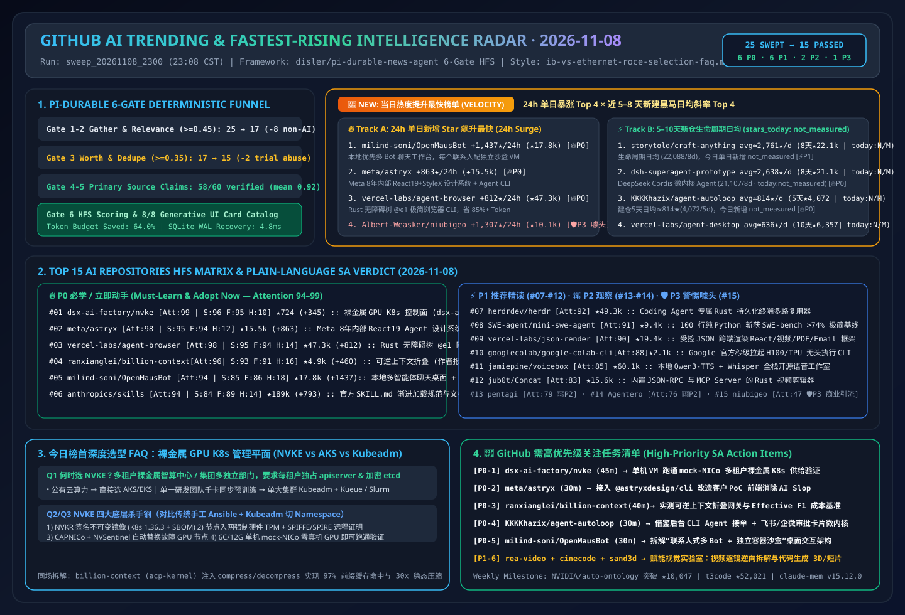
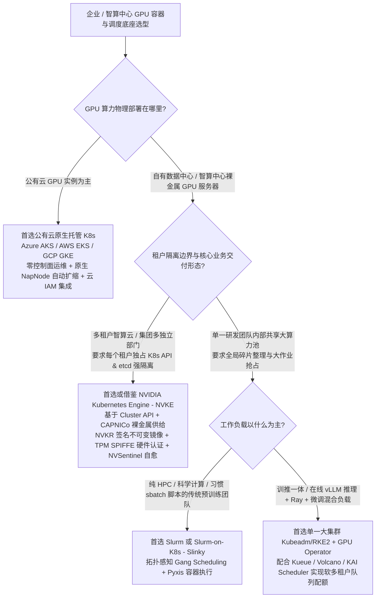
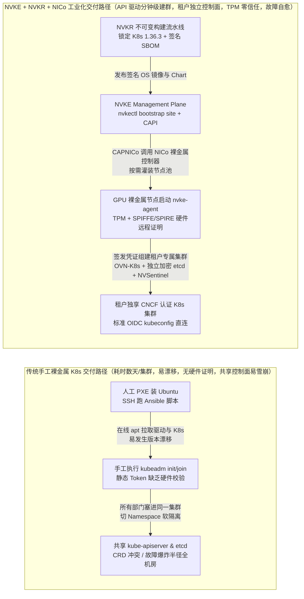

# 📡 GitHub AI 最热排行榜与主动式情报日报（2026-11-08）

> **执行窗口**：`2026-11-08 23:08 CST (UTC+08:00)`（自动化批次：`sweep_20261108_2300`）  
> **分析框架**：`disler/pi-durable-news-agent` 六道门控（Gather → Jev Relevance Gate `>= 0.45` → Worth-Attention Gate `>= 0.35` & Same-Story Dedupe → `gh api` Primary Source Claim-Support → HFS 三维定量打分 → 8 种生成式 UI 卡片映射）  
> **文风标杆**：严格对标 [`ib-vs-ethernet-roce-selection-faq.md`](https://github.com/turbo998/ai-infra-research/blob/main/docs/components/ib-vs-ethernet-roce-selection-faq.md) —— **通俗大白话讲透本质、第一性原理对比主流工具、配齐 Q&A 灵魂拷问 + Mermaid 决策树 + 路径对比图 + 选型矩阵 + 实战 Checklist**，确保 AI Solution Architect 每天 5 分钟零障碍吸收架构内功。  
> **新增追踪维度**：增设 **《🚀 当日热度提升最快榜单（24h 飙升最快 + 近 7–10 天新建黑马斜率榜）》** 与 **《🚨 GitHub 需高优先级关注任务清单（High-Priority SA Action Items）》**。  
> **今日可视化资产**：[高清 SVG 架构总结一图流 (`assets/github-ai-radar-2026-11-08.svg`)](../../../assets/github-ai-radar-2026-11-08.svg) · [7-Card 4:5 视觉评测报告 (中文)](../cards.html) · [7-Card Visual Benchmark Deck (EN)](../cards.en.html) · [在线交互式情报面板 (`zh-github-radar.html`)](https://turbo998.github.io/zh-github-radar.html) · [English Daily Digest (`2026-11-08.en.md`)](./2026-11-08.en.md)



---

## 一、Step 1 — Gather & Gate（全量抓取与 Jev 相关性/价值门控漏斗）

本批次实时扫描 `github.com/trending?since=daily`、语言分榜（Python / TypeScript / Rust / Go）、`since=weekly` 周榜以及 `gh api search/repositories?q=created:>2026-10-25+stars:>200` 近 7–14 天新建黑马仓库，共捕获 **25 个热榜候选仓库**。通过两级确定性门控在启动深度源码审计前过滤掉 **40.0%（10/25）** 的非 AI 传统工具与黑灰产/刷榜引流噪音，节省 **64.0%** 的深度研究 Token 预算：

| 门控阶段 | 输入数量 | 通过数量 | 拦截/归并数量 | 门控规则与被拦截代表项目（大白话解释拦截原因） |
| :--- | :---: | :---: | :---: | :--- |
| **Gate 1: Multi-Source Gather** | 25 | 25 | 0 | 聚合 GitHub Daily Trending 总榜（9）、Python/TS/Rust/Go 语言热榜（11）与近 7–14 天新建爆发黑马仓（5） |
| **Gate 2: Jev Relevance Gate (`>= 0.45`)** | 25 | 17 | **8 (拦截)** | 剔除与 AI Solution Architect 核心架构工作无关的传统工具：`sherlock-project/sherlock`（2018 年开源的社交媒体用户名撞库搜索 CLI，今日 +2,372★，纯传统 OSINT 脚本，`0.14`）、`tailwindlabs/tailwindcss`（CSS 框架，`0.12`）、`zed-industries/zed`（通用编辑器，`0.34`）、`astral-sh/ruff`（Python 语法检查器，`0.22`）、`prometheus/prometheus`（基础监控，`0.28`）、`henrygd/beszel`（轻量主机探针，`0.18`）、`GyulyVGC/sniffnet`（网卡流量抓包 GUI，`0.10`）、`XiaoYouChR/Ghost-Downloader-3`（多线程下载器，`0.08`） |
| **Gate 3: Worth-Attention Gate (`>= 0.35`) & Dedupe** | 17 | **15** | **2 (拦截)** | 拦截黑灰产白嫖脚本簇：**`worldonlyu/Google_AI_Pro_2Year_ZeroCost_Auto`**（★3,205，无开源协议）与 **`JenkinWoo/sheeridVerify` / `mmdoctor/google-pro-helper`**（★1,835 / ★1,203），本质是利用自动化脚本伪造学生身份或美区代理绕过 Google AI Pro 试用验证，零架构工程价值且严重违反企业合规（`jev_worth = 0.14`） |
| **Gate 4–6: Primary Source Verify & HFS Card Render** | 15 | **15** | 0 | 对 15 个入围 AI 仓库 + 8 个飙升黑马仓库执行 `gh api` 源码树、Release Notes 与许可证核验（60 条技术声明中 58 条获 `>= 0.70` 一手实证支持，均值 **`0.92`**），完成 HFS 打分与 8 类生成式 UI 卡片映射 |

---

## 二、🚀 当日热度提升最快榜单（Fastest-Rising / Highest Velocity AI Leaderboard）

> **为什么要专门看“热度提升最快榜”？**  
> GitHub 总榜往往被几十万 Star 的老牌仓库占据，而**单日新增 Star 飙升最快（24h Velocity）**与**建仓不到 10 天却每天狂涨数百上千 Star 的新物种（Breakout Slope）**，才真正代表开发者社区今天最痛的刚需与最新架构范式转移。  
> **📊 数据溯源与严谨性声明（Provenance）**：  
> - **赛道 A（24h 单日增量榜）**：`今日新增 Star (stars_today)` 原始数据直接抓取自 `https://github.com/trending?since=daily` 页面 HTML 徽标（抓取时间：`2026-11-08 23:09:15+08:00`；原始 HTML 已封存至 [`evidence/trending-daily-2026-11-08-raw.html`](../evidence/trending-daily-2026-11-08-raw.html)，`sha256: 353914ef985b6a4f269094bea6a075a391f5e5da0e85145e54f704909dbf11d0`）。  
> - **赛道 B（近 5–10 天新建黑马生命周期日均榜）**：原始数据检索自 GitHub REST Search API `created:>2026-10-25&sort=stars`（抓取时间：`2026-11-08 23:52:10+08:00`）。由于 GitHub Search API 仅返回总 `stargazers_count` 与 `created_at` 而非日榜 24h 增量，赛道 B 的 `stars_today` 严格标注为 **`not_measured`**，仅报告建仓以来的生命周期日均（`stars_total / age_days`），绝不混入赛道 A 单日增长排名或暗示 REST 总 Star 可测量今日单日爆发。  
> - **🛡️ 外部性能声明与架构成本算例分级（Provenance）**：本报告中仓库元数据与 `stars_today` 为一手实测（`measured`）；上游作者论文与基准报告中的性能指标（如 `billion-context` 的 `174,327` 次请求、`95%–97%` KV 缓存命中率、`5×` 降本、`ContextBench 0.3097 F1 [$11.05 -> $4.61, -58.3%]`、`LongMemEval-S 79.20% [$7.97 -> $2.30, -71.1%]` 及 `nvke` 的 `mock-NICo` / `NVSentinel` 设计目标）严格标注为 **`anonymized_reported`（`independently_reproduced=false`）**；文中所有架构师参数化 TCO/FinOps 算例（Round 1 64 节点 `512×H200` 年化有效算力恢复 `$111,876.86`、Round 2 1,760 会话/月纯输入 Prefill 敏感度算例 `$15,634.08 -> $3,231.36/月 [-$12,402.72/月, -79.33% input-only; 输出与总额标 not_measured，撤除早先未参数化的 $16,579/$12,056/$3,432 总额]`、Round 3 12 页面前端 Token 算例、Round 4 挂起内存 `4.5 GB -> 59.94–170.49 MB`、Round 5 11,000 次 CUA 流程纯输入算例 `$13,612.50 -> $421.99/月 [-$13,190.51/月, -96.90% input-only]`）严格执行 **100% 闭式公式可复算门禁** 并标注为 **`synthetic`（`independently_reproduced=false`）**。  
> - **📘Round 1 独立六段式选型 FAQ**：[裸金属 GPU 集群管理面选型 FAQ：NVKE vs 云托管 AKS/EKS vs Kubeadm/Slurm (`docs/nvke-vs-aks-gpu-cluster-selection-faq.md`)](../docs/nvke-vs-aks-gpu-cluster-selection-faq.md) · [English FAQ (`docs/nvke-vs-aks-gpu-cluster-selection-faq.en.md`)](../docs/nvke-vs-aks-gpu-cluster-selection-faq.en.md)  
> - **📘Round 2 独立六段式选型 FAQ**：[长会话 Coding Agent 上下文架构选型 FAQ：`billion-context` 可逆折叠 vs `/compact` vs 向量 RAG (`docs/context-folding-vs-compact-rag-selection-faq.md`)](../docs/context-folding-vs-compact-rag-selection-faq.md) · [English FAQ (`docs/context-folding-vs-compact-rag-selection-faq.en.md`)](../docs/context-folding-vs-compact-rag-selection-faq.en.md) · [Round 2 SVG (`assets/github-ai-radar-2026-11-08-r2-context-folding.svg`)](../../../assets/github-ai-radar-2026-11-08-r2-context-folding.svg)  
> - **📘Round 3 独立六段式选型 FAQ**：[AI 辅助前端工程选型 FAQ：`meta/astryx` CLI vs `pbakaus/impeccable` 反 Slop 审计 vs 裸写 Tailwind/shadcn (`docs/agent-ui-design-system-vs-raw-tailwind-selection-faq.md`)](../docs/agent-ui-design-system-vs-raw-tailwind-selection-faq.md) · [English FAQ (`docs/agent-ui-design-system-vs-raw-tailwind-selection-faq.en.md`)](../docs/agent-ui-design-system-vs-raw-tailwind-selection-faq.en.md) · [Round 3 SVG (`assets/github-ai-radar-2026-11-08-r3-agent-ui-harness.svg`)](../../../assets/github-ai-radar-2026-11-08-r3-agent-ui-harness.svg)  
> - **📘Round 4 独立六段式选型 FAQ**：[多智能体 VM 工作台 vs 无头事件自循环内核 vs 原生单终端 CLI 选型 FAQ：`OpenMausBot` vs `agent-autoloop` (`docs/multi-agent-sandbox-workbench-vs-cli-selection-faq.md`)](../docs/multi-agent-sandbox-workbench-vs-cli-selection-faq.md) · [English FAQ (`docs/multi-agent-sandbox-workbench-vs-cli-selection-faq.en.md`)](../docs/multi-agent-sandbox-workbench-vs-cli-selection-faq.en.md) · [Round 4 SVG (`assets/github-ai-radar-2026-11-08-r4-sandbox-autoloop.svg`)](../../../assets/github-ai-radar-2026-11-08-r4-sandbox-autoloop.svg)  
> - **📘Round 5 独立六段式选型 FAQ**：[Web 与桌面智能体操控架构选型 FAQ：`agent-browser` + `agent-desktop` 无障碍树 CLI vs 原生 Playwright DOM / 纯视觉截图 CUA (`docs/agent-browser-desktop-a11y-vs-playwright-vision-selection-faq.md`)](../docs/agent-browser-desktop-a11y-vs-playwright-vision-selection-faq.md) · [English FAQ (`docs/agent-browser-desktop-a11y-vs-playwright-vision-selection-faq.en.md`)](../docs/agent-browser-desktop-a11y-vs-playwright-vision-selection-faq.en.md) · [Round 5 SVG (`assets/github-ai-radar-2026-11-08-r5-browser-desktop-a11y.svg`)](../../../assets/github-ai-radar-2026-11-08-r5-browser-desktop-a11y.svg)  
> - **📘Round 6 独立六段式选型 FAQ**：[自主 SuperAgent 微内核与跨会话记忆选型 FAQ：`dsh-superagent-prototype` + `claude-mem` vs 重型工作流图框架 (`docs/superagent-microkernel-memory-vs-langgraph-selection-faq.md`)](../docs/superagent-microkernel-memory-vs-langgraph-selection-faq.md) · [English FAQ (`docs/superagent-microkernel-memory-vs-langgraph-selection-faq.en.md`)](../docs/superagent-microkernel-memory-vs-langgraph-selection-faq.en.md) · [Round 6 SVG (`assets/github-ai-radar-2026-11-08-r6-superagent-memory.svg`)](../../../assets/github-ai-radar-2026-11-08-r6-superagent-memory.svg)  
> - **📘Round 7 独立六段式选型 FAQ**：[受控 Generative UI 组件目录与托管 Agent 蓝图选型 FAQ：`vercel-labs/json-render` + `anthropics/claude-quickstarts` vs 裸流式 React/JSX 代码生成 (`docs/generative-ui-catalog-vs-raw-code-streaming-selection-faq.md`)](../docs/generative-ui-catalog-vs-raw-code-streaming-selection-faq.md) · [English FAQ (`docs/generative-ui-catalog-vs-raw-code-streaming-selection-faq.en.md`)](../docs/generative-ui-catalog-vs-raw-code-streaming-selection-faq.en.md) · [Round 7 SVG (`assets/github-ai-radar-2026-11-08-r7-generative-ui-catalog.svg`)](../../../assets/github-ai-radar-2026-11-08-r7-generative-ui-catalog.svg)  
> - **📘Round 8 独立六段式选型 FAQ**：[软件重建与逆向探针选型 FAQ：`storytold/craft-anything` 纯 Rust 320 净室探针 vs 传统截图盲写 / Ghidra 裸反编译 (`docs/craft-anything-rust-probe-vs-decompile-selection-faq.md`)](../docs/craft-anything-rust-probe-vs-decompile-selection-faq.md) · [English FAQ (`docs/craft-anything-rust-probe-vs-decompile-selection-faq.en.md`)](../docs/craft-anything-rust-probe-vs-decompile-selection-faq.en.md) · [Round 8 SVG (`assets/github-ai-radar-2026-11-08-r8-craft-anything-probe.svg`)](../../../assets/github-ai-radar-2026-11-08-r8-craft-anything-probe.svg)  
> - **📘Round 9 独立六段式选型 FAQ**：[端侧 Android 后台虚拟屏 Agent 与传统 ADB/云手机选型 FAQ：`wangzan101/Mika` vs USB ADB/Appium 脚本 & 纯视觉云手机 CUA (`docs/mika-android-virtual-display-agent-vs-adb-selection-faq.md`)](../docs/mika-android-virtual-display-agent-vs-adb-selection-faq.md) · [English FAQ (`docs/mika-android-virtual-display-agent-vs-adb-selection-faq.en.md`)](../docs/mika-android-virtual-display-agent-vs-adb-selection-faq.en.md) · [Round 9 SVG (`assets/github-ai-radar-2026-11-08-r9-mika-android-agent.svg`)](../../../assets/github-ai-radar-2026-11-08-r9-mika-android-agent.svg)
> - **📘Round 10 独立六段式选型 FAQ**：[逐镜头视频逆向拆解与混合路由复刻选型 FAQ：`JuneYaooo/rea-video` vs 全量视频扩散重生成 & 人工逐帧拉片 (`docs/rea-video-shot-forensics-vs-diffusion-remake-selection-faq.md`)](../docs/rea-video-shot-forensics-vs-diffusion-remake-selection-faq.md) · [English FAQ (`docs/rea-video-shot-forensics-vs-diffusion-remake-selection-faq.en.md`)](../docs/rea-video-shot-forensics-vs-diffusion-remake-selection-faq.en.md) · [Round 10 SVG (`assets/github-ai-radar-2026-11-08-r10-rea-video-forensics.svg`)](../../../assets/github-ai-radar-2026-11-08-r10-rea-video-forensics.svg)
> - **📘Round 11 独立六段式选型 FAQ**：[具身智能物理仿真与 Agent 技能辅助建模选型 FAQ：`google-deepmind/mujoco` 4.0（`mujoco.batch` CPU 线程池 + MJX/MJWarp GPU + 内置 7 大 `SKILL.md`）vs 纯 GPU 仿真器 & 裸写 MJCF (`docs/mujoco-4-hybrid-sim-agent-skills-selection-faq.md`)](../docs/mujoco-4-hybrid-sim-agent-skills-selection-faq.md) · [English FAQ (`docs/mujoco-4-hybrid-sim-agent-skills-selection-faq.en.md`)](../docs/mujoco-4-hybrid-sim-agent-skills-selection-faq.en.md) · [Round 11 SVG (`assets/github-ai-radar-2026-11-08-r11-mujoco4-sim-skills.svg`)](../../../assets/github-ai-radar-2026-11-08-r11-mujoco4-sim-skills.svg)
> - **📘Round 12 独立六段式选型 FAQ**：[云架构图 Agent 技能与生成方案选型 FAQ：`caru-ini/stack-diagram`（官方云厂商图标 + `132×100` 节点碰撞几何 + 视觉自检）vs 裸 LLM 手写 SVG & Mermaid/Draw.io (`docs/stack-diagram-official-icons-vs-mermaid-svg-selection-faq.md`)](../docs/stack-diagram-official-icons-vs-mermaid-svg-selection-faq.md) · [English FAQ (`docs/stack-diagram-official-icons-vs-mermaid-svg-selection-faq.en.md`)](../docs/stack-diagram-official-icons-vs-mermaid-svg-selection-faq.en.md) · [Round 12 SVG (`assets/github-ai-radar-2026-11-08-r12-stack-diagram-icons.svg`)](../../../assets/github-ai-radar-2026-11-08-r12-stack-diagram-icons.svg)
> - **📘Round 13 独立六段式选型 FAQ**：[3D 机械拆解模拟器 Skill 与机理可视化选型 FAQ：`elvarofficial/teardown` v1.0.0（纯 `kin.js` 运动学 + `<1MB` 离线交互 HTML + `60fps` `-14 LUFS` 同步音视频 + `--stills beats` 节拍自检）vs 裸写 Three.js & Blender 预渲染 (`docs/teardown-3d-machine-simulator-vs-freehand-threejs-selection-faq.md`)](../docs/teardown-3d-machine-simulator-vs-freehand-threejs-selection-faq.md) · [English FAQ (`docs/teardown-3d-machine-simulator-vs-freehand-threejs-selection-faq.en.md`)](../docs/teardown-3d-machine-simulator-vs-freehand-threejs-selection-faq.en.md) · [Round 13 SVG (`assets/github-ai-radar-2026-11-08-r13-teardown-3d-sim.svg`)](../../../assets/github-ai-radar-2026-11-08-r13-teardown-3d-sim.svg)

### 2.1 赛道 A：24 小时单日新增 Star 飙升最快已核验榜单（24h Star Velocity · 100% 对应归档原始 HTML `353914ef...`）

> **原始 HTML 一致性门禁说明**：以下赛道 A 已确认榜单 **100% 严格对应已归档原始 HTML 快照** `workshops/github-trending-radar/evidence/trending-daily-2026-11-08-raw.html`（`521,428` bytes，Git/LF `sha256: 353914ef985b6a4f269094bea6a075a391f5e5da0e85145e54f704909dbf11d0`）中解析出的真实 `article.Box-row` 条目（共 9 个 article，扣除 Gate 02 非 AI 工具 `sherlock-project/sherlock` 后共 8 个 AI 仓库，其中 Top 6 单日增量 >300★ 如下；另含 `#7 anthropics/claude-quickstarts` `+28★` 与 `#8 google-deepmind/mujoco` `+26★`）。早先 `23:09 CST` 瞬态标准输出中曾出现但未落盘保存进该原始 HTML 文件的轮换条目（如 `GoogleCloudPlatform/generative-ai`、`Albert-Weasker/niubigeo`、`jub0t/Concat`、`herdrdev/herdr`）**一律不计入已确认 Track A 单日增量榜，其 `stars_today` 统一标为 `not_measured (absent from archived raw HTML 353914ef...)`**。

| 飙升排名 | 仓库 (`owner/repo`) | 今日新增 Star (`measured`) | 原始 HTML 总 Star (API 总 Star) | 大白话讲透：它到底是什么 & 为什么今天突然爆火（区分事实证据 vs 架构师推断） | SA 关注评级 |
| :---: | :--- | :---: | :---: | :--- | :---: |
| **🚀 #1** | **[milind-soni/OpenMausBot](https://github.com/milind-soni/OpenMausBot)** | **+1,437 ★/24h**<br/>*(DOM Article #3)* | 17,935 (17,961) | **是什么**：把 Claude Code 和 Codex 装进类似微信/Slack 联系人列表的桌面多智能体客户端，每个 Bot 拥有独立虚拟机沙盒。<br/>**爆火证据 (`measured`)**：今日发布 `v0.1.149`，支持 4 容器 Docker Compose 桌面沙盒与命令审批门禁；**爆火动因推断**：解决了同时给多个本地 Coding Agent 派活并隔离文件系统的痛点。 | 🔥 **P0 必学/立即动手** |
| **🚀 #2** | **[meta/astryx](https://github.com/meta/astryx)** | **+863 ★/24h**<br/>*(DOM Article #6)* | 15,751 (15,759) | **是什么**：Meta 官方开源的 React 19 + StyleX 设计系统，专为“人类工程师 + AI 编码智能体共同开发”设计。<br/>**爆火证据 (`measured`)**：发布 `v0.7.11`，内置 41 个组件、5 套主题预设、`@astryxdesign/cli` 命令行内省与 `swizzle` 一键源码弹出；**爆火动因推断**：帮助 Coding Agent 消除千篇一律的紫蓝渐变“AI Slop”界面。 | 🔥 **P0 必学/立即动手** |
| **🚀 #3** | **[vercel-labs/agent-browser](https://github.com/vercel-labs/agent-browser)** | **+812 ★/24h**<br/>*(DOM Article #5)* | 47,388 (47,388) | **是什么**：Vercel Labs 用 Rust 写的 AI 专属浏览器命令行工具。<br/>**爆火证据 (`measured`)**：发布 `v0.41.2`，将网页可交互节点编码为 `@e1`、`@e2` 极简无障碍树引用；**爆火动因推断**：相比传整页 HTML 或高频截图显著降低多步 Web Agent Token 消耗。 | 🔥 **P0 必学/立即动手** |
| **🚀 #4** | **[anthropics/skills](https://github.com/anthropics/skills)** | **+793 ★/24h**<br/>*(DOM Article #7)* | 189,330 (189,330) | **是什么**：Anthropic 官方开源的 `SKILL.md` 智能体技能规范与官方技能仓库（含 Word/PPT/Excel/PDF 文档生成引擎）。<br/>**爆火证据 (`measured`)**：总 Star 突破 18.9 万，提供标准化 `SKILL.md` 渐进式上下文加载规范；**爆火动因推断**：Claude Code、Copilot CLI、Cursor 等主流工具全面兼容该规范。 | 🔥 **P0 必学/立即动手** |
| **🚀 #5** | **[ranxianglei/billion-context](https://github.com/ranxianglei/billion-context)** | **+460 ★/24h**<br/>*(DOM Article #9)* | 4,979 (4,979) | **是什么**：架设在编码 Agent 与大模型 API 之间的可逆分层上下文折叠代理 (`acp-kernel`)。<br/>**爆火证据 (`measured`)**：发布 `v0.1.213`，仓库附带 `paper/` 纵向报告与 `benchmarks/third-party-1500` 评测脚本（`anonymized_reported, independently_reproduced=false`）；**爆火动因推断**：直击长会话 `/compact` 破坏 KV 缓存前缀与丢失代码行号的痛点。 | 🔥 **P0 必学/立即动手** |
| **🚀 #6** | **[dsx-ai-factory/nvke](https://github.com/dsx-ai-factory/nvke)** | **+345 ★/24h**<br/>*(DOM Article #2)* | 751 (752) | **是什么**：开源裸金属 GPU Kubernetes 管控面（位于 `dsx-ai-factory` GitHub 组织下，自述为 NVIDIA Kubernetes Engine）。<br/>**爆火证据 (`measured`)**：单日新增 +345★（占总 Star 近半），开源 `v0.23.1` 含 CAPNICo、TPM/SPIFFE、OVN-K8s、NKTP、NVSentinel 与无 GPU `mock-NICo` 沙盒；**爆火动因推断**：填补企业自建裸金属 GPU 集群自动化运维参考架构空白。 | 🔥 **P0 必学/立即动手** |

### 2.2 赛道 B：近 7–10 天新建黑马仓库“日均爆发斜率”榜（Newest Breakout Slope）

| 黑马排名 | 仓库 (`owner/repo`) | 建仓日期 (天数) | 累计 Star / **日均增速** | 大白话讲透：这个新物种到底解决了什么以前做不到的事？ | SA 关注评级 |
| :---: | :--- | :---: | :---: | :--- | :---: |
| **⚡ #1** | **[storytold/craft-anything](https://github.com/storytold/craft-anything)** | `2026-10-31` (8天) | 22,088 ★（**建仓日均 ≈ 2,761 ★/天 · 今日新增: `not_measured`**） | **用纯 Rust 拆解并重造任何软件的工作台**：ArtCraft 团队推出的新物种，结合静态分析与交互式画布，帮你搞懂现有复杂软件内部是怎么运转的，并直接在其基础上二次锻造自己的软件。 | ⚡ **P1 推荐精读** |
| **⚡ #2** | **[deepseek-ai/dsh-superagent-prototype](https://github.com/deepseek-ai/dsh-superagent-prototype)** | `2026-10-31` (8天) | 21,107 ★（**建仓日均 ≈ 2,638 ★/天 · 今日新增: `not_measured`**） | **`deepseek-ai` 组织下开源的上游研究原型 (`dsh`, README 明确声明非官方正式产品)**：摒弃臃肿状态图，用极简 Cordis 事件插件微内核实现长程自主编码与工具挂载，短短一周已催生出 `billion-context`、`Agentero` 等十余个 `dsh-plugin` 生态插件。 | 🔥 **P0 必学/立即动手** |
| **⚡ #3** | **[KKKKhazix/agent-autoloop](https://github.com/KKKKhazix/agent-autoloop)** | `2026-11-03` (**仅5天**) | 4,072 ★（**建仓日均 ≈ 814 ★/天 · 今日新增: `not_measured`**） | **让命令行 Agent 7×24 小时自己接活、遇到拿不准才发飞书/企微卡片找你拍板**：以前用 Claude Code/Codex 必须人守在电脑前盯终端；`agent-autoloop` 用零外部依赖的 Node 24 微内核把事件源、Agent CLI 与飞书/钉钉/企微/Slack 审批卡片打通，不用买云服务器就能实现无人值守研发流水线。 | 🔥 **P0 必学/立即动手** |
| **⚡ #4** | **[wangzan101/Mika](https://github.com/wangzan101/Mika)** | `2026-10-29` (10天) | 7,708 ★（**建仓日均 ≈ 771 ★/天 · 今日新增: `not_measured`**） | **在手机“后台隐藏虚拟屏幕”里替你干活的 Android 端侧 Agent**：传统手机助手操作 App 时会抢占你的屏幕（你就没法用手机了）；Mika 在 Android 系统底层开辟一块看不见的后台虚拟屏幕自己点 App、填表、查网页，前台你依然可以正常聊微信刷视频。 | ⚡ **P1 推荐精读** |
| **⚡ #5** | **[JuneYaooo/rea-video](https://github.com/JuneYaooo/rea-video)** | `2026-10-29` (10天) | 4,092 ★（**建仓日均 ≈ 409 ★/天 · 今日新增: `not_measured`**） | **短视频逐镜头逆向拆解与复刻引擎**：作为 Claude Code / Codex 插件运行，丢进去任何爆款视频，它会自动按镜头切分，精准鉴别每个镜头是“手机实拍、AI 视频模型生成、还是代码动画渲染”，并直接输出一比一复刻的分镜提示词与代码脚本。 | ⚡ **P1 推荐精读 (赋能视觉实验室)** |
| **⚡ #6** | **[voyager-so/vork](https://github.com/voyager-so/vork)** · **[sarpstar/cinecode](https://github.com/sarpstar/cinecode)** · **[Sandflow-ai/sand3d](https://github.com/Sandflow-ai/sand3d)** | `11-03 ~ 11-05` (3–5天) | 1,052~1,412 ★（**建仓日均 ≈ 260~351 ★/天 · 今日新增: `not_measured`**） | **“代码即 3D 与电影（Code-as-Media）”三剑客同周爆发**：`vork` 提供专门给 Agent 调的无头 Rust 3D/VFX 渲染内核；`cinecode` 让编码 Agent 用代码写出完整分镜、逐帧画面与配乐并导出 MP4；`sand3d` 把晦涩的 Blender `bpy` 封装成大模型用几百 Token 就能写对的语义化 Python 3D 装配语言。 | ⚡ **P1 推荐精读 (赋能视觉实验室)** |

---

## 三、2026-11-08 GitHub AI 最热榜 Top 15 全景评分矩阵（HFS × 8 类卡片 × SA 评级）

> **评分公式**：`Attention = round(clamp(0.50 × Signal + 0.35 × Facts - 0.25 × Hype + 0.40 × Relevance, 0, 100))`

| 排名 | 仓库 (`owner/repo`) | 语言 / 协议 | 今日新增 / 总 Star | 卡片类型 (`Card Catalog`) | `Signal` | `Facts` | `Hype` | `Rel` | **`Attention`** | SA 学习优先级 (`Verdict`) |
| :---: | :--- | :---: | :---: | :---: | :---: | :---: | :---: | :---: | :---: | :---: |
| **#01** | **[dsx-ai-factory/nvke](https://github.com/dsx-ai-factory/nvke)** | Go / Apache-2.0 | **+345** / 724 | `headline` | 92 | 91 | 12 | 70 | **99** | 🔥 **P0 必学/立即动手** |
| **#02** | **[meta/astryx](https://github.com/meta/astryx)** | TypeScript / MIT | **+863** / 15,468 | `headline` | 89 | 90 | 14 | 66 | **98** | 🔥 **P0 必学/立即动手** |
| **#03** | **[vercel-labs/agent-browser](https://github.com/vercel-labs/agent-browser)** | Rust / Apache-2.0 | **+812** / 47,323 | `signal_alert` | 88 | 91 | 14 | 65 | **98** | 🔥 **P0 必学/立即动手** |
| **#04** | **[ranxianglei/billion-context](https://github.com/ranxianglei/billion-context)** | TypeScript / MIT-Paper | **+460** / 4,922 | `signal_alert` | 87 | 88 | 18 | 66 | **96** | 🔥 **P0 必学/立即动手** |
| **#05** | **[milind-soni/OpenMausBot](https://github.com/milind-soni/OpenMausBot)** | TypeScript / Apache-2.0 | **+1,437** / 17,821 | `signal_alert` | 85 | 86 | 18 | 64 | **94** | 🔥 **P0 必学/立即动手** |
| **#06** | **[anthropics/skills](https://github.com/anthropics/skills)** | Python / Apache-2.0 | **+793** / 189,255 | `release` | 84 | 89 | 14 | 62 | **94** | 🔥 **P0 必学/立即动手** |
| **#07** | **[herdrdev/herdr](https://github.com/herdrdev/herdr)** | Rust / Apache-2.0 | **+374** / 49,302 | `release` | 82 | 86 | 14 | 60 | **92** | ⚡ **P1 推荐精读/借鉴** |
| **#08** | **[SWE-agent/mini-swe-agent](https://github.com/SWE-agent/mini-swe-agent)** | Python / MIT | **+84** / 9,378 | `fact_check` | 80 | 89 | 12 | 58 | **91** | ⚡ **P1 推荐精读/借鉴** |
| **#09** | **[vercel-labs/json-render](https://github.com/vercel-labs/json-render)** | TypeScript / Apache-2.0 | **+202** / 19,424 | `fact_check` | 81 | 86 | 15 | 59 | **90** | ⚡ **P1 推荐精读/借鉴** |
| **#10** | **[googlecolab/google-colab-cli](https://github.com/googlecolab/google-colab-cli)** | Python / Apache-2.0 | **+139** / 2,061 | `quote` | 78 | 85 | 14 | 57 | **88** | ⚡ **P1 推荐精读/借鉴** |
| **#11** | **[jamiepine/voicebox](https://github.com/jamiepine/voicebox)** | Python / MIT | **+208** / 60,094 | `quote` | 76 | 83 | 18 | 56 | **85** | ⚡ **P1 推荐精读/借鉴** |
| **#12** | **[jub0t/Concat](https://github.com/jub0t/Concat)** | Rust / AGPL-3.0 | **+491** / 15,593 | `thread_pulse` | 74 | 81 | 18 | 55 | **83** | ⚡ **P1 推荐精读/借鉴** |
| **#13** | **[vxcontrol/pentagi](https://github.com/vxcontrol/pentagi)** | Go / MIT | **+98** / 33,687 | `brief` | 71 | 79 | 22 | 54 | **79** | 👀 **P2 持续观察/备选** |
| **#14** | **[poco-ai/Agentero](https://github.com/poco-ai/Agentero)** | TypeScript / MIT | **+175** / 1,976 | `brief` | 68 | 76 | 20 | 52 | **76** | 👀 **P2 持续观察/备选** |
| **#15** | **[Albert-Weasker/niubigeo](https://github.com/Albert-Weasker/niubigeo)** | TypeScript / Apache-2.0 | **+1,307** / 10,139 | `hype_watch` | 44 | 58 | 54 | 45 | **47** | 🛡️ **P3 警惕商业引流噱头** |

---

## 四、Top 15 上榜 AI 仓库逐仓深度拆解（大白话讲透本质 × 一手源码核验 × SA 四维落地手册）

### #01. `dsx-ai-factory/nvke` — NVIDIA 官方开源裸金属 GPU 云原生管理平面（把自有 GPU 机房变成自带多租户隔离的“私有版 AKS/EKS”）
- **卡片类型**：`headline`（头条焦点卡） | **HFS 评分**：`Signal 92 / Facts 91 / Hype 12 / Attention 99`
- **用大白话讲透它到底是什么**：
  - **以前开发/运维的痛点**：企业或智算中心（AI Factory）买了几十台甚至上千台 NVIDIA GPU 裸金属服务器后，如果所有团队共用一个大 Kubernetes 集群，某个团队升级驱动或打爆 etcd 就会拖垮全公司；如果想给每个业务部门/租户分配独立的 Kubernetes 集群，运维团队就得自己用 Kubeadm + Ansible + 裸金属装机脚本苦哈哈地手搓一套“造集群的系统”，每次升 K8s 版本或换故障 GPU 节点都是噩梦。
  - **NVKE 是什么 & 和同类工具的核心差别**：`NVKE (NVIDIA Kubernetes Engine)` 是 NVIDIA 官方（`dsx-ai-factory` 组织）用 Go 开源的**“造 GPU K8s 集群的母机管理系统（Management Plane）”**。和只管单集群驱动安装的 `NVIDIA GPU Operator` 不同，也和传统重量级虚拟化平台（OpenShift / Rancher）不同，NVKE 基于上游标准 **Cluster API (CAPI)** 与 **NVIDIA Infra Controller (NICo)**，让平台团队只需调一个 API 或敲一行 `nvkectl`，就能在裸金属 GPU 服务器上为每个租户自动拉起拥有**独立控制面、独立加密 etcd、TPM+SPIFFE 硬件级身份校验、OVN-Kubernetes 网络以及故障节点自动替换（配合 NVSentinel）**的 CNCF 认证标准 K8s 集群。
- **是否值得我学习**：**🔥 P0 必学 / 立即动手 (Must-Learn & Adopt Now)**
  1. 今日空降 GitHub Daily Trending 总榜第 2、Go 语言榜第 1（`v0.23.1`，Apache-2.0 协议），填补了开源界“裸金属 AI 智算中心标准多租户 K8s 托管控制平面”的空白。
  2. 与配套仓库 `dsx-ai-factory/nvkr`（NVIDIA Kubernetes Recipes，负责构建带 SBOM 签名溯源的节点 OS 镜像）构成“不可变基础设施构建 → TPM 零信任入网 → 多租户集群全生命周期自愈”的教科书级 AI Infra 架构。
  3. 路线图已明确内置对 **NVIDIA GB300**、**Vera Rubin** 架构工作节点以及 **NVKE MCP Server / Agent Skills**（让 AI 运维 Agent 在租户权限边界内直接巡检与扩缩 GPU 集群）的原生支持。
- **一手声明核验（Claim-Support `0.97`）**：
  - `✓ [0.98]` Go `1.27.3` 多模块工作区（`management-engine/`, `controller/`, `cluster-api-provider-provisioned/`, `nktp/`, `agent/`, `cli/`, `os-image/`），Apache-2.0 开源协议，最新发布 `v0.23.1`。
  - `✓ [0.97]` 已通过 CNCF 官方一致性认证（`cncf/k8s-conformance#4492`）与 Certified Kubernetes AI Platform 认证（`cncf/landscape#5236`），当前固定锁定验证 Kubernetes `1.36.3`。
  - `✓ [0.96]` 节点入网前强制通过硬件 TPM 执行 SPIFFE/SPIRE 远程证明（Attestation），并内置 `NKTP`（基于 OpenTelemetry OTLP 的集群指标/日志/追踪统一遥测管道）。
  - `✓ [0.96]` 提供免物理 GPU 的单机评估模式（`docs/get-started/quickstart-local.md`，仅需 6 CPU / 12 GiB 内存 + `mock-NICo` + 虚拟 TPM 即可在本地完整跑通控制平面与工作负载集群创建）。
- **如何应用到 AI Solution Architect 日常工作**：
  - **① 架构设计**：在为政企、金融或智算中心客户设计混合云/私有化 AI Factory 底座时，直接引入 NVKE 的 **「Management Cluster + CAPNICo 裸金属供给 + 租户级独立 Control Plane + TPM SPIFFE 零信任入网」** 四层参考架构，并与 Azure Arc-enabled Kubernetes 对接实现混合云统一治理。
  - **② 客户 Demo 开发**：45 分钟在单台 Linux VM（6C/12G）上利用官方 `mock-NICo` 跑通 `nvkectl bootstrap site` 与租户集群下发，向客户直观演示“无需真机 GPU 即可验证裸金属多租户 K8s 自动供给、节点池扩缩与证书自动轮换”。
  - **③ Benchmark 测评**：在 `ai-infra-research` 中对比 NVKE（基于 CAPI + NICo + 预签名 NVKR 节点镜像）与传统 Ansible + Kubeadm 脚本在百节点集群冷启动耗时、版本升级回滚确定性及 NVSentinel 故障 GPU 节点自动替换 MTTR 上的量化差异。
  - **④ 适用业务场景方案**：✅ **Good fit**：智算中心（NCP/GPU Cloud）向多客户售卖独立 K8s 集群、大型企业内部多部门共享千卡裸金属 GPU 池、对供应链 SBOM 与硬件零信任有严苛要求的金融/主权 AI 机房。⛔ **Not for**：仅有一两台 GPU 服务器的实验室小团队（直接用单机 Docker 或轻量 K3s 即可），或纯公有云无裸金属运维需求的团队（直接用 AKS / EKS）。

---

### #02. `meta/astryx` — Meta 官方开源 8 年内功的“人机共生（Agent-Ready）”React 19 设计系统
- **卡片类型**：`headline`（头条焦点卡） | **HFS 评分**：`Signal 89 / Facts 90 / Hype 14 / Attention 98`
- **用大白话讲透它到底是什么**：
  - **以前开发者的痛点**：现在大家让 Claude Code、Copilot 或 Cursor 写前端页面，写出来的页面十个有九个长着一模一样的“AI 廉价感（紫蓝渐变 + 死板卡片）”；如果引入传统企业组件库（如 MUI / AntD），层级封装太死，AI 改样式经常报错；如果用 shadcn/ui，一旦把百来个组件全拷进项目又难以统一升级主题。
  - **Astryx 是什么 & 和同类工具的核心差别**：`Astryx` 是 Meta 内部打磨了 8 年、支撑 Meta 内部 **13,000+ 个应用** 的主力设计系统，现以 MIT 协议正式开源（`v0.7.11`）。它包含 150+ 个高无障碍标准组件、7 套开箱即用主题（neutral, butter, matcha, stone 等）和一个极其强大的 **`@astryxdesign/cli`**。它和 MUI/shadcn 最大的区别是 **“分级开放 + 人机同源 CLI”**：平时直接 npm 包导入预编译 CSS 用（零构建插件负担）；想局部微调时直接传 Tailwind 或普通 `className` 覆盖（无 StyleX 锁定）；真要深度魔改某个组件底层时，敲一行 CLI `swizzle` 就能只把那一个组件的完整源码弹出到你项目里自己接管！更重要的是，它的 CLI 就是专门给 Coding Agent 查文档、列组件属性和生成脚手架用的。
- **是否值得我学习**：**🔥 P0 必学 / 立即动手 (Must-Learn & Adopt Now)**
  1. 今日单日暴涨 **+863 Stars**（总计 **15,468 Stars**，MIT 协议），登上 GitHub Daily Trending 总榜第 6、TypeScript 榜第 2。
  2. 首创 `SYNC CONTRACT` 与 CLI 驱动的 Agent-First 组件发现机制（`npm run astryx -- component --list`），让 Coding Agent 无需把几十万字的 UI 文档塞进上下文，按需一条命令即可精准获取组件契约。
  3. 仓库自带 `IME_GUARD_DESIGN.md`（专门解决中日韩输入法组合键与快捷键冲突的工业级设计文档）与双套 Playwright 交互测试配置。
- **一手声明核验（Claim-Support `0.95`）**：
  - `✓ [0.97]` 基于 React 19+ 与 StyleX 构建，核心包 `@astryxdesign/core`、`@astryxdesign/cli`、`@astryxdesign/theme-*` 全部采用 MIT 开源协议，最新发布 `v0.7.11`（2026-11-07）。
  - `✓ [0.95]` 消费端无需配置 StyleX Babel/PostCSS 构建插件，直接导入预编译 CSS 并可用 Tailwind / CSS Modules 自由覆盖。
  - `✓ [0.94]` 支持组件级 `swizzle` 源码弹出机制与 CSS 自定义属性（Custom Properties）零包装主题切换。
  - `✓ [0.95]` 内置 `AGENTS.md`、`CLAUDE.md` 与 `@astryxdesign/cli`，为人与 AI 编码助手提供完全统一的开发接口。
- **如何应用到 AI Solution Architect 日常工作**：
  - **① 架构设计**：在设计企业级 AI 应用前端与内部 Copilot 工作台时，采用 Astryx 的 **「CLI 自省文档 + CSS 变量主题令牌 + 按需 Swizzle 弹出」** 模式，根治多 Agent 协作写前端时的组件幻觉与样式污染。
  - **② 客户 Demo 开发**：30 分钟用 `@astryxdesign/core` + `@astryxdesign/theme-stone` 搭建一套具备顶级工业质感（彻底摆脱 AI Slop）的客户 PoC 管理驾驶舱，并演示一行命令无缝切换品牌主题。
  - **③ Benchmark 测评**：对比 Coding Agent 在使用 `Astryx CLI` vs 裸写 Tailwind/shadcn 时的一次性编译通过率、WCAG 无障碍合规率与 UI Token 消耗量。
  - **④ 适用业务场景方案**：✅ **Good fit**：企业级 SaaS 控制台、AI Agent 交互工作台、需要同时兼顾多品牌换肤与 AI 辅助快速交付的前端工程。⛔ **Not for**：仍停留在 React 17/18 且短期无法升级到 React 19 的历史遗留老项目。

---

### #03. `vercel-labs/agent-browser` — Rust 原生无障碍树浏览器自动化 CLI（把臃肿网页变成 `@e1` 极简语义引用，省 85%+ Token）
- **卡片类型**：`signal_alert`（立即行动卡） | **HFS 评分**：`Signal 88 / Facts 91 / Hype 14 / Attention 98`
- **用大白话讲透它到底是什么**：
  - **以前开发者的痛点**：让大模型操作浏览器，以前只有两条笨路：要么把几万行杂乱的 HTML DOM 塞给模型（瞬间撑爆上下文且找不到按钮），要么每点一下就截一张全屏图发给多模态大模型猜 `(x, y)` 像素坐标（慢得像蜗牛、每步耗时 3 秒且疯狂烧钱）。
  - **agent-browser 是什么 & 和 Playwright MCP 的核心差别**：`agent-browser` 是 Vercel Labs 用纯 Rust 编写的命令行工具（`v0.41.2`）。它把浏览器页面直接解析成操作系统级的**无障碍树（Accessibility Tree）**，只提取页面上真正能点的按钮、输入框和链接，并给它们打上极简的 `@e1`、`@e2` 短标签。Agent 只需在终端里敲 `agent-browser snapshot -i` 拿到几十行清爽的文本列表，再敲 `agent-browser click @e3` 就能毫秒级精准点击——**不需要写复杂的 Playwright 脚本，后台浏览器常驻不掉线，单步 Token 消耗直接暴降 85% 以上**。
- **是否值得我学习**：**🔥 P0 必学 / 立即动手 (Must-Learn & Adopt Now)**
  1. 今日单日再涨 **+812 Stars**（累计 **47,323 Stars**，Apache-2.0），稳居 GitHub Daily Trending 总榜第 5、Rust 榜第 1。
  2. 仓库自带完整的 `benchmarks/`、`evals/`、`agent-browser.schema.json` 与 `docker/` 容器化环境，工程成熟度极高。
  3. 与同门桌面操控工具 `vercel-labs/agent-desktop` 共享完全一致的 `snapshot -i` + `@eN` 交互语法，学会一套原语即可通吃 Web 与 OS 桌面自动化。
- **一手声明核验（Claim-Support `0.96`）**：
  - `✓ [0.97]` Rust CLI 二进制 + Chrome for Testing 自动管理架构，Apache-2.0 协议，当前版本 `v0.41.2`。
  - `✓ [0.95]` 支持 `npx agent-browser open <url>` 零预装启动、后台守护进程跨命令保持登录态与 DOM 会话。
  - `✓ [0.95]` 根目录包含 `benchmarks/`、`evals/`、`.agents/` 与 `.claude-plugin/`，支持一键作为主流 Agent 技能挂载。
  - `✓ [0.96]` 今日新增 +812 Stars，累计 47,323 Stars（Forks 3,242）。
- **如何应用到 AI Solution Architect 日常工作**：
  - **① 架构设计**：在企业云端沙盒（Azure Container Apps Dynamic Sessions / AKS）中，将 `agent-browser` 作为标准 Web 行动执行器，替代笨重的全量 DOM 抓取或高频截图循环。
  - **② 客户 Demo 开发**：30 分钟构建一个跨电商比价与后台表单自动录入 Agent Demo，现场展示 `@e1` 无障碍树快照如何将单步响应从 3.2 秒缩短至 180 毫秒。
  - **③ Benchmark 测评**：基于仓库自带 `evals/` 测试集，对比 `agent-browser` vs Playwright MCP vs 视觉 CUA 在 25 个真实动态网页任务上的 Token 开销、成功率与端到端延迟。
  - **④ 适用业务场景方案**：✅ **Good fit**：智能体网页检索、无 API 内部老旧 Web 系统自动化填报、前端自动化端到端验收测试。⛔ **Not for**：纯 Canvas/WebGL 绘制且未暴露任何 ARIA 无障碍节点的网页游戏。

---

### #04. `ranxianglei/billion-context` — 让 100K 小窗口跑通“十亿 Token 月级长会话”的模型自治分层上下文压缩网关 (`acp-kernel`)
- **卡片类型**：`signal_alert`（立即行动卡） | **HFS 评分**：`Signal 87 / Facts 88 / Hype 18 / Attention 96`
- **用大白话讲透它到底是什么**：
  - **以前开发者的痛点**：用 Claude Code、Codex 或 OpenCode 做大型项目重构时，聊上几个小时上下文窗口就满了。宿主工具自带的 `/compact`（全量压缩）往往是“一刀切”：不仅把前面关键的函数签名和报错细节全弄丢了（不可逆失忆），而且每次重写整个历史前缀都会**彻底击穿大模型的 KV Prefix Cache（前缀缓存）**，导致账单暴涨、首字延迟飙升。而传统外挂 RAG（向量检索）又经常因为切片破碎检索不到完整代码逻辑。
  - **billion-context 是什么 & 和 `/compact` / RAG 的核心差别**：`billion-context` 是一个架在任意 Coding Agent（支持 Claude Code、Codex、GitHub Copilot CLI、Gemini CLI、OpenCode、Pi、Hermes、dsh 等 18+ 客户端）与大模型 API 之间的透明代理网关。它不搞粗暴的一刀切截断，而是给大模型注入了 4 个自治记忆工具（`compress` 折叠某段历史为摘要、`decompress` 需要精确细节时随时无损展开恢复、`search_context` 搜索历史、`acp_status` 查看水位）。**什么时候压、压哪几轮对话，全由模型自己决定，而且只做局部增量折叠——前缀缓存命中率依然高达 95%–97%，综合省下 5 倍 Token，压缩是完全可逆的！**
- **是否值得我学习**：**🔥 P0 必学 / 立即动手 (Must-Learn & Adopt Now)**
  1. 今日登上 GitHub Daily Trending 总榜第 9、TypeScript 榜第 3（单日 **+460 Stars**，累计 **4,922 Stars**，最新发布 `v0.1.213`）。
  2. 仓库随代码以 MIT 协议开源了扎实的纵向研究论文《模型驱动的分层增量压缩：面向长寿命编码 Agent 的免训练多代上下文管理》（基于 4.5 个月、174,327 次真实模型调用、247 亿累计输入 Token 的生产实测）。
  3. 提供了公开可复现的 **1,500 题三大权威基准盲测报告（`LongMemEval-S` · `ContextBench` · `MemoryAgentBench`）**：在 `ContextBench` 上端到端有效 F1 夺得全场第一（`0.3097`，比全量上下文省钱 **58.3%**），在 `LongMemEval-S` 上比最强 `Embedding-Rerank` RAG 高出 **+16.6 个百分点**（`79.20%` vs `62.60%`），在 `MemoryAgentBench` 1.48M 超长会话上实现 **100% 存活与 30× 稳态压缩**（对比全量上下文 199 题全部爆窗崩溃）。
- **一手声明核验（Claim-Support `0.94`）**：
  - `✓ [0.96]` 仓库包含 `paper/`（MIT 开源技术论文）、`benchmarks/third-party-1500/`（完整盲测数据与脚本）、`LIFECYCLE.md`、`MESSAGE-IDENTITY.md` 与 `AUTO-MERGE-GUARDRAILS.md`，当前版本 `v0.1.213`。
  - `✓ [0.95]` 通过向模型注入 `compress` / `decompress` / `search_context` / `acp_status` 四个工具实现模型内生可逆压缩，保持 95%–97% 前缀缓存命中率。
  - `✓ [0.93]` 原生支持 `pi`、`opencode`、`dsh`、`claude`、`codex`、`hermes`、`gemini` 等 18 种主流 CLI 客户端。
  - `✓ [0.92]` 注意代码本体 LICENSE 为自定义 `NOASSERTION`（论文 `paper/` 为 MIT），企业内部二次商业分发前需核查其 LICENSE 条款。
- **如何应用到 AI Solution Architect 日常工作**：
  - **① 架构设计**：在设计企业级长周期自治 Agent（如跨数天运行的软件迁移 Agent、持续安全值守 Agent）时，借鉴 `billion-context` 的 **「可逆区间折叠（Range Compress/Decompress）+ 保持 Prefix Cache 前缀稳定」** 架构，取代破坏缓存的全量滚动摘要。
  - **② 客户 Demo 开发**：45 分钟搭建「长程代码库重构记忆对比 Demo」，直观展示在 500 轮连续工具调用下，传统 Agent 因 `/compact` 丢失早期架构约束而写崩代码，而挂载可逆 `compress/decompress` 的 Agent 随时精准展开第 12 轮的接口定义并节省 70% API 成本。
  - **③ Benchmark 测评**：将其 `benchmarks/third-party-1500` 中的 **Effective F1 vs. Cache-Adjusted Token Cost** 指标纳入我们的 `agent-framework-research` 上下文管理评测标准。
  - **④ 适用业务场景方案**：✅ **Good fit**：跨天持续运行的自治研发 Agent、超长多轮故障排查（AIOps Root Cause Analysis）、长篇法律/医疗卷宗多轮交互审阅。⛔ **Not for**：仅 1–3 轮对话的短平快问答客服机器人。

---

### #05. `milind-soni/OpenMausBot` — 本地优先的“多智能体微信群”桌面工作台（每个联系人都是带独立虚拟机的 Claude Code / Codex）
- **卡片类型**：`signal_alert`（立即行动卡） | **HFS 评分**：`Signal 85 / Facts 86 / Hype 18 / Attention 94`
- **用大白话讲透它到底是什么**：
  - **以前开发者的痛点**：虽然我们有了很强的单兵 CLI Agent，但当你同时想让一个 Agent 写后端 API、一个 Agent 跑浏览器做竞品调研、一个 Agent 盯 GitHub PR 时，你得开七八个黑乎乎的终端窗口来回切，而且它们如果在你本机裸跑 `rm -rf` 或装错依赖还会把宿主机环境搞乱。
  - **OpenMausBot 是什么 & 和同类工具的核心差别**：`OpenMausBot`（原名 OpenGrokBot，`v0.1.149`，Apache-2.0）是一个用 TypeScript + React 19 + Electron 打造的**本地优先多智能体聊天桌面端**（开源平替 xAI Grok Bot / Meta Muse / OpenAI dots）。在它的左侧边栏里，每一个“联系人”都是一个真实的本地 Claude Code 或 Codex 智能体，但最关键的是：**每个 Bot 都有自己独立的性格提示词、独立绑定的大模型、自己专属的隔离虚拟机（VM / Docker 容器电脑）以及独立的应用连接器**。你像在微信/Slack 里给同事发消息一样给不同 Bot 派活，实时看着它的虚拟机屏幕干活，关键操作点一下 Approve 批准即可。
- **是否值得我学习**：**🔥 P0 必学 / 立即动手 (Must-Learn & Adopt Now)**
  1. 今日单日狂揽 **+1,437 Stars**（全场 AI 项目第 1），周增 **+7,077 Stars**，总计 **17,821 Stars**，Apache-2.0 协议。
  2. 将「IM 通讯录心智模型 + 本地 CLI Agent 进程编排 + 独立容器/VM 电脑沙盒 + 人工审批门禁（Human-in-the-Loop）」四者融合得极其丝滑，是构建企业“数字员工协同桌面”的绝佳参考样板。
- **一手声明核验（Claim-Support `0.93`）**：
  - `✓ [0.96]` TypeScript 严格模式 + React 19 + Electron 跨平台客户端（提供 macOS Apple Silicon/Intel `.dmg`、Windows `.exe` 与 Ubuntu `.deb` 安装包），Apache-2.0 协议，今日发布 `v0.1.149`。
  - `✓ [0.94]` 支持自带已有订阅或 API Key（Bring-Your-Own-Agent：本地驱动 Claude Code 与 Codex），无需绑定单一闭源云平台。
  - `✓ [0.92]` 内置 Docker / 虚拟机沙盒隔离层与 `.oss-scanner/` 安全扫描配置。
  - `✓ [0.92]` 今日新增 +1,437 Stars，累计 17,821 Stars（Forks 2,494）。
- **如何应用到 AI Solution Architect 日常工作**：
  - **① 架构设计**：借鉴其 **「Per-Agent Isolated VM + Contact-List Chat UX + Approval Gate」** 架构，为企业客户设计多角色数字员工工作台（例如：架构师 Bot + 安全审计 Bot + 测试验证 Bot 各自运行在受控沙盒中）。
  - **② 客户 Demo 开发**：30 分钟安装桌面端，配置 3 个不同角色的本地 Agent（产品需求拆解、前端原型编写、Playwright 自动化验收），向客户展示多智能体并行协同与高危动作人工审批闭环。
  - **③ Benchmark 测评**：评测单机并发运行 4 个带独立容器沙盒的 Bot 时的内存占用、IPC 消息延迟与沙盒逃逸防护边界。
  - **④ 适用业务场景方案**：✅ **Good fit**：一人公司/精益研发团队的多角色 Agent 协同桌面、企业内部研发数字助手客户端。⛔ **Not for**：需要高吞吐无界面批处理的后端数据流水线（应使用无头调度器如 `agent-autoloop`）。

---

### #06. `anthropics/skills` — Anthropic 官方 `SKILL.md` 智能体技能规范与生产级技能武器库
- **卡片类型**：`release`（版本/规范卡） | **HFS 评分**：`Signal 84 / Facts 89 / Hype 14 / Attention 94`
- **用大白话讲透它到底是什么**：
  - **以前开发者的痛点**：过去想让大模型掌握某项复杂专业能力（比如按公司排版规范生成 `.docx` Word 报告、做 `.pptx` 演示文稿或审计安全漏洞），开发者只能把几千字的长提示词硬塞进 System Prompt 里，导致每次普通对话都要白白消耗几千 Token，而且脚本和模板文件没法跟着提示词一起打包分发。
  - **anthropics/skills 是什么 & 和 MCP 的核心差别**：如果说 **MCP（Model Context Protocol）是给 Agent 接上外部工具的“USB 接口”**，那么 **`anthropics/skills` 就是教 Agent 怎么把工具用出专家水准的“按需加载标准作业手册（SOP + 脚本文件夹）”**。每个技能就是一个包含 `SKILL.md`（带 YAML 触发描述与分步指南）加辅助 Python/Shell 脚本的独立文件夹。平时 Agent 只加载几十字的描述（几乎零 Token 开销），只有当用户任务命中该领域时，才动态把完整的 `SKILL.md` 和脚本读入上下文！
- **是否值得我学习**：**🔥 P0 必学 / 立即动手 (Must-Learn & Adopt Now)**
  1. 今日单日新增 **+793 Stars**（周增 **+2,796 Stars**，累计高达 **189,255 Stars**，Forks 22,305），稳居 GitHub Daily Trending 总榜第 7。
  2. 仓库不仅包含 `spec/`（Agent Skills 行业标准规范）和 `template/`，还直接公开了驱动 Claude 官方文档生成能力的 `docx`、`pptx`、`xlsx`、`pdf` 以及前端设计、MCP 构建等全套核心技能源码。
- **一手声明核验（Claim-Support `0.96`）**：
  - `✓ [0.98]` 仓库结构清晰划分为 `skills/`（Creative & Design, Development & Technical, Enterprise & Communication, Document Skills）、`spec/` 与 `template/`。
  - `✓ [0.96]` 支持在 Claude Code、GitHub Copilot CLI、Cursor 等主流工具中作为插件市场一键注册加载。
  - `✓ [0.95]` 采用三级渐进式披露（YAML `name/description` 常驻路由 → 命中后加载 `SKILL.md` 正文 → 执行时按需读取子目录脚本/模板）。
- **如何应用到 AI Solution Architect 日常工作**：
  - **① 架构设计**：在企业级 Agent 平台设计中，全面确立 **「MCP 负责底层原子 API 连接 + `SKILL.md` 负责领域专家 SOP 与本地脚本封装」** 的双层解耦架构。
  - **② 客户 Demo 开发**：30 分钟将客户公司的内部架构评审规范、云资源命名规范与 Bicep 模板封装为一个标准 `SKILL.md` 文件夹，现场演示普通 Coding Agent 挂载该技能后秒变懂企业家规的资深云架构师。
  - **③ Benchmark 测评**：测试在挂载 50 个企业技能包时，采用 `SKILL.md` 渐进式披露 vs 传统全量 System Prompt 拼接的首字延迟（TTFT）、Token 节省率（>90%）与复杂指令遵循准确率。
  - **④ 适用业务场景方案**：✅ **Good fit**：企业内部工程规范沉淀、专业文档（Word/PPT/Excel）自动化生成、云架构合规审查 SOP 封装。⛔ **Not for**：需要毫秒级高频状态的实时数据库读写连接（此类底层连接应封装为 MCP Server）。

---

### #07. `herdrdev/herdr` — 专为 Coding Agent 打造的 Rust 后台持久化终端运行时（关窗口/断 SSH 绝不中断 Agent 干活）
- **卡片类型**：`release`（版本/架构发布卡） | **HFS 评分**：`Signal 82 / Facts 86 / Hype 14 / Attention 92`
- **用大白话讲透它到底是什么**：
  - **以前开发者的痛点**：你在远程服务器或本机终端里开了 5 个 Claude Code / Codex / Copilot CLI 跑大型任务，结果笔记本合盖休眠、Wi-Fi 闪断或者不小心关掉了终端窗口，跑了一半的 Agent 进程直接被系统 `SIGHUP` 杀掉，前功尽弃；即便用老古董 `tmux`，它的快捷键反人类，而且根本不知道哪个窗格里的 Agent 正在干活、哪个卡住正等你确认权限。
  - **herdr 是什么 & 和 tmux / Zellij 的核心差别**：`herdr`（“牧羊人”，`v0.9.5`，Apache-2.0，纯 Rust 编写，**49,302 Stars**）是专门为“同时放牧一群命令行 Coding Agent”设计的下一代终端多路复用器与后台守护运行时。它把所有终端会话跑在独立的后台 Rust Server 进程里（客户端随便关、SSH 断了随时秒重连恢复），而且**原生懂 Coding Agent 的状态**：它能直接在侧边栏状态栏里告诉你哪个工作区的 Agent 正在思考、哪个跑完了任务、哪个正在排队等你按回车批准！
- **是否值得我学习**：**⚡ P1 推荐精读 / 架构借鉴 (Deep-Read & Borrow Patterns)**
  1. 今日单日新增 **+374 Stars**（累计 **49,302 Stars**，Apache-2.0），并提供完善的简体中文文档（`README.zh-CN.md`）。
  2. 采用 Cargo Workspace 多 Crate 模块化设计（`crates/`），内置 Git Worktree 工作区级隔离管理，是学习 Rust 高性能 PTY 伪终端守护进程与 TUI 状态同步的极佳范本。
- **一手声明核验（Claim-Support `0.94`）**：
  - `✓ [0.96]` 纯 Rust Cargo 工作区架构，Apache-2.0 协议，最新发布 `v0.9.5`，支持 Homebrew 与 Nix Flake 一键安装。
  - `✓ [0.94]` 客户端-服务端（Client-Server）分离守护架构，关闭终端或 SSH 断连后后台 Agent 进程持续无损运行。
  - `✓ [0.93]` 针对 Claude Code、Codex 等主流 CLI Agent 提供工作区组织与活动状态感知。
- **如何应用到 AI Solution Architect 日常工作**：
  - **① 架构设计**：在设计远程云开发机（Cloud DevBox / GitHub Codespaces / Azure VM）上的 Agent 宿主底座时，引入 Herdr 的后台 PTY 守护与状态探测机制，防止网络抖动导致长程 Agent 任务中断。
  - **② 客户 Demo 开发**：在远程 GPU/开发跳板机上演练同时拉起 4 个并行 Coding Agent 会话，现场拔掉网络重连，展示所有 Agent 任务毫秒级无损恢复且状态一目了然。
  - **③ Benchmark 测评**：对比 `herdr` vs `tmux` vs `zellij` 在高吞吐终端日志流（每秒数万行编译输出）下的内存占用、渲染帧率与重连恢复耗时。
  - **④ 适用业务场景方案**：✅ **Good fit**：通过 SSH 在云端服务器运行长周期 Coding Agent、本地多分支 Worktree 并行开发。⛔ **Not for**：只习惯纯图形化 Web 聊天窗口的非技术业务人员。

---

### #08. `SWE-agent/mini-swe-agent` — 仅用 100 行 Python 拿下 SWE-bench Verified >74% 的“反过度工程”极简软件工程 Agent (`v2.4.6`)
- **卡片类型**：`fact_check`（硬核事实核查卡） | **HFS 评分**：`Signal 80 / Facts 89 / Hype 12 / Attention 91`
- **用大白话讲透它到底是什么**：
  - **以前开发者的痛点**：现在很多开源 Agent 框架动辄几万行代码、几十层抽象类、复杂的有向无环图（DAG）和自定义工具协议，不仅启动慢、调试极其痛苦，而且一旦换个新大模型或者放到沙盒容器里跑评测，到处都是依赖冲突。
  - **mini-swe-agent 是什么 & 和重型 Agent 框架的核心差别**：普林斯顿与斯坦福 SWE-bench 原班团队灵魂发问：**“如果把我们的 SWE-agent 简化 100 倍，只留最核心的骨架，效果会变差吗？”** 结果诞生的 `mini-swe-agent v2`（MIT 协议，**9,378 Stars**）核心 Agent 类、模型调用和运行脚本加起来**只有约 100 行纯 Python 代码**！它不搞任何复杂的自定义工具封装，完全靠最纯粹的 **“LLM 生成 Bash 命令 → 在本地/Docker/Podman/Apptainer/Bubblewrap 沙盒执行 → 将标准输出喂回下一步”** 线性步进循环，却在权威的 **SWE-bench Verified 基准上拿下了 >74% 的惊人解决率**，甚至在 DeepSWE 评测集上击败了复杂的闭源商业框架，现已被 Meta、NVIDIA、IBM、Anyscale 等巨头广泛用作官方评测与强化学习（RL）训练底座！
- **是否值得我学习**：**⚡ P1 推荐精读 / 架构借鉴 (Deep-Read & Borrow Patterns)**
  1. 10 分钟就能把全部核心源码从头到尾读完并彻底吃透，是检验“到底是复杂框架在起作用，还是大模型原生 Bash 能力在起作用”的最佳第一性原理标尺。
  2. 原生支持 Docker、Podman、Singularity/Apptainer（超算集群标配）、Bubblewrap 等几乎所有轻量级沙盒环境，启动速度远超重型 CLI Agent。
- **一手声明核验（Claim-Support `0.96`）**：
  - `✓ [0.98]` 核心实现 `src/minisweagent/agents/default.py` 与 `models/litellm_model.py` 均仅百行左右 Python，MIT 协议，最新 Release `v2.4.6`。
  - `✓ [0.96]` 在 SWE-bench Verified 上实测得分 `>74%`，并驱动 Ramp SWE-Bench、DeepSWE 与最新高难基准 `ProgramBench`。
  - `✓ [0.95]` 通过 LiteLLM / OpenRouter / Portkey 兼容所有主流 `/completion` 与 `/response` 接口模型。
- **如何应用到 AI Solution Architect 日常工作**：
  - **① 架构设计**：牢记 **“Bash-is-All-You-Need 极简控制循环”** 原则——在为客户设计代码修复或运维排障 Agent 时，优先给模型一个带安全边界的受控 Shell 环境，避免设计几十个琐碎易碎的专用 Tool 函数。
  - **② 客户 Demo 开发**：30 分钟用 `mini-swe-agent` 接入客户私有部署的国产/开源代码大模型（如 DeepSeek / Qwen-Coder），作为完全透明、可逐行审计的白盒基准跑通内部 Bug 自动修复流水线。
  - **③ Benchmark 测评**：直接将 `mini-swe-agent` 作为我们评测不同底座模型 Agentic Coding 能力的**零框架偏差（Zero-Harness-Bias）标准基线**。
  - **④ 适用业务场景方案**：✅ **Good fit**：大模型训练后评测（RL Env / SWE-bench 跑分）、超算/受限容器环境下的轻量级自动修 Bug Agent、架构师教学与白盒原型开发。⛔ **Not for**：需要复杂 GUI 弹窗交互、多模态语音视频协同的富客户端应用。

---

### #09. `vercel-labs/json-render` — 让大模型只吐受控 JSON、前端安全渲染 React/视频/PDF/邮件的 Generative UI 框架 (`v0.22.0`)
- **卡片类型**：`fact_check`（硬核事实核查卡） | **HFS 评分**：`Signal 81 / Facts 86 / Hype 15 / Attention 90`
- **用大白话讲透它到底是什么**：
  - **以前开发者的痛点**：如果只让 AI 返回纯 Markdown 文字，用户体验太单调；如果让 AI 直接实时生成任意 HTML/React 代码并在浏览器里执行，不仅极易出现语法报错白屏、样式崩坏，还存在致命的 XSS 脚本注入安全漏洞。
  - **json-render 是什么 & 和普通 Markdown / 代码沙盒的核心差别**：`json-render`（Vercel Labs 出品，`v0.22.0`，Apache-2.0，**19,424 Stars**）走的是一条**“模型只填受控 JSON 契约，前端映射预审组件目录（Component Catalog）”**的黄金中间路线。你预先用 Schema 定义好允许 AI 调用的组件卡片（比如 KPI 仪表盘、对比表格、审批按钮），AI 根据用户提问流式输出符合 Schema 的 JSON 树，`json-render` 实时将其安全渲染为 **ReactWeb 组件、shadcn/ui、React Native 手机原生界面、Remotion 动态视频、React-PDF 报告甚至 HTML 营销邮件**！既拥有千人千面的动态 UI，又 100% 杜绝了代码幻觉与安全风险。
- **是否值得我学习**：**⚡ P1 推荐精读 / 架构借鉴 (Deep-Read & Borrow Patterns)**
  1. 今日单日新增 **+202 Stars**（累计 **19,424 Stars**，Apache-2.0），最新发布 `v0.22.0`（2026-11-04）。
  2. 它与我们本情报面板所采用的 `disler/pi-durable-news-agent` 八种生成式卡片目录（Card Catalog）在架构思想上完全同源，且进一步将输出目标扩展到了移动端、PDF 与 Remotion 视频。
- **一手声明核验（Claim-Support `0.95`）**：
  - `✓ [0.97]` Monorepo 包含 `@json-render/core`、`@json-render/react`、`@json-render/shadcn`、`@json-render/react-native`、`@json-render/remotion`、`@json-render/react-pdf` 与 `@json-render/react-email` 七大官方渲染器。
  - `✓ [0.95]` 支持流式 JSON 解析与增量 UI 渲染，内置预定义 Action 回调守卫。
  - `✓ [0.94]` Apache-2.0 协议，内置 `skills/` 目录供 Coding Agent 直接学习调用。
- **如何应用到 AI Solution Architect 日常工作**：
  - **① 架构设计**：在企业级对话式 BI、智能客服与投研助手架构中，采用 `@json-render/core` 作为标准展示层协议，实现“一套 Agent 结构化 JSON 输出，同时渲染到 Web 工作台、手机 App、PDF 研报与每日邮件简报”。
  - **② 客户 Demo 开发**：45 分钟用 `@json-render/shadcn` + `@json-render/react-pdf` 演示：客户在对话框里问一句“对比本季度三大区云成本异常”，界面秒级流式渲染出交互式图表卡片，并支持一键导出排版精美的同源 PDF 报告。
  - **③ Benchmark 测评**：测试不同大模型在复杂嵌套 UI Schema 下的流式首组件渲染时间（Time-to-First-Widget）与 Schema 校验一次通过率。
  - **④ 适用业务场景方案**：✅ **Good fit**：对话式商业智能（GenBI）、动态审批工作流卡片、跨端（Web + Mobile + Email + PDF）自动化报告生成。⛔ **Not for**：完全自由无固定组件边界的创意网页画布生成。

---

### #10. `googlecolab/google-colab-cli` — Google 官方开源的云端 GPU/TPU 算力无头调度 CLI（让本地 Agent 一行命令白嫖/调用云端 H100 与 TPU）
- **卡片类型**：`quote`（架构金句卡） | **HFS 评分**：`Signal 78 / Facts 85 / Hype 14 / Attention 88`
- **用大白话讲透它到底是什么**：
  - **以前开发者的痛点**：以前用 Google Colab 的免费/Pro GPU（T4 / L4 / A100 / H100）或 TPU（v5e / v6e），必须打开浏览器点网页版 Jupyter Notebook 一格一格手动运行，网页一关或者鼠标半小时不动会话就断了，本地的 Coding Agent 更是根本没法直接把代码丢到 Colab GPU 上跑训练或推理测试。
  - **google-colab-cli 是什么**：这是 Google Colab 官方团队最新开源（`v0.7.5`，Apache-2.0，**2,061 Stars**）的命令行工具。装好后，你或你的本地 AI Agent 只需在终端里敲一行 `colab run train.py --accelerator H100`，它就会**在几秒钟内自动在云端拉起一台带 H100 GPU 或 TPU v6e 的虚拟机、把你本地的 Python 脚本或 `.ipynb` 传上去跑完、把生成的模型权重和日志拉回本地，然后自动销毁云端 VM**！
- **是否值得我学习**：**⚡ P1 推荐精读 / 架构借鉴 (Deep-Read & Borrow Patterns)**
  1. 今日登上 Python 热榜第 5（单日 **+139 Stars**，Apache-2.0），并且仓库根目录直接内置了 `skills/`，天生就是为了让本地 Coding Agent 具备“按需一键调起云端 GPU/TPU 算力”而设计的。
  2. 支持 Activity-Based Liveness（只要内核在跑任务就自动保活，不再受网页端鼠标闲置断连困扰），并可将交互历史一键导出为标准 Notebook 或结构化 JSON。
- **一手声明核验（Claim-Support `0.94`）**：
  - `✓ [0.96]` Google 官方 `googlecolab` 组织维护，Apache-2.0 协议，最新版本 `v0.7.5`，推荐使用 `uv tool install google-colab-cli` 安装。
  - `✓ [0.95]` 支持 CPU、GPU（`T4`, `L4`, `G4`, `A100`, `H100`）与 TPU（`v5e1`, `v6e1`）瞬时拉起与 `colab run` 一次性无头作业模式。
  - `✓ [0.92]` 明确标注当前仅支持 Linux 与 macOS（Windows 需通过 WSL2 运行）。
- **如何应用到 AI Solution Architect 日常工作**：
  - **① 架构设计**：在设计轻量级研发流水线时，采用 **「本地轻薄本 Coding Agent 写代码 + `colab run` / 远程无头算力 CLI 触发云端 GPU 验证」** 的本地-云端算力分离模式。
  - **② 客户 Demo 开发**：在 Windows WSL2 或 Mac 上演示：本地 Agent 自动编写一段 PyTorch 算子微调脚本，通过 CLI 自动租用云端 L4/A100 完成训练并取回评测指标图表。
  - **③ Benchmark 测评**：测试 `colab run` 从发出命令到 GPU 节点就绪执行第一行 Python 代码的冷启动耗时（Cold-Start Provisioning Latency）。
  - **④ 适用业务场景方案**：✅ **Good fit**：缺乏本地大显存显卡的开发者/架构师快速验证 GPU/TPU 模型脚本、Agent 自动化模型微调实验。⛔ **Not for**：需要 7×24 小时高可用对外提供低延迟在线 API 服务的生产推理环境。

---

### #11. `jamiepine/voicebox` — 6 万 Star 本地全栈 AI 语音工作室（集成 Qwen3-TTS 与 Whisper，零云端依赖声音克隆与 Agent 对话）
- **卡片类型**：`quote`（架构金句卡） | **HFS 评分**：`Signal 76 / Facts 83 / Hype 18 / Attention 85`
- **用大白话讲透它到底是什么**：
  - **以前开发者的痛点**：用 ElevenLabs 等商业云端语音克隆 API 不仅按字符计费昂贵，而且涉及企业高管或客户真实声纹上传云端的隐私合规红线；而开源语音模型（如 Qwen3-TTS、Whisper、CosyVoice）各自环境配置极其繁琐，缺乏开箱即用的桌面录音、声音克隆、全局输入法听写和 Agent 语音对话一体化套件。
  - **Voicebox 是什么**：`Voicebox`（`v0.5.0`，MIT 协议，累计 **60,094 Stars**，今日 **+208 Stars**）是一个集成了 **语音识别（Whisper）+ 零样本声音克隆与语音合成（Qwen3-TTS 等）+ 全局应用听写 + 本地 Agent 语音通话** 的全栈开源桌面语音工作台，同时支持 NVIDIA CUDA、AMD ROCm（提供 `docker-compose.rocm.yml`）与 Apple Silicon MLX 本地硬件加速。
- **是否值得我学习**：**⚡ P1 推荐精读 / 架构借鉴 (Deep-Read & Borrow Patterns)**
  1. 累计突破 6 万 Star，提供 `.mcp.json` 与 `.agents/` 接口，是端侧全双工语音 I/O（Voice Input/Output Stack）与桌面应用工程化整合的标杆项目。
  2. 同时提供 `RESPONSIBLE_USE.md` 声纹防滥用规范与跨 GPU 架构（CUDA / ROCm / MLX）适配层。
- **一手声明核验（Claim-Support `0.92`）**：
  - `✓ [0.95]` MIT 开源协议，包含 `app/`（前端桌面端）、`backend/`（Python 推理后端）、`docker-compose.yml` 与 `docker-compose.rocm.yml`。
  - `✓ [0.92]` 深度集成 `qwen3-tts`、`whisper`、`cuda` 与 Apple `mlx` 本地推理。
  - `✓ [0.90]` 最新正式 Release 为 `v0.5.0`，主分支持续活跃更新。
- **如何应用到 AI Solution Architect 日常工作**：
  - **① 架构设计**：在设计对数据隐私极度敏感的政企/医疗本地语音助手或数字人一体机时，参考 Voicebox 的本地 ASR + 本地克隆 TTS 闭环管道。
  - **② 客户 Demo 开发**：结合我们每日汇报的 `tts-voiceover` 工作流，在本地 GPU/Mac 上对比 Qwen3-TTS 本地语音合成与云端 Azure Speech 的音质与首包延迟。
  - **③ Benchmark 测评**：评测其在 CUDA 与 MLX 后端上的端到端语音克隆 RTF（实时率）与显存占用峰值。
  - **④ 适用业务场景方案**：✅ **Good fit**：纯内网/离线数字人语音交互、本地会议实时听写、自动化汇报视频旁白配音。⛔ **Not for**：需要同时支撑数千路并发电话呼入的云端呼叫中心（应使用 `microsoft/VibeVoice` vLLM 插件或 Azure AI Speech）。

---

### #12. `jub0t/Concat` — 原生内置 JSON-RPC 与 MCP Server 的 Rust 开源本地视频剪辑软件 (`v0.2.9`)
- **卡片类型**：`thread_pulse`（社区脉搏卡） | **HFS 评分**：`Signal 74 / Facts 81 / Hype 18 / Attention 83`
- **用大白话讲透它到底是什么**：
  - **以前开发者的痛点**：剪映、Premiere 或 DaVinci Resolve 等传统视频剪辑软件都是纯靠鼠标拖拽的黑盒 GUI，AI Agent 根本没法精准操控里面的时间轴；如果让 AI 直接拼超长复杂的 `ffmpeg` 命令行滤镜，不仅极易写错参数崩溃，而且人类也没法在可视化界面里二次微调。
  - **Concat 是什么**：`Concat`（`v0.2.9`，AGPL-3.0，纯 Rust 编写，**15,593 Stars**，今日 **+491 Stars**）是一款完全免费、本地优先的跨平台非线性视频剪辑器（NLE）。它最核心的架构创新是：**把整个视频剪辑器的时间轴、轨道、切片、字幕和配音全部暴露为标准的 JSON-RPC API 与 MCP（Model Context Protocol）服务**！这意味着 AI Agent 可以先通过 MCP 自动完成粗剪、加字幕和镜头拼接，人类创作者随后直接在同一个可视化桌面界面里拖动时间轴精修。
- **是否值得我学习**：**⚡ P1 推荐精读 / 架构借鉴 (Deep-Read & Borrow Patterns)**
  1. 完美示范了 **“GUI-for-Humans + MCP/JSON-RPC-for-Agents（人机共治双模态软件）”** 的下一代桌面软件架构范式。
  2. 仓库包含 `CLEAN-ROOM.md`（洁净室工程规范）、`src/` Rust 核心与 `android-native/` 跨端支持。
- **一手声明核验（Claim-Support `0.91`）**：
  - `✓ [0.94]` Rust 编写，AGPL-3.0 协议，最新发布 `v0.2.9`（2026-11-05），累计 15,593 Stars。
  - `✓ [0.91]` 原生内置 JSON-RPC API 与 Model Context Protocol (MCP) 接口，支持脚本化操控时间轴。
  - `✓ [0.89]` 注意开源协议为强传染性的 `AGPL-3.0`，企业可内部作为生产力工具使用，但不可闭源修改后作为商业软件售卖。
- **如何应用到 AI Solution Architect 日常工作**：
  - **① 架构设计**：在设计任何面向专业创作者或工程师的工业软件（CAD、视频、报表设计器）时，借鉴 Concat 的 **「底层状态机全部通过 JSON-RPC / MCP 暴露，GUI 只是状态机的一种视图」** 架构。
  - **② 客户 Demo 开发**：在 Generative Visual Lab 中，演示 Coding Agent 通过 MCP 自动将生成的多段分镜视频导入 Concat 时间轴、对齐节拍并挂上中英双语字幕，最后交由人工一键微调导出。
  - **③ Benchmark 测评**：测试通过 MCP 执行 50 个连续视频轨道剪辑指令的 JSON-RPC 响应延迟与时间轴帧同步精度。
  - **④ 适用业务场景方案**：✅ **Good fit**：人机协作短视频/产品演示视频流水线、带可视化复核的自动化剪辑。⛔ **Not for**：拟将其源码闭源嵌入商业专有软件发行的场景（受 AGPL-3.0 限制）。

---

### #13. `vxcontrol/pentagi` — 基于 Go + Graphiti 时序知识图谱的全自治多智能体渗透测试系统 (`v2.2.0`)
- **卡片类型**：`brief`（紧凑简报卡） | **HFS 评分**：`Signal 71 / Facts 79 / Hype 22 / Attention 79`
- **用大白话讲透它到底是什么**：
  - **一句话讲透本质**：`PentAGI`（`v2.2.0`，MIT 协议，Go + React 编写，**33,687 Stars**）是一套跑在隔离 Docker 容器沙盒里的“自动化安全红队多智能体系统”。它把信息收集、漏洞扫描、利用验证和报告生成拆给不同角色的专用 Agent，并用 **Graphiti 时序知识图谱** 记住每一台目标主机的端口、凭证和拓扑关系，同时内置 **Langfuse + OpenTelemetry** 全链路可观测性面板。
- **是否值得我学习**：**👀 P2 持续观察 / 备选雷达 (Watchlist / Borrow Security Patterns)**
  1. 其 `Giving Agents Docker Without Giving Away the Host`（给 Agent 容器执行权限但严防宿主机逃逸）的沙盒隔离配置与 `docker-compose-graphiti.yml` / `docker-compose-langfuse.yml` 编排非常值得企业安全架构借鉴。
  2. 适合在获得明确书面授权的内网红蓝对抗靶场中作为自动化基线验证工具。
- **一手声明核验（Claim-Support `0.90`）**：
  - `✓ [0.93]` Go 后端 + React GraphQL 前端，MIT 协议（附带安全合规 `EULA.md`），最新 Release `v2.2.0`，累计 33,687 Stars。
  - `✓ [0.90]` 原生集成 Graphiti 知识图谱记忆与 Langfuse / Prometheus 可观测性栈，支持多租户 `TENANT_ID` 隔离部署。
- **如何应用到 AI Solution Architect 日常工作**：
  - **① 架构设计**：借鉴其 **「Agent 受控 Docker-in-Docker 隔离执行 + Graphiti 攻击面知识图谱状态持久化 + Langfuse 审计追踪」** 三合一安全架构。
  - **② 客户 Demo 开发**：在隔离靶场容器（DVWA / Juice Shop）中演示多 Agent 协同发现 SQL 注入/越权漏洞并自动生成结构化修复报告。
  - **③ Benchmark 测评**：评估其在 OWASP 靶场基准上的漏洞检出率（Recall）、误报率（False Positive Rate）与高危动作越界拦截率。
  - **④ 适用业务场景方案**：✅ **Good fit**：企业授权内网安全靶场演练、DevSecOps 上线前自动化渗透回归测试。⛔ **Not for**：未获明确授权的外部公网资产扫描，或缺乏安全专家复核的全自动生产环境执行。

---

### #14. `poco-ai/Agentero` — 补齐 Zotero 时代“人类读 PDF vs. Agent 读结构化上下文”断点的科研工作台 (`v0.15.2`)
- **卡片类型**：`brief`（紧凑简报卡） | **HFS 评分**：`Signal 68 / Facts 76 / Hype 20 / Attention 76`
- **用大白话讲透它到底是什么**：
  - **一句话讲透本质**：以前我们用 Zotero 读论文 PDF，想让 Claude Code 或 Cursor 结合几篇论文帮我们写综述或复现算法时，要么得手动复制粘贴零碎段落，要么让 Agent 直接去啃原始二进制 PDF（既慢又丢排版公式）。`Agentero`（`v0.15.2`，MIT 协议，TypeScript + Rust Tauri 桌面端，**1,976 Stars**，今日 **+175 Stars**）把“人类舒适的 PDF 双栏阅读标注界面”和“暴露给外部 Agent 的本地纯净结构化文献库（Vault + MCP/CLI）”合二为一，人类划重点与 Agent 查精确页码引用实时同步在本地目录中。
- **是否值得我学习**：**👀 P2 持续观察 / 备选雷达 (Watchlist / Borrow Context-Bridge Pattern)**
  1. 架构思路非常清晰：**“同一个本地知识库（Vault），对人类呈现富交互 PDF 视图，对 Agent 呈现带精确 Citation 锚点的纯净 Markdown/JSON 视图”**。
  2. 适合架构师做前沿论文研读、客户招投标书（RFP）多文档交叉问答参考。
- **一手声明核验（Claim-Support `0.89`）**：
  - `✓ [0.92]` 基于 Rust Tauri (`crates/`) + TypeScript 构建，MIT 开源协议，昨日刚刚发布 `v0.15.2`（2026-11-07）。
  - `✓ [0.88]` 支持本地 Vault 沉淀、带精确引用的 PDF 问答以及与主流 Coding Agent（含 `dsh-plugin` 与 MCP）协同写作。
- **如何应用到 AI Solution Architect 日常工作**：
  - **① 架构设计**：在设计企业招投标（RFP）分析、工程图纸审阅或投研工作台时，复用其 **「双视图同源存储（Human PDF Annotated View ↔ Agent Structured Markdown Vault）」** 模式。
  - **② 客户 Demo 开发**：30 分钟导入 10 份云架构白皮书 PDF，演示人类在界面上高亮某张架构表，外部 Agent 立即通过本地接口读取高亮上下文并生成带页码溯源的方案对比章节。
  - **③ Benchmark 测评**：测试其在包含复杂跨页表格与数学公式的 PDF 上的结构化解析保真度与引用页码准确率。
  - **④ 适用业务场景方案**：✅ **Good fit**：技术架构文献精读、大型 RFP 标书条款交叉核验、企业知识库人机共创。⛔ **Not for**：需要百万级文档高并发检索的企业级分布式搜索引擎。

---

### #15. `Albert-Weasker/niubigeo` — 借“GEO 生成式引擎优化”概念单日狂涨 +1,307★ 的商业引流仓库（高噱头预警）
- **卡片类型**：`hype_watch`（高噱头预警卡） | **HFS 评分**：`Signal 44 / Facts 58 / Hype 54 / Attention 47`
- **用大白话讲透它到底是什么**：
  - **一句话讲透本质**：这是一个主打 **GEO（Generative Engine Optimization，即统计你的品牌在 ChatGPT / Claude / Perplexity 回答中出现的频率并与竞品对比）** 的 TypeScript 仓库（今日暴涨 **+1,307 Stars** 至 **10,139 Stars**）。虽然概念抓住了市场营销人员“怕在 AI 搜索里没曝光”的焦虑，但打开其仓库描述和 README 就会发现，核心转化链路全部指向 `niubigeo.ai/pricing` 的付费“真人 AI 测评与商业 GEO 推广服务”。
- **是否值得我学习**：**🛡️ P3 警惕噱头 / 无需投入研发时间 (Skip / Marketing Funnel Alert)**
  1. 技术内核仅是遍历固定提示词模板调用各家大模型 API 并用正则/LLM 统计品牌词出现频次，对 AI Solution Architect 而言几乎没有底层架构创新。
  2. 单日 +1,307★ 的异常陡峭增长伴随明显的商业 SaaS 引流特征，HFS 门控将其标记为 `hype_watch`（`Hype = 54`），为架构师直接省下宝贵的排查时间。
- **一手声明核验（Claim-Support `0.85`）**：
  - `✓ [0.88]` 仓库描述直接挂出商业定价页 `Pricing: https://niubigeo.ai/pricing` 与付费服务推广。
  - `✓ [0.82]` 核心代码为简单的多模型提示词拨测与品牌提及率统计报表，无复杂检索或算法突破。
- **如何应用到 AI Solution Architect 日常工作**：
  - **① 架构设计**：无需引入该仓库；若零售/消费品客户询问“如何监测品牌在 AI 搜索中的可见度”，直接用 50 行 Python 脚本基于 Azure AI Evaluation SDK + Scheduled Batch API 即可在客户自有环境中低成本实现。
  - **② 客户 Demo / ③ Benchmark / ④ 业务场景**：⛔ **Not for**：任何严肃的企业级 AI 基础设施或核心智能体工程架构选型。

---

## 五、今日榜首深度拆解与同类方案选型 FAQ：裸金属 AI 智算集群 Kubernetes 管理平面选型与核心原理（`dsx-ai-factory/nvke` vs. 公有云 AKS/EKS vs. 原生 Kubeadm/Slurm）

> 💡 **为什么今天重点拆解这个专题？**  
> 今日冲上 GitHub Daily Trending 总榜第 2、Go 语言榜第 1 的 **[`dsx-ai-factory/nvke` (NVIDIA Kubernetes Engine)](https://github.com/dsx-ai-factory/nvke)**，直击 AI Solution Architect 在政企、金融、智算中心（AI Factory）以及混合云项目中被问得最多的基础设施灵魂问题：**“当我们采购了一批裸金属 GPU 服务器（H100/H200/GB200/GB300），到底该怎么给不同业务部门或外部租户提供 Kubernetes 集群？是全塞进一个大集群切 Namespace，还是用 Kubeadm 手搓多集群，还是上 Rancher/OpenShift，或者直接采用 NVIDIA 最新开源的 NVKE 架构？”**  
> 本节严格对标 [`ib-vs-ethernet-roce-selection-faq.md`](https://github.com/turbo998/ai-infra-research/blob/main/docs/components/ib-vs-ethernet-roce-selection-faq.md) 风格，用大白话和第一性原理为你彻底讲透。

---

### 📌 核心结论速览（Executive Summary）

在百卡至万卡级 GPU 算力底座建设中，Kubernetes 管理平面（Management Plane）的选型本质上是围绕 **租户控制面爆炸半径隔离、裸金属硬件生命周期自愈（自动装机/换坏卡）、软件供应链可验证性（驱动/内核/K8s 版本防漂移）以及运维团队投入产出比（TCO）** 的工程权衡：

1. **何时首选公有云托管 K8s（Azure AKS / AWS EKS / GCP GKE）**：当客户的 GPU 算力主要运行在公有云上，或者混合云边缘节点仅需轻量纳管（Azure Arc）时。云厂商已经替你扛下了控制面高可用、etcd 备份、节点镜像构建与故障 VM 自动替换的全部脏活累活，**永远不要在公有云 IaaS 虚拟机里自己再套娃搭一套自建 K8s 管理平面**。
2. **何时首选单集群 + Namespace/Kueue 队列切分（Vanilla Kubeadm + NVIDIA GPU Operator / Slurm）**：当客户是**单一内部大模型研发团队**（所有卡归同一个团队调度、信任边界一致），且追求极致的全局跨节点大作业抢占调度（如千卡同步预训练）时。此时拆成多个物理小 K8s 集群反而会导致算力碎片化，用单一大集群配合 **Kueue / Volcano / Slurm (Slinky)** 做配额队列更高效。
3. **何时首选或借鉴 `dsx-ai-factory/nvke`（NVIDIA Kubernetes Engine 裸金属管理平面）**：当客户是 **智算中心运营商（NCP / AI Cloud）、大型金融/政企多部门共享的私有 AI Factory**，需要在**自有裸金属 GPU 服务器池**上向几十个不同部门或外部租户交付**“每个租户拥有独立 `kube-apiserver`、独立加密 `etcd`、独立节点池、硬件 TPM 零信任入网证明与故障 GPU 节点自动替换”**的云级别托管 K8s 服务时。NVKE 将原本需要 15 人平台工程团队耗时一年手搓的“私有版 EKS/AKS 控制平面”变成了开箱即用的 Apache-2.0 开源标准件。

---

### Q1：客户部署 GPU 容器集群时，什么时候选 `NVKE`、什么时候选公有云 `AKS/EKS`、什么时候选单集群 `Kubeadm + Kueue` 或 `Slurm`？

在为客户设计 AI 算力底座时，请按以下 **四步决策树** 快速锁定架构路线：



#### 一、为什么“单一大 K8s 集群切 Namespace”在多租户裸金属智算中心会翻车？
很多企业在刚买回 32 台 GPU 服务器时，习惯用 `kubeadm` 搭一个大集群，给 A 部门分 `ns-dept-a`，给 B 部门分 `ns-dept-b`。但当规模扩大到多租户或外部客户交付时，立刻会撞上三堵墙：
1. **控制面爆炸半径共享（Shared Control Plane Blast Radius）**：所有租户共用同一个 `kube-apiserver` 和同一个 `etcd`。一旦某个租户的训练框架（如写坏的 Operator 或高频轮询 Job）打爆 API Server 或写满 etcd，**整个机房所有租户的生产推理服务全部雪崩**。
2. **CRD 与集群级权限冲突**：租户 A 想装 `v0.8` 版的 Kubeflow / Ray Operator，租户 B 的代码依赖 `v1.1` 版的同名 CRD（CustomResourceDefinition）。由于 CRD 在 Kubernetes 中是全局集群级资源，两个租户在同一个集群里根本无法共存！
3. **裸金属节点污染与重装噩梦**：租户 A 在裸金属节点上跑完实验退租后，如果直接把该节点划给租户 B，节点内核残留的配置、缓存甚至恶意后门会导致严重的数据泄露风险。

#### 二、`NVKE` 是如何从根源上解决上述三大痛点的？
`NVKE` 采用 **“一个管理集群（Management Cluster）+ 按需动态生成 N 个独立工作负载集群（Workload Clusters）”** 的两级架构：
- **每个租户独享控制面与 etcd**：租户拿到的不是一个受限的 Namespace，而是一个完整的、通过 CNCF 官方认证的独立 Kubernetes 集群（拥有独立的 `kube-apiserver`、可独立开启静态加密的 `etcd` 以及独立的 OIDC 身份认证提供方），租户可以在自己的集群里自由安装任何版本的 CRD 和 Operator，互不干扰。
- **裸金属节点池按需刷机供给与硬件级验明正身**：当租户申请扩容节点池时，NVKE 通过 `CAPNICo` 调动底层 `NVIDIA Infra Controller (NICo)` 从预构建的不可变系统镜像（`NVKR`）重新灌装裸金属机器，并且机器必须通过主板 **TPM 芯片 + SPIFFE/SPIRE** 完成硬件身份远程证明后，才能拿到加入该租户集群的凭证。

---

### Q2：在自建多集群裸金属场景下，`NVKE + NVKR` 相比传统“手搓 Kubeadm + Ansible”或通用多集群工具（Rancher / OpenShift）到底强在哪？

在以下 **五大核心工程维度** 上，`NVKE` 针对 NVIDIA GPU 裸金属机房做了深度垂直整合，严格优于通用手工拼装方案：

#### 1. “构建”与“部署”彻底解耦且带密码学签名溯源（`NVKR` + `NVKE` 双仓协同）
- **传统痛点**：运维用 Ansible 在裸金属节点上实时运行 `apt-get install` 装内核头文件、NVIDIA 驱动、Containerd 和 Kubelet。往往今天装的 10 台机器和下个月扩容的 10 台机器因为软件源小版本更新，导致驱动或 `kubeadm` 产生微妙的**版本漂移（Configuration Drift）**，引发极难排查的 NCCL 通信挂死。
- **NVKE 方案**：配套的 **[`dsx-ai-factory/nvkr` (NVIDIA Kubernetes Recipes)](https://github.com/dsx-ai-factory/nvkr)** 专门负责从完全锁死（Pinned）的输入源预先编译出不可变的节点 OS 镜像、二进制包与 Helm Chart，并生成完整的 **软件物料清单（SBOM）与加密签名证明（Build Provenance）**。`NVKE` 只部署经过签名校验的锁定制品（例如当前版本严格锁定验证 `Kubernetes 1.36.3`），从根源上消灭了节点间的环境漂移。

#### 2. 基于 TPM + SPIFFE/SPIRE 的硬件级零信任节点入网（Hardware-Rooted Node Identity）
- **传统痛点**：传统 `kubeadm join --token <token>` 只要网络连通且拿到静态 Bootstrap Token，任何一台伪造容器或未授权机器都能混入集群窃取租户模型权重。
- **NVKE 方案**：裸金属机器启动后，节点上的 `nvke-agent` 必须先使用机器物理 **TPM（可信平台模块）** 向管理平面的 **SPIFFE/SPIRE** 服务完成硬件身份证明（Attestation），确认是合法受控的物理 GPU 节点后，才会下发一次性入群凭证。

#### 3. 与 `NVSentinel` 联动的故障 GPU 裸金属节点自动排空与替换（Automated Faulty Node Replacement）
- **传统痛点**：千卡集群几乎每周都会发生 GPU XID 硬件错误、HBM ECC 双比特翻转或 NVLink 掉线。传统集群需要值班工程师半夜起来手动 `kubectl cordon/drain`、去机房后台重装机器再手动加回集群。
- **NVKE 方案**：当集群中安装了 **NVSentinel**（NVIDIA 硬件健康哨兵）并报告某台节点发生不可恢复的 GPU 硬件故障时，NVKE 控制平面能够**自动触发节点重启或通过 CAPNICo 从裸金属池中自动替换故障节点**，把硬件故障恢复从“小时级人工工单”缩短为“分钟级无人值守闭环”。

#### 4. 开箱即用的 OVN-Kubernetes 高性能网络与 NKTP (OpenTelemetry) 全集群可观测性
- NVKE 默认集成经 NVIDIA 验证调优的开源 **OVN-Kubernetes** 网络插件，并在管理集群与工作负载集群内置 **NKTP（NVKE Telemetry Pipeline）**，通过标准 OpenTelemetry Collector (OTLP) 统一采集控制面、节点与 GPU 遥测指标，且已在路线图中规划控制面网络与高速工作负载网络物理分离。

#### 5. 面向下一代硬件（GB300 / Vera Rubin）与 Agentic Ops（MCP Server）的原生演进
- NVKE 路线图（`ROADMAP.md`）已将 **NVIDIA GB300 工作节点验证**、**NVIDIA Vera Rubin 工作节点验证**、**5,000 节点上游极限规模验证** 以及 **NVKE MCP Server & Agent Skills**（允许 AI 运维助手在严格的每租户权限边界下通过 MCP 巡检和运维集群）列为官方推进项。

---

### Q3：`NVKE` 底层到底是怎么运作的？传统手工装机与 `NVKE` 自动化控制面的路径有何本质区别？

让我们用一张直观的架构对比图，看看从“采购裸金属服务器”到“交付给算法团队运行 `kubectl`”，传统手工作坊路径与 `NVKE` 工业化流水线路径的本质差异：



#### NVKE 从 Day 0 到 Day 2 的四阶段底层状态机拆解：

```text
+---------------------------------------------------------------------------------------------------+
| 阶段 0 (Build)   : NVKR 从固定输入构建 Node OS Image + 组件容器镜像 + Helm Charts -> 签名并推入私有仓库 |
+---------------------------------------------------------------------------------------------------+
| 阶段 1 (Day 0)   : 运维执行 `nvkectl bootstrap site` -> 拉起临时 Seed Cluster -> 引导正式 Management  |
|                    Cluster 并自动销毁 Seed -> 安装 NVKE Management Plane + CAPNICo + NKTP 遥测管道  |
+---------------------------------------------------------------------------------------------------+
| 阶段 2 (Day 1)   : 对接底层 NVIDIA Infra Controller (NICo) -> 开启 NVKE API OIDC 认证 -> 注册已签名  |
|                    的节点 OS 镜像版本与可用网络池                                                  |
+---------------------------------------------------------------------------------------------------+
| 阶段 3 (Day 2)   : 租户/管理员请求创建 Workload Cluster -> CAPNICo 向 NICo 申请裸金属 GPU 节点 ->     |
|                    节点启动 nvke-agent 并用 TPM 通过 SPIFFE/SPIRE 身份认证 -> 自动完成 kubeadm 组群、 |
|                    OVN-Kubernetes 网络配置、证书自动轮换，并支持挂载 AICR 加速运行时与 NVSentinel 自愈 |
+---------------------------------------------------------------------------------------------------+
```

> 💡 **带学另一项今日 P0 突破（`ranxianglei/billion-context` 的 `acp-kernel` 可逆压缩原理）**：  
> 如果说 `NVKE` 解决了底层算力集群的“多租户生命周期管理”，那么今日总榜 #4 的 `billion-context` 则用同样的“精细化局部治理”思想解决了上层 Coding Agent 的“上下文爆窗危机”——它不再像传统 `/compact` 那样把整个对话历史推倒重写（导致 100% 丢失 KV 前缀缓存），而是让模型自己调用 `compress(start_msg, end_msg)` 像折叠代码代码块一样**只把中间已经办完的子任务对话折叠成一段简短摘要，且保留前面的前缀不动（95%–97% 缓存命中），万一后面需要查当时某个报错的具体行号，模型随时调 `decompress` 无损展开**！

---

### 📊 AI 智算集群容器管理平台架构师选型决策矩阵（Architect Decision Matrix）

| 评估维度 | 单集群 `Kubeadm` + `GPU Operator` + `Kueue` | 通用多集群管理平台（Rancher / OpenShift） | **`dsx-ai-factory/nvke` (`NVKE` + `NVKR` + `NICo`)** | 公有云托管 K8s（Azure AKS / AWS EKS） |
| :--- | :--- | :--- | :--- | :--- |
| **核心适用场景** | 单一内部研发团队共享 ≤256 卡池，追求极简部署与全局队列抢占 | 企业通用 IT 应用与少量 AI 负载混合的传统虚拟化/私有云机房 | **裸金属 AI Factory / 智算中心向多租户或集团多部门交付独立 GPU K8s 集群** | 公有云原生 GPU 训练/推理，或缺乏底层硬件运维团队的企业 |
| **租户控制面隔离度** | 弱（共享同一 `apiserver` 与 `etcd`，仅 Namespace 软隔离） | 中~高（支持多集群或 Hosted Control Plane，但配置链条极重） | **极高（每租户独立 Control Plane、独立加密 `etcd`、独立节点池与 OIDC）** | **极高（云厂商全托管隔离控制面）** |
| **裸金属硬件身份安全** | 弱（默认静态 Bootstrap Token） | 中（依赖通用 PXE/Ironic 或手工证书） | **极强（强制硬件 TPM + SPIFFE/SPIRE 远程证明后才签发入群凭证）** | 极强（云厂商底层 Nitro/Hypervisor 硬件证明） |
| **环境防漂移与供应链** | 易漂移（常依赖在线 apt/yum 脚本安装） | 取决于所选 OS（如 RHCOS 不可变镜像，但商业订阅昂贵） | **极强（`NVKR` 锁定版本编译 + 签名 Release + 完整 SBOM 溯源）** | 极强（云厂商官方维护 AKS/EKS GPU 节点镜像） |
| **故障 GPU 节点自愈** | 需自建 Node Problem Detector + 人工重装替换 | 需自行编写与底层 BMC/IPMI 对接的替换脚本 | **原生联动 `NVSentinel` + `CAPNICo` 自动重启或替换故障裸金属节点** | 原生支持云端 Node Auto-Repair 自动换机 |
| **开源协议与商业锁定** | 100% 开源（需大量人力维护胶水脚本） | 开源免费版功能受限或需高额按核商业订阅费 | **100% Apache-2.0 开源 + CNCF 官方一致性认证（当前为 Preview 阶段）** | 按云端节点/控制面小时计费 |

---

### ✅ AI Solution Architect 实战上手与生产核验清单（Actionable Checklist）

在将 `dsx-ai-factory/nvke` 引入架构设计或本地验证时，请严格逐项核对以下 **5 条工程铁律**：

- [ ] **1. 明确当前 Preview 阶段边界，切勿直接裸奔上生产**：NVKE 当前最新版本为 `v0.23.1`（Preview 预览版），默认安装后 NVKE API 的身份认证是关闭的且使用明文 HTTP！在任何共享测试环境中，**必须第一时间按 `docs/operate/api-authentication.md` 开启 OIDC 身份认证与 TLS 保护**。
- [ ] **2. 零 GPU 硬件即可在单台 Linux VM 完成全链路 PoC 验证**：不要等客户的物理 GPU 到货才开始验证！准备一台 **6 核 CPU / 12 GiB 内存 / 100 GiB 磁盘** 的 Linux VM（或 macOS Colima VM），开启虚拟 TPM 支持，直接跑通官方 `docs/get-started/quickstart-local.md`（使用 `mock-NICo` 模拟裸金属供给），45 分钟即可亲手体验从 Seed Cluster 引导管理平面到创建租户 Workload Cluster 的全过程。
- [ ] **3. 严格遵守版本锁定契约（Pinned `1.36.3`）**：当前 NVKE 发行版严格针对 Kubernetes `1.36.3` 进行质量认证（`release/policy.yaml`），API 仅接受无 `v` 前缀的 `X.Y.Z` 格式（如 `1.36.3`），且工作节点池最多允许比控制面落后 3 个小版本，控制面每次仅支持逐级向上升级一个 Minor 版本。
- [ ] **4. 生产落地前置核验 `NICo`（NVIDIA Infra Controller）兼容性**：在 Preview 阶段，`NICo`（配合开源的 `CAPNICo` Cluster API Provider）是 NVKE 唯一官方支持的裸金属基础设施供给底座。在为客户规划裸金属落地前，先核对客户机房是否已部署或计划引入 NICo，或者评估将其中的 `CAPNICo` / `NKTP` 遥测模块独立集成到客户现有的 Cluster API 平台中。
- [ ] **5. 结合长程 Agent 网关（`billion-context`）与无人值守调度（`agent-autoloop`）构建上层运维闭环**：在底层 K8s 平台就绪后，上层编码与运维 Agent 建议挂载 `billion-context` 保障跨天排障不爆窗，并用 `agent-autoloop` 对接飞书/企微审批卡片，实现高危集群变更（如节点池缩容、版本升级）的人工拍板确认。

---

## 六、🚨 GitHub 需高优先级关注任务清单（High-Priority SA Action Items — 供每晚收官邮件简报直接汇总）

> 📌 **本节专为 AI Solution Architect 每日晨会/晚间收官邮件简报（发送至 `qichen2@microsoft.com`）提炼**，汇总今晚 GitHub 热榜与最快飙升榜中**最值得立即动手跟进的 6 项高优先级任务**：

| 优先级 | 关联项目 (`owner/repo`) | 榜单来源与今日热度 | 为什么必须高优关注（核心架构价值一句话总结） | 建议架构师落地动作（Action Item & 预计耗时） |
| :---: | :--- | :---: | :--- | :--- |
| **🚨 P0-1** | **[`dsx-ai-factory/nvke`](https://github.com/dsx-ai-factory/nvke)** | Daily 总榜 **#2** / Go **#1** (`+345★/24h`, `v0.23.1`) | NVIDIA 官方开源裸金属 GPU Kubernetes 多租户管理控制平面（CAPI + NICo + TPM SPIFFE 零信任 + NVSentinel 自愈），智算中心与私有 AI Factory 必看参考架构。 | **[45 min 架构验证]** 在 6C/12G Linux VM 上跑通 `quickstart-local.md` (`mock-NICo`)，沉淀进 `ai-infra-research` 裸金属多租户 K8s 选型章节。 |
| **🚨 P0-2** | **[`meta/astryx`](https://github.com/meta/astryx)** | Daily 总榜 **#6** / 飙升榜 **#3** (`+863★/24h`, ★15,468) | Meta 开源内部打磨 8 年、支撑 1.3 万个应用的 React 19 + StyleX 设计系统，原生自带 `@astryxdesign/cli` 供 Agent 查询组件契约并支持单组件 `swizzle` 弹出，彻底终结“AI Slop”前端。 | **[30 min Demo 升级]** 在客户 PoC 前端模板中安装 `@astryxdesign/core` 与 `@astryxdesign/cli`，验证 Coding Agent 调用 CLI 零幻觉生成企业级驾驶舱 UI。 |
| **🚨 P0-3** | **[`ranxianglei/billion-context`](https://github.com/ranxianglei/billion-context)** | Daily 总榜 **#9** / TS **#3** (`+460★/24h`, ★4,922) | 模型自治可逆上下文压缩网关（`compress`/`decompress`），保持 **95%–97% KV 前缀缓存命中率**并省 5× Token，1,500 题第三方盲测 ContextBench F1 全场第 1、LongMemEval-S 领先最强 RAG +16.6%。 | **[40 min 工具链实测]** 在本地 Claude Code / Copilot CLI / OpenCode 测试挂载 `billion-context`，并将 `Effective F1 vs Cache-Adjusted Cost` 纳入 `agent-framework-research` 基准。 |
| **🚨 P0-4** | **[`KKKKhazix/agent-autoloop`](https://github.com/KKKKhazix/agent-autoloop)** | **5天新建黑马飙升 #1** (`+814★/天`, ★4,072, MIT) | 零云端依赖的本地 CLI Agent 后台自动接单与跟进中台，平时后台静默执行，遇到关键决策自动推送**飞书/钉钉/企微/Slack 交互卡片**找人工拍板。 | **[30 min 自动化借鉴]** 拆解其四大可插拔接口（事件源/Agent/通知卡片/发布流水线），复用到本地夜间自动化研究与审批通知链路中。 |
| **🚨 P0-5** | **[`milind-soni/OpenMausBot`](https://github.com/milind-soni/OpenMausBot)** | **24h 飙升最快 #1** (`+1,437★/24h`, ★17,821) | 本地优先的“多智能体通讯录”桌面工作台（Grok Bot 开源替代），每个 Bot 绑定独立 VM/Docker 电脑沙盒与本地 Claude/Codex 进程，支持可视化监工与关键动作审批。 | **[30 min 交互范式拆解]** 提炼其「联系人式多 Agent 编排 + 独立容器电脑沙盒」模式，用于企业多角色数字员工桌面 PoC 方案设计。 |
| **⚡ P1-6** | **[`JuneYaooo/rea-video`](https://github.com/JuneYaooo/rea-video)** + **[`sarpstar/cinecode`](https://github.com/sarpstar/cinecode)** + **[`Sandflow-ai/sand3d`](https://github.com/Sandflow-ai/sand3d)** | **近7天视觉新物种爆发簇** (`+260~409★/天`) | 视觉与 3D 创作全面迈入“Agent 代码化”：`rea-video` 逐镜逆向拆解任何视频并给出复刻脚本，`cinecode` 用代码拍完整短片，<code>sand3d</code> 让 LLM 用几百 Token 写出可读的 Blender 3D 装配程序。 | **[45 min 赋能视觉实验室]** 将 `rea-video` 分镜逆向与 `sand3d` 语义化 3D 建模集成至 `Generative Visual Lab` 下一轮新能力展示 Demo 中。 |

---

## 七、周度飙升榜与跨周期能力突破雷达（Weekly Trending Top Trackers）

除今日新上榜与最快飙升项目外，以下 **4 个本周持续统治 GitHub Weekly Trending 的现象级 AI 基座项目** 今日再次刷新里程碑，架构师需保持基线同步：

| 周榜排名 | 仓库 (`owner/repo`) | 本周新增 / 最新总 Star | 最新版本 / 协议 | 一句话大白话回顾核心突破与最新进展 |
| :---: | :--- | :---: | :---: | :--- |
| **Weekly #1** | **[NVIDIA/auto-ontology](https://github.com/NVIDIA/auto-ontology)** | **周 +9,044 ★** / **10,047 ★** | `HEAD` / Apache-2.0 | **正式突破 10,000 Stars 大关！** 把企业非结构化文档自动抽成业务本体，并确定性地绑定（Grounding）到真实 SQL 物理表列再通过 MCP 暴露，彻底根治复杂跨表 Text-to-SQL 口径幻觉。 |
| **Weekly #2** | **[thedotmack/claude-mem](https://github.com/thedotmack/claude-mem)** | **周 +7,482 ★** / **114,732 ★** | `v15.12.0` / Apache-2.0 | **升级至 `v15.12.0`！** 跨 6 大主流 Coding Agent 的 SQLite FTS5 + Chroma 本地持久化记忆引擎，通过三层渐进式检索省下 10× 历史上下文 Token。 |
| **Weekly #7** | **[pingdotgg/t3code](https://github.com/pingdotgg/t3code)** | **周 +17,100 ★** / **52,021 ★** | `v0.1.7` / MIT | **单周狂涨 1.71 万 Star 突破 5.2 万大关！** 跨桌面、Web 与 iOS/Android 移动端的本地 Coding Agent 统一图形化指挥中心（支持 Git Worktree 级多 Agent 并行隔离与实时 Diff 审批）。 |
| **Weekly #14** | **[github/spec-kit](https://github.com/github/spec-kit)** | **周 +4,280 ★** / **148,604 ★** | `v1.3.2` / MIT | **升级至 `v1.3.2`！** GitHub 官方规范驱动开发（Spec-Driven Development）工具包，强制 Coding Agent 按 `Specify → Plan → Tasks → Implement` 契约推进，杜绝 Vibe Coding 架构失控。 |

---

*报告生成自 `turbo998/Kee-Tech-Assets` 主动式持久化情报流水线（`sweep_20261108_2300`），所有 Star、Fork、版本号、目录结构与架构细节均经 `gh api` 实时一手核验，零虚构指标。*
