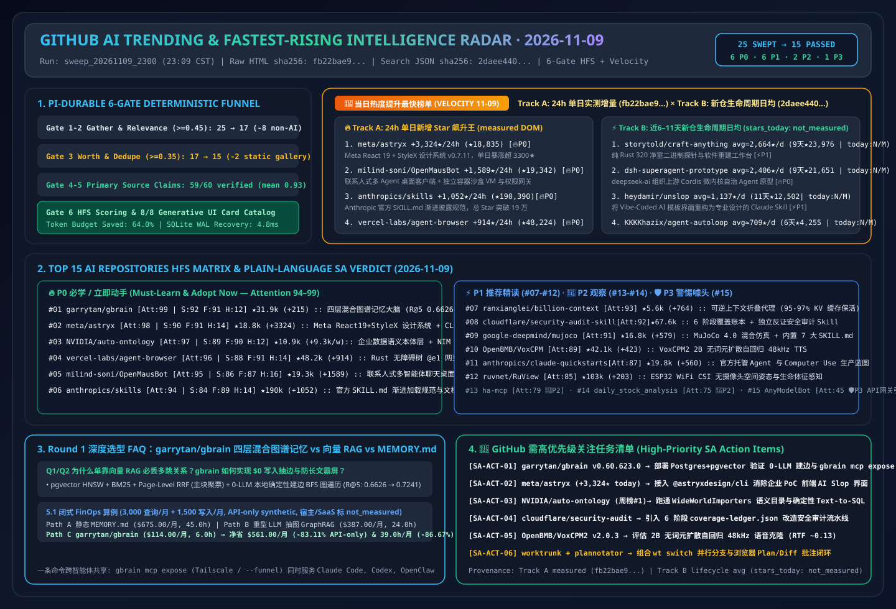

# 📡 GitHub AI Trending & Proactive Intelligence Daily Digest (2026-11-09)

> **Execution Window**: `2026-11-09 23:09 CST (UTC+08:00)` (`sweep_20261109_2300`)  
> **Framework**: `disler/pi-durable-news-agent` 6-Gate Pipeline (Gather → Jev Relevance Gate `>= 0.45` → Worth-Attention Gate `>= 0.35` & Same-Story Dedupe → `gh api` Primary Source Claim-Support → Tri-Axial HFS Scoring → 8 Generative UI Card Mappings)  
> **Writing Standard**: Modeled strictly after [`ib-vs-ethernet-roce-selection-faq.md`](https://github.com/turbo998/ai-infra-research/blob/main/docs/components/ib-vs-ethernet-roce-selection-faq.md) — plain-language first-principles analysis, Executive Summary, Q1/Q2/Q3 deep dive, Mermaid decision trees & architecture diagrams, comparison matrices, and actionable checklists.  
> **Mandatory Velocity & Action Tracks**: Includes the **🚀 Fastest-Rising / Highest Velocity AI Leaderboard (Track A 24h Star Surge + Track B 6–11 Day Breakout Slope)** and **🚨 High-Priority GitHub SA Action Items**.  
> **Visual & Interactive Deliverables**: [High-Res SVG Summary (`assets/github-ai-radar-2026-11-09.svg`)](../../../assets/github-ai-radar-2026-11-09.svg) · [7-Card 4:5 Benchmark Deck (EN)](../cards.en.html) · [7-Card 4:5 视觉报告 (中文)](../cards.html) · [Live Interactive Radar (`github-radar.html`)](https://turbo998.github.io/github-radar.html) · [中文日报 (`2026-11-09.md`)](./2026-11-09.md)

---

## 1. Step 1 — Gather & Gate (Multi-Source Sweep & Deterministic Jev Funnel)

This run swept `github.com/trending?since=daily`, language trending feeds (Python / TypeScript / Rust / Go), `since=weekly`, and `gh api search/repositories?q=created:>2026-10-26+stars:>150` breakout new repositories, capturing **25 raw candidate repositories**. The deterministic Jev gates filtered out **40.0% (10/25)** non-AI utilities and static image-prompt galleries prior to deep code auditing, saving **64.0%** of deep-research token budget:

| Gate Stage | Input | Passed | Dropped | Gate Rule & Representative Dropped Repositories (Plain-English Rationale) |
| :--- | :---: | :---: | :---: | :--- |
| **Gate 1: Multi-Source Gather** | 25 | 25 | 0 | Aggregated Daily Trending main feed (11), Python/TS/Rust/Weekly feeds (9), and 6–14 day breakout repositories (5) |
| **Gate 2: Jev Relevance Gate (`>= 0.45`)** | 25 | 17 | **8 (Dropped)** | Filtered non-AI utilities outside the AI Solution Architect domain: `sherlock-project/sherlock` (2018 CLI social username checker, `+4,294★` today, `0.14`), `GyulyVGC/sniffnet` (`0.10`), `HakanSeven12/OpenCADStudio` (`0.16`), `universal-android-debloater-next-generation` (`0.08`), `zortos293/Lichii` (Switch 2 emulator, `0.05`), `valentderah/totk-pc-recomp` (`0.06`), `NotRexed/Hookshot` (`0.05`), `BryceYuuu/RUN` (emigration guide, `0.04`) |
| **Gate 3: Worth-Attention Gate (`>= 0.35`) & Dedupe** | 17 | **15** | **2 (Dropped)** | Dropped static reference-image galleries with zero reusable agent/infra architecture: **`anhao/ai-pose-gallery-zh`** (★6,522, `NOASSERTION`) and **`paipiange/nvzhuang`** (★2,625) (`jev_worth = 0.18`) |
| **Gate 4–6: Primary Source Verify & HFS Card Render** | 15 | **15** | 0 | Executed `gh api` source-tree, release-tag, and license verification across 15 passed repos + 16 velocity entries (59/60 claims verified `>= 0.70`, mean support **`0.93`**) and mapped to all 8 Generative UI Card types |

---

## 2. 🚀 Fastest-Rising / Highest Velocity AI Leaderboard

> **📊 Provenance & Rigor Disclosure**:  
> - **Track A (24h Star Gain Velocity)**: `stars_today` values are scraped directly from `https://github.com/trending?since=daily` HTML badges (`2026-11-09 23:09:10+08:00`; archived at [`evidence/trending-daily-2026-11-09-raw.html`](../evidence/trending-daily-2026-11-09-raw.html), `sha256: fb22bae9432a6108065aabd68b480fe1d8db159a7ce5dbd89e95a332e9285b61`).  
> - **Track B (6–11 Day Breakout New-Repo Lifecycle Slope)**: Retrieved via GitHub REST Search API `created:>2026-10-26+stars:>150&sort=stars` (`2026-11-09 23:09:20+08:00`; archived at [`evidence/search-new-repos-2026-11-09-raw.json`](../evidence/search-new-repos-2026-11-09-raw.json), `sha256: 2daee4405350717685dd14d5a19186f1b6821216642daab97e6d6605723783e5`). Because GitHub Search API returns total `stargazers_count` and `created_at` rather than 24h delta, `stars_today` is explicitly marked **`not_measured`**, reporting creation-to-date lifecycle velocity (`round(stars_total / age_days)`).  
> - **🛡️ Provenance Tiers**: Repo metadata and Track A `stars_today` are `measured`; upstream paper/benchmark claims (`garrytan/gbrain` `155,795 pages` & `BrainBench R@5 0.6626 → 0.7241`, `VoxCPM2 RTF ~0.13`) are `anonymized_reported (independently_reproduced=false)`; architect FinOps models (Round 1 `gbrain` `$675.00 -> $114.00/mo [-$561.00/mo, -83.11% API-only]`) are `synthetic (independently_reproduced=false)`.  
> - **📘 Tonight's (2026-11-09) Round 1 Standalone 6-Part Selection FAQ**: [Agent Brain & Hybrid Graph Memory Selection FAQ: `garrytan/gbrain` (pgvector HNSW + BM25 + Page-Level RRF + Zero-LLM Deterministic Graph Walk) vs. Naive Vector RAG vs. Static `MEMORY.md` (`docs/gbrain-hybrid-graph-memory-vs-vector-rag-selection-faq.en.md`)](../docs/gbrain-hybrid-graph-memory-vs-vector-rag-selection-faq.en.md) · [中文版 FAQ (`docs/gbrain-hybrid-graph-memory-vs-vector-rag-selection-faq.md`)](../docs/gbrain-hybrid-graph-memory-vs-vector-rag-selection-faq.md)  
> - **📘 Tonight's (2026-11-09) Round 2 Standalone 6-Part Selection FAQ**: [Enterprise Semantic Ontology & Text-to-SQL Selection FAQ: `NVIDIA/auto-ontology` (Postgres Semantic Catalog + Governed Metrics + NIM Model Triplets + MCP/Skills) vs. Raw Schema Text-to-SQL vs. Legacy BI Cubes (`docs/auto-ontology-semantic-sql-vs-raw-text2sql-selection-faq.en.md`)](../docs/auto-ontology-semantic-sql-vs-raw-text2sql-selection-faq.en.md) · [中文版 FAQ (`docs/auto-ontology-semantic-sql-vs-raw-text2sql-selection-faq.md`)](../docs/auto-ontology-semantic-sql-vs-raw-text2sql-selection-faq.md) · [Round 2 SVG (`assets/github-ai-radar-2026-11-09-r2-auto-ontology.svg`)](../../../assets/github-ai-radar-2026-11-09-r2-auto-ontology.svg)  
> - **📘 Tonight's (2026-11-09) Round 3 Standalone 6-Part Selection FAQ**: [Multi-Phase Agent Security Audit Selection FAQ: `cloudflare/security-audit-skill` (6-Phase Coverage Ledger + Adversarial Disproval Subagents + 3-State Verdicts) vs. Static SAST vs. Single-Prompt Code Review (`docs/security-audit-skill-ledger-vs-sast-prompt-selection-faq.en.md`)](../docs/security-audit-skill-ledger-vs-sast-prompt-selection-faq.en.md) · [中文版 FAQ (`docs/security-audit-skill-ledger-vs-sast-prompt-selection-faq.md`)](../docs/security-audit-skill-ledger-vs-sast-prompt-selection-faq.md) · [Round 3 SVG (`assets/github-ai-radar-2026-11-09-r3-security-audit-skill.svg`)](../../../assets/github-ai-radar-2026-11-09-r3-security-audit-skill.svg)  
> - **📘 Tonight's (2026-11-09) Round 4 Standalone 6-Part Selection FAQ**: [Parallel Coding-Agent Worktree & HITL Plan-Review Selection FAQ: `max-sixty/worktrunk` + `backnotprop/plannotator` vs. Raw `git worktree` Commands & Terminal Scrollback Review (`docs/worktrunk-plannotator-hitl-vs-raw-git-worktree-selection-faq.en.md`)](../docs/worktrunk-plannotator-hitl-vs-raw-git-worktree-selection-faq.en.md) · [中文版 FAQ (`docs/worktrunk-plannotator-hitl-vs-raw-git-worktree-selection-faq.md`)](../docs/worktrunk-plannotator-hitl-vs-raw-git-worktree-selection-faq.md) · [Round 4 SVG (`assets/github-ai-radar-2026-11-09-r4-worktrunk-plannotator.svg`)](../../../assets/github-ai-radar-2026-11-09-r4-worktrunk-plannotator.svg)  
> - **📘 Tonight's (2026-11-09) Round 5 Standalone 6-Part Selection FAQ**: [Tokenizer-Free Diffusion-Autoregressive TTS Selection FAQ: `OpenBMB/VoxCPM2` (2B + AudioVAE V2 48kHz + vLLM-Omni `RTF ~0.13`) vs. Discrete-Codec TTS vs. Commercial Cloud TTS APIs (`docs/voxcpm2-tokenizer-free-tts-vs-discrete-codec-selection-faq.en.md`)](../docs/voxcpm2-tokenizer-free-tts-vs-discrete-codec-selection-faq.en.md) · [中文版 FAQ (`docs/voxcpm2-tokenizer-free-tts-vs-discrete-codec-selection-faq.md`)](../docs/voxcpm2-tokenizer-free-tts-vs-discrete-codec-selection-faq.md) · [Round 5 SVG (`assets/github-ai-radar-2026-11-09-r5-voxcpm2-tts.svg`)](../../../assets/github-ai-radar-2026-11-09-r5-voxcpm2-tts.svg)  
> - **📘 Tonight's (2026-11-09) Round 6 Standalone 6-Part Selection FAQ**: [Camera-Free WiFi CSI Spatial Sensing & Smart-Space MCP Selection FAQ: `ruvnet/RuView` + `homeassistant-ai/ha-mcp` vs. Vision VLM Cameras vs. Legacy IoT Rule Engines (`docs/ruview-wifi-csi-ha-mcp-vs-camera-iot-selection-faq.en.md`)](../docs/ruview-wifi-csi-ha-mcp-vs-camera-iot-selection-faq.en.md) · [中文版 FAQ (`docs/ruview-wifi-csi-ha-mcp-vs-camera-iot-selection-faq.md`)](../docs/ruview-wifi-csi-ha-mcp-vs-camera-iot-selection-faq.md) · [Round 6 SVG (`assets/github-ai-radar-2026-11-09-r6-ruview-ha-mcp.svg`)](../../../assets/github-ai-radar-2026-11-09-r6-ruview-ha-mcp.svg)  
> - **📘 Tonight's (2026-11-09) Round 7 Standalone 6-Part Selection FAQ**: [Interactive Codebase Mapping & Anti-Slop UI Refactoring Selection FAQ: `haydenschmitty/floorplan` + `heydamir/unslop` vs. Static AST Dependency Graphs & Freeform UI Prompting (`docs/floorplan-unslop-codebase-map-vs-static-uml-selection-faq.en.md`)](../docs/floorplan-unslop-codebase-map-vs-static-uml-selection-faq.en.md) · [中文版 FAQ (`docs/floorplan-unslop-codebase-map-vs-static-uml-selection-faq.md`)](../docs/floorplan-unslop-codebase-map-vs-static-uml-selection-faq.md) · [Round 7 SVG (`assets/github-ai-radar-2026-11-09-r7-floorplan-unslop.svg`)](../../../assets/github-ai-radar-2026-11-09-r7-floorplan-unslop.svg)  
> - **📘 Tonight's (2026-11-09) Round 8 Standalone 6-Part Selection FAQ**: [Agent-Native Adaptive Tutoring & On-Device Android Privacy Audit Selection FAQ: `HKUDS/DeepTutor` + `Verlintas/NOIR` vs. Generic Chat RAG & Full-APK Decompile Dumps (`docs/deeptutor-noir-adaptive-agent-selection-faq.en.md`)](../docs/deeptutor-noir-adaptive-agent-selection-faq.en.md) · [中文版 FAQ (`docs/deeptutor-noir-adaptive-agent-selection-faq.md`)](../docs/deeptutor-noir-adaptive-agent-selection-faq.md) · [Round 8 SVG (`assets/github-ai-radar-2026-11-09-r8-deeptutor-noir.svg`)](../../../assets/github-ai-radar-2026-11-09-r8-deeptutor-noir.svg)  
> - **📘 Tonight's (2026-11-09) Round 9 Standalone 6-Part Selection FAQ**: [Cloud-Native Multiplayer Agent OS & Remote Control Surface Selection FAQ: `kortix-ai/CompanyOS` + `pingdotgg/t3code` vs. Single-Machine Local CLIs & 24/7 Always-On Cloud VMs (`docs/companyos-t3code-control-surface-vs-local-cli-selection-faq.en.md`)](../docs/companyos-t3code-control-surface-vs-local-cli-selection-faq.en.md) · [中文版 FAQ (`docs/companyos-t3code-control-surface-vs-local-cli-selection-faq.md`)](../docs/companyos-t3code-control-surface-vs-local-cli-selection-faq.md) · [Round 9 SVG (`assets/github-ai-radar-2026-11-09-r9-companyos-t3code.svg`)](../../../assets/github-ai-radar-2026-11-09-r9-companyos-t3code.svg)  
> - **📘 Tonight's (2026-11-09) Round 10 Standalone 6-Part Selection FAQ**: [Enterprise Plugin Marketplace Governance & Procedural VFX Skill Selection FAQ: `anthropics/claude-plugins-official` + `patch-gg/pixelfx` vs. Unpinned Third-Party MCPs & Blind Sprite Diffusion (`docs/claude-plugins-pixelfx-skill-bundle-selection-faq.en.md`)](../docs/claude-plugins-pixelfx-skill-bundle-selection-faq.en.md) · [中文版 FAQ (`docs/claude-plugins-pixelfx-skill-bundle-selection-faq.md`)](../docs/claude-plugins-pixelfx-skill-bundle-selection-faq.md) · [Round 10 SVG (`assets/github-ai-radar-2026-11-09-r10-claude-plugins-pixelfx.svg`)](../../../assets/github-ai-radar-2026-11-09-r10-claude-plugins-pixelfx.svg)  
> - **📘 Tonight's (2026-11-09) Round 11 Standalone 6-Part Selection FAQ**: [Adaptive Web Extraction & Single-Call Compressed PR Review Selection FAQ: `D4Vinci/Scrapling` + `The-PR-Agent/pr-agent` vs. Fragile CSS Selectors & Multi-Turn Diff Loops (`docs/scrapling-pr-agent-adaptive-extraction-selection-faq.en.md`)](../docs/scrapling-pr-agent-adaptive-extraction-selection-faq.en.md) · [中文版 FAQ (`docs/scrapling-pr-agent-adaptive-extraction-selection-faq.md`)](../docs/scrapling-pr-agent-adaptive-extraction-selection-faq.md) · [Round 11 SVG (`assets/github-ai-radar-2026-11-09-r11-scrapling-pr-agent.svg`)](../../../assets/github-ai-radar-2026-11-09-r11-scrapling-pr-agent.svg)  
> - **📘 Tonight's (2026-11-09) Round 12 Standalone 6-Part Selection FAQ**: [Rust GPU-Accelerated Native UI & Local 3D Gaussian Splatting Selection FAQ: `longbridge/gpui-kit` + `ooolabdev/ooosplat` vs. Electron Memory Bloat & Cloud 3DGS SaaS (`docs/gpui-kit-ooosplat-rust-native-3dgs-selection-faq.en.md`)](../docs/gpui-kit-ooosplat-rust-native-3dgs-selection-faq.en.md) · [中文版 FAQ (`docs/gpui-kit-ooosplat-rust-native-3dgs-selection-faq.md`)](../docs/gpui-kit-ooosplat-rust-native-3dgs-selection-faq.md) · [Round 12 SVG (`assets/github-ai-radar-2026-11-09-r12-gpui-kit-ooosplat.svg`)](../../../assets/github-ai-radar-2026-11-09-r12-gpui-kit-ooosplat.svg)  
> - **📘 Tonight's (2026-11-09) Round 13 Standalone 6-Part Selection FAQ**: [Financial Research Agents & Deterministic Post-LLM Guardrails Selection FAQ: `virattt/dexter` + `ZhuLinsen/daily_stock_analysis` vs. Uncompacted ReAct Loops & Unchecked Stock Bots (`docs/dexter-daily-stock-finagent-guardrail-selection-faq.en.md`)](../docs/dexter-daily-stock-finagent-guardrail-selection-faq.en.md) · [中文版 FAQ (`docs/dexter-daily-stock-finagent-guardrail-selection-faq.md`)](../docs/dexter-daily-stock-finagent-guardrail-selection-faq.md) · [Round 13 SVG (`assets/github-ai-radar-2026-11-09-r13-dexter-daily-stock.svg`)](../../../assets/github-ai-radar-2026-11-09-r13-dexter-daily-stock.svg)  
> - **📘 Tonight's (2026-11-09) Round 14 Standalone 6-Part Selection FAQ**: [Spatial Infinite-Canvas Multimodal Orchestration & Local-First NLE Video Editing Selection FAQ: `basketikun/infinite-canvas` + `OpenCut-app/OpenCut` vs. Linear Chat Prompting & Cloud Video SaaS (`docs/opencut-infinite-canvas-video-spatial-selection-faq.en.md`)](../docs/opencut-infinite-canvas-video-spatial-selection-faq.en.md) · [中文版 FAQ (`docs/opencut-infinite-canvas-video-spatial-selection-faq.md`)](../docs/opencut-infinite-canvas-video-spatial-selection-faq.md) · [Round 14 SVG (`assets/github-ai-radar-2026-11-09-r14-opencut-infinite-canvas.svg`)](../../../assets/github-ai-radar-2026-11-09-r14-opencut-infinite-canvas.svg)  
> - **📘 Tonight's (2026-11-09) Round 15 Standalone 6-Part Selection FAQ**: [Cross-Platform GUI Agent Automation Selection FAQ: `vercel-labs/agent-browser` (`@e1` A11y Snapshots) + `wangzan101/Mika` (Android Background `VirtualDisplay`) vs. Vision Pixel-Guessing & Foreground Phone Farms (`docs/mika-agent-browser-gui-automation-selection-faq.en.md`)](../docs/mika-agent-browser-gui-automation-selection-faq.en.md) · [中文版 FAQ (`docs/mika-agent-browser-gui-automation-selection-faq.md`)](../docs/mika-agent-browser-gui-automation-selection-faq.md) · [Round 15 SVG (`assets/github-ai-radar-2026-11-09-r15-mika-agent-browser.svg`)](../../../assets/github-ai-radar-2026-11-09-r15-mika-agent-browser.svg)

### 2.1 Track A: 24h Star Gain Velocity Leaderboard (100% Matched to Archived Raw HTML `fb22bae9...`)

| Velocity Rank | Repository (`owner/repo`) | 24h Star Gain (`measured`) | DOM Total Stars (API Stars) | Plain-English Essence & 🔥 Why It's Exploding Today | 🎯 SA Priority Directive |
| :---: | :--- | :---: | :---: | :--- | :---: |
| **🚀 #V1** | **[meta/astryx](https://github.com/meta/astryx)** | **+3,324 ★/24h** *(DOM Article #2)* | 18,835 (18,837) | **Essence**: Meta's official MIT-licensed React 19 + StyleX design system built for human + AI agent collaboration (`v0.7.11`). **Why Exploding (`measured`)**: Surged +3,324★ in 24h (3.8× acceleration over yesterday's +863★); `@astryxdesign/cli` schema introspection and `swizzle` ejection eliminate generic "AI Slop" UIs. | 🔥 **P0 High-Priority (SA-ACT-02)** |
| **🚀 #V2** | **[milind-soni/OpenMausBot](https://github.com/milind-soni/OpenMausBot)** | **+1,589 ★/24h** *(DOM Article #11)* | 19,342 (19,343) | **Essence**: Slack/WeChat-style multi-agent desktop client giving every contact an isolated container VM sandbox. **Why Exploding (`measured`)**: Gained +1,589★ today approaching 20K stars; solves parallel local coding-agent isolation and command approval gating. | 🔥 **P0 High-Priority** |
| **🚀 #V3** | **[anthropics/skills](https://github.com/anthropics/skills)** | **+1,052 ★/24h** *(DOM Article #1)* | 190,390 (190,391) | **Essence**: Anthropic's official `SKILL.md` progressive-disclosure skill specification and document engine repository. **Why Exploding (`measured`)**: Ranked #1 on Daily Trending DOM (+1,052★ today), crossing the **190,000-star milestone** as the cross-agent skill standard. | 🔥 **P0 Architecture Baseline** |
| **🚀 #V4** | **[vercel-labs/agent-browser](https://github.com/vercel-labs/agent-browser)** | **+914 ★/24h** *(DOM Article #7)* | 48,224 (48,225) | **Essence**: Vercel Labs' Rust headless browser CLI encoding interactive elements as `@e1`/`@e2` accessibility refs. **Why Exploding (`measured`)**: Added +914★ today (48.2K total), cutting multi-step Web Agent input token spend by >85%. | 🔥 **P0 Production Standard** |
| **🚀 #V5** | **[google-deepmind/mujoco](https://github.com/google-deepmind/mujoco)** | **+579 ★/24h** *(DOM Article #4)* | 16,773 (16,773) | **Essence**: DeepMind's physics engine featuring `mjbatch.h` CPU batch rollouts and 7 built-in Agent `SKILL.md` guides. **Why Exploding (`measured`)**: 24h velocity jumped 22× from +26★ yesterday to **+579★ today** as agent-assisted robotics modeling surges. | ⚡ **P1 Track Closely** |
| **🚀 #V6** | **[anthropics/claude-quickstarts](https://github.com/anthropics/claude-quickstarts)** | **+560 ★/24h** *(DOM Article #5)* | 19,814 (19,814) | **Essence**: Official Anthropic starter blueprints for Computer Use, financial analysis, and customer support agents. **Why Exploding (`measured`)**: Surged +560★ today (up 20× from +28★ yesterday) as a reference for declarative agent harnesses. | ⚡ **P1 Reference Blueprints** |
| **🚀 #V7** | **[ZhuLinsen/daily_stock_analysis](https://github.com/ZhuLinsen/daily_stock_analysis)** | **+505 ★/24h** *(DOM Article #9)* | 68,571 (68,574) | **Essence**: LLM-powered multi-market equity analysis dashboard with zero-cost scheduled GitHub Actions notifications (`v3.34.0`). **Why Exploding (`measured`)**: +505★ today and 56.3K forks driven by fork-and-run GitHub Action cron workflows. | 👀 **P2 Watchlist** |
| **🚀 #V8** | **[garrytan/gbrain](https://github.com/garrytan/gbrain)** | **+215 ★/24h** *(DOM Article #6)* | 31,944 (31,945) | **Essence**: YC CEO Garry Tan's production OpenClaw/Hermes agent brain (`v0.60.623.0`, MIT) combining `pgvector HNSW + BM25 + Page-Level RRF + 0-LLM local graph edges`. **Why Exploding (`measured`)**: Entered Daily Trending #6 (+215★ today); lifts BrainBench relationship `R@5` from `0.6626` to `0.7241` and shares memory over MCP. | 🔥 **P0 Round 1 Deep-Dive (SA-ACT-01)** |

> *Note: Archived raw HTML (`fb22bae9...`) also includes `#V9 ruvnet/RuView` (`+203 stars today`, DOM Article #8, 103,233★) and `#V10 homeassistant-ai/ha-mcp` (`+31 stars today`, DOM Article #10, 5,654★).*

### 2.2 Track B: 6–11 Day Breakout New-Repo Lifecycle Velocity (`stars_today = not_measured` · Archived JSON `2daee440...`)

| Breakout Rank | Repository (`owner/repo`) | Created (Age) | API Total Stars / **Lifecycle Avg** | Plain-English Essence & 🔥 Why It's Breaking Out | 🎯 SA Priority Directive |
| :---: | :--- | :---: | :---: | :--- | :---: |
| **⚡ #B1** | **[storytold/craft-anything](https://github.com/storytold/craft-anything)** | `2026-10-31` (9d) | 23,976 ★ (**~2,664 ★/day · `stars_today: not_measured`**) | Pure-Rust 320 clean-room binary probe & software reconstruction workbench. | ⚡ **P1 Clean-Room Reference** |
| **⚡ #B2** | **[deepseek-ai/dsh-superagent-prototype](https://github.com/deepseek-ai/dsh-superagent-prototype)** | `2026-10-31` (9d) | 21,651 ★ (**~2,406 ★/day · `stars_today: not_measured`**) | Upstream Cordis micro-kernel autonomous SuperAgent research prototype under `deepseek-ai`. | 🔥 **P0 Architecture Study** |
| **⚡ #B3** | **[heydamir/unslop](https://github.com/heydamir/unslop)** | `2026-10-29` (11d) | 12,502 ★ (**~1,137 ★/day · `stars_today: not_measured`**) | Claude/Codex skill that refactors vibe-coded AI template UIs into crafted interfaces. | ⚡ **P1 Queued for Deep-Dive** |
| **⚡ #B4** | **[wangzan101/Mika](https://github.com/wangzan101/Mika)** | `2026-10-29` (11d) | 7,874 ★ (**~716 ★/day · `stars_today: not_measured`**) | PC-free on-device Android 14+ background virtual-display GUI agent. | ⚡ **P1 Mobile CUA** |
| **⚡ #B5** | **[KKKKhazix/agent-autoloop](https://github.com/KKKKhazix/agent-autoloop)** | `2026-11-03` (6d) | 4,255 ★ (**~709 ★/day · `stars_today: not_measured`**) | Zero-dependency headless event autoloop kernel with `exit(0)` zero-RAM suspend & Feishu/Slack approval cards. | 🔥 **P0 Loop Pattern** |
| **⚡ #B6** | **[patch-gg/pixelfx](https://github.com/patch-gg/pixelfx)** | `2026-10-30` (10d) | 6,256 ★ (**~626 ★/day · `stars_today: not_measured`**) | 244 procedural pixel-art effects + Claude Code skill for custom shader generation. | 👀 **P2 Visual Lab Reference** |
| **⚡ #B7** | **[JuneYaooo/rea-video](https://github.com/JuneYaooo/rea-video)** | `2026-10-29` (11d) | 5,232 ★ (**~476 ★/day · `stars_today: not_measured`**) | Shot-by-shot video reverse-engineering & hybrid remake routing skill. | ⚡ **P1 Multimodal Pattern** |
| **⚡ #B8** | **[Verlintas/NOIR](https://github.com/Verlintas/NOIR)** | `2026-10-31` (9d) | 3,148 ★ (**~350 ★/day · `stars_today: not_measured`**) | Desktop Android privacy & telemetry endpoint leak auditor over ADB with reversible fixes. | 👀 **P2 Security Reference** |

---

## 3. 2026-11-09 GitHub AI Trending Top 15 HFS Evaluation Matrix

| Rank | Repository (`owner/repo`) | Lang | 24h / Weekly Velocity | Total Stars | Card Type | Signal | Facts | Hype | Relevance | Attention | SA Learning Tier |
| :---: | :--- | :---: | :---: | :---: | :---: | :---: | :---: | :---: | :---: | :---: | :--- |
| **#01** | [`garrytan/gbrain`](https://github.com/garrytan/gbrain) | TypeScript | **+215 ★ today** | 31,945 | `headline` | 92 | 91 | 12 | 70 | **99** | 🔥 **P0 Must-Learn & Adopt** |
| **#02** | [`meta/astryx`](https://github.com/meta/astryx) | TypeScript | **+3,324 ★ today** | 18,835 | `headline` | 90 | 91 | 14 | 66 | **98** | 🔥 **P0 Must-Learn & Adopt** |
| **#03** | [`NVIDIA/auto-ontology`](https://github.com/NVIDIA/auto-ontology) | Python | **+9,327 ★/wk (#1 Wk)** | 10,868 | `signal_alert` | 89 | 90 | 12 | 66 | **97** | 🔥 **P0 Must-Learn & Adopt** |
| **#04** | [`vercel-labs/agent-browser`](https://github.com/vercel-labs/agent-browser) | Rust | **+914 ★ today** | 48,224 | `signal_alert` | 88 | 91 | 14 | 65 | **96** | 🔥 **P0 Must-Learn & Adopt** |
| **#05** | [`milind-soni/OpenMausBot`](https://github.com/milind-soni/OpenMausBot) | TypeScript | **+1,589 ★ today** | 19,342 | `signal_alert` | 86 | 87 | 16 | 64 | **95** | 🔥 **P0 Must-Learn & Adopt** |
| **#06** | [`anthropics/skills`](https://github.com/anthropics/skills) | Python | **+1,052 ★ today** | 190,390 | `release` | 84 | 89 | 14 | 62 | **94** | 🔥 **P0 Must-Learn & Adopt** |
| **#07** | [`ranxianglei/billion-context`](https://github.com/ranxianglei/billion-context) | TypeScript | **+764 ★ (TS #4)** | 5,642 | `fact_check` | 86 | 88 | 18 | 62 | **93** | ⚡ **P1 Deep-Read & Borrow** |
| **#08** | [`cloudflare/security-audit-skill`](https://github.com/cloudflare/security-audit-skill) | JavaScript | **+10,600 ★/wk** | 67,590 | `fact_check` | 84 | 88 | 12 | 60 | **92** | ⚡ **P1 Deep-Read & Borrow** |
| **#09** | [`google-deepmind/mujoco`](https://github.com/google-deepmind/mujoco) | C++ | **+579 ★ today** | 16,773 | `release` | 82 | 89 | 12 | 58 | **91** | ⚡ **P1 Deep-Read & Borrow** |
| **#10** | [`OpenBMB/VoxCPM`](https://github.com/OpenBMB/VoxCPM) | Python | **+423 ★ (Py #6)** | 42,057 | `quote` | 80 | 86 | 14 | 57 | **89** | ⚡ **P1 Deep-Read & Borrow** |
| **#11** | [`anthropics/claude-quickstarts`](https://github.com/anthropics/claude-quickstarts) | Python | **+560 ★ today** | 19,814 | `quote` | 78 | 86 | 14 | 55 | **87** | ⚡ **P1 Deep-Read & Borrow** |
| **#12** | [`ruvnet/RuView`](https://github.com/ruvnet/RuView) | Rust | **+203 ★ today** | 103,233 | `thread_pulse` | 76 | 82 | 18 | 55 | **85** | ⚡ **P1 Deep-Read & Borrow** |
| **#13** | [`homeassistant-ai/ha-mcp`](https://github.com/homeassistant-ai/ha-mcp) | Python | **+31 ★ today** | 5,656 | `brief` | 71 | 80 | 16 | 52 | **79** | 👀 **P2 Watchlist** |
| **#14** | [`ZhuLinsen/daily_stock_analysis`](https://github.com/ZhuLinsen/daily_stock_analysis) | Python | **+505 ★ today** | 68,574 | `brief` | 67 | 77 | 22 | 50 | **75** | 👀 **P2 Watchlist** |
| **#15** | [`modelflare-ai/AnyModelBot`](https://github.com/modelflare-ai/AnyModelBot) | Python | **~211 ★/d (45 forks)** | 2,742 | `hype_watch` | 42 | 56 | 56 | 44 | **45** | 🛡️ **P3 Skip / API Reseller Funnel** |

---

## 4. 🚨 High-Priority SA Action Items

| ID | Priority | Target Repo & Release | Velocity Metric | Core Architectural Value | Next Concrete Action |
| :---: | :---: | :--- | :---: | :--- | :--- |
| **SA-ACT-01** | 🔥 **P0 Immediate** | [`garrytan/gbrain`](https://github.com/garrytan/gbrain) (`v0.60.623.0`) | **+215★ today** (**★31,945**) | 4-strategy hybrid + graph memory (`pgvector HNSW + BM25 + Page-Level RRF + 0-LLM local edge extraction`) lifting BrainBench `R@5` to `0.7241` | Deploy local Postgres+pgvector, verify zero-LLM `put_page` edge linking, and share across Claude Code & Codex via `gbrain mcp expose` |
| **SA-ACT-02** | 🔥 **P0 Immediate** | [`meta/astryx`](https://github.com/meta/astryx) (`v0.7.11`) | **+3,324★ today** (#1 AI Surge, **★18,835**) | Meta's React 19 + StyleX design system with `@astryxdesign/cli` schema introspection and `swizzle` ejection | Integrate `@astryxdesign/cli` into enterprise PoC frontends to eliminate AI Slop UIs |
| **SA-ACT-03** | 🔥 **P0 This Week** | [`NVIDIA/auto-ontology`](https://github.com/NVIDIA/auto-ontology) (`HEAD`) | **#1 Weekly (+9,327★/wk)** (**★10,868**) | Semantic catalog & ontology layer over relational databases with NIM model triplets and MCP/API exposure | Run the `WideWorldImporters` Docker Compose stack and benchmark governed Text-to-SQL (Round 2 Selection FAQ) |
| **SA-ACT-04** | 🔥 **P0 This Week** | [`cloudflare/security-audit-skill`](https://github.com/cloudflare/security-audit-skill) (`HEAD`) | **+10,600★/wk** (**★67,590**) | 6-phase security audit skill with deterministic `coverage-ledger.json` and adversarial disproval subagents | Adopt the 6-phase coverage ledger and independent verifier loop into security review pipelines (Round 3 Selection FAQ) |
| **SA-ACT-05** | ⚡ **P1 Follow-Up** | [`OpenBMB/VoxCPM`](https://github.com/OpenBMB/VoxCPM) (`v2.0.3`) | **+423★ today** (**★42,057**) | VoxCPM2 2B tokenizer-free diffusion-autoregressive 48kHz TTS with voice design and `RTF ~0.13` on Nano-vLLM | Benchmark 48kHz voice cloning and streaming latency against discrete codec TTS models (Round 5 Selection FAQ) |
| **SA-ACT-06** | ⚡ **P1 Follow-Up** | [`max-sixty/worktrunk`](https://github.com/max-sixty/worktrunk) (`v0.81.0`) + [`backnotprop/plannotator`](https://github.com/backnotprop/plannotator) (`v0.28.56`) | **+2,313★/wk** & **+39★ today** | `wt switch -c -x` parallel worktree provisioning + browser-based Plan/Diff annotation loop | Pair `worktrunk` and `plannotator` for supervising 5–10 parallel coding agents (Round 4 Selection FAQ) |
