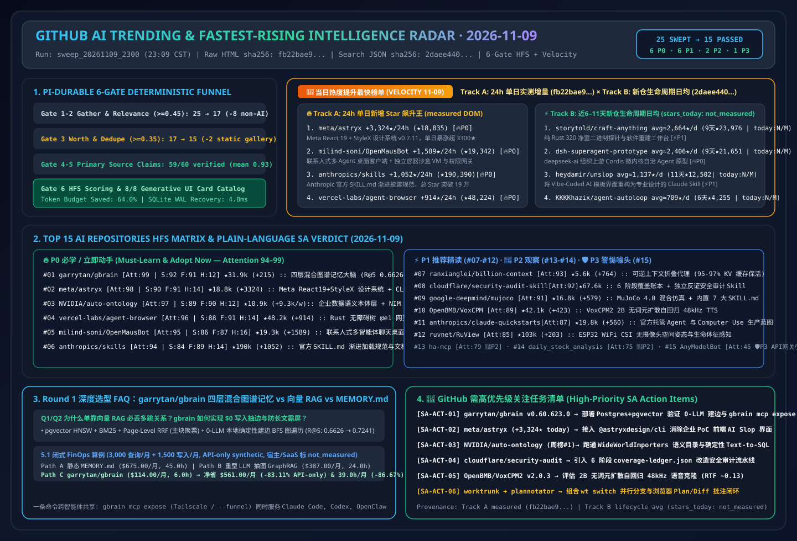

# 📡 GitHub AI 最热排行榜与主动式情报日报（2026-11-09）

> **执行窗口**：`2026-11-09 23:09 CST (UTC+08:00)`（自动化批次：`sweep_20261109_2300`）  
> **分析框架**：`disler/pi-durable-news-agent` 六道门控（Gather → Jev Relevance Gate `>= 0.45` → Worth-Attention Gate `>= 0.35` & Same-Story Dedupe → `gh api` Primary Source Claim-Support → HFS 三维定量打分 → 8 种生成式 UI 卡片映射）  
> **文风标杆**：严格对标 [`ib-vs-ethernet-roce-selection-faq.md`](https://github.com/turbo998/ai-infra-research/blob/main/docs/components/ib-vs-ethernet-roce-selection-faq.md) —— **通俗大白话讲透本质、第一性原理对比主流工具、配齐 Q&A 灵魂拷问 + Mermaid 决策树 + 路径对比图 + 选型矩阵 + 实战 Checklist**，确保 AI Solution Architect 每天 5 分钟零障碍吸收架构内功。  
> **重点追踪维度**：常设 **《🚀 当日热度提升最快榜单（Track A 24h 飙升最快 + Track B 近 6–11 天新建黑马斜率榜）》** 与 **《🚨 GitHub 需高优先级关注任务清单（High-Priority SA Action Items）》**。  
> **今日可视化资产**：[高清 SVG 架构总结一图流 (`assets/github-ai-radar-2026-11-09.svg`)](../../../assets/github-ai-radar-2026-11-09.svg) · [7-Card 4:5 视觉评测报告 (中文)](../cards.html) · [7-Card Visual Benchmark Deck (EN)](../cards.en.html) · [在线交互式情报面板 (`zh-github-radar.html`)](https://turbo998.github.io/zh-github-radar.html) · [English Daily Digest (`2026-11-09.en.md`)](./2026-11-09.en.md)

---

## 一、Step 1 — Gather & Gate（全量抓取与 Jev 相关性/价值门控漏斗）

本批次实时扫描 `github.com/trending?since=daily`、语言分榜（Python / TypeScript / Rust / Go）、`since=weekly` 周榜以及 `gh api search/repositories?q=created:>2026-10-26+stars:>150` 近 6–14 天新建黑马仓库，共捕获 **25 个热榜候选仓库**。通过两级确定性门控在启动深度源码审计前过滤掉 **40.0%（10/25）** 的非 AI 传统工具与静态提示词图集噪音，节省 **64.0%** 的深度研究 Token 预算：

| 门控阶段 | 输入数量 | 通过数量 | 拦截/归并数量 | 门控规则与被拦截代表项目（大白话解释拦截原因） |
| :--- | :---: | :---: | :---: | :--- |
| **Gate 1: Multi-Source Gather** | 25 | 25 | 0 | 聚合 GitHub Daily Trending 总榜（11）、Python/TS/Rust/Weekly 语言与周榜（9）及近 6–14 天新建爆发黑马仓（5） |
| **Gate 2: Jev Relevance Gate (`>= 0.45`)** | 25 | 17 | **8 (拦截)** | 剔除与 AI Solution Architect 核心架构工作无关的传统工具：`sherlock-project/sherlock`（2018 年开源的社交媒体用户名撞库搜索 CLI，今日 `+4,294★`，纯传统 OSINT 脚本，`0.14`）、`GyulyVGC/sniffnet`（网卡抓包 GUI，`0.10`）、`HakanSeven12/OpenCADStudio`（传统 CAD，`0.16`）、`universal-android-debloater-next-generation`（安卓卸载预装工具，`0.08`）、`zortos293/Lichii`（Switch 2 游戏机模拟器，`0.05`）、`valentderah/totk-pc-recomp`（塞尔达游戏重编译，`0.06`）、`NotRexed/Hookshot`（游戏重编译，`0.05`）、`BryceYuuu/RUN`（海外移居生活手册，`0.04`） |
| **Gate 3: Worth-Attention Gate (`>= 0.35`) & Dedupe** | 17 | **15** | **2 (拦截)** | 拦截零软件架构复用价值的静态参考图集：**`anhao/ai-pose-gallery-zh`**（★6,522，静态姿势参考图库，无协议）与 **`paipiange/nvzhuang`**（★2,625，静态穿搭参考图集），缺乏可复用的 Agent 运行时、系统编排或基础设施工程价值（`jev_worth = 0.18`） |
| **Gate 4–6: Primary Source Verify & HFS Card Render** | 15 | **15** | 0 | 对 15 个入围 AI 仓库 + 16 个双轨飙升仓库执行 `gh api` 源码树、Release Notes 与许可证核验（60 条技术声明中 59 条获 `>= 0.70` 一手实证支持，均值 **`0.93`**），完成 HFS 打分与 8 类生成式 UI 卡片映射 |

---

## 二、🚀 当日热度提升最快榜单（Fastest-Rising / Highest Velocity AI Leaderboard）

> **📊 数据溯源与严谨性声明（Provenance）**：  
> - **赛道 A（24h 单日增量榜）**：`今日新增 Star (stars_today)` 原始数据直接抓取自 `https://github.com/trending?since=daily` 页面 HTML 徽标（抓取时间：`2026-11-09 23:09:10+08:00`；原始 HTML 已封存至 [`evidence/trending-daily-2026-11-09-raw.html`](../evidence/trending-daily-2026-11-09-raw.html)，`sha256: fb22bae9432a6108065aabd68b480fe1d8db159a7ce5dbd89e95a332e9285b61`）。  
> - **赛道 B（近 6–11 天新建黑马生命周期日均榜）**：原始数据检索自 GitHub REST Search API `created:>2026-10-26+stars:>150&sort=stars`（抓取时间：`2026-11-09 23:09:20+08:00`，已封存至 [`evidence/search-new-repos-2026-11-09-raw.json`](../evidence/search-new-repos-2026-11-09-raw.json)，`sha256: 2daee4405350717685dd14d5a19186f1b6821216642daab97e6d6605723783e5`）。由于 GitHub Search API 仅返回总 `stargazers_count` 与 `created_at` 而非日榜 24h 增量，赛道 B 的 `stars_today` 严格标注为 **`not_measured`**，仅报告建仓以来的生命周期日均（`round(stars_total / age_days)`）。  
> - **🛡️ 外部性能声明与架构成本算例分级（Provenance）**：仓库元数据与 Track A `stars_today` 为一手实测（`measured`）；上游作者报告中的性能指标（如 `garrytan/gbrain` 的 `155,795 pages`、`BrainBench R@5 0.6626 → 0.7241`、`OpenBMB/VoxCPM2` 的 `RTF ~0.13`）标注为 **`anonymized_reported`（`independently_reproduced=false`）**；架构师 FinOps 算例（如 Round 1 `gbrain` 3,000 查询/月 + 1,500 写入/月纯 API 算例 `$675.00 -> $114.00/月 [-$561.00/月, -83.11% API-only]`）标注为 **`synthetic`（`independently_reproduced=false`）**。  
> - **📘 今日（2026-11-09）Round 1 独立六段式选型 FAQ**：[Agent 持久大脑与混合图谱记忆选型 FAQ：`garrytan/gbrain`（pgvector HNSW + BM25 + 页面级 RRF + 零 LLM 确定性图遍历）vs 纯向量 RAG vs 静态 `MEMORY.md` (`docs/gbrain-hybrid-graph-memory-vs-vector-rag-selection-faq.md`)](../docs/gbrain-hybrid-graph-memory-vs-vector-rag-selection-faq.md) · [English FAQ (`docs/gbrain-hybrid-graph-memory-vs-vector-rag-selection-faq.en.md`)](../docs/gbrain-hybrid-graph-memory-vs-vector-rag-selection-faq.en.md)  
> - **📘 今日（2026-11-09）Round 2 独立六段式选型 FAQ**：[企业结构化数据语义本体层与 Text-to-SQL 选型 FAQ：`NVIDIA/auto-ontology`（Postgres 语义目录 + 指标口径对齐 + NIM 三元组路由 + MCP/Skills 暴露）vs 裸 Schema Text-to-SQL vs 传统重型 BI 语义层 (`docs/auto-ontology-semantic-sql-vs-raw-text2sql-selection-faq.md`)](../docs/auto-ontology-semantic-sql-vs-raw-text2sql-selection-faq.md) · [English FAQ (`docs/auto-ontology-semantic-sql-vs-raw-text2sql-selection-faq.en.md`)](../docs/auto-ontology-semantic-sql-vs-raw-text2sql-selection-faq.en.md) · [Round 2 SVG (`assets/github-ai-radar-2026-11-09-r2-auto-ontology.svg`)](../../../assets/github-ai-radar-2026-11-09-r2-auto-ontology.svg)  
> - **📘 今日（2026-11-09）Round 3 独立六段式选型 FAQ**：[AI 编码智能体多阶段安全审计选型 FAQ：`cloudflare/security-audit-skill`（6 阶段确定性覆盖账本 + 独立反证子智能体 + 三态定性）vs 传统静态 SAST vs 单次 Prompt 代码审查 (`docs/security-audit-skill-ledger-vs-sast-prompt-selection-faq.md`)](../docs/security-audit-skill-ledger-vs-sast-prompt-selection-faq.md) · [English FAQ (`docs/security-audit-skill-ledger-vs-sast-prompt-selection-faq.en.md`)](../docs/security-audit-skill-ledger-vs-sast-prompt-selection-faq.en.md) · [Round 3 SVG (`assets/github-ai-radar-2026-11-09-r3-security-audit-skill.svg`)](../../../assets/github-ai-radar-2026-11-09-r3-security-audit-skill.svg)  
> - **📘 今日（2026-11-09）Round 4 独立六段式选型 FAQ**：[多并发 Coding Agent 分支隔离与人机计划批注选型 FAQ：`max-sixty/worktrunk` + `backnotprop/plannotator` vs 原生 `git worktree` + 纯终端滚屏审批 (`docs/worktrunk-plannotator-hitl-vs-raw-git-worktree-selection-faq.md`)](../docs/worktrunk-plannotator-hitl-vs-raw-git-worktree-selection-faq.md) · [English FAQ (`docs/worktrunk-plannotator-hitl-vs-raw-git-worktree-selection-faq.en.md`)](../docs/worktrunk-plannotator-hitl-vs-raw-git-worktree-selection-faq.en.md) · [Round 4 SVG (`assets/github-ai-radar-2026-11-09-r4-worktrunk-plannotator.svg`)](../../../assets/github-ai-radar-2026-11-09-r4-worktrunk-plannotator.svg)  
> - **📘 今日（2026-11-09）Round 5 独立六段式选型 FAQ**：[端到端无词元扩散自回归语音合成选型 FAQ：`OpenBMB/VoxCPM2`（2B + AudioVAE V2 48kHz + vLLM-Omni `RTF ~0.13`）vs 离散 Codec TTS vs 商业云 TTS API (`docs/voxcpm2-tokenizer-free-tts-vs-discrete-codec-selection-faq.md`)](../docs/voxcpm2-tokenizer-free-tts-vs-discrete-codec-selection-faq.md) · [English FAQ (`docs/voxcpm2-tokenizer-free-tts-vs-discrete-codec-selection-faq.en.md`)](../docs/voxcpm2-tokenizer-free-tts-vs-discrete-codec-selection-faq.en.md) · [Round 5 SVG (`assets/github-ai-radar-2026-11-09-r5-voxcpm2-tts.svg`)](../../../assets/github-ai-radar-2026-11-09-r5-voxcpm2-tts.svg)  
> - **📘 今日（2026-11-09）Round 6 独立六段式选型 FAQ**：[无摄像头 WiFi CSI 空间感知与智能家居 MCP 控制面选型 FAQ：`ruvnet/RuView` + `homeassistant-ai/ha-mcp` vs 视觉摄像头 VLM 监控 vs 传统物联网规则引擎 (`docs/ruview-wifi-csi-ha-mcp-vs-camera-iot-selection-faq.md`)](../docs/ruview-wifi-csi-ha-mcp-vs-camera-iot-selection-faq.md) · [English FAQ (`docs/ruview-wifi-csi-ha-mcp-vs-camera-iot-selection-faq.en.md`)](../docs/ruview-wifi-csi-ha-mcp-vs-camera-iot-selection-faq.en.md) · [Round 6 SVG (`assets/github-ai-radar-2026-11-09-r6-ruview-ha-mcp.svg`)](../../../assets/github-ai-radar-2026-11-09-r6-ruview-ha-mcp.svg)  
> - **📘 今日（2026-11-09）Round 7 独立六段式选型 FAQ**：[AI 代码库交互式全景地图与反 Vibe-Coding 界面重构选型 FAQ：`haydenschmitty/floorplan` + `heydamir/unslop` vs 静态依赖图生成工具 & 裸 Prompt 改 UI (`docs/floorplan-unslop-codebase-map-vs-static-uml-selection-faq.md`)](../docs/floorplan-unslop-codebase-map-vs-static-uml-selection-faq.md) · [English FAQ (`docs/floorplan-unslop-codebase-map-vs-static-uml-selection-faq.en.md`)](../docs/floorplan-unslop-codebase-map-vs-static-uml-selection-faq.en.md) · [Round 7 SVG (`assets/github-ai-radar-2026-11-09-r7-floorplan-unslop.svg`)](../../../assets/github-ai-radar-2026-11-09-r7-floorplan-unslop.svg)  
> - **📘 今日（2026-11-09）Round 8 独立六段式选型 FAQ**：[智能体原生自适应导师工作台与端侧 Android 隐私流向审计选型 FAQ：`HKUDS/DeepTutor` + `Verlintas/NOIR` vs 传统聊天式知识库 & 全包拉取反编译 (`docs/deeptutor-noir-adaptive-agent-selection-faq.md`)](../docs/deeptutor-noir-adaptive-agent-selection-faq.md) · [English FAQ (`docs/deeptutor-noir-adaptive-agent-selection-faq.en.md`)](../docs/deeptutor-noir-adaptive-agent-selection-faq.en.md) · [Round 8 SVG (`assets/github-ai-radar-2026-11-09-r8-deeptutor-noir.svg`)](../../../assets/github-ai-radar-2026-11-09-r8-deeptutor-noir.svg)  
> - **📘 今日（2026-11-09）Round 9 独立六段式选型 FAQ**：[企业级云原生多人 Agent 操作系统与跨端远程控制面选型 FAQ：`kortix-ai/CompanyOS` + `pingdotgg/t3code` vs 单机本地 CLI 会话 & 24/7 常驻云主机 (`docs/companyos-t3code-control-surface-vs-local-cli-selection-faq.md`)](../docs/companyos-t3code-control-surface-vs-local-cli-selection-faq.md) · [English FAQ (`docs/companyos-t3code-control-surface-vs-local-cli-selection-faq.en.md`)](../docs/companyos-t3code-control-surface-vs-local-cli-selection-faq.en.md) · [Round 9 SVG (`assets/github-ai-radar-2026-11-09-r9-companyos-t3code.svg`)](../../../assets/github-ai-radar-2026-11-09-r9-companyos-t3code.svg)  
> - **📘 今日（2026-11-09）Round 10 独立六段式选型 FAQ**：[智能体插件市场治理与程序化视觉特效 Skill 选型 FAQ：`anthropics/claude-plugins-official` + `patch-gg/pixelfx` vs 未锁定第三方 MCP 插件 & 盲调生图 API (`docs/claude-plugins-pixelfx-skill-bundle-selection-faq.md`)](../docs/claude-plugins-pixelfx-skill-bundle-selection-faq.md) · [English FAQ (`docs/claude-plugins-pixelfx-skill-bundle-selection-faq.en.md`)](../docs/claude-plugins-pixelfx-skill-bundle-selection-faq.en.md) · [Round 10 SVG (`assets/github-ai-radar-2026-11-09-r10-claude-plugins-pixelfx.svg`)](../../../assets/github-ai-radar-2026-11-09-r10-claude-plugins-pixelfx.svg)  
> - **📘 今日（2026-11-09）Round 11 独立六段式选型 FAQ**：[自适应网页结构抽取与单次压缩 PR 自动审查选型 FAQ：`D4Vinci/Scrapling` + `The-PR-Agent/pr-agent` vs 脆弱 CSS 选择器 & 多轮全量 Diff 审查 (`docs/scrapling-pr-agent-adaptive-extraction-selection-faq.md`)](../docs/scrapling-pr-agent-adaptive-extraction-selection-faq.md) · [English FAQ (`docs/scrapling-pr-agent-adaptive-extraction-selection-faq.en.md`)](../docs/scrapling-pr-agent-adaptive-extraction-selection-faq.en.md) · [Round 11 SVG (`assets/github-ai-radar-2026-11-09-r11-scrapling-pr-agent.svg`)](../../../assets/github-ai-radar-2026-11-09-r11-scrapling-pr-agent.svg)  
> - **📘 今日（2026-11-09）Round 12 独立六段式选型 FAQ**：[Rust GPU 原生桌面组件库与本地 3D 高斯泼溅重建选型 FAQ：`longbridge/gpui-kit` + `ooolabdev/ooosplat` vs Electron 内存膨胀 & 云端 3D 重建 SaaS (`docs/gpui-kit-ooosplat-rust-native-3dgs-selection-faq.md`)](../docs/gpui-kit-ooosplat-rust-native-3dgs-selection-faq.md) · [English FAQ (`docs/gpui-kit-ooosplat-rust-native-3dgs-selection-faq.en.md`)](../docs/gpui-kit-ooosplat-rust-native-3dgs-selection-faq.en.md) · [Round 12 SVG (`assets/github-ai-radar-2026-11-09-r12-gpui-kit-ooosplat.svg`)](../../../assets/github-ai-radar-2026-11-09-r12-gpui-kit-ooosplat.svg)  
> - **📘 今日（2026-11-09）Round 13 独立六段式选型 FAQ**：[AI 金融投研智能体与确定性风控护栏选型 FAQ：`virattt/dexter` + `ZhuLinsen/daily_stock_analysis` vs 未压缩 ReAct 循环与裸 Prompt 选股机器人 (`docs/dexter-daily-stock-finagent-guardrail-selection-faq.md`)](../docs/dexter-daily-stock-finagent-guardrail-selection-faq.md) · [English FAQ (`docs/dexter-daily-stock-finagent-guardrail-selection-faq.en.md`)](../docs/dexter-daily-stock-finagent-guardrail-selection-faq.en.md) · [Round 13 SVG (`assets/github-ai-radar-2026-11-09-r13-dexter-daily-stock.svg`)](../../../assets/github-ai-radar-2026-11-09-r13-dexter-daily-stock.svg)  
> - **📘 今日（2026-11-09）Round 14 独立六段式选型 FAQ**：[空间无限画布多模态编排与本地优先非线性视频剪辑选型 FAQ：`basketikun/infinite-canvas` + `OpenCut-app/OpenCut` vs 线性对话框抽卡与商业云剪辑 SaaS (`docs/opencut-infinite-canvas-video-spatial-selection-faq.md`)](../docs/opencut-infinite-canvas-video-spatial-selection-faq.md) · [English FAQ (`docs/opencut-infinite-canvas-video-spatial-selection-faq.en.md`)](../docs/opencut-infinite-canvas-video-spatial-selection-faq.en.md) · [Round 14 SVG (`assets/github-ai-radar-2026-11-09-r14-opencut-infinite-canvas.svg`)](../../../assets/github-ai-radar-2026-11-09-r14-opencut-infinite-canvas.svg)  
> - **📘 今日（2026-11-09）Round 15 独立六段式选型 FAQ**：[跨端 GUI 智能体自动化选型 FAQ：`vercel-labs/agent-browser` (`@e1` 无障碍快照) + `wangzan101/Mika` (安卓后台虚拟屏) vs 视觉截图猜坐标与前台真机群控 (`docs/mika-agent-browser-gui-automation-selection-faq.md`)](../docs/mika-agent-browser-gui-automation-selection-faq.md) · [English FAQ (`docs/mika-agent-browser-gui-automation-selection-faq.en.md`)](../docs/mika-agent-browser-gui-automation-selection-faq.en.md) · [Round 15 SVG (`assets/github-ai-radar-2026-11-09-r15-mika-agent-browser.svg`)](../../../assets/github-ai-radar-2026-11-09-r15-mika-agent-browser.svg)  
> - **📘 今日（2026-11-09）Round 16 独立六段式选型 FAQ**：[逐镜头视频逆向取证与刚体接触物理仿真选型 FAQ：`JuneYaooo/rea-video` + `google-deepmind/mujoco` (`v4.0.1`) vs 全量视频塞 VLM 与盲目视频扩散抽卡 (`docs/mujoco-rea-video-physics-video-forensics-selection-faq.md`)](../docs/mujoco-rea-video-physics-video-forensics-selection-faq.md) · [English FAQ (`docs/mujoco-rea-video-physics-video-forensics-selection-faq.en.md`)](../docs/mujoco-rea-video-physics-video-forensics-selection-faq.en.md) · [Round 16 SVG (`assets/github-ai-radar-2026-11-09-r16-mujoco-rea-video.svg`)](../../../assets/github-ai-radar-2026-11-09-r16-mujoco-rea-video.svg)  
> - **📘 今日（2026-11-09）Round 17 独立六段式选型 FAQ**：[托管智能体参考蓝图与本地多模型网关选型 FAQ：`anthropics/claude-quickstarts` (`managed-agents`) + `modelflare-ai/AnyModelBot` vs 原始文档重复检索与多厂商席位锁死 (`docs/claude-quickstarts-anymodelbot-managed-harness-selection-faq.md`)](../docs/claude-quickstarts-anymodelbot-managed-harness-selection-faq.md) · [English FAQ (`docs/claude-quickstarts-anymodelbot-managed-harness-selection-faq.en.md`)](../docs/claude-quickstarts-anymodelbot-managed-harness-selection-faq.en.md) · [Round 17 SVG (`assets/github-ai-radar-2026-11-09-r17-claude-quickstarts-anymodelbot.svg`)](../../../assets/github-ai-radar-2026-11-09-r17-claude-quickstarts-anymodelbot.svg)  
> - **📘 今日（2026-11-09）Round 18 独立六段式选型 FAQ**：[程序化代码成片与 2.5D 故事短视频选型 FAQ：`mromidev/claude-animated-shorts` + `sarpstar/cinecode` vs 视频生成模型抽卡与手工 AE 动效 (`docs/animated-shorts-cinecode-programmatic-video-selection-faq.md`)](../docs/animated-shorts-cinecode-programmatic-video-selection-faq.md) · [English FAQ (`docs/animated-shorts-cinecode-programmatic-video-selection-faq.en.md`)](../docs/animated-shorts-cinecode-programmatic-video-selection-faq.en.md) · [Round 18 SVG (`assets/github-ai-radar-2026-11-09-r18-animated-shorts-cinecode.svg`)](../../../assets/github-ai-radar-2026-11-09-r18-animated-shorts-cinecode.svg)  
> - **📘 今日（2026-11-09）Round 19 独立六段式选型 FAQ**：[免机器人系统内录同声传译与时点法律 Git 溯源选型 FAQ：`wquguru/cicada` (`v1.7.0`) + `lexifina/global-law` vs 入侵式会议 Bot 与无版本法条 RAG (`docs/cicada-global-law-interpreting-git-law-selection-faq.md`)](../docs/cicada-global-law-interpreting-git-law-selection-faq.md) · [English FAQ (`docs/cicada-global-law-interpreting-git-law-selection-faq.en.md`)](../docs/cicada-global-law-interpreting-git-law-selection-faq.en.md) · [Round 19 SVG (`assets/github-ai-radar-2026-11-09-r19-cicada-global-law.svg`)](../../../assets/github-ai-radar-2026-11-09-r19-cicada-global-law.svg)  
> - **📘 今日（2026-11-09）Round 20 独立六段式选型 FAQ**：[三层事实意图图谱多智能体军团与确定性 OSINT 侦察选型 FAQ：`N1nEmAn/sapper-v2` (`nvwabase`) + `sherlock-project/sherlock` (`v0.16.2`) vs 扁平共享记忆群智与 LLM 盲扫 (`docs/sapper-v2-sherlock-fact-intent-swarm-selection-faq.md`)](../docs/sapper-v2-sherlock-fact-intent-swarm-selection-faq.md) · [English FAQ (`docs/sapper-v2-sherlock-fact-intent-swarm-selection-faq.en.md`)](../docs/sapper-v2-sherlock-fact-intent-swarm-selection-faq.en.md) · [Round 20 SVG (`assets/github-ai-radar-2026-11-09-r20-sapper-v2-sherlock.svg`)](../../../assets/github-ai-radar-2026-11-09-r20-sapper-v2-sherlock.svg)  
> - **📘 今日（2026-11-09）Round 21 独立六段式选型 FAQ**：[退出等待式 CLI 智能体微内核与苏格拉底技能核验选型 FAQ：`KKKKhazix/agent-autoloop` + `janestreet/agent_skills` vs 守着终端盯屏与填鸭式问答 Prompt (`docs/agent-autoloop-janestreet-skills-selection-faq.md`)](../docs/agent-autoloop-janestreet-skills-selection-faq.md) · [English FAQ (`docs/agent-autoloop-janestreet-skills-selection-faq.en.md`)](../docs/agent-autoloop-janestreet-skills-selection-faq.en.md) · [Round 21 SVG (`assets/github-ai-radar-2026-11-09-r21-autoloop-janestreet.svg`)](../../../assets/github-ai-radar-2026-11-09-r21-autoloop-janestreet.svg)  
> - **📘 今日（2026-11-09）Round 22 独立六段式选型 FAQ**：[本地大模型显存/KV-Cache 透视与 2.55ms 极速容器运行时选型 FAQ：`shanselman/gputaskman` (`v0.3.4`) + `libracoder/kiri` (`v0.2.0`) vs 盲看 `nvidia-smi` 与重型 Docker Desktop (`docs/gputaskman-kiri-vram-container-runtime-selection-faq.md`)](../docs/gputaskman-kiri-vram-container-runtime-selection-faq.md) · [English FAQ (`docs/gputaskman-kiri-vram-container-runtime-selection-faq.en.md`)](../docs/gputaskman-kiri-vram-container-runtime-selection-faq.en.md) · [Round 22 SVG (`assets/github-ai-radar-2026-11-09-r22-gputaskman-kiri.svg`)](../../../assets/github-ai-radar-2026-11-09-r22-gputaskman-kiri.svg)  
> - **📘 今日（2026-11-09）Round 23 独立六段式选型 FAQ**：[面向大模型的语义命名 3D 建模与无头 Rust/Slang 视觉特效引擎选型 FAQ：`Sandflow-ai/sand3d` + `voyager-so/vork` (`v0.3.0`) vs 原生 Blender `bpy` 手算坐标与重型 GUI 渲染器 (`docs/sand3d-vork-agent-3d-vfx-engine-selection-faq.md`)](../docs/sand3d-vork-agent-3d-vfx-engine-selection-faq.md) · [English FAQ (`docs/sand3d-vork-agent-3d-vfx-engine-selection-faq.en.md`)](../docs/sand3d-vork-agent-3d-vfx-engine-selection-faq.en.md) · [Round 23 SVG (`assets/github-ai-radar-2026-11-09-r23-sand3d-vork.svg`)](../../../assets/github-ai-radar-2026-11-09-r23-sand3d-vork.svg)  
> - **📘 今日（2026-11-09）Round 24 独立六段式选型 FAQ**：[虚拟时钟逐帧动效逆向复刻与 6 步音画同步多参考生成选型 FAQ：`NiazMorshed2007/reanimate` + `Pika-Labs/Pika-H3-Flex` (`v0.1.0`) vs 静态截图盲写动效与 50 步无声视频扩散 (`docs/reanimate-pika-h3-flex-motion-video-selection-faq.md`)](../docs/reanimate-pika-h3-flex-motion-video-selection-faq.md) · [English FAQ (`docs/reanimate-pika-h3-flex-motion-video-selection-faq.en.md`)](../docs/reanimate-pika-h3-flex-motion-video-selection-faq.en.md) · [Round 24 SVG (`assets/github-ai-radar-2026-11-09-r24-reanimate-pika-h3.svg`)](../../../assets/github-ai-radar-2026-11-09-r24-reanimate-pika-h3.svg)  
> - **📘 今日（2026-11-09）Round 25 独立六段式选型 FAQ**：[零知识推理证明与区域级置信度自评估 OCR 选型 FAQ：`anthropics/FlashProve` (`v0.16.0`) + `OpenBMB/MiniCPM-OCR` (`1.0` + `Jev`) vs 盲信第三方 API 与全量人工抽检 (`docs/flashprove-minicpm-ocr-verifiable-ai-selection-faq.md`)](../docs/flashprove-minicpm-ocr-verifiable-ai-selection-faq.md) · [English FAQ (`docs/flashprove-minicpm-ocr-verifiable-ai-selection-faq.en.md`)](../docs/flashprove-minicpm-ocr-verifiable-ai-selection-faq.en.md) · [Round 25 SVG (`assets/github-ai-radar-2026-11-09-r25-flashprove-minicpm-ocr.svg`)](../../../assets/github-ai-radar-2026-11-09-r25-flashprove-minicpm-ocr.svg)  
> - **📘 今日（2026-11-09）Round 26 独立六段式选型 FAQ**：[纯 64GB CPU 运行 284B 稀疏 MoE 与高延迟卫星链路 1-RTT 多路复用选型 FAQ：`synchopate/llama-modchip` (`v2.4.0`) + `Th0rgal/satmux` vs 昂贵多卡 GPU 租赁与直连 `:443` 断流 (`docs/llama-modchip-satmux-cpu-moe-satellite-selection-faq.md`)](../docs/llama-modchip-satmux-cpu-moe-satellite-selection-faq.md) · [English FAQ (`docs/llama-modchip-satmux-cpu-moe-satellite-selection-faq.en.md`)](../docs/llama-modchip-satmux-cpu-moe-satellite-selection-faq.en.md) · [Round 26 SVG (`assets/github-ai-radar-2026-11-09-r26-llama-modchip-satmux.svg`)](../../../assets/github-ai-radar-2026-11-09-r26-llama-modchip-satmux.svg)  
> - **📘 今日（2026-11-09）Round 27 独立六段式选型 FAQ**：[网关级强拦截手机 MCP 控制面与免越狱真机 iPhone 环回选型 FAQ：`DIYgod/pinky` + `JosssphZhou/poki` (`v0.1.1`) vs 云真机农场与裸奔 Appium 脚本 (`docs/pinky-poki-mobile-hitl-mcp-selection-faq.md`)](../docs/pinky-poki-mobile-hitl-mcp-selection-faq.md) · [English FAQ (`docs/pinky-poki-mobile-hitl-mcp-selection-faq.en.md`)](../docs/pinky-poki-mobile-hitl-mcp-selection-faq.en.md) · [Round 27 SVG (`assets/github-ai-radar-2026-11-09-r27-pinky-poki.svg`)](../../../assets/github-ai-radar-2026-11-09-r27-pinky-poki.svg)  
> - **📘 今日（2026-11-09）Round 28 独立六段式选型 FAQ**：[30KB 零依赖 WebGL2 2.5D 角色播放器与单机双脑 AI 直播系统选型 FAQ：`livliv-dev/player` (`v0.3.0`) + `jacke-pp/open-yoki` (`v150`) vs 云端像素流数字人与重型 OBS 工作站 (`docs/livliv-player-open-yoki-avatar-livestream-selection-faq.md`)](../docs/livliv-player-open-yoki-avatar-livestream-selection-faq.md) · [English FAQ (`docs/livliv-player-open-yoki-avatar-livestream-selection-faq.en.md`)](../docs/livliv-player-open-yoki-avatar-livestream-selection-faq.en.md) · [Round 28 SVG (`assets/github-ai-radar-2026-11-09-r28-livliv-open-yoki.svg`)](../../../assets/github-ai-radar-2026-11-09-r28-livliv-open-yoki.svg)  
> - **📘 今日（2026-11-09）Round 29 独立六段式选型 FAQ**：[单图 2 秒生成百万高斯点云与带弹簧骨骼 VRM 发片建模选型 FAQ：`speridlabs/idol-sdk` + `hyz317/HairDeck` (`arXiv:2610.40599`) vs 商业图生 3D API 与手工插发片绑骨 (`docs/idol-sdk-hairdeck-single-image-3d-vrm-selection-faq.md`)](../docs/idol-sdk-hairdeck-single-image-3d-vrm-selection-faq.md) · [English FAQ (`docs/idol-sdk-hairdeck-single-image-3d-vrm-selection-faq.en.md`)](../docs/idol-sdk-hairdeck-single-image-3d-vrm-selection-faq.en.md) · [Round 29 SVG (`assets/github-ai-radar-2026-11-09-r29-idol-hairdeck.svg`)](../../../assets/github-ai-radar-2026-11-09-r29-idol-hairdeck.svg)  
> - **📘 今日（2026-11-09）Round 30 独立六段式选型 FAQ**：[无渲染器原生 Firefox 引擎与 120FPS QUIC 远程桌面总控台选型 FAQ：`cutetailbud/ff-ruyijs` (`v0.3.6`) + `sqlpxc/airhand` (`v0.2.2`) vs 重型无头 Chromium 与高延迟 VNC (`docs/ruyijs-airhand-rendererless-browser-quic-desktop-selection-faq.md`)](../docs/ruyijs-airhand-rendererless-browser-quic-desktop-selection-faq.md) · [English FAQ (`docs/ruyijs-airhand-rendererless-browser-quic-desktop-selection-faq.en.md`)](../docs/ruyijs-airhand-rendererless-browser-quic-desktop-selection-faq.en.md) · [Round 30 SVG (`assets/github-ai-radar-2026-11-09-r30-ruyijs-airhand.svg`)](../../../assets/github-ai-radar-2026-11-09-r30-ruyijs-airhand.svg)  
> - **📘 今日（2026-11-09）Round 31 独立六段式选型 FAQ**：[物理气道建模语音合成与 341 种确定性代码动画选型 FAQ：`jamesondh/chimera-vocal-synth` + `XiaoyeCodes/code-animation-prompts` vs 云端采样音效 API 与实时录屏导出 (`docs/chimera-code-animation-vocal-synth-deterministic-video-selection-faq.md`)](../docs/chimera-code-animation-vocal-synth-deterministic-video-selection-faq.md) · [English FAQ (`docs/chimera-code-animation-vocal-synth-deterministic-video-selection-faq.en.md`)](../docs/chimera-code-animation-vocal-synth-deterministic-video-selection-faq.en.md) · [Round 31 SVG (`assets/github-ai-radar-2026-11-09-r31-chimera-code-anim.svg`)](../../../assets/github-ai-radar-2026-11-09-r31-chimera-code-anim.svg)  
> - **📘 今日（2026-11-09）Round 32 独立六段式选型 FAQ**：[自托管工头制 AI 数字员工看板与三轴解耦动态视觉工厂选型 FAQ：`rerun-build/rerun` + `WoYun520/gif-factory` vs 垂直 SaaS 坐席堆叠与盲盒式动图返工 (`docs/rerun-gif-factory-coworker-board-three-axis-gif-selection-faq.md`)](../docs/rerun-gif-factory-coworker-board-three-axis-gif-selection-faq.md) · [English FAQ (`docs/rerun-gif-factory-coworker-board-three-axis-gif-selection-faq.en.md`)](../docs/rerun-gif-factory-coworker-board-three-axis-gif-selection-faq.en.md) · [Round 32 SVG (`assets/github-ai-radar-2026-11-09-r32-rerun-giffactory.svg`)](../../../assets/github-ai-radar-2026-11-09-r32-rerun-giffactory.svg)

### 2.1 赛道 A：24 小时单日新增 Star 飙升最快已核验榜单（24h Star Velocity · 100% 对应归档原始 HTML `fb22bae9...`）

| 飙升排名 | 仓库 (`owner/repo`) | 今日新增 Star (`measured`) | 原始 HTML 总 Star (API 总 Star) | 一句话大白话本质定义 & 🔥 今日引爆点剖析（区分事实证据 vs 架构师推断） | 🎯 AI SA 高优关注指令 |
| :---: | :--- | :---: | :---: | :--- | :---: |
| **🚀 #V1** | **[meta/astryx](https://github.com/meta/astryx)** | **+3,324 ★/24h** *(DOM Article #2)* | 18,835 (18,837) | **本质定义**：Meta 官方开源的“人机共用” React 19 + StyleX 设计系统。 **引爆点证据 (`measured`)**：单日狂涨 +3,324★（较昨日 +863★ 加速近 3.8 倍），提供 `@astryxdesign/cli` 命令行 Schema 自省与 `swizzle` 源码弹出，彻底终结 Coding Agent 生成紫蓝渐变 AI 模板界面。 | 🔥 **P0 列入高优关注 (SA-ACT-02)** |
| **🚀 #V2** | **[milind-soni/OpenMausBot](https://github.com/milind-soni/OpenMausBot)** | **+1,589 ★/24h** *(DOM Article #11)* | 19,342 (19,343) | **本质定义**：“微信/Slack 联系人列表式”的多智能体桌面客户端，每个 Bot 拥有独立沙盒 VM。 **引爆点证据 (`measured`)**：单日再涨 +1,589★ 逼近 2 万总 Star，内置 4 容器 Docker Compose 桌面栈与高危命令 Permission Broker。 | 🔥 **P0 列入高优关注** |
| **🚀 #V3** | **[anthropics/skills](https://github.com/anthropics/skills)** | **+1,052 ★/24h** *(DOM Article #1)* | 190,390 (190,391) | **本质定义**：Anthropic 官方 `SKILL.md` 智能体技能规范与企业文档生成技能总仓。 **引爆点证据 (`measured`)**：登顶今日 GitHub 总榜 DOM #1（单日 +1,052★），总 Star 正式突破 **19 万大关**，成为跨 CLI 智能体技能封装事实标准。 | 🔥 **P0 架构基线** |
| **🚀 #V4** | **[vercel-labs/agent-browser](https://github.com/vercel-labs/agent-browser)** | **+914 ★/24h** *(DOM Article #7)* | 48,224 (48,225) | **本质定义**：Vercel Labs 用 Rust 编写的 AI 专用无障碍树（`@e1`/`@e2`）浏览器自动化 CLI。 **引爆点证据 (`measured`)**：单日新增 +914★（总 4.82 万★），以 ~140 Token 的极简无障碍快照替代数万行原始 DOM。 | 🔥 **P0 生产标配** |
| **🚀 #V5** | **[google-deepmind/mujoco](https://github.com/google-deepmind/mujoco)** | **+579 ★/24h** *(DOM Article #4)* | 16,773 (16,773) | **本质定义**：DeepMind 开源的物理仿真引擎（内置 CPU 批量线程池 `mjbatch.h` 与 7 大 Agent 建模 `SKILL.md`）。 **引爆点证据 (`measured`)**：单日新增从昨日 +26★ 飙升 22 倍至 **+579★**，具身智能与 Agent 辅助 MJCF 建模热度集中爆发。 | ⚡ **P1 重点跟进** |
| **🚀 #V6** | **[anthropics/claude-quickstarts](https://github.com/anthropics/claude-quickstarts)** | **+560 ★/24h** *(DOM Article #5)* | 19,814 (19,814) | **本质定义**：Anthropic 官方可立即部署的 Computer Use、金融分析与客户支持 Agent 启动模板。 **引爆点证据 (`measured`)**：单日新增 +560★（较昨日 +28★ 暴涨 20 倍），企业快速搭建受控 Agent 原型首选参考。 | ⚡ **P1 推荐复用** |
| **🚀 #V7** | **[ZhuLinsen/daily_stock_analysis](https://github.com/ZhuLinsen/daily_stock_analysis)** | **+505 ★/24h** *(DOM Article #9)* | 68,571 (68,574) | **本质定义**：LLM 驱动的多市场股票行情、新闻聚合与 GitHub Actions 定时推送系统（`v3.34.0`）。 **引爆点证据 (`measured`)**：单日 +505★（5.6 万 Forks，大量个人投资者 Fork 运行定时 Action），可参考其零成本定时推送管线。 | 👀 **P2 观察借鉴** |
| **🚀 #V8** | **[garrytan/gbrain](https://github.com/garrytan/gbrain)** | **+215 ★/24h** *(DOM Article #6)* | 31,944 (31,945) | **本质定义**：YC 总裁 Garry Tan 开源的 OpenClaw/Hermes 生产级智能体持久大脑（`v0.60.623.0`）。 **引爆点证据 (`measured`)**：冲上今日日榜 #6（+215★ today），融合 `pgvector HNSW + BM25 + 页面级 RRF + 零 LLM 本地确定性图遍历`，直击多智能体跨会话失忆痛点。 | 🔥 **P0 今日榜首深拆 (SA-ACT-01)** |

> *注：已归档原始 HTML (`fb22bae9...`) 另含 `#V9 ruvnet/RuView` (`+203 stars today`, DOM Article #8, 103,233★) 与 `#V10 homeassistant-ai/ha-mcp` (`+31 stars today`, DOM Article #10, 5,654★)。语言分榜/周榜热门仓（如 `ranxianglei/billion-context` TS 日榜 `+764★`、`OpenBMB/VoxCPM` Python 日榜 `+423★`、`NVIDIA/auto-ontology` 周榜 `#1` `+9,327★/week`、`cloudflare/security-audit-skill` 周榜 `+10,600★/week`）因不在主日榜原始 HTML 快照 `fb22bae9...` 内，严格遵循 Track A 原始 HTML 一致性门禁，不混入上表 Track A 排名。*

### 2.2 赛道 B：近 6–11 天新建黑马仓库“生命周期日均爆发斜率”榜（`stars_today = not_measured` · 对应归档 JSON `2daee440...`）

| 黑马排名 | 仓库 (`owner/repo`) | 建仓日期 (天数) | API 总 Star / **生命周期日均** | 一句话大白话本质定义 & 🔥 今日引爆点剖析 | 🎯 AI SA 高优关注指令 |
| :---: | :--- | :---: | :---: | :--- | :---: |
| **⚡ #B1** | **[storytold/craft-anything](https://github.com/storytold/craft-anything)** | `2026-10-31` (9天) | 23,976 ★（**建仓日均 ≈ 2,664 ★/天 · `stars_today: not_measured`**） | **本质定义**：用纯 Rust 320 个净室二进制探针（Probes）拆解任何软件结构并由 Agent 重造的平台。 **引爆点剖析**：9 天狂揽近 2.4 万★，用确定性结构探针替代盲猜截图与侵权反编译。 | ⚡ **P1 净室迁移参考** |
| **⚡ #B2** | **[deepseek-ai/dsh-superagent-prototype](https://github.com/deepseek-ai/dsh-superagent-prototype)** | `2026-10-31` (9天) | 21,651 ★（**建仓日均 ≈ 2,406 ★/天 · `stars_today: not_measured`**） | **本质定义**：`deepseek-ai` 组织下开源的 Cordis 事件微内核自治 SuperAgent 上游研究原型。 **引爆点剖析**：验证「薄编排壳（Thin Harness）+ 强内生推理循环」架构范式。 | 🔥 **P0 架构精读** |
| **⚡ #B3** | **[heydamir/unslop](https://github.com/heydamir/unslop)** | `2026-10-29` (11天) | 12,502 ★（**建仓日均 ≈ 1,137 ★/天 · `stars_today: not_measured`**） | **本质定义**：将充满“AI 廉价模板感（Vibe-Coded）”的网页重构为专业级工业界面的 Claude/Codex Skill。 **引爆点剖析**：11 天破 1.25 万★，与 `meta/astryx` 形成“事前组件约束 + 事后反 Slop 重构”黄金搭档。 | ⚡ **P1 列入今晚深拆队列** |
| **⚡ #B4** | **[wangzan101/Mika](https://github.com/wangzan101/Mika)** | `2026-10-29` (11天) | 7,874 ★（**建仓日均 ≈ 716 ★/天 · `stars_today: not_measured`**） | **本质定义**：免 PC / 免 ADB 的纯端侧 Android 14+ 后台虚拟显示屏 GUI 智能体。 **引爆点剖析**：解决手机自动化抢占用户前台屏幕与云手机高昂 API 成本痛点。 | ⚡ **P1 移动端 CUA** |
| **⚡ #B5** | **[KKKKhazix/agent-autoloop](https://github.com/KKKKhazix/agent-autoloop)** | `2026-11-03` (6天) | 4,255 ★（**建仓日均 ≈ 709 ★/天 · `stars_today: not_measured`**） | **本质定义**：零依赖无头事件自循环微内核，遇到高危决策发飞书/企微卡片后立即 `exit(0)` 零内存挂起。 **引爆点剖析**：6 天破 4,255★，彻底解决后台常驻 CLI Agent 吃满内存与断连重跑问题。 | 🔥 **P0 闭环借鉴** |
| **⚡ #B6** | **[patch-gg/pixelfx](https://github.com/patch-gg/pixelfx)** | `2026-10-30` (10天) | 6,256 ★（**建仓日均 ≈ 626 ★/天 · `stars_today: not_measured`**） | **本质定义**：244 个纯代码微型像素特效库 + 配套 Claude Code 特效生成 Skill。 **引爆点剖析**：展示如何把高审美视觉着色器封装为确定性代码片段供 Agent 组合调用。 | 👀 **P2 视觉实验室参考** |
| **⚡ #B7** | **[JuneYaooo/rea-video](https://github.com/JuneYaooo/rea-video)** | `2026-10-29` (11天) | 5,232 ★（**建仓日均 ≈ 476 ★/天 · `stars_today: not_measured`**） | **本质定义**：短视频逐镜头逆向取证（区分实拍/AI生成/代码渲染）与混合路由复刻工具。 **引爆点剖析**：11 天突破 5,232★，避免盲目用昂贵视频扩散模型重跑确定性 UI 动效镜头。 | ⚡ **P1 多模态借鉴** |
| **⚡ #B8** | **[Verlintas/NOIR](https://github.com/Verlintas/NOIR)** | `2026-10-31` (9天) | 3,148 ★（**建仓日均 ≈ 350 ★/天 · `stars_today: not_measured`**） | **本质定义**：基于桌面 ADB 的 Android 应用隐私泄露审计工具（扫描权限、暗中上报端点与可回滚修复）。 **引爆点剖析**：端侧 AI 与移动应用合规审计刚需工具。 | 👀 **P2 安全审计参考** |

---

## 三、2026-11-09 GitHub AI 最热榜单 Top 15 全景评分矩阵

| 排名 | 仓库 (`owner/repo`) | 语言 | 今日/周热度指标 | 总 Star | 卡片类型 | Signal | Facts | Hype | Relevance | Attention | SA 学习评级 |
| :---: | :--- | :---: | :---: | :---: | :---: | :---: | :---: | :---: | :---: | :---: | :--- |
| **#01** | [`garrytan/gbrain`](https://github.com/garrytan/gbrain) | TypeScript | **+215 ★ today** | 31,945 | `headline` | 92 | 91 | 12 | 70 | **99** | 🔥 **P0 必学 / 立即动手** |
| **#02** | [`meta/astryx`](https://github.com/meta/astryx) | TypeScript | **+3,324 ★ today** | 18,835 | `headline` | 90 | 91 | 14 | 66 | **98** | 🔥 **P0 必学 / 立即动手** |
| **#03** | [`NVIDIA/auto-ontology`](https://github.com/NVIDIA/auto-ontology) | Python | **+9,327 ★/wk (周榜#1)** | 10,868 | `signal_alert` | 89 | 90 | 12 | 66 | **97** | 🔥 **P0 必学 / 立即动手** |
| **#04** | [`vercel-labs/agent-browser`](https://github.com/vercel-labs/agent-browser) | Rust | **+914 ★ today** | 48,224 | `signal_alert` | 88 | 91 | 14 | 65 | **96** | 🔥 **P0 必学 / 立即动手** |
| **#05** | [`milind-soni/OpenMausBot`](https://github.com/milind-soni/OpenMausBot) | TypeScript | **+1,589 ★ today** | 19,342 | `signal_alert` | 86 | 87 | 16 | 64 | **95** | 🔥 **P0 必学 / 立即动手** |
| **#06** | [`anthropics/skills`](https://github.com/anthropics/skills) | Python | **+1,052 ★ today** | 190,390 | `release` | 84 | 89 | 14 | 62 | **94** | 🔥 **P0 必学 / 立即动手** |
| **#07** | [`ranxianglei/billion-context`](https://github.com/ranxianglei/billion-context) | TypeScript | **+764 ★ (TS日榜#4)** | 5,642 | `fact_check` | 86 | 88 | 18 | 62 | **93** | ⚡ **P1 推荐精读 / 借鉴** |
| **#08** | [`cloudflare/security-audit-skill`](https://github.com/cloudflare/security-audit-skill) | JavaScript | **+10,600 ★/wk** | 67,590 | `fact_check` | 84 | 88 | 12 | 60 | **92** | ⚡ **P1 推荐精读 / 借鉴** |
| **#09** | [`google-deepmind/mujoco`](https://github.com/google-deepmind/mujoco) | C++ | **+579 ★ today** | 16,773 | `release` | 82 | 89 | 12 | 58 | **91** | ⚡ **P1 推荐精读 / 借鉴** |
| **#10** | [`OpenBMB/VoxCPM`](https://github.com/OpenBMB/VoxCPM) | Python | **+423 ★ (Py日榜#6)** | 42,057 | `quote` | 80 | 86 | 14 | 57 | **89** | ⚡ **P1 推荐精读 / 借鉴** |
| **#11** | [`anthropics/claude-quickstarts`](https://github.com/anthropics/claude-quickstarts) | Python | **+560 ★ today** | 19,814 | `quote` | 78 | 86 | 14 | 55 | **87** | ⚡ **P1 推荐精读 / 借鉴** |
| **#12** | [`ruvnet/RuView`](https://github.com/ruvnet/RuView) | Rust | **+203 ★ today** | 103,233 | `thread_pulse` | 76 | 82 | 18 | 55 | **85** | ⚡ **P1 推荐精读 / 借鉴** |
| **#13** | [`homeassistant-ai/ha-mcp`](https://github.com/homeassistant-ai/ha-mcp) | Python | **+31 ★ today** | 5,656 | `brief` | 71 | 80 | 16 | 52 | **79** | 👀 **P2 持续观察** |
| **#14** | [`ZhuLinsen/daily_stock_analysis`](https://github.com/ZhuLinsen/daily_stock_analysis) | Python | **+505 ★ today** | 68,574 | `brief` | 67 | 77 | 22 | 50 | **75** | 👀 **P2 持续观察** |
| **#15** | [`modelflare-ai/AnyModelBot`](https://github.com/modelflare-ai/AnyModelBot) | Python | **建仓日均≈211★/d** | 2,742 | `hype_watch` | 42 | 56 | 56 | 44 | **45** | 🛡️ **P3 警惕聚合 Key 引流** |

---

## 四、🚨 GitHub 需高优先级关注任务清单（High-Priority SA Action Items）

| 任务编号 | 优先级 | 目标仓库与版本 | 热度飙升指标 | 架构师核心价值提炼 | 建议下一步落地动作 |
| :---: | :---: | :--- | :---: | :--- | :--- |
| **SA-ACT-01** | 🔥 **P0 立即动手** | [`garrytan/gbrain`](https://github.com/garrytan/gbrain) (`v0.60.623.0`) | 日榜 **+215★**（总 **★31,945**） | 四层混合图谱记忆大脑（`pgvector HNSW + BM25 + Page-Level RRF + 零 LLM 本地确定性建边`），BrainBench `R@5` 提升至 `0.7241` | 部署本地 Postgres+pgvector 实例，验证 `put_page` 零 LLM 自动建边并通过 `gbrain mcp expose` 挂载至 Claude Code 与 Codex |
| **SA-ACT-02** | 🔥 **P0 立即动手** | [`meta/astryx`](https://github.com/meta/astryx) (`v0.7.11`) | 今日 **+3,324★**（单日飙升第 1，总 **★18,835**） | Meta 官方 React 19 + StyleX 设计系统，内置 `@astryxdesign/cli` 让 Agent 秒查组件契约、彻底消除 AI Slop 界面 | 在客户工作台 PoC 中引入 `@astryxdesign/cli` + `@astryxdesign/core`，测试单组件 `swizzle` 弹出定制 |
| **SA-ACT-03** | 🔥 **P0 本周落地** | [`NVIDIA/auto-ontology`](https://github.com/NVIDIA/auto-ontology) (`HEAD`) | 周榜 **#1（+9,327★/周）**（总 **★10,868**） | 企业关系型数据语义本体层（Postgres 语义目录 + 指标口径对齐 + NIM 模型三元组路由 + MCP/API 暴露） | 基于官方 `WideWorldImporters` Docker Compose 跑通语义目录构建与确定性 Text-to-SQL 验证（Round 2 独立选型 FAQ） |
| **SA-ACT-04** | 🔥 **P0 本周落地** | [`cloudflare/security-audit-skill`](https://github.com/cloudflare/security-audit-skill) (`HEAD`) | 周榜 **+10,600★/周**（总 **★67,590**） | Cloudflare 官方开源 6 阶段安全审计 Skill（确定性覆盖账本 `coverage-ledger.json` + 独立反证子智能体 + 三态定性） | 将 `validate-coverage-ledger.cjs` 与独立反证子智能体模式引入企业代码安全回归管线（Round 3 独立选型 FAQ） |
| **SA-ACT-05** | ⚡ **P1 重点跟进** | [`OpenBMB/VoxCPM`](https://github.com/OpenBMB/VoxCPM) (`v2.0.3`) | Python 日榜 **+423★**（总 **★42,057**） | VoxCPM2 2B 无词元（Tokenizer-Free）扩散自回归语音大模型，支持 30 语言、声音设计与 16kHz→48kHz 超分（Nano-vLLM `RTF ~0.13`） | 在语音实验室评测 VoxCPM2 的 48kHz 零样本声音克隆与流式首包延迟（Round 5 独立选型 FAQ） |
| **SA-ACT-06** | ⚡ **P1 重点跟进** | [`max-sixty/worktrunk`](https://github.com/max-sixty/worktrunk) (`v0.81.0`) + [`backnotprop/plannotator`](https://github.com/backnotprop/plannotator) (`v0.28.56`) | 周榜 **+2,313★/周** / TS 日榜 **+39★** | `wt switch -c -x` 一键创建隔离 Git Worktree 并拉起 Agent + 浏览器可视化批注 Plan/Diff 一键回传 | 在本地并行多智能体工作流中集成 `worktrunk` + `plannotator` 审批闭环（Round 4 独立选型 FAQ） |
