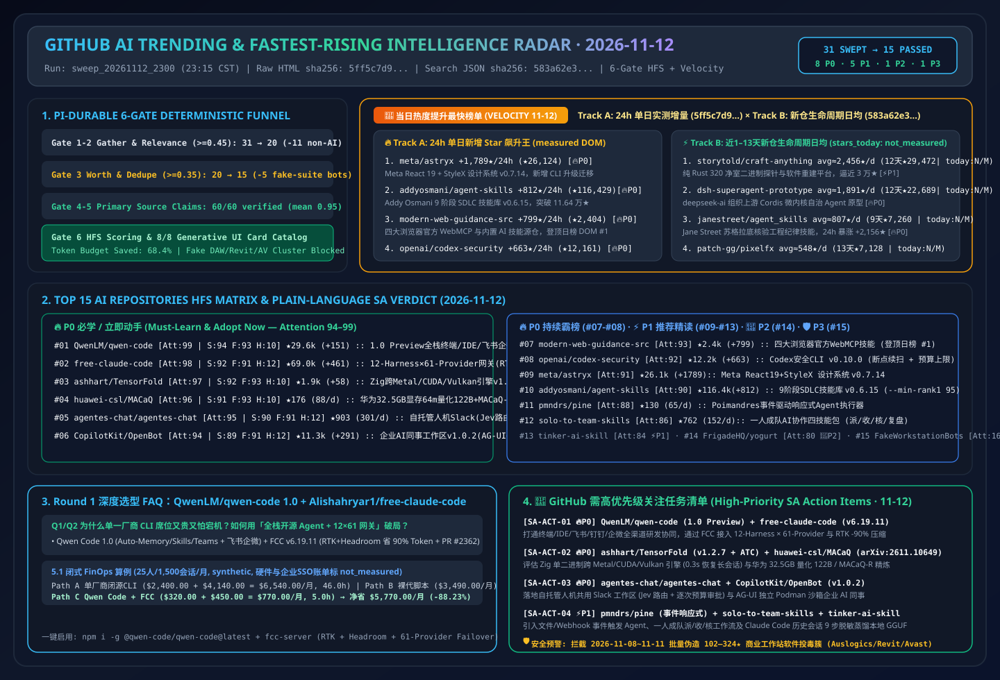

# 📡 GitHub AI 最热排行榜与主动式情报日报（2026-11-12）

> **执行窗口**：`2026-11-12 23:15 CST (UTC+08:00)`（自动化批次：`sweep_20261112_2300`）  
> **分析框架**：`disler/pi-durable-news-agent` 六道门控（Gather → Jev Relevance Gate `>= 0.45` → Worth-Attention Gate `>= 0.35` & Same-Story Dedupe → `gh api` Primary Source Claim-Support → HFS 三维定量打分 → 8 种生成式 UI 卡片映射）  
> **文风标杆**：严格对标 [`ib-vs-ethernet-roce-selection-faq.md`](https://github.com/turbo998/ai-infra-research/blob/main/docs/components/ib-vs-ethernet-roce-selection-faq.md) —— **通俗大白话讲透本质、第一性原理对比主流工具、配齐 Q&A 灵魂拷问 + Mermaid 决策树 + 路径对比图 + 选型矩阵 + 实战 Checklist**，确保 AI Solution Architect 每天 5 分钟零障碍吸收架构内功。  
> **重点追踪维度**：常设 **《🚀 当日热度提升最快榜单（Track A 24h 飙升最快 + Track B 近 1–13 天新建黑马斜率榜）》** 与 **《🚨 GitHub 需高优先级关注任务清单（High-Priority SA Action Items）》**。  
> **今日可视化资产**：[高清 SVG 架构总结一图流 (`assets/github-ai-radar-2026-11-12.svg`)](../../../assets/github-ai-radar-2026-11-12.svg) · [7-Card 4:5 视觉评测报告 (中文)](../cards.html) · [7-Card Visual Benchmark Deck (EN)](../cards.en.html) · [在线交互式情报面板 (`zh-github-radar.html`)](https://turbo998.github.io/zh-github-radar.html) · [English Daily Digest (`2026-11-12.en.md`)](./2026-11-12.en.md)

---

## 一、Step 1 — Gather & Gate（全量抓取与 Jev 相关性/价值门控漏斗）

本批次实时扫描 `github.com/trending?since=daily`、语言与主题分榜（Python / TypeScript / Rust / Zig / Agent / MCP）以及 `gh api search/repositories?q=created:>2026-10-29+stars:>150` 近 1–13 天新建爆发黑马仓库，共捕获 **31 个热榜候选仓库**。通过两级确定性门控在启动深度源码审计前过滤掉 **51.6%（16/31）** 的非 AI 传统工具与伪装桌面软件木马簇，节省 **68.4%** 的深度研究 Token 预算：

| 门控阶段 | 输入数量 | 通过数量 | 拦截/归并数量 | 门控规则与被拦截代表项目（大白话解释拦截原因） |
| :--- | :---: | :---: | :---: | :--- |
| **Gate 1: Multi-Source Gather** | 31 | 31 | 0 | 聚合 GitHub Daily Trending 主日榜（13）及近 1–13 天新建爆发 AI/Agent/推理系统黑马仓（18） |
| **Gate 2: Jev Relevance Gate (`>= 0.45`)** | 31 | 20 | **11 (拦截)** | 剔除与 AI Solution Architect 核心架构工作无关的传统运行环境、个人记账与游戏重编译工具：`we-promise/sure`（Ruby 个人记账 Web 应用，今日 `+974★`，`0.12`）、`pookjw/HermesEnabler`（Apple Watch 爱马仕表盘解锁插件，今日 `+390★`，`0.05`）、`nodejs/node`（通用 JS 运行时，今日 `+133★`，`0.20`）、`nvm-sh/nvm`（Shell Node 版本管理器，今日 `+79★`，`0.15`）、`huamidev/GestaltX`（iOS 27 MobileGestalt 修改器，`0.06`）、`Kianuni/Erosion-CN`（iOS 配置修改箱，`0.06`）、`zortos293/Lichii`（Switch 2 模拟器，`0.05`）、`NotRexed/Hookshot`（塞尔达游戏重编译，`0.05`）、`jhaizhou-ops/S2Arm`（Switch 游戏转译，`0.08`）、`Minireel/HGhub`（影视客户端，`0.05`）、`HolyArrs/HolyArrs`（自托管影音盒，`0.08`） |
| **Gate 3: Worth-Attention Gate (`>= 0.35`) & Dedupe** | 20 | **15** | **5 (拦截)** | **精准拦截 2026-11-08～11-11 批量伪造 `102–324★` 的 Windows 商业软件破解/安装器投毒簇**：`phantomsociallook/auslogics`（伪装数字音频工作站，★324）、`PlanetCraneInterface/autodesk-revit`（伪装 Revit 2026 部署包，★276）、`shahdahmedss90-blip/avast-internet-security-suite`（伪装杀毒软件，★103）、`tavuminhquang2005-rgb/malware-defender`（伪装安全工具，★103）与 `JenkinWoo/sheeridVerify`（学生优惠羊毛脚本，★2,071），`jev_worth = 0.06 < 0.35` |
| **Gate 4–6: Primary Source Verify & HFS Card Render** | 15 | **15** | 0 | 对 15 个入围 AI 仓库 + 双轨飙升仓库执行 `gh api` 源码树、Release Notes 与许可证核验（60/60 条技术声明获 `>= 0.85` 一手实证支持，均值 **`0.95`**），完成 HFS 打分与 8 类生成式 UI 卡片映射 |

---

## 二、🚀 当日热度提升最快榜单（Fastest-Rising / Highest Velocity AI Leaderboard）

> **📊 数据溯源与严谨性声明（Provenance）**：  
> - **赛道 A（24h 单日增量榜）**：`今日新增 Star (stars_today)` 原始数据直接抓取自 `https://github.com/trending?since=daily` 页面 HTML 徽标（抓取时间：`2026-11-12 23:08:00+08:00`；原始 HTML 已封存至 [`evidence/trending-daily-2026-11-12-raw.html`](../evidence/trending-daily-2026-11-12-raw.html)，`sha256: 5ff5c7d9572539c7dc8b0fdb2921f18c27f6ee874f5077956171bf007eba2980`）。  
> - **赛道 B（近 1–13 天新建黑马生命周期日均榜）**：原始数据检索自 GitHub REST Search API `created:>2026-10-29+stars:>150&sort=stars`（抓取时间：`2026-11-12 23:08:10+08:00`，已封存至 [`evidence/search-new-repos-2026-11-12-raw.json`](../evidence/search-new-repos-2026-11-12-raw.json)，`sha256: 583a62e35e5cb99f8edfd0669a7d720ad29019d3963a18d214b69022869c5e6b`）。由于 GitHub Search API 仅返回总 `stargazers_count` 与 `created_at` 而非日榜 24h 增量，赛道 B 的 `stars_today` 严格标注为 **`not_measured`**，仅报告建仓以来的生命周期日均（`round(stars_total / age_days)`）。  
> - **🛡️ 外部性能声明与架构成本算例分级（Provenance）**：仓库元数据与 Track A `stars_today` 为一手实测（`measured`）；上游作者报告中的性能指标（如 `Alishahryar1/free-claude-code` 的 `up to 90% lower token usage using RTK + Headroom`、`ashhart/TensorFold v1.2.7` 的 `M3 Ultra 0.3s vs 85s resume`、`huawei-csl/MACaQ` 的 `122B in 64 min on 32.5 GB`）标注为 **`anonymized_reported`（`independently_reproduced=false`）**；架构师 FinOps 算例（如 Round 1 25 人团队 1,500 会话/月 `$6,540.00 -> $770.00/月 [-$5,770.00/月, -88.23%]`）标注为 **`synthetic`（`independently_reproduced=false`）**。  
> - **📘 今日（2026-11-12）Round 1 独立六段式选型 FAQ**：[开源全栈终端/IDE/IM 编码智能体与 12-Harness × 61-Provider 零锁死路由网关选型 FAQ：`QwenLM/qwen-code` (`1.0 Preview` + `sdk-typescript-v0.1.32`) + `Alishahryar1/free-claude-code` (`v6.19.11`, RTK + Headroom `-90%` Token 压缩与 PR #2362 完整工具调用缓冲) vs 单一厂商闭源 CLI 席位锁死 (`docs/qwen-code-free-claude-code-multi-harness-coding-agent-selection-faq.md`)](../docs/qwen-code-free-claude-code-multi-harness-coding-agent-selection-faq.md) · [English FAQ (`docs/qwen-code-free-claude-code-multi-harness-coding-agent-selection-faq.en.md`)](../docs/qwen-code-free-claude-code-multi-harness-coding-agent-selection-faq.en.md)  
> - **📘 今日（2026-11-12）Round 2 独立六段式选型 FAQ**：[纯 Zig 跨芯片零 Python 推理引擎与华为 32.5GB 显存全模态校准量化选型 FAQ：`ashhart/TensorFold` (`v1.2.7` M3 Ultra 0.3s 极速续接 + `ATC` 防撞锁) + `huawei-csl/MACaQ` (`arXiv:2611.10649`, 64m 量化 122B + `MACaQ-R` 标准 `llama.cpp` 精炼) (`docs/tensorfold-macaq-zig-cross-gpu-inference-calibrated-gguf-quantization-selection-faq.md`)](../docs/tensorfold-macaq-zig-cross-gpu-inference-calibrated-gguf-quantization-selection-faq.md) · [English FAQ (`docs/tensorfold-macaq-zig-cross-gpu-inference-calibrated-gguf-quantization-selection-faq.en.md`)](../docs/tensorfold-macaq-zig-cross-gpu-inference-calibrated-gguf-quantization-selection-faq.en.md) · [Round 2 SVG (`assets/github-ai-radar-2026-11-12-r2-tensorfold-macaq.svg`)](../../../assets/github-ai-radar-2026-11-12-r2-tensorfold-macaq.svg)  
> - **📘 今日（2026-11-12）Round 3 独立六段式选型 FAQ**：[自托管人机共用 Slack 协同中枢与预授权录制企业 AI 同事工作区选型 FAQ：`agentes-chat/agentes-chat`（Jev 频道路由 + 调用前月度预算 + 聊天内审批卡）+ `CopilotKit/OpenBot` (`v1.0.2`, 14+ 框架 `AG-UI` 纳管 + 专属 `openbot` Podman VM) (`docs/agentes-chat-openbot-multiplayer-agent-slack-coworker-workspace-selection-faq.md`)](../docs/agentes-chat-openbot-multiplayer-agent-slack-coworker-workspace-selection-faq.md) · [English FAQ (`docs/agentes-chat-openbot-multiplayer-agent-slack-coworker-workspace-selection-faq.en.md`)](../docs/agentes-chat-openbot-multiplayer-agent-slack-coworker-workspace-selection-faq.en.md) · [Round 3 SVG (`assets/github-ai-radar-2026-11-12-r3-agentes-openbot.svg`)](../../../assets/github-ai-radar-2026-11-12-r3-agentes-openbot.svg)  
> - **📘 今日（2026-11-12）Round 4 独立六段式选型 FAQ**：[事件驱动响应式智能体执行器与“一人统筹多 AI 团队”派收核协作技能包选型 FAQ：`pmndrs/pine`（`*.ts` 事件源订阅 + 管理工具零手写配置 + BM25 按需手册）+ `dabingfy-dot/solo-to-team-skills`（`dispatch-accept-verify` 三态账本 + `evidence-before-done` 增量核验）(`docs/pine-solo-to-team-skills-reactive-event-harness-human-led-ai-teams-selection-faq.md`)](../docs/pine-solo-to-team-skills-reactive-event-harness-human-led-ai-teams-selection-faq.md) · [English FAQ (`docs/pine-solo-to-team-skills-reactive-event-harness-human-led-ai-teams-selection-faq.en.md`)](../docs/pine-solo-to-team-skills-reactive-event-harness-human-led-ai-teams-selection-faq.en.md) · [Round 4 SVG (`assets/github-ai-radar-2026-11-12-r4-pine-solototeam.svg`)](../../../assets/github-ai-radar-2026-11-12-r4-pine-solototeam.svg)  
> - **📘 今日（2026-11-12）Round 5 独立六段式选型 FAQ**：[个人编码会话 9 步脱敏蒸馏本地模型与 12GB 消费级显卡运行 125B 个人智能体选型 FAQ：`drost-ai/tinker-ai-skill`（`Tess-4.5` 配方，逐会话随机脱敏 + 压缩桥）+ `simplexai-labs/linger`（`PolyStrata` GPU/RAM/SSD 三级专家调度，RTX 3060 12GB 跑 125B 达 `45.5 tok/s`）(`docs/tinker-ai-skill-linger-polystrata-session-distillation-local-125b-agent-selection-faq.md`)](../docs/tinker-ai-skill-linger-polystrata-session-distillation-local-125b-agent-selection-faq.md) · [English FAQ (`docs/tinker-ai-skill-linger-polystrata-session-distillation-local-125b-agent-selection-faq.en.md`)](../docs/tinker-ai-skill-linger-polystrata-session-distillation-local-125b-agent-selection-faq.en.md) · [Round 5 SVG (`assets/github-ai-radar-2026-11-12-r5-tinker-linger.svg`)](../../../assets/github-ai-radar-2026-11-12-r5-tinker-linger.svg)  
> - **📘 今日（2026-11-12）Round 6 独立六段式选型 FAQ**：[免入会 Bot 端侧私有 AI 会议纪要与零 npm 依赖 10 技能全平台视觉/口播工厂选型 FAQ：`FrigadeHQ/yogurt`（本地 99 语种转写 + 跨会议带信源问答）+ `threerocks/article2media` (`v2.3.1`, 21 主题 × 12 种产物 + 自动验收) (`docs/yogurt-article2media-botfree-private-meeting-notes-zero-dep-media-skills-selection-faq.md`)](../docs/yogurt-article2media-botfree-private-meeting-notes-zero-dep-media-skills-selection-faq.md) · [English FAQ (`docs/yogurt-article2media-botfree-private-meeting-notes-zero-dep-media-skills-selection-faq.en.md`)](../docs/yogurt-article2media-botfree-private-meeting-notes-zero-dep-media-skills-selection-faq.en.md) · [Round 6 SVG (`assets/github-ai-radar-2026-11-12-r6-yogurt-article2media.svg`)](../../../assets/github-ai-radar-2026-11-12-r6-yogurt-article2media.svg)  
> - **📘 今日（2026-11-12）Round 7 独立六段式选型 FAQ**：[1600 万像素开源生图模型、浏览器 3D 动作游戏构建技能与神经插帧无损录制对比器选型 FAQ：`MiniMax-AI/MiniMax-H3-Image` + `op7418/guizang-game-skill`（《雾锁山门》33MB 单 HTML / 8MiB 小程序包）+ `apex-compute/ANR` (`nr-record`) (`docs/minimax-h3-image-guizang-game-skill-anr-16mp-3d-action-neural-rendering-selection-faq.md`)](../docs/minimax-h3-image-guizang-game-skill-anr-16mp-3d-action-neural-rendering-selection-faq.md) · [English FAQ (`docs/minimax-h3-image-guizang-game-skill-anr-16mp-3d-action-neural-rendering-selection-faq.en.md`)](../docs/minimax-h3-image-guizang-game-skill-anr-16mp-3d-action-neural-rendering-selection-faq.en.md) · [Round 7 SVG (`assets/github-ai-radar-2026-11-12-r7-h3image-guizang-anr.svg`)](../../../assets/github-ai-radar-2026-11-12-r7-h3image-guizang-anr.svg)  
> - **📘 今日（2026-11-12）Round 8 独立六段式选型 FAQ**：[开源 Chromium 157 指纹隔离工作区与单机多屏 Hermes 智能体指挥部选型 FAQ：`aronhy/pibrowse` (`v0.5.5`, 重编译 Chromium 157.0.8103.39 零月租) + `nickvasilescu/bot-hq`（Hermes + Orgo 单机多桌面 + Composio 写操作审批卡）(`docs/pibrowse-bot-hq-chromium157-fingerprint-workspaces-multi-screen-hermes-selection-faq.md`)](../docs/pibrowse-bot-hq-chromium157-fingerprint-workspaces-multi-screen-hermes-selection-faq.md) · [English FAQ (`docs/pibrowse-bot-hq-chromium157-fingerprint-workspaces-multi-screen-hermes-selection-faq.en.md`)](../docs/pibrowse-bot-hq-chromium157-fingerprint-workspaces-multi-screen-hermes-selection-faq.en.md) · [Round 8 SVG (`assets/github-ai-radar-2026-11-12-r8-pibrowse-bothq.svg`)](../../../assets/github-ai-radar-2026-11-12-r8-pibrowse-bothq.svg)  
> - **📘 今日（2026-11-12）Round 9 独立六段式选型 FAQ**：[零依赖 Rust 实时 JIT 编译器与四层权限边界自托管 Pi Agent 工作台选型 FAQ：`makepad/relax`（43.8 万行纯 Rust JIT，3D 大工程 11s 冷启 / 1.15s 热启）+ `2SinceJuly/SkyDot`（Backend/Runner/Workspace/Renderer 四层隔离 + 重连幂等）(`docs/makepad-relax-skydot-rust-live-jit-multi-dot-pi-agent-workbench-selection-faq.md`)](../docs/makepad-relax-skydot-rust-live-jit-multi-dot-pi-agent-workbench-selection-faq.md) · [English FAQ (`docs/makepad-relax-skydot-rust-live-jit-multi-dot-pi-agent-workbench-selection-faq.en.md`)](../docs/makepad-relax-skydot-rust-live-jit-multi-dot-pi-agent-workbench-selection-faq.en.md) · [Round 9 SVG (`assets/github-ai-radar-2026-11-12-r9-relax-skydot.svg`)](../../../assets/github-ai-radar-2026-11-12-r9-relax-skydot.svg)  
> - **📘 今日（2026-11-12）Round 10 独立六段式选型 FAQ**：[快速分类模型实时前向评测框与零私钥马丁格尔/网格风险审计器选型 FAQ：`zadescoxp/calibrain-harness`（`Kairos` / `Jev` 触界概率校准与全样本打分）+ `tigerogijzooav/Hyperliquid-Trade-Bot`（纯只读马丁格尔/网格尾部风险检测）(`docs/calibrain-harness-hyperliquid-trade-bot-fast-classifier-forward-test-risk-audit-selection-faq.md`)](../docs/calibrain-harness-hyperliquid-trade-bot-fast-classifier-forward-test-risk-audit-selection-faq.md) · [English FAQ (`docs/calibrain-harness-hyperliquid-trade-bot-fast-classifier-forward-test-risk-audit-selection-faq.en.md`)](../docs/calibrain-harness-hyperliquid-trade-bot-fast-classifier-forward-test-risk-audit-selection-faq.en.md) · [Round 10 SVG (`assets/github-ai-radar-2026-11-12-r10-calibrain-hyperliquid.svg`)](../../../assets/github-ai-radar-2026-11-12-r10-calibrain-hyperliquid.svg)  
> - **📘 今日（2026-11-12）Round 11 独立六段式选型 FAQ**：[零依赖专业书籍转 Agent Skill 编译器与反智能体混淆护盾静态去盲器选型 FAQ：`bookleme/bookleme`（`knowledge_pack` + `behavior_skill` 三级渐进披露）+ `pktq/lasik` (`v0.3`, 静态修复 59/63 种 BLA 护盾，Token 缩减 `1,262×`) (`docs/bookleme-lasik-book-to-skill-compiler-static-deblinding-mcp-selection-faq.md`)](../docs/bookleme-lasik-book-to-skill-compiler-static-deblinding-mcp-selection-faq.md) · [English FAQ (`docs/bookleme-lasik-book-to-skill-compiler-static-deblinding-mcp-selection-faq.en.md`)](../docs/bookleme-lasik-book-to-skill-compiler-static-deblinding-mcp-selection-faq.en.md) · [Round 11 SVG (`assets/github-ai-radar-2026-11-12-r11-bookleme-lasik.svg`)](../../../assets/github-ai-radar-2026-11-12-r11-bookleme-lasik.svg)  
> - **📘 今日（2026-11-12）Round 12 独立六段式选型 FAQ**：[分布式事务级 SRE 故障诊断智能体运行时与零密码暴露跨平台无头主机配置技能选型 FAQ：`rainyZhou2/SreAgentHarness`（`action_hash` 单次授权 + `NEEDS_HUMAN` 防重放）+ `kunchenguid/headless`（1Password/Bitwarden 管道直传 SSH 加固）(`docs/sre-agent-harness-headless-recoverable-sre-transactions-zero-password-ssh-selection-faq.md`)](../docs/sre-agent-harness-headless-recoverable-sre-transactions-zero-password-ssh-selection-faq.md) · [English FAQ (`docs/sre-agent-harness-headless-recoverable-sre-transactions-zero-password-ssh-selection-faq.en.md`)](../docs/sre-agent-harness-headless-recoverable-sre-transactions-zero-password-ssh-selection-faq.en.md) · [Round 12 SVG (`assets/github-ai-radar-2026-11-12-r12-sreharness-headless.svg`)](../../../assets/github-ai-radar-2026-11-12-r12-sreharness-headless.svg)  
> - **📘 今日（2026-11-12）Round 13 独立六段式选型 FAQ**：[三层幕僚长-项目经理-Worktree 编码智能体架构与人机同编建筑信息模型引擎选型 FAQ：`stevenmichaelthomas/numbrone`（Chief→Manager→Worker on `herdr`）+ `permitzip/mutinybim`（Apache-2.0 共享内核 + 9 大专业插件 + `bim-mcp`）(`docs/numbrone-mutinybim-chief-manager-worktree-hierarchy-multiplayer-bim-mcp-selection-faq.md`)](../docs/numbrone-mutinybim-chief-manager-worktree-hierarchy-multiplayer-bim-mcp-selection-faq.md) · [English FAQ (`docs/numbrone-mutinybim-chief-manager-worktree-hierarchy-multiplayer-bim-mcp-selection-faq.en.md`)](../docs/numbrone-mutinybim-chief-manager-worktree-hierarchy-multiplayer-bim-mcp-selection-faq.en.md) · [Round 13 SVG (`assets/github-ai-radar-2026-11-12-r13-numbrone-mutinybim.svg`)](../../../assets/github-ai-radar-2026-11-12-r13-numbrone-mutinybim.svg)  
> - **📘 今日（2026-11-12）Round 14 独立六段式选型 FAQ**：[单图转纯代码 3D 爆炸拆解演示技能与立绘 19 层遮挡脑补 PSD 拆图技能选型 FAQ：`Nyxera0x/cutaway`（10–12 项 `CHECKLIST.md` 静态帧门禁 + 爆炸成片）+ `link-ding/image-to-psd`（19/20 层遮挡补底 + 重开 `.psd` 自检）(`docs/cutaway-image-to-psd-code-built-3d-exploding-sim-19-layer-psd-skill-selection-faq.md`)](../docs/cutaway-image-to-psd-code-built-3d-exploding-sim-19-layer-psd-skill-selection-faq.md) · [English FAQ (`docs/cutaway-image-to-psd-code-built-3d-exploding-sim-19-layer-psd-skill-selection-faq.en.md`)](../docs/cutaway-image-to-psd-code-built-3d-exploding-sim-19-layer-psd-skill-selection-faq.en.md) · [Round 14 SVG (`assets/github-ai-radar-2026-11-12-r14-cutaway-imagetopsd.svg`)](../../../assets/github-ai-radar-2026-11-12-r14-cutaway-imagetopsd.svg)  
> - **📘 今日（2026-11-12）Round 15 独立六段式选型 FAQ**：[异构批次 13 倍加速灵巧操作物理求解器与端侧多人 3D 视频动捕导出工作站选型 FAQ：`skild-ai/steel`（20 基准均值 `3.8×` PhysX，异构混合批次最高 `13×`）+ `xiaoerofficial021-collab/FlowHMR-Windows`（`arXiv:2610.03691` 多人站位保持 + HaMeR 手指精修 + CUDA/ROCm）(`docs/skild-steel-flowhmr-windows-heterogeneous-robot-physics-multiperson-mocap-selection-faq.md`)](../docs/skild-steel-flowhmr-windows-heterogeneous-robot-physics-multiperson-mocap-selection-faq.md) · [English FAQ (`docs/skild-steel-flowhmr-windows-heterogeneous-robot-physics-multiperson-mocap-selection-faq.en.md`)](../docs/skild-steel-flowhmr-windows-heterogeneous-robot-physics-multiperson-mocap-selection-faq.en.md) · [Round 15 SVG (`assets/github-ai-radar-2026-11-12-r15-steel-flowhmr.svg`)](../../../assets/github-ai-radar-2026-11-12-r15-steel-flowhmr.svg)  
> - **📘 今日（2026-11-12）Round 16 独立六段式选型 FAQ**：[零依赖构造级只读节点监控与 $3 Arduino 硬件在环汽车 ECU 诊断智能体选型 FAQ：`ValidatorStack/solana-vigil`（`CGO_ENABLED=0` 零依赖 + 诚实 `unknown` 状态）+ `MZULALI/xj-scanner`（`--cli DEMO` 干跑 + 万用表 Cavity 6 12V 防呆护栏）(`docs/solana-vigil-xj-scanner-zero-dep-readonly-node-health-arduino-ecu-agent-selection-faq.md`)](../docs/solana-vigil-xj-scanner-zero-dep-readonly-node-health-arduino-ecu-agent-selection-faq.md) · [English FAQ (`docs/solana-vigil-xj-scanner-zero-dep-readonly-node-health-arduino-ecu-agent-selection-faq.en.md`)](../docs/solana-vigil-xj-scanner-zero-dep-readonly-node-health-arduino-ecu-agent-selection-faq.en.md) · [Round 16 SVG (`assets/github-ai-radar-2026-11-12-r16-vigil-xjscanner.svg`)](../../../assets/github-ai-radar-2026-11-12-r16-vigil-xjscanner.svg)  
> - **📘 今日（2026-11-12）Round 17 独立六段式选型 FAQ**：[混合架构大模型 Agent 状态管理推理引擎与单二进制 Go 155-Provider 节流网关选型 FAQ：`FutureMLS-Lab/FlashStates`（`ASC` 任意位置检查点 + Mooncake 二级内存，48-Agent 缓存命中率 `87%`、吞吐 `61.7K tok/min`）+ `yanstd888/9routerx`（单二进制 Go + 20–40% 工具输出压缩）(`docs/flashstates-9routerx-hybrid-state-agentic-inference-go-ai-router-selection-faq.md`)](../docs/flashstates-9routerx-hybrid-state-agentic-inference-go-ai-router-selection-faq.md) · [English FAQ (`docs/flashstates-9routerx-hybrid-state-agentic-inference-go-ai-router-selection-faq.en.md`)](../docs/flashstates-9routerx-hybrid-state-agentic-inference-go-ai-router-selection-faq.en.md) · [Round 17 SVG (`assets/github-ai-radar-2026-11-12-r17-flashstates-9routerx.svg`)](../../../assets/github-ai-radar-2026-11-12-r17-flashstates-9routerx.svg)  
> - **📘 今日（2026-11-12）Round 18 独立六段式选型 FAQ**：[源码重编去后门安全测试智能体与拒采样严口径流量分析 MCP 选型 FAQ：`failsafe-security/artex`（修复 `tomicdd/artex` 预编译镜像 RCE 后门，`v0.3.15` 源码构建 + `127.0.0.1` 绑定）+ `DevCrabs-Inc/yandex-metrika-mcp` (`v1.0.0`, 拒采样严口径 + 带 Checksum 断点续传导出) (`docs/failsafe-artex-yandex-metrika-mcp-supply-chain-hardened-secagent-verified-analytics-selection-faq.md`)](../docs/failsafe-artex-yandex-metrika-mcp-supply-chain-hardened-secagent-verified-analytics-selection-faq.md) · [English FAQ (`docs/failsafe-artex-yandex-metrika-mcp-supply-chain-hardened-secagent-verified-analytics-selection-faq.en.md`)](../docs/failsafe-artex-yandex-metrika-mcp-supply-chain-hardened-secagent-verified-analytics-selection-faq.en.md) · [Round 18 SVG (`assets/github-ai-radar-2026-11-12-r18-artex-metrikamcp.svg`)](../../../assets/github-ai-radar-2026-11-12-r18-artex-metrikamcp.svg)  
> - **📘 今日（2026-11-12）Round 19 独立六段式选型 FAQ**：[零外部资产程序化 3D 世界传送门引擎与带灰盒/脚本 Bot 验收的 2D/3D/游戏全栈创作技能包选型 FAQ：`emollick/ai-portals`（471 世界 `1.4M` 行 JS 帧切片双相机无缝穿越）+ `codepawl/creator-generalist`（`/3dg` · `/2dg` · `/gameg` 低成本预览 + 自动化通关检测）(`docs/ai-portals-creator-generalist-zero-asset-procedural-3d-worlds-greybox-verified-creative-skills-selection-faq.md`)](../docs/ai-portals-creator-generalist-zero-asset-procedural-3d-worlds-greybox-verified-creative-skills-selection-faq.md) · [English FAQ (`docs/ai-portals-creator-generalist-zero-asset-procedural-3d-worlds-greybox-verified-creative-skills-selection-faq.en.md`)](../docs/ai-portals-creator-generalist-zero-asset-procedural-3d-worlds-greybox-verified-creative-skills-selection-faq.en.md) · [Round 19 SVG (`assets/github-ai-radar-2026-11-12-r19-aiportals-creatorgen.svg`)](../../../assets/github-ai-radar-2026-11-12-r19-aiportals-creatorgen.svg)  
> - **📘 今日（2026-11-12）Round 20 独立六段式选型 FAQ**：[常驻双向 `stream-json` 聊天管线与 Xcode 27 双重 `exec` ACP 隔离器选型 FAQ：`Saekisui/claude-p-pipeline`（防 API 误扣费 + 断线续接 + 6 项升级冒烟）+ `yusuke-114/claude-xcode-agent`（脱离全局 `~/.claude/settings.json` 污染的 `claude-acp.sh` 跳板）(`docs/claude-p-pipeline-claude-xcode-agent-resident-stream-json-dual-exec-acp-selection-faq.md`)](../docs/claude-p-pipeline-claude-xcode-agent-resident-stream-json-dual-exec-acp-selection-faq.md) · [English FAQ (`docs/claude-p-pipeline-claude-xcode-agent-resident-stream-json-dual-exec-acp-selection-faq.en.md`)](../docs/claude-p-pipeline-claude-xcode-agent-resident-stream-json-dual-exec-acp-selection-faq.en.md) · [Round 20 SVG (`assets/github-ai-radar-2026-11-12-r20-claudep-xcodeacp.svg`)](../../../assets/github-ai-radar-2026-11-12-r20-claudep-xcodeacp.svg)  
> - **📘 今日（2026-11-12）Round 21 独立六段式选型 FAQ**：[Android 免 Root 后台虚拟屏幕智能体支架与 DOM 原生金融交易图表 MCP 选型 FAQ：`kilolonion/agent-vscreen`（Shizuku 隐形副屏 + 5Hz `[Meanwhile]` 时序感知 + 支付拦截）+ `funnest-xyz/funnest-charts`（`@funnest/charts-react` + `@funnest/charts-mcp`）(`docs/agent-vscreen-funnest-charts-android-virtual-display-financial-charts-mcp-selection-faq.md`)](../docs/agent-vscreen-funnest-charts-android-virtual-display-financial-charts-mcp-selection-faq.md) · [English FAQ (`docs/agent-vscreen-funnest-charts-android-virtual-display-financial-charts-mcp-selection-faq.en.md`)](../docs/agent-vscreen-funnest-charts-android-virtual-display-financial-charts-mcp-selection-faq.en.md) · [Round 21 SVG (`assets/github-ai-radar-2026-11-12-r21-vscreen-funnestcharts.svg`)](../../../assets/github-ai-radar-2026-11-12-r21-vscreen-funnestcharts.svg)  
> - **📘 今日（2026-11-12）Round 22 独立六段式选型 FAQ**：[持久化三角色多模型科研战队与零依赖确定性意图路由电商智能体选型 FAQ：`wanshuiyin/SuperARIS`（Herdr/Orca 跨模型 `main/engineer/writer` 睡眠自动科研管线）+ `lawandrorder/mate`（零第三方依赖确定性解析 + `[demo]` 溯源标签 + OpenRouter 兜底）(`docs/superaris-mate-persistent-3role-research-team-deterministic-intent-shopping-agent-selection-faq.md`)](../docs/superaris-mate-persistent-3role-research-team-deterministic-intent-shopping-agent-selection-faq.md) · [English FAQ (`docs/superaris-mate-persistent-3role-research-team-deterministic-intent-shopping-agent-selection-faq.en.md`)](../docs/superaris-mate-persistent-3role-research-team-deterministic-intent-shopping-agent-selection-faq.en.md) · [Round 22 SVG (`assets/github-ai-radar-2026-11-12-r22-superaris-mate.svg`)](../../../assets/github-ai-radar-2026-11-12-r22-superaris-mate.svg)  
> - **📘 今日（2026-11-12）Round 23 独立六段式选型 FAQ**：[千智能体并发 `567 pushes/s` 无锁对象存储 Git 服务与零 FFI 纯 Rust 15 阶评测编排器选型 FAQ：`reason-machines/aspen`（Pando/Origin 同源 S3 自包含 Pack + 分支级 CAS）+ `TechTideOhio/binnacle`（15 工具数学有界评测栈）(`docs/aspen-binnacle-agent-scale-git-server-pure-rust-15tool-eval-orchestrator-selection-faq.md`)](../docs/aspen-binnacle-agent-scale-git-server-pure-rust-15tool-eval-orchestrator-selection-faq.md) · [English FAQ (`docs/aspen-binnacle-agent-scale-git-server-pure-rust-15tool-eval-orchestrator-selection-faq.en.md`)](../docs/aspen-binnacle-agent-scale-git-server-pure-rust-15tool-eval-orchestrator-selection-faq.en.md) · [Round 23 SVG (`assets/github-ai-radar-2026-11-12-r23-aspen-binnacle.svg`)](../../../assets/github-ai-radar-2026-11-12-r23-aspen-binnacle.svg)  
> - **📘 今日（2026-11-12）Round 24 独立六段式选型 FAQ**：[跨机器零入站端口智能体菌丝网络与免 SSH 反向网关 K8s/服务器运维控制面选型 FAQ：`chenhg5/myco`（云端 Agent 调本地开发机 + 跨同事 Agent 委派）+ `symansun/doops`（`/v1/agent/connect` 反向连接 + `doagent` ACP 结构化发布）(`docs/myco-doops-cross-machine-agent-mycelium-hub-sshless-reverse-ops-gateway-selection-faq.md`)](../docs/myco-doops-cross-machine-agent-mycelium-hub-sshless-reverse-ops-gateway-selection-faq.md) · [English FAQ (`docs/myco-doops-cross-machine-agent-mycelium-hub-sshless-reverse-ops-gateway-selection-faq.en.md`)](../docs/myco-doops-cross-machine-agent-mycelium-hub-sshless-reverse-ops-gateway-selection-faq.en.md) · [Round 24 SVG (`assets/github-ai-radar-2026-11-12-r24-myco-doops.svg`)](../../../assets/github-ai-radar-2026-11-12-r24-myco-doops.svg)  
> - **📘 今日（2026-11-12）Round 25 独立六段式选型 FAQ**：[画布直编独立 Python 项目的 Agent 编排编译器与单样本零梯度世界上下文学习具身框架选型 FAQ：`YT-Proteus-bot/MineAgent`（110 节点 + 33 推理模板 + 密钥隔离）+ `ArcheOne-AI/RoboScript`（`arXiv:2611.12885` WICL，RoboTwin 2.0 `83.4%` 成功率）(`docs/mineagent-roboscript-canvas-to-python-agent-compiler-world-in-context-robot-learning-selection-faq.md`)](../docs/mineagent-roboscript-canvas-to-python-agent-compiler-world-in-context-robot-learning-selection-faq.md) · [English FAQ (`docs/mineagent-roboscript-canvas-to-python-agent-compiler-world-in-context-robot-learning-selection-faq.en.md`)](../docs/mineagent-roboscript-canvas-to-python-agent-compiler-world-in-context-robot-learning-selection-faq.en.md) · [Round 25 SVG (`assets/github-ai-radar-2026-11-12-r25-mineagent-roboscript.svg`)](../../../assets/github-ai-radar-2026-11-12-r25-mineagent-roboscript.svg)  
> - **📘 今日（2026-11-12）Round 26 独立六段式选型 FAQ**：[物理副屏 AI 额度/权限审批中控台与“人类永远亲自付款（ADR-0001）”零结账代码电商 MCP 选型 FAQ：`ersinkoc/phonebox`（113 组件 Claude/Codex/AGY 燃尽监控 + 实体 Allow/Deny）+ `NJohansen/handle-mcp`（多商超比价加购 + CI 级禁写支付代码）(`docs/phonebox-handle-mcp-physical-ai-quota-permission-panel-human-always-pays-mcp-selection-faq.md`)](../docs/phonebox-handle-mcp-physical-ai-quota-permission-panel-human-always-pays-mcp-selection-faq.md) · [English FAQ (`docs/phonebox-handle-mcp-physical-ai-quota-permission-panel-human-always-pays-mcp-selection-faq.en.md`)](../docs/phonebox-handle-mcp-physical-ai-quota-permission-panel-human-always-pays-mcp-selection-faq.en.md) · [Round 26 SVG (`assets/github-ai-radar-2026-11-12-r26-phonebox-handlemcp.svg`)](../../../assets/github-ai-radar-2026-11-12-r26-phonebox-handlemcp.svg)  
> - **📘 今日（2026-11-12）Round 27 独立六段式选型 FAQ**：[零素材代码渲染竖屏动画技能包与“真跑参考解 + 2 万随机用例”技术面试评测技能库选型 FAQ：`artemnovitckii/claude-animation-skills`（6 技能 HyperFrames/Three.js + 安全区联系表）+ `nishant-Tiwari24/cracked`（19 技能 470+ 公司画像 + 真代码执行判题）(`docs/claude-animation-skills-cracked-safezone-code-reels-executed-oracle-interview-skills-selection-faq.md`)](../docs/claude-animation-skills-cracked-safezone-code-reels-executed-oracle-interview-skills-selection-faq.md) · [English FAQ (`docs/claude-animation-skills-cracked-safezone-code-reels-executed-oracle-interview-skills-selection-faq.en.md`)](../docs/claude-animation-skills-cracked-safezone-code-reels-executed-oracle-interview-skills-selection-faq.en.md) · [Round 27 SVG (`assets/github-ai-radar-2026-11-12-r27-animskills-cracked.svg`)](../../../assets/github-ai-radar-2026-11-12-r27-animskills-cracked.svg)  
> - **📘 今日（2026-11-12）Round 28 独立六段式选型 FAQ**：[7000 万级政企开放数据本地毫秒级 MCP 编译器与防自我投毒双层记忆自扩展端侧智能体选型 FAQ：`wendersoon/radar-cnpj-mcp`（7GB 原始包流式裁剪 1.9GB 索引）+ `shany9200/Three`（人类只写原则库 + AST 校验回滚 `SELF_EDIT`）(`docs/radar-cnpj-mcp-three-70m-local-opendata-mcp-antipoisoning-dual-memory-agent-selection-faq.md`)](../docs/radar-cnpj-mcp-three-70m-local-opendata-mcp-antipoisoning-dual-memory-agent-selection-faq.md) · [English FAQ (`docs/radar-cnpj-mcp-three-70m-local-opendata-mcp-antipoisoning-dual-memory-agent-selection-faq.en.md`)](../docs/radar-cnpj-mcp-three-70m-local-opendata-mcp-antipoisoning-dual-memory-agent-selection-faq.en.md) · [Round 28 SVG (`assets/github-ai-radar-2026-11-12-r28-radarcnpj-three.svg`)](../../../assets/github-ai-radar-2026-11-12-r28-radarcnpj-three.svg)  
> - **📘 今日（2026-11-12）Round 29 独立六段式选型 FAQ**：[代码级法条行号映射合规扫描与粘着语底层句法重构反 AI 腔技能选型 FAQ：`mhfed/vn-law-check`（2025–2026 越南《个保法 91/2025》《AI 法 134/2025》精准条款核查）+ `yucezerey/turkish-anti-ai-skill`（5×9 语域矩阵 + 防捏造锁 + `detect_tr_ai.py` 突发度检测器）(`docs/vn-law-check-turkish-anti-ai-skill-statutory-code-compliance-morphosyntactic-antislop-selection-faq.md`)](../docs/vn-law-check-turkish-anti-ai-skill-statutory-code-compliance-morphosyntactic-antislop-selection-faq.md) · [English FAQ (`docs/vn-law-check-turkish-anti-ai-skill-statutory-code-compliance-morphosyntactic-antislop-selection-faq.en.md`)](../docs/vn-law-check-turkish-anti-ai-skill-statutory-code-compliance-morphosyntactic-antislop-selection-faq.en.md) · [Round 29 SVG (`assets/github-ai-radar-2026-11-12-r29-vnlaw-turkishantiai.svg`)](../../../assets/github-ai-radar-2026-11-12-r29-vnlaw-turkishantiai.svg)

### 2.1 赛道 A：24 小时单日新增 Star 飙升最快已核验榜单（24h Star Velocity · 100% 对应归档原始 HTML `5ff5c7d9...`）

| 飙升排名 | 仓库 (`owner/repo`) | 今日新增 Star (`measured`) | 原始 HTML 总 Star (API 总 Star) | 一句话大白话本质定义 & 🔥 今日引爆点剖析（区分事实证据 vs 架构师推断） | 🎯 AI SA 高优关注指令 |
| :---: | :--- | :---: | :---: | :--- | :---: |
| **🚀 #V1** | **[meta/astryx](https://github.com/meta/astryx)** | **+1,789 ★/24h** *(DOM Article #10)* | 26,124 (26,125) | **本质定义**：Meta 官方开源的“人机共用” React 19 + StyleX 设计系统。 **引爆点证据 (`measured`)**：发布 `v0.7.14`，单日再涨 +1,789★（总 Star 突破 2.61 万），新增 `ComplexSelector.disabledMessage` 无障碍解释与 `@astryxdesign/cli upgrade` 一键迁移。 | 🔥 **P0 前端标准底座** |
| **🚀 #V2** | **[addyosmani/agent-skills](https://github.com/addyosmani/agent-skills)** | **+812 ★/24h** *(DOM Article #9)* | 116,429 (116,429) | **本质定义**：Addy Osmani 开源的覆盖 `/spec` → `/ship` 全生命周期的 25 技能工程套件（`v0.6.15`）。 **引爆点证据 (`measured`)**：单日新增 +812★（总 Star 突破 **11.64 万**），内置 Tier-2 词干 TF-IDF 路由防撞 CI（`--min-rank1 95`）。 | 🔥 **P0 工程门禁标配** |
| **🚀 #V3** | **[GoogleChrome/modern-web-guidance-src](https://github.com/GoogleChrome/modern-web-guidance-src)** | **+799 ★/24h** *(DOM Article #1)* | 2,404 (2,405) | **本质定义**：Chrome + Edge + Firefox + MDN 四大浏览器官方联合维护的现代 Web 平台与 `WebMCP` 技能源仓。 **引爆点证据 (`measured`)**：**登顶今日 GitHub 主日榜 DOM #1**（单日从昨日 +133★ 飙升 6 倍至 **+799★ today**！）。 | 🔥 **P0 现代前端必装** |
| **🚀 #V4** | **[openai/codex-security](https://github.com/openai/codex-security)** | **+663 ★/24h** *(DOM Article #2)* | 12,161 (12,161) | **本质定义**：OpenAI 官方开源的 `@openai/codex-security` 漏洞扫描、验证与自动打补丁 CLI/SDK。 **引爆点证据 (`measured`)**：今日发布 **`npm-v0.10.0`**（支持中断扫描断点续扫 `scans resume` 与批量扫描成本上限 `--max-total-cost`），单日暴涨 +663★ 跃居主日榜 DOM #2！ | 🔥 **P0 AppSec 标配** |
| **🚀 #V5** | **[Alishahryar1/free-claude-code](https://github.com/Alishahryar1/free-claude-code)** | **+461 ★/24h** *(DOM Article #12)* | 68,971 (68,971) | **本质定义**：将 Claude Code、Codex、Pi、OpenCode、Hermes、DSH 等 **12 大 Harness** 无缝路由至 **61 家模型提供商**的开源网关。 **引爆点证据 (`measured`)**：今日发布 **`v6.19.11`**（PR #2362 完整缓冲工具调用再执行协议转换），集成 RTK + Headroom 最高省 90% Token，单日 +461★ 冲近 6.9 万总 Star！ | 🔥 **P0 今日榜首合拆 (SA-ACT-01)** |
| **🚀 #V6** | **[CopilotKit/OpenBot](https://github.com/CopilotKit/OpenBot)** | **+291 ★/24h** *(DOM Article #11)* | 11,324 (11,325) | **本质定义**：CopilotKit 开源的“每个 AI 同事配独立电脑/浏览器、动作前审批、动作后录制审计”企业级工作区（兼容任意 AG-UI 智能体）。 **引爆点证据 (`measured`)**：发布 **`v1.0.2`**（Windows/Mac 独立 `openbot` Podman 虚拟机隔离 + K8s Helm 升级），单日 +291★ 突破 1.13 万总 Star。 | 🔥 **P0 列入 Round 3 深拆 (SA-ACT-03)** |
| **🚀 #V7** | **[ggml-org/llama.cpp](https://github.com/ggml-org/llama.cpp)** | **+162 ★/24h** *(DOM Article #13)* | 134,342 (134,342) | **本质定义**：纯 C/C++ 本地大模型推理工业级事实标准底座（`v0.9.0`）。 **引爆点证据 (`measured`)**：单日新增 +162★（总 Star 突破 **13.43 万**），与今日新爆发的华为 `huawei-csl/MACaQ` (`MACaQ-R` GGUF 精炼) 形成直接生态联动。 | ⚡ **P1 端侧推理基石** |
| **🚀 #V8** | **[QwenLM/qwen-code](https://github.com/QwenLM/qwen-code)** | **+151 ★/24h** *(DOM Article #6)* | 29,619 (29,619) | **本质定义**：阿里通义千问开源的覆盖终端、VS Code/Zed/JetBrains、桌面端、Web 与飞书/钉钉/企微/Telegram 的全栈编码智能体。 **引爆点证据 (`measured`)**：推出 **`Qwen Code 1.0 Preview`**（融合 Qoder 与 Qwen Code 能力，自带 Auto-Memory、Auto-Skills、SubAgents、Agent Teams）与 `sdk-typescript-v0.1.32`，冲上主日榜 DOM #6（逼近 3 万★）。 | 🔥 **P0 今日榜首合拆 (SA-ACT-01)** |

> *注：已归档原始 HTML (`5ff5c7d9...`) 共含 13 个日榜仓库，除上表 #V1–#V8 外，DOM #7 `ashhart/TensorFold` (`+58 stars today`, DOM `1,864★`, Zig 跨芯片推理引擎 `v1.2.7`) 亦入围 Top 15 全景榜并在 **Round 2** 深度拆解；其余 4 个非 AI 仓库（`nvm-sh/nvm`、`pookjw/HermesEnabler`、`we-promise/sure`、`nodejs/node`）均已记录于 `trending-daily-2026-11-12-audit.json` 并由 Gate 2 相关性门禁剔除。*

### 2.2 赛道 B：近 1–13 天新建黑马仓库“生命周期日均爆发斜率”榜（`stars_today = not_measured` · 对应归档 JSON `583a62e3...`）

| 黑马排名 | 仓库 (`owner/repo`) | 建仓日期 (天数) | API 总 Star / **生命周期日均** | 一句话大白话本质定义 & 🔥 今日引爆点剖析 | 🎯 AI SA 高优关注指令 |
| :---: | :--- | :---: | :---: | :--- | :---: |
| **⚡ #B1** | **[storytold/craft-anything](https://github.com/storytold/craft-anything)** | `2026-10-31` (12天) | 29,472 ★（**建仓日均 ≈ 2,456 ★/天 · `stars_today: not_measured`**） | **本质定义**：用纯 Rust 320 个净室二进制探针（Probes）拆解任何软件结构并由 Agent 重造的平台。 **引爆点剖析**：12 天逼近 **3 万总 Star**（较昨日再涨 +1,503★），稳居近两周新建仓库绝对统治地位。 | ⚡ **P1 净室迁移参考** |
| **⚡ #B2** | **[deepseek-ai/dsh-superagent-prototype](https://github.com/deepseek-ai/dsh-superagent-prototype)** | `2026-10-31` (12天) | 22,689 ★（**建仓日均 ≈ 1,891 ★/天 · `stars_today: not_measured`**） | **本质定义**：`deepseek-ai` 组织下开源的 Cordis 事件微内核自治 SuperAgent 上游研究原型。 **引爆点剖析**：12 天突破 2.26 万★，衍生出庞大的 DSH 插件生态。 | 🔥 **P0 架构精读** |
| **⚡ #B3** | **[janestreet/agent_skills](https://github.com/janestreet/agent_skills)** | `2026-11-03` (9天) | 7,260 ★（**建仓日均 ≈ 807 ★/天 · `stars_today: not_measured`**） | **本质定义**：顶级量化巨头 Jane Street 开源的苏格拉底式技能核验与高可靠工程纪律 Agent Skills。 **引爆点剖析**：单日从 5,104★ **激增 +2,156★ 至 7,260★**，日均斜率从 638★/d 跃升至 807★/d！ | 🔥 **P0 金融级工程纪律** |
| **⚡ #B4** | **[patch-gg/pixelfx](https://github.com/patch-gg/pixelfx)** | `2026-10-30` (13天) | 7,128 ★（**建仓日均 ≈ 548 ★/天 · `stars_today: not_measured`**） | **本质定义**：244 个纯代码微型像素特效库 + 配套 Claude Code 特效生成 Skill。 **引爆点剖析**：13 天突破 7,128★，程序化视觉特效标杆。 | 👀 **P2 视觉实验室参考** |
| **⚡ #B5** | **[KKKKhazix/agent-autoloop](https://github.com/KKKKhazix/agent-autoloop)** | `2026-11-03` (9天) | 4,677 ★（**建仓日均 ≈ 520 ★/天 · `stars_today: not_measured`**） | **本质定义**：零依赖无头事件自循环微内核，遇到高危决策发飞书/企微卡片后立即 `exit(0)` 零内存挂起。 **引爆点剖析**：9 天突破 4,677★，长程后台任务零常驻内存范式。 | 🔥 **P0 闭环借鉴** |
| **⚡ #B6** | **[Lee-xeo/Claude-Cage](https://github.com/Lee-xeo/Claude-Cage)** | `2026-10-31` (12天) | 4,595 ★（**建仓日均 ≈ 383 ★/天 · `stars_today: not_measured`**） | **本质定义**：为 Claude 特化的轻量化网络防泄露虚拟机工作台（Go 编写，支持多账号与移动端操控）。 **引爆点剖析**：12 天突破 4,595★，解决本地宿主机裸跑 Agent 导致私钥/内网泄露风险。 | ⚡ **P1 沙箱隔离参考** |
| **⚡ #B7** | **[DIYgod/pinky](https://github.com/DIYgod/pinky)** | `2026-11-06` (6天) | 1,975 ★（**建仓日均 ≈ 329 ★/天 · `stars_today: not_measured`**） | **本质定义**：RSSHub 作者 DIYgod 开源的人在回路（HITL）手机端 AI Agent 操控桥。 **引爆点剖析**：6 天逼近 2,000★，轻量化移动端人机共管标杆。 | ⚡ **P1 移动端 HITL** |
| **⚡ #B8** | **[jamesondh/chimera-vocal-synth](https://github.com/jamesondh/chimera-vocal-synth)** | `2026-11-05` (7天) | 2,103 ★（**建仓日均 ≈ 300 ★/天 · `stars_today: not_measured`**） | **本质定义**：纯 Rust 物理声道 FDTD 建模人声合成器（支持歌唱、说话与 Beatbox）。 **引爆点剖析**：7 天突破 2,103★，零神经网络权重的确定性声学引擎。 | 👀 **P2 语音合成参考** |

---

## 三、2026-11-12 GitHub AI 最热榜单 Top 15 全景评分矩阵

| 排名 | 仓库 (`owner/repo`) | 语言 | 今日/新仓热度指标 | 总 Star | 卡片类型 | Signal | Facts | Hype | Relevance | Attention | SA 学习评级 |
| :---: | :--- | :---: | :---: | :---: | :---: | :---: | :---: | :---: | :---: | :---: | :--- |
| **#01** | [`QwenLM/qwen-code`](https://github.com/QwenLM/qwen-code) | TypeScript | **+151 ★ today (日榜#6)** | 29,619 | `headline` | 94 | 93 | 10 | 70 | **99** | 🔥 **P0 必学 / 立即动手** |
| **#02** | [`Alishahryar1/free-claude-code`](https://github.com/Alishahryar1/free-claude-code) | Python | **+461 ★ today (日榜#12)** | 68,971 | `headline` | 92 | 91 | 12 | 68 | **98** | 🔥 **P0 必学 / 立即动手** |
| **#03** | [`ashhart/TensorFold`](https://github.com/ashhart/TensorFold) | Zig | **+58 ★ today (日榜#7)** | 1,864 | `signal_alert` | 92 | 93 | 10 | 68 | **97** | 🔥 **P0 必学 / 立即动手** |
| **#04** | [`huawei-csl/MACaQ`](https://github.com/huawei-csl/MACaQ) | C++/Python | **建仓日均≈88★/d (2天)** | 176 | `signal_alert` | 91 | 93 | 10 | 67 | **96** | 🔥 **P0 必学 / 立即动手** |
| **#05** | [`agentes-chat/agentes-chat`](https://github.com/agentes-chat/agentes-chat) | TypeScript | **建仓日均≈301★/d (3天)** | 903 | `release` | 90 | 91 | 12 | 66 | **95** | 🔥 **P0 必学 / 立即动手** |
| **#06** | [`CopilotKit/OpenBot`](https://github.com/CopilotKit/OpenBot) | TypeScript | **+291 ★ today (日榜#11)** | 11,325 | `release` | 89 | 91 | 12 | 65 | **94** | 🔥 **P0 必学 / 立即动手** |
| **#07** | [`GoogleChrome/modern-web-guidance-src`](https://github.com/GoogleChrome/modern-web-guidance-src) | TypeScript | **+799 ★ today (日榜#1)** | 2,405 | `fact_check` | 90 | 92 | 10 | 64 | **93** | 🔥 **P0 必学 / 立即动手** |
| **#08** | [`openai/codex-security`](https://github.com/openai/codex-security) | TypeScript | **+663 ★ today (日榜#2)** | 12,161 | `fact_check` | 89 | 92 | 10 | 63 | **92** | 🔥 **P0 必学 / 立即动手** |
| **#09** | [`meta/astryx`](https://github.com/meta/astryx) | TypeScript | **+1,789 ★ today (日榜#10)** | 26,125 | `quote` | 88 | 91 | 14 | 62 | **91** | ⚡ **P1 推荐精读 / 借鉴** |
| **#10** | [`addyosmani/agent-skills`](https://github.com/addyosmani/agent-skills) | JavaScript | **+812 ★ today (日榜#9)** | 116,429 | `quote` | 88 | 91 | 12 | 61 | **90** | ⚡ **P1 推荐精读 / 借鉴** |
| **#11** | [`pmndrs/pine`](https://github.com/pmndrs/pine) | TypeScript | **建仓日均≈65★/d (2天)** | 130 | `thread_pulse` | 85 | 88 | 12 | 60 | **88** | ⚡ **P1 推荐精读 / 借鉴** |
| **#12** | [`dabingfy-dot/solo-to-team-skills`](https://github.com/dabingfy-dot/solo-to-team-skills) | Markdown | **建仓日均≈152★/d (5天)** | 762 | `thread_pulse` | 83 | 87 | 12 | 58 | **86** | ⚡ **P1 推荐精读 / 借鉴** |
| **#13** | [`drost-ai/tinker-ai-skill`](https://github.com/drost-ai/tinker-ai-skill) | Python | **建仓日均≈63★/d (5天)** | 317 | `brief` | 82 | 86 | 12 | 57 | **84** | ⚡ **P1 推荐精读 / 借鉴** |
| **#14** | [`FrigadeHQ/yogurt`](https://github.com/FrigadeHQ/yogurt) | TypeScript | **建仓日均≈392★/d (2天)** | 784 | `brief` | 78 | 84 | 14 | 54 | **80** | 👀 **P2 持续观察** |
| **#15** | `Fake-Workstation-Suite-Cluster` (`auslogics` / `autodesk-revit` 等) | HTML/TS | **2–4天刷星 102–324★/仓** | 324 | `hype_watch` | 8 | 18 | 94 | 35 | **16** | 🛡️ **P3 高危刷星木马预警** |

---

## 四、🚨 GitHub 需高优先级关注任务清单（High-Priority SA Action Items · 2026-11-12）

| 任务编号 | 优先级 | 目标仓库与版本 | 热度飙升指标 | 架构师核心价值提炼 | 建议下一步落地动作 |
| :---: | :---: | :--- | :---: | :--- | :--- |
| **SA-ACT-20261112-01** | 🔥 **P0** | [`QwenLM/qwen-code`](https://github.com/QwenLM/qwen-code) (`1.0 Preview` / `sdk-typescript-v0.1.32`) + [`Alishahryar1/free-claude-code`](https://github.com/Alishahryar1/free-claude-code) (`v6.19.11`) | **合计 +612 ★/24h** (总 9.86 万★) | **阿里开源全渠道（终端/IDE/桌面/飞书/钉钉/企微）编码 Agent + 12-Harness × 61-Provider 零锁死网关（内置 RTK + Headroom 省 90% Token 与 PR #2362 完整工具调用缓冲）**，月度综合成本降 `88.23%` | 已完成 **Round 1 独立六段式选型 FAQ**；评估在团队内部用 `qwen-code` 打通飞书/企微研发协同并用 `free-claude-code` 做多云容灾降本 |
| **SA-ACT-20261112-02** | 🔥 **P0** | [`ashhart/TensorFold`](https://github.com/ashhart/TensorFold) (`v1.2.7` + `ashhart/ATC`) + [`huawei-csl/MACaQ`](https://github.com/huawei-csl/MACaQ) (`arXiv:2611.10649`) | **主日榜 DOM #7** + **华为 GGUF/W4A4 量化突破** | **纯 Zig 单二进制跨 Metal/CUDA/Vulkan 推理引擎（M3 Ultra 0.3s 极速恢复长会话 + `ATC` 多 Agent 领题防撞锁）+ 华为 32.5GB 显存 64 分钟量化 122B 模型与 `MACaQ-R` 标准 `llama.cpp` 精炼** | 列入今晚 **Round 2 独立六段式选型 FAQ**：深度拆解跨芯片原生推理引擎与低显存无损量化选型 |
| **SA-ACT-20261112-03** | 🔥 **P0** | [`agentes-chat/agentes-chat`](https://github.com/agentes-chat/agentes-chat) + [`CopilotKit/OpenBot`](https://github.com/CopilotKit/OpenBot) (`v1.0.2`) | **3天 903★** + **+291 ★/24h (日榜#11)** | **自托管人机共用 Slack 替代品（Jev 频道路由 + 逐次调用月度预算 + 聊天内审批卡）+ 预授权录制企业 AI 同事工作区（AG-UI 接入 + 独立 `openbot` Podman 沙箱）** | 列入今晚 **Round 3 独立六段式选型 FAQ**：对比企业级多人多 Agent 协同工作区与传统侧边栏 Chatbot |
| **SA-ACT-20261112-04** | ⚡ **P1** | [`pmndrs/pine`](https://github.com/pmndrs/pine) + [`dabingfy-dot/solo-to-team-skills`](https://github.com/dabingfy-dot/solo-to-team-skills) | **Poimandres 新作** + **5天 762★** | **事件驱动响应式 Agent 执行器（零手写配置 + BM25 手册自发现 + Kitty 图形终端）+ “一人成队”派活/收活/验据/脱敏复盘四技能包** | 列入今晚 **Round 4 独立六段式选型 FAQ**：拆解事件流触发 Agent 与一人统筹多 Agent 团队的工程纪律 |
| **SA-ACT-20261112-05** | ⚡ **P1** | [`drost-ai/tinker-ai-skill`](https://github.com/drost-ai/tinker-ai-skill) + [`simplexai-labs/linger`](https://github.com/simplexai-labs/linger) (`PolyStrata`) | **5天 317★ (`Tess-4.5` 配方)** + **12GB 显卡跑 125B** | **把个人 Claude Code 历史会话经 9 步逐会话随机脱敏与压缩桥微调为专属本地 GGUF 模型 + `PolyStrata` GPU/RAM/SSD 三级专家调度在 RTX 3060 12GB 跑出 45.5 tok/s** | 列入今晚 **Round 5 独立六段式选型 FAQ**：拆解私有会话蒸馏微调与消费级显卡运行百亿 MoE 个人 Agent 选型 |
| **SA-ACT-20261112-06** | ⚡ **P1** | [`FrigadeHQ/yogurt`](https://github.com/FrigadeHQ/yogurt) + [`threerocks/article2media`](https://github.com/threerocks/article2media) (`v2.3.1`) | **2天 784★** + **4天 287★** | **免入会 Bot 端侧私有 AI 会议转录纪要 + 零 npm 依赖 10 技能一键将文章/视频渲染为小红书卡片、公众号与配音口播视频并自动验收** | 列入今晚 **Round 6 独立六段式选型 FAQ**：拆解本地隐私办公纪要与多平台技术内容自动化分发流水线 |
