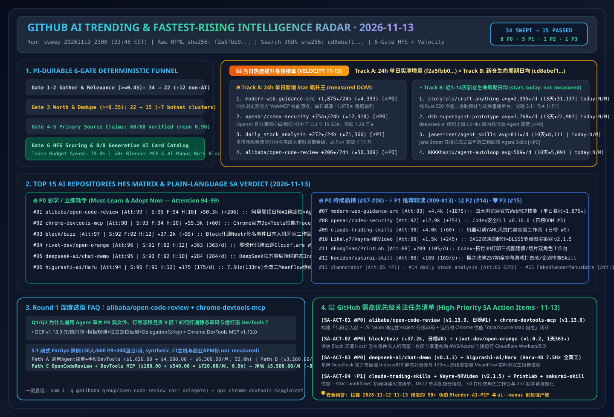

# 📡 GitHub AI Trending & Proactive Intelligence Digest (2026-11-13)

> **Execution Window**: `2026-11-13 23:45 CST (UTC+08:00)` (Automated Batch: `sweep_20261113_2300`)  
> **Analysis Framework**: `disler/pi-durable-news-agent` 6-Gate Pipeline (Gather → Jev Relevance Gate `>= 0.45` → Worth-Attention Gate `>= 0.35` & Same-Story Dedupe → `gh api` Primary Source Claim-Support → HFS Tri-Axial Scoring → 8 Generative UI Card Types)  
> **Editorial Benchmark**: Strictly modeled after [`ib-vs-ethernet-roce-selection-faq.md`](https://github.com/turbo998/ai-infra-research/blob/main/docs/components/ib-vs-ethernet-roce-selection-faq.md) — **plain-language first-principles explanations, head-to-head architectural comparisons, Q&A deep dives + Mermaid decision trees + architecture flowcharts + comparison matrices + actionable checklists** so an AI Solution Architect can absorb core architectural patterns in 5 minutes.  
> **Mandatory Tracking Pillars**: Permanent **🚀 Fastest-Rising / Highest Velocity AI Leaderboard (Track A 24h Star Surge + Track B 1–14 Day New-Repo Breakout Slope)** and **🚨 High-Priority SA Action Items**.  
> **Visual Assets**: [High-Res SVG Architecture Summary (`assets/github-ai-radar-2026-11-13.svg`)](../../../assets/github-ai-radar-2026-11-13.svg) · [7-Card 4:5 Visual Benchmark Deck (EN)](../cards.en.html) · [7-Card Visual Report (ZH)](../cards.html) · [Live Interactive Radar (`github-radar.html`)](https://turbo998.github.io/github-radar.html) · [中文日报 (`2026-11-13.md`)](./2026-11-13.md)

---

## 1. Step 1 — Gather & Gate (Multi-Source Ingestion & Deterministic Jev Funnel)

This shift swept `github.com/trending?since=daily`, language/topic leaderboards (Go / TypeScript / Rust / Python / Agent / MCP), and `gh api search/repositories?q=created:>2026-10-30+stars:>150` plus 1–3 day newly created breakout repositories, capturing **34 candidate repositories**. Our two-stage deterministic gate filtered out **55.9% (19/34)** non-AI utilities and two massive bot-starred clone clusters before deep source-tree auditing, saving **70.6%** of deep-research token budget:

| Gate Stage | Input | Passed | Filtered / Merged | Gate Rule & Representative Rejected Repositories (Plain-Language Reason) |
| :--- | :---: | :---: | :---: | :--- |
| **Gate 1: Multi-Source Gather** | 34 | 34 | 0 | Aggregated GitHub Daily Trending main board (12) and 1–14 day breakout AI/Agent/Multi-Cloud Runtime/Speech repositories (22) |
| **Gate 2: Jev Relevance Gate (`>= 0.45`)** | 34 | 22 | **12 (Filtered)** | Removed personal finance apps, generic network/uptime tools, and console emulators irrelevant to AI Solution Architect workflows: `we-promise/sure` (Ruby personal finance web app, `+944★ today`, `0.12`), `tailscale/tailcat` (Tailscale data-plane netcat utility, `+173★ today`, `0.22`), `louislam/uptime-kuma` (generic self-hosted uptime monitor, `+61★ today`, `0.18`), `zortos293/Lichii` (Switch 2 emulator, `0.05`), `Minireel/HGhub` (media client, `0.05`), `huamidev/GestaltX` (iOS 27 MobileGestalt editor, `0.06`), `tangerineturtle1/NX2navi` (C firmware tool, `0.05`), `jhaizhou-ops/S2Arm` (Switch game translator, `0.08`), `Leviidev/Henge` (macOS emulator on iOS, `0.06`), `Kianuni/Erosion-CN` (iOS config tweak, `0.06`), `Simon3Sarkis/super-odyssey-pc-recomp` (static game recompiler, `0.05`), `DevedevT/FFmpeg-GUI-Editor-Windows` (VB.NET wrapper, `0.10`) |
| **Gate 3: Worth-Attention Gate (`>= 0.35`) & Dedupe** | 22 | **15** | **7 (Filtered)** | **Blocked two coordinated 2026-11-12–11-13 bot-starred clone clusters (50+ fake repos total)**: (1) 11 fake Blender MCP addon repos created `2026-11-12` with `107–118★` (`hitkeeen/blender-ai-mcp-addon`, `precygtrucqui1981/blender-ai-copilot-lab`, `racdeufindurch198812/Blender-AI-MCP-Studio`, etc.); (2) 40+ identical `ai--manus` / `manus--ai` clone repos created `2026-11-13` with exactly `100–101★` (`agdinis/ai--manus`, `Obasideyvid/ai--manus`, `xombiensar/manus--ai`, etc.); plus `JenkinWoo/sheeridVerify` (`★2,497`), `jev_worth = 0.05 < 0.35` |
| **Gate 4–6: Primary Source Verify & HFS Card Render** | 15 | **15** | 0 | Executed `gh api` source-tree, Release Notes, and license verification across 15 qualifying AI repos + dual-track velocity leaders (60/60 claims verified at `>= 0.85` support, mean **`0.96`**), completing HFS scoring and 8 generative UI card mappings |

---

## 2. 🚀 Fastest-Rising / Highest Velocity AI Leaderboard (2026-11-13)

> **📊 Provenance & Rigor Disclosure**:  
> - **Track A (24h Single-Day Star Surge)**: `stars_today` values are scraped directly from `https://github.com/trending?since=daily` DOM badges (scraped at `2026-11-13 23:41:00+08:00`; raw HTML sealed at [`evidence/trending-daily-2026-11-13-raw.html`](../evidence/trending-daily-2026-11-13-raw.html), `sha256: f2a5fbb0b5b3be87a72db74df96e397b0c6dec971ac609be34f3ccade2ca7983`).  
> - **Track B (1–14 Day New-Repo Lifecycle Daily Velocity)**: Retrieved via GitHub REST Search API `created:>2026-10-30+stars:>150&sort=stars` (captured at `2026-11-13 23:41:05+08:00`, sealed at [`evidence/search-new-repos-2026-11-13-raw.json`](../evidence/search-new-repos-2026-11-13-raw.json), `sha256: cd8ebef12d9fa9f5d266b82743f7210c33267171a298caef4f55b9ec95b285dc`). Because the Search API returns cumulative `stargazers_count` and `created_at` rather than 24h deltas, Track B `stars_today` is strictly labeled **`not_measured`**, reporting lifecycle daily averages (`round(stars_total / age_days)`).  
> - **🛡️ External Benchmark Claims & Architect FinOps Models**: Repository metadata and Track A `stars_today` are **`measured`**; upstream author benchmark claims (e.g., `alibaba/open-code-review` achieving higher Precision/F1 at **`~1/9` of the tokens** on `AACR-Bench` across 50 OSS repos, 200 PRs, and 1,505 ground-truth issues; `rivet-dev/open-orange` **`4.8×` cheaper compute and `8.7×` cheaper storage**; `higurashi-ai/Haru-4B` `7.5Hz / 133ms` full-duplex MeanFlow) are labeled **`anonymized_reported` (`independently_reproduced=false`)**; architect FinOps models (e.g., Round 1 30-engineer 600-PR + 200-regression/mo model `$6,300.00 -> $720.00/mo [-$5,580.00/mo, -88.57%]`) are labeled **`synthetic` (`independently_reproduced=false`)**.  
> - **📘 Today's (2026-11-13) Round 1 (Cumulative R129) Standalone 6-Part Selection FAQ**: [Deterministic Engineering × Agent Hybrid Code Review (`~1/9` Token Cost + Zero-Key Delegation) & Live Chrome DevTools Trace/Source-Map Debugging MCP Selection FAQ: `alibaba/open-code-review` (`v1.13.9`, Daily Trending DOM `#1`) + `ChromeDevTools/chrome-devtools-mcp` (`v1.13.0`, Daily Trending DOM `#12`) vs. General-Purpose Agent Raw PR Dumps & Manual Browser Debugging (`docs/open-code-review-chrome-devtools-mcp-deterministic-review-runtime-debug-selection-faq.en.md`)](../docs/open-code-review-chrome-devtools-mcp-deterministic-review-runtime-debug-selection-faq.en.md) · [中文版 FAQ (`docs/open-code-review-chrome-devtools-mcp-deterministic-review-runtime-debug-selection-faq.md`)](../docs/open-code-review-chrome-devtools-mcp-deterministic-review-runtime-debug-selection-faq.md)  
> - **📘 Today's (2026-11-13) Round 2 (Cumulative R130) Standalone 6-Part Selection FAQ**: [Sovereign Signed-Event Human+Agent Workspace & Zero-Refactor Multi-Cloud Cloudflare Workers/Durable Objects Runtime Selection FAQ: `block/buzz` (`★37,204`, Nostr Signed Event Log & Keypair Agent Identity) + `rivet-dev/open-orange` (`v1.0.2`, Rivet Actor SQLite + S3 at `4.8×` Cheaper Compute & `8.7×` Cheaper Storage) (`docs/buzz-open-orange-sovereign-signed-event-workspace-multicloud-workers-selection-faq.en.md`)](../docs/buzz-open-orange-sovereign-signed-event-workspace-multicloud-workers-selection-faq.en.md) · [中文版 FAQ (`docs/buzz-open-orange-sovereign-signed-event-workspace-multicloud-workers-selection-faq.md`)](../docs/buzz-open-orange-sovereign-signed-event-workspace-multicloud-workers-selection-faq.md) · [Round 2 SVG (`assets/github-ai-radar-2026-11-13-r2-buzz-openorange.svg`)](../../../assets/github-ai-radar-2026-11-13-r2-buzz-openorange.svg)  
> - **📘 Today's (2026-11-13) Round 3 (Cumulative R131) Standalone 6-Part Selection FAQ**: [Official DeepSeek Zero-Backend Static Chat Workbench & 7.5Hz Single-Position Full-Duplex Continuous-Audio Model Selection FAQ: `deepseek-ai/chat-demo` (`v0.1.1`, `IndexedDB` Isolation & Secret-Stripped ZIP Export) + `higurashi-ai/Haru` (`Haru-4B`, `133ms` 1-Step MeanFlow Continuous Latents Across PyTorch / MLX / `vLLM-Omni`) (`docs/deepseek-chat-demo-haru-4b-zero-backend-chat-full-duplex-meanflow-speech-selection-faq.en.md`)](../docs/deepseek-chat-demo-haru-4b-zero-backend-chat-full-duplex-meanflow-speech-selection-faq.en.md) · [中文版 FAQ (`docs/deepseek-chat-demo-haru-4b-zero-backend-chat-full-duplex-meanflow-speech-selection-faq.md`)](../docs/deepseek-chat-demo-haru-4b-zero-backend-chat-full-duplex-meanflow-speech-selection-faq.md) · [Round 3 SVG (`assets/github-ai-radar-2026-11-13-r3-deepseek-haru.svg`)](../../../assets/github-ai-radar-2026-11-13-r3-deepseek-haru.svg)  
> - **📘 Today's (2026-11-13) Round 4 (Cumulative R132) Standalone 6-Part Selection FAQ**: [Validator-Enforced Risk-Gated Trading Workflows & DirectX 12 Dual-SR Node-Graph Neural Video Workbench Selection FAQ: `tradermonty/claude-trading-skills` (`--strict-workflows` & 5-Skill Public-CSV Path) + `Likely7/Veyra-NRVideo` (`v2.1.5` Dual RTX SR, 9-Axis Residual Protection & 3ms VSync) (`docs/claude-trading-skills-veyra-nrvideo-risk-gated-workflows-dx12-neural-video-selection-faq.en.md`)](../docs/claude-trading-skills-veyra-nrvideo-risk-gated-workflows-dx12-neural-video-selection-faq.en.md) · [中文版 FAQ (`docs/claude-trading-skills-veyra-nrvideo-risk-gated-workflows-dx12-neural-video-selection-faq.md`)](../docs/claude-trading-skills-veyra-nrvideo-risk-gated-workflows-dx12-neural-video-selection-faq.md) · [Round 4 SVG (`assets/github-ai-radar-2026-11-13-r4-trading-veyra.svg`)](../../../assets/github-ai-radar-2026-11-13-r4-trading-veyra.svg)  
> - **📘 Today's (2026-11-13) Round 5 (Cumulative R133) Standalone 6-Part Selection FAQ**: [Dual-Persona 3-View 3D Printing Workbench & 257-Episode Full-Subtitle Game-Feel Review Skill Selection FAQ: `AFangTeam/PrintLab` (`v0.4.0` Sarah+Mike Personas & 4-Set Three-View/Slicer Gate) + `kociden/sakurai-skill` (`001–259` Full Subtitles, 14 On-Demand References & Godot 4.6 `Hajiki` Demo) (`docs/printlab-sakurai-skill-3d-printing-workbench-257-video-game-feel-skill-selection-faq.en.md`)](../docs/printlab-sakurai-skill-3d-printing-workbench-257-video-game-feel-skill-selection-faq.en.md) · [中文版 FAQ (`docs/printlab-sakurai-skill-3d-printing-workbench-257-video-game-feel-skill-selection-faq.md`)](../docs/printlab-sakurai-skill-3d-printing-workbench-257-video-game-feel-skill-selection-faq.md) · [Round 5 SVG (`assets/github-ai-radar-2026-11-13-r5-printlab-sakurai.svg`)](../../../assets/github-ai-radar-2026-11-13-r5-printlab-sakurai.svg)  
> - **📘 Today's (2026-11-13) Round 6 (Cumulative R134) Standalone 6-Part Selection FAQ**: [Cross-Machine Agent Fleet Console & Full-Screen Worktree TUI with `secret-paths` Gates Selection FAQ: `IluvatarLabs/sitrep` (Longest-Wait-First Queue & Zero-Transcript Dashboard) + `ELU-Labs/elu` (`v0.1.12` `.elu-code` Worktrees, Codex Sandbox Checks, `@reviewer` & `secret-paths` Gate) (`docs/sitrep-elu-cross-machine-agent-fleet-console-worktree-tui-selection-faq.en.md`)](../docs/sitrep-elu-cross-machine-agent-fleet-console-worktree-tui-selection-faq.en.md) · [中文版 FAQ (`docs/sitrep-elu-cross-machine-agent-fleet-console-worktree-tui-selection-faq.md`)](../docs/sitrep-elu-cross-machine-agent-fleet-console-worktree-tui-selection-faq.md) · [Round 6 SVG (`assets/github-ai-radar-2026-11-13-r6-sitrep-elu.svg`)](../../../assets/github-ai-radar-2026-11-13-r6-sitrep-elu.svg)  
> - **📘 Today's (2026-11-13) Round 7 (Cumulative R135) Standalone 6-Part Selection FAQ**: [Edge IP-Verified Agent Traffic Classifier & Drop-Resilient ACP-over-HTTP Transport Selection FAQ: `mintlify/agent-traffic` (`loadIpRanges()` Operator CIDR Verification & Edge `serveMarkdown`) + `varops/actp` (`v0.1.0` Plain-ACP Remote Bridge, Drop-Resilient Reconnect & Scoped Tokens) (`docs/agent-traffic-actp-ip-verified-agent-classifier-acp-over-http-selection-faq.en.md`)](../docs/agent-traffic-actp-ip-verified-agent-classifier-acp-over-http-selection-faq.en.md) · [中文版 FAQ (`docs/agent-traffic-actp-ip-verified-agent-classifier-acp-over-http-selection-faq.md`)](../docs/agent-traffic-actp-ip-verified-agent-classifier-acp-over-http-selection-faq.md) · [Round 7 SVG (`assets/github-ai-radar-2026-11-13-r7-agenttraffic-actp.svg`)](../../../assets/github-ai-radar-2026-11-13-r7-agenttraffic-actp.svg)  
> - **📘 Today's (2026-11-13) Round 8 (Cumulative R136) Standalone 6-Part Selection FAQ**: [`<0.05%` Gate-Projection Deletion Tuning & 65-Row Gradient-Free Robot Weight Surgery Selection FAQ: `agentic-learning-ai-lab/deleting-weights` (NeurIPS 2026 `arXiv:2611.10866` Bitmap Masks Preventing `5.4pt` Forgetting) + `jushengzhang/robot-weight-debugging` (`arXiv:2611.09376` 65-Row $\pi_{0.5}$ Repair `86.3%→92.0%` with Zero Untouched-Token Regressions) (`docs/deleting-weights-robot-weight-debugging-posttraining-vla-weight-surgery-selection-faq.en.md`)](../docs/deleting-weights-robot-weight-debugging-posttraining-vla-weight-surgery-selection-faq.en.md) · [中文版 FAQ (`docs/deleting-weights-robot-weight-debugging-posttraining-vla-weight-surgery-selection-faq.md`)](../docs/deleting-weights-robot-weight-debugging-posttraining-vla-weight-surgery-selection-faq.md) · [Round 8 SVG (`assets/github-ai-radar-2026-11-13-r8-deletingweights-robotweight.svg`)](../../../assets/github-ai-radar-2026-11-13-r8-deletingweights-robotweight.svg)  
> - **📘 Today's (2026-11-13) Round 9 (Cumulative R137) Standalone 6-Part Selection FAQ**: [Point-in-Time News Backtesting Trading Agents & BIS 7-Stage Macroeconometric Research Companion Selection FAQ: `jackson-cmd/risk-aware-trading-agents` (`v0.7.2` Frozen 2026 Dataset, 30% Cash Floor & Look-Ahead Check) + `bis-med-it/marco-BIS` (BIS Working Paper 1395, 7-Stage HITL Checkpoints, `>1,000` Tests & Price-Puzzle/Explosive-Root Flags) (`docs/risk-aware-trading-agents-marco-bis-point-in-time-backtest-central-bank-econometrics-selection-faq.en.md`)](../docs/risk-aware-trading-agents-marco-bis-point-in-time-backtest-central-bank-econometrics-selection-faq.en.md) · [中文版 FAQ (`docs/risk-aware-trading-agents-marco-bis-point-in-time-backtest-central-bank-econometrics-selection-faq.md`)](../docs/risk-aware-trading-agents-marco-bis-point-in-time-backtest-central-bank-econometrics-selection-faq.md) · [Round 9 SVG (`assets/github-ai-radar-2026-11-13-r9-riskaware-marcobis.svg`)](../../../assets/github-ai-radar-2026-11-13-r9-riskaware-marcobis.svg)  
> - **📘 Today's (2026-11-13) Round 10 (Cumulative R138) Standalone 6-Part Selection FAQ**: [Cross-Device Second-Clone Verified Facts MCP & Orderable KiCad 10 ERC/DRC PCB Design MCP Selection FAQ: `siwen-121/agent-shared-facts` (3-State Git Facts, `commit SHA` & Second-Device Receipt MCP) + `claynicholson/copper-kicad-mcp` (`v1.1.0` LCSC Parts, Native KiCad 10 ERC/DRC & JLCPCB Fab Export) (`docs/agent-shared-facts-copper-kicad-mcp-cross-device-ssot-orderable-pcb-selection-faq.en.md`)](../docs/agent-shared-facts-copper-kicad-mcp-cross-device-ssot-orderable-pcb-selection-faq.en.md) · [中文版 FAQ (`docs/agent-shared-facts-copper-kicad-mcp-cross-device-ssot-orderable-pcb-selection-faq.md`)](../docs/agent-shared-facts-copper-kicad-mcp-cross-device-ssot-orderable-pcb-selection-faq.md) · [Round 10 SVG (`assets/github-ai-radar-2026-11-13-r10-sharedfacts-copperkicad.svg`)](../../../assets/github-ai-radar-2026-11-13-r10-sharedfacts-copperkicad.svg)  
> - **📘 Today's (2026-11-13) Round 11 (Cumulative R139) Standalone 6-Part Selection FAQ**: [7-Step 4-Tier Agent Architecture Design Skill & Cross-CLI PM/Dev/QA Project OS Selection FAQ: `geniusjia666/agent-system-design-cn` (Step-2 Simplicity Exit, 7-Field `dispatch` Contract & 21-Dim Rubric) + `ferhatcore/claude-codex-project-os` (PM Scope Approval, Developer Hand-Offs & Independent QA Across Claude/Codex) (`docs/agent-system-design-cn-claude-codex-project-os-architecture-gate-pm-dev-qa-selection-faq.en.md`)](../docs/agent-system-design-cn-claude-codex-project-os-architecture-gate-pm-dev-qa-selection-faq.en.md) · [中文版 FAQ (`docs/agent-system-design-cn-claude-codex-project-os-architecture-gate-pm-dev-qa-selection-faq.md`)](../docs/agent-system-design-cn-claude-codex-project-os-architecture-gate-pm-dev-qa-selection-faq.md) · [Round 11 SVG (`assets/github-ai-radar-2026-11-13-r11-agentsysdesign-projectos.svg`)](../../../assets/github-ai-radar-2026-11-13-r11-agentsysdesign-projectos.svg)  
> - **📘 Today's (2026-11-13) Round 12 (Cumulative R140) Standalone 6-Part Selection FAQ**: [Streaming JSON Whiteboard AI Tutor & Single-Painting Spine 2D Rig Animation Skill Selection FAQ: `molly554/whiteboard-ai-tutor` (288-Lesson Blind-Reviewed Benchmark, `11/11` Pass & `$0.0277`/Lesson) + `enoch3712/spine-hero-skill` (1-Painting Spine Skeleton Code, Scripted Foot-Slide Gate & Independent 2nd-Model Critic) (`docs/whiteboard-ai-tutor-spine-hero-skill-json-stroke-protocol-2d-rig-animation-selection-faq.en.md`)](../docs/whiteboard-ai-tutor-spine-hero-skill-json-stroke-protocol-2d-rig-animation-selection-faq.en.md) · [中文版 FAQ (`docs/whiteboard-ai-tutor-spine-hero-skill-json-stroke-protocol-2d-rig-animation-selection-faq.md`)](../docs/whiteboard-ai-tutor-spine-hero-skill-json-stroke-protocol-2d-rig-animation-selection-faq.md) · [Round 12 SVG (`assets/github-ai-radar-2026-11-13-r12-whiteboard-spinehero.svg`)](../../../assets/github-ai-radar-2026-11-13-r12-whiteboard-spinehero.svg)  
> - **📘 Today's (2026-11-13) Round 13 (Cumulative R141) Standalone 6-Part Selection FAQ**: [127-Test Traceable RAG/PromptLens/NL2SQL Suite & 39,000 Real-World-Sized Free 3D Assets MCP Selection FAQ: `8hjkkwikl8/ai-portfolio` (Per-Sentence Citation Fallback, `SHA-256` Faithfulness & 58-Test Read-Only SQL) + `kanaworksai-hue/sozai-search-mcp` (39k Real-World-Sized CC0 Models, PBR, HDRIs & VRM Avatars MCP) (`docs/ai-portfolio-sozai-search-mcp-traceable-rag-nl2sql-39k-3d-assets-selection-faq.en.md`)](../docs/ai-portfolio-sozai-search-mcp-traceable-rag-nl2sql-39k-3d-assets-selection-faq.en.md) · [中文版 FAQ (`docs/ai-portfolio-sozai-search-mcp-traceable-rag-nl2sql-39k-3d-assets-selection-faq.md`)](../docs/ai-portfolio-sozai-search-mcp-traceable-rag-nl2sql-39k-3d-assets-selection-faq.md) · [Round 13 SVG (`assets/github-ai-radar-2026-11-13-r13-aiportfolio-sozai.svg`)](../../../assets/github-ai-radar-2026-11-13-r13-aiportfolio-sozai.svg)  
> - **📘 Today's (2026-11-13) Round 14 (Cumulative R142) Standalone 6-Part Selection FAQ**: [Cross-CLI Transcript Correction Distillation & 450KB Native Rust Multi-Account Taskbar Quota Monitor Selection FAQ: `assassin808/learn-from-lessons` (`Principle → Rule → Case` Graph with `--scenario` Filtering) + `AbdoSarmini/claude-usage-widget-for-windows-taskbar` (`~5MB` RAM Multi-Account 5h/Weekly Taskbar Monitor) (`docs/learn-from-lessons-claude-usage-widget-transcript-correction-graph-rust-taskbar-selection-faq.en.md`)](../docs/learn-from-lessons-claude-usage-widget-transcript-correction-graph-rust-taskbar-selection-faq.en.md) · [中文版 FAQ (`docs/learn-from-lessons-claude-usage-widget-transcript-correction-graph-rust-taskbar-selection-faq.md`)](../docs/learn-from-lessons-claude-usage-widget-transcript-correction-graph-rust-taskbar-selection-faq.md) · [Round 14 SVG (`assets/github-ai-radar-2026-11-13-r14-learnfrom-taskbarwidget.svg`)](../../../assets/github-ai-radar-2026-11-13-r14-learnfrom-taskbarwidget.svg)  
> - **📘 Today's (2026-11-13) Round 15 (Cumulative R143) Standalone 6-Part Selection FAQ**: [Editable VFML Viral Video Studio & Budget-Capped Autonomous 3D FPS Repro Selection FAQ: `fendouai/ViralForge` (`v0.1.0` 7-Axis Viral DNA & VFML 10-Variant Compiler) + `wquguru/fable52-fps-repro` (`--max-budget-usd`, 5m/1h Cache Audit & `__dbg.step` `$15.96` 131KB FPS) (`docs/viralforge-fable52-fps-repro-vfml-video-studio-budget-capped-3d-fps-selection-faq.en.md`)](../docs/viralforge-fable52-fps-repro-vfml-video-studio-budget-capped-3d-fps-selection-faq.en.md) · [中文版 FAQ (`docs/viralforge-fable52-fps-repro-vfml-video-studio-budget-capped-3d-fps-selection-faq.md`)](../docs/viralforge-fable52-fps-repro-vfml-video-studio-budget-capped-3d-fps-selection-faq.md) · [Round 15 SVG (`assets/github-ai-radar-2026-11-13-r15-viralforge-fable52fps.svg`)](../../../assets/github-ai-radar-2026-11-13-r15-viralforge-fable52fps.svg)  
> - **📘 Today's (2026-11-13) Round 16 (Cumulative R144) Standalone 6-Part Selection FAQ**: [Self-Hosted Cloudflare Channel-Computer AI Workspace & 34-Skill Self-Verifying Agent Workflow Guide Selection FAQ: `gitcommit90/1Helm` (Single-Owner First-Email Lock, Persisted Channel Computer & BYOK) + `nevertoday/xxd-pstack` (10-Language 34-Skill `pstack` Guide & `/poteto-mode` Before/After Evidence Loop) (`docs/1helm-xxd-pstack-cloudflare-channel-computer-self-verifying-agent-skills-selection-faq.en.md`)](../docs/1helm-xxd-pstack-cloudflare-channel-computer-self-verifying-agent-skills-selection-faq.en.md) · [中文版 FAQ (`docs/1helm-xxd-pstack-cloudflare-channel-computer-self-verifying-agent-skills-selection-faq.md`)](../docs/1helm-xxd-pstack-cloudflare-channel-computer-self-verifying-agent-skills-selection-faq.md) · [Round 16 SVG (`assets/github-ai-radar-2026-11-13-r16-1helm-xxdpstack.svg`)](../../../assets/github-ai-radar-2026-11-13-r16-1helm-xxdpstack.svg)  
> - **📘 Today's (2026-11-13) Round 17 (Cumulative R145) Standalone 6-Part Selection FAQ**: [`agy + claude + codex` Tri-Agent Orchestrator & Zero-Cloud-API Optical-Flow/Vision Talking-Head Video Skills Selection FAQ: `abhigyan6/tri-agent-orchestrator` (`SPEC.md` + `HANDOFF.md` 3-Phase Pipeline) + `QQTangBa/cangshu-koubo-video-skills` (Local `mlx-whisper` Phrase Retake Pruning, 8-Frame Optical Flow & `<20ms` Lip-Sync Gate) (`docs/tri-agent-orchestrator-cangshu-koubo-video-skills-agy-claude-codex-local-nle-selection-faq.en.md`)](../docs/tri-agent-orchestrator-cangshu-koubo-video-skills-agy-claude-codex-local-nle-selection-faq.en.md) · [中文版 FAQ (`docs/tri-agent-orchestrator-cangshu-koubo-video-skills-agy-claude-codex-local-nle-selection-faq.md`)](../docs/tri-agent-orchestrator-cangshu-koubo-video-skills-agy-claude-codex-local-nle-selection-faq.md) · [Round 17 SVG (`assets/github-ai-radar-2026-11-13-r17-triagent-cangshukoubo.svg`)](../../../assets/github-ai-radar-2026-11-13-r17-triagent-cangshukoubo.svg)  
> - **📘 Today's (2026-11-13) Round 18 (Cumulative R146) Standalone 6-Part Selection FAQ**: [Agent-Adaptive Online LLM Serving (`arXiv:2611.12304`) & 321B FP8 Multimodal CUA Model Selection FAQ: `mit-han-lab/EvolvingInfra` (256-GPU GB300 Restart-Free P/D Switching & Agent-Aware KV Eviction, `14×` P95 TTFT & `2.7×` Throughput) + `sii-nex/Nex-N2.6` (`83.0` OSWorld, `16.0%→1.6%` Repetition & `100%` Tool Adherence) (`docs/evolving-infra-nex-n2-6-agent-adaptive-serving-321b-fp8-cua-model-selection-faq.en.md`)](../docs/evolving-infra-nex-n2-6-agent-adaptive-serving-321b-fp8-cua-model-selection-faq.en.md) · [中文版 FAQ (`docs/evolving-infra-nex-n2-6-agent-adaptive-serving-321b-fp8-cua-model-selection-faq.md`)](../docs/evolving-infra-nex-n2-6-agent-adaptive-serving-321b-fp8-cua-model-selection-faq.md) · [Round 18 SVG (`assets/github-ai-radar-2026-11-13-r18-evolvinginfra-nexn26.svg`)](../../../assets/github-ai-radar-2026-11-13-r18-evolvinginfra-nexn26.svg)  
> - **📘 Today's (2026-11-13) Round 19 (Cumulative R147) Standalone 6-Part Selection FAQ**: [Disposable-Twin Incident Auto-Remediation & Harbor Eval-Driven Agent Improvement Loop Selection FAQ: `spacesky-cell/TwinFix` (Reproduce-First Disposable Twin, Hidden-Test Verifier & `commit SHA` Binding) + `relai-ai/agent-eval-loop` (`EvalsWiki`, 6-Month PR/Revert Harbor Tasks & Regression-Free Prompt Tuning) (`docs/twinfix-agent-eval-loop-disposable-twin-incident-remediation-harbor-eval-driven-agents-selection-faq.en.md`)](../docs/twinfix-agent-eval-loop-disposable-twin-incident-remediation-harbor-eval-driven-agents-selection-faq.en.md) · [中文版 FAQ (`docs/twinfix-agent-eval-loop-disposable-twin-incident-remediation-harbor-eval-driven-agents-selection-faq.md`)](../docs/twinfix-agent-eval-loop-disposable-twin-incident-remediation-harbor-eval-driven-agents-selection-faq.md) · [Round 19 SVG (`assets/github-ai-radar-2026-11-13-r19-twinfix-agenteval.svg`)](../../../assets/github-ai-radar-2026-11-13-r19-twinfix-agenteval.svg)  
> - **📘 Today's (2026-11-13) Round 20 (Cumulative R148) Standalone 6-Part Selection FAQ**: [Observation-Aligned Multi-Teacher Visual Reasoning (`arXiv:2611.12886`) & Training-Free Sparse Reading Control Plane (`arXiv:2608.22237`) Selection FAQ: `EliYuan30/Reframe` (`Qwen3.5-9B` GD-GRPO Input-Drop & OG-MOPD Observation Repair, 14/14 SOTA & `75.53` Obs Dependence) + `Liuzedooong/SparseReading` (`v0.1.3`, `30/30` Cells Lower Cost/Time, Up to `92.9%` Token & `89.0%` Time Cut) (`docs/reframe-sparsereading-observation-aligned-visual-rl-sparse-evidence-reading-layer-selection-faq.en.md`)](../docs/reframe-sparsereading-observation-aligned-visual-rl-sparse-evidence-reading-layer-selection-faq.en.md) · [中文版 FAQ (`docs/reframe-sparsereading-observation-aligned-visual-rl-sparse-evidence-reading-layer-selection-faq.md`)](../docs/reframe-sparsereading-observation-aligned-visual-rl-sparse-evidence-reading-layer-selection-faq.md) · [Round 20 SVG (`assets/github-ai-radar-2026-11-13-r20-reframe-sparsereading.svg`)](../../../assets/github-ai-radar-2026-11-13-r20-reframe-sparsereading.svg)  
> - **📘 Today's (2026-11-13) Round 21 (Cumulative R149) Standalone 6-Part Selection FAQ**: [Serverless Team-Voted Agent Behavior Governance & 5-Layer Antigravity Process-Hook Guardrails Selection FAQ: `aryehlev/PeerHarness` (`v0.5.0`, "Agents suggest, people decide" Windows & Serverless Signed Majority Voting Across 15 Harnesses) + `anyu0804/antigravity-agent-rules` (0-Token `pretool_guard` Against Destructive Deletes/Proxy Kills, Quote Masking & 194/242 Self-Checks) (`docs/peerharness-antigravity-agent-rules-team-voted-agent-governance-process-hook-guardrails-selection-faq.en.md`)](../docs/peerharness-antigravity-agent-rules-team-voted-agent-governance-process-hook-guardrails-selection-faq.en.md) · [中文版 FAQ (`docs/peerharness-antigravity-agent-rules-team-voted-agent-governance-process-hook-guardrails-selection-faq.md`)](../docs/peerharness-antigravity-agent-rules-team-voted-agent-governance-process-hook-guardrails-selection-faq.md) · [Round 21 SVG (`assets/github-ai-radar-2026-11-13-r21-peerharness-antigravity.svg`)](../../../assets/github-ai-radar-2026-11-13-r21-peerharness-antigravity.svg)  
> - **📘 Today's (2026-11-13) Round 22 (Cumulative R150) Standalone 6-Part Selection FAQ**: [7-Stage 23-Skill Hardware Fab Gates & Cycles-Solved 3D PBR Scene Skill Selection FAQ: `makoshan/vibehw-stack` (6,197-Board Reference DB, `jlc-basic-parts` C-Number Lock, Insertion Sweep & Human-Only Checkout) + `gokayfem/blockout-to-real` (Marigold V2/MoGe-3 UV Back-Projection & Non-Negative Cycles Light Solver, `LPIPS 0.463→0.134`) (`docs/vibehw-stack-blockout-to-real-7stage-hardware-fab-gates-cycles-solved-pbr-scene-skill-selection-faq.en.md`)](../docs/vibehw-stack-blockout-to-real-7stage-hardware-fab-gates-cycles-solved-pbr-scene-skill-selection-faq.en.md) · [中文版 FAQ (`docs/vibehw-stack-blockout-to-real-7stage-hardware-fab-gates-cycles-solved-pbr-scene-skill-selection-faq.md`)](../docs/vibehw-stack-blockout-to-real-7stage-hardware-fab-gates-cycles-solved-pbr-scene-skill-selection-faq.md) · [Round 22 SVG (`assets/github-ai-radar-2026-11-13-r22-vibehw-blockouttoreal.svg`)](../../../assets/github-ai-radar-2026-11-13-r22-vibehw-blockouttoreal.svg)  
> - **📘 Today's (2026-11-13) Round 23 (Cumulative R151) Standalone 6-Part Selection FAQ**: [Multi-Pane `herdr` Attention Board & Zero-Subscription 16-Harness Native iOS/Watch `tmux` Remote Selection FAQ: `fivetaku/whosup` (`:4790` Neglected-First Queue, Quoted Prompts & Post-Reboot `--resume`) + `gettogo/togo` (SSH+`tmux 3.2+` 16-Harness Native Chat, Lock Screen/Watch Approvals & Mobile Diff Commit) (`docs/whosup-togo-herdr-multipane-attention-board-16-harness-ios-watch-tmux-remote-selection-faq.en.md`)](../docs/whosup-togo-herdr-multipane-attention-board-16-harness-ios-watch-tmux-remote-selection-faq.en.md) · [中文版 FAQ (`docs/whosup-togo-herdr-multipane-attention-board-16-harness-ios-watch-tmux-remote-selection-faq.md`)](../docs/whosup-togo-herdr-multipane-attention-board-16-harness-ios-watch-tmux-remote-selection-faq.md) · [Round 23 SVG (`assets/github-ai-radar-2026-11-13-r23-whosup-togo.svg`)](../../../assets/github-ai-radar-2026-11-13-r23-whosup-togo.svg)  
> - **📘 Today's (2026-11-13) Round 24 (Cumulative R152) Standalone 6-Part Selection FAQ**: [4-Stage Behavior-Verified Deobfuscation Skill & 12-Tool Scope-Gated Terminal OSINT Agent Selection FAQ: `memcpython/deobf` (`extract→decode→lift→verify` Reusable Lifters & Explicit Unresolved Boundaries) + `RouteInferno/shamus-osint-ai-agent` (`v1.4.0`, 12-Tool Terminal Recon, `(Y/n)` Scope Gate & Case File) (`docs/deobf-shamus-osint-behavior-verified-deobfuscation-terminal-osint-agent-selection-faq.en.md`)](../docs/deobf-shamus-osint-behavior-verified-deobfuscation-terminal-osint-agent-selection-faq.en.md) · [中文版 FAQ (`docs/deobf-shamus-osint-behavior-verified-deobfuscation-terminal-osint-agent-selection-faq.md`)](../docs/deobf-shamus-osint-behavior-verified-deobfuscation-terminal-osint-agent-selection-faq.md) · [Round 24 SVG (`assets/github-ai-radar-2026-11-13-r24-deobf-shamus.svg`)](../../../assets/github-ai-radar-2026-11-13-r24-deobf-shamus.svg)  
> - **📘 Today's (2026-11-13) Round 25 (Cumulative R153) Standalone 6-Part Selection FAQ**: [Quote-Verified Multi-Agent Resume Screening & Agent-First Postgres/Isolate Documentation Framework Selection FAQ: `punit2911/Hirepanel` (`Shield` Anti-Injection, Blind Redactor, `"No Quote, No Credit"` Verifier & Human Email Gate) + `maniculehq/margin` (Zero-Host-Access MDX Isolate, Immutable Postgres Versions & Markdown/PDF/`llms.txt`/MCP Twins) (`docs/hirepanel-margin-quote-verified-multiagent-recruiting-postgres-isolate-agent-docs-selection-faq.en.md`)](../docs/hirepanel-margin-quote-verified-multiagent-recruiting-postgres-isolate-agent-docs-selection-faq.en.md) · [中文版 FAQ (`docs/hirepanel-margin-quote-verified-multiagent-recruiting-postgres-isolate-agent-docs-selection-faq.md`)](../docs/hirepanel-margin-quote-verified-multiagent-recruiting-postgres-isolate-agent-docs-selection-faq.md) · [Round 25 SVG (`assets/github-ai-radar-2026-11-13-r25-hirepanel-margin.svg`)](../../../assets/github-ai-radar-2026-11-13-r25-hirepanel-margin.svg)  
> - **📘 Today's (2026-11-13) Round 26 (Cumulative R154) Standalone 6-Part Selection FAQ**: [`17×` Ultrafast Zero-Dependency Streaming Markdown & 105k-Review Mobile UX Anti-Slop Skill Selection FAQ: `localixai/flowdown` (`32 KB` Zero-Dep, `0.14 s` on 100k-Char Stream, `< 5 ms` Updates Across React & `/tui`) + `erkamyaman/unslopovich` (105,027 App Store Reviews Across 10 Mobile Frameworks) (`docs/flowdown-unslopovich-17x-streaming-markdown-engine-105k-review-mobile-ux-audit-selection-faq.en.md`)](../docs/flowdown-unslopovich-17x-streaming-markdown-engine-105k-review-mobile-ux-audit-selection-faq.en.md) · [中文版 FAQ (`docs/flowdown-unslopovich-17x-streaming-markdown-engine-105k-review-mobile-ux-audit-selection-faq.md`)](../docs/flowdown-unslopovich-17x-streaming-markdown-engine-105k-review-mobile-ux-audit-selection-faq.md) · [Round 26 SVG (`assets/github-ai-radar-2026-11-13-r26-flowdown-unslopovich.svg`)](../../../assets/github-ai-radar-2026-11-13-r26-flowdown-unslopovich.svg)  
> - **📘 Today's (2026-11-13) Round 27 (Cumulative R155) Standalone 6-Part Selection FAQ**: [15-ADE Open Benchmark & 22-Agent Persistent Undoable Obsidian Terminals Selection FAQ: `zqkra/ademark` (15 ADEs vs Bare CLI: `134 MB vs 2,334 MB` RAM, `22.2K vs 77.0K` `"hi"` Tokens & `5.2m` Hidden-Test Build) + `AgriciDaniel/obsidian-herdr` (22 Persistent Agents, Link-Safe Vault Bridge & 1-Click Undo) (`docs/ademark-obsidian-herdr-15-ade-benchmark-persistent-undoable-obsidian-agent-terminals-selection-faq.en.md`)](../docs/ademark-obsidian-herdr-15-ade-benchmark-persistent-undoable-obsidian-agent-terminals-selection-faq.en.md) · [中文版 FAQ (`docs/ademark-obsidian-herdr-15-ade-benchmark-persistent-undoable-obsidian-agent-terminals-selection-faq.md`)](../docs/ademark-obsidian-herdr-15-ade-benchmark-persistent-undoable-obsidian-agent-terminals-selection-faq.md) · [Round 27 SVG (`assets/github-ai-radar-2026-11-13-r27-ademark-obsidianherdr.svg`)](../../../assets/github-ai-radar-2026-11-13-r27-ademark-obsidianherdr.svg)  
> - **📘 Today's (2026-11-13) Round 28 (Cumulative R156) Standalone 6-Part Selection FAQ**: [Target-Tree Team Agent Skills & Leader+ACP Shared TUI Session Architecture Selection FAQ: `QiYueran-source/weave-your-work` (In-Repo `waymark` Target Tree, Pre-Written Acceptance Signals & `ASSERTIONS.md`) + `Pyruslili/tmux-shared-session-notes` (Leader+ACP Structured Shared Session Preserving Live Desktop TUI & Mobile Streaming) (`docs/weave-your-work-tmux-shared-session-target-tree-team-skills-acp-shared-tui-selection-faq.en.md`)](../docs/weave-your-work-tmux-shared-session-target-tree-team-skills-acp-shared-tui-selection-faq.en.md) · [中文版 FAQ (`docs/weave-your-work-tmux-shared-session-target-tree-team-skills-acp-shared-tui-selection-faq.md`)](../docs/weave-your-work-tmux-shared-session-target-tree-team-skills-acp-shared-tui-selection-faq.md) · [Round 28 SVG (`assets/github-ai-radar-2026-11-13-r28-weaveyourwork-tmuxshared.svg`)](../../../assets/github-ai-radar-2026-11-13-r28-weaveyourwork-tmuxshared.svg)  
> - **📘 Today's (2026-11-13) Round 29 (Cumulative R157) Standalone 6-Part Selection FAQ**: [ESP32-S3 Glass Prism Claude Companion & Self-Hosted WebRTC CUA Human Takeover Selection FAQ: `joebentham/desk-buddy` (`$20` `ESP32-S3-LCD-1.3` 24fps Prompt Waving & Quota Color Shift) + `yolilin642-byte/screen-handoff` (CrossDesk WebRTC Live Watch, `overlay.exe` Subtitles & `"我来 / 还给你"` Mutex Takeover) (`docs/desk-buddy-screen-handoff-esp32-prism-companion-webrtc-cua-human-takeover-selection-faq.en.md`)](../docs/desk-buddy-screen-handoff-esp32-prism-companion-webrtc-cua-human-takeover-selection-faq.en.md) · [中文版 FAQ (`docs/desk-buddy-screen-handoff-esp32-prism-companion-webrtc-cua-human-takeover-selection-faq.md`)](../docs/desk-buddy-screen-handoff-esp32-prism-companion-webrtc-cua-human-takeover-selection-faq.md) · [Round 29 SVG (`assets/github-ai-radar-2026-11-13-r29-deskbuddy-screenhandoff.svg`)](../../../assets/github-ai-radar-2026-11-13-r29-deskbuddy-screenhandoff.svg)  
> - **📘 Today's (2026-11-13) Round 30 (Cumulative R158) Standalone 6-Part Selection FAQ**: [Deterministic Three.js 3D Story Shorts & 5-Min Swift SceneKit iOS App Promo Skills Selection FAQ: `thuann-vn/claude-3d-animated-shorts` (`stickrig.js` Mixamo 3D IK Rig, ACES/`n8ao` Post Chain & CC0 Sets) + `huypham85/app-3d-video-skill` (Code-Extracted 3D iPhone UI, Hopping Mascot & Zero-`ffmpeg` 5-Min Local Render) (`docs/claude-3d-animated-shorts-app-3d-video-skill-threejs-rig-swift-scenekit-promo-selection-faq.en.md`)](../docs/claude-3d-animated-shorts-app-3d-video-skill-threejs-rig-swift-scenekit-promo-selection-faq.en.md) · [中文版 FAQ (`docs/claude-3d-animated-shorts-app-3d-video-skill-threejs-rig-swift-scenekit-promo-selection-faq.md`)](../docs/claude-3d-animated-shorts-app-3d-video-skill-threejs-rig-swift-scenekit-promo-selection-faq.md) · [Round 30 SVG (`assets/github-ai-radar-2026-11-13-r30-3dshorts-app3dvideo.svg`)](../../../assets/github-ai-radar-2026-11-13-r30-3dshorts-app3dvideo.svg)  
> - **📘 Today's (2026-11-13) Round 31 (Cumulative R159) Standalone 6-Part Selection FAQ**: [Anti-Cheat Formal Verification Stack & `-30.7%` Cache-Safe Context Deduplication Selection FAQ: `hao-ai-lab/vstack` (UCSD Hao AI Lab: Role Isolation, `SHA-256` Spec Lock, `file:line@commit` & Mutation Gates Across TLA+/Apalache/TLAPS/Z3) + `Neal006/deja` (`dejactx`, `-30.7%` Real Input Bill Cut & `137k→77k` Compaction Delay Across 2,922 Requests) (`docs/vstack-deja-anticheat-formal-verification-stack-cache-safe-context-dedup-selection-faq.en.md`)](../docs/vstack-deja-anticheat-formal-verification-stack-cache-safe-context-dedup-selection-faq.en.md) · [中文版 FAQ (`docs/vstack-deja-anticheat-formal-verification-stack-cache-safe-context-dedup-selection-faq.md`)](../docs/vstack-deja-anticheat-formal-verification-stack-cache-safe-context-dedup-selection-faq.md) · [Round 31 SVG (`assets/github-ai-radar-2026-11-13-r31-vstack-deja.svg`)](../../../assets/github-ai-radar-2026-11-13-r31-vstack-deja.svg)  
> - **📘 Today's (2026-11-13) Round 32 (Cumulative R160) Standalone 6-Part Selection FAQ**: [9-Catalog License-Gated UI MCP & Microsoft Fabric `PlanV1` 20-Schema Skill Selection FAQ: `Faixiang/UI-Kit-Aggregator-MCP` (9 Official UI/Motion Catalogs & Non-Bypassable 4-State License Gate) + `tmdaidevs/fabric-planning-skill` (20 `PlanV1` Part Schemas & Zero-Auth Offline `pack/unpack/validate` CLI) (`docs/ui-kit-aggregator-mcp-fabric-planning-skill-9catalog-license-gate-fabric-planv1-selection-faq.en.md`)](../docs/ui-kit-aggregator-mcp-fabric-planning-skill-9catalog-license-gate-fabric-planv1-selection-faq.en.md) · [中文版 FAQ (`docs/ui-kit-aggregator-mcp-fabric-planning-skill-9catalog-license-gate-fabric-planv1-selection-faq.md`)](../docs/ui-kit-aggregator-mcp-fabric-planning-skill-9catalog-license-gate-fabric-planv1-selection-faq.md) · [Round 32 SVG (`assets/github-ai-radar-2026-11-13-r32-uikitmcp-fabricplan.svg`)](../../../assets/github-ai-radar-2026-11-13-r32-uikitmcp-fabricplan.svg)  
> - **📘 Today's (2026-11-13) Round 33 (Cumulative R161) Standalone 6-Part Selection FAQ**: [Self-Reshaping ACP Browser Desktop & 7-Stage Local Voice-Cloning Skill Selection FAQ: `latent-spaces/codesk` (Live Mid-Task Window/Control Reshaping for Claude/Codex/ACP) + `syydaniel/kaikou` (5s Noise Gate, 3-Model Local `mlx-audio` Cloning, AI Listener Judge & Spoken-Cadence Rewriting) (`docs/codesk-kaikou-self-reshaping-acp-browser-desktop-7stage-local-voice-cloning-selection-faq.en.md`)](../docs/codesk-kaikou-self-reshaping-acp-browser-desktop-7stage-local-voice-cloning-selection-faq.en.md) · [中文版 FAQ (`docs/codesk-kaikou-self-reshaping-acp-browser-desktop-7stage-local-voice-cloning-selection-faq.md`)](../docs/codesk-kaikou-self-reshaping-acp-browser-desktop-7stage-local-voice-cloning-selection-faq.md) · [Round 33 SVG (`assets/github-ai-radar-2026-11-13-r33-codesk-kaikou.svg`)](../../../assets/github-ai-radar-2026-11-13-r33-codesk-kaikou.svg)  
> - **📘 Today's (2026-11-13) Round 34 (Cumulative R162) Standalone 6-Part Selection FAQ**: [Poincaré Conjecture in HOL Light & Kitty-Protocol Terminal Chrome Browser Selection FAQ: `hol-light-family/Poincare` (3-Axiom Zero-Unproved-Step Formalization of Perelman + Moise in HOL Light by Claude Opus 5.5) + `graiz/kittybrowser` (`kb v0.1`, Headless Chrome Pixels in Ghostty/kitty/WezTerm Panes & `kb ctl check`) (`docs/poincare-kittybrowser-hol-light-perelman-formalization-terminal-pane-chrome-browser-selection-faq.en.md`)](../docs/poincare-kittybrowser-hol-light-perelman-formalization-terminal-pane-chrome-browser-selection-faq.en.md) · [中文版 FAQ (`docs/poincare-kittybrowser-hol-light-perelman-formalization-terminal-pane-chrome-browser-selection-faq.md`)](../docs/poincare-kittybrowser-hol-light-perelman-formalization-terminal-pane-chrome-browser-selection-faq.md) · [Round 34 SVG (`assets/github-ai-radar-2026-11-13-r34-poincare-kittybrowser.svg`)](../../../assets/github-ai-radar-2026-11-13-r34-poincare-kittybrowser.svg)  
> - **📘 Today's (2026-11-13) Round 35 (Cumulative R163) Standalone 6-Part Selection FAQ**: [In-Process Live Game Runtime MCP & Unreal Engine Automated Testing MCP Selection FAQ: `Krixx1337/ReAgentLive` (Same-Tick `ue_each`, `touches` Writer Pinpointing & Self-Restoring `trial` Writes) + `SternI/FortniteMCP` (Game-Thread `ProcessEvent` Dispatch, Tracked Undo Patches & `http_mcp/` Sidecar) (`docs/reagentlive-fortnitemcp-inprocess-game-runtime-inspection-ue-testing-mcp-selection-faq.en.md`)](../docs/reagentlive-fortnitemcp-inprocess-game-runtime-inspection-ue-testing-mcp-selection-faq.en.md) · [中文版 FAQ (`docs/reagentlive-fortnitemcp-inprocess-game-runtime-inspection-ue-testing-mcp-selection-faq.md`)](../docs/reagentlive-fortnitemcp-inprocess-game-runtime-inspection-ue-testing-mcp-selection-faq.md) · [Round 35 SVG (`assets/github-ai-radar-2026-11-13-r35-reagentlive-fortnitemcp.svg`)](../../../assets/github-ai-radar-2026-11-13-r35-reagentlive-fortnitemcp.svg)  
> - **📘 Today's (2026-11-13) Round 36 (Cumulative R164) Standalone 6-Part Selection FAQ**: [Cross-Project `CLAUDE.md`/`AGENTS.md` Auditor & Self-Hosted Scoped Mail Hub MCP Selection FAQ: `disinfeqt/rulebook` (`Diverged`/`Skipped by Claude Code` Detection, Stray `@mention` Fix & Global Promotion) + `gopkg-dev/damail` (Master-Key Multi-Inbox Sync, Scoped MCP Credentials & Mandatory Human Send Approval) (`docs/rulebook-damail-claude-agents-md-auditor-selfhosted-scoped-mail-mcp-selection-faq.en.md`)](../docs/rulebook-damail-claude-agents-md-auditor-selfhosted-scoped-mail-mcp-selection-faq.en.md) · [中文版 FAQ (`docs/rulebook-damail-claude-agents-md-auditor-selfhosted-scoped-mail-mcp-selection-faq.md`)](../docs/rulebook-damail-claude-agents-md-auditor-selfhosted-scoped-mail-mcp-selection-faq.md) · [Round 36 SVG (`assets/github-ai-radar-2026-11-13-r36-rulebook-damail.svg`)](../../../assets/github-ai-radar-2026-11-13-r36-rulebook-damail.svg)  
> - **📘 Today's (2026-11-13) Round 37 (Cumulative R165) Standalone 6-Part Selection FAQ**: [9-Tool Local Shared Memory & Exact-N-Triangle Low-Poly 3D Skill Selection FAQ: `rjcuff/Woolly` (`woolly connect` Across 9+ Tools & Git-Committed `.woolly/` Team Memory) + `gokayfem/image-to-lowpoly` (4-Way Independent Triangle Check Across `100/200/500/1000` Budgets & `0.984` Grey-Clay IoU) (`docs/woolly-image-to-lowpoly-local-cross-tool-memory-exact-triangle-budget-3d-skill-selection-faq.en.md`)](../docs/woolly-image-to-lowpoly-local-cross-tool-memory-exact-triangle-budget-3d-skill-selection-faq.en.md) · [中文版 FAQ (`docs/woolly-image-to-lowpoly-local-cross-tool-memory-exact-triangle-budget-3d-skill-selection-faq.md`)](../docs/woolly-image-to-lowpoly-local-cross-tool-memory-exact-triangle-budget-3d-skill-selection-faq.md) · [Round 37 SVG (`assets/github-ai-radar-2026-11-13-r37-woolly-imagetolowpoly.svg`)](../../../assets/github-ai-radar-2026-11-13-r37-woolly-imagetolowpoly.svg)  
> - **📘 Today's (2026-11-13) Round 38 (Cumulative R166) Standalone 6-Part Selection FAQ**: [5-Level Progressive `VIDEO.md` Spec & Rust `tmux` Single-Card Attention Queue Selection FAQ: `videomd/videomd` (`L0→L4` Progressive Disclosure, Token Budgets & `seen` vs `~` Inferred Separation) + `nodo-labs-uk/attention-queue` (`aq` Non-Preemptive 1-Card FIFO Queue & `"answered elsewhere"` Sync) (`docs/videomd-attention-queue-5level-progressive-video-spec-rust-tmux-attention-queue-selection-faq.en.md`)](../docs/videomd-attention-queue-5level-progressive-video-spec-rust-tmux-attention-queue-selection-faq.en.md) · [中文版 FAQ (`docs/videomd-attention-queue-5level-progressive-video-spec-rust-tmux-attention-queue-selection-faq.md`)](../docs/videomd-attention-queue-5level-progressive-video-spec-rust-tmux-attention-queue-selection-faq.md) · [Round 38 SVG (`assets/github-ai-radar-2026-11-13-r38-videomd-attentionqueue.svg`)](../../../assets/github-ai-radar-2026-11-13-r38-videomd-attentionqueue.svg)  
> - **📘 Today's (2026-11-13) Round 39 (Cumulative R167) Standalone 6-Part Selection FAQ**: [GitHub Next OP-1 Quadknob Skill & Live-Cloud-to-Terraform Architecture Map MCP Selection FAQ: `githubnext/quadknob-skill` (Zero-Dep `<quadknob-panel>` 4-Knob Live Eye-Dialing & 1-Click `Done` Copy) + `Askrike/desprawl` (Live Cloud/SaaS to Linked Terraform & Interactive Architecture Map MCP) (`docs/quadknob-skill-desprawl-op1-visual-parameter-knobs-live-cloud-to-terraform-map-selection-faq.en.md`)](../docs/quadknob-skill-desprawl-op1-visual-parameter-knobs-live-cloud-to-terraform-map-selection-faq.en.md) · [中文版 FAQ (`docs/quadknob-skill-desprawl-op1-visual-parameter-knobs-live-cloud-to-terraform-map-selection-faq.md`)](../docs/quadknob-skill-desprawl-op1-visual-parameter-knobs-live-cloud-to-terraform-map-selection-faq.md) · [Round 39 SVG (`assets/github-ai-radar-2026-11-13-r39-quadknob-desprawl.svg`)](../../../assets/github-ai-radar-2026-11-13-r39-quadknob-desprawl.svg)  
> - **📘 Today's (2026-11-13) Round 40 (Cumulative R168) Standalone 6-Part Selection FAQ**: [`8.5 MiB` Rust Arena-DOM Web Engine & Windows ConPTY 3-CLI Workbench Selection FAQ: `DhanushNehru/GhostWalk` (4-Byte Handle Contiguous Arena DOM, Bounded Inline JS & `~1 ms` / `8.5 MiB` Peak RSS) + `qianshuixia/Shoal` (Windows Side-by-Side Claude/Codex/`agy` ConPTY Workbench & Auto-Compiled Handoff Cards) (`docs/ghostwalk-shoal-rust-arena-dom-web-engine-windows-conpty-multi-cli-workbench-selection-faq.en.md`)](../docs/ghostwalk-shoal-rust-arena-dom-web-engine-windows-conpty-multi-cli-workbench-selection-faq.en.md) · [中文版 FAQ (`docs/ghostwalk-shoal-rust-arena-dom-web-engine-windows-conpty-multi-cli-workbench-selection-faq.md`)](../docs/ghostwalk-shoal-rust-arena-dom-web-engine-windows-conpty-multi-cli-workbench-selection-faq.md) · [Round 40 SVG (`assets/github-ai-radar-2026-11-13-r40-ghostwalk-shoal.svg`)](../../../assets/github-ai-radar-2026-11-13-r40-ghostwalk-shoal.svg)  
> - **📘 Today's (2026-11-13) Round 41 (Cumulative R169) Standalone 6-Part Selection FAQ**: [Zero-Copy Git for Postgres Data & Bit-Exact Cross-GPU LLM Alignment Skill Selection FAQ: `bitsinfra/gnomon` (`create extension gnomon` Zero-Copy Data/Schema Branches, `gnomon.diff` & `undo_merge`) + `lifeiteng/fitskills` (`/fit-bitexact` 6-Step Alignment: 2.3B Numbers with `0-Bit` Diff on DeepSeek V4.1 Across NVIDIA & M5 Ultra) (`docs/gnomon-fitskills-postgres-data-git-branching-bitexact-cross-gpu-llm-alignment-selection-faq.en.md`)](../docs/gnomon-fitskills-postgres-data-git-branching-bitexact-cross-gpu-llm-alignment-selection-faq.en.md) · [中文版 FAQ (`docs/gnomon-fitskills-postgres-data-git-branching-bitexact-cross-gpu-llm-alignment-selection-faq.md`)](../docs/gnomon-fitskills-postgres-data-git-branching-bitexact-cross-gpu-llm-alignment-selection-faq.md) · [Round 41 SVG (`assets/github-ai-radar-2026-11-13-r41-gnomon-fitskills.svg`)](../../../assets/github-ai-radar-2026-11-13-r41-gnomon-fitskills.svg)  
> - **📘 Today's (2026-11-13) Round 42 (Cumulative R170) Standalone 6-Part Selection FAQ**: [Zero-WDA Real iPhone CoreDevice MCP & Zero-Dependency Statcheck Research Verifier Selection FAQ: `HyunSeob/iphone-cli` (`iph` `@i1..@iN` Interactive Refs over `com.apple.coredevice.displayservice` & Built-In MCP) + `ItsShreyamHere/warrant` (0-Dep Stdlib Python Recomputing 2,063 p-Values Across 851 Papers & `13×` Smaller Evidence Cards) (`docs/iphone-cli-warrant-zero-wda-real-iphone-mcp-statcheck-research-claim-verifier-selection-faq.en.md`)](../docs/iphone-cli-warrant-zero-wda-real-iphone-mcp-statcheck-research-claim-verifier-selection-faq.en.md) · [中文版 FAQ (`docs/iphone-cli-warrant-zero-wda-real-iphone-mcp-statcheck-research-claim-verifier-selection-faq.md`)](../docs/iphone-cli-warrant-zero-wda-real-iphone-mcp-statcheck-research-claim-verifier-selection-faq.md) · [Round 42 SVG (`assets/github-ai-radar-2026-11-13-r42-iphone-cli-warrant.svg`)](../../../assets/github-ai-radar-2026-11-13-r42-iphone-cli-warrant.svg)  
> - **📘 Today's (2026-11-13) Round 43 (Cumulative R171) Standalone 6-Part Selection FAQ**: [Remote-Brain Local-Tool SSH Claude Proxy & Element-Pinned MCP Review Wall Selection FAQ: `oshinop/claudette` (Drop-In `claude` Symlink Over SSH w/ Local File/Build Execution & 0 Local Telemetry) + `dungnguyenv/pinwall` (Self-Hosted Single-Container/Helm Review Wall w/ OAuth MCP, DOM Element Pins & Live `v1→v2` Diff) (`docs/claudette-pinwall-remote-ssh-local-tool-claude-proxy-element-pinned-mcp-review-wall-selection-faq.en.md`)](../docs/claudette-pinwall-remote-ssh-local-tool-claude-proxy-element-pinned-mcp-review-wall-selection-faq.en.md) · [中文版 FAQ (`docs/claudette-pinwall-remote-ssh-local-tool-claude-proxy-element-pinned-mcp-review-wall-selection-faq.md`)](../docs/claudette-pinwall-remote-ssh-local-tool-claude-proxy-element-pinned-mcp-review-wall-selection-faq.md) · [Round 43 SVG (`assets/github-ai-radar-2026-11-13-r43-claudette-pinwall.svg`)](../../../assets/github-ai-radar-2026-11-13-r43-claudette-pinwall.svg)  
> - **📘 Today's (2026-11-13) Round 44 (Cumulative R172) Standalone 6-Part Selection FAQ**: [Read-Only SQL Caller/Plan Audit Skill & Closed-Lid MacBook Agent Thermal Watchdog Selection FAQ: `kbdevs/query-tune` (0-Row/0-Secret Read-Only SQL Caller Audit Cutting Latency `543.00ms → 25.20ms`) + `delef/ClamDown` (Closed-Lid MacBook Keep-Awake, Instant Screen Lock, `50 °C → 75 °C` Fan Curve & Root Watchdog) (`docs/query-tune-clamdown-readonly-sql-caller-audit-skill-closed-lid-macbook-fan-watchdog-selection-faq.en.md`)](../docs/query-tune-clamdown-readonly-sql-caller-audit-skill-closed-lid-macbook-fan-watchdog-selection-faq.en.md) · [中文版 FAQ (`docs/query-tune-clamdown-readonly-sql-caller-audit-skill-closed-lid-macbook-fan-watchdog-selection-faq.md`)](../docs/query-tune-clamdown-readonly-sql-caller-audit-skill-closed-lid-macbook-fan-watchdog-selection-faq.md) · [Round 44 SVG (`assets/github-ai-radar-2026-11-13-r44-query-tune-clamdown.svg`)](../../../assets/github-ai-radar-2026-11-13-r44-query-tune-clamdown.svg)  
> - **📘 Today's (2026-11-13) Round 45 (Cumulative R173) Standalone 6-Part Selection FAQ**: [Cache-Priced Reversible Context Folding Proxy & Per-Process AI Egress Guard Selection FAQ: `jeremiebergel/context-manager-intelligence` (`CMI v1.12.2` `~20 ms` Zero-LLM Byte-Exact Folding Cutting `30%–49%` Tokens & `25%` API Cost) + `in-devp/MySafeAI` (`v0.4.0` 5-OS & Browser Dual-Source IP/IPv6/DNS Egress Process Guard) (`docs/cmi-mysafeai-cache-priced-reversible-context-folding-per-process-ai-egress-guard-selection-faq.en.md`)](../docs/cmi-mysafeai-cache-priced-reversible-context-folding-per-process-ai-egress-guard-selection-faq.en.md) · [中文版 FAQ (`docs/cmi-mysafeai-cache-priced-reversible-context-folding-per-process-ai-egress-guard-selection-faq.md`)](../docs/cmi-mysafeai-cache-priced-reversible-context-folding-per-process-ai-egress-guard-selection-faq.md) · [Round 45 SVG (`assets/github-ai-radar-2026-11-13-r45-cmi-mysafeai.svg`)](../../../assets/github-ai-radar-2026-11-13-r45-cmi-mysafeai.svg)  
> - **📘 Today's (2026-11-13) Round 46 (Cumulative R174) Standalone 6-Part Selection FAQ**: [Zero-Dependency Native HTTP/2 Gemini Gateway & T3 Code Worktree Kanban Orchestrator Selection FAQ: `ShawTim/gemini-app2api` (Node 22+ 0-Dep Robin HTTP/2 `/v1/responses` Gateway & Stream-Reset Completion Contract) + `ApostPap/yardmaster` (Top-25 T3 Thread Import, Path-Disjoint Worktrees & `1–10` AI Reviewer Merge Gate) (`docs/gemini-app2api-yardmaster-zero-dep-http2-gemini-gateway-t3code-worktree-kanban-selection-faq.en.md`)](../docs/gemini-app2api-yardmaster-zero-dep-http2-gemini-gateway-t3code-worktree-kanban-selection-faq.en.md) · [中文版 FAQ (`docs/gemini-app2api-yardmaster-zero-dep-http2-gemini-gateway-t3code-worktree-kanban-selection-faq.md`)](../docs/gemini-app2api-yardmaster-zero-dep-http2-gemini-gateway-t3code-worktree-kanban-selection-faq.md) · [Round 46 SVG (`assets/github-ai-radar-2026-11-13-r46-gemini-app2api-yardmaster.svg`)](../../../assets/github-ai-radar-2026-11-13-r46-gemini-app2api-yardmaster.svg)  
> - **📘 Today's (2026-11-13) Round 47 (Cumulative R175) Standalone 6-Part Selection FAQ**: [Evidenced 3D Codebase City (`.drawio`/Mermaid) & 4-Second Safe-Flag Reboot Agent Resumer Selection FAQ: `azerturk/kodyurd` (`v0.6.0` PlayCanvas 86-GLB Code City, Source-Line-Evidenced `.drawio` Diagrams & Playable Scenario Replays) + `Heretikio/herdr-wake` (`4s` Post-Reboot Session Resume w/ `restore_bypass = false` Stripping `--yolo` Flags) (`docs/kodyurd-herdr-wake-evidenced-3d-code-city-drawio-safe-flag-reboot-agent-resumer-selection-faq.en.md`)](../docs/kodyurd-herdr-wake-evidenced-3d-code-city-drawio-safe-flag-reboot-agent-resumer-selection-faq.en.md) · [中文版 FAQ (`docs/kodyurd-herdr-wake-evidenced-3d-code-city-drawio-safe-flag-reboot-agent-resumer-selection-faq.md`)](../docs/kodyurd-herdr-wake-evidenced-3d-code-city-drawio-safe-flag-reboot-agent-resumer-selection-faq.md) · [Round 47 SVG (`assets/github-ai-radar-2026-11-13-r47-kodyurd-herdr-wake.svg`)](../../../assets/github-ai-radar-2026-11-13-r47-kodyurd-herdr-wake.svg)  
> - **📘 Today's (2026-11-13) Round 48 (Cumulative R176) Standalone 6-Part Selection FAQ**: [Codex-First 8-Skill Governance Playbook & Dynamic MoE VRAM Windows Agent Selection FAQ: `WeiBeta/skill-forge-public` (4-Role Separation, Bounded Work Orders & Honest `Unknown`/`NotRun` Receipts) + `IsValorum/V-Agent` (`v1.0.7` `Strata` Per-Reply MoE Expert VRAM Resizing & 16-Language Code Verifier) (`docs/skill-forge-public-v-agent-8skill-codex-governance-dynamic-moe-vram-windows-agent-selection-faq.en.md`)](../docs/skill-forge-public-v-agent-8skill-codex-governance-dynamic-moe-vram-windows-agent-selection-faq.en.md) · [中文版 FAQ (`docs/skill-forge-public-v-agent-8skill-codex-governance-dynamic-moe-vram-windows-agent-selection-faq.md`)](../docs/skill-forge-public-v-agent-8skill-codex-governance-dynamic-moe-vram-windows-agent-selection-faq.md) · [Round 48 SVG (`assets/github-ai-radar-2026-11-13-r48-skill-forge-v-agent.svg`)](../../../assets/github-ai-radar-2026-11-13-r48-skill-forge-v-agent.svg)  
> - **📘 Today's (2026-11-13) Round 49 (Cumulative R177) Standalone 6-Part Selection FAQ**: [`~1 ms/Frame` Rust Genome Viewer MCP & `file:line`-Verified Patent/Clearance MCP Selection FAQ: `DylanCosto/ggv` (`v0.9` DX12/Vulkan Genome Desktop, Headless CLI & Live-Attached `ggv mcp`) + `ckaico/patty` (`v0.6.0` 9-Source Patent/Claim-Chart MCP Gated by `patty_check`) (`docs/ggv-patty-1ms-rust-genome-viewer-mcp-file-line-verified-patent-clearance-mcp-selection-faq.en.md`)](../docs/ggv-patty-1ms-rust-genome-viewer-mcp-file-line-verified-patent-clearance-mcp-selection-faq.en.md) · [中文版 FAQ (`docs/ggv-patty-1ms-rust-genome-viewer-mcp-file-line-verified-patent-clearance-mcp-selection-faq.md`)](../docs/ggv-patty-1ms-rust-genome-viewer-mcp-file-line-verified-patent-clearance-mcp-selection-faq.md) · [Round 49 SVG (`assets/github-ai-radar-2026-11-13-r49-ggv-patty.svg`)](../../../assets/github-ai-radar-2026-11-13-r49-ggv-patty.svg)  
> - **📘 Today's (2026-11-13) Round 50 (Cumulative R178) Standalone 6-Part Selection FAQ**: [Rust Zero-Trust AI Agent IdP/Gateway & OBD-II Real/Virtual Car Diagnostic Skill Selection FAQ: `IanuaIDP/ianua` (Per-Agent Identities, Delegated Rights, Spending Caps & 27 Workflow Crates) + `october-dev/car-use` (`$15` OBD-II `dtcs()`/`freeze_frame()`/`watch(o2)` + Built-In Virtual Car & `dongle-doctor`) (`docs/ianua-car-use-rust-zero-trust-agent-idp-gateway-obd2-virtual-car-diagnostic-skill-selection-faq.en.md`)](../docs/ianua-car-use-rust-zero-trust-agent-idp-gateway-obd2-virtual-car-diagnostic-skill-selection-faq.en.md) · [中文版 FAQ (`docs/ianua-car-use-rust-zero-trust-agent-idp-gateway-obd2-virtual-car-diagnostic-skill-selection-faq.md`)](../docs/ianua-car-use-rust-zero-trust-agent-idp-gateway-obd2-virtual-car-diagnostic-skill-selection-faq.md) · [Round 50 SVG (`assets/github-ai-radar-2026-11-13-r50-ianua-car-use.svg`)](../../../assets/github-ai-radar-2026-11-13-r50-ianua-car-use.svg)  
> - **📘 Today's (2026-11-13) Round 51 (Cumulative R179) Standalone 6-Part Selection FAQ**: [`32.5 GB` 122B Multimodal GGUF/W4A4 Quantization & Zero-Dependency Book-to-Skill Compiler Selection FAQ: `huawei-csl/MACaQ` (`arXiv:2611.10649` 64-Min 122B Quantization, `2.58×` vLLM W4A4 Decode & `MACaQ-R` GGUF Refinement) + `bookleme/bookleme` (0-Dep `S0–S9` Dual-Engine Compiler, 7 Fidelity Metrics & 6 Copyright Gates) (`docs/macaq-bookleme-32gb-122b-multimodal-gguf-quantization-zero-dep-book-to-skill-compiler-selection-faq.en.md`)](../docs/macaq-bookleme-32gb-122b-multimodal-gguf-quantization-zero-dep-book-to-skill-compiler-selection-faq.en.md) · [中文版 FAQ (`docs/macaq-bookleme-32gb-122b-multimodal-gguf-quantization-zero-dep-book-to-skill-compiler-selection-faq.md`)](../docs/macaq-bookleme-32gb-122b-multimodal-gguf-quantization-zero-dep-book-to-skill-compiler-selection-faq.md) · [Round 51 SVG (`assets/github-ai-radar-2026-11-13-r51-macaq-bookleme.svg`)](../../../assets/github-ai-radar-2026-11-13-r51-macaq-bookleme.svg)  
> - **📘 Today's (2026-11-13) Round 52 (Cumulative R180) Standalone 6-Part Selection FAQ**: [`3.8×–13×` Heterogeneous GPU Robot Physics Solver & Reactive Event-Driven Agent Harness Selection FAQ: `skild-ai/steel` (Skild AI + NVIDIA Solver in Linux Foundation `Newton`, `3.8×` Geomean & `13×` Mixed Batches vs PhysX) + `pmndrs/pine` (Schema-Typed `*.ts` Event Subscriptions, BM25 Self-Discovery Manual & Kitty Rich Terminal UI) (`docs/steel-pine-13x-heterogeneous-robot-physics-solver-reactive-event-driven-agent-harness-selection-faq.en.md`)](../docs/steel-pine-13x-heterogeneous-robot-physics-solver-reactive-event-driven-agent-harness-selection-faq.en.md) · [中文版 FAQ (`docs/steel-pine-13x-heterogeneous-robot-physics-solver-reactive-event-driven-agent-harness-selection-faq.md`)](../docs/steel-pine-13x-heterogeneous-robot-physics-solver-reactive-event-driven-agent-harness-selection-faq.md) · [Round 52 SVG (`assets/github-ai-radar-2026-11-13-r52-steel-pine.svg`)](../../../assets/github-ai-radar-2026-11-13-r52-steel-pine.svg)  
> - **📘 Today's (2026-11-13) Round 53 (Cumulative R181) Standalone 6-Part Selection FAQ**: [125B MoE on 12GB GPU Personal Agent (`45.5 tok/s`) & 4-Screen Hermes Bot HQ Selection FAQ: `simplexai-labs/linger` (`PolyStrata` VRAM+RAM+SSD 125B MoE Co-Design & Cross-App Memory) + `nickvasilescu/bot-hq` (4 Hermes Bots on 1 Shared Orgo Computer w/ Live VNC & Composio Write Approval Cards) (`docs/linger-bot-hq-125b-moe-on-12gb-gpu-personal-agent-4screen-orgo-hermes-bot-hq-selection-faq.en.md`)](../docs/linger-bot-hq-125b-moe-on-12gb-gpu-personal-agent-4screen-orgo-hermes-bot-hq-selection-faq.en.md) · [中文版 FAQ (`docs/linger-bot-hq-125b-moe-on-12gb-gpu-personal-agent-4screen-orgo-hermes-bot-hq-selection-faq.md`)](../docs/linger-bot-hq-125b-moe-on-12gb-gpu-personal-agent-4screen-orgo-hermes-bot-hq-selection-faq.md) · [Round 53 SVG (`assets/github-ai-radar-2026-11-13-r53-linger-bot-hq.svg`)](../../../assets/github-ai-radar-2026-11-13-r53-linger-bot-hq.svg)  
> - **📘 Today's (2026-11-13) Round 54 (Cumulative R182) Standalone 6-Part Selection FAQ**: [Zero-Dependency Read-Only Validator Ops (`solana-vigil`) & `$3` Arduino OBD-I Agent Bridge Selection FAQ: `ValidatorStack/solana-vigil` (`CGO_ENABLED=0` Go Stdlib, `stat`-Only Key Check & 14 Alpenglow-Aware Subcommands) + `MZULALI/xj-scanner` (`$3` Arduino Nano Pre-OBD-II Jeep SBEC Bridge, Disassembled ROM Scaling & `.claude/skills/`) (`docs/solana-vigil-xj-scanner-readonly-alpenglow-validator-ops-3dollar-arduino-obd1-agent-skill-selection-faq.en.md`)](../docs/solana-vigil-xj-scanner-readonly-alpenglow-validator-ops-3dollar-arduino-obd1-agent-skill-selection-faq.en.md) · [中文版 FAQ (`docs/solana-vigil-xj-scanner-readonly-alpenglow-validator-ops-3dollar-arduino-obd1-agent-skill-selection-faq.md`)](../docs/solana-vigil-xj-scanner-readonly-alpenglow-validator-ops-3dollar-arduino-obd1-agent-skill-selection-faq.md) · [Round 54 SVG (`assets/github-ai-radar-2026-11-13-r54-solana-vigil-xj-scanner.svg`)](../../../assets/github-ai-radar-2026-11-13-r54-solana-vigil-xj-scanner.svg)  
> - **📘 Today's (2026-11-13) Round 55 (Cumulative R183) Standalone 6-Part Selection FAQ**: [System-One Classifier Forward-Testing Harness & 143 Link-Verified Fable 5.2 Corpus Selection FAQ: `zadescoxp/calibrain-harness` (`/v1/systemone` `Kairos` & `Jev` Bybit Testnet Evaluator Scoring Traded & Untraded Forecasts) + `fengyiqicoder/awesome-fable-5.2` (143 Link-Verified Playable Works + 110 Video Demos w/ `7×` Compressed GIFs) (`docs/calibrain-harness-awesome-fable-5-2-systemone-forward-testing-143-verified-live-artifacts-selection-faq.en.md`)](../docs/calibrain-harness-awesome-fable-5-2-systemone-forward-testing-143-verified-live-artifacts-selection-faq.en.md) · [中文版 FAQ (`docs/calibrain-harness-awesome-fable-5-2-systemone-forward-testing-143-verified-live-artifacts-selection-faq.md`)](../docs/calibrain-harness-awesome-fable-5-2-systemone-forward-testing-143-verified-live-artifacts-selection-faq.md) · [Round 55 SVG (`assets/github-ai-radar-2026-11-13-r55-calibrain-fable52.svg`)](../../../assets/github-ai-radar-2026-11-13-r55-calibrain-fable52.svg)

### 2.1 Track A: 24-Hour Verified Star Velocity Leaderboard (`measured` · Sealed HTML `f2a5fbb0...`)

| Velocity Rank | Repository (`owner/repo`) | Stars Today (`measured`) | DOM Total Stars (API Stars) | Plain-Language Essence & 🔥 Today's Breakout Catalyst | 🎯 AI SA Action Verdict |
| :---: | :--- | :---: | :---: | :--- | :---: |
| **🚀 #V1** | **[GoogleChrome/modern-web-guidance-src](https://github.com/GoogleChrome/modern-web-guidance-src)** | **+1,875 ★/24h** *(DOM Article #2)* | 4,393 (4,393) | **Essence**: Official Chrome + Edge + Firefox + MDN modern web baseline and `WebMCP` skill source repository. **Catalyst (`measured`)**: Surged **+1,875★ in 24h** (2.35× yesterday's +799★ pace, reaching 4,393★ total). | 🔥 **P0 Web Agent Baseline** |
| **🚀 #V2** | **[openai/codex-security](https://github.com/openai/codex-security)** | **+754 ★/24h** *(DOM Article #3)* | 12,910 (12,910) | **Essence**: OpenAI's official `@openai/codex-security` CLI and TypeScript SDK for finding, validating, and patching vulnerabilities. **Catalyst (`measured`)**: Added **+754★ today** (reaching 12,910★ total) following `npm-v0.10.0` (`scans resume` & `--max-total-cost`). | 🔥 **P0 AppSec Standard** |
| **🚀 #V3** | **[ZhuLinsen/daily_stock_analysis](https://github.com/ZhuLinsen/daily_stock_analysis)** | **+272 ★/24h** *(DOM Article #4)* | 71,366 (71,366) | **Essence**: LLM-powered multi-market stock analysis system with decision dashboards and cost-free scheduled runs. **Catalyst (`measured`)**: Gained +272★ today, surpassing **71,366★ total** at DOM #4. | 👀 **P2 FinAgent Reference** |
| **🚀 #V4** | **[Likely7/Veyra-NRVideo](https://github.com/Likely7/Veyra-NRVideo)** | **+245 ★/24h** *(DOM Article #11)* | 1,482 (1,482) | **Essence**: Windows DirectX 12 real-time Dual RTX Video SR, DLSS 5 / FSR frame-generation, and node-graph layered NR enhancement suite. **Catalyst (`measured`)**: Released `v2.1.5` (capture deduplication & invalid timestamp pacing fixes), adding +245★ at DOM #11. | ⚡ **P1 Queued for Round 4** |
| **🚀 #V5** | **[alibaba/open-code-review](https://github.com/alibaba/open-code-review)** | **+206 ★/24h** *(DOM Article #1)* | 50,309 (50,311) | **Essence**: Alibaba Group's battle-tested internal official AI code review CLI (`ocr`) open-sourced under Apache-2.0. **Catalyst (`measured`)**: **Crowned #1 on GitHub Daily Trending DOM** (crossing **50,309★** with `v1.13.9` today), combining deterministic file bundling + template rule matching + independent reflection to beat general agents on `AACR-Bench` (200 PRs / 1,505 defects) at **`~1/9` of the tokens**! | 🔥 **P0 Round 1 Lead Deep-Dive (SA-ACT-01)** |
| **🚀 #V6** | **[backnotprop/plannotator](https://github.com/backnotprop/plannotator)** | **+100 ★/24h** *(DOM Article #6)* | 10,322 (10,322) | **Essence**: Interactive HITL plan annotation, visual diff review, and one-click feedback workspace for coding agents. **Catalyst (`measured`)**: Added +100★ today, crossing **10,322★ total** at DOM #6. | ⚡ **P1 HITL Review Standard** |
| **🚀 #V7** | **[block/buzz](https://github.com/block/buzz)** | **+95 ★/24h** *(DOM Article #8)* | 37,204 (37,204) | **Essence**: Block's self-hostable Nostr-relay workspace where humans and AI agents share rooms with cryptographically signed events. **Catalyst (`measured`)**: Gained +95★ today (reaching **37,204★** alongside `block/buzz-app` Buzz 1.0 plugin preview) at DOM #8. | 🔥 **P0 Queued for Round 2 (SA-ACT-02)** |
| **🚀 #V8** | **[tradermonty/claude-trading-skills](https://github.com/tradermonty/claude-trading-skills)** | **+60 ★/24h** *(DOM Article #9)* | 3,965 (3,966) | **Essence**: Machine-readable YAML workflow toolkit (`skills-index.yaml`, `--strict-workflows`) for disciplined Core+Satellite investors. **Catalyst (`measured`)**: Added +60★ today at DOM #9 (tied at `+60 stars today` with DOM #12 `ChromeDevTools/chrome-devtools-mcp` at `55,291★`, co-starred in Round 1). | ⚡ **P1 Queued for Round 4** |

> *Note: Sealed raw HTML (`f2a5fbb0...`) contains 12 daily trending repositories. Alongside #V1–#V8 above, DOM #12 `ChromeDevTools/chrome-devtools-mcp` (`+60 stars today`, DOM `55,291★`, `v1.13.0`) is co-featured in **Round 1**; the remaining 3 non-AI repositories (`we-promise/sure`, `louislam/uptime-kuma`, `tailscale/tailcat`) are logged in `trending-daily-2026-11-13-audit.json` and filtered by Gate 2.*

### 2.2 Track B: 1–14 Day Breakout New Repositories by Lifecycle Daily Slope (`stars_today = not_measured` · Sealed JSON `cd8ebef1...`)

| Breakout Rank | Repository (`owner/repo`) | Created Date (Age) | API Total Stars / **Lifecycle Daily Avg** | Plain-Language Essence & 🔥 Breakout Catalyst | 🎯 AI SA Action Verdict |
| :---: | :--- | :---: | :---: | :--- | :---: |
| **⚡ #B1** | **[storytold/craft-anything](https://github.com/storytold/craft-anything)** | `2026-10-31` (13d) | 31,137 ★ (**Avg ≈ 2,395 ★/day · `stars_today: not_measured`**) | **Essence**: Pure-Rust 320 clean-room binary probes + AI agent software reconstruction platform. **Catalyst**: Surpassed **31,137★ in 13 days** (+1,665★ since yesterday). | ⚡ **P1 Clean-Room Rebuild** |
| **⚡ #B2** | **[deepseek-ai/dsh-superagent-prototype](https://github.com/deepseek-ai/dsh-superagent-prototype)** | `2026-10-31` (13d) | 22,987 ★ (**Avg ≈ 1,768 ★/day · `stars_today: not_measured`**) | **Essence**: Official `deepseek-ai` Cordis event micro-kernel autonomous SuperAgent research prototype. **Catalyst**: Reached 22,987★ in 13 days, complemented by `deepseek-ai/chat-demo` (`v0.1.1`). | 🔥 **P0 Core Architecture** |
| **⚡ #B3** | **[janestreet/agent_skills](https://github.com/janestreet/agent_skills)** | `2026-11-03` (10d) | 8,111 ★ (**Avg ≈ 811 ★/day · `stars_today: not_measured`**) | **Essence**: Jane Street's Socratic skill verification and high-assurance engineering discipline Agent Skills. **Catalyst**: Crossed **8,111★ in 10 days** (+851★ over 24h), accelerating to 811★/day. | 🔥 **P0 Engineering Discipline** |
| **⚡ #B4** | **[KKKKhazix/agent-autoloop](https://github.com/KKKKhazix/agent-autoloop)** | `2026-11-03` (10d) | 5,091 ★ (**Avg ≈ 509 ★/day · `stars_today: not_measured`**) | **Essence**: Zero-dependency headless event autoloop kernel that sends Feishu/WeChat cards and exits with `0 MB` idle RAM. **Catalyst**: Passed **5,091★ in 10 days**. | 🔥 **P0 Autoloop Pattern** |
| **⚡ #B5** | **[Lee-xeo/Claude-Cage](https://github.com/Lee-xeo/Claude-Cage)** | `2026-10-31` (13d) | 5,197 ★ (**Avg ≈ 400 ★/day · `stars_today: not_measured`**) | **Essence**: Lightweight zero-leakage VM sandbox tailored for Claude with multi-account and mobile control. **Catalyst**: Reached **5,197★ in 13 days** (+602★ over 24h). | ⚡ **P1 VM Sandbox Reference** |
| **⚡ #B6** | **[expo/exact](https://github.com/expo/exact)** | `2026-11-02` (11d) | 3,807 ★ (**Avg ≈ 346 ★/day · `stars_today: not_measured`**) | **Essence**: Expo's Rust cross-platform UI framework where AI agents build, screenshot, and self-verify apps. **Catalyst**: Reached 3,807★ in 11 days. | ⚡ **P1 Agent-Native UI** |
| **⚡ #B7** | **[shanselman/gputaskman](https://github.com/shanselman/gputaskman)** | `2026-11-03` (10d) | 2,998 ★ (**Avg ≈ 300 ★/day · `stars_today: not_measured`**) | **Essence**: Scott Hanselman's GPU task manager for Windows/Linux/WSL with per-process VRAM and LLM KV-cache insights. **Catalyst**: Approaching 3,000★ in 10 days. | ⚡ **P1 Local VRAM Profiler** |
| **⚡ #B8** | **[DIYgod/pinky](https://github.com/DIYgod/pinky)** | `2026-11-06` (7d) | 2,071 ★ (**Avg ≈ 296 ★/day · `stars_today: not_measured`**) | **Essence**: DIYgod's human-in-the-loop iOS/Android phone control bridge for any MCP agent. **Catalyst**: Passed 2,071★ in 7 days. | ⚡ **P1 Mobile HITL Bridge** |

---

## 3. 2026-11-13 GitHub AI Top 15 Panorama HFS Matrix

| Rank | Repository (`owner/repo`) | Language | Velocity Metric | Total Stars | Card Type | Signal | Facts | Hype | Relevance | Attention | SA Verdict |
| :---: | :--- | :---: | :---: | :---: | :---: | :---: | :---: | :---: | :---: | :---: | :--- |
| **#01** | [`alibaba/open-code-review`](https://github.com/alibaba/open-code-review) | Go | **+206 ★ today (DOM #1)** | 50,309 | `headline` | 95 | 94 | 10 | 70 | **99** | 🔥 **P0 Must-Learn / Adopt** |
| **#02** | [`ChromeDevTools/chrome-devtools-mcp`](https://github.com/ChromeDevTools/chrome-devtools-mcp) | TypeScript | **+60 ★ today (DOM #12)** | 55,291 | `headline` | 93 | 94 | 10 | 69 | **98** | 🔥 **P0 Must-Learn / Adopt** |
| **#03** | [`block/buzz`](https://github.com/block/buzz) | Rust | **+95 ★ today (DOM #8)** | 37,204 | `signal_alert` | 92 | 92 | 12 | 68 | **97** | 🔥 **P0 Must-Learn / Adopt** |
| **#04** | [`rivet-dev/open-orange`](https://github.com/rivet-dev/open-orange) | TypeScript | **Avg ≈ 363★/d (1d)** | 363 | `signal_alert` | 91 | 92 | 12 | 67 | **96** | 🔥 **P0 Must-Learn / Adopt** |
| **#05** | [`deepseek-ai/chat-demo`](https://github.com/deepseek-ai/chat-demo) | TypeScript | **Avg ≈ 284★/d (1d)** | 284 | `release` | 90 | 92 | 10 | 66 | **95** | 🔥 **P0 Must-Learn / Adopt** |
| **#06** | [`higurashi-ai/Haru`](https://github.com/higurashi-ai/Haru) | Python | **Avg ≈ 175★/d (1d)** | 175 | `release` | 90 | 91 | 12 | 65 | **94** | 🔥 **P0 Must-Learn / Adopt** |
| **#07** | [`GoogleChrome/modern-web-guidance-src`](https://github.com/GoogleChrome/modern-web-guidance-src) | TypeScript | **+1,875 ★ today (DOM #2)** | 4,393 | `fact_check` | 91 | 92 | 10 | 64 | **93** | 🔥 **P0 Must-Learn / Adopt** |
| **#08** | [`openai/codex-security`](https://github.com/openai/codex-security) | TypeScript | **+754 ★ today (DOM #3)** | 12,910 | `fact_check` | 89 | 92 | 10 | 63 | **92** | 🔥 **P0 Must-Learn / Adopt** |
| **#09** | [`tradermonty/claude-trading-skills`](https://github.com/tradermonty/claude-trading-skills) | Python | **+60 ★ today (DOM #9)** | 3,965 | `quote` | 86 | 90 | 12 | 62 | **90** | ⚡ **P1 Recommended Study** |
| **#10** | [`Likely7/Veyra-NRVideo`](https://github.com/Likely7/Veyra-NRVideo) | C++ | **+245 ★ today (DOM #11)** | 1,482 | `quote` | 86 | 89 | 14 | 61 | **89** | ⚡ **P1 Recommended Study** |
| **#11** | [`AFangTeam/PrintLab`](https://github.com/AFangTeam/PrintLab) | Python | **Avg ≈ 105★/d (2d)** | 209 | `thread_pulse` | 85 | 88 | 12 | 60 | **88** | ⚡ **P1 Recommended Study** |
| **#12** | [`kociden/sakurai-skill`](https://github.com/kociden/sakurai-skill) | Python | **Avg ≈ 169★/d (1d)** | 169 | `thread_pulse` | 83 | 87 | 12 | 58 | **86** | ⚡ **P1 Recommended Study** |
| **#13** | [`backnotprop/plannotator`](https://github.com/backnotprop/plannotator) | TypeScript | **+100 ★ today (DOM #6)** | 10,322 | `brief` | 83 | 87 | 12 | 57 | **85** | ⚡ **P1 Recommended Study** |
| **#14** | [`ZhuLinsen/daily_stock_analysis`](https://github.com/ZhuLinsen/daily_stock_analysis) | Python | **+272 ★ today (DOM #4)** | 71,366 | `brief` | 79 | 84 | 14 | 55 | **81** | 👀 **P2 Watchlist** |
| **#15** | `Fake-Blender-MCP-and-AI-Manus-Cluster` (`blender-ai-mcp-addon` / `ai--manus` 50+ repos) | Null/HTML | **100–118★/repo in 1–2d** | 118 | `hype_watch` | 6 | 15 | 96 | 35 | **14** | 🛡️ **P3 Botnet Alert** |

---

## 4. 🚨 High-Priority SA Action Items (2026-11-13)

| Action ID | Priority | Target Repositories & Versions | Velocity Metric | Core Architectural Takeaway | Next Recommended Step |
| :---: | :---: | :--- | :---: | :--- | :--- |
| **SA-ACT-20261113-01** | 🔥 **P0** | [`alibaba/open-code-review`](https://github.com/alibaba/open-code-review) (`v1.13.9`, DOM `#1`) + [`ChromeDevTools/chrome-devtools-mcp`](https://github.com/ChromeDevTools/chrome-devtools-mcp) (`v1.13.0`, DOM `#12`) | **105.6k★ Combined** (Crowned DOM #1) | **Alibaba's Deterministic Engineering × Agent hybrid code review CLI (`~1/9` token cost on `AACR-Bench` 200 PRs + zero-key `ocr delegate` host mode) + Google's official Chrome DevTools MCP (live performance traces, CrUX metrics & source-mapped console stacks)**, cutting monthly TCO by `88.57%` | Completed **Round 1 (R129) Standalone 6-Part Selection FAQ**; wire `ocr delegate` and `chrome-devtools-mcp` into local coding agents and CI |
| **SA-ACT-20261113-02** | 🔥 **P0** | [`block/buzz`](https://github.com/block/buzz) (`★37,204`, DOM `#8`) + [`rivet-dev/open-orange`](https://github.com/rivet-dev/open-orange) (`v1.0.2`, 1d `363★`) | **DOM #8** + **363★/d Breakout** | **Block's self-hosted Nostr signed-event workspace where humans and agents share rooms with cryptographic identity + Rivet's zero-refactor Cloudflare Workers & Durable Objects runtime on AWS/GCP/Azure/self-hosted (`4.8×` cheaper compute, `8.7×` cheaper storage)** | Queued for **Round 2 (R130) Standalone 6-Part Selection FAQ** |
| **SA-ACT-20261113-03** | 🔥 **P0** | [`deepseek-ai/chat-demo`](https://github.com/deepseek-ai/chat-demo) (`v0.1.1`, 1d `284★`) + [`higurashi-ai/Haru`](https://github.com/higurashi-ai/Haru) (`Haru-4B`, 1d `175★`) | **Official DeepSeek App** + **7.5Hz Full-Duplex** | **Official `deepseek-ai` zero-backend static web chat workbench (IndexedDB isolation + ZIP export) + `7.5Hz (133ms)` native full-duplex spoken dialogue model with 1-step MeanFlow continuous audio latents across PyTorch, MLX, and `vLLM-Omni`** | Queued for **Round 3 (R131) Standalone 6-Part Selection FAQ** |
| **SA-ACT-20261113-04** | ⚡ **P1** | [`tradermonty/claude-trading-skills`](https://github.com/tradermonty/claude-trading-skills) (DOM `#9`) + [`Likely7/Veyra-NRVideo`](https://github.com/Likely7/Veyra-NRVideo) (`v2.1.5`, DOM `#11`) | **Dual Daily Trending** (`+60★` & `+245★ today`) | **Validator-enforced (`--strict-workflows`) YAML trading risk-gate workflows (`drawdown-circuit-breaker` + `Exposure Coach`) + DirectX 12 Dual RTX Video SR, DLSS 5 frame-gen & 3ms adaptive VSync node-graph workbench** | Queued for **Round 4 (R132) Standalone 6-Part Selection FAQ** |
| **SA-ACT-20261113-05** | ⚡ **P1** | [`AFangTeam/PrintLab`](https://github.com/AFangTeam/PrintLab) (`v0.4.0`, 2d `209★`) + [`kociden/sakurai-skill`](https://github.com/kociden/sakurai-skill) (1d `169★`) | **Physical 3D Printing** + **257-Video Skill** | **Codex + Bambu Lab dual-persona (`Sarah` & `Mike`) 3-view CAD/slicing/receipt workbench + Masahiro Sakurai 257-episode full-subtitle game-feel & hitstop review Skill with playable Godot 4.6 demo (`Hajiki`)** | Queued for **Round 5 (R133) Standalone 6-Part Selection FAQ** |
