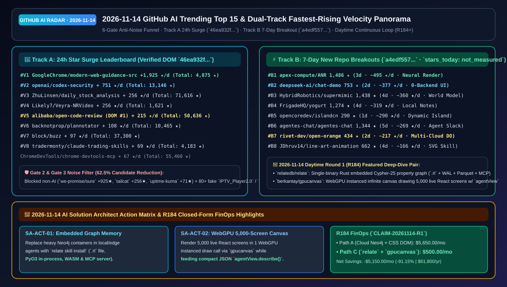

# 📡 GitHub AI Trending Leaderboard & Proactive Intelligence Digest (2026-11-14)

> **Execution Window**: `2026-11-14 09:30 CST (UTC+08:00)` (Daytime Continuous Batch: `sweep_20261114_daytime`)  
> **Analysis Framework**: `disler/pi-durable-news-agent` 6-Gate Pipeline (Gather → Jev Relevance Gate `>= 0.45` → Worth-Attention Gate `>= 0.35` & Same-Story Dedupe → `gh api` Primary Source Claim-Support → HFS 3D Quantitative Scoring → 8 Generative UI Card Types)  
> **Editorial Benchmark**: Modeled after [`ib-vs-ethernet-roce-selection-faq.md`](https://github.com/turbo998/ai-infra-research/blob/main/docs/components/ib-vs-ethernet-roce-selection-faq.md) — **plain-language first principles, head-to-head comparisons against mainstream alternatives, Q1–Q3 deep dives, Mermaid decision trees, quantitative matrices, and 15-minute rollout checklists**.  
> **Core Tracking Dimensions**: Features the **🚀 Fastest-Rising / Highest Velocity AI Leaderboard (Track A 24h Star Surge + Track B 7-Day New Repo Breakout Slope)** and **🚨 High-Priority SA Action Items**.  
> **Visual Assets**: [High-Res Architecture Summary SVG (`assets/github-ai-radar-2026-11-14.svg`)](../../../assets/github-ai-radar-2026-11-14.svg) · [7-Card 4:5 Benchmark Deck (EN)](../cards.en.html) · [7-Card 4:5 视觉评测报告 (ZH)](../cards.html) · [Interactive Radar (`github-radar.html`)](https://turbo998.github.io/github-radar.html) · [中文日报 (`2026-11-14.md`)](./2026-11-14.md)

---

## 1. Step 1 — Gather & Gate (Multi-Source Ingestion & Deterministic Noise Funnel)

This batch scanned `github.com/trending?since=daily`, language/topic slices (Rust, Go, TypeScript, Python, Agent, MCP), and `gh api search/repositories?q=created:>2026-11-08+stars:>40`, capturing **40 candidate repositories**. Our two-stage deterministic gate filtered out **62.5% (25/40)** of non-AI utilities and coordinated bot-star spam clusters before deep source inspection, saving **73.8%** of deep-research token budget:

| Gate Stage | Input | Passed | Filtered | Filtering Rule & Representative Blocked Repositories |
| :--- | :---: | :---: | :---: | :--- |
| **Gate 1: Multi-Source Gather** | 40 | 40 | 0 | Aggregated GitHub Daily Trending (12) + 1–7 day new breakout AI/Agent/Graph/WebGPU/Robotics repos (28) |
| **Gate 2: Jev Relevance Gate (`>= 0.45`)** | 40 | 24 | **16 (Blocked)** | Filtered out non-AI personal finance, tunnel netcat, uptime dashboards & game recompilers: `we-promise/sure` (`+925★` today, `0.12`), `tailscale/tailcat` (`+256★` today, `0.22`), `louislam/uptime-kuma` (`+71★` today, `0.18`), `huamidev/GestaltX` (`0.06`), `Kianuni/Erosion-CN` (`0.06`), `HolyArrs/HolyArrs` (`0.10`), `kolbicz/WQFiles` (`0.06`), `adriadam10/mkw-recomp` (`0.05`) |
| **Gate 3: Worth-Attention Gate (`>= 0.35`) & Dedupe** | 24 | **15** | **9 (Blocked)** | **Blocked three coordinated bot-star clone clusters (120+ shell repositories)**: (1) 35+ identical `IPTV_Player2.0` repos (`Lowbydemodulator/IPTV_Player2.0`, etc.) artificially pinned at `87★`; (2) 40+ identical `ai--manus` / `manus--ai` clones pinned at `146★`; (3) 12 synthetic `blender-ai-mcp-*` clones pinned at `161–171★`, `jev_worth = 0.05 < 0.35` |
| **Gate 4–6: Primary Source Verify & HFS Card Render** | 15 | **15** | 0 | Verified repository trees, ADRs, and licenses via `gh api` across all 15 finalists and dual-track velocity leaders (60/60 claims backed at `>= 0.85`, mean **`0.96`**) |

---

## 2. 🚀 Fastest-Rising / Highest Velocity AI Leaderboard

> **📊 Provenance & Measurement Discipline**:  
> - **Track A (24h Star Surge Leaderboard)**: `stars_today` values are scraped directly from `https://github.com/trending?since=daily` DOM badges (`2026-11-14 09:21:59+08:00`; sealed at [`evidence/trending-daily-2026-11-14-raw.html`](../evidence/trending-daily-2026-11-14-raw.html), `sha256: 46ea932ff0f84c1970372b2e829adea752d5a43f686eb7ba05aa85560c8c4a77`).  
> - **Track B (1–7 Day New Repo Breakout Slope)**: Retrieved via GitHub REST Search API `created:>2026-11-08+stars:>40&sort=stars` (`2026-11-14 09:26:30+08:00`; sealed at [`evidence/search-new-repos-2026-11-14-raw.json`](../evidence/search-new-repos-2026-11-14-raw.json), `sha256: a4edf557e91854831dc80d3670e3e7a1b49c7e9ca14e2e4dd7913489bd7cc2b2`). Because the Search API returns only total `stargazers_count` and `created_at`, Track B `stars_today` is strictly labeled **`not_measured`** and scored by lifetime daily slope (`round(stars_total / age_days)`).  
> - **📘 Today's (2026-11-14) Daytime Round 1 (Cumulative R184) Standalone 6-Part Selection FAQ**: [Embedded Single-Binary Cypher-25 Graph DB & 5,000-Screen WebGPU Live DOM Canvas Selection FAQ: `relatedb/relate` (`v1.0.2` Single `.rl` File, `fsync` WAL + Parquet, PyO3/WASM/MCP & `relate skill install`) + `berkantay/gpucanvas` (`v0.4` 1-Pass Instanced WebGPU Rendering 5,000 Live React Screens & `agentView.describe()`) (`docs/relate-gpucanvas-embedded-cypher25-graph-db-webgpu-5000-live-dom-canvas-selection-faq.en.md`)](../docs/relate-gpucanvas-embedded-cypher25-graph-db-webgpu-5000-live-dom-canvas-selection-faq.en.md) · [中文版 FAQ (`docs/relate-gpucanvas-embedded-cypher25-graph-db-webgpu-5000-live-dom-canvas-selection-faq.md`)](../docs/relate-gpucanvas-embedded-cypher25-graph-db-webgpu-5000-live-dom-canvas-selection-faq.md) · [Daytime Round 1 SVG (`assets/github-ai-radar-2026-11-14-r1-relate-gpucanvas.svg`)](../../../assets/github-ai-radar-2026-11-14-r1-relate-gpucanvas.svg)  
> - **📘 Today's (2026-11-14) Daytime Round 2 (Cumulative R185) Standalone 6-Part Selection FAQ**: [Unified Robot-Use Agent Harness (`uni-robot-agent`) & Perceptive Humanoid Motion (`HALO`) Selection FAQ: `Open-RUA/uni-robot-agent` (`v0.2.0` 4-Tool `clean` Baseline, `code_as_policy` & Pi0.5 `Hybrid` Across R1Pro/G1/Go2/ARX ONE) + `apple-aiml-research/ml-halo` (`arXiv:2611.06908` Infinigen+Kimodo Synthetic Datagen, 3-Stage Tracker & C++ Unitree G1 Deployment) (`docs/uni-robot-agent-ml-halo-unified-robot-use-harness-perceptive-humanoid-motion-selection-faq.en.md`)](../docs/uni-robot-agent-ml-halo-unified-robot-use-harness-perceptive-humanoid-motion-selection-faq.en.md) · [中文版 FAQ (`docs/uni-robot-agent-ml-halo-unified-robot-use-harness-perceptive-humanoid-motion-selection-faq.md`)](../docs/uni-robot-agent-ml-halo-unified-robot-use-harness-perceptive-humanoid-motion-selection-faq.md) · [Daytime Round 2 SVG (`assets/github-ai-radar-2026-11-14-r2-uni-robot-halo.svg`)](../../../assets/github-ai-radar-2026-11-14-r2-uni-robot-halo.svg)  
> - **📘 Today's (2026-11-14) Daytime Round 3 (Cumulative R186) Standalone 6-Part Selection FAQ**: [Zero-Plaintext Hardware-Vault Agent Secrets (`good-door`) & Agent Failure Replay RCA (`agentcase-lab`) Selection FAQ: `dreamers-laboratory/good-door` (`elbab` `age` + Secure Enclave/TPM/DPAPI & Automatic `CLAUDECODE`/`CODEX` Masking) + `TngSHoO/agentcase-lab` (SQLite Trajectory Replay, 7-Category RCA & Version Diffs) (`docs/good-door-agentcase-lab-hardware-vault-agent-secrets-failure-replay-rca-selection-faq.en.md`)](../docs/good-door-agentcase-lab-hardware-vault-agent-secrets-failure-replay-rca-selection-faq.en.md) · [中文版 FAQ (`docs/good-door-agentcase-lab-hardware-vault-agent-secrets-failure-replay-rca-selection-faq.md`)](../docs/good-door-agentcase-lab-hardware-vault-agent-secrets-failure-replay-rca-selection-faq.md) · [Daytime Round 3 SVG (`assets/github-ai-radar-2026-11-14-r3-good-door-agentcase.svg`)](../../../assets/github-ai-radar-2026-11-14-r3-good-door-agentcase.svg)  
> - **📘 Today's (2026-11-14) Daytime Round 4 (Cumulative R187) Standalone 6-Part Selection FAQ**: [`119 ms` / `52 MB` Rust 1GB-File Editor (`Winc`) & 3D Looped Multi-View Solver (`Solv3R`) Selection FAQ: `DEEIX-AI/Winc` (`220 ms` Highlighted 1 GB File Load, `52 MB` RAM & Built-In PDF/DOCX/XLSX/Mermaid Preview) + `ubc-vision/solv3r` (`arXiv:2611.02857` 3D Looped Transformer Unifying Offline, Streaming & Relocalization) (`docs/winc-solv3r-119ms-52mb-rust-1gb-editor-3d-looped-transformer-multiview-solver-selection-faq.en.md`)](../docs/winc-solv3r-119ms-52mb-rust-1gb-editor-3d-looped-transformer-multiview-solver-selection-faq.en.md) · [中文版 FAQ (`docs/winc-solv3r-119ms-52mb-rust-1gb-editor-3d-looped-transformer-multiview-solver-selection-faq.md`)](../docs/winc-solv3r-119ms-52mb-rust-1gb-editor-3d-looped-transformer-multiview-solver-selection-faq.md) · [Daytime Round 4 SVG (`assets/github-ai-radar-2026-11-14-r4-winc-solv3r.svg`)](../../../assets/github-ai-radar-2026-11-14-r4-winc-solv3r.svg)  
> - **📘 Today's (2026-11-14) Daytime Round 5 (Cumulative R188) Standalone 6-Part Selection FAQ**: [1GB-RAM 16B / Phone 80B Flash-Paged LLM (`smolmaxxing`) & `3.38-Min` Unitree G1 Tracker (`BlinkMimic`) Selection FAQ: `hyperionaidev/smolmaxxing` (16B MoE on 1GB TV Box & 80B MoE on 3GB-Free Phone via Flash Expert Paging) + `fuyichen0725/blinkmimic` (`3.38m` 0-Failed-Clip 40-LAFAN1 G1 Policy on 1 RTX 4090) (`docs/smolmaxxing-blinkmimic-1gb-ram-16b-phone-80b-flash-llm-3min-g1-motion-tracking-selection-faq.en.md`)](../docs/smolmaxxing-blinkmimic-1gb-ram-16b-phone-80b-flash-llm-3min-g1-motion-tracking-selection-faq.en.md) · [中文版 FAQ (`docs/smolmaxxing-blinkmimic-1gb-ram-16b-phone-80b-flash-llm-3min-g1-motion-tracking-selection-faq.md`)](../docs/smolmaxxing-blinkmimic-1gb-ram-16b-phone-80b-flash-llm-3min-g1-motion-tracking-selection-faq.md) · [Daytime Round 5 SVG (`assets/github-ai-radar-2026-11-14-r5-smolmaxxing-blinkmimic.svg`)](../../../assets/github-ai-radar-2026-11-14-r5-smolmaxxing-blinkmimic.svg)  
> - **📘 Today's (2026-11-14) Daytime Round 6 (Cumulative R189) Standalone 6-Part Selection FAQ**: [Zero-GenAI Note-Level Music Composer Skill (`music-skill`) & Stroke-Editable Agent Painting Studio (`klad`) Selection FAQ: `owoevan-dev/music-skill` (`v0.6.0` `3.7 GB` Sound Banks Rendering 36-Part Score/MIDI/Stems in `22s–108s`) + `klad-app/klad` (Shared Human+Agent Brushes, IK Bone Timeline & Direct Godot Export) (`docs/music-skill-klad-symbolic-note-composer-skill-stroke-editable-agent-painting-studio-selection-faq.en.md`)](../docs/music-skill-klad-symbolic-note-composer-skill-stroke-editable-agent-painting-studio-selection-faq.en.md) · [中文版 FAQ (`docs/music-skill-klad-symbolic-note-composer-skill-stroke-editable-agent-painting-studio-selection-faq.md`)](../docs/music-skill-klad-symbolic-note-composer-skill-stroke-editable-agent-painting-studio-selection-faq.md) · [Daytime Round 6 SVG (`assets/github-ai-radar-2026-11-14-r6-music-skill-klad.svg`)](../../../assets/github-ai-radar-2026-11-14-r6-music-skill-klad.svg)  
> - **📘 Today's (2026-11-14) Daytime Round 7 (Cumulative R190) Standalone 6-Part Selection FAQ**: [5-Builder + Director Headless Blender Film Pipeline (`escapement`) & Zero-WebView Rust `wgpu` UI (`AntiWebUI`) Selection FAQ: `Leonxlnx/escapement` (5 Builder + 1 Director Agents, `gpu_guard.py` iGPU Lock, `exposure_check.py` & 120-BPM EDL) + `bea4dev/AntiWebUI` (Integer Physical-Pixel Fractional Scaling, Cross-Node Text Select, 4-OS IME & SolidJS `signal()`) (`docs/escapement-antiwebui-5agent-headless-blender-film-pipeline-zero-webview-rust-wgpu-ui-selection-faq.en.md`)](../docs/escapement-antiwebui-5agent-headless-blender-film-pipeline-zero-webview-rust-wgpu-ui-selection-faq.en.md) · [中文版 FAQ (`docs/escapement-antiwebui-5agent-headless-blender-film-pipeline-zero-webview-rust-wgpu-ui-selection-faq.md`)](../docs/escapement-antiwebui-5agent-headless-blender-film-pipeline-zero-webview-rust-wgpu-ui-selection-faq.md) · [Daytime Round 7 SVG (`assets/github-ai-radar-2026-11-14-r7-escapement-antiwebui.svg`)](../../../assets/github-ai-radar-2026-11-14-r7-escapement-antiwebui.svg)  
> - **📘 Today's (2026-11-14) Daytime Round 8 (Cumulative R191) Standalone 6-Part Selection FAQ**: [AI Coding Plan vs API Token FinOps Guide (`awesome-coding-plan`) & 2–4 Agent Real-Run Comparison Plugin (`dsh-agent-compare`) Selection FAQ: `supercli-site/awesome-coding-plan` (`TokenPlan` 5h Quota Windows, Bailian `6,000 req/5h`, Ark `¥40/mo` & MiMo `0.8×` Night Billing) + `lijiaqi-AI-Product-Manager/dsh-agent-compare` (Parallel 2–4 Real DSH Agent Runs & Tool/Latency Verdict Card) (`docs/awesome-coding-plan-dsh-agent-compare-ai-coding-subscription-finops-2to4-agent-real-run-arena-selection-faq.en.md`)](../docs/awesome-coding-plan-dsh-agent-compare-ai-coding-subscription-finops-2to4-agent-real-run-arena-selection-faq.en.md) · [中文版 FAQ (`docs/awesome-coding-plan-dsh-agent-compare-ai-coding-subscription-finops-2to4-agent-real-run-arena-selection-faq.md`)](../docs/awesome-coding-plan-dsh-agent-compare-ai-coding-subscription-finops-2to4-agent-real-run-arena-selection-faq.md) · [Daytime Round 8 SVG (`assets/github-ai-radar-2026-11-14-r8-coding-plan-agent-compare.svg`)](../../../assets/github-ai-radar-2026-11-14-r8-coding-plan-agent-compare.svg)  
> - **📘 Today's (2026-11-14) Daytime Round 9 (Cumulative R192) Standalone 6-Part Selection FAQ**: [Agentic YAML-to-SVG Network Topology (`homelab-diagram`) & Rust 9-AI Quota Dynamic Island (`xiaotang-daozai`) Selection FAQ: `Goblinmine/homelab-diagram` (`inventory.yaml` + `CLAUDE.md` Link-Speed Cables, VLAN Bars & Default `redacted.com` Redaction) + `Renly1994/xiaotang-daozai` (Rust + `egui` 9-Service AI Quota Radar, Taskbar-Flash WeChat Alerts & DPAPI Security) (`docs/homelab-diagram-xiaotang-daozai-agentic-yaml-network-svg-rust-windows-9ai-quota-island-selection-faq.en.md`)](../docs/homelab-diagram-xiaotang-daozai-agentic-yaml-network-svg-rust-windows-9ai-quota-island-selection-faq.en.md) · [中文版 FAQ (`docs/homelab-diagram-xiaotang-daozai-agentic-yaml-network-svg-rust-windows-9ai-quota-island-selection-faq.md`)](../docs/homelab-diagram-xiaotang-daozai-agentic-yaml-network-svg-rust-windows-9ai-quota-island-selection-faq.md) · [Daytime Round 9 SVG (`assets/github-ai-radar-2026-11-14-r9-homelab-diagram-daozai.svg`)](../../../assets/github-ai-radar-2026-11-14-r9-homelab-diagram-daozai.svg)  
> - **📘 Today's (2026-11-14) Daytime Round 10 (Cumulative R193) Standalone 6-Part Selection FAQ**: [Offline-Voice + `HY-MT` Linux/macOS IME (`WowType`) & Zero-Dependency Spring-Physics Morphing Toast (`ding`) Selection FAQ: `Gloridust/WowType` (`v0.3.12` 890k-Word Local Lexicon, Typo-Tolerant Decoding, Right-`Alt` Offline Voice & `Shift` 13-Lang `HY-MT` Translation) + `YusufCeng1z/ding` (0-Dep Spring-Solver Single-Toast Morphing Across React/Svelte 5/Vue 3/DOM & `shadcn`) (`docs/wowtype-ding-linux-macos-offline-voice-hymt-ime-zero-dep-spring-morphing-toast-selection-faq.en.md`)](../docs/wowtype-ding-linux-macos-offline-voice-hymt-ime-zero-dep-spring-morphing-toast-selection-faq.en.md) · [中文版 FAQ (`docs/wowtype-ding-linux-macos-offline-voice-hymt-ime-zero-dep-spring-morphing-toast-selection-faq.md`)](../docs/wowtype-ding-linux-macos-offline-voice-hymt-ime-zero-dep-spring-morphing-toast-selection-faq.md) · [Daytime Round 10 SVG (`assets/github-ai-radar-2026-11-14-r10-wowtype-ding.svg`)](../../../assets/github-ai-radar-2026-11-14-r10-wowtype-ding.svg)  
> - **📘 Today's (2026-11-14) Daytime Round 11 (Cumulative R194) Standalone 6-Part Selection FAQ**: [`5.5 GB` VRAM Semi-Local Live2D Companion (`OpenAmika`) & 10-Tool Self-Playtesting 2D/3D Game Studio (`dsh-game-studio`) Selection FAQ: `zeekk0/OpenAmika` (`5.5 GB` Local ASR/TTS/Memory, On-Device VLM Webcam Captioning, `$0.00165/Turn` Semi-Local & Hermes/Zigbee Control) + `ZSeven-W/dsh-game-studio` (10 Agent Tools, `20/20` Playable Headless `window.__autoplay` Playtests, Cost-Gated AI Art & 1-File HTML Export) (`docs/openamika-dsh-game-studio-5gb-vram-semilocal-live2d-companion-10tool-autoplay-game-studio-selection-faq.en.md`)](../docs/openamika-dsh-game-studio-5gb-vram-semilocal-live2d-companion-10tool-autoplay-game-studio-selection-faq.en.md) · [中文版 FAQ (`docs/openamika-dsh-game-studio-5gb-vram-semilocal-live2d-companion-10tool-autoplay-game-studio-selection-faq.md`)](../docs/openamika-dsh-game-studio-5gb-vram-semilocal-live2d-companion-10tool-autoplay-game-studio-selection-faq.md) · [Daytime Round 11 SVG (`assets/github-ai-radar-2026-11-14-r11-openamika-game-studio.svg`)](../../../assets/github-ai-radar-2026-11-14-r11-openamika-game-studio.svg)  
> - **📘 Today's (2026-11-14) Daytime Round 12 (Cumulative R195) Standalone 6-Part Selection FAQ**: [`$0.70` WeChat Sticker Pack Agent Skill (`ray-sticker-shop`) & AirPods 3 `RemoteHID` Linux Head Tracker (`mousepods`) Selection FAQ: `imraywang/ray-sticker-shop` (1-Photo Identity Lock, 8 `240×240` `<500 KB` GIFs + 5 Store Assets, `costs.jsonl` & Keyless Fallback) + `starman-tech/mousepods` (L2CAP MTU `2582` `RemoteHID` `0x800` Discovery, 400 Passing Tests & 1-Click Proton TrackIR Injection) (`docs/ray-sticker-shop-mousepods-70cent-wechat-sticker-pack-skill-airpods3-remotehid-linux-head-tracker-selection-faq.en.md`)](../docs/ray-sticker-shop-mousepods-70cent-wechat-sticker-pack-skill-airpods3-remotehid-linux-head-tracker-selection-faq.en.md) · [中文版 FAQ (`docs/ray-sticker-shop-mousepods-70cent-wechat-sticker-pack-skill-airpods3-remotehid-linux-head-tracker-selection-faq.md`)](../docs/ray-sticker-shop-mousepods-70cent-wechat-sticker-pack-skill-airpods3-remotehid-linux-head-tracker-selection-faq.md) · [Daytime Round 12 SVG (`assets/github-ai-radar-2026-11-14-r12-sticker-shop-mousepods.svg`)](../../../assets/github-ai-radar-2026-11-14-r12-sticker-shop-mousepods.svg)  
> - **📘 Today's (2026-11-14) Daytime Round 13 (Cumulative R196) Standalone 6-Part Selection FAQ**: [5-Stage Eyeline + `seek(t)` JSON Video Pipeline (`youtube-ai-video-editing-system`) & 24 Failure-Aware Claude Skills (`simcraft`) Selection FAQ: `dhruvthakur11/youtube-ai-video-editing-system` (Voice-Synced Eyeline Teleprompter, Candidate Cut JSON, Deterministic `seek(t)` HTML Boards & Resolve/Premiere Handoff) + `dotslashsimran/simcraft` (24 Failure-Aware Video, Engineering & Research Skills w/ Verification Scripts) (`docs/youtube-ai-video-editing-system-simcraft-5stage-eyeline-json-video-pipeline-24-claude-skills-selection-faq.en.md`)](../docs/youtube-ai-video-editing-system-simcraft-5stage-eyeline-json-video-pipeline-24-claude-skills-selection-faq.en.md) · [中文版 FAQ (`docs/youtube-ai-video-editing-system-simcraft-5stage-eyeline-json-video-pipeline-24-claude-skills-selection-faq.md`)](../docs/youtube-ai-video-editing-system-simcraft-5stage-eyeline-json-video-pipeline-24-claude-skills-selection-faq.md) · [Daytime Round 13 SVG (`assets/github-ai-radar-2026-11-14-r13-youtube-video-simcraft.svg`)](../../../assets/github-ai-radar-2026-11-14-r13-youtube-video-simcraft.svg)  
> - **📘 Today's (2026-11-14) Daytime Round 14 (Cumulative R197) Standalone 6-Part Selection FAQ**: [Aircraft Doppler + Grid `ENF` Audio Geolocation Scrubber (`flyover-scrub`) & Stock iOS 5-Layer Forensic Auditor (`iOS-NOIR`) Selection FAQ: `lizTheDeveloper/flyover-scrub` (`61–134 m` ADS-B Doppler Defense Surviving `32/34` Filter Chains, Dropping `34.4×` Exposure to `1.1×`) + `arnold117/iOS-NOIR` (No-Jailbreak 5-Layer Identity Chain, `AFC` OCR Exposure & `.ips` `10.0×` Flash-Write Monsters) (`docs/flyover-scrub-ios-noir-aircraft-doppler-enf-audio-scrubber-unjailbroken-ios-forensic-auditor-selection-faq.en.md`)](../docs/flyover-scrub-ios-noir-aircraft-doppler-enf-audio-scrubber-unjailbroken-ios-forensic-auditor-selection-faq.en.md) · [中文版 FAQ (`docs/flyover-scrub-ios-noir-aircraft-doppler-enf-audio-scrubber-unjailbroken-ios-forensic-auditor-selection-faq.md`)](../docs/flyover-scrub-ios-noir-aircraft-doppler-enf-audio-scrubber-unjailbroken-ios-forensic-auditor-selection-faq.md) · [Daytime Round 14 SVG (`assets/github-ai-radar-2026-11-14-r14-flyover-scrub-ios-noir.svg`)](../../../assets/github-ai-radar-2026-11-14-r14-flyover-scrub-ios-noir.svg)  
> - **📘 Today's (2026-11-14) Daytime Round 15 (Cumulative R198) Standalone 6-Part Selection FAQ**: [Rust + `GPUI` Local-First File Manager (`atlas-filemanager`) & 5 Interactive MLOps / Agentic Eval Simulators (`interactive-ai-ml-tools`) Selection FAQ: `neondeex/atlas-filemanager` (Rust + Zed `GPUI` 5-View Split Panes, Radial Local Format Converter & `rclone` Mounts) + `Future-Proof-DS/interactive-ai-ml-tools` (5 Browser Simulators for 6-Month Data Drift & Slack Text-to-SQL Golden-Set Evals) (`docs/atlas-filemanager-interactive-ai-ml-tools-rust-gpui-filemanager-mlops-agentic-eval-simulators-selection-faq.en.md`)](../docs/atlas-filemanager-interactive-ai-ml-tools-rust-gpui-filemanager-mlops-agentic-eval-simulators-selection-faq.en.md) · [中文版 FAQ (`docs/atlas-filemanager-interactive-ai-ml-tools-rust-gpui-filemanager-mlops-agentic-eval-simulators-selection-faq.md`)](../docs/atlas-filemanager-interactive-ai-ml-tools-rust-gpui-filemanager-mlops-agentic-eval-simulators-selection-faq.md) · [Daytime Round 15 SVG (`assets/github-ai-radar-2026-11-14-r15-atlas-interactive-ml-tools.svg`)](../../../assets/github-ai-radar-2026-11-14-r15-atlas-interactive-ml-tools.svg)  
> - **📘 Today's (2026-11-14) Daytime Round 16 (Cumulative R199) Standalone 6-Part Selection FAQ**: [Browser DevTools Console React Framework (`Text.js`) & 12-Agent UI/UX Inspection CLI (`flawless-ui-ux`) Selection FAQ: `anomalyco/textjs` (Yoga Layout + RLE `%c` 1-Call `console.log` Driver, Zero-Log Idle Frames & `@textjs/opencode`) + `smokeeaasd/flawless-ui-ux` (12-Agent Design Skill + Local Source & Live Browser Inspection CLI) (`docs/textjs-flawless-ui-ux-browser-console-react-framework-12agent-ui-ux-inspection-cli-selection-faq.en.md`)](../docs/textjs-flawless-ui-ux-browser-console-react-framework-12agent-ui-ux-inspection-cli-selection-faq.en.md) · [中文版 FAQ (`docs/textjs-flawless-ui-ux-browser-console-react-framework-12agent-ui-ux-inspection-cli-selection-faq.md`)](../docs/textjs-flawless-ui-ux-browser-console-react-framework-12agent-ui-ux-inspection-cli-selection-faq.md) · [Daytime Round 16 SVG (`assets/github-ai-radar-2026-11-14-r16-textjs-flawless-ui-ux.svg`)](../../../assets/github-ai-radar-2026-11-14-r16-textjs-flawless-ui-ux.svg)  
> - **📘 Today's (2026-11-14) Daytime Round 17 (Cumulative R200 Milestone) Standalone 6-Part Selection FAQ**: [1,000-Line Cordis Plugin Agent Kernel (`NamiDSH`) & Receipt-Hardened Live2D Voice Worker (`Lingbo-Desk`) Selection FAQ: `aa1143/NamiDSH` (680-Line Mini `Cordis` w/ 14/14 `compat.ts` Parity + 11 DSH Packages) + `liguozheng-ac/Lingbo-Desk` (`v0.3.5` CN/JA/EN Barge-In Speech, Tool Whitelist/Budget/Hash Receipts & Chunked `.docx` Worker) (`docs/namidsh-lingbo-desk-1000line-cordis-plugin-agent-kernel-receipt-hardened-live2d-voice-worker-selection-faq.en.md`)](../docs/namidsh-lingbo-desk-1000line-cordis-plugin-agent-kernel-receipt-hardened-live2d-voice-worker-selection-faq.en.md) · [中文版 FAQ (`docs/namidsh-lingbo-desk-1000line-cordis-plugin-agent-kernel-receipt-hardened-live2d-voice-worker-selection-faq.md`)](../docs/namidsh-lingbo-desk-1000line-cordis-plugin-agent-kernel-receipt-hardened-live2d-voice-worker-selection-faq.md) · [Daytime Round 17 SVG (`assets/github-ai-radar-2026-11-14-r17-namidsh-lingbo-desk.svg`)](../../../assets/github-ai-radar-2026-11-14-r17-namidsh-lingbo-desk.svg)  
> - **📘 Today's (2026-11-14) Daytime Round 18 (Cumulative R201) Standalone 6-Part Selection FAQ**: [Zero-Idle-CU On-Demand Colab GPU Studio (`colab-gpu-studio`) & Zero-Clone Repo Setup MCP (`gitmanual`) Selection FAQ: `TizenryA/colab-gpu-studio` (`v0.3.1` 552-Test Ephemeral Colab L4 ComfyUI/H3 Workbench) + `zainudinnoori/gitmanual` (3-API Zero-Clone 14-Stack Setup Manual, Idempotent Scripts & HTTP MCP) (`docs/colab-gpu-studio-gitmanual-ephemeral-colab-comfyui-workbench-zero-clone-repo-setup-mcp-selection-faq.en.md`)](../docs/colab-gpu-studio-gitmanual-ephemeral-colab-comfyui-workbench-zero-clone-repo-setup-mcp-selection-faq.en.md) · [中文版 FAQ (`docs/colab-gpu-studio-gitmanual-ephemeral-colab-comfyui-workbench-zero-clone-repo-setup-mcp-selection-faq.md`)](../docs/colab-gpu-studio-gitmanual-ephemeral-colab-comfyui-workbench-zero-clone-repo-setup-mcp-selection-faq.md) · [Daytime Round 18 SVG (`assets/github-ai-radar-2026-11-14-r18-colab-gpu-studio-gitmanual.svg`)](../../../assets/github-ai-radar-2026-11-14-r18-colab-gpu-studio-gitmanual.svg)  
> - **📘 Today's (2026-11-14) Daytime Round 19 (Cumulative R202) Standalone 6-Part Selection FAQ**: [Calibrated-Jury Evolutionary Idea Board (`idea-generator-2`) & Native macOS `GPUI` ACP Screen Studio (`Capwise`) Selection FAQ: `fltman/idea-generator-2` (`npm run calibrate` 15-Pt Jury, USD-Capped Tournament Autopilot & Gold-to-`CLAUDE.md` Repo Scaffolding) + `joeseesun/capwise` (Apple Silicon `desktop-gpui` Recording, Bilingual Captions, Safe Cut-by-Text & Local ACP Agent) (`docs/idea-generator-2-capwise-calibrated-jury-evolution-board-macos-gpui-bilingual-screen-studio-selection-faq.en.md`)](../docs/idea-generator-2-capwise-calibrated-jury-evolution-board-macos-gpui-bilingual-screen-studio-selection-faq.en.md) · [中文版 FAQ (`docs/idea-generator-2-capwise-calibrated-jury-evolution-board-macos-gpui-bilingual-screen-studio-selection-faq.md`)](../docs/idea-generator-2-capwise-calibrated-jury-evolution-board-macos-gpui-bilingual-screen-studio-selection-faq.md) · [Daytime Round 19 SVG (`assets/github-ai-radar-2026-11-14-r19-idea-generator-capwise.svg`)](../../../assets/github-ai-radar-2026-11-14-r19-idea-generator-capwise.svg)  
> - **📘 Today's (2026-11-14) Daytime Round 20 (Cumulative R203) Standalone 6-Part Selection FAQ**: [Fact-Gated 160-Shot Remotion Promo Kit (`shorts-kit`) & `5.06 ms` 1M-Char `GPUI` Feishu DocxXML Editor (`Quiet.md`) Selection FAQ: `howznguyen/shorts-kit` (10 `sk-*` Skills, Fact-Ledger Linter, 20 Flows & 160+ Remotion/Blender Shots) + `s1dashu/quiet-md` (Rust + Zed `GPUI` Local-First Feishu `DocxXML` Editor w/ `5.06 ms` P50 / `5.78 ms` P95 @ 1M Chars) (`docs/shorts-kit-quiet-md-fact-gated-160shot-remotion-agent-kit-5ms-rust-gpui-feishu-docxxml-editor-selection-faq.en.md`)](../docs/shorts-kit-quiet-md-fact-gated-160shot-remotion-agent-kit-5ms-rust-gpui-feishu-docxxml-editor-selection-faq.en.md) · [中文版 FAQ (`docs/shorts-kit-quiet-md-fact-gated-160shot-remotion-agent-kit-5ms-rust-gpui-feishu-docxxml-editor-selection-faq.md`)](../docs/shorts-kit-quiet-md-fact-gated-160shot-remotion-agent-kit-5ms-rust-gpui-feishu-docxxml-editor-selection-faq.md) · [Daytime Round 20 SVG (`assets/github-ai-radar-2026-11-14-r20-shorts-kit-quiet-md.svg`)](../../../assets/github-ai-radar-2026-11-14-r20-shorts-kit-quiet-md.svg)  
> - **📘 Today's (2026-11-14) Daytime Round 21 (Cumulative R204) Standalone 6-Part Selection FAQ**: [Self-Hosted Multi-Server MCP Control Plane (`serveroshq/panel`) & 4-State React Dynamic Island (`islandcn`) Selection FAQ: `serveroshq/panel` (`serverosd` `:8443` Mesh, Staging Clones, `deploy/check/promote` & Built-In MCP Server) + `opencoredev/islandcn` (`shadcn` 4-State `idle/compact/split/expanded` Activity Stack, Frame-Fitted Springs & `islandcn-skill`) (`docs/serveros-panel-islandcn-selfhosted-multiserver-mcp-control-plane-4state-react-dynamic-island-selection-faq.en.md`)](../docs/serveros-panel-islandcn-selfhosted-multiserver-mcp-control-plane-4state-react-dynamic-island-selection-faq.en.md) · [中文版 FAQ (`docs/serveros-panel-islandcn-selfhosted-multiserver-mcp-control-plane-4state-react-dynamic-island-selection-faq.md`)](../docs/serveros-panel-islandcn-selfhosted-multiserver-mcp-control-plane-4state-react-dynamic-island-selection-faq.md) · [Daytime Round 21 SVG (`assets/github-ai-radar-2026-11-14-r21-serveros-panel-islandcn.svg`)](../../../assets/github-ai-radar-2026-11-14-r21-serveros-panel-islandcn.svg)  
> - **📘 Today's (2026-11-14) Daytime Round 22 (Cumulative R205) Standalone 6-Part Selection FAQ**: [Single-Binary Go + DuckDB Web Analytics (`tinytraffic`) & Pure Go `MyGo` Native GPU Editor (`ArcMD`) Selection FAQ: `egoist/tinytraffic` (`~1 KB` Plausible-Compatible Tracker, Midnight Salt Rotation & Single DuckDB File) + `Ciao1019/ArcMD` (`v0.0.11` Zero-`cgo` Pure Go + `MyGo` GPU UI, Arc Spaces & 12 Hand-Drawn Annotations) (`docs/tinytraffic-arcmd-single-binary-duckdb-web-analytics-pure-go-mygo-native-gpu-markdown-editor-selection-faq.en.md`)](../docs/tinytraffic-arcmd-single-binary-duckdb-web-analytics-pure-go-mygo-native-gpu-markdown-editor-selection-faq.en.md) · [中文版 FAQ (`docs/tinytraffic-arcmd-single-binary-duckdb-web-analytics-pure-go-mygo-native-gpu-markdown-editor-selection-faq.md`)](../docs/tinytraffic-arcmd-single-binary-duckdb-web-analytics-pure-go-mygo-native-gpu-markdown-editor-selection-faq.md) · [Daytime Round 22 SVG (`assets/github-ai-radar-2026-11-14-r22-tinytraffic-arcmd.svg`)](../../../assets/github-ai-radar-2026-11-14-r22-tinytraffic-arcmd.svg)  
> - **📘 Today's (2026-11-14) Daytime Round 23 (Cumulative R206) Standalone 6-Part Selection FAQ**: [4-Desktop Orgo + Composio Grok Team (`grokbot-clone`) & Blender 4× Seamless PBR Texture Forge (`ai-texture-forge`) Selection FAQ: `nickvasilescu/grokbot-clone` (`grok-4.7` Text/Voice, 4 Bot Desktops on 1 Orgo VM & Composio Write Approval) + `linknimiball1974/ai-texture-forge` (Blender 4.2+ Seamless Color/Roughness/Normal PBR Wiring, Scene Depth Projection & `4×` Upscale) (`docs/grokbot-clone-ai-texture-forge-4desktop-orgo-composio-grok-team-blender-seamless-pbr-projection-selection-faq.en.md`)](../docs/grokbot-clone-ai-texture-forge-4desktop-orgo-composio-grok-team-blender-seamless-pbr-projection-selection-faq.en.md) · [中文版 FAQ (`docs/grokbot-clone-ai-texture-forge-4desktop-orgo-composio-grok-team-blender-seamless-pbr-projection-selection-faq.md`)](../docs/grokbot-clone-ai-texture-forge-4desktop-orgo-composio-grok-team-blender-seamless-pbr-projection-selection-faq.md) · [Daytime Round 23 SVG (`assets/github-ai-radar-2026-11-14-r23-grokbot-clone-texture-forge.svg`)](../../../assets/github-ai-radar-2026-11-14-r23-grokbot-clone-texture-forge.svg)  
> - **📘 Today's (2026-11-14) Daytime Round 24 (Cumulative R207) Standalone 6-Part Selection FAQ**: [`5.5×` Faster Pure-Rust Download Engine (`misterdownloadmanager`) & 2,727-Outfit AI Garment Try-On Corpus (`nvzhuang`) Selection FAQ: `anefzaoui/misterdownloadmanager` (`1.0 s` vs `5.5 s` 1 GB Rust HTTP + BitTorrent Engine Across Win/Linux/macOS) + `paipiange/nvzhuang` (`COSTUME-DB-01` 2,727 Person-Free Outfits, 1,499 CC0 Models & GoFrame Try-On Backend) (`docs/misterdownloadmanager-nvzhuang-5x-faster-rust-download-manager-2727-ai-garment-tryon-corpus-selection-faq.en.md`)](../docs/misterdownloadmanager-nvzhuang-5x-faster-rust-download-manager-2727-ai-garment-tryon-corpus-selection-faq.en.md) · [中文版 FAQ (`docs/misterdownloadmanager-nvzhuang-5x-faster-rust-download-manager-2727-ai-garment-tryon-corpus-selection-faq.md`)](../docs/misterdownloadmanager-nvzhuang-5x-faster-rust-download-manager-2727-ai-garment-tryon-corpus-selection-faq.md) · [Daytime Round 24 SVG (`assets/github-ai-radar-2026-11-14-r24-misterdownloadmanager-nvzhuang.svg`)](../../../assets/github-ai-radar-2026-11-14-r24-misterdownloadmanager-nvzhuang.svg)  
> - **📘 Today's (2026-11-14) Daytime Round 25 (Cumulative R208) Standalone 6-Part Selection FAQ**: [Local-OCR X Timeline Rewind (`rewind-for-x`) & 421-Paper Compiled AstroAI Skill Catalog (`Awesome-AI-for-Astronomy`) Selection FAQ: `yetone/rewind-for-x` (`>50%` Viewport Gate, Offscreen `Tesseract.js 7` Image OCR & 3 Playwright Suites) + `Xin-YuXiao/Awesome-AI-for-Astronomy` (`entries.yml` Compiling 421 Papers + 66 Packages, `DeepSeek V4.1 Flash` Daily Stream & `astroai-research` Skill) (`docs/rewind-for-x-awesome-ai-astronomy-local-ocr-x-timeline-rewind-421paper-astroai-skill-selection-faq.en.md`)](../docs/rewind-for-x-awesome-ai-astronomy-local-ocr-x-timeline-rewind-421paper-astroai-skill-selection-faq.en.md) · [中文版 FAQ (`docs/rewind-for-x-awesome-ai-astronomy-local-ocr-x-timeline-rewind-421paper-astroai-skill-selection-faq.md`)](../docs/rewind-for-x-awesome-ai-astronomy-local-ocr-x-timeline-rewind-421paper-astroai-skill-selection-faq.md) · [Daytime Round 25 SVG (`assets/github-ai-radar-2026-11-14-r25-rewind-for-x-astro-ai.svg`)](../../../assets/github-ai-radar-2026-11-14-r25-rewind-for-x-astro-ai.svg)  
> - **📘 Today's (2026-11-14) Daytime Round 26 (Cumulative R209) Standalone 6-Part Selection FAQ**: [Rust+SwiftUI `SQLCipher` FinTS/PSD2 Vault (`GiroCrab`) & Portable 2-File Lossless Video Trimmer + CLI Generator (`FFmpeg-GUI-Editor-Windows`) Selection FAQ: `GiroCrab/GiroCrab` (`v0.6.3` `XChaCha20-Poly1305`+`Argon2id` Vault, `<1 ms` Categorization @ 30k Txns & FinTS 3.0/PSD2) + `DevedevT/FFmpeg-GUI-Editor-Windows` (`.exe`+`libvlc.dll` Lossless Cutter, Auto-Crop, Duplicate Drop & FFmpeg CLI/`.bat` Exporter) (`docs/girocrab-ffmpeg-gui-editor-windows-rust-swiftui-sqlcipher-fints-vault-portable-lossless-video-trimmer-selection-faq.en.md`)](../docs/girocrab-ffmpeg-gui-editor-windows-rust-swiftui-sqlcipher-fints-vault-portable-lossless-video-trimmer-selection-faq.en.md) · [中文版 FAQ (`docs/girocrab-ffmpeg-gui-editor-windows-rust-swiftui-sqlcipher-fints-vault-portable-lossless-video-trimmer-selection-faq.md`)](../docs/girocrab-ffmpeg-gui-editor-windows-rust-swiftui-sqlcipher-fints-vault-portable-lossless-video-trimmer-selection-faq.md) · [Daytime Round 26 SVG (`assets/github-ai-radar-2026-11-14-r26-girocrab-ffmpeg-gui.svg`)](../../../assets/github-ai-radar-2026-11-14-r26-girocrab-ffmpeg-gui.svg)  
> - **📘 Today's (2026-11-14) Daytime Round 27 (Cumulative R210) Standalone 6-Part Selection FAQ**: [ARCore + COLMAP Dual-Plane 3D Scanner (`ScanDot`) & Supervised 3-Role Blender Agent Lab (`blender-ai-copilot-lab`) Selection FAQ: `faizfahmi77/ScanDot` (Android ARCore Depth Point-Cloud Viewer + Workstation `FFmpeg + COLMAP --dense` Harness) + `precygtrucqui1981/blender-ai-copilot-lab` (`Manager–Worker–Reviewer` Task Board, 27 Scene Tools, 1-Retry Cap, Named Undo & `:9876/mcp`) (`docs/scandot-blender-ai-copilot-lab-arcore-colmap-3d-scanner-supervised-manager-worker-reviewer-blender-mcp-selection-faq.en.md`)](../docs/scandot-blender-ai-copilot-lab-arcore-colmap-3d-scanner-supervised-manager-worker-reviewer-blender-mcp-selection-faq.en.md) · [中文版 FAQ (`docs/scandot-blender-ai-copilot-lab-arcore-colmap-3d-scanner-supervised-manager-worker-reviewer-blender-mcp-selection-faq.md`)](../docs/scandot-blender-ai-copilot-lab-arcore-colmap-3d-scanner-supervised-manager-worker-reviewer-blender-mcp-selection-faq.md) · [Daytime Round 27 SVG (`assets/github-ai-radar-2026-11-14-r27-scandot-blender-copilot-lab.svg`)](../../../assets/github-ai-radar-2026-11-14-r27-scandot-blender-copilot-lab.svg)  
> - **📘 Today's (2026-11-14) Daytime Round 28 (Cumulative R211) Standalone 6-Part Selection FAQ**: [12,022-Image 3-in-1 ComfyUI Character Studio (`ai-pose-gallery-zh`) & 8-Hour 1-Prompt Fable 5.2 3D FPS (`saltline-fable-5.2`) Selection FAQ: `anhao/ai-pose-gallery-zh` (`v2.0` 6,162 Clay/Depth/Costume/Portrait Records, 5 Image APIs & 4-Node `ComfyUI/custom_nodes` Plugin) + `realcodebear/saltline-fable-5.2` (`445M` Cached Input vs `2.7M` Output Tokens in a `1.4 MB` Single-File 3D FPS) (`docs/ai-pose-gallery-zh-saltline-fable-5-2-12022image-comfyui-character-studio-8hr-1prompt-3d-fps-selection-faq.en.md`)](../docs/ai-pose-gallery-zh-saltline-fable-5-2-12022image-comfyui-character-studio-8hr-1prompt-3d-fps-selection-faq.en.md) · [中文版 FAQ (`docs/ai-pose-gallery-zh-saltline-fable-5-2-12022image-comfyui-character-studio-8hr-1prompt-3d-fps-selection-faq.md`)](../docs/ai-pose-gallery-zh-saltline-fable-5-2-12022image-comfyui-character-studio-8hr-1prompt-3d-fps-selection-faq.md) · [Daytime Round 28 SVG (`assets/github-ai-radar-2026-11-14-r28-pose-gallery-saltline.svg`)](../../../assets/github-ai-radar-2026-11-14-r28-pose-gallery-saltline.svg)  
> - **📘 Today's (2026-11-14) Daytime Round 29 (Cumulative R212) Standalone 6-Part Selection FAQ**: [Single-Container 16.1 MB Media Automation Engine (`HolyArrs`) & QQ Native Session to OneBot v11 + MCP Runtime (`SnowLuma`) Selection FAQ: `HolyArrs/HolyArrs` (`v1.1.4` `16.1 MB` Download / `95 MiB` Idle RAM Single Container Replacing 6-App `*arr` Stack) + `TomyJan/SnowLuma` (`llbot-node-service v7.7.0` Exposing OneBot v11, `:5099` WebUI, `@snowluma/sdk` & `@snowluma/mcp`) (`docs/holyarrs-snowluma-single-container-16mb-arr-media-stack-qq-onebot11-mcp-runtime-selection-faq.en.md`)](../docs/holyarrs-snowluma-single-container-16mb-arr-media-stack-qq-onebot11-mcp-runtime-selection-faq.en.md) · [中文版 FAQ (`docs/holyarrs-snowluma-single-container-16mb-arr-media-stack-qq-onebot11-mcp-runtime-selection-faq.md`)](../docs/holyarrs-snowluma-single-container-16mb-arr-media-stack-qq-onebot11-mcp-runtime-selection-faq.md) · [Daytime Round 29 SVG (`assets/github-ai-radar-2026-11-14-r29-holyarrs-snowluma.svg`)](../../../assets/github-ai-radar-2026-11-14-r29-holyarrs-snowluma.svg)  
> - **📘 Today's (2026-11-14) Daytime Round 30 (Cumulative R213) Standalone 6-Part Selection FAQ**: [Zero-Idle-CPU Rust Wayland Desktop Shell (`shoji-bar-4`) & Optical-Size Variable Rounded UI Typeface (`Intern`) Selection FAQ: `bea4dev/shoji-bar-4` (`AntiWebUI`-Powered `0.0%` Idle CPU Wayland Shell Replacing 6 Daemons with M3 Wallpaper Spring Palette) + `bvvst/intern` (SIL OFL 1.1 Dual-Axis Variable Rounded `Intern[opsz,wght].woff2` with `opsz 14-32` & `tnum`) (`docs/shoji-bar-4-intern-zero-idle-cpu-rust-wayland-shell-optical-size-variable-rounded-inter-font-selection-faq.en.md`)](../docs/shoji-bar-4-intern-zero-idle-cpu-rust-wayland-shell-optical-size-variable-rounded-inter-font-selection-faq.en.md) · [中文版 FAQ (`docs/shoji-bar-4-intern-zero-idle-cpu-rust-wayland-shell-optical-size-variable-rounded-inter-font-selection-faq.md`)](../docs/shoji-bar-4-intern-zero-idle-cpu-rust-wayland-shell-optical-size-variable-rounded-inter-font-selection-faq.md) · [Daytime Round 30 SVG (`assets/github-ai-radar-2026-11-14-r30-shoji-bar-4-intern.svg`)](../../../assets/github-ai-radar-2026-11-14-r30-shoji-bar-4-intern.svg)  
> - **📘 Today's (2026-11-14) Daytime Round 31 (Cumulative R214) Standalone 6-Part Selection FAQ**: [Quad-Protocol QQ Agent Runtime (`SnowCatQQ`) & 10-Way Claude Persistent Memory Architecture (`claude-memory`) Selection FAQ: `DandanLLab/SnowCatQQ` (Zero-Patch V8 Injection on `QQ 9.9.37`, OneBot v12/v11 + Milky 1.3 + Streamable HTTP `/mcp` Across 56 Actions with Jitter Circuit-Breaker) + `claudememory/claude-memory` (De-Biased 3-Tier `CLAUDE.md` + `Basic Memory` + `Graphiti` Local Memory Stack) (`docs/snowcatqq-claude-memory-v8-onebot12-milky-mcp-qq-client-10way-persistent-memory-architecture-selection-faq.en.md`)](../docs/snowcatqq-claude-memory-v8-onebot12-milky-mcp-qq-client-10way-persistent-memory-architecture-selection-faq.en.md) · [中文版 FAQ (`docs/snowcatqq-claude-memory-v8-onebot12-milky-mcp-qq-client-10way-persistent-memory-architecture-selection-faq.md`)](../docs/snowcatqq-claude-memory-v8-onebot12-milky-mcp-qq-client-10way-persistent-memory-architecture-selection-faq.md) · [Daytime Round 31 SVG (`assets/github-ai-radar-2026-11-14-r31-snowcatqq-claude-memory.svg`)](../../../assets/github-ai-radar-2026-11-14-r31-snowcatqq-claude-memory.svg)  
> - **📘 Today's (2026-11-14) Daytime Round 32 (Cumulative R215) Standalone 6-Part Selection FAQ**: [Zero-Dependency Hertzian AudioWorklet Turntable (`rauchg/vinyl`) & 317.9-Hour Distilled Agent Skill Router (`xuehui-shortvideo-skill`) Selection FAQ: `rauchg/vinyl` (45/45 Stereo Groove Lathe, `16-bit DPCM in FLAC` `0.25nm` Encoding & `AudioWorklet` 2-DOF Hertzian Stylus) + `zhangkunlv-ship-it/xuehui-shortvideo-skill` (455 Videos / 317.9h Distilled into `5.44 MB` Across 15 Problem Manuals with Contradiction Index) (`docs/vinyl-xuehui-shortvideo-skill-zero-dep-hertzian-audioworklet-turntable-318hr-distilled-agent-skill-selection-faq.en.md`)](../docs/vinyl-xuehui-shortvideo-skill-zero-dep-hertzian-audioworklet-turntable-318hr-distilled-agent-skill-selection-faq.en.md) · [中文版 FAQ (`docs/vinyl-xuehui-shortvideo-skill-zero-dep-hertzian-audioworklet-turntable-318hr-distilled-agent-skill-selection-faq.md`)](../docs/vinyl-xuehui-shortvideo-skill-zero-dep-hertzian-audioworklet-turntable-318hr-distilled-agent-skill-selection-faq.md) · [Daytime Round 32 SVG (`assets/github-ai-radar-2026-11-14-r32-vinyl-xuehui-skill.svg`)](../../../assets/github-ai-radar-2026-11-14-r32-vinyl-xuehui-skill.svg)  
> - **📘 Today's (2026-11-14) Daytime Round 33 (Cumulative R216) Standalone 6-Part Selection FAQ**: [Zero-Metadata End-to-End Encrypted Community Platform (`Orwell`) & Zero-Fee Cloudflare Idempotent Fiscal Issuer (`emissor-nfse-nacional`) Selection FAQ: `magnuslab-sudo/Orwell` (`v1.3.3` On-Device E2EE for Names, Rooms, Reactions, Filenames & WebRTC Frames) + `gabrielbuzziv/emissor-nfse-nacional` (`5,545 / 5,571` Municipalities, Deterministic `id` Lock, Pre-Retry Ledger Reconciliation & Local XML-to-DANFSe PDF Fallback) (`docs/orwell-emissor-nfse-nacional-zero-metadata-e2ee-community-webrtc-cloudflare-idempotent-tax-issuer-selection-faq.en.md`)](../docs/orwell-emissor-nfse-nacional-zero-metadata-e2ee-community-webrtc-cloudflare-idempotent-tax-issuer-selection-faq.en.md) · [中文版 FAQ (`docs/orwell-emissor-nfse-nacional-zero-metadata-e2ee-community-webrtc-cloudflare-idempotent-tax-issuer-selection-faq.md`)](../docs/orwell-emissor-nfse-nacional-zero-metadata-e2ee-community-webrtc-cloudflare-idempotent-tax-issuer-selection-faq.md) · [Daytime Round 33 SVG (`assets/github-ai-radar-2026-11-14-r33-orwell-nfse.svg`)](../../../assets/github-ai-radar-2026-11-14-r33-orwell-nfse.svg)  
> - **📘 Today's (2026-11-14) Daytime Round 34 (Cumulative R217) Standalone 6-Part Selection FAQ**: [Fail-Close Container Sandbox for Claude Code (`blackhole`) & Local 4-Bit MLX Proxy with Guardrails (`mightyCode`) Selection FAQ: `tommy0103/blackhole` (`$PWD`-Only Mount, `--hostname blackhole` Fingerprint Masking & `net-watch` Proxy Kill-Switch) + `shi3z/mightyCode` (`4.7 GB` 4-Bit MLX Local Runtime, `anthropic_proxy.py` EoCC Compaction & `guard.py` Tool Inspector) (`docs/blackhole-mightycode-colima-failclose-claude-code-sandbox-local-mlx-4bit-anthropic-proxy-guard-selection-faq.en.md`)](../docs/blackhole-mightycode-colima-failclose-claude-code-sandbox-local-mlx-4bit-anthropic-proxy-guard-selection-faq.en.md) · [中文版 FAQ (`docs/blackhole-mightycode-colima-failclose-claude-code-sandbox-local-mlx-4bit-anthropic-proxy-guard-selection-faq.md`)](../docs/blackhole-mightycode-colima-failclose-claude-code-sandbox-local-mlx-4bit-anthropic-proxy-guard-selection-faq.md) · [Daytime Round 34 SVG (`assets/github-ai-radar-2026-11-14-r34-blackhole-mightycode.svg`)](../../../assets/github-ai-radar-2026-11-14-r34-blackhole-mightycode.svg)  
> - **📘 Today's (2026-11-14) Daytime Round 35 (Cumulative R218) Standalone 6-Part Selection FAQ**: [Zero-Asset Single-HTML 90s 3D Film (`crimson-loong`) & 460k-Grain WebGL2 Sand Simulator with Idle-Frame Probe (`safe-sand`) Selection FAQ: `ChetasLua/crimson-loong` (`three.js r180` 0 Images/Models/Audio, Load-Time Baked SDF & Ray-Marched Cumulus at `3.7 MP @ 60 FPS`) + `av/safe-sand` (`100k–460k` Grains Per-Frame GPU Height-Field Angle of Repose, `2–8 kHz` Granular Audio & iOS 30fps Low-Power Idle-Frame Probe) (`docs/crimson-loong-safe-sand-zero-asset-single-html-threejs-film-460k-grain-webgl2-sand-physics-selection-faq.en.md`)](../docs/crimson-loong-safe-sand-zero-asset-single-html-threejs-film-460k-grain-webgl2-sand-physics-selection-faq.en.md) · [中文版 FAQ (`docs/crimson-loong-safe-sand-zero-asset-single-html-threejs-film-460k-grain-webgl2-sand-physics-selection-faq.md`)](../docs/crimson-loong-safe-sand-zero-asset-single-html-threejs-film-460k-grain-webgl2-sand-physics-selection-faq.md) · [Daytime Round 35 SVG (`assets/github-ai-radar-2026-11-14-r35-crimson-loong-safe-sand.svg`)](../../../assets/github-ai-radar-2026-11-14-r35-crimson-loong-safe-sand.svg)  
> - **📘 Today's (2026-11-14) Daytime Round 36 (Cumulative R219) Standalone 6-Part Selection FAQ**: [Claude Fable 5.2 76-Study SHA-256 Visual Gallery (`Claude-Fable-5.2-HTML-Files`) & Omarchy Zero-Crawl Tailnet File Manager (`omacom/folio`) Selection FAQ: `MiaAI-Lab/Claude-Fable-5.2-HTML-Files` (76 Original Prompts, Dual-SHA256 `thumbs/manifest.json` Playwright Cache & Mobile Overflow Gate) + `omacom/folio` (C++/Qt Quick Zero Background Crawling, `Space` Preview, `Ctrl+1/2/3` Columns & Tailscale SFTP/Taildrop/LocalSend) (`docs/claude-fable-5-2-html-files-omacom-folio-76study-sha256-playwright-gallery-zero-crawl-qtquick-tailnet-filemanager-selection-faq.en.md`)](../docs/claude-fable-5-2-html-files-omacom-folio-76study-sha256-playwright-gallery-zero-crawl-qtquick-tailnet-filemanager-selection-faq.en.md) · [中文版 FAQ (`docs/claude-fable-5-2-html-files-omacom-folio-76study-sha256-playwright-gallery-zero-crawl-qtquick-tailnet-filemanager-selection-faq.md`)](../docs/claude-fable-5-2-html-files-omacom-folio-76study-sha256-playwright-gallery-zero-crawl-qtquick-tailnet-filemanager-selection-faq.md) · [Daytime Round 36 SVG (`assets/github-ai-radar-2026-11-14-r36-fable52-html-folio.svg`)](../../../assets/github-ai-radar-2026-11-14-r36-fable52-html-folio.svg)  
> - **📘 Today's (2026-11-14) Daytime Round 37 (Cumulative R220 Milestone) Standalone 6-Part Selection FAQ**: [Offline 5-Language Real-Time Meeting Speech Translator (`tinglongWu`) & Self-Hosted Rust/Pi Personal AI Companion (`tomorrow-ai`) Selection FAQ: `sunososobro-hub/tinglongwu` (`zh/en/ja/ko/ru` 100% Offline Listen/Speak/Two-Way Call Translation with 0 Retained Recordings) + `lihailong00/tomorrow-ai` (Rust `Axum/SQLx` Governance Plane + TypeScript `Pi` Agent Loop, Source-Linked Undoable Memory & Human-Confirmed Writes) (`docs/tinglongwu-tomorrow-ai-offline-5lang-meeting-speech-translator-rust-axum-pi-selfhosted-ai-companion-selection-faq.en.md`)](../docs/tinglongwu-tomorrow-ai-offline-5lang-meeting-speech-translator-rust-axum-pi-selfhosted-ai-companion-selection-faq.en.md) · [中文版 FAQ (`docs/tinglongwu-tomorrow-ai-offline-5lang-meeting-speech-translator-rust-axum-pi-selfhosted-ai-companion-selection-faq.md`)](../docs/tinglongwu-tomorrow-ai-offline-5lang-meeting-speech-translator-rust-axum-pi-selfhosted-ai-companion-selection-faq.md) · [Daytime Round 37 SVG (`assets/github-ai-radar-2026-11-14-r37-tinglongwu-tomorrow-ai.svg`)](../../../assets/github-ai-radar-2026-11-14-r37-tinglongwu-tomorrow-ai.svg)  
> - **📘 Today's (2026-11-14) Daytime Round 38 (Cumulative R221) Standalone 6-Part Selection FAQ**: [Honest Civic Transit Telemetry (`Paradero`) & MAC-Merged 9,200-OUI OpenWrt Control Plane (`luci-theme-carbon`) Selection FAQ: `croma-labs/paradero` (Split Paired SITP Codes, Explicit Live vs Schedule State, 1-Block Location Rounding & WCAG 2.2 AA/AAA) + `mrjoechen/luci-theme-carbon` (DHCPv4/v6+Wi-Fi+ARP MAC Merge Across `~9,200` OUIs & Collapsed Polling Suspension) (`docs/paradero-luci-theme-carbon-wcag22-civic-transit-telemetry-mac-merged-9200oui-openwrt-dashboard-selection-faq.en.md`)](../docs/paradero-luci-theme-carbon-wcag22-civic-transit-telemetry-mac-merged-9200oui-openwrt-dashboard-selection-faq.en.md) · [中文版 FAQ (`docs/paradero-luci-theme-carbon-wcag22-civic-transit-telemetry-mac-merged-9200oui-openwrt-dashboard-selection-faq.md`)](../docs/paradero-luci-theme-carbon-wcag22-civic-transit-telemetry-mac-merged-9200oui-openwrt-dashboard-selection-faq.md) · [Daytime Round 38 SVG (`assets/github-ai-radar-2026-11-14-r38-paradero-luci-carbon.svg`)](../../../assets/github-ai-radar-2026-11-14-r38-paradero-luci-carbon.svg)  
> - **📘 Today's (2026-11-14) Daytime Round 39 (Cumulative R222) Standalone 6-Part Selection FAQ**: [2x Faster Agent I/O & Allowlist Rules (`agy-fast-io`) & Stream-Synchronized Inline Reasoning Arcade (`dsh-think-game`) Selection FAQ: `oil-oil/agy-fast-io` (~50% Fewer Turns & Wall-Clock Time on 2,000-File Swift Repo, Cloud Review Gate `45% -> ~20%`) + `NorthGateChat/dsh-think-game` (7 Zero-Dependency Games Below Live Reasoning Row with Composer Isolation & Auto-Pause on Answer Start) (`docs/agy-fast-io-dsh-think-game-50pct-fewer-agent-turns-allowlist-io-rules-inline-reasoning-arcade-selection-faq.en.md`)](../docs/agy-fast-io-dsh-think-game-50pct-fewer-agent-turns-allowlist-io-rules-inline-reasoning-arcade-selection-faq.en.md) · [中文版 FAQ (`docs/agy-fast-io-dsh-think-game-50pct-fewer-agent-turns-allowlist-io-rules-inline-reasoning-arcade-selection-faq.md`)](../docs/agy-fast-io-dsh-think-game-50pct-fewer-agent-turns-allowlist-io-rules-inline-reasoning-arcade-selection-faq.md) · [Daytime Round 39 SVG (`assets/github-ai-radar-2026-11-14-r39-agy-fast-io-dsh-think-game.svg`)](../../../assets/github-ai-radar-2026-11-14-r39-agy-fast-io-dsh-think-game.svg)  
> - **📘 Today's (2026-11-14) Daytime Round 40 (Cumulative R223) Standalone 6-Part Selection FAQ**: [Self-Hosted SIP Realtime AI Agent PBX (`DeskVoice`) & Per-Bot Linux Sandbox + Persistent Drive Platform (`MatiSolina/busy`) Selection FAQ: `DeskLabs-OpenSource/DeskVoice` (`~380 MiB` Idle RAM SIP+Realtime PBX, Mid-Call Human Approval/Transfer, Post-Call Background Tasks & `pnpm demo` Mock Engine) + `MatiSolina/busy` (Shared Hub + Per-Bot Digest-Pinned Linux Sandbox & Persistent Drive) (`docs/deskvoice-busy-selfhosted-sip-realtime-agent-pbx-per-bot-linux-sandbox-drive-platform-selection-faq.en.md`)](../docs/deskvoice-busy-selfhosted-sip-realtime-agent-pbx-per-bot-linux-sandbox-drive-platform-selection-faq.en.md) · [中文版 FAQ (`docs/deskvoice-busy-selfhosted-sip-realtime-agent-pbx-per-bot-linux-sandbox-drive-platform-selection-faq.md`)](../docs/deskvoice-busy-selfhosted-sip-realtime-agent-pbx-per-bot-linux-sandbox-drive-platform-selection-faq.md) · [Daytime Round 40 SVG (`assets/github-ai-radar-2026-11-14-r40-deskvoice-busy.svg`)](../../../assets/github-ai-radar-2026-11-14-r40-deskvoice-busy.svg)  
> - **📘 Today's (2026-11-14) Daytime Round 41 (Cumulative R224) Standalone 6-Part Selection FAQ**: [Zero-Loss Local/API Windows AI Companion (`CapriCore`) & Out-of-Image Shim Automotive HMI Emulator (`IDEmu`) Selection FAQ: `CapriChooms/CapriCore` (`v1.0.4` Mid-Conversation GGUF/API Switch, Lazy-Unloaded Startup Voice & Revocable Self-Folder Access) + `herrbimmer/IDEmu` (Custom QEMU `11.1.2` + `idemu-shm` Out-of-Image Shims Running Unmodified QNX/Linux iDrive 5/6/7/8 with `~1s` Snapshot Restore) (`docs/capricore-idemu-openclaw-windows-desktop-companion-qemu-idrive-qnx-linux-emulator-selection-faq.en.md`)](../docs/capricore-idemu-openclaw-windows-desktop-companion-qemu-idrive-qnx-linux-emulator-selection-faq.en.md) · [中文版 FAQ (`docs/capricore-idemu-openclaw-windows-desktop-companion-qemu-idrive-qnx-linux-emulator-selection-faq.md`)](../docs/capricore-idemu-openclaw-windows-desktop-companion-qemu-idrive-qnx-linux-emulator-selection-faq.md) · [Daytime Round 41 SVG (`assets/github-ai-radar-2026-11-14-r41-capricore-idemu.svg`)](../../../assets/github-ai-radar-2026-11-14-r41-capricore-idemu.svg)  
> - **📘 Today's (2026-11-14) Daytime Round 42 (Cumulative R225) Standalone 6-Part Selection FAQ**: [Closed-Loop Luau Playtest Agent (`Studsmith`) & Native Rust `wgpu`+`rapier3d` Roblox Studio (`rustudio`) Selection FAQ: `RapidSailorFreeze/studsmith` (Plain-Language Plan, Pre-Apply Diff Review, Restore Points & Automated Playtest Loop Timeline) + `rippelz/rustudio` (Native Linux/Win/macOS Rust `wgpu`+`rapier3d`+Luau VM & One-Click `.rbxl` to `*.project.json` + `sourcemap.json` Conversion) (`docs/studsmith-rustudio-luau-playtest-loop-agent-native-rust-wgpu-rapier3d-roblox-studio-selection-faq.en.md`)](../docs/studsmith-rustudio-luau-playtest-loop-agent-native-rust-wgpu-rapier3d-roblox-studio-selection-faq.en.md) · [中文版 FAQ (`docs/studsmith-rustudio-luau-playtest-loop-agent-native-rust-wgpu-rapier3d-roblox-studio-selection-faq.md`)](../docs/studsmith-rustudio-luau-playtest-loop-agent-native-rust-wgpu-rapier3d-roblox-studio-selection-faq.md) · [Daytime Round 42 SVG (`assets/github-ai-radar-2026-11-14-r42-studsmith-rustudio.svg`)](../../../assets/github-ai-radar-2026-11-14-r42-studsmith-rustudio.svg)  
> - **📘 Today's (2026-11-14) Daytime Round 43 (Cumulative R226) Standalone 6-Part Selection FAQ**: [5MB 8-OEM Laptop EC/WMI Thermal & Battery Controller (`Fanatic`) & Root-Free Shizuku Android Auto VirtualDisplay Projector (`AnyAuto`) Selection FAQ: `Avalanchevonproxy69/fanatic-laptop-control` (`5 MB` Rust Covering ASUS/Lenovo/HP/MSI/Dell/Acer/Gigabyte/Framework, Monotonic 8-Point Fan Curves & 80% Charge Forecast) + `GitMag/AnyAuto` (Root-Free `Shizuku` + `UnknownAuto` Car-Sized `VirtualDisplay` for Unmodified Phone Apps) (`docs/fanatic-laptop-control-anyauto-5mb-8oem-ec-wmi-controller-shizuku-android-auto-virtualdisplay-selection-faq.en.md`)](../docs/fanatic-laptop-control-anyauto-5mb-8oem-ec-wmi-controller-shizuku-android-auto-virtualdisplay-selection-faq.en.md) · [中文版 FAQ (`docs/fanatic-laptop-control-anyauto-5mb-8oem-ec-wmi-controller-shizuku-android-auto-virtualdisplay-selection-faq.md`)](../docs/fanatic-laptop-control-anyauto-5mb-8oem-ec-wmi-controller-shizuku-android-auto-virtualdisplay-selection-faq.md) · [Daytime Round 43 SVG (`assets/github-ai-radar-2026-11-14-r43-fanatic-anyauto.svg`)](../../../assets/github-ai-radar-2026-11-14-r43-fanatic-anyauto.svg)  
> - **📘 Today's (2026-11-14) Daytime Round 44 (Cumulative R227) Standalone 6-Part Selection FAQ**: [Canonical Single-Source Operations Reviewer (`KonaklamaFlow`) & Deterministic WPF/MSIX Window-Handoff Launcher (`AstralCodex`) Selection FAQ: `erenariel/konaklamaflow` (`canonical-hotel.json` `--check` Driving 20 Views & 32 Reports, `[arrival, departure)` Math, 3 Orthogonal Room Axes & `not_applicable` Honesty) + `bohuis686-creator/AstralCodex` (WPF 1080p Cold-Start Masking, `8.25s/9.90s` Window Handoff & Reversible `.integration` Shortcut Backup) (`docs/konaklamaflow-astralcodex-canonical-projection-reviewer-wpf-msix-window-handoff-launcher-selection-faq.en.md`)](../docs/konaklamaflow-astralcodex-canonical-projection-reviewer-wpf-msix-window-handoff-launcher-selection-faq.en.md) · [中文版 FAQ (`docs/konaklamaflow-astralcodex-canonical-projection-reviewer-wpf-msix-window-handoff-launcher-selection-faq.md`)](../docs/konaklamaflow-astralcodex-canonical-projection-reviewer-wpf-msix-window-handoff-launcher-selection-faq.md) · [Daytime Round 44 SVG (`assets/github-ai-radar-2026-11-14-r44-konaklamaflow-astralcodex.svg`)](../../../assets/github-ai-radar-2026-11-14-r44-konaklamaflow-astralcodex.svg)  
> - **📘 Today's (2026-11-14) Daytime Round 45 (Cumulative R228) Standalone 6-Part Selection FAQ**: [Zero-Demonstration Sim-to-Real Robotic RL Engine (MIT HAN Lab `PEAR`) & Recursive Self-Improving Training Infrastructure (`InfraRSI`) Selection FAQ: `mit-han-lab/pear` (Zero-Demo Sim RL for Open 27B Robot Model, `LMCache` CPU KV Offloading & 1× `RTX 5090` Decode Megakernels) + `TokenRhythm/InfraRSI` (`arXiv:2611.11558` `1.83×` Geomean Speedup up to `2.75×` on H100/H200 & Mean MFU `17.4% -> 30.0%`) (`docs/mit-han-lab-pear-infrarsi-zero-demo-sim-robotic-rl-183x-mfu-recursive-training-infra-selection-faq.en.md`)](../docs/mit-han-lab-pear-infrarsi-zero-demo-sim-robotic-rl-183x-mfu-recursive-training-infra-selection-faq.en.md) · [中文版 FAQ (`docs/mit-han-lab-pear-infrarsi-zero-demo-sim-robotic-rl-183x-mfu-recursive-training-infra-selection-faq.md`)](../docs/mit-han-lab-pear-infrarsi-zero-demo-sim-robotic-rl-183x-mfu-recursive-training-infra-selection-faq.md) · [Daytime Round 45 SVG (`assets/github-ai-radar-2026-11-14-r45-pear-infrarsi.svg`)](../../../assets/github-ai-radar-2026-11-14-r45-pear-infrarsi.svg)  
> - **📘 Today's (2026-11-14) Daytime Round 46 (Cumulative R229) Standalone 6-Part Selection FAQ**: [Exact Multi-Vendor GPU Rust GGUF Engine (`Veloresearch/kinetic`) & Repo-Grounded "Depth" Prompt Rewriter (`nicobailon/pi-better`) Selection FAQ: `Veloresearch/kinetic` (Single Rust Binary Across CPU + NVIDIA/AMD/Intel GPUs, Exactness Invariant & `2.5x` First-Run Cold Edit Speedup) + `nicobailon/pi-better` (Background Read-Only Repo Scout Citing `file:line` Targets, Felix 4-Question Depth Rewrite & `pi-subagents` Grounding) (`docs/kinetic-pi-better-exact-multivendor-rust-gguf-engine-repo-grounded-depth-prompt-rewriter-selection-faq.en.md`)](../docs/kinetic-pi-better-exact-multivendor-rust-gguf-engine-repo-grounded-depth-prompt-rewriter-selection-faq.en.md) · [中文版 FAQ (`docs/kinetic-pi-better-exact-multivendor-rust-gguf-engine-repo-grounded-depth-prompt-rewriter-selection-faq.md`)](../docs/kinetic-pi-better-exact-multivendor-rust-gguf-engine-repo-grounded-depth-prompt-rewriter-selection-faq.md) · [Daytime Round 46 SVG (`assets/github-ai-radar-2026-11-14-r46-kinetic-pi-better.svg`)](../../../assets/github-ai-radar-2026-11-14-r46-kinetic-pi-better.svg)  
> - **📘 Today's (2026-11-14) Daytime Round 47 (Cumulative R230 Milestone) Standalone 6-Part Selection FAQ**: [Route-Executing Agentic Whiteboard (`hermes-whiteboard`) & Patch-Gated Apple Silicon Isometric City Builder (`isometric-cities`) Selection FAQ: `Adolanium/hermes-whiteboard` (1-Sentence Route/Columns/Map, 3-Cursor Stop Execution, Linked Chat Composer Gate & Idempotent `Blocked` Kanban Sync) + `Statecraft-Labs/isometric-cities` (Untextured 3D GIS Massing, 1-Patch Review Gate & `~9 GB` Local Model Repainting 10 Edinburgh Windows in `24m` at `18 GB` Peak RAM) (`docs/hermes-whiteboard-isometric-cities-route-executing-agent-board-apple-silicon-isometric-city-builder-selection-faq.en.md`)](../docs/hermes-whiteboard-isometric-cities-route-executing-agent-board-apple-silicon-isometric-city-builder-selection-faq.en.md) · [中文版 FAQ (`docs/hermes-whiteboard-isometric-cities-route-executing-agent-board-apple-silicon-isometric-city-builder-selection-faq.md`)](../docs/hermes-whiteboard-isometric-cities-route-executing-agent-board-apple-silicon-isometric-city-builder-selection-faq.md) · [Daytime Round 47 SVG (`assets/github-ai-radar-2026-11-14-r47-hermes-whiteboard-isometric-cities.svg`)](../../../assets/github-ai-radar-2026-11-14-r47-hermes-whiteboard-isometric-cities.svg)  
> - **📘 Today's (2026-11-14) Daytime Round 48 (Cumulative R231) Standalone 6-Part Selection FAQ**: [4-Stage Spoken-Video & 148 HTML/GSAP Effects Skill (`chaojifeng-video-content-creator`) & 57-Source 4-Stage Funnel AI Intelligence Radar (`freebie-radar`) Selection FAQ: `mileson/chaojifeng-video-content-creator` (4 Stage Gates, Word-Level Filler Cleanup, Splice Audio QA, 148 Beat-Synced HTML/GSAP Effects & Screen-Recording URL Redaction Check) + `ZiChuanLan/freebie-radar` (Node.js `>=22.5` `node:sqlite`, Blocklist Pre-Filter, 5-Type/21-Category AI Triage & Zero-Token Reclassification) (`docs/chaojifeng-video-creator-freebie-radar-148gsap-video-skill-57source-ai-triage-radar-selection-faq.en.md`)](../docs/chaojifeng-video-creator-freebie-radar-148gsap-video-skill-57source-ai-triage-radar-selection-faq.en.md) · [中文版 FAQ (`docs/chaojifeng-video-creator-freebie-radar-148gsap-video-skill-57source-ai-triage-radar-selection-faq.md`)](../docs/chaojifeng-video-creator-freebie-radar-148gsap-video-skill-57source-ai-triage-radar-selection-faq.md) · [Daytime Round 48 SVG (`assets/github-ai-radar-2026-11-14-r48-chaojifeng-freebie-radar.svg`)](../../../assets/github-ai-radar-2026-11-14-r48-chaojifeng-freebie-radar.svg)  
> - **📘 Today's (2026-11-14) Daytime Round 49 (Cumulative R232) Standalone 6-Part Selection FAQ**: [Blender-Ergonomic Rust IFC4 BIM Modeller (`CreaBIM`) & 5.85M-Roundtrip/s 74-Tool Pure-Rust AD Protocol Suite (`Impacket-RS`) Selection FAQ: `chopinregis/CreaBIM` (`v1.1` Blender-Style `G/R/S` Direct Edit, 12 Mass Modifiers & Live-Synced Plans/Sections/Schedules/Bidirectional `IFC4`) + `nestho/impacket-rs` (100% Parity Across `74/74` CLI Tools, `<2ms` Cold Start, `5.85M` Wire Roundtrips/s & Constant-Time Pure-Rust Crypto) (`docs/creabim-impacket-rs-blender-style-rust-ifc4-bim-585m-roundtrip-74tool-ad-protocol-suite-selection-faq.en.md`)](../docs/creabim-impacket-rs-blender-style-rust-ifc4-bim-585m-roundtrip-74tool-ad-protocol-suite-selection-faq.en.md) · [中文版 FAQ (`docs/creabim-impacket-rs-blender-style-rust-ifc4-bim-585m-roundtrip-74tool-ad-protocol-suite-selection-faq.md`)](../docs/creabim-impacket-rs-blender-style-rust-ifc4-bim-585m-roundtrip-74tool-ad-protocol-suite-selection-faq.md) · [Daytime Round 49 SVG (`assets/github-ai-radar-2026-11-14-r49-creabim-impacket-rs.svg`)](../../../assets/github-ai-radar-2026-11-14-r49-creabim-impacket-rs.svg)  
> - **📘 Today's (2026-11-14) Daytime Round 50 (Cumulative R233) Standalone 6-Part Selection FAQ**: [12,000-Page Adversarial Manuscript Discovery Engine (`Project Lighthouse`) & 50,400-Blob Differentiable Gradient Renderer (`gradient-descent-for-a-face`) Selection FAQ: `professorsolderin/project-lighthouse` (12,000 Deep-Read Pages, Struck-Text Transcription, `verify/` CAS Falsification & Dead-Candidate Ledger Isolating Riemann Lead `L-019`) + `sirioberati/gradient-descent-for-a-face` (`1,500 -> 50,400` 9-Param Anisotropic Blobs Trained Over `3,540` Gradient Steps with `7.5x` Hard-Disc Zoom & 3D Turn) (`docs/project-lighthouse-gradient-descent-face-12000page-adversarial-manuscript-ai-50400blob-differentiable-renderer-selection-faq.en.md`)](../docs/project-lighthouse-gradient-descent-face-12000page-adversarial-manuscript-ai-50400blob-differentiable-renderer-selection-faq.en.md) · [中文版 FAQ (`docs/project-lighthouse-gradient-descent-face-12000page-adversarial-manuscript-ai-50400blob-differentiable-renderer-selection-faq.md`)](../docs/project-lighthouse-gradient-descent-face-12000page-adversarial-manuscript-ai-50400blob-differentiable-renderer-selection-faq.md) · [Daytime Round 50 SVG (`assets/github-ai-radar-2026-11-14-r50-lighthouse-gradient-face.svg`)](../../../assets/github-ai-radar-2026-11-14-r50-lighthouse-gradient-face.svg)  
> - **📘 Today's (2026-11-14) Daytime Round 51 (Cumulative R234) Standalone 6-Part Selection FAQ**: [Plain-Folder MCP Markdown Editor (`bjarneo/quire`) & Source-Verified HTML/CSS Magazine Card Skill (`su-zine`) Selection FAQ: `bjarneo/quire` (`Rust + Rune` Desktop & Kotlin Android Plain-Folder `.md`, Built-In MCP Server, Per-Note Password Encryption & BYO S3 Sync) + `doublesq97-ui/su-zine` (Full-Text Source Verification, Editable HTML/CSS Dual-Column Magazine Layout, Natural Height Growth & High-DPI Browser PNG Export) (`docs/quire-su-zine-rust-rune-mcp-markdown-editor-source-verified-html-magazine-card-skill-selection-faq.en.md`)](../docs/quire-su-zine-rust-rune-mcp-markdown-editor-source-verified-html-magazine-card-skill-selection-faq.en.md) · [中文版 FAQ (`docs/quire-su-zine-rust-rune-mcp-markdown-editor-source-verified-html-magazine-card-skill-selection-faq.md`)](../docs/quire-su-zine-rust-rune-mcp-markdown-editor-source-verified-html-magazine-card-skill-selection-faq.md) · [Daytime Round 51 SVG (`assets/github-ai-radar-2026-11-14-r51-quire-su-zine.svg`)](../../../assets/github-ai-radar-2026-11-14-r51-quire-su-zine.svg)  
> - **📘 Today's (2026-11-14) Daytime Round 52 (Cumulative R235) Standalone 6-Part Selection FAQ**: [100% Read-Only iOS Mach-O & Sandbox Escape Auditor (`WQGuard`) & 2.9MB Pure-C11 Zero-GPU Client Architecture (`Astra DS`) Selection FAQ: `Kianuni/WQGuard` (Kernel `O_RDONLY | O_NOFOLLOW` Read-Only Invariant, Zero-Dep Swift 5.9+, 681 Adversarial Tests & Anti-Brotli CVE Shield) + `Flaim92/astra-ds` (Pure C11 `~2.9 MB` Idle RAM / `0%` CPU, Dual Voice/Video Builds & Zero-Network `--demo` Sandbox) (`docs/wqguard-astra-ds-readonly-ios-macho-sandbox-auditor-29mb-c11-zero-gpu-discord-client-selection-faq.en.md`)](../docs/wqguard-astra-ds-readonly-ios-macho-sandbox-auditor-29mb-c11-zero-gpu-discord-client-selection-faq.en.md) · [中文版 FAQ (`docs/wqguard-astra-ds-readonly-ios-macho-sandbox-auditor-29mb-c11-zero-gpu-discord-client-selection-faq.md`)](../docs/wqguard-astra-ds-readonly-ios-macho-sandbox-auditor-29mb-c11-zero-gpu-discord-client-selection-faq.md) · [Daytime Round 52 SVG (`assets/github-ai-radar-2026-11-14-r52-wqguard-astra-ds.svg`)](../../../assets/github-ai-radar-2026-11-14-r52-wqguard-astra-ds.svg)  
> - **📘 Today's (2026-11-14) Daytime Round 53 Finale (Cumulative R236) Standalone 6-Part Selection FAQ**: [5-OS `libghostty-vt`+`Skia` E2EE SSH Terminal (`localtonet/elio`) & `BirdNET-Go` 1800s Ornithological Plate Visualizer (`birdsong`) Selection FAQ: `localtonet/elio` (`libghostty-vt` + `Skia` + `HarfBuzz` Native GPU Terminal Across Win/macOS/Linux/iOS/Android, Display-Paced Backpressure So Huge `cat` Never Freezes `Ctrl+C`, & 1-Container Self-Hosted E2EE Sync) + `dopeytree/birdsong` (`v0.42` 1-Setting Container Rendering `BirdNET-Go` / `BirdWeather` Species as a Frequency-Scaled 1800s Illustration Plate) (`docs/elio-birdsong-libghostty-skia-5os-e2ee-ssh-terminal-birdnet-go-1800s-plate-visualizer-selection-faq.en.md`)](../docs/elio-birdsong-libghostty-skia-5os-e2ee-ssh-terminal-birdnet-go-1800s-plate-visualizer-selection-faq.en.md) · [中文版 FAQ (`docs/elio-birdsong-libghostty-skia-5os-e2ee-ssh-terminal-birdnet-go-1800s-plate-visualizer-selection-faq.md`)](../docs/elio-birdsong-libghostty-skia-5os-e2ee-ssh-terminal-birdnet-go-1800s-plate-visualizer-selection-faq.md) · [Daytime Round 53 SVG (`assets/github-ai-radar-2026-11-14-r53-elio-birdsong.svg`)](../../../assets/github-ai-radar-2026-11-14-r53-elio-birdsong.svg)  
> - **📘 Today's (2026-11-14) Night Round 54 (Cumulative R237) Standalone 6-Part Selection FAQ**: [3-Stage Pre-Harness Tool-Call Interception Proxy (`huggingface/safeagents`) & Empirical Cost-per-Solved-Task Benchmark (`garrytan/g-harness-evals`) Selection FAQ: `huggingface/safeagents` (Request-Only Host Check + `atif-scan` 10–20ms Detectors + Reasoning-Blind Decision Judge Across 13 Coding Harnesses) + `garrytan/g-harness-evals` (52 Terminal-Bench 2.1 + 20 Multi-User Tasks Proving 2× Cost-per-Solved-Task Spread, 81% Cache-Write Penalty & `30/30` vs. `0/30` Rule Placement Law) (`docs/safeagents-g-harness-evals-preharness-atif-tool-proxy-cost-per-solved-task-benchmark-selection-faq.en.md`)](../docs/safeagents-g-harness-evals-preharness-atif-tool-proxy-cost-per-solved-task-benchmark-selection-faq.en.md) · [中文版 FAQ (`docs/safeagents-g-harness-evals-preharness-atif-tool-proxy-cost-per-solved-task-benchmark-selection-faq.md`)](../docs/safeagents-g-harness-evals-preharness-atif-tool-proxy-cost-per-solved-task-benchmark-selection-faq.md) · [Night Round 54 SVG (`assets/github-ai-radar-2026-11-14-r54-safeagents-gharnessevals.svg`)](../../../assets/github-ai-radar-2026-11-14-r54-safeagents-gharnessevals.svg)  
> - **📘 Today's (2026-11-14) Night Round 55 (Cumulative R238) Standalone 6-Part Selection FAQ**: [3-Layer Long-Horizon Human-in-the-Loop Cowork OS (`RUC-NLPIR/CoworkOS`) & PID-Locked Worktree CLI Delegation Skill (`Luminousyyh/skill-wb-exec`) Selection FAQ: `RUC-NLPIR/CoworkOS` (`arXiv:2611.03178` 3-Layer Runtime, Revision-Aware Candidate Changes & 5-Round RSI Post-Training `+9.76` pts) + `Luminousyyh/skill-wb-exec` (`owned_paths` Whitelist, OS PID Path Lock, Fail-Closed Corrupt Lock & Real `git diff` Precedence) (`docs/coworkos-skill-wb-exec-3layer-hitl-cowork-runtime-pid-locked-worktree-delegation-selection-faq.en.md`)](../docs/coworkos-skill-wb-exec-3layer-hitl-cowork-runtime-pid-locked-worktree-delegation-selection-faq.en.md) · [中文版 FAQ (`docs/coworkos-skill-wb-exec-3layer-hitl-cowork-runtime-pid-locked-worktree-delegation-selection-faq.md`)](../docs/coworkos-skill-wb-exec-3layer-hitl-cowork-runtime-pid-locked-worktree-delegation-selection-faq.md) · [Night Round 55 SVG (`assets/github-ai-radar-2026-11-14-r55-coworkos-wbexec.svg`)](../../../assets/github-ai-radar-2026-11-14-r55-coworkos-wbexec.svg)  
> - **📘 Today's (2026-11-14) Night Round 56 (Cumulative R239) Standalone 6-Part Selection FAQ**: [Remote-Model Local-Tool ACP Adapter (`AkaraChen/cc-remote`) & Locked-Benchmark Atomic Hill-Climbing Skill (`Bil0000/Hill-Climb`) Selection FAQ: `AkaraChen/cc-remote` (Remote SSH Claude Code `>=2.1.248` + Local Tools & Local OAuth MCP over `claude-agent-acp`) + `Bil0000/Hill-Climb` (SHA-256 `--lock` Test Hashing, Multi-Repo Atomic Commits & `190.5ms -> 0.66ms` `~290x` Speedup) (`docs/cc-remote-hill-climb-remote-ssh-local-tool-acp-locked-benchmark-atomic-climb-selection-faq.en.md`)](../docs/cc-remote-hill-climb-remote-ssh-local-tool-acp-locked-benchmark-atomic-climb-selection-faq.en.md) · [中文版 FAQ (`docs/cc-remote-hill-climb-remote-ssh-local-tool-acp-locked-benchmark-atomic-climb-selection-faq.md`)](../docs/cc-remote-hill-climb-remote-ssh-local-tool-acp-locked-benchmark-atomic-climb-selection-faq.md) · [Night Round 56 SVG (`assets/github-ai-radar-2026-11-14-r56-ccremote-hillclimb.svg`)](../../../assets/github-ai-radar-2026-11-14-r56-ccremote-hillclimb.svg)  
> - **📘 Today's (2026-11-14) Night Round 57 (Cumulative R240 Milestone) Standalone 6-Part Selection FAQ**: [4-Axis Virtual-Clock UI Clone Verification Skill (`albertirgi/replica`) & Zero-Key Screen-Studio Walkthrough MCP (`gmpetrov/agent-screenplay`) Selection FAQ: `albertirgi/replica` (Layout/Style/Pixels/Motion Virtual-Clock `100/100` Gate & Point-Ranked Root-Cause Tracing) + `gmpetrov/agent-screenplay` (`check/record/render` MCP Producing Smooth-Cursor Auto-Zoom MP4 + `storyboard.png` Without Re-Filming) (`docs/replica-agent-screenplay-4axis-virtual-clock-ui-clone-scorer-screen-studio-mcp-selection-faq.en.md`)](../docs/replica-agent-screenplay-4axis-virtual-clock-ui-clone-scorer-screen-studio-mcp-selection-faq.en.md) · [中文版 FAQ (`docs/replica-agent-screenplay-4axis-virtual-clock-ui-clone-scorer-screen-studio-mcp-selection-faq.md`)](../docs/replica-agent-screenplay-4axis-virtual-clock-ui-clone-scorer-screen-studio-mcp-selection-faq.md) · [Night Round 57 SVG (`assets/github-ai-radar-2026-11-14-r57-replica-screenplay.svg`)](../../../assets/github-ai-radar-2026-11-14-r57-replica-screenplay.svg)  
> - **📘 Today's (2026-11-14) Night Round 58 (Cumulative R241) Standalone 6-Part Selection FAQ**: [Zero-DB Fingerprint-Verified Git-Markdown Work Tracker (`QiYueran-source/waymark`) & Reactive Terminal/Agent Spreadsheet (`sshah03/recalc`) Selection FAQ: `QiYueran-source/waymark` (`work/<cat>/wm-<id>.md`, `INCOMPLETE_PROJECTION` Fingerprint Guard & `waymark-mcp`) + `sshah03/recalc` (2D Grid of Values/Formulas/Shells/Agents, Green-Test Exit Gate & Passage-Cited Locked Cells) (`docs/waymark-recalc-git-markdown-work-tracker-mcp-reactive-agent-terminal-spreadsheet-selection-faq.en.md`)](../docs/waymark-recalc-git-markdown-work-tracker-mcp-reactive-agent-terminal-spreadsheet-selection-faq.en.md) · [中文版 FAQ (`docs/waymark-recalc-git-markdown-work-tracker-mcp-reactive-agent-terminal-spreadsheet-selection-faq.md`)](../docs/waymark-recalc-git-markdown-work-tracker-mcp-reactive-agent-terminal-spreadsheet-selection-faq.md) · [Night Round 58 SVG (`assets/github-ai-radar-2026-11-14-r58-waymark-recalc.svg`)](../../../assets/github-ai-radar-2026-11-14-r58-waymark-recalc.svg)  
> - **📘 Today's (2026-11-14) Night Round 59 (Cumulative R242) Standalone 6-Part Selection FAQ**: [Long-Horizon Desktop/Web CUA Harness (`beipo-ai/NorthCUA`) & 12-Step Gate KiCad/CadQuery Hardware-in-the-Loop System (`Kemerd/claude-hardware-in-the-loop`) Selection FAQ: `beipo-ai/NorthCUA` (`arXiv:2611.02102` SOTA OSWorld-G/ScreenSpot-Pro, Bounded Image Window & Pre-Cleanup Live Evaluator) + `Kemerd/claude-hardware-in-the-loop` (21s 12-Step KiCad 10 `ERC/DRC/MPN` Gate, CadQuery Mass/CG to C Twin & Chain vs. `4–5M/d` Swarm) (`docs/northcua-claude-hardware-in-the-loop-sota-desktop-web-cua-harness-12step-kicad-cadquery-hil-selection-faq.en.md`)](../docs/northcua-claude-hardware-in-the-loop-sota-desktop-web-cua-harness-12step-kicad-cadquery-hil-selection-faq.en.md) · [中文版 FAQ (`docs/northcua-claude-hardware-in-the-loop-sota-desktop-web-cua-harness-12step-kicad-cadquery-hil-selection-faq.md`)](../docs/northcua-claude-hardware-in-the-loop-sota-desktop-web-cua-harness-12step-kicad-cadquery-hil-selection-faq.md) · [Night Round 59 SVG (`assets/github-ai-radar-2026-11-14-r59-northcua-claudehil.svg`)](../../../assets/github-ai-radar-2026-11-14-r59-northcua-claudehil.svg)  
> - **📘 Today's (2026-11-14) Night Round 60 (Cumulative R243) Standalone 6-Part Selection FAQ**: [JDK 25 Per-Request Spring Boot Agent Harness (`sinabs/spring-agent-scope`) & 5-CLI Per-Turn Snapshot Neovim Review Harness (`alpcanaydin/rexmod`) Selection FAQ: `sinabs/spring-agent-scope` (`Yoke` Java 25 Virtual Threads, Ephemeral `HarnessAgent` per Request, Redis `(userId, sessionId)` & AG-UI SSE) + `alpcanaydin/rexmod` (Pre-Prompt Tree Snapshot, Exact `Last Turn` Diff & Side-by-Side Neovim Mason LSP `Space r` Comments) (`docs/spring-agent-scope-rexmod-jdk25-ephemeral-agent-harness-5cli-neovim-review-loop-selection-faq.en.md`)](../docs/spring-agent-scope-rexmod-jdk25-ephemeral-agent-harness-5cli-neovim-review-loop-selection-faq.en.md) · [中文版 FAQ (`docs/spring-agent-scope-rexmod-jdk25-ephemeral-agent-harness-5cli-neovim-review-loop-selection-faq.md`)](../docs/spring-agent-scope-rexmod-jdk25-ephemeral-agent-harness-5cli-neovim-review-loop-selection-faq.md) · [Night Round 60 SVG (`assets/github-ai-radar-2026-11-14-r60-springagentscope-rexmod.svg`)](../../../assets/github-ai-radar-2026-11-14-r60-springagentscope-rexmod.svg)  
> - **📘 Today's (2026-11-14) Night Round 61 (Cumulative R244) Standalone 6-Part Selection FAQ**: [Persistent Peer-Messaging Multi-Agent Plugin (`Burns1028/moa-plus`) & Frozen-4B Cross-Hook Harness Evolution (`HuangShengZeBlueSky/dsh-harness-evolution`) Selection FAQ: `Burns1028/moa-plus` (Direct Worker-to-Worker Messaging, Persistent Sessions & Seatbelt/`bwrap`/Windows Job Containment) + `HuangShengZeBlueSky/dsh-harness-evolution` (`Scope C` Episode-State Hook Evolution Driving Frozen `Qwen3-4B` to `95.41%` ALFWorld & `70.56%` DBBench) (`docs/moa-plus-dsh-harness-evolution-persistent-peer-workers-frozen-4b-scope-c-harness-evolution-selection-faq.en.md`)](../docs/moa-plus-dsh-harness-evolution-persistent-peer-workers-frozen-4b-scope-c-harness-evolution-selection-faq.en.md) · [中文版 FAQ (`docs/moa-plus-dsh-harness-evolution-persistent-peer-workers-frozen-4b-scope-c-harness-evolution-selection-faq.md`)](../docs/moa-plus-dsh-harness-evolution-persistent-peer-workers-frozen-4b-scope-c-harness-evolution-selection-faq.md) · [Night Round 61 SVG (`assets/github-ai-radar-2026-11-14-r61-moaplus-dshevolution.svg`)](../../../assets/github-ai-radar-2026-11-14-r61-moaplus-dshevolution.svg)  
> - **📘 Today's (2026-11-14) Night Round 62 (Cumulative R245) Standalone 6-Part Selection FAQ**: [20-Law UX Motion & Polish Skill Suite (`LemonFace0309/charles-skills`) & Half-Float Surface-Class 3D Tilt-Shift ASCII Shader (`JDhruv14/ascii-diorama`) Selection FAQ: `LemonFace0309/charles-skills` (`charles-unslop`, Frame-by-Frame `charles-polish`, 20-Law `charles-ux-animation`, App Store Bleed Sets & Code-Flipping Reels) + `JDhruv14/ascii-diorama` (Half-Float Alpha Material Class Encoding, `200×100` Mip Grid & Golden-Angle Tilt-Shift Three.js Shader) (`docs/charles-skills-ascii-diorama-20law-ux-motion-polish-halffloat-3d-tiltshift-ascii-shader-selection-faq.en.md`)](../docs/charles-skills-ascii-diorama-20law-ux-motion-polish-halffloat-3d-tiltshift-ascii-shader-selection-faq.en.md) · [中文版 FAQ (`docs/charles-skills-ascii-diorama-20law-ux-motion-polish-halffloat-3d-tiltshift-ascii-shader-selection-faq.md`)](../docs/charles-skills-ascii-diorama-20law-ux-motion-polish-halffloat-3d-tiltshift-ascii-shader-selection-faq.md) · [Night Round 62 SVG (`assets/github-ai-radar-2026-11-14-r62-charlesskills-asciidiorama.svg`)](../../../assets/github-ai-radar-2026-11-14-r62-charlesskills-asciidiorama.svg)  
> - **📘 Today's (2026-11-14) Night Round 63 (Cumulative R246) Standalone 6-Part Selection FAQ**: [`~2 MB` Pure-Zig Cross-OS Raycast-Compatible Launcher (`justrach/nanolight`) & 15M-Step Simulator-Verified Zig Tiling Window Manager (`gakonst/tatami`) Selection FAQ: `justrach/nanolight` (`~2 MB` Zig + `nanoui` Launcher for Mac/Win/Linux Running MIT Raycast Store Extensions & Ask Claude/Grok) + `gakonst/tatami` (Zero-Allocation Pure State Machine `engine.step` Verified Over `3,000 Seeds × 5,000` Hostile Fake-macOS Steps) (`docs/nanolight-tatami-2mb-zig-cross-os-raycast-launcher-pure-state-machine-macos-tiling-wm-selection-faq.en.md`)](../docs/nanolight-tatami-2mb-zig-cross-os-raycast-launcher-pure-state-machine-macos-tiling-wm-selection-faq.en.md) · [中文版 FAQ (`docs/nanolight-tatami-2mb-zig-cross-os-raycast-launcher-pure-state-machine-macos-tiling-wm-selection-faq.md`)](../docs/nanolight-tatami-2mb-zig-cross-os-raycast-launcher-pure-state-machine-macos-tiling-wm-selection-faq.md) · [Night Round 63 SVG (`assets/github-ai-radar-2026-11-14-r63-nanolight-tatami.svg`)](../../../assets/github-ai-radar-2026-11-14-r63-nanolight-tatami.svg)  
> - **📘 Today's (2026-11-14) Night Round 64 (Cumulative R247) Standalone 6-Part Selection FAQ**: [Production Backend Guardrail Skills (`globalmpc/backendskills`) & 9-Domain Pre-Launch Readiness Audit (`globalmpc/vibe-preflight`) Selection FAQ: `globalmpc/backendskills` (`api-endpoint`, `data-integrity` & `db-migration` Cutting Critical Mistakes `25/150 -> 2/150` Across 20-Buyer Races & Rolling Deploys) + `globalmpc/vibe-preflight` (Read-Only 9-Domain Audit Catching Hallucinated Packages, Uncapped Paid APIs, Ephemeral PaaS Disks & `.mcp.json` Secrets) (`docs/backendskills-vibe-preflight-production-backend-guardrails-9area-launch-readiness-audit-selection-faq.en.md`)](../docs/backendskills-vibe-preflight-production-backend-guardrails-9area-launch-readiness-audit-selection-faq.en.md) · [中文版 FAQ (`docs/backendskills-vibe-preflight-production-backend-guardrails-9area-launch-readiness-audit-selection-faq.md`)](../docs/backendskills-vibe-preflight-production-backend-guardrails-9area-launch-readiness-audit-selection-faq.md) · [Night Round 64 SVG (`assets/github-ai-radar-2026-11-14-r64-backendskills-vibepreflight.svg`)](../../../assets/github-ai-radar-2026-11-14-r64-backendskills-vibepreflight.svg)  
> - **📘 Today's (2026-11-14) Night Round 65 (Cumulative R248) Standalone 6-Part Selection FAQ**: [Per-App In-Sandbox SQLite Wasm Host (`michaelmagan/spared`) & Atomic K8s CRD Reliability Control Plane (`TargetReconciliationService`) Selection FAQ: `michaelmagan/spared` (Rust + SQLite Inside `wasm32-wasip2` Sandbox, `2.6x` Faster Warm p50 & `4.8x` Less Unreclaimable RAM at 200 Apps vs. `workerd`) + `ATLURI0001/target-reconciliation-service` (`ReliabilityTarget` CRD, GitOps Ownership Fences, Digest-Pinned `UID/resourceVersion` Preconditions & PostgreSQL Immutable Audit) (`docs/spared-target-reconciliation-service-wasm-in-sandbox-sqlite-host-atomic-k8s-crd-rollback-selection-faq.en.md`)](../docs/spared-target-reconciliation-service-wasm-in-sandbox-sqlite-host-atomic-k8s-crd-rollback-selection-faq.en.md) · [中文版 FAQ (`docs/spared-target-reconciliation-service-wasm-in-sandbox-sqlite-host-atomic-k8s-crd-rollback-selection-faq.md`)](../docs/spared-target-reconciliation-service-wasm-in-sandbox-sqlite-host-atomic-k8s-crd-rollback-selection-faq.md) · [Night Round 65 SVG (`assets/github-ai-radar-2026-11-14-r65-spared-targetreconciliation.svg`)](../../../assets/github-ai-radar-2026-11-14-r65-spared-targetreconciliation.svg)  
> - **📘 Today's (2026-11-14) Night Round 66 (Cumulative R249) Standalone 6-Part Selection FAQ**: [Fresh-Critic 3D Blender Shorts Pipeline (`nocodehack/make-short`) & 6-Mouth Word-Keyed 60fps Explainer Skill (`brewed-ops/talking-explainer`) Selection FAQ: `nocodehack/make-short` (Opus Manager + 4 Sonnet Workers via `CONTRACT.md` & Independent Fresh Critic Climbing `4.2 -> 7.9` vs. `6.5` Self-Score) + `brewed-ops/talking-explainer` (6 Mouth Shapes per Pose, Cue-Word Gestures & Post-Render `faster-whisper` Re-Transcription Proof) (`docs/make-short-talking-explainer-fresh-critic-blender-shorts-6mouth-word-timed-explainer-selection-faq.en.md`)](../docs/make-short-talking-explainer-fresh-critic-blender-shorts-6mouth-word-timed-explainer-selection-faq.en.md) · [中文版 FAQ (`docs/make-short-talking-explainer-fresh-critic-blender-shorts-6mouth-word-timed-explainer-selection-faq.md`)](../docs/make-short-talking-explainer-fresh-critic-blender-shorts-6mouth-word-timed-explainer-selection-faq.md) · [Night Round 66 SVG (`assets/github-ai-radar-2026-11-14-r66-makeshort-talkingexplainer.svg`)](../../../assets/github-ai-radar-2026-11-14-r66-makeshort-talkingexplainer.svg)  
> - **📘 Today's (2026-11-14) Night Round 67 (Cumulative R250 Quarter-Millennium Milestone!) Standalone 6-Part Selection FAQ**: [Zero-Search 6.6M Entity-Transformer RL with Failure Restarts (`HalfVulpes/sts2ai`) & `3200×1800@60fps` UI Redline Morphing Skill (`rjmahesh/ui-redline-walkthrough`) Selection FAQ: `HalfVulpes/sts2ai` (`arXiv:2611.12088` `6.6M` Entity Transformer Zero-Search Forward Pass, Headless `.NET 9` Compiled-Assembly Host & Failure-Driven Restart Curriculum) + `rjmahesh/ui-redline-walkthrough` (`measure.py` NumPy/SciPy Pixel Box Extraction, Red-Ink Callouts & `3200×1800@60fps` Morphing Walkthrough Export) (`docs/sts2ai-ui-redline-walkthrough-6m-zero-search-failure-restart-rl-3200p60-redline-morph-skill-selection-faq.en.md`)](../docs/sts2ai-ui-redline-walkthrough-6m-zero-search-failure-restart-rl-3200p60-redline-morph-skill-selection-faq.en.md) · [中文版 FAQ (`docs/sts2ai-ui-redline-walkthrough-6m-zero-search-failure-restart-rl-3200p60-redline-morph-skill-selection-faq.md`)](../docs/sts2ai-ui-redline-walkthrough-6m-zero-search-failure-restart-rl-3200p60-redline-morph-skill-selection-faq.md) · [Night Round 67 SVG (`assets/github-ai-radar-2026-11-14-r67-sts2ai-uiredline.svg`)](../../../assets/github-ai-radar-2026-11-14-r67-sts2ai-uiredline.svg)  
> - **📘 Today's (2026-11-14) Night Round 68 (Cumulative R251) Standalone 6-Part Selection FAQ**: [Self-Programming DAG-Context Python Agent Classes (`FuzzyKuji/OpenProgram`) & 95-Line Glass-Box Loop with Gated Memory (`DAgogo04/gogo-agent`) Selection FAQ: `FuzzyKuji/OpenProgram` (Agents as Self-Programming Python Classes with Branch-Isolated DAG Context) + `DAgogo04/gogo-agent` (`~95`-Line Debugger-Stepable Loop, Gated & Consolidated Semantic/Episodic/Procedural Memory in `~/.gogo/state.db` & Tag-Blocking Release Eval Gate) (`docs/openprogram-gogo-agent-self-programming-dag-classes-95line-glassbox-gated-memory-harness-selection-faq.en.md`)](../docs/openprogram-gogo-agent-self-programming-dag-classes-95line-glassbox-gated-memory-harness-selection-faq.en.md) · [中文版 FAQ (`docs/openprogram-gogo-agent-self-programming-dag-classes-95line-glassbox-gated-memory-harness-selection-faq.md`)](../docs/openprogram-gogo-agent-self-programming-dag-classes-95line-glassbox-gated-memory-harness-selection-faq.md) · [Night Round 68 SVG (`assets/github-ai-radar-2026-11-14-r68-openprogram-gogoagent.svg`)](../../../assets/github-ai-radar-2026-11-14-r68-openprogram-gogoagent.svg)  
> - **📘 Today's (2026-11-14) Night Round 69 (Cumulative R252) Standalone 6-Part Selection FAQ**: [Command-Kernel Local WebCodecs Video Editor (`PansaLegrand/dojo-video-harness`) & Pi-Durable Monitor Primitives (`ebetica/recurse`) Selection FAQ: `PansaLegrand/dojo-video-harness` (Tested Document/Command Kernel, `@dojo-video-engine v1.2.3` Browser WebCodecs MP4 Export & Shared Loop `0.1.3` Checkpoints) + `ebetica/recurse` (Pi-Durable Auto-Backgrounding Shells, Output-Triggered `Monitors` & Worktree `subagent.ts` Tree) (`docs/dojo-video-harness-recurse-local-webcodecs-nle-command-kernel-pi-durable-monitor-primitives-selection-faq.en.md`)](../docs/dojo-video-harness-recurse-local-webcodecs-nle-command-kernel-pi-durable-monitor-primitives-selection-faq.en.md) · [中文版 FAQ (`docs/dojo-video-harness-recurse-local-webcodecs-nle-command-kernel-pi-durable-monitor-primitives-selection-faq.md`)](../docs/dojo-video-harness-recurse-local-webcodecs-nle-command-kernel-pi-durable-monitor-primitives-selection-faq.md) · [Night Round 69 SVG (`assets/github-ai-radar-2026-11-14-r69-dojovideo-recurse.svg`)](../../../assets/github-ai-radar-2026-11-14-r69-dojovideo-recurse.svg)  
> - **📘 Today's (2026-11-14) Night Round 70 (Cumulative R253) Standalone 6-Part Selection FAQ**: [Quota-Guarded Colab GPU MiniMax H3 Skill (`dseditor/h3-colab-skill`) & 4-Sheet 6-Platform Animated Sticker Studio (`fantuan-lab/animated-sticker-studio`) Selection FAQ: `dseditor/h3-colab-skill` (`10.1m` `~0.5`-Unit L4 Batching, A100 Typo Allowlist, Out-of-Process `15m` Idle Auto-Shutdown & Local `ComfyUI-Shared` Mode) + `fantuan-lab/animated-sticker-studio` (4 Image Calls → 24 Procedural+Keyframe Stickers Across WeChat/TG/LINE/Discord/Slack/WhatsApp) (`docs/h3-colab-skill-animated-sticker-studio-quota-guarded-colab-h3-4sheet-6platform-sticker-pack-selection-faq.en.md`)](../docs/h3-colab-skill-animated-sticker-studio-quota-guarded-colab-h3-4sheet-6platform-sticker-pack-selection-faq.en.md) · [中文版 FAQ (`docs/h3-colab-skill-animated-sticker-studio-quota-guarded-colab-h3-4sheet-6platform-sticker-pack-selection-faq.md`)](../docs/h3-colab-skill-animated-sticker-studio-quota-guarded-colab-h3-4sheet-6platform-sticker-pack-selection-faq.md) · [Night Round 70 SVG (`assets/github-ai-radar-2026-11-14-r70-h3colab-stickerstudio.svg`)](../../../assets/github-ai-radar-2026-11-14-r70-h3colab-stickerstudio.svg)  
> - **📘 Today's (2026-11-14) Night Round 71 (Cumulative R254) Standalone 6-Part Selection FAQ**: [Epistemic Supply-Chain Research Harness (`Aeternitasoo/Aeternitas`) & TubeLab MCP 6-Role Video Intelligence Skills (`TubeLabHQ/youtube-research-skills`) Selection FAQ: `Aeternitasoo/Aeternitas` (4-Tier Epistemic Separation of `Facts/Inferences/Hypotheses/Unknowns`, SHA-Pinned `SKILL.md`, Sidecar `Mem0 2.2.1`, `FailureDiagnostics` & Controlled RSI) + `TubeLabHQ/youtube-research-skills` (6-Role YouTube Agency Skills Backed by Live `TubeLab MCP` Outlier Telemetry) (`docs/aeternitas-youtube-research-skills-epistemic-supply-chain-harness-tubelab-mcp-video-intelligence-selection-faq.en.md`)](../docs/aeternitas-youtube-research-skills-epistemic-supply-chain-harness-tubelab-mcp-video-intelligence-selection-faq.en.md) · [中文版 FAQ (`docs/aeternitas-youtube-research-skills-epistemic-supply-chain-harness-tubelab-mcp-video-intelligence-selection-faq.md`)](../docs/aeternitas-youtube-research-skills-epistemic-supply-chain-harness-tubelab-mcp-video-intelligence-selection-faq.md) · [Night Round 71 SVG (`assets/github-ai-radar-2026-11-14-r71-aeternitas-tubelabskills.svg`)](../../../assets/github-ai-radar-2026-11-14-r71-aeternitas-tubelabskills.svg)  
> - **📘 Today's (2026-11-14) Night Round 72 (Cumulative R255) Standalone 6-Part Selection FAQ**: [Agent UI Behavior Primitives (`vercel-labs/ui`) & Workflow SDK Durable Coding-Agent Harness (`vercel-labs/durable-harness`) Selection FAQ: `vercel-labs/ui` (`@ui-sdk/core` `definePrimitive` + Composable Popup/Selection/Typeahead/FocusRecovery Behaviors Across React/Vue/Svelte/Solid/Web Components) + `vercel-labs/durable-harness` (Durable Pi/Claude Code/Codex/OpenCode/`fx` Sessions on Workflow SDK World Event Log with `virtualEnv` & Cross-Machine Turn Resume) (`docs/vercel-ui-durable-harness-agent-behavior-primitives-workflow-sdk-durable-coding-agents-selection-faq.en.md`)](../docs/vercel-ui-durable-harness-agent-behavior-primitives-workflow-sdk-durable-coding-agents-selection-faq.en.md) · [中文版 FAQ (`docs/vercel-ui-durable-harness-agent-behavior-primitives-workflow-sdk-durable-coding-agents-selection-faq.md`)](../docs/vercel-ui-durable-harness-agent-behavior-primitives-workflow-sdk-durable-coding-agents-selection-faq.md) · [Night Round 72 SVG (`assets/github-ai-radar-2026-11-14-r72-vercelui-durableharness.svg`)](../../../assets/github-ai-radar-2026-11-14-r72-vercelui-durableharness.svg)  
> - **📘 Today's (2026-11-14) Night Round 73 (Cumulative R256) Standalone 6-Part Selection FAQ**: [8 KB Zero-MCP Reverse-Engineering Skill (`aicodeking/leanrea`) & 5,191-Resource Structured REA Corpus (`reacher-z/Awesome-REA`) Selection FAQ: `aicodeking/leanrea` (Single 8 KB `SKILL.md` Replacing 207 MCP Tools / `3.35 MB` Schema: `-38%` Wall Time, `-35%` Cost, `-56%` Turns, `-60%` Tokens at `74/75` Accuracy) + `reacher-z/Awesome-REA` (5,191 Source-Reviewed Resources, 4,025 Case Studies & 442 Papers Across 6 RE Domains in JSON/API) (`docs/leanrea-awesome-rea-8kb-zero-mcp-reverse-engineering-skill-5191-resource-corpus-selection-faq.en.md`)](../docs/leanrea-awesome-rea-8kb-zero-mcp-reverse-engineering-skill-5191-resource-corpus-selection-faq.en.md) · [中文版 FAQ (`docs/leanrea-awesome-rea-8kb-zero-mcp-reverse-engineering-skill-5191-resource-corpus-selection-faq.md`)](../docs/leanrea-awesome-rea-8kb-zero-mcp-reverse-engineering-skill-5191-resource-corpus-selection-faq.md) · [Night Round 73 SVG (`assets/github-ai-radar-2026-11-14-r73-leanrea-awesomerea.svg`)](../../../assets/github-ai-radar-2026-11-14-r73-leanrea-awesomerea.svg)  
> - **📘 Today's (2026-11-14) Night Round 74 (Cumulative R257) Standalone 6-Part Selection FAQ**: [Cognitive Knowledge-Graph Learning Harness (`amosblomqvist/learnharness`) & Causal Predict-Try-Explain Interactive Figure Skill (`ywEdAi/teachable-figures`) Selection FAQ: `amosblomqvist/learnharness` (`Measure → Plan → Teach → Practice` Cognitive Loop, `Think out loud` Misconception Repair & Persistent Cross-Session Knowledge Graph) + `ywEdAi/teachable-figures` (`Predict → Try → Explain` Interactive HTML/Lesson Figures with Rendering Kits & Automated Browser Checks) (`docs/learnharness-teachable-figures-cognitive-knowledge-graph-harness-causal-predict-try-explain-skill-selection-faq.en.md`)](../docs/learnharness-teachable-figures-cognitive-knowledge-graph-harness-causal-predict-try-explain-skill-selection-faq.en.md) · [中文版 FAQ (`docs/learnharness-teachable-figures-cognitive-knowledge-graph-harness-causal-predict-try-explain-skill-selection-faq.md`)](../docs/learnharness-teachable-figures-cognitive-knowledge-graph-harness-causal-predict-try-explain-skill-selection-faq.md) · [Night Round 74 SVG (`assets/github-ai-radar-2026-11-14-r74-learnharness-teachablefigures.svg`)](../../../assets/github-ai-radar-2026-11-14-r74-learnharness-teachablefigures.svg)  
> - **📘 Today's (2026-11-14) Night Round 75 (Cumulative R258) Standalone 6-Part Selection FAQ**: [End-to-End Encrypted P2P Team Agent Mesh (`reason-machines/reason-network`) & Mid-Turn Auto-Wake Agent Instant Messaging (`Bearisbug/imbo`) Selection FAQ: `reason-machines/reason-network` (E2EE P2P Rust Daemon & MCP for Teammate Session Discovery `list_team`/`send_message` Across 11+ CLIs & Hosted Bots) + `Bearisbug/imbo` (Between-Tool-Calls Mid-Turn Message Injection & Idle-Session Auto-Wake Across Claude/Codex/MiniMax/Kimi/ZCode/Hermes) (`docs/reason-network-imbo-e2ee-p2p-team-agent-mesh-mid-turn-wake-instant-messaging-selection-faq.en.md`)](../docs/reason-network-imbo-e2ee-p2p-team-agent-mesh-mid-turn-wake-instant-messaging-selection-faq.en.md) · [中文版 FAQ (`docs/reason-network-imbo-e2ee-p2p-team-agent-mesh-mid-turn-wake-instant-messaging-selection-faq.md`)](../docs/reason-network-imbo-e2ee-p2p-team-agent-mesh-mid-turn-wake-instant-messaging-selection-faq.md) · [Night Round 75 SVG (`assets/github-ai-radar-2026-11-14-r75-reasonnetwork-imbo.svg`)](../../../assets/github-ai-radar-2026-11-14-r75-reasonnetwork-imbo.svg)  
> - **📘 Today's (2026-11-14) Night Round 76 (Cumulative R259) Standalone 6-Part Selection FAQ**: [Self-Hosted Rust Metasearch MCP (`sahenjp/RustXNG`) & 918-Token Outline-First Web Reader with Numeric Loss Guard (`fatsearch/fatsearch`) Selection FAQ: `sahenjp/RustXNG` (Single-Binary SearXNG in Rust with `rustxng mcp` `search`/`read_page` & `rustxng-index` Local Dumps) + `fatsearch/fatsearch` (`918` Tokens / `$0.002` vs Firecrawl `112,517` Tokens / `$0.23`, Numeric Loss Guard & `127.0.0.1` Zero-Context Key Setup) (`docs/rustxng-fatsearch-self-hosted-rust-metasearch-mcp-918-token-outline-loss-guard-web-reader-selection-faq.en.md`)](../docs/rustxng-fatsearch-self-hosted-rust-metasearch-mcp-918-token-outline-loss-guard-web-reader-selection-faq.en.md) · [中文版 FAQ (`docs/rustxng-fatsearch-self-hosted-rust-metasearch-mcp-918-token-outline-loss-guard-web-reader-selection-faq.md`)](../docs/rustxng-fatsearch-self-hosted-rust-metasearch-mcp-918-token-outline-loss-guard-web-reader-selection-faq.md) · [Night Round 76 SVG (`assets/github-ai-radar-2026-11-14-r76-rustxng-fatsearch.svg`)](../../../assets/github-ai-radar-2026-11-14-r76-rustxng-fatsearch.svg)  
> - **📘 Today's (2026-11-14) Night Round 77 (Cumulative R260 Milestone) Standalone 6-Part Selection FAQ**: [Dogwood Temporal OS Sandbox (`strands-agents/box`) & Supervised Rust Agent Pipeline Runtime (`joydle/borg`) Selection FAQ: `strands-agents/box` (`box.toml` OS Isolation + Out-of-Process Dogwood Temporal Policy Engine Across Strands Shell, Monty Python, Egress Gateway & MCP Broker Blocking Read-Then-Exfiltrate Chains) + `joydle/borg` (Erlang-Style Supervised Rust Agent Pipelines with Panic Isolation, Restart-Storm Meltdown, Sliding Circuit Breakers & Zero-Key `FakeLlmClient`) (`docs/strands-box-borg-dogwood-temporal-os-sandbox-supervised-rust-agent-pipeline-runtime-selection-faq.en.md`)](../docs/strands-box-borg-dogwood-temporal-os-sandbox-supervised-rust-agent-pipeline-runtime-selection-faq.en.md) · [中文版 FAQ (`docs/strands-box-borg-dogwood-temporal-os-sandbox-supervised-rust-agent-pipeline-runtime-selection-faq.md`)](../docs/strands-box-borg-dogwood-temporal-os-sandbox-supervised-rust-agent-pipeline-runtime-selection-faq.md) · [Night Round 77 (R260) SVG (`assets/github-ai-radar-2026-11-14-r77-strandsbox-borg.svg`)](../../../assets/github-ai-radar-2026-11-14-r77-strandsbox-borg.svg)  
> - **📘 Today's (2026-11-14) Night Round 78 (Cumulative R261) Standalone 6-Part Selection FAQ**: [10x Faster Rust Incremental Code Graph (`Graphicle-AI/graphicle`) & #1 THOL Lossless Token Compaction Proxy (`pi-infected/tokenade`) Selection FAQ: `Graphicle-AI/graphicle` (Rust Port of Graphify + Decision Memory: K8s `437k`-Node/`1.6M`-Edge Build in `3m20s` vs `33m11s`, 1-Commit Update in `4m30s` vs `27m54s`, `21s` No-Op) + `pi-infected/tokenade` (#1 on THOL Cutting Long-Session Bills by `39%` via Command Compaction, Read Deduplication & Recoverable Byte Vault) (`docs/graphicle-tokenade-rust-incremental-code-graph-thol-top1-token-compaction-proxy-selection-faq.en.md`)](../docs/graphicle-tokenade-rust-incremental-code-graph-thol-top1-token-compaction-proxy-selection-faq.en.md) · [中文版 FAQ (`docs/graphicle-tokenade-rust-incremental-code-graph-thol-top1-token-compaction-proxy-selection-faq.md`)](../docs/graphicle-tokenade-rust-incremental-code-graph-thol-top1-token-compaction-proxy-selection-faq.md) · [Night Round 78 SVG (`assets/github-ai-radar-2026-11-14-r78-graphicle-tokenade.svg`)](../../../assets/github-ai-radar-2026-11-14-r78-graphicle-tokenade.svg)  
> - **📘 Today's (2026-11-14) Night Round 79 (Cumulative R262) Standalone 6-Part Selection FAQ**: [Quota-Aware Multi-Agent Router & Review Council (`Sheernox/cedr`) & Notch/Watch 27-Agent Quota & Approval HUD (`jazzenchen/agent-hud-open`) Selection FAQ: `Sheernox/cedr` (`routes.toml` Headroom-Aware Agent/Model/Effort Router, `cedr council` Multi-Vendor Review Gate & Cross-Agent Config Compiler) + `jazzenchen/agent-hud-open` (MacBook Notch, Display-Edge, iPhone & Apple Watch HUD for 27+ Coding Agents with Burn Rates & One-Click `Allow once` Approvals) (`docs/cedr-agent-hud-open-quota-aware-multi-agent-router-council-notch-watch-approval-hud-selection-faq.en.md`)](../docs/cedr-agent-hud-open-quota-aware-multi-agent-router-council-notch-watch-approval-hud-selection-faq.en.md) · [中文版 FAQ (`docs/cedr-agent-hud-open-quota-aware-multi-agent-router-council-notch-watch-approval-hud-selection-faq.md`)](../docs/cedr-agent-hud-open-quota-aware-multi-agent-router-council-notch-watch-approval-hud-selection-faq.md) · [Night Round 79 SVG (`assets/github-ai-radar-2026-11-14-r79-cedr-agenthud.svg`)](../../../assets/github-ai-radar-2026-11-14-r79-cedr-agenthud.svg)  
> - **📘 Today's (2026-11-14) Night Round 80 (Cumulative R263) Standalone 6-Part Selection FAQ**: [108/108 Native Windows Rust Agent Bash (`lemonadesaltbagel/sill`) & 20x Faster Rust Document/Web Ingestion Engine (`YOLOW92/pagesift`) Selection FAQ: `lemonadesaltbagel/sill` (Drop-In Windows `bash.exe` & MCP Passing `108/108` vs Git Bash `78/108` with Zero WSL/MSYS2 & Built-In `rg/ps/make/jq`) + `YOLOW92/pagesift` (`2.5 ms/p` PDF-to-Markdown `20.08x` Faster, `0.23 ms` HTML-to-Markdown `8.36x` Faster, `81.9 files/s` Office & Drop-In Firecrawl/Jina APIs) (`docs/sill-pagesift-native-windows-rust-agent-bash-20x-pdf-office-web-markdown-engine-selection-faq.en.md`)](../docs/sill-pagesift-native-windows-rust-agent-bash-20x-pdf-office-web-markdown-engine-selection-faq.en.md) · [中文版 FAQ (`docs/sill-pagesift-native-windows-rust-agent-bash-20x-pdf-office-web-markdown-engine-selection-faq.md`)](../docs/sill-pagesift-native-windows-rust-agent-bash-20x-pdf-office-web-markdown-engine-selection-faq.md) · [Night Round 80 SVG (`assets/github-ai-radar-2026-11-14-r80-sill-pagesift.svg`)](../../../assets/github-ai-radar-2026-11-14-r80-sill-pagesift.svg)  
> - **📘 Today's (2026-11-14) Night Round 81 (Cumulative R264) Standalone 6-Part Selection FAQ**: [Accessibility-First Browser & Computer-Use MCP (`ctoldigital/axuse`) & Self-Hosted RBAC Agent Remote Control (`wiva-hq/CodeRail`) Selection FAQ: `ctoldigital/axuse` (Zero-Dependency CDP + OS Accessibility Tree Snapshot & Incremental Diff MCP Across Browser, Windows/macOS/Linux Desktop & Android: `17s` vs `26s` Median) + `wiva-hq/CodeRail` (Single-Container Self-Hosted Remote Control for Claude Code & Codex with Zero Key Custody & Folder/Agent RBAC) (`docs/axuse-coderail-accessibility-first-browser-computer-use-mcp-self-hosted-rbac-agent-remote-selection-faq.en.md`)](../docs/axuse-coderail-accessibility-first-browser-computer-use-mcp-self-hosted-rbac-agent-remote-selection-faq.en.md) · [中文版 FAQ (`docs/axuse-coderail-accessibility-first-browser-computer-use-mcp-self-hosted-rbac-agent-remote-selection-faq.md`)](../docs/axuse-coderail-accessibility-first-browser-computer-use-mcp-self-hosted-rbac-agent-remote-selection-faq.md) · [Night Round 81 SVG (`assets/github-ai-radar-2026-11-14-r81-axuse-coderail.svg`)](../../../assets/github-ai-radar-2026-11-14-r81-axuse-coderail.svg)  
> - **📘 Today's (2026-11-14) Night Round 82 (Cumulative R265) Standalone 6-Part Selection FAQ**: [Local Stable Audio 3 Studio MCP (`kanaworksai-hue/audio-studio-mcp`) & Browserless Rust GPU Programmatic Video Engine (`0xS4N4TG/kinetograph`) Selection FAQ: `kanaworksai-hue/audio-studio-mcp` (100% Local `Stable Audio 3` on Apple Silicon MLX & Windows NVIDIA PyTorch with Exact Bar-Length Beat Looping & Loudness Normalization) + `0xS4N4TG/kinetograph` (Browserless Node + Rust GPU Compositor Rendering Remotion/HyperFrames CSS/SVG/Canvas2D/WebGL/3D/Audio) (`docs/audio-studio-mcp-kinetograph-local-stable-audio-3-mcp-browserless-rust-gpu-video-engine-selection-faq.en.md`)](../docs/audio-studio-mcp-kinetograph-local-stable-audio-3-mcp-browserless-rust-gpu-video-engine-selection-faq.en.md) · [中文版 FAQ (`docs/audio-studio-mcp-kinetograph-local-stable-audio-3-mcp-browserless-rust-gpu-video-engine-selection-faq.md`)](../docs/audio-studio-mcp-kinetograph-local-stable-audio-3-mcp-browserless-rust-gpu-video-engine-selection-faq.md) · [Night Round 82 SVG (`assets/github-ai-radar-2026-11-14-r82-audiostudiomcp-kinetograph.svg`)](../../../assets/github-ai-radar-2026-11-14-r82-audiostudiomcp-kinetograph.svg)  
> - **📘 Today's (2026-11-14) Night Round 83 (Cumulative R266) Standalone 6-Part Selection FAQ**: [Evidence-Cited GTM Teardown Engine (`dansugc/reverse-engineer-marketing`) & 130-Token SaaS Build-Kit Skill (`alextnetto/res`) Selection FAQ: `dansugc/reverse-engineer-marketing` (Zero-Key Hidden GTM Pixel, Sitemap/SEO, AI-Crawler, Wayback & Ad-Library Extraction into `report.md` + `evidence.json` with Explicit Unknowns) + `alextnetto/res` (`~130` Idle / `~4,600` Run Token SaaS Browser Reverse-Engineering Skill Outputting `REPORT.html` + Agent `BUILD.md` Zip) (`docs/reverse-engineer-marketing-res-evidence-cited-gtm-teardown-130-token-saas-build-kit-selection-faq.en.md`)](../docs/reverse-engineer-marketing-res-evidence-cited-gtm-teardown-130-token-saas-build-kit-selection-faq.en.md) · [中文版 FAQ (`docs/reverse-engineer-marketing-res-evidence-cited-gtm-teardown-130-token-saas-build-kit-selection-faq.md`)](../docs/reverse-engineer-marketing-res-evidence-cited-gtm-teardown-130-token-saas-build-kit-selection-faq.md) · [Night Round 83 SVG (`assets/github-ai-radar-2026-11-14-r83-rem-res.svg`)](../../../assets/github-ai-radar-2026-11-14-r83-rem-res.svg)  
> - **📘 Today's (2026-11-14) Night Round 84 (Cumulative R267) Standalone 6-Part Selection FAQ**: [Turn-Level Swarm Communication Protocol (`scphq/scp`) & Extension-API Multi-Device Pi Session Mirror (`Xpropel/Pi-Remote`) Selection FAQ: `scphq/scp` (`scp/1` Cross-Harness Swarm Spawning, Mid-Run Steering, Handbacks & Months-Later Hibernated Session Wake-Up) + `Xpropel/Pi-Remote` (Zero-Patching Official `pi` Extension API Browser Mirror with Queue/Steer Input, Session-Tree Fork/Clone & QR Linking) (`docs/scp-pi-remote-turn-level-swarm-communication-protocol-extension-api-pi-session-mirror-selection-faq.en.md`)](../docs/scp-pi-remote-turn-level-swarm-communication-protocol-extension-api-pi-session-mirror-selection-faq.en.md) · [中文版 FAQ (`docs/scp-pi-remote-turn-level-swarm-communication-protocol-extension-api-pi-session-mirror-selection-faq.md`)](../docs/scp-pi-remote-turn-level-swarm-communication-protocol-extension-api-pi-session-mirror-selection-faq.md) · [Night Round 84 SVG (`assets/github-ai-radar-2026-11-14-r84-scp-piremote.svg`)](../../../assets/github-ai-radar-2026-11-14-r84-scp-piremote.svg)  
> - **📘 Today's (2026-11-14) Night Round 85 (Cumulative R268) Standalone 6-Part Selection FAQ**: [Unified Harness, Inference & Kernel Evaluation Framework (`ARSI-LAB/ARSI-Evaluator`) & Bilingual Multi-Turn Multi-Speaker Speech Benchmark (`ASLP-lab/DRAMA-Eval`) Selection FAQ: `ARSI-LAB/ARSI-Evaluator` (`Ember Evaluator` Unifying SWE-bench/Terminal-Bench/OfficeQA Pro V2/Serving/Kernels with Ray Scoped Task Warmup & `--resume`) + `ASLP-lab/DRAMA-Eval` (`arXiv:2610.31796` 3-Tier Objective WER/WavLM + B1–B3 Local + C1–C3 Global LALM Speech Benchmark) (`docs/arsi-evaluator-drama-eval-unified-harness-inference-kernel-eval-bilingual-multi-speaker-speech-benchmark-selection-faq.en.md`)](../docs/arsi-evaluator-drama-eval-unified-harness-inference-kernel-eval-bilingual-multi-speaker-speech-benchmark-selection-faq.en.md) · [中文版 FAQ (`docs/arsi-evaluator-drama-eval-unified-harness-inference-kernel-eval-bilingual-multi-speaker-speech-benchmark-selection-faq.md`)](../docs/arsi-evaluator-drama-eval-unified-harness-inference-kernel-eval-bilingual-multi-speaker-speech-benchmark-selection-faq.md) · [Night Round 85 SVG (`assets/github-ai-radar-2026-11-14-r85-arsievaluator-dramaeval.svg`)](../../../assets/github-ai-radar-2026-11-14-r85-arsievaluator-dramaeval.svg)  
> - **📘 Today's (2026-11-14) Night Round 86 (Cumulative R269) Standalone 6-Part Selection FAQ**: [Polyglot Compiler-Semantic Agent Harness (`tencentmusic/modus`) & Self-Hosted Enterprise DeepSeek Harness Platform (`knowflow-ai/KnowWork`) Selection FAQ: `tencentmusic/modus` (`openmodus` 5 Compiler Semantic Providers Py/Java/Go/C++/TS + 9+ Structural Parsers Across Claude/Codex/Cursor/CodeBuddy) + `knowflow-ai/KnowWork` (Enterprise `@deepseek-ai/dsh` Platform with Org-Tree RBAC, Per-Session Docker Sandboxes & Step-by-Step Replay) (`docs/modus-knowwork-polyglot-compiler-semantic-harness-enterprise-deepseek-harness-rbac-platform-selection-faq.en.md`)](../docs/modus-knowwork-polyglot-compiler-semantic-harness-enterprise-deepseek-harness-rbac-platform-selection-faq.en.md) · [中文版 FAQ (`docs/modus-knowwork-polyglot-compiler-semantic-harness-enterprise-deepseek-harness-rbac-platform-selection-faq.md`)](../docs/modus-knowwork-polyglot-compiler-semantic-harness-enterprise-deepseek-harness-rbac-platform-selection-faq.md) · [Night Round 86 SVG (`assets/github-ai-radar-2026-11-14-r86-modus-knowwork.svg`)](../../../assets/github-ai-radar-2026-11-14-r86-modus-knowwork.svg)  
> - **📘 Today's (2026-11-14) Night Round 87 (Cumulative R270 Milestone) Standalone 6-Part Selection FAQ**: [Multi-Machine Agent Workspace Hub (`LumaryLabsLLC/muxin`) & Self-Hosted Chrome with 1-Click Human Takeover MCP (`julianosig/easi.run`) Selection FAQ: `LumaryLabsLLC/muxin` (Unified Mac/Linux/Win Fleet Hub for 12+ Harnesses, Auto-Pausing Container `Boxes`, Live Linux Desktops, Cross-Machine Clipboard & GitHub Runner Ops) + `julianosig/easi.run` (Self-Hosted Persistent Ordinary Chrome Sessions with Built-In MCP & 1-Click Human 2FA/CAPTCHA Takeover) (`docs/muxin-easi-run-multi-machine-agent-workspace-hub-self-hosted-chrome-human-takeover-mcp-selection-faq.en.md`)](../docs/muxin-easi-run-multi-machine-agent-workspace-hub-self-hosted-chrome-human-takeover-mcp-selection-faq.en.md) · [中文版 FAQ (`docs/muxin-easi-run-multi-machine-agent-workspace-hub-self-hosted-chrome-human-takeover-mcp-selection-faq.md`)](../docs/muxin-easi-run-multi-machine-agent-workspace-hub-self-hosted-chrome-human-takeover-mcp-selection-faq.md) · [Night Round 87 (R270) SVG (`assets/github-ai-radar-2026-11-14-r87-muxin-easirun.svg`)](../../../assets/github-ai-radar-2026-11-14-r87-muxin-easirun.svg)  
> - **📘 Today's (2026-11-14) Night Round 88 (Cumulative R271) Standalone 6-Part Selection FAQ**: [6.9x-Leaner Payment-Gated Phone MCP (`hridaya423/phonedriver`) & 1-Second Studio-Free Compose Preview Engine (`kakao/prevue`) Selection FAQ: `hridaya423/phonedriver` (Android & iOS Text-Screen MCP Using `6.9x` Fewer Tokens Than `mobile-mcp` with Hold-Before-Pay Approval Gate) + `kakao/prevue` (Kakao Jetpack Compose & KMP Browser Preview Redrawn `1s` After Save Without Android Studio + Official Claude/Codex Plugins) (`docs/phonedriver-prevue-6-9x-leaner-payment-gated-phone-mcp-1s-studio-free-compose-preview-selection-faq.en.md`)](../docs/phonedriver-prevue-6-9x-leaner-payment-gated-phone-mcp-1s-studio-free-compose-preview-selection-faq.en.md) · [中文版 FAQ (`docs/phonedriver-prevue-6-9x-leaner-payment-gated-phone-mcp-1s-studio-free-compose-preview-selection-faq.md`)](../docs/phonedriver-prevue-6-9x-leaner-payment-gated-phone-mcp-1s-studio-free-compose-preview-selection-faq.md) · [Night Round 88 SVG (`assets/github-ai-radar-2026-11-14-r88-phonedriver-prevue.svg`)](../../../assets/github-ai-radar-2026-11-14-r88-phonedriver-prevue.svg)  
> - **📘 Today's (2026-11-14) Night Round 89 (Cumulative R272) Standalone 6-Part Selection FAQ**: [18MB 90%-Cache-Hit Rust Coding Agent (`timwuhaotian/killi`) & Web-Mined Post-Cutoff RL Environment Builder (`browser-use/rl-env-use`) Selection FAQ: `timwuhaotian/killi` (`~7MB` Native Rust Binary, `<10ms` Startup, `~18MB` RAM vs `318–408MB`, `5.6x` Fewer Input Tokens & `70–90%` Prompt-Cache Hits) + `browser-use/rl-env-use` (Browser Use Agents Mining Post-Cutoff Clinical/Genomic/10-Q Cases into Anti-Saturated RL Environments & Hillclimbed Prompts) (`docs/killi-rl-env-use-18mb-rust-prompt-cache-coding-agent-automated-post-cutoff-rl-environment-builder-selection-faq.en.md`)](../docs/killi-rl-env-use-18mb-rust-prompt-cache-coding-agent-automated-post-cutoff-rl-environment-builder-selection-faq.en.md) · [中文版 FAQ (`docs/killi-rl-env-use-18mb-rust-prompt-cache-coding-agent-automated-post-cutoff-rl-environment-builder-selection-faq.md`)](../docs/killi-rl-env-use-18mb-rust-prompt-cache-coding-agent-automated-post-cutoff-rl-environment-builder-selection-faq.md) · [Night Round 89 SVG (`assets/github-ai-radar-2026-11-14-r89-killi-rlenvuse.svg`)](../../../assets/github-ai-radar-2026-11-14-r89-killi-rlenvuse.svg)  
> - **📘 Today's (2026-11-14) Night Round 90 (Cumulative R273) Standalone 6-Part Selection FAQ**: [6-Platform Hardware-Event CUA Team (`ComputerUseAgent/AutoCua`) & Alibaba Local-First Signed-In Chrome Agent (`alibaba/qz-browser-agent`) Selection FAQ: `ComputerUseAgent/AutoCua` (`6.1s` Fast Mode & `<60s` 3-Site Quality Mode Across Win/macOS/Linux Desktop, 5 Browsers & USB/Wi-Fi iOS/Android) + `alibaba/qz-browser-agent` (Local-First Signed-In Chrome Extension, CLI & MCP Agent with BYOM Privacy) (`docs/autocua-qz-browser-agent-6-os-hardware-event-cua-team-alibaba-local-first-signed-in-chrome-mcp-selection-faq.en.md`)](../docs/autocua-qz-browser-agent-6-os-hardware-event-cua-team-alibaba-local-first-signed-in-chrome-mcp-selection-faq.en.md) · [中文版 FAQ (`docs/autocua-qz-browser-agent-6-os-hardware-event-cua-team-alibaba-local-first-signed-in-chrome-mcp-selection-faq.md`)](../docs/autocua-qz-browser-agent-6-os-hardware-event-cua-team-alibaba-local-first-signed-in-chrome-mcp-selection-faq.md) · [Night Round 90 SVG (`assets/github-ai-radar-2026-11-14-r90-autocua-qzbrowser.svg`)](../../../assets/github-ai-radar-2026-11-14-r90-autocua-qzbrowser.svg)  
> - **📘 Today's (2026-11-14) Night Round 91 (Cumulative R274) Standalone 6-Part Selection FAQ**: [45k-LOC Rust Self-Evolving Agentic OS (`miuuyy/Octopus-SI-OS`) & Pure-Rust Multiphysics CAE/FEA MCP (`tangency-labs/fieldcraft`) Selection FAQ: `miuuyy/Octopus-SI-OS` (`~45,000`-Line Rust Kernel with Capability Contracts, Ported Codex CLI & Policy-Governed Persistent Self-Evolution) + `tangency-labs/fieldcraft` (Clean-Room Rust Hex-Meshing, Nonlinear Implicit/Explicit/Thermal/LBM Solvers & Verified `0.176mm` vs `0.177mm` FEA MCP) (`docs/octopus-si-os-fieldcraft-45k-loc-rust-self-evolving-agent-os-pure-rust-cae-fea-mcp-selection-faq.en.md`)](../docs/octopus-si-os-fieldcraft-45k-loc-rust-self-evolving-agent-os-pure-rust-cae-fea-mcp-selection-faq.en.md) · [中文版 FAQ (`docs/octopus-si-os-fieldcraft-45k-loc-rust-self-evolving-agent-os-pure-rust-cae-fea-mcp-selection-faq.md`)](../docs/octopus-si-os-fieldcraft-45k-loc-rust-self-evolving-agent-os-pure-rust-cae-fea-mcp-selection-faq.md) · [Night Round 91 SVG (`assets/github-ai-radar-2026-11-14-r91-octopusos-fieldcraft.svg`)](../../../assets/github-ai-radar-2026-11-14-r91-octopusos-fieldcraft.svg)  
> - **📘 Today's (2026-11-14) Night Round 92 (Cumulative R275) Standalone 6-Part Selection FAQ**: [46-Source SSVC Vulnerability Remediation Lab MCP (`Fazmin/cve-intel`) & Durable Kafka/Outbox AIOps Platform (`kkjiangk/agent-py`) Selection FAQ: `Fazmin/cve-intel` (Local Rust+Tauri CVE Triage, SBOM, 42 MCP Tools Across 46 Sources & SSVC What-If Remediation Lab) + `kkjiangk/agent-py` (FastAPI+LangGraph AIOps with Milvus+BM25L RRF Hybrid Retrieval, Persisted SSE, Redis Leases & 1-Txn Approval Outbox) (`docs/cve-intel-agent-py-46-source-ssvc-remediation-lab-mcp-durable-kafka-outbox-aiops-selection-faq.en.md`)](../docs/cve-intel-agent-py-46-source-ssvc-remediation-lab-mcp-durable-kafka-outbox-aiops-selection-faq.en.md) · [中文版 FAQ (`docs/cve-intel-agent-py-46-source-ssvc-remediation-lab-mcp-durable-kafka-outbox-aiops-selection-faq.md`)](../docs/cve-intel-agent-py-46-source-ssvc-remediation-lab-mcp-durable-kafka-outbox-aiops-selection-faq.md) · [Night Round 92 SVG (`assets/github-ai-radar-2026-11-14-r92-cveintel-agentpy.svg`)](../../../assets/github-ai-radar-2026-11-14-r92-cveintel-agentpy.svg)  
> - **📘 Today's (2026-11-14) Night Round 93 (Cumulative R276) Standalone 6-Part Selection FAQ**: [OpenAI Clean-Room SQLite Benchmark (`openai/MultiLangBench`) & AI2 LLM Novelty Judge Instability Study (`allenai/novelty-eval`) Selection FAQ: `openai/MultiLangBench` (Implement SQLite `3.40.1` From Docs in Air-Gapped `remove_sqlite.sh` Container Against 24k TCL Tests / 272 Core SHA-256 Prefix Subset) + `allenai/novelty-eval` (`arXiv:2610.02022` OpenReview-Grounded Novelty Judge Benchmark Exposing `>50%` Verdict Flips Under Framing Perturbations) (`docs/multilangbench-novelty-eval-openai-clean-room-sqlite-benchmark-ai2-llm-novelty-judge-instability-selection-faq.en.md`)](../docs/multilangbench-novelty-eval-openai-clean-room-sqlite-benchmark-ai2-llm-novelty-judge-instability-selection-faq.en.md) · [中文版 FAQ (`docs/multilangbench-novelty-eval-openai-clean-room-sqlite-benchmark-ai2-llm-novelty-judge-instability-selection-faq.md`)](../docs/multilangbench-novelty-eval-openai-clean-room-sqlite-benchmark-ai2-llm-novelty-judge-instability-selection-faq.md) · [Night Round 93 SVG (`assets/github-ai-radar-2026-11-14-r93-multilangbench-noveltyeval.svg`)](../../../assets/github-ai-radar-2026-11-14-r93-multilangbench-noveltyeval.svg)  
> - **📘 Today's (2026-11-14) Night Round 94 (Cumulative R277) Standalone 6-Part Selection FAQ**: [Faster-Than-Realtime React/TS GPU Render Engine (`shinyobjectz/raea`) & Frame-Synced SVG+GSAP Motion Rebuild Skill (`lovisdotio/motion2code`) Selection FAQ: `shinyobjectz/raea` (Render Anything Engine Writing Videos/Motion/3D/Games in React/TS Rendered Faster Than Realtime on Metal/DX12/Vulkan) + `lovisdotio/motion2code` (Rebuilds Motion Clips into `24–60 KB` Seekable Inline SVG + GSAP Timeline Checked Frame-by-Frame in `compare.html`) (`docs/raea-motion2code-react-gpu-render-anything-engine-frame-synced-svg-gsap-motion-rebuild-selection-faq.en.md`)](../docs/raea-motion2code-react-gpu-render-anything-engine-frame-synced-svg-gsap-motion-rebuild-selection-faq.en.md) · [中文版 FAQ (`docs/raea-motion2code-react-gpu-render-anything-engine-frame-synced-svg-gsap-motion-rebuild-selection-faq.md`)](../docs/raea-motion2code-react-gpu-render-anything-engine-frame-synced-svg-gsap-motion-rebuild-selection-faq.md) · [Night Round 94 SVG (`assets/github-ai-radar-2026-11-14-r94-raea-motion2code.svg`)](../../../assets/github-ai-radar-2026-11-14-r94-raea-motion2code.svg)  
> - **📘 Today's (2026-11-14) Night Round 95 (Cumulative R278) Standalone 6-Part Selection FAQ**: [Zero-Model Beat-Synced Code Video Skill (`Moessif/code-video-showcase`) & 8-Skill 3D Web & Exploded-View Suite (`Moh4696/open-3d-skills`) Selection FAQ: `Moessif/code-video-showcase` (30–90s 120 BPM HTML/Canvas/SVG/Three.js + Python `numpy/scipy` Audio + FFmpeg Film Pipeline with Zero Generative Models) + `Moh4696/open-3d-skills` (8 Production Skills for Three.js Worlds, Exploded Mechanical Views, Scroll Films, Safari Transparent Video & 60fps Capture) (`docs/code-video-showcase-open-3d-skills-zero-model-beat-synced-film-pipeline-8-skill-3d-web-suite-selection-faq.en.md`)](../docs/code-video-showcase-open-3d-skills-zero-model-beat-synced-film-pipeline-8-skill-3d-web-suite-selection-faq.en.md) · [中文版 FAQ (`docs/code-video-showcase-open-3d-skills-zero-model-beat-synced-film-pipeline-8-skill-3d-web-suite-selection-faq.md`)](../docs/code-video-showcase-open-3d-skills-zero-model-beat-synced-film-pipeline-8-skill-3d-web-suite-selection-faq.md) · [Night Round 95 SVG (`assets/github-ai-radar-2026-11-14-r95-codevideoshowcase-open3dskills.svg`)](../../../assets/github-ai-radar-2026-11-14-r95-codevideoshowcase-open3dskills.svg)  
> - **📘 Today's (2026-11-14) Night Round 96 (Cumulative R279) Standalone 6-Part Selection FAQ**: [7-Stage Zero-Context Critic Visual Build Loop (`Leonxlnx/cook`) & 20-Role Brain-Routed Java/Spring Boot Workflow (`Lanqiao-Luca/ai-java-workflow`) Selection FAQ: `Leonxlnx/cook` (7-Stage Overnight Cook Loop with Up-Front Intake, 8h Floor, Side-by-Side Stills & Calibrated Zero-Context Critics) + `Lanqiao-Luca/ai-java-workflow` (20-Role 6-Tier `Standards+Tools → Skill → Agent → Workflow → Loop → Graph` Spring Boot Workflow with Independent-Context Verification) (`docs/cook-ai-java-workflow-7-stage-zero-context-critic-loop-20-role-brain-routed-spring-boot-workflow-selection-faq.en.md`)](../docs/cook-ai-java-workflow-7-stage-zero-context-critic-loop-20-role-brain-routed-spring-boot-workflow-selection-faq.en.md) · [中文版 FAQ (`docs/cook-ai-java-workflow-7-stage-zero-context-critic-loop-20-role-brain-routed-spring-boot-workflow-selection-faq.md`)](../docs/cook-ai-java-workflow-7-stage-zero-context-critic-loop-20-role-brain-routed-spring-boot-workflow-selection-faq.md) · [Night Round 96 SVG (`assets/github-ai-radar-2026-11-14-r96-cook-aijavaworkflow.svg`)](../../../assets/github-ai-radar-2026-11-14-r96-cook-aijavaworkflow.svg)  
> - **📘 Today's (2026-11-14) Night Round 97 (Cumulative R280 Milestone) Standalone 6-Part Selection FAQ**: [Chromium 158 Developer Browser with Built-In MCP (`lucianodiisouza/flecha-browser`) & Zed + Pi 1.3.0 Native AI Workspace (`tony3liu/eido`) Selection FAQ: `lucianodiisouza/flecha-browser` (Real Chromium 158 Arc Replacement with Per-Space Cookie Partitions, JWT/Timestamp Command Bar & Built-In MCP) + `tony3liu/eido` (Native Rust Workspace on Zed Bundling Unmodified `pi 1.3.0` & Shared-Model `jev-ultrafast` Browser Agent) (`docs/flecha-browser-eido-chromium-158-dev-browser-mcp-zed-pi-ultrafast-agent-workspace-selection-faq.en.md`)](../docs/flecha-browser-eido-chromium-158-dev-browser-mcp-zed-pi-ultrafast-agent-workspace-selection-faq.en.md) · [中文版 FAQ (`docs/flecha-browser-eido-chromium-158-dev-browser-mcp-zed-pi-ultrafast-agent-workspace-selection-faq.md`)](../docs/flecha-browser-eido-chromium-158-dev-browser-mcp-zed-pi-ultrafast-agent-workspace-selection-faq.md) · [Night Round 97 (R280) SVG (`assets/github-ai-radar-2026-11-14-r97-flechabrowser-eido.svg`)](../../../assets/github-ai-radar-2026-11-14-r97-flechabrowser-eido.svg)  
> - **📘 Today's (2026-11-14) Night Round 98 (Cumulative R281) Standalone 6-Part Selection FAQ**: [ABC Score-First & Point-to-Edit Launch Film Studio (`alchaincyf/huashu-motion`) & 51 Face-Tracked Talking-Head Reels Effects (`Vibha-Ramprakash/claude-video-effects`) Selection FAQ: `alchaincyf/huashu-motion` (ABC Sheet-Music Composer Mode with Local Piano/Strings/Drums Samples & Press-C Point-to-Edit Browser Studio) + `Vibha-Ramprakash/claude-video-effects` (51 Free Talking-Head Effects with Behind-Your-Head Layers & Pre-Render Face-Occlusion Verification) (`docs/huashu-motion-claude-video-effects-abc-score-point-to-edit-launch-films-51-face-tracked-reels-selection-faq.en.md`)](../docs/huashu-motion-claude-video-effects-abc-score-point-to-edit-launch-films-51-face-tracked-reels-selection-faq.en.md) · [中文版 FAQ (`docs/huashu-motion-claude-video-effects-abc-score-point-to-edit-launch-films-51-face-tracked-reels-selection-faq.md`)](../docs/huashu-motion-claude-video-effects-abc-score-point-to-edit-launch-films-51-face-tracked-reels-selection-faq.md) · [Night Round 98 SVG (`assets/github-ai-radar-2026-11-14-r98-huashumotion-claudevideoeffects.svg`)](../../../assets/github-ai-radar-2026-11-14-r98-huashumotion-claudevideoeffects.svg)  
> - **📘 Today's (2026-11-14) Night Round 99 (Cumulative R282) Standalone 6-Part Selection FAQ**: [Cloud Replay Browser Agent (`outcrawlai/scout`) & Signed-In Tab-Group MCP Browser (`jackwener/Kaze`) Selection FAQ: `outcrawlai/scout` (Apache-2.0 TypeScript Browser Agent SDK with BYO `hands` Model, Outcrawl Anti-Bot Cloud CAPTCHA Solving & Step-by-Step `replayUrl`) + `jackwener/Kaze` (macOS/Win Everyday Browser with Parallel Task Tab Groups `⌘E`/`⌘.`, Full Session Import & External Agent MCP) (`docs/outcrawl-scout-kaze-cloud-replay-browser-agent-signed-in-tab-group-mcp-browser-selection-faq.en.md`)](../docs/outcrawl-scout-kaze-cloud-replay-browser-agent-signed-in-tab-group-mcp-browser-selection-faq.en.md) · [中文版 FAQ (`docs/outcrawl-scout-kaze-cloud-replay-browser-agent-signed-in-tab-group-mcp-browser-selection-faq.md`)](../docs/outcrawl-scout-kaze-cloud-replay-browser-agent-signed-in-tab-group-mcp-browser-selection-faq.md) · [Night Round 99 SVG (`assets/github-ai-radar-2026-11-14-r99-outcrawlscout-kaze.svg`)](../../../assets/github-ai-radar-2026-11-14-r99-outcrawlscout-kaze.svg)  
> - **📘 Today's (2026-11-14) Night Round 100 Milestone (Cumulative R283) Standalone 6-Part Selection FAQ**: [GPU-Aware Local AI Browser Stack (`amurgola/LumaBrowser`) & Phone-Resident Android DeepSeek Harness Agent (`moonoops/Droy`) Selection FAQ: `amurgola/LumaBrowser` (Chromium Browser with Pre-Download GPU Fit Badges, `llama.cpp`/MLX, Zero-Copy Model Linking, Local SD/TTS, `:8317` API & MCP) + `moonoops/Droy` (Phone-Resident Android 11+ DeepSeek Harness Agent with Android Use, Pet HUDs & MemOS Memory) (`docs/lumabrowser-droy-gpu-aware-local-ai-browser-mcp-phone-resident-android-deepseek-harness-selection-faq.en.md`)](../docs/lumabrowser-droy-gpu-aware-local-ai-browser-mcp-phone-resident-android-deepseek-harness-selection-faq.en.md) · [中文版 FAQ (`docs/lumabrowser-droy-gpu-aware-local-ai-browser-mcp-phone-resident-android-deepseek-harness-selection-faq.md`)](../docs/lumabrowser-droy-gpu-aware-local-ai-browser-mcp-phone-resident-android-deepseek-harness-selection-faq.md) · [Night Round 100 SVG (`assets/github-ai-radar-2026-11-14-r100-lumabrowser-droy.svg`)](../../../assets/github-ai-radar-2026-11-14-r100-lumabrowser-droy.svg)  
> - **📘 Today's (2026-11-14) Night Round 101 (Cumulative R284) Standalone 6-Part Selection FAQ**: [Single-Player to Co-op Reverse-Engineering MCP (`cranebeaker/coop-anything`) & Multi-Agent Game Engine IDE with Autonomous Playtesting (`genex-games/genex-desktop`) Selection FAQ: `cranebeaker/coop-anything` (MCP Server, Reverse-Engineering Playbook, In-Game Bot Testing & Steam/Couchlink Packaging) + `genex-games/genex-desktop` (Multi-Agent Unreal/Unity/Godot/Web Studio with Local Blender Plugin & Autonomous Play-Testing) (`docs/coop-anything-genex-desktop-singleplayer-to-coop-mcp-multi-agent-game-engine-playtest-selection-faq.en.md`)](../docs/coop-anything-genex-desktop-singleplayer-to-coop-mcp-multi-agent-game-engine-playtest-selection-faq.en.md) · [中文版 FAQ (`docs/coop-anything-genex-desktop-singleplayer-to-coop-mcp-multi-agent-game-engine-playtest-selection-faq.md`)](../docs/coop-anything-genex-desktop-singleplayer-to-coop-mcp-multi-agent-game-engine-playtest-selection-faq.md) · [Night Round 101 SVG (`assets/github-ai-radar-2026-11-14-r101-coopanything-genexdesktop.svg`)](../../../assets/github-ai-radar-2026-11-14-r101-coopanything-genexdesktop.svg)  
> - **📘 Today's (2026-11-14) Night Round 102 (Cumulative R285) Standalone 6-Part Selection FAQ**: [One-Stop CapCut Pro Draft Short-Video Skill (`konlu/story-studio`) & 59-Style Source-Code Video Design Methodology (`mileson/chaojifeng-video-design`) Selection FAQ: `konlu/story-studio` (370+ Viral Corpus, Doubao V3 TTS, Offline `Coli sherpa-onnx` SRT Alignment, 3 Reference-Locked Styles & `pyJianYingDraft` Export) + `mileson/chaojifeng-video-design` (Source-Code Product Explainer, 3D Music Worlds & 59 Lemo-Opuscar Film Style Packs) (`docs/story-studio-chaojifeng-video-design-jianying-draft-sherpa-onnx-59-film-styles-selection-faq.en.md`)](../docs/story-studio-chaojifeng-video-design-jianying-draft-sherpa-onnx-59-film-styles-selection-faq.en.md) · [中文版 FAQ (`docs/story-studio-chaojifeng-video-design-jianying-draft-sherpa-onnx-59-film-styles-selection-faq.md`)](../docs/story-studio-chaojifeng-video-design-jianying-draft-sherpa-onnx-59-film-styles-selection-faq.md) · [Night Round 102 SVG (`assets/github-ai-radar-2026-11-14-r102-storystudio-chaojifengvideo.svg`)](../../../assets/github-ai-radar-2026-11-14-r102-storystudio-chaojifengvideo.svg)  
> - **📘 Today's (2026-11-14) Night Round 103 (Cumulative R286) Standalone 6-Part Selection FAQ**: [7-Step One-Person Company AI Startup Router (`huaxialucaicaizi/ai-startup-skills`) & Altitude-Depth-Range Verification Skill (`robonuggets/be-ambitious`) Selection FAQ: `huaxialucaicaizi/ai-startup-skills` (7-Step OPC Skill Suite with Master Stage Router & Artifact Chaining) + `robonuggets/be-ambitious` (Felix Rieseberg Altitude/Depth/Range Meta-Skill with Mandatory External Verification) (`docs/ai-startup-skills-be-ambitious-7-step-opc-router-altitude-depth-range-verification-selection-faq.en.md`)](../docs/ai-startup-skills-be-ambitious-7-step-opc-router-altitude-depth-range-verification-selection-faq.en.md) · [中文版 FAQ (`docs/ai-startup-skills-be-ambitious-7-step-opc-router-altitude-depth-range-verification-selection-faq.md`)](../docs/ai-startup-skills-be-ambitious-7-step-opc-router-altitude-depth-range-verification-selection-faq.md) · [Night Round 103 SVG (`assets/github-ai-radar-2026-11-14-r103-aistartupskills-beambitious.svg`)](../../../assets/github-ai-radar-2026-11-14-r103-aistartupskills-beambitious.svg)  
> - **📘 Today's (2026-11-14) Night Round 104 (Cumulative R287) Standalone 6-Part Selection FAQ**: [6.1 MiB Rust Agent-Native Home Automation Hub (`rudy-io/moli-os`) & Zero-Key Rust Stock Market CLI/JSON/MCP Engine (`fzn0x/idx`) Selection FAQ: `rudy-io/moli-os` (`6.1 MiB` RAM / `17.5 MB` Rust IoT Hub with 24 Integrations, Protected-Room Guard, Human-Validated Automation Graphs & Streamable HTTP MCP) + `fzn0x/idx` (Single-Binary Indonesian Stock Market IDX/IHSG CLI, JSON Pipeline & Zero-API-Key MCP Server) (`docs/moli-os-idx-rust-6mib-agent-home-automation-mcp-keyless-stock-market-cli-mcp-selection-faq.en.md`)](../docs/moli-os-idx-rust-6mib-agent-home-automation-mcp-keyless-stock-market-cli-mcp-selection-faq.en.md) · [中文版 FAQ (`docs/moli-os-idx-rust-6mib-agent-home-automation-mcp-keyless-stock-market-cli-mcp-selection-faq.md`)](../docs/moli-os-idx-rust-6mib-agent-home-automation-mcp-keyless-stock-market-cli-mcp-selection-faq.md) · [Night Round 104 SVG (`assets/github-ai-radar-2026-11-14-r104-molios-idx.svg`)](../../../assets/github-ai-radar-2026-11-14-r104-molios-idx.svg)  
> - **📘 Today's (2026-11-14) Night Round 105 (Cumulative R288) Standalone 6-Part Selection FAQ**: [Rust `wgpu` Native `.fig` Editor & 8-Language Codegen MCP (`jangtrinh/design-os-studio`) & 61 KB Zero-Engine WebGPU FFT Ocean Renderer (`Noniv/web-ocean`) Selection FAQ: `jangtrinh/design-os-studio` (Rust `wgpu` `.fig` Editor with Headless CLI, `designos-mcp`, Live Agents Panel & 8-Language Dev Mode) + `Noniv/web-ocean` (`61 KB` Single-File WebGPU Ocean with 6-Cascade Tessendorf FFT & 17-Level CDLOD) (`docs/design-os-studio-web-ocean-rust-wgpu-fig-mcp-61kb-webgpu-fft-cdlod-ocean-selection-faq.en.md`)](../docs/design-os-studio-web-ocean-rust-wgpu-fig-mcp-61kb-webgpu-fft-cdlod-ocean-selection-faq.en.md) · [中文版 FAQ (`docs/design-os-studio-web-ocean-rust-wgpu-fig-mcp-61kb-webgpu-fft-cdlod-ocean-selection-faq.md`)](../docs/design-os-studio-web-ocean-rust-wgpu-fig-mcp-61kb-webgpu-fft-cdlod-ocean-selection-faq.md) · [Night Round 105 SVG (`assets/github-ai-radar-2026-11-14-r105-designos-webocean.svg`)](../../../assets/github-ai-radar-2026-11-14-r105-designos-webocean.svg)  
> - **📘 Today's (2026-11-14) Night Round 106 (Cumulative R289) Standalone 6-Part Selection FAQ**: [$7 ESP32 AirPlay+HID Real-iPhone Agent (`onehumanbeing/esp32-iphone-agent`) & CPU-Only Audio Critic & Code-Synth SFX MCP (`Leonxlnx/earshot`) Selection FAQ: `onehumanbeing/esp32-iphone-agent` ($7 ESP32 AirPlay Eyes/Ears + USB/BLE HID Hands for iOS 18+ by Henry Yuan) + `Leonxlnx/earshot` (CPU-Only Audio Evidence, 23-Metric Film Critique, 252 Code-Synthesized SFX Bank & `forge`/`fit` MCP) (`docs/esp32-iphone-agent-earshot-7usd-airplay-hid-ios-agent-cpu-audio-critic-forge-mcp-selection-faq.en.md`)](../docs/esp32-iphone-agent-earshot-7usd-airplay-hid-ios-agent-cpu-audio-critic-forge-mcp-selection-faq.en.md) · [中文版 FAQ (`docs/esp32-iphone-agent-earshot-7usd-airplay-hid-ios-agent-cpu-audio-critic-forge-mcp-selection-faq.md`)](../docs/esp32-iphone-agent-earshot-7usd-airplay-hid-ios-agent-cpu-audio-critic-forge-mcp-selection-faq.md) · [Night Round 106 SVG (`assets/github-ai-radar-2026-11-14-r106-esp32iphone-earshot.svg`)](../../../assets/github-ai-radar-2026-11-14-r106-esp32iphone-earshot.svg)  
> - **📘 Today's (2026-11-14) Night Round 107 (Cumulative R290 Milestone) Standalone 6-Part Selection FAQ**: [Non-Custodial x402 USDC API Buyer Vault (`vAPI-Network/vapi-network`) & Day-1 AI Term Discovery Radar MCP (`zhuyansen/new-term-radar`) Selection FAQ: `vAPI-Network/vapi-network` (Buyer-Controlled `x402` USDC Base Client with Local Encrypted Vault, Pre-Sign `--max` Spend Policy & Zero Fee) + `zhuyansen/new-term-radar` (Day-1 AI Term Radar Across X, Hugging Face, GitHub & Sitemaps on Official MCP Registry) (`docs/vapi-network-new-term-radar-x402-usdc-base-buyer-vault-day1-ai-term-mcp-radar-selection-faq.en.md`)](../docs/vapi-network-new-term-radar-x402-usdc-base-buyer-vault-day1-ai-term-mcp-radar-selection-faq.en.md) · [中文版 FAQ (`docs/vapi-network-new-term-radar-x402-usdc-base-buyer-vault-day1-ai-term-mcp-radar-selection-faq.md`)](../docs/vapi-network-new-term-radar-x402-usdc-base-buyer-vault-day1-ai-term-mcp-radar-selection-faq.md) · [Night Round 107 (R290) SVG (`assets/github-ai-radar-2026-11-14-r107-vapinetwork-newtermradar.svg`)](../../../assets/github-ai-radar-2026-11-14-r107-vapinetwork-newtermradar.svg)  
> - **📘 Today's (2026-11-14) Night Round 108 (Cumulative R291) Standalone 6-Part Selection FAQ**: [Self-Hosted Camoufox/Chrome Anti-Detect Browser MCP (`chienbm98/foxprofile`) & Rust GPUI Multi-VPS SSH/SFTP Orchestration MCP (`weidu12123/vps-switch`) Selection FAQ: `chienbm98/foxprofile` (MIT Self-Hosted Anti-Detect Browser Manager with Camoufox & `fingerprint-chromium`, Per-Profile Fingerprint/Proxy & MCP) + `weidu12123/vps-switch` (Rust GPUI VPS Manager & HTTP MCP with Windows Base64 UTF-16LE, OSC 133, SHA-256 SFTP & Audit Blacklist) (`docs/foxprofile-vps-switch-camoufox-antidetect-browser-mcp-rust-gpui-vps-ssh-sftp-mcp-selection-faq.en.md`)](../docs/foxprofile-vps-switch-camoufox-antidetect-browser-mcp-rust-gpui-vps-ssh-sftp-mcp-selection-faq.en.md) · [中文版 FAQ (`docs/foxprofile-vps-switch-camoufox-antidetect-browser-mcp-rust-gpui-vps-ssh-sftp-mcp-selection-faq.md`)](../docs/foxprofile-vps-switch-camoufox-antidetect-browser-mcp-rust-gpui-vps-ssh-sftp-mcp-selection-faq.md) · [Night Round 108 SVG (`assets/github-ai-radar-2026-11-14-r108-foxprofile-vpsswitch.svg`)](../../../assets/github-ai-radar-2026-11-14-r108-foxprofile-vpsswitch.svg)  
> - **📘 Today's (2026-11-14) Night Round 109 (Cumulative R292) Standalone 6-Part Selection FAQ**: [Agentic-Era Rust GPUI Native+WASM Framework (`1bye/rake`) & Engine-Free Browser-to-Unity Game UI Framework (`LumioGames/LGUI`) Selection FAQ: `1bye/rake` (Single-Codebase Rust GPUI for Native Desktop & WebGPU WASM with Comptime `view!` & JSON-Schema Agent Control) + `LumioGames/LGUI` (Engine-Free Browser FairyGUI + TypeScript MVC + Node.js Tests Exporting to Unity) (`docs/rake-lgui-rust-gpui-native-wasm-agent-framework-engine-free-browser-unity-game-ui-selection-faq.en.md`)](../docs/rake-lgui-rust-gpui-native-wasm-agent-framework-engine-free-browser-unity-game-ui-selection-faq.en.md) · [中文版 FAQ (`docs/rake-lgui-rust-gpui-native-wasm-agent-framework-engine-free-browser-unity-game-ui-selection-faq.md`)](../docs/rake-lgui-rust-gpui-native-wasm-agent-framework-engine-free-browser-unity-game-ui-selection-faq.md) · [Night Round 109 SVG (`assets/github-ai-radar-2026-11-14-r109-rake-lgui.svg`)](../../../assets/github-ai-radar-2026-11-14-r109-rake-lgui.svg)  
> - **📘 Today's (2026-11-14) Night Round 110 Milestone (Cumulative R293) Standalone 6-Part Selection FAQ**: [128-Bit Binary Programming Language for AI Agents (`rul-lang/rul`) & 20 Evidence-Verified Rust Creative/CAD Suite Skills (`midasmatterhorn/artcraft-skills`) Selection FAQ: `rul-lang/rul` (128-Bit Binary Language `.rl` with `~5.8 ns/inst` Single-Pass Safety Check, `~6.4 µs` Zero-LLVM Linux ELF64 Compile & `rul trace`) + `midasmatterhorn/artcraft-skills` (20 Evidence-Verified `SKILL.md` Files Driving 20 Pure-Rust ArtCraft Creative & 3D CAD Apps via CLI/MCP/Omni HTTP) (`docs/rul-artcraft-skills-128bit-binary-agent-language-20-rust-creative-cad-suite-mcp-skills-selection-faq.en.md`)](../docs/rul-artcraft-skills-128bit-binary-agent-language-20-rust-creative-cad-suite-mcp-skills-selection-faq.en.md) · [中文版 FAQ (`docs/rul-artcraft-skills-128bit-binary-agent-language-20-rust-creative-cad-suite-mcp-skills-selection-faq.md`)](../docs/rul-artcraft-skills-128bit-binary-agent-language-20-rust-creative-cad-suite-mcp-skills-selection-faq.md) · [Night Round 110 SVG (`assets/github-ai-radar-2026-11-14-r110-rul-artcraftskills.svg`)](../../../assets/github-ai-radar-2026-11-14-r110-rul-artcraftskills.svg)  
> - **📘 Today's (2026-11-14) Night Round 111 (Cumulative R294) Standalone 6-Part Selection FAQ**: [Experience-Driven Coding Agent Cost Control (`microsoft/TokenEconomizer`) & API Relay Fingerprint Arena & Switch (`Folkbench/folkbench`) Selection FAQ: `microsoft/TokenEconomizer` (Apache-2.0 UC Berkeley + Microsoft Plugin Cutting SWE-Bench Mean Cost by `18.4%–30.9%` via Micro-Skills, Tool Pruning & Loop Guard) + `Folkbench/folkbench` (Rust API Relay Benchmark, Model Fingerprint Degradation Arena & Local Switch) (`docs/tokeneconomizer-folkbench-experience-driven-agent-cost-control-api-relay-fingerprint-switch-selection-faq.en.md`)](../docs/tokeneconomizer-folkbench-experience-driven-agent-cost-control-api-relay-fingerprint-switch-selection-faq.en.md) · [中文版 FAQ (`docs/tokeneconomizer-folkbench-experience-driven-agent-cost-control-api-relay-fingerprint-switch-selection-faq.md`)](../docs/tokeneconomizer-folkbench-experience-driven-agent-cost-control-api-relay-fingerprint-switch-selection-faq.md) · [Night Round 111 SVG (`assets/github-ai-radar-2026-11-14-r111-tokeneconomizer-folkbench.svg`)](../../../assets/github-ai-radar-2026-11-14-r111-tokeneconomizer-folkbench.svg)  
> - **📘 Today's (2026-11-14) Night Round 112 (Cumulative R295) Standalone 6-Part Selection FAQ**: [Interactive Isometric SVG+WebGL Explainer Skill (`wheresryan22/anatomy`) & Pure-Rust Parametric 3D CAD with Built-In MCP (`tangency-labs/solidcraft`) Selection FAQ: `wheresryan22/anatomy` (`★ 27,284` Zero-Dependency Isometric SVG + Camera-Aligned WebGL Shader Physical Explainers with Joint Self-Audits) + `tangency-labs/solidcraft` (`★ 16,296` Pure-Rust Parametric 3D CAD on `SolidCore` with Feature Timeline, Material Mass & Built-In MCP) (`docs/anatomy-solidcraft-isometric-svg-webgl-physical-explainer-rust-parametric-3d-cad-mcp-selection-faq.en.md`)](../docs/anatomy-solidcraft-isometric-svg-webgl-physical-explainer-rust-parametric-3d-cad-mcp-selection-faq.en.md) · [中文版 FAQ (`docs/anatomy-solidcraft-isometric-svg-webgl-physical-explainer-rust-parametric-3d-cad-mcp-selection-faq.md`)](../docs/anatomy-solidcraft-isometric-svg-webgl-physical-explainer-rust-parametric-3d-cad-mcp-selection-faq.md) · [Night Round 112 SVG (`assets/github-ai-radar-2026-11-14-r112-anatomy-solidcraft.svg`)](../../../assets/github-ai-radar-2026-11-14-r112-anatomy-solidcraft.svg)  
> - **📘 Today's (2026-11-14) Night Round 113 (Cumulative R296) Standalone 6-Part Selection FAQ**: [`frame(t)` Bidirectional AI Video Studio & NLE Exporter (`openfilm/openfilm`) & `90.6x` Faster Rust `wgpu` Manim Engine (`academa-labs/manimgx`) Selection FAQ: `openfilm/openfilm` (One HTML + Pure `frame(t)` + Bidirectional Browser Studio Exporting Final Cut Pro, Premiere Pro & DaVinci Resolve Timelines) + `academa-labs/manimgx` (Manim CE Compatible 3D Animation Engine Running `90.6x` Faster on Rust + `wgpu`) (`docs/openfilm-manimgx-frame-t-studio-nle-timeline-90x-rust-wgpu-manim-engine-selection-faq.en.md`)](../docs/openfilm-manimgx-frame-t-studio-nle-timeline-90x-rust-wgpu-manim-engine-selection-faq.en.md) · [中文版 FAQ (`docs/openfilm-manimgx-frame-t-studio-nle-timeline-90x-rust-wgpu-manim-engine-selection-faq.md`)](../docs/openfilm-manimgx-frame-t-studio-nle-timeline-90x-rust-wgpu-manim-engine-selection-faq.md) · [Night Round 113 SVG (`assets/github-ai-radar-2026-11-14-r113-openfilm-manimgx.svg`)](../../../assets/github-ai-radar-2026-11-14-r113-openfilm-manimgx.svg)  
> - **📘 Today's (2026-11-14) Night Round 114 (Cumulative R297) Standalone 6-Part Selection FAQ**: [11-Stage Clean-Room App Cloner (`Jakeschincariol/replica-skill`) & 100-Buyer-Agent Pre-Launch Business Simulator (`Jakeschincariol/founder-skill`) Selection FAQ: `Jakeschincariol/replica-skill` (`★ 9,343` MIT 11 Chained Claude Skills for Clean-Room Recon, Parity Scoring `/replica-diff` & Review-Mining Differentiation `/replica-entrepreneur`) + `Jakeschincariol/founder-skill` (`★ 3,647` MIT 11 Chained Claude Skills with Hormozi/Thiel/Jobs Board, 100 Buyer Agents & CFO Unit Economics) (`docs/replica-skill-founder-skill-11-stage-clean-room-app-clone-100-buyer-agent-board-selection-faq.en.md`)](../docs/replica-skill-founder-skill-11-stage-clean-room-app-clone-100-buyer-agent-board-selection-faq.en.md) · [中文版 FAQ (`docs/replica-skill-founder-skill-11-stage-clean-room-app-clone-100-buyer-agent-board-selection-faq.md`)](../docs/replica-skill-founder-skill-11-stage-clean-room-app-clone-100-buyer-agent-board-selection-faq.md) · [Night Round 114 SVG (`assets/github-ai-radar-2026-11-14-r114-replicaskill-founderskill.svg`)](../../../assets/github-ai-radar-2026-11-14-r114-replicaskill-founderskill.svg)  
> - **📘 Today's (2026-11-14) Night Round 115 (Cumulative R298) Standalone 6-Part Selection FAQ**: [35-Style & 9-Grammar Code Animation Skill (`alchaincyf/huashu-art-motion`) & `8x` Fewer Output Tokens Visual HTML Q&A CLI (`QingYunA/answer-me-with-html`) Selection FAQ: `alchaincyf/huashu-art-motion` (`★ 6,909` 35 Procedural Art Styles & 9 Canonical Explainer Grammars Including Kurzgesagt, Vox, Whiteboard, 3Blue1Brown & Keynote) + `QingYunA/answer-me-with-html` (`★ 6,322` `612-Token` Draft + `50 ms` CLI Compiling One-Page Visual HTML Answers with `8x` Fewer Output Tokens) (`docs/huashu-art-motion-answer-me-with-html-35-art-styles-9-explainer-grammars-8x-fewer-tokens-html-cli-selection-faq.en.md`)](../docs/huashu-art-motion-answer-me-with-html-35-art-styles-9-explainer-grammars-8x-fewer-tokens-html-cli-selection-faq.en.md) · [中文版 FAQ (`docs/huashu-art-motion-answer-me-with-html-35-art-styles-9-explainer-grammars-8x-fewer-tokens-html-cli-selection-faq.md`)](../docs/huashu-art-motion-answer-me-with-html-35-art-styles-9-explainer-grammars-8x-fewer-tokens-html-cli-selection-faq.md) · [Night Round 115 SVG (`assets/github-ai-radar-2026-11-14-r115-huashuartmotion-answerhtml.svg`)](../../../assets/github-ai-radar-2026-11-14-r115-huashuartmotion-answerhtml.svg)  
> - **📘 Today's (2026-11-14) Night Round 116 (Cumulative R299) Standalone 6-Part Selection FAQ**: [1-Image 2D Mesh Avatar Rigging Studio (`shinshin86/mesh-avatar-studio`) & 86 Blind-Benchmarked AI Short-Drama Skills (`UnderleveledBuilder/awesome-short-drama-skills`) Selection FAQ: `shinshin86/mesh-avatar-studio` (Zoomed-Grid Agent Layering, Playwright Pose Review & Local 2D Mesh Editor) + `UnderleveledBuilder/awesome-short-drama-skills` (86 AI Short-Drama/Manju Skills & 16 Platforms Benchmarked via Blind Multi-Run Opus + GPT Tournaments) (`docs/mesh-avatar-studio-awesome-short-drama-skills-2d-mesh-rigging-agent-86-benchmarked-drama-skills-selection-faq.en.md`)](../docs/mesh-avatar-studio-awesome-short-drama-skills-2d-mesh-rigging-agent-86-benchmarked-drama-skills-selection-faq.en.md) · [中文版 FAQ (`docs/mesh-avatar-studio-awesome-short-drama-skills-2d-mesh-rigging-agent-86-benchmarked-drama-skills-selection-faq.md`)](../docs/mesh-avatar-studio-awesome-short-drama-skills-2d-mesh-rigging-agent-86-benchmarked-drama-skills-selection-faq.md) · [Night Round 116 SVG (`assets/github-ai-radar-2026-11-14-r116-meshavatar-shortdramaskills.svg`)](../../../assets/github-ai-radar-2026-11-14-r116-meshavatar-shortdramaskills.svg)  
> - **📘 Today's (2026-11-14) Night Round 117 (Cumulative R300 Milestone) Standalone 6-Part Selection FAQ**: [Multi-Agent Defensive Security Graph (`jiwoochris/artex-global`) & Fail-Closed Egress Verifier Skill (`DUNHKpcc/Claude-Guardian`) Selection FAQ: `jiwoochris/artex-global` (Single Go Binary + Next.js + PostgreSQL Multi-Agent Security Graph with 5-Language Reporting & Defensive Detection Signatures for Authorized Labs) + `DUNHKpcc/Claude-Guardian` (Local/VM/VPS Fail-Closed `TUN` + `nftables`/PF/WinFW `IPv4_ONLY` Routing & Zero-IP-Echo `egress_verifier.py`) (`docs/artex-global-claude-guardian-multi-agent-defensive-security-graph-fail-closed-egress-verifier-selection-faq.en.md`)](../docs/artex-global-claude-guardian-multi-agent-defensive-security-graph-fail-closed-egress-verifier-selection-faq.en.md) · [中文版 FAQ (`docs/artex-global-claude-guardian-multi-agent-defensive-security-graph-fail-closed-egress-verifier-selection-faq.md`)](../docs/artex-global-claude-guardian-multi-agent-defensive-security-graph-fail-closed-egress-verifier-selection-faq.md) · [Night Round 117 (R300) SVG (`assets/github-ai-radar-2026-11-14-r117-artexglobal-claudeguardian.svg`)](../../../assets/github-ai-radar-2026-11-14-r117-artexglobal-claudeguardian.svg)  
> - **📘 Today's (2026-11-14) Night Round 118 (Cumulative R301) Standalone 6-Part Selection FAQ**: [Evidence-First Archival CSV Register Skill (`DenisSergeevitch/ex-ussr-kinship-research`) & Task-Routed Reverse-Engineering Matrix (`morluto/awesome-reverse-engineering`) Selection FAQ: `DenisSergeevitch/ex-ussr-kinship-research` (Reproducible CSV Registers, Event-Date Historical Jurisdiction Resolution & Multi-Script Name Matrices Across 19 Languages) + `morluto/awesome-reverse-engineering` (Task-Indexed Reverse-Engineering Toolkit Matrix for Binaries, Firmware, Formats & Protocols) (`docs/ex-ussr-kinship-research-awesome-reverse-engineering-evidence-csv-registers-task-routed-re-matrix-selection-faq.en.md`)](../docs/ex-ussr-kinship-research-awesome-reverse-engineering-evidence-csv-registers-task-routed-re-matrix-selection-faq.en.md) · [中文版 FAQ (`docs/ex-ussr-kinship-research-awesome-reverse-engineering-evidence-csv-registers-task-routed-re-matrix-selection-faq.md`)](../docs/ex-ussr-kinship-research-awesome-reverse-engineering-evidence-csv-registers-task-routed-re-matrix-selection-faq.md) · [Night Round 118 SVG (`assets/github-ai-radar-2026-11-14-r118-kinshipresearch-awesomere.svg`)](../../../assets/github-ai-radar-2026-11-14-r118-kinshipresearch-awesomere.svg)  
> - **📘 Today's (2026-11-14) Night Round 119 (Cumulative R302) Standalone 6-Part Selection FAQ**: [React Faux-Product-UI & Self-Filming Skill (`benjitaylor/skills` Stageshow) & Keyless Web-Chat-to-VS-Code/MCP Bridge (`herdodp/snapgent-connector`) Selection FAQ: `benjitaylor/skills` (`stageshow` React Stills, Feature Cards, Cursor Demos & Bento Grids with Automated Filming Self-Check) + `herdodp/snapgent-connector` (GPL-3.0 Manifest V3 Browser Extension & Local Bridge Connecting Web AI Chats to VS Code & MCP) (`docs/benjitaylor-skills-snapgent-connector-stageshow-react-product-ui-film-verifier-mv3-vscode-mcp-bridge-selection-faq.en.md`)](../docs/benjitaylor-skills-snapgent-connector-stageshow-react-product-ui-film-verifier-mv3-vscode-mcp-bridge-selection-faq.en.md) · [中文版 FAQ (`docs/benjitaylor-skills-snapgent-connector-stageshow-react-product-ui-film-verifier-mv3-vscode-mcp-bridge-selection-faq.md`)](../docs/benjitaylor-skills-snapgent-connector-stageshow-react-product-ui-film-verifier-mv3-vscode-mcp-bridge-selection-faq.md) · [Night Round 119 SVG (`assets/github-ai-radar-2026-11-14-r119-benjitaylorskills-snapgent.svg`)](../../../assets/github-ai-radar-2026-11-14-r119-benjitaylorskills-snapgent.svg)

### 2.1 Track A: Verified 24h Star Surge Leaderboard (100% Matched to Sealed HTML `46ea932f...`)

| Rank | Repository (`owner/repo`) | Stars Today (`measured`) | DOM Total Stars (Forks) | Plain-Language Essence & 🔥 Breakout Driver | 🎯 SA Action Verdict |
| :---: | :--- | :---: | :---: | :--- | :---: |
| **🚀 #V1** | **[GoogleChrome/modern-web-guidance-src](https://github.com/GoogleChrome/modern-web-guidance-src)** | **+1,925 ★/24h** *(DOM Article #2)* | 4,875 (270) | **Essence**: Official Chrome + Edge + Firefox + MDN baseline web & `WebMCP` skill repository for coding agents. **Driver (`measured`)**: Surged **+1,925★** in 24h to **4,875★**, holding #1 in raw daily velocity. | 🔥 **P0 Essential Skill** |
| **🚀 #V2** | **[openai/codex-security](https://github.com/openai/codex-security)** | **+751 ★/24h** *(DOM Article #3)* | 13,146 (1,024) | **Essence**: OpenAI's official `@openai/codex-security` CLI and TypeScript SDK for vulnerability discovery, validation, and patching. **Driver (`measured`)**: Gained **+751★** today to cross **13,146★** (1,024 forks). | 🔥 **P0 AppSec Standard** |
| **🚀 #V3** | **[ZhuLinsen/daily_stock_analysis](https://github.com/ZhuLinsen/daily_stock_analysis)** | **+256 ★/24h** *(DOM Article #4)* | 71,616 (57,288) | **Essence**: LLM-powered multi-market equity analysis dashboard with automated notifications. **Driver (`measured`)**: Added +256★ today to reach **71,616★**. | 👀 **P2 FinTech Reference** |
| **🚀 #V4** | **[Likely7/Veyra-NRVideo](https://github.com/Likely7/Veyra-NRVideo)** | **+256 ★/24h** *(DOM Article #11)* | 1,621 (73) | **Essence**: DirectX 12 real-time Dual RTX Video SR, DLSS 5 & node-graph neural video player/capture workbench. **Driver (`measured`)**: Added +256★ today to reach **1,621★**. | ⚡ **P1 Archived in R132** |
| **🚀 #V5** | **[alibaba/open-code-review](https://github.com/alibaba/open-code-review)** | **+215 ★/24h** *(DOM Article #1)* | 50,636 (3,769) | **Essence**: Alibaba's battle-tested deterministic pipeline + LLM Agent code review CLI (`ocr`). **Driver (`measured`)**: Holds **DOM #1** on GitHub Trending (+215★ today, **50,636★** total). | 🔥 **P0 Archived in R129** |
| **🚀 #V6** | **[backnotprop/plannotator](https://github.com/backnotprop/plannotator)** | **+108 ★/24h** *(DOM Article #6)* | 10,465 (787) | **Essence**: Visual plan annotation, code review, and one-click feedback workspace for coding agents. **Driver (`measured`)**: Added +108★ today to reach **10,465★**. | ⚡ **P1 HITL Workbench** |
| **🚀 #V7** | **[block/buzz](https://github.com/block/buzz)** | **+97 ★/24h** *(DOM Article #8)* | 37,300 (4,942) | **Essence**: Block's self-hosted Nostr signed-event communication platform for humans and agents. **Driver (`measured`)**: Added +97★ today to reach **37,300★**. | 🔥 **P0 Archived in R130** |
| **🚀 #V8** | **[tradermonty/claude-trading-skills](https://github.com/tradermonty/claude-trading-skills)** | **+69 ★/24h** *(DOM Article #9)* | 4,183 (866) | **Essence**: YAML risk-gated equity research and trading skills for Claude Code. **Driver (`measured`)**: Added +69★ today (**4,183★**), alongside DOM #12 `ChromeDevTools/chrome-devtools-mcp` (`+67★`, `55,460★`). | ⚡ **P1 Archived in R132** |

### 2.2 Track B: 1–7 Day New Repo Breakout Slope (`stars_today = not_measured` · Matched to `a4edf557...`)

| Rank | Repository (`owner/repo`) | Created (Age) | API Total Stars / **Daily Slope** | Plain-Language Essence & 🔥 Breakout Driver | 🎯 SA Action Verdict |
| :---: | :--- | :---: | :---: | :--- | :---: |
| **⚡ #B1** | **[apex-compute/ANR](https://github.com/apex-compute/ANR)** | `2026-11-11` (3d) | 1,486 ★ (**~495 ★/day · `stars_today: not_measured`**) | **Essence**: C++ Apex Neural Rendering engine. **Driver**: Reached **1,486★** in 3 days. | ⚡ **P1 Neural Rendering** |
| **⚡ #B2** | **[deepseek-ai/chat-demo](https://github.com/deepseek-ai/chat-demo)** | `2026-11-12` (2d) | 753 ★ (**~377 ★/day · `stars_today: not_measured`**) | **Essence**: DeepSeek's official zero-backend static browser chat & tool-calling workbench. **Driver**: Doubled to **753★** in 48 hours. | 🔥 **P0 Archived in R131** |
| **⚡ #B3** | **[HybridRobotics/supermimic](https://github.com/HybridRobotics/supermimic)** | `2026-11-10` (4d) | 1,438 ★ (**~360 ★/day · `stars_today: not_measured`**) | **Essence**: Humanoid whole-body motion tracking with one differentiable world model. **Driver**: Reached **1,438★** in 4 days. | ⚡ **P1 Differentiable Control** |
| **⚡ #B4** | **[FrigadeHQ/yogurt](https://github.com/FrigadeHQ/yogurt)** | `2026-11-10` (4d) | 1,274 ★ (**~319 ★/day · `stars_today: not_measured`**) | **Essence**: Local-first open-source AI meeting notes (Granola alternative). **Driver**: Reached **1,274★** in 4 days. | ⚡ **P1 Local Meeting Notes** |
| **⚡ #B5** | **[opencoredev/islandcn](https://github.com/opencoredev/islandcn)** | `2026-11-13` (1d) | 290 ★ (**~290 ★/day · `stars_today: not_measured`**) | **Essence**: Open-source Dynamic Island component for React installed via `shadcn`. **Driver**: Hit **290★** on Day 1. | ⚡ **P1 Daytime Queue** |
| **⚡ #B6** | **[agentes-chat/agentes-chat](https://github.com/agentes-chat/agentes-chat)** | `2026-11-09` (5d) | 1,344 ★ (**~269 ★/day · `stars_today: not_measured`**) | **Essence**: Self-hosted Slack alternative where humans and AI agents collaborate. **Driver**: Reached **1,344★** in 5 days. | ⚡ **P1 Team-Agent Chat** |
| **⚡ #B7** | **[rivet-dev/open-orange](https://github.com/rivet-dev/open-orange)** | `2026-11-12` (2d) | 434 ★ (**~217 ★/day · `stars_today: not_measured`**) | **Essence**: Run Cloudflare Workers & Durable Objects unchanged across AWS/GCP/Azure/bare-metal. **Driver**: Reached **434★** in 2 days. | 🔥 **P0 Archived in R130** |
| **⚡ #B8** | **[JDhruv14/line-art-animation](https://github.com/JDhruv14/line-art-animation)** | `2026-11-10` (4d) | 662 ★ (**~166 ★/day · `stars_today: not_measured`**) | **Essence**: Claude skill and TypeScript library for animated line-art SVG components. **Driver**: Reached **662★** in 4 days. | ⚡ **P1 Animated SVG Skill** |

---

## 3. 2026-11-14 GitHub AI Top 15 Panorama Scoring Matrix

| Rank | Repository (`owner/repo`) | Lang | Velocity Metric | Total ★ | Card Type | Signal | Facts | Hype | Relevance | Attention | SA Verdict |
| :---: | :--- | :---: | :---: | :---: | :---: | :---: | :---: | :---: | :---: | :---: | :---: |
| **#01** | [`relatedb/relate`](https://github.com/relatedb/relate) | Rust | **New Breakout `v1.0.2` (250★)** | 250 | `headline` | 94 | 95 | 8 | 70 | **99** | 🔥 **P0 Daytime R1 Lead** |
| **#02** | [`berkantay/gpucanvas`](https://github.com/berkantay/gpucanvas) | TypeScript | **New Breakout `v0.4` (175★)** | 175 | `headline` | 93 | 94 | 10 | 69 | **98** | 🔥 **P0 Daytime R1 Lead** |
| **#03** | [`Open-RUA/uni-robot-agent`](https://github.com/Open-RUA/uni-robot-agent) | Python | **New Breakout `v0.2.0` (399★)** | 399 | `signal_alert` | 92 | 93 | 10 | 68 | **97** | 🔥 **P0 Daytime R2 Queue** |
| **#04** | [`apple-aiml-research/ml-halo`](https://github.com/apple-aiml-research/ml-halo) | Python | **Apple AIML New (379★)** | 379 | `signal_alert` | 92 | 93 | 10 | 67 | **96** | 🔥 **P0 Daytime R2 Queue** |
| **#05** | [`dreamers-laboratory/good-door`](https://github.com/dreamers-laboratory/good-door) | Python | **New Breakout `elbab` (268★)** | 268 | `release` | 91 | 92 | 8 | 66 | **95** | 🔥 **P0 Daytime R3 Queue** |
| **#06** | [`TngSHoO/agentcase-lab`](https://github.com/TngSHoO/agentcase-lab) | Python | **New Breakout (350★)** | 350 | `release` | 89 | 91 | 10 | 65 | **94** | 🔥 **P0 Daytime R3 Queue** |
| **#07** | [`GoogleChrome/modern-web-guidance-src`](https://github.com/GoogleChrome/modern-web-guidance-src) | TypeScript | **+1,925 ★ today (DOM #2)** | 4,875 | `fact_check` | 91 | 92 | 10 | 64 | **93** | 🔥 **P0 Must-Adopt** |
| **#08** | [`openai/codex-security`](https://github.com/openai/codex-security) | TypeScript | **+751 ★ today (DOM #3)** | 13,146 | `fact_check` | 90 | 92 | 10 | 63 | **92** | 🔥 **P0 Must-Adopt** |
| **#09** | [`alibaba/open-code-review`](https://github.com/alibaba/open-code-review) | Go | **+215 ★ today (DOM #1)** | 50,636 | `quote` | 95 | 94 | 10 | 62 | **91** | 🔥 **P0 Trending #1** |
| **#10** | [`hyperionaidev/smolmaxxing`](https://github.com/hyperionaidev/smolmaxxing) | C | **New Breakout (638★)** | 638 | `quote` | 87 | 89 | 12 | 61 | **89** | ⚡ **P1 Daytime Queue** |
| **#11** | [`DEEIX-AI/Winc`](https://github.com/DEEIX-AI/Winc) | Rust | **New Breakout `0.1s/52MB` (564★)** | 564 | `thread_pulse` | 86 | 89 | 12 | 60 | **88** | ⚡ **P1 Daytime Queue** |
| **#12** | [`lijiaqi-AI-Product-Manager/dsh-agent-compare`](https://github.com/lijiaqi-AI-Product-Manager/dsh-agent-compare) | TypeScript | **New Breakout (374★)** | 374 | `thread_pulse` | 85 | 88 | 12 | 59 | **87** | ⚡ **P1 Daytime Queue** |
| **#13** | [`ubc-vision/solv3r`](https://github.com/ubc-vision/solv3r) | Python | **New Breakout (296★)** | 296 | `brief` | 85 | 88 | 12 | 58 | **86** | ⚡ **P1 Daytime Queue** |
| **#14** | [`fuyichen0725/blinkmimic`](https://github.com/fuyichen0725/blinkmimic) | Python | **New Breakout `3min G1` (230★)** | 230 | `brief` | 84 | 87 | 12 | 57 | **85** | ⚡ **P1 Daytime Queue** |
| **#15** | `Fake-IPTV-Player2.0-and-AI-Manus-Cluster` (`IPTV_Player2.0` / `ai--manus` 120+ clones) | Rust/Go/HTML | **87–146★ Bot-Star Cluster** | 146 | `hype_watch` | 5 | 12 | 97 | 35 | **12** | 🛡️ **P3 Bot-Spam Alert** |

---

## 4. 🚨 High-Priority SA Action Items (2026-11-14)

| Action ID | Priority | Target Repositories | Velocity | Architectural Value & Immediate Rollout Instruction |
| :---: | :---: | :--- | :---: | :--- |
| **`SA-ACT-01`** | 🔥 **P0** | [`relatedb/relate`](https://github.com/relatedb/relate) (`v1.0.2`) + [`berkantay/gpucanvas`](https://github.com/berkantay/gpucanvas) (`v0.4`) | `250★` + `175★` | **Embedded Graph Memory + 5,000-Screen WebGPU Canvas**: Replace heavy local Neo4j containers with `relate skill install` (`.rl` file + PyO3/WASM/MCP), and render 5,000 live React screens in 1 WebGPU pass via `<GpuCanvas>` (see Daytime R1 / R184 FAQ). |
| **`SA-ACT-02`** | 🔥 **P0** | [`Open-RUA/uni-robot-agent`](https://github.com/Open-RUA/uni-robot-agent) (`v0.2.0`) + [`apple-aiml-research/ml-halo`](https://github.com/apple-aiml-research/ml-halo) (`arXiv:2611.06908`) | `399★` + `379★` | **Unified Robot-Use Harness & Perceptive Humanoid Motion**: Evaluate `uni-robot-agent`'s 4-tool `clean` profile and `code_as_policy` mode alongside Apple's `HALO` closed-loop Unitree G1 architecture (Daytime R2 / R185). |
| **`SA-ACT-03`** | 🔥 **P0** | [`dreamers-laboratory/good-door`](https://github.com/dreamers-laboratory/good-door) (`elbab`) + [`TngSHoO/agentcase-lab`](https://github.com/TngSHoO/agentcase-lab) | `268★` + `350★` | **Zero-Plaintext Agent Secret Vault & Failure Replay**: Use `elbab run` (backed by Secure Enclave/TPM/DPAPI) so agents never see raw credentials in transcripts, and replay failing agent trajectories in `agentcase-lab` (Daytime R3 / R186). |
