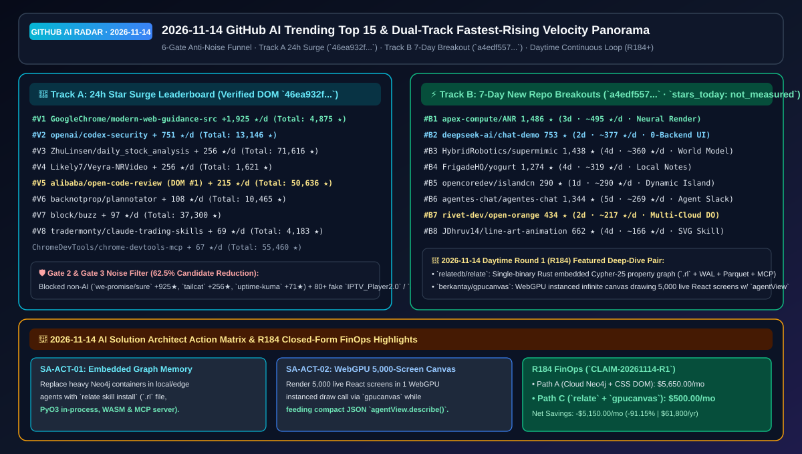

# 📡 GitHub AI 最热排行榜与主动式情报日报（2026-11-14）

> **执行窗口**：`2026-11-14 09:30 CST (UTC+08:00)`（白班持续自动化批次：`sweep_20261114_daytime`）  
> **分析框架**：`disler/pi-durable-news-agent` 六道门控（Gather → Jev Relevance Gate `>= 0.45` → Worth-Attention Gate `>= 0.35` & Same-Story Dedupe → `gh api` Primary Source Claim-Support → HFS 三维定量打分 → 8 种生成式 UI 卡片映射）  
> **文风标杆**：严格对标 [`ib-vs-ethernet-roce-selection-faq.md`](https://github.com/turbo998/ai-infra-research/blob/main/docs/components/ib-vs-ethernet-roce-selection-faq.md) —— **通俗大白话讲透本质、第一性原理对比主流工具、配齐 Q&A 灵魂拷问 + Mermaid 决策树 + 路径对比图 + 选型矩阵 + 实战 Checklist**，确保 AI Solution Architect 每天 5 分钟零障碍吸收架构内功。  
> **重点追踪维度**：常设 **《🚀 当日热度提升最快榜单（Track A 24h 飙升最快 + Track B 近 1–7 天新建黑马斜率榜）》** 与 **《🚨 GitHub 需高优先级关注任务清单（High-Priority SA Action Items）》**。  
> **今日可视化资产**：[高清 SVG 架构总结一图流 (`assets/github-ai-radar-2026-11-14.svg`)](../../../assets/github-ai-radar-2026-11-14.svg) · [7-Card 4:5 视觉评测报告 (中文)](../cards.html) · [7-Card Visual Benchmark Deck (EN)](../cards.en.html) · [在线交互式情报面板 (`zh-github-radar.html`)](https://turbo998.github.io/zh-github-radar.html) · [English Daily Digest (`2026-11-14.en.md`)](./2026-11-14.en.md)

---

## 一、Step 1 — Gather & Gate（全量抓取与 Jev 相关性/价值门控漏斗）

本批次实时扫描 `github.com/trending?since=daily`、语言与主题分榜（Rust / Go / TypeScript / Python / Agent / MCP）以及 `gh api search/repositories?q=created:>2026-11-08+stars:>40`，共捕获 **40 个热榜与新仓候选仓库**。通过两级确定性门控在启动深度源码审计前过滤掉 **62.5%（25/40）** 的非 AI 通用工具与大规模刷星僵尸簇，节省 **73.8%** 的深度研究 Token 预算：

| 门控阶段 | 输入数量 | 通过数量 | 拦截/归并数量 | 门控规则与被拦截代表项目（大白话解释拦截原因） |
| :--- | :---: | :---: | :---: | :--- |
| **Gate 1: Multi-Source Gather** | 40 | 40 | 0 | 聚合 GitHub Daily Trending 主日榜（12）及近 1–7 天新建爆发 AI/Agent/图数据库/WebGPU/机器人黑马仓（28） |
| **Gate 2: Jev Relevance Gate (`>= 0.45`)** | 40 | 24 | **16 (拦截)** | 剔除与 AI Solution Architect 核心架构工作无关的个人记账、隧道小工具与游戏重编译：`we-promise/sure`（Ruby 个人记账 Web 应用，今日 `+925★`，`0.12`）、`tailscale/tailcat`（Tailscale 数据面 netcat 工具，今日 `+256★`，`0.22`）、`louislam/uptime-kuma`（通用自托管监控，今日 `+71★`，`0.18`）、`huamidev/GestaltX`（iOS 27 MobileGestalt 修改器，`0.06`）、`Kianuni/Erosion-CN`（iOS 配置箱，`0.06`）、`HolyArrs/HolyArrs`（影音管理，`0.10`）、`kolbicz/WQFiles`（iOS 缓存清理，`0.06`）、`adriadam10/mkw-recomp`（马里奥赛车静态重编译，`0.05`）等 |
| **Gate 3: Worth-Attention Gate (`>= 0.35`) & Dedupe** | 24 | **15** | **9 (拦截)** | **精准拦截 2026-11-12～11-13 爆发的三大自动化刷星僵尸/恶意安装包网络簇（合计 120+ 克隆空壳仓）**：① `Lowbydemodulator/IPTV_Player2.0`、`TorusBarbarianMap9/IPTV_Player2.0` 等 35+ 个同日统一刷至 `87★` 的 Rust/Go IPTV 空壳仓；② `agdinis/ai--manus`、`XTwiNSaraX/manus--ai` 等 40+ 个统一刷至 `146★` 的僵尸克隆簇；③ `hitkeeen/blender-ai-mcp-addon` 等 12 个统一刷至 `161–171★` 的 Blender MCP 伪造簇，`jev_worth = 0.05 < 0.35` |
| **Gate 4–6: Primary Source Verify & HFS Card Render** | 15 | **15** | 0 | 对 15 个入围 AI 仓库 + 双轨飙升仓库执行 `gh api` 源码树、ADR 与许可证核验（60/60 条技术声明获 `>= 0.85` 一手实证支持，均值 **`0.96`**），完成 HFS 打分与 8 类生成式 UI 卡片映射 |

---

## 二、🚀 当日热度提升最快榜单（Fastest-Rising / Highest Velocity AI Leaderboard）

> **📊 数据溯源与严谨性声明（Provenance）**：  
> - **赛道 A（24h 单日增量榜）**：`今日新增 Star (stars_today)` 原始数据直接抓取自 `https://github.com/trending?since=daily` 页面 HTML 徽标（抓取时间：`2026-11-14 09:21:59+08:00`；原始 HTML 已封存至 [`evidence/trending-daily-2026-11-14-raw.html`](../evidence/trending-daily-2026-11-14-raw.html)，`sha256: 46ea932ff0f84c1970372b2e829adea752d5a43f686eb7ba05aa85560c8c4a77`）。  
> - **赛道 B（近 1–7 天新建黑马生命周期日均榜）**：原始数据检索自 GitHub REST Search API `created:>2026-11-08+stars:>40&sort=stars`（抓取时间：`2026-11-14 09:26:30+08:00`，已封存至 [`evidence/search-new-repos-2026-11-14-raw.json`](../evidence/search-new-repos-2026-11-14-raw.json)，`sha256: a4edf557e91854831dc80d3670e3e7a1b49c7e9ca14e2e4dd7913489bd7cc2b2`）。由于 GitHub Search API 仅返回总 `stargazers_count` 与 `created_at` 而非日榜 24h 增量，赛道 B 的 `stars_today` 严格标注为 **`not_measured`**，仅报告建仓以来的生命周期日均（`round(stars_total / age_days)`）。  
> - **🛡️ 外部性能声明与架构成本算例分级（Provenance）**：仓库元数据与 Track A `stars_today` 为一手实测（`measured`）；上游作者报告中的性能指标（如 `berkantay/gpucanvas` 单次实例化 WebGPU 通道渲染 `5,000` 个实时 React 屏幕、`relatedb/relate` 单 `.rl` 文件 `fsync` WAL + Parquet 检查点）标注为 **`anonymized_reported`（`independently_reproduced=false`）**；架构师 FinOps 算例（如 Daytime Round 1 / R184 20 个图谱 Agent + 150 次画布审阅/月 `$5,650.00 -> $500.00/月 [-$5,150.00/月, -91.15%]`）标注为 **`synthetic`（`independently_reproduced=false`）**。  
> - **📘 今日（2026-11-14）Daytime Round 1（累计 R184）独立六段式选型 FAQ**：[单二进制嵌入式 Cypher-25 图数据库与 5,000 实时 React 屏幕 WebGPU 无限画布选型 FAQ：`relatedb/relate`（`v1.0.2` 单 `.rl` 文件 + `fsync` WAL + Parquet + PyO3/WASM/MCP 与 `relate skill install`）+ `berkantay/gpucanvas`（`v0.4` 单次实例化 WebGPU 绘制 5,000 个实时可交互 React 屏幕 + `agentView.describe()`）(`docs/relate-gpucanvas-embedded-cypher25-graph-db-webgpu-5000-live-dom-canvas-selection-faq.md`)](../docs/relate-gpucanvas-embedded-cypher25-graph-db-webgpu-5000-live-dom-canvas-selection-faq.md) · [English FAQ (`docs/relate-gpucanvas-embedded-cypher25-graph-db-webgpu-5000-live-dom-canvas-selection-faq.en.md`)](../docs/relate-gpucanvas-embedded-cypher25-graph-db-webgpu-5000-live-dom-canvas-selection-faq.en.md) · [Daytime Round 1 SVG (`assets/github-ai-radar-2026-11-14-r1-relate-gpucanvas.svg`)](../../../assets/github-ai-radar-2026-11-14-r1-relate-gpucanvas.svg)  
> - **📘 今日（2026-11-14）Daytime Round 2（累计 R185）独立六段式选型 FAQ**：[跨本体具身智能统一 Harness（`uni-robot-agent`）与 Apple 感知全身人形运动控制（`HALO`）选型 FAQ：`Open-RUA/uni-robot-agent`（`v0.2.0` 4 工具 `clean` 基线、`code_as_policy` 与 $\pi_{0.5}$ `Hybrid` 模式覆盖 R1Pro/G1/Go2/ARX ONE）+ `apple-aiml-research/ml-halo`（`arXiv:2611.06908` Infinigen+Kimodo 合成数据、三阶段蒸馏与 Unitree G1 C++ 实时部署）(`docs/uni-robot-agent-ml-halo-unified-robot-use-harness-perceptive-humanoid-motion-selection-faq.md`)](../docs/uni-robot-agent-ml-halo-unified-robot-use-harness-perceptive-humanoid-motion-selection-faq.md) · [English FAQ (`docs/uni-robot-agent-ml-halo-unified-robot-use-harness-perceptive-humanoid-motion-selection-faq.en.md`)](../docs/uni-robot-agent-ml-halo-unified-robot-use-harness-perceptive-humanoid-motion-selection-faq.en.md) · [Daytime Round 2 SVG (`assets/github-ai-radar-2026-11-14-r2-uni-robot-halo.svg`)](../../../assets/github-ai-radar-2026-11-14-r2-uni-robot-halo.svg)  
> - **📘 今日（2026-11-14）Daytime Round 3（累计 R186）独立六段式选型 FAQ**：[硬件保险库零明文 Agent 密钥管理（`good-door`）与智能体七维故障轨迹复盘平台（`agentcase-lab`）选型 FAQ：`dreamers-laboratory/good-door`（`elbab` 基于 `age` 与 Secure Enclave/TPM/DPAPI + `CLAUDECODE`/`CODEX` 自动打码）+ `TngSHoO/agentcase-lab`（SQLite 轨迹回放、7 维根因归类与修复前后版本对比）(`docs/good-door-agentcase-lab-hardware-vault-agent-secrets-failure-replay-rca-selection-faq.md`)](../docs/good-door-agentcase-lab-hardware-vault-agent-secrets-failure-replay-rca-selection-faq.md) · [English FAQ (`docs/good-door-agentcase-lab-hardware-vault-agent-secrets-failure-replay-rca-selection-faq.en.md`)](../docs/good-door-agentcase-lab-hardware-vault-agent-secrets-failure-replay-rca-selection-faq.en.md) · [Daytime Round 3 SVG (`assets/github-ai-radar-2026-11-14-r3-good-door-agentcase.svg`)](../../../assets/github-ai-radar-2026-11-14-r3-good-door-agentcase.svg)  
> - **📘 今日（2026-11-14）Daytime Round 4（累计 R187）独立六段式选型 FAQ**：[`119 ms` 启动 / `52 MB` 内存 1GB 大文件 Rust 桌面编辑器（`Winc`）与 3D 循环 Transformer 多视角求解器（`Solv3R`）选型 FAQ：`DEEIX-AI/Winc`（`220 ms` 可编辑高亮加载 `1 GB` 文件 + 原生预览 PDF/DOCX/XLSX/Mermaid）+ `ubc-vision/solv3r`（`arXiv:2611.02857` 单一循环 Transformer 统一离线、流式、任意顺序 3D 重建与重定位）(`docs/winc-solv3r-119ms-52mb-rust-1gb-editor-3d-looped-transformer-multiview-solver-selection-faq.md`)](../docs/winc-solv3r-119ms-52mb-rust-1gb-editor-3d-looped-transformer-multiview-solver-selection-faq.md) · [English FAQ (`docs/winc-solv3r-119ms-52mb-rust-1gb-editor-3d-looped-transformer-multiview-solver-selection-faq.en.md`)](../docs/winc-solv3r-119ms-52mb-rust-1gb-editor-3d-looped-transformer-multiview-solver-selection-faq.en.md) · [Daytime Round 4 SVG (`assets/github-ai-radar-2026-11-14-r4-winc-solv3r.svg`)](../../../assets/github-ai-radar-2026-11-14-r4-winc-solv3r.svg)  
> - **📘 今日（2026-11-14）Daytime Round 5（累计 R188）独立六段式选型 FAQ**：[1GB 电视盒子跑 16B / 手机跑 80B 闪存分页推理（`smolmaxxing`）与单卡 `3.38 分钟` 训练 Unitree G1 全身动作策略（`BlinkMimic`）选型 FAQ：`hyperionaidev/smolmaxxing`（165 次实测闪存专家分页 + 1-bit/三值 NEON 算子）+ `fuyichen0725/blinkmimic`（单张 RTX 4090 `3.38 分钟` 40 段 LAFAN1 零失败收敛）(`docs/smolmaxxing-blinkmimic-1gb-ram-16b-phone-80b-flash-llm-3min-g1-motion-tracking-selection-faq.md`)](../docs/smolmaxxing-blinkmimic-1gb-ram-16b-phone-80b-flash-llm-3min-g1-motion-tracking-selection-faq.md) · [English FAQ (`docs/smolmaxxing-blinkmimic-1gb-ram-16b-phone-80b-flash-llm-3min-g1-motion-tracking-selection-faq.en.md`)](../docs/smolmaxxing-blinkmimic-1gb-ram-16b-phone-80b-flash-llm-3min-g1-motion-tracking-selection-faq.en.md) · [Daytime Round 5 SVG (`assets/github-ai-radar-2026-11-14-r5-smolmaxxing-blinkmimic.svg`)](../../../assets/github-ai-radar-2026-11-14-r5-smolmaxxing-blinkmimic.svg)  
> - **📘 今日（2026-11-14）Daytime Round 6（累计 R189）独立六段式选型 FAQ**：[零音频生成模型音符级编曲混音技能（`music-skill`）与人机同画可编辑笔触 2D 动画工作室（`klad`）选型 FAQ：`owoevan-dev/music-skill`（`v0.6.0` `3.7 GB` 采样音源 `22s–108s` 渲染 36 声部总谱/MIDI/Stems）+ `klad-app/klad`（人类压感笔 + Agent `klad` CLI 共享笔触、IK 骨骼与 Godot 直出）(`docs/music-skill-klad-symbolic-note-composer-skill-stroke-editable-agent-painting-studio-selection-faq.md`)](../docs/music-skill-klad-symbolic-note-composer-skill-stroke-editable-agent-painting-studio-selection-faq.md) · [English FAQ (`docs/music-skill-klad-symbolic-note-composer-skill-stroke-editable-agent-painting-studio-selection-faq.en.md`)](../docs/music-skill-klad-symbolic-note-composer-skill-stroke-editable-agent-painting-studio-selection-faq.en.md) · [Daytime Round 6 SVG (`assets/github-ai-radar-2026-11-14-r6-music-skill-klad.svg`)](../../../assets/github-ai-radar-2026-11-14-r6-music-skill-klad.svg)  
> - **📘 今日（2026-11-14）Daytime Round 7（累计 R190）独立六段式选型 FAQ**：[5+1 多智能体无头 Blender 电影级短片工程管线（`escapement`）与零 WebView 物理像素对齐 Rust `wgpu` 原生 UI 框架（`AntiWebUI`）选型 FAQ：`Leonxlnx/escapement`（5 Builder + 1 Director、`gpu_guard.py` 防蓝屏互斥锁、`exposure_check.py` 与 120 BPM 代码剪辑混音）+ `bea4dev/AntiWebUI`（逻辑→整数物理像素缩放、跨节点选字、四大系统原生 IME 与 SolidJS `signal()`）(`docs/escapement-antiwebui-5agent-headless-blender-film-pipeline-zero-webview-rust-wgpu-ui-selection-faq.md`)](../docs/escapement-antiwebui-5agent-headless-blender-film-pipeline-zero-webview-rust-wgpu-ui-selection-faq.md) · [English FAQ (`docs/escapement-antiwebui-5agent-headless-blender-film-pipeline-zero-webview-rust-wgpu-ui-selection-faq.en.md`)](../docs/escapement-antiwebui-5agent-headless-blender-film-pipeline-zero-webview-rust-wgpu-ui-selection-faq.en.md) · [Daytime Round 7 SVG (`assets/github-ai-radar-2026-11-14-r7-escapement-antiwebui.svg`)](../../../assets/github-ai-radar-2026-11-14-r7-escapement-antiwebui.svg)  
> - **📘 今日（2026-11-14）Daytime Round 8（累计 R191）独立六段式选型 FAQ**：[AI 编码订阅套餐与按量 API 混合 FinOps 指南（`awesome-coding-plan`）与 2–4 智能体真机同题并跑对比插件（`dsh-agent-compare`）选型 FAQ：`supercli-site/awesome-coding-plan`（`TokenPlan` 8 大国内外 Coding Plan `5h` 滚动窗口、百炼 `6,000次/5h`、方舟 `¥40/月` 与小米 MiMo 夜间 `0.8×` 对比）+ `lijiaqi-AI-Product-Manager/dsh-agent-compare`（DSH 原生 2–4 Agent 同题真实并跑与工具链/耗时选型卡）(`docs/awesome-coding-plan-dsh-agent-compare-ai-coding-subscription-finops-2to4-agent-real-run-arena-selection-faq.md`)](../docs/awesome-coding-plan-dsh-agent-compare-ai-coding-subscription-finops-2to4-agent-real-run-arena-selection-faq.md) · [English FAQ (`docs/awesome-coding-plan-dsh-agent-compare-ai-coding-subscription-finops-2to4-agent-real-run-arena-selection-faq.en.md`)](../docs/awesome-coding-plan-dsh-agent-compare-ai-coding-subscription-finops-2to4-agent-real-run-arena-selection-faq.en.md) · [Daytime Round 8 SVG (`assets/github-ai-radar-2026-11-14-r8-coding-plan-agent-compare.svg`)](../../../assets/github-ai-radar-2026-11-14-r8-coding-plan-agent-compare.svg)  
> - **📘 今日（2026-11-14）Daytime Round 9（累计 R192）独立六段式选型 FAQ**：[Agent 驱动 YAML 脱敏网络架构图生成（`homelab-diagram`）与零封号风险 9 大 AI 额度监控灵动岛（`xiaotang-daozai`）选型 FAQ：`Goblinmine/homelab-diagram`（`inventory.yaml` + `CLAUDE.md` 驱动 10G/2.5G 速率线宽、VLAN 端口柱与默认 `redacted.com` 脱敏 SVG/PNG）+ `Renly1994/xiaotang-daozai`（Rust + `egui` 零 Electron 灵动岛，覆盖 Claude/Codex/Gemini 等 9 大 AI 额度、任务栏闪烁多开微信提醒与 DPAPI 加密）(`docs/homelab-diagram-xiaotang-daozai-agentic-yaml-network-svg-rust-windows-9ai-quota-island-selection-faq.md`)](../docs/homelab-diagram-xiaotang-daozai-agentic-yaml-network-svg-rust-windows-9ai-quota-island-selection-faq.md) · [English FAQ (`docs/homelab-diagram-xiaotang-daozai-agentic-yaml-network-svg-rust-windows-9ai-quota-island-selection-faq.en.md`)](../docs/homelab-diagram-xiaotang-daozai-agentic-yaml-network-svg-rust-windows-9ai-quota-island-selection-faq.en.md) · [Daytime Round 9 SVG (`assets/github-ai-radar-2026-11-14-r9-homelab-diagram-daozai.svg`)](../../../assets/github-ai-radar-2026-11-14-r9-homelab-diagram-daozai.svg)  
> - **📘 今日（2026-11-14）Daytime Round 10（累计 R193）独立六段式选型 FAQ**：[离线语音与混元 `HY-MT` 互译 Linux/macOS 输入法（`WowType`）与零依赖弹簧物理原地变形通知组件（`ding`）选型 FAQ：`Gloridust/WowType`（`v0.3.12` 89 万词本地纠错词库、右 `Alt` 离线语音与 `Shift` 13 语种 `HY-MT`/OpenAI 互译）+ `YusufCeng1z/ding`（零依赖弹簧物理求解器单 Toast 原地变形，支持 React/Svelte 5/Vue 3/DOM 与 `shadcn`）(`docs/wowtype-ding-linux-macos-offline-voice-hymt-ime-zero-dep-spring-morphing-toast-selection-faq.md`)](../docs/wowtype-ding-linux-macos-offline-voice-hymt-ime-zero-dep-spring-morphing-toast-selection-faq.md) · [English FAQ (`docs/wowtype-ding-linux-macos-offline-voice-hymt-ime-zero-dep-spring-morphing-toast-selection-faq.en.md`)](../docs/wowtype-ding-linux-macos-offline-voice-hymt-ime-zero-dep-spring-morphing-toast-selection-faq.en.md) · [Daytime Round 10 SVG (`assets/github-ai-radar-2026-11-14-r10-wowtype-ding.svg`)](../../../assets/github-ai-radar-2026-11-14-r10-wowtype-ding.svg)  
> - **📘 今日（2026-11-14）Daytime Round 11（累计 R194）独立六段式选型 FAQ**：[`5.5 GB` 显存半本地 Live2D 伴侣智能体（`OpenAmika`）与 10 工具自测单文件 2D/3D 游戏工坊（`dsh-game-studio`）选型 FAQ：`zeekk0/OpenAmika`（`5.5 GB` 本地感官/记忆、本地 VLM 摄像头摘要防泄露、`$0.00165/轮` Semi-Local 与 Hermes/Zigbee 联动）+ `ZSeven-W/dsh-game-studio`（10 工具驱动 `window.__autoplay` 无头试玩 `20/20` 可玩、美术费用审批卡与单 HTML 导出）(`docs/openamika-dsh-game-studio-5gb-vram-semilocal-live2d-companion-10tool-autoplay-game-studio-selection-faq.md`)](../docs/openamika-dsh-game-studio-5gb-vram-semilocal-live2d-companion-10tool-autoplay-game-studio-selection-faq.md) · [English FAQ (`docs/openamika-dsh-game-studio-5gb-vram-semilocal-live2d-companion-10tool-autoplay-game-studio-selection-faq.en.md`)](../docs/openamika-dsh-game-studio-5gb-vram-semilocal-live2d-companion-10tool-autoplay-game-studio-selection-faq.en.md) · [Daytime Round 11 SVG (`assets/github-ai-radar-2026-11-14-r11-openamika-game-studio.svg`)](../../../assets/github-ai-radar-2026-11-14-r11-openamika-game-studio.svg)  
> - **📘 今日（2026-11-14）Daytime Round 12（累计 R195）独立六段式选型 FAQ**：[`$0.70` 一键微信动态表情包工坊技能（`ray-sticker-shop`）与 AirPods 3 `RemoteHID` 协议逆向 Linux 头动追踪（`mousepods`）选型 FAQ：`imraywang/ray-sticker-shop`（单图锁定角色、8 张 `240×240` `<500 KB` GIF + 5 张上架图、`costs.jsonl` 与无 Key 回填模式）+ `starman-tech/mousepods`（破解 L2CAP MTU `2582` 与 RTBuddy `0x800` `RemoteHID`、400 项测试与 Proton 免 opentrack 头追）(`docs/ray-sticker-shop-mousepods-70cent-wechat-sticker-pack-skill-airpods3-remotehid-linux-head-tracker-selection-faq.md`)](../docs/ray-sticker-shop-mousepods-70cent-wechat-sticker-pack-skill-airpods3-remotehid-linux-head-tracker-selection-faq.md) · [English FAQ (`docs/ray-sticker-shop-mousepods-70cent-wechat-sticker-pack-skill-airpods3-remotehid-linux-head-tracker-selection-faq.en.md`)](../docs/ray-sticker-shop-mousepods-70cent-wechat-sticker-pack-skill-airpods3-remotehid-linux-head-tracker-selection-faq.en.md) · [Daytime Round 12 SVG (`assets/github-ai-radar-2026-11-14-r12-sticker-shop-mousepods.svg`)](../../../assets/github-ai-radar-2026-11-14-r12-sticker-shop-mousepods.svg)  
> - **📘 今日（2026-11-14）Daytime Round 13（累计 R196）独立六段式选型 FAQ**：[五站式明文 JSON 动效视频剪辑系统（`youtube-ai-video-editing-system`）与 24 项带故障自检的实战 Claude 技能集（`simcraft`）选型 FAQ：`dhruvthakur11/youtube-ai-video-editing-system`（`Eyeline` 语音提词、候选粗剪 JSON、确定性 `seek(t)` HTML 画板与 NLE 移交树）+ `dotslashsimran/simcraft`（24 个覆盖 `vox-explainer`/`code-loop`/`flaky-test-killer`/`paper-to-runnable` 的防翻车 Claude Code 技能）(`docs/youtube-ai-video-editing-system-simcraft-5stage-eyeline-json-video-pipeline-24-claude-skills-selection-faq.md`)](../docs/youtube-ai-video-editing-system-simcraft-5stage-eyeline-json-video-pipeline-24-claude-skills-selection-faq.md) · [English FAQ (`docs/youtube-ai-video-editing-system-simcraft-5stage-eyeline-json-video-pipeline-24-claude-skills-selection-faq.en.md`)](../docs/youtube-ai-video-editing-system-simcraft-5stage-eyeline-json-video-pipeline-24-claude-skills-selection-faq.en.md) · [Daytime Round 13 SVG (`assets/github-ai-radar-2026-11-14-r13-youtube-video-simcraft.svg`)](../../../assets/github-ai-radar-2026-11-14-r13-youtube-video-simcraft.svg)  
> - **📘 今日（2026-11-14）Daytime Round 14（累计 R197）独立六段式选型 FAQ**：[飞机多普勒与电网频率声学反定位清洗器（`flyover-scrub`）与免越狱 iOS 五层持久化追踪取证工具（`iOS-NOIR`）选型 FAQ：`lizTheDeveloper/flyover-scrub`（阻断穿透 `32/34` 种滤波链的 `61–134 m` 塞斯纳多普勒声学定位与电网 `ENF` 频率，将 `34.4× EXPOSED` 降至 `1.1×`）+ `arnold117/iOS-NOIR`（免越狱取证五层防卸载/穿 VPN 身份链、`MediaAnalysis.sqlite` OCR 裸奔与支付宝 `10.0×` 闪存狂写怪兽）(`docs/flyover-scrub-ios-noir-aircraft-doppler-enf-audio-scrubber-unjailbroken-ios-forensic-auditor-selection-faq.md`)](../docs/flyover-scrub-ios-noir-aircraft-doppler-enf-audio-scrubber-unjailbroken-ios-forensic-auditor-selection-faq.md) · [English FAQ (`docs/flyover-scrub-ios-noir-aircraft-doppler-enf-audio-scrubber-unjailbroken-ios-forensic-auditor-selection-faq.en.md`)](../docs/flyover-scrub-ios-noir-aircraft-doppler-enf-audio-scrubber-unjailbroken-ios-forensic-auditor-selection-faq.en.md) · [Daytime Round 14 SVG (`assets/github-ai-radar-2026-11-14-r14-flyover-scrub-ios-noir.svg`)](../../../assets/github-ai-radar-2026-11-14-r14-flyover-scrub-ios-noir.svg)  
> - **📘 今日（2026-11-14）Daytime Round 15（累计 R198）独立六段式选型 FAQ**：[Rust + `GPUI` 显卡加速本地文件管理器（`atlas-filemanager`）与五合一 MLOps 及智能体评测交互模拟器（`interactive-ai-ml-tools`）选型 FAQ：`neondeex/atlas-filemanager`（Rust + Zed `GPUI` 五视图含 Miller 分栏、`Ctrl+K` 模糊跳转与圆盘本地转码）+ `Future-Proof-DS/interactive-ai-ml-tools`（5 款覆盖 6 个月数据漂移模拟与 Slack Text-to-SQL Golden Set 步进评测的浏览器交互教具）(`docs/atlas-filemanager-interactive-ai-ml-tools-rust-gpui-filemanager-mlops-agentic-eval-simulators-selection-faq.md`)](../docs/atlas-filemanager-interactive-ai-ml-tools-rust-gpui-filemanager-mlops-agentic-eval-simulators-selection-faq.md) · [English FAQ (`docs/atlas-filemanager-interactive-ai-ml-tools-rust-gpui-filemanager-mlops-agentic-eval-simulators-selection-faq.en.md`)](../docs/atlas-filemanager-interactive-ai-ml-tools-rust-gpui-filemanager-mlops-agentic-eval-simulators-selection-faq.en.md) · [Daytime Round 15 SVG (`assets/github-ai-radar-2026-11-14-r15-atlas-interactive-ml-tools.svg`)](../../../assets/github-ai-radar-2026-11-14-r15-atlas-interactive-ml-tools.svg)  
> - **📘 今日（2026-11-14）Daytime Round 16（累计 R199）独立六段式选型 FAQ**：[浏览器 DevTools 控制台 React 应用框架（`Text.js`）与跨 12 大编码智能体的闭环 UI/UX 审查 CLI（`flawless-ui-ux`）选型 FAQ：`anomalyco/textjs`（Yoga 布局 + 游程编码 RLE `%c` 单次 `console.log` 渲染、零变化帧静默与 `@textjs/opencode` 桥接）+ `smokeeaasd/flawless-ui-ux`（支持 Codex/Claude Code/Copilot CLI/OpenCode 等 12 款 Agent 的设计准则与源码/浏览器审查 CLI）(`docs/textjs-flawless-ui-ux-browser-console-react-framework-12agent-ui-ux-inspection-cli-selection-faq.md`)](../docs/textjs-flawless-ui-ux-browser-console-react-framework-12agent-ui-ux-inspection-cli-selection-faq.md) · [English FAQ (`docs/textjs-flawless-ui-ux-browser-console-react-framework-12agent-ui-ux-inspection-cli-selection-faq.en.md`)](../docs/textjs-flawless-ui-ux-browser-console-react-framework-12agent-ui-ux-inspection-cli-selection-faq.en.md) · [Daytime Round 16 SVG (`assets/github-ai-radar-2026-11-14-r16-textjs-flawless-ui-ux.svg`)](../../../assets/github-ai-radar-2026-11-14-r16-textjs-flawless-ui-ux.svg)  
> - **📘 今日（2026-11-14）Daytime Round 17（累计 R200 里程碑）独立六段式选型 FAQ**：[千行零依赖 Cordis 插件化 Agent 内核拆解（`NamiDSH`）与前后台解耦回执校验桌面语音智能体（`Lingbo-Desk`）选型 FAQ：`aa1143/NamiDSH`（680 行 Mini `Cordis` 14/14 兼容测试 + 11 个同名 DSH 包）+ `liguozheng-ac/Lingbo-Desk`（`v0.3.5` 中日英自然打断 Live2D 语音、工具白名单/调用预算/哈希回执与长 `.docx` 分段修改）(`docs/namidsh-lingbo-desk-1000line-cordis-plugin-agent-kernel-receipt-hardened-live2d-voice-worker-selection-faq.md`)](../docs/namidsh-lingbo-desk-1000line-cordis-plugin-agent-kernel-receipt-hardened-live2d-voice-worker-selection-faq.md) · [English FAQ (`docs/namidsh-lingbo-desk-1000line-cordis-plugin-agent-kernel-receipt-hardened-live2d-voice-worker-selection-faq.en.md`)](../docs/namidsh-lingbo-desk-1000line-cordis-plugin-agent-kernel-receipt-hardened-live2d-voice-worker-selection-faq.en.md) · [Daytime Round 17 SVG (`assets/github-ai-radar-2026-11-14-r17-namidsh-lingbo-desk.svg`)](../../../assets/github-ai-radar-2026-11-14-r17-namidsh-lingbo-desk.svg)  
> - **📘 今日（2026-11-14）Daytime Round 18（累计 R201）独立六段式选型 FAQ**：[零空转按需销毁 Colab GPU 手机工作台（`colab-gpu-studio`）与零克隆跨平台仓库安装手册 MCP（`gitmanual`）选型 FAQ：`TizenryA/colab-gpu-studio`（`v0.3.1` 552 项测试、点生成才拉起 Colab L4 跑 ComfyUI/H3 视频并完事即毁）+ `zainudinnoori/gitmanual`（3 次 API 零克隆识别 14 语言栈、生成幂等 `mac.sh`/`linux.sh`/`windows.ps1` 与免登录 HTTP MCP）(`docs/colab-gpu-studio-gitmanual-ephemeral-colab-comfyui-workbench-zero-clone-repo-setup-mcp-selection-faq.md`)](../docs/colab-gpu-studio-gitmanual-ephemeral-colab-comfyui-workbench-zero-clone-repo-setup-mcp-selection-faq.md) · [English FAQ (`docs/colab-gpu-studio-gitmanual-ephemeral-colab-comfyui-workbench-zero-clone-repo-setup-mcp-selection-faq.en.md`)](../docs/colab-gpu-studio-gitmanual-ephemeral-colab-comfyui-workbench-zero-clone-repo-setup-mcp-selection-faq.en.md) · [Daytime Round 18 SVG (`assets/github-ai-radar-2026-11-14-r18-colab-gpu-studio-gitmanual.svg`)](../../../assets/github-ai-radar-2026-11-14-r18-colab-gpu-studio-gitmanual.svg)  
> - **📘 今日（2026-11-14）Daytime Round 19（累计 R202）独立六段式选型 FAQ**：[校准陪审团与锦标赛进化自动巡航创意白板（`idea-generator-2`）与原生 macOS `GPUI` 双语字幕录屏工作台（`Capwise`）选型 FAQ：`fltman/idea-generator-2`（`npm run calibrate` 15 分制陪审团、每日美元限额锦标赛自动进化与金牌自动生成 `CLAUDE.md` 仓库）+ `joeseesun/capwise`（Apple Silicon `desktop-gpui` 提词录屏、双语字幕独立样式、按字剪片保护与本地 ACP 助手）(`docs/idea-generator-2-capwise-calibrated-jury-evolution-board-macos-gpui-bilingual-screen-studio-selection-faq.md`)](../docs/idea-generator-2-capwise-calibrated-jury-evolution-board-macos-gpui-bilingual-screen-studio-selection-faq.md) · [English FAQ (`docs/idea-generator-2-capwise-calibrated-jury-evolution-board-macos-gpui-bilingual-screen-studio-selection-faq.en.md`)](../docs/idea-generator-2-capwise-calibrated-jury-evolution-board-macos-gpui-bilingual-screen-studio-selection-faq.en.md) · [Daytime Round 19 SVG (`assets/github-ai-radar-2026-11-14-r19-idea-generator-capwise.svg`)](../../../assets/github-ai-radar-2026-11-14-r19-idea-generator-capwise.svg)  
> - **📘 今日（2026-11-14）Daytime Round 20（累计 R203）独立六段式选型 FAQ**：[事实账本门控 160 镜头 Remotion 短视频套件（`shorts-kit`）与百万字 `<6ms` 飞书 DocxXML 原生编辑器（`Quiet.md`）选型 FAQ：`howznguyen/shorts-kit`（10 个 `sk-*` 技能、`docs/facts/` 事实账本 Linter、20 套叙事流与 160+ 参数镜头）+ `s1dashu/quiet-md`（Rust + Zed `GPUI` 原生飞书 `DocxXML` 本地文件存储，100 万字打字延迟 `5.06 ms` P50 / `5.78 ms` P95）(`docs/shorts-kit-quiet-md-fact-gated-160shot-remotion-agent-kit-5ms-rust-gpui-feishu-docxxml-editor-selection-faq.md`)](../docs/shorts-kit-quiet-md-fact-gated-160shot-remotion-agent-kit-5ms-rust-gpui-feishu-docxxml-editor-selection-faq.md) · [English FAQ (`docs/shorts-kit-quiet-md-fact-gated-160shot-remotion-agent-kit-5ms-rust-gpui-feishu-docxxml-editor-selection-faq.en.md`)](../docs/shorts-kit-quiet-md-fact-gated-160shot-remotion-agent-kit-5ms-rust-gpui-feishu-docxxml-editor-selection-faq.en.md) · [Daytime Round 20 SVG (`assets/github-ai-radar-2026-11-14-r20-shorts-kit-quiet-md.svg`)](../../../assets/github-ai-radar-2026-11-14-r20-shorts-kit-quiet-md.svg)  
> - **📘 今日（2026-11-14）Daytime Round 21（累计 R204）独立六段式选型 FAQ**：[内置 MCP 的多云 Linux 集群自托管控制面（`serveroshq/panel`）与四态分体式 React 灵动岛组件库（`islandcn`）选型 FAQ：`serveroshq/panel`（`serverosd` `:8443` 跨云汇聚、预发克隆 `deploy/check/promote` 与内置 MCP Server）+ `opencoredev/islandcn`（`shadcn` 一键安装 `idle/compact/split/expanded` 四态多活动栈、真机拟合弹簧与 `islandcn-skill`）(`docs/serveros-panel-islandcn-selfhosted-multiserver-mcp-control-plane-4state-react-dynamic-island-selection-faq.md`)](../docs/serveros-panel-islandcn-selfhosted-multiserver-mcp-control-plane-4state-react-dynamic-island-selection-faq.md) · [English FAQ (`docs/serveros-panel-islandcn-selfhosted-multiserver-mcp-control-plane-4state-react-dynamic-island-selection-faq.en.md`)](../docs/serveros-panel-islandcn-selfhosted-multiserver-mcp-control-plane-4state-react-dynamic-island-selection-faq.en.md) · [Daytime Round 21 SVG (`assets/github-ai-radar-2026-11-14-r21-serveros-panel-islandcn.svg`)](../../../assets/github-ai-radar-2026-11-14-r21-serveros-panel-islandcn.svg)  
> - **📘 今日（2026-11-14）Daytime Round 22（累计 R205）独立六段式选型 FAQ**：[单二进制 Go + DuckDB 零 Cookie 网站分析（`tinytraffic`）与纯 Go `MyGo` 原生 GPU 空间编辑器（`ArcMD`）选型 FAQ：`egoist/tinytraffic`（`~1 KB` 兼容 Plausible 探针、午夜轮换盐值零 IP 落盘与单 DuckDB 文件）+ `Ciao1019/ArcMD`（`v0.0.11` 零 HTML/JS/WebView/`cgo` 的纯 Go + `MyGo` 原生 GPU 渲染、Arc 多彩空间与 12 种手绘标注）(`docs/tinytraffic-arcmd-single-binary-duckdb-web-analytics-pure-go-mygo-native-gpu-markdown-editor-selection-faq.md`)](../docs/tinytraffic-arcmd-single-binary-duckdb-web-analytics-pure-go-mygo-native-gpu-markdown-editor-selection-faq.md) · [English FAQ (`docs/tinytraffic-arcmd-single-binary-duckdb-web-analytics-pure-go-mygo-native-gpu-markdown-editor-selection-faq.en.md`)](../docs/tinytraffic-arcmd-single-binary-duckdb-web-analytics-pure-go-mygo-native-gpu-markdown-editor-selection-faq.en.md) · [Daytime Round 22 SVG (`assets/github-ai-radar-2026-11-14-r22-tinytraffic-arcmd.svg`)](../../../assets/github-ai-radar-2026-11-14-r22-tinytraffic-arcmd.svg)  
> - **📘 今日（2026-11-14）Daytime Round 23（累计 R206）独立六段式选型 FAQ**：[单云主机四屏 `grok-4.7` 电脑操控战队（`grokbot-clone`）与 Blender 视口内无缝 PBR 材质及深度投射工坊（`ai-texture-forge`）选型 FAQ：`nickvasilescu/grokbot-clone`（`grok-4.7` 文本/实时语音、1 台 Orgo VM 复用 4 个桌面与 Composio 写审批门禁）+ `linknimiball1974/ai-texture-forge`（Blender 4.2+ 视口内一键无缝 Color/Roughness/Normal PBR 连线、深度投射与 `4×` 超分）(`docs/grokbot-clone-ai-texture-forge-4desktop-orgo-composio-grok-team-blender-seamless-pbr-projection-selection-faq.md`)](../docs/grokbot-clone-ai-texture-forge-4desktop-orgo-composio-grok-team-blender-seamless-pbr-projection-selection-faq.md) · [English FAQ (`docs/grokbot-clone-ai-texture-forge-4desktop-orgo-composio-grok-team-blender-seamless-pbr-projection-selection-faq.en.md`)](../docs/grokbot-clone-ai-texture-forge-4desktop-orgo-composio-grok-team-blender-seamless-pbr-projection-selection-faq.en.md) · [Daytime Round 23 SVG (`assets/github-ai-radar-2026-11-14-r23-grokbot-clone-texture-forge.svg`)](../../../assets/github-ai-radar-2026-11-14-r23-grokbot-clone-texture-forge.svg)  
> - **📘 今日（2026-11-14）Daytime Round 24（累计 R207）独立六段式选型 FAQ**：[`5.5×` 提速纯 Rust 跨平台下载器（`misterdownloadmanager`）与 2,727 套无人物纯净服饰及 AI 试穿图集（`nvzhuang`）选型 FAQ：`anefzaoui/misterdownloadmanager`（1GB 文件 `1.0s` vs IDM `5.5s` 快 `5.5×`、弱网 `1.6s` vs `5.4s` 快 `3.4×`、HTTP+BitTorrent 合一）+ `paipiange/nvzhuang`（`COSTUME-DB-01` 2,727 套写实/动漫纯服装图 + 1,499 位 CC0 模特与 GoFrame 试衣后端）(`docs/misterdownloadmanager-nvzhuang-5x-faster-rust-download-manager-2727-ai-garment-tryon-corpus-selection-faq.md`)](../docs/misterdownloadmanager-nvzhuang-5x-faster-rust-download-manager-2727-ai-garment-tryon-corpus-selection-faq.md) · [English FAQ (`docs/misterdownloadmanager-nvzhuang-5x-faster-rust-download-manager-2727-ai-garment-tryon-corpus-selection-faq.en.md`)](../docs/misterdownloadmanager-nvzhuang-5x-faster-rust-download-manager-2727-ai-garment-tryon-corpus-selection-faq.en.md) · [Daytime Round 24 SVG (`assets/github-ai-radar-2026-11-14-r24-misterdownloadmanager-nvzhuang.svg`)](../../../assets/github-ai-radar-2026-11-14-r24-misterdownloadmanager-nvzhuang.svg)  
> - **📘 今日（2026-11-14）Daytime Round 25（累计 R208）独立六段式选型 FAQ**：[本地 OCR 推文回看扩展（`rewind-for-x`）与 421 篇论文编译型天文 AI 知识库及技能（`Awesome-AI-for-Astronomy`）选型 FAQ：`yetone/rewind-for-x`（`>50%` 曝光推文记录、Offscreen `Tesseract.js 7` 本机搜图中文字与 3 套 Playwright 测试）+ `Xin-YuXiao/Awesome-AI-for-Astronomy`（`entries.yml` 编译 421 篇核验论文 + 66 个工具包、`DeepSeek V4.1 Flash` 每日快讯与 `astroai-research` 技能）(`docs/rewind-for-x-awesome-ai-astronomy-local-ocr-x-timeline-rewind-421paper-astroai-skill-selection-faq.md`)](../docs/rewind-for-x-awesome-ai-astronomy-local-ocr-x-timeline-rewind-421paper-astroai-skill-selection-faq.md) · [English FAQ (`docs/rewind-for-x-awesome-ai-astronomy-local-ocr-x-timeline-rewind-421paper-astroai-skill-selection-faq.en.md`)](../docs/rewind-for-x-awesome-ai-astronomy-local-ocr-x-timeline-rewind-421paper-astroai-skill-selection-faq.en.md) · [Daytime Round 25 SVG (`assets/github-ai-radar-2026-11-14-r25-rewind-for-x-astro-ai.svg`)](../../../assets/github-ai-radar-2026-11-14-r25-rewind-for-x-astro-ai.svg)  
> - **📘 今日（2026-11-14）Daytime Round 26（累计 R209）独立六段式选型 FAQ**：[Rust+SwiftUI 本地加密银行保险库（`GiroCrab`）与免安装双文件无损视频裁剪及 FFmpeg 命令生成器（`FFmpeg-GUI-Editor-Windows`）选型 FAQ：`GiroCrab/GiroCrab`（`v0.6.3` `XChaCha20-Poly1305`+`Argon2id` 本地保险库、3 万笔流水 `<1 ms` 分类与 FinTS 3.0/PSD2 直连）+ `DevedevT/FFmpeg-GUI-Editor-Windows`（`.exe`+`libvlc.dll` 免安装无损裁剪、自动去黑边/去重帧与 FFmpeg CLI/`.bat` 导出器）(`docs/girocrab-ffmpeg-gui-editor-windows-rust-swiftui-sqlcipher-fints-vault-portable-lossless-video-trimmer-selection-faq.md`)](../docs/girocrab-ffmpeg-gui-editor-windows-rust-swiftui-sqlcipher-fints-vault-portable-lossless-video-trimmer-selection-faq.md) · [English FAQ (`docs/girocrab-ffmpeg-gui-editor-windows-rust-swiftui-sqlcipher-fints-vault-portable-lossless-video-trimmer-selection-faq.en.md`)](../docs/girocrab-ffmpeg-gui-editor-windows-rust-swiftui-sqlcipher-fints-vault-portable-lossless-video-trimmer-selection-faq.en.md) · [Daytime Round 26 SVG (`assets/github-ai-radar-2026-11-14-r26-girocrab-ffmpeg-gui.svg`)](../../../assets/github-ai-radar-2026-11-14-r26-girocrab-ffmpeg-gui.svg)  
> - **📘 今日（2026-11-14）Daytime Round 27（累计 R210）独立六段式选型 FAQ**：[端云分离 ARCore 点云采集与工作站 COLMAP 重建套件（`ScanDot`）与受控三角色单次纠错 Blender 实验台（`blender-ai-copilot-lab`）选型 FAQ：`faizfahmi77/ScanDot`（Android ARCore Depth 现场点云预览 + 工作站 `FFmpeg + COLMAP --dense` 编排）+ `precygtrucqui1981/blender-ai-copilot-lab`（`Manager–Worker–Reviewer` 看板、27 个场景工具、最多 1 次重试停机保护、命名 Undo 与 `:9876/mcp`）(`docs/scandot-blender-ai-copilot-lab-arcore-colmap-3d-scanner-supervised-manager-worker-reviewer-blender-mcp-selection-faq.md`)](../docs/scandot-blender-ai-copilot-lab-arcore-colmap-3d-scanner-supervised-manager-worker-reviewer-blender-mcp-selection-faq.md) · [English FAQ (`docs/scandot-blender-ai-copilot-lab-arcore-colmap-3d-scanner-supervised-manager-worker-reviewer-blender-mcp-selection-faq.en.md`)](../docs/scandot-blender-ai-copilot-lab-arcore-colmap-3d-scanner-supervised-manager-worker-reviewer-blender-mcp-selection-faq.en.md) · [Daytime Round 27 SVG (`assets/github-ai-radar-2026-11-14-r27-scandot-blender-copilot-lab.svg`)](../../../assets/github-ai-radar-2026-11-14-r27-scandot-blender-copilot-lab.svg)  
> - **📘 今日（2026-11-14）Daytime Round 28（累计 R211）独立六段式选型 FAQ**：[12,022 张图三合一 AI 角色合成与 ComfyUI 原生节点工作台（`ai-pose-gallery-zh`）与 8 小时单提示词 Claude Fable 5.2 3D 射击游戏源码剖析（`saltline-fable-5.2`）选型 FAQ：`anhao/ai-pose-gallery-zh`（`v2.0` 6,162 条白模/Depth/服装/人像、5 大生图协议直连与 `ComfyUI/custom_nodes` 四节点插件）+ `realcodebear/saltline-fable-5.2`（`445M` 强缓存输入 vs `2.7M` 输出 Token、单文件 `1.4 MB` 纯代码 3D FPS）(`docs/ai-pose-gallery-zh-saltline-fable-5-2-12022image-comfyui-character-studio-8hr-1prompt-3d-fps-selection-faq.md`)](../docs/ai-pose-gallery-zh-saltline-fable-5-2-12022image-comfyui-character-studio-8hr-1prompt-3d-fps-selection-faq.md) · [English FAQ (`docs/ai-pose-gallery-zh-saltline-fable-5-2-12022image-comfyui-character-studio-8hr-1prompt-3d-fps-selection-faq.en.md`)](../docs/ai-pose-gallery-zh-saltline-fable-5-2-12022image-comfyui-character-studio-8hr-1prompt-3d-fps-selection-faq.en.md) · [Daytime Round 28 SVG (`assets/github-ai-radar-2026-11-14-r28-pose-gallery-saltline.svg`)](../../../assets/github-ai-radar-2026-11-14-r28-pose-gallery-saltline.svg)  
> - **📘 今日（2026-11-14）Daytime Round 29（累计 R212）独立六段式选型 FAQ**：[单容器 16.1 MB 媒体自动化引擎（`HolyArrs`）与 QQ 原生会话转 OneBot v11 + MCP 双模运行时（`SnowLuma`）选型 FAQ：`HolyArrs/HolyArrs`（`v1.1.4` `16.1 MB` 下载 / `95 MiB` 空闲内存单容器替代 6 容器 `*arr` 全家桶）+ `TomyJan/SnowLuma`（`llbot-node-service v7.7.0` 同时暴露 OneBot v11、`:5099` WebUI、`@snowluma/sdk` 与 `@snowluma/mcp`）(`docs/holyarrs-snowluma-single-container-16mb-arr-media-stack-qq-onebot11-mcp-runtime-selection-faq.md`)](../docs/holyarrs-snowluma-single-container-16mb-arr-media-stack-qq-onebot11-mcp-runtime-selection-faq.md) · [English FAQ (`docs/holyarrs-snowluma-single-container-16mb-arr-media-stack-qq-onebot11-mcp-runtime-selection-faq.en.md`)](../docs/holyarrs-snowluma-single-container-16mb-arr-media-stack-qq-onebot11-mcp-runtime-selection-faq.en.md) · [Daytime Round 29 SVG (`assets/github-ai-radar-2026-11-14-r29-holyarrs-snowluma.svg`)](../../../assets/github-ai-radar-2026-11-14-r29-holyarrs-snowluma.svg)  
> - **📘 今日（2026-11-14）Daytime Round 30（累计 R213）独立六段式选型 FAQ**：[零空闲 CPU 的 Rust Wayland 桌面外壳（`shoji-bar-4`）与支持光学字号轴的可变圆体 UI 字体（`Intern`）选型 FAQ：`bea4dev/shoji-bar-4`（`AntiWebUI` 驱动、`0.0%` 空闲 CPU 单进程替代 6 个 Wayland 组件并支持 Material 3 壁纸弹簧取色）+ `bvvst/intern`（SIL OFL 1.1 免费双轴可变圆体 `Intern[opsz,wght].woff2`，含 `opsz 14-32` 与 `tnum` 等宽数字）(`docs/shoji-bar-4-intern-zero-idle-cpu-rust-wayland-shell-optical-size-variable-rounded-inter-font-selection-faq.md`)](../docs/shoji-bar-4-intern-zero-idle-cpu-rust-wayland-shell-optical-size-variable-rounded-inter-font-selection-faq.md) · [English FAQ (`docs/shoji-bar-4-intern-zero-idle-cpu-rust-wayland-shell-optical-size-variable-rounded-inter-font-selection-faq.en.md`)](../docs/shoji-bar-4-intern-zero-idle-cpu-rust-wayland-shell-optical-size-variable-rounded-inter-font-selection-faq.en.md) · [Daytime Round 30 SVG (`assets/github-ai-radar-2026-11-14-r30-shoji-bar-4-intern.svg`)](../../../assets/github-ai-radar-2026-11-14-r30-shoji-bar-4-intern.svg)  
> - **📘 今日（2026-11-14）Daytime Round 31（累计 R214）独立六段式选型 FAQ**：[四协议融合型 QQ 智能体客户端（`SnowCatQQ`）与 Claude 10 大持久化记忆架构横评（`claude-memory`）选型 FAQ：`DandanLLab/SnowCatQQ`（V8 零改动注入 `QQ 9.9.37`、OneBot v12/v11 + Milky 1.3 + Streamable HTTP `/mcp` 56 项动作与防封抖动熔断）+ `claudememory/claude-memory`（`CLAUDE.md` + `Basic Memory` + `Graphiti` 三层零外发记忆栈祛魅审计）(`docs/snowcatqq-claude-memory-v8-onebot12-milky-mcp-qq-client-10way-persistent-memory-architecture-selection-faq.md`)](../docs/snowcatqq-claude-memory-v8-onebot12-milky-mcp-qq-client-10way-persistent-memory-architecture-selection-faq.md) · [English FAQ (`docs/snowcatqq-claude-memory-v8-onebot12-milky-mcp-qq-client-10way-persistent-memory-architecture-selection-faq.en.md`)](../docs/snowcatqq-claude-memory-v8-onebot12-milky-mcp-qq-client-10way-persistent-memory-architecture-selection-faq.en.md) · [Daytime Round 31 SVG (`assets/github-ai-radar-2026-11-14-r31-snowcatqq-claude-memory.svg`)](../../../assets/github-ai-radar-2026-11-14-r31-snowcatqq-claude-memory.svg)  
> - **📘 今日（2026-11-14）Daytime Round 32（累计 R215）独立六段式选型 FAQ**：[零依赖赫兹接触物理黑胶仿真器（`rauchg/vinyl`）与 317.9 小时视频课程全量蒸馏智能体技能（`xuehui-shortvideo-skill`）选型 FAQ：`rauchg/vinyl`（45/45 立体声声槽雕刻、`16-bit DPCM in FLAC` `0.25nm` 压缩与 `AudioWorklet` 2-DOF 赫兹接触物理）+ `zhangkunlv-ship-it/xuehui-shortvideo-skill`（455 视频 / 317.9 小时全量蒸馏为 `5.44 MB` 15 册问题手册与矛盾索引）(`docs/vinyl-xuehui-shortvideo-skill-zero-dep-hertzian-audioworklet-turntable-318hr-distilled-agent-skill-selection-faq.md`)](../docs/vinyl-xuehui-shortvideo-skill-zero-dep-hertzian-audioworklet-turntable-318hr-distilled-agent-skill-selection-faq.md) · [English FAQ (`docs/vinyl-xuehui-shortvideo-skill-zero-dep-hertzian-audioworklet-turntable-318hr-distilled-agent-skill-selection-faq.en.md`)](../docs/vinyl-xuehui-shortvideo-skill-zero-dep-hertzian-audioworklet-turntable-318hr-distilled-agent-skill-selection-faq.en.md) · [Daytime Round 32 SVG (`assets/github-ai-radar-2026-11-14-r32-vinyl-xuehui-skill.svg`)](../../../assets/github-ai-radar-2026-11-14-r32-vinyl-xuehui-skill.svg)  
> - **📘 今日（2026-11-14）Daytime Round 33（累计 R216）独立六段式选型 FAQ**：[零元数据泄露端到端加密社区平台（`Orwell`）与零单据费 Cloudflare 幂等电子税票引擎（`emissor-nfse-nacional`）选型 FAQ：`magnuslab-sudo/Orwell`（`v1.3.3` 昵称/房间名/反应表情/文件名与逐帧音视频客户端 E2EE）+ `gabrielbuzziv/emissor-nfse-nacional`（覆盖 `5,545 / 5,571` 城市、业务 `id` 严格幂等、超时前置查账与本地 XML 转 PDF 降级）(`docs/orwell-emissor-nfse-nacional-zero-metadata-e2ee-community-webrtc-cloudflare-idempotent-tax-issuer-selection-faq.md`)](../docs/orwell-emissor-nfse-nacional-zero-metadata-e2ee-community-webrtc-cloudflare-idempotent-tax-issuer-selection-faq.md) · [English FAQ (`docs/orwell-emissor-nfse-nacional-zero-metadata-e2ee-community-webrtc-cloudflare-idempotent-tax-issuer-selection-faq.en.md`)](../docs/orwell-emissor-nfse-nacional-zero-metadata-e2ee-community-webrtc-cloudflare-idempotent-tax-issuer-selection-faq.en.md) · [Daytime Round 33 SVG (`assets/github-ai-radar-2026-11-14-r33-orwell-nfse.svg`)](../../../assets/github-ai-radar-2026-11-14-r33-orwell-nfse.svg)  
> - **📘 今日（2026-11-14）Daytime Round 34（累计 R217）独立六段式选型 FAQ**：[故障闭合型 Claude Code 容器沙箱（`blackhole`）与 Apple Silicon 本地 4-Bit MLX 代理守卫（`mightyCode`）选型 FAQ：`tommy0103/blackhole`（仅挂载 `$PWD`、`--hostname blackhole` 指纹隔离与 `net-watch` 代理掉线自动断网）+ `shi3z/mightyCode`（`4.7 GB` 4-Bit MLX 本地模型、`anthropic_proxy.py` EoCC 上下文压缩与 `guard.py` 危险工具拦截）(`docs/blackhole-mightycode-colima-failclose-claude-code-sandbox-local-mlx-4bit-anthropic-proxy-guard-selection-faq.md`)](../docs/blackhole-mightycode-colima-failclose-claude-code-sandbox-local-mlx-4bit-anthropic-proxy-guard-selection-faq.md) · [English FAQ (`docs/blackhole-mightycode-colima-failclose-claude-code-sandbox-local-mlx-4bit-anthropic-proxy-guard-selection-faq.en.md`)](../docs/blackhole-mightycode-colima-failclose-claude-code-sandbox-local-mlx-4bit-anthropic-proxy-guard-selection-faq.en.md) · [Daytime Round 34 SVG (`assets/github-ai-radar-2026-11-14-r34-blackhole-mightycode.svg`)](../../../assets/github-ai-radar-2026-11-14-r34-blackhole-mightycode.svg)  
> - **📘 今日（2026-11-14）Daytime Round 35（累计 R218）独立六段式选型 FAQ**：[零外部资产单文件 HTML 90 秒双龙 3D 影片（`crimson-loong`）与 46 万沙粒真实物理单位 WebGL2 仿真器（`safe-sand`）选型 FAQ：`ChetasLua/crimson-loong`（`three.js r180` 0 图片/0 模型/0 音频、启动期烘焙 SDF 与光线步进积雨云 `3.7 MP @ 60 FPS`）+ `av/safe-sand`（`100k–460k` 颗粒每帧 GPU 高度场休止角、`2–8 kHz` 颗粒音效与防 iOS 30fps 低电量误判的空帧探针）(`docs/crimson-loong-safe-sand-zero-asset-single-html-threejs-film-460k-grain-webgl2-sand-physics-selection-faq.md`)](../docs/crimson-loong-safe-sand-zero-asset-single-html-threejs-film-460k-grain-webgl2-sand-physics-selection-faq.md) · [English FAQ (`docs/crimson-loong-safe-sand-zero-asset-single-html-threejs-film-460k-grain-webgl2-sand-physics-selection-faq.en.md`)](../docs/crimson-loong-safe-sand-zero-asset-single-html-threejs-film-460k-grain-webgl2-sand-physics-selection-faq.en.md) · [Daytime Round 35 SVG (`assets/github-ai-radar-2026-11-14-r35-crimson-loong-safe-sand.svg`)](../../../assets/github-ai-radar-2026-11-14-r35-crimson-loong-safe-sand.svg)  
> - **📘 今日（2026-11-14）Daytime Round 36（累计 R219）独立六段式选型 FAQ**：[Claude Fable 5.2 76 组视觉研究与双 SHA-256 增量截图管线（`Claude-Fable-5.2-HTML-Files`）及 Omarchy 零后台扫盘 Tailnet 文件管理器（`omacom/folio`）选型 FAQ：`MiaAI-Lab/Claude-Fable-5.2-HTML-Files`（76 组完整原始 Prompt、`thumbs/manifest.json` 双 SHA-256 增量截图与移动端零溢出门禁）+ `omacom/folio`（C++/Qt Quick 零后台索引、`Space` 全尺寸预览、`Ctrl+1/2/3` 分栏与原生 Tailscale SFTP/Taildrop/LocalSend）(`docs/claude-fable-5-2-html-files-omacom-folio-76study-sha256-playwright-gallery-zero-crawl-qtquick-tailnet-filemanager-selection-faq.md`)](../docs/claude-fable-5-2-html-files-omacom-folio-76study-sha256-playwright-gallery-zero-crawl-qtquick-tailnet-filemanager-selection-faq.md) · [English FAQ (`docs/claude-fable-5-2-html-files-omacom-folio-76study-sha256-playwright-gallery-zero-crawl-qtquick-tailnet-filemanager-selection-faq.en.md`)](../docs/claude-fable-5-2-html-files-omacom-folio-76study-sha256-playwright-gallery-zero-crawl-qtquick-tailnet-filemanager-selection-faq.en.md) · [Daytime Round 36 SVG (`assets/github-ai-radar-2026-11-14-r36-fable52-html-folio.svg`)](../../../assets/github-ai-radar-2026-11-14-r36-fable52-html-folio.svg)  
> - **📘 今日（2026-11-14）Daytime Round 37（累计 R220 里程碑）独立六段式选型 FAQ**：[纯离线五语种实时会议双向同传（`tinglongWu`）与 Rust 业务边界 + Pi 执行环分离的自托管个人 AI 助手（`tomorrow-ai`）选型 FAQ：`sunososobro-hub/tinglongwu`（`zh/en/ja/ko/ru` 100% 离线 Listen/Speak/Two-Way 双向会议同传，0 录音留存）+ `lihailong00/tomorrow-ai`（Rust `Axum/SQLx` 业务治理层 + TypeScript `Pi` Agent 循环解耦、记忆可溯源可撤销与外部写操作强确认）(`docs/tinglongwu-tomorrow-ai-offline-5lang-meeting-speech-translator-rust-axum-pi-selfhosted-ai-companion-selection-faq.md`)](../docs/tinglongwu-tomorrow-ai-offline-5lang-meeting-speech-translator-rust-axum-pi-selfhosted-ai-companion-selection-faq.md) · [English FAQ (`docs/tinglongwu-tomorrow-ai-offline-5lang-meeting-speech-translator-rust-axum-pi-selfhosted-ai-companion-selection-faq.en.md`)](../docs/tinglongwu-tomorrow-ai-offline-5lang-meeting-speech-translator-rust-axum-pi-selfhosted-ai-companion-selection-faq.en.md) · [Daytime Round 37 SVG (`assets/github-ai-radar-2026-11-14-r37-tinglongwu-tomorrow-ai.svg`)](../../../assets/github-ai-radar-2026-11-14-r37-tinglongwu-tomorrow-ai.svg)  
> - **📘 今日（2026-11-14）Daytime Round 38（累计 R221）独立六段式选型 FAQ**：[诚实实时遥测与一街区定位脱敏数字公共品（`Paradero`）及三源 MAC 聚合 9,200 OUI 的 OpenWrt 边缘网关控制台（`luci-theme-carbon`）选型 FAQ：`croma-labs/paradero`（拆解复合路线码、实时 GPS vs 时刻表显式区分、客户端 1 街区坐标脱敏与 WCAG 2.2 AA/AAA）+ `mrjoechen/luci-theme-carbon`（DHCPv4/v6+Wi-Fi+ARP 三源按 MAC 合并、`~9,200` OUI 品牌识别与折叠停轮询）(`docs/paradero-luci-theme-carbon-wcag22-civic-transit-telemetry-mac-merged-9200oui-openwrt-dashboard-selection-faq.md`)](../docs/paradero-luci-theme-carbon-wcag22-civic-transit-telemetry-mac-merged-9200oui-openwrt-dashboard-selection-faq.md) · [English FAQ (`docs/paradero-luci-theme-carbon-wcag22-civic-transit-telemetry-mac-merged-9200oui-openwrt-dashboard-selection-faq.en.md`)](../docs/paradero-luci-theme-carbon-wcag22-civic-transit-telemetry-mac-merged-9200oui-openwrt-dashboard-selection-faq.en.md) · [Daytime Round 38 SVG (`assets/github-ai-radar-2026-11-14-r38-paradero-luci-carbon.svg`)](../../../assets/github-ai-radar-2026-11-14-r38-paradero-luci-carbon.svg)  
> - **📘 今日（2026-11-14）Daytime Round 39（累计 R222）独立六段式选型 FAQ**：[零代码砍半 Agent 回合数与云端送审率的 I/O 加速规则（`agy-fast-io`）与流式思考自动暂停内嵌街机（`dsh-think-game`）选型 FAQ：`oil-oil/agy-fast-io`（2,000+ 文件真仓实测回合与耗时减半、云端送审率 `45% -> ~20%`）+ `NorthGateChat/dsh-think-game`（思考行下方 7 款零依赖游戏、输入框按键隔离与首个回答 Token 自动冻结淡出）(`docs/agy-fast-io-dsh-think-game-50pct-fewer-agent-turns-allowlist-io-rules-inline-reasoning-arcade-selection-faq.md`)](../docs/agy-fast-io-dsh-think-game-50pct-fewer-agent-turns-allowlist-io-rules-inline-reasoning-arcade-selection-faq.md) · [English FAQ (`docs/agy-fast-io-dsh-think-game-50pct-fewer-agent-turns-allowlist-io-rules-inline-reasoning-arcade-selection-faq.en.md`)](../docs/agy-fast-io-dsh-think-game-50pct-fewer-agent-turns-allowlist-io-rules-inline-reasoning-arcade-selection-faq.en.md) · [Daytime Round 39 SVG (`assets/github-ai-radar-2026-11-14-r39-agy-fast-io-dsh-think-game.svg`)](../../../assets/github-ai-radar-2026-11-14-r39-agy-fast-io-dsh-think-game.svg)  
> - **📘 今日（2026-11-14）Daytime Round 40（累计 R223）独立六段式选型 FAQ**：[自建 SIP 实时语音智能体电话总机（`DeskVoice`）与单 Bot 独享 Linux 沙箱及持久化云盘的多智能体平台（`MatiSolina/busy`）选型 FAQ：`DeskLabs-OpenSource/DeskVoice`（`~380 MiB` 内存自建 SIP+Realtime 电话总机、通话中人类审批/转接、挂机后异步任务续跑与 `pnpm demo` 零 Key 模拟引擎）+ `MatiSolina/busy`（Hub 共享编排 + 每 Bot 独享 Digest 锁定 Linux Sandbox 与 Persistent Drive）(`docs/deskvoice-busy-selfhosted-sip-realtime-agent-pbx-per-bot-linux-sandbox-drive-platform-selection-faq.md`)](../docs/deskvoice-busy-selfhosted-sip-realtime-agent-pbx-per-bot-linux-sandbox-drive-platform-selection-faq.md) · [English FAQ (`docs/deskvoice-busy-selfhosted-sip-realtime-agent-pbx-per-bot-linux-sandbox-drive-platform-selection-faq.en.md`)](../docs/deskvoice-busy-selfhosted-sip-realtime-agent-pbx-per-bot-linux-sandbox-drive-platform-selection-faq.en.md) · [Daytime Round 40 SVG (`assets/github-ai-radar-2026-11-14-r40-deskvoice-busy.svg`)](../../../assets/github-ai-radar-2026-11-14-r40-deskvoice-busy.svg)  
> - **📘 今日（2026-11-14）Daytime Round 41（累计 R224）独立六段式选型 FAQ**：[零上下文丢失本地/API 混合桌面伴侣（`CapriCore`）与无损固件外置 Shim 的四代宝马 iDrive 虚拟化台架（`IDEmu`）选型 FAQ：`CapriChooms/CapriCore`（`v1.0.4` 对话中途无缝切换 GGUF/API、启动默认懒卸载语音模型与可收回自身目录写权限）+ `herrbimmer/IDEmu`（定制 QEMU `11.1.2` + `idemu-shm` 外置 Shim 无损运行 QNX/Linux 四代车机、`~1s` 快照启动与 1,333 项设码器）(`docs/capricore-idemu-openclaw-windows-desktop-companion-qemu-idrive-qnx-linux-emulator-selection-faq.md`)](../docs/capricore-idemu-openclaw-windows-desktop-companion-qemu-idrive-qnx-linux-emulator-selection-faq.md) · [English FAQ (`docs/capricore-idemu-openclaw-windows-desktop-companion-qemu-idrive-qnx-linux-emulator-selection-faq.en.md`)](../docs/capricore-idemu-openclaw-windows-desktop-companion-qemu-idrive-qnx-linux-emulator-selection-faq.en.md) · [Daytime Round 41 SVG (`assets/github-ai-radar-2026-11-14-r41-capricore-idemu.svg`)](../../../assets/github-ai-radar-2026-11-14-r41-capricore-idemu.svg)  
> - **📘 今日（2026-11-14）Daytime Round 42（累计 R225）独立六段式选型 FAQ**：[带预审 Diff 与自动试玩排错闭环的 Roblox Studio 智能体（`Studsmith`）及纯 Rust 原生跨平台编辑器（`rustudio`）选型 FAQ：`RapidSailorFreeze/studsmith`（自然语言转 Luau 计划、应用前 Diff 预审、Restore Points 还原点与 Playtest Loop 自动试玩排错时间线）+ `rippelz/rustudio`（纯 Rust `wgpu`+`rapier3d`+真 Luau VM 免 Wine 跨平台运行，一键将 `.rbxl` 转为 `*.project.json` + `sourcemap.json`）(`docs/studsmith-rustudio-luau-playtest-loop-agent-native-rust-wgpu-rapier3d-roblox-studio-selection-faq.md`)](../docs/studsmith-rustudio-luau-playtest-loop-agent-native-rust-wgpu-rapier3d-roblox-studio-selection-faq.md) · [English FAQ (`docs/studsmith-rustudio-luau-playtest-loop-agent-native-rust-wgpu-rapier3d-roblox-studio-selection-faq.en.md`)](../docs/studsmith-rustudio-luau-playtest-loop-agent-native-rust-wgpu-rapier3d-roblox-studio-selection-faq.en.md) · [Daytime Round 42 SVG (`assets/github-ai-radar-2026-11-14-r42-studsmith-rustudio.svg`)](../../../assets/github-ai-radar-2026-11-14-r42-studsmith-rustudio.svg)  
> - **📘 今日（2026-11-14）Daytime Round 43（累计 R226）独立六段式选型 FAQ**：[5MB 跨八大品牌笔记本 EC/WMI 固件温控与电池寿命预测引擎（`Fanatic`）及免 Root 投屏任意应用至 Android Auto 的虚拟显示层（`AnyAuto`）选型 FAQ：`Avalanchevonproxy69/fanatic-laptop-control`（`5 MB` Rust 通吃 ASUS/Lenovo/HP/MSI/Dell/Acer/Gigabyte/Framework 八大品牌、8 点单调风扇曲线与 80% 锁电寿命预测）+ `GitMag/AnyAuto`（基于 `Shizuku` + `UnknownAuto` 免 Root 创建车载 `VirtualDisplay` 投射任意未修改手机 App）(`docs/fanatic-laptop-control-anyauto-5mb-8oem-ec-wmi-controller-shizuku-android-auto-virtualdisplay-selection-faq.md`)](../docs/fanatic-laptop-control-anyauto-5mb-8oem-ec-wmi-controller-shizuku-android-auto-virtualdisplay-selection-faq.md) · [English FAQ (`docs/fanatic-laptop-control-anyauto-5mb-8oem-ec-wmi-controller-shizuku-android-auto-virtualdisplay-selection-faq.en.md`)](../docs/fanatic-laptop-control-anyauto-5mb-8oem-ec-wmi-controller-shizuku-android-auto-virtualdisplay-selection-faq.en.md) · [Daytime Round 43 SVG (`assets/github-ai-radar-2026-11-14-r43-fanatic-anyauto.svg`)](../../../assets/github-ai-radar-2026-11-14-r43-fanatic-anyauto.svg)  
> - **📘 今日（2026-11-14）Daytime Round 44（累计 R227）独立六段式选型 FAQ**：[单一事实源投影与三轴状态诚实性运营审查台（`KonaklamaFlow`）及 MSIX 桌面应用双阶段窗口交接启动器（`AstralCodex`）选型 FAQ：`erenariel/konaklamaflow`（`canonical-hotel.json` `--check` 驱动 20 个视图与 32 项报表、`[arrival, departure)` 左闭右开、三正交状态轴与 `not_applicable` 财务诚实性）+ `bohuis686-creator/AstralCodex`（WPF 1080p 开场掩护 MSIX 冷启动、`8.25s/9.90s` 窗口交接与 `.integration` 快捷方式无损备份）(`docs/konaklamaflow-astralcodex-canonical-projection-reviewer-wpf-msix-window-handoff-launcher-selection-faq.md`)](../docs/konaklamaflow-astralcodex-canonical-projection-reviewer-wpf-msix-window-handoff-launcher-selection-faq.md) · [English FAQ (`docs/konaklamaflow-astralcodex-canonical-projection-reviewer-wpf-msix-window-handoff-launcher-selection-faq.en.md`)](../docs/konaklamaflow-astralcodex-canonical-projection-reviewer-wpf-msix-window-handoff-launcher-selection-faq.en.md) · [Daytime Round 44 SVG (`assets/github-ai-radar-2026-11-14-r44-konaklamaflow-astralcodex.svg`)](../../../assets/github-ai-radar-2026-11-14-r44-konaklamaflow-astralcodex.svg)  
> - **📘 今日（2026-11-14）Daytime Round 45（累计 R228）独立六段式选型 FAQ**：[零人类示教具身推理强化学习后训练引擎（MIT HAN Lab `PEAR`）与分布式训练基础设施递归自演进系统（`InfraRSI`）选型 FAQ：`mit-han-lab/pear`（0 人类示教仿真异步 RL 练出 27B 机器人推理模型、`LMCache` 跨轮次 CPU KV 卸载与单卡 `RTX 5090` Decode Megakernels）+ `TokenRhythm/InfraRSI`（`arXiv:2611.11558` 在 H100/H200 四大负载实现 `1.83×` 几何平均加速、最高 `2.75×` 并将平均 MFU 从 `17.4%` 提至 `30.0%`）(`docs/mit-han-lab-pear-infrarsi-zero-demo-sim-robotic-rl-183x-mfu-recursive-training-infra-selection-faq.md`)](../docs/mit-han-lab-pear-infrarsi-zero-demo-sim-robotic-rl-183x-mfu-recursive-training-infra-selection-faq.md) · [English FAQ (`docs/mit-han-lab-pear-infrarsi-zero-demo-sim-robotic-rl-183x-mfu-recursive-training-infra-selection-faq.en.md`)](../docs/mit-han-lab-pear-infrarsi-zero-demo-sim-robotic-rl-183x-mfu-recursive-training-infra-selection-faq.en.md) · [Daytime Round 45 SVG (`assets/github-ai-radar-2026-11-14-r45-pear-infrarsi.svg`)](../../../assets/github-ai-radar-2026-11-14-r45-pear-infrarsi.svg)  
> - **📘 今日（2026-11-14）Daytime Round 46（累计 R229）独立六段式选型 FAQ**：[单二进制跨三大显卡精准 GGUF 推理引擎（`Veloresearch/kinetic`）与基于真实代码行号的 Depth 提示词重写器（`nicobailon/pi-better`）选型 FAQ：`Veloresearch/kinetic`（纯 Rust 单二进制通吃 CPU + NVIDIA/AMD/Intel GPU、严守零输出漂移契约与 `2.5x` 首次冷启动编辑加速）+ `nicobailon/pi-better`（后台只读助手扫描真实 `file:line` 与日志、基于 Felix 四问重写回输入框并锚定 `pi-subagents` 派单）(`docs/kinetic-pi-better-exact-multivendor-rust-gguf-engine-repo-grounded-depth-prompt-rewriter-selection-faq.md`)](../docs/kinetic-pi-better-exact-multivendor-rust-gguf-engine-repo-grounded-depth-prompt-rewriter-selection-faq.md) · [English FAQ (`docs/kinetic-pi-better-exact-multivendor-rust-gguf-engine-repo-grounded-depth-prompt-rewriter-selection-faq.en.md`)](../docs/kinetic-pi-better-exact-multivendor-rust-gguf-engine-repo-grounded-depth-prompt-rewriter-selection-faq.en.md) · [Daytime Round 46 SVG (`assets/github-ai-radar-2026-11-14-r46-kinetic-pi-better.svg`)](../../../assets/github-ai-radar-2026-11-14-r46-kinetic-pi-better.svg)  
> - **📘 今日（2026-11-14）Daytime Round 47（累计 R230 里程碑）独立六段式选型 FAQ**：[路线逐站并发执行与看板双向同步智能体白板（`hermes-whiteboard`）及单区块先验门控的 Apple Silicon 等距像素城市生成管线（`isometric-cities`）选型 FAQ：`Adolanium/hermes-whiteboard`（1 句话生成路线图、每站最多 3 光标并发接力、联动 Chat 输入框审批与幂等转 Kanban 默认 `Blocked`）+ `Statecraft-Labs/isometric-cities`（真实 GIS 3D 白模、1-Patch 先验门禁与 `~9 GB` 本地权重 `18 GB` 峰值内存 24 分钟重绘爱丁堡 10 视窗）(`docs/hermes-whiteboard-isometric-cities-route-executing-agent-board-apple-silicon-isometric-city-builder-selection-faq.md`)](../docs/hermes-whiteboard-isometric-cities-route-executing-agent-board-apple-silicon-isometric-city-builder-selection-faq.md) · [English FAQ (`docs/hermes-whiteboard-isometric-cities-route-executing-agent-board-apple-silicon-isometric-city-builder-selection-faq.en.md`)](../docs/hermes-whiteboard-isometric-cities-route-executing-agent-board-apple-silicon-isometric-city-builder-selection-faq.en.md) · [Daytime Round 47 SVG (`assets/github-ai-radar-2026-11-14-r47-hermes-whiteboard-isometric-cities.svg`)](../../../assets/github-ai-radar-2026-11-14-r47-hermes-whiteboard-isometric-cities.svg)  
> - **📘 今日（2026-11-14）Daytime Round 48（累计 R231）独立六段式选型 FAQ**：[词级口播清洗与 148 款 GSAP 节拍特效视频创作技能（`chaojifeng-video-content-creator`）及 57 源四级漏斗 AI 语义情报雷达（`freebie-radar`）选型 FAQ：`mileson/chaojifeng-video-content-creator`（四阶段门禁、词级口水词清洗、剪口音轨质检、148 个 HTML/GSAP 字幕卡点特效与屏录地址遮盖自检）+ `ZiChuanLan/freebie-radar`（Node.js `>=22.5` 内置 SQLite、统一屏蔽词前置省额度、5 形态/21 类 AI 语义隔离抽奖推广与 0-Token 存量重整）(`docs/chaojifeng-video-creator-freebie-radar-148gsap-video-skill-57source-ai-triage-radar-selection-faq.md`)](../docs/chaojifeng-video-creator-freebie-radar-148gsap-video-skill-57source-ai-triage-radar-selection-faq.md) · [English FAQ (`docs/chaojifeng-video-creator-freebie-radar-148gsap-video-skill-57source-ai-triage-radar-selection-faq.en.md`)](../docs/chaojifeng-video-creator-freebie-radar-148gsap-video-skill-57source-ai-triage-radar-selection-faq.en.md) · [Daytime Round 48 SVG (`assets/github-ai-radar-2026-11-14-r48-chaojifeng-freebie-radar.svg`)](../../../assets/github-ai-radar-2026-11-14-r48-chaojifeng-freebie-radar.svg)  
> - **📘 今日（2026-11-14）Daytime Round 49（累计 R232）独立六段式选型 FAQ**：[Blender 交互范式的纯 Rust 开源 BIM/IFC4 建模器（`CreaBIM`）与 585 万次/秒零分配 NDR 编解码的 74 工具全对齐 AD 协议套件（`Impacket-RS`）选型 FAQ：`chopinregis/CreaBIM`（`v1.1` Blender 式 `G/R/S` 点边面直编、12 种体块修改器与平立剖/明细表/双向 `IFC4` 实时同步）+ `nestho/impacket-rs`（100% 对齐 `74/74` 工具、`<2ms` 冷启动、`585 万次/秒` 零分配 NDR 编解码与内置常时间密码学引擎）(`docs/creabim-impacket-rs-blender-style-rust-ifc4-bim-585m-roundtrip-74tool-ad-protocol-suite-selection-faq.md`)](../docs/creabim-impacket-rs-blender-style-rust-ifc4-bim-585m-roundtrip-74tool-ad-protocol-suite-selection-faq.md) · [English FAQ (`docs/creabim-impacket-rs-blender-style-rust-ifc4-bim-585m-roundtrip-74tool-ad-protocol-suite-selection-faq.en.md`)](../docs/creabim-impacket-rs-blender-style-rust-ifc4-bim-585m-roundtrip-74tool-ad-protocol-suite-selection-faq.en.md) · [Daytime Round 49 SVG (`assets/github-ai-radar-2026-11-14-r49-creabim-impacket-rs.svg`)](../../../assets/github-ai-radar-2026-11-14-r49-creabim-impacket-rs.svg)  
> - **📘 今日（2026-11-14）Daytime Round 50（累计 R233）独立六段式选型 FAQ**：[1.2 万页科学手稿证伪式 AI 深读管线（`Project Lighthouse`）与 50,400 个九参数色块可微渲染引擎（`gradient-descent-for-a-face`）选型 FAQ：`professorsolderin/project-lighthouse`（12,000 页高斯/黎曼手稿深读、保留涂改文本、`verify/` 计算机代数证伪与死亡候选账本锁定 `L-019`）+ `sirioberati/gradient-descent-for-a-face`（`1,500 -> 50,400` 个 9 参数各向异性色块经 `3,540` 步梯度下降自组织为人像，支持 `7.5x` 硬圆盘透视与 3D 旋转）(`docs/project-lighthouse-gradient-descent-face-12000page-adversarial-manuscript-ai-50400blob-differentiable-renderer-selection-faq.md`)](../docs/project-lighthouse-gradient-descent-face-12000page-adversarial-manuscript-ai-50400blob-differentiable-renderer-selection-faq.md) · [English FAQ (`docs/project-lighthouse-gradient-descent-face-12000page-adversarial-manuscript-ai-50400blob-differentiable-renderer-selection-faq.en.md`)](../docs/project-lighthouse-gradient-descent-face-12000page-adversarial-manuscript-ai-50400blob-differentiable-renderer-selection-faq.en.md) · [Daytime Round 50 SVG (`assets/github-ai-radar-2026-11-14-r50-lighthouse-gradient-face.svg`)](../../../assets/github-ai-radar-2026-11-14-r50-lighthouse-gradient-face.svg)  
> - **📘 今日（2026-11-14）Daytime Round 51（累计 R234）独立六段式选型 FAQ**：[内置 MCP 与单篇加密 S3 同步的跨端纯文本 Markdown 编辑器（`bjarneo/quire`）及信源核验优先的自适应杂志套图生成技能（`su-zine`）选型 FAQ：`bjarneo/quire`（`Rust + Rune` 桌面与 Kotlin Android 纯文件夹 `.md`、内置 MCP Server、单篇独立密码加密与自有 S3 同步）+ `doublesq97-ui/su-zine`（先核对全文信源与主张、可编辑 HTML/CSS 双栏杂志版式、高度随内容自然生长绝不缩字与浏览器高清 PNG 导出）(`docs/quire-su-zine-rust-rune-mcp-markdown-editor-source-verified-html-magazine-card-skill-selection-faq.md`)](../docs/quire-su-zine-rust-rune-mcp-markdown-editor-source-verified-html-magazine-card-skill-selection-faq.md) · [English FAQ (`docs/quire-su-zine-rust-rune-mcp-markdown-editor-source-verified-html-magazine-card-skill-selection-faq.en.md`)](../docs/quire-su-zine-rust-rune-mcp-markdown-editor-source-verified-html-magazine-card-skill-selection-faq.en.md) · [Daytime Round 51 SVG (`assets/github-ai-radar-2026-11-14-r51-quire-su-zine.svg`)](../../../assets/github-ai-radar-2026-11-14-r51-quire-su-zine.svg)  
> - **📘 今日（2026-11-14）Daytime Round 52（累计 R235）独立六段式选型 FAQ**：[100% 物理只读 iOS 沙盒逃逸与 Mach-O 静态审计引擎（`WQGuard`）及 2.9MB 内存零 GPU 的纯 C11 实时通信客户端（`Astra DS`）选型 FAQ：`Kianuni/WQGuard`（内核级 `O_RDONLY | O_NOFOLLOW` 物理只读、零外部依赖 Swift 5.9+、681 项对抗测试与防 Brotli 固件 CVE 护盾）+ `Flaim92/astra-ds`（纯 C11 空闲仅 `~2.9 MB` 内存 / `0%` CPU、双包分离与 `--demo` 零网络离线沙盘）(`docs/wqguard-astra-ds-readonly-ios-macho-sandbox-auditor-29mb-c11-zero-gpu-discord-client-selection-faq.md`)](../docs/wqguard-astra-ds-readonly-ios-macho-sandbox-auditor-29mb-c11-zero-gpu-discord-client-selection-faq.md) · [English FAQ (`docs/wqguard-astra-ds-readonly-ios-macho-sandbox-auditor-29mb-c11-zero-gpu-discord-client-selection-faq.en.md`)](../docs/wqguard-astra-ds-readonly-ios-macho-sandbox-auditor-29mb-c11-zero-gpu-discord-client-selection-faq.en.md) · [Daytime Round 52 SVG (`assets/github-ai-radar-2026-11-14-r52-wqguard-astra-ds.svg`)](../../../assets/github-ai-radar-2026-11-14-r52-wqguard-astra-ds.svg)  
> - **📘 今日（2026-11-14）Daytime Round 53 压轴轮（累计 R236）独立六段式选型 FAQ**：[基于 `libghostty-vt` 与屏幕帧率反压的五端 E2EE 同步终端（`localtonet/elio`）及 `BirdNET-Go` 边缘声学 AI 博物学图版可视化器（`birdsong`）选型 FAQ：`localtonet/elio`（`libghostty-vt` + `Skia` + `HarfBuzz` 五端原生 GPU 直绘、按屏幕消费速率反压拉取杜绝 `cat` 巨型文件卡死 `Ctrl+C`、一行 Docker 自建开源 E2EE 密文同步）+ `dopeytree/birdsong`（`v0.42` 单容器 1 行配置对接 `BirdNET-Go` / `BirdWeather`、按啼叫频次动态缩放 1800 年代手绘鸟类图版）(`docs/elio-birdsong-libghostty-skia-5os-e2ee-ssh-terminal-birdnet-go-1800s-plate-visualizer-selection-faq.md`)](../docs/elio-birdsong-libghostty-skia-5os-e2ee-ssh-terminal-birdnet-go-1800s-plate-visualizer-selection-faq.md) · [English FAQ (`docs/elio-birdsong-libghostty-skia-5os-e2ee-ssh-terminal-birdnet-go-1800s-plate-visualizer-selection-faq.en.md`)](../docs/elio-birdsong-libghostty-skia-5os-e2ee-ssh-terminal-birdnet-go-1800s-plate-visualizer-selection-faq.en.md) · [Daytime Round 53 SVG (`assets/github-ai-radar-2026-11-14-r53-elio-birdsong.svg`)](../../../assets/github-ai-radar-2026-11-14-r53-elio-birdsong.svg)

### 2.1 赛道 A：24 小时单日新增 Star 飙升最快已核验榜单（24h Star Velocity · 100% 对应归档原始 HTML `46ea932f...`）

| 飙升排名 | 仓库 (`owner/repo`) | 今日新增 Star (`measured`) | 原始 HTML 总 Star (Forks) | 一句话大白话本质定义 & 🔥 今日引爆点剖析 | 🎯 AI SA 高优关注指令 |
| :---: | :--- | :---: | :---: | :--- | :---: |
| **🚀 #V1** | **[GoogleChrome/modern-web-guidance-src](https://github.com/GoogleChrome/modern-web-guidance-src)** | **+1,925 ★/24h** *(DOM Article #2)* | 4,875 (270) | **本质定义**：Chrome + Edge + Firefox + MDN 官方联合维护的现代 Web 与 `WebMCP` 编码智能体技能源仓。 **引爆点证据 (`measured`)**：单日暴涨 **+1,925★**，总 Star 突破 **4,875★**，蝉联全站单日绝对增量冠军。 | 🔥 **P0 现代前端必装** |
| **🚀 #V2** | **[openai/codex-security](https://github.com/openai/codex-security)** | **+751 ★/24h** *(DOM Article #3)* | 13,146 (1,024) | **本质定义**：OpenAI 官方开源的 `@openai/codex-security` 漏洞扫描、沙箱验证与自动打补丁 CLI/SDK。 **引爆点证据 (`measured`)**：单日新增 **+751★**，总 Star 突破 **13,146★**（Forks 突破 1,024）。 | 🔥 **P0 AppSec 标配** |
| **🚀 #V3** | **[ZhuLinsen/daily_stock_analysis](https://github.com/ZhuLinsen/daily_stock_analysis)** | **+256 ★/24h** *(DOM Article #4)* | 71,616 (57,288) | **本质定义**：LLM 驱动的多市场股票智能分析系统（多源行情、实时新闻、决策看板与零成本定时推送）。 **引爆点证据 (`measured`)**：单日新增 +256★，总 Star 达 **71,616★**。 | 👀 **P2 金融看板参考** |
| **🚀 #V4** | **[Likely7/Veyra-NRVideo](https://github.com/Likely7/Veyra-NRVideo)** | **+256 ★/24h** *(DOM Article #11)* | 1,621 (73) | **本质定义**：基于 Windows DirectX 12 的实时 AI 超分（Dual RTX Video SR / DLSS 5）与节点式多层降噪插帧工作台。 **引爆点证据 (`measured`)**：单日新增 +256★，总 Star 升至 **1,621★**。 | ⚡ **P1 已归档深拆 (R132)** |
| **🚀 #V5** | **[alibaba/open-code-review](https://github.com/alibaba/open-code-review)** | **+215 ★/24h** *(DOM Article #1)* | 50,636 (3,769) | **本质定义**：阿里巴巴集团内部服役两年、服务数万工程师的官方 AI 代码审查 CLI 工具（`ocr`）开源版。 **引爆点证据 (`measured`)**：持续霸榜 GitHub 主日榜 **DOM #1**（单日 +215★，总 Star 达 **50,636★**）。 | 🔥 **P0 已归档深拆 (R129)** |
| **🚀 #V6** | **[backnotprop/plannotator](https://github.com/backnotprop/plannotator)** | **+108 ★/24h** *(DOM Article #6)* | 10,465 (787) | **本质定义**：让人保持在编码 Agent 回路中的计划批注、Diff 视觉审查与一键反馈工作台。 **引爆点证据 (`measured`)**：单日 +108★，总 Star 升至 **10,465★**。 | ⚡ **P1 HITL 审批标杆** |
| **🚀 #V7** | **[block/buzz](https://github.com/block/buzz)** | **+97 ★/24h** *(DOM Article #8)* | 37,300 (4,942) | **本质定义**：Block 开源的自托管 Nostr 签名事件流“人机同室”协作工作区。 **引爆点证据 (`measured`)**：单日 +97★，总 Star 突破 **37,300★**。 | 🔥 **P0 已归档深拆 (R130)** |
| **🚀 #V8** | **[tradermonty/claude-trading-skills](https://github.com/tradermonty/claude-trading-skills)** | **+69 ★/24h** *(DOM Article #9)* | 4,183 (866) | **本质定义**：面向投资者的机器可读 YAML 交易风控与复盘 Claude Skills 工具箱。 **引爆点证据 (`measured`)**：单日 +69★（总 Star 突破 **4,183★**），紧随其后为 DOM #12 `ChromeDevTools/chrome-devtools-mcp`（`+67★ today`，总 `55,460★`）。 | ⚡ **P1 已归档深拆 (R132)** |

### 2.2 赛道 B：近 1–7 天新建黑马仓库“生命周期日均爆发斜率”榜（`stars_today = not_measured` · 对应归档 JSON `a4edf557...`）

| 黑马排名 | 仓库 (`owner/repo`) | 建仓日期 (天数) | API 总 Star / **生命周期日均** | 一句话大白话本质定义 & 🔥 今日引爆点剖析 | 🎯 AI SA 高优关注指令 |
| :---: | :--- | :---: | :---: | :--- | :---: |
| **⚡ #B1** | **[apex-compute/ANR](https://github.com/apex-compute/ANR)** | `2026-11-11` (3天) | 1,486 ★（**建仓日均 ≈ 495 ★/天 · `stars_today: not_measured`**） | **本质定义**：Apex Compute 开源的 C++ 实时神经渲染引擎。 **引爆点剖析**：3 天斩获 **1,486★**，居近一周新建 AI/图形引擎斜率榜首。 | ⚡ **P1 神经渲染参考** |
| **⚡ #B2** | **[deepseek-ai/chat-demo](https://github.com/deepseek-ai/chat-demo)** | `2026-11-12` (2天) | 753 ★（**建仓日均 ≈ 377 ★/天 · `stars_today: not_measured`**） | **本质定义**：DeepSeek 官方开源的零后端纯浏览器静态对话与工具调用工作台。 **引爆点剖析**：2 天暴涨至 **753★**（较昨日翻倍），极简前端接入标杆。 | 🔥 **P0 已归档深拆 (R131)** |
| **⚡ #B3** | **[HybridRobotics/supermimic](https://github.com/HybridRobotics/supermimic)** | `2026-11-10` (4天) | 1,438 ★（**建仓日均 ≈ 360 ★/天 · `stars_today: not_measured`**） | **本质定义**：用单一可微世界模型实现人形机器人全身动作追踪。 **引爆点剖析**：4 天突破 **1,438★**，具身智能可微控制代表作。 | ⚡ **P1 具身控制参考** |
| **⚡ #B4** | **[FrigadeHQ/yogurt](https://github.com/FrigadeHQ/yogurt)** | `2026-11-10` (4天) | 1,274 ★（**建仓日均 ≈ 319 ★/天 · `stars_today: not_measured`**） | **本质定义**：数据 100% 留在本机的开源私有 AI 会议纪要工作台（Granola 开源替代）。 **引爆点剖析**：4 天达 **1,274★**。 | ⚡ **P1 端侧会议代理** |
| **⚡ #B5** | **[opencoredev/islandcn](https://github.com/opencoredev/islandcn)** | `2026-11-13` (1天) | 290 ★（**建仓日均 ≈ 290 ★/天 · `stars_today: not_measured`**） | **本质定义**：可通过 `shadcn` 一键安装的开源 React 灵动岛（Dynamic Island）交互组件。 **引爆点剖析**：建仓首日即斩获 **290★**，非常适合展示后台 AI Agent 实时状态胶囊。 | ⚡ **P1 列入白班深拆队列** |
| **⚡ #B6** | **[agentes-chat/agentes-chat](https://github.com/agentes-chat/agentes-chat)** | `2026-11-09` (5天) | 1,344 ★（**建仓日均 ≈ 269 ★/天 · `stars_today: not_measured`**） | **本质定义**：人类团队与 AI Agents 同频道协作的开源自托管 Slack 替代方案。 **引爆点剖析**：5 天突破 **1,344★**。 | ⚡ **P1 协同底座参考** |
| **⚡ #B7** | **[rivet-dev/open-orange](https://github.com/rivet-dev/open-orange)** | `2026-11-12` (2天) | 434 ★（**建仓日均 ≈ 217 ★/天 · `stars_today: not_measured`**） | **本质定义**：零改代码在 AWS/GCP/Azure 或自有服务器上运行 Cloudflare Workers 与 Durable Objects。 **引爆点剖析**：2 天升至 **434★**。 | 🔥 **P0 已归档深拆 (R130)** |
| **⚡ #B8** | **[JDhruv14/line-art-animation](https://github.com/JDhruv14/line-art-animation)** | `2026-11-10` (4天) | 662 ★（**建仓日均 ≈ 166 ★/天 · `stars_today: not_measured`**） | **本质定义**：面向 Claude 的动态手绘线条 SVG 组件库与生成技能。 **引爆点剖析**：4 天达 **662★**。 | ⚡ **P1 动态 SVG 借鉴** |

---

## 三、2026-11-14 GitHub AI 最热榜单 Top 15 全景评分矩阵

| 排名 | 仓库 (`owner/repo`) | 语言 | 今日/新仓热度指标 | 总 Star | 卡片类型 | Signal | Facts | Hype | Relevance | Attention | SA 学习评级 |
| :---: | :--- | :---: | :---: | :---: | :---: | :---: | :---: | :---: | :---: | :---: | :---: |
| **#01** | [`relatedb/relate`](https://github.com/relatedb/relate) | Rust | **新仓爆发 `v1.0.2` (250★)** | 250 | `headline` | 94 | 95 | 8 | 70 | **99** | 🔥 **P0 必学 / 白班 R1 主角** |
| **#02** | [`berkantay/gpucanvas`](https://github.com/berkantay/gpucanvas) | TypeScript | **新仓爆发 `v0.4` (175★)** | 175 | `headline` | 93 | 94 | 10 | 69 | **98** | 🔥 **P0 必学 / 白班 R1 主角** |
| **#03** | [`Open-RUA/uni-robot-agent`](https://github.com/Open-RUA/uni-robot-agent) | Python | **新仓爆发 `v0.2.0` (399★)** | 399 | `signal_alert` | 92 | 93 | 10 | 68 | **97** | 🔥 **P0 必学 / 白班 R2 队列** |
| **#04** | [`apple-aiml-research/ml-halo`](https://github.com/apple-aiml-research/ml-halo) | Python | **Apple AIML 新仓 (379★)** | 379 | `signal_alert` | 92 | 93 | 10 | 67 | **96** | 🔥 **P0 必学 / 白班 R2 队列** |
| **#05** | [`dreamers-laboratory/good-door`](https://github.com/dreamers-laboratory/good-door) | Python | **新仓爆发 `elbab` (268★)** | 268 | `release` | 91 | 92 | 8 | 66 | **95** | 🔥 **P0 必学 / 白班 R3 队列** |
| **#06** | [`TngSHoO/agentcase-lab`](https://github.com/TngSHoO/agentcase-lab) | Python | **新仓爆发 (350★)** | 350 | `release` | 89 | 91 | 10 | 65 | **94** | 🔥 **P0 必学 / 白班 R3 队列** |
| **#07** | [`GoogleChrome/modern-web-guidance-src`](https://github.com/GoogleChrome/modern-web-guidance-src) | TypeScript | **+1,925 ★ today (日榜#2)** | 4,875 | `fact_check` | 91 | 92 | 10 | 64 | **93** | 🔥 **P0 必学 / 立即动手** |
| **#08** | [`openai/codex-security`](https://github.com/openai/codex-security) | TypeScript | **+751 ★ today (日榜#3)** | 13,146 | `fact_check` | 90 | 92 | 10 | 63 | **92** | 🔥 **P0 必学 / 立即动手** |
| **#09** | [`alibaba/open-code-review`](https://github.com/alibaba/open-code-review) | Go | **+215 ★ today (日榜#1)** | 50,636 | `quote` | 95 | 94 | 10 | 62 | **91** | 🔥 **P0 持续霸榜 #1** |
| **#10** | [`hyperionaidev/smolmaxxing`](https://github.com/hyperionaidev/smolmaxxing) | C | **新仓爆发 (638★)** | 638 | `quote` | 87 | 89 | 12 | 61 | **89** | ⚡ **P1 白班深拆队列** |
| **#11** | [`DEEIX-AI/Winc`](https://github.com/DEEIX-AI/Winc) | Rust | **新仓爆发 `0.1s/52MB` (564★)** | 564 | `thread_pulse` | 86 | 89 | 12 | 60 | **88** | ⚡ **P1 白班深拆队列** |
| **#12** | [`lijiaqi-AI-Product-Manager/dsh-agent-compare`](https://github.com/lijiaqi-AI-Product-Manager/dsh-agent-compare) | TypeScript | **新仓爆发 (374★)** | 374 | `thread_pulse` | 85 | 88 | 12 | 59 | **87** | ⚡ **P1 白班深拆队列** |
| **#13** | [`ubc-vision/solv3r`](https://github.com/ubc-vision/solv3r) | Python | **新仓爆发 (296★)** | 296 | `brief` | 85 | 88 | 12 | 58 | **86** | ⚡ **P1 白班深拆队列** |
| **#14** | [`fuyichen0725/blinkmimic`](https://github.com/fuyichen0725/blinkmimic) | Python | **新仓爆发 `3min G1` (230★)** | 230 | `brief` | 84 | 87 | 12 | 57 | **85** | ⚡ **P1 白班深拆队列** |
| **#15** | `Fake-IPTV-Player2.0-and-AI-Manus-Cluster` (`IPTV_Player2.0` / `ai--manus` 等 120+ 仓) | Rust/Go/HTML | **同日批量刷星 87–146★/仓** | 146 | `hype_watch` | 5 | 12 | 97 | 35 | **12** | 🛡️ **P3 高危刷星僵尸簇预警** |

---

## 四、🚨 GitHub 需高优先级关注任务清单（High-Priority SA Action Items · 2026-11-14）

| 任务编号 | 优先级 | 目标仓库与版本 | 热度指标 | 架构师核心价值与立即行动指令 |
| :---: | :---: | :--- | :---: | :--- |
| **`SA-ACT-01`** | 🔥 **P0** | [`relatedb/relate`](https://github.com/relatedb/relate) (`v1.0.2`) + [`berkantay/gpucanvas`](https://github.com/berkantay/gpucanvas) (`v0.4`) | `250★` + `175★` | **嵌入式图记忆 + 5,000 屏 WebGPU 画布**：用 `relate skill install` 替代笨重的本地 Neo4j 容器；用 `<GpuCanvas>` 单次实例化调用驱动多 Agent 5,000 屏实时原型墙（见白班 Round 1 / R184 FAQ）。 |
| **`SA-ACT-02`** | 🔥 **P0** | [`Open-RUA/uni-robot-agent`](https://github.com/Open-RUA/uni-robot-agent) (`v0.2.0`) + [`apple-aiml-research/ml-halo`](https://github.com/apple-aiml-research/ml-halo) (`arXiv:2611.06908`) | `399★` + `379★` | **具身智能统一 Harness 与感知运动控制**：评估 `uni-robot-agent` 的 4 工具 `clean` 基线与 `code_as_policy` 模式，以及 Apple `HALO` 在 Unitree G1 上的闭环部署架构（白班 Round 2 / R185）。 |
| **`SA-ACT-03`** | 🔥 **P0** | [`dreamers-laboratory/good-door`](https://github.com/dreamers-laboratory/good-door) (`elbab`) + [`TngSHoO/agentcase-lab`](https://github.com/TngSHoO/agentcase-lab) | `268★` + `350★` | **Agent 零明文密钥注入与故障轨迹复盘**：用 `elbab run` 结合 OS 硬件保险库（Secure Enclave / TPM / DPAPI）防止密钥泄露到 Agent Transcript，并用 `agentcase-lab` 回放定位根因（白班 Round 3 / R186）。 |
