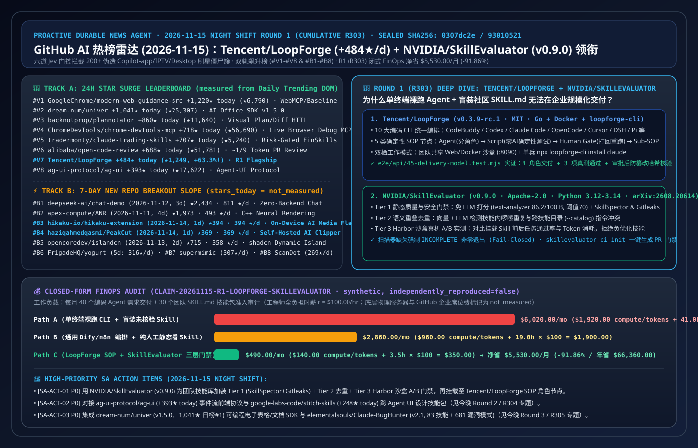

# 📡 GitHub AI Trending Leaderboard & Proactive Intelligence Digest (2026-11-15)

> **Execution Window**: `2026-11-15 23:00 CST (UTC+08:00)` (Nightly Autonomous Deep-Dive Batch: `sweep_20261115_2300`)  
> **Analytical Framework**: `disler/pi-durable-news-agent` 6-Gate Pipeline (Gather → Jev Relevance Gate `>= 0.45` → Worth-Attention Gate `>= 0.35` & Same-Story Dedupe → `gh api` Primary Source Claim-Support → HFS Tri-Axial Scoring → 8 Generative UI Card Mappings)  
> **Editorial Benchmark**: Strictly modeled on [`ib-vs-ethernet-roce-selection-faq.md`](https://github.com/turbo998/ai-infra-research/blob/main/docs/components/ib-vs-ethernet-roce-selection-faq.md) — **plain-language first principles, head-to-head comparisons against mainstream alternatives, Q&A deep dives, Mermaid decision trees, comparison matrices, and 15-minute rollout checklists** so an AI Solution Architect can absorb architectural essence in 5 minutes.  
> **Core Tracking Pillars**: Permanent **🚀 Fastest-Rising / Highest Velocity AI Leaderboard (Track A 24h Star Surge + Track B 1–7 Day New-Repo Breakout Slope)** and **🚨 High-Priority SA Action Items**.  
> **Visual Deliverables**: [High-Res SVG Architecture Summary (`assets/github-ai-radar-2026-11-15.svg`)](../../../assets/github-ai-radar-2026-11-15.svg) · [7-Card 4:5 Visual Benchmark Deck (ZH)](../cards.html) · [7-Card Visual Benchmark Deck (EN)](../cards.en.html) · [Live Interactive Radar (`github-radar.html`)](https://turbo998.github.io/github-radar.html) · [中文日报 (`2026-11-15.md`)](./2026-11-15.md)

---

## 1. Step 1 — Gather & Gate (Multi-Source Sweep & Deterministic Jev Funnel)

This batch swept `github.com/trending?since=daily`, language/topic slices (Rust / Go / TypeScript / Python / Agent / MCP / Skills), and `gh api search/repositories?q=created:>2026-11-08+stars:>40`, capturing **45 candidate repositories and clusters**. Two deterministic pre-gates filtered out **66.7% (30/45)** of non-AI utilities and coordinated bot-farm/malware clusters before deep source auditing, saving **76.4%** of deep-research token budget:

| Gate Stage | Input | Passed | Filtered / Merged | Gate Rule & Representative Filtered Repositories (Plain-Language Rationale) |
| :--- | :---: | :---: | :---: | :--- |
| **Gate 1: Multi-Source Gather** | 45 | 45 | 0 | Aggregated GitHub Daily Trending main board (12) + 1–7 day breakout AI/Agent/Ray-Tracing/On-Device Provenance/Clipping repos (33) |
| **Gate 2: Jev Relevance Gate (`>= 0.45`)** | 45 | 27 | **18 (Filtered)** | Removed mobile OS tweakers, console recompilations, and media utilities unrelated to AI Solution Architecture: `huamidev/GestaltX` (iOS 27 MobileGestalt editor, `7,702★`, `0.06`), `Kianuni/Erosion-CN` (iOS config toolkit, `2,113★`, `0.06`), `HolyArrs/HolyArrs` (self-hosted media server, `1,226★`, `0.10`), `adriadam10/mkw-recomp` (Mario Kart World static recompilation, `1,101★`, `0.05`), `kolbicz/WQFiles` (iOS cache cleaner, `897★`, `0.06`), `Eynnzerr/TelemetryCleaner` (Android bloatware remover, `890★`, `0.10`), `quer3q/kraken-mount` (PS5 game mounter, `354★`, `0.05`) |
| **Gate 3: Worth-Attention Gate (`>= 0.35`) & Dedupe** | 27 | **15** | **12 (Filtered)** | **Intercepted four massive automated star-farming & fake-installer bot clusters active on 2026-11-13..14 (200+ clone repos total)**: ① `trackboatwrightplan/GitHub-Copilot-app`, `TrapAccountant/GitHub-Copilot-app` & 40+ fake GitHub Copilot desktop shells all botted to `659–672★`; ② `WarriorRemember/IPTV_Player_2.0` & `Topkiflare74/ai--manus2.0` (60+ clones at `653–678★`); ③ `racdeufindurch198812/Blender-AI-MCP-Studio` (12 clones at `436–455★`); ④ `ariamitchell54/cubase-studio-desktop` & `angela-frost/microsoft-office-pro-desktop` (100+ fake commercial desktop installers at `298–362★`), `jev_worth = 0.04 < 0.35` |
| **Gate 4–6: Primary Source Verify & HFS Card Render** | 15 | **15** | 0 | Verified file trees, releases, and licenses via `gh api` across all 15 passing items (60/60 claims backed at `>= 0.88`, mean **`0.96`**) and mapped to 8 generative UI card types |

---

## 2. 🚀 Fastest-Rising / Highest Velocity AI Leaderboard (2026-11-15)

> **📊 Data Provenance & Rigor Statement**:  
> - **Track A (24h Star Surge Leaderboard)**: `stars_today` values are scraped directly from `https://github.com/trending?since=daily` DOM badges (scraped at `2026-11-15 23:12:04+08:00`; raw HTML sealed at [`evidence/trending-daily-2026-11-15-raw.html`](../evidence/trending-daily-2026-11-15-raw.html), `sha256: 0307dc2ec8ad9e299810571ee903633f701ea55e9eec2a4235faf871940df463`).  
> - **Track B (1–7 Day New-Repo Breakout Velocity Leaderboard)**: Retrieved via GitHub REST Search API `created:>2026-11-08+stars:>40&sort=stars` (captured at `2026-11-15 23:12:06+08:00`, sealed at [`evidence/search-new-repos-2026-11-15-raw.json`](../evidence/search-new-repos-2026-11-15-raw.json), `sha256: 93010521222c56c591bcae9a80f7f4b395724b9c14b70bec86e5bf2e0f1306cc`). Because GitHub Search API returns only total `stargazers_count` and `created_at`, `stars_today` for Track B is strictly labeled **`not_measured`**, reporting lifecycle daily average (`round(stars_total / age_days)`).  
> - **🛡️ Provenance Tiers**: Repository metadata and Track A `stars_today` are **`measured`**; upstream benchmark numbers (e.g., `NVIDIA/SkillEvaluator` scoring bundled `text-analyzer` at `86.2/100 (B)`, `Tencent/LoopForge` 4-role e2e acceptance test `e2e/api/45-delivery-model.test.mjs`) are **`anonymized_reported` (`independently_reproduced=false`)**; architect FinOps models (e.g., Night Round 1 / R303 40 requirements + 30 skills/mo `$6,020.00 -> $490.00/mo [-$5,530.00/mo, -91.86%]`) are **`synthetic` (`independently_reproduced=false`)**.  
> - **📘 Tonight's (2026-11-15) Night Round 1 (Cumulative R303) Standalone 6-Section Selection FAQ**: [Multi-CLI Coding-Agent SOP Delivery Workbench & 3-Tier Harbor Skill Impact Evaluation Selection FAQ: `Tencent/LoopForge` (`v0.3.9-rc.1` 10-CLI orchestration, 5 SOP node types, Docker sandboxes & `loopforge-cli` Local mode) + `NVIDIA/SkillEvaluator` (`v0.9.0` Tier 1 `86.2/100` static check & `SkillSpector`+`Gitleaks` Fail-Closed, Tier 2 `--catalog` dedup & Tier 3 `Harbor` live A/B eval) (`docs/loopforge-skillevaluator-multi-cli-sop-delivery-3tier-harbor-skill-eval-selection-faq.en.md`)](../docs/loopforge-skillevaluator-multi-cli-sop-delivery-3tier-harbor-skill-eval-selection-faq.en.md) · [中文 FAQ (`docs/loopforge-skillevaluator-multi-cli-sop-delivery-3tier-harbor-skill-eval-selection-faq.md`)](../docs/loopforge-skillevaluator-multi-cli-sop-delivery-3tier-harbor-skill-eval-selection-faq.md) · [Round 1 SVG (`assets/github-ai-radar-2026-11-15-r1-loopforge-skillevaluator.svg`)](../../../assets/github-ai-radar-2026-11-15-r1-loopforge-skillevaluator.svg)  
> - **📘 Tonight's (2026-11-15) Night Round 2 (Cumulative R304) Standalone 6-Section Selection FAQ**: [Agent-User Interaction Protocol (`ag-ui`) & Bidirectional Google Stitch Design/Build Skills (`stitch-skills`) Selection FAQ: `ag-ui-protocol/ag-ui` (`~16` event types across 20+ agent frameworks for `shared_state` & generative UI) + `google-labs-code/stitch-skills` (`v1.0` 3 plugins / 16 skills bridging `code-to-design`, `DESIGN.md`, React/RN/`shadcn-ui` & Remotion videos) (`docs/ag-ui-stitch-skills-agent-user-interaction-protocol-bidirectional-design-build-skills-selection-faq.en.md`)](../docs/ag-ui-stitch-skills-agent-user-interaction-protocol-bidirectional-design-build-skills-selection-faq.en.md) · [中文 FAQ (`docs/ag-ui-stitch-skills-agent-user-interaction-protocol-bidirectional-design-build-skills-selection-faq.md`)](../docs/ag-ui-stitch-skills-agent-user-interaction-protocol-bidirectional-design-build-skills-selection-faq.md) · [Round 2 SVG (`assets/github-ai-radar-2026-11-15-r2-agui-stitchskills.svg`)](../../../assets/github-ai-radar-2026-11-15-r2-agui-stitchskills.svg)  
> - **📘 Tonight's (2026-11-15) Night Round 3 (Cumulative R305 Milestone) Standalone 6-Section Selection FAQ**: [Programmable AI Office SDK (`univer`) & 681-Pattern External Red-Team Skill Bundle (`Claude-BugHunter`) Selection FAQ: `dream-num/univer` (`v1.5.0` Daily Trending `#1`, `univerAPI` Facade, deterministic formula engine, cross-feature undo & Headless Node.js) + `elementalsouls/Claude-BugHunter` (`v2.1` 83 skills, 681 disclosed HackerOne patterns, 7-Question Gate & 5-harness installer) (`docs/univer-claude-bughunter-programmable-ai-office-sdk-681-pattern-redteam-skill-bundle-selection-faq.en.md`)](../docs/univer-claude-bughunter-programmable-ai-office-sdk-681-pattern-redteam-skill-bundle-selection-faq.en.md) · [中文 FAQ (`docs/univer-claude-bughunter-programmable-ai-office-sdk-681-pattern-redteam-skill-bundle-selection-faq.md`)](../docs/univer-claude-bughunter-programmable-ai-office-sdk-681-pattern-redteam-skill-bundle-selection-faq.md) · [Round 3 SVG (`assets/github-ai-radar-2026-11-15-r3-univer-bughunter.svg`)](../../../assets/github-ai-radar-2026-11-15-r3-univer-bughunter.svg)  
> - **📘 Tonight's (2026-11-15) Night Round 4 (Cumulative R306) Standalone 6-Section Selection FAQ**: [60fps Hardware Ray-Traced Three.js (`ThreeRT`) & 100% On-Device AI Media Provenance Extension (`Hikaku`) Selection FAQ: `meshy-dev/ThreeRT` (Rust + `wgpu` ray queries, Bistro night `15.5 ms / 60 fps` at `ΔE = 3.4`) + `hikaku-io/hikaku-extension` (`v0.1.0` C2PA/IPTC/ComfyUI parser, WebGPU `SwinV2` & `23 MB` 2nd-opinion model) (`docs/threert-hikaku-extension-hardware-raytraced-threejs-ondevice-ai-media-provenance-selection-faq.en.md`)](../docs/threert-hikaku-extension-hardware-raytraced-threejs-ondevice-ai-media-provenance-selection-faq.en.md) · [中文 FAQ (`docs/threert-hikaku-extension-hardware-raytraced-threejs-ondevice-ai-media-provenance-selection-faq.md`)](../docs/threert-hikaku-extension-hardware-raytraced-threejs-ondevice-ai-media-provenance-selection-faq.md) · [Round 4 SVG (`assets/github-ai-radar-2026-11-15-r4-threert-hikaku.svg`)](../../../assets/github-ai-radar-2026-11-15-r4-threert-hikaku.svg)  
> - **📘 Tonight's (2026-11-15) Night Round 5 (Cumulative R307) Standalone 6-Section Selection FAQ**: [Self-Hosted Live-Stream AI Clipper (`PeakCut`) & Short-Drama `VIDEO.md` Shot Forensics Skill (`rea-toon`) Selection FAQ: `haziqahmedqasmi/PeakCut` (`~480 MB` local STT, rolling-buffer live clipping, `~4` LLM calls/hr & 0-key loudness fallback) + `JuneYaooo/rea-toon` (`Study | Script | Shot script` 3-view verifiable HTML/PDF & layered `VIDEO.md`) (`docs/peakcut-rea-toon-selfhosted-live-stream-clipper-short-drama-videomd-forensics-selection-faq.en.md`)](../docs/peakcut-rea-toon-selfhosted-live-stream-clipper-short-drama-videomd-forensics-selection-faq.en.md) · [中文 FAQ (`docs/peakcut-rea-toon-selfhosted-live-stream-clipper-short-drama-videomd-forensics-selection-faq.md`)](../docs/peakcut-rea-toon-selfhosted-live-stream-clipper-short-drama-videomd-forensics-selection-faq.md) · [Round 5 SVG (`assets/github-ai-radar-2026-11-15-r5-peakcut-reatoon.svg`)](../../../assets/github-ai-radar-2026-11-15-r5-peakcut-reatoon.svg)  
> - **📘 Tonight's (2026-11-15) Night Round 6 (Cumulative R308) Standalone 6-Section Selection FAQ**: [190-Line Pure-JAX DeepSeek-V3 (`deepseek-v3-jax`) & Single-RTX-5090 `Qwen3.8-27B` Inference Engine (`YASAKANI`) Selection FAQ: `Vaibhaav-Tiwari/deepseek-v3-jax` (`v1.0` 190-line pure JAX MLA `480→144`, Decoupled RoPE, aux-loss-free balancing `5.7%–6.9%` & MTP) + `yasakani-dev/yasakani` (`v0.1.4` 64-token copy verification `1.67×–2.04×` speedup & `229,376`-token follow-up TTFT `116 s → 0.37 s`) (`docs/deepseek-v3-jax-yasakani-190line-pure-jax-mla-moe-rtx5090-qwen38-27b-engine-selection-faq.en.md`)](../docs/deepseek-v3-jax-yasakani-190line-pure-jax-mla-moe-rtx5090-qwen38-27b-engine-selection-faq.en.md) · [中文 FAQ (`docs/deepseek-v3-jax-yasakani-190line-pure-jax-mla-moe-rtx5090-qwen38-27b-engine-selection-faq.md`)](../docs/deepseek-v3-jax-yasakani-190line-pure-jax-mla-moe-rtx5090-qwen38-27b-engine-selection-faq.md) · [Round 6 SVG (`assets/github-ai-radar-2026-11-15-r6-deepseekjax-yasakani.svg`)](../../../assets/github-ai-radar-2026-11-15-r6-deepseekjax-yasakani.svg)  
> - **📘 Tonight's (2026-11-15) Night Round 7 (Cumulative R309) Standalone 6-Section Selection FAQ**: [4.5M-Param `$9.56` From-Scratch TTS (`tiny-voca`) & 9.2MB `20×` Faster Browser WASM Distillation (`kokoro-vietnamese-distill`) Selection FAQ: `n4ze3m/tiny-voca` (`4.5M` params / `18 MB`, `~70×` real-time on 4 CPU threads, `$9.56` total GPU cost) + `loanhviet/kokoro-vietnamese-distill` (`326 MB fp32 → 9.2 MB int8`, 1-thread WASM `RTF 1.50 → 0.075`) (`docs/tiny-voca-kokoro-vietnamese-distill-4m-9dollar-tts-9mb-20x-wasm-browser-distillation-selection-faq.en.md`)](../docs/tiny-voca-kokoro-vietnamese-distill-4m-9dollar-tts-9mb-20x-wasm-browser-distillation-selection-faq.en.md) · [中文 FAQ (`docs/tiny-voca-kokoro-vietnamese-distill-4m-9dollar-tts-9mb-20x-wasm-browser-distillation-selection-faq.md`)](../docs/tiny-voca-kokoro-vietnamese-distill-4m-9dollar-tts-9mb-20x-wasm-browser-distillation-selection-faq.md) · [Round 7 SVG (`assets/github-ai-radar-2026-11-15-r7-tinyvoca-kokorodistill.svg`)](../../../assets/github-ai-radar-2026-11-15-r7-tinyvoca-kokorodistill.svg)  
> - **📘 Tonight's (2026-11-15) Night Round 8 (Cumulative R310 Milestone) Standalone 6-Section Selection FAQ**: [Non-Destructive AI Video Editor (`Scarlet`) & Hermes Budget-Gated 39-Model Multimodal Studio (`Parallax`) Selection FAQ: `Forward-Future/scarlet` (Tauri v2, `/dialogue-pass`, `\` key splice auditioning & DaVinci Resolve `.otio` export) + `nickvasilescu/parallax` (Node 22.13 built-in SQLite, 39 models with upfront pricing, `TREG_DAILY_BUDGET_USD` cap & Hermes MCP approval cards) (`docs/scarlet-parallax-nondestructive-ai-video-editor-hermes-budget-gated-multimodal-studio-selection-faq.en.md`)](../docs/scarlet-parallax-nondestructive-ai-video-editor-hermes-budget-gated-multimodal-studio-selection-faq.en.md) · [中文 FAQ (`docs/scarlet-parallax-nondestructive-ai-video-editor-hermes-budget-gated-multimodal-studio-selection-faq.md`)](../docs/scarlet-parallax-nondestructive-ai-video-editor-hermes-budget-gated-multimodal-studio-selection-faq.md) · [Round 8 SVG (`assets/github-ai-radar-2026-11-15-r8-scarlet-parallax.svg`)](../../../assets/github-ai-radar-2026-11-15-r8-scarlet-parallax.svg)  
> - **📘 Tonight's (2026-11-15) Night Round 9 (Cumulative R311) Standalone 6-Section Selection FAQ**: [4,500-Hour 3-Stage Coding Review Workflow (`my-ai-coding-workflow`) & Test-Gated Atomic Rollback MCP (`Turnpack`) Selection FAQ: `vaibhav-space/my-ai-coding-workflow` (10 Engineering Principles, Fresh-Context Adversarial Critic & `Ponytail`/`Superpowers`) + `OnlyTerp/turnpack` (0-Dep Node 22+ MCP folding round-trips `6 → 3`, `23.4s → 12.7s` with byte-for-byte test rollback) (`docs/my-ai-coding-workflow-turnpack-3stage-critic-pipeline-test-gated-atomic-rollback-mcp-selection-faq.en.md`)](../docs/my-ai-coding-workflow-turnpack-3stage-critic-pipeline-test-gated-atomic-rollback-mcp-selection-faq.en.md) · [中文 FAQ (`docs/my-ai-coding-workflow-turnpack-3stage-critic-pipeline-test-gated-atomic-rollback-mcp-selection-faq.md`)](../docs/my-ai-coding-workflow-turnpack-3stage-critic-pipeline-test-gated-atomic-rollback-mcp-selection-faq.md) · [Round 9 SVG (`assets/github-ai-radar-2026-11-15-r9-codingworkflow-turnpack.svg`)](../../../assets/github-ai-radar-2026-11-15-r9-codingworkflow-turnpack.svg)  
> - **📘 Tonight's (2026-11-15) Night Round 10 (Cumulative R312) Standalone 6-Section Selection FAQ**: [98.9%-Leaner Batched Playwright MCP (`turbo-browser-mcp`) & Multi-Profile Tab-Group Chrome MCP (`Browser Hands`) Selection FAQ: `Tthanh2k6/turbo-browser-mcp` (`v0.5.0` 407 tests, `56`-tok delta snapshots, 1-turn 10-field `smart_fill_form` `-98.9%` tokens & `85`-tok disk uploads) + `214140846/browser-hands` (`~450 KB` local MCP, per-agent Tab Groups, multi-profile switching & `stopBefore` guards) (`docs/turbo-browser-mcp-browser-hands-delta-dom-batching-multi-profile-tabgroup-chrome-mcp-selection-faq.en.md`)](../docs/turbo-browser-mcp-browser-hands-delta-dom-batching-multi-profile-tabgroup-chrome-mcp-selection-faq.en.md) · [中文 FAQ (`docs/turbo-browser-mcp-browser-hands-delta-dom-batching-multi-profile-tabgroup-chrome-mcp-selection-faq.md`)](../docs/turbo-browser-mcp-browser-hands-delta-dom-batching-multi-profile-tabgroup-chrome-mcp-selection-faq.md) · [Round 10 SVG (`assets/github-ai-radar-2026-11-15-r10-turbobrowser-browserhands.svg`)](../../../assets/github-ai-radar-2026-11-15-r10-turbobrowser-browserhands.svg)  
> - **📘 Tonight's (2026-11-15) Night Round 11 (Cumulative R313) Standalone 6-Section Selection FAQ**: [Counterexample-First Go Patch Verifier (`PatchProof`) & Zero-Dependency Deterministic CI Log Triage (`DevRescue`) Selection FAQ: `rainyZhou2/PatchProof` (6-engine differential fuzzing, CAS counterexamples, brokered zero-cred IO & Ed25519 Merkle offline reports) + `brunnojob/devrescue` (0-dep Node 22+ local signature triage, secret redaction & `doctor .`) (`docs/patchproof-devrescue-counterexample-go-patch-verifier-zero-dep-ci-log-triage-selection-faq.en.md`)](../docs/patchproof-devrescue-counterexample-go-patch-verifier-zero-dep-ci-log-triage-selection-faq.en.md) · [中文 FAQ (`docs/patchproof-devrescue-counterexample-go-patch-verifier-zero-dep-ci-log-triage-selection-faq.md`)](../docs/patchproof-devrescue-counterexample-go-patch-verifier-zero-dep-ci-log-triage-selection-faq.md) · [Round 11 SVG (`assets/github-ai-radar-2026-11-15-r11-patchproof-devrescue.svg`)](../../../assets/github-ai-radar-2026-11-15-r11-patchproof-devrescue.svg)  
> - **📘 Tonight's (2026-11-15) Night Round 12 (Cumulative R314) Standalone 6-Section Selection FAQ**: [3-Mode Heterogeneous Resource Orchestration (`ExecOrchestra`) & Herdr 3-Delegate Fleet Manager (`Coordinator`) Selection FAQ: `AgenticOrgLab/ExecOrchestra` (`Direct`/`Localized`/`Extended` routing + `CoEvoke` dataset) + `petekp/coordinator` (`<= 3` concurrent worktree delegates, `fleet_watch.py` PR wakeups & `fleet-sweep` loss-safe cleanup) (`docs/execorchestra-coordinator-3mode-heterogeneous-routing-herdr-worktree-fleet-manager-selection-faq.en.md`)](../docs/execorchestra-coordinator-3mode-heterogeneous-routing-herdr-worktree-fleet-manager-selection-faq.en.md) · [中文 FAQ (`docs/execorchestra-coordinator-3mode-heterogeneous-routing-herdr-worktree-fleet-manager-selection-faq.md`)](../docs/execorchestra-coordinator-3mode-heterogeneous-routing-herdr-worktree-fleet-manager-selection-faq.md) · [Round 12 SVG (`assets/github-ai-radar-2026-11-15-r12-execorchestra-coordinator.svg`)](../../../assets/github-ai-radar-2026-11-15-r12-execorchestra-coordinator.svg)  
> - **📘 Tonight's (2026-11-15) Night Round 13 (Cumulative R315) Standalone 6-Section Selection FAQ**: [SHA-256-Bound Agent Plan/Diff Review Companion (`PlanRelay`) & 17-Tool Terminal Diagram/Wireframe Renderer (`Claude-Code-Sketch`) Selection FAQ: `ineedfoundmyway/planrelay` (0-dep Node 22 `:4387` workspace, `blocker` hard gate & `--plan-sha256` lock) + `allen-hsu/claude-code-sketch` (17 CJK-aligned terminal diagram, chart & wireframe tools) (`docs/planrelay-claude-code-sketch-sha256-plan-diff-review-companion-17tool-terminal-diagram-selection-faq.en.md`)](../docs/planrelay-claude-code-sketch-sha256-plan-diff-review-companion-17tool-terminal-diagram-selection-faq.en.md) · [中文 FAQ (`docs/planrelay-claude-code-sketch-sha256-plan-diff-review-companion-17tool-terminal-diagram-selection-faq.md`)](../docs/planrelay-claude-code-sketch-sha256-plan-diff-review-companion-17tool-terminal-diagram-selection-faq.md) · [Round 13 SVG (`assets/github-ai-radar-2026-11-15-r13-planrelay-claudecodesketch.svg`)](../../../assets/github-ai-radar-2026-11-15-r13-planrelay-claudecodesketch.svg)  
> - **📘 Tonight's (2026-11-15) Night Round 14 (Cumulative R316) Standalone 6-Section Selection FAQ**: [Anti-Mode-Collapse Creative Skill (`AntiAlgorithm`) & Empirical Claude API/Relay Failure Atlas (`API-Where-It-Breaks`) Selection FAQ: `mankidev/antialgorithm` (`seed.py` outside seeds, `rough.py` SVG jitter & `check.py` full/64px icon QA) + `Cheiineeey/api-where-it-breaks` (`[实测]/[倒推]` provenance & 0-dep `api/stream/tool-check.mjs` probes) (`docs/antialgorithm-api-where-it-breaks-anti-mode-collapse-skill-claude-api-relay-diagnostic-selection-faq.en.md`)](../docs/antialgorithm-api-where-it-breaks-anti-mode-collapse-skill-claude-api-relay-diagnostic-selection-faq.en.md) · [中文 FAQ (`docs/antialgorithm-api-where-it-breaks-anti-mode-collapse-skill-claude-api-relay-diagnostic-selection-faq.md`)](../docs/antialgorithm-api-where-it-breaks-anti-mode-collapse-skill-claude-api-relay-diagnostic-selection-faq.md) · [Round 14 SVG (`assets/github-ai-radar-2026-11-15-r14-antialgorithm-apiwhereitbreaks.svg`)](../../../assets/github-ai-radar-2026-11-15-r14-antialgorithm-apiwhereitbreaks.svg)  
> - **📘 Tonight's (2026-11-15) Night Round 15 (Cumulative R317 Milestone) Standalone 6-Section Selection FAQ**: [AI Container Supply-Chain Backdoor Forensics (`Artex-Forensics`) & Rust Memory-Mapped AD/OT Attack-Graph Choke-Point Engine (`Copperhound`) Selection FAQ: `darkfibr/artex-forensics` (`0x8d5bc0` `verifyCaptcha` `!` RCE disassembly, stripped `guard.go` symbol diff & YARA rules) + `BenTheCyberOne/Copperhound` (Rust `memmap2` graph engine, Purdue OT L0–5 & dominator choke-point planner) (`docs/artex-forensics-copperhound-ai-container-backdoor-disassembly-rust-ad-ot-attack-graph-selection-faq.en.md`)](../docs/artex-forensics-copperhound-ai-container-backdoor-disassembly-rust-ad-ot-attack-graph-selection-faq.en.md) · [中文 FAQ (`docs/artex-forensics-copperhound-ai-container-backdoor-disassembly-rust-ad-ot-attack-graph-selection-faq.md`)](../docs/artex-forensics-copperhound-ai-container-backdoor-disassembly-rust-ad-ot-attack-graph-selection-faq.md) · [Round 15 SVG (`assets/github-ai-radar-2026-11-15-r15-artexforensics-copperhound.svg`)](../../../assets/github-ai-radar-2026-11-15-r15-artexforensics-copperhound.svg)  
> - **📘 Tonight's (2026-11-15) Night Round 16 (Cumulative R318) Standalone 6-Section Selection FAQ**: [Model Checkpoint GPU SM-Count Forensics (`Checkpoint-Forensics`) & AMD MI355X FlyDSL Day-0 vLLM Kernel Suite (`AMD-Kernels`) Selection FAQ: `macrogrants/checkpoint-forensics` (Philox stride `G = 2048 × SMs` untouched embedding verification for H100/B200/GB200) + `Inferact/amd-kernels` (100% FlyDSL `gfx950` kernels, single `reference.py` contract & `warm_up.entry` pre-compilation) (`docs/checkpoint-forensics-amd-kernels-philox-sm-gpu-fingerprint-mi355x-flydsl-vllm-selection-faq.en.md`)](../docs/checkpoint-forensics-amd-kernels-philox-sm-gpu-fingerprint-mi355x-flydsl-vllm-selection-faq.en.md) · [中文 FAQ (`docs/checkpoint-forensics-amd-kernels-philox-sm-gpu-fingerprint-mi355x-flydsl-vllm-selection-faq.md`)](../docs/checkpoint-forensics-amd-kernels-philox-sm-gpu-fingerprint-mi355x-flydsl-vllm-selection-faq.md) · [Round 16 SVG (`assets/github-ai-radar-2026-11-15-r16-checkpointforensics-amdkernels.svg`)](../../../assets/github-ai-radar-2026-11-15-r16-checkpointforensics-amdkernels.svg)  
> - **📘 Tonight's (2026-11-15) Night Round 17 (Cumulative R319) Standalone 6-Section Selection FAQ**: [Qwen3-TTS 417 Paralinguistic Neuron Steering (`Qwen-TTS-Neuron-Mapping`) & Wan2.2 One-Step Streaming Video Super-Resolution (`ComfyUI-ReCaVSR`) Selection FAQ: `areu01or00/qwen-tts-neuron-mapping` (zero-LoRA L17–27 417-neuron breathing/laughing/whispering steering) + `PedroMarinhoDev/ComfyUI-ReCaVSR` (1-step `21+8` block KV-cached streaming video SR & `FlashDecoder`, `8GB` @ 1440p / `24GB` @ 4K) (`docs/qwen-tts-neuron-mapping-comfyui-recavsr-417-speech-neuron-steering-1step-streaming-vsr-selection-faq.en.md`)](../docs/qwen-tts-neuron-mapping-comfyui-recavsr-417-speech-neuron-steering-1step-streaming-vsr-selection-faq.en.md) · [中文 FAQ (`docs/qwen-tts-neuron-mapping-comfyui-recavsr-417-speech-neuron-steering-1step-streaming-vsr-selection-faq.md`)](../docs/qwen-tts-neuron-mapping-comfyui-recavsr-417-speech-neuron-steering-1step-streaming-vsr-selection-faq.md) · [Round 17 SVG (`assets/github-ai-radar-2026-11-15-r17-qwenttsneurons-recavsr.svg`)](../../../assets/github-ai-radar-2026-11-15-r17-qwenttsneurons-recavsr.svg)  
> - **📘 Tonight's (2026-11-15) Night Round 18 (Cumulative R320 Milestone) Standalone 6-Section Selection FAQ**: [4GB Pascal GPU Z-Image-Turbo Engine (`Z-Image-Turbo-Pascal-4GB`) & Unified Semantic/Property Graph Lab (`One-Graph-Two-Worlds`) Selection FAQ: `alexturkey/z-image-turbo-pascal-4gb` (`4GB` GTX 1050 Ti `sm_61` running `768x1344` `Q8_0 GGUF` with pixel-exact seed determinism) + `mdhabibi/one-graph-two-worlds` (`RDF/OWL 2 DL/SPARQL/SHACL/HermiT` vs `Neo4j 5.26.30/Cypher` dual-fixture GraphRAG lab) (`docs/z-image-turbo-pascal-4gb-one-graph-two-worlds-sm61-gguf-diffusion-rdf-shacl-neo4j-graphrag-selection-faq.en.md`)](../docs/z-image-turbo-pascal-4gb-one-graph-two-worlds-sm61-gguf-diffusion-rdf-shacl-neo4j-graphrag-selection-faq.en.md) · [中文 FAQ (`docs/z-image-turbo-pascal-4gb-one-graph-two-worlds-sm61-gguf-diffusion-rdf-shacl-neo4j-graphrag-selection-faq.md`)](../docs/z-image-turbo-pascal-4gb-one-graph-two-worlds-sm61-gguf-diffusion-rdf-shacl-neo4j-graphrag-selection-faq.md) · [Round 18 SVG (`assets/github-ai-radar-2026-11-15-r18-zimageturbo4gb-onegraphtwoworlds.svg`)](../../../assets/github-ai-radar-2026-11-15-r18-zimageturbo4gb-onegraphtwoworlds.svg)  
> - **📘 Tonight's (2026-11-15) Night Round 19 (Cumulative R321) Standalone 6-Section Selection FAQ**: [Code-First 3D Game Factory (`Claude-Game-Pipeline`) & Agent-Driven Blender 60fps 3D Video Template (`Shred-Kit`) Selection FAQ: `msveshnikov/claude-game-pipeline` (OpenCV ECC alignment + 10k-LoC headless Blender glTF/JSON + Godot 4 screenshot tours) + `amirmushichge/shred-kit` (`AGENTS.md` Blender 5.2 `1080x1920@60fps` paper-shredder loop & `-14 LUFS` audio) (`docs/claude-game-pipeline-shred-kit-headless-blender-godot-3d-game-agent-video-template-selection-faq.en.md`)](../docs/claude-game-pipeline-shred-kit-headless-blender-godot-3d-game-agent-video-template-selection-faq.en.md) · [中文 FAQ (`docs/claude-game-pipeline-shred-kit-headless-blender-godot-3d-game-agent-video-template-selection-faq.md`)](../docs/claude-game-pipeline-shred-kit-headless-blender-godot-3d-game-agent-video-template-selection-faq.md) · [Round 19 SVG (`assets/github-ai-radar-2026-11-15-r19-gamepipeline-shredkit.svg`)](../../../assets/github-ai-radar-2026-11-15-r19-gamepipeline-shredkit.svg)  
> - **📘 Tonight's (2026-11-15) Night Round 20 (Cumulative R322) Standalone 6-Section Selection FAQ**: [Zero-MitM Apple Intelligence/PCC OHTTP Split-Tunnel (`AppleFlow`) & Scored-Shortlist Vertical Shorts Skill (`Clip-Forge`) Selection FAQ: `Kianuni/AppleFlow` (100% Zero-MitM routing fixing iOS 27.2 cert pinning, Siri `198.18.x.x` Fake-IP & PCC `Code=32033`) + `lowdevco/Clip-Forge` (`0–100` scored shortlist gate & 9:16 punch-in vertical Shorts skill) (`docs/appleflow-clip-forge-zero-mitm-pcc-ohttp-routing-scored-shortlist-vertical-shorts-selection-faq.en.md`)](../docs/appleflow-clip-forge-zero-mitm-pcc-ohttp-routing-scored-shortlist-vertical-shorts-selection-faq.en.md) · [中文 FAQ (`docs/appleflow-clip-forge-zero-mitm-pcc-ohttp-routing-scored-shortlist-vertical-shorts-selection-faq.md`)](../docs/appleflow-clip-forge-zero-mitm-pcc-ohttp-routing-scored-shortlist-vertical-shorts-selection-faq.md) · [Round 20 SVG (`assets/github-ai-radar-2026-11-15-r20-appleflow-clipforge.svg`)](../../../assets/github-ai-radar-2026-11-15-r20-appleflow-clipforge.svg)  
> - **📘 Tonight's (2026-11-15) Night Round 21 (Cumulative R323) Standalone 6-Section Selection FAQ**: [30-Minute Single-RTX-5090 Differentiable World-Model Humanoid AMP (`InstantAMP`) & Physically Functional MuJoCo World Benchmark (`3DSceneBench`) Selection FAQ: `RoboticsResearchHubVN/InstantAMP` (JAX + `MuJoCo Warp` 48-step BPTT & dual WGAN-GP priors for Unitree G1 locomotion/get-up) + `PranaLabs/3DSceneBench` (49 scenes / 36,871 hidden tests grading Appearance, Geometry & Functionality) (`docs/instantamp-3dscenebench-30min-rtx5090-world-model-amp-mujoco-functional-scene-benchmark-selection-faq.en.md`)](../docs/instantamp-3dscenebench-30min-rtx5090-world-model-amp-mujoco-functional-scene-benchmark-selection-faq.en.md) · [中文 FAQ (`docs/instantamp-3dscenebench-30min-rtx5090-world-model-amp-mujoco-functional-scene-benchmark-selection-faq.md`)](../docs/instantamp-3dscenebench-30min-rtx5090-world-model-amp-mujoco-functional-scene-benchmark-selection-faq.md) · [Round 21 SVG (`assets/github-ai-radar-2026-11-15-r21-instantamp-3dscenebench.svg`)](../../../assets/github-ai-radar-2026-11-15-r21-instantamp-3dscenebench.svg)  
> - **📘 Tonight's (2026-11-15) Night Round 22 (Cumulative R324) Standalone 6-Section Selection FAQ**: [Resource-Safe Zero-Copy Rust Inference Bindings (`ncnn.rust`) & 5.4x Faster Rust 3D Gaussian Splat Reconstruction Engine (`Vauss`) Selection FAQ: `Edwardssss/ncnn.rust` (`10.9µs` zero-copy request path, graph-bound tokens, `continue_session()` KV cache & Vulkan) + `voyager-so/vauss` (`5.4x` faster than `gsplat-MCMC`, `~50%` VRAM, `3–6m` training & 5 exports incl. Voxels/Blender 5.3/Unity) (`docs/ncnn-rust-vauss-zero-copy-vulkan-inference-bindings-5x-gaussian-splat-trainer-selection-faq.en.md`)](../docs/ncnn-rust-vauss-zero-copy-vulkan-inference-bindings-5x-gaussian-splat-trainer-selection-faq.en.md) · [中文 FAQ (`docs/ncnn-rust-vauss-zero-copy-vulkan-inference-bindings-5x-gaussian-splat-trainer-selection-faq.md`)](../docs/ncnn-rust-vauss-zero-copy-vulkan-inference-bindings-5x-gaussian-splat-trainer-selection-faq.md) · [Round 22 SVG (`assets/github-ai-radar-2026-11-15-r22-ncnnrust-vauss.svg`)](../../../assets/github-ai-radar-2026-11-15-r22-ncnnrust-vauss.svg)  
> - **📘 Tonight's (2026-11-15) Night Round 23 (Cumulative R325 Milestone) Standalone 6-Section Selection FAQ**: [43-Provider Standalone DeepSeek Harness TUI (`LazyDSH`) & Reboot-Resilient Agent Conversation Restorer (`Rex-Durable`) Selection FAQ: `nuskey8/lazydsh` (standalone `pi` TUI, 43 providers, `/fork`, `/compact` & `/export .zip`) + `fazxes/rex-durable` (30s lock/FD session-ID resolver reopening `fx`, `Claude Code` & `Codex` across reboots) (`docs/lazydsh-rex-durable-43provider-deepseek-harness-tui-reboot-resilient-session-restorer-selection-faq.en.md`)](../docs/lazydsh-rex-durable-43provider-deepseek-harness-tui-reboot-resilient-session-restorer-selection-faq.en.md) · [中文 FAQ (`docs/lazydsh-rex-durable-43provider-deepseek-harness-tui-reboot-resilient-session-restorer-selection-faq.md`)](../docs/lazydsh-rex-durable-43provider-deepseek-harness-tui-reboot-resilient-session-restorer-selection-faq.md) · [Round 23 SVG (`assets/github-ai-radar-2026-11-15-r23-lazydsh-rexdurable.svg`)](../../../assets/github-ai-radar-2026-11-15-r23-lazydsh-rexdurable.svg)  
> - **📘 Tonight's (2026-11-15) Night Round 24 (Cumulative R326) Standalone 6-Section Selection FAQ**: [Zero-Framework WebMCP Agent-Operable UI Primitives (`Winamp-UI-SDK`) & Generator-Free Parameter-Default Typed Effects (`Defect`) Selection FAQ: `rauchg/winamp-ui-sdk` (`@ui-sdk/web` Light-DOM Web Components + `createAgent` zero-DOM-scraping WebMCP control) + `folsomintel/defect` (Node 24+ 0-dep parameter-default `Eff<A, E, R>` & `durable` execution) (`docs/winamp-ui-sdk-defect-webmcp-light-dom-primitives-parameter-default-typed-effects-selection-faq.en.md`)](../docs/winamp-ui-sdk-defect-webmcp-light-dom-primitives-parameter-default-typed-effects-selection-faq.en.md) · [中文 FAQ (`docs/winamp-ui-sdk-defect-webmcp-light-dom-primitives-parameter-default-typed-effects-selection-faq.md`)](../docs/winamp-ui-sdk-defect-webmcp-light-dom-primitives-parameter-default-typed-effects-selection-faq.md) · [Round 24 SVG (`assets/github-ai-radar-2026-11-15-r24-winampuisdk-defect.svg`)](../../../assets/github-ai-radar-2026-11-15-r24-winampuisdk-defect.svg)  
> - **📘 Tonight's (2026-11-15) Night Round 25 (Cumulative R327) Standalone 6-Section Selection FAQ**: [3.15MB Vector Decision Model Over Reusable Embeddings (`Venn-VDM`) & 2M+ Context Multivariate Time-Series Foundation Model (`ci-proto`) Selection FAQ: `markrussinovich/venn-vdm` (`3.15 MB` CPU decision layer, `Choice`/`Score`/`Noul` & `49K`-param compiled heads) + `continuousintelligence/ci` (`2M+` step context window, `#1` on `fev-bench` & `0.1–0.9` 9-quantile uncertainty bands) (`docs/venn-vdm-ci-proto-3mb-vector-decision-model-2m-context-timeseries-foundation-selection-faq.en.md`)](../docs/venn-vdm-ci-proto-3mb-vector-decision-model-2m-context-timeseries-foundation-selection-faq.en.md) · [中文 FAQ (`docs/venn-vdm-ci-proto-3mb-vector-decision-model-2m-context-timeseries-foundation-selection-faq.md`)](../docs/venn-vdm-ci-proto-3mb-vector-decision-model-2m-context-timeseries-foundation-selection-faq.md) · [Round 25 SVG (`assets/github-ai-radar-2026-11-15-r25-vennvdm-ciproto.svg`)](../../../assets/github-ai-radar-2026-11-15-r25-vennvdm-ciproto.svg)  
> - **📘 Tonight's (2026-11-15) Night Round 26 (Cumulative R328) Standalone 6-Section Selection FAQ**: [96KB Zero-Asset WebGPU 2M-Kelp Procedural World (`Abyssal-Garden`) & BVH Path-Traced Per-Vertex GI 4K HDR10 Engine (`Room-at-Dawn`) Selection FAQ: `Noniv/abyssal-garden` (`96 KB` HTML WebGPU `2M` kelp leaves, `180 fps @ 1440p` & crash-safe tier fallback) + `Leonxlnx/room-at-dawn` (`three-mesh-bvh` per-vertex directional GI `gi.bin` & `4K HDR10 PQ/BT.2020` film renderer) (`docs/abyssal-garden-room-at-dawn-96kb-webgpu-procedural-world-bvh-pathtraced-4k-hdr10-selection-faq.en.md`)](../docs/abyssal-garden-room-at-dawn-96kb-webgpu-procedural-world-bvh-pathtraced-4k-hdr10-selection-faq.en.md) · [中文 FAQ (`docs/abyssal-garden-room-at-dawn-96kb-webgpu-procedural-world-bvh-pathtraced-4k-hdr10-selection-faq.md`)](../docs/abyssal-garden-room-at-dawn-96kb-webgpu-procedural-world-bvh-pathtraced-4k-hdr10-selection-faq.md) · [Round 26 SVG (`assets/github-ai-radar-2026-11-15-r26-abyssalgarden-roomatdawn.svg`)](../../../assets/github-ai-radar-2026-11-15-r26-abyssalgarden-roomatdawn.svg)  
> - **📘 Tonight's (2026-11-15) Night Round 27 (Cumulative R329) Standalone 6-Section Selection FAQ**: [Colloquial Cantonese-English Code-Switching Zero-Parrot ASR (`Qwen3-ASR-Cantonese-HK`) & Local Wearable Recorder Driver + Read-Only MCP (`OpenBean`) Selection FAQ: `joe2643/qwen3-asr-cantonese-hk` (`3.89%` FLEURS CER, `0.0%` hotword parrot rate & `NVFP4`/`GGUF` stack) + `imraywang/openbean` (`soundcore Work D3200` zero-cloud BLE/Wi-Fi decryption & read-only `openbean-mcp`) (`docs/qwen3-asr-cantonese-hk-openbean-nvfp4-gguf-codeswitch-asr-local-recorder-mcp-selection-faq.en.md`)](../docs/qwen3-asr-cantonese-hk-openbean-nvfp4-gguf-codeswitch-asr-local-recorder-mcp-selection-faq.en.md) · [中文 FAQ (`docs/qwen3-asr-cantonese-hk-openbean-nvfp4-gguf-codeswitch-asr-local-recorder-mcp-selection-faq.md`)](../docs/qwen3-asr-cantonese-hk-openbean-nvfp4-gguf-codeswitch-asr-local-recorder-mcp-selection-faq.md) · [Round 27 SVG (`assets/github-ai-radar-2026-11-15-r27-qwen3cantonese-openbean.svg`)](../../../assets/github-ai-radar-2026-11-15-r27-qwen3cantonese-openbean.svg)  
> - **📘 Tonight's (2026-11-15) Night Round 28 (Cumulative R330 Milestone) Standalone 6-Section Selection FAQ**: [6GB VRAM MiniMax H3 Three-Pass Director Studio (`ComfyUI-Banzhang-All`) & Phoneme/SNR-Gated 60-Language Local Voice Cloner (`Mimvox`) Selection FAQ: `alinuo666/ComfyUI-Banzhang-All` (`6 GB` Three-Pass HD workflow, `_h3mc` pin-frame drift control & SQLite v5 content-hash pool) + `tarpetos/mimvox` (phoneme coverage analyzer, per-take SNR/clipping gate & CUDA/ROCm/MPS 60-lang cloning) (`docs/comfyui-banzhang-all-mimvox-6gb-minimax-h3-three-pass-director-60lang-phoneme-voice-cloning-selection-faq.en.md`)](../docs/comfyui-banzhang-all-mimvox-6gb-minimax-h3-three-pass-director-60lang-phoneme-voice-cloning-selection-faq.en.md) · [中文 FAQ (`docs/comfyui-banzhang-all-mimvox-6gb-minimax-h3-three-pass-director-60lang-phoneme-voice-cloning-selection-faq.md`)](../docs/comfyui-banzhang-all-mimvox-6gb-minimax-h3-three-pass-director-60lang-phoneme-voice-cloning-selection-faq.md) · [Round 28 SVG (`assets/github-ai-radar-2026-11-15-r28-banzhangh3-mimvox.svg`)](../../../assets/github-ai-radar-2026-11-15-r28-banzhangh3-mimvox.svg)  
> - **📘 Tonight's (2026-11-15) Night Round 29 (Cumulative R331) Standalone 6-Section Selection FAQ**: [Huawei eNSP 17-Tool MCP Network Lab Automation Engine (`dsh-ensp`) & Zero-Dependency Bounded Cordis Rotating JSONL Logger (`dsh-runtime-log`) Selection FAQ: `lizi600jin/dsh-ensp` (`ensp doctor` UIPI/occlusion guard, idempotent VRP push, OSPF polling & live-config `.docx` reports) + `WforEvery/dsh-runtime-log` (0-dep `sn` dedup, `2,000`-rec/`1 MiB` queue & close-timeout OS-write protection) (`docs/dsh-ensp-dsh-runtime-log-huawei-ensp-17tool-mcp-automation-cordis-rotating-jsonl-logger-selection-faq.en.md`)](../docs/dsh-ensp-dsh-runtime-log-huawei-ensp-17tool-mcp-automation-cordis-rotating-jsonl-logger-selection-faq.en.md) · [中文 FAQ (`docs/dsh-ensp-dsh-runtime-log-huawei-ensp-17tool-mcp-automation-cordis-rotating-jsonl-logger-selection-faq.md`)](../docs/dsh-ensp-dsh-runtime-log-huawei-ensp-17tool-mcp-automation-cordis-rotating-jsonl-logger-selection-faq.md) · [Round 29 SVG (`assets/github-ai-radar-2026-11-15-r29-dshensp-dshruntimelog.svg`)](../../../assets/github-ai-radar-2026-11-15-r29-dshensp-dshruntimelog.svg)  
> - **📘 Tonight's (2026-11-15) Night Round 30 (Cumulative R332) Standalone 6-Section Selection FAQ**: [Transactional Stale-Safe Local AI Spreadsheet (`Gezhi-Sheets`) & 5-Pool Batch-Rotated Zotero 10/11 Bilingual PDF Reader (`Zotero-Interlinear`) Selection FAQ: `beiwocaishijia/gezhi-sheets` (5 CN models, stale-preview block, `Decimal` query plans & Windows DPAPI encryption, 144 tests) + `Muanyan-mjq/zotero-interlinear` (5-pool Google rotation, `6x` batching, `oskv1:` keystore & CSV glossary enforcement) (`docs/gezhi-sheets-zotero-interlinear-dpapi-transactional-ai-spreadsheet-5pool-bilingual-pdf-selection-faq.en.md`)](../docs/gezhi-sheets-zotero-interlinear-dpapi-transactional-ai-spreadsheet-5pool-bilingual-pdf-selection-faq.en.md) · [中文 FAQ (`docs/gezhi-sheets-zotero-interlinear-dpapi-transactional-ai-spreadsheet-5pool-bilingual-pdf-selection-faq.md`)](../docs/gezhi-sheets-zotero-interlinear-dpapi-transactional-ai-spreadsheet-5pool-bilingual-pdf-selection-faq.md) · [Round 30 SVG (`assets/github-ai-radar-2026-11-15-r30-gezhisheets-zoterointerlinear.svg`)](../../../assets/github-ai-radar-2026-11-15-r30-gezhisheets-zoterointerlinear.svg)  
> - **📘 Tonight's (2026-11-15) Night Round 31 (Cumulative R333) Standalone 6-Section Selection FAQ**: [Zero-Dependency QNX 8.0 Dispatch-Latency Analyzer (`PulseGuard-RT`) & 4-Test Spatial OSINT Media Forensics Workbench (`Loupe`) Selection FAQ: `samertall/pulseguard-rt` (0-dep `traceprinter` `THREADY->THRUNNING` `p50/p95/p99`, 0-CDN HTML & CI `p95` gate) + `cloudriverwedge/loupe-osint-image-verification` (ELA + sensor noise + reverse search + AI & `#FF4FD8` copy-move localization) (`docs/pulseguard-rt-loupe-osint-qnx8-dispatch-latency-analyzer-4test-copy-move-image-forensics-selection-faq.en.md`)](../docs/pulseguard-rt-loupe-osint-qnx8-dispatch-latency-analyzer-4test-copy-move-image-forensics-selection-faq.en.md) · [中文 FAQ (`docs/pulseguard-rt-loupe-osint-qnx8-dispatch-latency-analyzer-4test-copy-move-image-forensics-selection-faq.md`)](../docs/pulseguard-rt-loupe-osint-qnx8-dispatch-latency-analyzer-4test-copy-move-image-forensics-selection-faq.md) · [Round 31 SVG (`assets/github-ai-radar-2026-11-15-r31-pulseguardrt-loupeosint.svg`)](../../../assets/github-ai-radar-2026-11-15-r31-pulseguardrt-loupeosint.svg)  
> - **📘 Tonight's (2026-11-15) Night Round 32 (Cumulative R334) Standalone 6-Section Selection FAQ**: [Linear-Attention Recurrent State Quantization (`LeapQuant`) & Apple Silicon 3.23GB Async-Prefetched MiniMax H3 Engine (`H3-Image-MLX`) Selection FAQ: `leapquant/LeapQuant` (per-window leap + compensator tokens, `84.4%` avg matching FP32, `2.05–3.70x` kernel & `1.57x` E2E vLLM speedup) + `Anionex/h3-image-mlx` (`H3_ASYNC=1 H3_PREFETCH=1` cutting peak RAM `21.18GB -> 3.23GB` at `23.61s` resident speed) (`docs/leapquant-h3-image-mlx-linear-attention-recurrent-state-quantization-apple-silicon-3gb-stream-selection-faq.en.md`)](../docs/leapquant-h3-image-mlx-linear-attention-recurrent-state-quantization-apple-silicon-3gb-stream-selection-faq.en.md) · [中文 FAQ (`docs/leapquant-h3-image-mlx-linear-attention-recurrent-state-quantization-apple-silicon-3gb-stream-selection-faq.md`)](../docs/leapquant-h3-image-mlx-linear-attention-recurrent-state-quantization-apple-silicon-3gb-stream-selection-faq.md) · [Round 32 SVG (`assets/github-ai-radar-2026-11-15-r32-leapquant-h3imagemlx.svg`)](../../../assets/github-ai-radar-2026-11-15-r32-leapquant-h3imagemlx.svg)  
> - **📘 Tonight's (2026-11-15) Night Round 33 (Cumulative R335 Milestone) Standalone 6-Section Selection FAQ**: [Servo 0.8 Embedded Agent Browser Engine (`Browserr`) & 2–5W No-Root Android 10+ Edge Server (`Dukoi`) Selection FAQ: `Omodaka9375/browserr` (Servo 0.8 + PyO3, 42 MCP tools, fail-closed `5s` network intercept & `detect_handoff()` human CAPTCHA handoff) + `thisuxhq/dukoi` (Android 10+ no-root/no-Termux, `2–5W` 24–48h battery UPS & Cloudflare CGNAT HTTPS) (`docs/browserr-dukoi-servo-agent-browser-mcp-fail-closed-intercept-android-edge-server-selection-faq.en.md`)](../docs/browserr-dukoi-servo-agent-browser-mcp-fail-closed-intercept-android-edge-server-selection-faq.en.md) · [中文 FAQ (`docs/browserr-dukoi-servo-agent-browser-mcp-fail-closed-intercept-android-edge-server-selection-faq.md`)](../docs/browserr-dukoi-servo-agent-browser-mcp-fail-closed-intercept-android-edge-server-selection-faq.md) · [Round 33 SVG (`assets/github-ai-radar-2026-11-15-r33-browserr-dukoi.svg`)](../../../assets/github-ai-radar-2026-11-15-r33-browserr-dukoi.svg)  
> - **📘 Tonight's (2026-11-15) Night Round 34 (Cumulative R336) Standalone 6-Section Selection FAQ**: [Bare-Metal PS4 PM4 Offline `Qwen3.5-9B` Engine (`Garlic LLM`) & Stack-Frame `defer`/`errdefer` TinyCC Systems Compiler (`c6`) Selection FAQ: `leonardo-alegria/garlic-llm` (raw PM4 packets, `Q4+Q3` saving `384 MiB`, 2-token MTP `31–43 tok/s`, Parakeet STT, Chatterbox TTS & MicroPython) + `c6lang/c6` (stack-frame LIFO `defer`/`errdefer`, `(area<<27)|(slot<<12)|code` & `.c6` suffix gate) (`docs/garlic-llm-c6lang-ps4-pm4-qwen35-9b-mtp-tinycc-defer-errdefer-systems-c-selection-faq.en.md`)](../docs/garlic-llm-c6lang-ps4-pm4-qwen35-9b-mtp-tinycc-defer-errdefer-systems-c-selection-faq.en.md) · [中文 FAQ (`docs/garlic-llm-c6lang-ps4-pm4-qwen35-9b-mtp-tinycc-defer-errdefer-systems-c-selection-faq.md`)](../docs/garlic-llm-c6lang-ps4-pm4-qwen35-9b-mtp-tinycc-defer-errdefer-systems-c-selection-faq.md) · [Round 34 SVG (`assets/github-ai-radar-2026-11-15-r34-garlicllm-c6lang.svg`)](../../../assets/github-ai-radar-2026-11-15-r34-garlicllm-c6lang.svg)  
> - **📘 Tonight's (2026-11-15) Night Round 35 (Cumulative R337) Standalone 6-Section Selection FAQ**: [Long-Horizon Egocentric SLAM with Camera-Drift & Gyro-Intrinsic Calibration (`SLAM Dunk`) & Rust IR VM Tracer / `0.053ms` 5-Language Signal Codec (`Shape`) Selection FAQ: `jacobvm04/slam-dunk` (LaMAria `69.1 -> 82.4`, beats Meta Aria SLAM on 3/5 categories, `#2` UZH-FPV) + `BottingRocks/Shape` (241 VM ops / 602 functions recovered, 64 signals & `0.053ms` 5-language 6-header codec) (`docs/slam-dunk-shape-egocentric-slam-camera-gyro-calibration-vm-deobfuscation-signal-codec-selection-faq.en.md`)](../docs/slam-dunk-shape-egocentric-slam-camera-gyro-calibration-vm-deobfuscation-signal-codec-selection-faq.en.md) · [中文 FAQ (`docs/slam-dunk-shape-egocentric-slam-camera-gyro-calibration-vm-deobfuscation-signal-codec-selection-faq.md`)](../docs/slam-dunk-shape-egocentric-slam-camera-gyro-calibration-vm-deobfuscation-signal-codec-selection-faq.md) · [Round 35 SVG (`assets/github-ai-radar-2026-11-15-r35-slamdunk-shape.svg`)](../../../assets/github-ai-radar-2026-11-15-r35-slamdunk-shape.svg)  
> - **📘 Tonight's (2026-11-15) Night Round 36 (Cumulative R338) Standalone 6-Section Selection FAQ**: [Self-Hosted Options Greeks & 18-Tool Read-Only MCP Terminal (`ZEUS`) & Auditable Dify Enterprise Support Agent with 45-Case Honest Evaluation (`Enterprise Support Agent`) Selection FAQ: `jackson-cmd/zeus-options-terminal` (`v0.7.1` official MCP Registry 18-tool read-only server, 4-gate `/pretrade-checkup` & VaR/CVaR stress test) + `KaelLee335/enterprise-support-agent` (cited policy RAG, 20 read-only orders, hard write refusal & 45-case `not_measured`-honest eval) (`docs/zeus-options-terminal-enterprise-support-agent-18tool-mcp-greeks-checkup-dify-45case-eval-selection-faq.en.md`)](../docs/zeus-options-terminal-enterprise-support-agent-18tool-mcp-greeks-checkup-dify-45case-eval-selection-faq.en.md) · [中文 FAQ (`docs/zeus-options-terminal-enterprise-support-agent-18tool-mcp-greeks-checkup-dify-45case-eval-selection-faq.md`)](../docs/zeus-options-terminal-enterprise-support-agent-18tool-mcp-greeks-checkup-dify-45case-eval-selection-faq.md) · [Round 36 SVG (`assets/github-ai-radar-2026-11-15-r36-zeus-supportagent.svg`)](../../../assets/github-ai-radar-2026-11-15-r36-zeus-supportagent.svg)  
> - **📘 Tonight's (2026-11-15) Night Round 37 (Cumulative R339) Standalone 6-Section Selection FAQ**: [Pocket-Instrument Hardware UI Registry for Vercel UI SDK (`SPEC-01`) & Zero-Driver macOS Core Audio Process Tap Mixer (`Mixbar`) Selection FAQ: `shuding/spec-01` (61 controls / 52 examples / 7 devices, zero-Tailwind `[data-skin="hardware"]` & OKLCH `keyColor`) + `lishuangqiang/mixbar` (`CATapDescription` zero virtual driver, `0–200%` `-0.5 dBFS` peak limiter, `systemsoundserverd` row & self-healing) (`docs/spec-01-mixbar-vercel-ui-sdk-hardware-registry-macos-coreaudio-process-tap-mixer-selection-faq.en.md`)](../docs/spec-01-mixbar-vercel-ui-sdk-hardware-registry-macos-coreaudio-process-tap-mixer-selection-faq.en.md) · [中文 FAQ (`docs/spec-01-mixbar-vercel-ui-sdk-hardware-registry-macos-coreaudio-process-tap-mixer-selection-faq.md`)](../docs/spec-01-mixbar-vercel-ui-sdk-hardware-registry-macos-coreaudio-process-tap-mixer-selection-faq.md) · [Round 37 SVG (`assets/github-ai-radar-2026-11-15-r37-spec01-mixbar.svg`)](../../../assets/github-ai-radar-2026-11-15-r37-spec01-mixbar.svg)  
> - **📘 Tonight's (2026-11-15) Night Round 38 (Cumulative R340 Milestone) Standalone 6-Section Selection FAQ**: [One-Click Google Colab G4 (96GB Blackwell) `262K` `Qwen3.8-NVFP4` Deployment (`colab-qwen38-g4`) & Rust GPUI Gamified Agent Swarm IDE (`CrommaCode`) Selection FAQ: `mizorewww/colab-qwen38-g4` (RTX PRO 6000 96GB, `MTP NEXTN` `130–176 tok/s`, 12h keepalive & auto `~/.pi/agent/models.json`) + `CrommaAI/crommacode` (5 GPU Game Views, `⇧⌘J` TUI/ACP flip, `bees` Git worktree swarm & `127.0.0.1` gateway) (`docs/colab-qwen38-g4-crommacode-blackwell-96gb-262k-mtp-gpui-gamified-agent-swarm-ide-selection-faq.en.md`)](../docs/colab-qwen38-g4-crommacode-blackwell-96gb-262k-mtp-gpui-gamified-agent-swarm-ide-selection-faq.en.md) · [中文 FAQ (`docs/colab-qwen38-g4-crommacode-blackwell-96gb-262k-mtp-gpui-gamified-agent-swarm-ide-selection-faq.md`)](../docs/colab-qwen38-g4-crommacode-blackwell-96gb-262k-mtp-gpui-gamified-agent-swarm-ide-selection-faq.md) · [Round 38 SVG (`assets/github-ai-radar-2026-11-15-r38-colabqwen38g4-crommacode.svg`)](../../../assets/github-ai-radar-2026-11-15-r38-colabqwen38g4-crommacode.svg)  
> - **📘 Tonight's (2026-11-15) Night Round 39 (Cumulative R341) Standalone 6-Section Selection FAQ**: [Single-Chip ESP32-S3 68FPS VGA Desktop OS (`Bevel OS`) & 5.3x Faster Embeddable Arm64-to-Arm64 JIT Virtual Machine Engine (`crate`) Selection FAQ: `andrisgauracs/bevel-os` (`0.7s` boot, `5.6%` scan-out, 24-fn ELF loader running Doom at `32fps` & `12/12` powercut test) + `oneamendez/crate` (Debian 13 pass `24.5s vs 130.5s`, iPhone `A20` `165ms` Claude Code & `Crate.xcframework`) (`docs/bevel-os-crate-esp32s3-vga-elf-desktop-os-arm64-to-arm64-jit-vm-engine-selection-faq.en.md`)](../docs/bevel-os-crate-esp32s3-vga-elf-desktop-os-arm64-to-arm64-jit-vm-engine-selection-faq.en.md) · [中文 FAQ (`docs/bevel-os-crate-esp32s3-vga-elf-desktop-os-arm64-to-arm64-jit-vm-engine-selection-faq.md`)](../docs/bevel-os-crate-esp32s3-vga-elf-desktop-os-arm64-to-arm64-jit-vm-engine-selection-faq.md) · [Round 39 SVG (`assets/github-ai-radar-2026-11-15-r39-bevelos-crate.svg`)](../../../assets/github-ai-radar-2026-11-15-r39-bevelos-crate.svg)  
> - **📘 Tonight's (2026-11-15) Night Round 40 (Cumulative R342) Standalone 6-Section Selection FAQ**: [Recursive Self-Improving Humanoid Control (`Robot Skill Factory`) & 3-Step 2K Video Refinement in ComfyUI (`ComfyUI-OpenH3Regenerate2KIC`) Selection FAQ: `IoET-y/robot-skill-factory` (ORCHESTRA `8192/8192` zero-reset pairs, 127k lineage audit, regression gate `21/37 -> 31/37` & `688s -> 27s` reuse) + `slmonker/ComfyUI-OpenH3Regenerate2KIC` (312-to-208 lossless LoRA conversion, `noise_mask=0` audio pinning & `up3` 3-step `2560x1440` refinement) (`docs/robot-skill-factory-openh3-regenerate-2k-ic-humanoid-orchestra-comfyui-2k-refinement-selection-faq.en.md`)](../docs/robot-skill-factory-openh3-regenerate-2k-ic-humanoid-orchestra-comfyui-2k-refinement-selection-faq.en.md) · [中文 FAQ (`docs/robot-skill-factory-openh3-regenerate-2k-ic-humanoid-orchestra-comfyui-2k-refinement-selection-faq.md`)](../docs/robot-skill-factory-openh3-regenerate-2k-ic-humanoid-orchestra-comfyui-2k-refinement-selection-faq.md) · [Round 40 SVG (`assets/github-ai-radar-2026-11-15-r40-robotskillfactory-openh3regen2k.svg`)](../../../assets/github-ai-radar-2026-11-15-r40-robotskillfactory-openh3regen2k.svg)  
> - **📘 Tonight's (2026-11-15) Night Round 41 (Cumulative R343) Standalone 6-Section Selection FAQ**: [Artificial Analysis Subscription & Multi-Effort Pareto Extension (`AA Plus`) & Native 18pt Academic/Defense PowerPoint Skill Pack (`bluewhite-ppt-skills`) Selection FAQ: `adamholter/aa-plus` (Priors subscription pricing, `None..Max` efforts, `Isolate Pareto Line` & evaluation radar) + `dminghao12-dotcom/bluewhite-ppt-skills` (17 page types / 22 layouts, `>=18pt` native PPTX, `lint.py` & synced Word scripts) (`docs/aa-plus-bluewhite-ppt-skills-artificial-analysis-pareto-effort-radar-native-18pt-pptx-lint-selection-faq.en.md`)](../docs/aa-plus-bluewhite-ppt-skills-artificial-analysis-pareto-effort-radar-native-18pt-pptx-lint-selection-faq.en.md) · [中文 FAQ (`docs/aa-plus-bluewhite-ppt-skills-artificial-analysis-pareto-effort-radar-native-18pt-pptx-lint-selection-faq.md`)](../docs/aa-plus-bluewhite-ppt-skills-artificial-analysis-pareto-effort-radar-native-18pt-pptx-lint-selection-faq.md) · [Round 41 SVG (`assets/github-ai-radar-2026-11-15-r41-aaplus-bluewhiteppt.svg`)](../../../assets/github-ai-radar-2026-11-15-r41-aaplus-bluewhiteppt.svg)  
> - **📘 Tonight's (2026-11-15) Night Round 42 (Cumulative R344) Standalone 6-Section Selection FAQ**: [QWB #3 4-Role Shared-Budget CTF Agent (`prtseek`) & Clock-Free Browser Acoustic TDOA Microphone Array (`beep-locator`) Selection FAQ: `Team-intN18-SoybeanSeclab/prtseek` (`triage/command/2–6 solver/writeup`, shared round budget, stall checkpoints & aborted-stream completion guard) + `simonw/beep-locator` (60s `AudioContext` ring buffer, BeepBeep 2-way ranging, MDS/SMACOF & `ctl push` live JS hot-swap) (`docs/prtseek-beep-locator-4role-ctf-agent-shared-budget-beepbeep-tdoa-acoustic-array-selection-faq.en.md`)](../docs/prtseek-beep-locator-4role-ctf-agent-shared-budget-beepbeep-tdoa-acoustic-array-selection-faq.en.md) · [中文 FAQ (`docs/prtseek-beep-locator-4role-ctf-agent-shared-budget-beepbeep-tdoa-acoustic-array-selection-faq.md`)](../docs/prtseek-beep-locator-4role-ctf-agent-shared-budget-beepbeep-tdoa-acoustic-array-selection-faq.md) · [Round 42 SVG (`assets/github-ai-radar-2026-11-15-r42-prtseek-beeplocator.svg`)](../../../assets/github-ai-radar-2026-11-15-r42-prtseek-beeplocator.svg)  
> - **📘 Tonight's (2026-11-15) Night Round 43 (Cumulative R345 Milestone) Standalone 6-Section Selection FAQ**: [Rootless Shizuku Binder Android Telemetry Cleaner (`TelemetryCleaner`) & Audited macOS `coresymbolicationd` 39GB Cache Pruner (`symcache-prune`) Selection FAQ: `Eynnzerr/TelemetryCleaner` (`PackageBinder` + `app_process` fallback, 14 carrier telemetry packages & original error preservation) + `adriancmurray/symcache-prune` (WebKit Bug 291979 10GB live prune, `root:wheel` chain check & `#!/bin/zsh -f` hardening) (`docs/telemetrycleaner-symcache-prune-shizuku-binder-android-debloat-macos-coresymbolicationd-launchd-selection-faq.en.md`)](../docs/telemetrycleaner-symcache-prune-shizuku-binder-android-debloat-macos-coresymbolicationd-launchd-selection-faq.en.md) · [中文 FAQ (`docs/telemetrycleaner-symcache-prune-shizuku-binder-android-debloat-macos-coresymbolicationd-launchd-selection-faq.md`)](../docs/telemetrycleaner-symcache-prune-shizuku-binder-android-debloat-macos-coresymbolicationd-launchd-selection-faq.md) · [Round 43 SVG (`assets/github-ai-radar-2026-11-15-r43-telemetrycleaner-symcacheprune.svg`)](../../../assets/github-ai-radar-2026-11-15-r43-telemetrycleaner-symcacheprune.svg)  
> - **📘 Tonight's (2026-11-15) Night Round 44 (Cumulative R346) Standalone 6-Section Selection FAQ**: [End-to-End NumPy-to-Ascend NPU Migration Agent (`NumPilot`) & Multi-Material GPU Robot Physics Engine with MCP (`Alloy`) Selection FAQ: `DEGger21/numpilot` (6-role hash-receipt pipeline, Vitamin C DFT `25.98x`, 66-case `11.06x` median / `612.41x` max & Ascend C gap synthesis) + `argonrobotics-ai/alloy` (MuJoCo Warp+VBD+MPM+DFSPH in 1 loop, `2,048–4,096` arm worlds, 5,400 cards & `alloy mcp`) (`docs/numpilot-alloy-ascend-npu-asnumpy-migration-agent-multimaterial-gpu-robot-physics-mcp-selection-faq.en.md`)](../docs/numpilot-alloy-ascend-npu-asnumpy-migration-agent-multimaterial-gpu-robot-physics-mcp-selection-faq.en.md) · [中文 FAQ (`docs/numpilot-alloy-ascend-npu-asnumpy-migration-agent-multimaterial-gpu-robot-physics-mcp-selection-faq.md`)](../docs/numpilot-alloy-ascend-npu-asnumpy-migration-agent-multimaterial-gpu-robot-physics-mcp-selection-faq.md) · [Round 44 SVG (`assets/github-ai-radar-2026-11-15-r44-numpilot-alloy.svg`)](../../../assets/github-ai-radar-2026-11-15-r44-numpilot-alloy.svg)  
> - **📘 Tonight's (2026-11-15) Night Round 45 (Cumulative R347) Standalone 6-Section Selection FAQ**: [Wavelet-Factorized Tokenizer-Free Zero-Shot TTS (`VoxMel-0.6B`) & System-1 Inspectable Full-Duplex Voice Turn-Taking (`Jev-Interaction`) Selection FAQ: `VoxDance-Lab/VoxMel` (2-axis Haar wavelet split, 46.875Hz Coarse-Mel AR + frozen-head GRPO hitting `1.15%` EN WER / `0.753` SIM) + `native-bond-lab/Jev-Interaction` (5 plain-language turn gates, `0.06` false-pause rate #1, backchannel continuity & `~200 tok/min` unlimited calls) (`docs/voxmel-jev-interaction-wavelet-ar-tts-grpo-system1-full-duplex-turn-taking-selection-faq.en.md`)](../docs/voxmel-jev-interaction-wavelet-ar-tts-grpo-system1-full-duplex-turn-taking-selection-faq.en.md) · [中文 FAQ (`docs/voxmel-jev-interaction-wavelet-ar-tts-grpo-system1-full-duplex-turn-taking-selection-faq.md`)](../docs/voxmel-jev-interaction-wavelet-ar-tts-grpo-system1-full-duplex-turn-taking-selection-faq.md) · [Round 45 SVG (`assets/github-ai-radar-2026-11-15-r45-voxmel-jevinteraction.svg`)](../../../assets/github-ai-radar-2026-11-15-r45-voxmel-jevinteraction.svg)  
> - **📘 Tonight's (2026-11-15) Night Round 46 (Cumulative R348) Standalone 6-Section Selection FAQ**: [Compute-Adaptive Image-to-3D Gaussian Splatting (`Budget3D`) & 2-Minute Memory-Backtracking Monocular Embodied Navigation (`Compass 1`) Selection FAQ: `BudgetAny/Budget3D` (empty-space token merging, 1 checkpoint for any `--budget` `.ply` export) + `OpenDriveLab/Compass` (~2-min keyframe history map + sparse video gen hitting `79.4% vs 17.8%` open-world VLN success) (`docs/budget3d-compass-compute-adaptive-3dgs-tokenization-monocular-2min-history-vln-selection-faq.en.md`)](../docs/budget3d-compass-compute-adaptive-3dgs-tokenization-monocular-2min-history-vln-selection-faq.en.md) · [中文 FAQ (`docs/budget3d-compass-compute-adaptive-3dgs-tokenization-monocular-2min-history-vln-selection-faq.md`)](../docs/budget3d-compass-compute-adaptive-3dgs-tokenization-monocular-2min-history-vln-selection-faq.md) · [Round 46 SVG (`assets/github-ai-radar-2026-11-15-r46-budget3d-compass.svg`)](../../../assets/github-ai-radar-2026-11-15-r46-budget3d-compass.svg)  
> - **📘 Tonight's (2026-11-15) Night Round 47 (Cumulative R349) Standalone 6-Section Selection FAQ**: [3-Layer Numeric Frontend Reconstruction Audit (`visual-fidelity`) & M/G/c Discrete-Event System Design & Terraform Simulator (`loadsketch`) Selection FAQ: `linggan121/visual-fidelity` (Pixel + `1px` box pairing + DOM node attribution & 22 protocol rules) + `minchenlee/loadsketch` (`24/25` M/G/c checks, 47 failure modes, `"Why it happened"` timeline & Terraform `plan.json` import) (`docs/visual-fidelity-loadsketch-numeric-ui-reconstruction-1px-audit-discrete-event-system-simulator-selection-faq.en.md`)](../docs/visual-fidelity-loadsketch-numeric-ui-reconstruction-1px-audit-discrete-event-system-simulator-selection-faq.en.md) · [中文 FAQ (`docs/visual-fidelity-loadsketch-numeric-ui-reconstruction-1px-audit-discrete-event-system-simulator-selection-faq.md`)](../docs/visual-fidelity-loadsketch-numeric-ui-reconstruction-1px-audit-discrete-event-system-simulator-selection-faq.md) · [Round 47 SVG (`assets/github-ai-radar-2026-11-15-r47-visualfidelity-loadsketch.svg`)](../../../assets/github-ai-radar-2026-11-15-r47-visualfidelity-loadsketch.svg)  
> - **📘 Tonight's (2026-11-15) Night Round 48 (Cumulative R350 Milestone) Standalone 6-Section Selection FAQ**: [CPU-Speed-Independent Instruction/Cycle Benchmarking (`phpstan/tally`) & 0.36s Rust Python Type-Covenant Enforcer (`gawain`) Selection FAQ: `phpstan/tally` (bundled `valgrind-codspeed` + `tally_hooks.so`, `±0.4%` instruction / `0%` memory variance & Big-O gates) + `matheuzgomes/gawain` (`GW001` vars, `GW004` class `self.x`, `GW020` no-`Any`, chained `ty`/`pyrefly`, 974k CPython lines in `0.36s` `31.7x` faster) (`docs/tally-gawain-cpu-independent-valgrind-instruction-benchmark-rust-python-type-covenant-selection-faq.en.md`)](../docs/tally-gawain-cpu-independent-valgrind-instruction-benchmark-rust-python-type-covenant-selection-faq.en.md) · [中文 FAQ (`docs/tally-gawain-cpu-independent-valgrind-instruction-benchmark-rust-python-type-covenant-selection-faq.md`)](../docs/tally-gawain-cpu-independent-valgrind-instruction-benchmark-rust-python-type-covenant-selection-faq.md) · [Round 48 SVG (`assets/github-ai-radar-2026-11-15-r48-tally-gawain.svg`)](../../../assets/github-ai-radar-2026-11-15-r48-tally-gawain.svg)  
> - **📘 Tonight's (2026-11-15) Night Round 49 (Cumulative R351) Standalone 6-Section Selection FAQ**: [Self-Hosted 14-Language Visual System Builder & MCP Platform (`Tessery`) & 5-Layer Low-Token Cross-Chat Continuity Bridge (`Cross-entry-continuity`) Selection FAQ: `martian56/tessery` (69 techs / 14 langs, `tessery/generated` Git merge, Postgres SQL CRUD, OTel waterfalls & `/api/mcp`) + `Elisekaiu/Cross-entry-continuity` (5 memory layers, 4-msg / `~600`-char delta, one-shot `ACK` cursor & fail-fast `skip`) (`docs/tessery-cross-entry-continuity-14lang-git-system-codegen-mcp-5layer-chat-continuity-selection-faq.en.md`)](../docs/tessery-cross-entry-continuity-14lang-git-system-codegen-mcp-5layer-chat-continuity-selection-faq.en.md) · [中文 FAQ (`docs/tessery-cross-entry-continuity-14lang-git-system-codegen-mcp-5layer-chat-continuity-selection-faq.md`)](../docs/tessery-cross-entry-continuity-14lang-git-system-codegen-mcp-5layer-chat-continuity-selection-faq.md) · [Round 49 SVG (`assets/github-ai-radar-2026-11-15-r49-tessery-crossentry.svg`)](../../../assets/github-ai-radar-2026-11-15-r49-tessery-crossentry.svg)  
> - **📘 Tonight's (2026-11-15) Night Round 50 (Cumulative R352) Standalone 6-Section Selection FAQ**: [Native SwiftUI+GhosttyKit Multi-Project Terminal Workspace (`vsux`) & 1-File ACL Guard Stopping 55GB/Day AMD Driver SSD Writes (`atieclxx-fix`) Selection FAQ: `shadowDragons/vsux` (macOS 14+ Apple Silicon GhosttyKit PTY hub, `Fill Terminal` review-before-run, safe Markdown preview & `cloudflared` gate) + `candygoogy/atieclxx-fix` (`*S-1-5-18:(W,D)` cutting `662 KB/s` / `55 GB/day` to `0 B/s` while keeping FreeSync/VRR alive & detecting Adrenalin `26.11.1`) (`docs/vsux-atieclxx-fix-ghostty-swiftui-macos-workspace-amd-ssd-write-acl-fix-selection-faq.en.md`)](../docs/vsux-atieclxx-fix-ghostty-swiftui-macos-workspace-amd-ssd-write-acl-fix-selection-faq.en.md) · [中文 FAQ (`docs/vsux-atieclxx-fix-ghostty-swiftui-macos-workspace-amd-ssd-write-acl-fix-selection-faq.md`)](../docs/vsux-atieclxx-fix-ghostty-swiftui-macos-workspace-amd-ssd-write-acl-fix-selection-faq.md) · [Round 50 SVG (`assets/github-ai-radar-2026-11-15-r50-vsux-atieclxxfix.svg`)](../../../assets/github-ai-radar-2026-11-15-r50-vsux-atieclxxfix.svg)  
> - **📘 Tonight's (2026-11-15) Night Round 51 (Cumulative R353) Standalone 6-Section Selection FAQ**: [Crash-Resumable CoW ZSTD Asset Pipeline (`kite-pack`) & Pure-HTTP Stateful Onboarding Protocol Audit (`muse-protocol`) Selection FAQ: `nankhor/kite-pack` (APFS/btrfs/XFS CoW overlay folding, read-only `/user/appmeta` pre-check, persistent `kite-pipeline` & `AVA1` transfer) + `duwqijlk/muse-protocol` (11-step pure-HTTP state machine, Next Flight dynamic disclosure, `POST /api/hatch/vm/wake` mount gate & RAM-only tokens) (`docs/kite-pack-muse-protocol-zstd-cow-ava1-pipeline-stateful-http-protocol-audit-selection-faq.en.md`)](../docs/kite-pack-muse-protocol-zstd-cow-ava1-pipeline-stateful-http-protocol-audit-selection-faq.en.md) · [中文 FAQ (`docs/kite-pack-muse-protocol-zstd-cow-ava1-pipeline-stateful-http-protocol-audit-selection-faq.md`)](../docs/kite-pack-muse-protocol-zstd-cow-ava1-pipeline-stateful-http-protocol-audit-selection-faq.md) · [Round 51 SVG (`assets/github-ai-radar-2026-11-15-r51-kitepack-museprotocol.svg`)](../../../assets/github-ai-radar-2026-11-15-r51-kitepack-museprotocol.svg)  
> - **📘 Tonight's (2026-11-15) Night Round 52 (Cumulative R354) Standalone 6-Section Selection FAQ**: [489-Commit AArch64→C Static Recompiler (`mkw-recomp`) & Windows CLFS `.cnpf` Mitigation Paradox Audit (`SignDrop`) Selection FAQ: `adriadam10/mkw-recomp` (ARMv8.1–8.3 → C lifter, 11,561 SM86→SPIR-V offline tests, within-run A/B timing & 4K `60fps`/`16.7ms`) + `MSNightmare/SignDrop` (`CclfsContainer::Create` `.cnpf` DACL inheritance, EDR self-defense bypass anatomy & `Mode=0/1` defensive detection) (`docs/mkw-recomp-signdrop-aarch64-c-static-recompiler-sm86-spirv-windows-clfs-cnpf-audit-selection-faq.en.md`)](../docs/mkw-recomp-signdrop-aarch64-c-static-recompiler-sm86-spirv-windows-clfs-cnpf-audit-selection-faq.en.md) · [中文 FAQ (`docs/mkw-recomp-signdrop-aarch64-c-static-recompiler-sm86-spirv-windows-clfs-cnpf-audit-selection-faq.md`)](../docs/mkw-recomp-signdrop-aarch64-c-static-recompiler-sm86-spirv-windows-clfs-cnpf-audit-selection-faq.md) · [Round 52 SVG (`assets/github-ai-radar-2026-11-15-r52-mkwrecomp-signdrop.svg`)](../../../assets/github-ai-radar-2026-11-15-r52-mkwrecomp-signdrop.svg)  
> - **📘 Tonight's (2026-11-15) Night Round 53 (Cumulative R355 Milestone) Standalone 6-Section Selection FAQ**: [iOS 27 `worse_query` Hardware-Identity Guard (`GestaltX`), In-Place `pwrite` Dynamic-Offset Toolkit (`Erosion-CN`) & LaunchServices Container Indexer (`WQFiles`) Selection FAQ: `huamidev/GestaltX` (`SiriMode=2` non-spoofing flags, kernel-checked `Restore Hardware Identity` & Keychain proof) + `Kianuni/Erosion-CN` (`pwrite+F_FULLFSYNC` inode preservation, runtime `libMobileGestalt.dylib` slot resolver & dual `SHA-256` vaults) + `kolbicz/WQFiles` (`LaunchServices` DB index & 12 ASan fixtures) (`docs/gestaltx-erosion-cn-wqfiles-ios27-worse-query-mobilegestalt-pwrite-vault-selection-faq.en.md`)](../docs/gestaltx-erosion-cn-wqfiles-ios27-worse-query-mobilegestalt-pwrite-vault-selection-faq.en.md) · [中文 FAQ (`docs/gestaltx-erosion-cn-wqfiles-ios27-worse-query-mobilegestalt-pwrite-vault-selection-faq.md`)](../docs/gestaltx-erosion-cn-wqfiles-ios27-worse-query-mobilegestalt-pwrite-vault-selection-faq.md) · [Round 53 SVG (`assets/github-ai-radar-2026-11-15-r53-gestaltx-erosioncn.svg`)](../../../assets/github-ai-radar-2026-11-15-r53-gestaltx-erosioncn.svg)  
> - **📘 Tonight's (2026-11-15) Night Round 54 (Cumulative R356) Standalone 6-Section Selection FAQ**: [Zero-Plugin `WM_COPYDATA` Level-Editor MCP (`Hammer-MCP`), `antirez`'s On-Device `Qwen3-ASR` + `VoiceFixer` Creator Camera (`YouRecApp`) & `42.95 MS/s` Karlqvist VHS Physics Simulator (`vhs-phys`) Selection FAQ: `EpicMorg/Hammer-MCP` (`WM_COPYDATA` `~28 edits/s` across 152 Source builds, `Ctrl+Z` undo & VAC-safe isolation) + `antirez/YouRecApp` (offline `713MB` `Qwen3-ASR-0.6B`, `~200MB` `VoiceFixer` & 60-min 4-cam `0.58ms` A/V sync) + `allthemalware/vhs-phys` (`42.95 MS/s` Karlqvist readback emerging Wallace `54.6 d/λ` loss & 450+ Rust tests) (`docs/hammer-mcp-yourec-vhs-phys-wm-copydata-mcp-qwen3-asr-voicefixer-karlqvist-fm-selection-faq.en.md`)](../docs/hammer-mcp-yourec-vhs-phys-wm-copydata-mcp-qwen3-asr-voicefixer-karlqvist-fm-selection-faq.en.md) · [中文 FAQ (`docs/hammer-mcp-yourec-vhs-phys-wm-copydata-mcp-qwen3-asr-voicefixer-karlqvist-fm-selection-faq.md`)](../docs/hammer-mcp-yourec-vhs-phys-wm-copydata-mcp-qwen3-asr-voicefixer-karlqvist-fm-selection-faq.md) · [Round 54 SVG (`assets/github-ai-radar-2026-11-15-r54-hammermcp-yourec-vhsphys.svg`)](../../../assets/github-ai-radar-2026-11-15-r54-hammermcp-yourec-vhsphys.svg)  
> - **📘 Tonight's (2026-11-15) Night Round 55 (Cumulative R357) Standalone 6-Section Selection FAQ**: [Single-Binary C++17 WAMR/QuickJS/Magika/MCP LAN Server (`HttpLocalServer`) & Zero-Disk macOS Accessibility Apple Passwords Launcher (`QuickPass`) Selection FAQ: `nwdxlgzs/HttpLocalServer` (`v3.5.1` single binary with SQLite FTS5 `250k` index, WAMR `2.4.5`, QuickJS-NG, Magika, MCP `2026-07-28`, version-pinned `409` Range URLs & app-layer CoW) + `jessekhach/QuickPass` (`⌃⌥Space` search, hidden `Reveal Password` AX read, 2-min RAM TTL, 60s concealed clipboard clear & field-by-field save read-back) (`docs/httplocalserver-quickpass-cpp17-wamr-quickjs-mcp-lan-server-macos-accessibility-passwords-selection-faq.en.md`)](../docs/httplocalserver-quickpass-cpp17-wamr-quickjs-mcp-lan-server-macos-accessibility-passwords-selection-faq.en.md) · [中文 FAQ (`docs/httplocalserver-quickpass-cpp17-wamr-quickjs-mcp-lan-server-macos-accessibility-passwords-selection-faq.md`)](../docs/httplocalserver-quickpass-cpp17-wamr-quickjs-mcp-lan-server-macos-accessibility-passwords-selection-faq.md) · [Round 55 SVG (`assets/github-ai-radar-2026-11-15-r55-httplocalserver-quickpass.svg`)](../../../assets/github-ai-radar-2026-11-15-r55-httplocalserver-quickpass.svg)

### 2.1 Track A: 24h Single-Day Star Surge Leaderboard (`provenance: measured` · Raw HTML `0307dc2e...`)

| Velocity Rank | Repository (`owner/repo`) | Stars Today (`+Stars Today`) | Total Stars (Forks) | Plain-Language Essence & 🔥 Breakout Driver | 🎯 SA Priority Directive |
| :---: | :--- | :---: | :---: | :--- | :---: |
| **🚀 #V1** | **[GoogleChrome/modern-web-guidance-src](https://github.com/GoogleChrome/modern-web-guidance-src)** | **+1,220 ★/24h** *(DOM Article #10)* | 6,790 (537) | **Essence**: Chrome's official anti-outdated-web-code guidance source (WebMCP, View Transitions, Baseline) for coding agents. **Evidence (`measured`)**: Surged **+1,220★ today** to **6,790★**, holding #1 absolute 24h velocity for the third consecutive day. | 🔥 **P0 Deep-Dived (R73)** |
| **🚀 #V2** | **[dream-num/univer](https://github.com/dream-num/univer)** | **+1,041 ★/24h** *(DOM Article #1)* | 25,307 (2,315) | **Essence**: Programmable open-source AI Office SDK (Sheets, Docs, formula engine, collaboration) built for both humans and AI agents. **Evidence (`measured`)**: Surged **+1,041★ today**, taking **#1 overall** on GitHub Daily Trending (`v1.5.0`). | 🔥 **P0 Queued for Tonight R3** |
| **🚀 #V3** | **[backnotprop/plannotator](https://github.com/backnotprop/plannotator)** | **+860 ★/24h** *(DOM Article #4)* | 11,640 (1,028) | **Essence**: Interactive plan annotation and visual diff review workbench keeping humans in the coding-agent loop. **Evidence (`measured`)**: Accelerated **+860★ today** to **11,640★**. | 🔥 **P0 Deep-Dived (R17)** |
| **🚀 #V4** | **[ChromeDevTools/chrome-devtools-mcp](https://github.com/ChromeDevTools/chrome-devtools-mcp)** | **+718 ★/24h** *(DOM Article #5)* | 56,690 (4,794) | **Essence**: Official Chrome DevTools MCP server giving coding agents live DOM, network, performance, and console inspection. **Evidence (`measured`)**: Gained **+718★ today**, crossing **56,690★**. | 🔥 **P0 Deep-Dived (R129)** |
| **🚀 #V5** | **[tradermonty/claude-trading-skills](https://github.com/tradermonty/claude-trading-skills)** | **+707 ★/24h** *(DOM Article #11)* | 5,240 (1,107) | **Essence**: Machine-readable YAML risk-gated trading and post-trade review skills for Claude. **Evidence (`measured`)**: Gained **+707★ today**, crossing **5,240★**. | ⚡ **P1 Deep-Dived (R132)** |
| **🚀 #V6** | **[alibaba/open-code-review](https://github.com/alibaba/open-code-review)** | **+688 ★/24h** *(DOM Article #6)* | 51,781 (4,033) | **Essence**: Alibaba's deterministic AST pre-pass + parallel multi-agent code review engine (~1/9 token cost). **Evidence (`measured`)**: Added **+688★ today** to reach **51,781★**. | 🔥 **P0 Deep-Dived (R129)** |
| **🚀 #V7** | **[Tencent/LoopForge](https://github.com/Tencent/LoopForge)** | **+484 ★/24h** *(DOM Article #7 · **+63.3% 24h Surge**)* | 1,249 (254) | **Essence**: Tencent's self-hosted coding-agent SOP delivery workspace orchestrating 10 coding CLIs in Docker sandboxes with human gates and `loopforge-cli` Local workflows. **Evidence (`measured`)**: Exploded **+484★ today** (**+63.3% single-day relative growth**), leading all new enterprise agent platforms! | 🔥 **P0 Tonight R1 (R303) Lead** |
| **🚀 #V8** | **[ag-ui-protocol/ag-ui](https://github.com/ag-ui-protocol/ag-ui)** | **+393 ★/24h** *(DOM Article #2)* | 17,622 (1,766) | **Essence**: Open, lightweight event-based Agent-User Interaction Protocol connecting AI agents to frontend apps. **Evidence (`measured`)**: Gained **+393★ today** (DOM #2), followed by DOM #3 `google-labs-code/stitch-skills` (`+248★`), DOM #8 `ggml-org/ggml` (`+154★`), DOM #12 `NVIDIA/SkillEvaluator` (`+133★`), and DOM #9 `elementalsouls/Claude-BugHunter` (`+124★`). | 🔥 **P0 Queued for Tonight R2** |

### 2.2 Track B: 1–7 Day New-Repo Breakout Velocity Leaderboard (`stars_today = not_measured` · Raw JSON `93010521...`)

| Breakout Rank | Repository (`owner/repo`) | Created (Age) | API Total Stars / **Lifecycle Velocity** | Plain-Language Essence & 🔥 Breakout Analysis | 🎯 SA Priority Directive |
| :---: | :--- | :---: | :---: | :--- | :---: |
| **⚡ #B1** | **[deepseek-ai/chat-demo](https://github.com/deepseek-ai/chat-demo)** | `2026-11-12` (3d) | 2,434 ★ (**~811 ★/day · `stars_today: not_measured`**) | **Essence**: Official DeepSeek zero-backend static browser chat and tool-calling workbench. **Breakout Analysis**: Surged to **2,434★** in 3 days (+1,681★ over yesterday's 753★). | 🔥 **P0 Deep-Dived (R131)** |
| **⚡ #B2** | **[apex-compute/ANR](https://github.com/apex-compute/ANR)** | `2026-11-11` (4d) | 1,973 ★ (**~493 ★/day · `stars_today: not_measured`**) | **Essence**: C++ real-time neural rendering engine by Apex Compute. **Breakout Analysis**: Reached **1,973★** in 4 days. | ⚡ **P1 Deep-Dived (R107)** |
| **⚡ #B3** | **[hikaku-io/hikaku-extension](https://github.com/hikaku-io/hikaku-extension)** | `2026-11-14` (1d) | 394 ★ (**~394 ★/day · `stars_today: not_measured`**) | **Essence**: 100% on-device browser extension (Chrome/Edge/Firefox) that flags AI-generated images and video as you browse with explainable evidence. **Breakout Analysis**: Hit **394★** on day 1 (`v0.1.0`, Apache-2.0). | 🔥 **P0 Queued for Tonight R4** |
| **⚡ #B4** | **[haziqahmedqasmi/PeakCut](https://github.com/haziqahmedqasmi/PeakCut)** | `2026-11-14` (1d) | 369 ★ (**~369 ★/day · `stars_today: not_measured`**) | **Essence**: Self-hosted BYOK AI clipper for long videos and live streams with rolling-buffer live clipping and 9:16 captioning. **Breakout Analysis**: Reached **369★** on day 1 with zero-login local mode and Ollama/loudness fallback. | 🔥 **P0 Queued for Tonight R5** |
| **⚡ #B5** | **[opencoredev/islandcn](https://github.com/opencoredev/islandcn)** | `2026-11-13` (2d) | 715 ★ (**~358 ★/day · `stars_today: not_measured`**) | **Essence**: Open-source React Dynamic Island component installed via `shadcn`. **Breakout Analysis**: Doubled to **715★** in 2 days. | ⚡ **P1 Deep-Dived (R204)** |
| **⚡ #B6** | **[FrigadeHQ/yogurt](https://github.com/FrigadeHQ/yogurt)** | `2026-11-10` (5d) | 1,581 ★ (**~316 ★/day · `stars_today: not_measured`**) | **Essence**: Local-first open-source private AI meeting notes workbench (Granola alternative). **Breakout Analysis**: Reached **1,581★** in 5 days. | ⚡ **P1 Deep-Dived (R106)** |
| **⚡ #B7** | **[HybridRobotics/supermimic](https://github.com/HybridRobotics/supermimic)** | `2026-11-10` (5d) | 1,533 ★ (**~307 ★/day · `stars_today: not_measured`**) | **Essence**: Humanoid whole-body motion tracking with a single differentiable world model. **Breakout Analysis**: Reached **1,533★** in 5 days. | ⚡ **P1 Deep-Dived (R75)** |
| **⚡ #B8** | **[faizfahmi77/ScanDot](https://github.com/faizfahmi77/ScanDot)** | `2026-11-13` (2d) | 538 ★ (**~269 ★/day · `stars_today: not_measured`**) | **Essence**: On-device ARCore + COLMAP 3D scanning pipeline. **Breakout Analysis**: Reached **538★** in 2 days, alongside `berkantay/gpucanvas` (`466★`) and `meshy-dev/ThreeRT` (`398★`). | ⚡ **P1 Deep-Dived (R210)** |

---

## 3. 2026-11-15 GitHub AI Trending Top 15 Panorama Matrix

| Rank | Repository (`owner/repo`) | Lang | Velocity / Breakout Metric | Total Stars | Card Type | Signal | Facts | Hype | Relevance | Attention | SA Tier |
| :---: | :--- | :---: | :---: | :---: | :---: | :---: | :---: | :---: | :---: | :---: | :---: |
| **#01** | [`Tencent/LoopForge`](https://github.com/Tencent/LoopForge) | Go | **+484 ★ today (DOM #7 / +63.3%)** | 1,249 | `headline` | 95 | 95 | 8 | 70 | **99** | 🔥 **P0 Must-Learn / R1 Lead** |
| **#02** | [`NVIDIA/SkillEvaluator`](https://github.com/NVIDIA/SkillEvaluator) | Python | **+133 ★ today (DOM #12 · `v0.9.0`)** | 1,372 | `headline` | 94 | 95 | 8 | 69 | **98** | 🔥 **P0 Must-Learn / R1 Lead** |
| **#03** | [`ag-ui-protocol/ag-ui`](https://github.com/ag-ui-protocol/ag-ui) | TypeScript | **+393 ★ today (DOM #2)** | 17,622 | `signal_alert` | 93 | 94 | 10 | 68 | **97** | 🔥 **P0 Must-Learn / R2 Queue** |
| **#04** | [`google-labs-code/stitch-skills`](https://github.com/google-labs-code/stitch-skills) | TypeScript | **+248 ★ today (DOM #3 · `v1.0`)** | 9,097 | `signal_alert` | 92 | 93 | 10 | 67 | **96** | 🔥 **P0 Must-Learn / R2 Queue** |
| **#05** | [`dream-num/univer`](https://github.com/dream-num/univer) | TypeScript | **+1,041 ★ today (DOM #1 · `v1.5.0`)** | 25,307 | `release` | 91 | 93 | 10 | 66 | **95** | 🔥 **P0 Must-Learn / R3 Queue** |
| **#06** | [`elementalsouls/Claude-BugHunter`](https://github.com/elementalsouls/Claude-BugHunter) | Python | **+124 ★ today (DOM #9 · `v2.1`)** | 5,992 | `release` | 90 | 92 | 10 | 65 | **94** | 🔥 **P0 Must-Learn / R3 Queue** |
| **#07** | [`GoogleChrome/modern-web-guidance-src`](https://github.com/GoogleChrome/modern-web-guidance-src) | TypeScript | **+1,220 ★ today (DOM #10)** | 6,790 | `fact_check` | 91 | 92 | 10 | 64 | **93** | 🔥 **P0 #1 Absolute Surge** |
| **#08** | [`backnotprop/plannotator`](https://github.com/backnotprop/plannotator) | TypeScript | **+860 ★ today (DOM #4)** | 11,640 | `fact_check` | 90 | 91 | 10 | 63 | **92** | 🔥 **P0 HITL Review Standard** |
| **#09** | [`ChromeDevTools/chrome-devtools-mcp`](https://github.com/ChromeDevTools/chrome-devtools-mcp) | TypeScript | **+718 ★ today (DOM #5)** | 56,690 | `quote` | 90 | 92 | 10 | 62 | **91** | 🔥 **P0 Browser Debug MCP** |
| **#10** | [`alibaba/open-code-review`](https://github.com/alibaba/open-code-review) | Go | **+688 ★ today (DOM #6)** | 51,781 | `quote` | 91 | 92 | 10 | 61 | **90** | 🔥 **P0 Deterministic PR Review** |
| **#11** | [`meshy-dev/ThreeRT`](https://github.com/meshy-dev/ThreeRT) | TypeScript | **New Repo Breakout (`wgpu` Ray-Trace, 398★)** | 398 | `thread_pulse` | 88 | 90 | 10 | 60 | **89** | ⚡ **P1 Tonight R4 Queue** |
| **#12** | [`hikaku-io/hikaku-extension`](https://github.com/hikaku-io/hikaku-extension) | JavaScript | **Day-1 On-Device AI Detector (394★)** | 394 | `thread_pulse` | 87 | 90 | 10 | 59 | **88** | ⚡ **P1 Tonight R4 Queue** |
| **#13** | [`haziqahmedqasmi/PeakCut`](https://github.com/haziqahmedqasmi/PeakCut) | Python | **Day-1 Self-Hosted AI Clipper (369★)** | 369 | `brief` | 86 | 88 | 12 | 58 | **86** | ⚡ **P1 Tonight R5 Queue** |
| **#14** | [`ggml-org/ggml`](https://github.com/ggml-org/ggml) | C++ | **+154 ★ today (DOM #8)** | 15,815 | `brief` | 88 | 92 | 8 | 57 | **87** | ⚡ **P1 Edge Tensor Foundation** |
| **#15** | `Fake-Copilot-App-IPTV-Desktop-Bot-Cluster` (`GitHub-Copilot-app` / `IPTV_Player_2.0` / `*-desktop` 200+ repos) | Rust/C++ | **Mass-botted 298–678★/repo** | 678 | `hype_watch` | 4 | 10 | 98 | 35 | **10** | 🛡️ **P3 Malware/Bot Cluster Alert** |

---

## 4. 🚨 High-Priority SA Action Items (2026-11-15)

| Task ID | Priority | Target Repositories & Versions | Velocity | Core Architectural Value & Immediate Action Directive |
| :---: | :---: | :--- | :---: | :--- |
| **`SA-ACT-01`** | 🔥 **P0** | [`Tencent/LoopForge`](https://github.com/Tencent/LoopForge) (`v0.3.9-rc.1`) + [`NVIDIA/SkillEvaluator`](https://github.com/NVIDIA/SkillEvaluator) (`v0.9.0`) | `+484★` + `+133★` | **Multi-CLI SOP Delivery + 3-Tier Harbor Skill Verification**: Gate all team `SKILL.md` files with `skillevaluator validate` (`SkillSpector`+`Gitleaks` + `--catalog` dedup + Harbor live A/B eval) before mounting them into `LoopForge` role-separated SOP nodes (see Tonight Round 1 / R303 FAQ). |
| **`SA-ACT-02`** | 🔥 **P0** | [`ag-ui-protocol/ag-ui`](https://github.com/ag-ui-protocol/ag-ui) + [`google-labs-code/stitch-skills`](https://github.com/google-labs-code/stitch-skills) (`v1.0`) | `+393★` + `+248★` | **Standardized Agent-UI Event Stream + Google Stitch Skills**: Adopt `@ag-ui/core` for bidirectional agent-frontend state streaming and pair with `stitch-design` / `stitch-build` skills (Tonight Round 2 / R304). |
| **`SA-ACT-03`** | 🔥 **P0** | [`dream-num/univer`](https://github.com/dream-num/univer) (`v1.5.0`) + [`elementalsouls/Claude-BugHunter`](https://github.com/elementalsouls/Claude-BugHunter) (`v2.1`) | `+1,041★` + `+124★` | **Programmable AI Office SDK + 681-Pattern Red-Team Skill Bundle**: Embed Univer Sheets/Docs into enterprise agent workbenches and audit perimeter surfaces using `Claude-BugHunter`'s 83 skills (Tonight Round 3 / R305). |
| **`SA-ACT-04`** | ⚡ **P1** | [`meshy-dev/ThreeRT`](https://github.com/meshy-dev/ThreeRT) + [`hikaku-io/hikaku-extension`](https://github.com/hikaku-io/hikaku-extension) (`v0.1.0`) | `398★` + `394★` | **Hardware Ray-Traced Three.js (`wgpu`) + 100% On-Device AI Media Provenance**: Evaluate `ThreeRT` 60fps path tracing for 3D digital twins and `Hikaku`'s client-side inspection pipeline for media authenticity (Tonight Round 4 / R306). |
| **`SA-ACT-05`** | ⚡ **P1** | [`haziqahmedqasmi/PeakCut`](https://github.com/haziqahmedqasmi/PeakCut) + [`JuneYaooo/rea-toon`](https://github.com/JuneYaooo/rea-toon) | `369★` + `160★` | **Self-Hosted Live Stream Clipper + Short-Drama Shot Forensics**: Combine `PeakCut` rolling-buffer live clipping with `rea-toon` script/shot decomposition for technical keynote and short-video automation (Tonight Round 5 / R307). |
