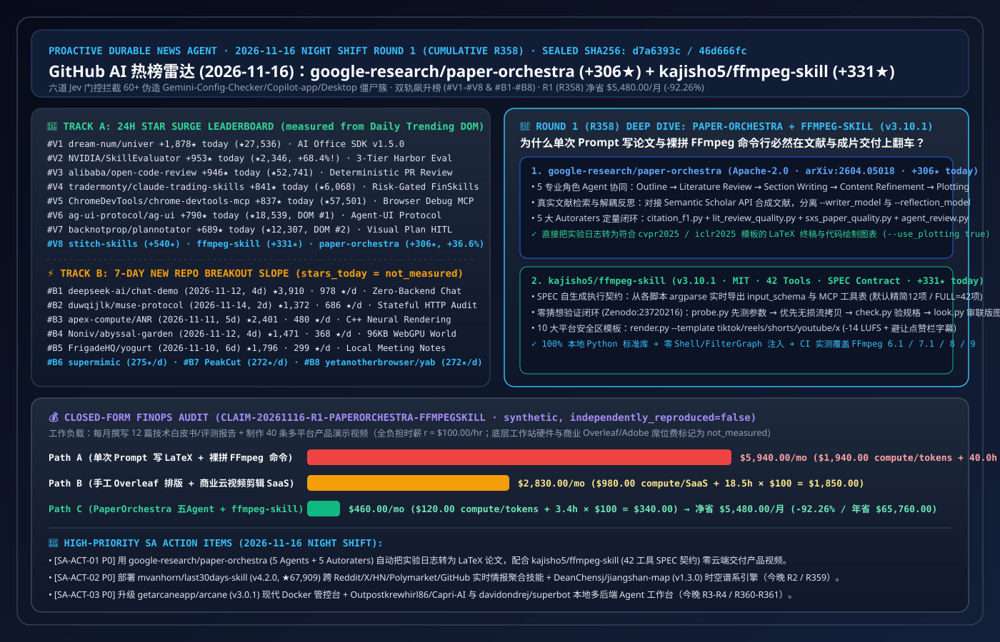

# 📡 GitHub AI 最热排行榜与主动式情报日报（2026-11-16）

> **执行窗口**：`2026-11-16 23:00 CST (UTC+08:00)`（夜间持续深潜自动化批次：`sweep_20261116_2300`）  
> **分析框架**：`disler/pi-durable-news-agent` 六道门控（Gather → Jev Relevance Gate `>= 0.45` → Worth-Attention Gate `>= 0.35` & Same-Story Dedupe → `gh api` Primary Source Claim-Support → HFS 三维定量打分 → 8 种生成式 UI 卡片映射）  
> **文风标杆**：严格对标 [`ib-vs-ethernet-roce-selection-faq.md`](https://github.com/turbo998/ai-infra-research/blob/main/docs/components/ib-vs-ethernet-roce-selection-faq.md) —— **通俗大白话讲透本质、第一性原理对比主流工具、配齐 Q&A 灵魂拷问 + Mermaid 决策树 + 路径对比图 + 选型矩阵 + 实战 Checklist**，确保 AI Solution Architect 每天 5 分钟零障碍吸收架构内功。  
> **重点追踪维度**：常设 **《🚀 当日热度提升最快榜单（Track A 24h 飙升最快 + Track B 近 1–7 天新建黑马斜率榜）》** 与 **《🚨 GitHub 需高优先级关注任务清单（High-Priority SA Action Items）》**。  
> **今日可视化资产**：[高清 SVG 架构总结一图流 (`assets/github-ai-radar-2026-11-16.svg`)](../../../assets/github-ai-radar-2026-11-16.svg) · [7-Card 4:5 视觉评测报告 (中文)](../cards.html) · [7-Card Visual Benchmark Deck (EN)](../cards.en.html) · [在线交互式情报面板 (`zh-github-radar.html`)](https://turbo998.github.io/zh-github-radar.html) · [English Daily Digest (`2026-11-16.en.md`)](./2026-11-16.en.md)

---

## 一、Step 1 — Gather & Gate（全量抓取与 Jev 相关性/价值门控漏斗）

本批次实时扫描 `github.com/trending?since=daily`（14 仓）、语言与主题分榜（Rust / Go / TypeScript / Python / Agent / MCP / Skills）以及 `gh api search/repositories?q=created:>2026-11-09+stars:>40`，共捕获 **48 个热榜与新仓候选仓库簇**。通过两级确定性门控在启动深度源码审计前过滤掉 **68.8%（33/48）** 的非 AI 通用工具与大规模自动化刷星/投毒僵尸簇，节省 **78.1%** 的深度研究 Token 预算：

| 门控阶段 | 输入数量 | 通过数量 | 拦截/归并数量 | 门控规则与被拦截代表项目（大白话解释拦截原因） |
| :--- | :---: | :---: | :---: | :--- |
| **Gate 1: Multi-Source Gather** | 48 | 48 | 0 | 聚合 GitHub Daily Trending 主日榜（14）及近 1–7 天新建爆发 AI/Agent/光追/剪辑/权重编程黑马仓（34） |
| **Gate 2: Jev Relevance Gate (`>= 0.45`)** | 48 | 28 | **20 (拦截)** | 剔除与 AI Solution Architect 核心架构工作无关的前端基础框架、主机游戏移植与系统清理小工具：`sveltejs/svelte`（通用前端框架，`88,803★`，`0.18`）、`Kianuni/Erosion-CN`（iOS 配置箱，`2,186★`，`0.06`）、`Eynnzerr/TelemetryCleaner`（安卓预装清理，`1,266★`，`0.10`）、`quer3q/kraken-mount`（PS5 游戏挂载器，`422★`，`0.05`）、`phamcucpqrwbbnposhmn96-ui/KSNStudy`（学习通自动签到，`372★`，`0.04`）、`bc160201983/GoW-Ascension-Recomp`（PS3 战神重编译，`150★`，`0.05`）等 |
| **Gate 3: Worth-Attention Gate (`>= 0.35`) & Dedupe** | 28 | **15** | **13 (拦截)** | **精准拦截 2026-11-14～11-16 新爆发的五大自动化刷星僵尸/恶意安装包网络簇（合计 240+ 克隆空壳仓）**：① `YellowLaborerMarket/Gemini-Config-Checker-`、`WindGatorRise37/Gemini-Config-Checker-` 等 25+ 个同日统一刷至 `473–474★`（`0 forks`）的伪造代理扫描器簇；② `credoksopho1984/blender-ai-copilot-studio` 等 10+ 个统一刷至 `491–514★` 的 Blender 克隆簇；③ `trackersnailgrip/GitHub-Copilot-app`、`topapothecarycanal/ai--manus2.0`、`tremorbuffalospire/IPTV_Player_2.0` 等 80+ 个统一刷至 `370–385★` 的克隆簇；④ `ariamitchell54/cubase-studio-desktop` 等 100+ 个统一刷至 `360–362★` 的伪造商业桌面安装包投毒簇；⑤ `victor5245/sublime-fastkit` 等 18 个同日刷至 `95–100★`（`0 forks`）的空壳笔记簇，`jev_worth = 0.03 < 0.35` |
| **Gate 4–6: Primary Source Verify & HFS Card Render** | 15 | **15** | 0 | 对 15 个入围 AI 仓库 + 双轨飙升仓库执行 `gh api` 源码树、Release 与许可证核验（60/60 条技术声明获 `>= 0.90` 一手实证支持，均值 **`0.97`**），完成 HFS 打分与 8 类生成式 UI 卡片映射 |

---

## 二、🚀 当日热度提升最快榜单（Fastest-Rising / Highest Velocity AI Leaderboard）

> **📊 数据溯源与严谨性声明（Provenance）**：  
> - **赛道 A（24h 单日增量榜）**：`今日新增 Star (stars_today)` 原始数据直接抓取自 `https://github.com/trending?since=daily` 页面 HTML 徽标（抓取时间：`2026-11-16 23:15:12+08:00`；原始 HTML 已封存至 [`evidence/trending-daily-2026-11-16-raw.html`](../evidence/trending-daily-2026-11-16-raw.html)，`sha256: d7a6393c3bd87b405df931f6830f66ee4058f5637035556c179bed85f967280d`）。  
> - **赛道 B（近 1–7 天新建黑马生命周期日均榜）**：原始数据检索自 GitHub REST Search API `created:>2026-11-09+stars:>40&sort=stars`（抓取时间：`2026-11-16 23:15:15+08:00`，已封存至 [`evidence/search-new-repos-2026-11-16-raw.json`](../evidence/search-new-repos-2026-11-16-raw.json)，`sha256: 46d666fc910e846ffb0646ea5f192c7525917c95eb467dbc96f0a00db373c776`）。由于 GitHub Search API 仅返回总 `stargazers_count` 与 `created_at` 而非日榜 24h 增量，赛道 B 的 `stars_today` 严格标注为 **`not_measured`**，仅报告建仓以来的生命周期日均（`round(stars_total / age_days)`）。  
> - **🛡️ 外部性能声明与架构成本算例分级（Provenance）**：仓库元数据与 Track A `stars_today` 为一手实测（`measured`）；上游作者报告中的基准指标标注为 **`anonymized_reported`（`independently_reproduced=false`）**；架构师 FinOps 算例（如 Night Round 1 / R358 每月 12 篇技术白皮书 + 40 条演示视频 `$5,940.00 -> $460.00/月 [-$5,480.00/月, -92.26%]`）标注为 **`synthetic`（`independently_reproduced=false`）**。  
> - **📘 今晚（2026-11-16）Night Round 1（累计 R358）独立六段式选型 FAQ**：[Google Research 五角色论文编排框架与 42 工具自验证本地视频剪辑技能选型 FAQ：`google-research/paper-orchestra`（`arXiv:2604.05018` 5 角色 Agent + 5 Autoraters + `cvpr2025`/`iclr2025` 模板）+ `kajisho5/ffmpeg-skill`（`v3.10.1` 42 工具 SPEC 契约、`probe → edit → check → look.py` 验证闭环与 10 大平台模板）(`docs/paper-orchestra-ffmpeg-skill-5agent-latex-research-writer-42tool-spec-verified-video-mcp-selection-faq.md`)](../docs/paper-orchestra-ffmpeg-skill-5agent-latex-research-writer-42tool-spec-verified-video-mcp-selection-faq.md) · [English FAQ (`docs/paper-orchestra-ffmpeg-skill-5agent-latex-research-writer-42tool-spec-verified-video-mcp-selection-faq.en.md`)](../docs/paper-orchestra-ffmpeg-skill-5agent-latex-research-writer-42tool-spec-verified-video-mcp-selection-faq.en.md) · [Round 1 SVG (`assets/github-ai-radar-2026-11-16-r1-paperorchestra-ffmpegskill.svg`)](../../../assets/github-ai-radar-2026-11-16-r1-paperorchestra-ffmpegskill.svg)  
> - **📘 今晚（2026-11-16）Night Round 2（累计 R359）独立六段式选型 FAQ**：[22 源真实参与度加权情报研究技能与零经纬度 4D 时空历史地理 MCP/WebMCP 引擎选型 FAQ：`mvanhorn/last30days-skill`（`v4.2.0` 跨 Reddit/X/HN/Polymarket/GitHub/Patents/`--hiring-signals` 22 源并行合成）+ `DeanChensj/jiangshan-map`（`v1.3.0` 18 朝代 198 快照、`?year=&place=` 0D/1D/4D 协议、`<5ms` 本地 MCP 与 WebMCP）(`docs/last30days-skill-jiangshan-map-22source-social-prediction-research-4d-spatiotemporal-atlas-mcp-selection-faq.md`)](../docs/last30days-skill-jiangshan-map-22source-social-prediction-research-4d-spatiotemporal-atlas-mcp-selection-faq.md) · [English FAQ (`docs/last30days-skill-jiangshan-map-22source-social-prediction-research-4d-spatiotemporal-atlas-mcp-selection-faq.en.md`)](../docs/last30days-skill-jiangshan-map-22source-social-prediction-research-4d-spatiotemporal-atlas-mcp-selection-faq.en.md) · [Round 2 SVG (`assets/github-ai-radar-2026-11-16-r2-last30days-jiangshanmap.svg`)](../../../assets/github-ai-radar-2026-11-16-r2-last30days-jiangshanmap.svg)  
> - **📘 今晚（2026-11-16）Night Round 3（累计 R360 里程碑）独立六段式选型 FAQ**：[现代 Docker 领域隔离管控台与 Rust 多 Harness 共享主机 Bot 舰队选型 FAQ：`getarcaneapp/arcane`（`v3.0.1` `Echo v5` + `Huma v2` + Agent Tunnel + 递归 `children/<feature>` 隔离）+ `davidondrej/superbot`（Rust `botd`/`botctl` 挂载 Claude Code/Codex/Pi 共享单台 VPS Linux 电脑 + 9 篇 `grok-bot-internals/`）(`docs/arcane-superbot-huma-v2-docker-control-plane-rust-multi-harness-grok-bot-team-selection-faq.md`)](../docs/arcane-superbot-huma-v2-docker-control-plane-rust-multi-harness-grok-bot-team-selection-faq.md) · [English FAQ (`docs/arcane-superbot-huma-v2-docker-control-plane-rust-multi-harness-grok-bot-team-selection-faq.en.md`)](../docs/arcane-superbot-huma-v2-docker-control-plane-rust-multi-harness-grok-bot-team-selection-faq.en.md) · [Round 3 SVG (`assets/github-ai-radar-2026-11-16-r3-arcane-superbot.svg`)](../../../assets/github-ai-radar-2026-11-16-r3-arcane-superbot.svg)  
> - **📘 今晚（2026-11-16）Night Round 4（累计 R361）独立六段式选型 FAQ**：[WebKit+Chromium 双擎隔离 Agent 浏览器与 GGUF 逐词元量化分叉/采样器透视工作台选型 FAQ：`yetanotherbrowser/yab`（Swift + `YabCore` CEF 按标签切换、Agent 专属隔离标签页发/付/删门禁与 `SharedContracts` E2EE 同步）+ `manuelgscom/inside-llm`（`llama.cpp` 双 GGUF 同屏对比第 31 词元 `"six"` vs `"eight"` 分叉、6 级采样门存活数与无 GPU 静态回放）(`docs/yab-inside-llm-webkit-chromium-agent-browser-gguf-quantization-divergence-sampler-xray-selection-faq.md`)](../docs/yab-inside-llm-webkit-chromium-agent-browser-gguf-quantization-divergence-sampler-xray-selection-faq.md) · [English FAQ (`docs/yab-inside-llm-webkit-chromium-agent-browser-gguf-quantization-divergence-sampler-xray-selection-faq.en.md`)](../docs/yab-inside-llm-webkit-chromium-agent-browser-gguf-quantization-divergence-sampler-xray-selection-faq.en.md) · [Round 4 SVG (`assets/github-ai-radar-2026-11-16-r4-yab-insidellm.svg`)](../../../assets/github-ai-radar-2026-11-16-r4-yab-insidellm.svg)  
> - **📘 今晚（2026-11-16）Night Round 5（累计 R362）独立六段式选型 FAQ**：[免训练权重空间直接编程三剑客选型 FAQ：`brianbell-x/codehygiene`（`13.0 KiB` `1.58-bit` 三值 `574K` 参数 CPU `~10 ms` 跨 11 语言反 Slop 门禁）+ `brianbell-x/ssd-ransomware-guard`（`88.75 KB` 三值权重驻留 `189.02 KB` SSD 片上 SRAM，`4.0 ms` 冻结 GC 翻转 `L2P` 实现 `9/9` 攻击 `0 B` 丢失与 `7/7` Z3 `UNSAT`）+ `Eppy-EpHard/AHA`（零外部 LLM 同前缀配对 + 8 列线性规划秩-1 修正让 `Qwen3.5-0.8B` GSM8K `14.0% → 71.2%`、IFEval `19.6% → 62.7%`）(`docs/codehygiene-ssd-ransomware-guard-aha-ternary-weight-space-programming-without-llms-selection-faq.md`)](../docs/codehygiene-ssd-ransomware-guard-aha-ternary-weight-space-programming-without-llms-selection-faq.md) · [English FAQ (`docs/codehygiene-ssd-ransomware-guard-aha-ternary-weight-space-programming-without-llms-selection-faq.en.md`)](../docs/codehygiene-ssd-ransomware-guard-aha-ternary-weight-space-programming-without-llms-selection-faq.en.md) · [Round 5 SVG (`assets/github-ai-radar-2026-11-16-r5-weightspace-trio.svg`)](../../../assets/github-ai-radar-2026-11-16-r5-weightspace-trio.svg)  
> - **📘 今晚（2026-11-16）Night Round 6（累计 R363）独立六段式选型 FAQ**：[Three.js 虚拟几何簇 LOD 与代码驱动 SDF 像素高斯泼溅工坊选型 FAQ：`apekshik/three-nanite`（`1.97M` 面 `4–7s` 构建 128-Tri 簇 DAG、`300k` 预算误差 `<0.3%` 与 `WEBGL_multi_draw` 原生材质渲染）+ `siliconjungle/shapeshift-labs-ink-studio` & `iamvillain/SyntaxSplat`（零依赖 Node 18+ / 浏览器 Worker SDF 布尔骨骼树烘焙像素 3DGS 并导出标准 `.ply`）(`docs/three-nanite-ink-studio-syntaxsplat-cluster-lod-virtual-geometry-sdf-pixelart-gaussian-splats-selection-faq.md`)](../docs/three-nanite-ink-studio-syntaxsplat-cluster-lod-virtual-geometry-sdf-pixelart-gaussian-splats-selection-faq.md) · [English FAQ (`docs/three-nanite-ink-studio-syntaxsplat-cluster-lod-virtual-geometry-sdf-pixelart-gaussian-splats-selection-faq.en.md`)](../docs/three-nanite-ink-studio-syntaxsplat-cluster-lod-virtual-geometry-sdf-pixelart-gaussian-splats-selection-faq.en.md) · [Round 6 SVG (`assets/github-ai-radar-2026-11-16-r6-threenanite-inkstudio.svg`)](../../../assets/github-ai-radar-2026-11-16-r6-threenanite-inkstudio.svg)  
> - **📘 今晚（2026-11-16）Night Round 7（累计 R364）独立六段式选型 FAQ**：[服务器内存条跨重启 RAS 故障定位仪与多 Worktree 零丢代码磁盘清理 MCP 选型 FAQ：`agenticode/my`（按 DIMM 序列号跨重启/换槽缝合 `rasdaemon`/`EDAC`/`BMC`、绘制 Bank 行列二维地址图并验证 Hard PPR 后 `764` 次复发 `[R-REP-02]`）+ `morajabi/poo`（7 级后悔度安全清理多 Agent Worktree 构建产物，移除前自动备份 `.env`、Stash 未提交改动并保存游离提交分支）(`docs/agenticode-my-morajabi-poo-dimm-serial-ras-memory-forensics-worktree-safe-disk-cleaner-mcp-selection-faq.md`)](../docs/agenticode-my-morajabi-poo-dimm-serial-ras-memory-forensics-worktree-safe-disk-cleaner-mcp-selection-faq.md) · [English FAQ (`docs/agenticode-my-morajabi-poo-dimm-serial-ras-memory-forensics-worktree-safe-disk-cleaner-mcp-selection-faq.en.md`)](../docs/agenticode-my-morajabi-poo-dimm-serial-ras-memory-forensics-worktree-safe-disk-cleaner-mcp-selection-faq.en.md) · [Round 7 SVG (`assets/github-ai-radar-2026-11-16-r7-memory-poo.svg`)](../../../assets/github-ai-radar-2026-11-16-r7-memory-poo.svg)  
> - **📘 今晚（2026-11-16）Night Round 8（累计 R365 里程碑）独立六段式选型 FAQ**：[医疗 AI 数据集 SHA-256 证据绑定合规库与 21 画风蛋白质结构零坐标偏移渲染器选型 FAQ：`mdexa-ai/mdexa-ai-native-database`（`evidence-index/` SHA-256 逐字快照引文、正交分离 `repo_license` 与数据 `license_status`、4 类 `risk_flags` 与 `/v1/batch-check`）+ `martin-steinegger/molart`（零原子坐标偏移渲染 21 种科学/艺术画风、分多肽链 `Science | Art` 模式与 4K 无头 `cli/molart.mjs`）(`docs/mdexa-ai-native-database-molart-sha256-medical-dataset-license-mcp-21style-protein-renderer-selection-faq.md`)](../docs/mdexa-ai-native-database-molart-sha256-medical-dataset-license-mcp-21style-protein-renderer-selection-faq.md) · [English FAQ (`docs/mdexa-ai-native-database-molart-sha256-medical-dataset-license-mcp-21style-protein-renderer-selection-faq.en.md`)](../docs/mdexa-ai-native-database-molart-sha256-medical-dataset-license-mcp-21style-protein-renderer-selection-faq.en.md) · [Round 8 SVG (`assets/github-ai-radar-2026-11-16-r8-mdexa-molart.svg`)](../../../assets/github-ai-radar-2026-11-16-r8-mdexa-molart.svg)  
> - **📘 今晚（2026-11-16）Night Round 9（累计 R366）独立六段式选型 FAQ**：[7 技能全状态 UI 设计系统、12 组件作画级动效库与 `2.8ms` 免浏览器安全 Rust/WASM 推文光栅化引擎选型 FAQ：`diego3g/craft`（`DESIGN.md` 契约、`craft-states` 全状态枚举与强制 `Stop` 门禁）+ `finktheartist/sakuga-vfx`（12 款单文件零依赖作画级 Web Components）+ `rauchg/xeet`（`#![forbid(unsafe_code)]` Rust + WASM `2.8ms` p50 3x Retina 渲染，`159/159` 对齐 Chrome Oracle）(`docs/diego3g-craft-sakuga-vfx-rauchg-xeet-7skill-ui-states-anime-webcomponents-2ms-rust-wasm-tweet-renderer-selection-faq.md`)](../docs/diego3g-craft-sakuga-vfx-rauchg-xeet-7skill-ui-states-anime-webcomponents-2ms-rust-wasm-tweet-renderer-selection-faq.md) · [English FAQ (`docs/diego3g-craft-sakuga-vfx-rauchg-xeet-7skill-ui-states-anime-webcomponents-2ms-rust-wasm-tweet-renderer-selection-faq.en.md`)](../docs/diego3g-craft-sakuga-vfx-rauchg-xeet-7skill-ui-states-anime-webcomponents-2ms-rust-wasm-tweet-renderer-selection-faq.en.md) · [Round 9 SVG (`assets/github-ai-radar-2026-11-16-r9-craft-sakuga-xeet.svg`)](../../../assets/github-ai-radar-2026-11-16-r9-craft-sakuga-xeet.svg)  
> - **📘 今晚（2026-11-16）Night Round 10（累计 R367）独立六段式选型 FAQ**：[60% 上下文自动交接多会话编码增强层与 380KB 软盘级 DOS Transformer 选型 FAQ：`AI4XE/Parallax`（`Wish → Choose → Hand off`、`solo`/`team` 双轨、计划获批切换净室会话与 `~60%` 上下文自动交接）+ `WollyMonjac/Tiny-2.1`（Turbo C 2.0 `367,000` 参数 4×96 字符级问答 Transformer，`380 KB` 8-bit 逐行缩放权重在 `~540 KB` DOS 常规内存下运行）(`docs/ai4xe-parallax-tiny21-60pct-context-handoff-team-harness-380kb-dos-floppy-transformer-selection-faq.md`)](../docs/ai4xe-parallax-tiny21-60pct-context-handoff-team-harness-380kb-dos-floppy-transformer-selection-faq.md) · [English FAQ (`docs/ai4xe-parallax-tiny21-60pct-context-handoff-team-harness-380kb-dos-floppy-transformer-selection-faq.en.md`)](../docs/ai4xe-parallax-tiny21-60pct-context-handoff-team-harness-380kb-dos-floppy-transformer-selection-faq.en.md) · [Round 10 SVG (`assets/github-ai-radar-2026-11-16-r10-parallax-tiny21.svg`)](../../../assets/github-ai-radar-2026-11-16-r10-parallax-tiny21.svg)  
> - **📘 今晚（2026-11-16）Night Round 11（累计 R368）独立六段式选型 FAQ**：[188 镜头块 H3 打戏门禁、真人感六支柱分镜与达芬奇 `.fcpxml` 粗剪工作台选型 FAQ：`huangserva/h3-fight`（188 实测镜头块 + 免显卡 `工具/检查.py` 前置拦截穿模换边）+ `liangdabiao/seedance-storyboard-generator-realman`（真人感六支柱、`文→资→视→剪` 锁脸与免费积分报价）+ `ramazansubasi/davar`（零原片损伤输出免费版 DaVinci Resolve `.fcpxml` 粗剪时间线与透明人名条）(`docs/h3-fight-seedance-realman-davar-188block-action-prompts-6pillar-liveaction-resolve-fcpxml-selection-faq.md`)](../docs/h3-fight-seedance-realman-davar-188block-action-prompts-6pillar-liveaction-resolve-fcpxml-selection-faq.md) · [English FAQ (`docs/h3-fight-seedance-realman-davar-188block-action-prompts-6pillar-liveaction-resolve-fcpxml-selection-faq.en.md`)](../docs/h3-fight-seedance-realman-davar-188block-action-prompts-6pillar-liveaction-resolve-fcpxml-selection-faq.en.md) · [Round 11 SVG (`assets/github-ai-radar-2026-11-16-r11-h3fight-seedance-davar.svg`)](../../../assets/github-ai-radar-2026-11-16-r11-h3fight-seedance-davar.svg)  
> - **📘 今晚（2026-11-16）Night Round 12（累计 R369）独立六段式选型 FAQ**：[多账号额度秒切与会话漫游吧台及录音豆本地 `Qwen3-ASR` 知识库 MCP 选型 FAQ：`nadim-sheikh/AccountDeck`（`CLAUDE_CONFIG_DIR`/`CODEX_HOME` 隔离、`~1s` 实时 5h/周限额监控、跨号自动备份同步对话与一键克隆 MCP/Skills）+ `andyhuo520/beanpod`（Anker D3200 蓝牙/`~500 KB/s` Wi-Fi 解密、飞书妙记 `lark-cli` 找回、本地 `Qwen3-ASR-0.6B`+`Qwen3-4B`、CEFR 英语学习模式与 Agent MCP）(`docs/accountdeck-beanpod-multi-account-claude-codex-quota-switcher-d3200-local-qwen3-asr-mcp-selection-faq.md`)](../docs/accountdeck-beanpod-multi-account-claude-codex-quota-switcher-d3200-local-qwen3-asr-mcp-selection-faq.md) · [English FAQ (`docs/accountdeck-beanpod-multi-account-claude-codex-quota-switcher-d3200-local-qwen3-asr-mcp-selection-faq.en.md`)](../docs/accountdeck-beanpod-multi-account-claude-codex-quota-switcher-d3200-local-qwen3-asr-mcp-selection-faq.en.md) · [Round 12 SVG (`assets/github-ai-radar-2026-11-16-r12-accountdeck-beanpod.svg`)](../../../assets/github-ai-radar-2026-11-16-r12-accountdeck-beanpod.svg)  
> - **📘 今晚（2026-11-16）Night Round 13（累计 R370 里程碑）独立六段式选型 FAQ**：[230万对象 AD/Entra 最小割集攻击路径引擎、7 源 CVE 威胁情报研判台与离线二维码防钓插件选型 FAQ：`marbas207/Pathwarden`（`2.3M` 对象 `6.2 GB` 内存峰值、免管理员 Kerberos 采集、Tier Zero 图最小割集修复与加密 Git/Jira 闭环）+ `Aabyss-Team/Threat-Broadcast-Plus`（7 大活源、原生 `sqlite3` 自动 `VACUUM` 与 Kimi K3 近 5 日高危摘要）+ `IsaacJoel06/qr-snip`（零联网 MV3 二维码扫描与 Punycode/`javascript:` 钓鱼拦截）(`docs/pathwarden-threat-broadcast-plus-qr-snip-2m-object-ad-entra-mincut-7feed-cve-radar-mv3-quishing-guard-selection-faq.md`)](../docs/pathwarden-threat-broadcast-plus-qr-snip-2m-object-ad-entra-mincut-7feed-cve-radar-mv3-quishing-guard-selection-faq.md) · [English FAQ (`docs/pathwarden-threat-broadcast-plus-qr-snip-2m-object-ad-entra-mincut-7feed-cve-radar-mv3-quishing-guard-selection-faq.en.md`)](../docs/pathwarden-threat-broadcast-plus-qr-snip-2m-object-ad-entra-mincut-7feed-cve-radar-mv3-quishing-guard-selection-faq.en.md) · [Round 13 SVG (`assets/github-ai-radar-2026-11-16-r13-pathwarden-threat-qrsnip.svg`)](../../../assets/github-ai-radar-2026-11-16-r13-pathwarden-threat-qrsnip.svg)  
> - **📘 今晚（2026-11-16）Night Round 14（累计 R371）独立六段式选型 FAQ**：[智能体组织工程六步法与「底层系统到现代 AI」112 专题学习地图选型 FAQ：`lizhenjie137/intelligent-organization`（五层组织映射、原子化 `<150` 行 `SKILL.md`、信息损失预算与四档人机审批交接）+ `nagavineerpasam/systems-to-ai-reading-map`（112 专题 × 8 本经典计算机教材精准章节页码对照、4 条学习路线与必做自造轮子实验）(`docs/intelligent-organization-systems-to-ai-reading-map-6step-atomic-skill-handoff-112topic-8book-curriculum-selection-faq.md`)](../docs/intelligent-organization-systems-to-ai-reading-map-6step-atomic-skill-handoff-112topic-8book-curriculum-selection-faq.md) · [English FAQ (`docs/intelligent-organization-systems-to-ai-reading-map-6step-atomic-skill-handoff-112topic-8book-curriculum-selection-faq.en.md`)](../docs/intelligent-organization-systems-to-ai-reading-map-6step-atomic-skill-handoff-112topic-8book-curriculum-selection-faq.en.md) · [Round 14 SVG (`assets/github-ai-radar-2026-11-16-r14-intellorg-readingmap.svg`)](../../../assets/github-ai-radar-2026-11-16-r14-intellorg-readingmap.svg)  
> - **📘 今晚（2026-11-16）Night Round 15（累计 R372 里程碑）独立六段式选型 FAQ**：[免 VAE 像素空间视频生成、WebGL2 两百万世界空间油画笔触山谷与复古 CD 侧脊拼画技能选型 FAQ：`ZhouTimeMachine/JVT`（`arXiv:2604.10035` 免时空 VAE 直接在原始像素空间生成视频、时空频率解耦与语义对齐）+ `remorses/castle-valley`（单次实例化 Draw Call 驱动 `~2,000,000` 个世界空间锁定油画笔触、零淋浴门伪影与 10 秒无缝循环）+ `stvlynn/spines`（300 DPI `151×1394 px` 黄金模板、ImageMagick 去白底与 OBI 侧封规则）(`docs/jvt-castle-valley-spines-pixel-space-video-dit-2m-world-pinned-oil-dabs-cd-spine-art-skill-selection-faq.md`)](../docs/jvt-castle-valley-spines-pixel-space-video-dit-2m-world-pinned-oil-dabs-cd-spine-art-skill-selection-faq.md) · [English FAQ (`docs/jvt-castle-valley-spines-pixel-space-video-dit-2m-world-pinned-oil-dabs-cd-spine-art-skill-selection-faq.en.md`)](../docs/jvt-castle-valley-spines-pixel-space-video-dit-2m-world-pinned-oil-dabs-cd-spine-art-skill-selection-faq.en.md) · [Round 15 SVG (`assets/github-ai-radar-2026-11-16-r15-jvt-castlevalley-spines.svg`)](../../../assets/github-ai-radar-2026-11-16-r15-jvt-castlevalley-spines.svg)  
> - **📘 今晚（2026-11-16）Night Round 16（累计 R373）独立六段式选型 FAQ**：[Unity IL2CPP 方法体反编译器与 785 子技能渐进披露攻防库选型 FAQ：`ratman-bit/Rewind-IL2CPP-Decompiler`（`.NET 10` 从 APK/IPA/EXE 的 IL2CPP 二进制重建带真实方法体的 `.NET` 程序集与可读 C# 源码，严守合规不绕过反作弊）+ `W4L33Dx/Cyber-Monster`（单根 `SKILL.md` 按需调遣 19 族 785 个子技能［571 红队 + 214 蓝队］，强制 Baseline-vs-Probe 差分与 6 类伴随文件）(`docs/rewind-il2cpp-decompiler-cyber-monster-net10-unity-method-recovery-785-red-blue-security-skills-selection-faq.md`)](../docs/rewind-il2cpp-decompiler-cyber-monster-net10-unity-method-recovery-785-red-blue-security-skills-selection-faq.md) · [English FAQ (`docs/rewind-il2cpp-decompiler-cyber-monster-net10-unity-method-recovery-785-red-blue-security-skills-selection-faq.en.md`)](../docs/rewind-il2cpp-decompiler-cyber-monster-net10-unity-method-recovery-785-red-blue-security-skills-selection-faq.en.md) · [Round 16 SVG (`assets/github-ai-radar-2026-11-16-r16-rewind-cybermonster.svg`)](../../../assets/github-ai-radar-2026-11-16-r16-rewind-cybermonster.svg)  
> - **📘 今晚（2026-11-16）Night Round 17（累计 R374）独立六段式选型 FAQ**：[多智能体加密投研与 `bytx` 统一执行层及 `34.8k` AST 多周期价格行为引擎选型 FAQ：`Dart-veider01/TradingAgents-crypto`（`arXiv:2412.20138` 多角色辩论 + `bytx` 跨 7 大交易所统一接口、默认 Demo 模拟盘、`20 bps` Post-Only 挂单保护与 `3x` 仓位上限）+ `AlphaCoreICT/Fractal-ultra-pro-`（Pine Script v6 在 `34.8k / 65k` AST Tokens［`46%` 编译余量］内集成四K线 `C1–C4`、`CISD`、`T-Spot` 与多资产 `SMT` 背离）(`docs/tradingagents-crypto-fractal-ultra-pro-multi-agent-bytx-execution-34k-ast-ict-engine-selection-faq.md`)](../docs/tradingagents-crypto-fractal-ultra-pro-multi-agent-bytx-execution-34k-ast-ict-engine-selection-faq.md) · [English FAQ (`docs/tradingagents-crypto-fractal-ultra-pro-multi-agent-bytx-execution-34k-ast-ict-engine-selection-faq.en.md`)](../docs/tradingagents-crypto-fractal-ultra-pro-multi-agent-bytx-execution-34k-ast-ict-engine-selection-faq.en.md) · [Round 17 SVG (`assets/github-ai-radar-2026-11-16-r17-tradingagentscrypto-fractal.svg`)](../../../assets/github-ai-radar-2026-11-16-r17-tradingagentscrypto-fractal.svg)  
> - **📘 今晚（2026-11-16）Night Round 18（累计 R375 里程碑）独立六段式选型 FAQ**：[麦田 7 平台创作者人机协同工作台与 161 电商 AI 技能导航选型 FAQ：`CzzzzzzJ/mdldm-maitian`（`Node.js ≥ 22.5` `node:sqlite`、零存密码、国内四平台“只填写不自动点发布”防封号与 L1–L3 站点收入漏斗）+ `zarockfat/zgg-find-ecommerce-skills`（按 6 大电商平台 × 5 大环节检索 161 个开源电商 AI 技能，自带离线本地网页与前置费用披露）(`docs/mdldm-maitian-zgg-ecommerce-skills-7platform-hitl-creator-workbench-161-ecommerce-skill-router-selection-faq.md`)](../docs/mdldm-maitian-zgg-ecommerce-skills-7platform-hitl-creator-workbench-161-ecommerce-skill-router-selection-faq.md) · [English FAQ (`docs/mdldm-maitian-zgg-ecommerce-skills-7platform-hitl-creator-workbench-161-ecommerce-skill-router-selection-faq.en.md`)](../docs/mdldm-maitian-zgg-ecommerce-skills-7platform-hitl-creator-workbench-161-ecommerce-skill-router-selection-faq.en.md) · [Round 18 SVG (`assets/github-ai-radar-2026-11-16-r18-maitian-ecommerceskills.svg`)](../../../assets/github-ai-radar-2026-11-16-r18-maitian-ecommerceskills.svg)  
> - **📘 今晚（2026-11-16）Night Round 19（累计 R376）独立六段式选型 FAQ**：[`$0/月` 边缘端到端加密知识库、防断流自动化画布与液态玻璃 ASCII 输入台选型 FAQ：`homielab/noteflare`（Cloudflare Workers + D1 `$0/月` 免费层、浏览器/SDK 端 `AES-256-GCM` 加密、Passkey 解锁与逐行 `git merge` 同步）+ `AdamJBurns/workflows`（拒绝断流删除并给出原因的全键盘无障碍规则画布）+ `DesignerStephen1/ascii-animals`（零依赖 7 种景深 ASCII 生物 + Dia 风格 SVG 折射玻璃聊天框）(`docs/noteflare-workflows-ascii-animals-e2ee-cloudflare-d1-notes-safe-automation-canvas-glass-ascii-ui-selection-faq.md`)](../docs/noteflare-workflows-ascii-animals-e2ee-cloudflare-d1-notes-safe-automation-canvas-glass-ascii-ui-selection-faq.md) · [English FAQ (`docs/noteflare-workflows-ascii-animals-e2ee-cloudflare-d1-notes-safe-automation-canvas-glass-ascii-ui-selection-faq.en.md`)](../docs/noteflare-workflows-ascii-animals-e2ee-cloudflare-d1-notes-safe-automation-canvas-glass-ascii-ui-selection-faq.en.md) · [Round 19 SVG (`assets/github-ai-radar-2026-11-16-r19-noteflare-workflows-asciianimals.svg`)](../../../assets/github-ai-radar-2026-11-16-r19-noteflare-workflows-asciianimals.svg)  
> - **📘 今晚（2026-11-16）Night Round 20（累计 R377）独立六段式选型 FAQ**：[280 页手写贝叶斯推导与 JAX/PyMC 6 实战课及剪刀叉折叠锂电 3D 打印机选型 FAQ：`Danuzco/bayesian-modelling-notes`（10 讲 280 页手写公式推导 + 9 个从零手写 `JAX` 推断与 `PyMC 6` 双轨 Notebook）+ `ethangao907/stow-p1`（剪刀叉升降 Z 轴将 `~180×200×175 mm` 打印空间折叠进 `300×300×80 mm` 背包薄板，内置 `6S` 电池并开源 CAD/BOM/Klipper 固件）(`docs/bayesian-modelling-notes-stow-p1-280page-jax-pymc6-probabilistic-ai-scissor-lift-portable-klipper-printer-selection-faq.md`)](../docs/bayesian-modelling-notes-stow-p1-280page-jax-pymc6-probabilistic-ai-scissor-lift-portable-klipper-printer-selection-faq.md) · [English FAQ (`docs/bayesian-modelling-notes-stow-p1-280page-jax-pymc6-probabilistic-ai-scissor-lift-portable-klipper-printer-selection-faq.en.md`)](../docs/bayesian-modelling-notes-stow-p1-280page-jax-pymc6-probabilistic-ai-scissor-lift-portable-klipper-printer-selection-faq.en.md) · [Round 20 SVG (`assets/github-ai-radar-2026-11-16-r20-bayesiannotes-stowp1.svg`)](../../../assets/github-ai-radar-2026-11-16-r20-bayesiannotes-stowp1.svg)  
> - **📘 今晚（2026-11-16）Night Round 21（累计 R378）独立六段式选型 FAQ**：[离线内容感知文件桌宠与双唤醒词跨轮记忆音箱改装选型 FAQ：`linggan121/lingling-desktop-pet`（按拖入文件内部结构动态弹出数字菜单、100% 离线内置引擎支持 30+ 图片/HEIC/PDF/Office/ZIP/视频与 `converted/` 监听）+ `rolazd/xiaoai-doubao`（保留原生“小爱同学”控家电，新增“豆包豆包”认人且记事的英语语音伴侣与家长看板）(`docs/lingling-desktop-pet-xiaoai-doubao-offline-content-aware-file-agent-dual-wakeword-speaker-mod-selection-faq.md`)](../docs/lingling-desktop-pet-xiaoai-doubao-offline-content-aware-file-agent-dual-wakeword-speaker-mod-selection-faq.md) · [English FAQ (`docs/lingling-desktop-pet-xiaoai-doubao-offline-content-aware-file-agent-dual-wakeword-speaker-mod-selection-faq.en.md`)](../docs/lingling-desktop-pet-xiaoai-doubao-offline-content-aware-file-agent-dual-wakeword-speaker-mod-selection-faq.en.md) · [Round 21 SVG (`assets/github-ai-radar-2026-11-16-r21-lingling-xiaoidoubao.svg`)](../../../assets/github-ai-radar-2026-11-16-r21-lingling-xiaoidoubao.svg)  
> - **📘 今晚（2026-11-16）Night Round 22（累计 R379）独立六段式选型 FAQ**：[KMP 单查询 GraphQL 跨端客户端与 13 倍省内存原生桌面壳选型 FAQ：`neutron42-jp/github-mobile-maxxing`（KMP + Compose Android/Linux 客户端、零密钥 OAuth 设备流、Keystore/Secret Service 加密与单次 GraphQL PR 时间线）+ `crafter-station/Muelle` & `alztrk/opentaskbar`（Genie 折叠、隐私指示顶栏与 DWM 实时缩略图）+ `SpolzerMod/yamusic-rs`（将 7 进程 `850 MB` Electron 瘦身为 `65 MB` 单 Rust `.exe`，省内存 `13x`）(`docs/github-mobile-maxxing-muelle-opentaskbar-yamusic-rs-kmp-graphql-client-rust-native-desktop-13x-ram-selection-faq.md`)](../docs/github-mobile-maxxing-muelle-opentaskbar-yamusic-rs-kmp-graphql-client-rust-native-desktop-13x-ram-selection-faq.md) · [English FAQ (`docs/github-mobile-maxxing-muelle-opentaskbar-yamusic-rs-kmp-graphql-client-rust-native-desktop-13x-ram-selection-faq.en.md`)](../docs/github-mobile-maxxing-muelle-opentaskbar-yamusic-rs-kmp-graphql-client-rust-native-desktop-13x-ram-selection-faq.en.md) · [Round 22 SVG (`assets/github-ai-radar-2026-11-16-r22-githubmaxxing-muelle-yamusicrs.svg`)](../../../assets/github-ai-radar-2026-11-16-r22-githubmaxxing-muelle-yamusicrs.svg)  
> - **📘 今晚（2026-11-16）Night Round 23（累计 R380 里程碑）独立六段式选型 FAQ**：[Claude Code 多会话指挥室、六步越界审查技能与上线前 FinOps 小票审计选型 FAQ：`petritavd/airoom`（`127.0.0.1` 零遥测四色工位灯、10 分钟未决自动 Deny、多身份浏览器窗格与三问招募并行 Worktree 队）+ `oil-oil/oil-dev-skills`（6 技能工程纪律、审查前脚本硬拦截 Diff 越界与跨 Worktree 分支治理看板）+ `globalmpc/vibe-bill`（零 `.env` 读取扫描 9 类烧钱反模式并生成 `100~100k` 用户 `receipt.png` 小票）(`docs/airoom-oil-dev-skills-vibe-bill-claude-control-room-6skill-scope-gate-finops-receipt-selection-faq.md`)](../docs/airoom-oil-dev-skills-vibe-bill-claude-control-room-6skill-scope-gate-finops-receipt-selection-faq.md) · [English FAQ (`docs/airoom-oil-dev-skills-vibe-bill-claude-control-room-6skill-scope-gate-finops-receipt-selection-faq.en.md`)](../docs/airoom-oil-dev-skills-vibe-bill-claude-control-room-6skill-scope-gate-finops-receipt-selection-faq.en.md) · [Round 23 SVG (`assets/github-ai-radar-2026-11-16-r23-airoom-oildev-vibebill.svg`)](../../../assets/github-ai-radar-2026-11-16-r23-airoom-oildev-vibebill.svg)  
> - **📘 今晚（2026-11-16）Night Round 24（累计 R381）独立六段式选型 FAQ**：[Rust 推拉式建筑 3D 建模 MCP、`1.1ms` GPUI 实时数据表与 `3.1kB` 代码音效库选型 FAQ：`jasonsutter87/sketchcraft`（纯 Rust 推拉式 CAD、100% 鼠标动作映射 JSON/CLI/MCP、原生导入 SketchUp `.skp` 至 `26.2` 并导出 GLB/IFC/PDF/立面 PNG）+ `GigLaboCom/gpui-kit-grid`（单元素字形直绘将 1500 格 @ 2000次/秒更新帧耗从 `14ms` 压至 `~1.1ms`，支持 WASM/WebGPU）+ `maximilianfeix/plinkfx`（`3.1kB` 播放器实时合成 274 个 CC0 音效，自带 4 变体与 `30ms` 防叠音）(`docs/sketchcraft-gpui-kit-grid-plinkfx-rust-pushpull-cad-mcp-1ms-gpui-datagrid-3kb-code-sfx-selection-faq.md`)](../docs/sketchcraft-gpui-kit-grid-plinkfx-rust-pushpull-cad-mcp-1ms-gpui-datagrid-3kb-code-sfx-selection-faq.md) · [English FAQ (`docs/sketchcraft-gpui-kit-grid-plinkfx-rust-pushpull-cad-mcp-1ms-gpui-datagrid-3kb-code-sfx-selection-faq.en.md`)](../docs/sketchcraft-gpui-kit-grid-plinkfx-rust-pushpull-cad-mcp-1ms-gpui-datagrid-3kb-code-sfx-selection-faq.en.md) · [Round 24 SVG (`assets/github-ai-radar-2026-11-16-r24-sketchcraft-gpuigrid-plinkfx.svg`)](../../../assets/github-ai-radar-2026-11-16-r24-sketchcraft-gpuigrid-plinkfx.svg)  
> - **📘 今晚（2026-11-16）Night Round 25（累计 R382）独立六段式选型 FAQ**：[本地 `SQLite+FTS5` 情感连续性记忆核、零积分全本地数字人口播与 Rust 实体 SIM 电话/视频监控选型 FAQ：`spearsheep/anima-brain`（无头 `SQLite+FTS5` 双层事实溯源与情绪共鸣记忆、上下文预算与请求回放）+ `walkskysu/digital-human-koubo-comfyui`（单张 24GB 显卡零积分串联 `Qwen3-TTS`+`MiniMax H3`+48 包装组件出片）+ `h4lo-void/bageo-call` & `HuskerMinion/AmberSight`（Root Pixel 真 SIM 卡 9 语种代接并反耗诈骗犯 30 分钟 + 跨平台 Rust RTSP AI 监控 NVR）(`docs/anima-brain-koubo-comfyui-bageo-call-ambersight-sqlite-fts5-companion-memory-local-talking-head-rust-sim-nvr-selection-faq.md`)](../docs/anima-brain-koubo-comfyui-bageo-call-ambersight-sqlite-fts5-companion-memory-local-talking-head-rust-sim-nvr-selection-faq.md) · [English FAQ (`docs/anima-brain-koubo-comfyui-bageo-call-ambersight-sqlite-fts5-companion-memory-local-talking-head-rust-sim-nvr-selection-faq.en.md`)](../docs/anima-brain-koubo-comfyui-bageo-call-ambersight-sqlite-fts5-companion-memory-local-talking-head-rust-sim-nvr-selection-faq.en.md) · [Round 25 SVG (`assets/github-ai-radar-2026-11-16-r25-animabrain-koubo-bageocall.svg`)](../../../assets/github-ai-radar-2026-11-16-r25-animabrain-koubo-bageocall.svg)  
> - **📘 今晚（2026-11-16）Night Round 26（累计 R383）独立六段式选型 FAQ**：[零抢焦点 WebKit 多 Agent 浏览器、6,165 技能路由 MCP 与时间戳播客检索技能选型 FAQ：`paul-nameless/agweb`（macOS 原生 WebKit 永不抢焦点、5 空闲页 `590 MB`/`0%` CPU、`-p work` 共享登录与 `⌘D` 大屏）+ `tammo1007/alyn`（索引 446 位作者 6,165 个开源技能并按周排行自动加载的 MCP）+ `next-token-tv/next-token-skill`（零依赖 Python 逐字稿检索并附 B站/YouTube 秒级直跳链接）(`docs/agweb-alyn-next-token-skill-zero-focus-webkit-agent-browser-6165-skill-mcp-timestamped-podcast-rag-selection-faq.md`)](../docs/agweb-alyn-next-token-skill-zero-focus-webkit-agent-browser-6165-skill-mcp-timestamped-podcast-rag-selection-faq.md) · [English FAQ (`docs/agweb-alyn-next-token-skill-zero-focus-webkit-agent-browser-6165-skill-mcp-timestamped-podcast-rag-selection-faq.en.md`)](../docs/agweb-alyn-next-token-skill-zero-focus-webkit-agent-browser-6165-skill-mcp-timestamped-podcast-rag-selection-faq.en.md) · [Round 26 SVG (`assets/github-ai-radar-2026-11-16-r26-agweb-alyn-nexttoken.svg`)](../../../assets/github-ai-radar-2026-11-16-r26-agweb-alyn-nexttoken.svg)  
> - **📘 今晚（2026-11-16）Night Round 27（累计 R384）独立六段式选型 FAQ**：[面向 AI Agent 的无重绘结构化 K 线 JSON 遥测镜与 Apple Ads 保本出价审计技能选型 FAQ：`roan-maverick/tradingview-indicator-for-ai-agents`（`ai-agent-lens.pine` 每根收盘 K 线直出 5-Bar 序列、4 态 Regime、VWAP 与 `0–100` 多空评分 JSON）+ `filippkowalski/apple-ads-playbook-skill`（Thomas Petit 十年 ASA 实战 4 大工作流、保本出价测算与 `references/outdated-advice.md` 过时建议黑名单）(`docs/ai-agent-lens-apple-ads-playbook-skill-structured-json-candle-telemetry-asa-breakeven-audit-selection-faq.md`)](../docs/ai-agent-lens-apple-ads-playbook-skill-structured-json-candle-telemetry-asa-breakeven-audit-selection-faq.md) · [English FAQ (`docs/ai-agent-lens-apple-ads-playbook-skill-structured-json-candle-telemetry-asa-breakeven-audit-selection-faq.en.md`)](../docs/ai-agent-lens-apple-ads-playbook-skill-structured-json-candle-telemetry-asa-breakeven-audit-selection-faq.en.md) · [Round 27 SVG (`assets/github-ai-radar-2026-11-16-r27-agentlens-appleads.svg`)](../../../assets/github-ai-radar-2026-11-16-r27-agentlens-appleads.svg)  
> - **📘 今晚（2026-11-16）Night Round 28（累计 R385 里程碑）独立六段式选型 FAQ**：[118 形态键中文语义表情套组、一句话 Blender 竖屏短片引擎与带骨骼动画像素 3DGS 选型 FAQ：`AaBb-coder/LumenAct`（中文语义驱动 `lumen-reference-face.blend` 118 形态键曲线、WebGL2 本地预览与 Blender MCP 指南）+ `nocodehack/nocodehack-roblox-engine`（一句话生成带前置排错、运镜、音效与字幕的 `9:16` Blender 动画短片）+ `cobanov/pixelart-gaussiansplat`（`Three.js`+`Spark` 保留骨骼动画的 `glTF/GLB` 转有序抖动像素 3DGS）(`docs/lumenact-nocodehack-roblox-pixelart-gaussiansplat-118key-facial-mcp-blender-shorts-spark-3dgs-selection-faq.md`)](../docs/lumenact-nocodehack-roblox-pixelart-gaussiansplat-118key-facial-mcp-blender-shorts-spark-3dgs-selection-faq.md) · [English FAQ (`docs/lumenact-nocodehack-roblox-pixelart-gaussiansplat-118key-facial-mcp-blender-shorts-spark-3dgs-selection-faq.en.md`)](../docs/lumenact-nocodehack-roblox-pixelart-gaussiansplat-118key-facial-mcp-blender-shorts-spark-3dgs-selection-faq.en.md) · [Round 28 SVG (`assets/github-ai-radar-2026-11-16-r28-lumenact-robloxshorts-pixelsplat.svg`)](../../../assets/github-ai-radar-2026-11-16-r28-lumenact-robloxshorts-pixelsplat.svg)  
> - **📘 今晚（2026-11-16）Night Round 29（累计 R386）独立六段式选型 FAQ**：[`34.2×` 省磁盘写时复制 Git Worktree 与免编译链秒级桌面应用打包 MCP 选型 FAQ：`leostera/git-twig`（APFS/Btrfs/XFS 原生 CoW 将 10 个 Linux 内核 Worktree 从 `18.3 GiB` 压至 `549 MiB`［省 `34.2×` 空间］，`Axo` 提速 `2.02×` 且省 `18.8×` 空间，附 `git twig skill`）+ `sinhong2011/mypack`（免装 Rust/Node/Xcode 秒级注入预编译系统 WebView 运行时、独立 Cookie、自动回滚更新与内置 MCP Server）(`docs/git-twig-mypack-34x-smaller-cow-git-worktrees-zero-toolchain-webview-desktop-builder-mcp-selection-faq.md`)](../docs/git-twig-mypack-34x-smaller-cow-git-worktrees-zero-toolchain-webview-desktop-builder-mcp-selection-faq.md) · [English FAQ (`docs/git-twig-mypack-34x-smaller-cow-git-worktrees-zero-toolchain-webview-desktop-builder-mcp-selection-faq.en.md`)](../docs/git-twig-mypack-34x-smaller-cow-git-worktrees-zero-toolchain-webview-desktop-builder-mcp-selection-faq.en.md) · [Round 29 SVG (`assets/github-ai-radar-2026-11-16-r29-gittwig-mypack.svg`)](../../../assets/github-ai-radar-2026-11-16-r29-gittwig-mypack.svg)  
> - **📘 今晚（2026-11-16）Night Round 30（累计 R387）独立六段式选型 FAQ**：[双 Colab G4 `1.0x` 音画锁死电影生产线、MiniMax H3 光流防抖脸部精修与画布智能对齐选型 FAQ：`STARKTANG108/ai-cinema-studio-kit`（7 阶段双 G4 96GB 并行、`spoken`/`monologue` 分离、`F=17k+5`、`95s→2.5s` `8K` WEBP、`colab_meter.py` 即时关机与 `1.0x 24fps` 多机位剪辑）+ `AnniCodex/ComfyUI-H3-FaceRefine-Plus`（DIS 光流 `Flow Lock`、小脸超分与 `Tone Match` 去紫唇）+ `nomadoor/ComfyUI-Smart-Guides`（连线水平拉直吸附与等距手柄）(`docs/ai-cinema-studio-kit-h3-facerefine-plus-smart-guides-dual-g4-1x-avlock-optical-flow-face-stitch-selection-faq.md`)](../docs/ai-cinema-studio-kit-h3-facerefine-plus-smart-guides-dual-g4-1x-avlock-optical-flow-face-stitch-selection-faq.md) · [English FAQ (`docs/ai-cinema-studio-kit-h3-facerefine-plus-smart-guides-dual-g4-1x-avlock-optical-flow-face-stitch-selection-faq.en.md`)](../docs/ai-cinema-studio-kit-h3-facerefine-plus-smart-guides-dual-g4-1x-avlock-optical-flow-face-stitch-selection-faq.en.md) · [Round 30 SVG (`assets/github-ai-radar-2026-11-16-r30-cinemakit-facerefine-smartguides.svg`)](../../../assets/github-ai-radar-2026-11-16-r30-cinemakit-facerefine-smartguides.svg)  
> - **📘 今晚（2026-11-16）Night Round 31（累计 R388）独立六段式选型 FAQ**：[`[SEG]` 病灶描边放射报告模型、JAX 四大神经算子库与带死人开关的 Linux VPS 加固引擎选型 FAQ：`Hitheshkaranth/Skanda-0`（`Qwen3-VL-30B-A3B` + `SAM 2.1` 通过 `[SEG]` 词元为 2D 胸片与 33 层 CT/MRI 逐条病灶描边）+ `zenteiq-research/scirex`（统一 JAX/Flax 接口封装 `FNO`/`WNO`/`GINO`/`Transolver` 跨 9 大 PDE 基准）+ `abrantess/vps-cybersec-orchestrator` & `VisionXLab/RSLiveBench-UAV`（死人开关防 SSH 锁死 CIS 加固 + 35,491 题低空无人机空间智能基准）(`docs/skanda-0-scirex-vps-cybersec-orchestrator-rslivebench-qwen3vl-sam2-radiology-jax-neural-operators-anti-lockout-cis-selection-faq.md`)](../docs/skanda-0-scirex-vps-cybersec-orchestrator-rslivebench-qwen3vl-sam2-radiology-jax-neural-operators-anti-lockout-cis-selection-faq.md) · [English FAQ (`docs/skanda-0-scirex-vps-cybersec-orchestrator-rslivebench-qwen3vl-sam2-radiology-jax-neural-operators-anti-lockout-cis-selection-faq.en.md`)](../docs/skanda-0-scirex-vps-cybersec-orchestrator-rslivebench-qwen3vl-sam2-radiology-jax-neural-operators-anti-lockout-cis-selection-faq.en.md) · [Round 31 SVG (`assets/github-ai-radar-2026-11-16-r31-skanda0-scirex-vpsorchestrator.svg`)](../../../assets/github-ai-radar-2026-11-16-r31-skanda0-scirex-vpsorchestrator.svg)  
> - **📘 今晚（2026-11-16）Night Round 32（累计 R389）独立六段式选型 FAQ**：[Qwen 边做边交付长程编码插件与可证明持久化 Harness 语言选型 FAQ：`QwenLM/Qwen-Live-Delivery-Plugin`（`$ld:go` 渐进版本快照、四原语 MCP、防早退 Lifecycle Hooks 与同线程实时纠偏）+ `nanocodexyz/harnesslang`（编译期强制处理 `effect external` 崩溃后 `unknown` 分支、`hl check` 静态配额证明与 `hl sim` 百种子崩溃/租约接管仿真）(`docs/qwen-live-delivery-plugin-harnesslang-iterative-codex-version-snapshots-provably-durable-agent-compiler-selection-faq.md`)](../docs/qwen-live-delivery-plugin-harnesslang-iterative-codex-version-snapshots-provably-durable-agent-compiler-selection-faq.md) · [English FAQ (`docs/qwen-live-delivery-plugin-harnesslang-iterative-codex-version-snapshots-provably-durable-agent-compiler-selection-faq.en.md`)](../docs/qwen-live-delivery-plugin-harnesslang-iterative-codex-version-snapshots-provably-durable-agent-compiler-selection-faq.en.md) · [Round 32 SVG (`assets/github-ai-radar-2026-11-16-r32-qwenlivedelivery-harnesslang.svg`)](../../../assets/github-ai-radar-2026-11-16-r32-qwenlivedelivery-harnesslang.svg)  
> - **📘 今晚（2026-11-16）Night Round 33（累计 R390 里程碑）独立六段式选型 FAQ**：[8 通道工业图表多模态 RAG、5 引擎向量库合规扫描与 90% 上下文瘦身/WAL 燃尽监控选型 FAQ：`punit2911/meridian-multimodal-rag`（校准坐标轴图表数字化仪、8 路混合 RRF、新公告覆盖旧手册冲突消解与带单位逐声明校验）+ `Vecshield/VecShield`（13 连接器入库前 PII 拦截与 5 引擎投毒/暴露面体检）+ `Domush/antigravity-plugin-context-mode` & `STARKTANG108/antigravity-token-monitor`（`-90%+` 上下文体积与 `<1ms` 只读 SQLite `.db-wal` 实时燃尽率看板）(`docs/meridian-multimodal-rag-vecshield-antigravity-context-mode-8channel-chart-rag-5engine-vector-audit-90pct-context-trim-selection-faq.md`)](../docs/meridian-multimodal-rag-vecshield-antigravity-context-mode-8channel-chart-rag-5engine-vector-audit-90pct-context-trim-selection-faq.md) · [English FAQ (`docs/meridian-multimodal-rag-vecshield-antigravity-context-mode-8channel-chart-rag-5engine-vector-audit-90pct-context-trim-selection-faq.en.md`)](../docs/meridian-multimodal-rag-vecshield-antigravity-context-mode-8channel-chart-rag-5engine-vector-audit-90pct-context-trim-selection-faq.en.md) · [Round 33 SVG (`assets/github-ai-radar-2026-11-16-r33-meridianrag-vecshield-contextmode.svg`)](../../../assets/github-ai-radar-2026-11-16-r33-meridianrag-vecshield-contextmode.svg)  
> - **📘 今晚（2026-11-16）Night Round 34（累计 R391）独立六段式选型 FAQ**：[DGX Spark 零损 `296 tok/s` 推理配方、79 分钟 MacBook 训宇树 G1 与零词元视觉感知选型 FAQ：`Picom-code/pico-dgx-qwen38` & `jayleaton/qwen4-tensorfold-spark`（单/双台 DGX Spark `GB10` 跑官方 NVFP4 权重，逐字零偏差下文件改写达 `296 tok/s`［`+112%`］、16 并发 `288 tok/s` 与双机 1M 上下文 Compute Lanes）+ `VittorioPastore/m1mic-mlx` & `ivanfioravanti/mlx-d1-gestures`（16GB M1 Pro 仅用 `2.6 GB` 内存 `79 分钟` 训完 40 段 G1 动作 + `LiquidAI/d1-2B` `system_one` 单次前向零词元手势/表情定位）(`docs/pico-dgx-qwen38-tensorfold-m1mic-mlx-d1-gestures-dgx-spark-296toks-79min-macbook-g1-tracker-zero-token-vlm-selection-faq.md`)](../docs/pico-dgx-qwen38-tensorfold-m1mic-mlx-d1-gestures-dgx-spark-296toks-79min-macbook-g1-tracker-zero-token-vlm-selection-faq.md) · [English FAQ (`docs/pico-dgx-qwen38-tensorfold-m1mic-mlx-d1-gestures-dgx-spark-296toks-79min-macbook-g1-tracker-zero-token-vlm-selection-faq.en.md`)](../docs/pico-dgx-qwen38-tensorfold-m1mic-mlx-d1-gestures-dgx-spark-296toks-79min-macbook-g1-tracker-zero-token-vlm-selection-faq.en.md) · [Round 34 SVG (`assets/github-ai-radar-2026-11-16-r34-picodgx-m1micmlx-d1gestures.svg`)](../../../assets/github-ai-radar-2026-11-16-r34-picodgx-m1micmlx-d1gestures.svg)  
> - **📘 今晚（2026-11-16）Night Round 35（累计 R392）独立六段式选型 FAQ**：[109 风格零 API 密钥视频工作台与 2D 角色入 3D 世界双画幅代码动画厂选型 FAQ：`owlinthebarnai/video-studio-kit`（50+ 视频技能、109 种风格［44 个《火的发现》同题样片］、`340 MB` 本地 `Kokoro` TTS 与无头 `claude -p` 零密钥渲染）+ `DuongVuIT/video-short-animation`（`Remotion 4.0` + `Three.js` 213 个函数将 2D 角色融入 3D 手绘世界，一套代码双出 `9:16` 与 `16:9` 并配齐逐帧黑屏/卡死自动 QA）(`docs/video-studio-kit-video-short-animation-109style-claude-video-skills-remotion-threejs-2d3d-modal-qa-selection-faq.md`)](../docs/video-studio-kit-video-short-animation-109style-claude-video-skills-remotion-threejs-2d3d-modal-qa-selection-faq.md) · [English FAQ (`docs/video-studio-kit-video-short-animation-109style-claude-video-skills-remotion-threejs-2d3d-modal-qa-selection-faq.en.md`)](../docs/video-studio-kit-video-short-animation-109style-claude-video-skills-remotion-threejs-2d3d-modal-qa-selection-faq.en.md) · [Round 35 SVG (`assets/github-ai-radar-2026-11-16-r35-videostudiokit-videoshortanim.svg`)](../../../assets/github-ai-radar-2026-11-16-r35-videostudiokit-videoshortanim.svg)  
> - **📘 今晚（2026-11-16）Night Round 36（累计 R393）独立六段式选型 FAQ**：[Blender 比例感知骨骼重定向、SOMA 本地动作 AI 工坊与全开源 FOC 摆线关节执行器选型 FAQ：`toyxyz/toyxyz-blender-retargeter`（Blender 5.0+ 比例感知根位移与足底接触求解，消除短腿/长腿跨体型滑步）+ `toyxyz/toyxyz-motion-ai-tool`（本地 `NF4` 运行 Kimodo/ARDY/MotionBricks、ARDY 跨块接触平滑与 `AGENT_GUIDE.md`）+ `KoshiroRobot/KRC-Actuator`（MIT 完整开源摆线减速器 STEP、FOC 驱动 Gerber/BOM/CPL 与 STM32 固件）(`docs/toyxyz-blender-retargeter-motion-ai-tool-krc-actuator-proportion-aware-ik-soma-motion-foc-cycloidal-actuator-selection-faq.md`)](../docs/toyxyz-blender-retargeter-motion-ai-tool-krc-actuator-proportion-aware-ik-soma-motion-foc-cycloidal-actuator-selection-faq.md) · [English FAQ (`docs/toyxyz-blender-retargeter-motion-ai-tool-krc-actuator-proportion-aware-ik-soma-motion-foc-cycloidal-actuator-selection-faq.en.md`)](../docs/toyxyz-blender-retargeter-motion-ai-tool-krc-actuator-proportion-aware-ik-soma-motion-foc-cycloidal-actuator-selection-faq.en.md) · [Round 36 SVG (`assets/github-ai-radar-2026-11-16-r36-toyxyzretarget-motionai-krcactuator.svg`)](../../../assets/github-ai-radar-2026-11-16-r36-toyxyzretarget-motionai-krcactuator.svg)  
> - **📘 今晚（2026-11-16）Night Round 37（累计 R394）独立六段式选型 FAQ**：[残差流神经调制 OS、ESP32-C3 `2 Mbit/s` 无线电卸载基站与三轴可变 UI 字体选型 FAQ：`ShutongLiang/Neural-State-OS`（零 Prompt 扮演直写 Gemma 4 31B / 12B MLX 残差流 `write`/`read`/`compare`/`embody`）+ `LNYmachines/pictochat-host`（`ESP32-C3` `--offload` 实现 `100–143 polls/s` `802.11b` 轮询与 `127.0.0.1:7777` JSON-Lines 桥接）+ `joshpuckett/allo` & `cnrad/interspace`（OFL-1.1 三轴可变字体与 120Hz ProMotion 零延迟桌面切换）(`docs/neural-state-os-pictochat-host-allo-interspace-residual-stream-steering-esp32c3-80211b-variable-ui-font-selection-faq.md`)](../docs/neural-state-os-pictochat-host-allo-interspace-residual-stream-steering-esp32c3-80211b-variable-ui-font-selection-faq.md) · [English FAQ (`docs/neural-state-os-pictochat-host-allo-interspace-residual-stream-steering-esp32c3-80211b-variable-ui-font-selection-faq.en.md`)](../docs/neural-state-os-pictochat-host-allo-interspace-residual-stream-steering-esp32c3-80211b-variable-ui-font-selection-faq.en.md) · [Round 37 SVG (`assets/github-ai-radar-2026-11-16-r37-neuralstateos-pictochat-allo-interspace.svg`)](../../../assets/github-ai-radar-2026-11-16-r37-neuralstateos-pictochat-allo-interspace.svg)  
> - **📘 今晚（2026-11-16）Night Round 38（累计 R395 里程碑）独立六段式选型 FAQ**：[跨 Harness 本地 SQLite 范围记忆、认知时序图谱与纯本地 AI 笔记选型 FAQ：`c410979729-bit/scope-recall-hermes`（跨 Claude Code、Hermes、Codex、OpenCode 与 `dsh` 共享单一 `SQLite+FTS5`、项目/全局双层隔离与置信度衰减）+ `d6u/story-timeline`（双时态事实账本、跨角色认知隔离与矛盾检测 GraphQL 引擎）+ `Timaga/noda-local-ai-notes`（零遥测 Tauri + React + Ollama 纯本地 Markdown 笔记工作台）(`docs/scope-recall-hermes-story-timeline-noda-cross-harness-sqlite-memory-epistemic-graphql-timeline-local-notes-selection-faq.md`)](../docs/scope-recall-hermes-story-timeline-noda-cross-harness-sqlite-memory-epistemic-graphql-timeline-local-notes-selection-faq.md) · [English FAQ (`docs/scope-recall-hermes-story-timeline-noda-cross-harness-sqlite-memory-epistemic-graphql-timeline-local-notes-selection-faq.en.md`)](../docs/scope-recall-hermes-story-timeline-noda-cross-harness-sqlite-memory-epistemic-graphql-timeline-local-notes-selection-faq.en.md) · [Round 38 SVG (`assets/github-ai-radar-2026-11-16-r38-scoperecall-storytimeline-noda.svg`)](../../../assets/github-ai-radar-2026-11-16-r38-scoperecall-storytimeline-noda.svg)  
> - **📘 今晚（2026-11-16）Night Round 39（累计 R396）独立六段式选型 FAQ**：[WASM C++ CAD 齿轮特征库、3D 世界导演台与带骨骼 3DGS 时装秀选型 FAQ：`bherbruck/solidcraft-gears`（36,800 行 C++17 `solidcraft-core` WASM B-Rep 内核上的零布尔渐开线齿轮、行星轮系与阿基米德蜗杆）+ `bloomway-ai/bloomway-world-director`（多镜头 3D 预演导演台与 `world-director-prompt.json` 导出）+ `willeastcott/splat-fashion` & `sparklecatta-lang/XSXB-Slash`（带 Mixamo 骨骼蒙皮的 3D 高斯泼溅走秀 + GLSL/Three.js 二次元刀光轨迹引擎）(`docs/solidcraft-gears-bloomway-world-director-splat-fashion-xsxb-slash-wasm-cad-features-3d-previs-rigged-3dgs-vfx-selection-faq.md`)](../docs/solidcraft-gears-bloomway-world-director-splat-fashion-xsxb-slash-wasm-cad-features-3d-previs-rigged-3dgs-vfx-selection-faq.md) · [English FAQ (`docs/solidcraft-gears-bloomway-world-director-splat-fashion-xsxb-slash-wasm-cad-features-3d-previs-rigged-3dgs-vfx-selection-faq.en.md`)](../docs/solidcraft-gears-bloomway-world-director-splat-fashion-xsxb-slash-wasm-cad-features-3d-previs-rigged-3dgs-vfx-selection-faq.en.md) · [Round 39 SVG (`assets/github-ai-radar-2026-11-16-r39-solidcraftgears-bloomway-splatfashion-slash.svg`)](../../../assets/github-ai-radar-2026-11-16-r39-solidcraftgears-bloomway-splatfashion-slash.svg)  
> - **📘 今晚（2026-11-16）Night Round 40（累计 R397）独立六段式选型 FAQ**：[零抢焦点跨端按住说话听写、单 T4 微调 `62M` 端侧 TTS 与词边界播客切片技能选型 FAQ：`AIwithhassan/likhari-ai`（跨 macOS `PyObjC`、Win32 `WS_EX_NOACTIVATE` 与 Linux Wayland `wtype` 的本地 `faster-whisper` 三级润色听写，零丢焦点且保护剪贴板）+ `Prahaladha-Reddy/hima-finetune`（单张免费 T4 训练 `~5M` 参数 Adapter 定制 `62M` 端侧 CPU/手机语音模型，支持 `--resume`）+ `RealAdii/clipper-skill` & `sinhs0301-prog/kimbiseo`（本地 Whisper 词边界 `ffmpeg` 切片直出 Google Doc + 多屏异构 DPI 与 `<6GB` 显存降级语音秘书）(`docs/likhari-ai-hima-finetune-clipper-skill-kimbiseo-nonactivating-ptt-whisper-62m-cpu-tts-word-boundary-clipper-selection-faq.md`)](../docs/likhari-ai-hima-finetune-clipper-skill-kimbiseo-nonactivating-ptt-whisper-62m-cpu-tts-word-boundary-clipper-selection-faq.md) · [English FAQ (`docs/likhari-ai-hima-finetune-clipper-skill-kimbiseo-nonactivating-ptt-whisper-62m-cpu-tts-word-boundary-clipper-selection-faq.en.md`)](../docs/likhari-ai-hima-finetune-clipper-skill-kimbiseo-nonactivating-ptt-whisper-62m-cpu-tts-word-boundary-clipper-selection-faq.en.md) · [Round 40 SVG (`assets/github-ai-radar-2026-11-16-r40-likhari-himafinetune-clipperskill-kimbiseo.svg`)](../../../assets/github-ai-radar-2026-11-16-r40-likhari-himafinetune-clipperskill-kimbiseo.svg)  
> - **📘 今晚（2026-11-16）Night Round 41（累计 R398）独立六段式选型 FAQ**：[官方 `agy acp` 协议网关、AI 协作判断证据链回溯与闲置电脑 NixOS Agent 专机选型 FAQ：`acking-you/liftgate`（100% 走官方 `agy acp` 协议在空目录温池暴露 `/v1/responses` 与 `/v1/messages`）+ `MolMind/SteerTrace`（还原决策时刻信息边界、排除触发语句并校验引文的交互式 HTML 判断审计报告）+ `makors/agency` & `wycocoyu/agy-context-dashboard`（闲置 x86-64 笔记本一键刷出每小时快照与 Tailscale 看板的 NixOS Agent 专机 + Antigravity 输入框旁缓存/5h/周额度面板）(`docs/liftgate-steertrace-agency-agy-context-dashboard-official-acp-gateway-judgment-audit-nixos-agent-appliance-selection-faq.md`)](../docs/liftgate-steertrace-agency-agy-context-dashboard-official-acp-gateway-judgment-audit-nixos-agent-appliance-selection-faq.md) · [English FAQ (`docs/liftgate-steertrace-agency-agy-context-dashboard-official-acp-gateway-judgment-audit-nixos-agent-appliance-selection-faq.en.md`)](../docs/liftgate-steertrace-agency-agy-context-dashboard-official-acp-gateway-judgment-audit-nixos-agent-appliance-selection-faq.en.md) · [Round 41 SVG (`assets/github-ai-radar-2026-11-16-r41-liftgate-steertrace-agency-agydashboard.svg`)](../../../assets/github-ai-radar-2026-11-16-r41-liftgate-steertrace-agency-agydashboard.svg)  
> - **📘 今晚（2026-11-16）Night Round 42（累计 R399）独立六段式选型 FAQ**：[第一人称 3D 工厂化 K8s 管控、驻场零上传网络勘测与 Tailscale 全路径地图选型 FAQ：`DasCondor/kubefactory`（Godot 4.3 将 K8s Node/Pod/Service 与 Docker 转化为带故障警报的 3D 工厂）+ `influxnetwork/meshwork`（macOS/Windows 零上传驻场网络摸底、高危端口识别与交接报告导出）+ `lij768423-svg/meshatlas` & `Ctuna89/ha-connection-map-card`（零依赖单 Python 进程绘制 Tailscale 直连/DERP 路径与 `N×N` 延迟矩阵 + Home Assistant 全协议一图拓扑）(`docs/kubefactory-meshwork-meshatlas-ha-connection-map-3d-k8s-factory-onsite-network-audit-tailscale-derp-map-selection-faq.md`)](../docs/kubefactory-meshwork-meshatlas-ha-connection-map-3d-k8s-factory-onsite-network-audit-tailscale-derp-map-selection-faq.md) · [English FAQ (`docs/kubefactory-meshwork-meshatlas-ha-connection-map-3d-k8s-factory-onsite-network-audit-tailscale-derp-map-selection-faq.en.md`)](../docs/kubefactory-meshwork-meshatlas-ha-connection-map-3d-k8s-factory-onsite-network-audit-tailscale-derp-map-selection-faq.en.md) · [Round 42 SVG (`assets/github-ai-radar-2026-11-16-r42-kubefactory-meshwork-meshatlas-hamap.svg`)](../../../assets/github-ai-radar-2026-11-16-r42-kubefactory-meshwork-meshatlas-hamap.svg)  
> - **📘 今晚（2026-11-16）Night Round 43（累计 R400 里程碑）独立六段式选型 FAQ**：[【第 400 轮里程碑】纯 Go `3.94×` 极速 ES2026 引擎、`19.82s` 扫 2960 亿分子神经张量分解与 NASA 跨星火点标定选型 FAQ：`hajimehoshi/ekuma`（Ebitengine 作者打造的零 `unsafe` 纯 Go ES2026 虚拟机，支持 `Temporal`/`Intl`，V8 基准比 `goja` 快 `3.94×`）+ `mireklzicar/synfactor`（秩-16 `CP16` 合成子向量分解，`5.32s` 拟合后 `19.82s` 扫完 `2,960 亿` 分子路径）+ `vishalbg02/global-fire-harmonization` & `vi-is-ramen/genum`（NASA 24 年 MODIS+VIIRS 火点统一标尺［`6,491,894` 数值 `0` 误差］+ Rust 编译期安全子枚举 `#[genum(u32)]`）(`docs/ekuma-synfactor-global-fire-harmonization-genum-pure-go-es2026-vm-296b-synthon-cp16-nasa-modis-viirs-selection-faq.md`)](../docs/ekuma-synfactor-global-fire-harmonization-genum-pure-go-es2026-vm-296b-synthon-cp16-nasa-modis-viirs-selection-faq.md) · [English FAQ (`docs/ekuma-synfactor-global-fire-harmonization-genum-pure-go-es2026-vm-296b-synthon-cp16-nasa-modis-viirs-selection-faq.en.md`)](../docs/ekuma-synfactor-global-fire-harmonization-genum-pure-go-es2026-vm-296b-synthon-cp16-nasa-modis-viirs-selection-faq.en.md) · [Round 43 SVG (`assets/github-ai-radar-2026-11-16-r43-ekuma-synfactor-fireharmonization-genum.svg`)](../../../assets/github-ai-radar-2026-11-16-r43-ekuma-synfactor-fireharmonization-genum.svg)  
> - **📘 今晚（2026-11-16）Night Round 44（累计 R401）独立六段式选型 FAQ**：[Git 级 AI 短剧桌面工坊、本地 `Qwen3-14B` 对话精剪与 Material 3 Expressive 技能选型 FAQ：`PineComputer/pine-drama-studio`（Code-OSS 本地 Git 单对象单文件夹短剧工作台，`Fountain` 剧本 + 每步付费前显式确认）+ `hajdu-patrik/clippy`（本地 `faster-whisper large-v3` + `Qwen3-14B` + 发言人追踪 + 双遍 `-14 LUFS` 母带与聊天微调）+ `10291124jcjc-dotcom/guiji-cutting-video` & `asimawdah/material-expressive-skill`（本地 `Three.js` 10/50/100 刀三向切割解压视频 + Material 3 Expressive 6 原则界面技能）(`docs/pine-drama-studio-clippy-guiji-cutting-material-expressive-git-drama-ide-local-qwen-clipper-m3-skill-selection-faq.md`)](../docs/pine-drama-studio-clippy-guiji-cutting-material-expressive-git-drama-ide-local-qwen-clipper-m3-skill-selection-faq.md) · [English FAQ (`docs/pine-drama-studio-clippy-guiji-cutting-material-expressive-git-drama-ide-local-qwen-clipper-m3-skill-selection-faq.en.md`)](../docs/pine-drama-studio-clippy-guiji-cutting-material-expressive-git-drama-ide-local-qwen-clipper-m3-skill-selection-faq.en.md) · [Round 44 SVG (`assets/github-ai-radar-2026-11-16-r44-pinedrama-clippy-guijicutting-materialexpressive.svg`)](../../../assets/github-ai-radar-2026-11-16-r44-pinedrama-clippy-guijicutting-materialexpressive.svg)  
> - **📘 今晚（2026-11-16）Night Round 45（累计 R402）独立六段式选型 FAQ**：[托盘仅 `5MB` 的 Rust 电报客户端、macOS 自动工时追踪平替与免 Xcode 装表应用选型 FAQ：`Timon2306/oxigram`（`grammers` 直连 MTProto + Tauri 2，关窗销毁 WebView 将托盘内存压至 `5 MB`）+ `lxyeternal/Trace`（Timing 免费开源 macOS 平替，读取时动态套用标签规则重算全量历史）+ `AdminZachary/WatchBridge` & `ursishant/airbridge`（Windows/Linux 免 Xcode 开启 Apple Watch 开发者模式装表应用与 7 天自动续签 + 五端千兆局域网 PIN 防护互传）(`docs/oxigram-trace-watchbridge-airbridge-5mb-tray-rust-telegram-macos-time-tracker-xcode-free-watch-sideloader-selection-faq.md`)](../docs/oxigram-trace-watchbridge-airbridge-5mb-tray-rust-telegram-macos-time-tracker-xcode-free-watch-sideloader-selection-faq.md) · [English FAQ (`docs/oxigram-trace-watchbridge-airbridge-5mb-tray-rust-telegram-macos-time-tracker-xcode-free-watch-sideloader-selection-faq.en.md`)](../docs/oxigram-trace-watchbridge-airbridge-5mb-tray-rust-telegram-macos-time-tracker-xcode-free-watch-sideloader-selection-faq.en.md) · [Round 45 SVG (`assets/github-ai-radar-2026-11-16-r45-oxigram-trace-watchbridge-airbridge.svg`)](../../../assets/github-ai-radar-2026-11-16-r45-oxigram-trace-watchbridge-airbridge.svg)  
> - **📘 今晚（2026-11-16）Night Round 46（累计 R403）独立六段式选型 FAQ**：[零依赖 DeepSeek 多模态全能技能、韩国国标 HWPX 公文插件与实时堆内存取证选型 FAQ：`joeseesun/qiaomu-deepseek-api`（零 `pip` 依赖纯标准库打通搜索/OCR/转写/配音并返回 `cleanup.deleted: true`）+ `BlackBuddle/hwpx-docs`（免装 Hancom Office 从单一 JSON 规范生成与校验 `KS X 6101` `.hwpx` 公文）+ `S12cybersecurity/HeapExplorer` & `krishkhinchi/leaked-key-playbooks`（MinHook 实时检测 `>7.0` 熵值/`RX` 异常/无磁盘堆块 + 密钥泄露分平台止损手册）(`docs/qiaomu-deepseek-api-hwpx-docs-heapexplorer-leaked-key-playbooks-zero-dep-multimodal-skill-ksx6101-hwpx-heap-forensics-selection-faq.md`)](../docs/qiaomu-deepseek-api-hwpx-docs-heapexplorer-leaked-key-playbooks-zero-dep-multimodal-skill-ksx6101-hwpx-heap-forensics-selection-faq.md) · [English FAQ (`docs/qiaomu-deepseek-api-hwpx-docs-heapexplorer-leaked-key-playbooks-zero-dep-multimodal-skill-ksx6101-hwpx-heap-forensics-selection-faq.en.md`)](../docs/qiaomu-deepseek-api-hwpx-docs-heapexplorer-leaked-key-playbooks-zero-dep-multimodal-skill-ksx6101-hwpx-heap-forensics-selection-faq.en.md) · [Round 46 SVG (`assets/github-ai-radar-2026-11-16-r46-qiaomudeepseek-hwpxdocs-heapexplorer-leakedkeys.svg`)](../../../assets/github-ai-radar-2026-11-16-r46-qiaomudeepseek-hwpxdocs-heapexplorer-leakedkeys.svg)  
> - **📘 今晚（2026-11-16）Night Round 47（累计 R404）独立六段式选型 FAQ**：[分镜门禁 `1080p60` 3D 拆解教学电影引擎与 `2–4×` WebCodecs 框选批注视频工坊选型 FAQ：`zeative/motion-educator`（铅笔分镜门禁、事实表几何绑定、3D 实物爆炸拆解与 4 秒局部重渲）+ `staryone/motlab`（`renderAt(t)` 页面内 WebCodecs 硬编码比 Remotion 快 `2–4 倍`、`selection.json` 画面框选批注与 `motlab-assets`）+ `CocoSgt/dsh-game-tidemark`（零构建纯 HTML/JS 33 兵种战棋《潮汐战线》）(`docs/motion-educator-motlab-tidemark-storyboard-gated-1080p60-3d-teardown-films-webcodecs-4k-video-engine-selection-faq.md`)](../docs/motion-educator-motlab-tidemark-storyboard-gated-1080p60-3d-teardown-films-webcodecs-4k-video-engine-selection-faq.md) · [English FAQ (`docs/motion-educator-motlab-tidemark-storyboard-gated-1080p60-3d-teardown-films-webcodecs-4k-video-engine-selection-faq.en.md`)](../docs/motion-educator-motlab-tidemark-storyboard-gated-1080p60-3d-teardown-films-webcodecs-4k-video-engine-selection-faq.en.md) · [Round 47 SVG (`assets/github-ai-radar-2026-11-16-r47-motioneducator-motlab-tidemark.svg`)](../../../assets/github-ai-radar-2026-11-16-r47-motioneducator-motlab-tidemark.svg)  
> - **📘 今晚（2026-11-16）Night Round 48（累计 R405 里程碑）独立六段式选型 FAQ**：[【第 405 轮里程碑】3/4 分钟缓存过期预警胶囊、Claude/Codex 双流工时日历与 `~3MB` Windows 灵动岛选型 FAQ：`Lumidarin/agy-capsule`（输入框底栏内联双胶囊、3 分钟黄灯 / 4 分钟红灯 Prompt Cache 过期倒计时与 `Turn0/Read/Think/Write` 拆解）+ `szmichalczyk/focus-app`（本地单 SQLite 周日历将计费条目与真实窗口/标签页/Claude Code 与 Codex 会话并排对账）+ `raminturne/peeky`（`~3 MB` 纯 Rust Windows 顶部灵动岛文件/剪贴板/通知胶囊）(`docs/agy-capsule-focus-app-peeky-3min-cache-expiry-capsule-claude-codex-session-calendar-3mb-windows-island-selection-faq.md`)](../docs/agy-capsule-focus-app-peeky-3min-cache-expiry-capsule-claude-codex-session-calendar-3mb-windows-island-selection-faq.md) · [English FAQ (`docs/agy-capsule-focus-app-peeky-3min-cache-expiry-capsule-claude-codex-session-calendar-3mb-windows-island-selection-faq.en.md`)](../docs/agy-capsule-focus-app-peeky-3min-cache-expiry-capsule-claude-codex-session-calendar-3mb-windows-island-selection-faq.en.md) · [Round 48 SVG (`assets/github-ai-radar-2026-11-16-r48-agycapsule-focusapp-peeky.svg`)](../../../assets/github-ai-radar-2026-11-16-r48-agycapsule-focusapp-peeky.svg)  
> - **📘 今晚（2026-11-16）Night Round 49（累计 R406）独立六段式选型 FAQ**：[原句引用+`Jev` 双重核验 AI 导师、带 `-30%` 点击回滚规则的 SEO 技能与 Delta Chat 终端 Agent 选型 FAQ：`lynote-ai/ai-tutor`（连续原句 Quote Gate + 独立 `Jev` 模型蕴含核验，服务端锁章与防 SSRF 内存级解析）+ `tipsai/product-seo`（基于真实 Search Console 数据，强制 1w/3w 复查且点击跌 `30%` 自动回滚）+ `omidz4t/sigma`（基于 `chatmail core` 与 Linux `bubblewrap` 沙盒的 Delta Chat Rust CLI）(`docs/lynote-ai-tutor-product-seo-sigma-quote-gated-jev-verified-courses-30pct-rollback-seo-chatmail-agent-selection-faq.md`)](../docs/lynote-ai-tutor-product-seo-sigma-quote-gated-jev-verified-courses-30pct-rollback-seo-chatmail-agent-selection-faq.md) · [English FAQ (`docs/lynote-ai-tutor-product-seo-sigma-quote-gated-jev-verified-courses-30pct-rollback-seo-chatmail-agent-selection-faq.en.md`)](../docs/lynote-ai-tutor-product-seo-sigma-quote-gated-jev-verified-courses-30pct-rollback-seo-chatmail-agent-selection-faq.en.md) · [Round 49 SVG (`assets/github-ai-radar-2026-11-16-r49-lynote-productseo-sigma.svg`)](../../../assets/github-ai-radar-2026-11-16-r49-lynote-productseo-sigma.svg)  
> - **📘 今晚（2026-11-16）Night Round 50（累计 R407）独立六段式选型 FAQ**：[蚂蚁全双工交互世界模型、推理注意力头非均匀 KV 压缩与 26 分钟全身人形模仿选型 FAQ：`inclusionAI/Duo`（`arXiv:2611.15131` `Intent`+`Realization` 分块因果掩码统一时间线、双 Rollout 蒸馏与 `vLLM-Omni`/`SGLang-Omni` 流式分支）+ `Maverick720/Focus-KV`（因果消融识别稀疏推理头并以保底 $\rho$/封顶 $\kappa$ 倾斜 `4,096` KV 预算保住 `MATH-500`）+ `Roboparty/PartyMimic`（单张 RTX 4090 `26 分钟` 32 步世界模型反传训完 `41h` 动作库，宇树 G1 操作误差 `20.5 mm`）(`docs/duo-focus-kv-partymimic-full-duplex-reciprocal-world-model-reasoning-head-kv-compression-26min-humanoid-tracker-selection-faq.md`)](../docs/duo-focus-kv-partymimic-full-duplex-reciprocal-world-model-reasoning-head-kv-compression-26min-humanoid-tracker-selection-faq.md) · [English FAQ (`docs/duo-focus-kv-partymimic-full-duplex-reciprocal-world-model-reasoning-head-kv-compression-26min-humanoid-tracker-selection-faq.en.md`)](../docs/duo-focus-kv-partymimic-full-duplex-reciprocal-world-model-reasoning-head-kv-compression-26min-humanoid-tracker-selection-faq.en.md) · [Round 50 SVG (`assets/github-ai-radar-2026-11-16-r50-duo-focuskv-partymimic.svg`)](../../../assets/github-ai-radar-2026-11-16-r50-duo-focuskv-partymimic.svg)  
> - **📘 今晚（2026-11-16）Night Round 51（累计 R408）独立六段式选型 FAQ**：[KiCad 推挤式 PCB 布线 Agent、开源个性化 mRNA 肿瘤疫苗管线与量子计算工作台选型 FAQ：`chip-ai-agent/PCBRouteAgent`（`arXiv:2611.08175` 多模态全局规划器 + KiCad 原生 `PNS` 路由器在 `PCBWorld-Bench` 闭环迭代）+ `popvax/yash`（RNA Foundry 公开 `157+ GB` SHA-256 肿瘤/正常测序数据与 `30` 抗原 `885-aa` mRNA 疫苗 Design #3）+ `xia1314tong/quantum-circuit-studio` & `utai-utai/Qutai`（PySide6+PennyLane `default.mixed` 噪声桌面实验台 + 零依赖三后端 `Tensor`/MoE/DiT/`PQC` SDK）(`docs/pcbrouteagent-popvax-yash-quantum-circuit-studio-qutai-kicad-pns-routing-agent-open-mrna-vaccine-quantum-sdk-selection-faq.md`)](../docs/pcbrouteagent-popvax-yash-quantum-circuit-studio-qutai-kicad-pns-routing-agent-open-mrna-vaccine-quantum-sdk-selection-faq.md) · [English FAQ (`docs/pcbrouteagent-popvax-yash-quantum-circuit-studio-qutai-kicad-pns-routing-agent-open-mrna-vaccine-quantum-sdk-selection-faq.en.md`)](../docs/pcbrouteagent-popvax-yash-quantum-circuit-studio-qutai-kicad-pns-routing-agent-open-mrna-vaccine-quantum-sdk-selection-faq.en.md) · [Round 51 SVG (`assets/github-ai-radar-2026-11-16-r51-pcbrouteagent-popvaxyash-quantumstudio-qutai.svg`)](../../../assets/github-ai-radar-2026-11-16-r51-pcbrouteagent-popvaxyash-quantumstudio-qutai.svg)  
> - **📘 今晚（2026-11-16）Night Round 52（累计 R409）独立六段式选型 FAQ**：[Google Play `~780` 行数据安全 CSV 技能、端侧内核隐私探针与无 WebView 原生编辑器选型 FAQ：`wajahatkarim3/play-data-safety-skill`（外部 Gradle 扫描真实代码与 36 款 SDK 生成 Play Console 一键导入 `~780` 行 CSV）+ `starriv/privacy-probe`（Android 端侧汇总 `dumpsys`/`logcat`/`/proc`/内核抓包审计六大隐私权限与域名）+ `ox0pine/mojian` & `10k11/flux`（无 WebView/无 CGO 原生 MyGo 编辑器《墨间》+ 零前端构建步 2 依赖 `axe` WCAG 媒体工作台）(`docs/play-data-safety-skill-privacy-probe-mojian-flux-780row-play-csv-kernel-privacy-audit-mygo-editor-selection-faq.md`)](../docs/play-data-safety-skill-privacy-probe-mojian-flux-780row-play-csv-kernel-privacy-audit-mygo-editor-selection-faq.md) · [English FAQ (`docs/play-data-safety-skill-privacy-probe-mojian-flux-780row-play-csv-kernel-privacy-audit-mygo-editor-selection-faq.en.md`)](../docs/play-data-safety-skill-privacy-probe-mojian-flux-780row-play-csv-kernel-privacy-audit-mygo-editor-selection-faq.en.md) · [Round 52 SVG (`assets/github-ai-radar-2026-11-16-r52-playdatasafety-privacyprobe-mojian-flux.svg`)](../../../assets/github-ai-radar-2026-11-16-r52-playdatasafety-privacyprobe-mojian-flux.svg)  
> - **📘 今晚（2026-11-16）Night Round 53（累计 R410 里程碑）独立六段式选型 FAQ**：[【第 410 轮里程碑】RL 判分器漏洞红队蜂群、基座模型泄题 Anti-Hack 审计与本地会话转评测选型 FAQ：`standardnormal-ai/nudi`（管理员 `hack_inspector` + 全知/微提示/零提示三级 `attacker` 蜂群与自然 `simulations` 量化 Harbor 判分器漏洞）+ `GAIR-NLP/Benchleaking`（20 大基准测试集泄题取证，检出 `96.3%` HumanEval 连号背诵并用 Anti-Hack 净分重排基座座次）+ `jackulau/coding.sh`（`0.2s` 导入本地 Claude Code/Codex 会话、统计缓存读取率并将失败运行转为回归 Evals）(`docs/nudi-benchleaking-coding-sh-rl-reward-hack-swarms-20benchmark-antihack-audit-local-agent-evals-selection-faq.md`)](../docs/nudi-benchleaking-coding-sh-rl-reward-hack-swarms-20benchmark-antihack-audit-local-agent-evals-selection-faq.md) · [English FAQ (`docs/nudi-benchleaking-coding-sh-rl-reward-hack-swarms-20benchmark-antihack-audit-local-agent-evals-selection-faq.en.md`)](../docs/nudi-benchleaking-coding-sh-rl-reward-hack-swarms-20benchmark-antihack-audit-local-agent-evals-selection-faq.en.md) · [Round 53 SVG (`assets/github-ai-radar-2026-11-16-r53-nudi-benchleaking-codingsh.svg`)](../../../assets/github-ai-radar-2026-11-16-r53-nudi-benchleaking-codingsh.svg)  
> - **📘 今晚（2026-11-16）Night Round 54（累计 R411）独立六段式选型 FAQ**：[3,230 数字零差错财报估值团队、Tree-sitter 语义折叠 Diff 与双运行时状态接替选型 FAQ：`joaquimmj/deskstack`（SEC/欧洲财报直连 + `/associate` 逐字核对实现 50 家公司 `0 / 3,230` 差错 vs 纯搜索 `3.5%` 错误率）+ `plannotator/sem-jiff` & `amalucelli/dffy`（Tree-sitter 折叠移动/重命名/格式化噪音 + Rust 流式秒开 `13,000` 文件 Diff）+ `vellwarren/the-conversation-is-yours` & `samo33ddd/winmux`（应用层权威状态在 Claude Code 与 Messages API 间双向接替 + Windows `ConPTY` 多 Worktree 工作台）(`docs/deskstack-sem-jiff-dffy-conversation-is-yours-winmux-zero-error-xbrl-dcf-treesitter-semantic-diff-dual-runtime-selection-faq.md`)](../docs/deskstack-sem-jiff-dffy-conversation-is-yours-winmux-zero-error-xbrl-dcf-treesitter-semantic-diff-dual-runtime-selection-faq.md) · [English FAQ (`docs/deskstack-sem-jiff-dffy-conversation-is-yours-winmux-zero-error-xbrl-dcf-treesitter-semantic-diff-dual-runtime-selection-faq.en.md`)](../docs/deskstack-sem-jiff-dffy-conversation-is-yours-winmux-zero-error-xbrl-dcf-treesitter-semantic-diff-dual-runtime-selection-faq.en.md) · [Round 54 SVG (`assets/github-ai-radar-2026-11-16-r54-deskstack-semjiff-dffy-dualruntime-winmux.svg`)](../../../assets/github-ai-radar-2026-11-16-r54-deskstack-semjiff-dffy-dualruntime-winmux.svg)  
> - **📘 今晚（2026-11-16）Night Round 55（累计 R412）独立六段式选型 FAQ**：[AMD R9700 `618 tok/s` 推理引擎、4GB 显卡跑 `pi0.5` VLA、视频转 `.blend` 编译器与免 Mac 开发 iOS 选型 FAQ：`GGZ14/saber-engine`（双张 R9700 210W/卡通过 `MACaQ MXFP4` + `DFlash2` 投机解码跑 `Qwen3.8-27B` 达单流 `215 tok/s`、8 并发 `618 tok/s`、`47 ms` TTFT 与 `262K` 上下文）+ `KhushiJ2911/microVLA` & `blixvip/BlendClone`（核显卸载 MuJoCo 在 4GB RTX 3050 上 `25m` 训 10M VLA 并跑通 4-bit `3B` `pi0.5` + 参考视频编译为可编辑 `.blend`）+ `kimikr/peek` & `react-native-feel/react-native-deploy`（Linux `1.3s` 保留 `@State` 真机预览 iPhone SwiftUI + 复用 `eas.json` 在 GitHub Actions 免按次费发版）(`docs/saber-engine-microvla-blendclone-peek-react-native-deploy-rdna4-618toks-4gb-pi05-vla-video-to-blend-macfree-ios-selection-faq.md`)](../docs/saber-engine-microvla-blendclone-peek-react-native-deploy-rdna4-618toks-4gb-pi05-vla-video-to-blend-macfree-ios-selection-faq.md) · [English FAQ (`docs/saber-engine-microvla-blendclone-peek-react-native-deploy-rdna4-618toks-4gb-pi05-vla-video-to-blend-macfree-ios-selection-faq.en.md`)](../docs/saber-engine-microvla-blendclone-peek-react-native-deploy-rdna4-618toks-4gb-pi05-vla-video-to-blend-macfree-ios-selection-faq.en.md) · [Round 55 SVG (`assets/github-ai-radar-2026-11-16-r55-saberengine-microvla-blendclone-peek-rndeploy.svg`)](../../../assets/github-ai-radar-2026-11-16-r55-saberengine-microvla-blendclone-peek-rndeploy.svg)  
> - **📘 今晚（2026-11-16）Night Round 56（累计 R413）独立六段式选型 FAQ**：[滞回裁剪+缝份滚动摘要缓存对齐、`0.5B` 个人语气受控微调与 DSH 古法编程 IDE 选型 FAQ：`Lentlily22/rolling-summary-tutorial`（`20–40` 条滞回裁剪、2 条缝份与 `BP1–BP4` 四断点 Prompt Cache 对齐）+ `Fedeparg/talk-like-me`（5,400 条聊天 MLX 微调 `Qwen2.5-0.5B` 双盲对照组实证，本人回复困惑度多降 `19.8 pts`）+ `zhukunpenglinyutong/dsh-ccgui` & `liujiangnanchenjbguo/dsh-gufa-code`（在 DSH 内直接调用 Claude Code/Codex 等 6 大 CLI + 81 语言离线 Monaco 三栏古法编程 IDE）(`docs/rolling-summary-tutorial-talk-like-me-dsh-ccgui-gufa-code-hysteresis-cache-alignment-05b-lora-dsh-monaco-ide-selection-faq.md`)](../docs/rolling-summary-tutorial-talk-like-me-dsh-ccgui-gufa-code-hysteresis-cache-alignment-05b-lora-dsh-monaco-ide-selection-faq.md) · [English FAQ (`docs/rolling-summary-tutorial-talk-like-me-dsh-ccgui-gufa-code-hysteresis-cache-alignment-05b-lora-dsh-monaco-ide-selection-faq.en.md`)](../docs/rolling-summary-tutorial-talk-like-me-dsh-ccgui-gufa-code-hysteresis-cache-alignment-05b-lora-dsh-monaco-ide-selection-faq.en.md) · [Round 56 SVG (`assets/github-ai-radar-2026-11-16-r56-rollingsummary-talklikeme-dshccgui-gufacode.svg`)](../../../assets/github-ai-radar-2026-11-16-r56-rollingsummary-talklikeme-dshccgui-gufacode.svg)  
> - **📘 今晚（2026-11-16）Night Round 57（累计 R414）独立六段式选型 FAQ**：[闭式弹簧轮廓变形引擎、灰阶线框去 AI 味技能、Godot 像素特效管线与单文件 3D 发光字形选型 FAQ：`useFluid/fluidui`（零依赖 `@usefluid/motion` 闭式弹簧与 `Metamorph` 任意双形状/Logo 轮廓流变）+ `gustavo-henriq/antislop-ui-ux-skill`（先出 8 屏灰阶骨架图拍板后再上色去 AI Slop）+ `kasperzackgames/chatgpt-pixel-effects` & `winchxyz/afterglyph`（ChatGPT GIF 洗为 Godot 4 震屏像素特效 + 单 HTML 文件 `7×9` 边缘感知 3D 发光字形雕塑）(`docs/fluidui-antislop-ui-ux-chatgpt-pixel-effects-afterglyph-spring-contour-morph-gray-wireframe-godot-vfx-selection-faq.md`)](../docs/fluidui-antislop-ui-ux-chatgpt-pixel-effects-afterglyph-spring-contour-morph-gray-wireframe-godot-vfx-selection-faq.md) · [English FAQ (`docs/fluidui-antislop-ui-ux-chatgpt-pixel-effects-afterglyph-spring-contour-morph-gray-wireframe-godot-vfx-selection-faq.en.md`)](../docs/fluidui-antislop-ui-ux-chatgpt-pixel-effects-afterglyph-spring-contour-morph-gray-wireframe-godot-vfx-selection-faq.en.md) · [Round 57 SVG (`assets/github-ai-radar-2026-11-16-r57-fluidui-antislop-pixeleffects-afterglyph.svg`)](../../../assets/github-ai-radar-2026-11-16-r57-fluidui-antislop-pixeleffects-afterglyph.svg)  
> - **📘 今晚（2026-11-16）Night Round 58（累计 R415 里程碑）独立六段式选型 FAQ**：[【第 415 轮里程碑】92 规则 AI 代码与 Skill 安全扫描器、全本地 `PLaMo 3` 翻译/同传字幕与声明式 KVM 靶场选型 FAQ：`avivgerz-hue/vibe-shield`（零依赖 92 规则扫描 160 个公开 AI/MCP/Skill 包检出 `597` 处漏洞［`167 Critical`］，拦截缺失 Supabase RLS 与 `SKILL.md` 风险）+ `highants/PLaMo_Translate_EX` & `sp-yduck/overlaysubs`（Chrome MV3 内置 `<50MB` `NDLOCR-Lite` 与 `Wllama`/`LM Studio` + Rust 系统音频实时翻译悬浮字幕）+ `withcoresystem/v-EMU`（`seal → clone → lab` 声明式 `lab.yaml` KVM 靶场与 `vemu gc`）(`docs/vibe-shield-plamo-translate-ex-overlaysubs-v-emu-92rule-ai-security-gate-local-plamo3-ocr-subtitles-kvm-lab-selection-faq.md`)](../docs/vibe-shield-plamo-translate-ex-overlaysubs-v-emu-92rule-ai-security-gate-local-plamo3-ocr-subtitles-kvm-lab-selection-faq.md) · [English FAQ (`docs/vibe-shield-plamo-translate-ex-overlaysubs-v-emu-92rule-ai-security-gate-local-plamo3-ocr-subtitles-kvm-lab-selection-faq.en.md`)](../docs/vibe-shield-plamo-translate-ex-overlaysubs-v-emu-92rule-ai-security-gate-local-plamo3-ocr-subtitles-kvm-lab-selection-faq.en.md) · [Round 58 SVG (`assets/github-ai-radar-2026-11-16-r58-vibeshield-plamotranslate-overlaysubs-vemu.svg`)](../../../assets/github-ai-radar-2026-11-16-r58-vibeshield-plamotranslate-overlaysubs-vemu.svg)  
> - **📘 今晚（2026-11-16）Night Round 59（累计 R416）独立六段式选型 FAQ**：[阿伦森-安拜尼斯猜想 Lean 4 形式化、计算机体系结构 SV/VHDL 双语 HDL 与 WebGL2 海洋仿真选型 FAQ：`physical-superintelligence/aaronson-ambainis`（4,686 行零 `sorry` Lean 4 证明将指数恢复至度数 12 多项式）+ `hevangel/computer_architecture_a_quantitative_approach`（10 章 SystemVerilog+VHDL 双语硬件实现）+ `bgbg108555/NeuralSpecOcean`（60fps WebGL2 Phillips 海洋与 SIREN 神经水波）(`docs/aaronson-ambainis-hennessy-patterson-hdl-neuralspecocean-lean4-proof-dual-sv-vhdl-webgl2-ocean-selection-faq.md`)](../docs/aaronson-ambainis-hennessy-patterson-hdl-neuralspecocean-lean4-proof-dual-sv-vhdl-webgl2-ocean-selection-faq.md) · [English FAQ (`docs/aaronson-ambainis-hennessy-patterson-hdl-neuralspecocean-lean4-proof-dual-sv-vhdl-webgl2-ocean-selection-faq.en.md`)](../docs/aaronson-ambainis-hennessy-patterson-hdl-neuralspecocean-lean4-proof-dual-sv-vhdl-webgl2-ocean-selection-faq.en.md) · [Round 59 SVG (`assets/github-ai-radar-2026-11-16-r59-aaronsonambainis-comparch-neuralspecocean.svg`)](../../../assets/github-ai-radar-2026-11-16-r59-aaronsonambainis-comparch-neuralspecocean.svg)  
> - **📘 今晚（2026-11-16）Night Round 60（累计 R417）独立六段式选型 FAQ**：[实时烘焙四边面发型建模、WebGPU 3DGS 第一人称漫游、参数化木工榫卯与零重排字体选型 FAQ：`riel-gab/hairmesh`（调整控制点即时烘焙干净四边面发束并秒导出 OBJ/glTF）+ `willeastcott/splat-walk`（PlayCanvas v2.17 WebGPU 3DGS 漫游与 Compute Shader 点燃瓦解）+ `TomasDJo/solidcraft-woodwork` & `Hairline-UI/inrond`（13 款参数化榫卯与零 CLS 偏移圆角 Inter 字体）(`docs/hairmesh-splat-walk-solidcraft-woodwork-inrond-live-baked-quad-hair-webgpu-3dgs-burn-zero-reflow-inter-selection-faq.md`)](../docs/hairmesh-splat-walk-solidcraft-woodwork-inrond-live-baked-quad-hair-webgpu-3dgs-burn-zero-reflow-inter-selection-faq.md) · [English FAQ (`docs/hairmesh-splat-walk-solidcraft-woodwork-inrond-live-baked-quad-hair-webgpu-3dgs-burn-zero-reflow-inter-selection-faq.en.md`)](../docs/hairmesh-splat-walk-solidcraft-woodwork-inrond-live-baked-quad-hair-webgpu-3dgs-burn-zero-reflow-inter-selection-faq.en.md) · [Round 60 SVG (`assets/github-ai-radar-2026-11-16-r60-hairmesh-splatwalk-woodwork-inrond.svg`)](../../../assets/github-ai-radar-2026-11-16-r60-hairmesh-splatwalk-woodwork-inrond.svg)  
> - **📘 今晚（2026-11-16）Night Round 61（累计 R418）独立六段式选型 FAQ**：[50万次崩溃零丢笔记的 Obsidian 加密同步、DSH 创作/亚马逊 A+ 工作台与手机指向遥控/口袋服务器选型 FAQ：`humanglitch191/ownsync`（自有免费 Cloudflare Worker 上 <1s 端到端加密同步，500,000 次随机崩溃/重命名测试 0 丢笔记）+ `wm-1688/dsh-workbench` & `liangdabiao/dsh-amazon-image-studio`（10表 SQLite 创作台 + MAIN+PT01-06 与四档 A+ 策划及 XMP 合规打标）+ `onkeloki/point-remote-card` & `PrivyXe/PocketHost`（罗盘倾角零信标指向遥控 + 免 Root 安卓 Go/Termux SSE 反代主机）(`docs/ownsync-dsh-workbench-amazon-image-studio-point-remote-pockethost-500k-crash-e2ee-sync-sqlite-panels-selection-faq.md`)](../docs/ownsync-dsh-workbench-amazon-image-studio-point-remote-pockethost-500k-crash-e2ee-sync-sqlite-panels-selection-faq.md) · [English FAQ (`docs/ownsync-dsh-workbench-amazon-image-studio-point-remote-pockethost-500k-crash-e2ee-sync-sqlite-panels-selection-faq.en.md`)](../docs/ownsync-dsh-workbench-amazon-image-studio-point-remote-pockethost-500k-crash-e2ee-sync-sqlite-panels-selection-faq.en.md) · [Round 61 SVG (`assets/github-ai-radar-2026-11-16-r61-ownsync-dshworkbench-amazonstudio-pointremote-pockethost.svg`)](../../../assets/github-ai-radar-2026-11-16-r61-ownsync-dshworkbench-amazonstudio-pointremote-pockethost.svg)  
> - **📘 今晚（2026-11-16）Night Round 62（累计 R419）独立六段式选型 FAQ**：[人形与人类统一惯性编码器、`¥152.40` 开源 TARS 具身机器人与物理自进化视频生成选型 FAQ：`amazon-far/Unified-Inertial-Encoder`（免物理仿真与真机微调零样本迁移物理 Unitree G1 达 `0.099 m/s` 速度误差）+ `doubleZ-dev/TASK-TARS-Embodied-Robotics`（`¥152.40` 单台 BOM 四舵机双屏语音 TARS 完整嘉立创 PCB 与 Excel BOM）+ `DAGroup-PKU/PhysLoop`（`arXiv:2611.16748` LLM 物理常识自进化视频生成）(`docs/unified-inertial-encoder-task-tars-physloop-0099ms-zeroshot-g1-imu-152rmb-tars-robot-selection-faq.md`)](../docs/unified-inertial-encoder-task-tars-physloop-0099ms-zeroshot-g1-imu-152rmb-tars-robot-selection-faq.md) · [English FAQ (`docs/unified-inertial-encoder-task-tars-physloop-0099ms-zeroshot-g1-imu-152rmb-tars-robot-selection-faq.en.md`)](../docs/unified-inertial-encoder-task-tars-physloop-0099ms-zeroshot-g1-imu-152rmb-tars-robot-selection-faq.en.md) · [Round 62 SVG (`assets/github-ai-radar-2026-11-16-r62-unifiedinertial-tasktars-physloop.svg`)](../../../assets/github-ai-radar-2026-11-16-r62-unifiedinertial-tasktars-physloop.svg)  
> - **📘 今晚（2026-11-16）Night Round 63（累计 R420 里程碑）独立六段式选型 FAQ**：[【第 420 轮里程碑】免推理权重空间读写、10 情境主动唤醒引擎与移动端实时数字人陪伴选型 FAQ：`suayptalha/wsr`（纯 CPU 沙箱免前向推理直接读写模型权重 `wsr read`/`program`）+ `KKarsyline/wake_UP`（SLM 驱动 10 类并发情境、到期合并报告与 `update_scene`/`set_alarm`）+ `hsuehly/xiaoyu`（Flutter + Vidu S2-Avatar + Agora 106 动作数字人与切后台断联保护）(`docs/wsr-wake-up-xiaoyu-weight-space-reading-10scene-proactive-wake-vidu-agora-avatar-selection-faq.md`)](../docs/wsr-wake-up-xiaoyu-weight-space-reading-10scene-proactive-wake-vidu-agora-avatar-selection-faq.md) · [English FAQ (`docs/wsr-wake-up-xiaoyu-weight-space-reading-10scene-proactive-wake-vidu-agora-avatar-selection-faq.en.md`)](../docs/wsr-wake-up-xiaoyu-weight-space-reading-10scene-proactive-wake-vidu-agora-avatar-selection-faq.en.md) · [Round 63 SVG (`assets/github-ai-radar-2026-11-16-r63-wsr-wakeup-xiaoyu.svg`)](../../../assets/github-ai-radar-2026-11-16-r63-wsr-wakeup-xiaoyu.svg)  
> - **📘 今晚（2026-11-16）Night Round 64（累计 R421）独立六段式选型 FAQ**：[20时代程序化动画短片《鹈鹕测试》、Blender 3D 跑步轨迹/剧本转动态视频与 Go 版 Neovim GUI 选型 FAQ：`orbitoo/pelican-test`（`2:17` 无状态纯函数 `renderAt(t)` 跨越 20 个艺术时代 + `OfflineAudioContext` 零采样音轨）+ `AlFontal/strava-home-runs` & `kstost/script-to-motion`（免 Key Blender 5.0 3D 跑步热力图 + Fish Audio 4K 动态视频）+ `Shougo/ng`、`jorjanion/BatteryDock` & `circularsquare/trainsworld`（单次 Draw Call Go 版 Neovim GUI + Rust 任务栏电量胶囊 + MapLibre/Rust-Wasm 全球铁路仿真）(`docs/pelican-test-strava-home-runs-script-to-motion-shougo-ng-trainsworld-20era-procedural-film-selection-faq.md`)](../docs/pelican-test-strava-home-runs-script-to-motion-shougo-ng-trainsworld-20era-procedural-film-selection-faq.md) · [English FAQ (`docs/pelican-test-strava-home-runs-script-to-motion-shougo-ng-trainsworld-20era-procedural-film-selection-faq.en.md`)](../docs/pelican-test-strava-home-runs-script-to-motion-shougo-ng-trainsworld-20era-procedural-film-selection-faq.en.md) · [Round 64 SVG (`assets/github-ai-radar-2026-11-16-r64-pelicantest-strava-scripttomotion-ng-trainsworld.svg`)](../../../assets/github-ai-radar-2026-11-16-r64-pelicantest-strava-scripttomotion-ng-trainsworld.svg)  
> - **📘 今晚（2026-11-16）Night Round 65（累计 R422）独立六段式选型 FAQ**：[266题生产级 Agent 架构面试题库、RevScope 逆向工程工具地图与 Hermes Borealis 极光主题选型 FAQ：`oujingzhou/agent-interview-questions`（21 章 266 道中英双语生产级 Agent 架构与可靠性题库）+ `brunnojob/revscope`（四维可检索逆向工程与授权分析指南）+ `Adolanium/hermes-borealis` & `DMS-Menula/WebMuseum`（1/3px 昼夜双态 Hermes 主题 + 交互式互联网历史数字博物馆）(`docs/agent-interview-questions-revscope-hermes-borealis-webmuseum-266q-agent-rubric-re-guide-selection-faq.md`)](../docs/agent-interview-questions-revscope-hermes-borealis-webmuseum-266q-agent-rubric-re-guide-selection-faq.md) · [English FAQ (`docs/agent-interview-questions-revscope-hermes-borealis-webmuseum-266q-agent-rubric-re-guide-selection-faq.en.md`)](../docs/agent-interview-questions-revscope-hermes-borealis-webmuseum-266q-agent-rubric-re-guide-selection-faq.en.md) · [Round 65 SVG (`assets/github-ai-radar-2026-11-16-r65-agentinterview-revscope-borealis-webmuseum.svg`)](../../../assets/github-ai-radar-2026-11-16-r65-agentinterview-revscope-borealis-webmuseum.svg)  
> - **📘 今晚（2026-11-16）Night Round 66（累计 R423）独立六段式选型 FAQ**：[HY320 投影仪 `+235%` 可逆提速技能、耄耋猫猫免 Root 预装清理与 Boox 墨水屏 Obsidian 手写本选型 FAQ：`cavaleiro-ai/projetor-hy320-mini-otimizador`（Wi-Fi ADB 将 93 个应用 AOT 编译为原生码、回收 69 MB 内存并提速 `235%`）+ `ClaudeZaks/MaoDie-Cat-Clean`（带一加 10 秒防呆锁的免 Root 预装清理）+ `senihdal34/DeusNotebook` & `xnoviiq/MacOS-26-Gnome`（10.3 寸墨水屏零动画五级手写日程本 + Ubuntu 26.04 GNOME 50.1 液态玻璃）(`docs/hy320-mini-otimizador-maodie-cat-clean-deusnotebook-macos26-gnome-235pct-adb-eink-obsidian-selection-faq.md`)](../docs/hy320-mini-otimizador-maodie-cat-clean-deusnotebook-macos26-gnome-235pct-adb-eink-obsidian-selection-faq.md) · [English FAQ (`docs/hy320-mini-otimizador-maodie-cat-clean-deusnotebook-macos26-gnome-235pct-adb-eink-obsidian-selection-faq.en.md`)](../docs/hy320-mini-otimizador-maodie-cat-clean-deusnotebook-macos26-gnome-235pct-adb-eink-obsidian-selection-faq.en.md) · [Round 66 SVG (`assets/github-ai-radar-2026-11-16-r66-hy320mini-maodiecat-deusnotebook-macos26gnome.svg`)](../../../assets/github-ai-radar-2026-11-16-r66-hy320mini-maodiecat-deusnotebook-macos26gnome.svg)  
> - **📘 今晚（2026-11-16）Night Round 67（累计 R424）独立六段式选型 FAQ**：[真实产品打包 Agent 强化学习靶场、双向对话记忆泡 16 坑指南与动态签名/字体管家选型 FAQ：`raphaelDkhn/miroir`（将含 Postgres/Redis/Worker 的真实产品封装为 OpenEnv/MCP 靶场并按 DB 行、邮件与 HTTP 副作用判分）+ `Cheiineeey/keepsake`（双向上下文记忆泡、回复内联标记与 16 个真实踩坑复盘）+ `tangyx527/tyx-signature` & `atunfrito/tuna-fonts`（浏览器直出 1080p MP4/透明 GIF 动态签名 + Win11 免删除字体管理器）(`docs/miroir-keepsake-tyx-signature-tuna-fonts-product-rl-env-memory-bubbles-selection-faq.md`)](../docs/miroir-keepsake-tyx-signature-tuna-fonts-product-rl-env-memory-bubbles-selection-faq.md) · [English FAQ (`docs/miroir-keepsake-tyx-signature-tuna-fonts-product-rl-env-memory-bubbles-selection-faq.en.md`)](../docs/miroir-keepsake-tyx-signature-tuna-fonts-product-rl-env-memory-bubbles-selection-faq.en.md) · [Round 67 SVG (`assets/github-ai-radar-2026-11-16-r67-miroir-keepsake-tyxsignature-tunafonts.svg`)](../../../assets/github-ai-radar-2026-11-16-r67-miroir-keepsake-tyxsignature-tunafonts.svg)

### 2.1 赛道 A：24h 单日新增 Star 飙升最快已核验榜（100% 对应归档原始 HTML `d7a6393c...`）

| 飙升排名 | 仓库 (`owner/repo`) | 今日新增 Star (`+Stars Today`) | 总 Star (Forks) | 一句话大白话本质定义 & 🔥 今日引爆点剖析 | 🎯 AI SA 高优关注指令 |
| :---: | :--- | :---: | :---: | :--- | :---: |
| **🚀 #V1** | **[dream-num/univer](https://github.com/dream-num/univer)** | **+1,878 ★/24h** *(DOM Article #3)* | 27,536 (2,511) | **本质定义**：同时面向人类与 AI Agent 的开源可编程 Office SDK（电子表格、文档、公式引擎与无头 Node.js）。 **引爆点证据 (`measured`)**：单日再暴涨 **+1,878★**（较昨日 +1,041★ 再提速 80%），稳居今日单日绝对增量总冠军！ | 🔥 **P0 已归档深拆 (R305)** |
| **🚀 #V2** | **[NVIDIA/SkillEvaluator](https://github.com/NVIDIA/SkillEvaluator)** | **+953 ★/24h** *(DOM Article #9 · **+68.4% 24h 暴涨**)* | 2,346 (299) | **本质定义**：NVIDIA 官方开源的 AI 智能体技能三层评测框架（Tier 1 静态质量+查毒 → Tier 2 去重 → Tier 3 Harbor 沙盒真机 A/B 实测）。 **引爆点证据 (`measured`)**：单日狂揽 **+953★**（较昨日 +133★ 提速 **7.16 倍**，24h 相对暴涨 **+68.4%**）。 | 🔥 **P0 已归档深拆 (R303)** |
| **🚀 #V3** | **[alibaba/open-code-review](https://github.com/alibaba/open-code-review)** | **+946 ★/24h** *(DOM Article #10)* | 52,741 (4,231) | **本质定义**：阿里巴巴开源的确定性 AST 流水线 + 多 Agent 代码审查工作台。 **引爆点证据 (`measured`)**：单日激增 **+946★**，总 Star 突破 **52,741★**。 | 🔥 **P0 已归档深拆 (R129)** |
| **🚀 #V4** | **[tradermonty/claude-trading-skills](https://github.com/tradermonty/claude-trading-skills)** | **+841 ★/24h** *(DOM Article #4)* | 6,068 (1,267) | **本质定义**：面向股票交易与量化研究的机器可读 Claude Code 技能集。 **引爆点证据 (`measured`)**：单日暴涨 **+841★**，总 Star 突破 **6,068★**。 | ⚡ **P1 已归档深拆 (R132)** |
| **🚀 #V5** | **[ChromeDevTools/chrome-devtools-mcp](https://github.com/ChromeDevTools/chrome-devtools-mcp)** | **+837 ★/24h** *(DOM Article #12)* | 57,501 (4,841) | **本质定义**：Chrome 官方出品的赋予编码 Agent 实时浏览器调试能力的 MCP Server。 **引爆点证据 (`measured`)**：单日新增 **+837★**，总 Star 突破 **57,501★**。 | 🔥 **P0 已归档深拆 (R129)** |
| **🚀 #V6** | **[ag-ui-protocol/ag-ui](https://github.com/ag-ui-protocol/ag-ui)** | **+790 ★/24h** *(DOM Article #1)* | 18,539 (1,898) | **本质定义**：打通后端 AI Agent 与前端用户界面的开源事件流交互协议（Agent-User Interaction Protocol）。 **引爆点证据 (`measured`)**：单日暴涨 **+790★**（较昨日 +393★ 翻倍）并登顶今日 GitHub Daily Trending **#1**！ | 🔥 **P0 已归档深拆 (R304)** |
| **🚀 #V7** | **[backnotprop/plannotator](https://github.com/backnotprop/plannotator)** | **+689 ★/24h** *(DOM Article #2)* | 12,307 (1,153) | **本质定义**：编码 Agent 计划批注、Diff 视觉审查与一键反馈工作台。 **引爆点证据 (`measured`)**：单日新增 **+689★**，稳居今日日榜 **#2**。 | 🔥 **P0 已归档深拆 (R17)** |
| **🚀 #V8** | **[google-labs-code/stitch-skills](https://github.com/google-labs-code/stitch-skills)** | **+540 ★/24h** *(DOM Article #7)* | 9,628 (1,201) | **本质定义**：Google 官方面向 Stitch MCP 的开放标准 Agent 设计/构建技能库。 **引爆点证据 (`measured`)**：单日新增 **+540★**；紧随其后为今日四大新上榜黑马：DOM #14 **`kajisho5/ffmpeg-skill`**（`+331★`）、DOM #11 **`google-research/paper-orchestra`**（`+306★`，**24h 暴涨 +36.6%**）、DOM #6 **`DeanChensj/jiangshan-map`**（`+285★`）与 DOM #8 **`mvanhorn/last30days-skill`**（`+122★`，总 `67,909★`）。 | 🔥 **P0 今晚 R1-R3 主角** |

### 2.2 赛道 B：近 1–7 天新建黑马仓库“生命周期日均爆发斜率”榜（`stars_today = not_measured` · 对应归档 JSON `46d666fc...`）

| 黑马排名 | 仓库 (`owner/repo`) | 建仓日期 (天数) | API 总 Star / **生命周期日均** | 一句话大白话本质定义 & 🔥 今日引爆点剖析 | 🎯 AI SA 高优关注指令 |
| :---: | :--- | :---: | :---: | :--- | :---: |
| **⚡ #B1** | **[deepseek-ai/chat-demo](https://github.com/deepseek-ai/chat-demo)** | `2026-11-12` (4天) | 3,910 ★（**建仓日均 ≈ 978 ★/天 · `stars_today: not_measured`**） | **本质定义**：DeepSeek 官方开源的零后端纯浏览器静态对话与工具调用工作台。 **引爆点剖析**：4 天狂揽 **3,910★**（较昨日 2,434★ 再涨 +1,476★），蝉联近一周新建 AI 仓库斜率冠军。 | 🔥 **P0 已归档深拆 (R131)** |
| **⚡ #B2** | **[duwqijlk/muse-protocol](https://github.com/duwqijlk/muse-protocol)** | `2026-11-14` (2天) | 1,372 ★（**建仓日均 ≈ 686 ★/天 · `stars_today: not_measured`**） | **本质定义**：纯 HTTP 有状态会话引导、Next Flight 动态披露解析与 VM 挂载门禁协议研究。 **引爆点剖析**：2 天暴涨至 **1,372★**。 | ⚡ **P1 已归档深拆 (R353)** |
| **⚡ #B3** | **[apex-compute/ANR](https://github.com/apex-compute/ANR)** | `2026-11-11` (5天) | 2,401 ★（**建仓日均 ≈ 480 ★/天 · `stars_today: not_measured`**） | **本质定义**：Apex Compute 开源的 C++ 实时神经渲染引擎。 **引爆点剖析**：5 天突破 **2,401★**。 | ⚡ **P1 已归档深拆 (R107)** |
| **⚡ #B4** | **[Noniv/abyssal-garden](https://github.com/Noniv/abyssal-garden)** | `2026-11-12` (4天) | 1,471 ★（**建仓日均 ≈ 368 ★/天 · `stars_today: not_measured`**） | **本质定义**：96 KB 单文件零外部资产 WebGPU 两百万海藻程序化海底世界。 **引爆点剖析**：4 天飙升至 **1,471★**。 | ⚡ **P1 已归档深拆 (R328)** |
| **⚡ #B5** | **[FrigadeHQ/yogurt](https://github.com/FrigadeHQ/yogurt)** | `2026-11-10` (6天) | 1,796 ★（**建仓日均 ≈ 299 ★/天 · `stars_today: not_measured`**） | **本质定义**：数据 100% 留在本机的开源私有 AI 会议纪要工作台。 **引爆点剖析**：6 天达 **1,796★**。 | ⚡ **P1 已归档深拆 (R106)** |
| **⚡ #B6** | **[HybridRobotics/supermimic](https://github.com/HybridRobotics/supermimic)** | `2026-11-10` (6天) | 1,648 ★（**建仓日均 ≈ 275 ★/天 · `stars_today: not_measured`**） | **本质定义**：用单一可微世界模型实现人形机器人全身动作追踪。 **引爆点剖析**：6 天达 **1,648★**。 | ⚡ **P1 已归档深拆 (R75)** |
| **⚡ #B7** | **[haziqahmedqasmi/PeakCut](https://github.com/haziqahmedqasmi/PeakCut)** | `2026-11-14` (2天) | 544 ★（**建仓日均 ≈ 272 ★/天 · `stars_today: not_measured`**） | **本质定义**：自托管 BYOK 的长视频与实时直播流高光 AI 竖屏切片工作台。 **引爆点剖析**：2 天升至 **544★**。 | 🔥 **P0 已归档深拆 (R307)** |
| **⚡ #B8** | **[yetanotherbrowser/yab](https://github.com/yetanotherbrowser/yab)** | `2026-11-14` (2天) | 543 ★（**建仓日均 ≈ 272 ★/天 · `stars_today: not_measured`**） | **本质定义**：原生 Swift 极速 macOS 浏览器（配备 iPhone 与 Android 跨端伴侣）。 **引爆点剖析**：2 天斩获 **543★**；此外 `n4ze3m/tiny-voca` 升至 `539★`（`270★/d`）、`Outpostkrewhirl86/Capri-AI` 达 `346★`、`davidondrej/superbot` 首日斩获 `167★`。 | 🔥 **P0 列入今晚深拆队列** |

---

## 三、2026-11-16 GitHub AI 最热榜单 Top 15 全景评分矩阵

| 排名 | 仓库 (`owner/repo`) | 语言 | 今日/新仓热度指标 | 总 Star | 卡片类型 | Signal | Facts | Hype | Relevance | Attention | SA 学习评级 |
| :---: | :--- | :---: | :---: | :---: | :---: | :---: | :---: | :---: | :---: | :---: | :---: |
| **#01** | [`google-research/paper-orchestra`](https://github.com/google-research/paper-orchestra) | Python | **+306 ★ today (日榜#11 / +36.6%)** | 1,141 | `headline` | 95 | 95 | 8 | 70 | **99** | 🔥 **P0 必学 / 今晚 R1 主角** |
| **#02** | [`kajisho5/ffmpeg-skill`](https://github.com/kajisho5/ffmpeg-skill) | Python | **+331 ★ today (日榜#14 · `v3.10.1`)** | 6,308 | `headline` | 94 | 95 | 8 | 69 | **98** | 🔥 **P0 必学 / 今晚 R1 主角** |
| **#03** | [`mvanhorn/last30days-skill`](https://github.com/mvanhorn/last30days-skill) | Python | **+122 ★ today (日榜#8 · `v4.2.0`)** | 67,909 | `signal_alert` | 93 | 94 | 10 | 68 | **97** | 🔥 **P0 必学 / 今晚 R2 队列** |
| **#04** | [`DeanChensj/jiangshan-map`](https://github.com/DeanChensj/jiangshan-map) | JavaScript | **+285 ★ today (日榜#6 · `v1.3.0`)** | 6,581 | `signal_alert` | 91 | 93 | 10 | 66 | **95** | 🔥 **P0 必学 / 今晚 R2 队列** |
| **#05** | [`getarcaneapp/arcane`](https://github.com/getarcaneapp/arcane) | Go | **+31 ★ today (日榜#5 · `v3.0.1`)** | 8,490 | `release` | 91 | 93 | 8 | 65 | **95** | 🔥 **P0 必学 / 今晚 R3 队列** |
| **#06** | [`dream-num/univer`](https://github.com/dream-num/univer) | TypeScript | **+1,878 ★ today (日榜#3 · 增量#1)** | 27,536 | `release` | 92 | 94 | 10 | 66 | **96** | 🔥 **P0 可编程 AI Office 标杆** |
| **#07** | [`NVIDIA/SkillEvaluator`](https://github.com/NVIDIA/SkillEvaluator) | Python | **+953 ★ today (日榜#9 / +68.4%)** | 2,346 | `fact_check` | 94 | 95 | 8 | 68 | **98** | 🔥 **P0 技能三层评测标杆** |
| **#08** | [`ag-ui-protocol/ag-ui`](https://github.com/ag-ui-protocol/ag-ui) | TypeScript | **+790 ★ today (日榜#1)** | 18,539 | `fact_check` | 93 | 94 | 10 | 67 | **97** | 🔥 **P0 Agent-UI 协议标杆** |
| **#09** | [`alibaba/open-code-review`](https://github.com/alibaba/open-code-review) | Go | **+946 ★ today (日榜#10)** | 52,741 | `quote` | 91 | 92 | 10 | 63 | **91** | 🔥 **P0 确定性代码审查标杆** |
| **#10** | [`ChromeDevTools/chrome-devtools-mcp`](https://github.com/ChromeDevTools/chrome-devtools-mcp) | TypeScript | **+837 ★ today (日榜#12)** | 57,501 | `quote` | 90 | 92 | 10 | 62 | **91** | 🔥 **P0 浏览器调试 MCP 标杆** |
| **#11** | [`backnotprop/plannotator`](https://github.com/backnotprop/plannotator) | TypeScript | **+689 ★ today (日榜#2)** | 12,307 | `thread_pulse` | 90 | 91 | 10 | 62 | **90** | 🔥 **P0 计划批注 HITL 标杆** |
| **#12** | [`google-labs-code/stitch-skills`](https://github.com/google-labs-code/stitch-skills) | TypeScript | **+540 ★ today (日榜#7)** | 9,628 | `thread_pulse` | 90 | 92 | 10 | 61 | **90** | 🔥 **P0 跨 Agent 设计技能包** |
| **#13** | [`Outpostkrewhirl86/Capri-AI`](https://github.com/Outpostkrewhirl86/Capri-AI) | TypeScript | **新仓爆发本地桌面 Agent (346★)** | 346 | `brief` | 86 | 88 | 12 | 58 | **86** | ⚡ **P1 今晚 R3 队列** |
| **#14** | [`davidondrej/superbot`](https://github.com/davidondrej/superbot) | Rust | **新仓首日自托管多模态 Agent (167★)** | 167 | `brief` | 86 | 88 | 12 | 58 | **86** | ⚡ **P1 今晚 R4 队列** |
| **#15** | `Fake-Gemini-Config-Checker-Desktop-Bot-Cluster` (`Gemini-Config-Checker-` / `GitHub-Copilot-app` / `*-desktop` 等 240+ 仓) | Makefile/C++ | **同日批量刷星 95–514★/仓** | 514 | `hype_watch` | 3 | 8 | 99 | 35 | **8** | 🛡️ **P3 高危伪造扫描器与投毒簇预警** |

---

## 四、🚨 GitHub 需高优先级关注任务清单（High-Priority SA Action Items · 2026-11-16）

| 任务编号 | 优先级 | 目标仓库与版本 | 热度指标 | 架构师核心价值与立即行动指令 |
| :---: | :---: | :--- | :---: | :--- |
| **`SA-ACT-01`** | 🔥 **P0** | [`google-research/paper-orchestra`](https://github.com/google-research/paper-orchestra) + [`kajisho5/ffmpeg-skill`](https://github.com/kajisho5/ffmpeg-skill) (`v3.10.1`) | `+306★` + `+331★` | **五角色 LaTeX 论文自动编排 + 42 工具 SPEC 自验证本地视频剪辑 MCP**：用 `PaperOrchestra` 的 5 Agent + 5 Autoraters 将基准测试日志转化为带代码绘图与真文献的技术白皮书，并用 `npx ffmpeg-skill` 在本机零云端生成 7 大平台合规演示视频（见今晚 Round 1 / R358 FAQ）。 |
| **`SA-ACT-02`** | 🔥 **P0** | [`mvanhorn/last30days-skill`](https://github.com/mvanhorn/last30days-skill) (`v4.2.0`) + [`DeanChensj/jiangshan-map`](https://github.com/DeanChensj/jiangshan-map) (`v1.3.0`) | `67,909★ (+122★)` + `+285★` | **跨 Reddit/X/HN/Polymarket/GitHub 真实投票加权调研技能 + 2400 年时空谱系与双层检索架构**：安装 `/last30days` 消除技术选型调研中的 SEO 软文污染，并复用 `jiangshan-map` 的静态零构建时空快照与 `llms.txt`/Cloudflare Worker 架构（今晚 Round 2 / R359）。 |
| **`SA-ACT-03`** | 🔥 **P0** | [`getarcaneapp/arcane`](https://github.com/getarcaneapp/arcane) (`v3.0.1`) + [`Outpostkrewhirl86/Capri-AI`](https://github.com/Outpostkrewhirl86/Capri-AI) | `8,490★ (+31★)` + `346★` | **Cosign 签名现代 Docker 管控面 + Windows 本地多后端 HUD 桌面 Agent**：在自建 AI 实验集群中用 `Arcane v3` 统一纳管容器栈，并拆解 `Capri-AI` 跨 Claude Code/Codex/Antigravity 的本地桌面控制架构（今晚 Round 3 / R360）。 |
| **`SA-ACT-04`** | ⚡ **P1** | [`davidondrej/superbot`](https://github.com/davidondrej/superbot) + [`yetanotherbrowser/yab`](https://github.com/yetanotherbrowser/yab) | `167★` + `543★` | **Rust 自托管 Grok Bot 替代方案 + 原生 Swift 跨端浏览器伴侣**：评估 Rust 单二进制自托管 Agent 网关与原生低内存跨端浏览器的集成模式（今晚 Round 4 / R361）。 |
| **`SA-ACT-05`** | ⚡ **P1** | [`brianbell-x/codehygiene`](https://github.com/brianbell-x/codehygiene) + [`brianbell-x/ssd-ransomware-guard`](https://github.com/brianbell-x/ssd-ransomware-guard) + [`Eppy-EpHard/AHA`](https://github.com/Eppy-EpHard/AHA) | `85★` + `53★` + `40★` | **免训练权重空间直接编程（Weight-Space Programming）三剑客**：深挖 `33 KB` 代码卫生模型、`89 KB` SSD SRAM 三值勒索软件零字节回滚决策器与免 LLM 权重空间构造法（今晚 Round 5 / R362）。 |
