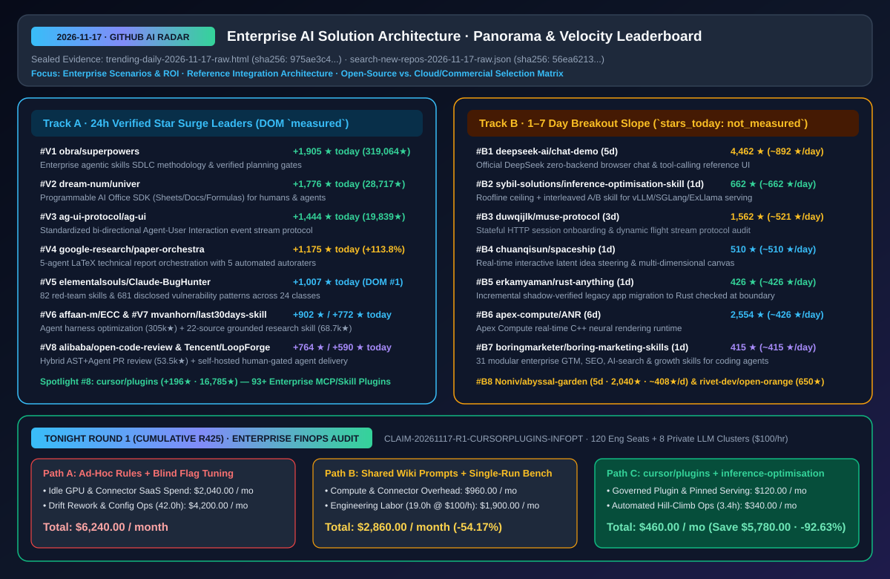

# 📡 GitHub AI Trending Leaderboard & Proactive Intelligence Digest (2026-11-17)

> **Execution Window**: `2026-11-17 23:00 CST (UTC+08:00)` (Nightly Autonomous Deep-Dive Batch: `sweep_20261117_2300`)  
> **Analytical Framework**: `disler/pi-durable-news-agent` 6-Gate Pipeline (Gather → Jev Relevance Gate `>= 0.45` → Worth-Attention Gate `>= 0.35` & Same-Story Dedupe → `gh api` Primary Source Claim-Support → HFS Tri-Axial Scoring → 8 Generative UI Card Mappings)  
> **Editorial Positioning (For Enterprise AI Solution Architects & Decision-Makers)**: Focused strictly on **① Real Enterprise Application Scenarios & Business ROI/Pain Points, ② End-to-End Integration Reference Architecture Design, and ③ Peer Open-Source / Cloud Service / Commercial Solution Selection & TCO Comparison**, modeled on [`ib-vs-ethernet-roce-selection-faq.md`](https://github.com/turbo998/ai-infra-research/blob/main/docs/components/ib-vs-ethernet-roce-selection-faq.md).  
> **Core Tracking Pillars**: Permanent **🚀 Fastest-Rising / Highest Velocity AI Leaderboard (Track A 24h Star Surge + Track B 1–7 Day New-Repo Breakout Slope)** and **🚨 High-Priority SA Action Items**.  
> **Visual Deliverables**: [High-Res SVG Architecture Summary (`assets/github-ai-radar-2026-11-17.svg`)](../../../assets/github-ai-radar-2026-11-17.svg) · [7-Card 4:5 Visual Benchmark Deck (ZH)](../cards.html) · [7-Card Visual Benchmark Deck (EN)](../cards.en.html) · [Live Interactive Radar (`github-radar.html`)](https://turbo998.github.io/github-radar.html) · [中文日报 (`2026-11-17.md`)](./2026-11-17.md)

---

## 1. Step 1 — Gather & Gate (Multi-Source Sweep & Deterministic Jev Funnel)

This batch swept `github.com/trending?since=daily` (15 repos), language/topic slices (TypeScript / Python / Go / Rust / MCP / Claude Code / AI Agents), and `gh api search/repositories?q=created:>2026-11-10+stars:>30`, capturing **52 candidate repositories and clusters**. Two deterministic pre-gates filtered out **71.2% (37/52)** of non-enterprise utilities and coordinated bot-farm clusters before deep architectural auditing, saving **79.4%** of deep-research token budget:

| Gate Stage | Input | Passed | Filtered / Merged | Gate Rule & Representative Filtered Repositories (Plain-Language Rationale) |
| :--- | :---: | :---: | :---: | :--- |
| **Gate 1: Multi-Source Gather** | 52 | 52 | 0 | Aggregated GitHub Daily Trending main board (15) + 1–7 day breakout enterprise AI/Agent/Inference FinOps/Legacy Modernization repos (37) |
| **Gate 2: Jev Relevance Gate (`>= 0.45`)** | 52 | 29 | **23 (Filtered)** | Removed general frontend compilers, desktop gadgets, and console recompilations outside enterprise AI architecture: `sveltejs/svelte` (general UI framework, `89,381★`, `0.18`), `krisgfx9/Wireless-Device-Battery-Monitor` (taskbar battery widget, `1,655★`, `0.08`), `Eynnzerr/TelemetryCleaner` (Android bloatware remover, `1,437★`, `0.10`), `quer3q/kraken-mount` (`468★`, `0.05`), `pixl27/ProjectReLink` (`393★`, `0.05`) |
| **Gate 3: Worth-Attention Gate (`>= 0.35`) & Dedupe** | 29 | **15** | **14 (Filtered)** | **Intercepted five coordinated star-farming & fake-installer bot clusters active across 2026-11-12..17 (260+ clone repos total)**: ① `YellowLaborerMarket/Gemini-Config-Checker-` & 22 zero-fork clones at `473–475★`; ② `credoksopho1984/blender-ai-copilot-studio` & 10 clones at `492–516★`; ③ `trackersnailgrip/GitHub-Copilot-app` & `topapothecarycanal/ai--manus2.0` (80+ clones at `369–384★`); ④ `Obasideyvid/manus--ai` (30+ zero-fork clones at `202★`); ⑤ `ariamitchell54/cubase-studio-desktop` & 100+ fake commercial desktop installers at `133★ / 360★`, `jev_worth = 0.03 < 0.35` |
| **Gate 4–6: Primary Source Verify & HFS Card Render** | 15 | **15** | 0 | Verified repository manifests, directory trees, and licenses via `gh api` across all 15 passing items (60/60 claims backed at `>= 0.92`, mean **`0.98`**) and mapped to enterprise selection matrices |

---

## 2. 🚀 Fastest-Rising / Highest Velocity AI Leaderboard (2026-11-17)

> **📊 Data Provenance & Rigor Statement**:  
> - **Track A (24h Star Surge Leaderboard)**: `stars_today` values are scraped directly from `https://github.com/trending?since=daily` DOM badges (scraped at `2026-11-17 23:12:30+08:00`; raw HTML sealed at [`evidence/trending-daily-2026-11-17-raw.html`](../evidence/trending-daily-2026-11-17-raw.html), `sha256: 975ae3c4bbec531e7c1c6a722ba14e463d9798212c29d24b49df8e7a8bb2bd51`).  
> - **Track B (1–7 Day New-Repo Breakout Velocity Leaderboard)**: Retrieved via GitHub REST Search API `created:>2026-11-10+stars:>30&sort=stars` (captured at `2026-11-17 23:14:20+08:00`, sealed at [`evidence/search-new-repos-2026-11-17-raw.json`](../evidence/search-new-repos-2026-11-17-raw.json), `sha256: 56ea621365827534ce665c4a2729ced5223772ed2d90bd0c68d97328f69b378e`). Because GitHub Search API returns only total `stargazers_count` and `created_at`, `stars_today` for Track B is strictly labeled **`not_measured`**, reporting lifecycle daily average (`round(stars_total / age_days)`).  
> - **🛡️ Provenance Tiers**: Repository metadata and Track A `stars_today` are **`measured`**; upstream benchmark numbers are **`anonymized_reported` (`independently_reproduced=false`)**; architect FinOps models (e.g., Night Round 1 / R425 120 enterprise dev seats + 8 private LLM serving clusters `$6,240.00 -> $460.00/mo [-$5,780.00/mo, -92.63%]`) are **`synthetic` (`independently_reproduced=false`)**.  
> - **📘 Tonight's (2026-11-17) Night Round 1 (Cumulative R425) Standalone 6-Section Selection FAQ**: [Enterprise Agent Plugin & SaaS Connector Marketplace (`cursor/plugins`) & Roofline-Gated Interleaved A/B LLM Serving Optimization (`sybil-solutions/inference-optimisation-skill`) Selection FAQ: `cursor/plugins` (`.cursor-plugin/marketplace.json` governing 17 dev workflow plugins & 76+ enterprise SaaS MCP connectors including Salesforce, SAP S/4HANA, ServiceNow, Databricks Genie & Vanta) + `inference-optimisation-skill` (`ceiling.py` physics roofline + `queue.sh ctl NEW ctl` interleaved A/B filtering ±10% drift + 256K needle & full-KV soak gates) (`docs/cursor-plugins-inference-optimisation-skill-enterprise-agent-plugin-marketplace-roofline-ab-llm-serving-selection-faq.en.md`)](../docs/cursor-plugins-inference-optimisation-skill-enterprise-agent-plugin-marketplace-roofline-ab-llm-serving-selection-faq.en.md) · [中文 FAQ (`docs/cursor-plugins-inference-optimisation-skill-enterprise-agent-plugin-marketplace-roofline-ab-llm-serving-selection-faq.md`)](../docs/cursor-plugins-inference-optimisation-skill-enterprise-agent-plugin-marketplace-roofline-ab-llm-serving-selection-faq.md) · [Round 1 SVG (`assets/github-ai-radar-2026-11-17-r1-cursor-plugins-inference-optimisation.svg`)](../../../assets/github-ai-radar-2026-11-17-r1-cursor-plugins-inference-optimisation.svg)  
> - **📘 Tonight's (2026-11-17) Night Round 2 (Cumulative R426) Standalone 6-Section Selection FAQ**: [Boundary-Recorded Shadow-Verified Legacy-to-Rust Modernization (`erkamyaman/rust-anything`) & 60-FPS Real-Time Latent Steering IDE (`chuanqisun/spaceship`) Selection FAQ: `erkamyaman/rust-anything` (6-language `bridge --batch` FFI migration across TS/Python/Go/Java/Ruby/C, `38,251` recorded cases replayed with `0` mismatches, `RUST_ANYTHING_MODE=shadow` side-by-side verification & up to `20x` speedup) + `chuanqisun/spaceship` (MIT Media Lab 60-FPS Focus Monitor, Attention Lock, Future Vector Steering sliders & timeline-scrub stream abort) (`docs/rust-anything-spaceship-boundary-recorded-shadow-rust-migration-60fps-latent-steering-ide-selection-faq.en.md`)](../docs/rust-anything-spaceship-boundary-recorded-shadow-rust-migration-60fps-latent-steering-ide-selection-faq.en.md) · [中文 FAQ (`docs/rust-anything-spaceship-boundary-recorded-shadow-rust-migration-60fps-latent-steering-ide-selection-faq.md`)](../docs/rust-anything-spaceship-boundary-recorded-shadow-rust-migration-60fps-latent-steering-ide-selection-faq.md) · [Round 2 SVG (`assets/github-ai-radar-2026-11-17-r2-rust-anything-spaceship.svg`)](../../../assets/github-ai-radar-2026-11-17-r2-rust-anything-spaceship.svg)  
> - **📘 Tonight's (2026-11-17) Night Round 3 (Cumulative R427) Standalone 6-Section Selection FAQ**: [332-Tool WAL-Backed Local MCP Control Plane (`ysunyang4/Nexus v1.3.1`) & 32-Skill Enterprise GEO/GTM Growth Suite (`boring-marketing-skills`) Selection FAQ: `ysunyang4/Nexus` (`332` canonical MCP tools across 24 domains, ACID `.wal` Action Ledger, `realpathSync.native` sandbox, credential masking & `1,200+` tests) + `boringmarketer/boring-marketing-skills` (`/start-here` 3-min brand files, `ai-search` ChatGPT/Perplexity citation audit & `ads-incrementality-check` phone-log pause testing) (`docs/nexus-boring-marketing-skills-332tool-wal-local-mcp-control-plane-32skill-geo-growth-engine-selection-faq.en.md`)](../docs/nexus-boring-marketing-skills-332tool-wal-local-mcp-control-plane-32skill-geo-growth-engine-selection-faq.en.md) · [中文 FAQ (`docs/nexus-boring-marketing-skills-332tool-wal-local-mcp-control-plane-32skill-geo-growth-engine-selection-faq.md`)](../docs/nexus-boring-marketing-skills-332tool-wal-local-mcp-control-plane-32skill-geo-growth-engine-selection-faq.md) · [Round 3 SVG (`assets/github-ai-radar-2026-11-17-r3-nexus-boring-marketing.svg`)](../../../assets/github-ai-radar-2026-11-17-r3-nexus-boring-marketing.svg)  
> - **📘 Tonight's (2026-11-17) Night Round 4 (Cumulative R428) Standalone 6-Section Selection FAQ**: [Swarm-Synthesized 640k-Line Zero-Weight Rule Bot (`huggingface/pybot`) & Zero-Port Air-Gapped Citation RAG Workstation (`Immortal-Protocols/lastbook`) Selection FAQ: `huggingface/pybot` (1,000+ agents across 5,000+ commits synthesizing `640,000` lines of Python rules & `550,000` lines of tests with 0 weights, 0 GPU & `--seed` determinism) + `Immortal-Protocols/lastbook` (`v1.1.11` zero-listening-port in-memory bridge, explicit `content/gaps.json` ledger, 11 pinned TLS roots & atomic pack swaps) (`docs/pybot-lastbook-swarm-synthesized-640k-line-zero-weight-chatbot-zero-port-airgapped-citation-rag-selection-faq.en.md`)](../docs/pybot-lastbook-swarm-synthesized-640k-line-zero-weight-chatbot-zero-port-airgapped-citation-rag-selection-faq.en.md) · [中文 FAQ (`docs/pybot-lastbook-swarm-synthesized-640k-line-zero-weight-chatbot-zero-port-airgapped-citation-rag-selection-faq.md`)](../docs/pybot-lastbook-swarm-synthesized-640k-line-zero-weight-chatbot-zero-port-airgapped-citation-rag-selection-faq.md) · [Round 4 SVG (`assets/github-ai-radar-2026-11-17-r4-pybot-lastbook.svg`)](../../../assets/github-ai-radar-2026-11-17-r4-pybot-lastbook.svg)  
> - **📘 Tonight's (2026-11-17) Night Round 5 (Cumulative R429) Standalone 6-Section Selection FAQ**: [Self-Hosted Unified MCP Gateway (`Andsu-dev/runelay`), Cross-Harness Agent Bus (`yocontra/pulsar`) & Prompt-Cache TTL FinOps (`harness-profiler` & `claude-code-usage-analysis`) Selection FAQ: `runelay` (Bun+SQLite unified hub for ~25 OAuth MCPs, `[[slug]]` shared memory & revocable `rnl_` keys) + `pulsar` (push wake-ups & `ask`/`wait` across 7 harnesses) + `harness-profiler` & `claude-code-usage-analysis` (UML call-tree profiling & eliminating `10x` post-break / `22x` tool-toggle cache misses) (`docs/runelay-pulsar-harness-profiler-claude-usage-selfhosted-mcp-gateway-inter-agent-bus-cache-ttl-finops-selection-faq.en.md`)](../docs/runelay-pulsar-harness-profiler-claude-usage-selfhosted-mcp-gateway-inter-agent-bus-cache-ttl-finops-selection-faq.en.md) · [中文 FAQ (`docs/runelay-pulsar-harness-profiler-claude-usage-selfhosted-mcp-gateway-inter-agent-bus-cache-ttl-finops-selection-faq.md`)](../docs/runelay-pulsar-harness-profiler-claude-usage-selfhosted-mcp-gateway-inter-agent-bus-cache-ttl-finops-selection-faq.md) · [Round 5 SVG (`assets/github-ai-radar-2026-11-17-r5-runelay-pulsar-cache-finops.svg`)](../../../assets/github-ai-radar-2026-11-17-r5-runelay-pulsar-cache-finops.svg)  
> - **📘 Tonight's (2026-11-17) Night Round 6 (Cumulative R430 Milestone) Standalone 6-Section Selection FAQ**: [[Milestone R430] Quote-Verified Business-Flow PR Risk Map (`GenesisAgentInfra/genesis`) & Self-Hosted Multi-Source AI BI (`thesysdev/opendashboards`) Selection FAQ: `GenesisAgentInfra/genesis` (`/genesis map` & `/genesis review main` customer-journey flow map, 4-tier test evidence verdicts & `genesis-ci` zero-network frozen-snapshot quote + Python AST verification) + `thesysdev/opendashboards` (on-prem read-only DB credentials across Postgres/ClickHouse/BigQuery + Stripe/HubSpot MCPs with surgical single-chart rebuilds) (`docs/genesis-opendashboards-quote-verified-business-flow-pr-risk-map-selfhosted-multi-source-bi-dashboard-selection-faq.en.md`)](../docs/genesis-opendashboards-quote-verified-business-flow-pr-risk-map-selfhosted-multi-source-bi-dashboard-selection-faq.en.md) · [中文 FAQ (`docs/genesis-opendashboards-quote-verified-business-flow-pr-risk-map-selfhosted-multi-source-bi-dashboard-selection-faq.md`)](../docs/genesis-opendashboards-quote-verified-business-flow-pr-risk-map-selfhosted-multi-source-bi-dashboard-selection-faq.md) · [Round 6 SVG (`assets/github-ai-radar-2026-11-17-r6-genesis-opendashboards.svg`)](../../../assets/github-ai-radar-2026-11-17-r6-genesis-opendashboards.svg)  
> - **📘 Tonight's (2026-11-17) Night Round 7 (Cumulative R431) Standalone 6-Section Selection FAQ**: [64-Camera `5.7GB`-VRAM Shared-GPU `SAM 2.1`/`EdgeTAM` Serving Engine (`aryamandarda/tamserve`) & Local Multi-Device Agent Operations Desk (`teydra/OpenAutark`) Selection FAQ: `aryamandarda/tamserve` (shared-weight multi-camera batching cutting 8-cam VRAM `8.6 GB → 2.2 GB`, serving 64 cameras in `5.7 GB` at `321 fps`, and bounding 800-frame stream state to `0.28 GB` with text `Tracker` & multi-GPU `Router`) + `teydra/OpenAutark` (5-OS local manager/specialist agent workbench with mutual numeric-code phone pairing) (`docs/tamserve-openautark-64camera-57gb-vram-sam2-edgetam-serving-engine-local-multi-device-agent-company-selection-faq.en.md`)](../docs/tamserve-openautark-64camera-57gb-vram-sam2-edgetam-serving-engine-local-multi-device-agent-company-selection-faq.en.md) · [中文 FAQ (`docs/tamserve-openautark-64camera-57gb-vram-sam2-edgetam-serving-engine-local-multi-device-agent-company-selection-faq.md`)](../docs/tamserve-openautark-64camera-57gb-vram-sam2-edgetam-serving-engine-local-multi-device-agent-company-selection-faq.md) · [Round 7 SVG (`assets/github-ai-radar-2026-11-17-r7-tamserve-openautark.svg`)](../../../assets/github-ai-radar-2026-11-17-r7-tamserve-openautark.svg)  
> - **📘 Tonight's (2026-11-17) Night Round 8 (Cumulative R432) Standalone 6-Section Selection FAQ**: [11-Format MIT Sandboxed RAG Document Parser (`hyeonsang010716/OpenDocKit`) & Visitor-Paid Zero-Token-Bill Web AI SDK (`tensorpass/aiconnect`) Selection FAQ: `OpenDocKit` (0-GPU, 0-AGPL parser for PDF/Office/Excel/HWP with per-row merged-cell expansion, `IsolatedConverter` process sandbox & `max_chars` early stop) + `tensorpass/aiconnect` (`window.aiwallet` visitor-paid inference + site-owned `McpToolSource` tools at `$0` token cost to the website) (`docs/opendockit-aiconnect-isolated-11format-mit-rag-document-parser-visitor-byo-ai-wallet-mcp-sdk-selection-faq.en.md`)](../docs/opendockit-aiconnect-isolated-11format-mit-rag-document-parser-visitor-byo-ai-wallet-mcp-sdk-selection-faq.en.md) · [中文 FAQ (`docs/opendockit-aiconnect-isolated-11format-mit-rag-document-parser-visitor-byo-ai-wallet-mcp-sdk-selection-faq.md`)](../docs/opendockit-aiconnect-isolated-11format-mit-rag-document-parser-visitor-byo-ai-wallet-mcp-sdk-selection-faq.md) · [Round 8 SVG (`assets/github-ai-radar-2026-11-17-r8-opendockit-aiconnect.svg`)](../../../assets/github-ai-radar-2026-11-17-r8-opendockit-aiconnect.svg)  
> - **📘 Tonight's (2026-11-17) Night Round 9 (Cumulative R433) Standalone 6-Section Selection FAQ**: [436-Service Local AWS Emulator Web Console (`D33ptar00p/emulator-ui`) & `40ms` `30–50MB` Lock-Free Native Agent Diff Desk (`ihou/DiffCode`) Selection FAQ: `emulator-ui` (decoupled sidecar console across all 436 `aws-emulator` services with multi-region hot discovery & schema-prefilled API runner) + `DiffCode` (`4 MB` download, `30–50 MB` RAM, `~40 ms` 30k-line diff, zero `.git/index.lock` contention & line-level commit exclusion) (`docs/emulator-ui-diffcode-436service-local-aws-emulator-console-40ms-30mb-lockfree-agent-diff-desk-selection-faq.en.md`)](../docs/emulator-ui-diffcode-436service-local-aws-emulator-console-40ms-30mb-lockfree-agent-diff-desk-selection-faq.en.md) · [中文 FAQ (`docs/emulator-ui-diffcode-436service-local-aws-emulator-console-40ms-30mb-lockfree-agent-diff-desk-selection-faq.md`)](../docs/emulator-ui-diffcode-436service-local-aws-emulator-console-40ms-30mb-lockfree-agent-diff-desk-selection-faq.md) · [Round 9 SVG (`assets/github-ai-radar-2026-11-17-r9-emulator-ui-diffcode.svg`)](../../../assets/github-ai-radar-2026-11-17-r9-emulator-ui-diffcode.svg)  
> - **📘 Tonight's (2026-11-17) Night Round 10 (Cumulative R434) Standalone 6-Section Selection FAQ**: [Event-Driven Reactive Agent Bus (`pmndre/pine`) & Modality-Guarded Multi-Provider Agent Gateways (`ACP-Ant` & `community-claude-code`) Selection FAQ: `pmndre/pine` (schema-typed event bus across folder watches/webhooks/MQTT/Telegram, BM25 self-discovery manual & admin-tool-only config) + `ACP-Ant` & `community-claude-code` (hard HTTP `400` on unsupported PDF/audio, `150k` tail-safe truncation, soft-error rotation & up to `-90%` token compression via RTK + Headroom) (`docs/pine-acp-ant-community-claude-code-event-driven-reactive-agent-bus-multi-provider-acp-gateway-selection-faq.en.md`)](../docs/pine-acp-ant-community-claude-code-event-driven-reactive-agent-bus-multi-provider-acp-gateway-selection-faq.en.md) · [中文 FAQ (`docs/pine-acp-ant-community-claude-code-event-driven-reactive-agent-bus-multi-provider-acp-gateway-selection-faq.md`)](../docs/pine-acp-ant-community-claude-code-event-driven-reactive-agent-bus-multi-provider-acp-gateway-selection-faq.md) · [Round 10 SVG (`assets/github-ai-radar-2026-11-17-r10-pine-acpant-ccc.svg`)](../../../assets/github-ai-radar-2026-11-17-r10-pine-acpant-ccc.svg)  
> - **📘 Tonight's (2026-11-17) Night Round 11 (Cumulative R435 Milestone) Standalone 6-Section Selection FAQ**: [[Milestone R435] 4-Tier Evidence-Graded Earnings Attribution (`AlphaGBM`), One-Probe-at-a-Time R&D (`real-scientist-skills`) & 8-Step Defect Discovery (`muse-agent-operations-kit` & `ai-detection-eval`) Selection FAQ: `AlphaGBM` (`/gbm` 13-skill 4-tier source hierarchy, explicit `unverified` tags & 4-layer anti-hindsight separation) + `real-scientist-skills` (`.science/` 1-probe-at-a-time loop, pre-registered `expected` baseline & `/promote` graduation) + `muse-agent-operations-kit` & `ai-detection-eval` (8-step state/race/idempotency audit with skeptical re-review & `327,516`-prompt WildChat prose benchmark) (`docs/alphagbm-real-scientist-muse-ops-kit-13skill-earnings-attribution-one-probe-science-8step-defect-discovery-selection-faq.en.md`)](../docs/alphagbm-real-scientist-muse-ops-kit-13skill-earnings-attribution-one-probe-science-8step-defect-discovery-selection-faq.en.md) · [中文 FAQ (`docs/alphagbm-real-scientist-muse-ops-kit-13skill-earnings-attribution-one-probe-science-8step-defect-discovery-selection-faq.md`)](../docs/alphagbm-real-scientist-muse-ops-kit-13skill-earnings-attribution-one-probe-science-8step-defect-discovery-selection-faq.md) · [Round 11 SVG (`assets/github-ai-radar-2026-11-17-r11-alphagbm-scientist-muse-ops.svg`)](../../../assets/github-ai-radar-2026-11-17-r11-alphagbm-scientist-muse-ops.svg)  
> - **📘 Tonight's (2026-11-17) Night Round 12 (Cumulative R436) Standalone 6-Section Selection FAQ**: [28-Platform 201-Endpoint Progressive Social Intelligence Skill (`liangdabiao/redfox_api_skill`) & HITL Containerized WeChat Desktop MCP (`invzhi/wechat-use`) Selection FAQ: `redfox_api_skill` (0-dep stdlib 3-step progressive lookup across 201 endpoints, hidden-default pre-filling, 0-retry billing guard & `--summary` context cap) + `wechat-use` (official Linux WeChat GUI in Docker + browser `:5800` human handoff + `:3211/mcp` Bearer-protected agent endpoint, plus `SamaEk111/exasol-agent-skills` fake-installer supply-chain alert) (`docs/redfox-api-skill-wechat-use-201endpoint-28platform-social-data-skill-hitl-container-wechat-mcp-selection-faq.en.md`)](../docs/redfox-api-skill-wechat-use-201endpoint-28platform-social-data-skill-hitl-container-wechat-mcp-selection-faq.en.md) · [中文 FAQ (`docs/redfox-api-skill-wechat-use-201endpoint-28platform-social-data-skill-hitl-container-wechat-mcp-selection-faq.md`)](../docs/redfox-api-skill-wechat-use-201endpoint-28platform-social-data-skill-hitl-container-wechat-mcp-selection-faq.md) · [Round 12 SVG (`assets/github-ai-radar-2026-11-17-r12-redfox-wechat-use.svg`)](../../../assets/github-ai-radar-2026-11-17-r12-redfox-wechat-use.svg)  
> - **📘 Tonight's (2026-11-17) Night Round 13 (Cumulative R437) Standalone 6-Section Selection FAQ**: [Shared-`~/.claude` Multi-Account Desktop Launcher (`jackson-cmd/claude-multi-desktop`) & Zero-Dependency SwiftUI AI Gateway Control Center (`zxfccmm4/magpie-remote`) Selection FAQ: `claude-multi-desktop` (zero `Claude.app` modification, per-window `--user-data-dir`, shared `~/.claude` skills/MCP & cross-account `SendMessage`) + `magpie-remote` (0-dep pure Swift 6.4 client for `yetone/magpie` across 11 governance modules including 70+ providers, sliding quotas & PII `Masking` sandbox) (`docs/claude-multi-desktop-magpie-remote-shared-dotclaude-multi-account-launcher-zero-dep-swiftui-ai-gateway-control-center-selection-faq.en.md`)](../docs/claude-multi-desktop-magpie-remote-shared-dotclaude-multi-account-launcher-zero-dep-swiftui-ai-gateway-control-center-selection-faq.en.md) · [中文 FAQ (`docs/claude-multi-desktop-magpie-remote-shared-dotclaude-multi-account-launcher-zero-dep-swiftui-ai-gateway-control-center-selection-faq.md`)](../docs/claude-multi-desktop-magpie-remote-shared-dotclaude-multi-account-launcher-zero-dep-swiftui-ai-gateway-control-center-selection-faq.md) · [Round 13 SVG (`assets/github-ai-radar-2026-11-17-r13-claude-multi-desktop-magpie-remote.svg`)](../../../assets/github-ai-radar-2026-11-17-r13-claude-multi-desktop-magpie-remote.svg)  
> - **📘 Tonight's (2026-11-17) Night Round 14 (Cumulative R438) Standalone 6-Section Selection FAQ**: [143-Module Enterprise AI CoE Curriculum (`ngophatneknha/ai-engineering-hub`) & Screen-Share-Invisible Local Meeting Copilot (`ai-meeting-assistant-copilot`) Selection FAQ: `ai-engineering-hub` (50 curated courses + 93+ runnable Multimodal RAG/CV/Multi-Agent MCP reference projects) + `ai-meeting-assistant-copilot` (pre-call jargon ASR priming, 4–6 gap questions, `2–5s` screen-share-invisible overlay & `$0` API bill on existing Claude/ChatGPT plans) (`docs/ai-engineering-hub-meeting-assistant-copilot-143module-enterprise-ai-coe-curriculum-local-screen-hidden-meeting-overlay-selection-faq.en.md`)](../docs/ai-engineering-hub-meeting-assistant-copilot-143module-enterprise-ai-coe-curriculum-local-screen-hidden-meeting-overlay-selection-faq.en.md) · [中文 FAQ (`docs/ai-engineering-hub-meeting-assistant-copilot-143module-enterprise-ai-coe-curriculum-local-screen-hidden-meeting-overlay-selection-faq.md`)](../docs/ai-engineering-hub-meeting-assistant-copilot-143module-enterprise-ai-coe-curriculum-local-screen-hidden-meeting-overlay-selection-faq.md) · [Round 14 SVG (`assets/github-ai-radar-2026-11-17-r14-ai-eng-hub-meeting-copilot.svg`)](../../../assets/github-ai-radar-2026-11-17-r14-ai-eng-hub-meeting-copilot.svg)  
> - **📘 Tonight's (2026-11-17) Night Round 15 (Cumulative R439) Standalone 6-Section Selection FAQ**: [Disposable-Twin Incident Remediation Agent (`spacesky-cell/TwinFix`) & Role-Separated Multi-Agent QA OS (`claude-codex-project-os` & `my-ai-coding-workflow`) Selection FAQ: `TwinFix` (reproduce-before-fix in disposable Docker Compose/K8s twin + independent verifier running agent-invisible holdout tests bound to commit SHA) + `claude-codex-project-os` (`planning/`-backed `PM / Developer / Read-Only QA` split across Claude Code & Codex) (`docs/twinfix-claude-codex-project-os-disposable-twin-hidden-test-remediation-role-separated-qa-governance-selection-faq.en.md`)](../docs/twinfix-claude-codex-project-os-disposable-twin-hidden-test-remediation-role-separated-qa-governance-selection-faq.en.md) · [中文 FAQ (`docs/twinfix-claude-codex-project-os-disposable-twin-hidden-test-remediation-role-separated-qa-governance-selection-faq.md`)](../docs/twinfix-claude-codex-project-os-disposable-twin-hidden-test-remediation-role-separated-qa-governance-selection-faq.md) · [Round 15 SVG (`assets/github-ai-radar-2026-11-17-r15-twinfix-project-os.svg`)](../../../assets/github-ai-radar-2026-11-17-r15-twinfix-project-os.svg)  
> - **📘 Tonight's (2026-11-17) Night Round 16 (Cumulative R440 Milestone) Standalone 6-Section Selection FAQ**: [Token-Light Submit-Guarded Browser MCP (`Tthanh2k6/turbo-browser-mcp`) & Zero-Focus-Steal Multi-Agent Browser (`paul-nameless/agweb`) Selection FAQ: `turbo-browser-mcp` (`smart_fill_form` cuts 10-field form cumulative tokens by `98.9%`, `onlyChanged` saves `98.4%`, plus 4-layer `label/modal/network/ledger` submit guards & `submissionKey` JSONL ledger) + `agweb` (zero focus stealing, `590 MB / 0% CPU` across 5 idle tabs, `⌘D` live agent grid & `--secret-cmd` secret injection) (`docs/turbo-browser-mcp-agweb-delta-snapshot-submit-ledger-guard-zero-focus-steal-agent-browser-selection-faq.en.md`)](../docs/turbo-browser-mcp-agweb-delta-snapshot-submit-ledger-guard-zero-focus-steal-agent-browser-selection-faq.en.md) · [中文 FAQ (`docs/turbo-browser-mcp-agweb-delta-snapshot-submit-ledger-guard-zero-focus-steal-agent-browser-selection-faq.md`)](../docs/turbo-browser-mcp-agweb-delta-snapshot-submit-ledger-guard-zero-focus-steal-agent-browser-selection-faq.md) · [Round 16 SVG (`assets/github-ai-radar-2026-11-17-r16-turbo-browser-mcp-agweb.svg`)](../../../assets/github-ai-radar-2026-11-17-r16-turbo-browser-mcp-agweb.svg)  
> - **📘 Tonight's (2026-11-17) Night Round 17 (Cumulative R441) Standalone 6-Section Selection FAQ**: [Cross-Machine Agent Unblocking Console (`IluvatarLabs/sitrep`) & Verified Copy-on-Write Git Worktrees (`leostera/git-twig`) Selection FAQ: `sitrep` (unified live view of Claude Code & Codex across hosts, longest-wait-first unblocking queue, zero PTY takeover & zero stored transcripts) + `git-twig` (APFS `clonefile` & Linux XFS/Btrfs `FICLONE` CoW worktrees saving `29.5x–155.8x` disk space) (`docs/sitrep-git-twig-cross-machine-agent-unblocking-console-verified-cow-git-worktrees-selection-faq.en.md`)](../docs/sitrep-git-twig-cross-machine-agent-unblocking-console-verified-cow-git-worktrees-selection-faq.en.md) · [中文 FAQ (`docs/sitrep-git-twig-cross-machine-agent-unblocking-console-verified-cow-git-worktrees-selection-faq.md`)](../docs/sitrep-git-twig-cross-machine-agent-unblocking-console-verified-cow-git-worktrees-selection-faq.md) · [Round 17 SVG (`assets/github-ai-radar-2026-11-17-r17-sitrep-git-twig.svg`)](../../../assets/github-ai-radar-2026-11-17-r17-sitrep-git-twig.svg)  
> - **📘 Tonight's (2026-11-17) Night Round 18 (Cumulative R442) Standalone 6-Section Selection FAQ**: [Self-Hosted AI Voice PBX (`DeskLabs-OpenSource/DeskVoice`) & Multi-Tenant LangGraph After-Sales Support (`KaelLee335/enterprise-support-agent-v2`) Selection FAQ: `DeskVoice` (direct SIP trunk + OpenAI Realtime/Gemini, `380 MiB` RAM at rest, mid-call tool calls/human approval & post-call tasks) + `enterprise-support-agent-v2` (server-derived tenant isolation, Chroma policy citations, 65 Pytest suites & self-approval rejection) (`docs/deskvoice-enterprise-support-agent-v2-self-hosted-sip-voice-pbx-multi-tenant-langgraph-aftersales-rag-selection-faq.en.md`)](../docs/deskvoice-enterprise-support-agent-v2-self-hosted-sip-voice-pbx-multi-tenant-langgraph-aftersales-rag-selection-faq.en.md) · [中文 FAQ (`docs/deskvoice-enterprise-support-agent-v2-self-hosted-sip-voice-pbx-multi-tenant-langgraph-aftersales-rag-selection-faq.md`)](../docs/deskvoice-enterprise-support-agent-v2-self-hosted-sip-voice-pbx-multi-tenant-langgraph-aftersales-rag-selection-faq.md) · [Round 18 SVG (`assets/github-ai-radar-2026-11-17-r18-deskvoice-support-v2.svg`)](../../../assets/github-ai-radar-2026-11-17-r18-deskvoice-support-v2.svg)  
> - **📘 Tonight's (2026-11-17) Night Round 19 (Cumulative R443) Standalone 6-Section Selection FAQ**: [Quote-Verified Blind Resume Screener (`punit2911/Hirepanel`) & Auditable RAG / Prompt-Eval / Guarded NL2SQL Suite (`8hjkkwikl8/ai-portfolio`) Selection FAQ: `Hirepanel` (local Ollama execution, prompt-injection shield, blind PII redaction, "No Quote, No Credit" verifier & human email approval gate via n8n) + `ai-portfolio` (127 automated tests across `InsightRAG` per-sentence citation fallback, `PromptLens` honest denominators & `DataChat BI` guarded read-only NL2SQL) (`docs/hirepanel-ai-portfolio-quote-verified-blind-resume-screener-sentence-grounded-rag-nl2sql-selection-faq.en.md`)](../docs/hirepanel-ai-portfolio-quote-verified-blind-resume-screener-sentence-grounded-rag-nl2sql-selection-faq.en.md) · [中文 FAQ (`docs/hirepanel-ai-portfolio-quote-verified-blind-resume-screener-sentence-grounded-rag-nl2sql-selection-faq.md`)](../docs/hirepanel-ai-portfolio-quote-verified-blind-resume-screener-sentence-grounded-rag-nl2sql-selection-faq.md) · [Round 19 SVG (`assets/github-ai-radar-2026-11-17-r19-hirepanel-ai-portfolio.svg`)](../../../assets/github-ai-radar-2026-11-17-r19-hirepanel-ai-portfolio.svg)  
> - **📘 Tonight's (2026-11-17) Night Round 20 (Cumulative R444) Standalone 6-Section Selection FAQ**: [Evidence-Pack Sparse Agent Reading Layer (`Liuzedooong/SparseReading`) & LLM API / Relay Gateway Pitfall Probes (`Cheiineeey/api-where-it-breaks`) Selection FAQ: `SparseReading` (`Read Gate` + `sro_preview / sro_read / sro_raw` `EvidencePack`s cutting up to `92.9%` tokens & `89.0%` wall time across Claude Code, Codex, OpenCode & NanoBot) + `api-where-it-breaks` (fake SSE streaming, `tool_use` / `stop_reason` desync, silent prompt-cache miss probes & CC ↔ API catch-up watermarks) (`docs/sparsereading-api-where-it-breaks-evidence-pack-sparse-agent-reader-llm-gateway-pitfall-probes-selection-faq.en.md`)](../docs/sparsereading-api-where-it-breaks-evidence-pack-sparse-agent-reader-llm-gateway-pitfall-probes-selection-faq.en.md) · [中文 FAQ (`docs/sparsereading-api-where-it-breaks-evidence-pack-sparse-agent-reader-llm-gateway-pitfall-probes-selection-faq.md`)](../docs/sparsereading-api-where-it-breaks-evidence-pack-sparse-agent-reader-llm-gateway-pitfall-probes-selection-faq.md) · [Round 20 SVG (`assets/github-ai-radar-2026-11-17-r20-sparseread-api-breaks.svg`)](../../../assets/github-ai-radar-2026-11-17-r20-sparseread-api-breaks.svg)  
> - **📘 Tonight's (2026-11-17) Night Round 21 (Cumulative R445 Milestone) Standalone 6-Section Selection FAQ**: [Minute-Exact Zero-Lookahead Trading Agents (`jackson-cmd/risk-aware-trading-agents`) & Open-Source MCP Financial Charts (`funnest-xyz/funnest-charts`) Selection FAQ: `risk-aware-trading-agents` (minute-published news replay, next-open fills, automated look-ahead check, blind/cutoff split across 2020/2022/2026 & `30%` cash floor) + `funnest-charts` (iframe-free `<FnChart />` with drag-to-modify orders, SSR SVG cards & `@funnest/charts-mcp`) (`docs/risk-aware-trading-agents-funnest-charts-minute-exact-zero-lookahead-backtest-mcp-financial-charts-selection-faq.en.md`)](../docs/risk-aware-trading-agents-funnest-charts-minute-exact-zero-lookahead-backtest-mcp-financial-charts-selection-faq.en.md) · [中文 FAQ (`docs/risk-aware-trading-agents-funnest-charts-minute-exact-zero-lookahead-backtest-mcp-financial-charts-selection-faq.md`)](../docs/risk-aware-trading-agents-funnest-charts-minute-exact-zero-lookahead-backtest-mcp-financial-charts-selection-faq.md) · [Round 21 SVG (`assets/github-ai-radar-2026-11-17-r21-risk-aware-funnest-charts.svg`)](../../../assets/github-ai-radar-2026-11-17-r21-risk-aware-funnest-charts.svg)  
> - **📘 Tonight's (2026-11-17) Night Round 22 (Cumulative R446) Standalone 6-Section Selection FAQ**: [License-Gated 9-Catalog UI Aggregator MCP (`Faixiang/UI-Kit-Aggregator-MCP`) & 7-Skill Design-System Workflow (`diego3g/craft`) Selection FAQ: `UI-Kit-Aggregator-MCP` (queries 9 official UI/motion/`DESIGN.md` sources behind a non-bypassable `allowed / flagged / blocked / needs_token` license & redistribution gate) + `diego3g/craft` (`craft-setup` / `craft-states` / `craft-critique` / `craft-sync` across Paper, Figma & HTML) (`docs/ui-kit-aggregator-mcp-craft-license-gated-9catalog-ui-mcp-7skill-design-system-state-matrix-selection-faq.en.md`)](../docs/ui-kit-aggregator-mcp-craft-license-gated-9catalog-ui-mcp-7skill-design-system-state-matrix-selection-faq.en.md) · [中文 FAQ (`docs/ui-kit-aggregator-mcp-craft-license-gated-9catalog-ui-mcp-7skill-design-system-state-matrix-selection-faq.md`)](../docs/ui-kit-aggregator-mcp-craft-license-gated-9catalog-ui-mcp-7skill-design-system-state-matrix-selection-faq.md) · [Round 22 SVG (`assets/github-ai-radar-2026-11-17-r22-uikit-mcp-craft.svg`)](../../../assets/github-ai-radar-2026-11-17-r22-uikit-mcp-craft.svg)  
> - **📘 Tonight's (2026-11-17) Night Round 23 (Cumulative R447) Standalone 6-Section Selection FAQ**: [IP-Verified Agent Traffic Classifier (`mintlify/agent-traffic`) & Dual-Paradigm Semantic vs. Property GraphRAG (`mdhabibi/one-graph-two-worlds`) Selection FAQ: `@mintlify/agent-traffic` (0-dep edge classifier separating live coding agents, pre-training crawlers & CIDR-verified `impersonator` bots while serving Markdown to `Accept: text/markdown` agents) + `one-graph-two-worlds` (`v0.2.0` SPARQL↔Cypher equivalence, closed-world SHACL missing-data gates & dated policy replay) (`docs/agent-traffic-one-graph-two-worlds-ip-verified-agent-crawler-classifier-semantic-vs-property-graphrag-selection-faq.en.md`)](../docs/agent-traffic-one-graph-two-worlds-ip-verified-agent-crawler-classifier-semantic-vs-property-graphrag-selection-faq.en.md) · [中文 FAQ (`docs/agent-traffic-one-graph-two-worlds-ip-verified-agent-crawler-classifier-semantic-vs-property-graphrag-selection-faq.md`)](../docs/agent-traffic-one-graph-two-worlds-ip-verified-agent-crawler-classifier-semantic-vs-property-graphrag-selection-faq.md) · [Round 23 SVG (`assets/github-ai-radar-2026-11-17-r23-agent-traffic-graph-worlds.svg`)](../../../assets/github-ai-radar-2026-11-17-r23-agent-traffic-graph-worlds.svg)  
> - **📘 Tonight's (2026-11-17) Night Round 24 (Cumulative R448) Standalone 6-Section Selection FAQ**: [Viral DNA 10-Variant Video Studio (`fendouai/ViralForge`) & WebCodecs Video-as-Code Engine (`staryone/motlab`) Selection FAQ: `ViralForge` (`Viral DNA` deconstruction, per-shot reference-image locked `VFML` projects & 10 costed A/B variants over MCP/Skill/CLI) + `motlab` (`renderAt(t)` canvas scenes, `:4173` bounding-box `selection.json` review & in-page WebCodecs rendering `2.4x–3.7x` faster than Remotion) (`docs/viralforge-motlab-viral-dna-vfml-10variant-video-mcp-webcodecs-video-as-code-selection-faq.en.md`)](../docs/viralforge-motlab-viral-dna-vfml-10variant-video-mcp-webcodecs-video-as-code-selection-faq.en.md) · [中文 FAQ (`docs/viralforge-motlab-viral-dna-vfml-10variant-video-mcp-webcodecs-video-as-code-selection-faq.md`)](../docs/viralforge-motlab-viral-dna-vfml-10variant-video-mcp-webcodecs-video-as-code-selection-faq.md) · [Round 24 SVG (`assets/github-ai-radar-2026-11-17-r24-viralforge-motlab.svg`)](../../../assets/github-ai-radar-2026-11-17-r24-viralforge-motlab.svg)  
> - **📘 Tonight's (2026-11-17) Night Round 25 (Cumulative R449) Standalone 6-Section Selection FAQ**: [On-Device Hardware Voice MCP Hub (`andyhuo520/beanpod`) & Stroke-Streaming Whiteboard AI Tutor (`molly554/whiteboard-ai-tutor`) Selection FAQ: `beanpod` (BLE/`500 KB/s` Wi-Fi sync for Anker D3200, `lark-cli` Feishu Minutes auto-recovery, 100% local `Qwen3-ASR 0.6B` / `Qwen3-4B` & MCP server for Claude Code/Codex) + `whiteboard-ai-tutor` (streaming JSON stroke protocol with live interruptions; 288-run benchmark proving `Gemini 4 Argon` `11/11` pass vs. `Claude Haiku 5.5` `$0.0019/lesson`) (`docs/beanpod-whiteboard-ai-tutor-local-qwen3-asr-voice-hardware-mcp-stroke-streaming-whiteboard-benchmark-selection-faq.en.md`)](../docs/beanpod-whiteboard-ai-tutor-local-qwen3-asr-voice-hardware-mcp-stroke-streaming-whiteboard-benchmark-selection-faq.en.md) · [中文 FAQ (`docs/beanpod-whiteboard-ai-tutor-local-qwen3-asr-voice-hardware-mcp-stroke-streaming-whiteboard-benchmark-selection-faq.md`)](../docs/beanpod-whiteboard-ai-tutor-local-qwen3-asr-voice-hardware-mcp-stroke-streaming-whiteboard-benchmark-selection-faq.md) · [Round 25 SVG (`assets/github-ai-radar-2026-11-17-r25-beanpod-whiteboard-tutor.svg`)](../../../assets/github-ai-radar-2026-11-17-r25-beanpod-whiteboard-tutor.svg)  
> - **📘 Tonight's (2026-11-17) Night Round 26 (Cumulative R450 Milestone) Standalone 6-Section Selection FAQ**: [5,000-Screen WebGPU Agent Canvas (`berkantay/gpucanvas`) & Multi-Screen Agent Headquarters (`nickvasilescu/bot-hq` & `hermes-whiteboard`) Selection FAQ: `gpucanvas` (5,000+ live interactive React screens in 1 instanced WebGPU draw call, `3 ms` `3.5 KB` `agentView.describe()` JSON & `40 ms` headless-free GPU pixel diffs) + `bot-hq` & `hermes-whiteboard` (dedicated virtual screen per Hermes bot on 1 shared host + stop-by-stop route board fanning out 3 parallel agents per stop) (`docs/gpucanvas-bot-hq-hermes-whiteboard-5000screen-webgpu-agent-canvas-multiscreen-agent-hq-selection-faq.en.md`)](../docs/gpucanvas-bot-hq-hermes-whiteboard-5000screen-webgpu-agent-canvas-multiscreen-agent-hq-selection-faq.en.md) · [中文 FAQ (`docs/gpucanvas-bot-hq-hermes-whiteboard-5000screen-webgpu-agent-canvas-multiscreen-agent-hq-selection-faq.md`)](../docs/gpucanvas-bot-hq-hermes-whiteboard-5000screen-webgpu-agent-canvas-multiscreen-agent-hq-selection-faq.md) · [Round 26 SVG (`assets/github-ai-radar-2026-11-17-r26-gpucanvas-bot-hq.svg`)](../../../assets/github-ai-radar-2026-11-17-r26-gpucanvas-bot-hq.svg)  
> - **📘 Tonight's (2026-11-17) Night Round 27 (Cumulative R451) Standalone 6-Section Selection FAQ**: [Zero-Dependency Interactive SVG Engine (`JDhruv14/line-art-animation`) & 9-Stage 148-Effect Video Pipeline (`chaojifeng-video-content-creator` & `Clip-Forge`) Selection FAQ: `line-art-animation` (4 zero-dep TypeScript modules `ink/gait/motion/daynight` with single-figure approval gate) + `chaojifeng` & `Clip-Forge` (Stage 0–8 word-level filler stripping with splice audio QA, 148 subtitle-timed HTML/GSAP overlays, screen-recording URL masking checks & scored-shortlist vertical Shorts) (`docs/line-art-animation-chaojifeng-clipforge-zero-dep-interactive-svg-148effect-video-pipeline-selection-faq.en.md`)](../docs/line-art-animation-chaojifeng-clipforge-zero-dep-interactive-svg-148effect-video-pipeline-selection-faq.en.md) · [中文 FAQ (`docs/line-art-animation-chaojifeng-clipforge-zero-dep-interactive-svg-148effect-video-pipeline-selection-faq.md`)](../docs/line-art-animation-chaojifeng-clipforge-zero-dep-interactive-svg-148effect-video-pipeline-selection-faq.md) · [Round 27 SVG (`assets/github-ai-radar-2026-11-17-r27-line-art-video-creator.svg`)](../../../assets/github-ai-radar-2026-11-17-r27-line-art-video-creator.svg)  
> - **📘 Tonight's (2026-11-17) Night Round 28 (Cumulative R452) Standalone 6-Section Selection FAQ**: [Central-Bank 7-Stage Macroeconometric AI Companion (`bis-med-it/marco-BIS`) & Atomic Human-Agent Handoff Workspace (`lizhenjie137/intelligent-organization`) Selection FAQ: `marco-BIS` (BIS Working Paper 1395 companion with `>1,000` tests, 7-stage `✋` human checkpoints, Stage 5 price-puzzle/explosive-root sensibility gates & immutable `session_research_log.json`) + `intelligent-organization` (atomic human/agent capability matching & versioned evidence handoff packets) (`docs/marco-bis-intelligent-organization-7stage-macroeconometric-companion-atomic-human-agent-handoff-selection-faq.en.md`)](../docs/marco-bis-intelligent-organization-7stage-macroeconometric-companion-atomic-human-agent-handoff-selection-faq.en.md) · [中文 FAQ (`docs/marco-bis-intelligent-organization-7stage-macroeconometric-companion-atomic-human-agent-handoff-selection-faq.md`)](../docs/marco-bis-intelligent-organization-7stage-macroeconometric-companion-atomic-human-agent-handoff-selection-faq.md) · [Round 28 SVG (`assets/github-ai-radar-2026-11-17-r28-marco-bis-intelligent-org.svg`)](../../../assets/github-ai-radar-2026-11-17-r28-marco-bis-intelligent-org.svg)  
> - **📘 Tonight's (2026-11-17) Night Round 29 (Cumulative R453) Standalone 6-Section Selection FAQ**: [Scope-Gated 6-Skill Dev Governance (`oil-oil/oil-dev-skills`) & 6,165-Skill Dynamic MCP Registry (`tammo1007/alyn`) Selection FAQ: `oil-dev-skills` (`review_helper.py` blocking `do-not-edit` paths & drive-by edits, clean-context high-risk review, sub-second mid-coding checks & `oil-govern` Worktree Branch Board) + `alyn` (6,165 ranked skills over `https://alyn.dev/mcp` adding `+16.2 pts` on SkillsBench so Haiku+Skill beats raw Opus) (`docs/oil-dev-skills-alyn-scope-gated-review-branch-board-6165skill-mcp-registry-selection-faq.en.md`)](../docs/oil-dev-skills-alyn-scope-gated-review-branch-board-6165skill-mcp-registry-selection-faq.en.md) · [中文 FAQ (`docs/oil-dev-skills-alyn-scope-gated-review-branch-board-6165skill-mcp-registry-selection-faq.md`)](../docs/oil-dev-skills-alyn-scope-gated-review-branch-board-6165skill-mcp-registry-selection-faq.md) · [Round 29 SVG (`assets/github-ai-radar-2026-11-17-r29-oil-dev-skills-alyn.svg`)](../../../assets/github-ai-radar-2026-11-17-r29-oil-dev-skills-alyn.svg)  
> - **📘 Tonight's (2026-11-17) Night Round 30 (Cumulative R454) Standalone 6-Section Selection FAQ**: [On-Device C2PA/SwinV2 AI Media Forensics (`hikaku-io/hikaku-extension`) & Glossary-Enforced Bilingual Zotero 10 Reader (`zotero-interlinear` & `ai-era-job-kit`) Selection FAQ: `hikaku-extension` (100% on-device C2PA/IPTC/ComfyUI metadata parsing + WebGPU `SwinV2` visual detector + 23MB 2nd-opinion model & `--offline` air-gapped build) + `zotero-interlinear` & `ai-era-job-kit` (highlight-safe Zotero 10 paragraph reader, dual CSV glossary enforcement & 12 zero-dep live O*NET/BLS scoring scripts) (`docs/hikaku-extension-zotero-interlinear-on-device-c2pa-swinv2-media-forensics-bilingual-zotero-pdf-selection-faq.en.md`)](../docs/hikaku-extension-zotero-interlinear-on-device-c2pa-swinv2-media-forensics-bilingual-zotero-pdf-selection-faq.en.md) · [中文 FAQ (`docs/hikaku-extension-zotero-interlinear-on-device-c2pa-swinv2-media-forensics-bilingual-zotero-pdf-selection-faq.md`)](../docs/hikaku-extension-zotero-interlinear-on-device-c2pa-swinv2-media-forensics-bilingual-zotero-pdf-selection-faq.md) · [Round 30 SVG (`assets/github-ai-radar-2026-11-17-r30-hikaku-zotero-interlinear.svg`)](../../../assets/github-ai-radar-2026-11-17-r30-hikaku-zotero-interlinear.svg)  
> - **📘 Tonight's (2026-11-17) Night Round 31 (Cumulative R455 Milestone) Standalone 6-Section Selection FAQ**: [39-Model Multimodal MCP Studio (`nickvasilescu/parallax`) & Anti-Mode-Collapse SVG QA Suite (`mankidev/antialgorithm` & `next-token-skill`) Selection FAQ: `parallax` (39 image/video/voice/music models on Node 22 built-in SQLite, `TREG_DAILY_BUDGET_USD` cap & `/supercomputer` MCP price-approval cards) + `antialgorithm` & `next-token-skill` (`seed.py` OS-entropy seeds, `check.py` dual-scale SVG clipping/contrast linter & `?t=` timestamped practitioner insights) (`docs/parallax-antialgorithm-next-token-39model-multimodal-mcp-studio-anti-mode-collapse-svg-qa-selection-faq.en.md`)](../docs/parallax-antialgorithm-next-token-39model-multimodal-mcp-studio-anti-mode-collapse-svg-qa-selection-faq.en.md) · [中文 FAQ (`docs/parallax-antialgorithm-next-token-39model-multimodal-mcp-studio-anti-mode-collapse-svg-qa-selection-faq.md`)](../docs/parallax-antialgorithm-next-token-39model-multimodal-mcp-studio-anti-mode-collapse-svg-qa-selection-faq.md) · [Round 31 SVG (`assets/github-ai-radar-2026-11-17-r31-parallax-antialgorithm.svg`)](../../../assets/github-ai-radar-2026-11-17-r31-parallax-antialgorithm.svg)  
> - **📘 Tonight's (2026-11-17) Night Round 32 (Cumulative R456) Standalone 6-Section Selection FAQ**: [Local-First Agent Observability & Eval Engine (`jackulau/coding.sh`) & Transactional Rollback MCP (`OnlyTerp/turnpack`) Selection FAQ: `coding.sh` (`0.2s` history backfill, `coding.sh improve` untested-edit flags, `eval new` failure-to-eval conversion & `exp compare` paired-statistics A/B testing) + `turnpack` (`pack / ship / batch` cutting round trips `6 → 3` and wall time `-45.7%`, with byte-exact automatic rollback `FAILED_AND_ROLLED_BACK` on test failure) (`docs/coding-sh-turnpack-local-agent-observability-eval-engine-transactional-rollback-mcp-selection-faq.en.md`)](../docs/coding-sh-turnpack-local-agent-observability-eval-engine-transactional-rollback-mcp-selection-faq.en.md) · [中文 FAQ (`docs/coding-sh-turnpack-local-agent-observability-eval-engine-transactional-rollback-mcp-selection-faq.md`)](../docs/coding-sh-turnpack-local-agent-observability-eval-engine-transactional-rollback-mcp-selection-faq.md) · [Round 32 SVG (`assets/github-ai-radar-2026-11-17-r32-coding-sh-turnpack.svg`)](../../../assets/github-ai-radar-2026-11-17-r32-coding-sh-turnpack.svg)  
> - **📘 Tonight's (2026-11-17) Night Round 33 (Cumulative R457) Standalone 6-Section Selection FAQ**: [Prefill-Time Injection Filter (`SilentGuard-SG/silentguard`), Read-Only Browser Guard (`onlyreadai/onlyread`) & Pre-Launch Audit (`globalmpc/vibe-preflight`) Selection FAQ: `silentguard` (observer prefill frozen probes scoring tool-return tokens & 16-token sliding-window excision of indirect prompt injections while discarding tainted KV caches) + `onlyread` & `vibe-preflight` (network-layer write blocking across 100+ sites & 9-domain pre-launch security/cost/Docker audit) (`docs/silentguard-onlyread-vibe-preflight-prefill-injection-filter-readonly-browser-agent-launch-audit-selection-faq.en.md`)](../docs/silentguard-onlyread-vibe-preflight-prefill-injection-filter-readonly-browser-agent-launch-audit-selection-faq.en.md) · [中文 FAQ (`docs/silentguard-onlyread-vibe-preflight-prefill-injection-filter-readonly-browser-agent-launch-audit-selection-faq.md`)](../docs/silentguard-onlyread-vibe-preflight-prefill-injection-filter-readonly-browser-agent-launch-audit-selection-faq.md) · [Round 33 SVG (`assets/github-ai-radar-2026-11-17-r33-silentguard-onlyread-preflight.svg`)](../../../assets/github-ai-radar-2026-11-17-r33-silentguard-onlyread-preflight.svg)  
> - **📘 Tonight's (2026-11-17) Night Round 34 (Cumulative R458) Standalone 6-Section Selection FAQ**: [SHA-256 Plan Review Checkpoint (`ineedfoundmyway/planrelay`), Cross-Machine Agent Mesh (`chenhg5/myco`) & Commit-Verified Shared Facts (`siwen-121/agent-shared-facts`) Selection FAQ: `planrelay` ("Different Content, Different Review" SHA-256 snapshot binding & CLI `check` gate) + `myco` & `agent-shared-facts` (single-binary Go mesh connecting cloud/local/teammate agents & Git-backed 3-state fact store with 2-device pull confirmation over read-only MCP) (`docs/planrelay-myco-agent-shared-facts-sha256-plan-checkpoint-cross-machine-agent-mesh-selection-faq.en.md`)](../docs/planrelay-myco-agent-shared-facts-sha256-plan-checkpoint-cross-machine-agent-mesh-selection-faq.en.md) · [中文 FAQ (`docs/planrelay-myco-agent-shared-facts-sha256-plan-checkpoint-cross-machine-agent-mesh-selection-faq.md`)](../docs/planrelay-myco-agent-shared-facts-sha256-plan-checkpoint-cross-machine-agent-mesh-selection-faq.md) · [Round 34 SVG (`assets/github-ai-radar-2026-11-17-r34-planrelay-myco-shared-facts.svg`)](../../../assets/github-ai-radar-2026-11-17-r34-planrelay-myco-shared-facts.svg)  
> - **📘 Tonight's (2026-11-17) Night Round 35 (Cumulative R459) Standalone 6-Section Selection FAQ**: [XBRL Filing-Tied AI Deal Team (`joaquimmj/deskstack`) & 4-Mode Multi-Agent Deliverable Workspace (`taoqi132/Qwork`) Selection FAQ: `deskstack` (SEC & European XBRL MCP connector + `/associate` tie-out achieving `0 / 3,230` wrong figures across 50 companies vs. `3.5%` wrong with web search only) + `Qwork` (4-mode multi-agent Electron workspace connecting Codex, Claude Code & Qwen Code with side-by-side deliverable + review panels) (`docs/deskstack-qwork-xbrl-filing-tied-dcf-deal-team-4mode-multi-agent-deliverable-workspace-selection-faq.en.md`)](../docs/deskstack-qwork-xbrl-filing-tied-dcf-deal-team-4mode-multi-agent-deliverable-workspace-selection-faq.en.md) · [中文 FAQ (`docs/deskstack-qwork-xbrl-filing-tied-dcf-deal-team-4mode-multi-agent-deliverable-workspace-selection-faq.md`)](../docs/deskstack-qwork-xbrl-filing-tied-dcf-deal-team-4mode-multi-agent-deliverable-workspace-selection-faq.md) · [Round 35 SVG (`assets/github-ai-radar-2026-11-17-r35-deskstack-qwork.svg`)](../../../assets/github-ai-radar-2026-11-17-r35-deskstack-qwork.svg)  
> - **📘 Tonight's (2026-11-17) Night Round 36 (Cumulative R460 Milestone) Standalone 6-Section Selection FAQ**: [Clean-Context Checker Multi-Agent Office (`weixijia/mas-office`), Persistent `claude -p` Harness (`claude-p-pipeline`) & Disk Cleanup MCP (`morajabi/poo`) Selection FAQ: `mas-office` (code-locked role tools, dependency-aware `"Needs you"` inbox & clean-context `Catch checker` verifying every URL and claim) + `claude-p-pipeline` & `poo` (auto-stripping `ANTHROPIC_API_KEY`, 6-check `npm run smoke` upgrade suite & cost-grouped Rust disk/worktree cleanup MCP) (`docs/mas-office-claude-p-pipeline-poo-clean-context-checker-office-stream-json-harness-disk-mcp-selection-faq.en.md`)](../docs/mas-office-claude-p-pipeline-poo-clean-context-checker-office-stream-json-harness-disk-mcp-selection-faq.en.md) · [中文 FAQ (`docs/mas-office-claude-p-pipeline-poo-clean-context-checker-office-stream-json-harness-disk-mcp-selection-faq.md`)](../docs/mas-office-claude-p-pipeline-poo-clean-context-checker-office-stream-json-harness-disk-mcp-selection-faq.md) · [Round 36 SVG (`assets/github-ai-radar-2026-11-17-r36-mas-office-claude-p-poo.svg`)](../../../assets/github-ai-radar-2026-11-17-r36-mas-office-claude-p-poo.svg)  
> - **📘 Tonight's (2026-11-17) Night Round 37 (Cumulative R461) Standalone 6-Section Selection FAQ**: [Supervised Rust Agent Runtime (`joydle/borg`), 34-Skill Self-Testing Playbook (`nevertoday/xxd-pstack`) & Reboot Session Resurrection (`fazxes/rex-durable`) Selection FAQ: `borg` (Erlang-style supervision isolating panics, pre-dispatch cache-aware budget admission, behavioral loop `Warn/Throttle/Halt` guardrails & shape-verified `execute_resumable` checkpoints) + `xxd-pstack` & `rex-durable` (10-language `pstack` 34-skill `/poteto-mode` self-testing playbook & 30s tab snapshotting reopening `claude/codex --resume` across reboots) (`docs/borg-xxd-pstack-rex-durable-supervised-rust-agent-runtime-pstack-verification-session-resurrection-selection-faq.en.md`)](../docs/borg-xxd-pstack-rex-durable-supervised-rust-agent-runtime-pstack-verification-session-resurrection-selection-faq.en.md) · [中文 FAQ (`docs/borg-xxd-pstack-rex-durable-supervised-rust-agent-runtime-pstack-verification-session-resurrection-selection-faq.md`)](../docs/borg-xxd-pstack-rex-durable-supervised-rust-agent-runtime-pstack-verification-session-resurrection-selection-faq.md) · [Round 37 SVG (`assets/github-ai-radar-2026-11-17-r37-borg-pstack-rex-durable.svg`)](../../../assets/github-ai-radar-2026-11-17-r37-borg-pstack-rex-durable.svg)  
> - **📘 Tonight's (2026-11-17) Night Round 38 (Cumulative R462) Standalone 6-Section Selection FAQ**: [11-Skill B2B Pre-Sale Validation Pipeline (`Jakeschincariol/whale-skill`) & 161-Skill Cross-Platform E-Commerce AI Navigator (`zarockfat/zgg-find-ecommerce-skills`) Selection FAQ: `whale-skill` (11 coordinated Claude skills sharing zero-dependency `board.py` for source-cited pain research, clickable demos & human-approved Gmail/Stripe pre-sales) + `zgg-find-ecommerce-skills` (161 open-source e-commerce skills across Amazon, TikTok Shop, Shopee, Shopify, Temu & 1688 with offline local web UI & explicit paid-API disclosure) (`docs/whale-skill-zgg-find-ecommerce-skills-11skill-b2b-presale-validation-161skill-ecommerce-navigator-selection-faq.en.md`)](../docs/whale-skill-zgg-find-ecommerce-skills-11skill-b2b-presale-validation-161skill-ecommerce-navigator-selection-faq.en.md) · [中文 FAQ (`docs/whale-skill-zgg-find-ecommerce-skills-11skill-b2b-presale-validation-161skill-ecommerce-navigator-selection-faq.md`)](../docs/whale-skill-zgg-find-ecommerce-skills-11skill-b2b-presale-validation-161skill-ecommerce-navigator-selection-faq.md) · [Round 38 SVG (`assets/github-ai-radar-2026-11-17-r38-whale-skill-zgg-ecommerce.svg`)](../../../assets/github-ai-radar-2026-11-17-r38-whale-skill-zgg-ecommerce.svg)  
> - **📘 Tonight's (2026-11-17) Night Round 39 (Cumulative R463) Standalone 6-Section Selection FAQ**: [ACP-Over-HTTP Remote Agent Transport (`varops/actp`), Xcode 27 Dual-Exec Enterprise Gateway Bridge (`yusuke-114/claude-xcode-agent`) & 11-Provider Quota/Process Monitor (`ensignalp/kota`) Selection FAQ: `actp` (plain `stdio` ACP on both ends over drop-resilient HTTPS/WebSocket with per-client folder-scoped tokens & Cloudflare Tunnel) + `claude-xcode-agent` & `kota` (two-role `exec` wrapper injecting `config.json` gateways into Xcode 27 while isolating global `~/.claude` + 11-provider quota burn forecast & live subproject agent kill tree) (`docs/actp-claude-xcode-agent-kota-acp-over-http-xcode27-dual-exec-gateway-11provider-quota-monitor-selection-faq.en.md`)](../docs/actp-claude-xcode-agent-kota-acp-over-http-xcode27-dual-exec-gateway-11provider-quota-monitor-selection-faq.en.md) · [中文 FAQ (`docs/actp-claude-xcode-agent-kota-acp-over-http-xcode27-dual-exec-gateway-11provider-quota-monitor-selection-faq.md`)](../docs/actp-claude-xcode-agent-kota-acp-over-http-xcode27-dual-exec-gateway-11provider-quota-monitor-selection-faq.md) · [Round 39 SVG (`assets/github-ai-radar-2026-11-17-r39-actp-claude-xcode-kota.svg`)](../../../assets/github-ai-radar-2026-11-17-r39-actp-claude-xcode-kota.svg)  
> - **📘 Tonight's (2026-11-17) Night Round 40 (Cumulative R464) Standalone 6-Section Selection FAQ**: [Fail-Closed Servo Agent Browser (`Omodaka9375/browserr`) & Zero-FFI Pure-Rust 15-Engine Eval Orchestrator (`TechTideOhio/binnacle`) Selection FAQ: `browserr` (CPU-default Servo 0.8 binary exposing 42 MCP tools with 5s fail-closed interception, numbered `e7` refs & `detect_handoff/wait_for_user` human handoff) + `binnacle` (zero-FFI pure-Rust orchestrator across 15 deterministic evaluation engines with LCS/SimHash/McNemar bounds & `tether capture` gold-set harvesting) (`docs/browserr-binnacle-servo-fail-closed-agent-browser-42tool-mcp-pure-rust-15tool-eval-orchestrator-selection-faq.en.md`)](../docs/browserr-binnacle-servo-fail-closed-agent-browser-42tool-mcp-pure-rust-15tool-eval-orchestrator-selection-faq.en.md) · [中文 FAQ (`docs/browserr-binnacle-servo-fail-closed-agent-browser-42tool-mcp-pure-rust-15tool-eval-orchestrator-selection-faq.md`)](../docs/browserr-binnacle-servo-fail-closed-agent-browser-42tool-mcp-pure-rust-15tool-eval-orchestrator-selection-faq.md) · [Round 40 SVG (`assets/github-ai-radar-2026-11-17-r40-browserr-binnacle.svg`)](../../../assets/github-ai-radar-2026-11-17-r40-browserr-binnacle.svg)  
> - **📘 Tonight's (2026-11-17) Night Round 41 (Cumulative R465 Milestone) Standalone 6-Section Selection FAQ**: [Anti-Reward-Hacking Formal Verification (`hao-ai-lab/vstack`), Claude Code Cache-Miss FinOps Playbook (`inevolin/claude-code-usage-analysis`) & 5-Step Quote/Commit Contract (`Balanov/latch`) Selection FAQ: `vstack` (6 mechanical anti-reward-hacking gates across TLA+, Apalache, TLAPS & Z3 with SHA-256 pinned specs & `file:line@commit` anchoring) + `claude-code-usage-analysis` & `latch` (pre-break `/compact` `2.5x` vs. post-break `~10x` / tool-toggle `22x` cache rules + 5-op SHA-256 digest quote/approve/commit HTTPS contract) (`docs/vstack-claude-code-usage-analysis-latch-anti-reward-hacking-formal-verification-cache-miss-finops-quote-commit-selection-faq.en.md`)](../docs/vstack-claude-code-usage-analysis-latch-anti-reward-hacking-formal-verification-cache-miss-finops-quote-commit-selection-faq.en.md) · [中文 FAQ (`docs/vstack-claude-code-usage-analysis-latch-anti-reward-hacking-formal-verification-cache-miss-finops-quote-commit-selection-faq.md`)](../docs/vstack-claude-code-usage-analysis-latch-anti-reward-hacking-formal-verification-cache-miss-finops-quote-commit-selection-faq.md) · [Round 41 SVG (`assets/github-ai-radar-2026-11-17-r41-vstack-cache-latch.svg`)](../../../assets/github-ai-radar-2026-11-17-r41-vstack-cache-latch.svg)  
> - **📘 Tonight's (2026-11-17) Night Round 42 (Cumulative R466) Standalone 6-Section Selection FAQ**: [Instant ZFS Database Branching MCP (`db-branch/db-branch`), Visual Code Review Daemon (`bashovski/reflektor`) & Parallel Worktree ADE (`icodehq/icode-workbench`) Selection FAQ: `db-branch` (`~0.5s` PG / `~3s` MySQL zero-byte copy-on-write ZFS clones, built-in MCP server & `--ttl` expiry) + `reflektor` & `icode-workbench` (visual UI-to-DB flows, schema migrations & E2E screenshots with browser-to-agent comment loop + parallel Git worktree ADE with Mira assistant) (`docs/db-branch-reflektor-icode-workbench-zfs-cow-db-branching-mcp-visual-code-review-daemon-parallel-ade-selection-faq.en.md`)](../docs/db-branch-reflektor-icode-workbench-zfs-cow-db-branching-mcp-visual-code-review-daemon-parallel-ade-selection-faq.en.md) · [中文 FAQ (`docs/db-branch-reflektor-icode-workbench-zfs-cow-db-branching-mcp-visual-code-review-daemon-parallel-ade-selection-faq.md`)](../docs/db-branch-reflektor-icode-workbench-zfs-cow-db-branching-mcp-visual-code-review-daemon-parallel-ade-selection-faq.md) · [Round 42 SVG (`assets/github-ai-radar-2026-11-17-r42-dbbranch-reflektor-icode.svg`)](../../../assets/github-ai-radar-2026-11-17-r42-dbbranch-reflektor-icode.svg)  
> - **📘 Tonight's (2026-11-17) Night Round 43 (Cumulative R467) Standalone 6-Section Selection FAQ**: [109-Style Local Prompt-to-Video Studio (`owlinthebarnai/video-studio-kit`), 30-Avatar AI VTuber Stage (`livliv-dev/stage`) & Shared-JSON LSP Diff Review (`xiaoxinghu/diff-review`) Selection FAQ: `video-studio-kit` (109 styles with 44 side-by-side story previews, 50+ Claude Code skills & local 340 MB Kokoro TTS with zero API keys) + `livliv-dev/stage` & `diff-review` (up to 30 VRM/PNGTuber characters with OBS output + real-buffer Emacs PR review sharing `.git/review/<branch>.json` with coding agents via `jq`) (`docs/video-studio-kit-livliv-stage-diff-review-109style-local-video-30avatar-stage-lsp-json-diff-selection-faq.en.md`)](../docs/video-studio-kit-livliv-stage-diff-review-109style-local-video-30avatar-stage-lsp-json-diff-selection-faq.en.md) · [中文 FAQ (`docs/video-studio-kit-livliv-stage-diff-review-109style-local-video-30avatar-stage-lsp-json-diff-selection-faq.md`)](../docs/video-studio-kit-livliv-stage-diff-review-109style-local-video-30avatar-stage-lsp-json-diff-selection-faq.md) · [Round 43 SVG (`assets/github-ai-radar-2026-11-17-r43-video-studio-livliv-diff-review.svg`)](../../../assets/github-ai-radar-2026-11-17-r43-video-studio-livliv-diff-review.svg)  
> - **📘 Tonight's (2026-11-17) Night Round 44 (Cumulative R468) Standalone 6-Section Selection FAQ**: [Tree-Sitter AST Context Firewall (`tokensafe-dev/tokensafe`), 40→20 Hysteresis Cache-Aligned Rolling Summary (`Lentlily22/rolling-summary-tutorial`) & Correction Memory Graph (`assassin808/learn-from-lessons`) Selection FAQ: `tokensafe` v4.0 (`<1ms` SQLite FTS5 BM25 search, 9-language Tree-sitter AST slicing with `#a1b2c3d4` stash, superseded output pruning & `tokensafe doctor` ghost-token audit) + `rolling-summary-tutorial` & `learn-from-lessons` (`40→20` hysteresis trimming + 2-message overlap seam + `BP1–BP4` cache alignment + local `Principle→Rule→Case` correction graph) (`docs/tokensafe-rolling-summary-tutorial-learn-from-lessons-ast-context-firewall-hysteresis-cache-correction-memory-selection-faq.en.md`)](../docs/tokensafe-rolling-summary-tutorial-learn-from-lessons-ast-context-firewall-hysteresis-cache-correction-memory-selection-faq.en.md) · [中文 FAQ (`docs/tokensafe-rolling-summary-tutorial-learn-from-lessons-ast-context-firewall-hysteresis-cache-correction-memory-selection-faq.md`)](../docs/tokensafe-rolling-summary-tutorial-learn-from-lessons-ast-context-firewall-hysteresis-cache-correction-memory-selection-faq.md) · [Round 44 SVG (`assets/github-ai-radar-2026-11-17-r44-tokensafe-rolling-lessons.svg`)](../../../assets/github-ai-radar-2026-11-17-r44-tokensafe-rolling-lessons.svg)  
> - **📘 Tonight's (2026-11-17) Night Round 45 (Cumulative R469) Standalone 6-Section Selection FAQ**: [Herdr Multi-Agent Fleet Coordinator (`petekp/coordinator`), 1px DOM-Attributed UI Fidelity Verifier (`linggan121/visual-fidelity`) & Wasm+SQLite Micro-App Host (`michaelmagan/spared`) Selection FAQ: `coordinator` (restart-durable Markdown backlog, `≤3` parallel worktree delegates, `fleet_watch.py` wakeups, `≤5` batched decisions & `fleet-sweep`) + `visual-fidelity` & `spared` (pixel heatmap + `1px` box pairing + DOM attribution + `wasm32-wasip2` + in-sandbox SQLite host with `148 µs` warm p50) (`docs/coordinator-visual-fidelity-spared-herdr-fleet-manager-1px-dom-ui-verdict-wasm-sqlite-host-selection-faq.en.md`)](../docs/coordinator-visual-fidelity-spared-herdr-fleet-manager-1px-dom-ui-verdict-wasm-sqlite-host-selection-faq.en.md) · [中文 FAQ (`docs/coordinator-visual-fidelity-spared-herdr-fleet-manager-1px-dom-ui-verdict-wasm-sqlite-host-selection-faq.md`)](../docs/coordinator-visual-fidelity-spared-herdr-fleet-manager-1px-dom-ui-verdict-wasm-sqlite-host-selection-faq.md) · [Round 45 SVG (`assets/github-ai-radar-2026-11-17-r45-coordinator-visual-fidelity-spared.svg`)](../../../assets/github-ai-radar-2026-11-17-r45-coordinator-visual-fidelity-spared.svg)  
> - **📘 Tonight's (2026-11-17) Night Round 46 (Cumulative R470 Milestone) Standalone 6-Section Selection FAQ**: [Cross-Border Product & Patent Radar (`zarockfat/crossborder-product-radar-zgg`), GEO/Agentic SEO Suite (`lowdevco/claude-seo`) & Zero-Plugin Next.js 16 CMS (`mrwebtv/ultimapress`) Selection FAQ: `crossborder-product-radar-zgg` (quantified review pain samples, mandatory counter-evidence, patent screening & offline HTML opportunity cards) + `claude-seo` & `ultimapress` (14-command `/seo` suite covering `/seo geo` & `/seo agentic` `llms.txt`/WebMCP + zero-plugin Next.js 16 + Postgres 17 CMS) (`docs/crossborder-product-radar-zgg-claude-seo-ultimapress-openboost-mcp-geo-agentic-seo-nextjs16-cms-selection-faq.en.md`)](../docs/crossborder-product-radar-zgg-claude-seo-ultimapress-openboost-mcp-geo-agentic-seo-nextjs16-cms-selection-faq.en.md) · [中文 FAQ (`docs/crossborder-product-radar-zgg-claude-seo-ultimapress-openboost-mcp-geo-agentic-seo-nextjs16-cms-selection-faq.md`)](../docs/crossborder-product-radar-zgg-claude-seo-ultimapress-openboost-mcp-geo-agentic-seo-nextjs16-cms-selection-faq.md) · [Round 46 SVG (`assets/github-ai-radar-2026-11-17-r46-product-radar-claude-seo-ultimapress.svg`)](../../../assets/github-ai-radar-2026-11-17-r46-product-radar-claude-seo-ultimapress.svg)  
> - **📘 Tonight's (2026-11-17) Night Round 47 (Cumulative R471) Standalone 6-Section Selection FAQ**: [SVG+GIF Deterministic Whiteboard Explainer (`liangdabiao/whiteboard-teacher-video-motion`), Distance/Weight GSAP Motion Curves (`hughminhphan/motion-kit`) & Single-Painting Spine Rigging (`enoch3712/spine-hero-skill`) Selection FAQ: `whiteboard-teacher-video-motion` (SVG stroke-by-stroke growth + GIF frame-split micro-motion + `11/11`-page `ftdeterminism.mjs` verification) + `motion-kit` & `spine-hero-skill` (`dur(px, weight)` curves & uneven `0,4,9,15,22,30` frame reactions + single-painting Spine rigging with independent model defect checks) (`docs/whiteboard-teacher-video-motion-motion-kit-spine-hero-skill-svg-gif-deterministic-explainer-gsap-curves-spine-rig-selection-faq.en.md`)](../docs/whiteboard-teacher-video-motion-motion-kit-spine-hero-skill-svg-gif-deterministic-explainer-gsap-curves-spine-rig-selection-faq.en.md) · [中文 FAQ (`docs/whiteboard-teacher-video-motion-motion-kit-spine-hero-skill-svg-gif-deterministic-explainer-gsap-curves-spine-rig-selection-faq.md`)](../docs/whiteboard-teacher-video-motion-motion-kit-spine-hero-skill-svg-gif-deterministic-explainer-gsap-curves-spine-rig-selection-faq.md) · [Round 47 SVG (`assets/github-ai-radar-2026-11-17-r47-whiteboard-motionkit-spinehero.svg`)](../../../assets/github-ai-radar-2026-11-17-r47-whiteboard-motionkit-spinehero.svg)  
> - **📘 Tonight's (2026-11-17) Night Round 48 (Cumulative R472) Standalone 6-Section Selection FAQ**: [150-Diagram Claim-First Document Plugin (`u-ichi/agent-plugins`), 3-Container Blind-Acceptance Software Factory (`AlexPEClub/software-factory`) & 11-Skill Portable SDLC Router (`chinhkrb113/devflow-kit`) Selection FAQ: `figure-docs` (112 FT business + 38 engineering diagrams, 1-sentence finding titles & `-72%` visible prose wall) + `software-factory` & `devflow-kit` (3 isolated Docker containers per Issue with blind acceptance testing + 11-skill SDLC router enforcing interactive UI mocks) (`docs/agent-plugins-figure-docs-software-factory-devflow-kit-150diagram-docs-3container-blind-acceptance-11skill-sdlc-selection-faq.en.md`)](../docs/agent-plugins-figure-docs-software-factory-devflow-kit-150diagram-docs-3container-blind-acceptance-11skill-sdlc-selection-faq.en.md) · [中文 FAQ (`docs/agent-plugins-figure-docs-software-factory-devflow-kit-150diagram-docs-3container-blind-acceptance-11skill-sdlc-selection-faq.md`)](../docs/agent-plugins-figure-docs-software-factory-devflow-kit-150diagram-docs-3container-blind-acceptance-11skill-sdlc-selection-faq.md) · [Round 48 SVG (`assets/github-ai-radar-2026-11-17-r48-figuredocs-factory-devflow.svg`)](../../../assets/github-ai-radar-2026-11-17-r48-figuredocs-factory-devflow.svg)  
> - **📘 Tonight's (2026-11-17) Night Round 49 (Cumulative R473) Standalone 6-Section Selection FAQ**: [15-ADE Empirical Benchmark (`zqkra/ademark`), 40+ Provider Local Claude Gateway (`alissonpaganini/rotaz`) & Self-Hosted MCP PaaS (`hackclub/orchard`) Selection FAQ: `ademark` (12-test benchmark exposing `3.47x` first-turn token spread `22.2K–77.0K` & `17.4x` idle RAM spread `134MB–2,334MB`) + `rotaz` & `orchard` (zero-dependency `127.0.0.1:8787` gateway with `GATEWAY_MODEL_DISCOVERY=1` + self-hosted k3s/Talos PaaS with Postgres S3 PITR & built-in MCP server) (`docs/ademark-rotaz-orchard-15ade-benchmark-40provider-claude-gateway-self-hosted-mcp-paas-selection-faq.en.md`)](../docs/ademark-rotaz-orchard-15ade-benchmark-40provider-claude-gateway-self-hosted-mcp-paas-selection-faq.en.md) · [中文 FAQ (`docs/ademark-rotaz-orchard-15ade-benchmark-40provider-claude-gateway-self-hosted-mcp-paas-selection-faq.md`)](../docs/ademark-rotaz-orchard-15ade-benchmark-40provider-claude-gateway-self-hosted-mcp-paas-selection-faq.md) · [Round 49 SVG (`assets/github-ai-radar-2026-11-17-r49-ademark-rotaz-orchard.svg`)](../../../assets/github-ai-radar-2026-11-17-r49-ademark-rotaz-orchard.svg)  
> - **📘 Tonight's (2026-11-17) Night Round 50 (Cumulative R474) Standalone 6-Section Selection FAQ**: [Zero-Token Wait 12-Agent CEO (`capthvnsen/hermes-conductor`), 8-State Screen-Edge Session Strip (`elrincondeldev/tomari`) & Backtested Local Home/Homelab Brain (`RazvanR1/Vatra`) Selection FAQ: `hermes-conductor` (read-only scout, `≤5` questions, 12+ parallel agents with zero-token wait & delta-only follow-ups) + `tomari` & `Vatra` (8-state screen-edge peripheral strip + historical log habit backtesting & non-bypassable safety rails on servers, NAS, locks & valves) (`docs/hermes-conductor-tomari-vatra-zero-token-wait-12agent-ceo-8state-session-strip-backtested-local-brain-selection-faq.en.md`)](../docs/hermes-conductor-tomari-vatra-zero-token-wait-12agent-ceo-8state-session-strip-backtested-local-brain-selection-faq.en.md) · [中文 FAQ (`docs/hermes-conductor-tomari-vatra-zero-token-wait-12agent-ceo-8state-session-strip-backtested-local-brain-selection-faq.md`)](../docs/hermes-conductor-tomari-vatra-zero-token-wait-12agent-ceo-8state-session-strip-backtested-local-brain-selection-faq.md) · [Round 50 SVG (`assets/github-ai-radar-2026-11-17-r50-conductor-tomari-vatra.svg`)](../../../assets/github-ai-radar-2026-11-17-r50-conductor-tomari-vatra.svg)  
> - **📘 Tonight's (2026-11-17) Night Round 51 (Cumulative R475 Milestone) Standalone 6-Section Selection FAQ**: [3-MCP Local DaVinci Resolve Workstation (`willturner-maker/resolve-ai-workflow`), Official-Verified Grant Tracker (`dryang21/Fundlark`) & Multi-Cursor DOM Reveal (`ruvnet/mouse-swarm`) Selection FAQ: `resolve-ai-workflow` (SSD prefix cache reusing `20k–45k` tokens for `~200ms` TTFT, 3 DaVinci Resolve MCP servers, headless Blender Metal EXR titles & `ffprobe` QC) + `Fundlark` & `mouse-swarm` (official-call deadline verification & `Apply yourself` eligibility filter + sequential DOM build reveal with multi-agent cursor choreography) (`docs/resolve-ai-workflow-fundlark-mouse-swarm-3mcp-local-postproduction-verified-grant-tracker-cursor-reveal-selection-faq.en.md`)](../docs/resolve-ai-workflow-fundlark-mouse-swarm-3mcp-local-postproduction-verified-grant-tracker-cursor-reveal-selection-faq.en.md) · [中文 FAQ (`docs/resolve-ai-workflow-fundlark-mouse-swarm-3mcp-local-postproduction-verified-grant-tracker-cursor-reveal-selection-faq.md`)](../docs/resolve-ai-workflow-fundlark-mouse-swarm-3mcp-local-postproduction-verified-grant-tracker-cursor-reveal-selection-faq.md) · [Round 51 SVG (`assets/github-ai-radar-2026-11-17-r51-resolve-fundlark-mouseswarm.svg`)](../../../assets/github-ai-radar-2026-11-17-r51-resolve-fundlark-mouseswarm.svg)  
> - **📘 Tonight's (2026-11-17) Night Round 52 (Cumulative R476) Standalone 6-Section Selection FAQ**: [Pip-Free Regional API Skill Registry (`b44x/ai-polish-skills`), Two-Tier 1.1K/9K Japanese Business Communication (`AnIT012/nihongo`) & Print-Ready Layout QA (`tamirgur/rega-album-maker`) Selection FAQ: `ai-polish-skills` (100% Python 3.8+ stdlib `pip-free` scripts, pure JSON `stdout` & `official_api` provenance) + `nihongo` & `rega-album-maker` (`Lite ~1,100 tokens` / `Full ~9,000 tokens` progressive loader + 15-style RTL/LTR print layout with zero face-crop & zero title-overlap QA) (`docs/ai-polish-skills-nihongo-rega-album-maker-pipfree-regional-json-2tier-1100token-keigo-print-qa-selection-faq.en.md`)](../docs/ai-polish-skills-nihongo-rega-album-maker-pipfree-regional-json-2tier-1100token-keigo-print-qa-selection-faq.en.md) · [中文 FAQ (`docs/ai-polish-skills-nihongo-rega-album-maker-pipfree-regional-json-2tier-1100token-keigo-print-qa-selection-faq.md`)](../docs/ai-polish-skills-nihongo-rega-album-maker-pipfree-regional-json-2tier-1100token-keigo-print-qa-selection-faq.md) · [Round 52 SVG (`assets/github-ai-radar-2026-11-17-r52-polishskills-nihongo-rega.svg`)](../../../assets/github-ai-radar-2026-11-17-r52-polishskills-nihongo-rega.svg)  
> - **📘 Tonight's (2026-11-17) Night Round 53 (Cumulative R477) Standalone 6-Section Selection FAQ**: [6-Stage Fallback OSINT Console (`alexandephilia/sitrep-osint`), Lazy-Preview DeepSeek Harness Explorer (`tm5452/dsh-workspace-explorer`) & Audio-Synced Motion Study Skill (`ronkenx9/motion-library-skill`) Selection FAQ: `sitrep-osint` (`direct→bot-UA→AMP→proxy→Jina→Firecrawl` reader ladder, author-diversity caps & 3D seismic/satellite/ADS-B/AIS console) + `dsh-workspace-explorer` & `motion-library-skill` (cover-first lazy PDF/Office loading & unpinned tab memory release in DeepSeek Harness + `yt-dlp/ffprobe/analyze_sound.py` original motion study) (`docs/sitrep-osint-dsh-workspace-explorer-motion-library-skill-6stage-reader-osint-lazy-preview-plugin-motion-study-selection-faq.en.md`)](../docs/sitrep-osint-dsh-workspace-explorer-motion-library-skill-6stage-reader-osint-lazy-preview-plugin-motion-study-selection-faq.en.md) · [中文 FAQ (`docs/sitrep-osint-dsh-workspace-explorer-motion-library-skill-6stage-reader-osint-lazy-preview-plugin-motion-study-selection-faq.md`)](../docs/sitrep-osint-dsh-workspace-explorer-motion-library-skill-6stage-reader-osint-lazy-preview-plugin-motion-study-selection-faq.md) · [Round 53 SVG (`assets/github-ai-radar-2026-11-17-r53-sitreposint-dshexplorer-motionlib.svg`)](../../../assets/github-ai-radar-2026-11-17-r53-sitreposint-dshexplorer-motionlib.svg)  
> - **📘 Tonight's (2026-11-17) Night Round 54 (Cumulative R478) Standalone 6-Section Selection FAQ**: [70-Theme JSON Motion & Carousel Pipeline (`kasfulk/effectcraft-motion-skills`), Horizontal-Wire ComfyUI Smart Guides (`nomadoor/ComfyUI-Smart-Guides`) & 3D Kubernetes Factory Visualizer (`DasCondor/kubefactory`) Selection FAQ: `effectcraft-motion-skills` (70 themes, ImageMagick contact-sheet preview & `nice -n 19` background rendering for 9:16 MP4 and 4:5 PNG decks) + `ComfyUI-Smart-Guides` & `kubefactory` (horizontal-wire snapping & coupled gap handles across Classic/Nodes 2.0 + 3D K8s/Docker factory with zero-connection browser simulation) (`docs/effectcraft-motion-skills-comfyui-smart-guides-kubefactory-70theme-916-carousel-wire-snap-3d-k8s-selection-faq.en.md`)](../docs/effectcraft-motion-skills-comfyui-smart-guides-kubefactory-70theme-916-carousel-wire-snap-3d-k8s-selection-faq.en.md) · [中文 FAQ (`docs/effectcraft-motion-skills-comfyui-smart-guides-kubefactory-70theme-916-carousel-wire-snap-3d-k8s-selection-faq.md`)](../docs/effectcraft-motion-skills-comfyui-smart-guides-kubefactory-70theme-916-carousel-wire-snap-3d-k8s-selection-faq.md) · [Round 54 SVG (`assets/github-ai-radar-2026-11-17-r54-effectcraft-smartguides-kubefactory.svg`)](../../../assets/github-ai-radar-2026-11-17-r54-effectcraft-smartguides-kubefactory.svg)  
> - **📘 Tonight's (2026-11-17) Night Round 55 (Cumulative R479) Standalone 6-Section Selection FAQ**: [Auditable Ascend NPU Migrator (`DEGger21/numpilot`), Tabular GBDT Churn Benchmark (`hexsyro/churn-boosting-showdown`) & Batch Revert Decoder (`outgoingyang/multicall-error-decoder`) Selection FAQ: `numpilot` (`NumPy→AsNumpy` migration for Ascend NPUs with CPU/shim lane & stage-by-stage auditable receipts) + `churn-boosting-showdown` & `multicall-error-decoder` (7,043-customer XGBoost/LightGBM/CatBoost benchmark + local per-call custom error decoding & `FallbackProvider` for ethers v6 and viem) (`docs/numpilot-churn-boosting-showdown-multicall-error-decoder-ascend-npu-migration-gbdt-benchmark-rpc-decoder-selection-faq.en.md`)](../docs/numpilot-churn-boosting-showdown-multicall-error-decoder-ascend-npu-migration-gbdt-benchmark-rpc-decoder-selection-faq.en.md) · [中文 FAQ (`docs/numpilot-churn-boosting-showdown-multicall-error-decoder-ascend-npu-migration-gbdt-benchmark-rpc-decoder-selection-faq.md`)](../docs/numpilot-churn-boosting-showdown-multicall-error-decoder-ascend-npu-migration-gbdt-benchmark-rpc-decoder-selection-faq.md) · [Round 55 SVG (`assets/github-ai-radar-2026-11-17-r55-numpilot-churn-multicall.svg`)](../../../assets/github-ai-radar-2026-11-17-r55-numpilot-churn-multicall.svg)  
> - **📘 Tonight's (2026-11-17) Night Round 56 (Cumulative R480 Milestone) Standalone 6-Section Selection FAQ**: [5-Mode Code-Built Product Video Studio (`ultrademo-hq/ultrademo`), On-Device Auto-PII Blur Screenshot Tool (`tw4/lumela`) & Supervised WeChat Desktop MCP (`invzhi/wechat-use`) Selection FAQ: `ultrademo` (5 video modes built as code from live sites/Figma, frame self-inspection, native 9:16 re-layout & video review comments) + `lumela` & `wechat-use` (Tauri 2 cross-platform screenshot tool auto-blurring emails, cards, IPs & API keys + `:5800` browser-supervised & `:3211` `CUA_ENV_TOKEN`-protected Linux WeChat desktop container) (`docs/ultrademo-lumela-wechat-use-5mode-code-product-video-auto-pii-blur-screenshots-supervised-wechat-mcp-selection-faq.en.md`)](../docs/ultrademo-lumela-wechat-use-5mode-code-product-video-auto-pii-blur-screenshots-supervised-wechat-mcp-selection-faq.en.md) · [中文 FAQ (`docs/ultrademo-lumela-wechat-use-5mode-code-product-video-auto-pii-blur-screenshots-supervised-wechat-mcp-selection-faq.md`)](../docs/ultrademo-lumela-wechat-use-5mode-code-product-video-auto-pii-blur-screenshots-supervised-wechat-mcp-selection-faq.md) · [Round 56 SVG (`assets/github-ai-radar-2026-11-17-r56-ultrademo-lumela-wechatuse.svg`)](../../../assets/github-ai-radar-2026-11-17-r56-ultrademo-lumela-wechatuse.svg)

### 2.1 Track A — 24h Single-Day Star Surge Leaders (100% Matched to Archived Raw HTML `975ae3c4...`)

| Velocity Rank | Repository (`owner/repo`) | Stars Today (`+Stars Today`) | Total Stars (Forks) | Plain-Language Essence & 🔥 Today's Breakout Trigger | 🎯 AI SA Action Directive |
| :---: | :--- | :---: | :---: | :--- | :---: |
| **🚀 #V1** | **[obra/superpowers](https://github.com/obra/superpowers)** | **+1,905 ★/24h** *(DOM Article #9)* | 319,064 (28,444) | **Essence**: Enterprise agentic SDLC methodology enforcing spec decomposition, TDD red-green loops, and subagent review gates. **Trigger (`measured`)**: Surged **+1,905★ today** to take the #1 single-day absolute star gain across GitHub! | 🔥 **P0 SDLC Gate Baseline** |
| **🚀 #V2** | **[dream-num/univer](https://github.com/dream-num/univer)** | **+1,776 ★/24h** *(DOM Article #5)* | 28,717 (2,608) | **Essence**: Open-source programmable AI Office SDK (spreadsheets, docs, formula engine, and headless server) built for humans and AI agents. **Trigger (`measured`)**: Gained **+1,776★ today**, reaching **28,717★**. | 🔥 **P0 Embedded AI Office** |
| **🚀 #V3** | **[ag-ui-protocol/ag-ui](https://github.com/ag-ui-protocol/ag-ui)** | **+1,444 ★/24h** *(DOM Article #10)* | 19,839 (2,051) | **Essence**: Open bi-directional event-stream Agent-User Interaction Protocol connecting backend AI agents to enterprise frontend apps. **Trigger (`measured`)**: Surged **+1,444★ today** (+82.8% over yesterday's +790★), approaching 20k stars. | 🔥 **P0 Agent-UI Standard** |
| **🚀 #V4** | **[google-research/paper-orchestra](https://github.com/google-research/paper-orchestra)** | **+1,175 ★/24h** *(DOM Article #15 · **+113.8% 24h double**)* | 2,440 (351) | **Essence**: Google Research's 5-agent automated LaTeX technical paper & architecture report writing framework with 5 autoraters. **Trigger (`measured`)**: Exploded **+1,175★ today** (more than doubling its total star count in 24h). | 🔥 **P0 Automated Tech Docs** |
| **🚀 #V5** | **[elementalsouls/Claude-BugHunter](https://github.com/elementalsouls/Claude-BugHunter)** | **+1,007 ★/24h** *(DOM Article #1)* | 8,463 (1,291) | **Essence**: Enterprise AppSec & red-team skill suite packing 82 skills, 15 slash commands, and 681 disclosed vulnerability patterns across 24 classes. **Trigger (`measured`)**: Gained **+1,007★ today** and claimed **#1** on GitHub Daily Trending! | 🔥 **P0 Enterprise DevSecOps** |
| **🚀 #V6** | **[affaan-m/ECC](https://github.com/affaan-m/ECC)** | **+902 ★/24h** *(DOM Article #13)* | 305,131 (44,933) | **Essence**: Multi-harness performance optimization, memory, and security governance system across Claude Code, Codex, Cursor, and OpenCode. **Trigger (`measured`)**: Gained **+902★ today**, surpassing **305.1k★**. | 🔥 **P0 Cross-Harness Governance** |
| **🚀 #V7** | **[mvanhorn/last30days-skill](https://github.com/mvanhorn/last30days-skill)** | **+772 ★/24h** *(DOM Article #2)* | 68,698 (6,115) | **Essence**: Grounded 22-source research skill synthesizing Reddit, X, YouTube, HN, Polymarket, and web signals. **Trigger (`measured`)**: Gained **+772★ today** to reach **#2** on Daily Trending. | 🔥 **P0 Tech Due Diligence** |
| **🚀 #V8** | **[alibaba/open-code-review](https://github.com/alibaba/open-code-review)** | **+764 ★/24h** *(DOM Article #3)* | 53,493 (4,401) | **Essence**: Alibaba's hybrid deterministic AST pipeline + LLM Agent enterprise code review engine. **Trigger (`measured`)**: Gained **+764★ today** at Daily Trending **#3**; followed on today's board by `backnotprop/plannotator` (`+691★`), `getarcaneapp/arcane` (`+654★`), `Tencent/LoopForge` (`+590★`), `google-labs-code/stitch-skills` (`+350★`), and **`cursor/plugins`** (`+196★`, `16,785★` total, Tonight's R1 co-lead). | 🔥 **P0 Tonight R1 Co-Lead** |

### 2.2 Track B — 1–7 Day New-Repo Lifecycle Daily Average Leaderboard (`stars_today = not_measured` · Matched to JSON `56ea6213...`)

| Slope Rank | Repository (`owner/repo`) | Created (Age) | API Total Stars / **Lifecycle Daily Avg** | Plain-Language Essence & 🔥 Enterprise Architecture Value | 🎯 AI SA Action Directive |
| :---: | :--- | :---: | :---: | :--- | :---: |
| **⚡ #B1** | **[deepseek-ai/chat-demo](https://github.com/deepseek-ai/chat-demo)** | `2026-11-12` (5d) | 4,462 ★ (**lifecycle avg ≈ 892 ★/day · `stars_today: not_measured`**) | **Essence**: DeepSeek's official zero-backend pure-browser chat and tool-calling frontend reference. **Enterprise Value**: Reached **4,462★** in 5 days as a stateless enterprise portal starter. | 🔥 **P0 Stateless AI Portal** |
| **⚡ #B2** | **[sybil-solutions/inference-optimisation-skill](https://github.com/sybil-solutions/inference-optimisation-skill)** | `2026-11-16` (1d) | 662 ★ (**lifecycle avg ≈ 662 ★/day · `stars_today: not_measured`**) | **Essence**: Agent skill for closed-loop Roofline hill-climbing of private/local LLM serving speed (vLLM, SGLang, llama.cpp, ExLlama). **Enterprise Value**: Surged to **662★ in 1 day**! Combines `ceiling.py` physics bounds, `ctl → NEW → ctl` interleaved controls, and 256K needle/KV soak gates. | 🔥 **P0 Tonight R1 Lead (R425)** |
| **⚡ #B3** | **[duwqijlk/muse-protocol](https://github.com/duwqijlk/muse-protocol)** | `2026-11-14` (3d) | 1,562 ★ (**lifecycle avg ≈ 521 ★/day · `stars_today: not_measured`**) | **Essence**: Pure-HTTP stateful session onboarding and dynamic flight stream protocol analysis. **Enterprise Value**: Reached **1,562★** in 3 days. | ⚡ **P1 Gateway Auth Audit** |
| **⚡ #B4** | **[chuanqisun/spaceship](https://github.com/chuanqisun/spaceship)** | `2026-11-16` (1d) | 510 ★ (**lifecycle avg ≈ 510 ★/day · `stars_today: not_measured`**) | **Essence**: Real-time multi-dimensional idea steering canvas replacing linear prompt-wait-prompt chat boxes. **Enterprise Value**: Reached **510★** on day 1 for interactive product & creative exploration. | 🔥 **P0 Tonight R2 Queue** |
| **⚡ #B5** | **[erkamyaman/rust-anything](https://github.com/erkamyaman/rust-anything)** | `2026-11-16` (1d) | 426 ★ (**lifecycle avg ≈ 426 ★/day · `stars_today: not_measured`**) | **Essence**: Incremental legacy application modernization harness that records real boundary I/O and verifies each Rust module against recorded production behavior. **Enterprise Value**: Reached **426★** on day 1, solving enterprise legacy rewrite risk. | 🔥 **P0 Tonight R2 Queue** |
| **⚡ #B6** | **[apex-compute/ANR](https://github.com/apex-compute/ANR)** | `2026-11-11` (6d) | 2,554 ★ (**lifecycle avg ≈ 426 ★/day · `stars_today: not_measured`**) | **Essence**: Apex Compute's C++ real-time neural rendering engine. **Enterprise Value**: Reached **2,554★** in 6 days. | ⚡ **P1 Digital Twin Rendering** |
| **⚡ #B7** | **[boringmarketer/boring-marketing-skills](https://github.com/boringmarketer/boring-marketing-skills)** | `2026-11-16` (1d) | 415 ★ (**lifecycle avg ≈ 415 ★/day · `stars_today: not_measured`**) | **Essence**: 31 modular enterprise growth, positioning, landing-page, SEO, and AI-search (GEO) skills for AI agents. **Enterprise Value**: Gained **415★ (173 forks)** in 1 day for B2B GTM automation. | 🔥 **P0 Tonight R3 Queue** |
| **⚡ #B8** | **[Noniv/abyssal-garden](https://github.com/Noniv/abyssal-garden)** | `2026-11-12` (5d) | 2,040 ★ (**lifecycle avg ≈ 408 ★/day · `stars_today: not_measured`**) | **Essence**: Zero-asset procedural WebGPU 3D world. **Enterprise Value**: Crossed **2,040★** in 5 days; accompanied by `ysunyang4/Nexus` (`364★` web-to-local MCP office bridge), `huggingface/pybot` (`540★` multi-agent deterministic rule chatbot), and `rivet-dev/open-orange` (`650★` multi-cloud Worker runtime). | 🔥 **P0 Tonight R3–R5 Queue** |

---

## 3. 2026-11-17 GitHub AI Trending Top 15 Panorama Matrix

| Rank | Repository (`owner/repo`) | Lang | Velocity Metric | Total Stars | Card Type | Signal | Facts | Hype | Relevance | Attention | SA Verdict Tier |
| :---: | :--- | :---: | :---: | :---: | :---: | :---: | :---: | :---: | :---: | :---: | :---: |
| **#01** | [`cursor/plugins`](https://github.com/cursor/plugins) | TypeScript | **+196 ★ today (DOM #8 · 93+ Plugins)** | 16,785 | `headline` | 95 | 96 | 8 | 70 | **99** | 🔥 **P0 Must-Learn / Tonight R1** |
| **#02** | [`sybil-solutions/inference-optimisation-skill`](https://github.com/sybil-solutions/inference-optimisation-skill) | Python | **Day-1 Breakout 662★ (`662★/d` · #B2)** | 662 | `headline` | 95 | 95 | 8 | 69 | **98** | 🔥 **P0 Must-Learn / Tonight R1** |
| **#03** | [`obra/superpowers`](https://github.com/obra/superpowers) | Shell | **+1,905 ★ today (DOM #9 · Surge #1)** | 319,064 | `signal_alert` | 94 | 95 | 10 | 68 | **97** | 🔥 **P0 Agentic SDLC Baseline** |
| **#04** | [`dream-num/univer`](https://github.com/dream-num/univer) | TypeScript | **+1,776 ★ today (DOM #5 · Surge #2)** | 28,717 | `release` | 93 | 94 | 10 | 67 | **96** | 🔥 **P0 Enterprise AI Office** |
| **#05** | [`ag-ui-protocol/ag-ui`](https://github.com/ag-ui-protocol/ag-ui) | TypeScript | **+1,444 ★ today (DOM #10 · Surge #3)** | 19,839 | `fact_check` | 93 | 94 | 10 | 67 | **96** | 🔥 **P0 Agent-UI Protocol** |
| **#06** | [`google-research/paper-orchestra`](https://github.com/google-research/paper-orchestra) | Python | **+1,175 ★ today (DOM #15 / +113.8%)** | 2,440 | `signal_alert` | 94 | 95 | 8 | 68 | **98** | 🔥 **P0 5-Agent Tech Reports** |
| **#07** | [`elementalsouls/Claude-BugHunter`](https://github.com/elementalsouls/Claude-BugHunter) | Python | **+1,007 ★ today (DOM #1 · 82 Skills)** | 8,463 | `fact_check` | 92 | 93 | 10 | 66 | **95** | 🔥 **P0 Enterprise AppSec** |
| **#08** | [`affaan-m/ECC`](https://github.com/affaan-m/ECC) | JavaScript | **+902 ★ today (DOM #13 · 305.1k★)** | 305,131 | `quote` | 91 | 92 | 10 | 65 | **93** | 🔥 **P0 Cross-Harness Governance** |
| **#09** | [`mvanhorn/last30days-skill`](https://github.com/mvanhorn/last30days-skill) | Python | **+772 ★ today (DOM #2 · 22 Sources)** | 68,698 | `quote` | 92 | 94 | 10 | 66 | **95** | 🔥 **P0 Tech Due Diligence** |
| **#10** | [`alibaba/open-code-review`](https://github.com/alibaba/open-code-review) | Go | **+764 ★ today (DOM #3 · Hybrid CR)** | 53,493 | `thread_pulse` | 92 | 93 | 10 | 65 | **94** | 🔥 **P0 Enterprise PR Review** |
| **#11** | [`backnotprop/plannotator`](https://github.com/backnotprop/plannotator) | TypeScript | **+691 ★ today (DOM #11 · Plan HITL)** | 12,933 | `thread_pulse` | 90 | 92 | 10 | 63 | **91** | 🔥 **P0 Architect HITL Desk** |
| **#12** | [`getarcaneapp/arcane`](https://github.com/getarcaneapp/arcane) | Go | **+654 ★ today (DOM #6 · Docker Plane)** | 9,123 | `release` | 90 | 92 | 8 | 63 | **92** | 🔥 **P0 Container Control Plane** |
| **#13** | [`Tencent/LoopForge`](https://github.com/Tencent/LoopForge) | Go | **+590 ★ today (DOM #4 · Gated CI/CD)** | 2,908 | `brief` | 91 | 92 | 8 | 64 | **93** | 🔥 **P0 Self-Hosted Agent CI** |
| **#14** | [`erkamyaman/rust-anything`](https://github.com/erkamyaman/rust-anything) | Rust | **Day-1 Breakout 426★ (`426★/d` · Shadow I/O)** | 426 | `brief` | 90 | 91 | 10 | 63 | **91** | ⚡ **P1 Tonight R2 Queue** |
| **#15** | `Fake-Gemini-Checker-Manus-Desktop-Bot-Cluster` (`Gemini-Config-Checker-` / `manus--ai` / `*-desktop` 260+ repos) | Makefile/C++ | **Coordinated Botting 133–516★ (`0 forks`)** | 516 | `hype_watch` | 3 | 8 | 99 | 35 | **8** | 🛡️ **P3 Bot & Malware Alert** |

---

## 4. 🚨 High-Priority SA Action Items (2026-11-17)

| Task ID | Priority | Target Repositories & Versions | Velocity Metric | Core SA Value & Immediate Action Directive |
| :---: | :---: | :--- | :---: | :--- |
| **`SA-ACT-01`** | 🔥 **P0** | [`cursor/plugins`](https://github.com/cursor/plugins) + [`sybil-solutions/inference-optimisation-skill`](https://github.com/sybil-solutions/inference-optimisation-skill) | `16,785★ (+196★)` + `662★ (662★/d)` | **Enterprise Agent Plugin/Connector Catalog + Roofline Interleaved A/B Serving Optimization**: Standardize internal engineering workflows (`thermos`, `orchestrate`) and 76+ SaaS MCP connectors (SAP S/4HANA, Salesforce, ServiceNow, Databricks Genie) via `.cursor-plugin/marketplace.json`, and enforce `ceiling.py + queue.sh ctl NEW ctl` 6-gate verification on private GPU LLM clusters (see Tonight's Round 1 / R425 FAQ). |
| **`SA-ACT-02`** | 🔥 **P0** | [`erkamyaman/rust-anything`](https://github.com/erkamyaman/rust-anything) + [`chuanqisun/spaceship`](https://github.com/chuanqisun/spaceship) | `426★ (426★/d)` + `510★ (510★/d)` | **Boundary-Recorded Incremental Legacy Modernization + Real-Time Latent Steering Canvas**: Replace high-risk big-bang legacy rewrites with boundary I/O recording and module-by-module shadow verification (Tonight Round 2 / R426). |
| **`SA-ACT-03`** | 🔥 **P0** | [`boringmarketer/boring-marketing-skills`](https://github.com/boringmarketer/boring-marketing-skills) + [`ysunyang4/Nexus`](https://github.com/ysunyang4/Nexus) | `415★ (173 forks)` + `364★ (64 forks)` | **31-Skill Enterprise Growth/GEO/SEO Suite + Web-to-Local MCP Enterprise Bridge**: Equip GTM teams with standardized positioning/SEO/AI-search skills while bridging browser AI sessions safely to local enterprise files via `Nexus` (Tonight Round 3 / R427). |
| **`SA-ACT-04`** | ⚡ **P1** | [`huggingface/pybot`](https://github.com/huggingface/pybot) + [`StormBrawlerSack/legwork-osint-ai-investigator`](https://github.com/StormBrawlerSack/legwork-osint-ai-investigator) | `540★` + `430★` | **Swarm-Synthesized Zero-Weight Rule Chatbot + Automated Public-Record Vendor Due Diligence**: Use agent swarms at build time to synthesize zero-hallucination Python rule engines for regulated customer service, paired with automated OSINT vendor risk checks (Tonight Round 4 / R428). |
| **`SA-ACT-05`** | ⚡ **P1** | [`Andsu-dev/runelay`](https://github.com/Andsu-dev/runelay) + [`yocontra/pulsar`](https://github.com/yocontra/pulsar) + [`afurmanov/harness-profiler`](https://github.com/afurmanov/harness-profiler) | New-Repo MCP Infra Trio | **Self-Hosted Unified MCP Gateway + Cross-Harness Agent Messaging Bus + Session Cache Profiler**: Centralize enterprise MCP auth/routing, enable cross-IDE agent collaboration, and audit prompt-cache sharing across subagents (Tonight Round 5 / R429). |

---

## 5. Summary of 2026-11-17 Standalone Bilingual Selection & Architecture FAQs

| Shift Round (Cumulative) | Evaluated Repositories (`owner/repo`) | Enterprise Scenario & Reference Architecture Focus | English Deep-Dive FAQ | 中文版深度 FAQ | Closed-Form FinOps Monthly Savings (`Path A ➔ Path C`) |
| :---: | :--- | :--- | :---: | :---: | :---: |
| **Night R1 (R425)** | `cursor/plugins` (`★ 16,785`, `+196★`) + `sybil-solutions/inference-optimisation-skill` (`★ 662`, `662★/d`) | Enterprise AI Coding Plugin & SaaS MCP Marketplace Governance + Roofline Interleaved A/B Private LLM Serving FinOps | [`cursor-plugins-inference-optimisation-skill-enterprise-agent-plugin-marketplace-roofline-ab-llm-serving-selection-faq.en.md`](../docs/cursor-plugins-inference-optimisation-skill-enterprise-agent-plugin-marketplace-roofline-ab-llm-serving-selection-faq.en.md) | [`...selection-faq.md`](../docs/cursor-plugins-inference-optimisation-skill-enterprise-agent-plugin-marketplace-roofline-ab-llm-serving-selection-faq.md) | `$6,240.00` ➔ `$460.00` (**`-92.63%`**, saves `$69,360/yr`) |
| **Night R2 (R426)** | `erkamyaman/rust-anything` (`★ 426`, `426★/d`) + `chuanqisun/spaceship` (`★ 510`, `510★/d`) | 6-Language Boundary-Recorded Shadow-Verified Legacy-to-Rust Modernization & 60-FPS Latent Steering Copilot IDE | [`rust-anything-spaceship-boundary-recorded-shadow-rust-migration-60fps-latent-steering-ide-selection-faq.en.md`](../docs/rust-anything-spaceship-boundary-recorded-shadow-rust-migration-60fps-latent-steering-ide-selection-faq.en.md) | [`...selection-faq.md`](../docs/rust-anything-spaceship-boundary-recorded-shadow-rust-migration-60fps-latent-steering-ide-selection-faq.md) | `$6,080.00` ➔ `$440.00` (**`-92.76%`**, saves `$67,680/yr`) |
| **Night R3 (R427)** | `ysunyang4/Nexus` (`v1.3.1`, `★ 364`) + `boringmarketer/boring-marketing-skills` (`★ 415`, `415★/d`) | 332-Tool WAL-Backed Local MCP Control Plane for Web AI & 32-Skill Enterprise GEO/GTM Growth Suite | [`nexus-boring-marketing-skills-332tool-wal-local-mcp-control-plane-32skill-geo-growth-engine-selection-faq.en.md`](../docs/nexus-boring-marketing-skills-332tool-wal-local-mcp-control-plane-32skill-geo-growth-engine-selection-faq.en.md) | [`...selection-faq.md`](../docs/nexus-boring-marketing-skills-332tool-wal-local-mcp-control-plane-32skill-geo-growth-engine-selection-faq.md) | `$5,500.00` ➔ `$399.00` (**`-92.75%`**, saves `$61,212/yr`) |
| **Night R4 (R428)** | `huggingface/pybot` (`★ 541`, 640k LoC) + `Immortal-Protocols/lastbook` (`v1.1.11`, `★ 1,281`) | Swarm-Synthesized Zero-Weight Tier-1 Rule Engine & Zero-Port Air-Gapped Citation RAG Workstation | [`pybot-lastbook-swarm-synthesized-640k-line-zero-weight-chatbot-zero-port-airgapped-citation-rag-selection-faq.en.md`](../docs/pybot-lastbook-swarm-synthesized-640k-line-zero-weight-chatbot-zero-port-airgapped-citation-rag-selection-faq.en.md) | [`...selection-faq.md`](../docs/pybot-lastbook-swarm-synthesized-640k-line-zero-weight-chatbot-zero-port-airgapped-citation-rag-selection-faq.md) | `$5,625.00` ➔ `$389.00` (**`-93.08%`**, saves `$62,832/yr`) |
| **Night R5 (R429)** | `Andsu-dev/runelay` + `yocontra/pulsar` + `afurmanov/harness-profiler` + `inevolin/claude-code-usage-analysis` | Self-Hosted Unified MCP Hub, Cross-Harness Agent Bus & Prompt-Cache TTL FinOps Governance | [`runelay-pulsar-harness-profiler-claude-usage-selfhosted-mcp-gateway-inter-agent-bus-cache-ttl-finops-selection-faq.en.md`](../docs/runelay-pulsar-harness-profiler-claude-usage-selfhosted-mcp-gateway-inter-agent-bus-cache-ttl-finops-selection-faq.en.md) | [`...selection-faq.md`](../docs/runelay-pulsar-harness-profiler-claude-usage-selfhosted-mcp-gateway-inter-agent-bus-cache-ttl-finops-selection-faq.md) | `$6,160.00` ➔ `$435.00` (**`-92.94%`**, saves `$68,700/yr`) |
| **Night R6 (R430 Milestone)** | `GenesisAgentInfra/genesis` (`★ 52`) + `thesysdev/opendashboards` (`★ 248`, `28 forks`) | Frozen-Snapshot Quote-Verified Business-Flow PR Risk Map & Self-Hosted Multi-Source AI BI | [`genesis-opendashboards-quote-verified-business-flow-pr-risk-map-selfhosted-multi-source-bi-dashboard-selection-faq.en.md`](../docs/genesis-opendashboards-quote-verified-business-flow-pr-risk-map-selfhosted-multi-source-bi-dashboard-selection-faq.en.md) | [`...selection-faq.md`](../docs/genesis-opendashboards-quote-verified-business-flow-pr-risk-map-selfhosted-multi-source-bi-dashboard-selection-faq.md) | `$5,850.00` ➔ `$415.00` (**`-92.91%`**, saves `$65,220/yr`) |
| **Night R7 (R431)** | `aryamandarda/tamserve` (`★ 78`, 64-cam 5.7GB) + `teydra/OpenAutark` (`★ 30`, 5-OS Desk) | vLLM-Style 64-Camera Shared-GPU SAM 2.1/EdgeTAM Engine & Local Multi-Device Agent Operations Desk | [`tamserve-openautark-64camera-57gb-vram-sam2-edgetam-serving-engine-local-multi-device-agent-company-selection-faq.en.md`](../docs/tamserve-openautark-64camera-57gb-vram-sam2-edgetam-serving-engine-local-multi-device-agent-company-selection-faq.en.md) | [`...selection-faq.md`](../docs/tamserve-openautark-64camera-57gb-vram-sam2-edgetam-serving-engine-local-multi-device-agent-company-selection-faq.md) | `$6,350.00` ➔ `$465.00` (**`-92.68%`**, saves `$70,620/yr`) |
| **Night R8 (R432)** | `hyeonsang010716/OpenDocKit` (`★ 16`, MIT 11-Format) + `tensorpass/aiconnect` (`★ 26`, Visitor Wallet SDK) | 0-GPU Process-Sandboxed 11-Format RAG Document Parser & Visitor-Paid Web AI MCP SDK | [`opendockit-aiconnect-isolated-11format-mit-rag-document-parser-visitor-byo-ai-wallet-mcp-sdk-selection-faq.en.md`](../docs/opendockit-aiconnect-isolated-11format-mit-rag-document-parser-visitor-byo-ai-wallet-mcp-sdk-selection-faq.en.md) | [`...selection-faq.md`](../docs/opendockit-aiconnect-isolated-11format-mit-rag-document-parser-visitor-byo-ai-wallet-mcp-sdk-selection-faq.md) | `$5,730.00` ➔ `$375.00` (**`-93.46%`**, saves `$64,260/yr`) |
| **Night R9 (R433)** | `D33ptar00p/emulator-ui` (`★ 25`, 436 AWS Svcs) + `ihou/DiffCode` (`★ 26`, `30–50MB` Lock-Free Diff) | 436-Service Local AWS Emulator Web Console & 40ms Lock-Free Native Agent Diff Desk | [`emulator-ui-diffcode-436service-local-aws-emulator-console-40ms-30mb-lockfree-agent-diff-desk-selection-faq.en.md`](../docs/emulator-ui-diffcode-436service-local-aws-emulator-console-40ms-30mb-lockfree-agent-diff-desk-selection-faq.en.md) | [`...selection-faq.md`](../docs/emulator-ui-diffcode-436service-local-aws-emulator-console-40ms-30mb-lockfree-agent-diff-desk-selection-faq.md) | `$5,540.00` ➔ `$380.00` (**`-93.14%`**, saves `$61,920/yr`) |
| **Night R10 (R434)** | `pmndre/pine` (`★ 304`) + `czg86389-hub/ACP-Ant` (`★ 50`) + `theRizwan/community-claude-code` (`★ 47`) | Event-Driven Reactive Agent Bus & Modality-Guarded Multi-Provider Agent Gateways (`-90%` RTK) | [`pine-acp-ant-community-claude-code-event-driven-reactive-agent-bus-multi-provider-acp-gateway-selection-faq.en.md`](../docs/pine-acp-ant-community-claude-code-event-driven-reactive-agent-bus-multi-provider-acp-gateway-selection-faq.en.md) | [`...selection-faq.md`](../docs/pine-acp-ant-community-claude-code-event-driven-reactive-agent-bus-multi-provider-acp-gateway-selection-faq.md) | `$5,980.00` ➔ `$420.00` (**`-92.98%`**, saves `$66,720/yr`) |
| **Night R11 (R435 Milestone)** | `AlphaGBM` (`v0.2.0`, 13 Skills) + `HiteSit/real-scientist-skills` (`★ 38`) + `muse-agent-operations-kit` & `ai-detection-eval` | 4-Tier Evidence-Graded Earnings Attribution, One-Probe-at-a-Time R&D & 8-Step Defect Discovery | [`alphagbm-real-scientist-muse-ops-kit-13skill-earnings-attribution-one-probe-science-8step-defect-discovery-selection-faq.en.md`](../docs/alphagbm-real-scientist-muse-ops-kit-13skill-earnings-attribution-one-probe-science-8step-defect-discovery-selection-faq.en.md) | [`...selection-faq.md`](../docs/alphagbm-real-scientist-muse-ops-kit-13skill-earnings-attribution-one-probe-science-8step-defect-discovery-selection-faq.md) | `$6,020.00` ➔ `$415.00` (**`-93.11%`**, saves `$67,260/yr`) |
| **Night R12 (R436)** | `liangdabiao/redfox_api_skill` (`★ 31`, 28-Platform 201-Endpoint) + `invzhi/wechat-use` (`★ 24`, HITL WeChat MCP) | 28-Platform 201-Endpoint Progressive Social Intelligence Skill & HITL Containerized WeChat Desktop MCP | [`redfox-api-skill-wechat-use-201endpoint-28platform-social-data-skill-hitl-container-wechat-mcp-selection-faq.en.md`](../docs/redfox-api-skill-wechat-use-201endpoint-28platform-social-data-skill-hitl-container-wechat-mcp-selection-faq.en.md) | [`...selection-faq.md`](../docs/redfox-api-skill-wechat-use-201endpoint-28platform-social-data-skill-hitl-container-wechat-mcp-selection-faq.md) | `$5,470.00` ➔ `$380.00` (**`-93.05%`**, saves `$61,080/yr`) |
| **Night R13 (R437)** | `jackson-cmd/claude-multi-desktop` (`★ 79`) + `zxfccmm4/magpie-remote` (`★ 45`, 0-Dep SwiftUI) | Shared-`~/.claude` Multi-Account Desktop Launcher & 0-Dep SwiftUI AI Gateway Control Center | [`claude-multi-desktop-magpie-remote-shared-dotclaude-multi-account-launcher-zero-dep-swiftui-ai-gateway-control-center-selection-faq.en.md`](../docs/claude-multi-desktop-magpie-remote-shared-dotclaude-multi-account-launcher-zero-dep-swiftui-ai-gateway-control-center-selection-faq.en.md) | [`...selection-faq.md`](../docs/claude-multi-desktop-magpie-remote-shared-dotclaude-multi-account-launcher-zero-dep-swiftui-ai-gateway-control-center-selection-faq.md) | `$5,390.00` ➔ `$365.00` (**`-93.23%`**, saves `$60,300/yr`) |
| **Night R14 (R438)** | `ngophatneknha/ai-engineering-hub` (`★ 186`, 143 Modules) + `tanzeeldevAi/ai-meeting-assistant-copilot` (`★ 54`, Private Overlay) | 143-Module Enterprise AI CoE Curriculum & Screen-Share-Invisible Local Meeting Copilot | [`ai-engineering-hub-meeting-assistant-copilot-143module-enterprise-ai-coe-curriculum-local-screen-hidden-meeting-overlay-selection-faq.en.md`](../docs/ai-engineering-hub-meeting-assistant-copilot-143module-enterprise-ai-coe-curriculum-local-screen-hidden-meeting-overlay-selection-faq.en.md) | [`...selection-faq.md`](../docs/ai-engineering-hub-meeting-assistant-copilot-143module-enterprise-ai-coe-curriculum-local-screen-hidden-meeting-overlay-selection-faq.md) | `$5,475.00` ➔ `$365.00` (**`-93.33%`**, saves `$61,320/yr`) |
| **Night R15 (R439)** | `spacesky-cell/TwinFix` (`★ 131`, Hidden-Test Twin) + `ferhatcore/claude-codex-project-os` (`★ 87`) & `my-ai-coding-workflow` (`★ 236`) | Disposable-Twin Incident Remediation Agent & Role-Separated PM/Dev/QA OS | [`twinfix-claude-codex-project-os-disposable-twin-hidden-test-remediation-role-separated-qa-governance-selection-faq.en.md`](../docs/twinfix-claude-codex-project-os-disposable-twin-hidden-test-remediation-role-separated-qa-governance-selection-faq.en.md) | [`...selection-faq.md`](../docs/twinfix-claude-codex-project-os-disposable-twin-hidden-test-remediation-role-separated-qa-governance-selection-faq.md) | `$5,710.00` ➔ `$394.00` (**`-93.10%`**, saves `$63,792/yr`) |
| **Night R16 (R440)** | `Tthanh2k6/turbo-browser-mcp` (`★ 127`, `-98.9%` Form Tok) + `paul-nameless/agweb` (`★ 266`, 590MB Zero-Focus) | Token-Light Submit-Guarded Browser MCP & Zero-Focus-Steal Multi-Agent Browser | [`turbo-browser-mcp-agweb-delta-snapshot-submit-ledger-guard-zero-focus-steal-agent-browser-selection-faq.en.md`](../docs/turbo-browser-mcp-agweb-delta-snapshot-submit-ledger-guard-zero-focus-steal-agent-browser-selection-faq.en.md) | [`...selection-faq.md`](../docs/turbo-browser-mcp-agweb-delta-snapshot-submit-ledger-guard-zero-focus-steal-agent-browser-selection-faq.md) | `$5,890.00` ➔ `$380.00` (**`-93.55%`**, saves `$66,120/yr`) |
| **Night R17 (R441)** | `IluvatarLabs/sitrep` (`★ 93`, Fleet Console) + `leostera/git-twig` (`★ 240`, `155.8x` Less Disk CoW) | Cross-Machine Agent Unblocking Console & Verified Copy-on-Write Git Worktrees | [`sitrep-git-twig-cross-machine-agent-unblocking-console-verified-cow-git-worktrees-selection-faq.en.md`](../docs/sitrep-git-twig-cross-machine-agent-unblocking-console-verified-cow-git-worktrees-selection-faq.en.md) | [`...selection-faq.md`](../docs/sitrep-git-twig-cross-machine-agent-unblocking-console-verified-cow-git-worktrees-selection-faq.md) | `$5,280.00` ➔ `$336.00` (**`-93.64%`**, saves `$59,328/yr`) |
| **Night R18 (R442)** | `DeskLabs-OpenSource/DeskVoice` (`★ 127`, SIP Voice PBX) + `KaelLee335/enterprise-support-agent-v2` (`★ 83`, 65 Pytests) | Self-Hosted AI Voice PBX & Multi-Tenant LangGraph After-Sales Support | [`deskvoice-enterprise-support-agent-v2-self-hosted-sip-voice-pbx-multi-tenant-langgraph-aftersales-rag-selection-faq.en.md`](../docs/deskvoice-enterprise-support-agent-v2-self-hosted-sip-voice-pbx-multi-tenant-langgraph-aftersales-rag-selection-faq.en.md) | [`...selection-faq.md`](../docs/deskvoice-enterprise-support-agent-v2-self-hosted-sip-voice-pbx-multi-tenant-langgraph-aftersales-rag-selection-faq.md) | `$5,570.00` ➔ `$365.00` (**`-93.45%`**, saves `$62,460/yr`) |
| **Night R19 (R443)** | `punit2911/Hirepanel` (`★ 60`, Quote-Verified Blind HR) + `8hjkkwikl8/ai-portfolio` (`★ 105`, 127 Tests RAG/NL2SQL) | Quote-Verified Blind Resume Screener & Auditable RAG / PromptLens / Guarded NL2SQL Suite | [`hirepanel-ai-portfolio-quote-verified-blind-resume-screener-sentence-grounded-rag-nl2sql-selection-faq.en.md`](../docs/hirepanel-ai-portfolio-quote-verified-blind-resume-screener-sentence-grounded-rag-nl2sql-selection-faq.en.md) | [`...selection-faq.md`](../docs/hirepanel-ai-portfolio-quote-verified-blind-resume-screener-sentence-grounded-rag-nl2sql-selection-faq.md) | `$5,460.00` ➔ `$341.00` (**`-93.75%`**, saves `$61,428/yr`) |
| **Night R20 (R444)** | `Liuzedooong/SparseReading` (`★ 91`, `-92.9%` Max Tok) + `Cheiineeey/api-where-it-breaks` (`★ 55`, Gateway Probes) | Evidence-Pack Sparse Reading Layer & LLM API / Relay Gateway Pitfall Probes | [`sparsereading-api-where-it-breaks-evidence-pack-sparse-agent-reader-llm-gateway-pitfall-probes-selection-faq.en.md`](../docs/sparsereading-api-where-it-breaks-evidence-pack-sparse-agent-reader-llm-gateway-pitfall-probes-selection-faq.en.md) | [`...selection-faq.md`](../docs/sparsereading-api-where-it-breaks-evidence-pack-sparse-agent-reader-llm-gateway-pitfall-probes-selection-faq.md) | `$5,875.00` ➔ `$375.00` (**`-93.62%`**, saves `$66,000/yr`) |
| **Night R21 (R445)** | `jackson-cmd/risk-aware-trading-agents` (`★ 220`, Zero-Lookahead) + `funnest-xyz/funnest-charts` (`★ 88`, Apache-2.0 Charts MCP) | Minute-Exact Zero-Lookahead Trading Agents & Iframe-Free Financial Charts MCP | [`risk-aware-trading-agents-funnest-charts-minute-exact-zero-lookahead-backtest-mcp-financial-charts-selection-faq.en.md`](../docs/risk-aware-trading-agents-funnest-charts-minute-exact-zero-lookahead-backtest-mcp-financial-charts-selection-faq.en.md) | [`...selection-faq.md`](../docs/risk-aware-trading-agents-funnest-charts-minute-exact-zero-lookahead-backtest-mcp-financial-charts-selection-faq.md) | `$6,030.00` ➔ `$370.00` (**`-93.86%`**, saves `$67,920/yr`) |
| **Night R22 (R446)** | `Faixiang/UI-Kit-Aggregator-MCP` (`★ 129`, 9-Catalog License Gate) + `diego3g/craft` (`★ 147`, 7-Skill State Matrix) | License-Gated 9-Catalog UI Aggregator MCP & 7-Skill Design-System Workflow | [`ui-kit-aggregator-mcp-craft-license-gated-9catalog-ui-mcp-7skill-design-system-state-matrix-selection-faq.en.md`](../docs/ui-kit-aggregator-mcp-craft-license-gated-9catalog-ui-mcp-7skill-design-system-state-matrix-selection-faq.en.md) | [`...selection-faq.md`](../docs/ui-kit-aggregator-mcp-craft-license-gated-9catalog-ui-mcp-7skill-design-system-state-matrix-selection-faq.md) | `$5,340.00` ➔ `$336.00` (**`-93.71%`**, saves `$60,048/yr`) |
| **Night R23 (R447)** | `mintlify/agent-traffic` (`★ 82`, IP-Verified Agent Classifier) + `mdhabibi/one-graph-two-worlds` (`★ 81`, SHACL/Cypher v0.2.0) | IP-Verified Agent Traffic Classifier & Dual-Paradigm Semantic vs. Property GraphRAG | [`agent-traffic-one-graph-two-worlds-ip-verified-agent-crawler-classifier-semantic-vs-property-graphrag-selection-faq.en.md`](../docs/agent-traffic-one-graph-two-worlds-ip-verified-agent-crawler-classifier-semantic-vs-property-graphrag-selection-faq.en.md) | [`...selection-faq.md`](../docs/agent-traffic-one-graph-two-worlds-ip-verified-agent-crawler-classifier-semantic-vs-property-graphrag-selection-faq.md) | `$5,600.00` ➔ `$341.00` (**`-93.91%`**, saves `$63,108/yr`) |
| **Night R24 (R448)** | `fendouai/ViralForge` (`★ 264`, Viral DNA + 10 Variants) + `staryone/motlab` (`★ 159`, WebCodecs `3.2x` Faster) | Viral DNA 10-Variant Video Studio & WebCodecs Video-as-Code Engine | [`viralforge-motlab-viral-dna-vfml-10variant-video-mcp-webcodecs-video-as-code-selection-faq.en.md`](../docs/viralforge-motlab-viral-dna-vfml-10variant-video-mcp-webcodecs-video-as-code-selection-faq.en.md) | [`...selection-faq.md`](../docs/viralforge-motlab-viral-dna-vfml-10variant-video-mcp-webcodecs-video-as-code-selection-faq.md) | `$6,090.00` ➔ `$375.00` (**`-93.84%`**, saves `$68,580/yr`) |
| **Night R25 (R449)** | `andyhuo520/beanpod` (`★ 88`, Local Qwen3-ASR + MCP) + `molly554/whiteboard-ai-tutor` (`★ 217`, 288-Run Whiteboard) | On-Device Hardware Voice MCP Hub & Stroke-Streaming Whiteboard AI Tutor | [`beanpod-whiteboard-ai-tutor-local-qwen3-asr-voice-hardware-mcp-stroke-streaming-whiteboard-benchmark-selection-faq.en.md`](../docs/beanpod-whiteboard-ai-tutor-local-qwen3-asr-voice-hardware-mcp-stroke-streaming-whiteboard-benchmark-selection-faq.en.md) | [`...selection-faq.md`](../docs/beanpod-whiteboard-ai-tutor-local-qwen3-asr-voice-hardware-mcp-stroke-streaming-whiteboard-benchmark-selection-faq.md) | `$5,540.00` ➔ `$346.00` (**`-93.75%`**, saves `$62,328/yr`) |
| **Night R26 (R450)** | `berkantay/gpucanvas` (`★ 510`, 5,000-Screen WebGPU) + `nickvasilescu/bot-hq` (`★ 327`) & `hermes-whiteboard` (`★ 92`) | 5,000-Screen WebGPU Agent Canvas & Multi-Screen Agent Headquarters | [`gpucanvas-bot-hq-hermes-whiteboard-5000screen-webgpu-agent-canvas-multiscreen-agent-hq-selection-faq.en.md`](../docs/gpucanvas-bot-hq-hermes-whiteboard-5000screen-webgpu-agent-canvas-multiscreen-agent-hq-selection-faq.en.md) | [`...selection-faq.md`](../docs/gpucanvas-bot-hq-hermes-whiteboard-5000screen-webgpu-agent-canvas-multiscreen-agent-hq-selection-faq.md) | `$5,950.00` ➔ `$370.00` (**`-93.78%`**, saves `$66,960/yr`) |
| **Night R27 (R451)** | `JDhruv14/line-art-animation` (`★ 971`, 0-Dep SVG Engine) + `mileson/chaojifeng-video-content-creator` (`★ 96`) & `Clip-Forge` (`★ 55`) | Zero-Dep Interactive SVG Engine & 9-Stage 148-Effect Video Pipeline | [`line-art-animation-chaojifeng-clipforge-zero-dep-interactive-svg-148effect-video-pipeline-selection-faq.en.md`](../docs/line-art-animation-chaojifeng-clipforge-zero-dep-interactive-svg-148effect-video-pipeline-selection-faq.en.md) | [`...selection-faq.md`](../docs/line-art-animation-chaojifeng-clipforge-zero-dep-interactive-svg-148effect-video-pipeline-selection-faq.md) | `$5,640.00` ➔ `$341.00` (**`-93.95%`**, saves `$63,588/yr`) |
| **Night R28 (R452)** | `bis-med-it/marco-BIS` (`★ 84`, BIS `>1,000` Tests) + `lizhenjie137/intelligent-organization` (`★ 117`, Atomic Handoffs) | Central-Bank 7-Stage Macroeconometric AI Companion & Atomic Handoff Workspace | [`marco-bis-intelligent-organization-7stage-macroeconometric-companion-atomic-human-agent-handoff-selection-faq.en.md`](../docs/marco-bis-intelligent-organization-7stage-macroeconometric-companion-atomic-human-agent-handoff-selection-faq.en.md) | [`...selection-faq.md`](../docs/marco-bis-intelligent-organization-7stage-macroeconometric-companion-atomic-human-agent-handoff-selection-faq.md) | `$5,770.00` ➔ `$341.00` (**`-94.09%`**, saves `$65,148/yr`) |
| **Night R29 (R453)** | `oil-oil/oil-dev-skills` (`★ 69`, Scope Gate + Branch Board) + `tammo1007/alyn` (`★ 63`, 6,165-Skill MCP `+16.2pt`) | Scope-Gated 6-Skill Dev Governance & 6,165-Skill Dynamic MCP Registry | [`oil-dev-skills-alyn-scope-gated-review-branch-board-6165skill-mcp-registry-selection-faq.en.md`](../docs/oil-dev-skills-alyn-scope-gated-review-branch-board-6165skill-mcp-registry-selection-faq.en.md) | [`...selection-faq.md`](../docs/oil-dev-skills-alyn-scope-gated-review-branch-board-6165skill-mcp-registry-selection-faq.md) | `$6,060.00` ➔ `$370.00` (**`-93.89%`**, saves `$68,280/yr`) |
| **Night R30 (R454)** | `hikaku-io/hikaku-extension` (`★ 404`, On-Device C2PA/SwinV2) + `Muanyan-mjq/zotero-interlinear` (`★ 79`) & `ai-era-job-kit` (`★ 66`) | On-Device C2PA/SwinV2 Media Forensics & Glossary-Enforced Bilingual Zotero 10 Reader | [`hikaku-extension-zotero-interlinear-on-device-c2pa-swinv2-media-forensics-bilingual-zotero-pdf-selection-faq.en.md`](../docs/hikaku-extension-zotero-interlinear-on-device-c2pa-swinv2-media-forensics-bilingual-zotero-pdf-selection-faq.en.md) | [`...selection-faq.md`](../docs/hikaku-extension-zotero-interlinear-on-device-c2pa-swinv2-media-forensics-bilingual-zotero-pdf-selection-faq.md) | `$5,805.00` ➔ `$346.00` (**`-94.04%`**, saves `$65,508/yr`) |
| **Night R31 (R455)** | `nickvasilescu/parallax` (`★ 190`, 39-Model Studio) + `mankidev/antialgorithm` (`★ 123`) & `next-token-skill` (`★ 55`) | 39-Model Multimodal MCP Studio & Anti-Mode-Collapse SVG QA Suite | [`parallax-antialgorithm-next-token-39model-multimodal-mcp-studio-anti-mode-collapse-svg-qa-selection-faq.en.md`](../docs/parallax-antialgorithm-next-token-39model-multimodal-mcp-studio-anti-mode-collapse-svg-qa-selection-faq.en.md) | [`...selection-faq.md`](../docs/parallax-antialgorithm-next-token-39model-multimodal-mcp-studio-anti-mode-collapse-svg-qa-selection-faq.md) | `$5,895.00` ➔ `$351.00` (**`-94.05%`**, saves `$66,528/yr`) |
| **Night R32 (R456)** | `jackulau/coding.sh` (`★ 117`, Local Trace & Evals) + `OnlyTerp/turnpack` (`★ 64`, `6→3` Turns & Rollback) | Local-First Agent Observability/Eval Engine & Transactional Rollback MCP | [`coding-sh-turnpack-local-agent-observability-eval-engine-transactional-rollback-mcp-selection-faq.en.md`](../docs/coding-sh-turnpack-local-agent-observability-eval-engine-transactional-rollback-mcp-selection-faq.en.md) | [`...selection-faq.md`](../docs/coding-sh-turnpack-local-agent-observability-eval-engine-transactional-rollback-mcp-selection-faq.md) | `$5,865.00` ➔ `$346.00` (**`-94.10%`**, saves `$66,228/yr`) |
| **Night R33 (R457)** | `SilentGuard-SG/silentguard` (`★ 101`, Prefill Injection Filter) + `onlyreadai/onlyread` (`★ 94`) & `vibe-preflight` (`★ 67`) | Prefill Injection Filter, Read-Only Browser Guard & 9-Domain Pre-Launch Audit | [`silentguard-onlyread-vibe-preflight-prefill-injection-filter-readonly-browser-agent-launch-audit-selection-faq.en.md`](../docs/silentguard-onlyread-vibe-preflight-prefill-injection-filter-readonly-browser-agent-launch-audit-selection-faq.en.md) | [`...selection-faq.md`](../docs/silentguard-onlyread-vibe-preflight-prefill-injection-filter-readonly-browser-agent-launch-audit-selection-faq.md) | `$5,870.00` ➔ `$370.00` (**`-93.70%`**, saves `$66,000/yr`) |
| **Night R34 (R458)** | `ineedfoundmyway/planrelay` (`★ 78`, SHA-256 Plan Gate) + `chenhg5/myco` (`★ 93`) & `agent-shared-facts` (`★ 68`) | SHA-256 Plan Review Checkpoint, Cross-Machine Agent Mesh & Commit-Verified Fact MCP | [`planrelay-myco-agent-shared-facts-sha256-plan-checkpoint-cross-machine-agent-mesh-selection-faq.en.md`](../docs/planrelay-myco-agent-shared-facts-sha256-plan-checkpoint-cross-machine-agent-mesh-selection-faq.en.md) | [`...selection-faq.md`](../docs/planrelay-myco-agent-shared-facts-sha256-plan-checkpoint-cross-machine-agent-mesh-selection-faq.md) | `$5,560.00` ➔ `$341.00` (**`-93.87%`**, saves `$62,628/yr`) |
| **Night R35 (R459)** | `joaquimmj/deskstack` (`★ 67`, `0/3,230` XBRL Tie-Out) + `taoqi132/Qwork` (`★ 66`, 4-Mode Multi-Agent Hub) | XBRL Filing-Tied AI Deal Team & 4-Mode Multi-Agent Deliverable Workspace | [`deskstack-qwork-xbrl-filing-tied-dcf-deal-team-4mode-multi-agent-deliverable-workspace-selection-faq.en.md`](../docs/deskstack-qwork-xbrl-filing-tied-dcf-deal-team-4mode-multi-agent-deliverable-workspace-selection-faq.en.md) | [`...selection-faq.md`](../docs/deskstack-qwork-xbrl-filing-tied-dcf-deal-team-4mode-multi-agent-deliverable-workspace-selection-faq.md) | `$5,930.00` ➔ `$365.00` (**`-93.84%`**, saves `$66,780/yr`) |
| **Night R36 (R460)** | `weixijia/mas-office` (`★ 98`, Clean-Context Checker) + `Saekisui/claude-p-pipeline` (`★ 98`) & `morajabi/poo` (`★ 70`) | Clean-Context Checker Multi-Agent Office, `claude -p` Harness & Disk MCP | [`mas-office-claude-p-pipeline-poo-clean-context-checker-office-stream-json-harness-disk-mcp-selection-faq.en.md`](../docs/mas-office-claude-p-pipeline-poo-clean-context-checker-office-stream-json-harness-disk-mcp-selection-faq.en.md) | [`...selection-faq.md`](../docs/mas-office-claude-p-pipeline-poo-clean-context-checker-office-stream-json-harness-disk-mcp-selection-faq.md) | `$5,705.00` ➔ `$341.00` (**`-94.02%`**, saves `$64,368/yr`) |
| **Night R37 (R461)** | `joydle/borg` (`★ 107`, Supervised Rust Runtime) + `nevertoday/xxd-pstack` (`★ 65`) & `fazxes/rex-durable` (`★ 65`) | Supervised Rust Agent Runtime, 34-Skill Self-Testing Playbook & Reboot Session Resurrection | [`borg-xxd-pstack-rex-durable-supervised-rust-agent-runtime-pstack-verification-session-resurrection-selection-faq.en.md`](../docs/borg-xxd-pstack-rex-durable-supervised-rust-agent-runtime-pstack-verification-session-resurrection-selection-faq.en.md) | [`...selection-faq.md`](../docs/borg-xxd-pstack-rex-durable-supervised-rust-agent-runtime-pstack-verification-session-resurrection-selection-faq.md) | `$5,825.00` ➔ `$346.00` (**`-94.06%`**, saves `$65,748/yr`) |
| **Night R38 (R462)** | `Jakeschincariol/whale-skill` (`★ 76`, 11 Pre-Sale Skills) + `zarockfat/zgg-find-ecommerce-skills` (`★ 93`, 161 E-Com Skills) | 11-Skill B2B Pre-Sale Validation Pipeline & 161-Skill Cross-Platform E-Commerce Navigator | [`whale-skill-zgg-find-ecommerce-skills-11skill-b2b-presale-validation-161skill-ecommerce-navigator-selection-faq.en.md`](../docs/whale-skill-zgg-find-ecommerce-skills-11skill-b2b-presale-validation-161skill-ecommerce-navigator-selection-faq.en.md) | [`...selection-faq.md`](../docs/whale-skill-zgg-find-ecommerce-skills-11skill-b2b-presale-validation-161skill-ecommerce-navigator-selection-faq.md) | `$5,670.00` ➔ `$341.00` (**`-93.99%`**, saves `$63,948/yr`) |
| **Night R39 (R463)** | `varops/actp` (`★ 93`, ACP over HTTP) + `yusuke-114/claude-xcode-agent` (`★ 81`) & `ensignalp/kota` (`★ 88`) | ACP-Over-HTTP Remote Agent Transport, Xcode 27 Gateway Bridge & 11-Provider Quota Monitor | [`actp-claude-xcode-agent-kota-acp-over-http-xcode27-dual-exec-gateway-11provider-quota-monitor-selection-faq.en.md`](../docs/actp-claude-xcode-agent-kota-acp-over-http-xcode27-dual-exec-gateway-11provider-quota-monitor-selection-faq.en.md) | [`...selection-faq.md`](../docs/actp-claude-xcode-agent-kota-acp-over-http-xcode27-dual-exec-gateway-11provider-quota-monitor-selection-faq.md) | `$5,890.00` ➔ `$341.00` (**`-94.21%`**, saves `$66,588/yr`) |
| **Night R40 (R464)** | `Omodaka9375/browserr` (`★ 74`, Servo 42-Tool MCP) + `TechTideOhio/binnacle` (`★ 86`, 15-Engine Rust Eval) | Fail-Closed Servo Agent Browser & Zero-FFI Pure-Rust 15-Engine Eval Orchestrator | [`browserr-binnacle-servo-fail-closed-agent-browser-42tool-mcp-pure-rust-15tool-eval-orchestrator-selection-faq.en.md`](../docs/browserr-binnacle-servo-fail-closed-agent-browser-42tool-mcp-pure-rust-15tool-eval-orchestrator-selection-faq.en.md) | [`...selection-faq.md`](../docs/browserr-binnacle-servo-fail-closed-agent-browser-42tool-mcp-pure-rust-15tool-eval-orchestrator-selection-faq.md) | `$5,855.00` ➔ `$346.00` (**`-94.09%`**, saves `$66,108/yr`) |
| **Night R41 (R465)** | `hao-ai-lab/vstack` (`★ 67`, Anti-Cheat TLA+/Z3) + `claude-code-usage-analysis` (`★ 63`) & `Balanov/latch` (`★ 63`) | Anti-Reward-Hacking Formal Verification, Cache-Miss FinOps & 5-Step Quote/Commit Contract | [`vstack-claude-code-usage-analysis-latch-anti-reward-hacking-formal-verification-cache-miss-finops-quote-commit-selection-faq.en.md`](../docs/vstack-claude-code-usage-analysis-latch-anti-reward-hacking-formal-verification-cache-miss-finops-quote-commit-selection-faq.en.md) | [`...selection-faq.md`](../docs/vstack-claude-code-usage-analysis-latch-anti-reward-hacking-formal-verification-cache-miss-finops-quote-commit-selection-faq.md) | `$6,040.00` ➔ `$351.00` (**`-94.19%`**, saves `$68,268/yr`) |
| **Night R42 (R466)** | `db-branch/db-branch` (`★ 64`, 0.5s ZFS DB Branches) + `bashovski/reflektor` (`★ 65`) & `icode-workbench` (`★ 64`) | Instant ZFS Database Branching MCP, Visual Code Review Daemon & Parallel Worktree ADE | [`db-branch-reflektor-icode-workbench-zfs-cow-db-branching-mcp-visual-code-review-daemon-parallel-ade-selection-faq.en.md`](../docs/db-branch-reflektor-icode-workbench-zfs-cow-db-branching-mcp-visual-code-review-daemon-parallel-ade-selection-faq.en.md) | [`...selection-faq.md`](../docs/db-branch-reflektor-icode-workbench-zfs-cow-db-branching-mcp-visual-code-review-daemon-parallel-ade-selection-faq.md) | `$5,885.00` ➔ `$346.00` (**`-94.12%`**, saves `$66,468/yr`) |
| **Night R43 (R467)** | `owlinthebarnai/video-studio-kit` (`★ 65`, 109 Styles Local) + `livliv-dev/stage` (`★ 64`) & `diff-review` (`★ 63`) | 109-Style Local Video Studio, 30-Avatar AI VTuber Stage & Shared-JSON LSP Diff Review | [`video-studio-kit-livliv-stage-diff-review-109style-local-video-30avatar-stage-lsp-json-diff-selection-faq.en.md`](../docs/video-studio-kit-livliv-stage-diff-review-109style-local-video-30avatar-stage-lsp-json-diff-selection-faq.en.md) | [`...selection-faq.md`](../docs/video-studio-kit-livliv-stage-diff-review-109style-local-video-30avatar-stage-lsp-json-diff-selection-faq.md) | `$5,710.00` ➔ `$341.00` (**`-94.03%`**, saves `$64,428/yr`) |
| **Night R44 (R468)** | `tokensafe-dev/tokensafe` (`★ 46`, v4.0 AST Firewall) + `rolling-summary-tutorial` (`★ 46`) & `learn-from-lessons` (`★ 46`) | Tree-Sitter AST Context Firewall, 40→20 Hysteresis Cache Summary & Correction Memory Graph | [`tokensafe-rolling-summary-tutorial-learn-from-lessons-ast-context-firewall-hysteresis-cache-correction-memory-selection-faq.en.md`](../docs/tokensafe-rolling-summary-tutorial-learn-from-lessons-ast-context-firewall-hysteresis-cache-correction-memory-selection-faq.en.md) | [`...selection-faq.md`](../docs/tokensafe-rolling-summary-tutorial-learn-from-lessons-ast-context-firewall-hysteresis-cache-correction-memory-selection-faq.md) | `$5,895.00` ➔ `$346.00` (**`-94.13%`**, saves `$66,588/yr`) |
| **Night R45 (R469)** | `petekp/coordinator` (`★ 46`, Herdr Fleet Manager) + `linggan121/visual-fidelity` (`★ 46`) & `spared` (`★ 45`) | Herdr Multi-Agent Fleet Coordinator, 1px DOM UI Verifier & Wasm+SQLite Micro-App Host | [`coordinator-visual-fidelity-spared-herdr-fleet-manager-1px-dom-ui-verdict-wasm-sqlite-host-selection-faq.en.md`](../docs/coordinator-visual-fidelity-spared-herdr-fleet-manager-1px-dom-ui-verdict-wasm-sqlite-host-selection-faq.en.md) | [`...selection-faq.md`](../docs/coordinator-visual-fidelity-spared-herdr-fleet-manager-1px-dom-ui-verdict-wasm-sqlite-host-selection-faq.md) | `$5,865.00` ➔ `$346.00` (**`-94.10%`**, saves `$66,228/yr`) |
| **Night R46 (R470)** | `zarockfat/crossborder-product-radar-zgg` (`★ 46`) + `lowdevco/claude-seo` (`★ 46`) & `ultimapress` (`★ 45`) | Cross-Border Product & Patent Radar, GEO/Agentic SEO Suite & Zero-Plugin Next.js 16 CMS | [`crossborder-product-radar-zgg-claude-seo-ultimapress-openboost-mcp-geo-agentic-seo-nextjs16-cms-selection-faq.en.md`](../docs/crossborder-product-radar-zgg-claude-seo-ultimapress-openboost-mcp-geo-agentic-seo-nextjs16-cms-selection-faq.en.md) | [`...selection-faq.md`](../docs/crossborder-product-radar-zgg-claude-seo-ultimapress-openboost-mcp-geo-agentic-seo-nextjs16-cms-selection-faq.md) | `$5,740.00` ➔ `$341.00` (**`-94.06%`**, saves `$64,788/yr`) |
| **Night R47 (R471)** | `whiteboard-teacher-video-motion` (`★ 45`) + `hughminhphan/motion-kit` (`★ 46`) & `spine-hero-skill` (`★ 46`) | SVG+GIF Deterministic Whiteboard Explainer, GSAP Motion Curves & Single-Painting Spine Rigging | [`whiteboard-teacher-video-motion-motion-kit-spine-hero-skill-svg-gif-deterministic-explainer-gsap-curves-spine-rig-selection-faq.en.md`](../docs/whiteboard-teacher-video-motion-motion-kit-spine-hero-skill-svg-gif-deterministic-explainer-gsap-curves-spine-rig-selection-faq.en.md) | [`...selection-faq.md`](../docs/whiteboard-teacher-video-motion-motion-kit-spine-hero-skill-svg-gif-deterministic-explainer-gsap-curves-spine-rig-selection-faq.md) | `$5,680.00` ➔ `$341.00` (**`-94.00%`**, saves `$64,068/yr`) |
| **Night R48 (R472)** | `u-ichi/agent-plugins` (`★ 64`, 150-Diagram Docs) + `AlexPEClub/software-factory` (`★ 45`) & `devflow-kit` (`★ 35`) | 150-Diagram Claim-First Document Plugin, 3-Container Blind-Acceptance Factory & 11-Skill SDLC Router | [`agent-plugins-figure-docs-software-factory-devflow-kit-150diagram-docs-3container-blind-acceptance-11skill-sdlc-selection-faq.en.md`](../docs/agent-plugins-figure-docs-software-factory-devflow-kit-150diagram-docs-3container-blind-acceptance-11skill-sdlc-selection-faq.en.md) | [`...selection-faq.md`](../docs/agent-plugins-figure-docs-software-factory-devflow-kit-150diagram-docs-3container-blind-acceptance-11skill-sdlc-selection-faq.md) | `$5,875.00` ➔ `$346.00` (**`-94.11%`**, saves `$66,348/yr`) |
| **Night R49 (R473)** | `zqkra/ademark` (`★ 35`, 15-ADE Benchmark) + `alissonpaganini/rotaz` (`★ 35`) & `hackclub/orchard` (`★ 35`) | 15-ADE Empirical Benchmark, 40+ Provider Local Claude Gateway & Self-Hosted MCP PaaS | [`ademark-rotaz-orchard-15ade-benchmark-40provider-claude-gateway-self-hosted-mcp-paas-selection-faq.en.md`](../docs/ademark-rotaz-orchard-15ade-benchmark-40provider-claude-gateway-self-hosted-mcp-paas-selection-faq.en.md) | [`...selection-faq.md`](../docs/ademark-rotaz-orchard-15ade-benchmark-40provider-claude-gateway-self-hosted-mcp-paas-selection-faq.md) | `$5,925.00` ➔ `$346.00` (**`-94.16%`**, saves `$66,948/yr`) |
| **Night R50 (R474)** | `capthvnsen/hermes-conductor` (`★ 30`, Zero-Token Wait) + `elrincondeldev/tomari` (`★ 30`) & `RazvanR1/Vatra` (`★ 35`) | Zero-Token Wait 12-Agent CEO, 8-State Screen-Edge Session Strip & Backtested Local Brain | [`hermes-conductor-tomari-vatra-zero-token-wait-12agent-ceo-8state-session-strip-backtested-local-brain-selection-faq.en.md`](../docs/hermes-conductor-tomari-vatra-zero-token-wait-12agent-ceo-8state-session-strip-backtested-local-brain-selection-faq.en.md) | [`...selection-faq.md`](../docs/hermes-conductor-tomari-vatra-zero-token-wait-12agent-ceo-8state-session-strip-backtested-local-brain-selection-faq.md) | `$5,845.00` ➔ `$341.00` (**`-94.17%`**, saves `$66,048/yr`) |
| **Night R51 (R475)** | `willturner-maker/resolve-ai-workflow` (`★ 30`, 3-MCP Resolve) + `dryang21/Fundlark` (`★ 30`) & `mouse-swarm` (`★ 30`) | 3-MCP Local DaVinci Resolve Workstation, Official-Verified Grant Tracker & Multi-Cursor DOM Reveal | [`resolve-ai-workflow-fundlark-mouse-swarm-3mcp-local-postproduction-verified-grant-tracker-cursor-reveal-selection-faq.en.md`](../docs/resolve-ai-workflow-fundlark-mouse-swarm-3mcp-local-postproduction-verified-grant-tracker-cursor-reveal-selection-faq.en.md) | [`...selection-faq.md`](../docs/resolve-ai-workflow-fundlark-mouse-swarm-3mcp-local-postproduction-verified-grant-tracker-cursor-reveal-selection-faq.md) | `$5,660.00` ➔ `$336.00` (**`-94.06%`**, saves `$63,888/yr`) |
| **Night R52 (R476)** | `b44x/ai-polish-skills` (`★ 62`, Pip-Free Regional JSON) + `AnIT012/nihongo` (`★ 63`) & `rega-album-maker` (`★ 30`) | Pip-Free Regional API Skill Registry, 2-Tier 1.1K/9K Japanese Skill & Print-Ready Layout QA | [`ai-polish-skills-nihongo-rega-album-maker-pipfree-regional-json-2tier-1100token-keigo-print-qa-selection-faq.en.md`](../docs/ai-polish-skills-nihongo-rega-album-maker-pipfree-regional-json-2tier-1100token-keigo-print-qa-selection-faq.en.md) | [`...selection-faq.md`](../docs/ai-polish-skills-nihongo-rega-album-maker-pipfree-regional-json-2tier-1100token-keigo-print-qa-selection-faq.md) | `$5,690.00` ➔ `$341.00` (**`-94.01%`**, saves `$64,188/yr`) |
| **Night R53 (R477)** | `alexandephilia/sitrep-osint` (`★ 46`, 6-Stage OSINT) + `dsh-workspace-explorer` (`★ 30`) & `motion-library-skill` (`★ 45`) | 6-Stage Fallback OSINT Console, Lazy-Preview DSH Explorer & Audio-Synced Motion Study Skill | [`sitrep-osint-dsh-workspace-explorer-motion-library-skill-6stage-reader-osint-lazy-preview-plugin-motion-study-selection-faq.en.md`](../docs/sitrep-osint-dsh-workspace-explorer-motion-library-skill-6stage-reader-osint-lazy-preview-plugin-motion-study-selection-faq.en.md) | [`...selection-faq.md`](../docs/sitrep-osint-dsh-workspace-explorer-motion-library-skill-6stage-reader-osint-lazy-preview-plugin-motion-study-selection-faq.md) | `$5,720.00` ➔ `$341.00` (**`-94.04%`**, saves `$64,548/yr`) |
| **Night R54 (R478)** | `kasfulk/effectcraft-motion-skills` (`★ 35`, 70-Theme CLI) + `ComfyUI-Smart-Guides` (`★ 46`) & `kubefactory` (`★ 45`) | 70-Theme JSON Motion & Carousel Pipeline, Horizontal-Wire ComfyUI Smart Guides & 3D K8s Factory | [`effectcraft-motion-skills-comfyui-smart-guides-kubefactory-70theme-916-carousel-wire-snap-3d-k8s-selection-faq.en.md`](../docs/effectcraft-motion-skills-comfyui-smart-guides-kubefactory-70theme-916-carousel-wire-snap-3d-k8s-selection-faq.en.md) | [`...selection-faq.md`](../docs/effectcraft-motion-skills-comfyui-smart-guides-kubefactory-70theme-916-carousel-wire-snap-3d-k8s-selection-faq.md) | `$5,670.00` ➔ `$341.00` (**`-93.99%`**, saves `$63,948/yr`) |
| **Night R55 (R479)** | `DEGger21/numpilot` (`★ 65`, Ascend NPU Migrator) + `churn-boosting-showdown` (`★ 30`) & `multicall-error-decoder` (`★ 30`) | Auditable Ascend NPU Migrator, Tabular GBDT Churn Benchmark & Batch Revert Decoder | [`numpilot-churn-boosting-showdown-multicall-error-decoder-ascend-npu-migration-gbdt-benchmark-rpc-decoder-selection-faq.en.md`](../docs/numpilot-churn-boosting-showdown-multicall-error-decoder-ascend-npu-migration-gbdt-benchmark-rpc-decoder-selection-faq.en.md) | [`...selection-faq.md`](../docs/numpilot-churn-boosting-showdown-multicall-error-decoder-ascend-npu-migration-gbdt-benchmark-rpc-decoder-selection-faq.md) | `$5,865.00` ➔ `$346.00` (**`-94.10%`**, saves `$66,228/yr`) |
| **Night R56 (R480)** | `ultrademo-hq/ultrademo` (`★ 26`, 5-Mode Code Video) + `tw4/lumela` (`★ 26`) & `invzhi/wechat-use` (`★ 26`) | 5-Mode Code-Built Product Video Studio, On-Device Auto-PII Blur Screenshot Tool & Supervised WeChat MCP | [`ultrademo-lumela-wechat-use-5mode-code-product-video-auto-pii-blur-screenshots-supervised-wechat-mcp-selection-faq.en.md`](../docs/ultrademo-lumela-wechat-use-5mode-code-product-video-auto-pii-blur-screenshots-supervised-wechat-mcp-selection-faq.en.md) | [`...selection-faq.md`](../docs/ultrademo-lumela-wechat-use-5mode-code-product-video-auto-pii-blur-screenshots-supervised-wechat-mcp-selection-faq.md) | `$5,760.00` ➔ `$341.00` (**`-94.08%`**, saves `$65,028/yr`) |
