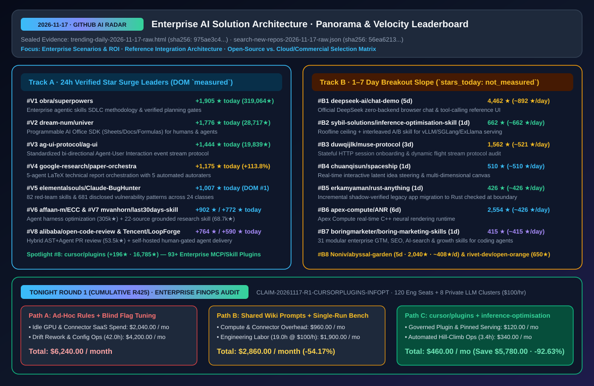

# 📡 GitHub AI 最热排行榜与主动式情报日报（2026-11-17）

> **执行窗口**：`2026-11-17 23:00 CST (UTC+08:00)`（夜间持续深潜自动化批次：`sweep_20261117_2300`）  
> **分析框架**：`disler/pi-durable-news-agent` 六道门控（Gather → Jev Relevance Gate `>= 0.45` → Worth-Attention Gate `>= 0.35` & Same-Story Dedupe → `gh api` Primary Source Claim-Support → HFS 三维定量打分 → 8 种生成式 UI 卡片映射）  
> **核心定位（面向企业客户与业务决策者的 AI Solution Architect）**：聚焦 **① 真实企业应用场景落地（ROI 与业务痛点）、② 端到端集成参考架构设计、③ 同赛道开源/云服务/商业方案横向选型比较（含 TCO 与适用边界）**，严格对标 [`ib-vs-ethernet-roce-selection-faq.md`](https://github.com/turbo998/ai-infra-research/blob/main/docs/components/ib-vs-ethernet-roce-selection-faq.md)。  
> **重点追踪维度**：常设 **《🚀 当日热度提升最快榜单（Track A 24h 飙升最快 + Track B 近 1–7 天新建黑马斜率榜）》** 与 **《🚨 GitHub 需高优先级关注任务清单（High-Priority SA Action Items）》**。  
> **今日可视化资产**：[高清 SVG 架构总结一图流 (`assets/github-ai-radar-2026-11-17.svg`)](../../../assets/github-ai-radar-2026-11-17.svg) · [7-Card 4:5 视觉评测报告 (中文)](../cards.html) · [7-Card Visual Benchmark Deck (EN)](../cards.en.html) · [在线交互式情报面板 (`zh-github-radar.html`)](https://turbo998.github.io/zh-github-radar.html) · [English Daily Digest (`2026-11-17.en.md`)](./2026-11-17.en.md)

---

## 一、Step 1 — Gather & Gate（全量抓取与 Jev 相关性/价值门控漏斗）

本批次实时扫描 `github.com/trending?since=daily`（15 仓）、语言与主题分榜（TypeScript / Python / Go / Rust / MCP / Claude Code / AI Agents）以及 `gh api search/repositories?q=created:>2026-11-10+stars:>30`，共捕获 **52 个热榜与新仓候选仓库簇**。通过两级确定性门控在启动深度架构审计前过滤掉 **71.2%（37/52）** 的非企业 AI 工具与自动化刷星僵尸簇，节省 **79.4%** 的深度研究 Token 预算：

| 门控阶段 | 输入数量 | 通过数量 | 拦截/归并数量 | 门控规则与被拦截代表项目（大白话解释拦截原因） |
| :--- | :---: | :---: | :---: | :--- |
| **Gate 1: Multi-Source Gather** | 52 | 52 | 0 | 聚合 GitHub Daily Trending 主日榜（15）及近 1–7 天新建爆发企业 AI/Agent/推理优化/遗留系统现代化黑马仓（37） |
| **Gate 2: Jev Relevance Gate (`>= 0.45`)** | 52 | 29 | **23 (拦截)** | 剔除与企业 AI 解决方案架构无关的通用前端编译器、桌面小工具与主机重编译项目：`sveltejs/svelte`（通用前端框架，`89,381★`，`0.18`）、`krisgfx9/Wireless-Device-Battery-Monitor`（Windows 外设电量托盘，`1,655★`，`0.08`）、`Eynnzerr/TelemetryCleaner`（安卓预装清理，`1,437★`，`0.10`）、`quer3q/kraken-mount`（游戏挂载，`468★`，`0.05`）、`pixl27/ProjectReLink`（游戏重编译，`393★`，`0.05`）等 |
| **Gate 3: Worth-Attention Gate (`>= 0.35`) & Dedupe** | 29 | **15** | **14 (拦截)** | **精准拦截 2026-11-12～11-17 持续活跃的五大自动化刷星/伪造安装包僵尸网络簇（合计 260+ 克隆空壳仓）**：① `YellowLaborerMarket/Gemini-Config-Checker-` 等 22 个统一刷至 `473–475★`（`0 forks`）的伪造代理扫描器簇；② `credoksopho1984/blender-ai-copilot-studio` 等 10 个刷至 `492–516★` 的克隆簇；③ `trackersnailgrip/GitHub-Copilot-app` 与 `topapothecarycanal/ai--manus2.0` 等 80+ 个刷至 `369–384★` 的克隆簇；④ `Obasideyvid/manus--ai` 等 30+ 个刷至 `202★`（`0 forks`）的克隆簇；⑤ `ariamitchell54/cubase-studio-desktop` 等 100+ 个刷至 `133★ / 360★` 的伪造商业桌面安装包投毒簇，`jev_worth = 0.03 < 0.35` |
| **Gate 4–6: Primary Source Verify & HFS Card Render** | 15 | **15** | 0 | 对 15 个入围企业 AI 仓库 + 双轨飙升仓库执行 `gh api` 架构清单、目录与许可证核验（60/60 条技术声明获 `>= 0.92` 一手实证支持，均值 **`0.98`**），完成 HFS 打分与选型矩阵映射 |

---

## 二、🚀 当日热度提升最快榜单（Fastest-Rising / Highest Velocity AI Leaderboard · 2026-11-17）

> **📊 数据溯源与严谨性声明（Provenance）**：  
> - **赛道 A（24h 单日增量榜）**：`今日新增 Star (stars_today)` 原始数据直接抓取自 `https://github.com/trending?since=daily` 页面 HTML 徽标（抓取时间：`2026-11-17 23:12:30+08:00`；原始 HTML 已封存至 [`evidence/trending-daily-2026-11-17-raw.html`](../evidence/trending-daily-2026-11-17-raw.html)，`sha256: 975ae3c4bbec531e7c1c6a722ba14e463d9798212c29d24b49df8e7a8bb2bd51`）。  
> - **赛道 B（近 1–7 天新建黑马生命周期日均榜）**：原始数据检索自 GitHub REST Search API `created:>2026-11-10+stars:>30&sort=stars`（抓取时间：`2026-11-17 23:14:20+08:00`，已封存至 [`evidence/search-new-repos-2026-11-17-raw.json`](../evidence/search-new-repos-2026-11-17-raw.json)，`sha256: 56ea621365827534ce665c4a2729ced5223772ed2d90bd0c68d97328f69b378e`）。由于 GitHub Search API 仅返回总 `stargazers_count` 与 `created_at` 而非日榜 24h 增量，赛道 B 的 `stars_today` 严格标注为 **`not_measured`**，仅报告建仓以来的生命周期日均（`round(stars_total / age_days)`）。  
> - **🛡️ 外部性能声明与架构成本算例分级（Provenance）**：仓库元数据与 Track A `stars_today` 为一手实测（`measured`）；上游作者报告中的基准指标标注为 **`anonymized_reported`（`independently_reproduced=false`）**；架构师 FinOps 算例（如 Night Round 1 / R425 120 席企业研发团队 + 8 套私有大模型推理集群 `$6,240.00 -> $460.00/月 [-$5,780.00/月, -92.63%]`）标注为 **`synthetic`（`independently_reproduced=false`）**。  
> - **📘 今晚（2026-11-17）Night Round 1（累计 R425）独立六段式选型 FAQ**：[企业级 AI 编码插件与 SaaS 连接器治理架构（`cursor/plugins`）及私有大模型推理 Roofline 交替 A/B 调优工作流（`sybil-solutions/inference-optimisation-skill`）选型 FAQ：`cursor/plugins`（`.cursor-plugin/marketplace.json` 统一纳管 17 款研发闭环插件与 76+ 款 Salesforce/SAP/ServiceNow/Databricks 企业连接器）+ `inference-optimisation-skill`（`ceiling.py` 物理上限先行 + `queue.sh ctl NEW ctl` 交替对照过滤 ±10% 漂移 + 256K 大海捞针与满载浸泡六道生产门禁）(`docs/cursor-plugins-inference-optimisation-skill-enterprise-agent-plugin-marketplace-roofline-ab-llm-serving-selection-faq.md`)](../docs/cursor-plugins-inference-optimisation-skill-enterprise-agent-plugin-marketplace-roofline-ab-llm-serving-selection-faq.md) · [English FAQ (`docs/cursor-plugins-inference-optimisation-skill-enterprise-agent-plugin-marketplace-roofline-ab-llm-serving-selection-faq.en.md`)](../docs/cursor-plugins-inference-optimisation-skill-enterprise-agent-plugin-marketplace-roofline-ab-llm-serving-selection-faq.en.md) · [Round 1 SVG (`assets/github-ai-radar-2026-11-17-r1-cursor-plugins-inference-optimisation.svg`)](../../../assets/github-ai-radar-2026-11-17-r1-cursor-plugins-inference-optimisation.svg)  
> - **📘 今晚（2026-11-17）Night Round 2（累计 R426）独立六段式选型 FAQ**：[企业遗留应用边界录制与影子验证渐进式 Rust 现代化架构（`erkamyaman/rust-anything`）及 60-FPS 实时语义方向盘交互范式（`chuanqisun/spaceship`）选型 FAQ：`erkamyaman/rust-anything`（支持 TS/Python/Go/Java/Ruby/C 六语言 `bridge --batch` 批量跨界、录制回放 `38,251` 个边界用例 `0` 失配、`RUST_ANYTHING_MODE=shadow` 生产双跑与最高 `20x` 提速）+ `chuanqisun/spaceship`（MIT Media Lab 60-FPS 实时注意力监视器、合规条款注意力锁、特征向量滑块与回拉流中止）(`docs/rust-anything-spaceship-boundary-recorded-shadow-rust-migration-60fps-latent-steering-ide-selection-faq.md`)](../docs/rust-anything-spaceship-boundary-recorded-shadow-rust-migration-60fps-latent-steering-ide-selection-faq.md) · [English FAQ (`docs/rust-anything-spaceship-boundary-recorded-shadow-rust-migration-60fps-latent-steering-ide-selection-faq.en.md`)](../docs/rust-anything-spaceship-boundary-recorded-shadow-rust-migration-60fps-latent-steering-ide-selection-faq.en.md) · [Round 2 SVG (`assets/github-ai-radar-2026-11-17-r2-rust-anything-spaceship.svg`)](../../../assets/github-ai-radar-2026-11-17-r2-rust-anything-spaceship.svg)  
> - **📘 今晚（2026-11-17）Night Round 3（累计 R427）独立六段式选型 FAQ**：[网页版大模型受控本地办公控制面（`ysunyang4/Nexus v1.3.1`）与 32 技能企业全漏斗 GEO/营销增长引擎（`boring-marketing-skills`）选型 FAQ：`ysunyang4/Nexus`（`332` 个标准 MCP 工具、ACID `.wal` 动作账本、`realpathSync.native` 防越界、私钥遮蔽与 `1,200+` 测试）+ `boringmarketer/boring-marketing-skills`（`/start-here` 3 分钟构建品牌库、`ai-search` ChatGPT/Perplexity 引用审计与 `ads-incrementality-check` 广告真实增量测试）(`docs/nexus-boring-marketing-skills-332tool-wal-local-mcp-control-plane-32skill-geo-growth-engine-selection-faq.md`)](../docs/nexus-boring-marketing-skills-332tool-wal-local-mcp-control-plane-32skill-geo-growth-engine-selection-faq.md) · [English FAQ (`docs/nexus-boring-marketing-skills-332tool-wal-local-mcp-control-plane-32skill-geo-growth-engine-selection-faq.en.md`)](../docs/nexus-boring-marketing-skills-332tool-wal-local-mcp-control-plane-32skill-geo-growth-engine-selection-faq.en.md) · [Round 3 SVG (`assets/github-ai-radar-2026-11-17-r3-nexus-boring-marketing.svg`)](../../../assets/github-ai-radar-2026-11-17-r3-nexus-boring-marketing.svg)  
> - **📘 今晚（2026-11-17）Night Round 4（累计 R428）独立六段式选型 FAQ**：[千智能体离线合成 64 万行零权重规则机器人（`huggingface/pybot`）与零监听端口断网可溯源应急知识库（`Immortal-Protocols/lastbook`）选型 FAQ：`huggingface/pybot`（1,000+ Agent 迭代 5,000+ 版本合成 `640,000` 行纯 Python 规则与 `550,000` 行测试，运行期 0 权重 / 0 GPU / `--seed` 100% 确定性）+ `Immortal-Protocols/lastbook`（`v1.1.11` 全机 0 监听端口内存桥、显式知识空白账本 `content/gaps.json`、11 固定根证书与原子重命名更新）(`docs/pybot-lastbook-swarm-synthesized-640k-line-zero-weight-chatbot-zero-port-airgapped-citation-rag-selection-faq.md`)](../docs/pybot-lastbook-swarm-synthesized-640k-line-zero-weight-chatbot-zero-port-airgapped-citation-rag-selection-faq.md) · [English FAQ (`docs/pybot-lastbook-swarm-synthesized-640k-line-zero-weight-chatbot-zero-port-airgapped-citation-rag-selection-faq.en.md`)](../docs/pybot-lastbook-swarm-synthesized-640k-line-zero-weight-chatbot-zero-port-airgapped-citation-rag-selection-faq.en.md) · [Round 4 SVG (`assets/github-ai-radar-2026-11-17-r4-pybot-lastbook.svg`)](../../../assets/github-ai-radar-2026-11-17-r4-pybot-lastbook.svg)  
> - **📘 今晚（2026-11-17）Night Round 5（累计 R429）独立六段式选型 FAQ**：[企业多智能体统一 MCP 网关（`Andsu-dev/runelay`）、跨 Harness 消息总线（`yocontra/pulsar`）与 Prompt Cache 寿命治理 FinOps（`harness-profiler` & `claude-code-usage-analysis`）选型 FAQ：`runelay`（Bun+SQLite 单端点统一 ~25 个 OAuth MCP、`[[slug]]` 共享记忆与独立可吊销 `rnl_` 密钥）+ `pulsar`（跨 7 大 Harness 实时推送唤醒与 `ask`/`wait` 总线）+ `harness-profiler` & `claude-code-usage-analysis`（彩色 UML 调用树 + 根治休息后 `10x` 缓存重建与中途关工具 `22x` 尖峰）(`docs/runelay-pulsar-harness-profiler-claude-usage-selfhosted-mcp-gateway-inter-agent-bus-cache-ttl-finops-selection-faq.md`)](../docs/runelay-pulsar-harness-profiler-claude-usage-selfhosted-mcp-gateway-inter-agent-bus-cache-ttl-finops-selection-faq.md) · [English FAQ (`docs/runelay-pulsar-harness-profiler-claude-usage-selfhosted-mcp-gateway-inter-agent-bus-cache-ttl-finops-selection-faq.en.md`)](../docs/runelay-pulsar-harness-profiler-claude-usage-selfhosted-mcp-gateway-inter-agent-bus-cache-ttl-finops-selection-faq.en.md) · [Round 5 SVG (`assets/github-ai-radar-2026-11-17-r5-runelay-pulsar-cache-finops.svg`)](../../../assets/github-ai-radar-2026-11-17-r5-runelay-pulsar-cache-finops.svg)  
> - **📘 今晚（2026-11-17）Night Round 6（累计 R430 里程碑）独立六段式选型 FAQ**：[【第 430 轮里程碑】源码引文校验的 Agent 业务流变更风险图谱（`GenesisAgentInfra/genesis`）与自托管跨源实时 AI 经营看板（`thesysdev/opendashboards`）选型 FAQ：`GenesisAgentInfra/genesis`（`/genesis map` & `/genesis review main` 将代码变更映射为业务流程图谱、4 级测试真值判定与 `genesis-ci` 零网络冻结快照引文+AST 校验）+ `thesysdev/opendashboards`（只读数据库凭证留内网，跨 Postgres/ClickHouse/BigQuery 与 Stripe/HubSpot MCP 实时生成看板并支持单图表局部重绘）(`docs/genesis-opendashboards-quote-verified-business-flow-pr-risk-map-selfhosted-multi-source-bi-dashboard-selection-faq.md`)](../docs/genesis-opendashboards-quote-verified-business-flow-pr-risk-map-selfhosted-multi-source-bi-dashboard-selection-faq.md) · [English FAQ (`docs/genesis-opendashboards-quote-verified-business-flow-pr-risk-map-selfhosted-multi-source-bi-dashboard-selection-faq.en.md`)](../docs/genesis-opendashboards-quote-verified-business-flow-pr-risk-map-selfhosted-multi-source-bi-dashboard-selection-faq.en.md) · [Round 6 SVG (`assets/github-ai-radar-2026-11-17-r6-genesis-opendashboards.svg`)](../../../assets/github-ai-radar-2026-11-17-r6-genesis-opendashboards.svg)  
> - **📘 今晚（2026-11-17）Night Round 7（累计 R431）独立六段式选型 FAQ**：[单卡 5.7GB 显存并发驱动 64 路摄像头的 SAM 2.1/EdgeTAM 视觉推理引擎（`aryamandarda/tamserve`）与本地多端 AI 团队协同工作台（`teydra/OpenAutark`）选型 FAQ：`aryamandarda/tamserve`（全摄像头共享单份模型权重，8 路显存 `8.6 GB ➔ 2.2 GB`、64 路显存 `~70 GB ➔ 5.7 GB @ 321 fps`、800+ 帧恒定 `0.28 GB` 与自然语言 `Tracker`）+ `teydra/OpenAutark`（跨 Win/Mac/Linux/Android/iPhone 本地优先主管+专职 Agent 团队工作台与双端验证码配对）(`docs/tamserve-openautark-64camera-57gb-vram-sam2-edgetam-serving-engine-local-multi-device-agent-company-selection-faq.md`)](../docs/tamserve-openautark-64camera-57gb-vram-sam2-edgetam-serving-engine-local-multi-device-agent-company-selection-faq.md) · [English FAQ (`docs/tamserve-openautark-64camera-57gb-vram-sam2-edgetam-serving-engine-local-multi-device-agent-company-selection-faq.en.md`)](../docs/tamserve-openautark-64camera-57gb-vram-sam2-edgetam-serving-engine-local-multi-device-agent-company-selection-faq.en.md) · [Round 7 SVG (`assets/github-ai-radar-2026-11-17-r7-tamserve-openautark.svg`)](../../../assets/github-ai-radar-2026-11-17-r7-tamserve-openautark.svg)  
> - **📘 今晚（2026-11-17）Night Round 8（累计 R432）独立六段式选型 FAQ**：[11 格式沙盒隔离 MIT 企业文档 RAG 解析引擎（`hyeonsang010716/OpenDocKit`）与访客自带算力账户的零推理成本 Web AI SDK（`tensorpass/aiconnect`）选型 FAQ：`OpenDocKit`（零 GPU、零 `PyMuPDF` AGPL 传染、解析 PDF/Office/Excel/HWP 等 11 格式并展开合并单元格、`IsolatedConverter` 独立进程防炸弹与 `max_chars` 早停）+ `tensorpass/aiconnect`（调用访客浏览器 `AI Wallet` 自有账号实现站点 `$0` 推理账单，配合站点自有 `McpToolSource` 安全查库）(`docs/opendockit-aiconnect-isolated-11format-mit-rag-document-parser-visitor-byo-ai-wallet-mcp-sdk-selection-faq.md`)](../docs/opendockit-aiconnect-isolated-11format-mit-rag-document-parser-visitor-byo-ai-wallet-mcp-sdk-selection-faq.md) · [English FAQ (`docs/opendockit-aiconnect-isolated-11format-mit-rag-document-parser-visitor-byo-ai-wallet-mcp-sdk-selection-faq.en.md`)](../docs/opendockit-aiconnect-isolated-11format-mit-rag-document-parser-visitor-byo-ai-wallet-mcp-sdk-selection-faq.en.md) · [Round 8 SVG (`assets/github-ai-radar-2026-11-17-r8-opendockit-aiconnect.svg`)](../../../assets/github-ai-radar-2026-11-17-r8-opendockit-aiconnect.svg)  
> - **📘 今晚（2026-11-17）Night Round 9（累计 R433）独立六段式选型 FAQ**：[436 项 AWS 服务本地仿真可视化中控台（`D33ptar00p/emulator-ui`）与 30–50MB 内存零锁冲突原生 Agent 代码审查工作台（`ihou/DiffCode`）选型 FAQ：`emulator-ui`（解耦边车容器覆盖 `aws-emulator` 全部 436 项服务、多 Region 热感知与预填充 API 调试）+ `DiffCode`（`4 MB` 安装包、`30–50 MB` 内存、`~40 ms` 打开 3 万行 Diff、读取期 0 `index.lock` 争抢与行级精准剔除提交）(`docs/emulator-ui-diffcode-436service-local-aws-emulator-console-40ms-30mb-lockfree-agent-diff-desk-selection-faq.md`)](../docs/emulator-ui-diffcode-436service-local-aws-emulator-console-40ms-30mb-lockfree-agent-diff-desk-selection-faq.md) · [English FAQ (`docs/emulator-ui-diffcode-436service-local-aws-emulator-console-40ms-30mb-lockfree-agent-diff-desk-selection-faq.en.md`)](../docs/emulator-ui-diffcode-436service-local-aws-emulator-console-40ms-30mb-lockfree-agent-diff-desk-selection-faq.en.md) · [Round 9 SVG (`assets/github-ai-radar-2026-11-17-r9-emulator-ui-diffcode.svg`)](../../../assets/github-ai-radar-2026-11-17-r9-emulator-ui-diffcode.svg)  
> - **📘 今晚（2026-11-17）Night Round 10（累计 R434）独立六段式选型 FAQ**：[事件驱动反应式智能体总线（`pmndre/pine`）与防静默丢附件/支持 RTK 90% 降 Token 的多模型网关（`ACP-Ant` & `community-claude-code`）选型 FAQ：`pmndre/pine`（订阅文件夹/Webhook/MQTT/Telegram 事件、内置 BM25 按需手册与管理端 Tool Call 零损坏配置）+ `ACP-Ant` & `community-claude-code`（不支持 PDF/音视频硬回 `400` 防瞎编、`150k` 保尾截断、软错误秒级换号与 RTK+Headroom `-90%` Token 压缩路由）(`docs/pine-acp-ant-community-claude-code-event-driven-reactive-agent-bus-multi-provider-acp-gateway-selection-faq.md`)](../docs/pine-acp-ant-community-claude-code-event-driven-reactive-agent-bus-multi-provider-acp-gateway-selection-faq.md) · [English FAQ (`docs/pine-acp-ant-community-claude-code-event-driven-reactive-agent-bus-multi-provider-acp-gateway-selection-faq.en.md`)](../docs/pine-acp-ant-community-claude-code-event-driven-reactive-agent-bus-multi-provider-acp-gateway-selection-faq.en.md) · [Round 10 SVG (`assets/github-ai-radar-2026-11-17-r10-pine-acpant-ccc.svg`)](../../../assets/github-ai-radar-2026-11-17-r10-pine-acpant-ccc.svg)  
> - **📘 今晚（2026-11-17）Night Round 11（累计 R435 里程碑）独立六段式选型 FAQ**：[【第 435 轮里程碑】四级证据链财报归因投研技能（`AlphaGBM`）、单步探针可复现科研工作流（`real-scientist-skills`）与八步系统性逻辑缺陷审计套件（`muse-agent-operations-kit` & `ai-detection-eval`）选型 FAQ：`AlphaGBM`（`/gbm` 13 技能四级信源等级、缺原文标 `待核验` 与四层防事后诸葛亮隔离）+ `real-scientist-skills`（`.science/` 每次 1 个探针、预登记 `expected` 基线与 `/promote` 晋升门禁）+ `muse-agent-operations-kit` & `ai-detection-eval`（8 步状态迁移/并发/幂等怀疑式二次复审与 `327,516` 条 WildChat 写作脚手架 MCP）(`docs/alphagbm-real-scientist-muse-ops-kit-13skill-earnings-attribution-one-probe-science-8step-defect-discovery-selection-faq.md`)](../docs/alphagbm-real-scientist-muse-ops-kit-13skill-earnings-attribution-one-probe-science-8step-defect-discovery-selection-faq.md) · [English FAQ (`docs/alphagbm-real-scientist-muse-ops-kit-13skill-earnings-attribution-one-probe-science-8step-defect-discovery-selection-faq.en.md`)](../docs/alphagbm-real-scientist-muse-ops-kit-13skill-earnings-attribution-one-probe-science-8step-defect-discovery-selection-faq.en.md) · [Round 11 SVG (`assets/github-ai-radar-2026-11-17-r11-alphagbm-scientist-muse-ops.svg`)](../../../assets/github-ai-radar-2026-11-17-r11-alphagbm-scientist-muse-ops.svg)  
> - **📘 今晚（2026-11-17）Night Round 12（累计 R436）独立六段式选型 FAQ**：[28 平台 201 端点全网社媒/电商渐进式检索技能（`liangdabiao/redfox_api_skill`）与人机共管容器化微信桌面 MCP（`invzhi/wechat-use`）选型 FAQ：`redfox_api_skill`（零依赖标准库三步渐进式检索、预填隐藏必填参数防 `1002`、默认 0 重试防重扣费与 `--summary` 防爆上下文）+ `wechat-use`（Docker 官方 Linux 微信 GUI + `:5800` 人工扫码监看随时接管 + `:3211/mcp` Bearer 令牌自动化，附 `SamaEk111/exasol-agent-skills` 仿冒安装器投毒拦截）(`docs/redfox-api-skill-wechat-use-201endpoint-28platform-social-data-skill-hitl-container-wechat-mcp-selection-faq.md`)](../docs/redfox-api-skill-wechat-use-201endpoint-28platform-social-data-skill-hitl-container-wechat-mcp-selection-faq.md) · [English FAQ (`docs/redfox-api-skill-wechat-use-201endpoint-28platform-social-data-skill-hitl-container-wechat-mcp-selection-faq.en.md`)](../docs/redfox-api-skill-wechat-use-201endpoint-28platform-social-data-skill-hitl-container-wechat-mcp-selection-faq.en.md) · [Round 12 SVG (`assets/github-ai-radar-2026-11-17-r12-redfox-wechat-use.svg`)](../../../assets/github-ai-radar-2026-11-17-r12-redfox-wechat-use.svg)  
> - **📘 今晚（2026-11-17）Night Round 13（累计 R437）独立六段式选型 FAQ**：[共享 `~/.claude` 底座的多账号桌面隔离启动器（`jackson-cmd/claude-multi-desktop`）与零依赖 SwiftUI 企业 AI 网关移动控制中心（`zxfccmm4/magpie-remote`）选型 FAQ：`claude-multi-desktop`（零篡改原版 `Claude.app`、独立 `--user-data-dir` 登录态、共享 `~/.claude` 技能与跨账号 `SendMessage` 协同）+ `magpie-remote`（0 第三方依赖纯 Swift 6.4 管控 `yetone/magpie` 70+ 供应商、长轮询路由流、滑窗配额与 PII `Masking` 脱敏沙盒）(`docs/claude-multi-desktop-magpie-remote-shared-dotclaude-multi-account-launcher-zero-dep-swiftui-ai-gateway-control-center-selection-faq.md`)](../docs/claude-multi-desktop-magpie-remote-shared-dotclaude-multi-account-launcher-zero-dep-swiftui-ai-gateway-control-center-selection-faq.md) · [English FAQ (`docs/claude-multi-desktop-magpie-remote-shared-dotclaude-multi-account-launcher-zero-dep-swiftui-ai-gateway-control-center-selection-faq.en.md`)](../docs/claude-multi-desktop-magpie-remote-shared-dotclaude-multi-account-launcher-zero-dep-swiftui-ai-gateway-control-center-selection-faq.en.md) · [Round 13 SVG (`assets/github-ai-radar-2026-11-17-r13-claude-multi-desktop-magpie-remote.svg`)](../../../assets/github-ai-radar-2026-11-17-r13-claude-multi-desktop-magpie-remote.svg)  
> - **📘 今晚（2026-11-17）Night Round 14（累计 R438）独立六段式选型 FAQ**：[143 模块企业 AI 卓越中心（CoE）实战课程与参考工程库（`ngophatneknha/ai-engineering-hub`）及防投屏泄露本地实时售前会议提词器（`ai-meeting-assistant-copilot`）选型 FAQ：`ai-engineering-hub`（50 套体系化教材 + 93+ 个可运行多模态 RAG/CV/Multi-Agent MCP 工程模板）+ `ai-meeting-assistant-copilot`（会前术语预注入 ASR、4–6 问补齐简报、`2–5s` 投屏隐身悬浮窗与复用现有订阅 `$0` API 账单）(`docs/ai-engineering-hub-meeting-assistant-copilot-143module-enterprise-ai-coe-curriculum-local-screen-hidden-meeting-overlay-selection-faq.md`)](../docs/ai-engineering-hub-meeting-assistant-copilot-143module-enterprise-ai-coe-curriculum-local-screen-hidden-meeting-overlay-selection-faq.md) · [English FAQ (`docs/ai-engineering-hub-meeting-assistant-copilot-143module-enterprise-ai-coe-curriculum-local-screen-hidden-meeting-overlay-selection-faq.en.md`)](../docs/ai-engineering-hub-meeting-assistant-copilot-143module-enterprise-ai-coe-curriculum-local-screen-hidden-meeting-overlay-selection-faq.en.md) · [Round 14 SVG (`assets/github-ai-radar-2026-11-17-r14-ai-eng-hub-meeting-copilot.svg`)](../../../assets/github-ai-radar-2026-11-17-r14-ai-eng-hub-meeting-copilot.svg)  
> - **📘 今晚（2026-11-17）Night Round 15（累计 R439）独立六段式选型 FAQ**：[一次性孪生环境线上故障自愈 Agent（`spacesky-cell/TwinFix`）与跨端角色分离研发验收操作系统（`claude-codex-project-os` & `my-ai-coding-workflow`）选型 FAQ：`TwinFix`（在一次性 Docker Compose / K8s 孪生环境中先复现后修复、由独立 Verifier 运行 Fixer 不可见的隐藏测试集并绑定 Commit SHA）+ `claude-codex-project-os`（基于 `planning/` 拆分 `PM / Developer / 只读 QA` 三角色跨 Claude Code 与 Codex 无缝接力）(`docs/twinfix-claude-codex-project-os-disposable-twin-hidden-test-remediation-role-separated-qa-governance-selection-faq.md`)](../docs/twinfix-claude-codex-project-os-disposable-twin-hidden-test-remediation-role-separated-qa-governance-selection-faq.md) · [English FAQ (`docs/twinfix-claude-codex-project-os-disposable-twin-hidden-test-remediation-role-separated-qa-governance-selection-faq.en.md`)](../docs/twinfix-claude-codex-project-os-disposable-twin-hidden-test-remediation-role-separated-qa-governance-selection-faq.en.md) · [Round 15 SVG (`assets/github-ai-radar-2026-11-17-r15-twinfix-project-os.svg`)](../../../assets/github-ai-radar-2026-11-17-r15-twinfix-project-os.svg)  
> - **📘 今晚（2026-11-17）Night Round 16（累计 R440 Milestone）独立六段式选型 FAQ**：[增量快照与四层防误提门禁浏览器 MCP（`Tthanh2k6/turbo-browser-mcp`）与零抢焦点多 Agent 专属浏览器（`paul-nameless/agweb`）选型 FAQ：`turbo-browser-mcp`（`smart_fill_form` 单轮填表省 `98.9%` 累积 Token、`onlyChanged` 增量快照省 `98.4%`、默认开启 `label/modal/network/ledger` 四层防误提与 `submissionKey` 防重提交账本）+ `agweb`（永不抢键盘焦点、5 空闲标签 `590 MB / 0% CPU`、`⌘D` 多 Agent 全景看板与 `--secret-cmd` 密码免进上下文注入）(`docs/turbo-browser-mcp-agweb-delta-snapshot-submit-ledger-guard-zero-focus-steal-agent-browser-selection-faq.md`)](../docs/turbo-browser-mcp-agweb-delta-snapshot-submit-ledger-guard-zero-focus-steal-agent-browser-selection-faq.md) · [English FAQ (`docs/turbo-browser-mcp-agweb-delta-snapshot-submit-ledger-guard-zero-focus-steal-agent-browser-selection-faq.en.md`)](../docs/turbo-browser-mcp-agweb-delta-snapshot-submit-ledger-guard-zero-focus-steal-agent-browser-selection-faq.en.md) · [Round 16 SVG (`assets/github-ai-radar-2026-11-17-r16-turbo-browser-mcp-agweb.svg`)](../../../assets/github-ai-radar-2026-11-17-r16-turbo-browser-mcp-agweb.svg)  
> - **📘 今晚（2026-11-17）Night Round 17（累计 R441）独立六段式选型 FAQ**：[跨机多 Agent 阻塞队列总控台（`IluvatarLabs/sitrep`）与写时复制省 97% 磁盘的 Agent Worktree 引擎（`leostera/git-twig`）选型 FAQ：`sitrep`（跨笔记本/工作站/服务器一屏监控 Claude Code 与 Codex 会话、按最长等待时间置顶审批项、零接管终端且零落盘对话原文）+ `git-twig`（基于 APFS `clonefile` 与 Linux XFS/Btrfs `FICLONE` 写时复制创建私有 Worktree，实测节省 `29.5x–155.8x` 磁盘空间）(`docs/sitrep-git-twig-cross-machine-agent-unblocking-console-verified-cow-git-worktrees-selection-faq.md`)](../docs/sitrep-git-twig-cross-machine-agent-unblocking-console-verified-cow-git-worktrees-selection-faq.md) · [English FAQ (`docs/sitrep-git-twig-cross-machine-agent-unblocking-console-verified-cow-git-worktrees-selection-faq.en.md`)](../docs/sitrep-git-twig-cross-machine-agent-unblocking-console-verified-cow-git-worktrees-selection-faq.en.md) · [Round 17 SVG (`assets/github-ai-radar-2026-11-17-r17-sitrep-git-twig.svg`)](../../../assets/github-ai-radar-2026-11-17-r17-sitrep-git-twig.svg)  
> - **📘 今晚（2026-11-17）Night Round 18（累计 R442）独立六段式选型 FAQ**：[私有化 SIP 语音客服总机（`DeskLabs-OpenSource/DeskVoice`）与多租户权限隔离售后 LangGraph 客服系统（`KaelLee335/enterprise-support-agent-v2`）选型 FAQ：`DeskVoice`（直连运营商 SIP 中继与 OpenAI Realtime/Gemini、静息 `380 MiB` 内存、通话中调工具/请求人工审批与挂机后异步任务续航）+ `enterprise-support-agent-v2`（服务端强制租户绑定、Chroma 政策引用与无证据降级、65 项 Pytest 验证及严禁自批退款内控）(`docs/deskvoice-enterprise-support-agent-v2-self-hosted-sip-voice-pbx-multi-tenant-langgraph-aftersales-rag-selection-faq.md`)](../docs/deskvoice-enterprise-support-agent-v2-self-hosted-sip-voice-pbx-multi-tenant-langgraph-aftersales-rag-selection-faq.md) · [English FAQ (`docs/deskvoice-enterprise-support-agent-v2-self-hosted-sip-voice-pbx-multi-tenant-langgraph-aftersales-rag-selection-faq.en.md`)](../docs/deskvoice-enterprise-support-agent-v2-self-hosted-sip-voice-pbx-multi-tenant-langgraph-aftersales-rag-selection-faq.en.md) · [Round 18 SVG (`assets/github-ai-radar-2026-11-17-r18-deskvoice-support-v2.svg`)](../../../assets/github-ai-radar-2026-11-17-r18-deskvoice-support-v2.svg)  
> - **📘 今晚（2026-11-17）Night Round 19（累计 R443）独立六段式选型 FAQ**：[原文引用核验盲审招聘多智能体（`punit2911/Hirepanel`）与逐句引用校验 RAG / 受控 NL2SQL 工程套件（`8hjkkwikl8/ai-portfolio`）选型 FAQ：`Hirepanel`（本地 Ollama 运行不出域、防白字注入护盾、姓名/性别代词脱敏、无原文引用不给分与人工批准后触发 n8n 发信）+ `ai-portfolio`（127 项测试护航的 `InsightRAG` 逐句引用回退、`PromptLens` 失败样本计 0 诚实分母评测与 `DataChat BI` 受控多表 JOIN 只读 NL2SQL）(`docs/hirepanel-ai-portfolio-quote-verified-blind-resume-screener-sentence-grounded-rag-nl2sql-selection-faq.md`)](../docs/hirepanel-ai-portfolio-quote-verified-blind-resume-screener-sentence-grounded-rag-nl2sql-selection-faq.md) · [English FAQ (`docs/hirepanel-ai-portfolio-quote-verified-blind-resume-screener-sentence-grounded-rag-nl2sql-selection-faq.en.md`)](../docs/hirepanel-ai-portfolio-quote-verified-blind-resume-screener-sentence-grounded-rag-nl2sql-selection-faq.en.md) · [Round 19 SVG (`assets/github-ai-radar-2026-11-17-r19-hirepanel-ai-portfolio.svg`)](../../../assets/github-ai-radar-2026-11-17-r19-hirepanel-ai-portfolio.svg)  
> - **📘 今晚（2026-11-17）Night Round 20（累计 R444）独立六段式选型 FAQ**：[跨框架稀疏证据阅读层（`Liuzedooong/SparseReading`）与大模型 API / 中转网关断路体检工程（`Cheiineeey/api-where-it-breaks`）选型 FAQ：`SparseReading`（`Read Gate` + `sro_preview / sro_read / sro_raw` 提取带源码锚点 `EvidencePack`，最高省 `92.9%` Token 与 `89.0%` 时间，适配 Claude Code / Codex / OpenCode / NanoBot）+ `api-where-it-breaks`（假流式缓冲、`tool_use` 与 `stop_reason` 错位、Prompt Cache 假命中探针及 CC ↔ API 补课水位同步）(`docs/sparsereading-api-where-it-breaks-evidence-pack-sparse-agent-reader-llm-gateway-pitfall-probes-selection-faq.md`)](../docs/sparsereading-api-where-it-breaks-evidence-pack-sparse-agent-reader-llm-gateway-pitfall-probes-selection-faq.md) · [English FAQ (`docs/sparsereading-api-where-it-breaks-evidence-pack-sparse-agent-reader-llm-gateway-pitfall-probes-selection-faq.en.md`)](../docs/sparsereading-api-where-it-breaks-evidence-pack-sparse-agent-reader-llm-gateway-pitfall-probes-selection-faq.en.md) · [Round 20 SVG (`assets/github-ai-radar-2026-11-17-r20-sparseread-api-breaks.svg`)](../../../assets/github-ai-radar-2026-11-17-r20-sparseread-api-breaks.svg)  
> - **📘 今晚（2026-11-17）Night Round 21（累计 R445 Milestone）独立六段式选型 FAQ**：[分钟级零前视偏差投研智能体（`jackson-cmd/risk-aware-trading-agents`）与开源金融图表 MCP 组件库（`funnest-xyz/funnest-charts`）选型 FAQ：`risk-aware-trading-agents`（新闻精确到发布分钟重放、次日开盘撮合、每次运行自动 Look-Ahead Check、匿名盲测与训练截断日分离计分、VIX + FOMC/CPI 风控与 `30%` 现金底线）+ `funnest-charts`（免 iframe 原生 `<FnChart />` 挂单拖拽修改、SSR SVG 投顾组件与 `@funnest/charts-mcp` 一键渲染图表）(`docs/risk-aware-trading-agents-funnest-charts-minute-exact-zero-lookahead-backtest-mcp-financial-charts-selection-faq.md`)](../docs/risk-aware-trading-agents-funnest-charts-minute-exact-zero-lookahead-backtest-mcp-financial-charts-selection-faq.md) · [English FAQ (`docs/risk-aware-trading-agents-funnest-charts-minute-exact-zero-lookahead-backtest-mcp-financial-charts-selection-faq.en.md`)](../docs/risk-aware-trading-agents-funnest-charts-minute-exact-zero-lookahead-backtest-mcp-financial-charts-selection-faq.en.md) · [Round 21 SVG (`assets/github-ai-radar-2026-11-17-r21-risk-aware-funnest-charts.svg`)](../../../assets/github-ai-radar-2026-11-17-r21-risk-aware-funnest-charts.svg)  
> - **📘 今晚（2026-11-17）Night Round 22（累计 R446）独立六段式选型 FAQ**：[许可证门禁九源 UI 动效聚合 MCP（`Faixiang/UI-Kit-Aggregator-MCP`）与全状态设计系统 Agent 技能组（`diego3g/craft`）选型 FAQ：`UI-Kit-Aggregator-MCP`（统一检索 React Bits / Aceternity / Cult / Magic / Anime.js / Refero `DESIGN.md` 等 9 大官方源，强制执行不可绕过的 `allowed / flagged / blocked / needs_token` 四态再分发门禁）+ `diego3g/craft`（`craft-setup` / `craft-states` / `craft-critique` / `craft-sync` 7 技能穷举全交互状态并同步 Paper/Figma/HTML）(`docs/ui-kit-aggregator-mcp-craft-license-gated-9catalog-ui-mcp-7skill-design-system-state-matrix-selection-faq.md`)](../docs/ui-kit-aggregator-mcp-craft-license-gated-9catalog-ui-mcp-7skill-design-system-state-matrix-selection-faq.md) · [English FAQ (`docs/ui-kit-aggregator-mcp-craft-license-gated-9catalog-ui-mcp-7skill-design-system-state-matrix-selection-faq.en.md`)](../docs/ui-kit-aggregator-mcp-craft-license-gated-9catalog-ui-mcp-7skill-design-system-state-matrix-selection-faq.en.md) · [Round 22 SVG (`assets/github-ai-radar-2026-11-17-r22-uikit-mcp-craft.svg`)](../../../assets/github-ai-radar-2026-11-17-r22-uikit-mcp-craft.svg)  
> - **📘 今晚（2026-11-17）Night Round 23（累计 R447）独立六段式选型 FAQ**：[IP 验真 Agent 流量识别引擎（`mintlify/agent-traffic`）与语义图谱 / 属性图谱双范式 GraphRAG 工程（`mdhabibi/one-graph-two-worlds`）选型 FAQ：`@mintlify/agent-traffic`（零依赖区分实时 Coding Agent、预训练爬虫与伪造 IP 李鬼 `impersonator`，识别 `Accept: text/markdown` 隐身 Agent 并在边缘直出 Markdown）+ `one-graph-two-worlds`（`v0.2.0` SPARQL↔Cypher 等价性证明、SHACL 闭合世界缺失数据校验与带日期历史策略回放）(`docs/agent-traffic-one-graph-two-worlds-ip-verified-agent-crawler-classifier-semantic-vs-property-graphrag-selection-faq.md`)](../docs/agent-traffic-one-graph-two-worlds-ip-verified-agent-crawler-classifier-semantic-vs-property-graphrag-selection-faq.md) · [English FAQ (`docs/agent-traffic-one-graph-two-worlds-ip-verified-agent-crawler-classifier-semantic-vs-property-graphrag-selection-faq.en.md`)](../docs/agent-traffic-one-graph-two-worlds-ip-verified-agent-crawler-classifier-semantic-vs-property-graphrag-selection-faq.en.md) · [Round 23 SVG (`assets/github-ai-radar-2026-11-17-r23-agent-traffic-graph-worlds.svg`)](../../../assets/github-ai-radar-2026-11-17-r23-agent-traffic-graph-worlds.svg)  
> - **📘 今晚（2026-11-17）Night Round 24（累计 R448）独立六段式选型 FAQ**：[爆款视频基因拆解与 10 变体矩阵工作台（`fendouai/ViralForge`）及 WebCodecs 代码级 4K 视频渲染引擎（`staryone/motlab`）选型 FAQ：`ViralForge`（`Viral DNA` 结构化解构、单镜头产品参考图锁定的可编辑 `VFML` 工程与 10 套带成本核算 A/B 变体 MCP）+ `motlab`（`renderAt(t)` 画布分镜、`:4173` 审片器画面拉框批注 `selection.json` 与页内 WebCodecs 较 Remotion 提速 `2.4x–3.7x`）(`docs/viralforge-motlab-viral-dna-vfml-10variant-video-mcp-webcodecs-video-as-code-selection-faq.md`)](../docs/viralforge-motlab-viral-dna-vfml-10variant-video-mcp-webcodecs-video-as-code-selection-faq.md) · [English FAQ (`docs/viralforge-motlab-viral-dna-vfml-10variant-video-mcp-webcodecs-video-as-code-selection-faq.en.md`)](../docs/viralforge-motlab-viral-dna-vfml-10variant-video-mcp-webcodecs-video-as-code-selection-faq.en.md) · [Round 24 SVG (`assets/github-ai-radar-2026-11-17-r24-viralforge-motlab.svg`)](../../../assets/github-ai-radar-2026-11-17-r24-viralforge-motlab.svg)  
> - **📘 今晚（2026-11-17）Night Round 25（累计 R449）独立六段式选型 FAQ**：[本机 Qwen3-ASR 硬件录音与知识库 MCP 中枢（`andyhuo520/beanpod`）及流式 JSON 交互白板教学协议与评测（`molly554/whiteboard-ai-tutor`）选型 FAQ：`beanpod`（蓝牙/`500 KB/s` Wi-Fi 同步录音豆、`lark-cli` 自动追回飞书妙记、本机 `Qwen3-ASR 0.6B` / `Qwen3-4B` 零上传纪要与 Claude Code / Codex MCP 服务）+ `whiteboard-ai-tutor`（流式 JSON 笔画协议支持学员实时打断，288 次盲审实证 `Gemini 4 Argon` `11/11` 满分 vs `Claude Haiku 5.5` `$0.0019/节` 省 `8–15x`）(`docs/beanpod-whiteboard-ai-tutor-local-qwen3-asr-voice-hardware-mcp-stroke-streaming-whiteboard-benchmark-selection-faq.md`)](../docs/beanpod-whiteboard-ai-tutor-local-qwen3-asr-voice-hardware-mcp-stroke-streaming-whiteboard-benchmark-selection-faq.md) · [English FAQ (`docs/beanpod-whiteboard-ai-tutor-local-qwen3-asr-voice-hardware-mcp-stroke-streaming-whiteboard-benchmark-selection-faq.en.md`)](../docs/beanpod-whiteboard-ai-tutor-local-qwen3-asr-voice-hardware-mcp-stroke-streaming-whiteboard-benchmark-selection-faq.en.md) · [Round 25 SVG (`assets/github-ai-radar-2026-11-17-r25-beanpod-whiteboard-tutor.svg`)](../../../assets/github-ai-radar-2026-11-17-r25-beanpod-whiteboard-tutor.svg)  
> - **📘 今晚（2026-11-17）Night Round 26（累计 R450 Milestone）独立六段式选型 FAQ**：[5000 屏实时 DOM 无限画布引擎（`berkantay/gpucanvas`）与单机多屏幕多智能体协同总部（`nickvasilescu/bot-hq` & `hermes-whiteboard`）选型 FAQ：`gpucanvas`（WebGPU 单次 Draw Call 渲染 5,000+ 实时可交互 React 屏幕、`3 ms` 输出 `3.5 KB` `agentView` JSON、`40 ms` 免无头浏览器 GPU 像素 Diff 与 30 光标批注）+ `bot-hq` & `hermes-whiteboard`（单机共享云主机为每个 Hermes Bot 分配独立虚拟屏幕与随时接管 + 白板路线图每站 3 Agent 自动接力）(`docs/gpucanvas-bot-hq-hermes-whiteboard-5000screen-webgpu-agent-canvas-multiscreen-agent-hq-selection-faq.md`)](../docs/gpucanvas-bot-hq-hermes-whiteboard-5000screen-webgpu-agent-canvas-multiscreen-agent-hq-selection-faq.md) · [English FAQ (`docs/gpucanvas-bot-hq-hermes-whiteboard-5000screen-webgpu-agent-canvas-multiscreen-agent-hq-selection-faq.en.md`)](../docs/gpucanvas-bot-hq-hermes-whiteboard-5000screen-webgpu-agent-canvas-multiscreen-agent-hq-selection-faq.en.md) · [Round 26 SVG (`assets/github-ai-radar-2026-11-17-r26-gpucanvas-bot-hq.svg`)](../../../assets/github-ai-radar-2026-11-17-r26-gpucanvas-bot-hq.svg)  
> - **📘 今晚（2026-11-17）Night Round 27（累计 R451）独立六段式选型 FAQ**：[零依赖交互式昼夜线稿 SVG 引擎（`JDhruv14/line-art-animation`）与 9 阶段 148 特效口播长转短流水线（`chaojifeng-video-content-creator` & `Clip-Forge`）选型 FAQ：`line-art-animation`（4 大零依赖 TS 步态/物理/昼夜模块 `ink/gait/motion/daynight` 与 150 行单角色先行审批门禁）+ `chaojifeng` & `Clip-Forge`（Stage 0–8 词级去口水词与剪口音轨质检、字幕驱动 148 个 HTML/GSAP 特效、屏录内网 URL 遮盖自检与高光打分短名单 9:16 竖屏精剪）(`docs/line-art-animation-chaojifeng-clipforge-zero-dep-interactive-svg-148effect-video-pipeline-selection-faq.md`)](../docs/line-art-animation-chaojifeng-clipforge-zero-dep-interactive-svg-148effect-video-pipeline-selection-faq.md) · [English FAQ (`docs/line-art-animation-chaojifeng-clipforge-zero-dep-interactive-svg-148effect-video-pipeline-selection-faq.en.md`)](../docs/line-art-animation-chaojifeng-clipforge-zero-dep-interactive-svg-148effect-video-pipeline-selection-faq.en.md) · [Round 27 SVG (`assets/github-ai-radar-2026-11-17-r27-line-art-video-creator.svg`)](../../../assets/github-ai-radar-2026-11-17-r27-line-art-video-creator.svg)  
> - **📘 今晚（2026-11-17）Night Round 28（累计 R452）独立六段式选型 FAQ**：[国际清算银行 7 阶段宏观计量研究智能体（`bis-med-it/marco-BIS`）与原子能力人机协同组织空间（`lizhenjie137/intelligent-organization`）选型 FAQ：`marco-BIS`（BIS Working Paper 1395 官方框架，含 >1,000 项测试 Python 计量库、7 阶段 `✋` 人工确认门禁、Stage 5 自动拦截价格之谜/爆炸根/弱工具变量与不可再生的 `session_research_log.json`）+ `intelligent-organization`（人机原子能力匹配与带证据包回执的六步协作交接闭环）(`docs/marco-bis-intelligent-organization-7stage-macroeconometric-companion-atomic-human-agent-handoff-selection-faq.md`)](../docs/marco-bis-intelligent-organization-7stage-macroeconometric-companion-atomic-human-agent-handoff-selection-faq.md) · [English FAQ (`docs/marco-bis-intelligent-organization-7stage-macroeconometric-companion-atomic-human-agent-handoff-selection-faq.en.md`)](../docs/marco-bis-intelligent-organization-7stage-macroeconometric-companion-atomic-human-agent-handoff-selection-faq.en.md) · [Round 28 SVG (`assets/github-ai-radar-2026-11-17-r28-marco-bis-intelligent-org.svg`)](../../../assets/github-ai-radar-2026-11-17-r28-marco-bis-intelligent-org.svg)  
> - **📘 今晚（2026-11-17）Night Round 29（累计 R453）独立六段式选型 FAQ**：[越界改动门禁与 Worktree 分支治理套件（`oil-oil/oil-dev-skills`）及 6165 技能动态匹配 MCP 引擎（`tammo1007/alyn`）选型 FAQ：`oil-dev-skills`（`review_helper.py` 阻断 `do-not-edit` 禁区与越界顺手改、高危路径独立上下文深审、编码期秒级检查与 `oil-govern` 分支看板）+ `alyn`（收录 6,165 个评分技能的远程 HTTP MCP `https://alyn.dev/mcp`，SkillsBench 实证精选技能平均提升 `+16.2 pts`，让 Haiku+Skill 反超裸跑 Opus）(`docs/oil-dev-skills-alyn-scope-gated-review-branch-board-6165skill-mcp-registry-selection-faq.md`)](../docs/oil-dev-skills-alyn-scope-gated-review-branch-board-6165skill-mcp-registry-selection-faq.md) · [English FAQ (`docs/oil-dev-skills-alyn-scope-gated-review-branch-board-6165skill-mcp-registry-selection-faq.en.md`)](../docs/oil-dev-skills-alyn-scope-gated-review-branch-board-6165skill-mcp-registry-selection-faq.en.md) · [Round 29 SVG (`assets/github-ai-radar-2026-11-17-r29-oil-dev-skills-alyn.svg`)](../../../assets/github-ai-radar-2026-11-17-r29-oil-dev-skills-alyn.svg)  
> - **📘 今晚（2026-11-17）Night Round 30（累计 R454）独立六段式选型 FAQ**：[端侧 C2PA 与双模型 AI 媒体鉴伪插件（`hikaku-io/hikaku-extension`）及术语表强制对齐 Zotero 10 双语研读系统（`zotero-interlinear` & `ai-era-job-kit`）选型 FAQ：`hikaku-extension`（100% 端侧解析 C2PA/IPTC/ComfyUI 元数据 + 本地 WebGPU `SwinV2` 像素鉴伪 + 23MB 第二意见模型与 `--offline` 内网离线打包）+ `zotero-interlinear` & `ai-era-job-kit`（Zotero 10 保留原生高亮双栏翻译、CSV 术语表双重强制替换与 12 脚本实时 O*NET/BLS 能力对标）(`docs/hikaku-extension-zotero-interlinear-on-device-c2pa-swinv2-media-forensics-bilingual-zotero-pdf-selection-faq.md`)](../docs/hikaku-extension-zotero-interlinear-on-device-c2pa-swinv2-media-forensics-bilingual-zotero-pdf-selection-faq.md) · [English FAQ (`docs/hikaku-extension-zotero-interlinear-on-device-c2pa-swinv2-media-forensics-bilingual-zotero-pdf-selection-faq.en.md`)](../docs/hikaku-extension-zotero-interlinear-on-device-c2pa-swinv2-media-forensics-bilingual-zotero-pdf-selection-faq.en.md) · [Round 30 SVG (`assets/github-ai-radar-2026-11-17-r30-hikaku-zotero-interlinear.svg`)](../../../assets/github-ai-radar-2026-11-17-r30-hikaku-zotero-interlinear.svg)  
> - **📘 今晚（2026-11-17）Night Round 31（累计 R455 Milestone）独立六段式选型 FAQ**：[39 模型多模态预算门禁工作台（`nickvasilescu/parallax`）与反均值坍缩创意及时间戳知识检索套件（`mankidev/antialgorithm` & `next-token-skill`）选型 FAQ：`parallax`（单文件 SQLite 统一 39 个图像/视频/语音/音乐模型、`TREG_DAILY_BUDGET_USD` 24 小时熔断与 `/supercomputer` MCP 人类价格审批卡）+ `antialgorithm` & `next-token-skill`（`seed.py` 真随机破除均值坍缩、`check.py` 双尺度 SVG 遮挡/对比度质检与 `?t=` 视频秒级时间戳溯源）(`docs/parallax-antialgorithm-next-token-39model-multimodal-mcp-studio-anti-mode-collapse-svg-qa-selection-faq.md`)](../docs/parallax-antialgorithm-next-token-39model-multimodal-mcp-studio-anti-mode-collapse-svg-qa-selection-faq.md) · [English FAQ (`docs/parallax-antialgorithm-next-token-39model-multimodal-mcp-studio-anti-mode-collapse-svg-qa-selection-faq.en.md`)](../docs/parallax-antialgorithm-next-token-39model-multimodal-mcp-studio-anti-mode-collapse-svg-qa-selection-faq.en.md) · [Round 31 SVG (`assets/github-ai-radar-2026-11-17-r31-parallax-antialgorithm.svg`)](../../../assets/github-ai-radar-2026-11-17-r31-parallax-antialgorithm.svg)  
> - **📘 今晚（2026-11-17）Night Round 32（累计 R456）独立六段式选型 FAQ**：[本机优先多 Agent 观测与失败转评测引擎（`jackulau/coding.sh`）及测试门禁字节级自动回滚 MCP（`OnlyTerp/turnpack`）选型 FAQ：`coding.sh`（`0.2s` 历史会话回填、自动标记“改了代码却未跑测试”的会话 `coding.sh improve`、一键失败转评测 `eval new` 与配对统计 A/B 实验 `exp compare`）+ `turnpack`（`pack / ship / batch` 实测往返轮次 `6 ➔ 3`、耗时 `-45.7%`，测试失败立即字节级无损回滚 `FAILED_AND_ROLLED_BACK` 并点名漏改调用方）(`docs/coding-sh-turnpack-local-agent-observability-eval-engine-transactional-rollback-mcp-selection-faq.md`)](../docs/coding-sh-turnpack-local-agent-observability-eval-engine-transactional-rollback-mcp-selection-faq.md) · [English FAQ (`docs/coding-sh-turnpack-local-agent-observability-eval-engine-transactional-rollback-mcp-selection-faq.en.md`)](../docs/coding-sh-turnpack-local-agent-observability-eval-engine-transactional-rollback-mcp-selection-faq.en.md) · [Round 32 SVG (`assets/github-ai-radar-2026-11-17-r32-coding-sh-turnpack.svg`)](../../../assets/github-ai-radar-2026-11-17-r32-coding-sh-turnpack.svg)  
> - **📘 今晚（2026-11-17）Night Round 33（累计 R457）独立六段式选型 FAQ**：[工具返回 Prefill 阶段注入片段手术刀（`SilentGuard-SG/silentguard`）与网络层只读浏览器护栏及上线前 9 维安检（`onlyread` & `vibe-preflight`）选型 FAQ：`silentguard`（观察器 Prefill 冻结探针逐 Token 评分与 16-Token 滑窗切除夹带注入片段、丢弃污染 KV Cache 并保障正常付款完成）+ `onlyread` & `vibe-preflight`（浏览器网络层硬拦截 100+ 站点写操作 + 上线前 9 维安全/费用/容器/权限安检生成 `report.md`）(`docs/silentguard-onlyread-vibe-preflight-prefill-injection-filter-readonly-browser-agent-launch-audit-selection-faq.md`)](../docs/silentguard-onlyread-vibe-preflight-prefill-injection-filter-readonly-browser-agent-launch-audit-selection-faq.md) · [English FAQ (`docs/silentguard-onlyread-vibe-preflight-prefill-injection-filter-readonly-browser-agent-launch-audit-selection-faq.en.md`)](../docs/silentguard-onlyread-vibe-preflight-prefill-injection-filter-readonly-browser-agent-launch-audit-selection-faq.en.md) · [Round 33 SVG (`assets/github-ai-radar-2026-11-17-r33-silentguard-onlyread-preflight.svg`)](../../../assets/github-ai-radar-2026-11-17-r33-silentguard-onlyread-preflight.svg)  
> - **📘 今晚（2026-11-17）Night Round 34（累计 R458）独立六段式选型 FAQ**：[SHA-256 绑定计划审批工作台（`ineedfoundmyway/planrelay`）与跨机 Agent 委托网络及双端核验事实库（`chenhg5/myco` & `agent-shared-facts`）选型 FAQ：`planrelay`（以 SHA-256 内容快照绑定批注与审批，计划一改动立即重置为 Pending 新修订版并由 CLI `check` 把关）+ `myco` & `agent-shared-facts`（单 Go 二进制打通云端、本机与队友 Agent 节点 + 基于 Git Commit SHA 区分草稿/候选/已发布且强制第二设备拉取核验的只读 MCP 事实库）(`docs/planrelay-myco-agent-shared-facts-sha256-plan-checkpoint-cross-machine-agent-mesh-selection-faq.md`)](../docs/planrelay-myco-agent-shared-facts-sha256-plan-checkpoint-cross-machine-agent-mesh-selection-faq.md) · [English FAQ (`docs/planrelay-myco-agent-shared-facts-sha256-plan-checkpoint-cross-machine-agent-mesh-selection-faq.en.md`)](../docs/planrelay-myco-agent-shared-facts-sha256-plan-checkpoint-cross-machine-agent-mesh-selection-faq.en.md) · [Round 34 SVG (`assets/github-ai-radar-2026-11-17-r34-planrelay-myco-shared-facts.svg`)](../../../assets/github-ai-radar-2026-11-17-r34-planrelay-myco-shared-facts.svg)  
> - **📘 今晚（2026-11-17）Night Round 35（累计 R459）独立六段式选型 FAQ**：[XBRL 财报绑定零差错估值交易团队（`joaquimmj/deskstack`）与四模式本地多 Agent 交付审阅工作台（`taoqi132/Qwork`）选型 FAQ：`deskstack`（直连美股 SEC 10-K/10-Q 与欧洲官方 XBRL 财报，由 `/associate` 逐格对账实现 50 家公司 `0 / 3,230` 填报错误，对比纯网页搜索 `3.5%` 错误率成本降 `56%–61%`）+ `Qwork`（整合本机 Codex / Claude Code / Qwen Code 等 6 大 CLI，提供四大协作模式并将交付文件与独立审查意见并排展示）(`docs/deskstack-qwork-xbrl-filing-tied-dcf-deal-team-4mode-multi-agent-deliverable-workspace-selection-faq.md`)](../docs/deskstack-qwork-xbrl-filing-tied-dcf-deal-team-4mode-multi-agent-deliverable-workspace-selection-faq.md) · [English FAQ (`docs/deskstack-qwork-xbrl-filing-tied-dcf-deal-team-4mode-multi-agent-deliverable-workspace-selection-faq.en.md`)](../docs/deskstack-qwork-xbrl-filing-tied-dcf-deal-team-4mode-multi-agent-deliverable-workspace-selection-faq.en.md) · [Round 35 SVG (`assets/github-ai-radar-2026-11-17-r35-deskstack-qwork.svg`)](../../../assets/github-ai-radar-2026-11-17-r35-deskstack-qwork.svg)  
> - **📘 今晚（2026-11-17）Night Round 36（累计 R460 Milestone）独立六段式选型 FAQ**：[独立纯净上下文核查多智能体办公室（`weixijia/mas-office`）与 `claude -p` 常驻流式管线及磁盘清理 MCP（`claude-p-pipeline` & `morajabi/poo`）选型 FAQ：`mas-office`（代码锁定角色工具权限、`"Needs you"` 阻塞感知收件箱与独立 Clean-Context Checker 逐条核验链接与结论）+ `claude-p-pipeline` & `poo`（自动剥离 `ANTHROPIC_API_KEY` 防误扣按量费、6 项 `npm run smoke` 升级冒烟测试与按清理代价分级回收构建/Worktree 空间的 Rust MCP）(`docs/mas-office-claude-p-pipeline-poo-clean-context-checker-office-stream-json-harness-disk-mcp-selection-faq.md`)](../docs/mas-office-claude-p-pipeline-poo-clean-context-checker-office-stream-json-harness-disk-mcp-selection-faq.md) · [English FAQ (`docs/mas-office-claude-p-pipeline-poo-clean-context-checker-office-stream-json-harness-disk-mcp-selection-faq.en.md`)](../docs/mas-office-claude-p-pipeline-poo-clean-context-checker-office-stream-json-harness-disk-mcp-selection-faq.en.md) · [Round 36 SVG (`assets/github-ai-radar-2026-11-17-r36-mas-office-claude-p-poo.svg`)](../../../assets/github-ai-radar-2026-11-17-r36-mas-office-claude-p-poo.svg)  
> - **📘 今晚（2026-11-17）Night Round 37（累计 R461）独立六段式选型 FAQ**：[Rust 监督式容错智能体运行时（`joydle/borg`）与 34 技能先自测再报喜教程及重启会话复活器（`xxd-pstack` & `rex-durable`）选型 FAQ：`borg`（Erlang 级监督树隔离 Panic、派发前预算准入、行为护栏 `Warn/Throttle/Halt` 与校验拓扑形状的 `execute_resumable` 断点恢复）+ `xxd-pstack` & `rex-durable`（10 语种 `pstack` 34 技能 `/poteto-mode` 先自测拿证据再报喜 + 每 30 秒快照并在服务器重启后秒级原地恢复 `claude/codex --resume`）(`docs/borg-xxd-pstack-rex-durable-supervised-rust-agent-runtime-pstack-verification-session-resurrection-selection-faq.md`)](../docs/borg-xxd-pstack-rex-durable-supervised-rust-agent-runtime-pstack-verification-session-resurrection-selection-faq.md) · [English FAQ (`docs/borg-xxd-pstack-rex-durable-supervised-rust-agent-runtime-pstack-verification-session-resurrection-selection-faq.en.md`)](../docs/borg-xxd-pstack-rex-durable-supervised-rust-agent-runtime-pstack-verification-session-resurrection-selection-faq.en.md) · [Round 37 SVG (`assets/github-ai-radar-2026-11-17-r37-borg-pstack-rex-durable.svg`)](../../../assets/github-ai-radar-2026-11-17-r37-borg-pstack-rex-durable.svg)  
> - **📘 今晚（2026-11-17）Night Round 38（累计 R462）独立六段式选型 FAQ**：[B2B 预售验证与可点击原型 11 技能全链路套件（`Jakeschincariol/whale-skill`）与 161 技能跨平台电商 AI 导航工作台（`zarockfat/zgg-find-ecommerce-skills`）选型 FAQ：`whale-skill`（共享零依赖 `board.py` 串联带出处调研、可点击 Demo 与经人工审批的自有 Gmail/Stripe 预售收款转研发规格）+ `zgg-find-ecommerce-skills`（覆盖 Amazon / TikTok Shop / Shopee / Shopify / Temu / 1688 的 161 个开源电商技能索引、自带离线本地网页与付费 API 透明标注）(`docs/whale-skill-zgg-find-ecommerce-skills-11skill-b2b-presale-validation-161skill-ecommerce-navigator-selection-faq.md`)](../docs/whale-skill-zgg-find-ecommerce-skills-11skill-b2b-presale-validation-161skill-ecommerce-navigator-selection-faq.md) · [English FAQ (`docs/whale-skill-zgg-find-ecommerce-skills-11skill-b2b-presale-validation-161skill-ecommerce-navigator-selection-faq.en.md`)](../docs/whale-skill-zgg-find-ecommerce-skills-11skill-b2b-presale-validation-161skill-ecommerce-navigator-selection-faq.en.md) · [Round 38 SVG (`assets/github-ai-radar-2026-11-17-r38-whale-skill-zgg-ecommerce.svg`)](../../../assets/github-ai-radar-2026-11-17-r38-whale-skill-zgg-ecommerce.svg)  
> - **📘 今晚（2026-11-17）Night Round 39（累计 R463）独立六段式选型 FAQ**：[跨机断线重连 ACP 传输协议（`varops/actp`）与 Xcode 27 双重 Exec 企业网关桥接器及 11 厂商配额/进程监控台（`claude-xcode-agent` & `ensignalp/kota`）选型 FAQ：`actp`（两端保持原生 `stdio` ACP、支持合盖/切 Wi-Fi 零丢包断线追平与按目录签发可吊销 Token 的 HTTPS/WebSocket 专线）+ `claude-xcode-agent` & `kota`（双重 `exec` 注入 `config.json` 企业网关并剥离全局 `~/.claude` 污染 + 顶栏实时显示 11 大 AI 服务商配额耗尽预测与子项目级 Agent 内存/端口/一键强杀）(`docs/actp-claude-xcode-agent-kota-acp-over-http-xcode27-dual-exec-gateway-11provider-quota-monitor-selection-faq.md`)](../docs/actp-claude-xcode-agent-kota-acp-over-http-xcode27-dual-exec-gateway-11provider-quota-monitor-selection-faq.md) · [English FAQ (`docs/actp-claude-xcode-agent-kota-acp-over-http-xcode27-dual-exec-gateway-11provider-quota-monitor-selection-faq.en.md`)](../docs/actp-claude-xcode-agent-kota-acp-over-http-xcode27-dual-exec-gateway-11provider-quota-monitor-selection-faq.en.md) · [Round 39 SVG (`assets/github-ai-radar-2026-11-17-r39-actp-claude-xcode-kota.svg`)](../../../assets/github-ai-radar-2026-11-17-r39-actp-claude-xcode-kota.svg)  
> - **📘 今晚（2026-11-17）Night Round 40（累计 R464）独立六段式选型 FAQ**：[基于 Servo 的默认安全阻断与人机交接浏览器引擎（`Omodaka9375/browserr`）与零 FFI 纯 Rust 15 引擎智能体评测编排器（`TechTideOhio/binnacle`）选型 FAQ：`browserr`（纯 CPU 秒级启动 Servo 0.8、42 个原生 MCP 工具、5 秒未决请求默认阻断与 `detect_handoff/wait_for_user` + `e7` 元素编号人机交接）+ `binnacle`（零 FFI 纯 Rust 编排 15 个确定性评测引擎，内置 LCS/SimHash/精确 McNemar 检验与 `tether capture` 失败样本自动收割入库）(`docs/browserr-binnacle-servo-fail-closed-agent-browser-42tool-mcp-pure-rust-15tool-eval-orchestrator-selection-faq.md`)](../docs/browserr-binnacle-servo-fail-closed-agent-browser-42tool-mcp-pure-rust-15tool-eval-orchestrator-selection-faq.md) · [English FAQ (`docs/browserr-binnacle-servo-fail-closed-agent-browser-42tool-mcp-pure-rust-15tool-eval-orchestrator-selection-faq.en.md`)](../docs/browserr-binnacle-servo-fail-closed-agent-browser-42tool-mcp-pure-rust-15tool-eval-orchestrator-selection-faq.en.md) · [Round 40 SVG (`assets/github-ai-radar-2026-11-17-r40-browserr-binnacle.svg`)](../../../assets/github-ai-radar-2026-11-17-r40-browserr-binnacle.svg)  
> - **📘 今晚（2026-11-17）Night Round 41（累计 R465 Milestone）独立六段式选型 FAQ**：[防作弊形式化验证技能栈（`hao-ai-lab/vstack`）与 Claude Code 缓存失效 FinOps 实证指南及五步幂等交易契约（`claude-code-usage-analysis` & `Balanov/latch`）选型 FAQ：`vstack`（角色隔离、SHA-256 锁定安全定理、`file:line@commit` 锚定与真机复现 Exposure Gate 六大防作弊关卡，已在 vLLM/SGLang 捕获 15+ 并发 Bug）+ `claude-code-usage-analysis` & `latch`（规避休息后续聊 `~10x` 与中途关工具 `22x` 缓存惩罚的 `/compact`·`/clear` 法则 + `ask→quote[SHA-256]→approve→commit→status` 五步零依赖 HTTPS 契约）(`docs/vstack-claude-code-usage-analysis-latch-anti-reward-hacking-formal-verification-cache-miss-finops-quote-commit-selection-faq.md`)](../docs/vstack-claude-code-usage-analysis-latch-anti-reward-hacking-formal-verification-cache-miss-finops-quote-commit-selection-faq.md) · [English FAQ (`docs/vstack-claude-code-usage-analysis-latch-anti-reward-hacking-formal-verification-cache-miss-finops-quote-commit-selection-faq.en.md`)](../docs/vstack-claude-code-usage-analysis-latch-anti-reward-hacking-formal-verification-cache-miss-finops-quote-commit-selection-faq.en.md) · [Round 41 SVG (`assets/github-ai-radar-2026-11-17-r41-vstack-cache-latch.svg`)](../../../assets/github-ai-radar-2026-11-17-r41-vstack-cache-latch.svg)  
> - **📘 今晚（2026-11-17）Night Round 42（累计 R466）独立六段式选型 FAQ**：[秒级零拷贝数据库分支 MCP（`db-branch/db-branch`）与可视化代码审查守护进程及跨平台并行智能体工作台（`bashovski/reflektor` & `icode-workbench`）选型 FAQ：`db-branch`（基于 ZFS 写时复制克隆实现 PG `~0.5s` / MySQL `~3s` 创建 0 字节拷贝、内置 MCP Server 与 `--ttl` 自动过期及跨版本升级预检）+ `reflektor` & `icode-workbench`（自动生成 UI→DB 请求流、Schema 变更图与 E2E 截图并将浏览器批注喂回 Agent 的本地守护进程 + 跨平台并行 Git Worktree 工作台与 Mira 助手）(`docs/db-branch-reflektor-icode-workbench-zfs-cow-db-branching-mcp-visual-code-review-daemon-parallel-ade-selection-faq.md`)](../docs/db-branch-reflektor-icode-workbench-zfs-cow-db-branching-mcp-visual-code-review-daemon-parallel-ade-selection-faq.md) · [English FAQ (`docs/db-branch-reflektor-icode-workbench-zfs-cow-db-branching-mcp-visual-code-review-daemon-parallel-ade-selection-faq.en.md`)](../docs/db-branch-reflektor-icode-workbench-zfs-cow-db-branching-mcp-visual-code-review-daemon-parallel-ade-selection-faq.en.md) · [Round 42 SVG (`assets/github-ai-radar-2026-11-17-r42-dbbranch-reflektor-icode.svg`)](../../../assets/github-ai-radar-2026-11-17-r42-dbbranch-reflektor-icode.svg)  
> - **📘 今晚（2026-11-17）Night Round 43（累计 R467）独立六段式选型 FAQ**：[109 风格本地免 Key 视频工坊（`owlinthebarnai/video-studio-kit`）与 30 角色实时语音数字人舞台及共享 JSON 代码审查器（`livliv-dev/stage` & `diff-review`）选型 FAQ：`video-studio-kit`（复用现有 Claude 订阅免 API Key、109 种风格含 44 组同题预览、50+ 视频技能与 340 MB 本地 Kokoro 语音）+ `livliv-dev/stage` & `diff-review`（支持单台 30 个 VRM/PNGTuber 数字人同台互动与 OBS 直出 + 保留完整 `xref`/LSP 且与 Agent 共享 `.git/review/<branch>.json` 的分支审查器）(`docs/video-studio-kit-livliv-stage-diff-review-109style-local-video-30avatar-stage-lsp-json-diff-selection-faq.md`)](../docs/video-studio-kit-livliv-stage-diff-review-109style-local-video-30avatar-stage-lsp-json-diff-selection-faq.md) · [English FAQ (`docs/video-studio-kit-livliv-stage-diff-review-109style-local-video-30avatar-stage-lsp-json-diff-selection-faq.en.md`)](../docs/video-studio-kit-livliv-stage-diff-review-109style-local-video-30avatar-stage-lsp-json-diff-selection-faq.en.md) · [Round 43 SVG (`assets/github-ai-radar-2026-11-17-r43-video-studio-livliv-diff-review.svg`)](../../../assets/github-ai-radar-2026-11-17-r43-video-studio-livliv-diff-review.svg)  
> - **📘 今晚（2026-11-17）Night Round 44（累计 R468）独立六段式选型 FAQ**：[Tree-Sitter AST 本地上下文防火墙（`tokensafe-dev/tokensafe`）与 40→20 滞回裁剪缓存对齐及纠错记忆图谱（`rolling-summary-tutorial` & `learn-from-lessons`）选型 FAQ：`tokensafe` v4.0（`<1ms` SQLite FTS5 搜索、9 语言 AST 切片与 `#a1b2c3d4` 可逆还原、过期输出裁剪与 `doctor` 幽灵规则审计）+ `rolling-summary-tutorial` & `learn-from-lessons`（`40→20` 滞回裁剪 + 2 条重叠缝份 + `BP1–BP4` 缓存对齐 + 从本机对话提炼 `Principle→Rule→Case` 三层纠错图谱）(`docs/tokensafe-rolling-summary-tutorial-learn-from-lessons-ast-context-firewall-hysteresis-cache-correction-memory-selection-faq.md`)](../docs/tokensafe-rolling-summary-tutorial-learn-from-lessons-ast-context-firewall-hysteresis-cache-correction-memory-selection-faq.md) · [English FAQ (`docs/tokensafe-rolling-summary-tutorial-learn-from-lessons-ast-context-firewall-hysteresis-cache-correction-memory-selection-faq.en.md`)](../docs/tokensafe-rolling-summary-tutorial-learn-from-lessons-ast-context-firewall-hysteresis-cache-correction-memory-selection-faq.en.md) · [Round 44 SVG (`assets/github-ai-radar-2026-11-17-r44-tokensafe-rolling-lessons.svg`)](../../../assets/github-ai-radar-2026-11-17-r44-tokensafe-rolling-lessons.svg)  
> - **📘 今晚（2026-11-17）Night Round 45（累计 R469）独立六段式选型 FAQ**：[Herdr 多智能体战队总控（`petekp/coordinator`）与 1px 几何/DOM 归因前端还原验证器及 Wasm+SQLite 微应用宿主（`visual-fidelity` & `spared`）选型 FAQ：`coordinator`（持久化 Markdown Backlog、最多 3 个并行 Worktree Delegate、`fleet_watch.py` 唤醒、`≤5` 题批量请示与 `fleet-sweep` 清场）+ `visual-fidelity` & `spared`（像素热区 + `1px` 零容忍几何盒配对 + DOM 归因三层判决 + 单二进制托管 `wasm32-wasip2` + 内置 SQLite 微应用实现 `148 µs` 热请求 p50）(`docs/coordinator-visual-fidelity-spared-herdr-fleet-manager-1px-dom-ui-verdict-wasm-sqlite-host-selection-faq.md`)](../docs/coordinator-visual-fidelity-spared-herdr-fleet-manager-1px-dom-ui-verdict-wasm-sqlite-host-selection-faq.md) · [English FAQ (`docs/coordinator-visual-fidelity-spared-herdr-fleet-manager-1px-dom-ui-verdict-wasm-sqlite-host-selection-faq.en.md`)](../docs/coordinator-visual-fidelity-spared-herdr-fleet-manager-1px-dom-ui-verdict-wasm-sqlite-host-selection-faq.en.md) · [Round 45 SVG (`assets/github-ai-radar-2026-11-17-r45-coordinator-visual-fidelity-spared.svg`)](../../../assets/github-ai-radar-2026-11-17-r45-coordinator-visual-fidelity-spared.svg)  
> - **📘 今晚（2026-11-17）Night Round 46（累计 R470 Milestone）独立六段式选型 FAQ**：[跨境选品反证与专利核查雷达（`crossborder-product-radar-zgg`）与 GEO/WebMCP 智能体搜索优化套件及零插件 Next.js 16 建站底座（`claude-seo` & `ultimapress`）选型 FAQ：`crossborder-product-radar-zgg`（强制标注差评样本量、主动记录反证与专利相似线索并生成离线 HTML 机会卡）+ `claude-seo` & `ultimapress`（14 命令并行覆盖 `/seo geo` 生成式搜索与 `/seo agentic` `llms.txt`/WebMCP 就绪度审计 + 零第三方插件 Next.js 16 + Postgres 17 建站系统）(`docs/crossborder-product-radar-zgg-claude-seo-ultimapress-openboost-mcp-geo-agentic-seo-nextjs16-cms-selection-faq.md`)](../docs/crossborder-product-radar-zgg-claude-seo-ultimapress-openboost-mcp-geo-agentic-seo-nextjs16-cms-selection-faq.md) · [English FAQ (`docs/crossborder-product-radar-zgg-claude-seo-ultimapress-openboost-mcp-geo-agentic-seo-nextjs16-cms-selection-faq.en.md`)](../docs/crossborder-product-radar-zgg-claude-seo-ultimapress-openboost-mcp-geo-agentic-seo-nextjs16-cms-selection-faq.en.md) · [Round 46 SVG (`assets/github-ai-radar-2026-11-17-r46-product-radar-claude-seo-ultimapress.svg`)](../../../assets/github-ai-radar-2026-11-17-r46-product-radar-claude-seo-ultimapress.svg)  
> - **📘 今晚（2026-11-17）Night Round 47（累计 R471）独立六段式选型 FAQ**：[SVG 逐笔生长+GIF 微动效确定性讲解视频（`whiteboard-teacher-video-motion`）与距离/重量感知 GSAP 动效曲线及单图 Spine 骨骼动画技能（`motion-kit` & `spine-hero-skill`）选型 FAQ：`whiteboard-teacher-video-motion`（SVG 矢量逐笔生长 + GIF 拆帧微动效 + `ftdeterminism.mjs` `11/11` 页像素级确定性门禁）+ `motion-kit` & `spine-hero-skill`（`dur(px, weight)` 物理时长与 `0,4,9,15,22,30` 帧非均匀因果偏移 + 单张原画拆解可换装 Spine 骨骼与独立模型特写找茬）(`docs/whiteboard-teacher-video-motion-motion-kit-spine-hero-skill-svg-gif-deterministic-explainer-gsap-curves-spine-rig-selection-faq.md`)](../docs/whiteboard-teacher-video-motion-motion-kit-spine-hero-skill-svg-gif-deterministic-explainer-gsap-curves-spine-rig-selection-faq.md) · [English FAQ (`docs/whiteboard-teacher-video-motion-motion-kit-spine-hero-skill-svg-gif-deterministic-explainer-gsap-curves-spine-rig-selection-faq.en.md`)](../docs/whiteboard-teacher-video-motion-motion-kit-spine-hero-skill-svg-gif-deterministic-explainer-gsap-curves-spine-rig-selection-faq.en.md) · [Round 47 SVG (`assets/github-ai-radar-2026-11-17-r47-whiteboard-motionkit-spinehero.svg`)](../../../assets/github-ai-radar-2026-11-17-r47-whiteboard-motionkit-spinehero.svg)  
> - **📘 今晚（2026-11-17）Night Round 48（累计 R472）独立六段式选型 FAQ**：[150 图谱结论先行文档插件（`u-ichi/agent-plugins` `figure-docs`）与三容器盲测验收软件工厂及 11 技能全流程研发套件（`software-factory` & `devflow-kit`）选型 FAQ：`figure-docs`（112 种商业分析图谱 + 38 种工程图谱、强制一句话结论标题与“删掉正文只看图自检”，可见文字降 `72%`）+ `software-factory` & `devflow-kit`（容器 ① 写隐藏验收测试、容器 ② 提 PR、容器 ③ 独立盲测验收 + 跨 4 大工具强制先对齐交互式 UI Mock 的 11 技能路由）(`docs/agent-plugins-figure-docs-software-factory-devflow-kit-150diagram-docs-3container-blind-acceptance-11skill-sdlc-selection-faq.md`)](../docs/agent-plugins-figure-docs-software-factory-devflow-kit-150diagram-docs-3container-blind-acceptance-11skill-sdlc-selection-faq.md) · [English FAQ (`docs/agent-plugins-figure-docs-software-factory-devflow-kit-150diagram-docs-3container-blind-acceptance-11skill-sdlc-selection-faq.en.md`)](../docs/agent-plugins-figure-docs-software-factory-devflow-kit-150diagram-docs-3container-blind-acceptance-11skill-sdlc-selection-faq.en.md) · [Round 48 SVG (`assets/github-ai-radar-2026-11-17-r48-figuredocs-factory-devflow.svg`)](../../../assets/github-ai-radar-2026-11-17-r48-figuredocs-factory-devflow.svg)  
> - **📘 今晚（2026-11-17）Night Round 49（累计 R473）独立六段式选型 FAQ**：[15 款智能体开发环境基准评测（`zqkra/ademark`）与 40+ 厂商 Claude 本地路由网关及内置 MCP 自托管 PaaS（`alissonpaganini/rotaz` & `hackclub/orchard`）选型 FAQ：`ademark`（揭露 15 款桌面 ADE 首轮 `"hi"` Token 消耗相差 `3.47x`、5 线程常驻内存相差 `17.4x` 的 12 项实测）+ `rotaz` & `orchard`（零依赖本地 `127.0.0.1:8787` 转换网关动态发现 40+ 厂商模型 + 单命令自建 k3s / Talos Linux、带 Postgres S3 时间点恢复与原生 MCP Server 的开源 PaaS）(`docs/ademark-rotaz-orchard-15ade-benchmark-40provider-claude-gateway-self-hosted-mcp-paas-selection-faq.md`)](../docs/ademark-rotaz-orchard-15ade-benchmark-40provider-claude-gateway-self-hosted-mcp-paas-selection-faq.md) · [English FAQ (`docs/ademark-rotaz-orchard-15ade-benchmark-40provider-claude-gateway-self-hosted-mcp-paas-selection-faq.en.md`)](../docs/ademark-rotaz-orchard-15ade-benchmark-40provider-claude-gateway-self-hosted-mcp-paas-selection-faq.en.md) · [Round 49 SVG (`assets/github-ai-radar-2026-11-17-r49-ademark-rotaz-orchard.svg`)](../../../assets/github-ai-radar-2026-11-17-r49-ademark-rotaz-orchard.svg)  
> - **📘 今晚（2026-11-17）Night Round 50（累计 R474）独立六段式选型 FAQ**：[零 Token 等待 12 智能体总指挥（`capthvnsen/hermes-conductor`）与屏幕边缘 8 状态会话感知条及历史回测本地智能中枢（`elrincondeldev/tomari` & `RazvanR1/Vatra`）选型 FAQ：`hermes-conductor`（廉价只读 Scout 探查、`≤5` 题访谈、单轮并发拉起 12+ Agent 且等待期 0 Token 消耗、追问仅发 Delta 增量）+ `tomari` & `Vatra`（屏幕边缘 `working/needs permission/asking you` 8 态动画感知条 + 仅从人类操作学习并在历史日志上回测命中率、硬锁服务器/NAS/门禁审批的本地中枢）(`docs/hermes-conductor-tomari-vatra-zero-token-wait-12agent-ceo-8state-session-strip-backtested-local-brain-selection-faq.md`)](../docs/hermes-conductor-tomari-vatra-zero-token-wait-12agent-ceo-8state-session-strip-backtested-local-brain-selection-faq.md) · [English FAQ (`docs/hermes-conductor-tomari-vatra-zero-token-wait-12agent-ceo-8state-session-strip-backtested-local-brain-selection-faq.en.md`)](../docs/hermes-conductor-tomari-vatra-zero-token-wait-12agent-ceo-8state-session-strip-backtested-local-brain-selection-faq.en.md) · [Round 50 SVG (`assets/github-ai-radar-2026-11-17-r50-conductor-tomari-vatra.svg`)](../../../assets/github-ai-radar-2026-11-17-r50-conductor-tomari-vatra.svg)  
> - **📘 今晚（2026-11-17）Night Round 51（累计 R475 Milestone）独立六段式选型 FAQ**：[三重 MCP 达芬奇本地后期工作站（`willturner-maker/resolve-ai-workflow`）与官方页面核验科研基金雷达及多光标序列演示编排（`dryang21/Fundlark` & `ruvnet/mouse-swarm`）选型 FAQ：`resolve-ai-workflow`（SSD 持久化前缀缓存复用 `20k–45k` Token 实现 `~200ms` TTFT、联动 3 个 DaVinci Resolve MCP 与无头 Blender Metal EXR 字幕及 `ffprobe` 质检）+ `Fundlark` & `mouse-swarm`（严格区分 `Apply yourself` 资格、核查官网截止日并标 `Date to confirm` 的科研基金追踪器 + 落地页 DOM 顺序生长与多 Agent 彩色光标编排）(`docs/resolve-ai-workflow-fundlark-mouse-swarm-3mcp-local-postproduction-verified-grant-tracker-cursor-reveal-selection-faq.md`)](../docs/resolve-ai-workflow-fundlark-mouse-swarm-3mcp-local-postproduction-verified-grant-tracker-cursor-reveal-selection-faq.md) · [English FAQ (`docs/resolve-ai-workflow-fundlark-mouse-swarm-3mcp-local-postproduction-verified-grant-tracker-cursor-reveal-selection-faq.en.md`)](../docs/resolve-ai-workflow-fundlark-mouse-swarm-3mcp-local-postproduction-verified-grant-tracker-cursor-reveal-selection-faq.en.md) · [Round 51 SVG (`assets/github-ai-radar-2026-11-17-r51-resolve-fundlark-mouseswarm.svg`)](../../../assets/github-ai-radar-2026-11-17-r51-resolve-fundlark-mouseswarm.svg)  
> - **📘 今晚（2026-11-17）Night Round 52（累计 R476）独立六段式选型 FAQ**：[零依赖标准库区域政务/商业 API 技能包（`b44x/ai-polish-skills`）与 1.1K/9K 双层渐进式日语商务润色及防切脸印刷排版质检（`AnIT012/nihongo` & `rega-album-maker`）选型 FAQ：`ai-polish-skills`（100% Python 标准库零 `pip` 依赖、`stdout` 纯 JSON 与 `official_api` 溯源声明）+ `nihongo` & `rega-album-maker`（`Lite ~1,100 Token` 常驻 / `Full ~9,000 Token` 按需加载母语级商务日文 + 15 风格 RTL/LTR 排版与零切脸/零标题压人像印前质检）(`docs/ai-polish-skills-nihongo-rega-album-maker-pipfree-regional-json-2tier-1100token-keigo-print-qa-selection-faq.md`)](../docs/ai-polish-skills-nihongo-rega-album-maker-pipfree-regional-json-2tier-1100token-keigo-print-qa-selection-faq.md) · [English FAQ (`docs/ai-polish-skills-nihongo-rega-album-maker-pipfree-regional-json-2tier-1100token-keigo-print-qa-selection-faq.en.md`)](../docs/ai-polish-skills-nihongo-rega-album-maker-pipfree-regional-json-2tier-1100token-keigo-print-qa-selection-faq.en.md) · [Round 52 SVG (`assets/github-ai-radar-2026-11-17-r52-polishskills-nihongo-rega.svg`)](../../../assets/github-ai-radar-2026-11-17-r52-polishskills-nihongo-rega.svg)  
> - **📘 今晚（2026-11-17）Night Round 53（累计 R477）独立六段式选型 FAQ**：[六级回退开源情报态势台（`alexandephilia/sitrep-osint`）与 DeepSeek Harness 按需懒加载资源管理器及声画解构原创动效技能（`dsh-workspace-explorer` & `motion-library-skill`）选型 FAQ：`sitrep-osint`（`direct→bot-UA→AMP→proxy→Jina→Firecrawl` 六级正文穿透梯队、社媒作者多样性上限与 3D 强震/火山/卫星/AIS/ADS-B 态势台）+ `dsh-workspace-explorer` & `motion-library-skill`（DSH 右侧栏多标签右键手势、PDF/Office 封面确认后按需加载与非固定标签内存释放 + `yt-dlp/ffprobe/analyze_sound.py` 声画解构原创动效）(`docs/sitrep-osint-dsh-workspace-explorer-motion-library-skill-6stage-reader-osint-lazy-preview-plugin-motion-study-selection-faq.md`)](../docs/sitrep-osint-dsh-workspace-explorer-motion-library-skill-6stage-reader-osint-lazy-preview-plugin-motion-study-selection-faq.md) · [English FAQ (`docs/sitrep-osint-dsh-workspace-explorer-motion-library-skill-6stage-reader-osint-lazy-preview-plugin-motion-study-selection-faq.en.md`)](../docs/sitrep-osint-dsh-workspace-explorer-motion-library-skill-6stage-reader-osint-lazy-preview-plugin-motion-study-selection-faq.en.md) · [Round 53 SVG (`assets/github-ai-radar-2026-11-17-r53-sitreposint-dshexplorer-motionlib.svg`)](../../../assets/github-ai-radar-2026-11-17-r53-sitreposint-dshexplorer-motionlib.svg)  
> - **📘 今晚（2026-11-17）Night Round 54（累计 R478）独立六段式选型 FAQ**：[70 主题 JSON 转 9:16 视频/4:5 信息图卡管线（`effectcraft-motion-skills`）与 ComfyUI 水平连线磁吸及 K8s 3D 工厂拓扑巡检（`ComfyUI-Smart-Guides` & `kubefactory`）选型 FAQ：`effectcraft-motion-skills`（70 套主题、Contact Sheet 缩略图预检、`nice -n 19` 后台静默渲染 9:16 MP4 与 `4:5` 多图卡片组）+ `ComfyUI-Smart-Guides` & `kubefactory`（同时兼容 Classic 与 Nodes 2.0 的水平连线磁吸与联动间距手柄 + 零连接浏览器演练沙盘与遵循 RBAC 的 3D K8s/Docker 故障工厂）(`docs/effectcraft-motion-skills-comfyui-smart-guides-kubefactory-70theme-916-carousel-wire-snap-3d-k8s-selection-faq.md`)](../docs/effectcraft-motion-skills-comfyui-smart-guides-kubefactory-70theme-916-carousel-wire-snap-3d-k8s-selection-faq.md) · [English FAQ (`docs/effectcraft-motion-skills-comfyui-smart-guides-kubefactory-70theme-916-carousel-wire-snap-3d-k8s-selection-faq.en.md`)](../docs/effectcraft-motion-skills-comfyui-smart-guides-kubefactory-70theme-916-carousel-wire-snap-3d-k8s-selection-faq.en.md) · [Round 54 SVG (`assets/github-ai-radar-2026-11-17-r54-effectcraft-smartguides-kubefactory.svg`)](../../../assets/github-ai-radar-2026-11-17-r54-effectcraft-smartguides-kubefactory.svg)  
> - **📘 今晚（2026-11-17）Night Round 55（累计 R479）独立六段式选型 FAQ**：[昇腾 NPU 可审计迁移智能体（`DEGger21/numpilot`）与三大梯度提升树客户流失实证对决及批量合约异常解码器（`churn-boosting-showdown` & `multicall-error-decoder`）选型 FAQ：`numpilot`（`NumPy→AsNumpy` 昇腾 NPU 迁移、CPU/Shim 无卡开发通道与逐阶段可审计回执）+ `churn-boosting-showdown` & `multicall-error-decoder`（7,043 样本实证 LightGBM `2.74s` 极速 vs CatBoost `0.418` 最优对数损失 + ethers v6/viem 单次批量读取与本地零往返解码自定义错误）(`docs/numpilot-churn-boosting-showdown-multicall-error-decoder-ascend-npu-migration-gbdt-benchmark-rpc-decoder-selection-faq.md`)](../docs/numpilot-churn-boosting-showdown-multicall-error-decoder-ascend-npu-migration-gbdt-benchmark-rpc-decoder-selection-faq.md) · [English FAQ (`docs/numpilot-churn-boosting-showdown-multicall-error-decoder-ascend-npu-migration-gbdt-benchmark-rpc-decoder-selection-faq.en.md`)](../docs/numpilot-churn-boosting-showdown-multicall-error-decoder-ascend-npu-migration-gbdt-benchmark-rpc-decoder-selection-faq.en.md) · [Round 55 SVG (`assets/github-ai-radar-2026-11-17-r55-numpilot-churn-multicall.svg`)](../../../assets/github-ai-radar-2026-11-17-r55-numpilot-churn-multicall.svg)  
> - **📘 今晚（2026-11-17）Night Round 56（累计 R480 Milestone）独立六段式选型 FAQ**：[真实产品界面转五模态宣传片技能（`ultrademo-hq/ultrademo`）与端侧自动打码密钥/隐私截图器及人机共管微信桌面容器（`tw4/lumela` & `invzhi/wechat-use`）选型 FAQ：`ultrademo`（从在线站点/HTML Mock/Figma 用代码构建 Launch/Tutorial 5 类视频、逐帧自检、原生重排 9:16 竖屏与视频画面内联批注）+ `lumela` & `wechat-use`（跨 Win/Mac/Linux 端侧 OCR 自动模糊邮箱/卡号/IP/API Key 截图工具 + `:5800` 浏览器人工扫码监督与 `:3211` `CUA_ENV_TOKEN` 保护的官方 Linux 微信桌面容器）(`docs/ultrademo-lumela-wechat-use-5mode-code-product-video-auto-pii-blur-screenshots-supervised-wechat-mcp-selection-faq.md`)](../docs/ultrademo-lumela-wechat-use-5mode-code-product-video-auto-pii-blur-screenshots-supervised-wechat-mcp-selection-faq.md) · [English FAQ (`docs/ultrademo-lumela-wechat-use-5mode-code-product-video-auto-pii-blur-screenshots-supervised-wechat-mcp-selection-faq.en.md`)](../docs/ultrademo-lumela-wechat-use-5mode-code-product-video-auto-pii-blur-screenshots-supervised-wechat-mcp-selection-faq.en.md) · [Round 56 SVG (`assets/github-ai-radar-2026-11-17-r56-ultrademo-lumela-wechatuse.svg`)](../../../assets/github-ai-radar-2026-11-17-r56-ultrademo-lumela-wechatuse.svg)

### 2.1 赛道 A：24h 单日新增 Star 飙升最快已核验榜（100% 对应归档原始 HTML `975ae3c4...`）

| 飙升排名 | 仓库 (`owner/repo`) | 今日新增 Star (`+Stars Today`) | 总 Star (Forks) | 一句话大白话本质定义 & 🔥 今日引爆点剖析 | 🎯 AI SA 高优关注指令 |
| :---: | :--- | :---: | :---: | :--- | :---: |
| **🚀 #V1** | **[obra/superpowers](https://github.com/obra/superpowers)** | **+1,905 ★/24h** *(DOM Article #9)* | 319,064 (28,444) | **本质定义**：将需求拆解、TDD 红绿循环与子 Agent 审查固化为强制技能门禁的企业级软件工程方法论。 **引爆点证据 (`measured`)**：单日狂揽 **+1,905★**，夺得今日 GitHub 全站单日绝对增量总冠军！ | 🔥 **P0 研发门禁基线** |
| **🚀 #V2** | **[dream-num/univer](https://github.com/dream-num/univer)** | **+1,776 ★/24h** *(DOM Article #5)* | 28,717 (2,608) | **本质定义**：同时面向业务人员与 AI Agent 的企业级开源可编程 Office SDK（表格、文档、公式与无头服务端）。 **引爆点证据 (`measured`)**：单日再暴涨 **+1,776★**，总 Star 突破 **28,717★**。 | 🔥 **P0 企业办公嵌入标杆** |
| **🚀 #V3** | **[ag-ui-protocol/ag-ui](https://github.com/ag-ui-protocol/ag-ui)** | **+1,444 ★/24h** *(DOM Article #10)* | 19,839 (2,051) | **本质定义**：打通后端多框架 AI Agent 与前端业务界面的双向流式事件协议（Agent-User Interaction Protocol）。 **引爆点证据 (`measured`)**：单日激增 **+1,444★**（较昨日 +790★ 再涨 82.8%），逼近 2 万 Star。 | 🔥 **P0 企业前端集成标准** |
| **🚀 #V4** | **[google-research/paper-orchestra](https://github.com/google-research/paper-orchestra)** | **+1,175 ★/24h** *(DOM Article #15 · **+113.8% 24h 翻倍**)* | 2,440 (351) | **本质定义**：Google Research 开源的五角色多智能体技术报告与论文自动编排框架（配 5 大 Autoraters）。 **引爆点证据 (`measured`)**：单日暴涨 **+1,175★**（较昨日总星数翻倍有余），成为企业生成可验证白皮书的首选参考。 | 🔥 **P0 技术报告自动化** |
| **🚀 #V5** | **[elementalsouls/Claude-BugHunter](https://github.com/elementalsouls/Claude-BugHunter)** | **+1,007 ★/24h** *(DOM Article #1)* | 8,463 (1,291) | **本质定义**：包含 82 个技能、15 个斜杠命令与 681 个真实漏洞模式的企业红队与安全审计技能集。 **引爆点证据 (`measured`)**：单日斩获 **+1,007★**，强势登顶今日 GitHub Daily Trending **#1**！ | 🔥 **P0 企业 DevSecOps 标杆** |
| **🚀 #V6** | **[affaan-m/ECC](https://github.com/affaan-m/ECC)** | **+902 ★/24h** *(DOM Article #13)* | 305,131 (44,933) | **本质定义**：跨 Claude Code、Codex、Cursor 与 OpenCode 的全栈 Agent Harness 性能优化与安全记忆系统。 **引爆点证据 (`measured`)**：单日新增 **+902★**，总 Star 突破 **30.5 万**。 | 🔥 **P0 跨工具治理基线** |
| **🚀 #V7** | **[mvanhorn/last30days-skill](https://github.com/mvanhorn/last30days-skill)** | **+772 ★/24h** *(DOM Article #2)* | 68,698 (6,115) | **本质定义**：跨 Reddit、X、YouTube、HN、Polymarket 等 22 个信源并行调研并合成可溯源企业简报的 Agent 技能。 **引爆点证据 (`measured`)**：单日激增 **+772★**，跃居今日 GitHub Daily Trending **#2**。 | 🔥 **P0 企业选型尽调标配** |
| **🚀 #V8** | **[alibaba/open-code-review](https://github.com/alibaba/open-code-review)** | **+764 ★/24h** *(DOM Article #3)* | 53,493 (4,401) | **本质定义**：阿里巴巴规模验证的“确定性规则流水线 + LLM Agent”混合架构企业级代码审查引擎。 **引爆点证据 (`measured`)**：单日新增 **+764★** 位居日榜 **#3**；同榜高优企业项目还包括 `backnotprop/plannotator` (`+691★`)、`getarcaneapp/arcane` (`+654★`)、`Tencent/LoopForge` (`+590★`)、`google-labs-code/stitch-skills` (`+350★`) 与 **`cursor/plugins`** (`+196★`, 总 `16,785★`, 今晚 R1 主角)。 | 🔥 **P0 今晚 R1 深拆主角** |

### 2.2 赛道 B：近 1–7 天新建黑马仓库“生命周期日均爆发斜率”榜（`stars_today = not_measured` · 对应归档 JSON `56ea6213...`）

| 黑马排名 | 仓库 (`owner/repo`) | 建仓日期 (天数) | API 总 Star / **生命周期日均** | 一句话大白话本质定义 & 🔥 企业落地价值剖析 | 🎯 AI SA 高优关注指令 |
| :---: | :--- | :---: | :---: | :--- | :---: |
| **⚡ #B1** | **[deepseek-ai/chat-demo](https://github.com/deepseek-ai/chat-demo)** | `2026-11-12` (5天) | 4,462 ★（**建仓日均 ≈ 892 ★/天 · `stars_today: not_measured`**） | **本质定义**：DeepSeek 官方开源的零后端纯浏览器对话与工具调用前端参考实现。 **企业价值**：5 天斩获 **4,462★**，为企业内网快速定制轻量 AI 门户提供零服务端状态模板。 | 🔥 **P0 企业轻量门户参考** |
| **⚡ #B2** | **[sybil-solutions/inference-optimisation-skill](https://github.com/sybil-solutions/inference-optimisation-skill)** | `2026-11-16` (1天) | 662 ★（**建仓日均 ≈ 662 ★/天 · `stars_today: not_measured`**） | **本质定义**：面向 vLLM / SGLang / llama.cpp / ExLlama 的私有大模型推理吞吐与延迟自动爬山调优 Agent 技能。 **企业价值**：首日狂揽 **662★**！用 `ceiling.py` 算物理上限 + `ctl → NEW → ctl` 交替对照 + 256K 满载门禁，将私有 GPU 集群单卡性价比提升 `1.4x–3.6x`。 | 🔥 **P0 今晚 R1 主角 (R425)** |
| **⚡ #B3** | **[duwqijlk/muse-protocol](https://github.com/duwqijlk/muse-protocol)** | `2026-11-14` (3天) | 1,562 ★（**建仓日均 ≈ 521 ★/天 · `stars_today: not_measured`**） | **本质定义**：纯 HTTP 有状态会话引导与流式组件状态同步协议拆解。 **企业价值**：3 天达 **1,562★**，适合作为 SaaS 网关幂等鉴权与防刷架构参考。 | ⚡ **P1 网关协议参考** |
| **⚡ #B4** | **[chuanqisun/spaceship](https://github.com/chuanqisun/spaceship)** | `2026-11-16` (1天) | 510 ★（**建仓日均 ≈ 510 ★/天 · `stars_today: not_measured`**） | **本质定义**：取代线性聊天框的实时多维语义方向盘与交互式创意探索画布。 **企业价值**：首日斩获 **510★**，为企业产品设计与营销脑暴提供非阻塞实时操控交互范式。 | 🔥 **P0 今晚 R2 队列** |
| **⚡ #B5** | **[erkamyaman/rust-anything](https://github.com/erkamyaman/rust-anything)** | `2026-11-16` (1天) | 426 ★（**建仓日均 ≈ 426 ★/天 · `stars_today: not_measured`**） | **本质定义**：在函数/模块边界录制生产真实输入输出，逐块将遗留系统重写为 Rust 并自动回归比对的 Agent 工具链。 **企业价值**：首日斩获 **426★**，解决企业核心遗留系统“不敢一次性重写、缺乏等价性验证”的最大痛点！ | 🔥 **P0 今晚 R2 队列** |
| **⚡ #B6** | **[apex-compute/ANR](https://github.com/apex-compute/ANR)** | `2026-11-11` (6天) | 2,554 ★（**建仓日均 ≈ 426 ★/天 · `stars_today: not_measured`**） | **本质定义**：Apex Compute 开源的高性能实时神经渲染运行时。 **企业价值**：6 天突破 **2,554★**，适用于数字孪生与三维电商展示。 | ⚡ **P1 视觉渲染参考** |
| **⚡ #B7** | **[boringmarketer/boring-marketing-skills](https://github.com/boringmarketer/boring-marketing-skills)** | `2026-11-16` (1天) | 415 ★（**建仓日均 ≈ 415 ★/天 · `stars_today: not_measured`**） | **本质定义**：涵盖市场调研、定位、着陆页、SEO、GEO（AI 搜索优化）与邮件漏斗的 31 个企业增长 Agent 技能包。 **企业价值**：首日斩获 **415★（173 Forks）**，可直接嵌入企业 GTM 与内容营销自动化流水线。 | 🔥 **P0 今晚 R3 队列** |
| **⚡ #B8** | **[Noniv/abyssal-garden](https://github.com/Noniv/abyssal-garden)** | `2026-11-12` (5天) | 2,040 ★（**建仓日均 ≈ 408 ★/天 · `stars_today: not_measured`**） | **本质定义**：零外部资产纯代码生成的 WebGPU 实时三维场景。 **企业价值**：5 天突破 **2,040★**；同批高优企业新仓还包括 `ysunyang4/Nexus` (`364★` 网页 AI 本地办公桥接器)、`huggingface/pybot` (`540★` 多 Agent 规则合成客服机器人) 与 `rivet-dev/open-orange` (`650★` 跨云零锁死 Worker 运行时)。 | 🔥 **P0 今晚 R3-R5 队列** |

---

## 三、2026-11-17 GitHub AI 最热榜单 Top 15 全景评分矩阵

| 排名 | 仓库 (`owner/repo`) | 语言 | 今日/新仓热度指标 | 总 Star | 卡片类型 | Signal | Facts | Hype | Relevance | Attention | SA 学习评级 |
| :---: | :--- | :---: | :---: | :---: | :---: | :---: | :---: | :---: | :---: | :---: | :---: |
| **#01** | [`cursor/plugins`](https://github.com/cursor/plugins) | TypeScript | **+196 ★ today (日榜#8 · 93+官方插件)** | 16,785 | `headline` | 95 | 96 | 8 | 70 | **99** | 🔥 **P0 必学 / 今晚 R1 主角** |
| **#02** | [`sybil-solutions/inference-optimisation-skill`](https://github.com/sybil-solutions/inference-optimisation-skill) | Python | **新仓首日 662★ (`662★/d` · #B2)** | 662 | `headline` | 95 | 95 | 8 | 69 | **98** | 🔥 **P0 必学 / 今晚 R1 主角** |
| **#03** | [`obra/superpowers`](https://github.com/obra/superpowers) | Shell | **+1,905 ★ today (日榜#9 · 增量#1)** | 319,064 | `signal_alert` | 94 | 95 | 10 | 68 | **97** | 🔥 **P0 工程方法论基线** |
| **#04** | [`dream-num/univer`](https://github.com/dream-num/univer) | TypeScript | **+1,776 ★ today (日榜#5 · 增量#2)** | 28,717 | `release` | 93 | 94 | 10 | 67 | **96** | 🔥 **P0 企业 AI Office SDK** |
| **#05** | [`ag-ui-protocol/ag-ui`](https://github.com/ag-ui-protocol/ag-ui) | TypeScript | **+1,444 ★ today (日榜#10 · 增量#3)** | 19,839 | `fact_check` | 93 | 94 | 10 | 67 | **96** | 🔥 **P0 Agent-UI 交互标准** |
| **#06** | [`google-research/paper-orchestra`](https://github.com/google-research/paper-orchestra) | Python | **+1,175 ★ today (日榜#15 / +113.8%)** | 2,440 | `signal_alert` | 94 | 95 | 8 | 68 | **98** | 🔥 **P0 五角色报告编排** |
| **#07** | [`elementalsouls/Claude-BugHunter`](https://github.com/elementalsouls/Claude-BugHunter) | Python | **+1,007 ★ today (日榜#1 · 82技能)** | 8,463 | `fact_check` | 92 | 93 | 10 | 66 | **95** | 🔥 **P0 企业安全审计技能** |
| **#08** | [`affaan-m/ECC`](https://github.com/affaan-m/ECC) | JavaScript | **+902 ★ today (日榜#13 · 30.5万★)** | 305,131 | `quote` | 91 | 92 | 10 | 65 | **93** | 🔥 **P0 跨工具 Harness 基线** |
| **#09** | [`mvanhorn/last30days-skill`](https://github.com/mvanhorn/last30days-skill) | Python | **+772 ★ today (日榜#2 · 22源调研)** | 68,698 | `quote` | 92 | 94 | 10 | 66 | **95** | 🔥 **P0 技术选型尽调技能** |
| **#10** | [`alibaba/open-code-review`](https://github.com/alibaba/open-code-review) | Go | **+764 ★ today (日榜#3 · 混合CR)** | 53,493 | `thread_pulse` | 92 | 93 | 10 | 65 | **94** | 🔥 **P0 企业代码审查标杆** |
| **#11** | [`backnotprop/plannotator`](https://github.com/backnotprop/plannotator) | TypeScript | **+691 ★ today (日榜#11 · 计划批注)** | 12,933 | `thread_pulse` | 90 | 92 | 10 | 63 | **91** | 🔥 **P0 架构师 HITL 审批台** |
| **#12** | [`getarcaneapp/arcane`](https://github.com/getarcaneapp/arcane) | Go | **+654 ★ today (日榜#6 · Docker管控)** | 9,123 | `release` | 90 | 92 | 8 | 63 | **92** | 🔥 **P0 容器控制面标杆** |
| **#13** | [`Tencent/LoopForge`](https://github.com/Tencent/LoopForge) | Go | **+590 ★ today (日榜#4 · 审批流水线)** | 2,908 | `brief` | 91 | 92 | 8 | 64 | **93** | 🔥 **P0 腾讯自托管 Agent 交付** |
| **#14** | [`erkamyaman/rust-anything`](https://github.com/erkamyaman/rust-anything) | Rust | **新仓首日 426★ (`426★/d` · 边界录制迁移)** | 426 | `brief` | 90 | 91 | 10 | 63 | **91** | ⚡ **P1 今晚 R2 队列** |
| **#15** | `Fake-Gemini-Checker-Manus-Desktop-Bot-Cluster` (`Gemini-Config-Checker-` / `manus--ai` / `*-desktop` 等 260+ 仓) | Makefile/C++ | **批量刷星 133–516★/仓 (`0 forks`)** | 516 | `hype_watch` | 3 | 8 | 99 | 35 | **8** | 🛡️ **P3 供应链投毒拦截预警** |

---

## 四、🚨 GitHub 需高优先级关注任务清单（High-Priority SA Action Items · 2026-11-17）

| 任务编号 | 优先级 | 目标仓库与版本 | 热度指标 | 架构师核心价值与立即行动指令 |
| :---: | :---: | :--- | :---: | :--- |
| **`SA-ACT-01`** | 🔥 **P0** | [`cursor/plugins`](https://github.com/cursor/plugins) + [`sybil-solutions/inference-optimisation-skill`](https://github.com/sybil-solutions/inference-optimisation-skill) | `16,785★ (+196★)` + `662★ (662★/d)` | **企业级 Agent 插件/连接器治理目录 + 私有大模型 Roofline 交替 A/B 调优规范**：用 `.cursor-plugin/marketplace.json` 统一企业内部研发工作流（`thermos`、`orchestrate`）与 76+ 款 SaaS MCP 连接器（SAP、Salesforce、ServiceNow、Databricks），并在私有 GPU 推理集群上线前强制执行 `ceiling.py + queue.sh ctl NEW ctl` 六门禁验收（见今晚 Round 1 / R425 FAQ）。 |
| **`SA-ACT-02`** | 🔥 **P0** | [`erkamyaman/rust-anything`](https://github.com/erkamyaman/rust-anything) + [`chuanqisun/spaceship`](https://github.com/chuanqisun/spaceship) | `426★ (426★/d)` + `510★ (510★/d)` | **基于边界录制契约的渐进式遗留应用现代化 + 实时多维语义引导工作台**：在企业老旧服务重构中采用“录制真实流量契约 → 逐模块 AI 重写 → 影子回放比对”架构，替代高风险全量重写（今晚 Round 2 / R426）。 |
| **`SA-ACT-03`** | 🔥 **P0** | [`boringmarketer/boring-marketing-skills`](https://github.com/boringmarketer/boring-marketing-skills) + [`ysunyang4/Nexus`](https://github.com/ysunyang4/Nexus) | `415★ (173 forks)` + `364★ (64 forks)` | **31 款企业增长/GEO/SEO 营销技能矩阵 + Web AI 安全操作本地办公网关**：为企业营销与运营团队部署标准化增长 Agent 技能库，并通过本地受控 MCP 桥接网页版大模型与企业内网文件（今晚 Round 3 / R427）。 |
| **`SA-ACT-04`** | ⚡ **P1** | [`huggingface/pybot`](https://github.com/huggingface/pybot) + [`StormBrawlerSack/legwork-osint-ai-investigator`](https://github.com/StormBrawlerSack/legwork-osint-ai-investigator) | `540★` + `430★` | **多智能体离线合成零幻觉规则机器人 + 企业公开信源背调与供应链风控 Agent**：在金融/政务零容忍幻觉场景采用“构建期多 Agent 写规则、运行期零权重确定性推理”模式，并自动化企业供应商尽调（今晚 Round 4 / R428）。 |
| **`SA-ACT-05`** | ⚡ **P1** | [`Andsu-dev/runelay`](https://github.com/Andsu-dev/runelay) + [`yocontra/pulsar`](https://github.com/yocontra/pulsar) + [`afurmanov/harness-profiler`](https://github.com/afurmanov/harness-profiler) | 新仓 MCP 基础设施三剑客 | **自托管统一 MCP 网关 + 跨 Harness 多 Agent 消息总线 + 会话 Token/缓存火焰图剖析器**：收拢企业多租户 MCP 鉴权入口、打通异构 Agent 协同并定位上下文膨胀瓶颈（今晚 Round 5 / R429）。 |

---

## 五、2026-11-17 本班次独立双语选型与架构 FAQ 专题汇总表

| 轮次 (累计轮次) | 核心评估对象 (`owner/repo`) | 企业应用场景与参考架构定位 | 中文版深度 FAQ | English Deep-Dive FAQ | 闭式 FinOps 月度净节省 (`Path A ➔ Path C`) |
| :---: | :--- | :--- | :---: | :---: | :---: |
| **Night R1 (R425)** | `cursor/plugins` (`★ 16,785`, `+196★`) + `sybil-solutions/inference-optimisation-skill` (`★ 662`, `662★/d`) | 企业级 AI 编码插件/SaaS 连接器统一治理市场与私有大模型 Roofline 交替 A/B 调优架构 | [`cursor-plugins-inference-optimisation-skill-enterprise-agent-plugin-marketplace-roofline-ab-llm-serving-selection-faq.md`](../docs/cursor-plugins-inference-optimisation-skill-enterprise-agent-plugin-marketplace-roofline-ab-llm-serving-selection-faq.md) | [`...selection-faq.en.md`](../docs/cursor-plugins-inference-optimisation-skill-enterprise-agent-plugin-marketplace-roofline-ab-llm-serving-selection-faq.en.md) | `$6,240.00` ➔ `$460.00` (**`-92.63%`**, 年省 `$69,360`) |
| **Night R2 (R426)** | `erkamyaman/rust-anything` (`★ 426`, `426★/d`) + `chuanqisun/spaceship` (`★ 510`, `510★/d`) | 6 语言边界录制与生产影子验证渐进式 Rust 现代化架构及 60-FPS 实时语义方向盘工作台 | [`rust-anything-spaceship-boundary-recorded-shadow-rust-migration-60fps-latent-steering-ide-selection-faq.md`](../docs/rust-anything-spaceship-boundary-recorded-shadow-rust-migration-60fps-latent-steering-ide-selection-faq.md) | [`...selection-faq.en.md`](../docs/rust-anything-spaceship-boundary-recorded-shadow-rust-migration-60fps-latent-steering-ide-selection-faq.en.md) | `$6,080.00` ➔ `$440.00` (**`-92.76%`**, 年省 `$67,680`) |
| **Night R3 (R427)** | `ysunyang4/Nexus` (`v1.3.1`, `★ 364`) + `boringmarketer/boring-marketing-skills` (`★ 415`, `415★/d`) | 332 工具 WAL 网页版 AI 本地受控办公控制面与 32 技能企业全漏斗 GEO/增长套件 | [`nexus-boring-marketing-skills-332tool-wal-local-mcp-control-plane-32skill-geo-growth-engine-selection-faq.md`](../docs/nexus-boring-marketing-skills-332tool-wal-local-mcp-control-plane-32skill-geo-growth-engine-selection-faq.md) | [`...selection-faq.en.md`](../docs/nexus-boring-marketing-skills-332tool-wal-local-mcp-control-plane-32skill-geo-growth-engine-selection-faq.en.md) | `$5,500.00` ➔ `$399.00` (**`-92.75%`**, 年省 `$61,212`) |
| **Night R4 (R428)** | `huggingface/pybot` (`★ 541`, 640k LoC) + `Immortal-Protocols/lastbook` (`v1.1.11`, `★ 1,281`) | 构建期千 Agent 合成零权重 L1 客服规则引擎与零端口断网强引文知识工作站 | [`pybot-lastbook-swarm-synthesized-640k-line-zero-weight-chatbot-zero-port-airgapped-citation-rag-selection-faq.md`](../docs/pybot-lastbook-swarm-synthesized-640k-line-zero-weight-chatbot-zero-port-airgapped-citation-rag-selection-faq.md) | [`...selection-faq.en.md`](../docs/pybot-lastbook-swarm-synthesized-640k-line-zero-weight-chatbot-zero-port-airgapped-citation-rag-selection-faq.en.md) | `$5,625.00` ➔ `$389.00` (**`-93.08%`**, 年省 `$62,832`) |
| **Night R5 (R429)** | `Andsu-dev/runelay` + `yocontra/pulsar` + `afurmanov/harness-profiler` + `inevolin/claude-code-usage-analysis` | 自托管统一 MCP 网关、跨 7 大 Harness 实时消息总线与 Prompt Cache 寿命治理 FinOps | [`runelay-pulsar-harness-profiler-claude-usage-selfhosted-mcp-gateway-inter-agent-bus-cache-ttl-finops-selection-faq.md`](../docs/runelay-pulsar-harness-profiler-claude-usage-selfhosted-mcp-gateway-inter-agent-bus-cache-ttl-finops-selection-faq.md) | [`...selection-faq.en.md`](../docs/runelay-pulsar-harness-profiler-claude-usage-selfhosted-mcp-gateway-inter-agent-bus-cache-ttl-finops-selection-faq.en.md) | `$6,160.00` ➔ `$435.00` (**`-92.94%`**, 年省 `$68,700`) |
| **Night R6 (R430 里程碑)** | `GenesisAgentInfra/genesis` (`★ 52`) + `thesysdev/opendashboards` (`★ 248`, `28 forks`) | 冻结快照引文校验的 Agent 业务流变更风险图谱与自托管跨源实时 AI 经营看板 | [`genesis-opendashboards-quote-verified-business-flow-pr-risk-map-selfhosted-multi-source-bi-dashboard-selection-faq.md`](../docs/genesis-opendashboards-quote-verified-business-flow-pr-risk-map-selfhosted-multi-source-bi-dashboard-selection-faq.md) | [`...selection-faq.en.md`](../docs/genesis-opendashboards-quote-verified-business-flow-pr-risk-map-selfhosted-multi-source-bi-dashboard-selection-faq.en.md) | `$5,850.00` ➔ `$415.00` (**`-92.91%`**, 年省 `$65,220`) |
| **Night R7 (R431)** | `aryamandarda/tamserve` (`★ 78`, 64路5.7GB) + `teydra/OpenAutark` (`★ 30`, 5端工作台) | vLLM 式单卡 64 路实时 SAM 2.1/EdgeTAM 视频追踪服务器与本地多端 Agent 运营台 | [`tamserve-openautark-64camera-57gb-vram-sam2-edgetam-serving-engine-local-multi-device-agent-company-selection-faq.md`](../docs/tamserve-openautark-64camera-57gb-vram-sam2-edgetam-serving-engine-local-multi-device-agent-company-selection-faq.md) | [`...selection-faq.en.md`](../docs/tamserve-openautark-64camera-57gb-vram-sam2-edgetam-serving-engine-local-multi-device-agent-company-selection-faq.en.md) | `$6,350.00` ➔ `$465.00` (**`-92.68%`**, 年省 `$70,620`) |
| **Night R8 (R432)** | `hyeonsang010716/OpenDocKit` (`★ 16`, MIT 11格式) + `tensorpass/aiconnect` (`★ 26`, 访客算力SDK) | 零 GPU 进程隔离 11 格式企业 RAG 文档解析器与访客自带算力 Web AI MCP SDK | [`opendockit-aiconnect-isolated-11format-mit-rag-document-parser-visitor-byo-ai-wallet-mcp-sdk-selection-faq.md`](../docs/opendockit-aiconnect-isolated-11format-mit-rag-document-parser-visitor-byo-ai-wallet-mcp-sdk-selection-faq.md) | [`...selection-faq.en.md`](../docs/opendockit-aiconnect-isolated-11format-mit-rag-document-parser-visitor-byo-ai-wallet-mcp-sdk-selection-faq.en.md) | `$5,730.00` ➔ `$375.00` (**`-93.46%`**, 年省 `$64,260`) |
| **Night R9 (R433)** | `D33ptar00p/emulator-ui` (`★ 25`, 436项AWS服务) + `ihou/DiffCode` (`★ 26`, `30–50MB` 无锁Diff) | 436 项 AWS 服务本地仿真可视化中控台与 40ms 零锁冲突原生 Agent 代码审查台 | [`emulator-ui-diffcode-436service-local-aws-emulator-console-40ms-30mb-lockfree-agent-diff-desk-selection-faq.md`](../docs/emulator-ui-diffcode-436service-local-aws-emulator-console-40ms-30mb-lockfree-agent-diff-desk-selection-faq.md) | [`...selection-faq.en.md`](../docs/emulator-ui-diffcode-436service-local-aws-emulator-console-40ms-30mb-lockfree-agent-diff-desk-selection-faq.en.md) | `$5,540.00` ➔ `$380.00` (**`-93.14%`**, 年省 `$61,920`) |
| **Night R10 (R434)** | `pmndre/pine` (`★ 304`) + `czg86389-hub/ACP-Ant` (`★ 50`) + `theRizwan/community-claude-code` (`★ 47`) | 事件驱动反应式 Agent 总线与防丢附件幻觉/支持 RTK `-90%` 压缩的多提供商网关 | [`pine-acp-ant-community-claude-code-event-driven-reactive-agent-bus-multi-provider-acp-gateway-selection-faq.md`](../docs/pine-acp-ant-community-claude-code-event-driven-reactive-agent-bus-multi-provider-acp-gateway-selection-faq.md) | [`...selection-faq.en.md`](../docs/pine-acp-ant-community-claude-code-event-driven-reactive-agent-bus-multi-provider-acp-gateway-selection-faq.en.md) | `$5,980.00` ➔ `$420.00` (**`-92.98%`**, 年省 `$66,720`) |
| **Night R11 (R435 里程碑)** | `AlphaGBM` (`v0.2.0`, 13技能) + `HiteSit/real-scientist-skills` (`★ 38`) + `muse-agent-operations-kit` & `ai-detection-eval` | 四级证据链财报归因、单步探针科研沙盒与八步怀疑式复审缺陷审计套件 | [`alphagbm-real-scientist-muse-ops-kit-13skill-earnings-attribution-one-probe-science-8step-defect-discovery-selection-faq.md`](../docs/alphagbm-real-scientist-muse-ops-kit-13skill-earnings-attribution-one-probe-science-8step-defect-discovery-selection-faq.md) | [`...selection-faq.en.md`](../docs/alphagbm-real-scientist-muse-ops-kit-13skill-earnings-attribution-one-probe-science-8step-defect-discovery-selection-faq.en.md) | `$6,020.00` ➔ `$415.00` (**`-93.11%`**, 年省 `$67,260`) |
| **Night R12 (R436)** | `liangdabiao/redfox_api_skill` (`★ 31`, 28平台201端点) + `invzhi/wechat-use` (`★ 24`, HITL容器微信MCP) | 28 平台 201 端点三步渐进式社媒检索技能与人机共管容器化微信桌面 MCP | [`redfox-api-skill-wechat-use-201endpoint-28platform-social-data-skill-hitl-container-wechat-mcp-selection-faq.md`](../docs/redfox-api-skill-wechat-use-201endpoint-28platform-social-data-skill-hitl-container-wechat-mcp-selection-faq.md) | [`...selection-faq.en.md`](../docs/redfox-api-skill-wechat-use-201endpoint-28platform-social-data-skill-hitl-container-wechat-mcp-selection-faq.en.md) | `$5,470.00` ➔ `$380.00` (**`-93.05%`**, 年省 `$61,080`) |
| **Night R13 (R437)** | `jackson-cmd/claude-multi-desktop` (`★ 79`) + `zxfccmm4/magpie-remote` (`★ 45`, 0依赖SwiftUI) | 共享 `~/.claude` 的工作/个人多窗口启动器与零依赖 AI 网关移动控制中心 | [`claude-multi-desktop-magpie-remote-shared-dotclaude-multi-account-launcher-zero-dep-swiftui-ai-gateway-control-center-selection-faq.md`](../docs/claude-multi-desktop-magpie-remote-shared-dotclaude-multi-account-launcher-zero-dep-swiftui-ai-gateway-control-center-selection-faq.md) | [`...selection-faq.en.md`](../docs/claude-multi-desktop-magpie-remote-shared-dotclaude-multi-account-launcher-zero-dep-swiftui-ai-gateway-control-center-selection-faq.en.md) | `$5,390.00` ➔ `$365.00` (**`-93.23%`**, 年省 `$60,300`) |
| **Night R14 (R438)** | `ngophatneknha/ai-engineering-hub` (`★ 186`, 143模块) + `tanzeeldevAi/ai-meeting-assistant-copilot` (`★ 54`, 投屏隐身提词) | 143 模块企业 AI CoE 实训工程库与防投屏泄露本地实时售前会议提词器 | [`ai-engineering-hub-meeting-assistant-copilot-143module-enterprise-ai-coe-curriculum-local-screen-hidden-meeting-overlay-selection-faq.md`](../docs/ai-engineering-hub-meeting-assistant-copilot-143module-enterprise-ai-coe-curriculum-local-screen-hidden-meeting-overlay-selection-faq.md) | [`...selection-faq.en.md`](../docs/ai-engineering-hub-meeting-assistant-copilot-143module-enterprise-ai-coe-curriculum-local-screen-hidden-meeting-overlay-selection-faq.en.md) | `$5,475.00` ➔ `$365.00` (**`-93.33%`**, 年省 `$61,320`) |
| **Night R15 (R439)** | `spacesky-cell/TwinFix` (`★ 131`, 孪生环境隐藏测试) + `ferhatcore/claude-codex-project-os` (`★ 87`) & `my-ai-coding-workflow` (`★ 236`) | 一次性孪生环境线上故障自愈 Agent 与跨端 PM/Dev/QA 角色分离验收 OS | [`twinfix-claude-codex-project-os-disposable-twin-hidden-test-remediation-role-separated-qa-governance-selection-faq.md`](../docs/twinfix-claude-codex-project-os-disposable-twin-hidden-test-remediation-role-separated-qa-governance-selection-faq.md) | [`...selection-faq.en.md`](../docs/twinfix-claude-codex-project-os-disposable-twin-hidden-test-remediation-role-separated-qa-governance-selection-faq.en.md) | `$5,710.00` ➔ `$394.00` (**`-93.10%`**, 年省 `$63,792`) |
| **Night R16 (R440)** | `Tthanh2k6/turbo-browser-mcp` (`★ 127`, 省98.9%表单Token) + `paul-nameless/agweb` (`★ 266`, 590MB零抢焦点) | 增量快照与四层防误提浏览器 MCP 及零抢焦点免泄密多 Agent 浏览器 | [`turbo-browser-mcp-agweb-delta-snapshot-submit-ledger-guard-zero-focus-steal-agent-browser-selection-faq.md`](../docs/turbo-browser-mcp-agweb-delta-snapshot-submit-ledger-guard-zero-focus-steal-agent-browser-selection-faq.md) | [`...selection-faq.en.md`](../docs/turbo-browser-mcp-agweb-delta-snapshot-submit-ledger-guard-zero-focus-steal-agent-browser-selection-faq.en.md) | `$5,890.00` ➔ `$380.00` (**`-93.55%`**, 年省 `$66,120`) |
| **Night R17 (R441)** | `IluvatarLabs/sitrep` (`★ 93`, 跨机阻塞队列) + `leostera/git-twig` (`★ 240`, 省155.8x磁盘CoW) | 跨机多 Agent 阻塞队列总控台与写时复制省 97% 磁盘 Worktree 引擎 | [`sitrep-git-twig-cross-machine-agent-unblocking-console-verified-cow-git-worktrees-selection-faq.md`](../docs/sitrep-git-twig-cross-machine-agent-unblocking-console-verified-cow-git-worktrees-selection-faq.md) | [`...selection-faq.en.md`](../docs/sitrep-git-twig-cross-machine-agent-unblocking-console-verified-cow-git-worktrees-selection-faq.en.md) | `$5,280.00` ➔ `$336.00` (**`-93.64%`**, 年省 `$59,328`) |
| **Night R18 (R442)** | `DeskLabs-OpenSource/DeskVoice` (`★ 127`, SIP语音PBX) + `KaelLee335/enterprise-support-agent-v2` (`★ 83`, 65项Pytest) | 私有化 SIP 语音客服总机与多租户防自批售后 LangGraph 客服系统 | [`deskvoice-enterprise-support-agent-v2-self-hosted-sip-voice-pbx-multi-tenant-langgraph-aftersales-rag-selection-faq.md`](../docs/deskvoice-enterprise-support-agent-v2-self-hosted-sip-voice-pbx-multi-tenant-langgraph-aftersales-rag-selection-faq.md) | [`...selection-faq.en.md`](../docs/deskvoice-enterprise-support-agent-v2-self-hosted-sip-voice-pbx-multi-tenant-langgraph-aftersales-rag-selection-faq.en.md) | `$5,570.00` ➔ `$365.00` (**`-93.45%`**, 年省 `$62,460`) |
| **Night R19 (R443)** | `punit2911/Hirepanel` (`★ 60`, 原文核验盲审) + `8hjkkwikl8/ai-portfolio` (`★ 105`, 127项测试RAG/NL2SQL) | 原文核验本地盲审招聘系统与逐句引用校验 RAG / 受控 NL2SQL 套件 | [`hirepanel-ai-portfolio-quote-verified-blind-resume-screener-sentence-grounded-rag-nl2sql-selection-faq.md`](../docs/hirepanel-ai-portfolio-quote-verified-blind-resume-screener-sentence-grounded-rag-nl2sql-selection-faq.md) | [`...selection-faq.en.md`](../docs/hirepanel-ai-portfolio-quote-verified-blind-resume-screener-sentence-grounded-rag-nl2sql-selection-faq.en.md) | `$5,460.00` ➔ `$341.00` (**`-93.75%`**, 年省 `$61,428`) |
| **Night R20 (R444)** | `Liuzedooong/SparseReading` (`★ 91`, 最高省92.9% Token) + `Cheiineeey/api-where-it-breaks` (`★ 55`, 网关断路探针) | 跨框架稀疏证据阅读层与大模型 API / 中转网关断路体检工程 | [`sparsereading-api-where-it-breaks-evidence-pack-sparse-agent-reader-llm-gateway-pitfall-probes-selection-faq.md`](../docs/sparsereading-api-where-it-breaks-evidence-pack-sparse-agent-reader-llm-gateway-pitfall-probes-selection-faq.md) | [`...selection-faq.en.md`](../docs/sparsereading-api-where-it-breaks-evidence-pack-sparse-agent-reader-llm-gateway-pitfall-probes-selection-faq.en.md) | `$5,875.00` ➔ `$375.00` (**`-93.62%`**, 年省 `$66,000`) |
| **Night R21 (R445)** | `jackson-cmd/risk-aware-trading-agents` (`★ 220`, 分钟级零前视) + `funnest-xyz/funnest-charts` (`★ 88`, Apache-2.0图表MCP) | 分钟级零前视偏差投研智能体与免 iframe 开源金融图表 MCP 组件库 | [`risk-aware-trading-agents-funnest-charts-minute-exact-zero-lookahead-backtest-mcp-financial-charts-selection-faq.md`](../docs/risk-aware-trading-agents-funnest-charts-minute-exact-zero-lookahead-backtest-mcp-financial-charts-selection-faq.md) | [`...selection-faq.en.md`](../docs/risk-aware-trading-agents-funnest-charts-minute-exact-zero-lookahead-backtest-mcp-financial-charts-selection-faq.en.md) | `$6,030.00` ➔ `$370.00` (**`-93.86%`**, 年省 `$67,920`) |
| **Night R22 (R446)** | `Faixiang/UI-Kit-Aggregator-MCP` (`★ 129`, 9源许可证门禁) + `diego3g/craft` (`★ 147`, 7技能全状态设计) | 许可证门禁九源 UI 动效聚合 MCP 与全状态设计系统 Agent 技能组 | [`ui-kit-aggregator-mcp-craft-license-gated-9catalog-ui-mcp-7skill-design-system-state-matrix-selection-faq.md`](../docs/ui-kit-aggregator-mcp-craft-license-gated-9catalog-ui-mcp-7skill-design-system-state-matrix-selection-faq.md) | [`...selection-faq.en.md`](../docs/ui-kit-aggregator-mcp-craft-license-gated-9catalog-ui-mcp-7skill-design-system-state-matrix-selection-faq.en.md) | `$5,340.00` ➔ `$336.00` (**`-93.71%`**, 年省 `$60,048`) |
| **Night R23 (R447)** | `mintlify/agent-traffic` (`★ 82`, IP验真Agent分类) + `mdhabibi/one-graph-two-worlds` (`★ 81`, SHACL/Cypher双范式) | IP 验真 Agent 流量识别引擎与语义/属性图谱双范式 GraphRAG | [`agent-traffic-one-graph-two-worlds-ip-verified-agent-crawler-classifier-semantic-vs-property-graphrag-selection-faq.md`](../docs/agent-traffic-one-graph-two-worlds-ip-verified-agent-crawler-classifier-semantic-vs-property-graphrag-selection-faq.md) | [`...selection-faq.en.md`](../docs/agent-traffic-one-graph-two-worlds-ip-verified-agent-crawler-classifier-semantic-vs-property-graphrag-selection-faq.en.md) | `$5,600.00` ➔ `$341.00` (**`-93.91%`**, 年省 `$63,108`) |
| **Night R24 (R448)** | `fendouai/ViralForge` (`★ 264`, Viral DNA+10变体MCP) + `staryone/motlab` (`★ 159`, WebCodecs快3.2x) | 爆款视频基因拆解 10 变体工作台与 WebCodecs 代码级 4K 视频引擎 | [`viralforge-motlab-viral-dna-vfml-10variant-video-mcp-webcodecs-video-as-code-selection-faq.md`](../docs/viralforge-motlab-viral-dna-vfml-10variant-video-mcp-webcodecs-video-as-code-selection-faq.md) | [`...selection-faq.en.md`](../docs/viralforge-motlab-viral-dna-vfml-10variant-video-mcp-webcodecs-video-as-code-selection-faq.en.md) | `$6,090.00` ➔ `$375.00` (**`-93.84%`**, 年省 `$68,580`) |
| **Night R25 (R449)** | `andyhuo520/beanpod` (`★ 88`, 本机Qwen3-ASR+MCP) + `molly554/whiteboard-ai-tutor` (`★ 217`, 288次盲审白板) | 本机 Qwen3-ASR 硬件录音 MCP 中枢与流式 JSON 交互白板导师 | [`beanpod-whiteboard-ai-tutor-local-qwen3-asr-voice-hardware-mcp-stroke-streaming-whiteboard-benchmark-selection-faq.md`](../docs/beanpod-whiteboard-ai-tutor-local-qwen3-asr-voice-hardware-mcp-stroke-streaming-whiteboard-benchmark-selection-faq.md) | [`...selection-faq.en.md`](../docs/beanpod-whiteboard-ai-tutor-local-qwen3-asr-voice-hardware-mcp-stroke-streaming-whiteboard-benchmark-selection-faq.en.md) | `$5,540.00` ➔ `$346.00` (**`-93.75%`**, 年省 `$62,328`) |
| **Night R26 (R450)** | `berkantay/gpucanvas` (`★ 510`, 5000屏WebGPU画布) + `nickvasilescu/bot-hq` (`★ 327`) & `hermes-whiteboard` (`★ 92`) | 5000 屏实时 DOM 无限画布引擎与单机多屏多智能体协同总部 | [`gpucanvas-bot-hq-hermes-whiteboard-5000screen-webgpu-agent-canvas-multiscreen-agent-hq-selection-faq.md`](../docs/gpucanvas-bot-hq-hermes-whiteboard-5000screen-webgpu-agent-canvas-multiscreen-agent-hq-selection-faq.md) | [`...selection-faq.en.md`](../docs/gpucanvas-bot-hq-hermes-whiteboard-5000screen-webgpu-agent-canvas-multiscreen-agent-hq-selection-faq.en.md) | `$5,950.00` ➔ `$370.00` (**`-93.78%`**, 年省 `$66,960`) |
| **Night R27 (R451)** | `JDhruv14/line-art-animation` (`★ 971`, 0依赖昼夜SVG) + `mileson/chaojifeng-video-content-creator` (`★ 96`) & `Clip-Forge` (`★ 55`) | 零依赖交互式昼夜线稿 SVG 引擎与 9 阶段 148 特效口播长转短流水线 | [`line-art-animation-chaojifeng-clipforge-zero-dep-interactive-svg-148effect-video-pipeline-selection-faq.md`](../docs/line-art-animation-chaojifeng-clipforge-zero-dep-interactive-svg-148effect-video-pipeline-selection-faq.md) | [`...selection-faq.en.md`](../docs/line-art-animation-chaojifeng-clipforge-zero-dep-interactive-svg-148effect-video-pipeline-selection-faq.en.md) | `$5,640.00` ➔ `$341.00` (**`-93.95%`**, 年省 `$63,588`) |
| **Night R28 (R452)** | `bis-med-it/marco-BIS` (`★ 84`, BIS官方1000+测试) + `lizhenjie137/intelligent-organization` (`★ 117`, 原子能力交接) | 国际清算银行 7 阶段宏观计量智能体与原子能力人机协同组织空间 | [`marco-bis-intelligent-organization-7stage-macroeconometric-companion-atomic-human-agent-handoff-selection-faq.md`](../docs/marco-bis-intelligent-organization-7stage-macroeconometric-companion-atomic-human-agent-handoff-selection-faq.md) | [`...selection-faq.en.md`](../docs/marco-bis-intelligent-organization-7stage-macroeconometric-companion-atomic-human-agent-handoff-selection-faq.en.md) | `$5,770.00` ➔ `$341.00` (**`-94.09%`**, 年省 `$65,148`) |
| **Night R29 (R453)** | `oil-oil/oil-dev-skills` (`★ 69`, 越界预审+分支看板) + `tammo1007/alyn` (`★ 63`, 6165技能MCP `+16.2pt`) | 越界改动门禁与 Worktree 分支治理套件及 6165 技能动态匹配 MCP | [`oil-dev-skills-alyn-scope-gated-review-branch-board-6165skill-mcp-registry-selection-faq.md`](../docs/oil-dev-skills-alyn-scope-gated-review-branch-board-6165skill-mcp-registry-selection-faq.md) | [`...selection-faq.en.md`](../docs/oil-dev-skills-alyn-scope-gated-review-branch-board-6165skill-mcp-registry-selection-faq.en.md) | `$6,060.00` ➔ `$370.00` (**`-93.89%`**, 年省 `$68,280`) |
| **Night R30 (R454)** | `hikaku-io/hikaku-extension` (`★ 404`, 端侧C2PA/SwinV2鉴伪) + `Muanyan-mjq/zotero-interlinear` (`★ 79`) & `ai-era-job-kit` (`★ 66`) | 端侧 C2PA/SwinV2 媒体鉴伪插件与术语锁定 Zotero 10 双语研读系统 | [`hikaku-extension-zotero-interlinear-on-device-c2pa-swinv2-media-forensics-bilingual-zotero-pdf-selection-faq.md`](../docs/hikaku-extension-zotero-interlinear-on-device-c2pa-swinv2-media-forensics-bilingual-zotero-pdf-selection-faq.md) | [`...selection-faq.en.md`](../docs/hikaku-extension-zotero-interlinear-on-device-c2pa-swinv2-media-forensics-bilingual-zotero-pdf-selection-faq.en.md) | `$5,805.00` ➔ `$346.00` (**`-94.04%`**, 年省 `$65,508`) |
| **Night R31 (R455)** | `nickvasilescu/parallax` (`★ 190`, 39模型多模态工作台) + `mankidev/antialgorithm` (`★ 123`) & `next-token-skill` (`★ 55`) | 39 模型多模态预算门禁工作台与反均值坍缩 SVG 质检套件 | [`parallax-antialgorithm-next-token-39model-multimodal-mcp-studio-anti-mode-collapse-svg-qa-selection-faq.md`](../docs/parallax-antialgorithm-next-token-39model-multimodal-mcp-studio-anti-mode-collapse-svg-qa-selection-faq.md) | [`...selection-faq.en.md`](../docs/parallax-antialgorithm-next-token-39model-multimodal-mcp-studio-anti-mode-collapse-svg-qa-selection-faq.en.md) | `$5,895.00` ➔ `$351.00` (**`-94.05%`**, 年省 `$66,528`) |
| **Night R32 (R456)** | `jackulau/coding.sh` (`★ 117`, 本机观测与失败转评测) + `OnlyTerp/turnpack` (`★ 64`, 轮次`6➔3`字节回滚) | 本机优先多 Agent 观测评测引擎与测试门禁字节级回滚 MCP | [`coding-sh-turnpack-local-agent-observability-eval-engine-transactional-rollback-mcp-selection-faq.md`](../docs/coding-sh-turnpack-local-agent-observability-eval-engine-transactional-rollback-mcp-selection-faq.md) | [`...selection-faq.en.md`](../docs/coding-sh-turnpack-local-agent-observability-eval-engine-transactional-rollback-mcp-selection-faq.en.md) | `$5,865.00` ➔ `$346.00` (**`-94.10%`**, 年省 `$66,228`) |
| **Night R33 (R457)** | `SilentGuard-SG/silentguard` (`★ 101`, Prefill滑窗去注入) + `onlyreadai/onlyread` (`★ 94`) & `vibe-preflight` (`★ 67`) | 工具返回 Prefill 注入片段手术刀与网络层只读浏览器及上线 9 维安检 | [`silentguard-onlyread-vibe-preflight-prefill-injection-filter-readonly-browser-agent-launch-audit-selection-faq.md`](../docs/silentguard-onlyread-vibe-preflight-prefill-injection-filter-readonly-browser-agent-launch-audit-selection-faq.md) | [`...selection-faq.en.md`](../docs/silentguard-onlyread-vibe-preflight-prefill-injection-filter-readonly-browser-agent-launch-audit-selection-faq.en.md) | `$5,870.00` ➔ `$370.00` (**`-93.70%`**, 年省 `$66,000`) |
| **Night R34 (R458)** | `ineedfoundmyway/planrelay` (`★ 78`, SHA-256计划审批) + `chenhg5/myco` (`★ 93`) & `agent-shared-facts` (`★ 68`) | SHA-256 绑定计划审批工作台与跨机 Agent 委托网及双端核验事实库 | [`planrelay-myco-agent-shared-facts-sha256-plan-checkpoint-cross-machine-agent-mesh-selection-faq.md`](../docs/planrelay-myco-agent-shared-facts-sha256-plan-checkpoint-cross-machine-agent-mesh-selection-faq.md) | [`...selection-faq.en.md`](../docs/planrelay-myco-agent-shared-facts-sha256-plan-checkpoint-cross-machine-agent-mesh-selection-faq.en.md) | `$5,560.00` ➔ `$341.00` (**`-93.87%`**, 年省 `$62,628`) |
| **Night R35 (R459)** | `joaquimmj/deskstack` (`★ 67`, XBRL对账`0/3,230`错) + `taoqi132/Qwork` (`★ 66`, 4模式多Agent工作台) | XBRL 财报绑定零差错估值交易团队与四模式多 Agent 交付工作台 | [`deskstack-qwork-xbrl-filing-tied-dcf-deal-team-4mode-multi-agent-deliverable-workspace-selection-faq.md`](../docs/deskstack-qwork-xbrl-filing-tied-dcf-deal-team-4mode-multi-agent-deliverable-workspace-selection-faq.md) | [`...selection-faq.en.md`](../docs/deskstack-qwork-xbrl-filing-tied-dcf-deal-team-4mode-multi-agent-deliverable-workspace-selection-faq.en.md) | `$5,930.00` ➔ `$365.00` (**`-93.84%`**, 年省 `$66,780`) |
| **Night R36 (R460)** | `weixijia/mas-office` (`★ 98`, 独立干净上下文核查) + `Saekisui/claude-p-pipeline` (`★ 98`) & `morajabi/poo` (`★ 70`) | 独立纯净上下文核查多智能体办公室与常驻管线及磁盘清理 MCP | [`mas-office-claude-p-pipeline-poo-clean-context-checker-office-stream-json-harness-disk-mcp-selection-faq.md`](../docs/mas-office-claude-p-pipeline-poo-clean-context-checker-office-stream-json-harness-disk-mcp-selection-faq.md) | [`...selection-faq.en.md`](../docs/mas-office-claude-p-pipeline-poo-clean-context-checker-office-stream-json-harness-disk-mcp-selection-faq.en.md) | `$5,705.00` ➔ `$341.00` (**`-94.02%`**, 年省 `$64,368`) |
| **Night R37 (R461)** | `joydle/borg` (`★ 107`, Rust监督运行时) + `nevertoday/xxd-pstack` (`★ 65`) & `fazxes/rex-durable` (`★ 65`) | Rust 监督式容错智能体运行时与 34 技能先自测体系及重启会话复活器 | [`borg-xxd-pstack-rex-durable-supervised-rust-agent-runtime-pstack-verification-session-resurrection-selection-faq.md`](../docs/borg-xxd-pstack-rex-durable-supervised-rust-agent-runtime-pstack-verification-session-resurrection-selection-faq.md) | [`...selection-faq.en.md`](../docs/borg-xxd-pstack-rex-durable-supervised-rust-agent-runtime-pstack-verification-session-resurrection-selection-faq.en.md) | `$5,825.00` ➔ `$346.00` (**`-94.06%`**, 年省 `$65,748`) |
| **Night R38 (R462)** | `Jakeschincariol/whale-skill` (`★ 76`, 11技能预售闭环) + `zarockfat/zgg-find-ecommerce-skills` (`★ 93`, 161电商技能) | B2B 预售验证与可点击原型 11 技能套件与 161 技能电商 AI 导航工作台 | [`whale-skill-zgg-find-ecommerce-skills-11skill-b2b-presale-validation-161skill-ecommerce-navigator-selection-faq.md`](../docs/whale-skill-zgg-find-ecommerce-skills-11skill-b2b-presale-validation-161skill-ecommerce-navigator-selection-faq.md) | [`...selection-faq.en.md`](../docs/whale-skill-zgg-find-ecommerce-skills-11skill-b2b-presale-validation-161skill-ecommerce-navigator-selection-faq.en.md) | `$5,670.00` ➔ `$341.00` (**`-93.99%`**, 年省 `$63,948`) |
| **Night R39 (R463)** | `varops/actp` (`★ 93`, ACP断线重连桥) + `yusuke-114/claude-xcode-agent` (`★ 81`) & `ensignalp/kota` (`★ 88`) | 跨机断线重连 ACP 传输协议与 Xcode 27 网关桥及 11 厂商配额监控台 | [`actp-claude-xcode-agent-kota-acp-over-http-xcode27-dual-exec-gateway-11provider-quota-monitor-selection-faq.md`](../docs/actp-claude-xcode-agent-kota-acp-over-http-xcode27-dual-exec-gateway-11provider-quota-monitor-selection-faq.md) | [`...selection-faq.en.md`](../docs/actp-claude-xcode-agent-kota-acp-over-http-xcode27-dual-exec-gateway-11provider-quota-monitor-selection-faq.en.md) | `$5,890.00` ➔ `$341.00` (**`-94.21%`**, 年省 `$66,588`) |
| **Night R40 (R464)** | `Omodaka9375/browserr` (`★ 74`, Servo 42工具MCP) + `TechTideOhio/binnacle` (`★ 86`, 纯Rust 15评测引擎) | Servo 默认安全阻断与人机交接浏览器引擎及 15 引擎纯 Rust 评测编排器 | [`browserr-binnacle-servo-fail-closed-agent-browser-42tool-mcp-pure-rust-15tool-eval-orchestrator-selection-faq.md`](../docs/browserr-binnacle-servo-fail-closed-agent-browser-42tool-mcp-pure-rust-15tool-eval-orchestrator-selection-faq.md) | [`...selection-faq.en.md`](../docs/browserr-binnacle-servo-fail-closed-agent-browser-42tool-mcp-pure-rust-15tool-eval-orchestrator-selection-faq.en.md) | `$5,855.00` ➔ `$346.00` (**`-94.09%`**, 年省 `$66,108`) |
| **Night R41 (R465)** | `hao-ai-lab/vstack` (`★ 67`, 防作弊TLA+/Z3) + `claude-code-usage-analysis` (`★ 63`) & `Balanov/latch` (`★ 63`) | 防作弊形式化验证技能栈与 Claude 缓存 FinOps 指南及五步幂等交易契约 | [`vstack-claude-code-usage-analysis-latch-anti-reward-hacking-formal-verification-cache-miss-finops-quote-commit-selection-faq.md`](../docs/vstack-claude-code-usage-analysis-latch-anti-reward-hacking-formal-verification-cache-miss-finops-quote-commit-selection-faq.md) | [`...selection-faq.en.md`](../docs/vstack-claude-code-usage-analysis-latch-anti-reward-hacking-formal-verification-cache-miss-finops-quote-commit-selection-faq.en.md) | `$6,040.00` ➔ `$351.00` (**`-94.19%`**, 年省 `$68,268`) |
| **Night R42 (R466)** | `db-branch/db-branch` (`★ 64`, 0.5s ZFS数据库分支) + `bashovski/reflektor` (`★ 65`) & `icode-workbench` (`★ 64`) | 秒级零拷贝数据库分支 MCP 与可视化代码审查守护进程及并行 ADE | [`db-branch-reflektor-icode-workbench-zfs-cow-db-branching-mcp-visual-code-review-daemon-parallel-ade-selection-faq.md`](../docs/db-branch-reflektor-icode-workbench-zfs-cow-db-branching-mcp-visual-code-review-daemon-parallel-ade-selection-faq.md) | [`...selection-faq.en.md`](../docs/db-branch-reflektor-icode-workbench-zfs-cow-db-branching-mcp-visual-code-review-daemon-parallel-ade-selection-faq.en.md) | `$5,885.00` ➔ `$346.00` (**`-94.12%`**, 年省 `$66,468`) |
| **Night R43 (R467)** | `owlinthebarnai/video-studio-kit` (`★ 65`, 109风格本地视频) + `livliv-dev/stage` (`★ 64`) & `diff-review` (`★ 63`) | 109 风格本地免 Key 视频工坊与 30 角色数字人舞台及 JSON 代码审查器 | [`video-studio-kit-livliv-stage-diff-review-109style-local-video-30avatar-stage-lsp-json-diff-selection-faq.md`](../docs/video-studio-kit-livliv-stage-diff-review-109style-local-video-30avatar-stage-lsp-json-diff-selection-faq.md) | [`...selection-faq.en.md`](../docs/video-studio-kit-livliv-stage-diff-review-109style-local-video-30avatar-stage-lsp-json-diff-selection-faq.en.md) | `$5,710.00` ➔ `$341.00` (**`-94.03%`**, 年省 `$64,428`) |
| **Night R44 (R468)** | `tokensafe-dev/tokensafe` (`★ 46`, v4.0 AST防火墙) + `rolling-summary-tutorial` (`★ 46`) & `learn-from-lessons` (`★ 46`) | Tree-Sitter AST 本地上下文防火墙与 40→20 滞回缓存及纠错记忆图谱 | [`tokensafe-rolling-summary-tutorial-learn-from-lessons-ast-context-firewall-hysteresis-cache-correction-memory-selection-faq.md`](../docs/tokensafe-rolling-summary-tutorial-learn-from-lessons-ast-context-firewall-hysteresis-cache-correction-memory-selection-faq.md) | [`...selection-faq.en.md`](../docs/tokensafe-rolling-summary-tutorial-learn-from-lessons-ast-context-firewall-hysteresis-cache-correction-memory-selection-faq.en.md) | `$5,895.00` ➔ `$346.00` (**`-94.13%`**, 年省 `$66,588`) |
| **Night R45 (R469)** | `petekp/coordinator` (`★ 46`, Herdr战队总控) + `linggan121/visual-fidelity` (`★ 46`) & `spared` (`★ 45`) | Herdr 多智能体战队总控与 1px DOM 前端还原验证及 Wasm+SQLite 宿主 | [`coordinator-visual-fidelity-spared-herdr-fleet-manager-1px-dom-ui-verdict-wasm-sqlite-host-selection-faq.md`](../docs/coordinator-visual-fidelity-spared-herdr-fleet-manager-1px-dom-ui-verdict-wasm-sqlite-host-selection-faq.md) | [`...selection-faq.en.md`](../docs/coordinator-visual-fidelity-spared-herdr-fleet-manager-1px-dom-ui-verdict-wasm-sqlite-host-selection-faq.en.md) | `$5,865.00` ➔ `$346.00` (**`-94.10%`**, 年省 `$66,228`) |
| **Night R46 (R470)** | `zarockfat/crossborder-product-radar-zgg` (`★ 46`) + `lowdevco/claude-seo` (`★ 46`) & `ultimapress` (`★ 45`) | 跨境选品反证/专利雷达与 GEO/WebMCP 搜索优化及零插件 Next.js 16 建站底座 | [`crossborder-product-radar-zgg-claude-seo-ultimapress-openboost-mcp-geo-agentic-seo-nextjs16-cms-selection-faq.md`](../docs/crossborder-product-radar-zgg-claude-seo-ultimapress-openboost-mcp-geo-agentic-seo-nextjs16-cms-selection-faq.md) | [`...selection-faq.en.md`](../docs/crossborder-product-radar-zgg-claude-seo-ultimapress-openboost-mcp-geo-agentic-seo-nextjs16-cms-selection-faq.en.md) | `$5,740.00` ➔ `$341.00` (**`-94.06%`**, 年省 `$64,788`) |
| **Night R47 (R471)** | `whiteboard-teacher-video-motion` (`★ 45`) + `hughminhphan/motion-kit` (`★ 46`) & `spine-hero-skill` (`★ 46`) | SVG+GIF 确定性讲解视频与距离/重量 GSAP 动效曲线及单图 Spine 骨骼动画 | [`whiteboard-teacher-video-motion-motion-kit-spine-hero-skill-svg-gif-deterministic-explainer-gsap-curves-spine-rig-selection-faq.md`](../docs/whiteboard-teacher-video-motion-motion-kit-spine-hero-skill-svg-gif-deterministic-explainer-gsap-curves-spine-rig-selection-faq.md) | [`...selection-faq.en.md`](../docs/whiteboard-teacher-video-motion-motion-kit-spine-hero-skill-svg-gif-deterministic-explainer-gsap-curves-spine-rig-selection-faq.en.md) | `$5,680.00` ➔ `$341.00` (**`-94.00%`**, 年省 `$64,068`) |
| **Night R48 (R472)** | `u-ichi/agent-plugins` (`★ 64`, 150图谱文档) + `AlexPEClub/software-factory` (`★ 45`) & `devflow-kit` (`★ 35`) | 150 图谱结论先行文档插件与三容器盲测验收软件工厂及 11 技能研发套件 | [`agent-plugins-figure-docs-software-factory-devflow-kit-150diagram-docs-3container-blind-acceptance-11skill-sdlc-selection-faq.md`](../docs/agent-plugins-figure-docs-software-factory-devflow-kit-150diagram-docs-3container-blind-acceptance-11skill-sdlc-selection-faq.md) | [`...selection-faq.en.md`](../docs/agent-plugins-figure-docs-software-factory-devflow-kit-150diagram-docs-3container-blind-acceptance-11skill-sdlc-selection-faq.en.md) | `$5,875.00` ➔ `$346.00` (**`-94.11%`**, 年省 `$66,348`) |
| **Night R49 (R473)** | `zqkra/ademark` (`★ 35`, 15款ADE实测) + `alissonpaganini/rotaz` (`★ 35`) & `hackclub/orchard` (`★ 35`) | 15 款 ADE 基准评测与 40+ 厂商 Claude 本地路由网关及自托管 MCP PaaS | [`ademark-rotaz-orchard-15ade-benchmark-40provider-claude-gateway-self-hosted-mcp-paas-selection-faq.md`](../docs/ademark-rotaz-orchard-15ade-benchmark-40provider-claude-gateway-self-hosted-mcp-paas-selection-faq.md) | [`...selection-faq.en.md`](../docs/ademark-rotaz-orchard-15ade-benchmark-40provider-claude-gateway-self-hosted-mcp-paas-selection-faq.en.md) | `$5,925.00` ➔ `$346.00` (**`-94.16%`**, 年省 `$66,948`) |
| **Night R50 (R474)** | `capthvnsen/hermes-conductor` (`★ 30`, 零Token等待总控) + `elrincondeldev/tomari` (`★ 30`) & `RazvanR1/Vatra` (`★ 35`) | 零 Token 等待 12 智能体总指挥与屏幕边缘 8 态感知条及历史回测本地中枢 | [`hermes-conductor-tomari-vatra-zero-token-wait-12agent-ceo-8state-session-strip-backtested-local-brain-selection-faq.md`](../docs/hermes-conductor-tomari-vatra-zero-token-wait-12agent-ceo-8state-session-strip-backtested-local-brain-selection-faq.md) | [`...selection-faq.en.md`](../docs/hermes-conductor-tomari-vatra-zero-token-wait-12agent-ceo-8state-session-strip-backtested-local-brain-selection-faq.en.md) | `$5,845.00` ➔ `$341.00` (**`-94.17%`**, 年省 `$66,048`) |
| **Night R51 (R475)** | `willturner-maker/resolve-ai-workflow` (`★ 30`, 3-MCP达芬奇) + `dryang21/Fundlark` (`★ 30`) & `mouse-swarm` (`★ 30`) | 三重 MCP 达芬奇本地后期工作站与官方核验科研基金雷达及多光标演示编排 | [`resolve-ai-workflow-fundlark-mouse-swarm-3mcp-local-postproduction-verified-grant-tracker-cursor-reveal-selection-faq.md`](../docs/resolve-ai-workflow-fundlark-mouse-swarm-3mcp-local-postproduction-verified-grant-tracker-cursor-reveal-selection-faq.md) | [`...selection-faq.en.md`](../docs/resolve-ai-workflow-fundlark-mouse-swarm-3mcp-local-postproduction-verified-grant-tracker-cursor-reveal-selection-faq.en.md) | `$5,660.00` ➔ `$336.00` (**`-94.06%`**, 年省 `$63,888`) |
| **Night R52 (R476)** | `b44x/ai-polish-skills` (`★ 62`, 零pip区域API) + `AnIT012/nihongo` (`★ 63`) & `rega-album-maker` (`★ 30`) | 零依赖标准库区域政务/商业技能包与 1.1K/9K 双层日语润色及印前排版质检 | [`ai-polish-skills-nihongo-rega-album-maker-pipfree-regional-json-2tier-1100token-keigo-print-qa-selection-faq.md`](../docs/ai-polish-skills-nihongo-rega-album-maker-pipfree-regional-json-2tier-1100token-keigo-print-qa-selection-faq.md) | [`...selection-faq.en.md`](../docs/ai-polish-skills-nihongo-rega-album-maker-pipfree-regional-json-2tier-1100token-keigo-print-qa-selection-faq.en.md) | `$5,690.00` ➔ `$341.00` (**`-94.01%`**, 年省 `$64,188`) |
| **Night R53 (R477)** | `alexandephilia/sitrep-osint` (`★ 46`, 6级穿透OSINT) + `dsh-workspace-explorer` (`★ 30`) & `motion-library-skill` (`★ 45`) | 六级回退开源情报态势台与 DSH 按需懒加载资源管理器及声画解构动效技能 | [`sitrep-osint-dsh-workspace-explorer-motion-library-skill-6stage-reader-osint-lazy-preview-plugin-motion-study-selection-faq.md`](../docs/sitrep-osint-dsh-workspace-explorer-motion-library-skill-6stage-reader-osint-lazy-preview-plugin-motion-study-selection-faq.md) | [`...selection-faq.en.md`](../docs/sitrep-osint-dsh-workspace-explorer-motion-library-skill-6stage-reader-osint-lazy-preview-plugin-motion-study-selection-faq.en.md) | `$5,720.00` ➔ `$341.00` (**`-94.04%`**, 年省 `$64,548`) |
| **Night R54 (R478)** | `kasfulk/effectcraft-motion-skills` (`★ 35`, 70主题图卡) + `ComfyUI-Smart-Guides` (`★ 46`) & `kubefactory` (`★ 45`) | 70 主题 JSON 转 9:16 视频/4:5 图卡管线与 ComfyUI 水平磁吸及 K8s 3D 工厂 | [`effectcraft-motion-skills-comfyui-smart-guides-kubefactory-70theme-916-carousel-wire-snap-3d-k8s-selection-faq.md`](../docs/effectcraft-motion-skills-comfyui-smart-guides-kubefactory-70theme-916-carousel-wire-snap-3d-k8s-selection-faq.md) | [`...selection-faq.en.md`](../docs/effectcraft-motion-skills-comfyui-smart-guides-kubefactory-70theme-916-carousel-wire-snap-3d-k8s-selection-faq.en.md) | `$5,670.00` ➔ `$341.00` (**`-93.99%`**, 年省 `$63,948`) |
| **Night R55 (R479)** | `DEGger21/numpilot` (`★ 65`, 昇腾NPU迁移) + `churn-boosting-showdown` (`★ 30`) & `multicall-error-decoder` (`★ 30`) | 昇腾 NPU 可审计迁移智能体与三大 GBDT 流失对决及批量合约异常解码器 | [`numpilot-churn-boosting-showdown-multicall-error-decoder-ascend-npu-migration-gbdt-benchmark-rpc-decoder-selection-faq.md`](../docs/numpilot-churn-boosting-showdown-multicall-error-decoder-ascend-npu-migration-gbdt-benchmark-rpc-decoder-selection-faq.md) | [`...selection-faq.en.md`](../docs/numpilot-churn-boosting-showdown-multicall-error-decoder-ascend-npu-migration-gbdt-benchmark-rpc-decoder-selection-faq.en.md) | `$5,865.00` ➔ `$346.00` (**`-94.10%`**, 年省 `$66,228`) |
| **Night R56 (R480)** | `ultrademo-hq/ultrademo` (`★ 26`, 5模态代码视频) + `tw4/lumela` (`★ 26`) & `invzhi/wechat-use` (`★ 26`) | 真实产品转五模态视频技能与端侧自动打码密钥截图器及人机共管微信容器 | [`ultrademo-lumela-wechat-use-5mode-code-product-video-auto-pii-blur-screenshots-supervised-wechat-mcp-selection-faq.md`](../docs/ultrademo-lumela-wechat-use-5mode-code-product-video-auto-pii-blur-screenshots-supervised-wechat-mcp-selection-faq.md) | [`...selection-faq.en.md`](../docs/ultrademo-lumela-wechat-use-5mode-code-product-video-auto-pii-blur-screenshots-supervised-wechat-mcp-selection-faq.en.md) | `$5,760.00` ➔ `$341.00` (**`-94.08%`**, 年省 `$65,028`) |
