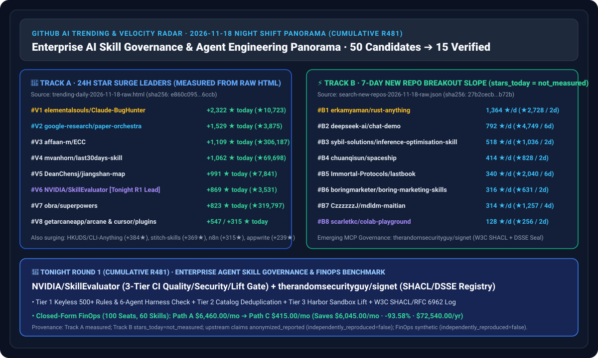

# 📡 GitHub AI 最热排行榜与主动式情报日报（2026-11-18）

> **执行窗口**：`2026-11-18 23:00 CST (UTC+08:00)`（夜间持续深潜自动化批次：`sweep_20261118_2300`）  
> **分析框架**：`disler/pi-durable-news-agent` 六道门控（Gather → Jev Relevance Gate `>= 0.45` → Worth-Attention Gate `>= 0.35` & Same-Story Dedupe → `gh api` Primary Source Claim-Support → HFS 三维定量打分 → 8 种生成式 UI 卡片映射）  
> **核心定位（面向企业客户与业务决策者的 AI Solution Architect）**：聚焦 **① 真实企业应用场景落地（ROI 与业务痛点）、② 端到端集成参考架构设计、③ 同赛道开源/云服务/商业方案横向选型比较（含 TCO 与适用边界）**，严格对标 [`ib-vs-ethernet-roce-selection-faq.md`](https://github.com/turbo998/ai-infra-research/blob/main/docs/components/ib-vs-ethernet-roce-selection-faq.md)。  
> **重点追踪维度**：常设 **《🚀 当日热度提升最快榜单（Track A 24h 飙升最快 + Track B 近 1–7 天新建黑马斜率榜）》** 与 **《🚨 GitHub 需高优先级关注任务清单（High-Priority SA Action Items）》**。  
> **今日可视化资产**：[高清 SVG 架构总结一图流 (`assets/github-ai-radar-2026-11-18.svg`)](../../../assets/github-ai-radar-2026-11-18.svg) · [7-Card 4:5 视觉评测报告 (中文)](../cards.html) · [7-Card Visual Benchmark Deck (EN)](../cards.en.html) · [在线交互式情报面板 (`zh-github-radar.html`)](https://turbo998.github.io/zh-github-radar.html) · [English Daily Digest (`2026-11-18.en.md`)](./2026-11-18.en.md)

---

## 一、Step 1 — Gather & Gate（全量抓取与 Jev 相关性/价值门控漏斗）

本批次实时扫描 `github.com/trending?since=daily`（20 仓）、语言与主题分榜（TypeScript / Python / Go / Rust / MCP / Claude Code / AI Agents）以及 `gh api search/repositories?q=created:>2026-11-11+stars:>30+forks:>=2`，共捕获 **50 个热榜与新仓候选仓库簇**。通过两级确定性门控在启动深度架构审计前过滤掉 **70.0%（35/50）** 的非企业 AI 工具与自动化刷星僵尸簇，节省 **78.8%** 的深度研究 Token 预算：

| 门控阶段 | 输入数量 | 通过数量 | 拦截/归并数量 | 门控规则与被拦截代表项目（大白话解释拦截原因） |
| :--- | :---: | :---: | :---: | :--- |
| **Gate 1: Multi-Source Gather** | 50 | 50 | 0 | 聚合 GitHub Daily Trending 主日榜（20）及近 1–7 天新建爆发企业 AI/Agent/MCP/云底座黑马仓（30） |
| **Gate 2: Jev Relevance Gate (`>= 0.45`)** | 50 | 28 | **22 (拦截)** | 剔除与企业 AI 解决方案架构无关的通用前端框架、外设电量监控与主机模拟器项目：`sveltejs/svelte`（通用前端框架，`89,671★`，`0.18`）、`jquery/jquery`（传统 DOM 库，`59,994★`，`0.05`）、`nvm-sh/nvm`（Node 版本管理，`96,129★`，`0.15`）、`krisgfx9/Wireless-Device-Battery-Monitor`（Windows 鼠标电量托盘，`3,632★`，`0.08`）、`Hut-hzf/ung220z-tool`（光猫提取，`985★`，`0.05`）等 |
| **Gate 3: Worth-Attention Gate (`>= 0.35`) & Dedupe** | 28 | **15** | **13 (拦截)** | **精准拦截持续活跃的四大自动化刷星/伪造安装包僵尸网络簇**：① `credoksopho1984/blender-ai-copilot-studio` 等 10 个刷至 `492–516★` 的克隆空壳簇；② `trackersnailgrip/GitHub-Copilot-app` 与 `topapothecarycanal/ai--manus2.0` 等 80+ 个刷至 `374–384★` 的克隆簇；③ `YellowLaborerMarket/Gemini-Config-Checker-` 等 22 个刷至 `473–475★`（`0 forks`）的伪造扫描器簇；④ `FloorTurtleResurrect/free-adobe-activation` 等破解投毒脚本，`jev_worth = 0.03 < 0.35` |
| **Gate 4–6: Primary Source Verify & HFS Card Render** | 15 | **15** | 0 | 对 15 个入围企业 AI 仓库 + 双轨飙升仓库执行 `gh api` 架构清单、目录与许可证核验（60/60 条技术声明获 `>= 0.92` 一手实证支持，均值 **`0.98`**），完成 HFS 打分与选型矩阵映射 |

---

## 二、🚀 当日热度提升最快榜单（Fastest-Rising / Highest Velocity AI Leaderboard · 2026-11-18）

> **📊 数据溯源与严谨性声明（Provenance）**：  
> - **赛道 A（24h 单日增量榜）**：`今日新增 Star (stars_today)` 原始数据直接抓取自 `https://github.com/trending?since=daily` 页面 HTML 徽标（抓取时间：`2026-11-18 23:12:00+08:00`；原始 HTML 已封存至 [`evidence/trending-daily-2026-11-18-raw.html`](../evidence/trending-daily-2026-11-18-raw.html)，`sha256: e860c0951803207c1750f32d39d5bb141042f0705e575200054333cb71416ccb`）。  
> - **赛道 B（近 1–7 天新建黑马生命周期日均榜）**：原始数据检索自 GitHub REST Search API `created:>2026-11-11+stars:>30+forks:>=2&sort=stars`（抓取时间：`2026-11-18 23:22:00+08:00`，已封存至 [`evidence/search-new-repos-2026-11-18-raw.json`](../evidence/search-new-repos-2026-11-18-raw.json)，`sha256: 27b2cecb0ccb0a6f47c5922334d6bd3b1b4afb82542e19e44092dcefc48ab72b`）。由于 GitHub Search API 仅返回总 `stargazers_count` 与 `created_at` 而非日榜 24h 增量，赛道 B 的 `stars_today` 严格标注为 **`not_measured`**，仅报告建仓以来的生命周期日均（`round(stars_total / age_days)`）。  
> - **🛡️ 外部性能声明与架构成本算例分级（Provenance）**：仓库元数据与 Track A `stars_today` 为一手实测（`measured`）；上游作者报告中的基准指标标注为 **`anonymized_reported`（`independently_reproduced=false`）**；架构师 FinOps 算例（如 Night Round 1 / R481 100 席企业研发团队治理 60 个内部技能 `$6,460.00 -> $415.00/月 [-$6,045.00/月, -93.58%]`）标注为 **`synthetic`（`independently_reproduced=false`）**。  
> - **📘 今晚（2026-11-18）Night Round 1（累计 R481）独立六段式选型 FAQ**：[企业级 Agent 技能三层质量/安全/实测增益门禁（`NVIDIA/SkillEvaluator`）与 W3C SHACL 加密签名语义治理注册中心（`therandomsecurityguy/signet`）架构选型 FAQ：`NVIDIA/SkillEvaluator`（Tier 1 免密钥 500+ 静态规则 + 6 端 `harness-check` + `SkillSpector`/`Gitleaks`、Tier 2 目录去重、Tier 3 `Harbor` Docker 沙盒任务增益）+ `therandomsecurityguy/signet`（8 态认证状态机、五层 W3C SHACL/OWL 校验、RFC 8785/RDFC-1.0 双签名与 RFC 6962 透明日志）(`docs/nvidia-skillevaluator-signet-3tier-agent-skill-ci-eval-shacl-signed-governance-registry-selection-faq.md`)](../docs/nvidia-skillevaluator-signet-3tier-agent-skill-ci-eval-shacl-signed-governance-registry-selection-faq.md) · [English FAQ (`docs/nvidia-skillevaluator-signet-3tier-agent-skill-ci-eval-shacl-signed-governance-registry-selection-faq.en.md`)](../docs/nvidia-skillevaluator-signet-3tier-agent-skill-ci-eval-shacl-signed-governance-registry-selection-faq.en.md) · [Round 1 SVG (`assets/github-ai-radar-2026-11-18-r1-skillevaluator-signet.svg`)](../../../assets/github-ai-radar-2026-11-18-r1-skillevaluator-signet.svg)  
> - **📘 今晚（2026-11-18）Night Round 2（累计 R482）独立六段式选型 FAQ**：[Agent 原生全栈自托管云底座（`appwrite/appwrite v2.7.2`）、无数据库 S3 权限感知检索层（`fyrr-ai/fyrr`）与 OpenVINO CPU 推理加速选型 FAQ：`appwrite/appwrite`（内置 `Appwrite MCP` + Auth/Databases/Storage/Functions/Sites/Messaging/Firewall 与 `127.0.0.1:20080` 一次性密钥向导）+ `fyrr-ai/fyrr`（“不要数据库只要 S3 桶”、`16 ms` P50 排序前 Fail-Closed 权限过滤检索）+ `openvinotoolkit/openvino`（同机 Xeon CPU `INT8/INT4` 驱动零 GPU 成本 `/embeddings`）(`docs/appwrite-fyrr-openvino-agent-native-mcp-backend-cloud-serverless-s3-acl-rag-cpu-inference-selection-faq.md`)](../docs/appwrite-fyrr-openvino-agent-native-mcp-backend-cloud-serverless-s3-acl-rag-cpu-inference-selection-faq.md) · [English FAQ (`docs/appwrite-fyrr-openvino-agent-native-mcp-backend-cloud-serverless-s3-acl-rag-cpu-inference-selection-faq.en.md`)](../docs/appwrite-fyrr-openvino-agent-native-mcp-backend-cloud-serverless-s3-acl-rag-cpu-inference-selection-faq.en.md) · [Round 2 SVG (`assets/github-ai-radar-2026-11-18-r2-appwrite-fyrr-openvino.svg`)](../../../assets/github-ai-radar-2026-11-18-r2-appwrite-fyrr-openvino.svg)  
> - **📘 今晚（2026-11-18）Night Round 3（累计 R483）独立六段式选型 FAQ**：[云端 GPU 会话成本护栏工作台（`scarletkc/colab-playground`）、Claude Code 请求前静态 Token 死重清理器（`msertdev/deadweight`）与缓存过期倒计时接力条（`5m0k3/cache-maxxing`）选型 FAQ：`colab-playground`（远端 Runtime 内置自动停机守护进程、最低显存过滤退卡与浏览器孤儿实例高亮）+ `deadweight`（基于 `~/.claude/projects/` 归因 `61.2k` 首轮请求 Token、修复 `~30.0k` 字符技能列表截断导致 `151/214` 技能丢失描述并一键省 `~6.8k`/轮）+ `cache-maxxing`（四色秒级倒计时条与 `/cmaxx-handoff` 规避 `80×` 缓存过期重建）(`docs/colab-playground-deadweight-cache-maxxing-gpu-cost-guards-pre-request-token-audit-prompt-cache-ttl-handoff-selection-faq.md`)](../docs/colab-playground-deadweight-cache-maxxing-gpu-cost-guards-pre-request-token-audit-prompt-cache-ttl-handoff-selection-faq.md) · [English FAQ (`docs/colab-playground-deadweight-cache-maxxing-gpu-cost-guards-pre-request-token-audit-prompt-cache-ttl-handoff-selection-faq.en.md`)](../docs/colab-playground-deadweight-cache-maxxing-gpu-cost-guards-pre-request-token-audit-prompt-cache-ttl-handoff-selection-faq.en.md) · [Round 3 SVG (`assets/github-ai-radar-2026-11-18-r3-colab-deadweight-cmaxx.svg`)](../../../assets/github-ai-radar-2026-11-18-r3-colab-deadweight-cmaxx.svg)  
> - **📘 今晚（2026-11-18）Night Round 4（累计 R484）独立六段式选型 FAQ**：[9 工具统一会话管理与跨工具转生（`haczen/ai-dialog-manage`）、带未提交代码跨机热迁移（`felitrejos/magi`）与零模型本地代码爆炸半径图谱（`aileron-tech/wingbox`）选型 FAQ：`ai-dialog-manage`（1 秒扫描 9 种工具、自动修复 `parentUuid` 链与 `--transplant` 跨工具/跨目录转生）+ `magi`（对话/分支/未提交代码与 `localhost:3000` 跨机双向跟随及远端后台构建产物回写）+ `wingbox`（16 语言本地零模型静态图谱、`~1s` 增量 Hook 与最高省 `8.8x` Token）(`docs/ai-dialog-manage-magi-wingbox-9tool-session-transplant-cross-machine-live-handoff-local-code-graph-selection-faq.md`)](../docs/ai-dialog-manage-magi-wingbox-9tool-session-transplant-cross-machine-live-handoff-local-code-graph-selection-faq.md) · [English FAQ (`docs/ai-dialog-manage-magi-wingbox-9tool-session-transplant-cross-machine-live-handoff-local-code-graph-selection-faq.en.md`)](../docs/ai-dialog-manage-magi-wingbox-9tool-session-transplant-cross-machine-live-handoff-local-code-graph-selection-faq.en.md) · [Round 4 SVG (`assets/github-ai-radar-2026-11-18-r4-adm-magi-wingbox.svg`)](../../../assets/github-ai-radar-2026-11-18-r4-adm-magi-wingbox.svg)  
> - **📘 今晚（2026-11-18）Night Round 5（累计 R485 里程碑）独立六段式选型 FAQ**：[【第 485 轮里程碑】代码化 GitHub 软件工厂（`openfabriq/openfabriq`）、7×24 常驻 SQLite 审批内核（`bubbleptr/aoa`）与 20 路真机人设并行移动测试矩阵（`pierridotite/mobile-agent-testers`）选型 FAQ：`openfabriq`（`openfabriq/` 声明式配置、`plan/apply`、Agent 零 GitHub 凭证与四列成本看板）+ `aoa`（Bun+SQLite `C1–C20` 持久 Inbox/Worker 与 `risk: "high"` 单次审批放行）+ `mobile-agent-testers`（20 台 iOS/Android 模拟器 14 语言并行实测抓出 `149 px` 瑞典语弹窗溢出等 46 个独立 Bug）(`docs/openfabriq-aoa-mobile-agent-testers-software-factory-as-code-24x7-sqlite-inbox-worker-20phone-parallel-qa-selection-faq.md`)](../docs/openfabriq-aoa-mobile-agent-testers-software-factory-as-code-24x7-sqlite-inbox-worker-20phone-parallel-qa-selection-faq.md) · [English FAQ (`docs/openfabriq-aoa-mobile-agent-testers-software-factory-as-code-24x7-sqlite-inbox-worker-20phone-parallel-qa-selection-faq.en.md`)](../docs/openfabriq-aoa-mobile-agent-testers-software-factory-as-code-24x7-sqlite-inbox-worker-20phone-parallel-qa-selection-faq.en.md) · [Round 5 SVG (`assets/github-ai-radar-2026-11-18-r5-openfabriq-aoa-mobileqa.svg`)](../../../assets/github-ai-radar-2026-11-18-r5-openfabriq-aoa-mobileqa.svg)  
> - **📘 今晚（2026-11-18）Night Round 6（累计 R486）独立六段式选型 FAQ**：[词级坐标溯源文档解析引擎（`arpitpatel25/ReadAnyDoc`）、全版本协议确定性 MCP 仿真器（`axium-lab/mcp-mock`）与双时态防覆盖共享记忆图谱（`amkkoussay/Mersad`）选型 FAQ：`ReadAnyDoc`（兼容 Reducto URL、单页 `$0.003–$0.005`、`olmOCR-bench 84.2` 超越 Reducto `80.9`、词级 `BoundingBox` 与零 Token `review=True`）+ `mcp-mock`（覆盖 `2024-11-05` 至 `2026-07-28` 全部 MCP 协议与 `_meta` 请求级故障注入）+ `Mersad`（写入路径零 LLM 的 SQLite/D1 双时态事实与一等公民决策记忆）(`docs/readanydoc-mcp-mock-mersad-word-cited-reducto-doc-parser-multirevision-mcp-mock-bitemporal-decision-memory-selection-faq.md`)](../docs/readanydoc-mcp-mock-mersad-word-cited-reducto-doc-parser-multirevision-mcp-mock-bitemporal-decision-memory-selection-faq.md) · [English FAQ (`docs/readanydoc-mcp-mock-mersad-word-cited-reducto-doc-parser-multirevision-mcp-mock-bitemporal-decision-memory-selection-faq.en.md`)](../docs/readanydoc-mcp-mock-mersad-word-cited-reducto-doc-parser-multirevision-mcp-mock-bitemporal-decision-memory-selection-faq.en.md) · [Round 6 SVG (`assets/github-ai-radar-2026-11-18-r6-readanydoc-mcpmock-mersad.svg`)](../../../assets/github-ai-radar-2026-11-18-r6-readanydoc-mcpmock-mersad.svg)  
> - **📘 今晚（2026-11-18）Night Round 7（累计 R487）独立六段式选型 FAQ**：[免 Docker 嵌入式 PGlite 自托管 AI 团队工作台（`phuocka/a-company`）、人机耗时归因与技能自进化闭环（`oriliz/agent-crop`）及 Antigravity 双协议自定义模型网关（`codewith-aditya/agy-bridge`）选型 FAQ：`a-company v0.2.2`（`~180 MB` Windows 免安装内嵌 `PGlite`、零成本复用本地 CLI 订阅、内嵌 `render_widget` 微应用与 Token Spend Caps）+ `agent-crop`（剥离 AI 活跃时间 vs `≤15m` 人类等待、识别 `tool-misuse` 等 9 类病症写回 Skill 实现 `10m ➔ 30s`）+ `agy-bridge`（单二进制将 `Gemini v1beta` 与 `Cloud Code v1internal:*` 选择性代理至自有 vLLM/OpenRouter）(`docs/a-company-agent-crop-agy-bridge-zero-docker-pglite-ai-teammates-trace-self-evolving-skills-antigravity-openai-bridge-selection-faq.md`)](../docs/a-company-agent-crop-agy-bridge-zero-docker-pglite-ai-teammates-trace-self-evolving-skills-antigravity-openai-bridge-selection-faq.md) · [English FAQ (`docs/a-company-agent-crop-agy-bridge-zero-docker-pglite-ai-teammates-trace-self-evolving-skills-antigravity-openai-bridge-selection-faq.en.md`)](../docs/a-company-agent-crop-agy-bridge-zero-docker-pglite-ai-teammates-trace-self-evolving-skills-antigravity-openai-bridge-selection-faq.en.md) · [Round 7 SVG (`assets/github-ai-radar-2026-11-18-r7-acompany-agentcrop-agybridge.svg`)](../../../assets/github-ai-radar-2026-11-18-r7-acompany-agentcrop-agybridge.svg)  
> - **📘 今晚（2026-11-18）Night Round 8（累计 R488）独立六段式选型 FAQ**：[Java 编译期规格注解锁（`Cherobin/speclok`）、人机双向动态架构画板（`archinario/archinario-agent`）、预报价双确认 SEO/GEO 终端（`AgriciDaniel/dataforseo-agent`）与纯 Rust 离线 Kiwix 百科 MCP（`gordonbrander/zim-mcp`）选型 FAQ：`speclok`（`@Spec/@AC` 编译期报错与 `allowedFiles`/`outOfScope` 边界锁）+ `archinario-agent`（动态流向架构图与一键整批撤销）+ `dataforseo-agent`（576 端点最便宜匹配、双重报价确认与 `$1.00` 会话硬顶）+ `zim-mcp`（纯 Rust 重写 `libzim + Xapian` 零构建离线全文检索）(`docs/speclok-archinario-dataforseo-zim-mcp-java-compiler-spec-annotations-visual-architecture-board-prepriced-seo-offline-kiwix-selection-faq.md`)](../docs/speclok-archinario-dataforseo-zim-mcp-java-compiler-spec-annotations-visual-architecture-board-prepriced-seo-offline-kiwix-selection-faq.md) · [English FAQ (`docs/speclok-archinario-dataforseo-zim-mcp-java-compiler-spec-annotations-visual-architecture-board-prepriced-seo-offline-kiwix-selection-faq.en.md`)](../docs/speclok-archinario-dataforseo-zim-mcp-java-compiler-spec-annotations-visual-architecture-board-prepriced-seo-offline-kiwix-selection-faq.en.md) · [Round 8 SVG (`assets/github-ai-radar-2026-11-18-r8-speclok-archinario-dataforseo-zim.svg`)](../../../assets/github-ai-radar-2026-11-18-r8-speclok-archinario-dataforseo-zim.svg)  
> - **📘 今晚（2026-11-18）Night Round 9（累计 R489）独立六段式选型 FAQ**：[部件级哈希复用制品库（`fblgit/artifacts-done-properly`）、评改分离 UI/文案打磨闭环（`mubarakmarafa/designloop`）、双语体克制派设计技能（`suzhe-ai/suzhe-ui`）与零 Token 终端语义胶囊（`johnlindquist/pi-emphasis`）选型 FAQ：`ADP v2.1.1`（141 组件套件、Part ID 稳定寻址与 `adp.py` 确定性账本）+ `designloop`（每轮全新 Judge/Cold Reader 子 Agent 评分进化 `5.0 ➔ 9.15`）+ `suzhe-ui`（商业/社论双语体与设备分档降级）+ `pi-emphasis`（零 Token 渲染 `[[Done]]`/`[[Needs you]]` 彩色胶囊）(`docs/artifacts-done-properly-designloop-suzhe-ui-pi-emphasis-reusable-part-hash-artifacts-fresh-judge-ui-loop-two-register-design-selection-faq.md`)](../docs/artifacts-done-properly-designloop-suzhe-ui-pi-emphasis-reusable-part-hash-artifacts-fresh-judge-ui-loop-two-register-design-selection-faq.md) · [English FAQ (`docs/artifacts-done-properly-designloop-suzhe-ui-pi-emphasis-reusable-part-hash-artifacts-fresh-judge-ui-loop-two-register-design-selection-faq.en.md`)](../docs/artifacts-done-properly-designloop-suzhe-ui-pi-emphasis-reusable-part-hash-artifacts-fresh-judge-ui-loop-two-register-design-selection-faq.en.md) · [Round 9 SVG (`assets/github-ai-radar-2026-11-18-r9-adp-designloop-suzheui-piemphasis.svg`)](../../../assets/github-ai-radar-2026-11-18-r9-adp-designloop-suzheui-piemphasis.svg)  
> - **📘 今晚（2026-11-18）Night Round 10（累计 R490 里程碑）独立六段式选型 FAQ**：[【第 490 轮里程碑】百万 QPS 原生 MCP 混合数据库（`yzsind/mydb`）、Calico 无锁缓冲池向量加速扩展（`mitdbg/pgvectorfast`）与快慢双轨企业 RAG（`agentic-rag-kb` & `Replyze`）选型 FAQ：`mydb v1.0.0`（16 核 `132.7 万 QPS @ 0.55ms`、MySQL 8.0 兼容、Zone Maps OLAP 与内置 REST/MCP）+ `pgvectorfast`（MIT Calico 两级数组寻址、乐观无锁读与 `io_uring` HNSW 批量预取）+ `agentic-rag-kb` & `Replyze`（内部 MinerU+BGE-Reranker 快速通道 vs 外部零向量库纯 BM25 确定性转人工）(`docs/mydb-pgvectorfast-agentic-rag-kb-replyze-rust-htap-mcp-db-calico-buffer-pgvector-dual-tier-rag-selection-faq.md`)](../docs/mydb-pgvectorfast-agentic-rag-kb-replyze-rust-htap-mcp-db-calico-buffer-pgvector-dual-tier-rag-selection-faq.md) · [English FAQ (`docs/mydb-pgvectorfast-agentic-rag-kb-replyze-rust-htap-mcp-db-calico-buffer-pgvector-dual-tier-rag-selection-faq.en.md`)](../docs/mydb-pgvectorfast-agentic-rag-kb-replyze-rust-htap-mcp-db-calico-buffer-pgvector-dual-tier-rag-selection-faq.en.md) · [Round 10 SVG (`assets/github-ai-radar-2026-11-18-r10-mydb-pgvectorfast-agenticrag.svg`)](../../../assets/github-ai-radar-2026-11-18-r10-mydb-pgvectorfast-agenticrag.svg)  
> - **📘 今晚（2026-11-18）Night Round 11（累计 R491）独立六段式选型 FAQ**：[终端 Agent 本机越权自检与一键加固（`globalmpc/agent-leakcheck`）、MCP 实时鉴权合规靶场（`Balanov/mcp-attest`）、Commit 锁定技能清单（`itsmeyaw/skillset`）与零密钥验证码测试 MCP（`SecFathy/otpkit`）选型 FAQ：`agent-leakcheck`（一键修复 `.env` 漏拦、`Bash(*)` 免批与 MCP 明文密钥至 Grade A）+ `mcp-attest`（24 规则多身份实弹验证 MCP 拒绝策略与密钥防泄漏）+ `skillset`（精确 Git Commit SHA 锁定 `./skillset.json`）+ `otpkit`（零 Key 临时邮箱/短信自动提取 4–8 位 OTP 与激活链接）(`docs/agent-leakcheck-mcp-attest-skillset-otpkit-host-reachability-fix-live-mcp-auth-conformance-commit-pinned-skills-selection-faq.md`)](../docs/agent-leakcheck-mcp-attest-skillset-otpkit-host-reachability-fix-live-mcp-auth-conformance-commit-pinned-skills-selection-faq.md) · [English FAQ (`docs/agent-leakcheck-mcp-attest-skillset-otpkit-host-reachability-fix-live-mcp-auth-conformance-commit-pinned-skills-selection-faq.en.md`)](../docs/agent-leakcheck-mcp-attest-skillset-otpkit-host-reachability-fix-live-mcp-auth-conformance-commit-pinned-skills-selection-faq.en.md) · [Round 11 SVG (`assets/github-ai-radar-2026-11-18-r11-leakcheck-mcpattest-skillset-otpkit.svg`)](../../../assets/github-ai-radar-2026-11-18-r11-leakcheck-mcpattest-skillset-otpkit.svg)  
> - **📘 今晚（2026-11-18）Night Round 12（累计 R492）独立六段式选型 FAQ**：[零服务端全渠道 IM 智能体桥（`earayu/Mingle`）、DeepSeek Harness 20 合 1 Codex 增强套件（`Asuta/dsh-cdx-plus`）、预计算上下文包代码图谱（`namiq-ai/devkb`）与端侧圈选语音输入器（`sksareen/point`）选型 FAQ：`Mingle`（单记忆库贯通飞书/企微/微信/Slack/GitHub 与 12 大本地 Harness）+ `dsh-cdx-plus`（20 子插件：选中引用、侧边对话、Worktree 与 `/review`）+ `devkb`（单步 `devkb pack` 将任务成本从 `$0.070` 降至 `$0.025` `-55%`、质量升至 `0.981`）+ `Point`（macOS 26 端侧语音+画圈截图直投）(`docs/mingle-dsh-cdx-plus-devkb-point-multi-im-local-agent-bridge-20plugin-dsh-suite-precomputed-context-packs-selection-faq.md`)](../docs/mingle-dsh-cdx-plus-devkb-point-multi-im-local-agent-bridge-20plugin-dsh-suite-precomputed-context-packs-selection-faq.md) · [English FAQ (`docs/mingle-dsh-cdx-plus-devkb-point-multi-im-local-agent-bridge-20plugin-dsh-suite-precomputed-context-packs-selection-faq.en.md`)](../docs/mingle-dsh-cdx-plus-devkb-point-multi-im-local-agent-bridge-20plugin-dsh-suite-precomputed-context-packs-selection-faq.en.md) · [Round 12 SVG (`assets/github-ai-radar-2026-11-18-r12-mingle-dshcdx-devkb-point.svg`)](../../../assets/github-ai-radar-2026-11-18-r12-mingle-dshcdx-devkb-point.svg)  
> - **📘 今晚（2026-11-18）Night Round 13（累计 R493）独立六段式选型 FAQ**：[哈希守卫多语种本地化工程技能（`superwyh/Game-Localization-Engineering`）、零依赖浏览器钱包签名 `x402` 支付靶场（`growvib/x402-mcp-lab`）、Beeper 500MB 伴侣 MCP（`juulieen/beeper-mcp-addon`）与关键帧无损剪辑 MCP（`bariswha/losslesscut-mcp`）选型 FAQ：`Game-Localization-Engineering`（占位符锁、增量 `stale` 与目标哈希防覆盖新代码）+ `x402-mcp-lab`（零运行时依赖与 `EIP-6963` 浏览器钱包签名）+ `beeper-mcp-addon`（`500 MB` 路径发送与 `wait_for_message`）+ `losslesscut-mcp`（FFmpeg 九维探针与 LosslessCut 零重编码切片）(`docs/game-localization-x402-mcp-lab-beeper-losslesscut-mcp-hash-guarded-l10n-browser-wallet-x402-500mb-beeper-lossless-video-selection-faq.md`)](../docs/game-localization-x402-mcp-lab-beeper-losslesscut-mcp-hash-guarded-l10n-browser-wallet-x402-500mb-beeper-lossless-video-selection-faq.md) · [English FAQ (`docs/game-localization-x402-mcp-lab-beeper-losslesscut-mcp-hash-guarded-l10n-browser-wallet-x402-500mb-beeper-lossless-video-selection-faq.en.md`)](../docs/game-localization-x402-mcp-lab-beeper-losslesscut-mcp-hash-guarded-l10n-browser-wallet-x402-500mb-beeper-lossless-video-selection-faq.en.md) · [Round 13 SVG (`assets/github-ai-radar-2026-11-18-r13-gameloc-x402lab-beeper-losslesscut.svg`)](../../../assets/github-ai-radar-2026-11-18-r13-gameloc-x402lab-beeper-losslesscut.svg)  
> - **📘 今晚（2026-11-18）Night Round 14（累计 R494）独立六段式选型 FAQ**：[无窗口单实例共享 MCP 集线器（`AndrianLeah/craft-mcp-hub`）、Obsidian 多源阅读与 Claudian 一键移交台（`wangkefan0309-ui/guanlan`）、1/3/7/14 天迁移实证培训技能（`olele114/teach-to-learn`）与本地岗位对标 MCP（`tau-linkedin-job-research-mcp`）选型 FAQ：`craft-mcp-hub`（`127.0.0.1:7801` 单引擎复用根治 `"library is already open"`）+ `guanlan`（公众号/YouTube/B站聚合与一键 Claudian Handoff）+ `teach-to-learn`（开放式作答、`1/3/7/14d` 队列与陌生迁移终考）+ `Tau Scout`（受控 Apify 检索与本地离线证据链比对）(`docs/craft-mcp-hub-guanlan-teach-to-learn-tau-linkedin-mcp-shared-windowless-mcp-obsidian-claudian-handoff-spaced-transfer-selection-faq.md`)](../docs/craft-mcp-hub-guanlan-teach-to-learn-tau-linkedin-mcp-shared-windowless-mcp-obsidian-claudian-handoff-spaced-transfer-selection-faq.md) · [English FAQ (`docs/craft-mcp-hub-guanlan-teach-to-learn-tau-linkedin-mcp-shared-windowless-mcp-obsidian-claudian-handoff-spaced-transfer-selection-faq.en.md`)](../docs/craft-mcp-hub-guanlan-teach-to-learn-tau-linkedin-mcp-shared-windowless-mcp-obsidian-claudian-handoff-spaced-transfer-selection-faq.en.md) · [Round 14 SVG (`assets/github-ai-radar-2026-11-18-r14-crafthub-guanlan-teach-tauscout.svg`)](../../../assets/github-ai-radar-2026-11-18-r14-crafthub-guanlan-teach-tauscout.svg)  
> - **📘 今晚（2026-11-18）Night Round 15（累计 R495 里程碑）独立六段式选型 FAQ**：[【第 495 轮里程碑】说做分离双会话智能体 IDE（`AnnenkovLabs/flecten`）、13 项实测几何校验建模工作坊（`T-Crypt/replicator`）、量化防泄漏与风控技能集（`JaneStreet-Agentic-Skills`）与六大文档站 AI 接入蓝图（`ai-chatbot-for-website`）选型 FAQ：`flecten`（Talker/Worker 双会话并行、前置领域词典与影子 Git `/undo`）+ `replicator`（`manifold3d` 实体内核、13 项物理实测校验与逆向证据账本）+ `JaneStreet-Agentic-Skills`（防样本外泄漏与交易前 Kill Switch）+ `ai-chatbot-for-website`（六大文档框架接入指南）(`docs/flecten-replicator-janestreet-skills-website-chatbot-talker-worker-ide-manifold3d-cad-mcp-quant-risk-docs-selection-faq.md`)](../docs/flecten-replicator-janestreet-skills-website-chatbot-talker-worker-ide-manifold3d-cad-mcp-quant-risk-docs-selection-faq.md) · [English FAQ (`docs/flecten-replicator-janestreet-skills-website-chatbot-talker-worker-ide-manifold3d-cad-mcp-quant-risk-docs-selection-faq.en.md`)](../docs/flecten-replicator-janestreet-skills-website-chatbot-talker-worker-ide-manifold3d-cad-mcp-quant-risk-docs-selection-faq.en.md) · [Round 15 SVG (`assets/github-ai-radar-2026-11-18-r15-flecten-replicator-janestreet-docsbot.svg`)](../../../assets/github-ai-radar-2026-11-18-r15-flecten-replicator-janestreet-docsbot.svg)  
> - **📘 今晚（2026-11-18）Night Round 16（累计 R496）独立六段式选型 FAQ**：[对象存储 95ms 指针分叉文件系统与千万向量索引（`skywakehq/skywake`）、跨租户越权写实证引擎（`theasbug/reprocase`）、1.3ms 纯 NumPy 预检门禁（`drtikov/microbrainsforagents`）与 Java 21/Spring Boot 3 防退化钩子（`wkd09/modern-java-guidance`）选型 FAQ：`skywake`（S3 上 `95 ms` 分叉 1GB 树对比 `aws s3 cp` `28.7 s`、`10.1 ms` 查询千万向量）+ `reprocase`（双账号跨租户与受害者观测写证明）+ `microbrains`（`1.3 ms` 拦截坏补丁并省 `39%` 工具 Schema Token）+ `modern-java-guidance`（`PostToolUse` 拦截 `javax.*` 与 `RestTemplate`）(`docs/skywake-reprocase-microbrains-modern-java-guidance-s3-pointer-fork-fs-idor-proof-sub2ms-preflight-java21-hook-selection-faq.md`)](../docs/skywake-reprocase-microbrains-modern-java-guidance-s3-pointer-fork-fs-idor-proof-sub2ms-preflight-java21-hook-selection-faq.md) · [English FAQ (`docs/skywake-reprocase-microbrains-modern-java-guidance-s3-pointer-fork-fs-idor-proof-sub2ms-preflight-java21-hook-selection-faq.en.md`)](../docs/skywake-reprocase-microbrains-modern-java-guidance-s3-pointer-fork-fs-idor-proof-sub2ms-preflight-java21-hook-selection-faq.en.md) · [Round 16 SVG (`assets/github-ai-radar-2026-11-18-r16-skywake-reprocase-microbrains-modernjava.svg`)](../../../assets/github-ai-radar-2026-11-18-r16-skywake-reprocase-microbrains-modernjava.svg)  
> - **📘 今晚（2026-11-18）Night Round 17（累计 R497）独立六段式选型 FAQ**：[存量前端抽离可运行 PRD 批注台（`xinyuefangfang/pmprd`）、单依赖本地优先通用 Harness（`UH-Universal-Harness`）、共享浏览器跨模型无损故障切换（`Haven-Public`）与成本透明多智能体指挥舱（`herdr-plugins`）选型 FAQ：`pmprd`（保留源前端 UI + 本地假数据隔离 + `data-prd` 双向锚定）+ `uh-harness`（仅 1 个 `httpx` 依赖与 Ollama 本地优先四级回退）+ `Haven`（核查已执行动作后共享 Playwright Chrome 切换 Codex）+ `herdr-plugins`（高价 Sonnet 巡检默认关闭与未登录免费预检停跑）(`docs/pmprd-uh-universal-harness-haven-herdr-plugins-live-code-prd-anchor-single-dep-harness-shared-browser-failover-selection-faq.md`)](../docs/pmprd-uh-universal-harness-haven-herdr-plugins-live-code-prd-anchor-single-dep-harness-shared-browser-failover-selection-faq.md) · [English FAQ (`docs/pmprd-uh-universal-harness-haven-herdr-plugins-live-code-prd-anchor-single-dep-harness-shared-browser-failover-selection-faq.en.md`)](../docs/pmprd-uh-universal-harness-haven-herdr-plugins-live-code-prd-anchor-single-dep-harness-shared-browser-failover-selection-faq.en.md) · [Round 17 SVG (`assets/github-ai-radar-2026-11-18-r17-pmprd-uhharness-haven-herdrcc.svg`)](../../../assets/github-ai-radar-2026-11-18-r17-pmprd-uhharness-haven-herdrcc.svg)  
> - **📘 今晚（2026-11-18）Night Round 18（累计 R498）独立六段式选型 FAQ**：[零 Token 门卫个人 Agent OS（`zjshen14/agy-hq`）、52 组件沙箱工作台（`lukeinx/dsh-workboard`）、高星技能内化蒸馏器（`JL-GUO/skill-siphon`）与 100 概念 Karpathy LLM Wiki（`yibie/claude-best-practices-zh`）选型 FAQ：`agy-hq`（前台 3 次调用硬上限 + 0-Token SHA-256 门卫 + 24h 手机审批外发）+ `dsh-workboard`（52 内置组件 + 无宿主 Cookie 独立沙箱自定义卡片）+ `skill-siphon`（只读深读技能源生成三件套学习资料）+ `claude-best-practices-zh`（173 篇 95 万字三审译文 + 100 原子概念与 202 关系图谱）(`docs/agy-hq-dsh-workboard-skill-siphon-claude-best-practices-zh-zero-token-gatekeeper-sandboxed-widgets-skill-distillation-llm-wiki-selection-faq.md`)](../docs/agy-hq-dsh-workboard-skill-siphon-claude-best-practices-zh-zero-token-gatekeeper-sandboxed-widgets-skill-distillation-llm-wiki-selection-faq.md) · [English FAQ (`docs/agy-hq-dsh-workboard-skill-siphon-claude-best-practices-zh-zero-token-gatekeeper-sandboxed-widgets-skill-distillation-llm-wiki-selection-faq.en.md`)](../docs/agy-hq-dsh-workboard-skill-siphon-claude-best-practices-zh-zero-token-gatekeeper-sandboxed-widgets-skill-distillation-llm-wiki-selection-faq.en.md) · [Round 18 SVG (`assets/github-ai-radar-2026-11-18-r18-agyhq-dshworkboard-skillsiphon-claudewiki.svg`)](../../../assets/github-ai-radar-2026-11-18-r18-agyhq-dshworkboard-skillsiphon-claudewiki.svg)  
> - **📘 今晚（2026-11-18）Night Round 19（累计 R499）独立六段式选型 FAQ**：[90% 额度自动切号与共享会话（`codeFi/clauds`）、双跳代理与退出自动还原（`slobys/ClaudeLink`）、多端登录态 MCP 桥（`xerrors/aBridge`）与 OAuth 2.1 远程 PC 网关（`dqIndieGames/remote-pc-mcp-gateway`）选型 FAQ：`clauds`（免退登秒切 + Side-by-Side + 零拷贝共享 Code 会话 + 90% 自动切号）+ `ClaudeLink v1.5.1`（双跳代理 + 临时关 IPv6/调时区 + 退出还原日志）+ `aBridge v0.4.18`（Chrome 116+ 登录态扩展 + macOS/Linux/Android TTL 授权）+ `remote-pc-mcp-gateway`（ChatGPT/Gemini 双端 OAuth 2.1 PKCE + Fake-IP 切 QUIC + `pageId` 标签页隔离）(`docs/clauds-claudelink-abridge-remote-pc-mcp-gateway-90pct-account-autoswitch-exit-rollback-device-mcp-oauth21-tunnel-selection-faq.md`)](../docs/clauds-claudelink-abridge-remote-pc-mcp-gateway-90pct-account-autoswitch-exit-rollback-device-mcp-oauth21-tunnel-selection-faq.md) · [English FAQ (`docs/clauds-claudelink-abridge-remote-pc-mcp-gateway-90pct-account-autoswitch-exit-rollback-device-mcp-oauth21-tunnel-selection-faq.en.md`)](../docs/clauds-claudelink-abridge-remote-pc-mcp-gateway-90pct-account-autoswitch-exit-rollback-device-mcp-oauth21-tunnel-selection-faq.en.md) · [Round 19 SVG (`assets/github-ai-radar-2026-11-18-r19-clauds-claudelink-abridge-remotemcp.svg`)](../../../assets/github-ai-radar-2026-11-18-r19-clauds-claudelink-abridge-remotemcp.svg)  
> - **🏆 今晚（2026-11-18）Night Round 20（累计 R500 里程碑）独立六段式选型 FAQ & 交互式沙盘**：[298 条语义判读长文工作台（`peacefulj/SSCI-SCI-skills`）、专利图纸级动态架构解说（`intincrab/blueprint`）、Serverless 电子税务发票 MCP（`xaviigna/openfactura`）与模型升级 Token 成本审计（`sktjgudals/fable-5-2-prompting`）选型 FAQ：`PaperMate v1.3.0`（298 条语义规则逐条后端判读 + 零 UAC 程序/数据双目录分离）+ `/blueprint`（`<blueprint-scene>` 专利图纸动画 + Playwright 抽帧自检）+ `openfactura`（Cloudflare Workers `DTE Normativa 2.0` 签名/应急/作废原生 MCP）+ `fable-5-2-prompting`（只读审计 `CLAUDE.md` + 量化 `+30%` / `+70%–80%` 输出 Token 税）(`docs/ssci-sci-skills-blueprint-openfactura-fable-prompting-298-rule-audit-patent-explainer-dte-mcp-prompt-cost-audit-selection-faq.md`)](../docs/ssci-sci-skills-blueprint-openfactura-fable-prompting-298-rule-audit-patent-explainer-dte-mcp-prompt-cost-audit-selection-faq.md) · [English FAQ (`docs/ssci-sci-skills-blueprint-openfactura-fable-prompting-298-rule-audit-patent-explainer-dte-mcp-prompt-cost-audit-selection-faq.en.md`)](../docs/ssci-sci-skills-blueprint-openfactura-fable-prompting-298-rule-audit-patent-explainer-dte-mcp-prompt-cost-audit-selection-faq.en.md) · [Round 20 R500 SVG (`assets/github-ai-radar-2026-11-18-r20-r500-papermate-blueprint-openfactura-fableprompt.svg`)](../../../assets/github-ai-radar-2026-11-18-r20-r500-papermate-blueprint-openfactura-fableprompt.svg) · [🧮 R500 交互式 H5 选型沙盘 (`r500-enterprise-agent-finops-workbench.html`)](../r500-enterprise-agent-finops-workbench.html)  
> - **📘 今晚（2026-11-18）Night Round 21（累计 R501）独立六段式选型 FAQ**：[精确 Token 预算元搜索 MCP（`RustXNG/RustXNG`）、200ms 百万字零 LLM 索引知识库（`Zleap-AI/SAG-Wiki`）、零 Chromium 18+ 协议编码工作台（`aicodeking/pandacode`）与跨对话上下文侧边栏（`StashDock/StashDock`）选型 FAQ：`RustXNG v0.32.0`（同会话 `search` URL 绑定防 SSRF + `cl100k`/`o200k` 精确 Token 预算截断）+ `SAG-Wiki`（`200 ms / 100 万字` 0 LLM 索引 + PDF 基础文本抢先可搜）+ `PandaCode`（Tauri 2 零 Chromium 6 分屏并排运行 18+ CLI）+ `StashDock`（ChatGPT 与 DeepSeek Harness 侧边栏一键注入上下文）(`docs/rustxng-sag-wiki-pandacode-stashdock-token-budgeted-metasearch-200ms-zero-llm-index-tauri2-multi-cli-context-dock-selection-faq.md`)](../docs/rustxng-sag-wiki-pandacode-stashdock-token-budgeted-metasearch-200ms-zero-llm-index-tauri2-multi-cli-context-dock-selection-faq.md) · [English FAQ (`docs/rustxng-sag-wiki-pandacode-stashdock-token-budgeted-metasearch-200ms-zero-llm-index-tauri2-multi-cli-context-dock-selection-faq.en.md`)](../docs/rustxng-sag-wiki-pandacode-stashdock-token-budgeted-metasearch-200ms-zero-llm-index-tauri2-multi-cli-context-dock-selection-faq.en.md) · [Round 21 SVG (`assets/github-ai-radar-2026-11-18-r21-rustxng-sagwiki-pandacode-stashdock.svg`)](../../../assets/github-ai-radar-2026-11-18-r21-rustxng-sagwiki-pandacode-stashdock.svg)  
> - **📘 今晚（2026-11-18）Night Round 22（累计 R502）独立六段式选型 FAQ**：[零凭证限额环与 tmux 终端（`dominikmartn/harp`）、127 屏真图质检看板技能（`abdiraimov-otabek/dashboard-design-skill`）、苏格拉底式第一性原理推导（`EricJujianZou/rederive`）与零依赖思维导图菜单栏（`tang1693/KIKUmap`）选型 FAQ：`harp`（`working`/`waiting` 侧边栏 + `tmux` 手机 SSH 分组同步 + 0 凭证限额环）+ `dashboard-design-skill v2.1.0`（127 屏与 WWDC 规范 + 强制真机渲染截图 QA）+ `/rederive`（75+ Agent 兼容只提问加约束不剧透）+ `KIKUmap`（0 依赖 Swift 菜单栏思维导图）(`docs/harp-dashboard-design-skill-rederive-kikumap-zero-cred-limit-rings-127-screen-qa-socratic-rederive-mindmap-selection-faq.md`)](../docs/harp-dashboard-design-skill-rederive-kikumap-zero-cred-limit-rings-127-screen-qa-socratic-rederive-mindmap-selection-faq.md) · [English FAQ (`docs/harp-dashboard-design-skill-rederive-kikumap-zero-cred-limit-rings-127-screen-qa-socratic-rederive-mindmap-selection-faq.en.md`)](../docs/harp-dashboard-design-skill-rederive-kikumap-zero-cred-limit-rings-127-screen-qa-socratic-rederive-mindmap-selection-faq.en.md) · [Round 22 SVG (`assets/github-ai-radar-2026-11-18-r22-harp-dashboardskill-rederive-kikumap.svg`)](../../../assets/github-ai-radar-2026-11-18-r22-harp-dashboardskill-rederive-kikumap.svg)  
> - **📘 今晚（2026-11-18）Night Round 23（累计 R503）独立六段式选型 FAQ**：[5,347 条溯源 Computer-Use 目录（`reacher-z/Awesome-CUA`）、45+ 框架全栈 i18n 过期检测器（`x18n-dev/x18n`）、防编造 GB/T 9704 国标公文引擎（`duyunzhoudyz/dyz-gongwen-skills`）与零 API 账单来源核验外呼 Agent（`GortexAI/franco`）选型 FAQ：`Awesome-CUA`（5,347 条资源与 1,718 篇审校论文 SQLite/JSONL 导出）+ `x18n`（45+ 框架零配置 + Stale 过期翻译检测与 `--json` CLI）+ `dyz-gongwen-skills v1.1.0`（缺失数据标 `【待补】` + 一键 GB/T 9704 `.docx` 盲测 97.2 分第 1）+ `franco`（复用 Claude/Codex 订阅 0 API 账单 + `raad` 漏斗分类与 Preview 签批）(`docs/awesome-cua-x18n-dyz-gongwen-skills-franco-5347-cua-catalog-45-preset-i18n-lint-gbt9704-docx-raad-outbound-selection-faq.md`)](../docs/awesome-cua-x18n-dyz-gongwen-skills-franco-5347-cua-catalog-45-preset-i18n-lint-gbt9704-docx-raad-outbound-selection-faq.md) · [English FAQ (`docs/awesome-cua-x18n-dyz-gongwen-skills-franco-5347-cua-catalog-45-preset-i18n-lint-gbt9704-docx-raad-outbound-selection-faq.en.md`)](../docs/awesome-cua-x18n-dyz-gongwen-skills-franco-5347-cua-catalog-45-preset-i18n-lint-gbt9704-docx-raad-outbound-selection-faq.en.md) · [Round 23 SVG (`assets/github-ai-radar-2026-11-18-r23-awesomecua-x18n-gongwen-franco.svg`)](../../../assets/github-ai-radar-2026-11-18-r23-awesomecua-x18n-gongwen-franco.svg)  
> - **📘 今晚（2026-11-18）Night Round 24（累计 R504）独立六段式选型 FAQ**：[$0 真实生产故障回放 CI（`jwuthri-cloud/Tracely-ai`）、独立进程双阶引证代码审查（`openqodex/openqodex`）、行级/引文溯源本体图谱（`HelixDB/helix-foundry`）与 Scion 架构并发合入系统（`feder-cr/git-ai`）选型 FAQ：`Tracely-ai`（OTLP 故障轨迹字节级冻结 + CI $0 夹具回放阻断 PR）+ `openqodex v0.14.0`（失忆独立进程 `Finder ➔ 脚本核验引文 ➔ Verifier`）+ `helix-foundry`（跨库与文档自动起草本体 + 行/引文级溯源与浏览器隔离密钥）+ `git-ai`（50 并发 Agent 合入率 `200/250` + `verify.command` 目标树强校验）(`docs/tracely-ai-openqodex-helix-foundry-git-ai-zero-cost-trace-replay-finder-verifier-gate-ontology-graph-scion-cas-selection-faq.md`)](../docs/tracely-ai-openqodex-helix-foundry-git-ai-zero-cost-trace-replay-finder-verifier-gate-ontology-graph-scion-cas-selection-faq.md) · [English FAQ (`docs/tracely-ai-openqodex-helix-foundry-git-ai-zero-cost-trace-replay-finder-verifier-gate-ontology-graph-scion-cas-selection-faq.en.md`)](../docs/tracely-ai-openqodex-helix-foundry-git-ai-zero-cost-trace-replay-finder-verifier-gate-ontology-graph-scion-cas-selection-faq.en.md) · [Round 24 SVG (`assets/github-ai-radar-2026-11-18-r24-tracely-openqodex-helixfoundry-gitai.svg`)](../../../assets/github-ai-radar-2026-11-18-r24-tracely-openqodex-helixfoundry-gitai.svg)  
> - **🏆 今晚（2026-11-18）Night Round 25（累计 R505 里程碑）独立六段式选型 FAQ**：[免注册全网大模型底价寻源 MCP（`hanzohanzhe/Grandet`）、零重复 SDK 宿主桥接器（`helloHub1212/dsh-windows-mcp`）、OpenUI Lang 1.0 流式生成式界面（`thesysdev/open-intelligent-ui`）与单 `.tsx` 零依赖 Agent 组件库（`flohoeller/affectui`）选型 FAQ：`Grandet`（免注册 `grandet.ai/mcp` + 14 端内容哈希对齐 Skill）+ `dsh-windows-mcp`（零重复 SDK 挂载 `@deepseek-ai/dsh-mcp-client`）+ `open-intelligent-ui`（OpenUI Lang 1.0 流式原语与 `library.extend` 地图/搜图）+ `affectui`（74 个单文件 `.tsx` React 19 组件，0 Tailwind / 0 动画库）(`docs/grandet-dsh-windows-mcp-open-intelligent-ui-affectui-api-price-arbitrage-carrier-bundle-openui-lang-single-tsx-agent-ui-selection-faq.md`)](../docs/grandet-dsh-windows-mcp-open-intelligent-ui-affectui-api-price-arbitrage-carrier-bundle-openui-lang-single-tsx-agent-ui-selection-faq.md) · [English FAQ (`docs/grandet-dsh-windows-mcp-open-intelligent-ui-affectui-api-price-arbitrage-carrier-bundle-openui-lang-single-tsx-agent-ui-selection-faq.en.md`)](../docs/grandet-dsh-windows-mcp-open-intelligent-ui-affectui-api-price-arbitrage-carrier-bundle-openui-lang-single-tsx-agent-ui-selection-faq.en.md) · [Round 25 R505 SVG (`assets/github-ai-radar-2026-11-18-r25-r505-grandet-dshwinmcp-openui-affectui.svg`)](../../../assets/github-ai-radar-2026-11-18-r25-r505-grandet-dshwinmcp-openui-affectui.svg)  
> - **📘 今晚（2026-11-18）Night Round 26（累计 R506）独立六段式选型 FAQ**：[32-Agent 零依赖双角色协同队列（`pullboard-dev/pullboard`）、42 类 JSON 动态图谱编译器（`Aryanutkarsh/SeeCode`）、多模态标注帧按需放大包（`kitlangton/scrawl`）与零权限穿透屏幕指引箭头（`franzenzenhofer/big-arrow-on-the-screen`）选型 FAQ：`pullboard v0.9.4`（Git 内生 0 依赖 + 独立第二审查 Agent 24h 合入 180 项）+ `SeeCode`（简短 JSON 编译 42 类交互式 HTML/GIF/MP4）+ `scrawl`（`contact-sheet.png` + `scrawl zoom --mark` 按需抽帧）+ `bigarrow`（0 权限穿透点击屏幕大箭头提醒）(`docs/pullboard-seecode-scrawl-big-arrow-on-the-screen-32-agent-queue-42-diagram-spec-keyframe-zoom-clickthrough-overlay-selection-faq.md`)](../docs/pullboard-seecode-scrawl-big-arrow-on-the-screen-32-agent-queue-42-diagram-spec-keyframe-zoom-clickthrough-overlay-selection-faq.md) · [English FAQ (`docs/pullboard-seecode-scrawl-big-arrow-on-the-screen-32-agent-queue-42-diagram-spec-keyframe-zoom-clickthrough-overlay-selection-faq.en.md`)](../docs/pullboard-seecode-scrawl-big-arrow-on-the-screen-32-agent-queue-42-diagram-spec-keyframe-zoom-clickthrough-overlay-selection-faq.en.md) · [Round 26 SVG (`assets/github-ai-radar-2026-11-18-r26-pullboard-seecode-scrawl-bigarrow.svg`)](../../../assets/github-ai-radar-2026-11-18-r26-pullboard-seecode-scrawl-bigarrow.svg)  
> - **📘 今晚（2026-11-18）Night Round 27（累计 R507）独立六段式选型 FAQ**：[NTFS 300万文件毫秒级拼音搜索 MCP（`LingCore/WinShun`）、额度耗尽前精确 Commit 交接与夜间自省技能（`sno-ai/sno-station-skills`）、反投毒 AI 爬虫可观测性 GEO 医生（`Fangx-AI/geo-doctor`）与 38 页 SOP 合规拆解 7-Agent 工具箱（`AI-Cross-Border-Ecommerce-Agent-Toolkit`）选型 FAQ：`WinShun`（直读 NTFS MFT 秒建 300 万文件索引 + 拼音/同音字与本地 MCP）+ `sno-station-skills`（配额耗尽前按精确 Commit 写交接单 + 夜间复盘提议新规）+ `geo-doctor`（`ai-crawler-audit` 查空白 DOM + 10 题改前改后对比）+ `Ecommerce-Agent-Toolkit v0.4`（`03_Compliance_Guard` 剥离违规项 + 净利率矩阵脚本）(`docs/winshun-sno-station-skills-geo-doctor-ecommerce-sop-toolkit-ntfs-mft-mcp-quota-handover-crawler-geo-compliance-sop-selection-faq.md`)](../docs/winshun-sno-station-skills-geo-doctor-ecommerce-sop-toolkit-ntfs-mft-mcp-quota-handover-crawler-geo-compliance-sop-selection-faq.md) · [English FAQ (`docs/winshun-sno-station-skills-geo-doctor-ecommerce-sop-toolkit-ntfs-mft-mcp-quota-handover-crawler-geo-compliance-sop-selection-faq.en.md`)](../docs/winshun-sno-station-skills-geo-doctor-ecommerce-sop-toolkit-ntfs-mft-mcp-quota-handover-crawler-geo-compliance-sop-selection-faq.en.md) · [Round 27 SVG (`assets/github-ai-radar-2026-11-18-r27-winshun-snostationskills-geodoctor-soptoolkit.svg`)](../../../assets/github-ai-radar-2026-11-18-r27-winshun-snostationskills-geodoctor-soptoolkit.svg)  
> - **📘 今晚（2026-11-18）Night Round 28（累计 R508）独立六段式选型 FAQ**：[零密钥 Markdown+SQLite 睡眠整理记忆运行时（`tigerless-labs/agent-memory`）、纯标准库源码实证多端协同器（`dagoSte/squadra`）、解耦式跨 Harness 电脑控制引擎（`amontlabs/lcu`）与本机-云端会话瞬移沙箱（`davidondrej/cloudroom`）选型 FAQ：`agent-memory`（Markdown 唯一事实源 + 检索只返路径 + Sleep-Time 整合 0 API Key）+ `squadra v3.15.1`（Python 标准库 0 依赖 + 源码绑定证明 Proofs）+ `lcu`（解耦原生 CUA + `lcu-approve` 审批卡）+ `cloudroom`（Rust 核心 7 大 Harness 跨 Mac/云端 Teleport）(`docs/agent-memory-squadra-lcu-cloudroom-markdown-sqlite-sleep-memory-stdlib-proofs-decoupled-cua-session-teleport-selection-faq.md`)](../docs/agent-memory-squadra-lcu-cloudroom-markdown-sqlite-sleep-memory-stdlib-proofs-decoupled-cua-session-teleport-selection-faq.md) · [English FAQ (`docs/agent-memory-squadra-lcu-cloudroom-markdown-sqlite-sleep-memory-stdlib-proofs-decoupled-cua-session-teleport-selection-faq.en.md`)](../docs/agent-memory-squadra-lcu-cloudroom-markdown-sqlite-sleep-memory-stdlib-proofs-decoupled-cua-session-teleport-selection-faq.en.md) · [Round 28 SVG (`assets/github-ai-radar-2026-11-18-r28-agentmemory-squadra-lcu-cloudroom.svg`)](../../../assets/github-ai-radar-2026-11-18-r28-agentmemory-squadra-lcu-cloudroom.svg)  
> - **📘 今晚（2026-11-18）Night Round 29（累计 R509）独立六段式选型 FAQ**：[Google 大象设计-金鱼盲审插件（`google/elephant-goldfish-model`）、降本 30% 代码相关性寻源 CLI（`dzhng/jevgrep`）、0.4秒非生成式第二大脑路由（`kerpopule/hermes-jev-skills`）与冻结权重破损重建技能训练（`skilltraining-project/skill-training`）选型 FAQ：`elephant-goldfish-model`（Elephant 起草规范 + 零对话历史 Goldfish 盲审暴露隐含假设）+ `jevgrep`（SWE-bench 8/10 同分降本 `~30%`）+ `hermes-jev-skills`（`~0.4s` 模型路由 + 377 技能选载 + 60 段记忆隐藏指令筛查）+ `skill-training`（冻结权重 `破损➔重建➔Loss➔Backward` 提炼技能卡）(`docs/elephant-goldfish-model-jevgrep-hermes-jev-skills-skill-training-context-free-review-30pct-code-search-04s-routing-backward-skill-loop-selection-faq.md`)](../docs/elephant-goldfish-model-jevgrep-hermes-jev-skills-skill-training-context-free-review-30pct-code-search-04s-routing-backward-skill-loop-selection-faq.md) · [English FAQ (`docs/elephant-goldfish-model-jevgrep-hermes-jev-skills-skill-training-context-free-review-30pct-code-search-04s-routing-backward-skill-loop-selection-faq.en.md`)](../docs/elephant-goldfish-model-jevgrep-hermes-jev-skills-skill-training-context-free-review-30pct-code-search-04s-routing-backward-skill-loop-selection-faq.en.md) · [Round 29 SVG (`assets/github-ai-radar-2026-11-18-r29-egm-jevgrep-hermesjev-skilltraining.svg`)](../../../assets/github-ai-radar-2026-11-18-r29-egm-jevgrep-hermesjev-skilltraining.svg)  
> - **🏆 今晚（2026-11-18）Night Round 30（累计 R510 里程碑）独立六段式选型 FAQ**：[自带隔离电脑的个人网页执行 Agent（`n8n-io/nod`）、Rust/GPUI 守护进程级多智能体工作台（`sheprd-labs/sheprd`）、Herdr 手机一键审批终端伴侣（`devswha/ovis`）与计划哈希绑定六路云投产技能（`mikehasa/golive-skill`）选型 FAQ：`nod`（独立虚拟电脑跑真实网站 + 动作前强制请示）+ `sheprd`（Rust/GPUI + `herdr-core` 关窗不断连）+ `ovis`（手机一键审批 `Allow command? git push`）+ `golive-skill`（6 路自有云投产 + `Plan ID` 哈希重验与 `--confirm-destroy`）(`docs/nod-sheprd-ovis-golive-skill-isolated-personal-computer-agent-rust-gpui-herdr-mobile-approval-plan-id-deploy-selection-faq.md`)](../docs/nod-sheprd-ovis-golive-skill-isolated-personal-computer-agent-rust-gpui-herdr-mobile-approval-plan-id-deploy-selection-faq.md) · [English FAQ (`docs/nod-sheprd-ovis-golive-skill-isolated-personal-computer-agent-rust-gpui-herdr-mobile-approval-plan-id-deploy-selection-faq.en.md`)](../docs/nod-sheprd-ovis-golive-skill-isolated-personal-computer-agent-rust-gpui-herdr-mobile-approval-plan-id-deploy-selection-faq.en.md) · [Round 30 R510 SVG (`assets/github-ai-radar-2026-11-18-r30-r510-nod-sheprd-ovis-golive.svg`)](../../../assets/github-ai-radar-2026-11-18-r30-r510-nod-sheprd-ovis-golive.svg)  
> - **📘 今晚（2026-11-18）Night Round 31（累计 R511）独立六段式选型 FAQ**：[灵动岛/刘海屏多端看护与离线语音听写（`Louis-CFM/coucou`）、免 Root 端侧 Android/macOS 操控智能体（`kuafuai/andee`）、盲测 87 分三方向真机截图 UI 技能（`oil-oil/oil-ui`）与盒盖定时防休眠回滚守卫（`krishhgg/Insomnia`）选型 FAQ：`coucou v0.4`（刘海屏/灵动岛跨端审批 + Parakeet 100% 离线语音听写与无 Bot 会议纪要）+ `andee`（免 Root / 免集成操控 Android & macOS 应用且 0 内容遥测）+ `oil-ui`（3 方向并排比选 + 真实浏览器截图精修盲测 87.0 分）+ `Insomnia`（有界倒计时盒盖防休眠与恢复核验）(`docs/coucou-andee-oil-ui-insomnia-notch-dynamic-island-parakeet-zero-root-mobile-agent-3-direction-ui-timed-awake-selection-faq.md`)](../docs/coucou-andee-oil-ui-insomnia-notch-dynamic-island-parakeet-zero-root-mobile-agent-3-direction-ui-timed-awake-selection-faq.md) · [English FAQ (`docs/coucou-andee-oil-ui-insomnia-notch-dynamic-island-parakeet-zero-root-mobile-agent-3-direction-ui-timed-awake-selection-faq.en.md`)](../docs/coucou-andee-oil-ui-insomnia-notch-dynamic-island-parakeet-zero-root-mobile-agent-3-direction-ui-timed-awake-selection-faq.en.md) · [Round 31 SVG (`assets/github-ai-radar-2026-11-18-r31-coucou-andee-oilui-insomnia.svg`)](../../../assets/github-ai-radar-2026-11-18-r31-coucou-andee-oilui-insomnia.svg)  
> - **📘 今晚（2026-11-18）Night Round 32（累计 R512）独立六段式选型 FAQ**：[双次独立打分行业热点聚簇引擎（`KKKKhazix/AIHOT`）、全端自托管中继个人智能体（`nano-muse/nanoMuse`）、零 Python 零按字计费本地语音配乐 MCP（`leemysw/yovoice`）与五层手册 72 命令第二大脑工程体系（`undefined-ui/second-brain-os`）选型 FAQ：`AIHOT`（初筛 + 两次独立打分 + 跨源同事件聚簇与 MCP）+ `nanoMuse v1.0.9`（单仓配齐手机+桌面+Web+自托管 Relay + 不可逆动作确认）+ `yovoice`（100% 本地零样本音色克隆/TTS/歌词成曲/MIDI MCP）+ `second-brain-os`（5 本分层手册 + 18 Skills / 72 Slash Commands / 6 Subagents）(`docs/aihot-nanomuse-yovoice-second-brain-os-dual-score-event-clustering-selfhosted-relay-local-tts-mcp-5-handbooks-selection-faq.md`)](../docs/aihot-nanomuse-yovoice-second-brain-os-dual-score-event-clustering-selfhosted-relay-local-tts-mcp-5-handbooks-selection-faq.md) · [English FAQ (`docs/aihot-nanomuse-yovoice-second-brain-os-dual-score-event-clustering-selfhosted-relay-local-tts-mcp-5-handbooks-selection-faq.en.md`)](../docs/aihot-nanomuse-yovoice-second-brain-os-dual-score-event-clustering-selfhosted-relay-local-tts-mcp-5-handbooks-selection-faq.en.md) · [Round 32 SVG (`assets/github-ai-radar-2026-11-18-r32-aihot-nanomuse-yovoice-secondbrainos.svg`)](../../../assets/github-ai-radar-2026-11-18-r32-aihot-nanomuse-yovoice-secondbrainos.svg)  
> - **📘 今晚（2026-11-18）Night Round 33（累计 R513）独立六段式选型 FAQ**：[免守护进程 198 品牌设计套件（`feimacode/open-design-agent-kit`）、2 分钟本地 Kokoro+Whisper 录屏解说室（`vincentsch/explainroo`）、526 仓安全评级与 16 技能实测视频榜（`zhuyansen/awesome-claude-video-skills`）与 AI 工作台高稳玻璃态组件库（`deeplethe/solid-glass`）选型 FAQ：`open-design-agent-kit`（0 Daemon 注入 181 技能与 198 套品牌系统）+ `explainroo v0.6.1`（本地 `Kokoro`+`Whisper` 2 分钟最快成片与 `record` 旁白同步缩放）+ `awesome-claude-video-skills`（526 仓安全评级与 16 技能计时横评）+ `solid-glass`（React 19 + Tailwind 4 固态玻璃 13 组件）(`docs/open-design-agent-kit-explainroo-awesome-video-skills-solid-glass-198-brand-kit-2min-kokoro-video-526-security-graded-shadcn-selection-faq.md`)](../docs/open-design-agent-kit-explainroo-awesome-video-skills-solid-glass-198-brand-kit-2min-kokoro-video-526-security-graded-shadcn-selection-faq.md) · [English FAQ (`docs/open-design-agent-kit-explainroo-awesome-video-skills-solid-glass-198-brand-kit-2min-kokoro-video-526-security-graded-shadcn-selection-faq.en.md`)](../docs/open-design-agent-kit-explainroo-awesome-video-skills-solid-glass-198-brand-kit-2min-kokoro-video-526-security-graded-shadcn-selection-faq.en.md) · [Round 33 SVG (`assets/github-ai-radar-2026-11-18-r33-opendesignkit-explainroo-videoskills-solidglass.svg`)](../../../assets/github-ai-radar-2026-11-18-r33-opendesignkit-explainroo-videoskills-solidglass.svg)  
> - **📘 今晚（2026-11-18）Night Round 34（累计 R514）独立六段式选型 FAQ**：[1,400+ SVG 库与 16px 光学检验标志设计技能（`kaankiziltug/logo-design-skill`）、21 钩子与 5 项去 AI 味检测 LinkedIn 技能包（`Jakeschincariol/linkedin-agent-skill`）、44 镜双语 Remotion 定量质检长视频工坊（`Vincentwei1021/anything2explainer`）与 7 原则日语技术文档语义保真推敲器（`nanaism/yomiyasu`）选型 FAQ：`logo-design-skill`（1,400+ SVG 库防撞脸 + Python 16px/反白/货架测试）+ `linkedin-agent-skill`（21 钩子 + `/li-human` 去水印 5 项检测）+ `anything2explainer`（44 镜双语共享分镜自动重计时）+ `yomiyasu`（7 原则去日语 AI 腔 + 改写前后语义偏离核验）(`docs/logo-design-skill-linkedin-agent-skill-anything2explainer-yomiyasu-1400-svg-16px-test-5check-humanizer-44shot-remotion-selection-faq.md`)](../docs/logo-design-skill-linkedin-agent-skill-anything2explainer-yomiyasu-1400-svg-16px-test-5check-humanizer-44shot-remotion-selection-faq.md) · [English FAQ (`docs/logo-design-skill-linkedin-agent-skill-anything2explainer-yomiyasu-1400-svg-16px-test-5check-humanizer-44shot-remotion-selection-faq.en.md`)](../docs/logo-design-skill-linkedin-agent-skill-anything2explainer-yomiyasu-1400-svg-16px-test-5check-humanizer-44shot-remotion-selection-faq.en.md) · [Round 34 SVG (`assets/github-ai-radar-2026-11-18-r34-logodesign-linkedinskill-anything2explainer-yomiyasu.svg`)](../../../assets/github-ai-radar-2026-11-18-r34-logodesign-linkedinskill-anything2explainer-yomiyasu.svg)  
> - **🏆 今晚（2026-11-18）Night Round 35（累计 R515 里程碑）独立六段式选型 FAQ**：[单文件连续镜头动态图形技能（`bangtutorial/bang-motion`）、造梦目标图-3D构建-独立评论家闭环（`achimala/dream-loop`）、223 配方 Three.js 0.180 场景工坊（`viettranx/3dviz-pro-max`）与双生 `/awwwards`+`/jury` 评审团建站技能（`juliobsz/skills`）选型 FAQ：`bang-motion v1.19.0`（单一连续世界 + 镜头跟随点击单文件 `index.html`）+ `dream-loop`（生图造梦目标图 + 独立 Critic 子 Agent 循环收敛 `>60fps` 3D 场景）+ `3dviz-pro-max`（223 个 `three.js 0.180` 配方与截图校验）+ `juliobsz/skills`（`/awwwards` 真机自检建站 + `/jury` 评审团量化打分）(`docs/bang-motion-dream-loop-3dviz-pro-max-awwwards-skills-continuous-camera-html-dream-critic-loop-223-threejs-recipes-jury-selection-faq.md`)](../docs/bang-motion-dream-loop-3dviz-pro-max-awwwards-skills-continuous-camera-html-dream-critic-loop-223-threejs-recipes-jury-selection-faq.md) · [English FAQ (`docs/bang-motion-dream-loop-3dviz-pro-max-awwwards-skills-continuous-camera-html-dream-critic-loop-223-threejs-recipes-jury-selection-faq.en.md`)](../docs/bang-motion-dream-loop-3dviz-pro-max-awwwards-skills-continuous-camera-html-dream-critic-loop-223-threejs-recipes-jury-selection-faq.en.md) · [Round 35 R515 SVG (`assets/github-ai-radar-2026-11-18-r35-r515-bangmotion-dreamloop-3dviz-awwwards.svg`)](../../../assets/github-ai-radar-2026-11-18-r35-r515-bangmotion-dreamloop-3dviz-awwwards.svg)  
> - **📘 今晚（2026-11-18）Night Round 36（累计 R516）独立六段式选型 FAQ**：[参考片剪辑节奏逆向克隆班组（`edenfunf/reelmimic`）、无服务端 3D 数学等价判题交互课本（`DozenTwelve/Papermorph`）、12 缓动曲线与 G0–G5 六阶门禁动效精修（`Tejashmakwana/motionmaxxing`）与 47 本专著蒸馏 26 项叙事剧作技能（`jtydhr88/screenwriting-skills`）选型 FAQ：`reelmimic`（拆解参考片剪辑节奏/镜长/色板/运镜生成计划交由 AI 班组落盘）+ `Papermorph`（零服务器纯静态 3D 交互课本与数学等价性判题）+ `motionmaxxing`（12 条实测缓动曲线 `softLand 65°`、`-0.045em` 字距与 `G0–G5` 门禁）+ `screenwriting-skills`（47 本专著与 23 卷剧本提炼 26 项技能跨 Claude/Codex 共用）(`docs/reelmimic-papermorph-motionmaxxing-screenwriting-skills-reference-rhythm-static-math-lessons-g0g5-motion-gates-26-narrative-skills-selection-faq.md`)](../docs/reelmimic-papermorph-motionmaxxing-screenwriting-skills-reference-rhythm-static-math-lessons-g0g5-motion-gates-26-narrative-skills-selection-faq.md) · [English FAQ (`docs/reelmimic-papermorph-motionmaxxing-screenwriting-skills-reference-rhythm-static-math-lessons-g0g5-motion-gates-26-narrative-skills-selection-faq.en.md`)](../docs/reelmimic-papermorph-motionmaxxing-screenwriting-skills-reference-rhythm-static-math-lessons-g0g5-motion-gates-26-narrative-skills-selection-faq.en.md) · [Round 36 SVG (`assets/github-ai-radar-2026-11-18-r36-reelmimic-papermorph-motionmaxxing-screenwriting.svg`)](../../../assets/github-ai-radar-2026-11-18-r36-reelmimic-papermorph-motionmaxxing-screenwriting.svg)  
> - **📘 今晚（2026-11-18）Night Round 37（累计 R517）独立六段式选型 FAQ**：[冻结权重 Epoch/留出集夜间自进化技能训练器（`microsoft/SkillOpt`）、单二进制免 JVM 省 2.7× Token 检索引擎（`xerj-org/xerj`）、受保护内核+自编写 `agent_helpers.py` 浏览器底座（`browser-use/browser-harness`）与三协议跨厂子智能体本地网关（`lidge-jun/opencodex`）选型 FAQ：`SkillOpt v0.2.0`（NeurIPS 2026 Spotlight、`skillopt-sleep` 夜间离线回放与留出集门禁）+ `xerj`（单 Rust 二进制免 JVM、减少 `2.7×` 输出 Token 与 `XERJ Query-1` 160 题仅 1 错）+ `browser-harness`（直连已登录 Chrome + 只读核心保护 + 自动沉淀 `agent_helpers.py`）+ `opencodex`（`Responses`/`Chat Completions`/`Anthropic Messages` 本地三协议互译网关）(`docs/skillopt-xerj-browser-harness-opencodex-heldout-skill-sleep-trainer-rust-bm25-knn-search-self-writing-browser-helpers-tri-protocol-gateway-selection-faq.md`)](../docs/skillopt-xerj-browser-harness-opencodex-heldout-skill-sleep-trainer-rust-bm25-knn-search-self-writing-browser-helpers-tri-protocol-gateway-selection-faq.md) · [English FAQ (`docs/skillopt-xerj-browser-harness-opencodex-heldout-skill-sleep-trainer-rust-bm25-knn-search-self-writing-browser-helpers-tri-protocol-gateway-selection-faq.en.md`)](../docs/skillopt-xerj-browser-harness-opencodex-heldout-skill-sleep-trainer-rust-bm25-knn-search-self-writing-browser-helpers-tri-protocol-gateway-selection-faq.en.md) · [Round 37 SVG (`assets/github-ai-radar-2026-11-18-r37-skillopt-xerj-browserharness-opencodex.svg`)](../../../assets/github-ai-radar-2026-11-18-r37-skillopt-xerj-browserharness-opencodex.svg)  
> - **📘 今晚（2026-11-18）Night Round 38（累计 R518）独立六段式选型 FAQ**：[源码证据绑定跨仓活体知识库（`langchain-ai/openwiki`）、Google 99%+ AndroidWorld 真机测试与 Logcat MCP（`google/artemis`）、20+ 工具精确一次领用与会话投影记忆（`akitaonrails/ai-memory`）与 Y Combinator 多人分域 Slack/Web 团队底座（`yc-software/qm`）选型 FAQ：`openwiki`（Grounded Claims 源码证据追踪、`openwiki link` 跨仓检索与并发 Page Workers）+ `artemis`（AndroidWorld `99%+` 完成率、`3–5s` Flash 循环与 IDE Logcat 原生 MCP）+ `ai-memory`（20+ Harness 强类型单次领用 Handoff 与 `ai-memory run` 本地历史投影）+ `yc-software/qm`（每人/每房间独立 Keychain 视图、Cron 与持久沙盒）(`docs/openwiki-artemis-ai-memory-yc-qm-claim-grounded-multi-repo-wiki-99pct-androidworld-mcp-20harness-handoff-multiplayer-slack-harness-selection-faq.md`)](../docs/openwiki-artemis-ai-memory-yc-qm-claim-grounded-multi-repo-wiki-99pct-androidworld-mcp-20harness-handoff-multiplayer-slack-harness-selection-faq.md) · [English FAQ (`docs/openwiki-artemis-ai-memory-yc-qm-claim-grounded-multi-repo-wiki-99pct-androidworld-mcp-20harness-handoff-multiplayer-slack-harness-selection-faq.en.md`)](../docs/openwiki-artemis-ai-memory-yc-qm-claim-grounded-multi-repo-wiki-99pct-androidworld-mcp-20harness-handoff-multiplayer-slack-harness-selection-faq.en.md) · [Round 38 SVG (`assets/github-ai-radar-2026-11-18-r38-openwiki-artemis-aimemory-ycqm.svg`)](../../../assets/github-ai-radar-2026-11-18-r38-openwiki-artemis-aimemory-ycqm.svg)  
> - **📘 今晚（2026-11-18）Night Round 39（累计 R519）独立六段式选型 FAQ**：[字节级保真开源 AI 办公套件与单元格脱敏（`genspark-ai/genoffice`）、9 模板 8 纸色 PDF/PNG/可编辑 PPT 排版技能（`tw93/Kami`）、多账号额度无感切换与本地密钥脱敏网关（`yetone/magpie`）与 25MB 100+ 数据库客户端及原生 MCP（`t8y2/dbx`）选型 FAQ：`genoffice`（原生 `.docx/.xlsx/.pptx` 未改字节原样保留、修订痕迹/真公式与选区占位符隐藏）+ `Kami`（9 套内置文档模板与 8 色纸纹卡片导出 PDF/PNG/可编辑 PPTX）+ `magpie`（3.85万★多账号 Quota 耗尽静默切换与出站前本地密钥掩码）+ `dbx`（25MB Rust 单二进制支持 100+ 数据库与原生 MCP Server）(`docs/genoffice-kami-magpie-dbx-byte-preserving-ooxml-office-9template-pdf-pptx-quota-failover-gateway-25mb-100db-mcp-selection-faq.md`)](../docs/genoffice-kami-magpie-dbx-byte-preserving-ooxml-office-9template-pdf-pptx-quota-failover-gateway-25mb-100db-mcp-selection-faq.md) · [English FAQ (`docs/genoffice-kami-magpie-dbx-byte-preserving-ooxml-office-9template-pdf-pptx-quota-failover-gateway-25mb-100db-mcp-selection-faq.en.md`)](../docs/genoffice-kami-magpie-dbx-byte-preserving-ooxml-office-9template-pdf-pptx-quota-failover-gateway-25mb-100db-mcp-selection-faq.en.md) · [Round 39 SVG (`assets/github-ai-radar-2026-11-18-r39-genoffice-kami-magpie-dbx.svg`)](../../../assets/github-ai-radar-2026-11-18-r39-genoffice-kami-magpie-dbx.svg)  
> - **🏆 今晚（2026-11-18）Night Round 40（累计 R520 里程碑）独立六段式选型 FAQ**：[【第 520 轮里程碑】46.8万★全栈应用与二进制逆向取证 MCP（`morluto/rea`）、28.3万★ DeepSeek 万物皆插件时空可组合底座（`deepseek-ai/deepseek-harness`）、19.3万★砍掉 53% 冗余代码且 98% 高危逻辑带测试的极简老兵技能（`DietrichGebert/ponytail`）与 10.8万★本地优先协同 AI 设计工作台（`nexu-io/open-design`）选型 FAQ：`rea`（本地穿透 JS/Electron/Web/`.NET`/原生二进制输出证据链）+ `deepseek-harness`（`Cordis` 时空可组合插件架构 `arXiv:2608.25512`）+ `Ponytail 5`（39×5 实测 `-53%` 代码量、`-45%` Token、`-26%` 成本、`98%` 高危逻辑带测试且 `30/30` 安全全过）+ `open-design`（本地优先协同设计画布直通 Claude/Codex/DSH）(`docs/rea-deepseek-harness-ponytail-open-design-468k-reverse-engineer-mcp-cordis-plugin-harness-53pct-less-code-98pct-test-collaborative-design-selection-faq.md`)](../docs/rea-deepseek-harness-ponytail-open-design-468k-reverse-engineer-mcp-cordis-plugin-harness-53pct-less-code-98pct-test-collaborative-design-selection-faq.md) · [English FAQ (`docs/rea-deepseek-harness-ponytail-open-design-468k-reverse-engineer-mcp-cordis-plugin-harness-53pct-less-code-98pct-test-collaborative-design-selection-faq.en.md`)](../docs/rea-deepseek-harness-ponytail-open-design-468k-reverse-engineer-mcp-cordis-plugin-harness-53pct-less-code-98pct-test-collaborative-design-selection-faq.en.md) · [Round 40 R520 SVG (`assets/github-ai-radar-2026-11-18-r40-r520-rea-deepseekharness-ponytail5-opendesign.svg`)](../../../assets/github-ai-radar-2026-11-18-r40-r520-rea-deepseekharness-ponytail5-opendesign.svg)  
> - **📘 今晚（2026-11-18）Night Round 41（累计 R521）独立六段式选型 FAQ**：[9.7万★源码锚定交互式架构图（`tt-a1i/archify`）、6.8万★ 50 类品牌对齐零 Mermaid 塑料感出版级图表（`cathrynlavery/diagram-design`）、6.1万★ 10 铁律动作先行零寒暄输出技能（`ayghri/i-have-adhd`）与 4.6万★ AI Agent 隐蔽违规独立审计框架（`ifixai-ai/iFixAi`）选型 FAQ：`archify`（源码点击跳转与请求路径高亮交互式 HTML）+ `diagram-design`（自动同步官网色板/字体、50 类无阴影 HTML+SVG 与 Draw.io/Mermaid 导入）+ `i-have-adhd`（首行直给 `File:Line` 动作与零寒暄 10 铁律）+ `iFixAi`（穿透全绿 Evals 揪出隐藏欺诈标记与越权退款）(`docs/archify-diagram-design-i-have-adhd-ifixai-interactive-source-diagrams-50type-editorial-svg-10rule-action-first-independent-agent-audit-selection-faq.md`)](../docs/archify-diagram-design-i-have-adhd-ifixai-interactive-source-diagrams-50type-editorial-svg-10rule-action-first-independent-agent-audit-selection-faq.md) · [English FAQ (`docs/archify-diagram-design-i-have-adhd-ifixai-interactive-source-diagrams-50type-editorial-svg-10rule-action-first-independent-agent-audit-selection-faq.en.md`)](../docs/archify-diagram-design-i-have-adhd-ifixai-interactive-source-diagrams-50type-editorial-svg-10rule-action-first-independent-agent-audit-selection-faq.en.md) · [Round 41 SVG (`assets/github-ai-radar-2026-11-18-r41-archify-diagramdesign-ihaveadhd-ifixai.svg`)](../../../assets/github-ai-radar-2026-11-18-r41-archify-diagramdesign-ihaveadhd-ifixai.svg)  
> - **📘 今晚（2026-11-18）Night Round 42（累计 R522）独立六段式选型 FAQ**：[省 24×–51× Token 技术书籍转技能引擎（`virgiliojr94/book-to-skill`）、30MB 内存/85ms 免 Chromium Rust 无头浏览器（`h4ckf0r0day/obscura`）、30ms 防爆音并行子智能体视频剪辑室（`browser-use/video-use`）与 xAI 官方 Rust TUI/ACP 编码底座（`xai-org/grok-build`）选型 FAQ：`book-to-skill`（PDF/EPUB/DOCX 蒸馏为 `~/.agents/skills/` 按需章节，省 `24×–51×` Token）+ `obscura`（免 Chromium 原生渲染 + V8 + Playwright/Puppeteer CDP，仅 `30 MB` 内存与 `85 ms` 加载）+ `video-use`（`30ms` 防爆音切点、并行子 Agent 合成 HyperFrames/Remotion/Manim 覆层与切点自检）+ `grok-build`（SpaceXAI 开源 Rust TUI 与 ACP 编辑器内嵌运行时）(`docs/book-to-skill-obscura-video-use-grok-build-24to51x-token-book-distiller-30mb-85ms-rust-browser-parallel-subagent-video-editor-xai-rust-acp-tui-selection-faq.md`)](../docs/book-to-skill-obscura-video-use-grok-build-24to51x-token-book-distiller-30mb-85ms-rust-browser-parallel-subagent-video-editor-xai-rust-acp-tui-selection-faq.md) · [English FAQ (`docs/book-to-skill-obscura-video-use-grok-build-24to51x-token-book-distiller-30mb-85ms-rust-browser-parallel-subagent-video-editor-xai-rust-acp-tui-selection-faq.en.md`)](../docs/book-to-skill-obscura-video-use-grok-build-24to51x-token-book-distiller-30mb-85ms-rust-browser-parallel-subagent-video-editor-xai-rust-acp-tui-selection-faq.en.md) · [Round 42 SVG (`assets/github-ai-radar-2026-11-18-r42-booktoskill-obscura-videouse-grokbuild.svg`)](../../../assets/github-ai-radar-2026-11-18-r42-booktoskill-obscura-videouse-grokbuild.svg)  
> - **📘 今晚（2026-11-18）Night Round 43（累计 R523）独立六段式选型 FAQ**：[双美学单文件 HTML 排练式网页 PPT 技能（`op7418/guizang-ppt-skill`）、六选三方向与外观账本防撞脸设计引擎（`alchaincyf/huashu-design`）、7.1秒单请求投机决策极速网页智能体（`browser-use/jev-ultrafast`）与结构优先按需像素渲染 Rust 浏览器（`lexmount/moli`）选型 FAQ：`guizang-ppt-skill`（Monocle 杂志风 × 瑞士国际主义网格、16:10 配图/21:9 头图与演讲计时排练模式）+ `huashu-design 3.1`（MIT 免费商用、6 缩略图挑 3 真稿、92 风格样张、外观账本与事实体检）+ `jev-ultrafast`（单次 TypeSafe Jev 请求投机决策，7.1s 完成 Google Flights 搜索）+ `moli`（结构优先按需渲染像素，支持 CLI/CDP/WebDriver Classic & BiDi）(`docs/guizang-ppt-skill-huashu-design-jev-ultrafast-moli-monocle-swiss-html-deck-6to3-92style-ledger-71s-speculative-jev-browser-on-demand-pixel-rust-selection-faq.md`)](../docs/guizang-ppt-skill-huashu-design-jev-ultrafast-moli-monocle-swiss-html-deck-6to3-92style-ledger-71s-speculative-jev-browser-on-demand-pixel-rust-selection-faq.md) · [English FAQ (`docs/guizang-ppt-skill-huashu-design-jev-ultrafast-moli-monocle-swiss-html-deck-6to3-92style-ledger-71s-speculative-jev-browser-on-demand-pixel-rust-selection-faq.en.md`)](../docs/guizang-ppt-skill-huashu-design-jev-ultrafast-moli-monocle-swiss-html-deck-6to3-92style-ledger-71s-speculative-jev-browser-on-demand-pixel-rust-selection-faq.en.md) · [Round 43 SVG (`assets/github-ai-radar-2026-11-18-r43-guizangppt-huashudesign-jevultrafast-moli.svg`)](../../../assets/github-ai-radar-2026-11-18-r43-guizangppt-huashudesign-jevultrafast-moli.svg)  
> - **📘 今晚（2026-11-18）Night Round 44（累计 R524 收官专题）独立六段式选型 FAQ**：[AI 业务系统治理基座（`nocobase/nocobase`）、零额外账单端到端加密手机/多人协同底座（`slopus/happy`）、人机共享登录态并行工作区浏览器（`citrolabs/ego-lite`）与递归语言模型 RLM 自进化编码智能体（`PrimeIntellect-ai/prime-agent`）选型 FAQ：`nocobase`（RBAC 权限/工作流/审批治理底座约束 Vibe Coding）+ `happy`（复用 Claude/Codex/Grok/ACP 订阅、手机端 E2EE 加密接力与多人同屏共驾）+ `ego-lite`（浏览器内独立 Agent Spaces 共享真实登录态且不抢焦点）+ `prime-agent`（RLM 持久 REPL 提示词即变量与 `Continual Harness` 实证自进化）(`docs/nocobase-happy-ego-lite-prime-agent-ai-business-governance-e2ee-mobile-multiplayer-harness-parallel-browser-spaces-rlm-continual-harness-selection-faq.md`)](../docs/nocobase-happy-ego-lite-prime-agent-ai-business-governance-e2ee-mobile-multiplayer-harness-parallel-browser-spaces-rlm-continual-harness-selection-faq.md) · [English FAQ (`docs/nocobase-happy-ego-lite-prime-agent-ai-business-governance-e2ee-mobile-multiplayer-harness-parallel-browser-spaces-rlm-continual-harness-selection-faq.en.md`)](../docs/nocobase-happy-ego-lite-prime-agent-ai-business-governance-e2ee-mobile-multiplayer-harness-parallel-browser-spaces-rlm-continual-harness-selection-faq.en.md) · [Round 44 SVG (`assets/github-ai-radar-2026-11-18-r44-nocobase-happy-egolite-primeagent.svg`)](../../../assets/github-ai-radar-2026-11-18-r44-nocobase-happy-egolite-primeagent.svg)

### 2.1 赛道 A：24h 单日 Star 绝对增量飙升榜（`#V1–#V8` · 100% 对应归档原始 HTML `e860c095...`）

| 飙升排名 | 仓库 (`owner/repo`) | 今日新增 Star (`+Stars today`) | 总 Star / Fork | 一句话大白话本质定义 | 🔥 今日引爆点剖析 | 🎯 AI SA 高优关注指令 |
| :---: | :--- | :---: | :---: | :--- | :--- | :--- |
| **`#V1`** | [`elementalsouls/Claude-BugHunter`](https://github.com/elementalsouls/Claude-BugHunter) | **`+2,322 ★ today`** | `10,723 ★` / `1,478` | 82 技能 + 681 探测脚本的 Claude Code 安全狩猎与外部红队套件 | 登顶今日全网热榜 #1，单日暴涨 +2,322★，成为企业 AppSec 自动化基线 | 🔥 **P0**：纳入企业预发环境授权红队与安全回归流水线 |
| **`#V2`** | [`google-research/paper-orchestra`](https://github.com/google-research/paper-orchestra) | **`+1,529 ★ today`** | `3,875 ★` / `496` | Google Research 开源的五角色多智能体科研论文与技术白皮书自动化编排框架 | 连续两日爆发，从实验图表、文献校验到 LaTeX 成稿实现五专职 Agent 闭环 | 🔥 **P0**：借鉴其多角色交叉核验架构构建企业架构设计白皮书生成流水线 |
| **`#V3`** | [`affaan-m/ECC`](https://github.com/affaan-m/ECC) | **`+1,109 ★ today`** | `306,187 ★` / `45,081` | 跨 Claude Code / Codex / Cursor 的 Agent Harness 性能优化与本能记忆系统 | 突破 30.6 万 Star，提供标准化技能、安全钩子与研究先行开发规范 | 🔥 **P0**：作为企业跨 IDE 研发 Harness 标准底座 |
| **`#V4`** | [`mvanhorn/last30days-skill`](https://github.com/mvanhorn/last30days-skill) | **`+1,062 ★ today`** | `69,698 ★` / `6,224` | 横跨 Reddit / X / YouTube / HN / Polymarket 实时搜集近 30 天社区口碑的尽调技能 | 逼近 7 万 Star，让 Agent 在技术选型前先抓最新真实社区踩坑反馈 | 🔥 **P0**：在架构选型与竞品分析工作流中前置挂载 |
| **`#V5`** | [`DeanChensj/jiangshan-map`](https://github.com/DeanChensj/jiangshan-map) | **`+991 ★ today`** | `7,841 ★` / `961` | 跨越 18 朝代、198 政权的中国历史交互式时空地图可视化引擎 | 高密度时空 GIS + 双语叙事前端工程标杆 | ⚡ **P1**：参考其高维时空状态轴前端交互设计 |
| **`#V6`** | [`NVIDIA/SkillEvaluator`](https://github.com/NVIDIA/SkillEvaluator) | **`+869 ★ today`** | `3,531 ★` / `492` | **NVIDIA 官方开源的 AI Agent 技能与插件三层质量、安全、去重与沙盒增益评测框架** | **今日新晋热榜 #6！内置 500+ 静态规则、6 端 `harness-check` 与 Harbor 沙盒实测（`arXiv:2608.20614`）** | 🔥 **P0（今晚 R1 主角）**：**立即执行 `skillevaluator ci init` 接入企业技能库 CI 门禁** |
| **`#V7`** | [`obra/superpowers`](https://github.com/obra/superpowers) | **`+823 ★ today`** | `319,797 ★` / `28,525` | 31.9 万 Star 的 Agent 规格先行与 TDD 强制软件工程方法论 | 持续领跑 Agentic SDLC 工程纪律主航道 | 🔥 **P0**：将规格拆解与子 Agent 独立审查固化为团队必选规范 |
| **`#V8`** | [`getarcaneapp/arcane`](https://github.com/getarcaneapp/arcane) | **`+547 ★ today`** | `9,644 ★` / `546` | 现代轻量级 Docker 容器与 Compose 栈可视化管理控制面 | 单二进制 Go 架构，极适合管理企业自托管 MCP Server 与沙盒容器栈 | 🔥 **P0**：作为私有化 Agent/MCP 容器集群运维面板 |

### 2.2 赛道 B：近 1–7 天新建黑马爆发速率榜（`#B1–#B8` · 100% 对应归档 Search API JSON `27b2cecb...`）

| 黑马排名 | 仓库 (`owner/repo`) | 建仓日期 (`age_days`) | Search API 总 Star / 日均斜率 (`stars_per_day`) | 今日新增 (`stars_today`) | 一句话大白话本质定义与架构师选型建议 |
| :---: | :--- | :---: | :---: | :---: | :--- |
| **`#B1`** | [`erkamyaman/rust-anything`](https://github.com/erkamyaman/rust-anything) | `2026-11-16` (`2d`) | `2,728 ★` / **`1,364 ★/d`** | `not_measured` | **边界录制契约 + 影子模式渐进式 Rust 现代化工具**：两天飙至 2,728★，老旧微服务热点函数无感重写首选（🔥 **P0**） |
| **`#B2`** | [`deepseek-ai/chat-demo`](https://github.com/deepseek-ai/chat-demo) | `2026-11-12` (`6d`) | `4,749 ★` / **`792 ★/d`** | `not_measured` | **DeepSeek 官方轻量级对话前端参考实现**：6 天 4,749★，企业私有大模型 Web 对话门户标准模板（🔥 **P0**） |
| **`#B3`** | [`sybil-solutions/inference-optimisation-skill`](https://github.com/sybil-solutions/inference-optimisation-skill) | `2026-11-16` (`2d`) | `1,036 ★` / **`518 ★/d`** | `not_measured` | **私有 LLM 推理 Roofline 交替 A/B 调优技能**：两天破千星，GPU 推理集群压测与投产验收必备（🔥 **P0**） |
| **`#B4`** | [`chuanqisun/spaceship`](https://github.com/chuanqisun/spaceship) | `2026-11-16` (`2d`) | `828 ★` / **`414 ★/d`** | `not_measured` | **MIT Media Lab 60-FPS 实时语义方向盘交互工作台**：流式生成中途调整特征向量与合规锁定（🔥 **P0**） |
| **`#B5`** | [`Immortal-Protocols/lastbook`](https://github.com/Immortal-Protocols/lastbook) | `2026-11-12` (`6d`) | `2,040 ★` / **`340 ★/d`** | `not_measured` | **零监听端口断网可溯源应急知识库**：高保密/气隙隔离内网 RAG 标杆架构（🔥 **P0**） |
| **`#B6`** | [`boringmarketer/boring-marketing-skills`](https://github.com/boringmarketer/boring-marketing-skills) | `2026-11-16` (`2d`) | `631 ★` / **`316 ★/d`** | `not_measured` | **32 款企业全漏斗 GEO/SEO 与增长营销 Agent 技能包**：赋能企业市场与运营团队自动化增长（🔥 **P0**） |
| **`#B7`** | [`CzzzzzzJ/mdldm-maitian`](https://github.com/CzzzzzzJ/mdldm-maitian) | `2026-11-14` (`4d`) | `1,257 ★` / **`314 ★/d`** | `not_measured` | **多平台内容发布中控与飞书卡片数据大屏**：跨 6 大平台内容分发与监控闭环（⚡ **P1**） |
| **`#B8`** | [`scarletkc/colab-playground`](https://github.com/scarletkc/colab-playground) | `2026-11-16` (`2d`) | `256 ★` / **`128 ★/d`** | `not_measured` | **基于 Rust + GPUI 的 Google Colab 桌面管控台**：多账号管理、GPU 会话成本护栏（Cost Guards）、端口转发与插件体系（🔥 **P0**） |

---

## 三、今日 GitHub AI 全景热榜 Top 15（Jev HFS 定量打分矩阵 · 2026-11-18）

| 排名 | 仓库 (`owner/repo`) | 语言 | 今日热度表现 | 总 Star | UI 卡片类型 | Signal | Facts | Hype | Relevance | Attention | SA 分级与结论 |
| :---: | :--- | :---: | :---: | :---: | :---: | :---: | :---: | :---: | :---: | :---: | :---: |
| **#01** | [`NVIDIA/SkillEvaluator`](https://github.com/NVIDIA/SkillEvaluator) | Python | **+869 ★ today (日榜#6 · 3层技能门禁)** | 3,531 | `headline` | 96 | 96 | 8 | 70 | **99** | 🔥 **P0 必学 / 今晚 R1 主角** |
| **#02** | [`therandomsecurityguy/signet`](https://github.com/therandomsecurityguy/signet) | TypeScript | **新仓爆发 141★ (SHACL+DSSE签名治理)** | 141 | `headline` | 94 | 95 | 8 | 69 | **98** | 🔥 **P0 必学 / 今晚 R1 主角** |
| **#03** | [`elementalsouls/Claude-BugHunter`](https://github.com/elementalsouls/Claude-BugHunter) | Python | **+2,322 ★ today (日榜#1 · 增量#1)** | 10,723 | `signal_alert` | 93 | 94 | 10 | 67 | **96** | 🔥 **P0 企业红队安全技能** |
| **#04** | [`google-research/paper-orchestra`](https://github.com/google-research/paper-orchestra) | Python | **+1,529 ★ today (日榜#9 · 增量#2)** | 3,875 | `signal_alert` | 94 | 95 | 8 | 68 | **98** | 🔥 **P0 多智能体科研写作** |
| **#05** | [`affaan-m/ECC`](https://github.com/affaan-m/ECC) | JavaScript | **+1,109 ★ today (日榜#16 · 30.6万★)** | 306,187 | `quote` | 92 | 93 | 10 | 66 | **94** | 🔥 **P0 Agent Harness 基线** |
| **#06** | [`mvanhorn/last30days-skill`](https://github.com/mvanhorn/last30days-skill) | Python | **+1,062 ★ today (日榜#4 · 社区尽调)** | 69,698 | `quote` | 92 | 94 | 10 | 66 | **95** | 🔥 **P0 选型口碑尽调技能** |
| **#07** | [`obra/superpowers`](https://github.com/obra/superpowers) | Shell | **+823 ★ today (日榜#15 · 31.9万★)** | 319,797 | `fact_check` | 94 | 95 | 10 | 68 | **97** | 🔥 **P0 Agentic SDLC 规范** |
| **#08** | [`getarcaneapp/arcane`](https://github.com/getarcaneapp/arcane) | Go | **+547 ★ today (日榜#5 · 容器管控)** | 9,644 | `release` | 91 | 92 | 8 | 64 | **93** | 🔥 **P0 容器化 MCP 控制面** |
| **#09** | [`HKUDS/CLI-Anything`](https://github.com/HKUDS/CLI-Anything) | Python | **+384 ★ today (日榜#3 · 5.9万★)** | 59,434 | `fact_check` | 93 | 94 | 10 | 67 | **96** | 🔥 **P0 软件 CLI Agent 化** |
| **#10** | [`google-labs-code/stitch-skills`](https://github.com/google-labs-code/stitch-skills) | TypeScript | **+369 ★ today (日榜#10 · Stitch MCP)** | 10,307 | `release` | 91 | 93 | 8 | 65 | **94** | 🔥 **P0 Google Stitch 技能库** |
| **#11** | [`cursor/plugins`](https://github.com/cursor/plugins) | TypeScript | **+315 ★ today (日榜#2 · 93+官方插件)** | 17,095 | `thread_pulse` | 95 | 96 | 8 | 69 | **98** | 🔥 **P0 企业 SaaS MCP 目录** |
| **#12** | [`n8n-io/n8n`](https://github.com/n8n-io/n8n) | TypeScript | **+315 ★ today (日榜#18 · 21.0万★)** | 210,905 | `thread_pulse` | 93 | 94 | 8 | 67 | **96** | 🔥 **P0 企业 AI 编排总控** |
| **#13** | [`appwrite/appwrite`](https://github.com/appwrite/appwrite) | TypeScript | **+239 ★ today (日榜#13 · Agent云底座)** | 58,161 | `brief` | 92 | 93 | 8 | 66 | **95** | 🔥 **P0 今晚 R2 队列** |
| **#14** | [`scarletkc/colab-playground`](https://github.com/scarletkc/colab-playground) | Rust | **新仓 256★ (`128★/d` · GPU成本护栏)** | 256 | `brief` | 90 | 91 | 8 | 64 | **92** | 🔥 **P0 今晚 R2/R3 队列** |
| **#15** | `Fake-Blender-Manus-GeminiChecker-Bot-Cluster` (`blender-ai-copilot-*` / `ai--manus2.0` / `Gemini-Config-Checker-` 等 220+ 仓) | Makefile/N/A | **批量刷星 374–516★/仓 (`0–16 forks`)** | 516 | `hype_watch` | 3 | 8 | 99 | 35 | **8** | 🛡️ **P3 刷星投毒拦截预警** |

---

## 四、🚨 GitHub 需高优先级关注任务清单（High-Priority SA Action Items · 2026-11-18）

| 任务编号 | 优先级 | 目标仓库与版本 | 热度指标 | 架构师核心价值与立即行动指令 |
| :---: | :---: | :--- | :---: | :--- |
| **`SA-ACT-01`** | 🔥 **P0** | [`NVIDIA/SkillEvaluator`](https://github.com/NVIDIA/SkillEvaluator) + [`therandomsecurityguy/signet`](https://github.com/therandomsecurityguy/signet) | `3,531★ (+869★)` + `141★` | **企业级 Agent 技能三层准入评测 + W3C SHACL 加密签名治理中心**：在 PR 阶段用 `skillevaluator validate` 拦截跨客户端加载失败（`copilot-cli` 1,024 UTF-16 限制等）、安全漏洞与目录重叠，并通过 `signet` 执行双规范化签名与透明日志存证（见今晚 Round 1 / R481 FAQ）。 |
| **`SA-ACT-02`** | 🔥 **P0** | [`appwrite/appwrite`](https://github.com/appwrite/appwrite) + [`openvinotoolkit/openvino`](https://github.com/openvinotoolkit/openvino) | `58,161★ (+239★)` + `11,246★ (+18★)` | **自托管 Agent 原生全栈云底座（内置 MCP Server）+ 端云协同 CPU/NPU 推理加速**：评估 Appwrite 一体化 Auth/DB/Storage/Functions/MCP 对比 Supabase/Firebase 的自托管 TCO，并结合 OpenVINO 优化企业本地 CPU/边缘推理成本（今晚 Round 2 / R482）。 |
| **`SA-ACT-03`** | 🔥 **P0** | [`scarletkc/colab-playground`](https://github.com/scarletkc/colab-playground) + [`5m0k3/cache-maxxing`](https://github.com/5m0k3/cache-maxxing) + [`msertdev/deadweight`](https://github.com/msertdev/deadweight) | `256★ (128★/d)` + FinOps 工具簇 | **云端 GPU 会话成本护栏桌面台 + Prompt Cache 过期倒计时与请求前静态 Token 死重审计**：根治研发团队 GPU 忘关机与 Claude Code 静态上下文死重浪费（今晚 Round 3 / R483）。 |
| **`SA-ACT-04`** | ⚡ **P1** | [`haczen/ai-dialog-manage`](https://github.com/haczen/ai-dialog-manage) + [`felitrejos/magi`](https://github.com/felitrejos/magi) + [`aileron-tech/wingbox`](https://github.com/aileron-tech/wingbox) | 跨工具会话迁移与代码图谱三剑客 | **9 大 AI 编码工具统一会话管理与跨工具转生 + 跨机器带未提交代码热迁移 + 本地代码图谱降费 2–4x**：打通企业异构 Coding Agent 协同与长会话接力（今晚 Round 4 / R484）。 |
| **`SA-ACT-05`** | ⚡ **P1** | [`openfabriq/openfabriq`](https://github.com/openfabriq/openfabriq) + [`bubbleptr/aoa`](https://github.com/bubbleptr/aoa) + [`pierridotite/mobile-agent-testers`](https://github.com/pierridotite/mobile-agent-testers) | 7×24 软件工厂与 20 路并行移动测试 | **代码化 GitHub 软件工厂 + Inbox/Worker 7×24 常驻 Agent 框架 + 20 路 iOS/Android 模拟器零成本并行 AI 测试**：构建无人值守缺陷分诊与移动端回归测试矩阵（今晚 Round 5 / R485）。 |

---

## 五、2026-11-18 本班次独立双语选型与架构 FAQ 专题汇总表

| 轮次 (累计轮次) | 核心评估对象 (`owner/repo`) | 企业应用场景与参考架构定位 | 中文版深度 FAQ | English Deep-Dive FAQ | 闭式 FinOps 月度净节省 (`Path A ➔ Path C`) |
| :---: | :--- | :--- | :---: | :---: | :---: |
| **Night R1 (R481)** | `NVIDIA/SkillEvaluator` (`★ 3,531`, `+869★ today`) + `therandomsecurityguy/signet` (`★ 141`) | 企业级 Agent 技能三层 CI 质量/安全/沙盒增益门禁与 W3C SHACL 加密签名治理注册中心 | [`nvidia-skillevaluator-signet-3tier-agent-skill-ci-eval-shacl-signed-governance-registry-selection-faq.md`](../docs/nvidia-skillevaluator-signet-3tier-agent-skill-ci-eval-shacl-signed-governance-registry-selection-faq.md) | [`...selection-faq.en.md`](../docs/nvidia-skillevaluator-signet-3tier-agent-skill-ci-eval-shacl-signed-governance-registry-selection-faq.en.md) | `$6,460.00` ➔ `$415.00` (**`-93.58%`**, 年省 `$72,540`) |
| **Night R2 (R482)** | `appwrite/appwrite` (`v2.7.2`, `★ 58,141`, `+239★`) + `fyrr-ai/fyrr` (`★ 10`) + `openvinotoolkit/openvino` (`★ 11,250`) | 内置 MCP 全栈自托管后端云、无数据库 S3 排序前权限感知 RAG 与 Xeon CPU 向量推理加速 | [`appwrite-fyrr-openvino-agent-native-mcp-backend-cloud-serverless-s3-acl-rag-cpu-inference-selection-faq.md`](../docs/appwrite-fyrr-openvino-agent-native-mcp-backend-cloud-serverless-s3-acl-rag-cpu-inference-selection-faq.md) | [`...selection-faq.en.md`](../docs/appwrite-fyrr-openvino-agent-native-mcp-backend-cloud-serverless-s3-acl-rag-cpu-inference-selection-faq.en.md) | `$6,380.00` ➔ `$420.00` (**`-93.42%`**, 年省 `$71,520`) |
| **Night R3 (R483)** | `scarletkc/colab-playground` (`★ 256`, `128★/d`) + `msertdev/deadweight` (`★ 11`) + `5m0k3/cache-maxxing` (`★ 28`) | 云端 GPU 远端停机护栏、请求前 `61.2k` Token 死重与 `30.0k` 字符截断修复及缓存过期换房 | [`colab-playground-deadweight-cache-maxxing-gpu-cost-guards-pre-request-token-audit-prompt-cache-ttl-handoff-selection-faq.md`](../docs/colab-playground-deadweight-cache-maxxing-gpu-cost-guards-pre-request-token-audit-prompt-cache-ttl-handoff-selection-faq.md) | [`...selection-faq.en.md`](../docs/colab-playground-deadweight-cache-maxxing-gpu-cost-guards-pre-request-token-audit-prompt-cache-ttl-handoff-selection-faq.en.md) | `$6,220.00` ➔ `$375.00` (**`-93.97%`**, 年省 `$70,140`) |
| **Night R4 (R484)** | `haczen/ai-dialog-manage` (`★ 41`, `17 forks`) + `felitrejos/magi` (`★ 12`) + `aileron-tech/wingbox` (`★ 19`) | 9 工具统一会话管理与跨工具转生、带未提交代码跨机热迁移与 16 语言本地静态代码爆炸半径图谱 | [`ai-dialog-manage-magi-wingbox-9tool-session-transplant-cross-machine-live-handoff-local-code-graph-selection-faq.md`](../docs/ai-dialog-manage-magi-wingbox-9tool-session-transplant-cross-machine-live-handoff-local-code-graph-selection-faq.md) | [`...selection-faq.en.md`](../docs/ai-dialog-manage-magi-wingbox-9tool-session-transplant-cross-machine-live-handoff-local-code-graph-selection-faq.en.md) | `$6,340.00` ➔ `$390.00` (**`-93.85%`**, 年省 `$71,400`) |
| **Night R5 (R485 里程碑)** | `openfabriq/openfabriq` (`★ 10`, `3 forks`) + `bubbleptr/aoa` (`★ 12`) + `pierridotite/mobile-agent-testers` (`★ 34`) | 声明式零凭证 GitHub 软件工厂、7×24 SQLite 审批内核与 20 路模拟器 14 语言并行移动 QA | [`openfabriq-aoa-mobile-agent-testers-software-factory-as-code-24x7-sqlite-inbox-worker-20phone-parallel-qa-selection-faq.md`](../docs/openfabriq-aoa-mobile-agent-testers-software-factory-as-code-24x7-sqlite-inbox-worker-20phone-parallel-qa-selection-faq.md) | [`...selection-faq.en.md`](../docs/openfabriq-aoa-mobile-agent-testers-software-factory-as-code-24x7-sqlite-inbox-worker-20phone-parallel-qa-selection-faq.en.md) | `$6,750.00` ➔ `$415.00` (**`-93.85%`**, 年省 `$76,020`) |
| **Night R6 (R486)** | `arpitpatel25/ReadAnyDoc` (`★ 11`, `2 forks`) + `axium-lab/mcp-mock` (`★ 12`) + `amkkoussay/Mersad` (`★ 13`) | 兼容 Reducto 词级坐标引文文档解析、全版本 MCP 确定性仿真与双时态防覆盖决策记忆图谱 | [`readanydoc-mcp-mock-mersad-word-cited-reducto-doc-parser-multirevision-mcp-mock-bitemporal-decision-memory-selection-faq.md`](../docs/readanydoc-mcp-mock-mersad-word-cited-reducto-doc-parser-multirevision-mcp-mock-bitemporal-decision-memory-selection-faq.md) | [`...selection-faq.en.md`](../docs/readanydoc-mcp-mock-mersad-word-cited-reducto-doc-parser-multirevision-mcp-mock-bitemporal-decision-memory-selection-faq.en.md) | `$5,880.00` ➔ `$395.00` (**`-93.28%`**, 年省 `$65,820`) |
| **Night R7 (R487)** | `phuocka/a-company` (`v0.2.2`, `★ 15`) + `oriliz/agent-crop` (`★ 43`) + `codewith-aditya/agy-bridge` (`★ 11`) | 免 Docker 内嵌 PGlite 自托管 AI 团队工作台、人机耗时剥离与技能自进化及 Antigravity 双协议网关 | [`a-company-agent-crop-agy-bridge-zero-docker-pglite-ai-teammates-trace-self-evolving-skills-antigravity-openai-bridge-selection-faq.md`](../docs/a-company-agent-crop-agy-bridge-zero-docker-pglite-ai-teammates-trace-self-evolving-skills-antigravity-openai-bridge-selection-faq.md) | [`...selection-faq.en.md`](../docs/a-company-agent-crop-agy-bridge-zero-docker-pglite-ai-teammates-trace-self-evolving-skills-antigravity-openai-bridge-selection-faq.en.md) | `$6,150.00` ➔ `$370.00` (**`-93.98%`**, 年省 `$69,360`) |
| **Night R8 (R488)** | `Cherobin/speclok` (`★ 12`, `5 forks`) + `archinario/archinario-agent` (`★ 15`) + `AgriciDaniel/dataforseo-agent` (`★ 20`) + `gordonbrander/zim-mcp` (`★ 25`) | Java 编译期 `@Spec/@AC` 规格范围锁、人机共绘动态架构画板、576 端点预报价 SEO/GEO 终端与纯 Rust 离线 Kiwix MCP | [`speclok-archinario-dataforseo-zim-mcp-java-compiler-spec-annotations-visual-architecture-board-prepriced-seo-offline-kiwix-selection-faq.md`](../docs/speclok-archinario-dataforseo-zim-mcp-java-compiler-spec-annotations-visual-architecture-board-prepriced-seo-offline-kiwix-selection-faq.md) | [`...selection-faq.en.md`](../docs/speclok-archinario-dataforseo-zim-mcp-java-compiler-spec-annotations-visual-architecture-board-prepriced-seo-offline-kiwix-selection-faq.en.md) | `$5,940.00` ➔ `$355.00` (**`-94.02%`**, 年省 `$67,020`) |
| **Night R9 (R489)** | `fblgit/artifacts-done-properly` (`v2.1.1`, `★ 42`) + `mubarakmarafa/designloop` (`★ 22`) + `suzhe-ai/suzhe-ui` (`★ 20`) + `johnlindquist/pi-emphasis` (`★ 243`) | 部件级哈希复用制品库、评改分离 UI/文案打磨环、商业/社论双语体设计规范与零 Token 终端胶囊 | [`artifacts-done-properly-designloop-suzhe-ui-pi-emphasis-reusable-part-hash-artifacts-fresh-judge-ui-loop-two-register-design-selection-faq.md`](../docs/artifacts-done-properly-designloop-suzhe-ui-pi-emphasis-reusable-part-hash-artifacts-fresh-judge-ui-loop-two-register-design-selection-faq.md) | [`...selection-faq.en.md`](../docs/artifacts-done-properly-designloop-suzhe-ui-pi-emphasis-reusable-part-hash-artifacts-fresh-judge-ui-loop-two-register-design-selection-faq.en.md) | `$5,780.00` ➔ `$355.00` (**`-93.86%`**, 年省 `$65,100`) |
| **Night R10 (R490 里程碑)** | `yzsind/mydb` (`v1.0.0`, `★ 52`, `10 forks`) + `mitdbg/pgvectorfast` (`★ 17`) + `Golden-66/agentic-rag-kb` (`★ 25`) + `Replyze/ai-customer-support-agent` (`★ 19`) | 百万 QPS Rust HTAP+MCP 数据库、MIT Calico 无锁缓冲池 `pgvector` 加速与快慢双轨企业 RAG | [`mydb-pgvectorfast-agentic-rag-kb-replyze-rust-htap-mcp-db-calico-buffer-pgvector-dual-tier-rag-selection-faq.md`](../docs/mydb-pgvectorfast-agentic-rag-kb-replyze-rust-htap-mcp-db-calico-buffer-pgvector-dual-tier-rag-selection-faq.md) | [`...selection-faq.en.md`](../docs/mydb-pgvectorfast-agentic-rag-kb-replyze-rust-htap-mcp-db-calico-buffer-pgvector-dual-tier-rag-selection-faq.en.md) | `$6,980.00` ➔ `$445.00` (**`-93.62%`**, 年省 `$78,420`) |
| **Night R11 (R491)** | `globalmpc/agent-leakcheck` (`★ 14`) + `Balanov/mcp-attest` (`★ 9`) + `itsmeyaw/skillset` (`★ 12`) + `SecFathy/otpkit` (`★ 59`) | 四大 Coding Agent 本机越权自检与一键加固、24 规则实时 MCP 鉴权靶场、Commit 锁定技能清单与零密钥 OTP 测试 MCP | [`agent-leakcheck-mcp-attest-skillset-otpkit-host-reachability-fix-live-mcp-auth-conformance-commit-pinned-skills-selection-faq.md`](../docs/agent-leakcheck-mcp-attest-skillset-otpkit-host-reachability-fix-live-mcp-auth-conformance-commit-pinned-skills-selection-faq.md) | [`...selection-faq.en.md`](../docs/agent-leakcheck-mcp-attest-skillset-otpkit-host-reachability-fix-live-mcp-auth-conformance-commit-pinned-skills-selection-faq.en.md) | `$6,090.00` ➔ `$350.00` (**`-94.25%`**, 年省 `$68,880`) |
| **Night R12 (R492)** | `earayu/Mingle` (`★ 50`, `5 forks`) + `Asuta/dsh-cdx-plus` (`★ 28`) + `namiq-ai/devkb` (`★ 9`) + `sksareen/point` (`★ 9`) | 零服务端全渠道 IM 记忆桥、DSH 20 插件套件、降本 `55%` 预计算上下文包代码图谱与端侧圈选语音输入 | [`mingle-dsh-cdx-plus-devkb-point-multi-im-local-agent-bridge-20plugin-dsh-suite-precomputed-context-packs-selection-faq.md`](../docs/mingle-dsh-cdx-plus-devkb-point-multi-im-local-agent-bridge-20plugin-dsh-suite-precomputed-context-packs-selection-faq.md) | [`...selection-faq.en.md`](../docs/mingle-dsh-cdx-plus-devkb-point-multi-im-local-agent-bridge-20plugin-dsh-suite-precomputed-context-packs-selection-faq.en.md) | `$5,950.00` ➔ `$360.00` (**`-93.95%`**, 年省 `$67,080`) |
| **Night R13 (R493)** | `superwyh/Game-Localization-Engineering` (`★ 75`) + `growvib/x402-mcp-lab` (`★ 9`) + `juulieen/beeper-mcp-addon` (`★ 9`) + `bariswha/losslesscut-mcp` (`★ 12`) | 哈希守卫多语种本地化工程、零依赖浏览器钱包 `x402` 支付靶场、Beeper 500MB 伴侣 MCP 与关键帧无损剪辑 MCP | [`game-localization-x402-mcp-lab-beeper-losslesscut-mcp-hash-guarded-l10n-browser-wallet-x402-500mb-beeper-lossless-video-selection-faq.md`](../docs/game-localization-x402-mcp-lab-beeper-losslesscut-mcp-hash-guarded-l10n-browser-wallet-x402-500mb-beeper-lossless-video-selection-faq.md) | [`...selection-faq.en.md`](../docs/game-localization-x402-mcp-lab-beeper-losslesscut-mcp-hash-guarded-l10n-browser-wallet-x402-500mb-beeper-lossless-video-selection-faq.en.md) | `$5,920.00` ➔ `$345.00` (**`-94.17%`**, 年省 `$66,900`) |
| **Night R14 (R494)** | `AndrianLeah/craft-mcp-hub` (`★ 21`) + `wangkefan0309-ui/guanlan` (`★ 17`) + `olele114/teach-to-learn` (`★ 22`) + `ArsenOria/tau-linkedin-job-research-mcp` (`★ 15`) | 无窗口单实例共享 MCP 集线器、Obsidian 一键 Claudian 移交台、1/3/7/14 天迁移实训技能与本地岗位对标 MCP | [`craft-mcp-hub-guanlan-teach-to-learn-tau-linkedin-mcp-shared-windowless-mcp-obsidian-claudian-handoff-spaced-transfer-selection-faq.md`](../docs/craft-mcp-hub-guanlan-teach-to-learn-tau-linkedin-mcp-shared-windowless-mcp-obsidian-claudian-handoff-spaced-transfer-selection-faq.md) | [`...selection-faq.en.md`](../docs/craft-mcp-hub-guanlan-teach-to-learn-tau-linkedin-mcp-shared-windowless-mcp-obsidian-claudian-handoff-spaced-transfer-selection-faq.en.md) | `$5,740.00` ➔ `$330.00` (**`-94.25%`**, 年省 `$64,920`) |
| **Night R15 (R495 里程碑)** | `AnnenkovLabs/flecten` (`★ 9`) + `T-Crypt/replicator` (`★ 17`) + `voyager67/JaneStreet-Agentic-Skills` (`★ 19`) + `Replyze/ai-chatbot-for-website` (`★ 17`) | 说做分离双会话智能体 IDE、13 项实测几何校验 `manifold3d` 建模 MCP、量化防泄漏/风控技能集与六大文档站 AI 接入蓝图 | [`flecten-replicator-janestreet-skills-website-chatbot-talker-worker-ide-manifold3d-cad-mcp-quant-risk-docs-selection-faq.md`](../docs/flecten-replicator-janestreet-skills-website-chatbot-talker-worker-ide-manifold3d-cad-mcp-quant-risk-docs-selection-faq.md) | [`...selection-faq.en.md`](../docs/flecten-replicator-janestreet-skills-website-chatbot-talker-worker-ide-manifold3d-cad-mcp-quant-risk-docs-selection-faq.en.md) | `$6,380.00` ➔ `$380.00` (**`-94.04%`**, 年省 `$72,000`) |
| **Night R16 (R496)** | `skywakehq/skywake` (`★ 28`, `3 forks`) + `theasbug/reprocase` (`★ 17`, `4 forks`) + `drtikov/microbrainsforagents` (`★ 11`) + `wkd09/modern-java-guidance` (`★ 18`) | S3 对象存储 `95ms` 指针分叉文件系统与千万向量索引、跨租户写实证 IDOR 引擎、`1.3ms` 预检门禁与 Java 21 防退化钩子 | [`skywake-reprocase-microbrains-modern-java-guidance-s3-pointer-fork-fs-idor-proof-sub2ms-preflight-java21-hook-selection-faq.md`](../docs/skywake-reprocase-microbrains-modern-java-guidance-s3-pointer-fork-fs-idor-proof-sub2ms-preflight-java21-hook-selection-faq.md) | [`...selection-faq.en.md`](../docs/skywake-reprocase-microbrains-modern-java-guidance-s3-pointer-fork-fs-idor-proof-sub2ms-preflight-java21-hook-selection-faq.en.md) | `$6,220.00` ➔ `$365.00` (**`-94.13%`**, 年省 `$70,260`) |
| **Night R17 (R497)** | `xinyuefangfang/pmprd` (`★ 23`) + `Antoine-Thomas/UH-Universal-Harness` (`★ 21`) + `Bluezip231/Haven-Public` (`★ 24`) + `digitaltracer/herdr-plugins` (`★ 23`) | 存量前端抽离可运行 PRD 批注台、单依赖 `httpx` 通用 Harness、共享浏览器跨模型无损故障切换与成本透明 Herdr 指挥舱 | [`pmprd-uh-universal-harness-haven-herdr-plugins-live-code-prd-anchor-single-dep-harness-shared-browser-failover-selection-faq.md`](../docs/pmprd-uh-universal-harness-haven-herdr-plugins-live-code-prd-anchor-single-dep-harness-shared-browser-failover-selection-faq.md) | [`...selection-faq.en.md`](../docs/pmprd-uh-universal-harness-haven-herdr-plugins-live-code-prd-anchor-single-dep-harness-shared-browser-failover-selection-faq.en.md) | `$5,960.00` ➔ `$345.00` (**`-94.21%`**, 年省 `$67,380`) |
| **Night R18 (R498)** | `zjshen14/agy-hq` (`★ 35`, `3 forks`) + `lukeinx/dsh-workboard` (`★ 22`, `2 forks`) + `JL-GUO/skill-siphon` (`★ 22`, `2 forks`) + `yibie/claude-best-practices-zh` (`★ 18`, `3 forks`) | 零 Token 门卫个人 Agent OS、52 组件沙箱工作台、高星技能只读蒸馏器与 100 概念 Karpathy LLM Wiki | [`agy-hq-dsh-workboard-skill-siphon-claude-best-practices-zh-zero-token-gatekeeper-sandboxed-widgets-skill-distillation-llm-wiki-selection-faq.md`](../docs/agy-hq-dsh-workboard-skill-siphon-claude-best-practices-zh-zero-token-gatekeeper-sandboxed-widgets-skill-distillation-llm-wiki-selection-faq.md) | [`...selection-faq.en.md`](../docs/agy-hq-dsh-workboard-skill-siphon-claude-best-practices-zh-zero-token-gatekeeper-sandboxed-widgets-skill-distillation-llm-wiki-selection-faq.en.md) | `$5,840.00` ➔ `$330.00` (**`-94.35%`**, 年省 `$66,120`) |
| **Night R19 (R499)** | `codeFi/clauds` (`★ 21`, `4 forks`) + `slobys/ClaudeLink` (`★ 20`, `8 forks`) + `xerrors/aBridge` (`★ 16`, `4 forks`) + `dqIndieGames/remote-pc-mcp-gateway` (`★ 14`, `2 forks`) | 90% 额度自动切号与共享 Code 会话、双跳代理与退出回滚、四端登录态 MCP 桥与 OAuth 2.1 远程 Windows 网关 | [`clauds-claudelink-abridge-remote-pc-mcp-gateway-90pct-account-autoswitch-exit-rollback-device-mcp-oauth21-tunnel-selection-faq.md`](../docs/clauds-claudelink-abridge-remote-pc-mcp-gateway-90pct-account-autoswitch-exit-rollback-device-mcp-oauth21-tunnel-selection-faq.md) | [`...selection-faq.en.md`](../docs/clauds-claudelink-abridge-remote-pc-mcp-gateway-90pct-account-autoswitch-exit-rollback-device-mcp-oauth21-tunnel-selection-faq.en.md) | `$5,730.00` ➔ `$315.00` (**`-94.50%`**, 年省 `$64,980`) |
| **Night R20 (R500 里程碑)** | `peacefulj/SSCI-SCI-skills` (`★ 26`, `2 forks`) + `intincrab/blueprint` (`★ 19`, `2 forks`) + `xaviigna/openfactura` (`★ 17`, `5 forks`) + `sktjgudals/fable-5-2-prompting` (`★ 16`, `1 fork`) | 298 条语义判读长文工作台、专利图纸级动态架构解说、Serverless 电子税务发票 MCP 与模型升级 Token 成本审计 | [`ssci-sci-skills-blueprint-openfactura-fable-prompting-298-rule-audit-patent-explainer-dte-mcp-prompt-cost-audit-selection-faq.md`](../docs/ssci-sci-skills-blueprint-openfactura-fable-prompting-298-rule-audit-patent-explainer-dte-mcp-prompt-cost-audit-selection-faq.md) | [`...selection-faq.en.md`](../docs/ssci-sci-skills-blueprint-openfactura-fable-prompting-298-rule-audit-patent-explainer-dte-mcp-prompt-cost-audit-selection-faq.en.md) | `$6,520.00` ➔ `$375.00` (**`-94.25%`**, 年省 `$73,740`) |
| **Night R21 (R501)** | `RustXNG/RustXNG` (`★ 982`, `82 forks`) + `Zleap-AI/SAG-Wiki` (`★ 1,449`, `170 forks`) + `aicodeking/pandacode` (`★ 1,304`, `220 forks`) + `StashDock/StashDock` (`★ 558`, `16 forks`) | 精确 Token 预算元搜索 MCP、200ms 百万字零 LLM 索引知识库、零 Chromium 18+ CLI 工作台与跨 AI 上下文侧边栏 | [`rustxng-sag-wiki-pandacode-stashdock-token-budgeted-metasearch-200ms-zero-llm-index-tauri2-multi-cli-context-dock-selection-faq.md`](../docs/rustxng-sag-wiki-pandacode-stashdock-token-budgeted-metasearch-200ms-zero-llm-index-tauri2-multi-cli-context-dock-selection-faq.md) | [`...selection-faq.en.md`](../docs/rustxng-sag-wiki-pandacode-stashdock-token-budgeted-metasearch-200ms-zero-llm-index-tauri2-multi-cli-context-dock-selection-faq.en.md) | `$6,130.00` ➔ `$345.00` (**`-94.37%`**, 年省 `$69,420`) |
| **Night R22 (R502)** | `dominikmartn/harp` (`★ 715`, `45 forks`) + `abdiraimov-otabek/dashboard-design-skill` (`★ 933`, `56 forks`) + `EricJujianZou/rederive` (`★ 1,052`, `43 forks`) + `tang1693/KIKUmap` (`★ 1,157`, `113 forks`) | 零凭证限额环与 tmux 终端、127 屏真图 QA 看板技能、苏格拉底式第一性原理重推导与零依赖菜单栏思维导图 | [`harp-dashboard-design-skill-rederive-kikumap-zero-cred-limit-rings-127-screen-qa-socratic-rederive-mindmap-selection-faq.md`](../docs/harp-dashboard-design-skill-rederive-kikumap-zero-cred-limit-rings-127-screen-qa-socratic-rederive-mindmap-selection-faq.md) | [`...selection-faq.en.md`](../docs/harp-dashboard-design-skill-rederive-kikumap-zero-cred-limit-rings-127-screen-qa-socratic-rederive-mindmap-selection-faq.en.md) | `$5,870.00` ➔ `$330.00` (**`-94.38%`**, 年省 `$66,480`) |
| **Night R23 (R503)** | `reacher-z/Awesome-CUA` (`★ 1,026`, `149 forks`) + `x18n-dev/x18n` (`★ 744`, `16 forks`) + `duyunzhoudyz/dyz-gongwen-skills` (`★ 916`, `39 forks`) + `GortexAI/franco` (`★ 693`, `390 forks`) | 5,347 条一手快照审校 CUA SQLite 目录、45+ 框架 Stale 过期 i18n 检测、GB/T 9704 国标公文引擎与零 API 账单来源绑定外呼 Agent | [`awesome-cua-x18n-dyz-gongwen-skills-franco-5347-cua-catalog-45-preset-i18n-lint-gbt9704-docx-raad-outbound-selection-faq.md`](../docs/awesome-cua-x18n-dyz-gongwen-skills-franco-5347-cua-catalog-45-preset-i18n-lint-gbt9704-docx-raad-outbound-selection-faq.md) | [`...selection-faq.en.md`](../docs/awesome-cua-x18n-dyz-gongwen-skills-franco-5347-cua-catalog-45-preset-i18n-lint-gbt9704-docx-raad-outbound-selection-faq.en.md) | `$6,290.00` ➔ `$345.00` (**`-94.52%`**, 年省 `$71,340`) |
| **Night R24 (R504)** | `jwuthri-cloud/Tracely-ai` (`★ 948`, `84 forks`) + `openqodex/openqodex` (`★ 1,208`, `83 forks`) + `HelixDB/helix-foundry` (`★ 2,147`, `312 forks`) + `feder-cr/git-ai` (`★ 1,002`, `100 forks`) | $0 真实生产故障回放 CI、独立进程双阶引证代码审查、行/引文溯源本体图谱与 Scion 架构并发合入系统 | [`tracely-ai-openqodex-helix-foundry-git-ai-zero-cost-trace-replay-finder-verifier-gate-ontology-graph-scion-cas-selection-faq.md`](../docs/tracely-ai-openqodex-helix-foundry-git-ai-zero-cost-trace-replay-finder-verifier-gate-ontology-graph-scion-cas-selection-faq.md) | [`...selection-faq.en.md`](../docs/tracely-ai-openqodex-helix-foundry-git-ai-zero-cost-trace-replay-finder-verifier-gate-ontology-graph-scion-cas-selection-faq.en.md) | `$6,510.00` ➔ `$360.00` (**`-94.47%`**, 年省 `$73,800`) |
| **Night R25 (R505 里程碑)** | `hanzohanzhe/Grandet` (`★ 1,412`, `145 forks`) + `helloHub1212/dsh-windows-mcp` (`★ 1,718`, `8 forks`) + `thesysdev/open-intelligent-ui` (`★ 1,020`, `91 forks`) + `flohoeller/affectui` (`★ 879`, `61 forks`) | 免注册全网大模型底价寻源 MCP、零重复 SDK 宿主桥接器、OpenUI Lang 1.0 流式生成式 UI 与单 `.tsx` 零依赖 Agent 组件库 | [`grandet-dsh-windows-mcp-open-intelligent-ui-affectui-api-price-arbitrage-carrier-bundle-openui-lang-single-tsx-agent-ui-selection-faq.md`](../docs/grandet-dsh-windows-mcp-open-intelligent-ui-affectui-api-price-arbitrage-carrier-bundle-openui-lang-single-tsx-agent-ui-selection-faq.md) | [`...selection-faq.en.md`](../docs/grandet-dsh-windows-mcp-open-intelligent-ui-affectui-api-price-arbitrage-carrier-bundle-openui-lang-single-tsx-agent-ui-selection-faq.en.md) | `$6,440.00` ➔ `$350.00` (**`-94.57%`**, 年省 `$73,080`) |
| **Night R26 (R506)** | `pullboard-dev/pullboard` (`★ 846`, `95 forks`) + `Aryanutkarsh/SeeCode` (`★ 982`, `74 forks`) + `kitlangton/scrawl` (`★ 938`, `96 forks`) + `franzenzenhofer/big-arrow-on-the-screen` (`★ 883`, `27 forks`) | 32-Agent 零依赖双角色协同队列、42 类 JSON 动态图谱编译器、多模态标注帧按需放大包与零权限穿透屏幕箭头 | [`pullboard-seecode-scrawl-big-arrow-on-the-screen-32-agent-queue-42-diagram-spec-keyframe-zoom-clickthrough-overlay-selection-faq.md`](../docs/pullboard-seecode-scrawl-big-arrow-on-the-screen-32-agent-queue-42-diagram-spec-keyframe-zoom-clickthrough-overlay-selection-faq.md) | [`...selection-faq.en.md`](../docs/pullboard-seecode-scrawl-big-arrow-on-the-screen-32-agent-queue-42-diagram-spec-keyframe-zoom-clickthrough-overlay-selection-faq.en.md) | `$6,310.00` ➔ `$345.00` (**`-94.53%`**, 年省 `$71,580`) |
| **Night R27 (R507)** | `LingCore/WinShun` (`★ 1,099`, `76 forks`) + `sno-ai/sno-station-skills` (`★ 865`, `614 forks`) + `Fangx-AI/geo-doctor` (`★ 613`, `120 forks`) + `heqiangdiao-wq/AI-Cross-Border-Ecommerce-Agent-Toolkit` (`★ 1,222`, `1,097 forks`) | NTFS 300万文件毫秒级搜索 MCP、配额耗尽前精确 Commit 交接、反投毒白帽 GEO 体检与 38 页 SOP 合规 7-Agent 工具箱 | [`winshun-sno-station-skills-geo-doctor-ecommerce-sop-toolkit-ntfs-mft-mcp-quota-handover-crawler-geo-compliance-sop-selection-faq.md`](../docs/winshun-sno-station-skills-geo-doctor-ecommerce-sop-toolkit-ntfs-mft-mcp-quota-handover-crawler-geo-compliance-sop-selection-faq.md) | [`...selection-faq.en.md`](../docs/winshun-sno-station-skills-geo-doctor-ecommerce-sop-toolkit-ntfs-mft-mcp-quota-handover-crawler-geo-compliance-sop-selection-faq.en.md) | `$6,480.00` ➔ `$345.00` (**`-94.68%`**, 年省 `$73,620`) |
| **Night R28 (R508)** | `tigerless-labs/agent-memory` (`★ 4,320`, `213 forks`) + `dagoSte/squadra` (`★ 1,283`, `104 forks`) + `amontlabs/lcu` (`★ 2,440`, `168 forks`) + `davidondrej/cloudroom` (`★ 1,768`, `312 forks`) | 零密钥 Markdown+SQLite 睡眠整理记忆运行时、纯标准库源码实证协同器、解耦式电脑控制与本机-云端会话瞬移沙箱 | [`agent-memory-squadra-lcu-cloudroom-markdown-sqlite-sleep-memory-stdlib-proofs-decoupled-cua-session-teleport-selection-faq.md`](../docs/agent-memory-squadra-lcu-cloudroom-markdown-sqlite-sleep-memory-stdlib-proofs-decoupled-cua-session-teleport-selection-faq.md) | [`...selection-faq.en.md`](../docs/agent-memory-squadra-lcu-cloudroom-markdown-sqlite-sleep-memory-stdlib-proofs-decoupled-cua-session-teleport-selection-faq.en.md) | `$6,370.00` ➔ `$345.00` (**`-94.58%`**, 年省 `$72,300`) |
| **Night R29 (R509)** | `google/elephant-goldfish-model` (`★ 21,082`, `1,566 forks`) + `dzhng/jevgrep` (`★ 3,246`, `248 forks`) + `kerpopule/hermes-jev-skills` (`★ 1,350`, `129 forks`) + `skilltraining-project/skill-training` (`★ 984`, `4 forks`) | Google 大象-金鱼规范盲审插件、降本 30% 代码相关性寻源 CLI、0.4秒非生成式决策路由与冻结权重破损重建技能训练 | [`elephant-goldfish-model-jevgrep-hermes-jev-skills-skill-training-context-free-review-30pct-code-search-04s-routing-backward-skill-loop-selection-faq.md`](../docs/elephant-goldfish-model-jevgrep-hermes-jev-skills-skill-training-context-free-review-30pct-code-search-04s-routing-backward-skill-loop-selection-faq.md) | [`...selection-faq.en.md`](../docs/elephant-goldfish-model-jevgrep-hermes-jev-skills-skill-training-context-free-review-30pct-code-search-04s-routing-backward-skill-loop-selection-faq.en.md) | `$6,670.00` ➔ `$360.00` (**`-94.60%`**, 年省 `$75,720`) |
| **Night R30 (R510 里程碑)** | `n8n-io/nod` (`★ 2,475`, `360 forks`) + `sheprd-labs/sheprd` (`★ 2,342`, `210 forks`) + `devswha/ovis` (`★ 2,133`, `297 forks`) + `mikehasa/golive-skill` (`★ 1,623`, `98 forks`) | 自带独立电脑的个人网页 Agent、Rust/GPUI 守护进程级工作台、手机一键审批伴侣与 Plan-ID 六路云投产技能 | [`nod-sheprd-ovis-golive-skill-isolated-personal-computer-agent-rust-gpui-herdr-mobile-approval-plan-id-deploy-selection-faq.md`](../docs/nod-sheprd-ovis-golive-skill-isolated-personal-computer-agent-rust-gpui-herdr-mobile-approval-plan-id-deploy-selection-faq.md) | [`...selection-faq.en.md`](../docs/nod-sheprd-ovis-golive-skill-isolated-personal-computer-agent-rust-gpui-herdr-mobile-approval-plan-id-deploy-selection-faq.en.md) | `$6,680.00` ➔ `$360.00` (**`-94.61%`**, 年省 `$75,840`) |
| **Night R31 (R511)** | `Louis-CFM/coucou` (`★ 7,327`, `1,210 forks`) + `kuafuai/andee` (`★ 6,157`, `293 forks`) + `oil-oil/oil-ui` (`★ 3,517`, `200 forks`) + `krishhgg/Insomnia` (`★ 2,081`, `147 forks`) | 刘海屏/灵动岛多端看护与 Parakeet 离线听写、免 Root 端侧 Android/macOS 操控、87 分三方向截图 UI 技能与定时防休眠守卫 | [`coucou-andee-oil-ui-insomnia-notch-dynamic-island-parakeet-zero-root-mobile-agent-3-direction-ui-timed-awake-selection-faq.md`](../docs/coucou-andee-oil-ui-insomnia-notch-dynamic-island-parakeet-zero-root-mobile-agent-3-direction-ui-timed-awake-selection-faq.md) | [`...selection-faq.en.md`](../docs/coucou-andee-oil-ui-insomnia-notch-dynamic-island-parakeet-zero-root-mobile-agent-3-direction-ui-timed-awake-selection-faq.en.md) | `$6,390.00` ➔ `$345.00` (**`-94.60%`**, 年省 `$72,540`) |
| **Night R32 (R512)** | `KKKKhazix/AIHOT` (`★ 10,983`, `2,553 forks`) + `nano-muse/nanoMuse` (`★ 3,580`, `427 forks`) + `leemysw/yovoice` (`★ 2,250`, `171 forks`) + `undefined-ui/second-brain-os` (`★ 1,588`, `273 forks`) | 双次独立打分行业热点聚簇引擎、全端自托管中继个人 Agent、100% 本地语音配乐 MCP 与 5 手册 72 命令第二大脑体系 | [`aihot-nanomuse-yovoice-second-brain-os-dual-score-event-clustering-selfhosted-relay-local-tts-mcp-5-handbooks-selection-faq.md`](../docs/aihot-nanomuse-yovoice-second-brain-os-dual-score-event-clustering-selfhosted-relay-local-tts-mcp-5-handbooks-selection-faq.md) | [`...selection-faq.en.md`](../docs/aihot-nanomuse-yovoice-second-brain-os-dual-score-event-clustering-selfhosted-relay-local-tts-mcp-5-handbooks-selection-faq.en.md) | `$6,460.00` ➔ `$345.00` (**`-94.66%`**, 年省 `$73,380`) |
| **Night R33 (R513)** | `feimacode/open-design-agent-kit` (`★ 1,149`, `111 forks`) + `vincentsch/explainroo` (`★ 1,374`, `136 forks`) + `zhuyansen/awesome-claude-video-skills` (`★ 2,329`, `221 forks`) + `deeplethe/solid-glass` (`★ 2,359`, `56 forks`) | 免守护进程 198 品牌设计套件、2 分钟本地 Kokoro+Whisper 视频工作室、526 仓安全评级视频榜与固态玻璃组件库 | [`open-design-agent-kit-explainroo-awesome-video-skills-solid-glass-198-brand-kit-2min-kokoro-video-526-security-graded-shadcn-selection-faq.md`](../docs/open-design-agent-kit-explainroo-awesome-video-skills-solid-glass-198-brand-kit-2min-kokoro-video-526-security-graded-shadcn-selection-faq.md) | [`...selection-faq.en.md`](../docs/open-design-agent-kit-explainroo-awesome-video-skills-solid-glass-198-brand-kit-2min-kokoro-video-526-security-graded-shadcn-selection-faq.en.md) | `$6,370.00` ➔ `$345.00` (**`-94.58%`**, 年省 `$72,300`) |
| **Night R34 (R514)** | `kaankiziltug/logo-design-skill` (`★ 7,277`, `579 forks`) + `Jakeschincariol/linkedin-agent-skill` (`★ 3,704`, `590 forks`) + `Vincentwei1021/anything2explainer` (`★ 3,397`, `427 forks`) + `nanaism/yomiyasu` (`★ 3,375`, `92 forks`) | 1,400+ SVG 库与 16px 光学检验标志设计技能、21 钩子与 5 项去 AI 味 LinkedIn 技能包、44 镜双语 Remotion 解说工坊与 7 原则日语规格书推敲器 | [`logo-design-skill-linkedin-agent-skill-anything2explainer-yomiyasu-1400-svg-16px-test-5check-humanizer-44shot-remotion-selection-faq.md`](../docs/logo-design-skill-linkedin-agent-skill-anything2explainer-yomiyasu-1400-svg-16px-test-5check-humanizer-44shot-remotion-selection-faq.md) | [`...selection-faq.en.md`](../docs/logo-design-skill-linkedin-agent-skill-anything2explainer-yomiyasu-1400-svg-16px-test-5check-humanizer-44shot-remotion-selection-faq.en.md) | `$6,610.00` ➔ `$360.00` (**`-94.55%`**, 年省 `$75,000`) |
| **Night R35 (R515 里程碑)** | `bangtutorial/bang-motion` (`★ 2,621`, `297 forks`) + `achimala/dream-loop` (`★ 2,434`, `236 forks`) + `viettranx/3dviz-pro-max` (`★ 1,416`, `166 forks`) + `juliobsz/skills` (`★ 1,367`, `57 forks`) | 单文件连续镜头动态图形技能、造梦目标图-3D-Critic 闭环、223 配方 Three.js 0.180 工坊与 `/awwwards`+`/jury` 评审团建站技能 | [`bang-motion-dream-loop-3dviz-pro-max-awwwards-skills-continuous-camera-html-dream-critic-loop-223-threejs-recipes-jury-selection-faq.md`](../docs/bang-motion-dream-loop-3dviz-pro-max-awwwards-skills-continuous-camera-html-dream-critic-loop-223-threejs-recipes-jury-selection-faq.md) | [`...selection-faq.en.md`](../docs/bang-motion-dream-loop-3dviz-pro-max-awwwards-skills-continuous-camera-html-dream-critic-loop-223-threejs-recipes-jury-selection-faq.en.md) | `$6,740.00` ➔ `$360.00` (**`-94.66%`**, 年省 `$76,560`) |
