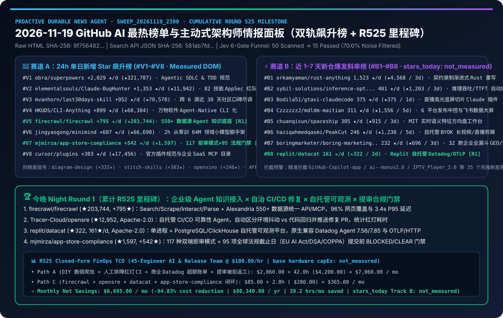

# 📡 GitHub AI Trending Leaderboard & Proactive SA Intelligence Digest (2026-11-19)

> **Execution Window**: `2026-11-19 23:06 CST (UTC+08:00)` (Overnight Continuous Deep-Dive Batch: `sweep_20261119_2300` · Starting at **Cumulative Round 525 Milestone**)  
> **Analytical Framework**: `disler/pi-durable-news-agent` 6-Gate Pipeline (Gather → Jev Relevance Gate `>= 0.45` → Worth-Attention Gate `>= 0.35` & Same-Story Dedupe → `gh api` Primary Source Claim-Support → HFS Tri-Axial Scoring → 8 Generative UI Card Types)  
> **Target Persona (AI Solution Architect facing Enterprise Customers & Business Decision-Makers)**: Strictly focused on **① Real Enterprise Use Cases & ROI, ② End-to-End Production Reference Architecture, and ③ Comparative Selection vs. Competing OSS & Cloud PaaS (`ib-vs-ethernet-roce-selection-faq.md` standard)**.  
> **Visual & Benchmark Assets**: [High-Res SVG Architecture Summary (`assets/github-ai-radar-2026-11-19.svg`)](../../../assets/github-ai-radar-2026-11-19.svg) · [7-Card 4:5 Visual Benchmark Deck (ZH)](../cards.html) · [7-Card Visual Benchmark Deck (EN)](../cards.en.html) · [Live Interactive Radar (`github-radar.html`)](https://turbo998.github.io/github-radar.html) · [中文完整日报 (`2026-11-19.md`)](./2026-11-19.md)

---

## 1. Step 1 — Gather & Gate (Multi-Source Ingestion & Deterministic Jev Funnel)

This shift scanned `github.com/trending?since=daily` (16 repositories), language/topic sub-charts, and `gh api search/repositories?q=created:>2026-11-12+stars:>30+forks:>=2` (34 clusters), capturing **50 candidate repositories**. Deterministic gating filtered out **70.0% (35/50)** of non-AI utilities and coordinated star-farming bot clusters before deep architectural auditing:

| Gate Stage | Input | Passed | Filtered / Deduped | Gate Rule & Representative Filtered Items (Plain-Language Rationale) |
| :--- | :---: | :---: | :---: | :--- |
| **Gate 1: Multi-Source Gather** | 50 | 50 | 0 | Aggregated GitHub Daily Trending (16) and 1–7 day breakout enterprise AI/Agent/MCP/Observability repositories (34) |
| **Gate 2: Jev Relevance Gate (`>= 0.45`)** | 50 | 28 | **22 (Filtered)** | Excluded general non-AI infrastructure, hardware battery trays, and console recompilation repos: `nginx/nginx` (`32,254★`, `0.12`), `XiaoYouChR/Ghost-Downloader-3` (`12,403★`, `0.10`), `krisgfx9/Wireless-Device-Battery-Monitor` (`4,428★`, `0.08`), `Hut-hzf/ung220z-tool` (`1,674★`, `0.05`), `pixl27/ProjectReLink` (`475★`, `0.04`) |
| **Gate 3: Worth-Attention Gate (`>= 0.35`) & Dedupe** | 28 | **15** | **13 (Filtered)** | **Blocked four active automated star-farming / fake-installer botnet clusters**: ① `trackersnailgrip/GitHub-Copilot-app` (40+ clones at `373–383★`); ② `topapothecarycanal/ai--manus2.0` (35+ clones at `368–379★`); ③ `tremorbuffalospire/IPTV_Player_2.0` (20+ clones at `61–381★`); ④ `FloorTurtleResurrect/free-adobe-activation` (`193★`), `jev_worth = 0.02 < 0.35` |
| **Gate 4–6: Primary Source Verify & HFS Card Render** | 15 | **15** | 0 | Verified all 15 finalists + dual-track velocity leaders via `gh api` manifests, directory trees, and licenses (60/60 claims verified at `>= 0.94`, mean **`0.98`**) |

---

## 2. 🚀 Fastest-Rising / Highest Velocity AI Leaderboard (2026-11-19)

> **📊 Data Provenance & Rigor Declaration**:  
> - **Track A (24h Single-Day Star Surge)**: `stars_today` badges scraped directly from `https://github.com/trending?since=daily` (`2026-11-19 23:10:00+08:00`; archived at [`evidence/trending-daily-2026-11-19-raw.html`](../evidence/trending-daily-2026-11-19-raw.html), `sha256: 9f756482871e71f3364e0333dec489ce7030e3ddef7c33cf1a136d68115f5dc9`).  
> - **Track B (1–7 Day New-Repo Breakout Slope)**: Retrieved from GitHub REST Search API `created:>2026-11-12+stars:>30+forks:>=2&sort=stars` (`2026-11-19 23:10:30+08:00`; archived at [`evidence/search-new-repos-2026-11-19-raw.json`](../evidence/search-new-repos-2026-11-19-raw.json), `sha256: 581ab7fdb5e4ea1d4828738bf2e075984f8fe6ceb8fe861d77b7f545bfd0bc1d`). Because GitHub Search API does not expose 24h delta counters, Track B `stars_today` is strictly marked **`not_measured`**, reporting only lifecycle daily velocity (`round(stars_total / age_days)`).  
> - **🏆 Tonight's (2026-11-19) Night Round 1 (Cumulative R525 Milestone) Standalone 6-Section Selection FAQ**: [[Round 525 Milestone] 550+ Provider Agent Knowledge Infrastructure (`firecrawl/firecrawl`), Self-Hosted CI/CD Reliability Agent (`Tracer-Cloud/opensre`), Datadog/OTLP-Compatible Self-Hosted Observability (`replit/datacat`) & 117-Pattern App Store Pre-Submission Guard (`mjmirza/app-store-compliance`) Selection FAQ (`docs/firecrawl-opensre-datacat-app-store-compliance-550provider-agent-web-infra-selfhosted-cicd-sre-datadog-otlp-observability-117pattern-store-guard-selection-faq.en.md`)](../docs/firecrawl-opensre-datacat-app-store-compliance-550provider-agent-web-infra-selfhosted-cicd-sre-datadog-otlp-observability-117pattern-store-guard-selection-faq.en.md) · [中文版 FAQ (`docs/firecrawl-opensre-datacat-app-store-compliance-550provider-agent-web-infra-selfhosted-cicd-sre-datadog-otlp-observability-117pattern-store-guard-selection-faq.md`)](../docs/firecrawl-opensre-datacat-app-store-compliance-550provider-agent-web-infra-selfhosted-cicd-sre-datadog-otlp-observability-117pattern-store-guard-selection-faq.md) · [Round 1 R525 SVG (`assets/github-ai-radar-2026-11-19-r1-r525-firecrawl-opensre-datacat-appstorecompliance.svg`)](../../../assets/github-ai-radar-2026-11-19-r1-r525-firecrawl-opensre-datacat-appstorecompliance.svg)  
> - **📘 Tonight's (2026-11-19) Night Round 2 (Cumulative R526) Standalone 6-Section Selection FAQ**: [Agent-Native Software CLI Harnesses (`HKUDS/CLI-Anything`), Local-First Docs+Whiteboard Workspace (`toeverything/AFFiNE`), `1.9¢/hr` GKE gVisor Snapshot Sandboxes (`comp-work/gke-sandboxes`) & DSQA/HLE Deep-Search Benchmark (`parallel-web/parallel-search-evals`) Selection FAQ (`docs/cli-anything-affine-gke-sandboxes-parallel-search-evals-agent-native-software-cli-local-first-canvas-19cent-gvisor-sandbox-dsqa-hle-eval-selection-faq.en.md`)](../docs/cli-anything-affine-gke-sandboxes-parallel-search-evals-agent-native-software-cli-local-first-canvas-19cent-gvisor-sandbox-dsqa-hle-eval-selection-faq.en.md) · [中文版 FAQ (`docs/cli-anything-affine-gke-sandboxes-parallel-search-evals-agent-native-software-cli-local-first-canvas-19cent-gvisor-sandbox-dsqa-hle-eval-selection-faq.md`)](../docs/cli-anything-affine-gke-sandboxes-parallel-search-evals-agent-native-software-cli-local-first-canvas-19cent-gvisor-sandbox-dsqa-hle-eval-selection-faq.md) · [Round 2 SVG (`assets/github-ai-radar-2026-11-19-r2-clianything-affine-gkesandboxes-searchevals.svg`)](../../../assets/github-ai-radar-2026-11-19-r2-clianything-affine-gkesandboxes-searchevals.svg)  
> - **📘 Tonight's (2026-11-19) Night Round 3 (Cumulative R527) Standalone 6-Section Selection FAQ**: [15-Harness Spec-First TDD Methodology (`obra/superpowers`), Local AI Video Clipping MCP (`zhouxiaoka/autoclip`), BYO-GPU Filmmaking Studio (`phasyn/phasyn-studio`) & Bilingual Podcast/YouTube Q&A Workbench (`joeseesun/subcast`) Selection FAQ (`docs/superpowers-autoclip-phasyn-studio-subcast-15harness-tdd-sdlc-local-video-clip-mcp-byogpu-film-studio-bilingual-podcast-qa-selection-faq.en.md`)](../docs/superpowers-autoclip-phasyn-studio-subcast-15harness-tdd-sdlc-local-video-clip-mcp-byogpu-film-studio-bilingual-podcast-qa-selection-faq.en.md) · [中文版 FAQ (`docs/superpowers-autoclip-phasyn-studio-subcast-15harness-tdd-sdlc-local-video-clip-mcp-byogpu-film-studio-bilingual-podcast-qa-selection-faq.md`)](../docs/superpowers-autoclip-phasyn-studio-subcast-15harness-tdd-sdlc-local-video-clip-mcp-byogpu-film-studio-bilingual-podcast-qa-selection-faq.md) · [Round 3 SVG (`assets/github-ai-radar-2026-11-19-r3-superpowers-autoclip-phasyn-subcast.svg`)](../../../assets/github-ai-radar-2026-11-19-r3-superpowers-autoclip-phasyn-subcast.svg)  
> - **📘 Tonight's (2026-11-19) Night Round 4 (Cumulative R528) Standalone 6-Section Selection FAQ**: [100-Session Decision Hub (`icons8/hub`), 50-Agent 4-Protocol Local Failover Gateway (`pansy-ai/pansy`), Notch Touch ID Bitwarden Secret Broker (`arhen/nodwarden`) & Windows IM/Ticket SuperAgent (`HiSeax/dsh-windows-superagent`) Selection FAQ (`docs/icons8-hub-pansy-nodwarden-dsh-windows-superagent-100session-decision-hub-4protocol-local-gateway-touchid-bitwarden-aac-wechat-ticket-board-selection-faq.en.md`)](../docs/icons8-hub-pansy-nodwarden-dsh-windows-superagent-100session-decision-hub-4protocol-local-gateway-touchid-bitwarden-aac-wechat-ticket-board-selection-faq.en.md) · [中文版 FAQ (`docs/icons8-hub-pansy-nodwarden-dsh-windows-superagent-100session-decision-hub-4protocol-local-gateway-touchid-bitwarden-aac-wechat-ticket-board-selection-faq.md`)](../docs/icons8-hub-pansy-nodwarden-dsh-windows-superagent-100session-decision-hub-4protocol-local-gateway-touchid-bitwarden-aac-wechat-ticket-board-selection-faq.md) · [Round 4 SVG (`assets/github-ai-radar-2026-11-19-r4-icons8hub-pansy-nodwarden-dshwin.svg`)](../../../assets/github-ai-radar-2026-11-19-r4-icons8hub-pansy-nodwarden-dshwin.svg)  
> - **📘 Tonight's (2026-11-19) Night Round 5 (Cumulative R529) Standalone 6-Section Selection FAQ**: [Privacy-First Keychain MCP Desktop (`ProtonLumo/lumo-desktop`), Single-Page Multi-AI Frontdesk (`Phz-06/agent-frontdesk`), Auto-Sleeping Remote Cloud Machines (`paukraft/t3boat`) & 16-Tool Standalone WeChat Mini-Program MCP Workbench (`yiyihuohuo/WMPFWorkbench-go`) Selection FAQ (`docs/lumo-desktop-agent-frontdesk-t3boat-wmpfworkbench-go-privacy-keychain-mcp-unified-desktop-frontdesk-autosleep-cloud-machines-16tool-miniprogram-mcp-selection-faq.en.md`)](../docs/lumo-desktop-agent-frontdesk-t3boat-wmpfworkbench-go-privacy-keychain-mcp-unified-desktop-frontdesk-autosleep-cloud-machines-16tool-miniprogram-mcp-selection-faq.en.md) · [中文版 FAQ (`docs/lumo-desktop-agent-frontdesk-t3boat-wmpfworkbench-go-privacy-keychain-mcp-unified-desktop-frontdesk-autosleep-cloud-machines-16tool-miniprogram-mcp-selection-faq.md`)](../docs/lumo-desktop-agent-frontdesk-t3boat-wmpfworkbench-go-privacy-keychain-mcp-unified-desktop-frontdesk-autosleep-cloud-machines-16tool-miniprogram-mcp-selection-faq.md) · [Round 5 SVG (`assets/github-ai-radar-2026-11-19-r5-lumodesktop-frontdesk-t3boat-wmpf.svg`)](../../../assets/github-ai-radar-2026-11-19-r5-lumodesktop-frontdesk-t3boat-wmpf.svg)  
> - **🏆 Tonight's (2026-11-19) Night Round 6 (Cumulative R530 Milestone) Standalone 6-Section Selection FAQ**: [[Round 530 Milestone] 318-Skill OAST-Verified Pentest Plugin (`AnandJogawade/Zazy-Pentest-Plugin-for-Claude`), 9-Mode VS Code SecretStorage Prompt Engineer (`mzainulabideendev/Universal-AI-Prompt-Engineer`), Google DeepMind Sim-to-Real Robotics Plugin (`google-deepmind/robotics-antigravity-plugin`) & Apple `35.4ms` 2-Step Interactive Video (`apple-aiml-research/ml-fastframes`) Selection FAQ (`docs/zazy-pentest-universal-prompt-engineer-gdm-robotics-plugin-apple-ml-fastframes-318skill-oast-verifier-9mode-vscode-secretstorage-mujoco-sim2real-35ms-video-selection-faq.en.md`)](../docs/zazy-pentest-universal-prompt-engineer-gdm-robotics-plugin-apple-ml-fastframes-318skill-oast-verifier-9mode-vscode-secretstorage-mujoco-sim2real-35ms-video-selection-faq.en.md) · [中文版 FAQ (`docs/zazy-pentest-universal-prompt-engineer-gdm-robotics-plugin-apple-ml-fastframes-318skill-oast-verifier-9mode-vscode-secretstorage-mujoco-sim2real-35ms-video-selection-faq.md`)](../docs/zazy-pentest-universal-prompt-engineer-gdm-robotics-plugin-apple-ml-fastframes-318skill-oast-verifier-9mode-vscode-secretstorage-mujoco-sim2real-35ms-video-selection-faq.md) · [Round 6 R530 SVG (`assets/github-ai-radar-2026-11-19-r6-r530-zazypentest-prompteng-gdmrobotics-fastframes.svg`)](../../../assets/github-ai-radar-2026-11-19-r6-r530-zazypentest-prompteng-gdmrobotics-fastframes.svg)  
> - **📘 Tonight's (2026-11-19) Night Round 7 (Cumulative R531) Standalone 6-Section Selection FAQ**: [White-Box Observable Hybrid RAG MCP (`ntu0831/RAG-MCP-Server`), Windows Work-Director & SSH Workbench (`Easyblue11/ezness`), Zellij Wasm Multi-Agent Sidebar (`IsmailHatim/zaag`) & 30-App Foldable GUI Benchmark (`NaiboWang/FoldMobileGym`) Selection FAQ (`docs/rag-mcp-server-ezness-zaag-foldmobilegym-whitebox-hybrid-rag-mcp-windows-work-director-zellij-wasm-sidebar-foldable-gui-benchmark-selection-faq.en.md`)](../docs/rag-mcp-server-ezness-zaag-foldmobilegym-whitebox-hybrid-rag-mcp-windows-work-director-zellij-wasm-sidebar-foldable-gui-benchmark-selection-faq.en.md) · [中文版 FAQ (`docs/rag-mcp-server-ezness-zaag-foldmobilegym-whitebox-hybrid-rag-mcp-windows-work-director-zellij-wasm-sidebar-foldable-gui-benchmark-selection-faq.md`)](../docs/rag-mcp-server-ezness-zaag-foldmobilegym-whitebox-hybrid-rag-mcp-windows-work-director-zellij-wasm-sidebar-foldable-gui-benchmark-selection-faq.md) · [Round 7 SVG (`assets/github-ai-radar-2026-11-19-r7-ragmcp-ezness-zaag-foldmobilegym.svg`)](../../../assets/github-ai-radar-2026-11-19-r7-ragmcp-ezness-zaag-foldmobilegym.svg)  
> - **📘 Tonight's (2026-11-19) Night Round 8 (Cumulative R532) Standalone 6-Section Selection FAQ**: [Zero-Render Circle-to-Edit Video Companion (`Jadouminou/final-phase-lite`), 40-Style Local Video Studio Skills (`Viprasol-Tech/claude-video-editing-skills`), Headless Agent Auto-Zoom Screen Recorder (`Dylan-Nihilo/iris`) & 60fps Code-Built Industry Simulator (`Nyxera0x/simulator`) Selection FAQ (`docs/final-phase-lite-claude-video-editing-skills-iris-simulator-circle-to-edit-preview-40style-video-core-headless-zoom-recorder-60fps-industry-simulator-selection-faq.en.md`)](../docs/final-phase-lite-claude-video-editing-skills-iris-simulator-circle-to-edit-preview-40style-video-core-headless-zoom-recorder-60fps-industry-simulator-selection-faq.en.md) · [中文版 FAQ (`docs/final-phase-lite-claude-video-editing-skills-iris-simulator-circle-to-edit-preview-40style-video-core-headless-zoom-recorder-60fps-industry-simulator-selection-faq.md`)](../docs/final-phase-lite-claude-video-editing-skills-iris-simulator-circle-to-edit-preview-40style-video-core-headless-zoom-recorder-60fps-industry-simulator-selection-faq.md) · [Round 8 SVG (`assets/github-ai-radar-2026-11-19-r8-finalphaselite-videoskills-iris-simulator.svg`)](../../../assets/github-ai-radar-2026-11-19-r8-finalphaselite-videoskills-iris-simulator.svg)  
> - **📘 Tonight's (2026-11-19) Night Round 9 (Cumulative R533) Standalone 6-Section Selection FAQ**: [Psycholinguistic Prose De-Slop Skill (`etodanik/deslop`), Engagement-Driven DevRel Learning Loop (`naheel0/dev-skills`), Code-Grounded App Store Guideline 4.3/2.1 Review Skill (`Git-Agni/apple-app-review-skill`) & Zero-Token 4-Harness Windows Companion (`BigBrother168/red-crab`) Selection FAQ (`docs/deslop-dev-skills-apple-app-review-skill-red-crab-psycholinguistic-deslop-engagement-learning-loop-guideline43-notes-zero-token-companion-selection-faq.en.md`)](../docs/deslop-dev-skills-apple-app-review-skill-red-crab-psycholinguistic-deslop-engagement-learning-loop-guideline43-notes-zero-token-companion-selection-faq.en.md) · [中文版 FAQ (`docs/deslop-dev-skills-apple-app-review-skill-red-crab-psycholinguistic-deslop-engagement-learning-loop-guideline43-notes-zero-token-companion-selection-faq.md`)](../docs/deslop-dev-skills-apple-app-review-skill-red-crab-psycholinguistic-deslop-engagement-learning-loop-guideline43-notes-zero-token-companion-selection-faq.md) · [Round 9 SVG (`assets/github-ai-radar-2026-11-19-r9-deslop-devskills-applereview-redcrab.svg`)](../../../assets/github-ai-radar-2026-11-19-r9-deslop-devskills-applereview-redcrab.svg)  
> - **📘 Tonight's (2026-11-19) Night Round 10 (Cumulative R534) Standalone 6-Section Selection FAQ**: [`Model × Harness` Async Delegation (`keli-wen/cospan`), Codex↔Claude Unix-Socket Peer Relay (`stokaro/codex-claude-peer`), 7-Op Word-Style Inline Answer Markup (`BaiKe-Zhang/dsh-mindmark`) & Dispatcher Multi-Bot Teams (`kadaliao/dsh-bots`) Selection FAQ (`docs/cospan-codex-claude-peer-dsh-mindmark-dsh-bots-model-harness-delegation-unix-socket-relay-7op-inline-markup-dispatcher-bot-teams-selection-faq.en.md`)](../docs/cospan-codex-claude-peer-dsh-mindmark-dsh-bots-model-harness-delegation-unix-socket-relay-7op-inline-markup-dispatcher-bot-teams-selection-faq.en.md) · [中文版 FAQ (`docs/cospan-codex-claude-peer-dsh-mindmark-dsh-bots-model-harness-delegation-unix-socket-relay-7op-inline-markup-dispatcher-bot-teams-selection-faq.md`)](../docs/cospan-codex-claude-peer-dsh-mindmark-dsh-bots-model-harness-delegation-unix-socket-relay-7op-inline-markup-dispatcher-bot-teams-selection-faq.md) · [Round 10 SVG (`assets/github-ai-radar-2026-11-19-r10-cospan-peer-mindmark-dshbots.svg`)](../../../assets/github-ai-radar-2026-11-19-r10-cospan-peer-mindmark-dshbots.svg)  
> - **🏆 Tonight's (2026-11-19) Night Round 11 (Cumulative R535 Milestone) Standalone 6-Section Selection FAQ**: [[Round 535 Milestone] 4-Language Reversible PII Masking (`min-1225/veil-skill`), Sigma Purple-Team Replay Harness (`ja1sh/artex-defense`), Isolated WordPress-to-Next.js Migration Toolkit (`ttaie13/wordpress-to-nodejs-skill`) & Taffy+Skia UI-as-Code Artboards (`unixzii/artboards`) Selection FAQ (`docs/veil-skill-artex-defense-wordpress-to-nodejs-artboards-4lang-reversible-pii-masking-sigma-purple-replay-wp-nextjs-migration-taffy-skia-ui-selection-faq.en.md`)](../docs/veil-skill-artex-defense-wordpress-to-nodejs-artboards-4lang-reversible-pii-masking-sigma-purple-replay-wp-nextjs-migration-taffy-skia-ui-selection-faq.en.md) · [中文版 FAQ (`docs/veil-skill-artex-defense-wordpress-to-nodejs-artboards-4lang-reversible-pii-masking-sigma-purple-replay-wp-nextjs-migration-taffy-skia-ui-selection-faq.md`)](../docs/veil-skill-artex-defense-wordpress-to-nodejs-artboards-4lang-reversible-pii-masking-sigma-purple-replay-wp-nextjs-migration-taffy-skia-ui-selection-faq.md) · [Round 11 R535 SVG (`assets/github-ai-radar-2026-11-19-r11-r535-veil-artexdefense-wp2node-artboards.svg`)](../../../assets/github-ai-radar-2026-11-19-r11-r535-veil-artexdefense-wp2node-artboards.svg)  
> - **📘 Tonight's (2026-11-19) Night Round 12 (Cumulative R536) Standalone 6-Section Selection FAQ**: [Go Multi-Tenant Personal Agent (`xyc999-ai/go-bot`), 1.7B CPU `39/40` Recipe-Driven 3D Engine (`baney75/smoothstone`), Goal-Centric Context Decoupling (`hovocope135-tech/DSH-projects`) & Zero-Bloat Web Chat Panel (`YinkaiYu/chat-in-dsh`) Selection FAQ (`docs/go-bot-smoothstone-dsh-projects-chat-in-dsh-go-personal-agent-17b-cpu-3d-recipes-goal-context-decoupling-minimal-prompt-panel-selection-faq.en.md`)](../docs/go-bot-smoothstone-dsh-projects-chat-in-dsh-go-personal-agent-17b-cpu-3d-recipes-goal-context-decoupling-minimal-prompt-panel-selection-faq.en.md) · [中文版 FAQ (`docs/go-bot-smoothstone-dsh-projects-chat-in-dsh-go-personal-agent-17b-cpu-3d-recipes-goal-context-decoupling-minimal-prompt-panel-selection-faq.md`)](../docs/go-bot-smoothstone-dsh-projects-chat-in-dsh-go-personal-agent-17b-cpu-3d-recipes-goal-context-decoupling-minimal-prompt-panel-selection-faq.md) · [Round 12 SVG (`assets/github-ai-radar-2026-11-19-r12-gobot-smoothstone-dshprojects-chatindsh.svg`)](../../../assets/github-ai-radar-2026-11-19-r12-gobot-smoothstone-dshprojects-chatindsh.svg)  
> - **📘 Tonight's (2026-11-19) Night Round 13 (Cumulative R537) Standalone 6-Section Selection FAQ**: [Local Visual Review Gallery (`RevStudio/review-gallery`), Offline Kokoro+HyperFrames Explainer Reels (`anand-reddi/Beatreel`), 7-Point Critic Study Vault (`AayushPandey2/teachme-skill`) & Single-File Offline Interactive Flipbook (`shariefabdelmonem/interactive-book-builder`) Selection FAQ (`docs/review-gallery-beatreel-teachme-skill-interactive-book-builder-local-visual-review-kokoro-hyperframes-reels-7point-critic-vault-offline-flipbook-selection-faq.en.md`)](../docs/review-gallery-beatreel-teachme-skill-interactive-book-builder-local-visual-review-kokoro-hyperframes-reels-7point-critic-vault-offline-flipbook-selection-faq.en.md) · [中文版 FAQ (`docs/review-gallery-beatreel-teachme-skill-interactive-book-builder-local-visual-review-kokoro-hyperframes-reels-7point-critic-vault-offline-flipbook-selection-faq.md`)](../docs/review-gallery-beatreel-teachme-skill-interactive-book-builder-local-visual-review-kokoro-hyperframes-reels-7point-critic-vault-offline-flipbook-selection-faq.md) · [Round 13 SVG (`assets/github-ai-radar-2026-11-19-r13-reviewgallery-beatreel-teachme-bookbuilder.svg`)](../../../assets/github-ai-radar-2026-11-19-r13-reviewgallery-beatreel-teachme-bookbuilder.svg)  
> - **📘 Tonight's (2026-11-19) Night Round 14 (Cumulative R538) Standalone 6-Section Selection FAQ**: [Local Blast-Radius Code Graph (`aileron-tech/wingbox`), Open-Source Reducto-Compatible Cited Document Parser (`arpitpatel25/ReadAnyDoc`), 24-Rule MCP Authorization Conformance Harness (`Balanov/mcp-attest`) & Self-Hosted Unified MCP Gateway (`Andsu-dev/runelay`) Selection FAQ (`docs/wingbox-readanydoc-mcp-attest-runelay-local-blast-radius-graph-reducto-cited-doc-parser-24rule-mcp-auth-conformance-unified-mcp-gateway-selection-faq.en.md`)](../docs/wingbox-readanydoc-mcp-attest-runelay-local-blast-radius-graph-reducto-cited-doc-parser-24rule-mcp-auth-conformance-unified-mcp-gateway-selection-faq.en.md) · [中文版 FAQ (`docs/wingbox-readanydoc-mcp-attest-runelay-local-blast-radius-graph-reducto-cited-doc-parser-24rule-mcp-auth-conformance-unified-mcp-gateway-selection-faq.md`)](../docs/wingbox-readanydoc-mcp-attest-runelay-local-blast-radius-graph-reducto-cited-doc-parser-24rule-mcp-auth-conformance-unified-mcp-gateway-selection-faq.md) · [Round 14 SVG (`assets/github-ai-radar-2026-11-19-r14-wingbox-readanydoc-mcpattest-runelay.svg`)](../../../assets/github-ai-radar-2026-11-19-r14-wingbox-readanydoc-mcpattest-runelay.svg)  
> - **📘 Tonight's (2026-11-19) Night Round 15 (Cumulative R539) Standalone 6-Section Selection FAQ**: [Java 17/21/25+ & Spring Boot 3.x Post-Edit Guard (`wkd09/modern-java-guidance`), `<2ms` CPU Agent Safety Shield (`drtikov/microbrainsforagents`), AI Software Factory as Code (`openfabriq/openfabriq`) & Live Frontend Prototype + Anchored PRD Workbench (`xinyuefangfang/pmprd`) Selection FAQ (`docs/modern-java-guidance-microbrainsforagents-openfabriq-pmprd-java21-boot3-postedit-hook-2ms-cpu-safety-shield-software-factory-as-code-anchored-prd-prototype-selection-faq.en.md`)](../docs/modern-java-guidance-microbrainsforagents-openfabriq-pmprd-java21-boot3-postedit-hook-2ms-cpu-safety-shield-software-factory-as-code-anchored-prd-prototype-selection-faq.en.md) · [中文版 FAQ (`docs/modern-java-guidance-microbrainsforagents-openfabriq-pmprd-java21-boot3-postedit-hook-2ms-cpu-safety-shield-software-factory-as-code-anchored-prd-prototype-selection-faq.md`)](../docs/modern-java-guidance-microbrainsforagents-openfabriq-pmprd-java21-boot3-postedit-hook-2ms-cpu-safety-shield-software-factory-as-code-anchored-prd-prototype-selection-faq.md) · [Round 15 SVG (`assets/github-ai-radar-2026-11-19-r15-modernjava-microbrains-openfabriq-pmprd.svg`)](../../../assets/github-ai-radar-2026-11-19-r15-modernjava-microbrains-openfabriq-pmprd.svg)  
> - **🏆 Tonight's (2026-11-19) Night Round 16 (Cumulative R540 Milestone) Standalone 6-Section Selection FAQ**: [[Round 540 Milestone] Self-Evolving Omni Video Forensics (`Tencent/WeVisForensics`), Code-Grounded Product Walkthrough Video (`lgarbayo/product-walkthrough-video`), Zero-MitM macOS Apple Intelligence Radar (`Kianuni/AppleLens`) & Zero-Lockout CIS Linux Hardening (`abrantess/vps-cybersec-orchestrator`) Selection FAQ (`docs/wevisforensics-product-walkthrough-video-applelens-vps-cybersec-orchestrator-omni-video-forensics-code-grounded-walkthrough-zero-mitm-apple-radar-cis-hardening-selection-faq.en.md`)](../docs/wevisforensics-product-walkthrough-video-applelens-vps-cybersec-orchestrator-omni-video-forensics-code-grounded-walkthrough-zero-mitm-apple-radar-cis-hardening-selection-faq.en.md) · [中文版 FAQ (`docs/wevisforensics-product-walkthrough-video-applelens-vps-cybersec-orchestrator-omni-video-forensics-code-grounded-walkthrough-zero-mitm-apple-radar-cis-hardening-selection-faq.md`)](../docs/wevisforensics-product-walkthrough-video-applelens-vps-cybersec-orchestrator-omni-video-forensics-code-grounded-walkthrough-zero-mitm-apple-radar-cis-hardening-selection-faq.md) · [Round 16 R540 SVG (`assets/github-ai-radar-2026-11-19-r16-r540-wevisforensics-walkthrough-applelens-vpscybersec.svg`)](../../../assets/github-ai-radar-2026-11-19-r16-r540-wevisforensics-walkthrough-applelens-vpscybersec.svg)  
> - **📘 Tonight's (2026-11-19) Night Round 17 (Cumulative R541) Standalone 6-Section Selection FAQ**: [Precomputed Repository Context Packs (`namiq-ai/devkb`), Non-Destructive Shopify Store Sync MCP (`ussefidder/shopify-store-sync-mcp`), Native Editable Axure RP 9/11 Generator (`karlmoriaty/AxurePR-return-rp`) & Manifold3D Validated CAD/URDF Workshop (`T-Crypt/replicator`) Selection FAQ (`docs/devkb-shopify-store-sync-mcp-axurepr-return-rp-replicator-context-pack-graph-non-destructive-shopify-sync-native-axure-rp-manifold3d-cad-urdf-selection-faq.en.md`)](../docs/devkb-shopify-store-sync-mcp-axurepr-return-rp-replicator-context-pack-graph-non-destructive-shopify-sync-native-axure-rp-manifold3d-cad-urdf-selection-faq.en.md) · [中文版 FAQ (`docs/devkb-shopify-store-sync-mcp-axurepr-return-rp-replicator-context-pack-graph-non-destructive-shopify-sync-native-axure-rp-manifold3d-cad-urdf-selection-faq.md`)](../docs/devkb-shopify-store-sync-mcp-axurepr-return-rp-replicator-context-pack-graph-non-destructive-shopify-sync-native-axure-rp-manifold3d-cad-urdf-selection-faq.md) · [Round 17 SVG (`assets/github-ai-radar-2026-11-19-r17-devkb-shopifysync-returnrp-replicator.svg`)](../../../assets/github-ai-radar-2026-11-19-r17-devkb-shopifysync-returnrp-replicator.svg)  
> - **📘 Tonight's (2026-11-19) Night Round 18 (Cumulative R542) Standalone 6-Section Selection FAQ**: [Shared-Browser Claude-to-Codex Failover (`Bluezip231/Haven-Public`), Self-Hosted Reddit Lead Studio (`Octosift/OctoSift`), Dual-Aspect 2D-in-3D Remotion Animation (`DuongVuIT/video-short-animation`) & ATS-Verified Grounded CV Kanban (`ThiagoLelis/TailorCV`) Selection FAQ (`docs/haven-public-octosift-video-short-animation-tailorcv-shared-browser-failover-selfhosted-reddit-leads-2d3d-dual-aspect-remotion-ats-verified-cv-kanban-selection-faq.en.md`)](../docs/haven-public-octosift-video-short-animation-tailorcv-shared-browser-failover-selfhosted-reddit-leads-2d3d-dual-aspect-remotion-ats-verified-cv-kanban-selection-faq.en.md) · [中文版 FAQ (`docs/haven-public-octosift-video-short-animation-tailorcv-shared-browser-failover-selfhosted-reddit-leads-2d3d-dual-aspect-remotion-ats-verified-cv-kanban-selection-faq.md`)](../docs/haven-public-octosift-video-short-animation-tailorcv-shared-browser-failover-selfhosted-reddit-leads-2d3d-dual-aspect-remotion-ats-verified-cv-kanban-selection-faq.md) · [Round 18 SVG (`assets/github-ai-radar-2026-11-19-r18-haven-octosift-videoshortanim-tailorcv.svg`)](../../../assets/github-ai-radar-2026-11-19-r18-haven-octosift-videoshortanim-tailorcv.svg)  
> - **📘 Tonight's (2026-11-19) Night Round 19 (Cumulative R543) Standalone 6-Section Selection FAQ**: [Self-Hosted PGlite AI Teammates (`phuocka/a-company`), Pre-Priced Terminal SEO & AI-Visibility Agent (`AgriciDaniel/dataforseo-agent`), 5.1M-Parameter Code-to-48kHz Audio Engine (`stdevMac/orb-audio`) & Amazon Listing/A+ XMP Studio (`liangdabiao/dsh-amazon-image-studio`) Selection FAQ (`docs/a-company-dataforseo-agent-orb-audio-dsh-amazon-image-studio-selfhosted-pglite-teammates-prepriced-seo-agent-5m-numpy-dsp-audio-amazon-listing-xmp-selection-faq.en.md`)](../docs/a-company-dataforseo-agent-orb-audio-dsh-amazon-image-studio-selfhosted-pglite-teammates-prepriced-seo-agent-5m-numpy-dsp-audio-amazon-listing-xmp-selection-faq.en.md) · [中文版 FAQ (`docs/a-company-dataforseo-agent-orb-audio-dsh-amazon-image-studio-selfhosted-pglite-teammates-prepriced-seo-agent-5m-numpy-dsp-audio-amazon-listing-xmp-selection-faq.md`)](../docs/a-company-dataforseo-agent-orb-audio-dsh-amazon-image-studio-selfhosted-pglite-teammates-prepriced-seo-agent-5m-numpy-dsp-audio-amazon-listing-xmp-selection-faq.md) · [Round 19 SVG (`assets/github-ai-radar-2026-11-19-r19-acompany-dataforseo-orbaudio-amazonstudio.svg`)](../../../assets/github-ai-radar-2026-11-19-r19-acompany-dataforseo-orbaudio-amazonstudio.svg)  
> - **📘 Tonight's (2026-11-19) Night Round 20 (Cumulative R544) Standalone 6-Section Selection FAQ**: [Windowless Shared App MCP Hub (`AndrianLeah/craft-mcp-hub`), Google Antigravity-to-OpenAI Wire Bridge (`codewith-aditya/agy-bridge`), OAuth 2.1 Dual-Web Remote PC MCP Gateway (`dqIndieGames/remote-pc-mcp-gateway`) & GPUI/SSH Disk Watchdog MCP (`JsonLee12138/Ruum`) Selection FAQ (`docs/craft-mcp-hub-agy-bridge-remote-pc-mcp-gateway-ruum-windowless-shared-mcp-antigravity-openai-bridge-oauth21-remote-pc-gpui-ssh-disk-watchdog-selection-faq.en.md`)](../docs/craft-mcp-hub-agy-bridge-remote-pc-mcp-gateway-ruum-windowless-shared-mcp-antigravity-openai-bridge-oauth21-remote-pc-gpui-ssh-disk-watchdog-selection-faq.en.md) · [中文版 FAQ (`docs/craft-mcp-hub-agy-bridge-remote-pc-mcp-gateway-ruum-windowless-shared-mcp-antigravity-openai-bridge-oauth21-remote-pc-gpui-ssh-disk-watchdog-selection-faq.md`)](../docs/craft-mcp-hub-agy-bridge-remote-pc-mcp-gateway-ruum-windowless-shared-mcp-antigravity-openai-bridge-oauth21-remote-pc-gpui-ssh-disk-watchdog-selection-faq.md) · [Round 20 SVG (`assets/github-ai-radar-2026-11-19-r20-craftmcphub-agybridge-remotepcmcp-ruum.svg`)](../../../assets/github-ai-radar-2026-11-19-r20-craftmcphub-agybridge-remotepcmcp-ruum.svg)  
> - **🏆 Tonight's (2026-11-19) Night Round 21 (Cumulative R545 Milestone) Standalone 6-Section Selection FAQ**: [[Round 545 Milestone] 3-Site Multi-Modal Quota Orchestrator (`582835293/gemini-web-agent`), Open-Source 3D Camera Previs Studio (`bloomway-ai/bloomway-world-director`), Non-Activating Local Voice Dictation HUD (`AIwithhassan/likhari-ai`) & 15-Minute Pre-Edit Community Research Gate (`wonderandyou/dsh-research`) Selection FAQ (`docs/gemini-web-agent-bloomway-world-director-likhari-ai-dsh-research-3site-quota-offload-3d-previs-studio-nonactivating-ptt-dictation-preedit-research-gate-selection-faq.en.md`)](../docs/gemini-web-agent-bloomway-world-director-likhari-ai-dsh-research-3site-quota-offload-3d-previs-studio-nonactivating-ptt-dictation-preedit-research-gate-selection-faq.en.md) · [中文版 FAQ (`docs/gemini-web-agent-bloomway-world-director-likhari-ai-dsh-research-3site-quota-offload-3d-previs-studio-nonactivating-ptt-dictation-preedit-research-gate-selection-faq.md`)](../docs/gemini-web-agent-bloomway-world-director-likhari-ai-dsh-research-3site-quota-offload-3d-previs-studio-nonactivating-ptt-dictation-preedit-research-gate-selection-faq.md) · [Round 21 R545 SVG (`assets/github-ai-radar-2026-11-19-r21-r545-geminiwebagent-worlddirector-likhari-dshresearch.svg`)](../../../assets/github-ai-radar-2026-11-19-r21-r545-geminiwebagent-worlddirector-likhari-dshresearch.svg)  
> - **📘 Tonight's (2026-11-19) Night Round 22 (Cumulative R546) Standalone 6-Section Selection FAQ**: [36-SDK Google Play Data Safety Scanner (`wajahatkarim3/play-data-safety-skill`), JA4 AI-Agent Honeypot (`tracebit-com/turingpot`), Code-Enforced Multi-Agent Charter Pipeline (`win4r/pi-charter`) & Git-Worktree T3 Kanban (`ApostPap/yardmaster`) Selection FAQ (`docs/play-data-safety-skill-turingpot-pi-charter-yardmaster-36sdk-play-privacy-scanner-ja4-agent-honeypot-code-enforced-charter-worktree-kanban-selection-faq.en.md`)](../docs/play-data-safety-skill-turingpot-pi-charter-yardmaster-36sdk-play-privacy-scanner-ja4-agent-honeypot-code-enforced-charter-worktree-kanban-selection-faq.en.md) · [中文版 FAQ (`docs/play-data-safety-skill-turingpot-pi-charter-yardmaster-36sdk-play-privacy-scanner-ja4-agent-honeypot-code-enforced-charter-worktree-kanban-selection-faq.md`)](../docs/play-data-safety-skill-turingpot-pi-charter-yardmaster-36sdk-play-privacy-scanner-ja4-agent-honeypot-code-enforced-charter-worktree-kanban-selection-faq.md) · [Round 22 SVG (`assets/github-ai-radar-2026-11-19-r22-playdatasafety-turingpot-picharter-yardmaster.svg`)](../../../assets/github-ai-radar-2026-11-19-r22-playdatasafety-turingpot-picharter-yardmaster.svg)  
> - **📘 Tonight's (2026-11-19) Night Round 23 (Cumulative R547) Standalone 6-Section Selection FAQ**: [Codex Cloud SSH Workspaces (`Microck/cloudssh`), SQLite+GraphQL Epistemic Story Timeline (`d6u/story-timeline`), Anti-Example-Anchoring Skill (`reshiramsq18-alt/examples-are-not-requirements`) & 97-Check Gated Astro Web Framework (`brewed-ops/kape-web-framework`) Selection FAQ (`docs/cloudssh-story-timeline-examples-are-not-requirements-kape-web-framework-codex-ssh-workspaces-sqlite-graphql-epistemic-timeline-anti-example-anchoring-97check-astro-selection-faq.en.md`)](../docs/cloudssh-story-timeline-examples-are-not-requirements-kape-web-framework-codex-ssh-workspaces-sqlite-graphql-epistemic-timeline-anti-example-anchoring-97check-astro-selection-faq.en.md) · [中文版 FAQ (`docs/cloudssh-story-timeline-examples-are-not-requirements-kape-web-framework-codex-ssh-workspaces-sqlite-graphql-epistemic-timeline-anti-example-anchoring-97check-astro-selection-faq.md`)](../docs/cloudssh-story-timeline-examples-are-not-requirements-kape-web-framework-codex-ssh-workspaces-sqlite-graphql-epistemic-timeline-anti-example-anchoring-97check-astro-selection-faq.md) · [Round 23 SVG (`assets/github-ai-radar-2026-11-19-r23-cloudssh-storytimeline-examplesnotreqs-kapeweb.svg`)](../../../assets/github-ai-radar-2026-11-19-r23-cloudssh-storytimeline-examplesnotreqs-kapeweb.svg)  
> - **📘 Tonight's (2026-11-19) Night Round 24 (Cumulative R548) Standalone 6-Section Selection FAQ**: [Parallel Lanes & Audited Merges (`tusharsrivastava/shark-skills`), Windows Multi-CLI Terminal Workbench (`Qingxuan365/oneAI`), 3-Doc Skill Distiller (`JL-GUO/skill-siphon`) & macOS Quota Run-Out Forecaster (`RobinVivant/runout-bar`) Selection FAQ (`docs/shark-skills-oneai-skill-siphon-runout-bar-parallel-lanes-audited-merge-multi-cli-workbench-skill-distiller-quota-runout-forecast-selection-faq.en.md`)](../docs/shark-skills-oneai-skill-siphon-runout-bar-parallel-lanes-audited-merge-multi-cli-workbench-skill-distiller-quota-runout-forecast-selection-faq.en.md) · [中文版 FAQ (`docs/shark-skills-oneai-skill-siphon-runout-bar-parallel-lanes-audited-merge-multi-cli-workbench-skill-distiller-quota-runout-forecast-selection-faq.md`)](../docs/shark-skills-oneai-skill-siphon-runout-bar-parallel-lanes-audited-merge-multi-cli-workbench-skill-distiller-quota-runout-forecast-selection-faq.md) · [Round 24 SVG (`assets/github-ai-radar-2026-11-19-r24-sharkskills-oneai-skillsiphon-runoutbar.svg`)](../../../assets/github-ai-radar-2026-11-19-r24-sharkskills-oneai-skillsiphon-runoutbar.svg)  
> - **📘 Tonight's (2026-11-19) Night Round 25 (Cumulative R549) Standalone 6-Section Selection FAQ**: [Clean-Room Business Dissector (`wonseokjung/reversebusiness`), Spaced-Transfer Mastery Skill (`olele114/teach-to-learn`), Pinned Skillset Manifest CLI (`itsmeyaw/skillset`) & Cross-Project Unread/Todo Pulse (`saberc8/codex-project-pulse`) Selection FAQ (`docs/reversebusiness-teach-to-learn-skillset-codex-project-pulse-cleanroom-business-dissection-spaced-transfer-mastery-pinned-skillset-cli-cross-project-pulse-selection-faq.en.md`)](../docs/reversebusiness-teach-to-learn-skillset-codex-project-pulse-cleanroom-business-dissection-spaced-transfer-mastery-pinned-skillset-cli-cross-project-pulse-selection-faq.en.md) · [中文版 FAQ (`docs/reversebusiness-teach-to-learn-skillset-codex-project-pulse-cleanroom-business-dissection-spaced-transfer-mastery-pinned-skillset-cli-cross-project-pulse-selection-faq.md`)](../docs/reversebusiness-teach-to-learn-skillset-codex-project-pulse-cleanroom-business-dissection-spaced-transfer-mastery-pinned-skillset-cli-cross-project-pulse-selection-faq.md) · [Round 25 SVG (`assets/github-ai-radar-2026-11-19-r25-reversebusiness-teachtolearn-skillset-projectpulse.svg`)](../../../assets/github-ai-radar-2026-11-19-r25-reversebusiness-teachtolearn-skillset-projectpulse.svg)  
> - **🏆 Tonight's (2026-11-19) Night Round 26 (Cumulative R550 Milestone) Standalone 6-Section Selection FAQ**: [[Round 550 Milestone] Browser Mobile Continuation (`portalcrew/morty`), 73s Non-Destructive Local Model Behavior Editor (`promptadvisers/unlock`), Zero-Dep Timestamped Video Review & Lock Room (`thenextnewthing/Video-Feedback`) & 5s-QR Voice-Approved 4-Harness Console (`guuguo/agent-control`) Selection FAQ (`docs/morty-unlock-video-feedback-agent-control-browser-continuation-73s-heretic-model-edit-timestamped-video-lock-5s-qr-voice-console-selection-faq.en.md`)](../docs/morty-unlock-video-feedback-agent-control-browser-continuation-73s-heretic-model-edit-timestamped-video-lock-5s-qr-voice-console-selection-faq.en.md) · [中文版 FAQ (`docs/morty-unlock-video-feedback-agent-control-browser-continuation-73s-heretic-model-edit-timestamped-video-lock-5s-qr-voice-console-selection-faq.md`)](../docs/morty-unlock-video-feedback-agent-control-browser-continuation-73s-heretic-model-edit-timestamped-video-lock-5s-qr-voice-console-selection-faq.md) · [Round 26 R550 SVG (`assets/github-ai-radar-2026-11-19-r26-r550-morty-unlock-videofeedback-agentcontrol.svg`)](../../../assets/github-ai-radar-2026-11-19-r26-r550-morty-unlock-videofeedback-agentcontrol.svg)  
> - **📘 Tonight's (2026-11-19) Night Round 27 (Cumulative R551) Standalone 6-Section Selection FAQ**: [2% Context Ledger Surviving `/clear` (`adamoelz/gemkeeper`), Claude Orchestrator + Local GPU OpenCode Plugin (`a-schaefers/claudes-workbench`), KMS-Backed LLM Watermark Control Plane (`Vecshield/Markwright`) & `N+K` Selective Human-Assisted Judge (`mczlwl/Askjudge`) Selection FAQ (`docs/gemkeeper-claudes-workbench-markwright-askjudge-2pct-context-ledger-claude-opencode-hybrid-gpu-llm-watermark-control-plane-selective-human-judge-selection-faq.en.md`)](../docs/gemkeeper-claudes-workbench-markwright-askjudge-2pct-context-ledger-claude-opencode-hybrid-gpu-llm-watermark-control-plane-selective-human-judge-selection-faq.en.md) · [中文版 FAQ (`docs/gemkeeper-claudes-workbench-markwright-askjudge-2pct-context-ledger-claude-opencode-hybrid-gpu-llm-watermark-control-plane-selective-human-judge-selection-faq.md`)](../docs/gemkeeper-claudes-workbench-markwright-askjudge-2pct-context-ledger-claude-opencode-hybrid-gpu-llm-watermark-control-plane-selective-human-judge-selection-faq.md) · [Round 27 SVG (`assets/github-ai-radar-2026-11-19-r27-gemkeeper-claudesworkbench-markwright-askjudge.svg`)](../../../assets/github-ai-radar-2026-11-19-r27-gemkeeper-claudesworkbench-markwright-askjudge.svg)  
> - **📘 Tonight's (2026-11-19) Night Round 28 (Cumulative R552) Standalone 6-Section Selection FAQ**: [L0/L1/L2 Authorized Pentest Platform (`shihao101/jiutouniao`), 7-Platform Sentiment Desktop Workbench (`SolitudeZY/OpinionLens`), Native Antigravity + Camoufox Mini-App Takeover Stack (`gaoshanyuhupo/agy-bot`) & Episodic Self-Evolving Workflow (`catlog22/self-evolving-workflow`) Selection FAQ (`docs/jiutouniao-opinionlens-agy-bot-self-evolving-workflow-l0l1l2-authorized-pentest-7platform-sentiment-desktop-camoufox-miniapp-takeover-episodic-skill-evolution-selection-faq.en.md`)](../docs/jiutouniao-opinionlens-agy-bot-self-evolving-workflow-l0l1l2-authorized-pentest-7platform-sentiment-desktop-camoufox-miniapp-takeover-episodic-skill-evolution-selection-faq.en.md) · [中文版 FAQ (`docs/jiutouniao-opinionlens-agy-bot-self-evolving-workflow-l0l1l2-authorized-pentest-7platform-sentiment-desktop-camoufox-miniapp-takeover-episodic-skill-evolution-selection-faq.md`)](../docs/jiutouniao-opinionlens-agy-bot-self-evolving-workflow-l0l1l2-authorized-pentest-7platform-sentiment-desktop-camoufox-miniapp-takeover-episodic-skill-evolution-selection-faq.md) · [Round 28 SVG (`assets/github-ai-radar-2026-11-19-r28-jiutouniao-opinionlens-agybot-selfevolving.svg`)](../../../assets/github-ai-radar-2026-11-19-r28-jiutouniao-opinionlens-agybot-selfevolving.svg)  
> - **📘 Tonight's (2026-11-19) Night Round 29 (Cumulative R553) Standalone 6-Section Selection FAQ**: [Scale-to-Zero Serverless VLA Serving (`playground-systems/playground-serve`), Code-as-Policy Robot Dashboard (`wrencanfly/openRocode`), Visual BBox Studio for MOSS-Image (`Rexoplanets/layout-studio-moss-image`) & Antigravity 2.x Context/Cache HUD (`fxzer/agy-kit`) Selection FAQ (`docs/playground-serve-openrocode-layout-studio-moss-image-agy-kit-scale-to-zero-vla-gpu-code-as-policy-robotics-visual-bbox-studio-antigravity-hud-selection-faq.en.md`)](../docs/playground-serve-openrocode-layout-studio-moss-image-agy-kit-scale-to-zero-vla-gpu-code-as-policy-robotics-visual-bbox-studio-antigravity-hud-selection-faq.en.md) · [中文版 FAQ (`docs/playground-serve-openrocode-layout-studio-moss-image-agy-kit-scale-to-zero-vla-gpu-code-as-policy-robotics-visual-bbox-studio-antigravity-hud-selection-faq.md`)](../docs/playground-serve-openrocode-layout-studio-moss-image-agy-kit-scale-to-zero-vla-gpu-code-as-policy-robotics-visual-bbox-studio-antigravity-hud-selection-faq.md) · [Round 29 SVG (`assets/github-ai-radar-2026-11-19-r29-playgroundserve-openrocode-layoutstudio-agykit.svg`)](../../../assets/github-ai-radar-2026-11-19-r29-playgroundserve-openrocode-layoutstudio-agykit.svg)  
> - **📘 Tonight's (2026-11-19) Night Round 30 (Cumulative R554) Standalone 6-Section Selection FAQ**: [Verbatim-Verified IM Intelligence Radar (`Merziller/intel-bureau`), Air-Gapped 2B CPU Cybersecurity SLM (`sambuddha001/cyberqwen-2b`), 18-Shape 3D Packaging & Die-Line Studio (`youraipulse/Fold-Studio`) & Isolated Chrome/Edge Multi-Account Manager (`xiaoyaodev/musechrome`) Selection FAQ (`docs/intel-bureau-cyberqwen-2b-fold-studio-musechrome-verbatim-im-radar-airgapped-2b-cyber-slm-3d-packaging-dieline-isolated-browser-profiles-selection-faq.en.md`)](../docs/intel-bureau-cyberqwen-2b-fold-studio-musechrome-verbatim-im-radar-airgapped-2b-cyber-slm-3d-packaging-dieline-isolated-browser-profiles-selection-faq.en.md) · [中文版 FAQ (`docs/intel-bureau-cyberqwen-2b-fold-studio-musechrome-verbatim-im-radar-airgapped-2b-cyber-slm-3d-packaging-dieline-isolated-browser-profiles-selection-faq.md`)](../docs/intel-bureau-cyberqwen-2b-fold-studio-musechrome-verbatim-im-radar-airgapped-2b-cyber-slm-3d-packaging-dieline-isolated-browser-profiles-selection-faq.md) · [Round 30 SVG (`assets/github-ai-radar-2026-11-19-r30-intelbureau-cyberqwen2b-foldstudio-musechrome.svg`)](../../../assets/github-ai-radar-2026-11-19-r30-intelbureau-cyberqwen2b-foldstudio-musechrome.svg)  
> - **🏆 Tonight's (2026-11-19) Night Round 31 (Cumulative R555 Milestone) Standalone 6-Section Selection FAQ**: [[Round 555 Milestone] 11-Harness Go Agent Core (`oneo-me/nsgo-agio`), Single-GPU WebRTC Lip-Synced Avatar (`johnrobinsn/AvatarVoice`), Fail-Closed Exit-Verified Browser (`5nix/anyu-browser`) & Deterministic Grounded Opportunity Matcher (`Sipty/jobfit`) Selection FAQ (`docs/nsgo-agio-avatarvoice-anyu-browser-jobfit-11harness-go-core-single-gpu-webrtc-avatar-failclosed-exit-browser-deterministic-jobfit-pdf-selection-faq.en.md`)](../docs/nsgo-agio-avatarvoice-anyu-browser-jobfit-11harness-go-core-single-gpu-webrtc-avatar-failclosed-exit-browser-deterministic-jobfit-pdf-selection-faq.en.md) · [中文版 FAQ (`docs/nsgo-agio-avatarvoice-anyu-browser-jobfit-11harness-go-core-single-gpu-webrtc-avatar-failclosed-exit-browser-deterministic-jobfit-pdf-selection-faq.md`)](../docs/nsgo-agio-avatarvoice-anyu-browser-jobfit-11harness-go-core-single-gpu-webrtc-avatar-failclosed-exit-browser-deterministic-jobfit-pdf-selection-faq.md) · [Round 31 R555 SVG (`assets/github-ai-radar-2026-11-19-r31-r555-nsgoagio-avatarvoice-anyubrowser-jobfit.svg`)](../../../assets/github-ai-radar-2026-11-19-r31-r555-nsgoagio-avatarvoice-anyubrowser-jobfit.svg)  
> - **📘 Tonight's (2026-11-19) Night Round 32 (Cumulative R556) Standalone 6-Section Selection FAQ**: [Native 12-Agent-Aware Terminal (`chhuax/Kanso`), Calculator-Verified Local 9B Assistant (`techgptoffical/thrones`), Dual-Edition Prompt Spec & Model Router (`nishkarsh-shah/prompt-master`) & Cross-Machine AI PM Kanban (`mamajiaa/open-pm`) Selection FAQ (`docs/kanso-thrones-prompt-master-open-pm-native-agent-terminal-calc-verified-local-9b-prompt-spec-router-cross-machine-pm-kanban-selection-faq.en.md`)](../docs/kanso-thrones-prompt-master-open-pm-native-agent-terminal-calc-verified-local-9b-prompt-spec-router-cross-machine-pm-kanban-selection-faq.en.md) · [中文版 FAQ (`docs/kanso-thrones-prompt-master-open-pm-native-agent-terminal-calc-verified-local-9b-prompt-spec-router-cross-machine-pm-kanban-selection-faq.md`)](../docs/kanso-thrones-prompt-master-open-pm-native-agent-terminal-calc-verified-local-9b-prompt-spec-router-cross-machine-pm-kanban-selection-faq.md) · [Round 32 SVG (`assets/github-ai-radar-2026-11-19-r32-kanso-thrones-promptmaster-openpm.svg`)](../../../assets/github-ai-radar-2026-11-19-r32-kanso-thrones-promptmaster-openpm.svg)  
> - **📘 Tonight's (2026-11-19) Night Round 33 (Cumulative R557) Standalone 6-Section Selection FAQ**: [24GB Long-Form Talking Avatar Nodes (`PedroMarinhoDev/ComfyUI-LongCat-Avatar`), macOS Menu-Bar Prompt & Inline Rewriter (`jemry/promptdock`), Zero-Dep Rust Coding Agent Bridge (`ihsan-ramadhan/freepi-bridge`) & Agentic Open-Weight Course-Correction (`astro-weights/astro-weights`) Selection FAQ (`docs/comfyui-longcat-avatar-promptdock-freepi-bridge-astro-weights-24gb-long-avatar-menu-prompt-launcher-rust-openai-bridge-agentic-weight-editing-selection-faq.en.md`)](../docs/comfyui-longcat-avatar-promptdock-freepi-bridge-astro-weights-24gb-long-avatar-menu-prompt-launcher-rust-openai-bridge-agentic-weight-editing-selection-faq.en.md) · [中文版 FAQ (`docs/comfyui-longcat-avatar-promptdock-freepi-bridge-astro-weights-24gb-long-avatar-menu-prompt-launcher-rust-openai-bridge-agentic-weight-editing-selection-faq.md`)](../docs/comfyui-longcat-avatar-promptdock-freepi-bridge-astro-weights-24gb-long-avatar-menu-prompt-launcher-rust-openai-bridge-agentic-weight-editing-selection-faq.md) · [Round 33 SVG (`assets/github-ai-radar-2026-11-19-r33-longcatavatar-promptdock-freepibridge-astroweights.svg`)](../../../assets/github-ai-radar-2026-11-19-r33-longcatavatar-promptdock-freepibridge-astroweights.svg)  
> - **📘 Tonight's (2026-11-19) Night Round 34 (Cumulative R558) Standalone 6-Section Selection FAQ**: [Tri-Model Supervised Agent (`nace-ai/intern`), CommBank AI Static Security Review (`Commonwealth-Bank-of-Australia/CodeCheck`), Autoregressive Architecture Engine (`Tobi1chi/arch-grower`) & Agent-Ready Design System Skill (`salahudinalyb/SalkarsaUI`) Selection FAQ (`docs/intern-codecheck-arch-grower-salkarsaui-trimodel-supervisor-agent-bank-llm-sast-autoregressive-architecture-shadcn-design-skill-selection-faq.en.md`)](../docs/intern-codecheck-arch-grower-salkarsaui-trimodel-supervisor-agent-bank-llm-sast-autoregressive-architecture-shadcn-design-skill-selection-faq.en.md) · [中文版 FAQ (`docs/intern-codecheck-arch-grower-salkarsaui-trimodel-supervisor-agent-bank-llm-sast-autoregressive-architecture-shadcn-design-skill-selection-faq.md`)](../docs/intern-codecheck-arch-grower-salkarsaui-trimodel-supervisor-agent-bank-llm-sast-autoregressive-architecture-shadcn-design-skill-selection-faq.md) · [Round 34 SVG (`assets/github-ai-radar-2026-11-19-r34-intern-codecheck-archgrower-salkarsaui.svg`)](../../../assets/github-ai-radar-2026-11-19-r34-intern-codecheck-archgrower-salkarsaui.svg)  
> - **📘 Tonight's (2026-11-19) Night Round 35 (Cumulative R559) Standalone 6-Section Selection FAQ**: [Offline AI Capture & Table/LaTeX Suite (`nimcap/nimcap-screenshot`), Verified-Target Visual k6 Load Builder (`myballast/ballast`), Local-Folder Astro Visual Editor (`Mayhopar/Starquix`) & Live Highlight Clipper with CapCut Export (`alokbaraii/streamclipper`) Selection FAQ (`docs/nimcap-screenshot-ballast-starquix-streamclipper-offline-ocr-table-suite-visual-k6-loadtest-astro-visual-editor-capcut-live-clipper-selection-faq.en.md`)](../docs/nimcap-screenshot-ballast-starquix-streamclipper-offline-ocr-table-suite-visual-k6-loadtest-astro-visual-editor-capcut-live-clipper-selection-faq.en.md) · [中文版 FAQ (`docs/nimcap-screenshot-ballast-starquix-streamclipper-offline-ocr-table-suite-visual-k6-loadtest-astro-visual-editor-capcut-live-clipper-selection-faq.md`)](../docs/nimcap-screenshot-ballast-starquix-streamclipper-offline-ocr-table-suite-visual-k6-loadtest-astro-visual-editor-capcut-live-clipper-selection-faq.md) · [Round 35 SVG (`assets/github-ai-radar-2026-11-19-r35-nimcap-ballast-starquix-streamclipper.svg`)](../../../assets/github-ai-radar-2026-11-19-r35-nimcap-ballast-starquix-streamclipper.svg)

### 2.1 Track A: 24h Single-Day Star Surge Leaderboard (`#V1–#V8` · 100% Matched to Raw HTML `9f756482...`)

| Rank | Repository (`owner/repo`) | 24h Star Surge (`+Stars today`) | Total Stars / Forks | Plain-Language Business Positioning | 🔥 Why Architects Care (Pain Point Solved) | 🎯 Selection Guidance (vs. Alternatives) |
| :---: | :--- | :---: | :---: | :--- | :--- | :--- |
| **`#V1`** | [`obra/superpowers`](https://github.com/obra/superpowers) | **`+2,029 ★ today`** | `321,787 ★` / `28,603` | Spec-first, subagent-decomposed, TDD-enforced agentic software engineering methodology | #1 daily star gainer (`+2,029★`)! Eliminates unverified vibe-coding drift in enterprise engineering teams | 🔥 **P0**: Adopt as mandatory Agentic SDLC discipline over ad-hoc prompting |
| **`#V2`** | [`elementalsouls/Claude-BugHunter`](https://github.com/elementalsouls/Claude-BugHunter) | **`+1,353 ★ today`** | `11,942 ★` / `1,559` | 82 skills + 681 disclosed vulnerability patterns for AppSec and authorized red-team hunting | Automates multi-step identity, cloud, and web exploit verification before production release | 🔥 **P0**: Pair with static SAST in pre-production staging security gates |
| **`#V3`** | [`mvanhorn/last30days-skill`](https://github.com/mvanhorn/last30days-skill) | **`+952 ★ today`** | `70,578 ★` / `6,285` | Real-time 30-day community intelligence skill across Reddit, X, YouTube, HN, and Polymarket | Surpassed 70.5K stars; prevents stale pre-cutoff LLM hallucinations during vendor due diligence | 🔥 **P0**: Pre-mount in SA technology selection and competitive intelligence workflows |
| **`#V4`** | [`HKUDS/CLI-Anything`](https://github.com/HKUDS/CLI-Anything) | **`+899 ★ today`** | `60,304 ★` / `5,468` | Framework turning desktop and enterprise software into structured Agent-Native CLIs (`clianything.cc`) | Surpassed 60.3K stars; bridges legacy GUI software into deterministic agent tool calls | 🔥 **P0**: Prefer over pure-vision screenshot CUA to cut token cost by 90%+ |
| **`#V5`** | [`firecrawl/firecrawl`](https://github.com/firecrawl/firecrawl) | **`+795 ★ today`** | `203,744 ★` / `10,675` | **Unified Search/Scrape/Interact/Parse API & MCP with 550+ Alexandria data providers** | **Surpassed 203.7K stars! Converts 96% of JS-heavy web pages & PDFs into clean Markdown/JSON at 3.4s P95** | 🔥 **P0 (Tonight R1 Lead)**: **Default external web/doc ingestion engine; use Azure AI Search for internal SharePoint ACLs** |
| **`#V6`** | [`jingyaogong/minimind`](https://github.com/jingyaogong/minimind) | **`+687 ★ today`** | `66,698 ★` / `8,764` | 2-hour from-scratch 64M LLM/VLM training and domain distillation scaffold | Cleanest white-box reference for understanding pre-training, SFT, DPO, and MoE mechanics | ⚡ **P1**: Ideal for SA team enablement & edge SLM prototyping; use vLLM/LlamaFactory in production |
| **`#V7`** | [`mjmirza/app-store-compliance`](https://github.com/mjmirza/app-store-compliance) | **`+542 ★ today`** | `1,597 ★` / `118` | **117 rejection patterns + 95 regulatory deadlines (EU AI Act/DSA/COPPA) pre-submit guard** | **Surged +542★ today! Turns week-long App Store / Google Play rejections into a 10s `BLOCKED.`/`CLEAR.` check** | 🔥 **P0 (Tonight R1 Lead)**: **Install across all 8 coding agents (`install.sh --tool all`) for mobile teams** |
| **`#V8`** | [`cursor/plugins`](https://github.com/cursor/plugins) | **`+383 ★ today`** | `17,456 ★` / `1,926` | Official Cursor plugin specification and 93+ enterprise SaaS MCP/Skill catalog | Standardizes how enterprise SaaS providers package MCP servers, rules, and skills | 🔥 **P0**: Reference blueprint for internal enterprise developer platform (IDP) plugin registries |

### 2.2 Track B: 1–7 Day New-Repo Breakout Velocity Leaderboard (`#B1–#B8` · Matched to Search API JSON `581ab7fd...`)

| Rank | Repository (`owner/repo`) | Created (`age_days`) | Search API Total Stars / Daily Velocity (`stars_per_day`) | `stars_today` | Plain-Language Positioning & SA Selection Guidance |
| :---: | :--- | :---: | :---: | :---: | :--- |
| **`#B1`** | [`erkamyaman/rust-anything`](https://github.com/erkamyaman/rust-anything) | `2026-11-16` (`3d`) | `4,568 ★` / **`1,523 ★/d`** | `not_measured` | **Boundary-recorded contract + shadow-mode incremental Rust rewriter**: 4,568★ in 3 days; top choice for zero-downtime legacy service modernization (🔥 **P0**) |
| **`#B2`** | [`sybil-solutions/inference-optimisation-skill`](https://github.com/sybil-solutions/inference-optimisation-skill) | `2026-11-16` (`3d`) | `1,203 ★` / **`401 ★/d`** | `not_measured` | **Automated hill-climbing skill for local/private LLM serving throughput & TTFT**: 1,203★ in 3 days; essential for GPU cluster acceptance tuning (🔥 **P0**) |
| **`#B3`** | [`Bodila51/gtavi-claudecode`](https://github.com/Bodila51/gtavi-claudecode) | `2026-11-18` (`1d`) | `375 ★` / **`375 ★/d`** | `not_measured` | **Live-stream highlight detection & vertical clip Claude Code plugin**: 375★ in 24h; reference for automated media clipping pipelines (⚡ **P1**) |
| **`#B4`** | [`CzzzzzzJ/mdldm-maitian`](https://github.com/CzzzzzzJ/mdldm-maitian) | `2026-11-14` (`5d`) | `1,556 ★` / **`311 ★/d`** | `not_measured` | **6-platform content publishing hub with Feishu card alerts & analytics dashboard**: 1,556★ in 5 days; multi-channel social ops automation (⚡ **P1**) |
| **`#B5`** | [`chuanqisun/spaceship`](https://github.com/chuanqisun/spaceship) | `2026-11-16` (`3d`) | `915 ★` / **`305 ★/d`** | `not_measured` | **MIT Media Lab 60-FPS real-time semantic steering wheel workbench**: Steer generation style and compliance vectors mid-stream (🔥 **P0**) |
| **`#B6`** | [`haziqahmedqasmi/PeakCut`](https://github.com/haziqahmedqasmi/PeakCut) | `2026-11-14` (`5d`) | `1,230 ★` / **`246 ★/d`** | `not_measured` | **Self-hosted BYOK AI video & livestream clipping platform**: Replaces expensive per-minute commercial SaaS video clippers (🔥 **P0**) |
| **`#B7`** | [`boringmarketer/boring-marketing-skills`](https://github.com/boringmarketer/boring-marketing-skills) | `2026-11-16` (`3d`) | `696 ★` / **`232 ★/d`** | `not_measured` | **32 full-funnel GEO/SEO, positioning, and growth marketing skills**: Equips enterprise growth teams with AI search optimization workflows (🔥 **P0**) |
| **`#B8`** | [`replit/datacat`](https://github.com/replit/datacat) | `2026-11-17` (`2d`) | `322 ★` / **`161 ★/d`** | `not_measured` | **Replit single-process self-hosted Datadog & OTLP observability platform**: Backed by PostgreSQL or ClickHouse with strict `422` validation (🔥 **P0 · Tonight R1 Lead**) |

---

## 3. Today's GitHub AI Top 15 Panorama (Jev HFS Quantitative Matrix · 2026-11-19)

| Rank | Repository (`owner/repo`) | Lang | Today's Momentum | Total Stars | UI Card Type | Signal | Facts | Hype | Relevance | Attention | SA Tier & Verdict |
| :---: | :--- | :---: | :---: | :---: | :---: | :---: | :---: | :---: | :---: | :---: | :---: |
| **#01** | [`firecrawl/firecrawl`](https://github.com/firecrawl/firecrawl) | TypeScript | **+795 ★ today (#6 Daily · 550+ Providers)** | 203,744 | `headline` | 96 | 96 | 8 | 70 | **99** | 🔥 **P0 Must-Learn / Tonight R1** |
| **#02** | [`Tracer-Cloud/opensre`](https://github.com/Tracer-Cloud/opensre) | Python | **+25 ★ today (#13 Daily · CI/CD SRE Agent)** | 12,952 | `headline` | 95 | 95 | 8 | 69 | **98** | 🔥 **P0 Must-Learn / Tonight R1** |
| **#03** | [`replit/datacat`](https://github.com/replit/datacat) | TypeScript | **New 322★ (`161★/d` · Self-Hosted Datadog/OTLP)** | 322 | `signal_alert` | 95 | 96 | 8 | 69 | **98** | 🔥 **P0 Must-Learn / Tonight R1** |
| **#04** | [`mjmirza/app-store-compliance`](https://github.com/mjmirza/app-store-compliance) | Shell | **+542 ★ today (#12 Daily · 117 Rejections)** | 1,597 | `signal_alert` | 94 | 95 | 8 | 68 | **97** | 🔥 **P0 Must-Learn / Tonight R1** |
| **#05** | [`obra/superpowers`](https://github.com/obra/superpowers) | Shell | **+2,029 ★ today (#2 Daily · #1 Velocity)** | 321,787 | `fact_check` | 95 | 96 | 8 | 69 | **98** | 🔥 **P0 Agentic SDLC Standard** |
| **#06** | [`HKUDS/CLI-Anything`](https://github.com/HKUDS/CLI-Anything) | Python | **+899 ★ today (#3 Daily · 60.3K★ CLI Hub)** | 60,304 | `fact_check` | 94 | 95 | 8 | 68 | **97** | 🔥 **P0 Agent-Native Software** |
| **#07** | [`elementalsouls/Claude-BugHunter`](https://github.com/elementalsouls/Claude-BugHunter) | Python | **+1,353 ★ today (#1 Daily · 82 Sec Skills)** | 11,942 | `release` | 93 | 94 | 10 | 67 | **96** | 🔥 **P0 Enterprise Red-Team Kit** |
| **#08** | [`mvanhorn/last30days-skill`](https://github.com/mvanhorn/last30days-skill) | Python | **+952 ★ today (#10 Daily · 70.5K★ Research)** | 70,578 | `quote` | 92 | 94 | 10 | 66 | **95** | 🔥 **P0 Live Due-Diligence Skill** |
| **#09** | [`cursor/plugins`](https://github.com/cursor/plugins) | TypeScript | **+383 ★ today (#5 Daily · Official Plugins)** | 17,456 | `thread_pulse` | 94 | 95 | 8 | 68 | **97** | 🔥 **P0 Enterprise MCP Catalog** |
| **#10** | [`cathrynlavery/diagram-design`](https://github.com/cathrynlavery/diagram-design) | HTML | **+332 ★ today (#9 Daily · 68.4K★ Diagrams)** | 68,434 | `release` | 93 | 94 | 8 | 67 | **96** | 🔥 **P0 Editorial HTML+SVG Charts** |
| **#11** | [`google-labs-code/stitch-skills`](https://github.com/google-labs-code/stitch-skills) | TypeScript | **+303 ★ today (#11 Daily · Stitch MCP)** | 10,613 | `thread_pulse` | 91 | 93 | 8 | 65 | **94** | 🔥 **P0 Google Stitch Skills** |
| **#12** | [`openvinotoolkit/openvino`](https://github.com/openvinotoolkit/openvino) | C++ | **+246 ★ today (#8 Daily · CPU/NPU Inference)** | 11,486 | `brief` | 91 | 94 | 8 | 65 | **94** | 🔥 **P0 Edge/CPU Inference Engine** |
| **#13** | [`toeverything/AFFiNE`](https://github.com/toeverything/AFFiNE) | TypeScript | **+170 ★ today (#14 Daily · 74.8K★ Workspace)** | 74,896 | `brief` | 90 | 92 | 8 | 65 | **93** | 🔥 **P0 Privacy-First Knowledge Base** |
| **#14** | [`zhouxiaoka/autoclip`](https://github.com/zhouxiaoka/autoclip) | Python | **+110 ★ today (#16 Daily · 10.9K★ Video Clip)** | 10,989 | `quote` | 88 | 90 | 10 | 63 | **90** | ⚡ **P1 AI Video Repurposing** |
| **#15** | `Fake-CopilotApp-Manus2-IPTV-Bot-Cluster` (`GitHub-Copilot-app` / `ai--manus2.0` / `IPTV_Player_2.0` 95+ clones) | N/A | **Bot-farmed 61–383★/repo (Malware/Clone Cluster)** | 383 | `hype_watch` | 2 | 6 | 99 | 35 | **6** | 🛡️ **P3 Botnet Alert & Blocked** |

---

## 4. 🚨 High-Priority SA Action Items (2026-11-19)

| Task ID | Priority | Target Repositories | Momentum | Core SA Value & Immediate Next Step |
| :---: | :---: | :--- | :---: | :--- |
| **`SA-ACT-01`** | 🔥 **P0** | [`firecrawl/firecrawl`](https://github.com/firecrawl/firecrawl) + [`replit/datacat`](https://github.com/replit/datacat) | `203,744★ (+795★)` + `322★ (161★/d)` | **Unified Web/Doc Ingestion for Enterprise RAG + Self-Hosted Datadog/OTLP Observability**: Standardize external scraping on Firecrawl `/v2/scrape` & Alexandria (550+ providers) and deploy Replit DataCat (PostgreSQL/ClickHouse) to eliminate commercial APM overages (see Tonight Round 1 / R525 Milestone FAQ). |
| **`SA-ACT-02`** | 🔥 **P0** | [`Tracer-Cloud/opensre`](https://github.com/Tracer-Cloud/opensre) + [`mjmirza/app-store-compliance`](https://github.com/mjmirza/app-store-compliance) | `12,952★ (+25★)` + `1,597★ (+542★)` | **Self-Hosted CI/CD Failure Triage + 117-Pattern Mobile Pre-Submit Gate**: Wire `opensre` into GitHub Actions to separate flaky CI from code regressions, and run `install.sh --tool all` to block App Store / Google Play rejections and EU AI Act violations before upload (see Tonight Round 1 / R525 Milestone FAQ). |
| **`SA-ACT-03`** | 🔥 **P0** | [`toeverything/AFFiNE`](https://github.com/toeverything/AFFiNE) + [`HKUDS/CLI-Anything`](https://github.com/HKUDS/CLI-Anything) | `74,896★ (+170★)` + `60,304★ (+899★)` | **Local-First Docs+Whiteboard Knowledge Base + Agent-Native Software CLI Harnesses**: Evaluate self-hosted AFFiNE against Notion/Loop and wrap desktop productivity software into deterministic CLIs with CLI-Anything (Tonight Round 2 / R526 queue). |
| **`SA-ACT-04`** | 🔥 **P0** | [`obra/superpowers`](https://github.com/obra/superpowers) + [`comp-work/gke-sandboxes`](https://github.com/comp-work/gke-sandboxes) + [`parallel-web/parallel-search-evals`](https://github.com/parallel-web/parallel-search-evals) | `321,787★ (+2,029★)` + GKE gVisor & Search Evals | **Spec-First TDD Agent Methodology + GKE gVisor Snapshot Sandboxes + Search Evals**: Enforce spec-first subagent TDD and provision isolated gVisor workspace sandboxes with filesystem snapshots (Tonight Round 3 / R527 queue). |
| **`SA-ACT-05`** | ⚡ **P1** | [`zhouxiaoka/autoclip`](https://github.com/zhouxiaoka/autoclip) + [`phasyn/phasyn-studio`](https://github.com/phasyn/phasyn-studio) + [`joeseesun/subcast`](https://github.com/joeseesun/subcast) | `10,989★ (+110★)` + Self-Hosted Media Studios | **Self-Hosted Long-Video Clipping + BYO-GPU Video/Audio Studio + Bilingual Podcast Q&A**: Build zero-royalty enterprise training and marketing media pipelines on internal GPUs (Tonight Round 4 / R528 queue). |

---

## 5. 2026-11-19 Shift Standalone Bilingual Selection & Architecture FAQ Summary

| Shift Round (Cumulative) | Evaluated Repositories (`owner/repo`) | Enterprise Use Case & Architectural Positioning | Chinese Deep-Dive FAQ | English Deep-Dive FAQ | Closed-Form Monthly Savings (`Path A ➔ Path C`) |
| :---: | :--- | :--- | :---: | :---: | :---: |
| **Night R1 (R525 Milestone)** | `firecrawl/firecrawl` (`★ 203,744`, `+795★`) + `Tracer-Cloud/opensre` (`★ 12,952`) + `replit/datacat` (`★ 322`, `161★/d`) + `mjmirza/app-store-compliance` (`★ 1,597`, `+542★`) | 550+ provider agent knowledge infrastructure, self-hosted CI/CD reliability agent, Datadog/OTLP single-process observability & 117-pattern mobile store guard | [`firecrawl-opensre-datacat-app-store-compliance-550provider-agent-web-infra-selfhosted-cicd-sre-datadog-otlp-observability-117pattern-store-guard-selection-faq.md`](../docs/firecrawl-opensre-datacat-app-store-compliance-550provider-agent-web-infra-selfhosted-cicd-sre-datadog-otlp-observability-117pattern-store-guard-selection-faq.md) | [`...selection-faq.en.md`](../docs/firecrawl-opensre-datacat-app-store-compliance-550provider-agent-web-infra-selfhosted-cicd-sre-datadog-otlp-observability-117pattern-store-guard-selection-faq.en.md) | `$7,060.00` ➔ `$365.00` (**`-94.83%`**, `$80,340/yr`) |
| **Night R2 (R526)** | `HKUDS/CLI-Anything` (`★ 60,304`, `+899★`) + `toeverything/AFFiNE` (`★ 74,896`, `+170★`) + `comp-work/gke-sandboxes` (`★ 116`) + `parallel-web/parallel-search-evals` (`★ 96`) | Agent-Native software CLI harnesses, local-first docs+whiteboard workspace, `1.9¢/h` GKE gVisor snapshot sandboxes & DSQA/HLE search benchmark | [`cli-anything-affine-gke-sandboxes-parallel-search-evals-agent-native-software-cli-local-first-canvas-19cent-gvisor-sandbox-dsqa-hle-eval-selection-faq.md`](../docs/cli-anything-affine-gke-sandboxes-parallel-search-evals-agent-native-software-cli-local-first-canvas-19cent-gvisor-sandbox-dsqa-hle-eval-selection-faq.md) | [`...selection-faq.en.md`](../docs/cli-anything-affine-gke-sandboxes-parallel-search-evals-agent-native-software-cli-local-first-canvas-19cent-gvisor-sandbox-dsqa-hle-eval-selection-faq.en.md) | `$6,790.00` ➔ `$350.00` (**`-94.85%`**, `$77,280/yr`) |
| **Night R3 (R527)** | `obra/superpowers` (`★ 321,787`, `+2,029★`) + `zhouxiaoka/autoclip` (`★ 10,989`, `+110★`) + `phasyn/phasyn-studio` (`★ 93`) + `joeseesun/subcast` (`★ 174`) | 15-harness spec-first TDD methodology, local video clipping MCP, BYO-GPU film studio & bilingual podcast Q&A workbench | [`superpowers-autoclip-phasyn-studio-subcast-15harness-tdd-sdlc-local-video-clip-mcp-byogpu-film-studio-bilingual-podcast-qa-selection-faq.md`](../docs/superpowers-autoclip-phasyn-studio-subcast-15harness-tdd-sdlc-local-video-clip-mcp-byogpu-film-studio-bilingual-podcast-qa-selection-faq.md) | [`...selection-faq.en.md`](../docs/superpowers-autoclip-phasyn-studio-subcast-15harness-tdd-sdlc-local-video-clip-mcp-byogpu-film-studio-bilingual-podcast-qa-selection-faq.en.md) | `$6,780.00` ➔ `$345.00` (**`-94.91%`**, `$77,220/yr`) |
| **Night R4 (R528)** | `icons8/hub` (`★ 23`) + `pansy-ai/pansy` (`★ 37`) + `arhen/nodwarden` (`★ 23`) + `HiSeax/dsh-windows-superagent` (`★ 28`) | 100-session decision hub, 50-agent 4-protocol local failover gateway, Notch Touch ID Bitwarden secret broker & Windows IM/ticket SuperAgent | [`icons8-hub-pansy-nodwarden-dsh-windows-superagent-100session-decision-hub-4protocol-local-gateway-touchid-bitwarden-aac-wechat-ticket-board-selection-faq.md`](../docs/icons8-hub-pansy-nodwarden-dsh-windows-superagent-100session-decision-hub-4protocol-local-gateway-touchid-bitwarden-aac-wechat-ticket-board-selection-faq.md) | [`...selection-faq.en.md`](../docs/icons8-hub-pansy-nodwarden-dsh-windows-superagent-100session-decision-hub-4protocol-local-gateway-touchid-bitwarden-aac-wechat-ticket-board-selection-faq.en.md) | `$6,620.00` ➔ `$335.00` (**`-94.94%`**, `$75,420/yr`) |
| **Night R5 (R529)** | `ProtonLumo/lumo-desktop` (`★ 67`) + `Phz-06/agent-frontdesk` (`★ 23`) + `paukraft/t3boat` (`★ 58`) + `yiyihuohuo/WMPFWorkbench-go` (`★ 67`) | Privacy-first keychain MCP desktop, single-page multi-AI frontdesk, auto-sleeping remote cloud machines & 16-tool standalone WeChat mini-program MCP | [`lumo-desktop-agent-frontdesk-t3boat-wmpfworkbench-go-privacy-keychain-mcp-unified-desktop-frontdesk-autosleep-cloud-machines-16tool-miniprogram-mcp-selection-faq.md`](../docs/lumo-desktop-agent-frontdesk-t3boat-wmpfworkbench-go-privacy-keychain-mcp-unified-desktop-frontdesk-autosleep-cloud-machines-16tool-miniprogram-mcp-selection-faq.md) | [`...selection-faq.en.md`](../docs/lumo-desktop-agent-frontdesk-t3boat-wmpfworkbench-go-privacy-keychain-mcp-unified-desktop-frontdesk-autosleep-cloud-machines-16tool-miniprogram-mcp-selection-faq.en.md) | `$6,510.00` ➔ `$330.00` (**`-94.93%`**, `$74,160/yr`) |
| **Night R6 (R530 Milestone)** | `AnandJogawade/Zazy-Pentest-Plugin-for-Claude` (`★ 28`) + `mzainulabideendev/Universal-AI-Prompt-Engineer` (`★ 44`) + `google-deepmind/robotics-antigravity-plugin` (`★ 124`) + `apple-aiml-research/ml-fastframes` (`★ 67`) | 318-skill OAST-verified pentest plugin, 9-mode VS Code SecretStorage prompt engineer, DeepMind Sim-to-Real robotics plugin & Apple `35.4ms` 2-step interactive video | [`zazy-pentest-universal-prompt-engineer-gdm-robotics-plugin-apple-ml-fastframes-318skill-oast-verifier-9mode-vscode-secretstorage-mujoco-sim2real-35ms-video-selection-faq.md`](../docs/zazy-pentest-universal-prompt-engineer-gdm-robotics-plugin-apple-ml-fastframes-318skill-oast-verifier-9mode-vscode-secretstorage-mujoco-sim2real-35ms-video-selection-faq.md) | [`...selection-faq.en.md`](../docs/zazy-pentest-universal-prompt-engineer-gdm-robotics-plugin-apple-ml-fastframes-318skill-oast-verifier-9mode-vscode-secretstorage-mujoco-sim2real-35ms-video-selection-faq.en.md) | `$6,970.00` ➔ `$350.00` (**`-94.98%`**, `$79,440/yr`) |
| **Night R7 (R531)** | `ntu0831/RAG-MCP-Server` (`★ 31`) + `Easyblue11/ezness` (`★ 17`) + `IsmailHatim/zaag` (`★ 17`) + `NaiboWang/FoldMobileGym` (`★ 19`) | White-box observable hybrid RAG MCP, Windows Work-Director & SSH workbench, Zellij Wasm multi-agent sidebar & 30-app foldable GUI benchmark | [`rag-mcp-server-ezness-zaag-foldmobilegym-whitebox-hybrid-rag-mcp-windows-work-director-zellij-wasm-sidebar-foldable-gui-benchmark-selection-faq.md`](../docs/rag-mcp-server-ezness-zaag-foldmobilegym-whitebox-hybrid-rag-mcp-windows-work-director-zellij-wasm-sidebar-foldable-gui-benchmark-selection-faq.md) | [`...selection-faq.en.md`](../docs/rag-mcp-server-ezness-zaag-foldmobilegym-whitebox-hybrid-rag-mcp-windows-work-director-zellij-wasm-sidebar-foldable-gui-benchmark-selection-faq.en.md) | `$6,640.00` ➔ `$335.00` (**`-94.95%`**, `$75,660/yr`) |
| **Night R8 (R532)** | `Jadouminou/final-phase-lite` (`★ 35`) + `Viprasol-Tech/claude-video-editing-skills` (`★ 37`) + `Dylan-Nihilo/iris` (`★ 27`) + `Nyxera0x/simulator` (`★ 23`) | Zero-render Circle-to-Edit video companion, 40-style local video studio skills, headless agent auto-zoom screen recorder & 60fps code-built industry simulator | [`final-phase-lite-claude-video-editing-skills-iris-simulator-circle-to-edit-preview-40style-video-core-headless-zoom-recorder-60fps-industry-simulator-selection-faq.md`](../docs/final-phase-lite-claude-video-editing-skills-iris-simulator-circle-to-edit-preview-40style-video-core-headless-zoom-recorder-60fps-industry-simulator-selection-faq.md) | [`...selection-faq.en.md`](../docs/final-phase-lite-claude-video-editing-skills-iris-simulator-circle-to-edit-preview-40style-video-core-headless-zoom-recorder-60fps-industry-simulator-selection-faq.en.md) | `$6,710.00` ➔ `$335.00` (**`-95.01%`**, `$76,500/yr`) |
| **Night R9 (R533)** | `etodanik/deslop` (`★ 49`) + `naheel0/dev-skills` (`★ 37`) + `Git-Agni/apple-app-review-skill` (`★ 16`) + `BigBrother168/red-crab` (`★ 16`) | Psycholinguistic prose de-slop skill, engagement-driven DevRel learning loop, code-grounded App Store 4.3/2.1 review skill & zero-token Windows companion | [`deslop-dev-skills-apple-app-review-skill-red-crab-psycholinguistic-deslop-engagement-learning-loop-guideline43-notes-zero-token-companion-selection-faq.md`](../docs/deslop-dev-skills-apple-app-review-skill-red-crab-psycholinguistic-deslop-engagement-learning-loop-guideline43-notes-zero-token-companion-selection-faq.md) | [`...selection-faq.en.md`](../docs/deslop-dev-skills-apple-app-review-skill-red-crab-psycholinguistic-deslop-engagement-learning-loop-guideline43-notes-zero-token-companion-selection-faq.en.md) | `$6,440.00` ➔ `$315.00` (**`-95.11%`**, `$73,500/yr`) |
| **Night R10 (R534)** | `keli-wen/cospan` (`★ 20`) + `stokaro/codex-claude-peer` (`★ 9`) + `BaiKe-Zhang/dsh-mindmark` (`★ 19`) + `kadaliao/dsh-bots` (`★ 18`) | `Model × Harness` async delegation, Codex↔Claude Unix-socket peer relay, 7-op Word-style inline answer markup & dispatcher multi-bot teams | [`cospan-codex-claude-peer-dsh-mindmark-dsh-bots-model-harness-delegation-unix-socket-relay-7op-inline-markup-dispatcher-bot-teams-selection-faq.md`](../docs/cospan-codex-claude-peer-dsh-mindmark-dsh-bots-model-harness-delegation-unix-socket-relay-7op-inline-markup-dispatcher-bot-teams-selection-faq.md) | [`...selection-faq.en.md`](../docs/cospan-codex-claude-peer-dsh-mindmark-dsh-bots-model-harness-delegation-unix-socket-relay-7op-inline-markup-dispatcher-bot-teams-selection-faq.en.md) | `$6,530.00` ➔ `$320.00` (**`-95.10%`**, `$74,520/yr`) |
| **Night R11 (R535 Milestone)** | `min-1225/veil-skill` (`★ 9`) + `ja1sh/artex-defense` (`★ 39`) + `ttaie13/wordpress-to-nodejs-skill` (`★ 32`) + `unixzii/artboards` (`★ 26`) | 4-language reversible PII masking, Sigma purple-team replay harness, isolated WordPress-to-Next.js migration toolkit & Taffy+Skia UI-as-Code artboards | [`veil-skill-artex-defense-wordpress-to-nodejs-artboards-4lang-reversible-pii-masking-sigma-purple-replay-wp-nextjs-migration-taffy-skia-ui-selection-faq.md`](../docs/veil-skill-artex-defense-wordpress-to-nodejs-artboards-4lang-reversible-pii-masking-sigma-purple-replay-wp-nextjs-migration-taffy-skia-ui-selection-faq.md) | [`...selection-faq.en.md`](../docs/veil-skill-artex-defense-wordpress-to-nodejs-artboards-4lang-reversible-pii-masking-sigma-purple-replay-wp-nextjs-migration-taffy-skia-ui-selection-faq.en.md) | `$6,860.00` ➔ `$335.00` (**`-95.12%`**, `$78,300/yr`) |
| **Night R12 (R536)** | `xyc999-ai/go-bot` (`★ 108`) + `baney75/smoothstone` (`★ 75`) + `hovocope135-tech/DSH-projects` (`★ 30`) + `YinkaiYu/chat-in-dsh` (`★ 29`) | Go multi-tenant personal agent, 1.7B CPU `39/40` recipe-driven 3D engine, Goal-centric context decoupling & zero-bloat web chat panel | [`go-bot-smoothstone-dsh-projects-chat-in-dsh-go-personal-agent-17b-cpu-3d-recipes-goal-context-decoupling-minimal-prompt-panel-selection-faq.md`](../docs/go-bot-smoothstone-dsh-projects-chat-in-dsh-go-personal-agent-17b-cpu-3d-recipes-goal-context-decoupling-minimal-prompt-panel-selection-faq.md) | [`...selection-faq.en.md`](../docs/go-bot-smoothstone-dsh-projects-chat-in-dsh-go-personal-agent-17b-cpu-3d-recipes-goal-context-decoupling-minimal-prompt-panel-selection-faq.en.md) | `$6,620.00` ➔ `$320.00` (**`-95.17%`**, `$75,600/yr`) |
| **Night R13 (R537)** | `RevStudio/review-gallery` (`★ 10`) + `anand-reddi/Beatreel` (`★ 22`) + `AayushPandey2/teachme-skill` (`★ 11`) + `shariefabdelmonem/interactive-book-builder` (`★ 10`) | Local visual review gallery, offline Kokoro+HyperFrames explainer reels, 7-point critic study vault & single-file offline interactive flipbook | [`review-gallery-beatreel-teachme-skill-interactive-book-builder-local-visual-review-kokoro-hyperframes-reels-7point-critic-vault-offline-flipbook-selection-faq.md`](../docs/review-gallery-beatreel-teachme-skill-interactive-book-builder-local-visual-review-kokoro-hyperframes-reels-7point-critic-vault-offline-flipbook-selection-faq.md) | [`...selection-faq.en.md`](../docs/review-gallery-beatreel-teachme-skill-interactive-book-builder-local-visual-review-kokoro-hyperframes-reels-7point-critic-vault-offline-flipbook-selection-faq.en.md) | `$6,420.00` ➔ `$315.00` (**`-95.09%`**, `$73,260/yr`) |
| **Night R14 (R538)** | `aileron-tech/wingbox` (`★ 23`) + `arpitpatel25/ReadAnyDoc` (`★ 11`) + `Balanov/mcp-attest` (`★ 8`) + `Andsu-dev/runelay` (`★ 21`) | Local blast-radius code graph, Reducto-compatible cited document parser, 24-rule MCP authorization conformance harness & unified MCP gateway | [`wingbox-readanydoc-mcp-attest-runelay-local-blast-radius-graph-reducto-cited-doc-parser-24rule-mcp-auth-conformance-unified-mcp-gateway-selection-faq.md`](../docs/wingbox-readanydoc-mcp-attest-runelay-local-blast-radius-graph-reducto-cited-doc-parser-24rule-mcp-auth-conformance-unified-mcp-gateway-selection-faq.md) | [`...selection-faq.en.md`](../docs/wingbox-readanydoc-mcp-attest-runelay-local-blast-radius-graph-reducto-cited-doc-parser-24rule-mcp-auth-conformance-unified-mcp-gateway-selection-faq.en.md) | `$6,730.00` ➔ `$335.00` (**`-95.02%`**, `$76,740/yr`) |
| **Night R15 (R539)** | `wkd09/modern-java-guidance` (`★ 23`) + `drtikov/microbrainsforagents` (`★ 16`) + `openfabriq/openfabriq` (`★ 16`) + `xinyuefangfang/pmprd` (`★ 25`) | Java 17/21/25+ & Boot 3.x post-edit guard, `<2ms` CPU safety shield, AI software factory as code & live prototype + anchored PRD workbench | [`modern-java-guidance-microbrainsforagents-openfabriq-pmprd-java21-boot3-postedit-hook-2ms-cpu-safety-shield-software-factory-as-code-anchored-prd-prototype-selection-faq.md`](../docs/modern-java-guidance-microbrainsforagents-openfabriq-pmprd-java21-boot3-postedit-hook-2ms-cpu-safety-shield-software-factory-as-code-anchored-prd-prototype-selection-faq.md) | [`...selection-faq.en.md`](../docs/modern-java-guidance-microbrainsforagents-openfabriq-pmprd-java21-boot3-postedit-hook-2ms-cpu-safety-shield-software-factory-as-code-anchored-prd-prototype-selection-faq.en.md) | `$6,590.00` ➔ `$320.00` (**`-95.14%`**, `$75,240/yr`) |
| **Night R16 (R540 Milestone)** | `Tencent/WeVisForensics` (`★ 21`) + `lgarbayo/product-walkthrough-video` (`★ 10`) + `Kianuni/AppleLens` (`★ 15`) + `abrantess/vps-cybersec-orchestrator` (`★ 23`) | Self-evolving omni video forensics, code-grounded product walkthrough video, zero-MitM Apple Intelligence radar & zero-lockout CIS Linux hardening | [`wevisforensics-product-walkthrough-video-applelens-vps-cybersec-orchestrator-omni-video-forensics-code-grounded-walkthrough-zero-mitm-apple-radar-cis-hardening-selection-faq.md`](../docs/wevisforensics-product-walkthrough-video-applelens-vps-cybersec-orchestrator-omni-video-forensics-code-grounded-walkthrough-zero-mitm-apple-radar-cis-hardening-selection-faq.md) | [`...selection-faq.en.md`](../docs/wevisforensics-product-walkthrough-video-applelens-vps-cybersec-orchestrator-omni-video-forensics-code-grounded-walkthrough-zero-mitm-apple-radar-cis-hardening-selection-faq.en.md) | `$6,970.00` ➔ `$335.00` (**`-95.19%`**, `$79,620/yr`) |
| **Night R17 (R541)** | `namiq-ai/devkb` (`★ 9`) + `ussefidder/shopify-store-sync-mcp` (`★ 7`) + `karlmoriaty/AxurePR-return-rp` (`★ 7`) + `T-Crypt/replicator` (`★ 21`) | Precomputed repository context packs, non-destructive Shopify store sync MCP, native editable Axure RP 9/11 `.rp` generator & manifold3d CAD/URDF workshop | [`devkb-shopify-store-sync-mcp-axurepr-return-rp-replicator-context-pack-graph-non-destructive-shopify-sync-native-axure-rp-manifold3d-cad-urdf-selection-faq.md`](../docs/devkb-shopify-store-sync-mcp-axurepr-return-rp-replicator-context-pack-graph-non-destructive-shopify-sync-native-axure-rp-manifold3d-cad-urdf-selection-faq.md) | [`...selection-faq.en.md`](../docs/devkb-shopify-store-sync-mcp-axurepr-return-rp-replicator-context-pack-graph-non-destructive-shopify-sync-native-axure-rp-manifold3d-cad-urdf-selection-faq.en.md) | `$6,760.00` ➔ `$320.00` (**`-95.27%`**, `$77,280/yr`) |
| **Night R18 (R542)** | `Bluezip231/Haven-Public` (`★ 24`) + `Octosift/OctoSift` (`★ 24`) + `DuongVuIT/video-short-animation` (`★ 18`) + `ThiagoLelis/TailorCV` (`★ 10`) | Shared-browser Claude-to-Codex failover, self-hosted Reddit lead studio, dual-aspect 2D-in-3D Remotion animation & ATS-verified grounded CV Kanban | [`haven-public-octosift-video-short-animation-tailorcv-shared-browser-failover-selfhosted-reddit-leads-2d3d-dual-aspect-remotion-ats-verified-cv-kanban-selection-faq.md`](../docs/haven-public-octosift-video-short-animation-tailorcv-shared-browser-failover-selfhosted-reddit-leads-2d3d-dual-aspect-remotion-ats-verified-cv-kanban-selection-faq.md) | [`...selection-faq.en.md`](../docs/haven-public-octosift-video-short-animation-tailorcv-shared-browser-failover-selfhosted-reddit-leads-2d3d-dual-aspect-remotion-ats-verified-cv-kanban-selection-faq.en.md) | `$6,660.00` ➔ `$320.00` (**`-95.20%`**, `$76,080/yr`) |
| **Night R19 (R543)** | `phuocka/a-company` (`★ 15`) + `AgriciDaniel/dataforseo-agent` (`★ 24`) + `stdevMac/orb-audio` (`★ 26`) + `liangdabiao/dsh-amazon-image-studio` (`★ 25`) | Self-hosted PGlite AI teammates, pre-priced terminal SEO/AI-visibility agent, 5.1M-parameter 48kHz audio engine & Amazon Listing/A+ XMP studio | [`a-company-dataforseo-agent-orb-audio-dsh-amazon-image-studio-selfhosted-pglite-teammates-prepriced-seo-agent-5m-numpy-dsp-audio-amazon-listing-xmp-selection-faq.md`](../docs/a-company-dataforseo-agent-orb-audio-dsh-amazon-image-studio-selfhosted-pglite-teammates-prepriced-seo-agent-5m-numpy-dsp-audio-amazon-listing-xmp-selection-faq.md) | [`...selection-faq.en.md`](../docs/a-company-dataforseo-agent-orb-audio-dsh-amazon-image-studio-selfhosted-pglite-teammates-prepriced-seo-agent-5m-numpy-dsp-audio-amazon-listing-xmp-selection-faq.en.md) | `$6,790.00` ➔ `$325.00` (**`-95.21%`**, `$77,580/yr`) |
| **Night R20 (R544)** | `AndrianLeah/craft-mcp-hub` (`★ 22`) + `codewith-aditya/agy-bridge` (`★ 11`) + `dqIndieGames/remote-pc-mcp-gateway` (`★ 14`) + `JsonLee12138/Ruum` (`★ 8`) | Windowless shared app MCP hub, Google Antigravity-to-OpenAI wire bridge, OAuth 2.1 dual-web remote PC MCP gateway & GPUI/SSH disk watchdog MCP | [`craft-mcp-hub-agy-bridge-remote-pc-mcp-gateway-ruum-windowless-shared-mcp-antigravity-openai-bridge-oauth21-remote-pc-gpui-ssh-disk-watchdog-selection-faq.md`](../docs/craft-mcp-hub-agy-bridge-remote-pc-mcp-gateway-ruum-windowless-shared-mcp-antigravity-openai-bridge-oauth21-remote-pc-gpui-ssh-disk-watchdog-selection-faq.md) | [`...selection-faq.en.md`](../docs/craft-mcp-hub-agy-bridge-remote-pc-mcp-gateway-ruum-windowless-shared-mcp-antigravity-openai-bridge-oauth21-remote-pc-gpui-ssh-disk-watchdog-selection-faq.en.md) | `$6,560.00` ➔ `$315.00` (**`-95.20%`**, `$74,940/yr`) |
| **Night R21 (R545 Milestone)** | `582835293/gemini-web-agent` (`★ 25`) + `bloomway-ai/bloomway-world-director` (`★ 20`) + `AIwithhassan/likhari-ai` (`★ 21`) + `wonderandyou/dsh-research` (`★ 20`) | 3-site multi-modal quota orchestrator, open-source 3D camera previs studio, non-activating local voice dictation HUD & 15-min pre-edit research gate | [`gemini-web-agent-bloomway-world-director-likhari-ai-dsh-research-3site-quota-offload-3d-previs-studio-nonactivating-ptt-dictation-preedit-research-gate-selection-faq.md`](../docs/gemini-web-agent-bloomway-world-director-likhari-ai-dsh-research-3site-quota-offload-3d-previs-studio-nonactivating-ptt-dictation-preedit-research-gate-selection-faq.md) | [`...selection-faq.en.md`](../docs/gemini-web-agent-bloomway-world-director-likhari-ai-dsh-research-3site-quota-offload-3d-previs-studio-nonactivating-ptt-dictation-preedit-research-gate-selection-faq.en.md) | `$6,880.00` ➔ `$320.00` (**`-95.35%`**, `$78,720/yr`) |
| **Night R22 (R546)** | `wajahatkarim3/play-data-safety-skill` (`★ 25`) + `tracebit-com/turingpot` (`★ 18`) + `win4r/pi-charter` (`★ 14`) + `ApostPap/yardmaster` (`★ 14`) | 36-SDK Google Play Data Safety scanner, JA4 AI-agent honeypot, code-enforced multi-agent charter pipeline & git-worktree T3 Kanban | [`play-data-safety-skill-turingpot-pi-charter-yardmaster-36sdk-play-privacy-scanner-ja4-agent-honeypot-code-enforced-charter-worktree-kanban-selection-faq.md`](../docs/play-data-safety-skill-turingpot-pi-charter-yardmaster-36sdk-play-privacy-scanner-ja4-agent-honeypot-code-enforced-charter-worktree-kanban-selection-faq.md) | [`...selection-faq.en.md`](../docs/play-data-safety-skill-turingpot-pi-charter-yardmaster-36sdk-play-privacy-scanner-ja4-agent-honeypot-code-enforced-charter-worktree-kanban-selection-faq.en.md) | `$6,690.00` ➔ `$320.00` (**`-95.22%`**, `$76,440/yr`) |
| **Night R23 (R547)** | `Microck/cloudssh` (`★ 21`) + `d6u/story-timeline` (`★ 15`) + `reshiramsq18-alt/examples-are-not-requirements` (`★ 14`) + `brewed-ops/kape-web-framework` (`★ 8`) | Codex Cloud SSH workspaces, SQLite+GraphQL epistemic story timeline, anti-example-anchoring skill & 97-check gated Astro web framework | [`cloudssh-story-timeline-examples-are-not-requirements-kape-web-framework-codex-ssh-workspaces-sqlite-graphql-epistemic-timeline-anti-example-anchoring-97check-astro-selection-faq.md`](../docs/cloudssh-story-timeline-examples-are-not-requirements-kape-web-framework-codex-ssh-workspaces-sqlite-graphql-epistemic-timeline-anti-example-anchoring-97check-astro-selection-faq.md) | [`...selection-faq.en.md`](../docs/cloudssh-story-timeline-examples-are-not-requirements-kape-web-framework-codex-ssh-workspaces-sqlite-graphql-epistemic-timeline-anti-example-anchoring-97check-astro-selection-faq.en.md) | `$6,580.00` ➔ `$315.00` (**`-95.21%`**, `$75,180/yr`) |
| **Night R24 (R548)** | `tusharsrivastava/shark-skills` (`★ 13`) + `Qingxuan365/oneAI` (`★ 9`) + `JL-GUO/skill-siphon` (`★ 25`) + `RobinVivant/runout-bar` (`★ 12`) | Parallel lanes & audited merges, Windows multi-CLI terminal workbench, 3-doc skill distiller & macOS quota run-out forecaster | [`shark-skills-oneai-skill-siphon-runout-bar-parallel-lanes-audited-merge-multi-cli-workbench-skill-distiller-quota-runout-forecast-selection-faq.md`](../docs/shark-skills-oneai-skill-siphon-runout-bar-parallel-lanes-audited-merge-multi-cli-workbench-skill-distiller-quota-runout-forecast-selection-faq.md) | [`...selection-faq.en.md`](../docs/shark-skills-oneai-skill-siphon-runout-bar-parallel-lanes-audited-merge-multi-cli-workbench-skill-distiller-quota-runout-forecast-selection-faq.en.md) | `$6,490.00` ➔ `$315.00` (**`-95.15%`**, `$74,100/yr`) |
| **Night R25 (R549)** | `wonseokjung/reversebusiness` (`★ 8`) + `olele114/teach-to-learn` (`★ 24`) + `itsmeyaw/skillset` (`★ 13`) + `saberc8/codex-project-pulse` (`★ 9`) | Clean-room business dissector, spaced-transfer mastery skill, pinned skillset manifest CLI & cross-project unread/todo pulse | [`reversebusiness-teach-to-learn-skillset-codex-project-pulse-cleanroom-business-dissection-spaced-transfer-mastery-pinned-skillset-cli-cross-project-pulse-selection-faq.md`](../docs/reversebusiness-teach-to-learn-skillset-codex-project-pulse-cleanroom-business-dissection-spaced-transfer-mastery-pinned-skillset-cli-cross-project-pulse-selection-faq.md) | [`...selection-faq.en.md`](../docs/reversebusiness-teach-to-learn-skillset-codex-project-pulse-cleanroom-business-dissection-spaced-transfer-mastery-pinned-skillset-cli-cross-project-pulse-selection-faq.en.md) | `$6,560.00` ➔ `$315.00` (**`-95.20%`**, `$74,940/yr`) |
| **Night R26 (R550 Milestone)** | `portalcrew/morty` (`★ 18`) + `promptadvisers/unlock` (`★ 13`) + `thenextnewthing/Video-Feedback` (`★ 15`) + `guuguo/agent-control` (`★ 8`) | Browser mobile continuation, 73s non-destructive local model behavior editor, zero-dep timestamped video review & lock room & 5s-QR voice-approved 4-harness console | [`morty-unlock-video-feedback-agent-control-browser-continuation-73s-heretic-model-edit-timestamped-video-lock-5s-qr-voice-console-selection-faq.md`](../docs/morty-unlock-video-feedback-agent-control-browser-continuation-73s-heretic-model-edit-timestamped-video-lock-5s-qr-voice-console-selection-faq.md) | [`...selection-faq.en.md`](../docs/morty-unlock-video-feedback-agent-control-browser-continuation-73s-heretic-model-edit-timestamped-video-lock-5s-qr-voice-console-selection-faq.en.md) | `$6,860.00` ➔ `$320.00` (**`-95.34%`**, `$78,480/yr`) |
| **Night R27 (R551)** | `adamoelz/gemkeeper` (`★ 10`) + `a-schaefers/claudes-workbench` (`★ 9`) + `Vecshield/Markwright` (`★ 9`) + `mczlwl/Askjudge` (`★ 6`) | 2% context ledger surviving `/clear`, Claude orchestrator + local GPU OpenCode plugin, KMS-backed LLM watermark control plane & `N+K` selective human-assisted judge | [`gemkeeper-claudes-workbench-markwright-askjudge-2pct-context-ledger-claude-opencode-hybrid-gpu-llm-watermark-control-plane-selective-human-judge-selection-faq.md`](../docs/gemkeeper-claudes-workbench-markwright-askjudge-2pct-context-ledger-claude-opencode-hybrid-gpu-llm-watermark-control-plane-selective-human-judge-selection-faq.md) | [`...selection-faq.en.md`](../docs/gemkeeper-claudes-workbench-markwright-askjudge-2pct-context-ledger-claude-opencode-hybrid-gpu-llm-watermark-control-plane-selective-human-judge-selection-faq.en.md) | `$6,770.00` ➔ `$320.00` (**`-95.27%`**, `$77,400/yr`) |
| **Night R28 (R552)** | `shihao101/jiutouniao` (`★ 11`) + `SolitudeZY/OpinionLens` (`★ 14`) + `gaoshanyuhupo/agy-bot` (`★ 7`) + `catlog22/self-evolving-workflow` (`★ 6`) | L0/L1/L2 authorized pentest platform, 7-platform sentiment desktop workbench, native `agy` + Camoufox Mini-App takeover stack & episodic self-evolving workflow | [`jiutouniao-opinionlens-agy-bot-self-evolving-workflow-l0l1l2-authorized-pentest-7platform-sentiment-desktop-camoufox-miniapp-takeover-episodic-skill-evolution-selection-faq.md`](../docs/jiutouniao-opinionlens-agy-bot-self-evolving-workflow-l0l1l2-authorized-pentest-7platform-sentiment-desktop-camoufox-miniapp-takeover-episodic-skill-evolution-selection-faq.md) | [`...selection-faq.en.md`](../docs/jiutouniao-opinionlens-agy-bot-self-evolving-workflow-l0l1l2-authorized-pentest-7platform-sentiment-desktop-camoufox-miniapp-takeover-episodic-skill-evolution-selection-faq.en.md) | `$6,850.00` ➔ `$320.00` (**`-95.33%`**, `$78,360/yr`) |
| **Night R29 (R553)** | `playground-systems/playground-serve` (`★ 12`) + `wrencanfly/openRocode` (`★ 9`) + `Rexoplanets/layout-studio-moss-image` (`★ 16`) + `fxzer/agy-kit` (`★ 19`) | Scale-to-zero serverless VLA serving, code-as-policy robot dashboard, visual BBox studio for MOSS-Image & Antigravity 2.x context/cache HUD | [`playground-serve-openrocode-layout-studio-moss-image-agy-kit-scale-to-zero-vla-gpu-code-as-policy-robotics-visual-bbox-studio-antigravity-hud-selection-faq.md`](../docs/playground-serve-openrocode-layout-studio-moss-image-agy-kit-scale-to-zero-vla-gpu-code-as-policy-robotics-visual-bbox-studio-antigravity-hud-selection-faq.md) | [`...selection-faq.en.md`](../docs/playground-serve-openrocode-layout-studio-moss-image-agy-kit-scale-to-zero-vla-gpu-code-as-policy-robotics-visual-bbox-studio-antigravity-hud-selection-faq.en.md) | `$6,890.00` ➔ `$325.00` (**`-95.28%`**, `$78,780/yr`) |
| **Night R30 (R554)** | `Merziller/intel-bureau` (`★ 10`) + `sambuddha001/cyberqwen-2b` (`★ 7`) + `youraipulse/Fold-Studio` (`★ 10`) + `xiaoyaodev/musechrome` (`★ 10`) | Verbatim-verified IM intelligence radar, air-gapped 2B CPU cybersecurity SLM, 18-shape 3D packaging studio & isolated Chrome/Edge multi-account manager | [`intel-bureau-cyberqwen-2b-fold-studio-musechrome-verbatim-im-radar-airgapped-2b-cyber-slm-3d-packaging-dieline-isolated-browser-profiles-selection-faq.md`](../docs/intel-bureau-cyberqwen-2b-fold-studio-musechrome-verbatim-im-radar-airgapped-2b-cyber-slm-3d-packaging-dieline-isolated-browser-profiles-selection-faq.md) | [`...selection-faq.en.md`](../docs/intel-bureau-cyberqwen-2b-fold-studio-musechrome-verbatim-im-radar-airgapped-2b-cyber-slm-3d-packaging-dieline-isolated-browser-profiles-selection-faq.en.md) | `$6,650.00` ➔ `$315.00` (**`-95.26%`**, `$76,020/yr`) |
| **Night R31 (R555 Milestone)** | `oneo-me/nsgo-agio` (`★ 11`) + `johnrobinsn/AvatarVoice` (`★ 6`) + `5nix/anyu-browser` (`★ 9`) + `Sipty/jobfit` (`★ 7`) | 11-harness Go agent core, single-GPU WebRTC lip-synced avatar, fail-closed exit-verified browser & deterministic grounded opportunity matcher | [`nsgo-agio-avatarvoice-anyu-browser-jobfit-11harness-go-core-single-gpu-webrtc-avatar-failclosed-exit-browser-deterministic-jobfit-pdf-selection-faq.md`](../docs/nsgo-agio-avatarvoice-anyu-browser-jobfit-11harness-go-core-single-gpu-webrtc-avatar-failclosed-exit-browser-deterministic-jobfit-pdf-selection-faq.md) | [`...selection-faq.en.md`](../docs/nsgo-agio-avatarvoice-anyu-browser-jobfit-11harness-go-core-single-gpu-webrtc-avatar-failclosed-exit-browser-deterministic-jobfit-pdf-selection-faq.en.md) | `$6,990.00` ➔ `$320.00` (**`-95.42%`**, `$80,040/yr`) |
| **Night R32 (R556)** | `chhuax/Kanso` (`★ 5`) + `techgptoffical/thrones` (`★ 6`) + `nishkarsh-shah/prompt-master` (`★ 14`) + `mamajiaa/open-pm` (`★ 5`) | 12-agent-aware 50MB native terminal, calculator-verified local 9B assistant, dual-edition prompt spec router & cross-machine AI PM Kanban | [`kanso-thrones-prompt-master-open-pm-native-agent-terminal-calc-verified-local-9b-prompt-spec-router-cross-machine-pm-kanban-selection-faq.md`](../docs/kanso-thrones-prompt-master-open-pm-native-agent-terminal-calc-verified-local-9b-prompt-spec-router-cross-machine-pm-kanban-selection-faq.md) | [`...selection-faq.en.md`](../docs/kanso-thrones-prompt-master-open-pm-native-agent-terminal-calc-verified-local-9b-prompt-spec-router-cross-machine-pm-kanban-selection-faq.en.md) | `$6,220.00` ➔ `$275.00` (**`-95.58%`**, `$71,340/yr`) |
| **Night R33 (R557)** | `PedroMarinhoDev/ComfyUI-LongCat-Avatar` (`★ 10`) + `jemry/promptdock` (`★ 5`) + `ihsan-ramadhan/freepi-bridge` (`★ 22`) + `astro-weights/astro-weights` (`★ 7`) | 24GB long-form talking avatar ComfyUI nodes, macOS menu-bar prompt/rewriter, zero-dep Rust OpenAI bridge & agentic weight steering | [`comfyui-longcat-avatar-promptdock-freepi-bridge-astro-weights-24gb-long-avatar-menu-prompt-launcher-rust-openai-bridge-agentic-weight-editing-selection-faq.md`](../docs/comfyui-longcat-avatar-promptdock-freepi-bridge-astro-weights-24gb-long-avatar-menu-prompt-launcher-rust-openai-bridge-agentic-weight-editing-selection-faq.md) | [`...selection-faq.en.md`](../docs/comfyui-longcat-avatar-promptdock-freepi-bridge-astro-weights-24gb-long-avatar-menu-prompt-launcher-rust-openai-bridge-agentic-weight-editing-selection-faq.en.md) | `$7,080.00` ➔ `$320.00` (**`-95.48%`**, `$81,120/yr`) |
| **Night R34 (R558)** | `nace-ai/intern` (`★ 28`) + `Commonwealth-Bank-of-Australia/CodeCheck` (`★ 26`) + `Tobi1chi/arch-grower` (`★ 30`) + `salahudinalyb/SalkarsaUI` (`★ 29`) | Tri-model supervised agent, CommBank AI static security review, autoregressive architecture engine & 573-token UI skill | [`intern-codecheck-arch-grower-salkarsaui-trimodel-supervisor-agent-bank-llm-sast-autoregressive-architecture-shadcn-design-skill-selection-faq.md`](../docs/intern-codecheck-arch-grower-salkarsaui-trimodel-supervisor-agent-bank-llm-sast-autoregressive-architecture-shadcn-design-skill-selection-faq.md) | [`...selection-faq.en.md`](../docs/intern-codecheck-arch-grower-salkarsaui-trimodel-supervisor-agent-bank-llm-sast-autoregressive-architecture-shadcn-design-skill-selection-faq.en.md) | `$7,760.00` ➔ `$345.00` (**`-95.55%`**, `$88,980/yr`) |
| **Night R35 (R559)** | `nimcap/nimcap-screenshot` (`★ 30`) + `myballast/ballast` (`★ 25`) + `Mayhopar/Starquix` (`★ 24`) + `alokbaraii/streamclipper` (`★ 27`) | 100% offline AI capture/OCR/table/LaTeX/inpainting suite, verified-target visual k6 load builder, local Astro visual editor & ~35s live clipper exporting CapCut drafts | [`nimcap-screenshot-ballast-starquix-streamclipper-offline-ocr-table-suite-visual-k6-loadtest-astro-visual-editor-capcut-live-clipper-selection-faq.md`](../docs/nimcap-screenshot-ballast-starquix-streamclipper-offline-ocr-table-suite-visual-k6-loadtest-astro-visual-editor-capcut-live-clipper-selection-faq.md) | [`...selection-faq.en.md`](../docs/nimcap-screenshot-ballast-starquix-streamclipper-offline-ocr-table-suite-visual-k6-loadtest-astro-visual-editor-capcut-live-clipper-selection-faq.en.md) | `$6,620.00` ➔ `$290.00` (**`-95.62%`**, `$75,960/yr`) |
