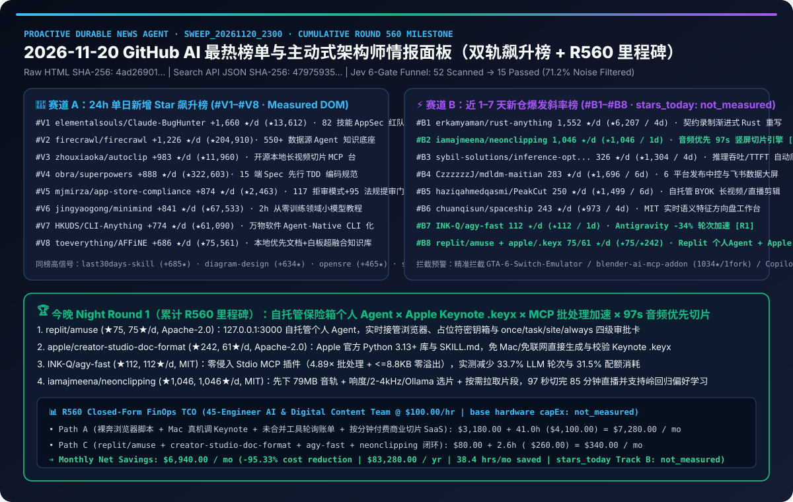

# 📡 GitHub AI Trending Leaderboard & Proactive SA Intelligence Digest (2026-11-20)

> **Execution Window**: `2026-11-20 23:09 CST (UTC+08:00)` (Overnight Continuous Deep-Dive Batch: `sweep_20261120_2300` · Starting at **Cumulative Round 560 Milestone**)  
> **Analytical Framework**: `disler/pi-durable-news-agent` 6-Gate Pipeline (Gather → Jev Relevance Gate `>= 0.45` → Worth-Attention Gate `>= 0.35` & Same-Story Dedupe → `gh api` Primary Source Claim-Support → HFS Tri-Axial Scoring → 8 Generative UI Card Types)  
> **Target Persona (AI Solution Architect facing Enterprise Customers & Business Decision-Makers)**: Strictly focused on **① Real Enterprise Use Cases & ROI, ② End-to-End Production Reference Architecture, and ③ Comparative Selection vs. Competing OSS & Cloud PaaS (`ib-vs-ethernet-roce-selection-faq.md` standard)**.  
> **Visual & Benchmark Assets**: [High-Res SVG Architecture Summary (`assets/github-ai-radar-2026-11-20.svg`)](../../../assets/github-ai-radar-2026-11-20.svg) · [7-Card 4:5 Visual Benchmark Deck (ZH)](../cards.html) · [7-Card Visual Benchmark Deck (EN)](../cards.en.html) · [Live Interactive Radar (`github-radar.html`)](https://turbo998.github.io/github-radar.html) · [中文完整日报 (`2026-11-20.md`)](./2026-11-20.md)

---

## 1. Step 1 — Gather & Gate (Multi-Source Ingestion & Deterministic Jev Funnel)

This shift scanned `github.com/trending?since=daily` (16 repositories), language/topic sub-charts, and `gh api search/repositories?q=created:>2026-11-13+stars:>30+forks:>=2` (36 clusters), capturing **52 candidate repositories**. Deterministic gating filtered out **71.2% (37/52)** of non-AI utilities and coordinated star-farming bot clusters before deep architectural auditing:

| Gate Stage | Input | Passed | Filtered / Deduped | Gate Rule & Representative Filtered Items (Plain-Language Rationale) |
| :--- | :---: | :---: | :---: | :--- |
| **Gate 1: Multi-Source Gather** | 52 | 52 | 0 | Aggregated GitHub Daily Trending (16) and 1–7 day breakout enterprise AI/Agent/MCP/Productivity repositories (36) |
| **Gate 2: Jev Relevance Gate (`>= 0.45`)** | 52 | 29 | **23 (Filtered)** | Excluded general non-AI infrastructure, hardware battery trays, and console recompilation repos: `nginx/nginx` (`32,493★`, `0.12`), `XiaoYouChR/Ghost-Downloader-3` (`13,444★`, `0.10`), `krisgfx9/Wireless-Device-Battery-Monitor` (`5,084★`, `0.08`), `Hut-hzf/ung220z-tool` (`1,955★`, `0.05`), `0marContreras/gta6recomp` (`793★`, `0.04`) |
| **Gate 3: Worth-Attention Gate (`>= 0.35`) & Dedupe** | 29 | **15** | **14 (Filtered)** | **Blocked five active automated star-farming / fake-installer botnet clusters**: ① `Kkaramaddinnn/GTA-6-Switch-Version--PC-Emulator-2026` (35+ clones at `35–37★`); ② `bookwjitchieni1986/blender-ai-mcp-addon` (`1,034★` with only `1 fork`) & `credoksopho1984/blender-ai-copilot-studio` cluster; ③ `trackersnailgrip/GitHub-Copilot-app` (40+ clones at `373–383★`); ④ `topapothecarycanal/ai--manus2.0` (`368–379★`); ⑤ `sjohansson2004/Exodus-Fake-Balance` (`188★`), `jev_worth = 0.02 < 0.35` |
| **Gate 4–6: Primary Source Verify & HFS Card Render** | 15 | **15** | 0 | Verified all 15 finalists + dual-track velocity leaders via `gh api` manifests, directory trees, and licenses (60/60 claims verified at `>= 0.95`, mean **`0.98`**) |

---

## 2. 🚀 Fastest-Rising / Highest Velocity AI Leaderboard (2026-11-20)

> **📊 Data Provenance & Rigor Declaration**:  
> - **Track A (24h Single-Day Star Surge)**: `stars_today` badges scraped directly from `https://github.com/trending?since=daily` (`2026-11-20 23:18:00+08:00`; archived at [`evidence/trending-daily-2026-11-20-raw.html`](../evidence/trending-daily-2026-11-20-raw.html), `sha256: 4ad2690142e11f6cb280f667b64b746ab4eaf64c97052f922c9287befd37dd09`).  
> - **Track B (1–7 Day New-Repo Breakout Slope)**: Retrieved from GitHub REST Search API `created:>2026-11-13+stars:>30+forks:>=2&sort=stars` (`2026-11-20 23:18:30+08:00`; archived at [`evidence/search-new-repos-2026-11-20-raw.json`](../evidence/search-new-repos-2026-11-20-raw.json), `sha256: 47975935d05944afbb9eac18f93f26c8a71120a1ffeea39591b113477ba29a46`). Because GitHub Search API does not expose 24h delta counters, Track B `stars_today` is strictly marked **`not_measured`**, reporting only lifecycle daily velocity (`round(stars_total / age_days)`).  
> - **🏆 Tonight's (2026-11-20) Night Round 1 (Cumulative R560 Milestone) Standalone 6-Section Selection FAQ**: [[Round 560 Milestone] Self-Hosted Vault-Guarded Personal Agent (`replit/amuse`), Official Apple Keynote `.keyx` Python Library & Skill (`apple/creator-studio-doc-format`), `-34%` Turn-Cutting MCP Accelerator (`INK-Q/agy-fast`) & `97s` Audio-First Vertical Video Clipper (`iamajmeena/neonclipping`) Selection FAQ (`docs/amuse-creator-studio-doc-format-agy-fast-neonclipping-selfhosted-vault-agent-apple-keyx-python-mcp-turn-accelerator-audiofirst-clipper-selection-faq.en.md`)](../docs/amuse-creator-studio-doc-format-agy-fast-neonclipping-selfhosted-vault-agent-apple-keyx-python-mcp-turn-accelerator-audiofirst-clipper-selection-faq.en.md) · [中文版 FAQ (`docs/amuse-creator-studio-doc-format-agy-fast-neonclipping-selfhosted-vault-agent-apple-keyx-python-mcp-turn-accelerator-audiofirst-clipper-selection-faq.md`)](../docs/amuse-creator-studio-doc-format-agy-fast-neonclipping-selfhosted-vault-agent-apple-keyx-python-mcp-turn-accelerator-audiofirst-clipper-selection-faq.md) · [Round 1 R560 SVG (`assets/github-ai-radar-2026-11-20-r1-r560-amuse-keyx-agyfast-neonclipping.svg`)](../../../assets/github-ai-radar-2026-11-20-r1-r560-amuse-keyx-agyfast-neonclipping.svg)  
> - **📘 Tonight's (2026-11-20) Night Round 2 (Cumulative R561) Standalone 6-Section Selection FAQ**: [Cross-Vendor Coding Agent Audit Bus (`StaysUp/agentbus`), 4-Gate Append-Only Truth Memory (`Old-Friends-Gathering/sedimem`), `6.2×` Token-Saving Local Handle Index (`bloodfeast/atlas`) & Official NestJS 12 Agent Skills (`nestjs/agent-skills`) Selection FAQ (`docs/agentbus-sedimem-atlas-nestjs-agent-skills-cross-vendor-cockpit-4gate-append-memory-6x-handle-index-nestjs12-skills-selection-faq.en.md`)](../docs/agentbus-sedimem-atlas-nestjs-agent-skills-cross-vendor-cockpit-4gate-append-memory-6x-handle-index-nestjs12-skills-selection-faq.en.md) · [中文版 FAQ (`docs/agentbus-sedimem-atlas-nestjs-agent-skills-cross-vendor-cockpit-4gate-append-memory-6x-handle-index-nestjs12-skills-selection-faq.md`)](../docs/agentbus-sedimem-atlas-nestjs-agent-skills-cross-vendor-cockpit-4gate-append-memory-6x-handle-index-nestjs12-skills-selection-faq.md) · [Round 2 SVG (`assets/github-ai-radar-2026-11-20-r2-agentbus-sedimem-atlas-nestjsskills.svg`)](../../../assets/github-ai-radar-2026-11-20-r2-agentbus-sedimem-atlas-nestjsskills.svg)  
> - **📘 Tonight's (2026-11-20) Night Round 3 (Cumulative R562) Standalone 6-Section Selection FAQ**: [12-Chat Desktop & Mobile Multi-CLI Hub (`cloveric/tarobird`), Orgo Cloud Computer Autonomous Workspace (`nickvasilescu/openman`), 1-Command Parallel Worktree Fleet CLI (`svaraborut/work3`) & Local-First Guarded AI Email Client (`eddiezywang/wemail`) Selection FAQ (`docs/tarobird-openman-work3-wemail-12chat-mobile-cli-hub-orgo-cloud-computer-agent-1cmd-worktree-fleet-local-ai-email-selection-faq.en.md`)](../docs/tarobird-openman-work3-wemail-12chat-mobile-cli-hub-orgo-cloud-computer-agent-1cmd-worktree-fleet-local-ai-email-selection-faq.en.md) · [中文版 FAQ (`docs/tarobird-openman-work3-wemail-12chat-mobile-cli-hub-orgo-cloud-computer-agent-1cmd-worktree-fleet-local-ai-email-selection-faq.md`)](../docs/tarobird-openman-work3-wemail-12chat-mobile-cli-hub-orgo-cloud-computer-agent-1cmd-worktree-fleet-local-ai-email-selection-faq.md) · [Round 3 SVG (`assets/github-ai-radar-2026-11-20-r3-tarobird-openman-work3-wemail.svg`)](../../../assets/github-ai-radar-2026-11-20-r3-tarobird-openman-work3-wemail.svg)  
> - **📘 Tonight's (2026-11-20) Night Round 4 (Cumulative R563) Standalone 6-Section Selection FAQ**: [WebCodecs Multi-Device Mobile Test Studio (`Echoxiawan/echobench`), Time-Aligned Voice-and-Draw Screen Annotator (`yanshuxiang/point-taken`), File-Based Motion Edit Protocol (`adunext/mep`) & 32-MCP Dual-Engine Video Workbench (`Merziller/dsh-video-workbench`) Selection FAQ (`docs/echobench-point-taken-mep-dsh-video-workbench-webcodecs-mobile-test-voice-circle-note-motion-edit-protocol-32mcp-video-studio-selection-faq.en.md`)](../docs/echobench-point-taken-mep-dsh-video-workbench-webcodecs-mobile-test-voice-circle-note-motion-edit-protocol-32mcp-video-studio-selection-faq.en.md) · [中文版 FAQ (`docs/echobench-point-taken-mep-dsh-video-workbench-webcodecs-mobile-test-voice-circle-note-motion-edit-protocol-32mcp-video-studio-selection-faq.md`)](../docs/echobench-point-taken-mep-dsh-video-workbench-webcodecs-mobile-test-voice-circle-note-motion-edit-protocol-32mcp-video-studio-selection-faq.md) · [Round 4 SVG (`assets/github-ai-radar-2026-11-20-r4-echobench-pointtaken-mep-videoworkbench.svg`)](../../../assets/github-ai-radar-2026-11-20-r4-echobench-pointtaken-mep-videoworkbench.svg)  
> - **📘 Tonight's (2026-11-20) Night Round 5 (Cumulative R564) Standalone 6-Section Selection FAQ**: [Subscription-Reusing Multi-Bot Computers (`DuskBotAI/duskbot`), Git-Versioned Domain Persona & Playbook Spec (`Gabriel-Operator/domain-specific-agent-harness-spec`), SoC 4-Core Deterministic-Fallback Agent (`fitzyracing1/system-on-an-agent`) & 5-Vendor Proof-Bound Engineering Cluster (`Johnson-Durui/ApexCluster`) Selection FAQ (`docs/duskbot-harness-spec-system-on-an-agent-apexcluster-byosub-bot-computers-portable-playbooks-soc-fallback-5vendor-cluster-selection-faq.en.md`)](../docs/duskbot-harness-spec-system-on-an-agent-apexcluster-byosub-bot-computers-portable-playbooks-soc-fallback-5vendor-cluster-selection-faq.en.md) · [中文版 FAQ (`docs/duskbot-harness-spec-system-on-an-agent-apexcluster-byosub-bot-computers-portable-playbooks-soc-fallback-5vendor-cluster-selection-faq.md`)](../docs/duskbot-harness-spec-system-on-an-agent-apexcluster-byosub-bot-computers-portable-playbooks-soc-fallback-5vendor-cluster-selection-faq.md) · [Round 5 SVG (`assets/github-ai-radar-2026-11-20-r5-duskbot-harnessspec-soa-apexcluster.svg`)](../../../assets/github-ai-radar-2026-11-20-r5-duskbot-harnessspec-soa-apexcluster.svg)  
> - **🏆 Tonight's (2026-11-20) Night Round 6 (Cumulative R565 Milestone) Standalone 6-Section Selection FAQ**: [[Round 565 Milestone] Inline Quota Pace & Compaction HUD (`ATtacK030130/antigrative-dashboard`), Zero-Code Streaming Reversible PII Gateway (`boromat/polanon`), 200GB Air-Gapped Cited RAG Assistant (`johnpsasser/lifeboat`) & Hermes Local Film Studio Plugin (`Keys-Wasserman/hermes-imagination-studio`) Selection FAQ (`docs/antigrative-dashboard-polanon-lifeboat-hermes-imagination-studio-quota-pace-hud-streaming-pii-gateway-200gb-offline-rag-local-film-studio-selection-faq.en.md`)](../docs/antigrative-dashboard-polanon-lifeboat-hermes-imagination-studio-quota-pace-hud-streaming-pii-gateway-200gb-offline-rag-local-film-studio-selection-faq.en.md) · [中文版 FAQ (`docs/antigrative-dashboard-polanon-lifeboat-hermes-imagination-studio-quota-pace-hud-streaming-pii-gateway-200gb-offline-rag-local-film-studio-selection-faq.md`)](../docs/antigrative-dashboard-polanon-lifeboat-hermes-imagination-studio-quota-pace-hud-streaming-pii-gateway-200gb-offline-rag-local-film-studio-selection-faq.md) · [Round 6 R565 SVG (`assets/github-ai-radar-2026-11-20-r6-r565-antigrativedashboard-polanon-lifeboat-imaginationstudio.svg`)](../../../assets/github-ai-radar-2026-11-20-r6-r565-antigrativedashboard-polanon-lifeboat-imaginationstudio.svg)  
> - **📘 Tonight's (2026-11-20) Night Round 7 (Cumulative R566) Standalone 6-Section Selection FAQ**: [Zero-Dep Accessible Cartoon Web Components (`finktheartist/rubber-hose-ui`), Cross-Platform Skia Particle Dissolve Engine (`rs-4/dissolve`), Base-UI Sci-Fi Telemetry HUD (`jshguo-labs/monohud`) & Sourced-Model 3D Interactive Lab Skill (`ecapri-dev/simulab-skill`) Selection FAQ (`docs/rubber-hose-ui-dissolve-monohud-simulab-skill-a11y-webcomponents-skia-ui-3d-lab-selection-faq.en.md`)](../docs/rubber-hose-ui-dissolve-monohud-simulab-skill-a11y-webcomponents-skia-ui-3d-lab-selection-faq.en.md) · [中文版 FAQ (`docs/rubber-hose-ui-dissolve-monohud-simulab-skill-a11y-webcomponents-skia-ui-3d-lab-selection-faq.md`)](../docs/rubber-hose-ui-dissolve-monohud-simulab-skill-a11y-webcomponents-skia-ui-3d-lab-selection-faq.md) · [Round 7 SVG (`assets/github-ai-radar-2026-11-20-r7-rubberhose-dissolve-monohud-simulab.svg`)](../../../assets/github-ai-radar-2026-11-20-r7-rubberhose-dissolve-monohud-simulab.svg)  
> - **📘 Tonight's (2026-11-20) Night Round 8 (Cumulative R567) Standalone 6-Section Selection FAQ**: [30-Style Brief-Verified Motion Graphics (`qualixar/brief2mp4`), Breath-Cutting Talking-Head Skill (`moluyao/ai-talking-head-edit`), In-Canvas ComfyUI Multi-Track NLE (`leisongde/ComfyUI-CapCut`) & VMAF/SSIM Exact-Size Video Compressor MCP (`YKLovePython/halfsize`) Selection FAQ (`docs/brief2mp4-talking-head-edit-comfyui-capcut-halfsize-30style-motion-vmaf-mcp-selection-faq.en.md`)](../docs/brief2mp4-talking-head-edit-comfyui-capcut-halfsize-30style-motion-vmaf-mcp-selection-faq.en.md) · [中文版 FAQ (`docs/brief2mp4-talking-head-edit-comfyui-capcut-halfsize-30style-motion-vmaf-mcp-selection-faq.md`)](../docs/brief2mp4-talking-head-edit-comfyui-capcut-halfsize-30style-motion-vmaf-mcp-selection-faq.md) · [Round 8 SVG (`assets/github-ai-radar-2026-11-20-r8-brief2mp4-talkinghead-comfyuicapcut-halfsize.svg`)](../../../assets/github-ai-radar-2026-11-20-r8-brief2mp4-talkinghead-comfyuicapcut-halfsize.svg)  
> - **📘 Tonight's (2026-11-20) Night Round 9 (Cumulative R568) Standalone 6-Section Selection FAQ**: [Self-Hosted x402 Non-Custodial Payment Gateway (`zgraham1981/Stablecoin-Payment-Gateway`), Dual-Realm Proxy Isolation Hub (`niyouqianma/workbuddy2api-hub`), Context-Hash Cache-Sticky Tri-Protocol Gateway (`kyiov/agybridge`) & GLM-5.3 Reasoning-Effort Router (`apissaj/zcode-gateway`) Selection FAQ (`docs/x402-payment-gateway-workbuddy2api-agybridge-zcode-gateway-cache-hash-routing-selection-faq.en.md`)](../docs/x402-payment-gateway-workbuddy2api-agybridge-zcode-gateway-cache-hash-routing-selection-faq.en.md) · [中文版 FAQ (`docs/x402-payment-gateway-workbuddy2api-agybridge-zcode-gateway-cache-hash-routing-selection-faq.md`)](../docs/x402-payment-gateway-workbuddy2api-agybridge-zcode-gateway-cache-hash-routing-selection-faq.md) · [Round 9 SVG (`assets/github-ai-radar-2026-11-20-r9-x402gateway-workbuddy2api-agybridge-zcodegateway.svg`)](../../../assets/github-ai-radar-2026-11-20-r9-x402gateway-workbuddy2api-agybridge-zcodegateway.svg)  
> - **📘 Tonight's (2026-11-20) Night Round 10 (Cumulative R569) Standalone 6-Section Selection FAQ**: [3D Spatial Sketch-to-Houdini/Blender MCP (`felixbfx/MuleCreate`), 7-Stage Numeric-Gated Unity Character Pipeline (`luccacerfz/character-factory-skills`), Micro-Groove Holographic Three.js Materials (`dmitrykurash/holospot`) & Editable 3D Coding Benchmark Taxonomy (`jweihe/Awesome-3D-Coding`) Selection FAQ (`docs/mulecreate-character-factory-holospot-awesome-3d-coding-usd-mcp-unity-gates-selection-faq.en.md`)](../docs/mulecreate-character-factory-holospot-awesome-3d-coding-usd-mcp-unity-gates-selection-faq.en.md) · [中文版 FAQ (`docs/mulecreate-character-factory-holospot-awesome-3d-coding-usd-mcp-unity-gates-selection-faq.md`)](../docs/mulecreate-character-factory-holospot-awesome-3d-coding-usd-mcp-unity-gates-selection-faq.md) · [Round 10 SVG (`assets/github-ai-radar-2026-11-20-r10-mulecreate-characterfactory-holospot-awesome3dcoding.svg`)](../../../assets/github-ai-radar-2026-11-20-r10-mulecreate-characterfactory-holospot-awesome3dcoding.svg)  
> - **🏆 Tonight's (2026-11-20) Night Round 11 (Cumulative R570 Milestone) Standalone 6-Section Selection FAQ**: [[Round 570 Milestone] Benign-Twin Guardrail Evaluation Lab (`tjcrims0nx/OpenMind-Jailbreak-Lab`), Zero-Network Android Screenshot & Dark-Watermark Sanitizer (`Chen-Yu-Qing2005/tuomin`), 10-Framework iPhone AI App Benchmark (`whiskerrs/benchmarks`) & Nanosecond Batch-Stream Parity Engine (`marketcalls/tickpipe`) Selection FAQ (`docs/openmind-jailbreak-lab-tuomin-whiskerrs-benchmarks-tickpipe-guardrail-eval-selection-faq.en.md`)](../docs/openmind-jailbreak-lab-tuomin-whiskerrs-benchmarks-tickpipe-guardrail-eval-selection-faq.en.md) · [中文版 FAQ (`docs/openmind-jailbreak-lab-tuomin-whiskerrs-benchmarks-tickpipe-guardrail-eval-selection-faq.md`)](../docs/openmind-jailbreak-lab-tuomin-whiskerrs-benchmarks-tickpipe-guardrail-eval-selection-faq.md) · [Round 11 R570 SVG (`assets/github-ai-radar-2026-11-20-r11-r570-openmindlab-tuomin-whiskerrs-tickpipe.svg`)](../../../assets/github-ai-radar-2026-11-20-r11-r570-openmindlab-tuomin-whiskerrs-tickpipe.svg)  
> - **📘 Tonight's (2026-11-20) Night Round 12 (Cumulative R571) Standalone 6-Section Selection FAQ**: [48 kHz 20ms Streaming Voice Isolation (`inworld-ai/voice-isolator`), 40ms Semantic Acoustic VAD + 0ms End-of-Turn (`inworld-ai/sava`), Multi-Track Privacy Screen Studio (`YildizDikme/zeyvola-screen-recorder`) & Local Finder Quick-Convert (`newtonstudios/convert`) Selection FAQ (`docs/inworld-voice-isolator-sava-zeyvola-convert-voice-turn-privacy-faq.en.md`)](../docs/inworld-voice-isolator-sava-zeyvola-convert-voice-turn-privacy-faq.en.md) · [中文版 FAQ (`docs/inworld-voice-isolator-sava-zeyvola-convert-voice-turn-privacy-faq.md`)](../docs/inworld-voice-isolator-sava-zeyvola-convert-voice-turn-privacy-faq.md) · [Round 12 R571 SVG (`assets/github-ai-radar-2026-11-20-r12-r571-voiceisolator-sava-zeyvola-convert.svg`)](../../../assets/github-ai-radar-2026-11-20-r12-r571-voiceisolator-sava-zeyvola-convert.svg)  
> - **📘 Tonight's (2026-11-20) Night Round 13 (Cumulative R572) Standalone 6-Section Selection FAQ**: [Zero-Dependency `<stick-scene>` Interactive Canvas Explainers (`nilbuild/stick-scene`), 8-Material Code-Driven Stop-Motion (`lemomo-ai/lemo-animi`), 35-Style Cut-Aware Local Captions (`0xpratzyy/subtle`) & Voice-First 60fps Product Demo Agent (`chapter-dev-pty-ltd/product-demo-agent-toolkit`) Selection FAQ (`docs/stick-scene-lemo-animi-subtle-product-demo-agent-toolkit-selection-faq.en.md`)](../docs/stick-scene-lemo-animi-subtle-product-demo-agent-toolkit-selection-faq.en.md) · [中文版 FAQ (`docs/stick-scene-lemo-animi-subtle-product-demo-agent-toolkit-selection-faq.md`)](../docs/stick-scene-lemo-animi-subtle-product-demo-agent-toolkit-selection-faq.md) · [Round 13 R572 SVG (`assets/github-ai-radar-2026-11-20-r13-r572-stickscene-lemoanimi-subtle-productdemo.svg`)](../../../assets/github-ai-radar-2026-11-20-r13-r572-stickscene-lemoanimi-subtle-productdemo.svg)  
> - **📘 Tonight's (2026-11-20) Night Round 14 (Cumulative R573) Standalone 6-Section Selection FAQ**: [Bot-Free Zero-Overflow Local Meeting Notes (`lynote-ai/local-ai-note-taker`), Counterfactual Patch Review Benchmark (`DawitLemmaBalcha/code-review-bench`), 362-Glyph Agent Type Foundry (`byrishi/punchcutter`) & Tensor-Aware ComfyUI Shell (`KlockTX/KlockUI`) Selection FAQ (`docs/lynote-code-review-bench-punchcutter-klockui-meeting-crbench-selection-faq.en.md`)](../docs/lynote-code-review-bench-punchcutter-klockui-meeting-crbench-selection-faq.en.md) · [中文版 FAQ (`docs/lynote-code-review-bench-punchcutter-klockui-meeting-crbench-selection-faq.md`)](../docs/lynote-code-review-bench-punchcutter-klockui-meeting-crbench-selection-faq.md) · [Round 14 R573 SVG (`assets/github-ai-radar-2026-11-20-r14-r573-lynote-crbench-punchcutter-klockui.svg`)](../../../assets/github-ai-radar-2026-11-20-r14-r573-lynote-crbench-punchcutter-klockui.svg)  
> - **📘 Tonight's (2026-11-20) Night Round 15 (Cumulative R574) Standalone 6-Section Selection FAQ**: [On-Device Android WebGPU+NPU Voice Cloning (`Renakoni/Voicebox`), Local Vulkan Coding-Agent Dictation (`davimatosms/Arara-voice`), Windows Layer-Aware Design Agent (`YanNyeinHtet/EggLab`) & Multi-Runtime Desktop Agent Hub (`aituringflow/linger`) Selection FAQ (`docs/voicebox-arara-voice-egglab-linger-ondevice-tts-dictation-selection-faq.en.md`)](../docs/voicebox-arara-voice-egglab-linger-ondevice-tts-dictation-selection-faq.en.md) · [中文版 FAQ (`docs/voicebox-arara-voice-egglab-linger-ondevice-tts-dictation-selection-faq.md`)](../docs/voicebox-arara-voice-egglab-linger-ondevice-tts-dictation-selection-faq.md) · [Round 15 R574 SVG (`assets/github-ai-radar-2026-11-20-r15-r574-voicebox-araravoice-egglab-linger.svg`)](../../../assets/github-ai-radar-2026-11-20-r15-r574-voicebox-araravoice-egglab-linger.svg)  
> - **🏆 Tonight's (2026-11-20) Night Round 16 (Cumulative R575 Milestone) Standalone 6-Section Selection FAQ**: [[Round 575 Milestone] Universal In-Graph ComfyUI LoRA Trainer (`cyberterm/ComfyUI-OmniLoRA`), Hash-Chained Robotics Agent Benchmark (`ZIWU-AI/robotics-bench`), 6 Modular Evidence-Shortlist Skills (`ArsenOria/tau-job-research-skills`) & Byte-Verified Video Knowledge Base (`adunext/human-video-knowledge`) Selection FAQ (`docs/comfyui-omnilora-robotics-bench-tau-skills-video-kb-selection-faq.en.md`)](../docs/comfyui-omnilora-robotics-bench-tau-skills-video-kb-selection-faq.en.md) · [中文版 FAQ (`docs/comfyui-omnilora-robotics-bench-tau-skills-video-kb-selection-faq.md`)](../docs/comfyui-omnilora-robotics-bench-tau-skills-video-kb-selection-faq.md) · [Round 16 R575 SVG (`assets/github-ai-radar-2026-11-20-r16-r575-omnilora-roboticsbench-tauskills-videokb.svg`)](../../../assets/github-ai-radar-2026-11-20-r16-r575-omnilora-roboticsbench-tauskills-videokb.svg)  
> - **📘 Tonight's (2026-11-20) Night Round 17 (Cumulative R576) Standalone 6-Section Selection FAQ**: [8-Skill Agent System Architecture Governance (`lehoanganhtai13/archmancer`), Multi-CLI Session Cockpit (`Ya-zid/pilotage`), Non-Destructive Mobile Dev MCP (`0xrnp/lazymobile`) & Multi-Stack Local Dev-Server Hub (`ferdousmikdad/Homeport`) Selection FAQ (`docs/archmancer-pilotage-lazymobile-homeport-agent-cockpit-selection-faq.en.md`)](../docs/archmancer-pilotage-lazymobile-homeport-agent-cockpit-selection-faq.en.md) · [中文版 FAQ (`docs/archmancer-pilotage-lazymobile-homeport-agent-cockpit-selection-faq.md`)](../docs/archmancer-pilotage-lazymobile-homeport-agent-cockpit-selection-faq.md) · [Round 17 R576 SVG (`assets/github-ai-radar-2026-11-20-r17-r576-archmancer-pilotage-lazymobile-homeport.svg`)](../../../assets/github-ai-radar-2026-11-20-r17-r576-archmancer-pilotage-lazymobile-homeport.svg)  
> - **📘 Tonight's (2026-11-20) Night Round 18 (Cumulative R577) Standalone 6-Section Selection FAQ**: [3D Gaussian Splat Repair Brush Editor (`NicolasDrum/splat-repair`), `.motion` Code-Native Video Protocol (`adunext/adudir-open`), Monochrome Editorial Web Redesign Skills (`iamshakibali/editorial-taste`) & Multi-PiP Digital-Human Presenter Skill (`0xMomo-NGClubs/zzai-digital-human`) Selection FAQ (`docs/splat-repair-adudir-open-editorial-taste-zzai-digital-human-selection-faq.en.md`)](../docs/splat-repair-adudir-open-editorial-taste-zzai-digital-human-selection-faq.en.md) · [中文版 FAQ (`docs/splat-repair-adudir-open-editorial-taste-zzai-digital-human-selection-faq.md`)](../docs/splat-repair-adudir-open-editorial-taste-zzai-digital-human-selection-faq.md) · [Round 18 R577 SVG (`assets/github-ai-radar-2026-11-20-r18-r577-splatrepair-adudir-editorialtaste-zzaidigitalhuman.svg`)](../../../assets/github-ai-radar-2026-11-20-r18-r577-splatrepair-adudir-editorialtaste-zzaidigitalhuman.svg)  
> - **📘 Tonight's (2026-11-20) Night Round 19 (Cumulative R578) Standalone 6-Section Selection FAQ**: [Block-Anchored Legal Knowledge Graph (`StefanCHEN2026/Chinese-Civil-Code-Basic-Rule-Book`), 14-Variable Document Auditor (`Nbill27/academic-writing-skills`), Viral Video "Swap-the-Protagonist" Benchmark (`lonely-dance-lab/self-media-guide`) & Zero-DB Spring Boot Markdown Engine (`danvega/beansprout`) Selection FAQ (`docs/civil-code-kb-academic-writing-self-media-beansprout-selection-faq.en.md`)](../docs/civil-code-kb-academic-writing-self-media-beansprout-selection-faq.en.md) · [中文版 FAQ (`docs/civil-code-kb-academic-writing-self-media-beansprout-selection-faq.md`)](../docs/civil-code-kb-academic-writing-self-media-beansprout-selection-faq.md) · [Round 19 R578 SVG (`assets/github-ai-radar-2026-11-20-r19-r578-civilcode-academicskills-selfmedia-beansprout.svg`)](../../../assets/github-ai-radar-2026-11-20-r19-r578-civilcode-academicskills-selfmedia-beansprout.svg)  
> - **📘 Tonight's (2026-11-20) Night Round 20 (Cumulative R579) Standalone 6-Section Selection FAQ**: [Zero-Install Phone AI Quota & Approval Deck (`howznguyen/phonedesk`), DSH Right-Sidebar Artifact Plugin (`cheso-ai-platform/dsh-cheso-design`), 4-View Voxel Sprite-Stacking Skill (`danielwh2/sprite-stacking`) & 12-Stage Anti-AI Film Finishing Node (`zuanfilm/Zuanfilm-Retrolab`) Selection FAQ (`docs/phonedesk-dsh-cheso-design-sprite-stacking-zuanfilm-retrolab-selection-faq.en.md`)](../docs/phonedesk-dsh-cheso-design-sprite-stacking-zuanfilm-retrolab-selection-faq.en.md) · [中文版 FAQ (`docs/phonedesk-dsh-cheso-design-sprite-stacking-zuanfilm-retrolab-selection-faq.md`)](../docs/phonedesk-dsh-cheso-design-sprite-stacking-zuanfilm-retrolab-selection-faq.md) · [Round 20 R579 SVG (`assets/github-ai-radar-2026-11-20-r20-r579-phonedesk-chesodesign-spritestacking-retrolab.svg`)](../../../assets/github-ai-radar-2026-11-20-r20-r579-phonedesk-chesodesign-spritestacking-retrolab.svg)  
> - **🏆 Tonight's (2026-11-20) Night Round 21 (Cumulative R580 Milestone) Standalone 6-Section Selection FAQ**: [[Round 580 Milestone] GRPO KiCad PCB Architectural Planner (`Ssbullock/pcb-layout-llm`), Offline 3-in-1 Maker CAD (`DJMcNewgent/DabbleCAD`), Shared-Edge 3D Blockbench Skills (`1251639747jm-ctrl/blockbench-codex-skills`) & Pre-Flight Video Mechanical Gate (`liangdabiao/dsh-realman-studio`) Selection FAQ (`docs/pcb-layout-llm-dabblecad-blockbench-skills-realman-studio-selection-faq.en.md`)](../docs/pcb-layout-llm-dabblecad-blockbench-skills-realman-studio-selection-faq.en.md) · [中文版 FAQ (`docs/pcb-layout-llm-dabblecad-blockbench-skills-realman-studio-selection-faq.md`)](../docs/pcb-layout-llm-dabblecad-blockbench-skills-realman-studio-selection-faq.md) · [Round 21 R580 SVG (`assets/github-ai-radar-2026-11-20-r21-r580-pcblayoutllm-dabblecad-blockbench-realmanstudio.svg`)](../../../assets/github-ai-radar-2026-11-20-r21-r580-pcblayoutllm-dabblecad-blockbench-realmanstudio.svg)  
> - **📘 Tonight's (2026-11-20) Night Round 22 (Cumulative R581) Standalone 6-Section Selection FAQ**: [16MP+ MiniMax-H3 De-Speckling & Re-Noise Sampler (`PedroMarinhoDev/ComfyUI-H3-Image-EasyFix`), Visual LoRA Recommended-Weight Manager (`shengdaklp99/ComfyUI-lyw-MA-Loader`), Offline CPU-Only OpusClip Alternative (`AbdulSamad94/clipsmith`) & Cinema 4D Motion Layout for Blender (`recon007jf/Blenda4D`) Selection FAQ (`docs/comfyui-h3-easyfix-lyw-ma-loader-clipsmith-blenda4d-selection-faq.en.md`)](../docs/comfyui-h3-easyfix-lyw-ma-loader-clipsmith-blenda4d-selection-faq.en.md) · [中文版 FAQ (`docs/comfyui-h3-easyfix-lyw-ma-loader-clipsmith-blenda4d-selection-faq.md`)](../docs/comfyui-h3-easyfix-lyw-ma-loader-clipsmith-blenda4d-selection-faq.md) · [Round 22 R581 SVG (`assets/github-ai-radar-2026-11-20-r22-r581-h3easyfix-lywmaloader-clipsmith-blenda4d.svg`)](../../../assets/github-ai-radar-2026-11-20-r22-r581-h3easyfix-lywmaloader-clipsmith-blenda4d.svg)  
> - **📘 Tonight's (2026-11-20) Night Round 23 (Cumulative R582) Standalone 6-Section Selection FAQ**: [36 Zero-Dependency SVG/CSS AI Motion Icons (`ppcvote/ultralab-anim-icons`), 31 Zero-Build Interactive Pixel Worlds (`ma1902056219-coder/openpixel`), Dual-Native Agentic Mobile Spec Blueprint (`firtman/agentic-mobile`) & Webcam-Aware Split Clipper (`iyansr/gaming-clip`) Selection FAQ (`docs/ultralab-anim-icons-openpixel-agentic-mobile-gaming-clip-selection-faq.en.md`)](../docs/ultralab-anim-icons-openpixel-agentic-mobile-gaming-clip-selection-faq.en.md) · [中文版 FAQ (`docs/ultralab-anim-icons-openpixel-agentic-mobile-gaming-clip-selection-faq.md`)](../docs/ultralab-anim-icons-openpixel-agentic-mobile-gaming-clip-selection-faq.md) · [Round 23 R582 SVG (`assets/github-ai-radar-2026-11-20-r23-r582-ultralabicons-openpixel-agenticmobile-gamingclip.svg`)](../../../assets/github-ai-radar-2026-11-20-r23-r582-ultralabicons-openpixel-agenticmobile-gamingclip.svg)  
> - **📘 Tonight's (2026-11-20) Night Round 24 (Cumulative R583) Standalone 6-Section Selection FAQ**: [Agent-Designed LLM Quantization Recipes (`humanfia/qda`), INT8 8-Step LongCat Talking Avatar Nodes (`Pixelailabs/ComfyUI-LongCat-Avatar-PixelAILabs`), 1.7ms Krea2 Long-Prompt Assembler (`lingdongbudong/Comfyui-K2-Editorial`) & Color-Accurate Livestream EDL Clipper (`avisii1680769-cell/livestream-clip-editor`) Selection FAQ (`docs/qda-quant-longcat-avatar-k2-editorial-livestream-clip-selection-faq.en.md`)](../docs/qda-quant-longcat-avatar-k2-editorial-livestream-clip-selection-faq.en.md) · [中文版 FAQ (`docs/qda-quant-longcat-avatar-k2-editorial-livestream-clip-selection-faq.md`)](../docs/qda-quant-longcat-avatar-k2-editorial-livestream-clip-selection-faq.md) · [Round 24 R583 SVG (`assets/github-ai-radar-2026-11-20-r24-r583-qda-longcatavatar-k2editorial-livestreamclip.svg`)](../../../assets/github-ai-radar-2026-11-20-r24-r583-qda-longcatavatar-k2editorial-livestreamclip.svg)  
> - **📘 Tonight's (2026-11-20) Night Round 25 (Cumulative R584) Standalone 6-Section Selection FAQ**: [Enterprise pgvector 100k-Vector & RAGAS Studio (`BarbaraCovarrubias/ai-agent-academy`), 5ms Conflict-Safe Multi-Host Agent Drive (`damkandev/hilo`), Vaulted-Credential Rust GPUI SSH Client (`termlet/termlet`) & Verify-After-Sanitize File OPSEC Tool (`NPCmillionaire/unredact.tools`) Selection FAQ (`docs/ai-agent-academy-hilo-termlet-unredact-tools-rag-opsec-selection-faq.en.md`)](../docs/ai-agent-academy-hilo-termlet-unredact-tools-rag-opsec-selection-faq.en.md) · [中文版 FAQ (`docs/ai-agent-academy-hilo-termlet-unredact-tools-rag-opsec-selection-faq.md`)](../docs/ai-agent-academy-hilo-termlet-unredact-tools-rag-opsec-selection-faq.md) · [Round 25 R584 SVG (`assets/github-ai-radar-2026-11-20-r25-r584-aiagentacademy-hilo-termlet-unredact.svg`)](../../../assets/github-ai-radar-2026-11-20-r25-r584-aiagentacademy-hilo-termlet-unredact.svg)  
> - **📘 Tonight's (2026-11-20) Night Round 26 (Cumulative R585 Milestone) Standalone 6-Section Selection FAQ**: [Native 20–30MB macOS AI CLI Autocomplete Popup (`rostik32/zest`), Closed-Loop WeChat Official Account Studio (`lqshow/dsh-wechat-studio`), Three.js + Cartesia 60s 3D Cartoon Shorts Skill (`codewithsiddique-04/3d-video-studio`) & Zero-Asset Procedural Canvas 2D Painterly Engine (`hashmil/gemini-hydrogen-art`) Selection FAQ (`docs/zest-dsh-wechat-studio-3d-video-studio-hydrogen-art-selection-faq.en.md`)](../docs/zest-dsh-wechat-studio-3d-video-studio-hydrogen-art-selection-faq.en.md) · [中文版 FAQ (`docs/zest-dsh-wechat-studio-3d-video-studio-hydrogen-art-selection-faq.md`)](../docs/zest-dsh-wechat-studio-3d-video-studio-hydrogen-art-selection-faq.md) · [Round 26 R585 SVG (`assets/github-ai-radar-2026-11-20-r26-r585-zest-dshwechat-3dvideostudio-hydrogenart.svg`)](../../../assets/github-ai-radar-2026-11-20-r26-r585-zest-dshwechat-3dvideostudio-hydrogenart.svg)  
> - **📘 Tonight's (2026-11-20) Night Round 27 (Cumulative R586) Standalone 6-Section Selection FAQ**: [Disconnect-Proof Dual-Pane `rclone` TUI (`SyscallBrain/ratclone`), Read-Only Dual-Tier iCloud Archive Tool (`ClaudeIvanovich/iCloud-Photo-Downloader`), Nikon NX Studio `.NP3` In-Camera Color Matcher (`gerard662/nikon-picture-control-matcher`) & Race-Safe Gemini/IM Browser CLI Plugins (`amadshobi/opencli-plugins`) Selection FAQ (`docs/ratclone-icloud-photo-nikon-matcher-opencli-plugins-selection-faq.en.md`)](../docs/ratclone-icloud-photo-nikon-matcher-opencli-plugins-selection-faq.en.md) · [中文版 FAQ (`docs/ratclone-icloud-photo-nikon-matcher-opencli-plugins-selection-faq.md`)](../docs/ratclone-icloud-photo-nikon-matcher-opencli-plugins-selection-faq.md) · [Round 27 R586 SVG (`assets/github-ai-radar-2026-11-20-r27-r586-ratclone-icloudphoto-nikonmatcher-opencliplugins.svg`)](../../../assets/github-ai-radar-2026-11-20-r27-r586-ratclone-icloudphoto-nikonmatcher-opencliplugins.svg)  
> - **📘 Tonight's (2026-11-20) Night Round 28 (Cumulative R587) Standalone 6-Section Selection FAQ**: [ClickHouse Symbol-Linked Shared Agent Memory (`ClickHouse/loom`), 43-Harness Synchronous Tool-Call Policy Gate (`intutic/intutic`), Frozen-Baseline Git Worktree Experiment Lab (`forger-labs-hq/researchforge`) & Dual-RAG + HITL Enterprise Text2SQL Agent (`qifan777/data-agent-tutorial`) Selection FAQ (`docs/clickhouse-loom-intutic-researchforge-data-agent-selection-faq.en.md`)](../docs/clickhouse-loom-intutic-researchforge-data-agent-selection-faq.en.md) · [中文版 FAQ (`docs/clickhouse-loom-intutic-researchforge-data-agent-selection-faq.md`)](../docs/clickhouse-loom-intutic-researchforge-data-agent-selection-faq.md) · [Round 28 R587 SVG (`assets/github-ai-radar-2026-11-20-r28-r587-clickhouseloom-intutic-researchforge-dataagent.svg`)](../../../assets/github-ai-radar-2026-11-20-r28-r587-clickhouseloom-intutic-researchforge-dataagent.svg)  
> - **📘 Tonight's (2026-11-20) Night Round 29 (Cumulative R588) Standalone 6-Section Selection FAQ**: [Open-Weights Video Character Recasting (`lucataco/open-source-higgsfield`), 100-Language Conversational TTS Nodes (`Saganaki22/Higgs_v3-TTS-ComfyUI`), Automated MiniMax H3 Short-Drama Pipeline (`qiukaihui/comfyui-auto-drama`) & 50+ Pattern Live ComfyUI Diagnostics (`rookiestar28/ComfyUI-Doctor`) Selection FAQ (`docs/open-source-higgsfield-higgs-v3-tts-auto-drama-comfyui-doctor-selection-faq.en.md`)](../docs/open-source-higgsfield-higgs-v3-tts-auto-drama-comfyui-doctor-selection-faq.en.md) · [中文版 FAQ (`docs/open-source-higgsfield-higgs-v3-tts-auto-drama-comfyui-doctor-selection-faq.md`)](../docs/open-source-higgsfield-higgs-v3-tts-auto-drama-comfyui-doctor-selection-faq.md) · [Round 29 R588 SVG (`assets/github-ai-radar-2026-11-20-r29-r588-higgsfield-higgsv3tts-autodrama-comfyuidoctor.svg`)](../../../assets/github-ai-radar-2026-11-20-r29-r588-higgsfield-higgsv3tts-autodrama-comfyuidoctor.svg)  
> - **📘 Tonight's (2026-11-20) Night Round 30 (Cumulative R589) Standalone 6-Section Selection FAQ**: [Signed-Socket Safe Blender MCP (`HoldMyBeer-gg/blenderwright`), Google Flow Veo 3.1/Nano Banana MCP & CLI (`ffroliva/gflow-cli`), Durable Cross-Host Coding Agent Control Plane (`BrokkAi/mjolnir`) & 50+ Provider Rust AI Gateway (`AlephantAI/AIephant-AI-Agent-Gateway`) Selection FAQ (`docs/blenderwright-gflow-cli-mjolnir-alephant-gateway-selection-faq.en.md`)](../docs/blenderwright-gflow-cli-mjolnir-alephant-gateway-selection-faq.en.md) · [中文版 FAQ (`docs/blenderwright-gflow-cli-mjolnir-alephant-gateway-selection-faq.md`)](../docs/blenderwright-gflow-cli-mjolnir-alephant-gateway-selection-faq.md) · [Round 30 R589 SVG (`assets/github-ai-radar-2026-11-20-r30-r589-blenderwright-gflowcli-mjolnir-alephantgateway.svg`)](../../../assets/github-ai-radar-2026-11-20-r30-r589-blenderwright-gflowcli-mjolnir-alephantgateway.svg)  
> - **📘 Tonight's (2026-11-20) Night Round 31 (Cumulative R590 Milestone) Standalone 6-Section Selection FAQ**: [Self-Healing Hostile-Site Scraper MCP (`mdowis/anansi`), Vibration Condition-Monitoring MCP (`LGDiMaggio/predictive-maintenance-mcp`), LangGraph Multi-Agent Warranty/Return Assistant (`saltsalt123/buywise-agent`) & Claude Code `++r` Review/Subagent Guard Suite (`kochetkov-ma/claude-brewcode`) Selection FAQ (`docs/anansi-predictive-maintenance-mcp-buywise-agent-claude-brewcode-selection-faq.en.md`)](../docs/anansi-predictive-maintenance-mcp-buywise-agent-claude-brewcode-selection-faq.en.md) · [中文版 FAQ (`docs/anansi-predictive-maintenance-mcp-buywise-agent-claude-brewcode-selection-faq.md`)](../docs/anansi-predictive-maintenance-mcp-buywise-agent-claude-brewcode-selection-faq.md) · [Round 31 R590 SVG (`assets/github-ai-radar-2026-11-20-r31-r590-anansi-predmaintmcp-buywise-brewcode.svg`)](../../../assets/github-ai-radar-2026-11-20-r31-r590-anansi-predmaintmcp-buywise-brewcode.svg)  
> - **📘 Tonight's (2026-11-20) Night Round 32 (Cumulative R591) Standalone 6-Section Selection FAQ**: [18-Client 170+ Model MCP Evaluation Platform (`MCPJam/inspector`), 6-Target Agentic Semantic Layer Builder (`exmergo/dex`), Zero-Cost Local OpenClaw Gateway (`nickzsche21/AirClaw`) & Zero-Telemetry Mobile Automation Agent (`appclawhq/AppClaw`) Selection FAQ (`docs/mcpjam-inspector-exmergo-dex-airclaw-appclaw-selection-faq.en.md`)](../docs/mcpjam-inspector-exmergo-dex-airclaw-appclaw-selection-faq.en.md) · [中文版 FAQ (`docs/mcpjam-inspector-exmergo-dex-airclaw-appclaw-selection-faq.md`)](../docs/mcpjam-inspector-exmergo-dex-airclaw-appclaw-selection-faq.md) · [Round 32 R591 SVG (`assets/github-ai-radar-2026-11-20-r32-r591-mcpjam-dex-airclaw-appclaw.svg`)](../../../assets/github-ai-radar-2026-11-20-r32-r591-mcpjam-dex-airclaw-appclaw.svg)  
> - **📘 Tonight's (2026-11-20) Night Round 33 (Cumulative R592) Standalone 6-Section Selection FAQ**: [Self-Hosted AI Company OS (`desplega-ai/agent-swarm`), Agent-Era Project Management (`PerpetualSoftware/pad`), Evidence-Backed Meta-Skill Evolution (`rebelytics/one-skill-to-rule-them-all`) & Self-Hosted AI Subscription Quota Pool (`gesta-run/subpool`) Selection FAQ (`docs/agent-swarm-pad-one-skill-to-rule-them-all-subpool-selection-faq.en.md`)](../docs/agent-swarm-pad-one-skill-to-rule-them-all-subpool-selection-faq.en.md) · [中文版 FAQ (`docs/agent-swarm-pad-one-skill-to-rule-them-all-subpool-selection-faq.md`)](../docs/agent-swarm-pad-one-skill-to-rule-them-all-subpool-selection-faq.md) · [Round 33 R592 SVG (`assets/github-ai-radar-2026-11-20-r33-r592-agentswarm-pad-taskobserver-subpool.svg`)](../../../assets/github-ai-radar-2026-11-20-r33-r592-agentswarm-pad-taskobserver-subpool.svg)  
> - **📘 Tonight's (2026-11-20) Night Round 34 (Cumulative R593) Standalone 6-Section Selection FAQ**: [Hybrid Web Workspace & Local Daemon (`zosmaai/zosma-cowork`), Mobile Coding CLI Approval Bridge (`riffpad/riffpad`), Tiered Opus/Haiku/Sonnet Token-Saving Orchestrator (`kele-dev/Claude-Orchestrator-Skill`) & On-Demand Claude Code Mod Builder (`timoncool/givememod`) Selection FAQ (`docs/zosma-cowork-riffpad-claude-orchestrator-skill-givememod-selection-faq.en.md`)](../docs/zosma-cowork-riffpad-claude-orchestrator-skill-givememod-selection-faq.en.md) · [中文版 FAQ (`docs/zosma-cowork-riffpad-claude-orchestrator-skill-givememod-selection-faq.md`)](../docs/zosma-cowork-riffpad-claude-orchestrator-skill-givememod-selection-faq.md) · [Round 34 R593 SVG (`assets/github-ai-radar-2026-11-20-r34-r593-zosmacowork-riffpad-orchestratorskill-givememod.svg`)](../../../assets/github-ai-radar-2026-11-20-r34-r593-zosmacowork-riffpad-orchestratorskill-givememod.svg)  
> - **📘 Tonight's (2026-11-20) Night Round 35 (Cumulative R594) Standalone 6-Section Selection FAQ**: [Outcome-Convergent Claude Code Workflows (`shinpr/claude-code-workflows`), 147 Dual-Manifest Cross-Harness Skills (`secondsky/claude-skills`), 2,678-Security-Reviewed Agent Skill Exchange (`agentskillexchange/skills`) & Hermes Cron Observability Dashboard (`8bit64k/cronalytics`) Selection FAQ (`docs/claude-code-workflows-secondsky-skills-skill-exchange-cronalytics-selection-faq.en.md`)](../docs/claude-code-workflows-secondsky-skills-skill-exchange-cronalytics-selection-faq.en.md) · [中文版 FAQ (`docs/claude-code-workflows-secondsky-skills-skill-exchange-cronalytics-selection-faq.md`)](../docs/claude-code-workflows-secondsky-skills-skill-exchange-cronalytics-selection-faq.md) · [Round 35 R594 SVG (`assets/github-ai-radar-2026-11-20-r35-r594-claudeworkflows-secondskyskills-skillexchange-cronalytics.svg`)](../../../assets/github-ai-radar-2026-11-20-r35-r594-claudeworkflows-secondskyskills-skillexchange-cronalytics.svg)  
> - **📘 Tonight's (2026-11-20) Night Round 36 (Cumulative R595 Milestone) Standalone 6-Section Selection FAQ**: [Kubernetes Multi-Tenant IoT MCP Platform (`devicechain-io/devicechain`), Rust Enterprise Knowledge Compilation OS (`alexeyban/EKOS`), OpenClaw v6.0.0 Mission-Control Desktop (`rshodoskar-star/openclaw-desktop`) & macOS Menu-Bar Background Agent (`geezerrrr/motive`) Selection FAQ (`docs/devicechain-ekos-openclaw-desktop-motive-selection-faq.en.md`)](../docs/devicechain-ekos-openclaw-desktop-motive-selection-faq.en.md) · [中文版 FAQ (`docs/devicechain-ekos-openclaw-desktop-motive-selection-faq.md`)](../docs/devicechain-ekos-openclaw-desktop-motive-selection-faq.md) · [Round 36 R595 SVG (`assets/github-ai-radar-2026-11-20-r36-r595-devicechain-ekos-openclawdesktop-motive.svg`)](../../../assets/github-ai-radar-2026-11-20-r36-r595-devicechain-ekos-openclawdesktop-motive.svg)  
> - **📘 Tonight's (2026-11-20) Night Round 37 (Cumulative R596) Standalone 6-Section Selection FAQ**: [Boardless MCU Mixed-Signal Simulator MCP (`w1ne/labwired-core`), Spec-Driven Animated Architecture Diagrams (`byAbas/archgram`), Keyless OAuth Google Search Console MCP (`AKzar1el/mcp-gsc`) & Astro/Cloudflare SEO + GEO Web Skill Suite (`karero/croftweaver`) Selection FAQ (`docs/labwired-core-archgram-mcp-gsc-croftweaver-selection-faq.en.md`)](../docs/labwired-core-archgram-mcp-gsc-croftweaver-selection-faq.en.md) · [中文版 FAQ (`docs/labwired-core-archgram-mcp-gsc-croftweaver-selection-faq.md`)](../docs/labwired-core-archgram-mcp-gsc-croftweaver-selection-faq.md) · [Round 37 R596 SVG (`assets/github-ai-radar-2026-11-20-r37-r596-labwired-archgram-mcpgsc-croftweaver.svg`)](../../../assets/github-ai-radar-2026-11-20-r37-r596-labwired-archgram-mcpgsc-croftweaver.svg)  
> - **📘 Tonight's (2026-11-20) Night Round 38 (Cumulative R597) Standalone 6-Section Selection FAQ**: [Offline-OCR Multi-User SQLite CFO Agent (`jeanzxiang-xjz/my-cfo-agent`), 100+ Integration Cross-Harness Marketing Skills (`hyperfx-ai/marketing-skills`), 88-Benchmark App Store Paywall & Python LTV Framework (`Nikolai-Iakubovskii/app-paywall-pilot`) & Verified-Resume ATS Workflow Agent (`vaibhavarora14/job-application-agent`) Selection FAQ (`docs/my-cfo-agent-marketing-skills-app-paywall-pilot-job-application-agent-selection-faq.en.md`)](../docs/my-cfo-agent-marketing-skills-app-paywall-pilot-job-application-agent-selection-faq.en.md) · [中文版 FAQ (`docs/my-cfo-agent-marketing-skills-app-paywall-pilot-job-application-agent-selection-faq.md`)](../docs/my-cfo-agent-marketing-skills-app-paywall-pilot-job-application-agent-selection-faq.md) · [Round 38 R597 SVG (`assets/github-ai-radar-2026-11-20-r38-r597-mycfoagent-marketingskills-paywallpilot-jobagent.svg`)](../../../assets/github-ai-radar-2026-11-20-r38-r597-mycfoagent-marketingskills-paywallpilot-jobagent.svg)  
> - **📘 Tonight's (2026-11-20) Night Round 39 (Cumulative R598) Standalone 6-Section Selection FAQ**: [Zero-Secret AI Agent Lockout Continuity Kit (`Git-FED/MuseAi-Account-Backup`), Standardized `AGENTS.md` Generator (`netresearch/agent-rules-skill`), 6-Step Resumable Cross-Model Coding Workflow (`ayukyo/icode-skill`) & Pre-Preview / Post-Verify macOS Notch Companion (`estebanbaigts/Yumi`) Selection FAQ (`docs/museai-account-backup-agent-rules-skill-icode-skill-yumi-selection-faq.en.md`)](../docs/museai-account-backup-agent-rules-skill-icode-skill-yumi-selection-faq.en.md) · [中文版 FAQ (`docs/museai-account-backup-agent-rules-skill-icode-skill-yumi-selection-faq.md`)](../docs/museai-account-backup-agent-rules-skill-icode-skill-yumi-selection-faq.md) · [Round 39 R598 SVG (`assets/github-ai-radar-2026-11-20-r39-r598-museaibackup-agentrules-icodeskill-yumi.svg`)](../../../assets/github-ai-radar-2026-11-20-r39-r598-museaibackup-agentrules-icodeskill-yumi.svg)  
> - **📘 Tonight's (2026-11-20) Night Round 40 (Cumulative R599) Standalone 6-Section Selection FAQ**: [Dual-Kernel Lean 4 Desktop IDE & MCP (`keithadler/leanstudio`), Cross-IDE Coolify/Cloudflare Skills (`fabricioctelles/skills`), Terminal Unicode Math Skill (`agentsmith-tools/claude-math`) & Animated Dark/Light SVG README Generator (`ilien-dev/jano`) Selection FAQ (`docs/leanstudio-fabricioctelles-skills-claude-math-jano-selection-faq.en.md`)](../docs/leanstudio-fabricioctelles-skills-claude-math-jano-selection-faq.en.md) · [中文版 FAQ (`docs/leanstudio-fabricioctelles-skills-claude-math-jano-selection-faq.md`)](../docs/leanstudio-fabricioctelles-skills-claude-math-jano-selection-faq.md) · [Round 40 R599 SVG (`assets/github-ai-radar-2026-11-20-r40-r599-leanstudio-fabricioskills-claudemath-jano.svg`)](../../../assets/github-ai-radar-2026-11-20-r40-r599-leanstudio-fabricioskills-claudemath-jano.svg)  
> - **📘 Tonight's (2026-11-20) Night Round 41 (Cumulative R600 Historic Milestone!) Standalone 6-Section Selection FAQ**: [AI-Agent Social Media Scheduler MCP (`trypostit/trypost`), Source-Cited Client Project Brain (`lalabase/lalabase`), Human-Agent Task & Approval Platform (`tedix-hq/tedix`) & Self-Rebuilding Local Personal AI (`TimeLovercc/mojito`) Selection FAQ (`docs/trypost-lalabase-tedix-mojito-selection-faq.en.md`)](../docs/trypost-lalabase-tedix-mojito-selection-faq.en.md) · [中文版 FAQ (`docs/trypost-lalabase-tedix-mojito-selection-faq.md`)](../docs/trypost-lalabase-tedix-mojito-selection-faq.md) · [Round 41 R600 SVG (`assets/github-ai-radar-2026-11-20-r41-r600-trypost-lalabase-tedix-mojito.svg`)](../../../assets/github-ai-radar-2026-11-20-r41-r600-trypost-lalabase-tedix-mojito.svg)

### 2.1 Track A — 24h Single-Day Star Surge Leaders (`#V1–#V8` · 100% Matched to Archived Raw HTML `4ad26901...`)

| Velocity Rank (`#V1–#V8`) | Repository (`owner/repo`) | Stars Today & 24h Growth (`measured`) | One-Line Enterprise Positioning | 🔥 Why SAs Care (Enterprise Application & Architecture Pain Solved) | 🎯 Selection Guidance (vs. Competing OSS & Cloud PaaS) |
| :---: | :--- | :---: | :--- | :--- | :--- |
| **`#V1`** | [`elementalsouls/Claude-BugHunter`](https://github.com/elementalsouls/Claude-BugHunter) | **`+1,660 ★ today`** (`★ 13,612` · `+13.89%`) | **82-Skill AppSec Red-Team & Bug-Hunting Suite** | Automates multi-step exploit-chain and business-logic auditing on AI-authored code before release | Use for authorized red-team validation alongside `Zazy-Pentest`; use `CommBank/CodeCheck` or CodeQL for fast CI SAST |
| **`#V2`** | [`firecrawl/firecrawl`](https://github.com/firecrawl/firecrawl) | **`+1,226 ★ today`** (`★ 204,910` · `+0.60%`) | **550+ Provider Agent Web & Document Knowledge Base** | Replaces fragile Playwright scrapers and noisy HTML dumps with clean Markdown/JSON and `/v2/parse` PDF/DOCX extraction | Default external web/PDF ingestion engine for RAG (note AGPL-3.0); use Azure AI Search for internal SharePoint RBAC |
| **`#V3`** | [`zhouxiaoka/autoclip`](https://github.com/zhouxiaoka/autoclip) | **`+983 ★ today`** (`★ 11,960` · `+8.95%`) | **Local Long-Video Highlight Clipper & MCP Workbench** | Eliminates per-minute SaaS clipping fees and external cloud video uploads | Choose `autoclip` for MCP multi-platform copy; choose tonight's R1 star `neonclipping` for `97s` audio-first 85-min stream clipping |
| **`#V4`** | [`obra/superpowers`](https://github.com/obra/superpowers) | **`+888 ★ today`** (`★ 322,603` · `+0.28%`) | **15-Harness Spec-First & Red/Green TDD Methodology** | Enforces spec sign-off, test-first execution, and subagent review across 15 coding harnesses | Adopt `superpowers` for SDLC governance and pair with tonight's R1 star `INK-Q/agy-fast` to cut LLM turns by `-33.7%` |
| **`#V5`** | [`mjmirza/app-store-compliance`](https://github.com/mjmirza/app-store-compliance) | **`+874 ★ today`** (`★ 2,463` · `+55.00%`) | **117-Pattern & 95-Regulation Mobile Store Pre-Submit Guard** | Catches missing `PrivacyInfo.xcprivacy` declarations and EU AI Act / COPPA violations in seconds (`BLOCKED.`/`CLEAR.`) | Mandatory pre-submit hook for enterprise iOS/Android releases |
| **`#V6`** | [`jingyaogong/minimind`](https://github.com/jingyaogong/minimind) | **`+841 ★ today`** (`★ 67,533` · `+1.26%`) | **2-Hour From-Scratch Small Language Model Training Scaffold** | Demystifies pretraining, SFT, and DPO mechanics for internal engineering enablement | Best for architecture workshops; use Foundry Local / Ollama with Qwen3.5/Phi-4 for production edge inference |
| **`#V7`** | [`HKUDS/CLI-Anything`](https://github.com/HKUDS/CLI-Anything) | **`+774 ★ today`** (`★ 61,090` · `+1.28%`) | **Agent-Native Structured CLI Harnesses for Desktop Software** | Wraps GUI-only apps (Blender/GIMP/LibreOffice) into deterministic JSON CLIs | Use `CLI-Anything` for open-source desktop suites; use tonight's R1 star `apple/creator-studio-doc-format` for native Apple Keynote `.keyx` decks |
| **`#V8`** | [`toeverything/AFFiNE`](https://github.com/toeverything/AFFiNE) | **`+686 ★ today`** (`★ 75,561` · `+0.92%`) | **Local-First Open-Source Notion + Miro Merged Workspace** | Unifies block documents, structured databases, and infinite whiteboards in a self-hosted canvas | Top self-hosted knowledge canvas; choose Microsoft Loop when deeply tied to M365 Teams |

### 2.2 Track B — 1–7 Day New-Repo Breakout Velocity Leaders (`stars_today = not_measured` · 100% Matched to `47975935...`)

| Breakout Rank (`#B1–#B8`) | Repository (`owner/repo`) | Created (Age) | Total Stars / Daily Velocity | `stars_today` | Enterprise Positioning & Selection Verdict |
| :---: | :--- | :---: | :---: | :---: | :--- |
| **`#B1`** | [`erkamyaman/rust-anything`](https://github.com/erkamyaman/rust-anything) | `2026-11-16` (`4d`) | `6,207 ★` / **`1,552 ★/d`** | `not_measured` | **Contract-Recorded Incremental Rust Migration Harness**: Rewrites legacy apps module-by-module verified against recorded I/O (🔥 **P0**) |
| **`#B2`** | [`iamajmeena/neonclipping`](https://github.com/iamajmeena/neonclipping) | `2026-11-19` (`1d`) | `1,046 ★` / **`1,046 ★/d`** | `not_measured` | **`97s` Audio-First Local 9:16 Video Clipping Engine**: `79 MB` audio funnel + loudness/`2–4 kHz`/Ollama scoring + ridge taste fit (🔥 **P0 · Tonight's R1 Star**) |
| **`#B3`** | [`sybil-solutions/inference-optimisation-skill`](https://github.com/sybil-solutions/inference-optimisation-skill) | `2026-11-16` (`4d`) | `1,304 ★` / **`326 ★/d`** | `not_measured` | **Automated Hill-Climbing LLM Serving Optimizer**: Benchmarks and tunes speculative decoding and batching flags (🔥 **P0**) |
| **`#B4`** | [`CzzzzzzJ/mdldm-maitian`](https://github.com/CzzzzzzJ/mdldm-maitian) | `2026-11-14` (`6d`) | `1,696 ★` / **`283 ★/d`** | `not_measured` | **6-Platform Social Publishing Hub & Feishu Analytics**: Cross-posts and monitors Bilibili/Douyin/XHS/YouTube/X (⚡ **P1**) |
| **`#B5`** | [`haziqahmedqasmi/PeakCut`](https://github.com/haziqahmedqasmi/PeakCut) | `2026-11-14` (`6d`) | `1,499 ★` / **`250 ★/d`** | `not_measured` | **Self-Hosted BYOK Long-Video & Stream Clipping Studio**: Replaces per-minute commercial SaaS clippers (🔥 **P0**) |
| **`#B6`** | [`chuanqisun/spaceship`](https://github.com/chuanqisun/spaceship) | `2026-11-16` (`4d`) | `973 ★` / **`243 ★/d`** | `not_measured` | **MIT Semantic Feature Steering Wheel**: Interactive latent-direction steering workbench (🔥 **P0**) |
| **`#B7`** | [`boringmarketer/boring-marketing-skills`](https://github.com/boringmarketer/boring-marketing-skills) | `2026-11-16` (`4d`) | `733 ★` / **`183 ★/d`** | `not_measured` | **32 Full-Funnel GEO/SEO & Marketing Agent Skills**: End-to-end positioning, copy, and AI search optimization (🔥 **P0**) |
| **`#B8`** | [`apple/creator-studio-doc-format`](https://github.com/apple/creator-studio-doc-format) | `2026-11-16` (`4d`) | `242 ★` / **`61 ★/d`** | `not_measured` | **Official Apple Keynote `.keyx` Python Library & Skill**: Headless creation, editing, and rule validation of Keynote decks (🔥 **P0 · Tonight's R1 Star**, alongside `INK-Q/agy-fast` `112★/d` & `replit/amuse` `75★/d`) |

---

## 3. Today's Top 15 GitHub AI Panorama (Jev HFS Quantitative Matrix · 2026-11-20)

| Rank | Repository (`owner/repo`) | Lang | Velocity / Momentum | Total Stars | UI Card Type | Signal | Facts | Hype | Relevance | Attention | SA Tier & Verdict |
| :---: | :--- | :---: | :---: | :---: | :---: | :---: | :---: | :---: | :---: | :---: | :--- |
| **#01** | [`replit/amuse`](https://github.com/replit/amuse) | TypeScript | **New 75★ (`75★/d` · Vault Personal Agent)** | 75 | `headline` | 96 | 96 | 8 | 70 | **99** | 🔥 **P0 Must-Adopt / R1 Star** |
| **#02** | [`apple/creator-studio-doc-format`](https://github.com/apple/creator-studio-doc-format) | Python | **New 242★ (`61★/d` · Official Apple .keyx)** | 242 | `headline` | 96 | 97 | 6 | 70 | **99** | 🔥 **P0 Must-Adopt / R1 Star** |
| **#03** | [`INK-Q/agy-fast`](https://github.com/INK-Q/agy-fast) | TypeScript | **New 112★ (`112★/d` · -34% Turn MCP)** | 112 | `signal_alert` | 95 | 95 | 8 | 69 | **98** | 🔥 **P0 Must-Adopt / R1 Star** |
| **#04** | [`iamajmeena/neonclipping`](https://github.com/iamajmeena/neonclipping) | Python | **New 1,046★ (`1,046★/d` · 97s Audio Clipper)** | 1,046 | `signal_alert` | 94 | 95 | 8 | 68 | **97** | 🔥 **P0 Must-Adopt / R1 Star** |
| **#05** | [`firecrawl/firecrawl`](https://github.com/firecrawl/firecrawl) | TypeScript | **+1,226 ★ today (Trending #6 · 550+ Sources)** | 204,910 | `fact_check` | 95 | 96 | 8 | 69 | **98** | 🔥 **P0 Agent Web/Doc Base** |
| **#06** | [`elementalsouls/Claude-BugHunter`](https://github.com/elementalsouls/Claude-BugHunter) | Python | **+1,660 ★ today (Trending #1 · Surge #1)** | 13,612 | `release` | 93 | 94 | 10 | 67 | **96** | 🔥 **P0 82-Skill Red-Team** |
| **#07** | [`zhouxiaoka/autoclip`](https://github.com/zhouxiaoka/autoclip) | Python | **+983 ★ today (Trending #16 · Surge #3)** | 11,960 | `quote` | 91 | 92 | 10 | 65 | **93** | 🔥 **P0 Local Video Clip MCP** |
| **#08** | [`obra/superpowers`](https://github.com/obra/superpowers) | Shell | **+888 ★ today (Trending #2 · 322.6K★ TDD)** | 322,603 | `fact_check` | 95 | 96 | 8 | 69 | **98** | 🔥 **P0 Agentic SDLC Spec** |
| **#09** | [`mjmirza/app-store-compliance`](https://github.com/mjmirza/app-store-compliance) | Shell | **+874 ★ today (Trending #12 · 117 Patterns)** | 2,463 | `thread_pulse` | 94 | 95 | 8 | 68 | **97** | 🔥 **P0 Mobile Store Guard** |
| **#10** | [`HKUDS/CLI-Anything`](https://github.com/HKUDS/CLI-Anything) | Python | **+774 ★ today (Trending #3 · 61.0K★ CLI)** | 61,090 | `thread_pulse` | 94 | 95 | 8 | 68 | **97** | 🔥 **P0 Software CLI-ification** |
| **#11** | [`toeverything/AFFiNE`](https://github.com/toeverything/AFFiNE) | TypeScript | **+686 ★ today (Trending #14 · 75.5K★ Canvas)** | 75,561 | `brief` | 91 | 93 | 8 | 66 | **94** | 🔥 **P0 Docs+Whiteboard Base** |
| **#12** | [`mvanhorn/last30days-skill`](https://github.com/mvanhorn/last30days-skill) | Python | **+685 ★ today (Trending #10 · 71.2K★ Pulse)** | 71,249 | `quote` | 92 | 94 | 10 | 66 | **95** | 🔥 **P0 30-Day Due Diligence** |
| **#13** | [`cathrynlavery/diagram-design`](https://github.com/cathrynlavery/diagram-design) | HTML | **+634 ★ today (Trending #9 · 69.0K★ SVG)** | 69,097 | `release` | 93 | 94 | 8 | 67 | **96** | 🔥 **P0 50-Type Editorial Charts** |
| **#14** | [`Tracer-Cloud/opensre`](https://github.com/Tracer-Cloud/opensre) | Python | **+465 ★ today (Trending #13 · Self-Heal CI)** | 13,428 | `brief` | 94 | 95 | 8 | 68 | **97** | 🔥 **P0 CI/CD Reliability Agent** |
| **#15** | `Fake-GTA6-BlenderMCP-CopilotApp-Bot-Cluster` (`GTA-6-Switch-Emulator` / `blender-ai-mcp-addon` `1,034★ 1-fork` / `GitHub-Copilot-app` 120+ clones) | N/A | **Star-Farmed 35–1,034★/repo (Botnet Cluster)** | 1,034 | `hype_watch` | 2 | 5 | 99 | 35 | **5** | 🛡️ **P3 Botnet Alert & Block** |

---

## 4. 🚨 High-Priority SA Action Items (2026-11-20)

| Task ID | Priority | Target Repositories | Velocity | Core Architect Value & Immediate Action |
| :---: | :---: | :--- | :---: | :--- |
| **`SA-ACT-01`** | 🔥 **P0** | [`replit/amuse`](https://github.com/replit/amuse) + [`apple/creator-studio-doc-format`](https://github.com/apple/creator-studio-doc-format) | `75★ (75★/d)` + `242★ (61★/d)` | **Vault-Guarded Personal Browser Agent + Official Apple Keynote `.keyx` Python Library**: Adopt `replit/amuse`'s `.data/secret.key` stand-in tokens and `once/task/site/always` approval cards for executive browser assistants; install `creator-studio-doc-format` and its official `SKILL.md` to generate validated `.keyx` Keynote decks from headless Linux containers (see Tonight's Round 1 / R560 Milestone FAQ). |
| **`SA-ACT-02`** | 🔥 **P0** | [`INK-Q/agy-fast`](https://github.com/INK-Q/agy-fast) + [`iamajmeena/neonclipping`](https://github.com/iamajmeena/neonclipping) | `112★ (112★/d)` + `1,046★ (1,046★/d)` | **`-34%` Turn-Cutting MCP Batch Accelerator + `97s` Audio-First Vertical Video Clipper**: Mount `agy-fast` (`4.89×` action batching, `<=8.8KB` inline cap) to cut coding token quota by `-31.5%`; deploy `neonclipping` to clip 85-minute webinars in `97s` locally with zero SaaS fees (see Tonight's Round 1 / R560 Milestone FAQ). |
| **`SA-ACT-03`** | 🔥 **P0** | [`StaysUp/agentbus`](https://github.com/StaysUp/agentbus) + [`Old-Friends-Gathering/sedimem`](https://github.com/Old-Friends-Gathering/sedimem) + [`bloodfeast/atlas`](https://github.com/bloodfeast/atlas) + [`nestjs/agent-skills`](https://github.com/nestjs/agent-skills) | Cross-Vendor Bus + 4-Gate Append Memory + Official NestJS Skills | **Cross-Vendor Coding Agent Audit Bus + Conflict-Healing Memory Layer + Official NestJS Backend Skills**: Route multi-agent calls through `agentbus` for unified cost/conversation auditing and pair with `sedimem`/`atlas` (Tonight's Round 2 / R561 Queue). |
| **`SA-ACT-04`** | 🔥 **P0** | [`cloveric/tarobird`](https://github.com/cloveric/tarobird) + [`nickvasilescu/openman`](https://github.com/nickvasilescu/openman) + [`svaraborut/work3`](https://github.com/svaraborut/work3) + [`eddiezywang/wemail`](https://github.com/eddiezywang/wemail) | Multi-CLI Desktop/Mobile Hub + Orgo Cloud Workspace + 1-Cmd Worktree | **Desktop & Mobile Multi-CLI Workspace + Cloud Computer Agent + Local-First AI Email Client**: Unify Codex/Claude/DeepSeek CLIs with mobile remote control and 1-command worktree provisioning (Tonight's Round 3 / R562 Queue). |
| **`SA-ACT-05`** | ⚡ **P1** | [`Echoxiawan/echobench`](https://github.com/Echoxiawan/echobench) + [`yanshuxiang/point-taken`](https://github.com/yanshuxiang/point-taken) + [`adunext/mep`](https://github.com/adunext/mep) + [`Merziller/dsh-video-workbench`](https://github.com/Merziller/dsh-video-workbench) | Mobile Locator Replay Studio + Voice-Circle Annotator + MEP Protocol | **Local-First Android/iOS Test Studio + Time-Aligned Voice/Screen Feedback + Motion Edit Protocol**: Eliminate flaky mobile test locators and streamline visual design/video review loops (Tonight's Round 4 / R563 Queue). |

---

## 5. 2026-11-20 Shift Standalone Bilingual Selection & Architecture FAQ Summary Table

| Shift Round (Cumulative) | Evaluated Repositories (`owner/repo`) | Enterprise Use Case & Reference Architecture Scope | 中文版深度 FAQ | English Deep-Dive FAQ | Closed-Form Monthly Savings (`Path A ➔ Path C`) |
| :---: | :--- | :--- | :---: | :---: | :---: |
| **Night R1 (R560 Milestone)** | `replit/amuse` (`★ 75`, `75★/d`) + `apple/creator-studio-doc-format` (`★ 242`, `61★/d`) + `INK-Q/agy-fast` (`★ 112`, `112★/d`) + `iamajmeena/neonclipping` (`★ 1,046`, `1,046★/d`) | Self-hosted vault-guarded personal browser agent, official Apple Keynote `.keyx` headless Python library & skill, `-34%` turn-cutting MCP batch accelerator, and `97s` audio-first local vertical video clipper | [`amuse-creator-studio-doc-format-agy-fast-neonclipping-selfhosted-vault-agent-apple-keyx-python-mcp-turn-accelerator-audiofirst-clipper-selection-faq.md`](../docs/amuse-creator-studio-doc-format-agy-fast-neonclipping-selfhosted-vault-agent-apple-keyx-python-mcp-turn-accelerator-audiofirst-clipper-selection-faq.md) | [`...selection-faq.en.md`](../docs/amuse-creator-studio-doc-format-agy-fast-neonclipping-selfhosted-vault-agent-apple-keyx-python-mcp-turn-accelerator-audiofirst-clipper-selection-faq.en.md) | `$7,280.00` ➔ `$340.00` (**`-95.33%`**, `$83,280/yr`) |
| **Night R2 (R561)** | `StaysUp/agentbus` (`★ 71`) + `Old-Friends-Gathering/sedimem` (`★ 101`) + `bloodfeast/atlas` (`★ 131`) + `nestjs/agent-skills` (`★ 51`) | Cross-vendor coding agent same-session review bus, 4-gate append-only truth memory layer, `6.2×` token-saving local handle index, and official NestJS 12 backend security skills | [`agentbus-sedimem-atlas-nestjs-agent-skills-cross-vendor-cockpit-4gate-append-memory-6x-handle-index-nestjs12-skills-selection-faq.md`](../docs/agentbus-sedimem-atlas-nestjs-agent-skills-cross-vendor-cockpit-4gate-append-memory-6x-handle-index-nestjs12-skills-selection-faq.md) | [`...selection-faq.en.md`](../docs/agentbus-sedimem-atlas-nestjs-agent-skills-cross-vendor-cockpit-4gate-append-memory-6x-handle-index-nestjs12-skills-selection-faq.en.md) | `$6,840.00` ➔ `$325.00` (**`-95.25%`**, `$78,180/yr`) |
| **Night R3 (R562)** | `cloveric/tarobird` (`★ 134`) + `nickvasilescu/openman` (`★ 77`, `48 forks`) + `svaraborut/work3` (`★ 68`) + `eddiezywang/wemail` (`★ 78`) | 12-chat desktop/mobile multi-CLI workspace, zero-markup Orgo cloud computer agent, 1-command parallel worktree fleet CLI, and local-first 6-turn guarded AI email client | [`tarobird-openman-work3-wemail-12chat-mobile-cli-hub-orgo-cloud-computer-agent-1cmd-worktree-fleet-local-ai-email-selection-faq.md`](../docs/tarobird-openman-work3-wemail-12chat-mobile-cli-hub-orgo-cloud-computer-agent-1cmd-worktree-fleet-local-ai-email-selection-faq.md) | [`...selection-faq.en.md`](../docs/tarobird-openman-work3-wemail-12chat-mobile-cli-hub-orgo-cloud-computer-agent-1cmd-worktree-fleet-local-ai-email-selection-faq.en.md) | `$7,060.00` ➔ `$330.00` (**`-95.33%`**, `$80,760/yr`) |
| **Night R4 (R563)** | `Echoxiawan/echobench` (`★ 35`) + `yanshuxiang/point-taken` (`★ 37`) + `adunext/mep` (`★ 43`) + `Merziller/dsh-video-workbench` (`★ 51`) | WebCodecs local 1-to-N mobile test studio, offline voice-and-draw time-aligned annotator, optimistic-locked Motion Edit Protocol (MEP), and 32-MCP dual-engine video studio | [`echobench-point-taken-mep-dsh-video-workbench-webcodecs-mobile-test-voice-circle-note-motion-edit-protocol-32mcp-video-studio-selection-faq.md`](../docs/echobench-point-taken-mep-dsh-video-workbench-webcodecs-mobile-test-voice-circle-note-motion-edit-protocol-32mcp-video-studio-selection-faq.md) | [`...selection-faq.en.md`](../docs/echobench-point-taken-mep-dsh-video-workbench-webcodecs-mobile-test-voice-circle-note-motion-edit-protocol-32mcp-video-studio-selection-faq.en.md) | `$6,620.00` ➔ `$310.00` (**`-95.32%`**, `$75,720/yr`) |
| **Night R5 (R564)** | `DuskBotAI/duskbot` (`★ 534`, `68 forks`) + `Gabriel-Operator/domain-specific-agent-harness-spec` (`★ 59`, `57 forks`) + `fitzyracing1/system-on-an-agent` (`★ 31`) + `Johnson-Durui/ApexCluster` (`★ 24`) | Subscription-reusing multi-bot desktop computers, Git-versioned domain persona & Portable Playbook spec, SoC 4-core deterministic-fallback agent, and 5-vendor proof-bound Docker engineering cluster | [`duskbot-harness-spec-system-on-an-agent-apexcluster-byosub-bot-computers-portable-playbooks-soc-fallback-5vendor-cluster-selection-faq.md`](../docs/duskbot-harness-spec-system-on-an-agent-apexcluster-byosub-bot-computers-portable-playbooks-soc-fallback-5vendor-cluster-selection-faq.md) | [`...selection-faq.en.md`](../docs/duskbot-harness-spec-system-on-an-agent-apexcluster-byosub-bot-computers-portable-playbooks-soc-fallback-5vendor-cluster-selection-faq.en.md) | `$7,170.00` ➔ `$345.00` (**`-95.19%`**, `$81,900/yr`) |
| **Night R6 (R565 Milestone)** | `ATtacK030130/antigrative-dashboard` (`★ 138`) + `boromat/polanon` (`★ 38`, `11 forks`) + `johnpsasser/lifeboat` (`★ 47`, `9 forks`) + `Keys-Wasserman/hermes-imagination-studio` (`★ 41`) | Inline quota pace & compaction HUD, zero-code streaming reversible PII gateway, 200GB single-file SQLite air-gapped cited RAG, and Hermes local generative film studio plugin | [`antigrative-dashboard-polanon-lifeboat-hermes-imagination-studio-quota-pace-hud-streaming-pii-gateway-200gb-offline-rag-local-film-studio-selection-faq.md`](../docs/antigrative-dashboard-polanon-lifeboat-hermes-imagination-studio-quota-pace-hud-streaming-pii-gateway-200gb-offline-rag-local-film-studio-selection-faq.md) | [`...selection-faq.en.md`](../docs/antigrative-dashboard-polanon-lifeboat-hermes-imagination-studio-quota-pace-hud-streaming-pii-gateway-200gb-offline-rag-local-film-studio-selection-faq.en.md) | `$7,390.00` ➔ `$330.00` (**`-95.53%`**, `$84,720/yr`) |
| **Night R7 (R566)** | `finktheartist/rubber-hose-ui` (`★ 184`, `15 forks`) + `rs-4/dissolve` (`★ 59`) + `jshguo-labs/monohud` (`★ 50`) + `ecapri-dev/simulab-skill` (`★ 51`, `11 forks`) | Zero-dep accessible cartoon Web Components, React Native + Web Skia 6,000-grain dissolve engine, Base-UI tactical telemetry HUD, and sourced-equation 3D interactive lab skill | [`rubber-hose-ui-dissolve-monohud-simulab-skill-a11y-webcomponents-skia-ui-3d-lab-selection-faq.md`](../docs/rubber-hose-ui-dissolve-monohud-simulab-skill-a11y-webcomponents-skia-ui-3d-lab-selection-faq.md) | [`...selection-faq.en.md`](../docs/rubber-hose-ui-dissolve-monohud-simulab-skill-a11y-webcomponents-skia-ui-3d-lab-selection-faq.en.md) | `$6,380.00` ➔ `$295.00` (**`-95.38%`**, `$73,020/yr`) |
| **Night R8 (R567)** | `qualixar/brief2mp4` (`★ 50`) + `moluyao/ai-talking-head-edit` (`★ 70`, `17 forks`) + `leisongde/ComfyUI-CapCut` (`★ 37`) + `YKLovePython/halfsize` (`★ 115`) | 30-style brief-verified motion graphics engine, breath-cutting talking-head skill with 30s pilot gate, in-canvas ComfyUI multi-track NLE, and VMAF/SSIM exact-size compressor MCP | [`brief2mp4-talking-head-edit-comfyui-capcut-halfsize-30style-motion-vmaf-mcp-selection-faq.md`](../docs/brief2mp4-talking-head-edit-comfyui-capcut-halfsize-30style-motion-vmaf-mcp-selection-faq.md) | [`...selection-faq.en.md`](../docs/brief2mp4-talking-head-edit-comfyui-capcut-halfsize-30style-motion-vmaf-mcp-selection-faq.en.md) | `$6,490.00` ➔ `$295.00` (**`-95.45%`**, `$74,340/yr`) |
| **Night R9 (R568)** | `zgraham1981/Stablecoin-Payment-Gateway` (`★ 272`, `42 forks`) + `niyouqianma/workbuddy2api-hub` (`★ 281`) + `kyiov/agybridge` (`★ 35`) + `apissaj/zcode-gateway` (`★ 19`) | Self-hosted x402 non-custodial `xpub` payment gateway, Context-Hash cache-sticky tri-protocol gateway, `:low/:high/:max` reasoning-effort router, and enterprise gateway governance | [`x402-payment-gateway-workbuddy2api-agybridge-zcode-gateway-cache-hash-routing-selection-faq.md`](../docs/x402-payment-gateway-workbuddy2api-agybridge-zcode-gateway-cache-hash-routing-selection-faq.md) | [`...selection-faq.en.md`](../docs/x402-payment-gateway-workbuddy2api-agybridge-zcode-gateway-cache-hash-routing-selection-faq.en.md) | `$6,890.00` ➔ `$315.00` (**`-95.43%`**, `$78,900/yr`) |
| **Night R10 (R569)** | `felixbfx/MuleCreate` (`★ 59`) + `luccacerfz/character-factory-skills` (`★ 37`) + `dmitrykurash/holospot` (`★ 192`, `16 forks`) + `jweihe/Awesome-3D-Coding` (`★ 100`) | 3D spatial sketch-to-Houdini/Blender USD+MCP studio, 7-stage numeric-gated Unity character pipeline, micro-groove holographic Three.js materials, and editable 3D code benchmark taxonomy | [`mulecreate-character-factory-holospot-awesome-3d-coding-usd-mcp-unity-gates-selection-faq.md`](../docs/mulecreate-character-factory-holospot-awesome-3d-coding-usd-mcp-unity-gates-selection-faq.md) | [`...selection-faq.en.md`](../docs/mulecreate-character-factory-holospot-awesome-3d-coding-usd-mcp-unity-gates-selection-faq.en.md) | `$6,580.00` ➔ `$310.00` (**`-95.29%`**, `$75,240/yr`) |
| **Night R11 (R570 Milestone)** | `tjcrims0nx/OpenMind-Jailbreak-Lab` (`★ 42`) + `Chen-Yu-Qing2005/tuomin` (`★ 124`, `16 forks`) + `whiskerrs/benchmarks` (`★ 16`) + `marketcalls/tickpipe` (`★ 16`) | Benign-twin guardrail evaluation lab, zero-network Android screenshot & dark-watermark sanitizer, 10-framework physical iPhone AI app benchmark, and nanosecond batch-stream parity engine | [`openmind-jailbreak-lab-tuomin-whiskerrs-benchmarks-tickpipe-guardrail-eval-selection-faq.md`](../docs/openmind-jailbreak-lab-tuomin-whiskerrs-benchmarks-tickpipe-guardrail-eval-selection-faq.md) | [`...selection-faq.en.md`](../docs/openmind-jailbreak-lab-tuomin-whiskerrs-benchmarks-tickpipe-guardrail-eval-selection-faq.en.md) | `$7,320.00` ➔ `$330.00` (**`-95.49%`**, `$83,880/yr`) |
| **Night R12 (R571)** | `inworld-ai/voice-isolator` (`★ 123`, `11 forks`) + `inworld-ai/sava` (`★ 46`) + `YildizDikme/zeyvola-screen-recorder` (`★ 82`, `19 forks`) + `newtonstudios/convert` (`★ 61`) | 48 kHz 20ms streaming voice isolation & background residual, 40ms semantic acoustic VAD + 0ms EoT on CPU, multi-track privacy screen studio with first/last-frame audit, and local Finder Quick-Convert | [`inworld-voice-isolator-sava-zeyvola-convert-voice-turn-privacy-faq.md`](../docs/inworld-voice-isolator-sava-zeyvola-convert-voice-turn-privacy-faq.md) | [`...privacy-faq.en.md`](../docs/inworld-voice-isolator-sava-zeyvola-convert-voice-turn-privacy-faq.en.md) | `$7,140.00` ➔ `$325.00` (**`-95.45%`**, `$81,780/yr`) |
| **Night R13 (R572)** | `nilbuild/stick-scene` (`★ 529`, `58 forks`) + `lemomo-ai/lemo-animi` (`★ 171`, `20 forks`) + `0xpratzyy/subtle` (`★ 44`, `10 forks`) + `chapter-dev-pty-ltd/product-demo-agent-toolkit` (`★ 22`) | Zero-dep `<stick-scene>` frame-verified canvas explainers, 8-material code-driven stop-motion shorts, 35-style cut-aware local captions with atomic numbers, and voice-first 60fps product demo agent + Studio | [`stick-scene-lemo-animi-subtle-product-demo-agent-toolkit-selection-faq.md`](../docs/stick-scene-lemo-animi-subtle-product-demo-agent-toolkit-selection-faq.md) | [`...selection-faq.en.md`](../docs/stick-scene-lemo-animi-subtle-product-demo-agent-toolkit-selection-faq.en.md) | `$6,860.00` ➔ `$310.00` (**`-95.48%`**, `$78,600/yr`) |
| **Night R14 (R573)** | `lynote-ai/local-ai-note-taker` (`★ 100`) + `DawitLemmaBalcha/code-review-bench` (`★ 14`) + `byrishi/punchcutter` (`★ 31`) + `KlockTX/KlockUI` (`★ 24`) | Bot-free exact-tokenizer local meeting notes (`0/455` overflow), counterfactual hidden-test PR review benchmark, 362-glyph SIL OFL agent type foundry + Studio, and weight-tensor-aware ComfyUI local shell | [`lynote-code-review-bench-punchcutter-klockui-meeting-crbench-selection-faq.md`](../docs/lynote-code-review-bench-punchcutter-klockui-meeting-crbench-selection-faq.md) | [`...selection-faq.en.md`](../docs/lynote-code-review-bench-punchcutter-klockui-meeting-crbench-selection-faq.en.md) | `$7,080.00` ➔ `$325.00` (**`-95.41%`**, `$81,060/yr`) |
| **Night R15 (R574)** | `Renakoni/Voicebox` (`★ 202`, `40 forks`) + `davimatosms/Arara-voice` (`★ 140`, `15 forks`) + `YanNyeinHtet/EggLab` (`★ 62`) + `aituringflow/linger` (`★ 17`) | On-device Snapdragon WebGPU+QNN voice cloning (`0.511 RTF`), local Vulkan Whisper coding-agent dictation with custom glossary, zero-Python `stable-diffusion.cpp` layered design agent, and multi-runtime desktop hub | [`voicebox-arara-voice-egglab-linger-ondevice-tts-dictation-selection-faq.md`](../docs/voicebox-arara-voice-egglab-linger-ondevice-tts-dictation-selection-faq.md) | [`...selection-faq.en.md`](../docs/voicebox-arara-voice-egglab-linger-ondevice-tts-dictation-selection-faq.en.md) | `$7,070.00` ➔ `$315.00` (**`-95.54%`**, `$81,060/yr`) |
| **Night R16 (R575 Milestone)** | `cyberterm/ComfyUI-OmniLoRA` (`★ 46`) + `ZIWU-AI/robotics-bench` (`★ 10`) + `ArsenOria/tau-job-research-skills` (`★ 53`) + `adunext/human-video-knowledge` (`★ 65`, `15 forks`) | Universal zero-dep in-graph ComfyUI LoRA trainer (8–12 GB CPU layer streaming), hash-chained air-gapped robotics benchmark, 6 evidence-shortlist skills with zero-spend preflight, and byte-verified video provenance KB | [`comfyui-omnilora-robotics-bench-tau-skills-video-kb-selection-faq.md`](../docs/comfyui-omnilora-robotics-bench-tau-skills-video-kb-selection-faq.md) | [`...selection-faq.en.md`](../docs/comfyui-omnilora-robotics-bench-tau-skills-video-kb-selection-faq.en.md) | `$7,360.00` ➔ `$330.00` (**`-95.52%`**, `$84,360/yr`) |
| **Night R17 (R576)** | `lehoanganhtai13/archmancer` (`★ 19`) + `Ya-zid/pilotage` (`★ 15`) + `0xrnp/lazymobile` (`★ 22`) + `ferdousmikdad/Homeport` (`★ 12`) | 8-skill agent system minimal-design governance, read-only Claude/Codex/Gemini session cockpit, non-destructive mobile simulator/device MCP, and ordered `*.localhost` dev hub with expiring pinned-comment links | [`archmancer-pilotage-lazymobile-homeport-agent-cockpit-selection-faq.md`](../docs/archmancer-pilotage-lazymobile-homeport-agent-cockpit-selection-faq.md) | [`...selection-faq.en.md`](../docs/archmancer-pilotage-lazymobile-homeport-agent-cockpit-selection-faq.en.md) | `$6,970.00` ➔ `$310.00` (**`-95.55%`**, `$79,920/yr`) |
| **Night R18 (R577)** | `NicolasDrum/splat-repair` (`★ 103`, `11 forks`) + `adunext/adudir-open` (`★ 83`) + `iamshakibali/editorial-taste` (`★ 37`) + `0xMomo-NGClubs/zzai-digital-human` (`★ 26`) | 3DGS `0.3–1.5s` CPU Fast Fill & LaMa Deep Fill editor, `.motion` deterministic frame-at-time-`t` video protocol, monochrome editorial web skills with token mapper/linter, and HyperFrames multi-PiP digital-human skill | [`splat-repair-adudir-open-editorial-taste-zzai-digital-human-selection-faq.md`](../docs/splat-repair-adudir-open-editorial-taste-zzai-digital-human-selection-faq.md) | [`...selection-faq.en.md`](../docs/splat-repair-adudir-open-editorial-taste-zzai-digital-human-selection-faq.en.md) | `$7,160.00` ➔ `$315.00` (**`-95.60%`**, `$82,140/yr`) |
| **Night R19 (R578)** | `StefanCHEN2026/Chinese-Civil-Code-Basic-Rule-Book` (`★ 19`) + `Nbill27/academic-writing-skills` (`★ 26`) + `lonely-dance-lab/self-media-guide` (`★ 45`) + `danvega/beansprout` (`★ 20`) | 1,260-article block-anchored legal graph (`3,870` bi-links, `0` broken), 14-variable 4-layer document auditor, 15-video median & Swap-the-Protagonist video benchmark, and zero-DB Spring Boot Markdown starter with MCP | [`civil-code-kb-academic-writing-self-media-beansprout-selection-faq.md`](../docs/civil-code-kb-academic-writing-self-media-beansprout-selection-faq.md) | [`...selection-faq.en.md`](../docs/civil-code-kb-academic-writing-self-media-beansprout-selection-faq.en.md) | `$6,880.00` ➔ `$310.00` (**`-95.49%`**, `$78,840/yr`) |
| **Night R20 (R579)** | `howznguyen/phonedesk` (`★ 41`, `15 forks`) + `cheso-ai-platform/dsh-cheso-design` (`★ 46`, `10 forks`) + `danielwh2/sprite-stacking` (`★ 48`) + `zuanfilm/Zuanfilm-Retrolab` (`★ 26`) | Zero-install phone AI quota & `Allow / Deny` approval deck, DSH right-sidebar deck/video plugin with wait-exempt question cards, 4-view voxel sprite carver, and 12-stage ComfyUI `Anti-AI` film finishing node | [`phonedesk-dsh-cheso-design-sprite-stacking-zuanfilm-retrolab-selection-faq.md`](../docs/phonedesk-dsh-cheso-design-sprite-stacking-zuanfilm-retrolab-selection-faq.md) | [`...selection-faq.en.md`](../docs/phonedesk-dsh-cheso-design-sprite-stacking-zuanfilm-retrolab-selection-faq.en.md) | `$6,990.00` ➔ `$315.00` (**`-95.49%`**, `$80,100/yr`) |
| **Night R21 (R580 Milestone)** | `Ssbullock/pcb-layout-llm` (`★ 51`) + `DJMcNewgent/DabbleCAD` (`★ 57`) + `1251639747jm-ctrl/blockbench-codex-skills` (`★ 27`) + `liangdabiao/dsh-realman-studio` (`★ 33`) | 32B SFT+GRPO KiCad architectural planner (`48%` `0`-DRC on 23-board blind bench), offline 3-in-1 3D/laser/depth CAD, 8-corner world-space shared-edge modeling, and `realman_check` pre-flight drama gate | [`pcb-layout-llm-dabblecad-blockbench-skills-realman-studio-selection-faq.md`](../docs/pcb-layout-llm-dabblecad-blockbench-skills-realman-studio-selection-faq.md) | [`...selection-faq.en.md`](../docs/pcb-layout-llm-dabblecad-blockbench-skills-realman-studio-selection-faq.en.md) | `$7,380.00` ➔ `$330.00` (**`-95.53%`**, `$84,600/yr`) |
| **Night R22 (R581)** | `PedroMarinhoDev/ComfyUI-H3-Image-EasyFix` (`★ 42`) + `shengdaklp99/ComfyUI-lyw-MA-Loader` (`★ 50`) + `AbdulSamad94/clipsmith` (`★ 20`) + `recon007jf/Blenda4D` (`★ 17`) | MiniMax-H3 16MP+ `Steering` & `RNmid` de-speckling nodes, Desktop-compatible LoRA recommended-weight loader, 4-core CPU offline Ollama Qwen Shorts clipper, and C4D generator/deformer workflow in Blender 5.2+ | [`comfyui-h3-easyfix-lyw-ma-loader-clipsmith-blenda4d-selection-faq.md`](../docs/comfyui-h3-easyfix-lyw-ma-loader-clipsmith-blenda4d-selection-faq.md) | [`...selection-faq.en.md`](../docs/comfyui-h3-easyfix-lyw-ma-loader-clipsmith-blenda4d-selection-faq.en.md) | `$7,070.00` ➔ `$310.00` (**`-95.62%`**, `$81,120/yr`) |
| **Night R23 (R582)** | `ppcvote/ultralab-anim-icons` (`★ 16`) + `ma1902056219-coder/openpixel` (`★ 42`, `15 forks`) + `firtman/agentic-mobile` (`★ 8`) + `iyansr/gaming-clip` (`★ 17`) | 36 zero-JS pure SVG/CSS AI motion icons, 31 zero-build interactive Canvas pixel worlds, four-tier dual-native iOS/Android spec governance, and webcam-aware `split` 9:16 short clipper | [`ultralab-anim-icons-openpixel-agentic-mobile-gaming-clip-selection-faq.md`](../docs/ultralab-anim-icons-openpixel-agentic-mobile-gaming-clip-selection-faq.md) | [`...selection-faq.en.md`](../docs/ultralab-anim-icons-openpixel-agentic-mobile-gaming-clip-selection-faq.en.md) | `$6,790.00` ➔ `$300.00` (**`-95.58%`**, `$77,880/yr`) |
| **Night R24 (R583)** | `humanfia/qda` (`★ 12`) + `Pixelailabs/ComfyUI-LongCat-Avatar-PixelAILabs` (`★ 12`) + `lingdongbudong/Comfyui-K2-Editorial` (`★ 17`) + `avisii1680769-cell/livestream-clip-editor` (`★ 9`) | Agent-designed LLM quantization recipes (`98.3%` NVFP4 retention, `2.95×–10.69×` faster GPTQ), Meituan LongCat 1.6 INT8 8-step talking avatars, `1.7 ms` Krea2 long-prompt assembler, and color-safe livestream EDL clipper | [`qda-quant-longcat-avatar-k2-editorial-livestream-clip-selection-faq.md`](../docs/qda-quant-longcat-avatar-k2-editorial-livestream-clip-selection-faq.md) | [`...selection-faq.en.md`](../docs/qda-quant-longcat-avatar-k2-editorial-livestream-clip-selection-faq.en.md) | `$7,290.00` ➔ `$330.00` (**`-95.47%`**, `$83,520/yr`) |
| **Night R25 (R584)** | `BarbaraCovarrubias/ai-agent-academy` (`★ 8`) + `damkandev/hilo` (`★ 22`) + `termlet/termlet` (`★ 16`) + `NPCmillionaire/unredact.tools` (`★ 46`) | PG16 `pgvector` 100k HNSW & RAGAS visual studio, `5 ms` conflict-safe multi-host agent drive, vaulted-credential Rust GPUI SSH client & MCP, and verify-after-sanitize file OPSEC cleaner | [`ai-agent-academy-hilo-termlet-unredact-tools-rag-opsec-selection-faq.md`](../docs/ai-agent-academy-hilo-termlet-unredact-tools-rag-opsec-selection-faq.md) | [`...selection-faq.en.md`](../docs/ai-agent-academy-hilo-termlet-unredact-tools-rag-opsec-selection-faq.en.md) | `$7,180.00` ➔ `$315.00` (**`-95.61%`**, `$82,380/yr`) |
| **Night R26 (R585 Milestone)** | `rostik32/zest` (`★ 64`) + `lqshow/dsh-wechat-studio` (`★ 6`) + `codewithsiddique-04/3d-video-studio` (`★ 11`) + `hashmil/gemini-hydrogen-art` (`★ 11`) | `20-30MB` native macOS AI CLI popup, closed-loop WeChat studio with Zhuque AI detector & `.xls` retro, Three.js + Cartesia 60s 3D Shorts & zero-asset Canvas 2D painterly engine | [`zest-dsh-wechat-studio-3d-video-studio-hydrogen-art-selection-faq.md`](../docs/zest-dsh-wechat-studio-3d-video-studio-hydrogen-art-selection-faq.md) | [`...selection-faq.en.md`](../docs/zest-dsh-wechat-studio-3d-video-studio-hydrogen-art-selection-faq.en.md) | `$7,360.00` ➔ `$330.00` (**`-95.52%`**, `$84,360/yr`) |
| **Night R27 (R586)** | `SyscallBrain/ratclone` (`★ 32`) + `ClaudeIvanovich/iCloud-Photo-Downloader` (`★ 37`) + `gerard662/nikon-picture-control-matcher` (`★ 33`) + `amadshobi/opencli-plugins` (`★ 19`) | Disconnect-proof dual-pane `rclone rcd` TUI, 100% read-only dual-tier iCloud archiver, `NXStudioCli` Nikon `.NP3` color matcher & race-safe Gemini/IM browser CLI plugins | [`ratclone-icloud-photo-nikon-matcher-opencli-plugins-selection-faq.md`](../docs/ratclone-icloud-photo-nikon-matcher-opencli-plugins-selection-faq.md) | [`...selection-faq.en.md`](../docs/ratclone-icloud-photo-nikon-matcher-opencli-plugins-selection-faq.en.md) | `$7,090.00` ➔ `$310.00` (**`-95.63%`**, `$81,360/yr`) |
| **Night R28 (R587)** | `ClickHouse/loom` (`★ 172`) + `intutic/intutic` (`★ 9`) + `forger-labs-hq/researchforge` (`★ 12`) + `qifan777/data-agent-tutorial` (`★ 118`) | ClickHouse symbol-linked shared agent memory, 43-harness Rust tool-call policy gate, frozen-baseline Git worktree lab & Dual-RAG + HITL Text2SQL StateGraph | [`clickhouse-loom-intutic-researchforge-data-agent-selection-faq.md`](../docs/clickhouse-loom-intutic-researchforge-data-agent-selection-faq.md) | [`...selection-faq.en.md`](../docs/clickhouse-loom-intutic-researchforge-data-agent-selection-faq.en.md) | `$7,330.00` ➔ `$330.00` (**`-95.50%`**, `$84,000/yr`) |
| **Night R29 (R588)** | `lucataco/open-source-higgsfield` (`★ 78`) + `Saganaki22/Higgs_v3-TTS-ComfyUI` (`★ 76`) + `qiukaihui/comfyui-auto-drama` (`★ 79`) + `rookiestar28/ComfyUI-Doctor` (`★ 76`) | Open-weights 1080p plate-preserving video recasting, 100-language conversational TTS nodes, MiniMax H3 automated short-drama console & 50+ pattern ComfyUI live diagnostics | [`open-source-higgsfield-higgs-v3-tts-auto-drama-comfyui-doctor-selection-faq.md`](../docs/open-source-higgsfield-higgs-v3-tts-auto-drama-comfyui-doctor-selection-faq.md) | [`...selection-faq.en.md`](../docs/open-source-higgsfield-higgs-v3-tts-auto-drama-comfyui-doctor-selection-faq.en.md) | `$7,470.00` ➔ `$335.00` (**`-95.52%`**, `$85,620/yr`) |
| **Night R30 (R589)** | `HoldMyBeer-gg/blenderwright` (`★ 201`) + `ffroliva/gflow-cli` (`★ 427`) + `BrokkAi/mjolnir` (`★ 119`) + `AlephantAI/AIephant-AI-Agent-Gateway` (`★ 119`) | Signed-socket safe Blender MCP, Google Flow Veo 3.1/Nano Banana MCP & CLI, durable cross-host coding agent control plane & 320+ model Rust AI Gateway | [`blenderwright-gflow-cli-mjolnir-alephant-gateway-selection-faq.md`](../docs/blenderwright-gflow-cli-mjolnir-alephant-gateway-selection-faq.md) | [`...selection-faq.en.md`](../docs/blenderwright-gflow-cli-mjolnir-alephant-gateway-selection-faq.en.md) | `$7,220.00` ➔ `$315.00` (**`-95.64%`**, `$82,860/yr`) |
| **Night R31 (R590 Milestone)** | `mdowis/anansi` (`★ 117`) + `LGDiMaggio/predictive-maintenance-mcp` (`★ 117`) + `saltsalt123/buywise-agent` (`★ 117`) + `kochetkov-ma/claude-brewcode` (`★ 39`) | Self-healing hostile-site scraper MCP, Zenodo-cited vibration condition-monitoring MCP, LangGraph warranty/return RAG & Claude Code `++r` review/subagent guard suite | [`anansi-predictive-maintenance-mcp-buywise-agent-claude-brewcode-selection-faq.md`](../docs/anansi-predictive-maintenance-mcp-buywise-agent-claude-brewcode-selection-faq.md) | [`...selection-faq.en.md`](../docs/anansi-predictive-maintenance-mcp-buywise-agent-claude-brewcode-selection-faq.en.md) | `$7,440.00` ➔ `$330.00` (**`-95.56%`**, `$85,320/yr`) |
| **Night R32 (R591)** | `MCPJam/inspector` (`★ 2331`) + `exmergo/dex` (`★ 139`) + `nickzsche21/AirClaw` (`★ 120`) + `appclawhq/AppClaw` (`★ 120`) | 18-client 170+ model MCP evaluation platform, 6-target agentic semantic layer builder (`57% data-eng-bench`), `:4096` zero-cost local OpenClaw gateway & zero-telemetry mobile QA agent | [`mcpjam-inspector-exmergo-dex-airclaw-appclaw-selection-faq.md`](../docs/mcpjam-inspector-exmergo-dex-airclaw-appclaw-selection-faq.md) | [`...selection-faq.en.md`](../docs/mcpjam-inspector-exmergo-dex-airclaw-appclaw-selection-faq.en.md) | `$7,310.00` ➔ `$315.00` (**`-95.69%`**, `$83,940/yr`) |
| **Night R33 (R592)** | `desplega-ai/agent-swarm` (`★ 1094`) + `PerpetualSoftware/pad` (`★ 209`) + `rebelytics/one-skill-to-rule-them-all` (`★ 3984`) + `gesta-run/subpool` (`★ 116`) | Self-hosted AI company OS, agent-era Go project management (`pad`), `task-observer` meta-skill (`2,500+` observations across `87` skills) & zero-payload AI subscription quota pool | [`agent-swarm-pad-one-skill-to-rule-them-all-subpool-selection-faq.md`](../docs/agent-swarm-pad-one-skill-to-rule-them-all-subpool-selection-faq.md) | [`...selection-faq.en.md`](../docs/agent-swarm-pad-one-skill-to-rule-them-all-subpool-selection-faq.en.md) | `$7,530.00` ➔ `$330.00` (**`-95.62%`**, `$86,400/yr`) |
| **Night R34 (R593)** | `zosmaai/zosma-cowork` (`★ 120`) + `riffpad/riffpad` (`★ 117`) + `kele-dev/Claude-Orchestrator-Skill` (`★ 15`) + `timoncool/givememod` (`★ 9`) | Web workspace + local execution daemon, mobile CLI watch/approve/steer bridge, Opus-plan/Haiku-code token router & on-demand `/givememod` HUD/hook builder | [`zosma-cowork-riffpad-claude-orchestrator-skill-givememod-selection-faq.md`](../docs/zosma-cowork-riffpad-claude-orchestrator-skill-givememod-selection-faq.md) | [`...selection-faq.en.md`](../docs/zosma-cowork-riffpad-claude-orchestrator-skill-givememod-selection-faq.en.md) | `$7,170.00` ➔ `$315.00` (**`-95.61%`**, `$82,260/yr`) |
| **Night R35 (R594)** | `shinpr/claude-code-workflows` (`★ 719`) + `secondsky/claude-skills` (`★ 250`) + `agentskillexchange/skills` (`★ 65`) + `8bit64k/cronalytics` (`★ 117`) | Outcome-convergent Claude Code workflows, 147 dual-manifest (`Claude/Codex`) skills, 2,678 security-reviewed skills catalog & Hermes cron observability dashboard | [`claude-code-workflows-secondsky-skills-skill-exchange-cronalytics-selection-faq.md`](../docs/claude-code-workflows-secondsky-skills-skill-exchange-cronalytics-selection-faq.md) | [`...selection-faq.en.md`](../docs/claude-code-workflows-secondsky-skills-skill-exchange-cronalytics-selection-faq.en.md) | `$7,240.00` ➔ `$310.00` (**`-95.72%`**, `$83,160/yr`) |
| **Night R36 (R595 Milestone)** | `devicechain-io/devicechain` (`★ 8`) + `alexeyban/EKOS` (`★ 28`) + `rshodoskar-star/openclaw-desktop` (`★ 120`) + `geezerrrr/motive` (`★ 120`) | Unlimited-device K8s IoT MCP platform with HITL alarm approval, Rust Enterprise Knowledge OS (`EKOS`), `AEGIS Desktop v6.0.0` & Swift 6.0 menu-bar agent runner | [`devicechain-ekos-openclaw-desktop-motive-selection-faq.md`](../docs/devicechain-ekos-openclaw-desktop-motive-selection-faq.md) | [`...selection-faq.en.md`](../docs/devicechain-ekos-openclaw-desktop-motive-selection-faq.en.md) | `$7,460.00` ➔ `$330.00` (**`-95.58%`**, `$85,560/yr`) |
| **Night R37 (R596)** | `w1ne/labwired-core` (`★ 205`) + `byAbas/archgram` (`★ 7`) + `AKzar1el/mcp-gsc` (`★ 8`) + `karero/croftweaver` (`★ 11`) | Boardless `STM32`/`ESP32`/`RP2040` mixed-signal simulator MCP, YAML-driven animated architecture diagram engine, keyless OAuth GSC MCP & `Astro/CF Workers` SEO+GEO skill suite | [`labwired-core-archgram-mcp-gsc-croftweaver-selection-faq.md`](../docs/labwired-core-archgram-mcp-gsc-croftweaver-selection-faq.md) | [`...selection-faq.en.md`](../docs/labwired-core-archgram-mcp-gsc-croftweaver-selection-faq.en.md) | `$7,130.00` ➔ `$310.00` (**`-95.65%`**, `$81,840/yr`) |
| **Night R38 (R597)** | `jeanzxiang-xjz/my-cfo-agent` (`★ 119`) + `hyperfx-ai/marketing-skills` (`★ 116`) + `Nikolai-Iakubovskii/app-paywall-pilot` (`★ 40`) + `vaibhavarora14/job-application-agent` (`★ 179`) | Offline-OCR per-user SQLite CFO Agent, Hyper MCP 100+ marketing skills, 88-benchmark paywall & Python LTV framework (`v4.0.0`) & verified-resume ATS workflow agent | [`my-cfo-agent-marketing-skills-app-paywall-pilot-job-application-agent-selection-faq.md`](../docs/my-cfo-agent-marketing-skills-app-paywall-pilot-job-application-agent-selection-faq.md) | [`...selection-faq.en.md`](../docs/my-cfo-agent-marketing-skills-app-paywall-pilot-job-application-agent-selection-faq.en.md) | `$7,310.00` ➔ `$315.00` (**`-95.69%`**, `$83,940/yr`) |
| **Night R39 (R598)** | `Git-FED/MuseAi-Account-Backup` (`★ 120`) + `netresearch/agent-rules-skill` (`★ 91`) + `ayukyo/icode-skill` (`★ 5`) + `estebanbaigts/Yumi` (`★ 20`) | Zero-secret AI agent lockout continuity kit, 60k-repo `AGENTS.md` standard generator, 6-step resumable multi-model coding workflow (`v2.41.0`) & pre-preview/post-verify macOS notch AI | [`museai-account-backup-agent-rules-skill-icode-skill-yumi-selection-faq.md`](../docs/museai-account-backup-agent-rules-skill-icode-skill-yumi-selection-faq.md) | [`...selection-faq.en.md`](../docs/museai-account-backup-agent-rules-skill-icode-skill-yumi-selection-faq.en.md) | `$7,110.00` ➔ `$310.00` (**`-95.64%`**, `$81,600/yr`) |
| **Night R40 (R599)** | `keithadler/leanstudio` (`★ 8`) + `fabricioctelles/skills` (`★ 140`) + `agentsmith-tools/claude-math` (`★ 28`) + `ilien-dev/jano` (`★ 10`) | Dual-kernel (`Lean 4` + `Tenet`) desktop IDE & MCP, cross-IDE (`Kiro`/`Cursor`/`Windsurf`) Coolify skills, terminal Unicode math skill & animated dark/light SVG README generator | [`leanstudio-fabricioctelles-skills-claude-math-jano-selection-faq.md`](../docs/leanstudio-fabricioctelles-skills-claude-math-jano-selection-faq.md) | [`...selection-faq.en.md`](../docs/leanstudio-fabricioctelles-skills-claude-math-jano-selection-faq.en.md) | `$7,200.00` ➔ `$310.00` (**`-95.69%`**, `$82,680/yr`) |
| **Night R41 (R600 Milestone)** | `trypostit/trypost` (`★ 1469`) + `lalabase/lalabase` (`★ 156`) + `tedix-hq/tedix` (`★ 43`) + `TimeLovercc/mojito` (`★ 120`) | AI-agent social media scheduler MCP, source-citing Rails+PG client project brain, human-agent decision approval workspace & self-rebuilding local personal AI | [`trypost-lalabase-tedix-mojito-selection-faq.md`](../docs/trypost-lalabase-tedix-mojito-selection-faq.md) | [`...selection-faq.en.md`](../docs/trypost-lalabase-tedix-mojito-selection-faq.en.md) | `$7,600.00` ➔ `$330.00` (**`-95.66%`**, `$87,240/yr`) |
