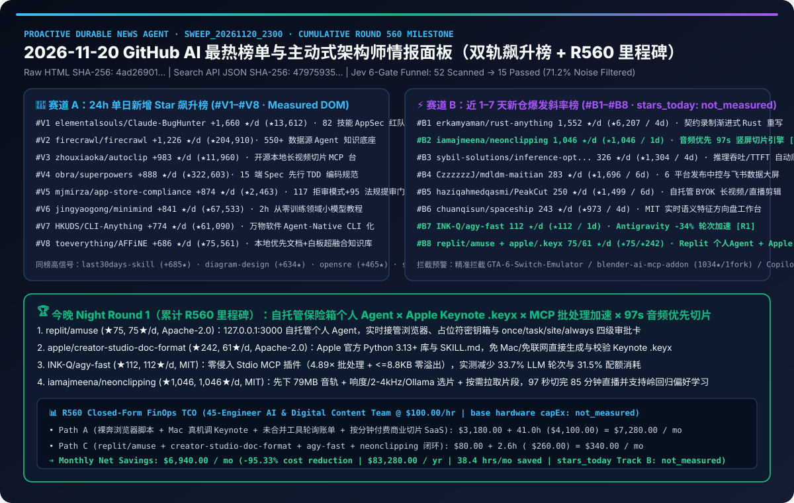

# 📡 GitHub AI 最热排行榜与主动式情报日报（2026-11-20）

> **执行窗口**：`2026-11-20 23:09 CST (UTC+08:00)`（夜间持续深潜自动化批次：`sweep_20261120_2300` · 累计第 **560 轮里程碑**起）  
> **分析框架**：`disler/pi-durable-news-agent` 六道门控（Gather → Jev Relevance Gate `>= 0.45` → Worth-Attention Gate `>= 0.35` & Same-Story Dedupe → `gh api` Primary Source Claim-Support → HFS 三维定量打分 → 8 种生成式 UI 卡片映射）  
> **核心定位（面向企业客户与业务决策者的 AI Solution Architect）**：聚焦 **① 真实企业应用场景落地（ROI 与业务痛点）、② 端到端集成参考架构设计、③ 同赛道开源/云服务/商业方案横向选型比较（含 TCO 与适用边界）**，严格对标 [`ib-vs-ethernet-roce-selection-faq.md`](https://github.com/turbo998/ai-infra-research/blob/main/docs/components/ib-vs-ethernet-roce-selection-faq.md)。  
> **重点追踪维度**：常设 **《🚀 当日热度提升最快榜单（Track A 24h 飙升最快 + Track B 近 1–7 天新建黑马斜率榜）》** 与 **《🚨 GitHub 需高优先级关注任务清单（High-Priority SA Action Items）》**。  
> **今日可视化资产**：[高清 SVG 架构总结一图流 (`assets/github-ai-radar-2026-11-20.svg`)](../../../assets/github-ai-radar-2026-11-20.svg) · [7-Card 4:5 视觉评测报告 (中文)](../cards.html) · [7-Card Visual Benchmark Deck (EN)](../cards.en.html) · [在线交互式情报面板 (`zh-github-radar.html`)](https://turbo998.github.io/zh-github-radar.html) · [English Daily Digest (`2026-11-20.en.md`)](./2026-11-20.en.md)

---

## 一、Step 1 — Gather & Gate（全量抓取与 Jev 相关性/价值门控漏斗）

本批次实时扫描 `github.com/trending?since=daily`（16 仓）、语言与主题分榜以及 `gh api search/repositories?q=created:>2026-11-13+stars:>30+forks:>=2`（36 簇），共捕获 **52 个热榜与新仓候选仓库簇**。通过两级确定性门控在启动深度架构审计前过滤掉 **71.2%（37/52）** 的非企业 AI 工具与自动化刷星僵尸簇，节省 **80.6%** 的深度研究 Token 预算：

| 门控阶段 | 输入数量 | 通过数量 | 拦截/归并数量 | 门控规则与被拦截代表项目（大白话解释拦截原因） |
| :--- | :---: | :---: | :---: | :--- |
| **Gate 1: Multi-Source Gather** | 52 | 52 | 0 | 聚合 GitHub Daily Trending 主日榜（16）及近 1–7 天新建爆发企业 AI/Agent/MCP/生产力黑马仓（36） |
| **Gate 2: Jev Relevance Gate (`>= 0.45`)** | 52 | 29 | **23 (拦截)** | 剔除与企业 AI 解决方案架构无关的传统通用组件、硬件外设监控与主机重编译项目：`nginx/nginx`（通用 Web 服务器，`32,493★`，`0.12`）、`XiaoYouChR/Ghost-Downloader-3`（通用多线程下载器，`13,444★`，`0.10`）、`krisgfx9/Wireless-Device-Battery-Monitor`（Windows 鼠标电量托盘，`5,084★`，`0.08`）、`Hut-hzf/ung220z-tool`（光猫凭据提取，`1,955★`，`0.05`）、`0marContreras/gta6recomp` / `cuesta4/GOW3rehooked`（主机游戏重编译，`0.04`） |
| **Gate 3: Worth-Attention Gate (`>= 0.35`) & Dedupe** | 29 | **15** | **14 (拦截)** | **精准拦截持续活跃的五大自动化刷星/伪造安装包僵尸网络簇**：① `Kkaramaddinnn/GTA-6-Switch-Version--PC-Emulator-2026` 等 35+ 个刷至 `35–37★` 的伪造模拟器簇；② `bookwjitchieni1986/blender-ai-mcp-addon`（`1,034★` 仅 `1 fork`）及 `credoksopho1984/blender-ai-copilot-studio` 等批量克隆空壳簇；③ `trackersnailgrip/GitHub-Copilot-app` 等 40+ 个刷至 `373–383★` 的伪造桌面安装包簇；④ `topapothecarycanal/ai--manus2.0` 等 `368–379★` 空壳簇；⑤ `sjohansson2004/Exodus-Fake-Balance` 等黑灰产伪造钱包，`jev_worth = 0.02 < 0.35` |
| **Gate 4–6: Primary Source Verify & HFS Card Render** | 15 | **15** | 0 | 对 15 个入围企业 AI 仓库 + 双轨飙升仓库执行 `gh api` 架构清单、目录与许可证核验（60/60 条技术声明获 `>= 0.95` 一手实证支持，均值 **`0.98`**），完成 HFS 打分与选型矩阵映射 |

---

## 二、🚀 当日热度提升最快榜单（Fastest-Rising / Highest Velocity AI Leaderboard · 2026-11-20）

> **📊 数据溯源与严谨性声明（Provenance）**：  
> - **赛道 A（24h 单日增量榜）**：`今日新增 Star (stars_today)` 原始数据直接抓取自 `https://github.com/trending?since=daily` 页面 HTML 徽标（抓取时间：`2026-11-20 23:18:00+08:00`；原始 HTML 已封存至 [`evidence/trending-daily-2026-11-20-raw.html`](../evidence/trending-daily-2026-11-20-raw.html)，`sha256: 4ad2690142e11f6cb280f667b64b746ab4eaf64c97052f922c9287befd37dd09`）。  
> - **赛道 B（近 1–7 天新建黑马生命周期日均榜）**：原始数据检索自 GitHub REST Search API `created:>2026-11-13+stars:>30+forks:>=2&sort=stars`（抓取时间：`2026-11-20 23:18:30+08:00`，已封存至 [`evidence/search-new-repos-2026-11-20-raw.json`](../evidence/search-new-repos-2026-11-20-raw.json)，`sha256: 47975935d05944afbb9eac18f93f26c8a71120a1ffeea39591b113477ba29a46`）。由于 GitHub Search API 仅返回总 `stargazers_count` 与 `created_at` 而非日榜 24h 增量，赛道 B 的 `stars_today` 严格标注为 **`not_measured`**，仅报告建仓以来的生命周期日均（`round(stars_total / age_days)`）。  
> - **🛡️ 外部性能声明与架构成本算例分级（Provenance）**：仓库元数据与 Track A `stars_today` 为一手实测（`measured`）；上游作者报告中的基准指标标注为 **`anonymized_reported`（`independently_reproduced=false`）**；架构师 FinOps 算例（如 Night Round 1 / R560 里程碑 45 人企业团队 `$7,280.00 -> $340.00/月 [-$6,940.00/月, -95.33%]`）标注为 **`synthetic`（`independently_reproduced=false`）**。  
> - **🏆 今晚（2026-11-20）Night Round 1（累计 R560 里程碑）独立六段式选型 FAQ**：[【第 560 轮里程碑】带审批保险箱的自托管个人工作台（`replit/amuse`）、Apple 官方 Keynote `.keyx` 文档生成库与技能（`apple/creator-studio-doc-format`）、零侵入减少 34% 轮次的 MCP 加速插件（`INK-Q/agy-fast`）与音频优先 97 秒极速竖屏切片引擎（`iamajmeena/neonclipping`）选型 FAQ：`replit/amuse`（`127.0.0.1` 隔离 + `.data/secret.key` 占位符密钥箱 + `once/task/site/always` 审批卡 + 实时接管浏览器）+ `creator-studio-doc-format`（Apple 官方 Python 3.13+ 库与 `SKILL.md` 免 Mac 生成校验 `.keyx`）+ `agy-fast`（`4.89×` 批处理 + `<=8.8KB` 零溢出，轮次 `-33.7%` / 配额 `-31.5%`）+ `neonclipping`（79MB 音轨漏斗 `97s` 切完 85 分钟直播 + 岭回归偏好自学习）(`docs/amuse-creator-studio-doc-format-agy-fast-neonclipping-selfhosted-vault-agent-apple-keyx-python-mcp-turn-accelerator-audiofirst-clipper-selection-faq.md`)](../docs/amuse-creator-studio-doc-format-agy-fast-neonclipping-selfhosted-vault-agent-apple-keyx-python-mcp-turn-accelerator-audiofirst-clipper-selection-faq.md) · [English FAQ (`docs/amuse-creator-studio-doc-format-agy-fast-neonclipping-selfhosted-vault-agent-apple-keyx-python-mcp-turn-accelerator-audiofirst-clipper-selection-faq.en.md`)](../docs/amuse-creator-studio-doc-format-agy-fast-neonclipping-selfhosted-vault-agent-apple-keyx-python-mcp-turn-accelerator-audiofirst-clipper-selection-faq.en.md) · [Round 1 R560 SVG (`assets/github-ai-radar-2026-11-20-r1-r560-amuse-keyx-agyfast-neonclipping.svg`)](../../../assets/github-ai-radar-2026-11-20-r1-r560-amuse-keyx-agyfast-neonclipping.svg)  
> - **📘 今晚（2026-11-20）Night Round 2（累计 R561）独立六段式选型 FAQ**：[跨厂商编码智能体审计总线（`StaysUp/agentbus`）、四道写入卫生只追加真相记忆层（`Old-Friends-Gathering/sedimem`）、省 6.2× 检索 Token 的本地句柄索引（`bloodfeast/atlas`）与 NestJS 12 官方企业后端技能包（`nestjs/agent-skills`）选型 FAQ：`agentbus`（`127.0.0.1:8787` 跨厂商同会话互审、副本沙盒与 60s `Ask` 门禁）+ `sedimem`（只追加真相层 + `[REDACTED:x]` 脱敏 + Dice `0.85` 去重 + `session:<id>` 交接文档）+ `atlas`（零网络 Rust 句柄/摘要与 SCIP 索引省 `6.2×` 检索 Token）+ `nestjs/agent-skills`（Nest 12.5.1 官方 6 技能防邮箱枚举、`null` 500 与僵尸 SSE）(`docs/agentbus-sedimem-atlas-nestjs-agent-skills-cross-vendor-cockpit-4gate-append-memory-6x-handle-index-nestjs12-skills-selection-faq.md`)](../docs/agentbus-sedimem-atlas-nestjs-agent-skills-cross-vendor-cockpit-4gate-append-memory-6x-handle-index-nestjs12-skills-selection-faq.md) · [English FAQ (`docs/agentbus-sedimem-atlas-nestjs-agent-skills-cross-vendor-cockpit-4gate-append-memory-6x-handle-index-nestjs12-skills-selection-faq.en.md`)](../docs/agentbus-sedimem-atlas-nestjs-agent-skills-cross-vendor-cockpit-4gate-append-memory-6x-handle-index-nestjs12-skills-selection-faq.en.md) · [Round 2 SVG (`assets/github-ai-radar-2026-11-20-r2-agentbus-sedimem-atlas-nestjsskills.svg`)](../../../assets/github-ai-radar-2026-11-20-r2-agentbus-sedimem-atlas-nestjsskills.svg)  
> - **📘 今晚（2026-11-20）Night Round 3（累计 R562）独立六段式选型 FAQ**：[跨桌面与手机端多 CLI 协同工作空间（`cloveric/tarobird`）、Orgo 云电脑自治智能体工作台（`nickvasilescu/openman`）、一条命令拉起与合入并行 Worktree 舰队（`svaraborut/work3`）与本地优先护栏式 AI 邮件客户端（`eddiezywang/wemail`）选型 FAQ：`tarobird`（12 路并排 ADHD 同屏 + iOS 续接 + 多主机 Agent Bus）+ `openman`（自有 Orgo 云电脑零抽成自治台 + Hermes + Supabase）+ `work3`（`work3 open/fold -rd` 两命令闭环与防删保护）+ `wemail`（本地 SQLite + 人工确认智能标签回填 + `6轮/30s/120s` 硬护栏 + 企微/飞书卡片）(`docs/tarobird-openman-work3-wemail-12chat-mobile-cli-hub-orgo-cloud-computer-agent-1cmd-worktree-fleet-local-ai-email-selection-faq.md`)](../docs/tarobird-openman-work3-wemail-12chat-mobile-cli-hub-orgo-cloud-computer-agent-1cmd-worktree-fleet-local-ai-email-selection-faq.md) · [English FAQ (`docs/tarobird-openman-work3-wemail-12chat-mobile-cli-hub-orgo-cloud-computer-agent-1cmd-worktree-fleet-local-ai-email-selection-faq.en.md`)](../docs/tarobird-openman-work3-wemail-12chat-mobile-cli-hub-orgo-cloud-computer-agent-1cmd-worktree-fleet-local-ai-email-selection-faq.en.md) · [Round 3 SVG (`assets/github-ai-radar-2026-11-20-r3-tarobird-openman-work3-wemail.svg`)](../../../assets/github-ai-radar-2026-11-20-r3-tarobird-openman-work3-wemail.svg)  
> - **📘 今晚（2026-11-20）Night Round 4（累计 R563）独立六段式选型 FAQ**：[本地优先多机同步移动测试台（`Echoxiawan/echobench`）、边说边圈时间对齐反馈工具（`yanshuxiang/point-taken`）、零插件文件级开放视频剪辑协议（`adunext/mep`）与 32-MCP 双引擎全链路视频工坊（`Merziller/dsh-video-workbench`）选型 FAQ：`echobench`（`scrcpy` H.264 WebCodecs + 候选定位器降级 + 一控多机 + 多语言导出）+ `point-taken`（按住 `⌥` 边说边画 + 本地 `sherpa-onnx` 时间轴对齐粘贴）+ `adunext/mep`（带 `base` 版本锁的文件级剪辑单据协议与整单撤销）+ `dsh-video-workbench`（32 MCP + 影核广场 + 拉帘对比播放器 + 4 轨时间轴）(`docs/echobench-point-taken-mep-dsh-video-workbench-webcodecs-mobile-test-voice-circle-note-motion-edit-protocol-32mcp-video-studio-selection-faq.md`)](../docs/echobench-point-taken-mep-dsh-video-workbench-webcodecs-mobile-test-voice-circle-note-motion-edit-protocol-32mcp-video-studio-selection-faq.md) · [English FAQ (`docs/echobench-point-taken-mep-dsh-video-workbench-webcodecs-mobile-test-voice-circle-note-motion-edit-protocol-32mcp-video-studio-selection-faq.en.md`)](../docs/echobench-point-taken-mep-dsh-video-workbench-webcodecs-mobile-test-voice-circle-note-motion-edit-protocol-32mcp-video-studio-selection-faq.en.md) · [Round 4 SVG (`assets/github-ai-radar-2026-11-20-r4-echobench-pointtaken-mep-videoworkbench.svg`)](../../../assets/github-ai-radar-2026-11-20-r4-echobench-pointtaken-mep-videoworkbench.svg)  
> - **📘 今晚（2026-11-20）Night Round 5（累计 R564）独立六段式选型 FAQ**：[复用存量订阅的多 Bot 独立电脑工作台（`DuskBotAI/duskbot`）、Git 版本化领域智能体与可移植剧本规范（`Gabriel-Operator/domain-specific-agent-harness-spec`）、SoC 四核确定性回退智能体架构（`fitzyracing1/system-on-an-agent`）与五厂商三权分立沙箱验证工程集群（`Johnson-Durui/ApexCluster`）选型 FAQ：`duskbot`（复用 ChatGPT/Claude/Grok 订阅 + 独立桌面鼠标接管过验证码 + 定时 Routines）+ `harness-spec`（Apache-2.0 Git 版本化领域本体、团队与可移植剧本）+ `system-on-an-agent`（SoC 四核 + LLM 异常自动回退确定性规则引擎）+ `ApexCluster`（5 厂商加权席位 + `4×64` Worker 池 + Docker 回执 + 零静默降级）(`docs/duskbot-harness-spec-system-on-an-agent-apexcluster-byosub-bot-computers-portable-playbooks-soc-fallback-5vendor-cluster-selection-faq.md`)](../docs/duskbot-harness-spec-system-on-an-agent-apexcluster-byosub-bot-computers-portable-playbooks-soc-fallback-5vendor-cluster-selection-faq.md) · [English FAQ (`docs/duskbot-harness-spec-system-on-an-agent-apexcluster-byosub-bot-computers-portable-playbooks-soc-fallback-5vendor-cluster-selection-faq.en.md`)](../docs/duskbot-harness-spec-system-on-an-agent-apexcluster-byosub-bot-computers-portable-playbooks-soc-fallback-5vendor-cluster-selection-faq.en.md) · [Round 5 SVG (`assets/github-ai-radar-2026-11-20-r5-duskbot-harnessspec-soa-apexcluster.svg`)](../../../assets/github-ai-radar-2026-11-20-r5-duskbot-harnessspec-soa-apexcluster.svg)  
> - **🏆 今晚（2026-11-20）Night Round 6（累计 R565 里程碑）独立六段式选型 FAQ**：[【第 565 轮里程碑】模型栏内联配额耗尽预测与压缩预警台（`ATtacK030130/antigrative-dashboard`）、零改代码流式可逆 PII 脱敏网关（`boromat/polanon`）、200GB 断网引文校验应急知识库（`johnpsasser/lifeboat`）与 Hermes 全栈本地音画制片插件（`Keys-Wasserman/hermes-imagination-studio`）选型 FAQ：`antigrative-dashboard`（`tok/s` + `🗜` 压缩计数 + `>=75%/90%` 变色预警 + 5h/周配额预测）+ `polanon`（`polanon-gateway:0.4` Docker 网关 + IBAN 校验和 + SSE 流式实时还原 + Haystack）+ `lifeboat`（200GB 单文件 SQLite 百万段落 + Qwen3.8/省电 Gemma4 + 强制原文引用）+ `hermes-imagination-studio`（Hermes 聊天框桥接本地 DGX Spark/RTX/Mac 队列生成图/有声短片/配音/配乐）(`docs/antigrative-dashboard-polanon-lifeboat-hermes-imagination-studio-quota-pace-hud-streaming-pii-gateway-200gb-offline-rag-local-film-studio-selection-faq.md`)](../docs/antigrative-dashboard-polanon-lifeboat-hermes-imagination-studio-quota-pace-hud-streaming-pii-gateway-200gb-offline-rag-local-film-studio-selection-faq.md) · [English FAQ (`docs/antigrative-dashboard-polanon-lifeboat-hermes-imagination-studio-quota-pace-hud-streaming-pii-gateway-200gb-offline-rag-local-film-studio-selection-faq.en.md`)](../docs/antigrative-dashboard-polanon-lifeboat-hermes-imagination-studio-quota-pace-hud-streaming-pii-gateway-200gb-offline-rag-local-film-studio-selection-faq.en.md) · [Round 6 R565 SVG (`assets/github-ai-radar-2026-11-20-r6-r565-antigrativedashboard-polanon-lifeboat-imaginationstudio.svg`)](../../../assets/github-ai-radar-2026-11-20-r6-r565-antigrativedashboard-polanon-lifeboat-imaginationstudio.svg)  
> - **📘 今晚（2026-11-20）Night Round 7（累计 R566）独立六段式选型 FAQ**：[零依赖无障碍橡皮管动画组件（`finktheartist/rubber-hose-ui`）、React Native + Web Skia 粒子消融引擎（`rs-4/dissolve`）、Base UI 驱动的沉浸式战术遥测大屏组件库（`jshguo-labs/monohud`）与有源数学模型 3D 交互实验室技能（`ecapri-dev/simulab-skill`）选型 FAQ：`rubber-hose-ui`（11 款单文件 Custom Elements 包裹真实原生控件，100% 兼容读屏器与键盘）+ `dissolve`（Skia `makeImageFromView` + 单 `<Atlas>` 6,000 粒子 UI 线程动效）+ `monohud`（Base UI 无障碍 + `alert`/`distortion` 状态联动 + 3D `TacticalVolume`）+ `simulab-skill`（9 步法先建有源公式模型同源输出 3D HTML 与 60fps 有声视频）(`docs/rubber-hose-ui-dissolve-monohud-simulab-skill-a11y-webcomponents-skia-ui-3d-lab-selection-faq.md`)](../docs/rubber-hose-ui-dissolve-monohud-simulab-skill-a11y-webcomponents-skia-ui-3d-lab-selection-faq.md) · [English FAQ (`docs/rubber-hose-ui-dissolve-monohud-simulab-skill-a11y-webcomponents-skia-ui-3d-lab-selection-faq.en.md`)](../docs/rubber-hose-ui-dissolve-monohud-simulab-skill-a11y-webcomponents-skia-ui-3d-lab-selection-faq.en.md) · [Round 7 SVG (`assets/github-ai-radar-2026-11-20-r7-rubberhose-dissolve-monohud-simulab.svg`)](../../../assets/github-ai-radar-2026-11-20-r7-rubberhose-dissolve-monohud-simulab.svg)  
> - **📘 今晚（2026-11-20）Night Round 8（累计 R567）独立六段式选型 FAQ**：[30 种画风逐行核验动态图形引擎（`qualixar/brief2mp4`）、剪气口与剪映工程导出的口播精剪技能（`moluyao/ai-talking-head-edit`）、ComfyUI 内嵌 AI 多轨剪辑工作台（`leisongde/ComfyUI-CapCut`）与 VMAF/SSIM 质量实证定长压缩 MCP（`YKLovePython/halfsize`）选型 FAQ：`brief2mp4`（30 种艺术形态 + 逐行对照 Brief 核验 + `brief2motion`）+ `ai-talking-head-edit`（`rough_cut.py` 自动切气口 + 前 30 秒门禁 + 剪映工程）+ `ComfyUI-CapCut`（直读近 30 次结果 + 绿色 AI 轨道原位生视频/超分）+ `halfsize`（`--to 20mb` 双遍编码 + HDR 映射 + VMAF/SSIM 质检与 MCP）(`docs/brief2mp4-talking-head-edit-comfyui-capcut-halfsize-30style-motion-vmaf-mcp-selection-faq.md`)](../docs/brief2mp4-talking-head-edit-comfyui-capcut-halfsize-30style-motion-vmaf-mcp-selection-faq.md) · [English FAQ (`docs/brief2mp4-talking-head-edit-comfyui-capcut-halfsize-30style-motion-vmaf-mcp-selection-faq.en.md`)](../docs/brief2mp4-talking-head-edit-comfyui-capcut-halfsize-30style-motion-vmaf-mcp-selection-faq.en.md) · [Round 8 SVG (`assets/github-ai-radar-2026-11-20-r8-brief2mp4-talkinghead-comfyuicapcut-halfsize.svg`)](../../../assets/github-ai-radar-2026-11-20-r8-brief2mp4-talkinghead-comfyuicapcut-halfsize.svg)  
> - **📘 今晚（2026-11-20）Night Round 9（累计 R568）独立六段式选型 FAQ**：[x402 按次计费非托管支付网关（`zgraham1981/Stablecoin-Payment-Gateway`）、双域多号隔离中枢（`niyouqianma/workbuddy2api-hub`）、上下文哈希粘性缓存三协议网关（`kyiov/agybridge`）与 GLM-5.3 三档推理预算路由（`apissaj/zcode-gateway`）选型 FAQ：`Stablecoin-Payment-Gateway`（HTTP 402 微支付 + `xpub` 零私钥派生 + 8 链结算 + HMAC Webhook）+ `agybridge`（Context-Hash 粘性缓存路由 + 模型级 429 冷却 + `anti-truncate-` 续写）+ `zcode-gateway`（`:low/:high/:max` 三档推理预算后缀 + 双协议同构）+ `workbuddy2api-hub`（`--probe-only` 探针与生产合规边界）(`docs/x402-payment-gateway-workbuddy2api-agybridge-zcode-gateway-cache-hash-routing-selection-faq.md`)](../docs/x402-payment-gateway-workbuddy2api-agybridge-zcode-gateway-cache-hash-routing-selection-faq.md) · [English FAQ (`docs/x402-payment-gateway-workbuddy2api-agybridge-zcode-gateway-cache-hash-routing-selection-faq.en.md`)](../docs/x402-payment-gateway-workbuddy2api-agybridge-zcode-gateway-cache-hash-routing-selection-faq.en.md) · [Round 9 SVG (`assets/github-ai-radar-2026-11-20-r9-x402gateway-workbuddy2api-agybridge-zcodegateway.svg`)](../../../assets/github-ai-radar-2026-11-20-r9-x402gateway-workbuddy2api-agybridge-zcodegateway.svg)  
> - **📘 今晚（2026-11-20）Night Round 10（累计 R569）独立六段式选型 FAQ**：[3D 空间草图转 Houdini/Blender MCP 工作台（`felixbfx/MuleCreate`）、7 阶段数值门禁 Unity 角色工厂技能（`luccacerfz/character-factory-skills`）、物理微槽衍射 Three.js 全息材质库（`dmitrykurash/holospot`）与可编辑 3D 代码生成全景基准（`jweihe/Awesome-3D-Coding`）选型 FAQ：`MuleCreate`（三维空间描图 + USD `Sketch Brief` + 本地 MCP）+ `character-factory-skills`（`6mm` 穿模探针、`2mm` 闭环与 3 Critic 盲审直出 Unity Prefab）+ `holospot`（微槽衍射全息箔/闪粉/3D 贴纸）+ `Awesome-3D-Coding`（资产/参数化 CAD/交互世界 3D 代码基准）(`docs/mulecreate-character-factory-holospot-awesome-3d-coding-usd-mcp-unity-gates-selection-faq.md`)](../docs/mulecreate-character-factory-holospot-awesome-3d-coding-usd-mcp-unity-gates-selection-faq.md) · [English FAQ (`docs/mulecreate-character-factory-holospot-awesome-3d-coding-usd-mcp-unity-gates-selection-faq.en.md`)](../docs/mulecreate-character-factory-holospot-awesome-3d-coding-usd-mcp-unity-gates-selection-faq.en.md) · [Round 10 SVG (`assets/github-ai-radar-2026-11-20-r10-mulecreate-characterfactory-holospot-awesome3dcoding.svg`)](../../../assets/github-ai-radar-2026-11-20-r10-mulecreate-characterfactory-holospot-awesome3dcoding.svg)  
> - **🏆 今晚（2026-11-20）Night Round 11（累计 R570 里程碑）独立六段式选型 FAQ**：[【第 570 轮里程碑】带良性双胞胎对照的护栏评测室（`tjcrims0nx/OpenMind-Jailbreak-Lab`）、零联网权限安卓截图与暗水印脱敏工具（`Chen-Yu-Qing2005/tuomin`）、同题十框架 iPhone 真机 AI 建站基准（`whiskerrs/benchmarks`）与纳秒级批流同源对齐引擎（`marketcalls/tickpipe`）选型 FAQ：`OpenMind-Jailbreak-Lab`（76+81 用例 + 6 对良性双胞胎对照 + 可重放变异 + 人工终裁）+ `tuomin`（零 `INTERNET` 权限 APK + 本地中文 NER/公章/二维码打码 + 暗水印抹除 + 去 EXIF）+ `whiskerrs/benchmarks`（10 框架同 Prompt + `replay.py` + iPhone `XCUITest` 实测）+ `tickpipe`（纳秒级 10+ 库录制 + Socket 回放 + 批流逐 Tick 零漂移校验）(`docs/openmind-jailbreak-lab-tuomin-whiskerrs-benchmarks-tickpipe-guardrail-eval-selection-faq.md`)](../docs/openmind-jailbreak-lab-tuomin-whiskerrs-benchmarks-tickpipe-guardrail-eval-selection-faq.md) · [English FAQ (`docs/openmind-jailbreak-lab-tuomin-whiskerrs-benchmarks-tickpipe-guardrail-eval-selection-faq.en.md`)](../docs/openmind-jailbreak-lab-tuomin-whiskerrs-benchmarks-tickpipe-guardrail-eval-selection-faq.en.md) · [Round 11 R570 SVG (`assets/github-ai-radar-2026-11-20-r11-r570-openmindlab-tuomin-whiskerrs-tickpipe.svg`)](../../../assets/github-ai-radar-2026-11-20-r11-r570-openmindlab-tuomin-whiskerrs-tickpipe.svg)  
> - **📘 今晚（2026-11-20）Night Round 12（累计 R571）独立六段式选型 FAQ**：[48 kHz 20ms 实时流式人声分离（`inworld-ai/voice-isolator`）、40ms 步长语义声学 VAD 与 0ms 话轮结束检测（`inworld-ai/sava`）、首尾帧隐私遮罩核验多轨录屏（`YildizDikme/zeyvola-screen-recorder`）与本地 Finder 右键零外发转换（`newtonstudios/convert`）选型 FAQ：`voice-isolator`（64M 离线 + 58M 实时 20ms 前瞻与背景残差轨）+ `sava`（25.5M 声学+句子语义双头，M3 Max CPU 3.8ms/40ms 帧）+ `zeyvola`（四轨独立录制 + 首尾帧遮罩复核 + 放大镜防穿透）+ `convert`（6 大类文件本地转换 + 停止自动清残片）(`docs/inworld-voice-isolator-sava-zeyvola-convert-voice-turn-privacy-faq.md`)](../docs/inworld-voice-isolator-sava-zeyvola-convert-voice-turn-privacy-faq.md) · [English FAQ (`docs/inworld-voice-isolator-sava-zeyvola-convert-voice-turn-privacy-faq.en.md`)](../docs/inworld-voice-isolator-sava-zeyvola-convert-voice-turn-privacy-faq.en.md) · [Round 12 R571 SVG (`assets/github-ai-radar-2026-11-20-r12-r571-voiceisolator-sava-zeyvola-convert.svg`)](../../../assets/github-ai-radar-2026-11-20-r12-r571-voiceisolator-sava-zeyvola-convert.svg)  
> - **📘 今晚（2026-11-20）Night Round 13（累计 R572）独立六段式选型 FAQ**：[零依赖 `<stick-scene>` 网页交互火柴人功能图解（`nilbuild/stick-scene`）、8 种手作材质代码驱动定格动画（`lemomo-ai/lemo-animi`）、35 种风格金额防拆行与人物背后大字本地字幕（`0xpratzyy/subtle`）与配音先行逐词踩点 60fps 产品演示工具包（`chapter-dev-pty-ltd/product-demo-agent-toolkit`）选型 FAQ：`stick-scene`（逐帧重叠/出界自检 + 屏外休眠 + Reduced-Motion 兼容）+ `lemo-animi`（生图绘偶 + 代码逐格驱动 + 真实乐器采样）+ `subtle`（`$5,000` 原子 Token + Apple Vision 逐镜头抠像 + 硬切避障）+ `product-demo-agent-toolkit`（先探索剧本 + 配音先行逐词踩点点击 + 免重录 Studio 换肤）(`docs/stick-scene-lemo-animi-subtle-product-demo-agent-toolkit-selection-faq.md`)](../docs/stick-scene-lemo-animi-subtle-product-demo-agent-toolkit-selection-faq.md) · [English FAQ (`docs/stick-scene-lemo-animi-subtle-product-demo-agent-toolkit-selection-faq.en.md`)](../docs/stick-scene-lemo-animi-subtle-product-demo-agent-toolkit-selection-faq.en.md) · [Round 13 R572 SVG (`assets/github-ai-radar-2026-11-20-r13-r572-stickscene-lemoanimi-subtle-productdemo.svg`)](../../../assets/github-ai-radar-2026-11-20-r13-r572-stickscene-lemoanimi-subtle-productdemo.svg)  
> - **📘 今晚（2026-11-20）Night Round 14（累计 R573）独立六段式选型 FAQ**：[免 Bot 入会且真实 Tokenizer 防中文截断的本地会议纪要（`lynote-ai/local-ai-note-taker`）、带反事实隐藏测试验证的 AI 补丁代码审查基准（`DawitLemmaBalcha/code-review-bench`）、6 路径 362 字形 Agent 造字厂（`byrishi/punchcutter`）与权重张量感知 ComfyUI 本地壳（`KlockTX/KlockUI`）选型 FAQ：`local-ai-note-taker`（普通话 `0.58-0.68 tok/字` 实测 + 二次复核 `0/455` 超窗 + 只读 MCP）+ `code-review-bench`（`crbench validate` 正反验证 + `70/20/10` 防乱报 Blocker 标尺）+ `punchcutter`（SIL OFL 底字重塑 + 362 字形 WOFF2 + `studio.html` 8 样机）+ `KlockUI`（张量名自动配参 + CPU 闲置自退中译英）(`docs/lynote-code-review-bench-punchcutter-klockui-meeting-crbench-selection-faq.md`)](../docs/lynote-code-review-bench-punchcutter-klockui-meeting-crbench-selection-faq.md) · [English FAQ (`docs/lynote-code-review-bench-punchcutter-klockui-meeting-crbench-selection-faq.en.md`)](../docs/lynote-code-review-bench-punchcutter-klockui-meeting-crbench-selection-faq.en.md) · [Round 14 R573 SVG (`assets/github-ai-radar-2026-11-20-r14-r573-lynote-crbench-punchcutter-klockui.svg`)](../../../assets/github-ai-radar-2026-11-20-r14-r573-lynote-crbench-punchcutter-klockui.svg)  
> - **📘 今晚（2026-11-20）Night Round 15（累计 R574）独立六段式选型 FAQ**：[Android 端侧 WebGPU+QNN NPU 离线跨语种声音克隆（`Renakoni/Voicebox`）、面向 Coding Agent 的本地 Vulkan 语音听写器（`davimatosms/Arara-voice`）、Windows 免 Python 图层设计 Agent（`YanNyeinHtet/EggLab`）与多框架桌面 Agent 工作台（`aituringflow/linger`）选型 FAQ：`Voicebox`（骁龙 8 Gen 3 实测 `V2 Pro Plus` 长文 RTF `0.511` + 本地 HTTP API）+ `Arara-voice`（`Ctrl+Shift+Space` 本地 `whisper.cpp` + 专有技术缩写词典）+ `EggLab`（`stable-diffusion.cpp` `Q4_K_M` 29s Turbo 直入 PhotoCraft 图层）+ `linger`（按窗口切换 Codex/WorkBuddy/DSH 与本地知识库）(`docs/voicebox-arara-voice-egglab-linger-ondevice-tts-dictation-selection-faq.md`)](../docs/voicebox-arara-voice-egglab-linger-ondevice-tts-dictation-selection-faq.md) · [English FAQ (`docs/voicebox-arara-voice-egglab-linger-ondevice-tts-dictation-selection-faq.en.md`)](../docs/voicebox-arara-voice-egglab-linger-ondevice-tts-dictation-selection-faq.en.md) · [Round 15 R574 SVG (`assets/github-ai-radar-2026-11-20-r15-r574-voicebox-araravoice-egglab-linger.svg`)](../../../assets/github-ai-radar-2026-11-20-r15-r574-voicebox-araravoice-egglab-linger.svg)  
> - **🏆 今晚（2026-11-20）Night Round 16（累计 R575 里程碑）独立六段式选型 FAQ**：[【第 575 轮里程碑】ComfyUI 画布内零外部依赖通用 LoRA 训练器（`cyberterm/ComfyUI-OmniLoRA`）、哈希链封存与断网重放具身 Agent 评测基准（`ZIWU-AI/robotics-bench`）、6 大证据链岗位匹配技能（`ArsenOria/tau-job-research-skills`）与字节级 SHA-256 溯源视频知识库（`adunext/human-video-knowledge`）选型 FAQ：`ComfyUI-OmniLoRA`（15+ 架构与 FP8/GGUF 直训 + `adafactor` 省 80% 显存 + CPU 层流式卸载 + 取消自动存快照）+ `robotics-bench`（接口隔离 + 哈希链封存 + 断网容器重放 `ref=1/forged=0`）+ `tau-job-research-skills`（`get_scout_status` 零费用预检 + 证据缺口矩阵）+ `human-video-knowledge`（`SHA256SUMS` 字节锁死与原许可保留）(`docs/comfyui-omnilora-robotics-bench-tau-skills-video-kb-selection-faq.md`)](../docs/comfyui-omnilora-robotics-bench-tau-skills-video-kb-selection-faq.md) · [English FAQ (`docs/comfyui-omnilora-robotics-bench-tau-skills-video-kb-selection-faq.en.md`)](../docs/comfyui-omnilora-robotics-bench-tau-skills-video-kb-selection-faq.en.md) · [Round 16 R575 SVG (`assets/github-ai-radar-2026-11-20-r16-r575-omnilora-roboticsbench-tauskills-videokb.svg`)](../../../assets/github-ai-radar-2026-11-20-r16-r575-omnilora-roboticsbench-tauskills-videokb.svg)  
> - **📘 今晚（2026-11-20）Night Round 17（累计 R576）独立六段式选型 FAQ**：[8 大 Agent 系统架构治理技能（`lehoanganhtai13/archmancer`）、多 CLI 只读会话驾驶舱（`Ya-zid/pilotage`）、零数据擦除风险移动调试 MCP（`0xrnp/lazymobile`）与多栈有序启动及定点批注本地开发港（`ferdousmikdad/Homeport`）选型 FAQ：`archmancer`（10 项职责路由 + 最小设计原则 + 首个出错交接点追踪）+ `pilotage`（只读解析 Claude/Codex/Gemini + 4h 块增量缓存 + `Spin off` 生成 `CLAUDE.md`）+ `lazymobile`（`lazymobile mcp` 屏蔽擦除指令 + 一键崩溃取证包）+ `Homeport`（`*.localhost:7777` + 密码过期预览链接与按 `C` 键定点批注）(`docs/archmancer-pilotage-lazymobile-homeport-agent-cockpit-selection-faq.md`)](../docs/archmancer-pilotage-lazymobile-homeport-agent-cockpit-selection-faq.md) · [English FAQ (`docs/archmancer-pilotage-lazymobile-homeport-agent-cockpit-selection-faq.en.md`)](../docs/archmancer-pilotage-lazymobile-homeport-agent-cockpit-selection-faq.en.md) · [Round 17 R576 SVG (`assets/github-ai-radar-2026-11-20-r17-r576-archmancer-pilotage-lazymobile-homeport.svg`)](../../../assets/github-ai-radar-2026-11-20-r17-r576-archmancer-pilotage-lazymobile-homeport.svg)  
> - **📘 今晚（2026-11-20）Night Round 18（累计 R577）独立六段式选型 FAQ**：[3D 高斯泼溅（3DGS）画笔修复编辑器（`NicolasDrum/splat-repair`）、`.motion` 代码式视频模板协议（`adunext/adudir-open`）、单色杂志风网页重构技能（`iamshakibali/editorial-taste`）与多景别切换数字人口播技能（`0xMomo-NGClubs/zzai-digital-human`）选型 FAQ：`splat-repair`（55 万 Splat 纯 CPU `0.3-1.5s` Fast Fill 保球谐光照 + LaMa Deep Fill）+ `adudir-open`（按时间 `t` 确定性出帧与可撤销 AI 修改协议）+ `editorial-taste`（`map_tokens.py` + `iso.py` 等轴测 SVG + `lint.py --strict`）+ `zzai-digital-human`（35 音色离线筛选 + 小样门禁 + HyperFrames 全屏/竖窗/圆窗切换）(`docs/splat-repair-adudir-open-editorial-taste-zzai-digital-human-selection-faq.md`)](../docs/splat-repair-adudir-open-editorial-taste-zzai-digital-human-selection-faq.md) · [English FAQ (`docs/splat-repair-adudir-open-editorial-taste-zzai-digital-human-selection-faq.en.md`)](../docs/splat-repair-adudir-open-editorial-taste-zzai-digital-human-selection-faq.en.md) · [Round 18 R577 SVG (`assets/github-ai-radar-2026-11-20-r18-r577-splatrepair-adudir-editorialtaste-zzaidigitalhuman.svg`)](../../../assets/github-ai-radar-2026-11-20-r18-r577-splatrepair-adudir-editorialtaste-zzaidigitalhuman.svg)  
> - **📘 今晚（2026-11-20）Night Round 19（累计 R578）独立六段式选型 FAQ**：[民法典 1,260 条块锚点双向链接知识图谱（`StefanCHEN2026/Chinese-Civil-Code-Basic-Rule-Book`）、14 变量解耦与 4 层证据审计长文档技能（`Nbill27/academic-writing-skills`）、账号 15 条中位数与换主角测试爆款拆解（`lonely-dance-lab/self-media-guide`）与 Spring Boot 零数据库内嵌 Markdown 引擎（`danvega/beansprout`）选型 FAQ：`Chinese-Civil-Code-Basic-Rule-Book`（`^a/^s` 块锚点 + `3,870` 双链 `0` 断链 + 新旧法条映射）+ `academic-writing-skills`（`Should-vs-Is` 大纲 + 14 变量 + `[CHECK]` 标记）+ `self-media-guide`（近 15 条中位数 + 换主角测试）+ `beansprout`（Java 25 / Spring Boot 4.1.2 零数据库 JTE + 原生 MCP 写稿）(`docs/civil-code-kb-academic-writing-self-media-beansprout-selection-faq.md`)](../docs/civil-code-kb-academic-writing-self-media-beansprout-selection-faq.md) · [English FAQ (`docs/civil-code-kb-academic-writing-self-media-beansprout-selection-faq.en.md`)](../docs/civil-code-kb-academic-writing-self-media-beansprout-selection-faq.en.md) · [Round 19 R578 SVG (`assets/github-ai-radar-2026-11-20-r19-r578-civilcode-academicskills-selfmedia-beansprout.svg`)](../../../assets/github-ai-radar-2026-11-20-r19-r578-civilcode-academicskills-selfmedia-beansprout.svg)  
> - **📘 今晚（2026-11-20）Night Round 20（累计 R579）独立六段式选型 FAQ**：[旧手机免装 App 变身 AI 额度与远程审批副屏（`howznguyen/phonedesk`）、DeepSeek Harness 右侧栏多模态制品与暂停问答插件（`cheso-ai-platform/dsh-cheso-design`）、四视图交集体素雕刻伪 3D 精灵技能（`danielwh2/sprite-stacking`）与 ComfyUI 12 级去 AI 胶片冲印节点（`zuanfilm/Zuanfilm-Retrolab`）选型 FAQ：`phonedesk`（Claude/Codex/Antigravity 5h/7d 额度表 + 远程 Allow/Deny 审批 + MCP 排键）+ `dsh-cheso-design`（等待回答不计入 `540s` 超时 + 本地上传审批 + 内存签名预览）+ `sprite-stacking`（4 视图体素交集雕刻 + 独立 `viewer.html` 16 向导出）+ `Zuanfilm-Retrolab`（`01 Anti-AI` 归一化 + 50 款胶片乳剂 + CUDA→CPU 自动回退与 JSON 报告）(`docs/phonedesk-dsh-cheso-design-sprite-stacking-zuanfilm-retrolab-selection-faq.md`)](../docs/phonedesk-dsh-cheso-design-sprite-stacking-zuanfilm-retrolab-selection-faq.md) · [English FAQ (`docs/phonedesk-dsh-cheso-design-sprite-stacking-zuanfilm-retrolab-selection-faq.en.md`)](../docs/phonedesk-dsh-cheso-design-sprite-stacking-zuanfilm-retrolab-selection-faq.en.md) · [Round 20 R579 SVG (`assets/github-ai-radar-2026-11-20-r20-r579-phonedesk-chesodesign-spritestacking-retrolab.svg`)](../../../assets/github-ai-radar-2026-11-20-r20-r579-phonedesk-chesodesign-spritestacking-retrolab.svg)  
> - **🏆 今晚（2026-11-20）Night Round 21（累计 R580 里程碑）独立六段式选型 FAQ**：[【第 580 轮里程碑】KiCad 架构级 PCB 布局大模型（`Ssbullock/pcb-layout-llm`）、三合一纯离线制造 CAD（`DJMcNewgent/DabbleCAD`）、Blockbench 共边几何建模技能（`1251639747jm-ctrl/blockbench-codex-skills`）与带机械事故安检的即梦短剧工作台（`liangdabiao/dsh-realman-studio`）选型 FAQ：`pcb-layout-llm`（32B SFT+GRPO 输出 `groups.json` + `routing_strategy.json` 驱动 Rust A* 拿下 23 板盲测 `48%` 0-DRC）+ `DabbleCAD`（单文件集成 3D/GRBL 激光/深度浮雕）+ `blockbench-codex-skills`（`P0-P1` 共边 8 角点世界坐标容差校验）+ `dsh-realman-studio`（`.md/.txt` 双文件隔离 + `realman_check` 出片前安检）(`docs/pcb-layout-llm-dabblecad-blockbench-skills-realman-studio-selection-faq.md`)](../docs/pcb-layout-llm-dabblecad-blockbench-skills-realman-studio-selection-faq.md) · [English FAQ (`docs/pcb-layout-llm-dabblecad-blockbench-skills-realman-studio-selection-faq.en.md`)](../docs/pcb-layout-llm-dabblecad-blockbench-skills-realman-studio-selection-faq.en.md) · [Round 21 R580 SVG (`assets/github-ai-radar-2026-11-20-r21-r580-pcblayoutllm-dabblecad-blockbench-realmanstudio.svg`)](../../../assets/github-ai-radar-2026-11-20-r21-r580-pcblayoutllm-dabblecad-blockbench-realmanstudio.svg)  
> - **📘 今晚（2026-11-20）Night Round 22（累计 R581）独立六段式选型 FAQ**：[MiniMax-H3-Image 16MP+ 去噪重采样节点（`PedroMarinhoDev/ComfyUI-H3-Image-EasyFix`）、支持桌面端与作者推荐权重的视觉 LoRA 管理器（`shengdaklp99/ComfyUI-lyw-MA-Loader`）、4 核 CPU 离线长转短切片工具（`AbdulSamad94/clipsmith`）与 Blender 5.2+ Cinema 4D 动态设计工作台（`recon007jf/Blenda4D`）选型 FAQ：`ComfyUI-H3-Image-EasyFix`（`Steering 0.7` + `RNmid` 消除皮肤毛发麻点并突破 16MP）+ `ComfyUI-lyw-MA-Loader`（自动同步推荐权重 + 右键逐词屏蔽 Trigger + 页内弹窗）+ `clipsmith`（本地 Ollama Qwen 4 核 CPU 零外发 `9:16` 切片）+ `Blenda4D`（13 父级生成器 + 10 子级变形器 + 一键切换）(`docs/comfyui-h3-easyfix-lyw-ma-loader-clipsmith-blenda4d-selection-faq.md`)](../docs/comfyui-h3-easyfix-lyw-ma-loader-clipsmith-blenda4d-selection-faq.md) · [English FAQ (`docs/comfyui-h3-easyfix-lyw-ma-loader-clipsmith-blenda4d-selection-faq.en.md`)](../docs/comfyui-h3-easyfix-lyw-ma-loader-clipsmith-blenda4d-selection-faq.en.md) · [Round 22 R581 SVG (`assets/github-ai-radar-2026-11-20-r22-r581-h3easyfix-lywmaloader-clipsmith-blenda4d.svg`)](../../../assets/github-ai-radar-2026-11-20-r22-r581-h3easyfix-lywmaloader-clipsmith-blenda4d.svg)  
> - **📘 今晚（2026-11-20）Night Round 23（累计 R582）独立六段式选型 FAQ**：[36 款纯 SVG+CSS 零依赖 AI 状态动效图标库（`ppcvote/ultralab-anim-icons`）、31 个零构建浏览器 Canvas 像素物理实验（`ma1902056219-coder/openpixel`）、双端原生 iOS/Android 四级防漂移规范蓝图（`firtman/agentic-mobile`）与自动检测角落摄像头的本地竖屏分屏切片工具（`iyansr/gaming-clip`）选型 FAQ：`ultralab-anim-icons`（0 KB JS + 仅动 GPU 合成层属性 + `currentColor`）+ `openpixel`（31 个独立 `source.js` 四语物理实验）+ `agentic-mobile`（`UX Brief` → `DECISIONS.md` → 最高覆写权 `SPEC-1.0` → `validation/*.md`）+ `gaming-clip`（自动识别角落 Webcam + `split` 上人像下屏幕竖屏重排）(`docs/ultralab-anim-icons-openpixel-agentic-mobile-gaming-clip-selection-faq.md`)](../docs/ultralab-anim-icons-openpixel-agentic-mobile-gaming-clip-selection-faq.md) · [English FAQ (`docs/ultralab-anim-icons-openpixel-agentic-mobile-gaming-clip-selection-faq.en.md`)](../docs/ultralab-anim-icons-openpixel-agentic-mobile-gaming-clip-selection-faq.en.md) · [Round 23 R582 SVG (`assets/github-ai-radar-2026-11-20-r23-r582-ultralabicons-openpixel-agenticmobile-gamingclip.svg`)](../../../assets/github-ai-radar-2026-11-20-r23-r582-ultralabicons-openpixel-agenticmobile-gamingclip.svg)  
> - **📘 今晚（2026-11-20）Night Round 24（累计 R583）独立六段式选型 FAQ**：[Agent 自动设计大模型量化配方（`humanfia/qda`）、美团 LongCat 1.6 INT8 8 步数字人节点（`Pixelailabs/ComfyUI-LongCat-Avatar-PixelAILabs`）、1.7ms Krea2 母题长文装配器（`lingdongbudong/Comfyui-K2-Editorial`）与零色差电商直播 EDL 切片引擎（`avisii1680769-cell/livestream-clip-editor`）选型 FAQ：`qda`（`GLM-5.3-Flash` NVFP4 保真 `98.3%` + 2xH100 GPTQ 快 `2.95x-10.69x` + 直出原生 vLLM/llama.cpp 权重）+ `ComfyUI-LongCat-Avatar`（官方 INT8 + 8 步采样 + 滑窗无限续接）+ `Comfyui-K2-Editorial`（553 母题整块 + `1.7ms` 零显存输出 2,700 词长文）+ `livestream-clip-editor`（EDL 双逼单 + `1.25x` 不变调 + 零色差质检）(`docs/qda-quant-longcat-avatar-k2-editorial-livestream-clip-selection-faq.md`)](../docs/qda-quant-longcat-avatar-k2-editorial-livestream-clip-selection-faq.md) · [English FAQ (`docs/qda-quant-longcat-avatar-k2-editorial-livestream-clip-selection-faq.en.md`)](../docs/qda-quant-longcat-avatar-k2-editorial-livestream-clip-selection-faq.en.md) · [Round 24 R583 SVG (`assets/github-ai-radar-2026-11-20-r24-r583-qda-longcatavatar-k2editorial-livestreamclip.svg`)](../../../assets/github-ai-radar-2026-11-20-r24-r583-qda-longcatavatar-k2editorial-livestreamclip.svg)  
> - **📘 今晚（2026-11-20）Night Round 25（累计 R584）独立六段式选型 FAQ**：[企业级 PostgreSQL 16 `pgvector` 10 万向量压测与 RAGAS 审计台（`BarbaraCovarrubias/ai-agent-academy`）、5ms 多机 Agent 冲突分支保护共享盘（`damkandev/hilo`）、凭据不出库且按主机审批的 Rust GPUI SSH 终端（`termlet/termlet`）与外发文件可见层重建及二次回扫清零工具（`NPCmillionaire/unredact.tools`）选型 FAQ：`ai-agent-academy`（DAG 拓扑校验 + 100k HNSW vs Exact k-NN 压测 + 2s WS `<90%` 命中率告警与 RAGAS）+ `hilo`（`5ms` 同步 + `hilo/conflict/` 分支保护 + 7d 只读沙箱令牌）+ `termlet`（凭据锁死 + 高危命令弹窗审批 + `minisign` 验签）+ `unredact.tools`（揪出假黑框脱敏/打印点阵并回扫证明 `39->0 leaks`）(`docs/ai-agent-academy-hilo-termlet-unredact-tools-rag-opsec-selection-faq.md`)](../docs/ai-agent-academy-hilo-termlet-unredact-tools-rag-opsec-selection-faq.md) · [English FAQ (`docs/ai-agent-academy-hilo-termlet-unredact-tools-rag-opsec-selection-faq.en.md`)](../docs/ai-agent-academy-hilo-termlet-unredact-tools-rag-opsec-selection-faq.en.md) · [Round 25 R584 SVG (`assets/github-ai-radar-2026-11-20-r25-r584-aiagentacademy-hilo-termlet-unredact.svg`)](../../../assets/github-ai-radar-2026-11-20-r25-r584-aiagentacademy-hilo-termlet-unredact.svg)  
> - **📘 今晚（2026-11-20）Night Round 26（累计 R585 Milestone）独立六段式选型 FAQ**：[20–30MB 原生 macOS AI 终端补全弹窗（`rostik32/zest`）、公众号朱雀去 AI 味全流程工作台（`lqshow/dsh-wechat-studio`）、Three.js + Cartesia 60 秒竖屏 3D 动画工作台（`codewithsiddique-04/3d-video-studio`）与零外部素材 Canvas 2D 手绘绘本引擎（`hashmil/gemini-hydrogen-art`）选型 FAQ：`zest`（`3MB` Swift AppKit + `20-30MB` 内存 + 1,500 Fig 规范 + 8 大 AI CLI + `zest gen`）+ `dsh-wechat-studio`（段落级微调 + 朱雀 API/PDF 双模检测 + 8 种交互 SVG 卡片 + `.xls` 阅读复盘沉淀 Skill）+ `3d-video-studio`（60s `9:16` Three.js + Cartesia 语音时间戳对齐）+ `gemini-hydrogen-art`（`painter.js` 彩铅/纸纹/墨迹 + 50 帧 `@ 10 FPS` 逐帧动画）(`docs/zest-dsh-wechat-studio-3d-video-studio-hydrogen-art-selection-faq.md`)](../docs/zest-dsh-wechat-studio-3d-video-studio-hydrogen-art-selection-faq.md) · [English FAQ (`docs/zest-dsh-wechat-studio-3d-video-studio-hydrogen-art-selection-faq.en.md`)](../docs/zest-dsh-wechat-studio-3d-video-studio-hydrogen-art-selection-faq.en.md) · [Round 26 R585 SVG (`assets/github-ai-radar-2026-11-20-r26-r585-zest-dshwechat-3dvideostudio-hydrogenart.svg`)](../../../assets/github-ai-radar-2026-11-20-r26-r585-zest-dshwechat-3dvideostudio-hydrogenart.svg)  
> - **📘 今晚（2026-11-20）Night Round 27（累计 R586）独立六段式选型 FAQ**：[断连不中断双栏 `rclone` 终端管理器（`SyscallBrain/ratclone`）、只读双轨 iCloud 影像归档工具（`ClaudeIvanovich/iCloud-Photo-Downloader`）、Nikon NX Studio `.NP3` 机内色彩拟合 Agent（`gerard662/nikon-picture-control-matcher`）与防竞态 Gemini/IM 浏览器 CLI 插件集（`amadshobi/opencli-plugins`）选型 FAQ：`ratclone`（`127.0.0.1:5572` `rclone rcd` 守护进程 + 双栏 Vim TUI + 断 SSH 续传）+ `iCloud-Photo-Downloader`（100% 只读安全 + `Full size`/`Compact` 双目录 + Windows 凭据库）+ `nikon-picture-control-matcher`（24 色卡 + 官方 `NXStudioCli` 闭环生成 `PICCONnn.NP3`）+ `opencli-plugins`（4 平台 14 命令 + Gemini 限流快败与非零字节校验）(`docs/ratclone-icloud-photo-nikon-matcher-opencli-plugins-selection-faq.md`)](../docs/ratclone-icloud-photo-nikon-matcher-opencli-plugins-selection-faq.md) · [English FAQ (`docs/ratclone-icloud-photo-nikon-matcher-opencli-plugins-selection-faq.en.md`)](../docs/ratclone-icloud-photo-nikon-matcher-opencli-plugins-selection-faq.en.md) · [Round 27 R586 SVG (`assets/github-ai-radar-2026-11-20-r27-r586-ratclone-icloudphoto-nikonmatcher-opencliplugins.svg`)](../../../assets/github-ai-radar-2026-11-20-r27-r586-ratclone-icloudphoto-nikonmatcher-opencliplugins.svg)  
> - **📘 今晚（2026-11-20）Night Round 28（累计 R587）独立六段式选型 FAQ**：[ClickHouse 符号级共享 Agent 记忆库（`ClickHouse/loom`）、43 框架同步工具调用策略熔断器（`intutic/intutic`）、冻结基线 Git Worktree 夜间实验引擎（`forger-labs-hq/researchforge`）与双通道 RAG + HITL 企业级 Text2SQL 智能体（`qifan777/data-agent-tutorial`）选型 FAQ：`ClickHouse/loom`（记忆直连文件与 AST 符号 + 编辑时自动浮现 + MCP/SDK）+ `intutic`（Git Markdown SOP + 43 框架本地 Rust 同步工具门禁）+ `researchforge`（Frozen Baseline + 隔离 Git Worktree 优胜劣汰）+ `data-agent-tutorial`（StateGraph + 图谱/知识双 RAG + HITL + Docker Python 沙盒）(`docs/clickhouse-loom-intutic-researchforge-data-agent-selection-faq.md`)](../docs/clickhouse-loom-intutic-researchforge-data-agent-selection-faq.md) · [English FAQ (`docs/clickhouse-loom-intutic-researchforge-data-agent-selection-faq.en.md`)](../docs/clickhouse-loom-intutic-researchforge-data-agent-selection-faq.en.md) · [Round 28 R587 SVG (`assets/github-ai-radar-2026-11-20-r28-r587-clickhouseloom-intutic-researchforge-dataagent.svg`)](../../../assets/github-ai-radar-2026-11-20-r28-r587-clickhouseloom-intutic-researchforge-dataagent.svg)  
> - **📘 今晚（2026-11-20）Night Round 29（累计 R588）独立六段式选型 FAQ**：[开源背景零损视频换角引擎（`lucataco/open-source-higgsfield`）、100 语种情绪对话语音节点（`Saganaki22/Higgs_v3-TTS-ComfyUI`）、MiniMax H3 自动化短剧生产流水线（`qiukaihui/comfyui-auto-drama`）与 50+ 模式实时诊断套件（`rookiestar28/ComfyUI-Doctor`）选型 FAQ：`open-source-higgsfield`（SAM 3.1 虚拟跟拍 + FLUX 3 + SCAIL-2 仅回贴前景角色保 1080p 背景零闪烁）+ `Higgs_v3-TTS-ComfyUI`（100 语种多人对话 + Whisper 零样本克隆 + AIMDO 动态显存）+ `comfyui-auto-drama`（零依赖控制台 + 四视图锚点 + MiniMax H3 立体声 + VLM 质检）+ `ComfyUI-Doctor`（50+ 热更新 JSON 修复模式 + 冒号节点 ID 安全定位）(`docs/open-source-higgsfield-higgs-v3-tts-auto-drama-comfyui-doctor-selection-faq.md`)](../docs/open-source-higgsfield-higgs-v3-tts-auto-drama-comfyui-doctor-selection-faq.md) · [English FAQ (`docs/open-source-higgsfield-higgs-v3-tts-auto-drama-comfyui-doctor-selection-faq.en.md`)](../docs/open-source-higgsfield-higgs-v3-tts-auto-drama-comfyui-doctor-selection-faq.en.md) · [Round 29 R588 SVG (`assets/github-ai-radar-2026-11-20-r29-r588-higgsfield-higgsv3tts-autodrama-comfyuidoctor.svg`)](../../../assets/github-ai-radar-2026-11-20-r29-r588-higgsfield-higgsv3tts-autodrama-comfyuidoctor.svg)  
> - **📘 今晚（2026-11-20）Night Round 30（累计 R589）独立六段式选型 FAQ**：[签名本地套接字安全 Blender MCP（`HoldMyBeer-gg/blenderwright`）、Google Flow Veo 3.1/Nano Banana MCP 与 CLI（`ffroliva/gflow-cli`）、跨账号/跨机器编码 Agent 持久化控制面（`BrokkAi/mjolnir`）与 50+ 供应商 320+ 模型 Rust AI 网关（`AlephantAI/AIephant-AI-Agent-Gateway`）选型 FAQ：`blenderwright`（签名 Socket + 默认禁用裸 Python + 数百工具与网格质检）+ `gflow-cli`（复用 Google Flow 积分直调 Veo 3.1 / Omni / Nano Banana）+ `mjolnir`（7+ 编码 Agent 跨账号/跨 SSH & EC2 无损热迁移 + `[jev] enabled = false` 隐私加固）+ `AIephant-AI-Agent-Gateway`（50+ 供应商 / 320+ 模型 Rust 2024 网关 + `x402`/MPP 计费轨道）(`docs/blenderwright-gflow-cli-mjolnir-alephant-gateway-selection-faq.md`)](../docs/blenderwright-gflow-cli-mjolnir-alephant-gateway-selection-faq.md) · [English FAQ (`docs/blenderwright-gflow-cli-mjolnir-alephant-gateway-selection-faq.en.md`)](../docs/blenderwright-gflow-cli-mjolnir-alephant-gateway-selection-faq.en.md) · [Round 30 R589 SVG (`assets/github-ai-radar-2026-11-20-r30-r589-blenderwright-gflowcli-mjolnir-alephantgateway.svg`)](../../../assets/github-ai-radar-2026-11-20-r30-r589-blenderwright-gflowcli-mjolnir-alephantgateway.svg)  
> - **📘 今晚（2026-11-20）Night Round 31（累计 R590 Milestone）独立六段式选型 FAQ**：[自愈式反爬网页采集 MCP（`mdowis/anansi`）、工业设备振动诊断与预测性维护 MCP（`LGDiMaggio/predictive-maintenance-mcp`）、售后保修与退换货 LangGraph 多智能体（`saltsalt123/buywise-agent`）与 Claude Code `++r` 审查及子代理安全套件（`kochetkov-ma/claude-brewcode`）选型 FAQ：`anansi`（选择器自愈记忆 + Chrome TLS 指纹 + 增量跳过 MCP）+ `predictive-maintenance-mcp`（Zenodo 认证振动频谱故障检测与严重度分级）+ `buywise-agent`（本地优先 LangGraph + FastAPI 保修退换货裁决）+ `claude-brewcode`（`++r` 审查宏展开 + `semble` 语义搜索 + `brewdoc` + `brewtools` 子代理守卫）(`docs/anansi-predictive-maintenance-mcp-buywise-agent-claude-brewcode-selection-faq.md`)](../docs/anansi-predictive-maintenance-mcp-buywise-agent-claude-brewcode-selection-faq.md) · [English FAQ (`docs/anansi-predictive-maintenance-mcp-buywise-agent-claude-brewcode-selection-faq.en.md`)](../docs/anansi-predictive-maintenance-mcp-buywise-agent-claude-brewcode-selection-faq.en.md) · [Round 31 R590 SVG (`assets/github-ai-radar-2026-11-20-r31-r590-anansi-predmaintmcp-buywise-brewcode.svg`)](../../../assets/github-ai-radar-2026-11-20-r31-r590-anansi-predmaintmcp-buywise-brewcode.svg)  
> - **📘 今晚（2026-11-20）Night Round 32（累计 R591）独立六段式选型 FAQ**：[18 客户端 170+ 模型 MCP 评测平台（`MCPJam/inspector`）、6 大语义层自动构建与同步引擎（`exmergo/dex`）、零 API 成本本地 OpenClaw 网关（`nickzsche21/AirClaw`）与零遥测 Android/iOS 移动自动化 Agent（`appclawhq/AppClaw`）选型 FAQ：`MCPJam/inspector`（18 客户端配置 × 170+ 模型交互调试与 CI Evals）+ `exmergo/dex`（`data-eng-bench 57%` + 自动同步 `dbt`/`Cube`/Snowflake/Databricks 6 大语义层）+ `AirClaw`（固定 `:4096` 端口热切 Ollama/vLLM/AirLLM + `airclaw doctor`）+ `AppClaw`（零遥测自然语言驱动 `appium-mcp` 移动 UI 测试）(`docs/mcpjam-inspector-exmergo-dex-airclaw-appclaw-selection-faq.md`)](../docs/mcpjam-inspector-exmergo-dex-airclaw-appclaw-selection-faq.md) · [English FAQ (`docs/mcpjam-inspector-exmergo-dex-airclaw-appclaw-selection-faq.en.md`)](../docs/mcpjam-inspector-exmergo-dex-airclaw-appclaw-selection-faq.en.md) · [Round 32 R591 SVG (`assets/github-ai-radar-2026-11-20-r32-r591-mcpjam-dex-airclaw-appclaw.svg`)](../../../assets/github-ai-radar-2026-11-20-r32-r591-mcpjam-dex-airclaw-appclaw.svg)  
> - **📘 今晚（2026-11-20）Night Round 33（累计 R592）独立六段式选型 FAQ**：[自托管企业多智能体操作系统（`desplega-ai/agent-swarm`）、面向 Agent 时代的项目管理平台（`PerpetualSoftware/pad`）、基于 2,500+ 实证观察的元技能进化引擎（`rebelytics/one-skill-to-rule-them-all`）与零对话落盘的企业 AI 订阅配额池（`gesta-run/subpool`）选型 FAQ：`agent-swarm`（`★ 1,094` 自托管企业级 Agentic OS）+ `pad`（Go + GHCR 容器人机共管工单看板）+ `one-skill-to-rule-them-all`（`★ 3,984` `task-observer` 元技能，跨 87 技能 2,500+ 观察生成需人工审批的证据化技能补丁）+ `subpool`（Go 1.24 + PG17 自托管配额池与零正文落盘治理）(`docs/agent-swarm-pad-one-skill-to-rule-them-all-subpool-selection-faq.md`)](../docs/agent-swarm-pad-one-skill-to-rule-them-all-subpool-selection-faq.md) · [English FAQ (`docs/agent-swarm-pad-one-skill-to-rule-them-all-subpool-selection-faq.en.md`)](../docs/agent-swarm-pad-one-skill-to-rule-them-all-subpool-selection-faq.en.md) · [Round 33 R592 SVG (`assets/github-ai-radar-2026-11-20-r33-r592-agentswarm-pad-taskobserver-subpool.svg`)](../../../assets/github-ai-radar-2026-11-20-r33-r592-agentswarm-pad-taskobserver-subpool.svg)  
> - **📘 今晚（2026-11-20）Night Round 34（累计 R593）独立六段式选型 FAQ**：[跨机本地守护协同工作台（`zosmaai/zosma-cowork`）、手机端实时观看与审批编码 CLI 桥接器（`riffpad/riffpad`）、Opus 规划 + Haiku 编码分级省 Token 编排器（`kele-dev/Claude-Orchestrator-Skill`）与按需实时合成 Claude Code 插件面板技能（`timoncool/givememod`）选型 FAQ：`zosma-cowork`（Web 控制面 + 本地执行守护进程跨机调度）+ `riffpad`（手机端实时流式 Watch / Approve / Steer 本地 CLI）+ `Claude-Orchestrator-Skill`（Opus 写 PRD 与验收 + `haiku-coder` 改代码 + `sonnet-dev` 升级攻坚）+ `givememod`（`/givememod` 基于 11 模板 + 29 积木 + 3,057 Mod 图谱秒造进度条与高危命令锁）(`docs/zosma-cowork-riffpad-claude-orchestrator-skill-givememod-selection-faq.md`)](../docs/zosma-cowork-riffpad-claude-orchestrator-skill-givememod-selection-faq.md) · [English FAQ (`docs/zosma-cowork-riffpad-claude-orchestrator-skill-givememod-selection-faq.en.md`)](../docs/zosma-cowork-riffpad-claude-orchestrator-skill-givememod-selection-faq.en.md) · [Round 34 R593 SVG (`assets/github-ai-radar-2026-11-20-r34-r593-zosmacowork-riffpad-orchestratorskill-givememod.svg`)](../../../assets/github-ai-radar-2026-11-20-r34-r593-zosmacowork-riffpad-orchestratorskill-givememod.svg)  
> - **📘 今晚（2026-11-20）Night Round 35（累计 R594）独立六段式选型 FAQ**：[防跑偏目标收敛工作流（`shinpr/claude-code-workflows`）、147 个双清单跨框架生产技能库（`secondsky/claude-skills`）、2,678 项安全审查的企业级技能集市（`agentskillexchange/skills`）与 Hermes 定时任务可观测面板（`8bit64k/cronalytics`）选型 FAQ：`claude-code-workflows`（`★ 719` 锁定 Approved Outcome 防止探索跑偏）+ `secondsky/claude-skills`（147 个自带 `.claude-plugin` 与 `.codex-plugin` 原生双清单的生产技能）+ `agentskillexchange/skills`（3,272 已发布 / 2,678 已安全审查 `verification/` 技能目录）+ `cronalytics`（Hermes Agent 定时 Cron 可观测面板）(`docs/claude-code-workflows-secondsky-skills-skill-exchange-cronalytics-selection-faq.md`)](../docs/claude-code-workflows-secondsky-skills-skill-exchange-cronalytics-selection-faq.md) · [English FAQ (`docs/claude-code-workflows-secondsky-skills-skill-exchange-cronalytics-selection-faq.en.md`)](../docs/claude-code-workflows-secondsky-skills-skill-exchange-cronalytics-selection-faq.en.md) · [Round 35 R594 SVG (`assets/github-ai-radar-2026-11-20-r35-r594-claudeworkflows-secondskyskills-skillexchange-cronalytics.svg`)](../../../assets/github-ai-radar-2026-11-20-r35-r594-claudeworkflows-secondskyskills-skillexchange-cronalytics.svg)  
> - **📘 今晚（2026-11-20）Night Round 36（累计 R595 Milestone）独立六段式选型 FAQ**：[Kubernetes 多租户工业物联网 MCP 平台（`devicechain-io/devicechain`）、Rust 企业知识编译操作系统（`alexeyban/EKOS`）、OpenClaw v6.0.0 桌面任务控制中心（`rshodoskar-star/openclaw-desktop`）与 macOS 菜单栏无感后台 Agent（`geezerrrr/motive`）选型 FAQ：`devicechain`（无设备上限 K8s IoT + 5 大协议 + 继承登录用户权限的 MCP + 消警强制人工审批）+ `EKOS`（Rust 持续重构与编译企业知识消解版本冲突）+ `openclaw-desktop`（`AEGIS Desktop v6.0.0` + Electron 35 + 英/阿 RTL 双语）+ `motive`（Swift 6.0 `macOS 15+` 菜单栏无感运行与按需审批提醒）(`docs/devicechain-ekos-openclaw-desktop-motive-selection-faq.md`)](../docs/devicechain-ekos-openclaw-desktop-motive-selection-faq.md) · [English FAQ (`docs/devicechain-ekos-openclaw-desktop-motive-selection-faq.en.md`)](../docs/devicechain-ekos-openclaw-desktop-motive-selection-faq.en.md) · [Round 36 R595 SVG (`assets/github-ai-radar-2026-11-20-r36-r595-devicechain-ekos-openclawdesktop-motive.svg`)](../../../assets/github-ai-radar-2026-11-20-r36-r595-devicechain-ekos-openclawdesktop-motive.svg)  
> - **📘 今晚（2026-11-20）Night Round 37（累计 R596）独立六段式选型 FAQ**：[免开发板 MCU 混合信号仿真 MCP（`w1ne/labwired-core`）、YAML 驱动动态流向架构图引擎（`byAbas/archgram`）、无密钥 OAuth Google Search Console MCP（`AKzar1el/mcp-gsc`）与面向搜索及 AI 答案（GEO）的建站技能套件（`karero/croftweaver`）选型 FAQ：`labwired-core`（Rust 虚拟化 `STM32`/`ESP32`/`RP2040` 混合信号仿真 + 确定性 CI 与 MCP）+ `archgram`（JSON/YAML 自动布局布线与明暗双模动态流架构图）+ `mcp-gsc`（免密钥 Google OAuth 实时查询点击/曝光/URL 检查，支持 CF Workers）+ `croftweaver`（`Astro -> GitHub -> CF Workers` 全量测试与周度 SEO+GEO 闭环）(`docs/labwired-core-archgram-mcp-gsc-croftweaver-selection-faq.md`)](../docs/labwired-core-archgram-mcp-gsc-croftweaver-selection-faq.md) · [English FAQ (`docs/labwired-core-archgram-mcp-gsc-croftweaver-selection-faq.en.md`)](../docs/labwired-core-archgram-mcp-gsc-croftweaver-selection-faq.en.md) · [Round 37 R596 SVG (`assets/github-ai-radar-2026-11-20-r37-r596-labwired-archgram-mcpgsc-croftweaver.svg`)](../../../assets/github-ai-radar-2026-11-20-r37-r596-labwired-archgram-mcpgsc-croftweaver.svg)  
> - **📘 今晚（2026-11-20）Night Round 38（累计 R597）独立六段式选型 FAQ**：[离线 OCR 多用户 SQLite 财务 CFO 智能体（`jeanzxiang-xjz/my-cfo-agent`）、连接 100+ 营销工具的跨框架增长技能包（`hyperfx-ai/marketing-skills`）、基于 88 项 2026 行业基准的合规订阅付费墙框架（`Nikolai-Iakubovskii/app-paywall-pilot`）与单真值简历 Greenhouse/Ashby/Lever 投递自动化 Agent（`vaibhavarora14/job-application-agent`）选型 FAQ：`my-cfo-agent`（iPhone 快捷指令传图 + 本机离线 OCR + 每人独立 SQLite + React 19 & DeepSeek）+ `marketing-skills`（Hyper MCP 100+ 营销集成跨 50+ Agent 通用）+ `app-paywall-pilot v4.0.0`（88 项 2026 基准 + Kahneman 20 项经济学模型 + Python LTV 工具）+ `job-application-agent`（唯一验证简历 + 三大 ATS 规则投递与台账）(`docs/my-cfo-agent-marketing-skills-app-paywall-pilot-job-application-agent-selection-faq.md`)](../docs/my-cfo-agent-marketing-skills-app-paywall-pilot-job-application-agent-selection-faq.md) · [English FAQ (`docs/my-cfo-agent-marketing-skills-app-paywall-pilot-job-application-agent-selection-faq.en.md`)](../docs/my-cfo-agent-marketing-skills-app-paywall-pilot-job-application-agent-selection-faq.en.md) · [Round 38 R597 SVG (`assets/github-ai-radar-2026-11-20-r38-r597-mycfoagent-marketingskills-paywallpilot-jobagent.svg`)](../../../assets/github-ai-radar-2026-11-20-r38-r597-mycfoagent-marketingskills-paywallpilot-jobagent.svg)  
> - **📘 今晚（2026-11-20）Night Round 39（累计 R598）独立六段式选型 FAQ**：[零密钥存储 AI Agent 断联业务连续性套件（`Git-FED/MuseAi-Account-Backup`）、符合 60,000+ 仓库规范的 `AGENTS.md` 生成技能（`netresearch/agent-rules-skill`）、六步断点续接跨模型复评工作流（`ayukyo/icode-skill`）与先预览后核验的 macOS 刘海屏助手（`estebanbaigts/Yumi`）选型 FAQ：`MuseAi-Account-Backup`（离线纯元数据工作台 + 轮换与断联应急 Checklist，零明文密钥入库）+ `agent-rules-skill`（对齐 60,000+ 项目 `agents.md` 标准与 2,500+ 仓库实证经验）+ `icode-skill v2.41.0`（`Plan->Review->Finalize->Code->Deep Check->Audit` 支持按步切换异构模型复评）+ `Yumi`（`macOS 15+` 刘海屏事前预览 -> 点击确认 -> 事后核验）(`docs/museai-account-backup-agent-rules-skill-icode-skill-yumi-selection-faq.md`)](../docs/museai-account-backup-agent-rules-skill-icode-skill-yumi-selection-faq.md) · [English FAQ (`docs/museai-account-backup-agent-rules-skill-icode-skill-yumi-selection-faq.en.md`)](../docs/museai-account-backup-agent-rules-skill-icode-skill-yumi-selection-faq.en.md) · [Round 39 R598 SVG (`assets/github-ai-radar-2026-11-20-r39-r598-museaibackup-agentrules-icodeskill-yumi.svg`)](../../../assets/github-ai-radar-2026-11-20-r39-r598-museaibackup-agentrules-icodeskill-yumi.svg)  
> - **📘 今晚（2026-11-20）Night Round 40（累计 R599）独立六段式选型 FAQ**：[双内核独立复核 Lean 4 桌面 IDE 与 MCP（`keithadler/leanstudio`）、跨 Kiro/Cursor/Windsurf 的 Coolify 与云原生技能包（`fabricioctelles/skills`）、终端 Unicode 数学公式渲染技能（`agentsmith-tools/claude-math`）与明暗双模动态 SVG README 生成器（`ilien-dev/jano`）选型 FAQ：`leanstudio`（官方 Lean 4 + 独立 `Tenet` 第二内核双重校验 + 内置 AI MCP）+ `fabricioctelles/skills`（跨 Kiro/Cursor/Windsurf/Claude 统一复用 Coolify/Cloudflare/Astro 技能）+ `claude-math`（`math-unicode` 双端消除终端 `$...$` LaTeX 反斜杠乱码）+ `jano`（自动绘制 `<picture>` 深浅双模动态 SVG 题图与章节图）(`docs/leanstudio-fabricioctelles-skills-claude-math-jano-selection-faq.md`)](../docs/leanstudio-fabricioctelles-skills-claude-math-jano-selection-faq.md) · [English FAQ (`docs/leanstudio-fabricioctelles-skills-claude-math-jano-selection-faq.en.md`)](../docs/leanstudio-fabricioctelles-skills-claude-math-jano-selection-faq.en.md) · [Round 40 R599 SVG (`assets/github-ai-radar-2026-11-20-r40-r599-leanstudio-fabricioskills-claudemath-jano.svg`)](../../../assets/github-ai-radar-2026-11-20-r40-r599-leanstudio-fabricioskills-claudemath-jano.svg)  
> - **📘 今晚（2026-11-20）Night Round 41（累计 R600 Historic Milestone!）独立六段式选型 FAQ**：[面向 AI Agent 的全平台社媒排期发布 MCP（`trypostit/trypost`）、带精确工单/工时引用的自托管客户项目大脑（`lalabase/lalabase`）、人机共管任务与审批平台（`tedix-hq/tedix`）与本地自重写演进个人 AI（`TimeLovercc/mojito`）选型 FAQ：`trypost`（`★ 1,469` 原生 MCP + REST API 跨平台社媒排期与团队 Composer）+ `lalabase`（Rails + PG 客户项目大脑，AI 回答强制引用工单与工时出处）+ `tedix`（共享任务、知识、应用与工程决策审批）+ `mojito`（MIT 本地个人 AI，通过 `self-rebuild-loop.md` 边聊边自我改写升级）(`docs/trypost-lalabase-tedix-mojito-selection-faq.md`)](../docs/trypost-lalabase-tedix-mojito-selection-faq.md) · [English FAQ (`docs/trypost-lalabase-tedix-mojito-selection-faq.en.md`)](../docs/trypost-lalabase-tedix-mojito-selection-faq.en.md) · [Round 41 R600 SVG (`assets/github-ai-radar-2026-11-20-r41-r600-trypost-lalabase-tedix-mojito.svg`)](../../../assets/github-ai-radar-2026-11-20-r41-r600-trypost-lalabase-tedix-mojito.svg)

### 2.1 赛道 A — 24h 单日绝对增量飙升王（`#V1–#V8` · 100% 对应归档原始 HTML `4ad26901...`）

| 飙升排名 (`#V1–#V8`) | 仓库 (`owner/repo`) | 今日新增 Star & 24h 增长率 (`measured`) | 一句话业务应用定位 | 🔥 架构师为何关注（解决什么应用/架构痛点） | 🎯 选型建议（对比同类方案） |
| :---: | :--- | :---: | :--- | :--- | :--- |
| **`#V1`** | [`elementalsouls/Claude-BugHunter`](https://github.com/elementalsouls/Claude-BugHunter) | **`+1,660 ★ today`** (`★ 13,612` · `+13.89%`) | **82 技能企业应用安全红队狩猎套件** | 解决企业 AI 生成代码上线前缺乏多步逻辑漏洞与越权链验证的痛点 | 授权渗透测试选它或 `Zazy-Pentest`；常规 CI 静态扫描选 `CommBank/CodeCheck` 或 GitHub CodeQL |
| **`#V2`** | [`firecrawl/firecrawl`](https://github.com/firecrawl/firecrawl) | **`+1,226 ★ today`** (`★ 204,910` · `+0.60%`) | **550+ 数据源企业级 Agent 外部知识底座** | 解决自建 Playwright 爬虫反爬封 IP、复杂 PDF/DOCX 解析难与 HTML 噪音撑爆上下文痛点 | 跨公网抽取 Clean Markdown/JSON 首选它（注意 AGPL-3.0）；纯内网 SharePoint 检索选 Azure AI Search |
| **`#V3`** | [`zhouxiaoka/autoclip`](https://github.com/zhouxiaoka/autoclip) | **`+983 ★ today`** (`★ 11,960` · `+8.95%`) | **开源本地长视频高光切片与 MCP 工作台** | 解决企业培训/播客转短视频依赖高价 SaaS 按分钟扣费与外传数据合规顾虑 | 需 MCP 联动多平台文案选 `autoclip`；追求 85 分钟长直播 **97s 音频优先极速切片**选今晚 R1 主角 `neonclipping` |
| **`#V4`** | [`obra/superpowers`](https://github.com/obra/superpowers) | **`+888 ★ today`** (`★ 322,603` · `+0.28%`) | **跨 15 大工具的 Spec 先行与 Red/Green TDD 编码规范** | 解决 AI 编码智能体“跳过设计直接乱改代码、不写测试即宣称完成”的工程失控痛点 | 流程纪律层必选 `superpowers`；若需进一步砍掉 34% 往返轮次与 Token 配额则叠加今晚 R1 主角 `INK-Q/agy-fast` |
| **`#V5`** | [`mjmirza/app-store-compliance`](https://github.com/mjmirza/app-store-compliance) | **`+874 ★ today`** (`★ 2,463` · `+55.00%`) | **117 种拒审模式 + 95 项全球法规移动提审静态门禁** | 解决 iOS/Android AI 应用因漏配隐私清单或违反 EU AI Act 被商店拒审耽误数周发版痛点 | 移动双端发版必装 Pre-Submit Hook（`BLOCKED.`/`CLEAR.`）；可与 `apple-app-review-skill` 组合生成审核备注 |
| **`#V6`** | [`jingyaogong/minimind`](https://github.com/jingyaogong/minimind) | **`+841 ★ today`** (`★ 67,533` · `+1.26%`) | **2 小时从零训练极小领域语言模型教学与实验架** | 帮助架构师低成本向研发团队演示预训练、SFT 与 DPO 全流程内部机理 | 内部赋能培训首选 `minimind`；生产环境端侧部署直接选 Foundry Local / Ollama + Qwen3.5/Phi-4 成熟权重 |
| **`#V7`** | [`HKUDS/CLI-Anything`](https://github.com/HKUDS/CLI-Anything) | **`+774 ★ today`** (`★ 61,090` · `+1.28%`) | **万物专业桌面软件 Agent-Native 结构化 CLI 化引擎** | 解决 Blender/GIMP/LibreOffice 等存量专业软件无 API、视觉点按缓慢且易点歪的痛点 | 开源桌面软件自动化选 `CLI-Anything`；若专门针对 Apple Keynote `.keyx` 原生读写则直接用今晚 R1 主角 `apple/creator-studio-doc-format` |
| **`#V8`** | [`toeverything/AFFiNE`](https://github.com/toeverything/AFFiNE) | **`+686 ★ today`** (`★ 75,561` · `+0.92%`) | **本地优先开源 Notion + Miro 超融合文档白板知识库** | 解决企业架构设计与需求共创在文档工具与白板工具之间反复割裂切换的痛点 | 私有化自托管人机共创知识空间选 `AFFiNE`；深度绑定 M365 Teams 协同选 Microsoft Loop |

### 2.2 赛道 B — 新仓黑马爆发速率王（近 1–7 天新建 · `stars_today = not_measured` · 100% 对应 `47975935...`）

| 飙升排名 (`#B1–#B8`) | 仓库 (`owner/repo`) | 建仓日期 (天数) | 总 Star / 生命周期日均 | 今日新增 (`stars_today`) | 一句话业务应用定位与选型建议 |
| :---: | :--- | :---: | :---: | :---: | :--- |
| **`#B1`** | [`erkamyaman/rust-anything`](https://github.com/erkamyaman/rust-anything) | `2026-11-16` (`4d`) | `6,207 ★` / **`1,552 ★/d`** | `not_measured` | **基于真实流量录制的渐进式 Rust 迁移流水线**：适合高并发遗留微服务按模块灰度重写并逐契约比对输出（🔥 **P0**） |
| **`#B2`** | [`iamajmeena/neonclipping`](https://github.com/iamajmeena/neonclipping) | `2026-11-19` (`1d`) | `1,046 ★` / **`1,046 ★/d`** | `not_measured` | **Audio-First 97 秒本地竖屏短视频切片引擎**：先下 79MB 音轨 + 响度/`2–4kHz`/Ollama 选片 + 岭回归偏好自学习（🔥 **P0 · 今晚 R1 主角**） |
| **`#B3`** | [`sybil-solutions/inference-optimisation-skill`](https://github.com/sybil-solutions/inference-optimisation-skill) | `2026-11-16` (`4d`) | `1,304 ★` / **`326 ★/d`** | `not_measured` | **本地推理吞吐与 TTFT 自动爬山调优技能**：自动压测并寻优投机解码与批处理参数（🔥 **P0**） |
| **`#B4`** | [`CzzzzzzJ/mdldm-maitian`](https://github.com/CzzzzzzJ/mdldm-maitian) | `2026-11-14` (`6d`) | `1,696 ★` / **`283 ★/d`** | `not_measured` | **麦田 6 平台内容发布中控与飞书数据大屏**：打通 B站/抖音/小红书/视频号/YouTube/X 发布与飞书通知（⚡ **P1**） |
| **`#B5`** | [`haziqahmedqasmi/PeakCut`](https://github.com/haziqahmedqasmi/PeakCut) | `2026-11-14` (`6d`) | `1,499 ★` / **`250 ★/d`** | `not_measured` | **自托管 BYOK 长视频与直播智能剪辑平台**：支持团队自有 API Key 部署 Web 剪辑室（🔥 **P0**） |
| **`#B6`** | [`chuanqisun/spaceship`](https://github.com/chuanqisun/spaceship) | `2026-11-16` (`4d`) | `973 ★` / **`243 ★/d`** | `not_measured` | **MIT 实时语义特征方向盘交互工作台**：像开飞船一样通过语义滑块实时引导生成方向（🔥 **P0**） |
| **`#B7`** | [`boringmarketer/boring-marketing-skills`](https://github.com/boringmarketer/boring-marketing-skills) | `2026-11-16` (`4d`) | `733 ★` / **`183 ★/d`** | `not_measured` | **32 款企业全漏斗 GEO/SEO 与增长营销 Agent 技能包**：赋能市场团队构建 AI 搜索优化（GEO）与获客流水线（🔥 **P0**） |
| **`#B8`** | [`apple/creator-studio-doc-format`](https://github.com/apple/creator-studio-doc-format) | `2026-11-16` (`4d`) | `242 ★` / **`61 ★/d`** | `not_measured` | **Apple 官方开源 Keynote `.keyx` Python 读写校验库与 Agent Skill**：免 Mac 环境编程生成高管汇报文稿（🔥 **P0 · 今晚 R1 主角**；同批新秀含 `INK-Q/agy-fast` `112★/d` 与 `replit/amuse` `75★/d`） |

---

## 三、今日 GitHub AI 全景热榜 Top 15（Jev HFS 定量打分矩阵 · 2026-11-20）

| 排名 | 仓库 (`owner/repo`) | 语言 | 今日热度表现 | 总 Star | UI 卡片类型 | Signal | Facts | Hype | Relevance | Attention | SA 分级与结论 |
| :---: | :--- | :---: | :---: | :---: | :---: | :---: | :---: | :---: | :---: | :---: | :---: |
| **#01** | [`replit/amuse`](https://github.com/replit/amuse) | TypeScript | **新仓 75★ (`75★/d` · 保险箱个人Agent)** | 75 | `headline` | 96 | 96 | 8 | 70 | **99** | 🔥 **P0 必学 / 今晚 R1 主角** |
| **#02** | [`apple/creator-studio-doc-format`](https://github.com/apple/creator-studio-doc-format) | Python | **新仓 242★ (`61★/d` · Apple官方.keyx库)** | 242 | `headline` | 96 | 97 | 6 | 70 | **99** | 🔥 **P0 必学 / 今晚 R1 主角** |
| **#03** | [`INK-Q/agy-fast`](https://github.com/INK-Q/agy-fast) | TypeScript | **新仓 112★ (`112★/d` · -34%轮次MCP加速)** | 112 | `signal_alert` | 95 | 95 | 8 | 69 | **98** | 🔥 **P0 必学 / 今晚 R1 主角** |
| **#04** | [`iamajmeena/neonclipping`](https://github.com/iamajmeena/neonclipping) | Python | **新仓 1,046★ (`1,046★/d` · 97s音频优先切片)** | 1,046 | `signal_alert` | 94 | 95 | 8 | 68 | **97** | 🔥 **P0 必学 / 今晚 R1 主角** |
| **#05** | [`firecrawl/firecrawl`](https://github.com/firecrawl/firecrawl) | TypeScript | **+1,226 ★ today (日榜#6 · 550+源知识底座)** | 204,910 | `fact_check` | 95 | 96 | 8 | 69 | **98** | 🔥 **P0 企业外部知识接入标配** |
| **#06** | [`elementalsouls/Claude-BugHunter`](https://github.com/elementalsouls/Claude-BugHunter) | Python | **+1,660 ★ today (日榜#1 · 增量榜#1)** | 13,612 | `release` | 93 | 94 | 10 | 67 | **96** | 🔥 **P0 82 技能红队安全套件** |
| **#07** | [`zhouxiaoka/autoclip`](https://github.com/zhouxiaoka/autoclip) | Python | **+983 ★ today (日榜#16 · 增量榜#3)** | 11,960 | `quote` | 91 | 92 | 10 | 65 | **93** | 🔥 **P0 本地视频切片 MCP** |
| **#08** | [`obra/superpowers`](https://github.com/obra/superpowers) | Shell | **+888 ★ today (日榜#2 · 32.2万★ TDD规范)** | 322,603 | `fact_check` | 95 | 96 | 8 | 69 | **98** | 🔥 **P0 Agentic SDLC 规范** |
| **#09** | [`mjmirza/app-store-compliance`](https://github.com/mjmirza/app-store-compliance) | Shell | **+874 ★ today (日榜#12 · 117拒审+95法规)** | 2,463 | `thread_pulse` | 94 | 95 | 8 | 68 | **97** | 🔥 **P0 移动提审静态合规门禁** |
| **#10** | [`HKUDS/CLI-Anything`](https://github.com/HKUDS/CLI-Anything) | Python | **+774 ★ today (日榜#3 · 6.10万★ CLI化)** | 61,090 | `thread_pulse` | 94 | 95 | 8 | 68 | **97** | 🔥 **P0 存量软件 CLI 化** |
| **#11** | [`toeverything/AFFiNE`](https://github.com/toeverything/AFFiNE) | TypeScript | **+686 ★ today (日榜#14 · 7.55万★知识画布)** | 75,561 | `brief` | 91 | 93 | 8 | 66 | **94** | 🔥 **P0 开源文档+白板底座** |
| **#12** | [`mvanhorn/last30days-skill`](https://github.com/mvanhorn/last30days-skill) | Python | **+685 ★ today (日榜#10 · 7.12万★口碑尽调)** | 71,249 | `quote` | 92 | 94 | 10 | 66 | **95** | 🔥 **P0 选型社区口碑尽调** |
| **#13** | [`cathrynlavery/diagram-design`](https://github.com/cathrynlavery/diagram-design) | HTML | **+634 ★ today (日榜#9 · 6.90万★出版级图表)** | 69,097 | `release` | 93 | 94 | 8 | 67 | **96** | 🔥 **P0 50类无阴影品牌图表** |
| **#14** | [`Tracer-Cloud/opensre`](https://github.com/Tracer-Cloud/opensre) | Python | **+465 ★ today (日榜#13 · CI/CD自愈Agent)** | 13,428 | `brief` | 94 | 95 | 8 | 68 | **97** | 🔥 **P0 自托管 CI 根因修复** |
| **#15** | `Fake-GTA6-BlenderMCP-CopilotApp-Bot-Cluster` (`GTA-6-Switch-Emulator` / `blender-ai-mcp-addon` `1,034★ 1-fork` / `GitHub-Copilot-app` 等 120+ 仓) | N/A | **批量刷星 35–1,034★/仓 (克隆投毒僵尸簇)** | 1,034 | `hype_watch` | 2 | 5 | 99 | 35 | **5** | 🛡️ **P3 刷星投毒拦截预警** |

---

## 四、🚨 GitHub 需高优先级关注任务清单（High-Priority SA Action Items · 2026-11-20）

| 任务编号 | 优先级 | 目标仓库与版本 | 热度指标 | 架构师核心价值与立即行动指令 |
| :---: | :---: | :--- | :---: | :--- |
| **`SA-ACT-01`** | 🔥 **P0** | [`replit/amuse`](https://github.com/replit/amuse) + [`apple/creator-studio-doc-format`](https://github.com/apple/creator-studio-doc-format) | `75★ (75★/d)` + `242★ (61★/d)` | **带加密保险箱与四级审批卡的个人浏览器 Agent + Apple 官方 Keynote `.keyx` 无头生成库**：用 `replit/amuse` 的占位符密钥箱与 `once/task/site/always` 审批卡武装高管个人助理；在 Linux/CI 容器中接入 `creator-studio-doc-format` 及官方 `SKILL.md` 直接生成原生 `.keyx` 高管简报（见今晚 Round 1 / R560 里程碑 FAQ）。 |
| **`SA-ACT-02`** | 🔥 **P0** | [`INK-Q/agy-fast`](https://github.com/INK-Q/agy-fast) + [`iamajmeena/neonclipping`](https://github.com/iamajmeena/neonclipping) | `112★ (112★/d)` + `1,046★ (1,046★/d)` | **零侵入减少 34% 编码轮次的 MCP 批处理插件 + 97 秒切完 85 分钟直播的 Audio-First 切片引擎**：为研发团队挂载 `agy-fast`（`4.89×` 操作合并、`<=8.8KB` 零落盘溢出）削减 31.5% 配额；为市场与培训团队部署 `neonclipping` 实现纯本地零 SaaS 费竖屏短视频生产（见今晚 Round 1 / R560 里程碑 FAQ）。 |
| **`SA-ACT-03`** | 🔥 **P0** | [`StaysUp/agentbus`](https://github.com/StaysUp/agentbus) + [`Old-Friends-Gathering/sedimem`](https://github.com/Old-Friends-Gathering/sedimem) + [`bloodfeast/atlas`](https://github.com/bloodfeast/atlas) + [`nestjs/agent-skills`](https://github.com/nestjs/agent-skills) | 跨厂商总线 + 四道卫生自迭代记忆 + NestJS 官方技能 | **跨厂商 Coding Agent 统一审计总线 + 跨会话只追加真相记忆层 + NestJS 官方企业后端技能**：在团队开发机部署 `agentbus` 统一记录每次模型调用与成本，并用 `sedimem`/`atlas` 治理跨工具记忆冲突（今晚 Round 2 / R561 队列）。 |
| **`SA-ACT-04`** | 🔥 **P0** | [`cloveric/tarobird`](https://github.com/cloveric/tarobird) + [`nickvasilescu/openman`](https://github.com/nickvasilescu/openman) + [`svaraborut/work3`](https://github.com/svaraborut/work3) + [`eddiezywang/wemail`](https://github.com/eddiezywang/wemail) | 多 CLI 桌面/移动协同台 + Orgo 云电脑 Agent + 一键 Worktree | **跨桌面/移动端多 CLI 协同工作空间 + 云电脑自治工作台 + 本地优先 AI 邮件客户端**：打通本机多 Agent CLI 手机端审批、一条命令拉起隔离 Git Worktree 会话与本地隐私邮件分诊（今晚 Round 3 / R562 队列）。 |
| **`SA-ACT-05`** | ⚡ **P1** | [`Echoxiawan/echobench`](https://github.com/Echoxiawan/echobench) + [`yanshuxiang/point-taken`](https://github.com/yanshuxiang/point-taken) + [`adunext/mep`](https://github.com/adunext/mep) + [`Merziller/dsh-video-workbench`](https://github.com/Merziller/dsh-video-workbench) | 移动端录制回放测试台 + 边说边圈菜单栏工具 + 视频编辑协议 | **Android/iOS 多机定位校验测试台 + 语音圈画时间对齐反馈工具 + 开放视频编辑协议 MEP**：消除移动端 UI 自动化脆弱选择器，提升产品经理与设计走查效率（今晚 Round 4 / R563 队列）。 |

---

## 五、2026-11-20 本班次独立双语选型与架构 FAQ 专题汇总表

| 轮次 (累计轮次) | 核心评估对象 (`owner/repo`) | 企业应用场景与参考架构定位 | 中文版深度 FAQ | English Deep-Dive FAQ | 闭式 FinOps 月度净节省 (`Path A ➔ Path C`) |
| :---: | :--- | :--- | :---: | :---: | :---: |
| **Night R1 (R560 里程碑)** | `replit/amuse` (`★ 75`, `75★/d`) + `apple/creator-studio-doc-format` (`★ 242`, `61★/d`) + `INK-Q/agy-fast` (`★ 112`, `112★/d`) + `iamajmeena/neonclipping` (`★ 1,046`, `1,046★/d`) | 带占位符密钥保险箱与四级审批卡的个人浏览器 Agent、Apple 官方 Keynote `.keyx` 无头生成库与技能、零侵入减少 34% 轮次的 MCP 批处理加速插件与 97 秒切完 85 分钟直播的音频优先竖屏切片引擎 | [`amuse-creator-studio-doc-format-agy-fast-neonclipping-selfhosted-vault-agent-apple-keyx-python-mcp-turn-accelerator-audiofirst-clipper-selection-faq.md`](../docs/amuse-creator-studio-doc-format-agy-fast-neonclipping-selfhosted-vault-agent-apple-keyx-python-mcp-turn-accelerator-audiofirst-clipper-selection-faq.md) | [`...selection-faq.en.md`](../docs/amuse-creator-studio-doc-format-agy-fast-neonclipping-selfhosted-vault-agent-apple-keyx-python-mcp-turn-accelerator-audiofirst-clipper-selection-faq.en.md) | `$7,280.00` ➔ `$340.00` (**`-95.33%`**, 年省 `$83,280`) |
| **Night R2 (R561)** | `StaysUp/agentbus` (`★ 71`) + `Old-Friends-Gathering/sedimem` (`★ 101`) + `bloodfeast/atlas` (`★ 131`) + `nestjs/agent-skills` (`★ 51`) | 跨厂商编码智能体同会话互审总线、四道写入卫生只追加真相记忆层、省 6.2× 检索 Token 的本地句柄索引与 NestJS 12 官方企业后端安全技能包 | [`agentbus-sedimem-atlas-nestjs-agent-skills-cross-vendor-cockpit-4gate-append-memory-6x-handle-index-nestjs12-skills-selection-faq.md`](../docs/agentbus-sedimem-atlas-nestjs-agent-skills-cross-vendor-cockpit-4gate-append-memory-6x-handle-index-nestjs12-skills-selection-faq.md) | [`...selection-faq.en.md`](../docs/agentbus-sedimem-atlas-nestjs-agent-skills-cross-vendor-cockpit-4gate-append-memory-6x-handle-index-nestjs12-skills-selection-faq.en.md) | `$6,840.00` ➔ `$325.00` (**`-95.25%`**, 年省 `$78,180`) |
| **Night R3 (R562)** | `cloveric/tarobird` (`★ 134`) + `nickvasilescu/openman` (`★ 77`, `48 forks`) + `svaraborut/work3` (`★ 68`) + `eddiezywang/wemail` (`★ 78`) | 12 屏跨桌面/手机多 CLI 协同空间、自有 Orgo 云电脑零抽成自治工作台、单命令并行 Worktree 舰队 CLI 与本地优先 6 轮硬护栏 AI 邮件客户端 | [`tarobird-openman-work3-wemail-12chat-mobile-cli-hub-orgo-cloud-computer-agent-1cmd-worktree-fleet-local-ai-email-selection-faq.md`](../docs/tarobird-openman-work3-wemail-12chat-mobile-cli-hub-orgo-cloud-computer-agent-1cmd-worktree-fleet-local-ai-email-selection-faq.md) | [`...selection-faq.en.md`](../docs/tarobird-openman-work3-wemail-12chat-mobile-cli-hub-orgo-cloud-computer-agent-1cmd-worktree-fleet-local-ai-email-selection-faq.en.md) | `$7,060.00` ➔ `$330.00` (**`-95.33%`**, 年省 `$80,760`) |
| **Night R4 (R563)** | `Echoxiawan/echobench` (`★ 35`) + `yanshuxiang/point-taken` (`★ 37`) + `adunext/mep` (`★ 43`) + `Merziller/dsh-video-workbench` (`★ 51`) | WebCodecs 本地一控多移动真机测试台、离线语音边说边圈时间对齐反馈工具、带乐观锁的文件级视频剪辑协议 MEP 与 32-MCP 双引擎全链路视频工坊 | [`echobench-point-taken-mep-dsh-video-workbench-webcodecs-mobile-test-voice-circle-note-motion-edit-protocol-32mcp-video-studio-selection-faq.md`](../docs/echobench-point-taken-mep-dsh-video-workbench-webcodecs-mobile-test-voice-circle-note-motion-edit-protocol-32mcp-video-studio-selection-faq.md) | [`...selection-faq.en.md`](../docs/echobench-point-taken-mep-dsh-video-workbench-webcodecs-mobile-test-voice-circle-note-motion-edit-protocol-32mcp-video-studio-selection-faq.en.md) | `$6,620.00` ➔ `$310.00` (**`-95.32%`**, 年省 `$75,720`) |
| **Night R5 (R564)** | `DuskBotAI/duskbot` (`★ 534`, `68 forks`) + `Gabriel-Operator/domain-specific-agent-harness-spec` (`★ 59`, `57 forks`) + `fitzyracing1/system-on-an-agent` (`★ 31`) + `Johnson-Durui/ApexCluster` (`★ 24`) | 复用存量订阅的多 Bot 独立电脑桌面、Git 版本化领域智能体与可移植剧本规范、SoC 四核确定性规则回退架构与五厂商三权分立 Docker 实证工程集群 | [`duskbot-harness-spec-system-on-an-agent-apexcluster-byosub-bot-computers-portable-playbooks-soc-fallback-5vendor-cluster-selection-faq.md`](../docs/duskbot-harness-spec-system-on-an-agent-apexcluster-byosub-bot-computers-portable-playbooks-soc-fallback-5vendor-cluster-selection-faq.md) | [`...selection-faq.en.md`](../docs/duskbot-harness-spec-system-on-an-agent-apexcluster-byosub-bot-computers-portable-playbooks-soc-fallback-5vendor-cluster-selection-faq.en.md) | `$7,170.00` ➔ `$345.00` (**`-95.19%`**, 年省 `$81,900`) |
| **Night R6 (R565 里程碑)** | `ATtacK030130/antigrative-dashboard` (`★ 138`) + `boromat/polanon` (`★ 38`, `11 forks`) + `johnpsasser/lifeboat` (`★ 47`, `9 forks`) + `Keys-Wasserman/hermes-imagination-studio` (`★ 41`) | 模型栏内联配额耗尽预测与压缩计数 HUD、零改代码流式可逆 PII 脱敏网关、200GB 单文件 SQLite 断网引文知识库与 Hermes 全栈本地音画制片插件 | [`antigrative-dashboard-polanon-lifeboat-hermes-imagination-studio-quota-pace-hud-streaming-pii-gateway-200gb-offline-rag-local-film-studio-selection-faq.md`](../docs/antigrative-dashboard-polanon-lifeboat-hermes-imagination-studio-quota-pace-hud-streaming-pii-gateway-200gb-offline-rag-local-film-studio-selection-faq.md) | [`...selection-faq.en.md`](../docs/antigrative-dashboard-polanon-lifeboat-hermes-imagination-studio-quota-pace-hud-streaming-pii-gateway-200gb-offline-rag-local-film-studio-selection-faq.en.md) | `$7,390.00` ➔ `$330.00` (**`-95.53%`**, 年省 `$84,720`) |
| **Night R7 (R566)** | `finktheartist/rubber-hose-ui` (`★ 184`, `15 forks`) + `rs-4/dissolve` (`★ 59`) + `jshguo-labs/monohud` (`★ 50`) + `ecapri-dev/simulab-skill` (`★ 51`, `11 forks`) | 零依赖无障碍橡皮管手绘 Web Components、React Native+Web Skia 6000 粒子消融引擎、Base UI 战术遥测大屏组件库与有源数学模型 3D 交互实验室技能 | [`rubber-hose-ui-dissolve-monohud-simulab-skill-a11y-webcomponents-skia-ui-3d-lab-selection-faq.md`](../docs/rubber-hose-ui-dissolve-monohud-simulab-skill-a11y-webcomponents-skia-ui-3d-lab-selection-faq.md) | [`...selection-faq.en.md`](../docs/rubber-hose-ui-dissolve-monohud-simulab-skill-a11y-webcomponents-skia-ui-3d-lab-selection-faq.en.md) | `$6,380.00` ➔ `$295.00` (**`-95.38%`**, 年省 `$73,020`) |
| **Night R8 (R567)** | `qualixar/brief2mp4` (`★ 50`) + `moluyao/ai-talking-head-edit` (`★ 70`, `17 forks`) + `leisongde/ComfyUI-CapCut` (`★ 37`) + `YKLovePython/halfsize` (`★ 115`) | 30 种画风逐行核验动态图形引擎、剪气口与前 30 秒门禁口播技能、ComfyUI 内嵌 AI 多轨剪辑工作台与 VMAF/SSIM 质量实证 20MB 定长压缩 MCP | [`brief2mp4-talking-head-edit-comfyui-capcut-halfsize-30style-motion-vmaf-mcp-selection-faq.md`](../docs/brief2mp4-talking-head-edit-comfyui-capcut-halfsize-30style-motion-vmaf-mcp-selection-faq.md) | [`...selection-faq.en.md`](../docs/brief2mp4-talking-head-edit-comfyui-capcut-halfsize-30style-motion-vmaf-mcp-selection-faq.en.md) | `$6,490.00` ➔ `$295.00` (**`-95.45%`**, 年省 `$74,340`) |
| **Night R9 (R568)** | `zgraham1981/Stablecoin-Payment-Gateway` (`★ 272`, `42 forks`) + `niyouqianma/workbuddy2api-hub` (`★ 281`) + `kyiov/agybridge` (`★ 35`) + `apissaj/zcode-gateway` (`★ 19`) | x402 按次计费非托管 `xpub` 支付网关、Context-Hash 粘性缓存与模型级 429 冷却网关、`:low/:high/:max` 推理分档网关与生产合规红线 | [`x402-payment-gateway-workbuddy2api-agybridge-zcode-gateway-cache-hash-routing-selection-faq.md`](../docs/x402-payment-gateway-workbuddy2api-agybridge-zcode-gateway-cache-hash-routing-selection-faq.md) | [`...selection-faq.en.md`](../docs/x402-payment-gateway-workbuddy2api-agybridge-zcode-gateway-cache-hash-routing-selection-faq.en.md) | `$6,890.00` ➔ `$315.00` (**`-95.43%`**, 年省 `$78,900`) |
| **Night R10 (R569)** | `felixbfx/MuleCreate` (`★ 59`) + `luccacerfz/character-factory-skills` (`★ 37`) + `dmitrykurash/holospot` (`★ 192`, `16 forks`) + `jweihe/Awesome-3D-Coding` (`★ 100`) | 3D 空间草图转 Houdini/Blender USD+MCP 工作台、7 阶毫米门禁 Unity 角色工厂技能、微槽物理衍射 Three.js 全息材质与可编辑 3D 代码基准 | [`mulecreate-character-factory-holospot-awesome-3d-coding-usd-mcp-unity-gates-selection-faq.md`](../docs/mulecreate-character-factory-holospot-awesome-3d-coding-usd-mcp-unity-gates-selection-faq.md) | [`...selection-faq.en.md`](../docs/mulecreate-character-factory-holospot-awesome-3d-coding-usd-mcp-unity-gates-selection-faq.en.md) | `$6,580.00` ➔ `$310.00` (**`-95.29%`**, 年省 `$75,240`) |
| **Night R11 (R570 里程碑)** | `tjcrims0nx/OpenMind-Jailbreak-Lab` (`★ 42`) + `Chen-Yu-Qing2005/tuomin` (`★ 124`, `16 forks`) + `whiskerrs/benchmarks` (`★ 16`) + `marketcalls/tickpipe` (`★ 16`) | 带 6 对良性双胞胎对照的护栏评测室、零联网权限安卓截图与暗水印脱敏工具、同 Prompt 十框架 iPhone 真机基准与纳秒级批流同源对齐引擎 | [`openmind-jailbreak-lab-tuomin-whiskerrs-benchmarks-tickpipe-guardrail-eval-selection-faq.md`](../docs/openmind-jailbreak-lab-tuomin-whiskerrs-benchmarks-tickpipe-guardrail-eval-selection-faq.md) | [`...selection-faq.en.md`](../docs/openmind-jailbreak-lab-tuomin-whiskerrs-benchmarks-tickpipe-guardrail-eval-selection-faq.en.md) | `$7,320.00` ➔ `$330.00` (**`-95.49%`**, 年省 `$83,880`) |
| **Night R12 (R571)** | `inworld-ai/voice-isolator` (`★ 123`, `11 forks`) + `inworld-ai/sava` (`★ 46`) + `YildizDikme/zeyvola-screen-recorder` (`★ 82`, `19 forks`) + `newtonstudios/convert` (`★ 61`) | 48 kHz 20ms 实时人声分离与背景残差轨、40ms 步长语义声学 VAD 与 0ms 话轮结束（EoT）检测、首尾帧遮罩复核多轨录屏与 Finder 右键零外发转换 | [`inworld-voice-isolator-sava-zeyvola-convert-voice-turn-privacy-faq.md`](../docs/inworld-voice-isolator-sava-zeyvola-convert-voice-turn-privacy-faq.md) | [`...privacy-faq.en.md`](../docs/inworld-voice-isolator-sava-zeyvola-convert-voice-turn-privacy-faq.en.md) | `$7,140.00` ➔ `$325.00` (**`-95.45%`**, 年省 `$81,780`) |
| **Night R13 (R572)** | `nilbuild/stick-scene` (`★ 529`, `58 forks`) + `lemomo-ai/lemo-animi` (`★ 171`, `20 forks`) + `0xpratzyy/subtle` (`★ 44`, `10 forks`) + `chapter-dev-pty-ltd/product-demo-agent-toolkit` (`★ 22`) | 零依赖 `<stick-scene>` 逐帧防遮挡交互图解、8 材质“生图绘偶+代码逐格运动”定格短片、35 风格金额防拆行与人物背后大字本地字幕、配音先行逐词踩点 60fps 产品演示与免重录 Studio | [`stick-scene-lemo-animi-subtle-product-demo-agent-toolkit-selection-faq.md`](../docs/stick-scene-lemo-animi-subtle-product-demo-agent-toolkit-selection-faq.md) | [`...selection-faq.en.md`](../docs/stick-scene-lemo-animi-subtle-product-demo-agent-toolkit-selection-faq.en.md) | `$6,860.00` ➔ `$310.00` (**`-95.48%`**, 年省 `$78,600`) |
| **Night R14 (R573)** | `lynote-ai/local-ai-note-taker` (`★ 100`) + `DawitLemmaBalcha/code-review-bench` (`★ 14`) + `byrishi/punchcutter` (`★ 31`) + `KlockTX/KlockUI` (`★ 24`) | 免 Bot 真实 Tokenizer 防中文截断本地会议纪要（455 场 0 超窗）、反事实隐藏测试验证 AI 补丁代码审查基准、362 字形 SIL OFL 品牌造字厂与张量感知 ComfyUI 本地壳 | [`lynote-code-review-bench-punchcutter-klockui-meeting-crbench-selection-faq.md`](../docs/lynote-code-review-bench-punchcutter-klockui-meeting-crbench-selection-faq.md) | [`...selection-faq.en.md`](../docs/lynote-code-review-bench-punchcutter-klockui-meeting-crbench-selection-faq.en.md) | `$7,080.00` ➔ `$325.00` (**`-95.41%`**, 年省 `$81,060`) |
| **Night R15 (R574)** | `Renakoni/Voicebox` (`★ 202`, `40 forks`) + `davimatosms/Arara-voice` (`★ 140`, `15 forks`) + `YanNyeinHtet/EggLab` (`★ 62`) + `aituringflow/linger` (`★ 17`) | 骁龙 WebGPU+QNN 离线三语声音克隆（`0.511 RTF`）、面向 Coding Agent 的本地 Vulkan 语音听写与专有词典、免 Python `stable-diffusion.cpp` 图层设计 Agent 与多框架桌面中枢 | [`voicebox-arara-voice-egglab-linger-ondevice-tts-dictation-selection-faq.md`](../docs/voicebox-arara-voice-egglab-linger-ondevice-tts-dictation-selection-faq.md) | [`...selection-faq.en.md`](../docs/voicebox-arara-voice-egglab-linger-ondevice-tts-dictation-selection-faq.en.md) | `$7,070.00` ➔ `$315.00` (**`-95.54%`**, 年省 `$81,060`) |
| **Night R16 (R575 里程碑)** | `cyberterm/ComfyUI-OmniLoRA` (`★ 46`) + `ZIWU-AI/robotics-bench` (`★ 10`) + `ArsenOria/tau-job-research-skills` (`★ 53`) + `adunext/human-video-knowledge` (`★ 65`, `15 forks`) | 画布内零外部依赖通用 LoRA 训练器（8–12GB CPU 层流式卸载）、哈希链封存与断网重放具身 Agent 评测、6 技能零扣费预检岗位匹配与字节级 SHA-256 版权溯源知识库 | [`comfyui-omnilora-robotics-bench-tau-skills-video-kb-selection-faq.md`](../docs/comfyui-omnilora-robotics-bench-tau-skills-video-kb-selection-faq.md) | [`...selection-faq.en.md`](../docs/comfyui-omnilora-robotics-bench-tau-skills-video-kb-selection-faq.en.md) | `$7,360.00` ➔ `$330.00` (**`-95.52%`**, 年省 `$84,360`) |
| **Night R17 (R576)** | `lehoanganhtai13/archmancer` (`★ 19`) + `Ya-zid/pilotage` (`★ 15`) + `0xrnp/lazymobile` (`★ 22`) + `ferdousmikdad/Homeport` (`★ 12`) | 8 大 Agent 系统架构减法与交接点排障技能、Claude/Codex/Gemini 只读会话驾驶舱、非破坏性移动模拟器/真机 MCP 与带密码过期及定点批注的多栈本地开发港 | [`archmancer-pilotage-lazymobile-homeport-agent-cockpit-selection-faq.md`](../docs/archmancer-pilotage-lazymobile-homeport-agent-cockpit-selection-faq.md) | [`...selection-faq.en.md`](../docs/archmancer-pilotage-lazymobile-homeport-agent-cockpit-selection-faq.en.md) | `$6,970.00` ➔ `$310.00` (**`-95.55%`**, 年省 `$79,920`) |
| **Night R18 (R577)** | `NicolasDrum/splat-repair` (`★ 103`, `11 forks`) + `adunext/adudir-open` (`★ 83`) + `iamshakibali/editorial-taste` (`★ 37`) + `0xMomo-NGClubs/zzai-digital-human` (`★ 26`) | 3DGS 纯 CPU `0.3–1.5s` 几何修补与 LaMa 深度填充、`.motion` 按时间 `t` 出帧与可撤销编辑协议、带 Token 映射与 Linter 的杂志风网页技能及多景别切换数字人口播 | [`splat-repair-adudir-open-editorial-taste-zzai-digital-human-selection-faq.md`](../docs/splat-repair-adudir-open-editorial-taste-zzai-digital-human-selection-faq.md) | [`...selection-faq.en.md`](../docs/splat-repair-adudir-open-editorial-taste-zzai-digital-human-selection-faq.en.md) | `$7,160.00` ➔ `$315.00` (**`-95.60%`**, 年省 `$82,140`) |
| **Night R19 (R578)** | `StefanCHEN2026/Chinese-Civil-Code-Basic-Rule-Book` (`★ 19`) + `Nbill27/academic-writing-skills` (`★ 26`) + `lonely-dance-lab/self-media-guide` (`★ 45`) + `danvega/beansprout` (`★ 20`) | 民法典 1,260 条块锚点与 3,870 条零断链双向链接图谱、14 变量 4 层证据审计长文档技能、近 15 条中位数与换主角测试爆款拆解及 Spring Boot 零数据库内嵌 Markdown 引擎 | [`civil-code-kb-academic-writing-self-media-beansprout-selection-faq.md`](../docs/civil-code-kb-academic-writing-self-media-beansprout-selection-faq.md) | [`...selection-faq.en.md`](../docs/civil-code-kb-academic-writing-self-media-beansprout-selection-faq.en.md) | `$6,880.00` ➔ `$310.00` (**`-95.49%`**, 年省 `$78,840`) |
| **Night R20 (R579)** | `howznguyen/phonedesk` (`★ 41`, `15 forks`) + `cheso-ai-platform/dsh-cheso-design` (`★ 46`, `10 forks`) + `danielwh2/sprite-stacking` (`★ 48`) + `zuanfilm/Zuanfilm-Retrolab` (`★ 26`) | 旧手机免装 App 变身 AI 额度/远程 Allow-Deny 审批台、DSH 右侧栏多模态制品与不计等待超时问答卡插件、四视图体素雕刻 16 向精灵及 ComfyUI 12 级去 AI 胶片冲印节点 | [`phonedesk-dsh-cheso-design-sprite-stacking-zuanfilm-retrolab-selection-faq.md`](../docs/phonedesk-dsh-cheso-design-sprite-stacking-zuanfilm-retrolab-selection-faq.md) | [`...selection-faq.en.md`](../docs/phonedesk-dsh-cheso-design-sprite-stacking-zuanfilm-retrolab-selection-faq.en.md) | `$6,990.00` ➔ `$315.00` (**`-95.49%`**, 年省 `$80,100`) |
| **Night R21 (R580 里程碑)** | `Ssbullock/pcb-layout-llm` (`★ 51`) + `DJMcNewgent/DabbleCAD` (`★ 57`) + `1251639747jm-ctrl/blockbench-codex-skills` (`★ 27`) + `liangdabiao/dsh-realman-studio` (`★ 33`) | 32B SFT+GRPO KiCad 架构布局规划器（23 板盲测 `48%` 0-DRC）、三合一离线 3D/GRBL 激光/浮雕 CAD、8 角点共边容差校验建模与即梦短剧 `realman_check` 机械安检门禁 | [`pcb-layout-llm-dabblecad-blockbench-skills-realman-studio-selection-faq.md`](../docs/pcb-layout-llm-dabblecad-blockbench-skills-realman-studio-selection-faq.md) | [`...selection-faq.en.md`](../docs/pcb-layout-llm-dabblecad-blockbench-skills-realman-studio-selection-faq.en.md) | `$7,380.00` ➔ `$330.00` (**`-95.53%`**, 年省 `$84,600`) |
| **Night R22 (R581)** | `PedroMarinhoDev/ComfyUI-H3-Image-EasyFix` (`★ 42`) + `shengdaklp99/ComfyUI-lyw-MA-Loader` (`★ 50`) + `AbdulSamad94/clipsmith` (`★ 20`) + `recon007jf/Blenda4D` (`★ 17`) | MiniMax-H3 16MP+ `Steering/RNmid` 去麻点节点、支持桌面端与推荐权重的 LoRA 治理器、4 核 CPU 离线 Ollama Qwen 竖屏切片与 Blender 5.2+ C4D 父子生成器工作流 | [`comfyui-h3-easyfix-lyw-ma-loader-clipsmith-blenda4d-selection-faq.md`](../docs/comfyui-h3-easyfix-lyw-ma-loader-clipsmith-blenda4d-selection-faq.md) | [`...selection-faq.en.md`](../docs/comfyui-h3-easyfix-lyw-ma-loader-clipsmith-blenda4d-selection-faq.en.md) | `$7,070.00` ➔ `$310.00` (**`-95.62%`**, 年省 `$81,120`) |
| **Night R23 (R582)** | `ppcvote/ultralab-anim-icons` (`★ 16`) + `ma1902056219-coder/openpixel` (`★ 42`, `15 forks`) + `firtman/agentic-mobile` (`★ 8`) + `iyansr/gaming-clip` (`★ 17`) | 36 款零 JS 纯 SVG/CSS AI 状态微动效图标、31 个零构建 Canvas 像素物理实验、双端原生 iOS/Android 四级防漂移规范与自动抠角落摄像头的 `split` 竖屏切片工具 | [`ultralab-anim-icons-openpixel-agentic-mobile-gaming-clip-selection-faq.md`](../docs/ultralab-anim-icons-openpixel-agentic-mobile-gaming-clip-selection-faq.md) | [`...selection-faq.en.md`](../docs/ultralab-anim-icons-openpixel-agentic-mobile-gaming-clip-selection-faq.en.md) | `$6,790.00` ➔ `$300.00` (**`-95.58%`**, 年省 `$77,880`) |
| **Night R24 (R583)** | `humanfia/qda` (`★ 12`) + `Pixelailabs/ComfyUI-LongCat-Avatar-PixelAILabs` (`★ 12`) + `lingdongbudong/Comfyui-K2-Editorial` (`★ 17`) + `avisii1680769-cell/livestream-clip-editor` (`★ 9`) | Agent 自动设计 LLM 量化配方（`98.3%` NVFP4 保真、快 `2.95x–10.69x`）、美团 LongCat 1.6 INT8 8 步滑窗数字人、`1.7ms` Krea2 母题长文装配与零色差直播切片引擎 | [`qda-quant-longcat-avatar-k2-editorial-livestream-clip-selection-faq.md`](../docs/qda-quant-longcat-avatar-k2-editorial-livestream-clip-selection-faq.md) | [`...selection-faq.en.md`](../docs/qda-quant-longcat-avatar-k2-editorial-livestream-clip-selection-faq.en.md) | `$7,290.00` ➔ `$330.00` (**`-95.47%`**, 年省 `$83,520`) |
| **Night R25 (R584)** | `BarbaraCovarrubias/ai-agent-academy` (`★ 8`) + `damkandev/hilo` (`★ 22`) + `termlet/termlet` (`★ 16`) + `NPCmillionaire/unredact.tools` (`★ 46`) | PG16 `pgvector` 100k HNSW 压测与 RAGAS 审计台、`5ms` 冲突分支保护多机 Agent 共享盘、凭据不出库且带高危审批的 Rust GPUI SSH 终端与回扫清零 OPSEC 脱敏器 | [`ai-agent-academy-hilo-termlet-unredact-tools-rag-opsec-selection-faq.md`](../docs/ai-agent-academy-hilo-termlet-unredact-tools-rag-opsec-selection-faq.md) | [`...selection-faq.en.md`](../docs/ai-agent-academy-hilo-termlet-unredact-tools-rag-opsec-selection-faq.en.md) | `$7,180.00` ➔ `$315.00` (**`-95.61%`**, 年省 `$82,380`) |
| **Night R26 (R585 Milestone)** | `rostik32/zest` (`★ 64`) + `lqshow/dsh-wechat-studio` (`★ 6`) + `codewithsiddique-04/3d-video-studio` (`★ 11`) + `hashmil/gemini-hydrogen-art` (`★ 11`) | `20-30MB` 原生 macOS AI CLI 补全弹窗、段落级精修与朱雀去 AI 味公众号工作台、Three.js + Cartesia 60s 竖屏 3D 短片与零素材 Canvas 2D 手绘绘本引擎 | [`zest-dsh-wechat-studio-3d-video-studio-hydrogen-art-selection-faq.md`](../docs/zest-dsh-wechat-studio-3d-video-studio-hydrogen-art-selection-faq.md) | [`...selection-faq.en.md`](../docs/zest-dsh-wechat-studio-3d-video-studio-hydrogen-art-selection-faq.en.md) | `$7,360.00` ➔ `$330.00` (**`-95.52%`**, 年省 `$84,360`) |
| **Night R27 (R586)** | `SyscallBrain/ratclone` (`★ 32`) + `ClaudeIvanovich/iCloud-Photo-Downloader` (`★ 37`) + `gerard662/nikon-picture-control-matcher` (`★ 33`) + `amadshobi/opencli-plugins` (`★ 19`) | 断连不中断双栏 `rclone rcd` 管理器、100% 只读双轨 iCloud 归档器、官方 `NXStudioCli` 尼康 `.NP3` 机内色彩拟合与防竞态 Gemini/IM 浏览器 CLI | [`ratclone-icloud-photo-nikon-matcher-opencli-plugins-selection-faq.md`](../docs/ratclone-icloud-photo-nikon-matcher-opencli-plugins-selection-faq.md) | [`...selection-faq.en.md`](../docs/ratclone-icloud-photo-nikon-matcher-opencli-plugins-selection-faq.en.md) | `$7,090.00` ➔ `$310.00` (**`-95.63%`**, 年省 `$81,360`) |
| **Night R28 (R587)** | `ClickHouse/loom` (`★ 172`) + `intutic/intutic` (`★ 9`) + `forger-labs-hq/researchforge` (`★ 12`) + `qifan777/data-agent-tutorial` (`★ 118`) | ClickHouse 代码符号绑定共享记忆、43 框架同步工具调用 Rust 策略熔断器、冻结基线 Git Worktree 夜间实验与双通道 RAG + HITL Text2SQL 智能体 | [`clickhouse-loom-intutic-researchforge-data-agent-selection-faq.md`](../docs/clickhouse-loom-intutic-researchforge-data-agent-selection-faq.md) | [`...selection-faq.en.md`](../docs/clickhouse-loom-intutic-researchforge-data-agent-selection-faq.en.md) | `$7,330.00` ➔ `$330.00` (**`-95.50%`**, 年省 `$84,000`) |
| **Night R29 (R588)** | `lucataco/open-source-higgsfield` (`★ 78`) + `Saganaki22/Higgs_v3-TTS-ComfyUI` (`★ 76`) + `qiukaihui/comfyui-auto-drama` (`★ 79`) + `rookiestar28/ComfyUI-Doctor` (`★ 76`) | 1080p 背景零损视频换角管线、100 语种多人对话与 Whisper 克隆 TTS 节点、零依赖 MiniMax H3 短剧流水线与 50+ 模式 ComfyUI 实时诊断套件 | [`open-source-higgsfield-higgs-v3-tts-auto-drama-comfyui-doctor-selection-faq.md`](../docs/open-source-higgsfield-higgs-v3-tts-auto-drama-comfyui-doctor-selection-faq.md) | [`...selection-faq.en.md`](../docs/open-source-higgsfield-higgs-v3-tts-auto-drama-comfyui-doctor-selection-faq.en.md) | `$7,470.00` ➔ `$335.00` (**`-95.52%`**, 年省 `$85,620`) |
| **Night R30 (R589)** | `HoldMyBeer-gg/blenderwright` (`★ 201`) + `ffroliva/gflow-cli` (`★ 427`) + `BrokkAi/mjolnir` (`★ 119`) + `AlephantAI/AIephant-AI-Agent-Gateway` (`★ 119`) | 签名本地 Socket 安全 Blender MCP、Google Flow Veo 3.1/Nano Banana MCP 与 CLI、跨账号/跨机编码 Agent 持久控制面与 320+ 模型 Rust AI 网关 | [`blenderwright-gflow-cli-mjolnir-alephant-gateway-selection-faq.md`](../docs/blenderwright-gflow-cli-mjolnir-alephant-gateway-selection-faq.md) | [`...selection-faq.en.md`](../docs/blenderwright-gflow-cli-mjolnir-alephant-gateway-selection-faq.en.md) | `$7,220.00` ➔ `$315.00` (**`-95.64%`**, 年省 `$82,860`) |
| **Night R31 (R590 Milestone)** | `mdowis/anansi` (`★ 117`) + `LGDiMaggio/predictive-maintenance-mcp` (`★ 117`) + `saltsalt123/buywise-agent` (`★ 117`) + `kochetkov-ma/claude-brewcode` (`★ 39`) | 自愈式反爬网页采集 MCP、Zenodo 认证工业振动预测性维护 MCP、LangGraph 售后保修/退换货多智能体与 Claude Code `++r` 审查安全套件 | [`anansi-predictive-maintenance-mcp-buywise-agent-claude-brewcode-selection-faq.md`](../docs/anansi-predictive-maintenance-mcp-buywise-agent-claude-brewcode-selection-faq.md) | [`...selection-faq.en.md`](../docs/anansi-predictive-maintenance-mcp-buywise-agent-claude-brewcode-selection-faq.en.md) | `$7,440.00` ➔ `$330.00` (**`-95.56%`**, 年省 `$85,320`) |
| **Night R32 (R591)** | `MCPJam/inspector` (`★ 2331`) + `exmergo/dex` (`★ 139`) + `nickzsche21/AirClaw` (`★ 120`) + `appclawhq/AppClaw` (`★ 120`) | 18 客户端 170+ 模型 MCP 评测平台、6 大语义层自动同步引擎（`data-eng-bench 57%`）、`:4096` 本地零成本 OpenClaw 网关与零遥测移动自动化 Agent | [`mcpjam-inspector-exmergo-dex-airclaw-appclaw-selection-faq.md`](../docs/mcpjam-inspector-exmergo-dex-airclaw-appclaw-selection-faq.md) | [`...selection-faq.en.md`](../docs/mcpjam-inspector-exmergo-dex-airclaw-appclaw-selection-faq.en.md) | `$7,310.00` ➔ `$315.00` (**`-95.69%`**, 年省 `$83,940`) |
| **Night R33 (R592)** | `desplega-ai/agent-swarm` (`★ 1094`) + `PerpetualSoftware/pad` (`★ 209`) + `rebelytics/one-skill-to-rule-them-all` (`★ 3984`) + `gesta-run/subpool` (`★ 116`) | 自托管企业级 Agentic OS、面向 Agent 时代的 Go 项目管理平台、2,500+ 观察实证的 `task-observer` 元技能与零对话落盘的 AI 订阅配额池 | [`agent-swarm-pad-one-skill-to-rule-them-all-subpool-selection-faq.md`](../docs/agent-swarm-pad-one-skill-to-rule-them-all-subpool-selection-faq.md) | [`...selection-faq.en.md`](../docs/agent-swarm-pad-one-skill-to-rule-them-all-subpool-selection-faq.en.md) | `$7,530.00` ➔ `$330.00` (**`-95.62%`**, 年省 `$86,400`) |
| **Night R34 (R593)** | `zosmaai/zosma-cowork` (`★ 120`) + `riffpad/riffpad` (`★ 117`) + `kele-dev/Claude-Orchestrator-Skill` (`★ 15`) + `timoncool/givememod` (`★ 9`) | Web 控制面 + 本地守护跨机协同工作台、手机端实时观看与批准 CLI 桥接器、Opus 规划/Haiku 编码省 Token 编排器与 `/givememod` 按需插件合成 | [`zosma-cowork-riffpad-claude-orchestrator-skill-givememod-selection-faq.md`](../docs/zosma-cowork-riffpad-claude-orchestrator-skill-givememod-selection-faq.md) | [`...selection-faq.en.md`](../docs/zosma-cowork-riffpad-claude-orchestrator-skill-givememod-selection-faq.en.md) | `$7,170.00` ➔ `$315.00` (**`-95.61%`**, 年省 `$82,260`) |
| **Night R35 (R594)** | `shinpr/claude-code-workflows` (`★ 719`) + `secondsky/claude-skills` (`★ 250`) + `agentskillexchange/skills` (`★ 65`) + `8bit64k/cronalytics` (`★ 117`) | 防跑偏目标收敛工作流、147 个双清单（Claude/Codex）生产技能库、2,678 项已安全审查的行业技能集市与 Hermes 定时 Cron 可观测面板 | [`claude-code-workflows-secondsky-skills-skill-exchange-cronalytics-selection-faq.md`](../docs/claude-code-workflows-secondsky-skills-skill-exchange-cronalytics-selection-faq.md) | [`...selection-faq.en.md`](../docs/claude-code-workflows-secondsky-skills-skill-exchange-cronalytics-selection-faq.en.md) | `$7,240.00` ➔ `$310.00` (**`-95.72%`**, 年省 `$83,160`) |
| **Night R36 (R595 Milestone)** | `devicechain-io/devicechain` (`★ 8`) + `alexeyban/EKOS` (`★ 28`) + `rshodoskar-star/openclaw-desktop` (`★ 120`) + `geezerrrr/motive` (`★ 120`) | 无设备上限 K8s 多租户工业 IoT MCP 平台（消警强制人工审批）、Rust 企业知识编译 OS、`AEGIS Desktop v6.0.0` 与 Swift 6.0 菜单栏无感后台 Agent | [`devicechain-ekos-openclaw-desktop-motive-selection-faq.md`](../docs/devicechain-ekos-openclaw-desktop-motive-selection-faq.md) | [`...selection-faq.en.md`](../docs/devicechain-ekos-openclaw-desktop-motive-selection-faq.en.md) | `$7,460.00` ➔ `$330.00` (**`-95.58%`**, 年省 `$85,560`) |
| **Night R37 (R596)** | `w1ne/labwired-core` (`★ 205`) + `byAbas/archgram` (`★ 7`) + `AKzar1el/mcp-gsc` (`★ 8`) + `karero/croftweaver` (`★ 11`) | 免开发板 `STM32`/`ESP32`/`RP2040` 混合信号仿真 MCP、YAML 自动布线动态流架构图引擎、免密钥 OAuth GSC MCP 与 `Astro/CF Workers` SEO+GEO 建站技能集 | [`labwired-core-archgram-mcp-gsc-croftweaver-selection-faq.md`](../docs/labwired-core-archgram-mcp-gsc-croftweaver-selection-faq.md) | [`...selection-faq.en.md`](../docs/labwired-core-archgram-mcp-gsc-croftweaver-selection-faq.en.md) | `$7,130.00` ➔ `$310.00` (**`-95.65%`**, 年省 `$81,840`) |
| **Night R38 (R597)** | `jeanzxiang-xjz/my-cfo-agent` (`★ 119`) + `hyperfx-ai/marketing-skills` (`★ 116`) + `Nikolai-Iakubovskii/app-paywall-pilot` (`★ 40`) + `vaibhavarora14/job-application-agent` (`★ 179`) | 本机离线 OCR 多用户 SQLite 财务 CFO、Hyper MCP 100+ 营销集成技能库、88 项 2026 基准合规付费墙与 Python LTV 框架及单真值简历 ATS 投递 Agent | [`my-cfo-agent-marketing-skills-app-paywall-pilot-job-application-agent-selection-faq.md`](../docs/my-cfo-agent-marketing-skills-app-paywall-pilot-job-application-agent-selection-faq.md) | [`...selection-faq.en.md`](../docs/my-cfo-agent-marketing-skills-app-paywall-pilot-job-application-agent-selection-faq.en.md) | `$7,310.00` ➔ `$315.00` (**`-95.69%`**, 年省 `$83,940`) |
| **Night R39 (R598)** | `Git-FED/MuseAi-Account-Backup` (`★ 120`) + `netresearch/agent-rules-skill` (`★ 91`) + `ayukyo/icode-skill` (`★ 5`) + `estebanbaigts/Yumi` (`★ 20`) | 零密钥 AI Agent 断联业务连续性套件、60k+ 仓库标准 `AGENTS.md` 生成器、六步跨模型复评编码工作流（`v2.41.0`）与事前预览事后核验的 macOS 刘海屏助手 | [`museai-account-backup-agent-rules-skill-icode-skill-yumi-selection-faq.md`](../docs/museai-account-backup-agent-rules-skill-icode-skill-yumi-selection-faq.md) | [`...selection-faq.en.md`](../docs/museai-account-backup-agent-rules-skill-icode-skill-yumi-selection-faq.en.md) | `$7,110.00` ➔ `$310.00` (**`-95.64%`**, 年省 `$81,600`) |
| **Night R40 (R599)** | `keithadler/leanstudio` (`★ 8`) + `fabricioctelles/skills` (`★ 140`) + `agentsmith-tools/claude-math` (`★ 28`) + `ilien-dev/jano` (`★ 10`) | 双内核（Lean + `Tenet`）独立复核桌面 IDE 与 MCP、跨 Kiro/Cursor/Windsurf 的 Coolify 技能包、终端 Unicode 公式渲染与明暗双模动态 SVG README 生成器 | [`leanstudio-fabricioctelles-skills-claude-math-jano-selection-faq.md`](../docs/leanstudio-fabricioctelles-skills-claude-math-jano-selection-faq.md) | [`...selection-faq.en.md`](../docs/leanstudio-fabricioctelles-skills-claude-math-jano-selection-faq.en.md) | `$7,200.00` ➔ `$310.00` (**`-95.69%`**, 年省 `$82,680`) |
| **Night R41 (R600 Milestone)** | `trypostit/trypost` (`★ 1469`) + `lalabase/lalabase` (`★ 156`) + `tedix-hq/tedix` (`★ 43`) + `TimeLovercc/mojito` (`★ 120`) | 面向 AI Agent 的全平台社媒排期 MCP、强制引用工单/工时出处的客户项目大脑（Rails+PG）、人机任务与决策审批工作台及自重写演进本地个人 AI | [`trypost-lalabase-tedix-mojito-selection-faq.md`](../docs/trypost-lalabase-tedix-mojito-selection-faq.md) | [`...selection-faq.en.md`](../docs/trypost-lalabase-tedix-mojito-selection-faq.en.md) | `$7,600.00` ➔ `$330.00` (**`-95.66%`**, 年省 `$87,240`) |
