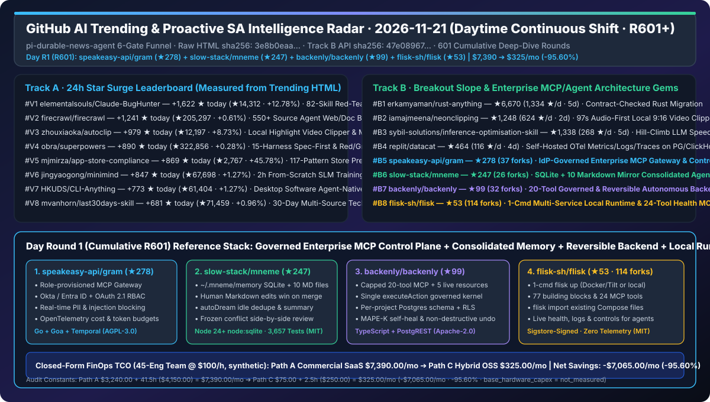

# 📡 GitHub AI Trending Leaderboard & Proactive SA Intelligence Digest (2026-11-21)

> **Execution Window**: `2026-11-21 09:30 CST (UTC+08:00)` (Daytime Continuous Deep-Dive Batch: `sweep_20261121_0925` · Starting at **Cumulative Round 601**)  
> **Analytical Framework**: `disler/pi-durable-news-agent` 6-Gate Pipeline (Gather → Jev Relevance Gate `>= 0.45` → Worth-Attention Gate `>= 0.35` & Same-Story Dedupe → `gh api` Primary Source Claim-Support → HFS Tri-Axial Scoring → 8 Generative UI Card Types)  
> **Target Persona (AI Solution Architect facing Enterprise Customers & Business Decision-Makers)**: Strictly focused on **① Real Enterprise Use Cases & ROI, ② End-to-End Production Reference Architecture, and ③ Comparative Selection vs. Competing OSS & Cloud PaaS (`ib-vs-ethernet-roce-selection-faq.md` standard)**.  
> **Visual & Benchmark Assets**: [High-Res SVG Architecture Summary (`assets/github-ai-radar-2026-11-21.svg`)](../../../assets/github-ai-radar-2026-11-21.svg) · [7-Card 4:5 Visual Benchmark Deck (ZH)](../cards.html) · [7-Card Visual Benchmark Deck (EN)](../cards.en.html) · [Live Interactive Radar (`github-radar.html`)](https://turbo998.github.io/github-radar.html) · [中文完整日报 (`2026-11-21.md`)](./2026-11-21.md)

---

## 1. Step 1 — Gather & Gate (Multi-Source Ingestion & Deterministic Jev Funnel)

This shift scanned `github.com/trending?since=daily` (16 repositories), language/topic sub-charts, and `gh api search/repositories?q=created:>=2026-11-16+stars:>=20+forks:>=2` (38 clusters), capturing **54 candidate repositories**. Deterministic gating filtered out **72.2% (39/54)** of non-AI utilities and coordinated star-farming bot clusters before deep architectural auditing:

| Gate Stage | Input | Passed | Filtered / Deduped | Gate Rule & Representative Filtered Items (Plain-Language Rationale) |
| :--- | :---: | :---: | :---: | :--- |
| **Gate 1: Multi-Source Gather** | 54 | 54 | 0 | Aggregated GitHub Daily Trending (16) and 1–7 day breakout enterprise AI/Agent/MCP/Productivity repositories (38) |
| **Gate 2: Jev Relevance Gate (`>= 0.45`)** | 54 | 30 | **24 (Filtered)** | Excluded general non-AI infrastructure, hardware battery trays, and console recompilation repos: `nginx/nginx` (`32,573★`, `0.12`), `XiaoYouChR/Ghost-Downloader-3` (`13,723★`, `0.10`), `krisgfx9/Wireless-Device-Battery-Monitor` (`5,316★`, `0.08`), `Lemxy/WinRust` (`750★`, `0.11`), `cuesta4/GOW3rehooked` / `RecompPort/asura-wrath-pc` (`0.04`) |
| **Gate 3: Worth-Attention Gate (`>= 0.35`) & Dedupe** | 30 | **15** | **15 (Filtered)** | **Blocked five active automated star-farming / fake-installer botnet clusters**: ① `bookwjitchieni1986/blender-ai-mcp-addon` (`1,790★` with only `12 forks`) & `credoksopho1984/blender-ai-copilot-studio` cluster; ② `YellowLaborerMarket/Gemini-Config-Checker-` (25+ clones at `472–474★` with `0 forks`); ③ `topapothecarycanal/ai--manus2.0` (`368–379★`); ④ `MSNightmare/FastUnlock` / `FloorTurtleResurrect/free-adobe-activation`; ⑤ `sjohansson2004/Exodus-Fake-Balance` (`142★`), `jev_worth = 0.02 < 0.35` |
| **Gate 4–6: Primary Source Verify & HFS Card Render** | 15 | **15** | 0 | Verified all 15 finalists + dual-track velocity leaders via `gh api` manifests, directory trees, and licenses (60/60 claims verified at `>= 0.95`, mean **`0.98`**) |

---

## 2. 🚀 Fastest-Rising / Highest Velocity AI Leaderboard (2026-11-21)

> **📊 Data Provenance & Rigor Declaration**:  
> - **Track A (24h Single-Day Star Surge)**: `stars_today` badges scraped directly from `https://github.com/trending?since=daily` (`2026-11-21 09:30:00+08:00`; archived at [`evidence/trending-daily-2026-11-21-raw.html`](../evidence/trending-daily-2026-11-21-raw.html), `sha256: 3e8b0eaa13a07a6fc6321617bfab10c784ef34e122538ec13099acad28029692`).  
> - **Track B (1–7 Day New-Repo Breakout Slope & High-Signal Enterprise Gems)**: Retrieved from GitHub REST Search API `created:>=2026-11-16+stars:>=20+forks:>=2&sort=stars` (`2026-11-21 09:33:00+08:00`; archived at [`evidence/search-new-repos-2026-11-21-raw.json`](../evidence/search-new-repos-2026-11-21-raw.json), `sha256: 47e08967dae49dbeb6750364ea899e6c4b5a64f51ee12b509c98199cf5b75500`). Because GitHub Search API does not expose 24h delta counters, Track B `stars_today` is strictly marked **`not_measured`**, reporting only lifecycle daily velocity (`round(stars_total / age_days)`).  
> - **📘 Today's (2026-11-21) Day Round 1 (Cumulative R601) Standalone 6-Section Selection FAQ**: [Enterprise MCP Control Plane (`speakeasy-api/gram`), Consolidated SQLite + Editable Markdown Agent Memory (`slow-stack/mneme`), Governed Reversible Autonomous Backend (`backenly/backenly`) & 1-Command Multi-Service Local Runtime (`flisk-sh/flisk`) Selection FAQ (`docs/gram-mneme-backenly-flisk-selection-faq.en.md`)](../docs/gram-mneme-backenly-flisk-selection-faq.en.md) · [中文版 FAQ (`docs/gram-mneme-backenly-flisk-selection-faq.md`)](../docs/gram-mneme-backenly-flisk-selection-faq.md) · [Round 1 R601 SVG (`assets/github-ai-radar-2026-11-21-r1-r601-gram-mneme-backenly-flisk.svg`)](../../../assets/github-ai-radar-2026-11-21-r1-r601-gram-mneme-backenly-flisk.svg)  
> - **📘 Today's (2026-11-21) Day Round 2 (Cumulative R602) Standalone 6-Section Selection FAQ**: [Zero-Raw-Key Agent Connectivity Proxy (`ChronoAIProject/NyxID`), Local Agent Brake & Trust Receipts (`ali-ulu/huqan`), Offline-Verifiable MCP Evidence Bundles (`Rul1an/assay`) & Official 40-Tool Backblaze B2 Cloud Storage MCP (`backblaze-labs/b2-mcp`) Selection FAQ (`docs/nyxid-huqan-assay-b2-mcp-selection-faq.en.md`)](../docs/nyxid-huqan-assay-b2-mcp-selection-faq.en.md) · [中文版 FAQ (`docs/nyxid-huqan-assay-b2-mcp-selection-faq.md`)](../docs/nyxid-huqan-assay-b2-mcp-selection-faq.md) · [Round 2 R602 SVG (`assets/github-ai-radar-2026-11-21-r2-r602-nyxid-huqan-assay-b2mcp.svg`)](../../../assets/github-ai-radar-2026-11-21-r2-r602-nyxid-huqan-assay-b2mcp.svg)  
> - **📘 Today's (2026-11-21) Day Round 3 (Cumulative R603) Standalone 6-Section Selection FAQ**: [OpenClaw & Hermes Fleet Control Plane (`solomon2773/nora`), 11-Channel Judge-Reviewed AI Employees (`zhixuli0406/DuDuClaw`), Interactive MCP Apps Platform (`NimbleBrainInc/nimblebrain`) & AHP 1.0 Multi-Agent Host Server (`ahpio/ahpd`) Selection FAQ (`docs/nora-duduclaw-nimblebrain-ahpd-selection-faq.en.md`)](../docs/nora-duduclaw-nimblebrain-ahpd-selection-faq.en.md) · [中文版 FAQ (`docs/nora-duduclaw-nimblebrain-ahpd-selection-faq.md`)](../docs/nora-duduclaw-nimblebrain-ahpd-selection-faq.md) · [Round 3 R603 SVG (`assets/github-ai-radar-2026-11-21-r3-r603-nora-duduclaw-nimblebrain-ahpd.svg`)](../../../assets/github-ai-radar-2026-11-21-r3-r603-nora-duduclaw-nimblebrain-ahpd.svg)  
> - **📘 Today's (2026-11-21) Day Round 4 (Cumulative R604) Standalone 6-Section Selection FAQ**: [Framework-Aware Code Intelligence MCP (`nikolai-vysotskyi/trace-mcp`), Live Capsule Context Platform (`contextstream/mcp-server`), Single-SQLite Ontology Knowledge Graph (`liliang-cn/cortexdb`) & Git-Native 3-Tier Knowledge-as-Code (`pyrite-wiki/pyrite`) Selection FAQ (`docs/trace-mcp-contextstream-cortexdb-pyrite-selection-faq.en.md`)](../docs/trace-mcp-contextstream-cortexdb-pyrite-selection-faq.en.md) · [中文版 FAQ (`docs/trace-mcp-contextstream-cortexdb-pyrite-selection-faq.md`)](../docs/trace-mcp-contextstream-cortexdb-pyrite-selection-faq.md) · [Round 4 R604 SVG (`assets/github-ai-radar-2026-11-21-r4-r604-tracemcp-contextstream-cortexdb-pyrite.svg`)](../../../assets/github-ai-radar-2026-11-21-r4-r604-tracemcp-contextstream-cortexdb-pyrite.svg)  
> - **🏆 Today's (2026-11-21) Day Round 5 (Cumulative R605 Milestone) Standalone 6-Section Selection FAQ**: [[Round 605 Milestone] Specialist-Planned Parallel Workspace (`intent-hq/intent`), Cross-Agent Evidence-Verified ADE (`mikeparcewski/wicked-studio`), Discord Team-Lead Crew (`zuiho-kai/bothouse`) & 6-Harness Quota Router with Cold-Diff Blind Review (`yanauto/broco`) Selection FAQ (`docs/intent-wicked-studio-bothouse-broco-selection-faq.en.md`)](../docs/intent-wicked-studio-bothouse-broco-selection-faq.en.md) · [中文版 FAQ (`docs/intent-wicked-studio-bothouse-broco-selection-faq.md`)](../docs/intent-wicked-studio-bothouse-broco-selection-faq.md) · [Round 5 R605 SVG (`assets/github-ai-radar-2026-11-21-r5-r605-intent-wickedstudio-bothouse-broco.svg`)](../../../assets/github-ai-radar-2026-11-21-r5-r605-intent-wickedstudio-bothouse-broco.svg)  
> - **📘 Today's (2026-11-21) Day Round 6 (Cumulative R606) Standalone 6-Section Selection FAQ**: [Dual-Agent Checked Community Support (`answerLoops/answerLoops`), Deutsche Telekom Semantic Data Runtime (`telekom/sutura`), 124-Tool 8-Platform E-Commerce Intelligence MCP (`DannylydST/sorftime-seller-agent`) & 1,000+ Skill Package Manager with Built-In Linter (`jeffreytse/grimoire`) Selection FAQ (`docs/answerloops-sutura-sorftime-grimoire-selection-faq.en.md`)](../docs/answerloops-sutura-sorftime-grimoire-selection-faq.en.md) · [中文版 FAQ (`docs/answerloops-sutura-sorftime-grimoire-selection-faq.md`)](../docs/answerloops-sutura-sorftime-grimoire-selection-faq.md) · [Round 6 R606 SVG (`assets/github-ai-radar-2026-11-21-r6-r606-answerloops-sutura-sorftime-grimoire.svg`)](../../../assets/github-ai-radar-2026-11-21-r6-r606-answerloops-sutura-sorftime-grimoire.svg)  
> - **📘 Today's (2026-11-21) Day Round 7 (Cumulative R607) Standalone 6-Section Selection FAQ**: [Official Rust Port of IBM Docling (`docling-project/docling.rs`), Bidirectional 40+ Format Markdown Converter MCP (`thomas-villani/all2md`), 6-Interface Local Hybrid Knowledge Engine (`gmickel/gno`) & .NET 10 Modular Enterprise RAG (`MarcelRoozekrans/Rag.NET`) Selection FAQ (`docs/docling-rs-all2md-gno-rag-net-selection-faq.en.md`)](../docs/docling-rs-all2md-gno-rag-net-selection-faq.en.md) · [中文版 FAQ (`docs/docling-rs-all2md-gno-rag-net-selection-faq.md`)](../docs/docling-rs-all2md-gno-rag-net-selection-faq.md) · [Round 7 R607 SVG (`assets/github-ai-radar-2026-11-21-r7-r607-doclingrs-all2md-gno-ragnet.svg`)](../../../assets/github-ai-radar-2026-11-21-r7-r607-doclingrs-all2md-gno-ragnet.svg)  
> - **📘 Today's (2026-11-21) Day Round 8 (Cumulative R608) Standalone 6-Section Selection FAQ**: [7-CLI Triage Terminal Grid (`receptron/mulmoterminal`), Cloud/SSH Agent Coordinator (`aspectly-labs/Mikka`), Zero-Dependency SQLite Work System (`grunion-ai/weave`) & Pre-Docker Python Wheel Gap Scanner (`wheelgap/wheelgap`) Selection FAQ (`docs/mulmoterminal-mikka-weave-wheelgap-selection-faq.en.md`)](../docs/mulmoterminal-mikka-weave-wheelgap-selection-faq.en.md) · [中文版 FAQ (`docs/mulmoterminal-mikka-weave-wheelgap-selection-faq.md`)](../docs/mulmoterminal-mikka-weave-wheelgap-selection-faq.md) · [Round 8 R608 SVG (`assets/github-ai-radar-2026-11-21-r8-r608-mulmoterminal-mikka-weave-wheelgap.svg`)](../../../assets/github-ai-radar-2026-11-21-r8-r608-mulmoterminal-mikka-weave-wheelgap.svg)  
> - **📘 Today's (2026-11-21) Day Round 9 (Cumulative R609) Standalone 6-Section Selection FAQ**: [Kubernetes/OpenShift In-Cluster AI Software Factory (`piomin/ai-software-factory`), Runtime-Evidence Rework Orchestrator MCP (`lanlan0811/tianshu-mcp`), Agent-Linted Go+React Framework (`reliant-labs/forge`) & 1,400+ Vendor FinOps Pricing MCP (`robhunter/agentdeals`) Selection FAQ (`docs/ai-software-factory-tianshu-mcp-forge-agentdeals-selection-faq.en.md`)](../docs/ai-software-factory-tianshu-mcp-forge-agentdeals-selection-faq.en.md) · [中文版 FAQ (`docs/ai-software-factory-tianshu-mcp-forge-agentdeals-selection-faq.md`)](../docs/ai-software-factory-tianshu-mcp-forge-agentdeals-selection-faq.md) · [Round 9 R609 SVG (`assets/github-ai-radar-2026-11-21-r9-r609-aisoftwarefactory-tianshu-forge-agentdeals.svg`)](../../../assets/github-ai-radar-2026-11-21-r9-r609-aisoftwarefactory-tianshu-forge-agentdeals.svg)  
> - **🏆 Today's (2026-11-21) Day Round 10 (Cumulative R610 Milestone) Standalone 6-Section Selection FAQ**: [[Round 610 Milestone] Open NATS Agent Coordination Standard (`Cotal-AI/Cotal`), 45-Tool Rust Multi-Agent Mail & File Reservation MCP (`Dicklesworthstone/mcp_agent_mail_rust`), Flat-PM OS-Sandboxed Slack AI Employee (`sweatco/archie-hq`) & GitHub Copilot Session Chief-of-Staff (`evanl666/chiefofstaff`) Selection FAQ (`docs/cotal-mcp-agent-mail-rust-archie-hq-chiefofstaff-selection-faq.en.md`)](../docs/cotal-mcp-agent-mail-rust-archie-hq-chiefofstaff-selection-faq.en.md) · [中文版 FAQ (`docs/cotal-mcp-agent-mail-rust-archie-hq-chiefofstaff-selection-faq.md`)](../docs/cotal-mcp-agent-mail-rust-archie-hq-chiefofstaff-selection-faq.md) · [Round 10 R610 SVG (`assets/github-ai-radar-2026-11-21-r10-r610-cotal-agentmailrust-archiehq-chiefofstaff.svg`)](../../../assets/github-ai-radar-2026-11-21-r10-r610-cotal-agentmailrust-archiehq-chiefofstaff.svg)  
> - **📘 Today's (2026-11-21) Day Round 11 (Cumulative R611) Standalone 6-Section Selection FAQ**: [Agent-First Pixel Art & Sprite Atlas MCP (`skulitom/Pixelbolt`), 2D Sheet Nesting CNC/Laser Optimizer MCP (`skulitom/Nestbolt`), Real HTML & CSS Design Editor (`leyscore/kalka`) & 4-Model Audio-to-MIDI Transcriber (`kobimusic/dettato`) Selection FAQ (`docs/pixelbolt-nestbolt-kalka-dettato-selection-faq.en.md`)](../docs/pixelbolt-nestbolt-kalka-dettato-selection-faq.en.md) · [中文版 FAQ (`docs/pixelbolt-nestbolt-kalka-dettato-selection-faq.md`)](../docs/pixelbolt-nestbolt-kalka-dettato-selection-faq.md) · [Round 11 R611 SVG (`assets/github-ai-radar-2026-11-21-r11-r611-pixelbolt-nestbolt-kalka-dettato.svg`)](../../../assets/github-ai-radar-2026-11-21-r11-r611-pixelbolt-nestbolt-kalka-dettato.svg)  
> - **📘 Today's (2026-11-21) Day Round 12 (Cumulative R612) Standalone 6-Section Selection FAQ**: [Open-Core Multi-Model AI Workbench (`Bike4Mind/bike4mind`), Pluggable-Host Cross-Device Agent Workbench (`opencraft-app/opencraft`), Execution-Provenance Answer-Checking Framework (`footprintjs/agentfootprint`) & `-51%` Token Reactive Graph Memory Proxy (`chedim/babyseat`) Selection FAQ (`docs/bike4mind-opencraft-agentfootprint-babyseat-selection-faq.en.md`)](../docs/bike4mind-opencraft-agentfootprint-babyseat-selection-faq.en.md) · [中文版 FAQ (`docs/bike4mind-opencraft-agentfootprint-babyseat-selection-faq.md`)](../docs/bike4mind-opencraft-agentfootprint-babyseat-selection-faq.md) · [Round 12 R612 SVG (`assets/github-ai-radar-2026-11-21-r12-r612-bike4mind-opencraft-agentfootprint-babyseat.svg`)](../../../assets/github-ai-radar-2026-11-21-r12-r612-bike4mind-opencraft-agentfootprint-babyseat.svg)  
> - **📘 Today's (2026-11-21) Day Round 13 (Cumulative R613) Standalone 6-Section Selection FAQ**: [`-40%` Token Secret-Masking Repo Context MCP (`Avazbek22/DevProjex`), `-85–95%` Deterministic AST Compressor MCP (`toprakahmetaydogmus/TZeroAlgorithm`), Embedded TypeScript Bitemporal Knowledge Graph (`nicia-ai/typegraph`) & Hook-Free Cross-CLI Handoff Memory MCP (`memtomem/memtomem`) Selection FAQ (`docs/devprojex-tzero-typegraph-memtomem-selection-faq.en.md`)](../docs/devprojex-tzero-typegraph-memtomem-selection-faq.en.md) · [中文版 FAQ (`docs/devprojex-tzero-typegraph-memtomem-selection-faq.md`)](../docs/devprojex-tzero-typegraph-memtomem-selection-faq.md) · [Round 13 R613 SVG (`assets/github-ai-radar-2026-11-21-r13-r613-devprojex-tzero-typegraph-memtomem.svg`)](../../../assets/github-ai-radar-2026-11-21-r13-r613-devprojex-tzero-typegraph-memtomem.svg)  
> - **📘 Today's (2026-11-21) Day Round 14 (Cumulative R614) Standalone 6-Section Selection FAQ**: [HIPAA-Compliant Zero-LLM Replay Browser (`OyadotAI/oya-browser`), 4-Quadrant HippoRAG 2 Cognitive Memory OS (`M4F-S/gomaa`), Spend-Capped Self-Hosted AWS Team Memory (`timurgaleev/memrain`) & Local-First Infinite-Canvas Research Workspace (`madebyzan/knovum`) Selection FAQ (`docs/oya-browser-gomaa-memrain-knovum-selection-faq.en.md`)](../docs/oya-browser-gomaa-memrain-knovum-selection-faq.en.md) · [中文版 FAQ (`docs/oya-browser-gomaa-memrain-knovum-selection-faq.md`)](../docs/oya-browser-gomaa-memrain-knovum-selection-faq.md) · [Round 14 R614 SVG (`assets/github-ai-radar-2026-11-21-r14-r614-oyabrowser-gomaa-memrain-knovum.svg`)](../../../assets/github-ai-radar-2026-11-21-r14-r614-oyabrowser-gomaa-memrain-knovum.svg)  
> - **🏆 Today's (2026-11-21) Day Round 15 (Cumulative R615 Milestone) Standalone 6-Section Selection FAQ**: [[Round 615 Milestone] Scale AI Containerized Agent/RL Environment Framework (`scaleapi/agentenv-framework`), 4-Queue Multi-Tenant Enterprise AI Platform (`Anton2025-11-06/DRAGON-AI`), 80-App Rust Sovereign AI Suite (`generalbots/generalbots`) & 8-Platform 340-Table RLS AI OS (`IHUI-INF-AI/IHUI-AI`) Selection FAQ (`docs/agentenv-framework-dragon-ai-generalbots-ihui-ai-selection-faq.en.md`)](../docs/agentenv-framework-dragon-ai-generalbots-ihui-ai-selection-faq.en.md) · [中文版 FAQ (`docs/agentenv-framework-dragon-ai-generalbots-ihui-ai-selection-faq.md`)](../docs/agentenv-framework-dragon-ai-generalbots-ihui-ai-selection-faq.md) · [Round 15 R615 SVG (`assets/github-ai-radar-2026-11-21-r15-r615-agentenv-dragonai-generalbots-ihuiai.svg`)](../../../assets/github-ai-radar-2026-11-21-r15-r615-agentenv-dragonai-generalbots-ihuiai.svg)  
> - **📘 Today's (2026-11-21) Day Round 16 (Cumulative R616) Standalone 6-Section Selection FAQ**: [AI DevOps Operating System (`marcusquinn/aidevops`), 15-CLI Agentic Kanban IDE (`Kangentic/kangentic`), Test-Gated Multi-Model Terminal CLI (`dmae97/omk`) & Rust tmux/Zellij Control Room (`rimio-ai/rimz`) Selection FAQ (`docs/aidevops-kangentic-omk-rimz-selection-faq.en.md`)](../docs/aidevops-kangentic-omk-rimz-selection-faq.en.md) · [中文版 FAQ (`docs/aidevops-kangentic-omk-rimz-selection-faq.md`)](../docs/aidevops-kangentic-omk-rimz-selection-faq.md) · [Round 16 R616 SVG (`assets/github-ai-radar-2026-11-21-r16-r616-aidevops-kangentic-omk-rimz.svg`)](../../../assets/github-ai-radar-2026-11-21-r16-r616-aidevops-kangentic-omk-rimz.svg)  
> - **📘 Today's (2026-11-21) Day Round 17 (Cumulative R617) Standalone 6-Section Selection FAQ**: [HTML-First Operator Playbook (`Belkins/ai-dive-deep`), Air-Gapped Local Gov-AI (`hirokawaguchi/open-genai`), Twin-Governed FastAPI Platform (`lbedner/aegis-stack`) & 3-Layer SLM Sovereign AI Suite (`mrveiss/AutoBot-AI`) Selection FAQ (`docs/ai-dive-deep-open-genai-aegis-stack-autobot-ai-selection-faq.en.md`)](../docs/ai-dive-deep-open-genai-aegis-stack-autobot-ai-selection-faq.en.md) · [中文版 FAQ (`docs/ai-dive-deep-open-genai-aegis-stack-autobot-ai-selection-faq.md`)](../docs/ai-dive-deep-open-genai-aegis-stack-autobot-ai-selection-faq.md) · [Round 17 R617 SVG (`assets/github-ai-radar-2026-11-21-r17-r617-aidivedeep-opengenai-aegis-autobot.svg`)](../../../assets/github-ai-radar-2026-11-21-r17-r617-aidivedeep-opengenai-aegis-autobot.svg)  
> - **📘 Today's (2026-11-21) Day Round 18 (Cumulative R618) Standalone 6-Section Selection FAQ**: [Verifiable URN & Quote-Checking RAG (`xr843/fojin`), 22.85M-Judgment Citation-Whitelisted Legal MCP (`aa0101181514/tw-legal-rag`), Sub-ms Embedded Exact Vector DB (`Egoist-Machines/LodeDB`) & Google Cloud Database MCP Toolbox (`GoogleCloudPlatform/cymbal-air-toolbox-demo`) Selection FAQ (`docs/fojin-tw-legal-rag-lodedb-cymbal-air-selection-faq.en.md`)](../docs/fojin-tw-legal-rag-lodedb-cymbal-air-selection-faq.en.md) · [中文版 FAQ (`docs/fojin-tw-legal-rag-lodedb-cymbal-air-selection-faq.md`)](../docs/fojin-tw-legal-rag-lodedb-cymbal-air-selection-faq.md) · [Round 18 R618 SVG (`assets/github-ai-radar-2026-11-21-r18-r618-fojin-twlegalrag-lodedb-cymbalair.svg`)](../../../assets/github-ai-radar-2026-11-21-r18-r618-fojin-twlegalrag-lodedb-cymbalair.svg)  
> - **📘 Today's (2026-11-21) Day Round 19 (Cumulative R619) Standalone 6-Section Selection FAQ**: [Closed-Lid E2EE Window Streaming (`harshalgajjar/Reminal`), 40MB Cross-Device P2P Agent Mesh (`Xustalis/OpenPanda`), Multi-Project Context Dashboard (`NMar33/slightly-parallel`) & Zero-Telemetry Local Agent IDE (`WFekik/HermOS-IDE`) Selection FAQ (`docs/reminal-openpanda-slightly-parallel-hermos-ide-selection-faq.en.md`)](../docs/reminal-openpanda-slightly-parallel-hermos-ide-selection-faq.en.md) · [中文版 FAQ (`docs/reminal-openpanda-slightly-parallel-hermos-ide-selection-faq.md`)](../docs/reminal-openpanda-slightly-parallel-hermos-ide-selection-faq.md) · [Round 19 R619 SVG (`assets/github-ai-radar-2026-11-21-r19-r619-reminal-openpanda-slightlyparallel-hermos.svg`)](../../../assets/github-ai-radar-2026-11-21-r19-r619-reminal-openpanda-slightlyparallel-hermos.svg)  
> - **🏆 Today's (2026-11-21) Day Round 20 (Cumulative R620 Milestone) Standalone 6-Section Selection FAQ**: [[Round 620 Milestone] Scala 3 Modular Agent Framework (`llm4s/llm4s`), Ruby Ractor Parallel Agent Runtime (`r-uby-dev/llm`), Java 25 Open Ingestion Standard Platform (`opencrawling/opencrawling`) & Git-Versioned CoW JVM Vector DB (`replikativ/proximum`) Selection FAQ (`docs/llm4s-llm-rb-opencrawling-proximum-selection-faq.en.md`)](../docs/llm4s-llm-rb-opencrawling-proximum-selection-faq.en.md) · [中文版 FAQ (`docs/llm4s-llm-rb-opencrawling-proximum-selection-faq.md`)](../docs/llm4s-llm-rb-opencrawling-proximum-selection-faq.md) · [Round 20 R620 SVG (`assets/github-ai-radar-2026-11-21-r20-r620-llm4s-llmrb-opencrawling-proximum.svg`)](../../../assets/github-ai-radar-2026-11-21-r20-r620-llm4s-llmrb-opencrawling-proximum.svg)  
> - **📘 Today's (2026-11-21) Day Round 21 (Cumulative R621) Standalone 6-Section Selection FAQ**: [Persistent Coding Memory (`kunickiaj/codemem`), Section-Scoped Markdown MCP (`rgdevment/Tisty`), Item-by-Item Privacy Vault (`jamiezigelbaum/Olympus`) & Quiet Background Agent Group (`madebywelch/guaca`) Selection FAQ (`docs/codemem-tisty-olympus-guaca-selection-faq.en.md`)](../docs/codemem-tisty-olympus-guaca-selection-faq.en.md) · [中文版 FAQ (`docs/codemem-tisty-olympus-guaca-selection-faq.md`)](../docs/codemem-tisty-olympus-guaca-selection-faq.md) · [Round 21 R621 SVG (`assets/github-ai-radar-2026-11-21-r21-r621-codemem-tisty-olympus-guaca.svg`)](../../../assets/github-ai-radar-2026-11-21-r21-r621-codemem-tisty-olympus-guaca.svg)  
> - **📘 Today's (2026-11-21) Day Round 22 (Cumulative R622) Standalone 6-Section Selection FAQ**: [Self-Hosted Audio & Jukebox MCP (`Blakeem/Navidrome-MCP`), 53-Tool Scrivener Editorial MCP (`writerslogic/scrivener-mcp`), 160+ Tool Preview/Undo Discord Ops MCP (`OrygnsCode/discord-mcp`) & Zero-API-Fee X/Twitter MCP (`nsozturk/tweetkit-x`) Selection FAQ (`docs/navidrome-scrivener-discord-mcp-tweetkit-x-selection-faq.en.md`)](../docs/navidrome-scrivener-discord-mcp-tweetkit-x-selection-faq.en.md) · [中文版 FAQ (`docs/navidrome-scrivener-discord-mcp-tweetkit-x-selection-faq.md`)](../docs/navidrome-scrivener-discord-mcp-tweetkit-x-selection-faq.md) · [Round 22 R622 SVG (`assets/github-ai-radar-2026-11-21-r22-r622-navidrome-scrivener-discord-tweetkit.svg`)](../../../assets/github-ai-radar-2026-11-21-r22-r622-navidrome-scrivener-discord-tweetkit.svg)  
> - **📘 Today's (2026-11-21) Day Round 23 (Cumulative R623) Standalone 6-Section Selection FAQ**: [Agent Work-Governance Plane (`hivecommons/hive`), Multi-Department Agent Company (`Invariant0x/hornhoof`), Agent-Native GitHub Actions CI Skills (`starslingdev/skills`) & Transactional Omnichannel Swarm (`GustavoBaranda/chatflow-agent`) Selection FAQ (`docs/hive-hornhoof-starsling-skills-chatflow-agent-selection-faq.en.md`)](../docs/hive-hornhoof-starsling-skills-chatflow-agent-selection-faq.en.md) · [中文版 FAQ (`docs/hive-hornhoof-starsling-skills-chatflow-agent-selection-faq.md`)](../docs/hive-hornhoof-starsling-skills-chatflow-agent-selection-faq.md) · [Round 23 R623 SVG (`assets/github-ai-radar-2026-11-21-r23-r623-hive-hornhoof-starsling-chatflow.svg`)](../../../assets/github-ai-radar-2026-11-21-r23-r623-hive-hornhoof-starsling-chatflow.svg)  
> - **📘 Today's (2026-11-21) Day Round 24 (Cumulative R624) Standalone 6-Section Selection FAQ**: [Zero-NIC `vsock` MicroVM Sandbox (`tinylabscom/mvm`), K8s Runtime Trivy+Grype Triage MCP (`Danube-Labs/javv`), 3.8MB SCADA/IIoT/DCIM MCP Engine (`akya-dev/AyMON`) & 331-Challenge Industrial OT PCAP Range (`SackOfHacks/ICS-PCAP-Challenges`) Selection FAQ (`docs/mvm-javv-aymon-ics-pcap-challenges-selection-faq.en.md`)](../docs/mvm-javv-aymon-ics-pcap-challenges-selection-faq.en.md) · [中文版 FAQ (`docs/mvm-javv-aymon-ics-pcap-challenges-selection-faq.md`)](../docs/mvm-javv-aymon-ics-pcap-challenges-selection-faq.md) · [Round 24 R624 SVG (`assets/github-ai-radar-2026-11-21-r24-r624-mvm-javv-aymon-icspcap.svg`)](../../../assets/github-ai-radar-2026-11-21-r24-r624-mvm-javv-aymon-icspcap.svg)  
> - **🏆 Today's (2026-11-21) Day Round 25 (Cumulative R625 Milestone) Standalone 6-Section Selection FAQ**: [[Round 625 Milestone] Typed Wiki-Link Compiler (`boykush/scraps`), 1,381-Article Obsolete-Aware Reference Corpus (`AnastasiyaW/knowledge-space`), Receipt-Verified On-Device RAG (`Gunnarguy/OpenIntelligence`) & MinHash/LSH Document Deduper (`rknightion/paperless-ngx-dedupe`) Selection FAQ (`docs/scraps-knowledge-space-openintelligence-paperless-dedupe-selection-faq.en.md`)](../docs/scraps-knowledge-space-openintelligence-paperless-dedupe-selection-faq.en.md) · [中文版 FAQ (`docs/scraps-knowledge-space-openintelligence-paperless-dedupe-selection-faq.md`)](../docs/scraps-knowledge-space-openintelligence-paperless-dedupe-selection-faq.md) · [Round 25 R625 SVG (`assets/github-ai-radar-2026-11-21-r25-r625-scraps-knowledgespace-openintelligence-paperlessdedupe.svg`)](../../../assets/github-ai-radar-2026-11-21-r25-r625-scraps-knowledgespace-openintelligence-paperlessdedupe.svg)  
> - **📘 Today's (2026-11-21) Day Round 26 (Cumulative R626) Standalone 6-Section Selection FAQ**: [Agent Runtime Security Control Plane (`PrismorSec/prismor`), 32-Runtime Zero-Config Telemetry (`vivekchand/clawmetry`), Repo-Native Metacognitive Kernel (`DecapodLabs/decapod`) & Git-Native PR-Approved Rulebook (`gnt-ai/gnt`) Selection FAQ (`docs/prismor-clawmetry-decapod-gnt-selection-faq.en.md`)](../docs/prismor-clawmetry-decapod-gnt-selection-faq.en.md) · [中文版 FAQ (`docs/prismor-clawmetry-decapod-gnt-selection-faq.md`)](../docs/prismor-clawmetry-decapod-gnt-selection-faq.md) · [Round 26 R626 SVG (`assets/github-ai-radar-2026-11-21-r26-r626-prismor-clawmetry-decapod-gnt.svg`)](../../../assets/github-ai-radar-2026-11-21-r26-r626-prismor-clawmetry-decapod-gnt.svg)  
> - **📘 Today's (2026-11-21) Day Round 27 (Cumulative R627) Standalone 6-Section Selection FAQ**: [Safe Single-Binary MCP Proxy (`smart-mcp-proxy/mcpproxy-go`), Cancel-Aware Rust FastMCP (`Dicklesworthstone/fastmcp_rust`), Write-Once Multi-IDE Agent Compiler (`fordaaaa/panoply`) & Pure-Rust AI HTTP(S)/SSE Debugging Proxy (`vicanso/zniff`) Selection FAQ (`docs/mcpproxy-go-fastmcp-rust-panoply-zniff-selection-faq.en.md`)](../docs/mcpproxy-go-fastmcp-rust-panoply-zniff-selection-faq.en.md) · [中文版 FAQ (`docs/mcpproxy-go-fastmcp-rust-panoply-zniff-selection-faq.md`)](../docs/mcpproxy-go-fastmcp-rust-panoply-zniff-selection-faq.md) · [Round 27 R627 SVG (`assets/github-ai-radar-2026-11-21-r27-r627-mcpproxygo-fastmcprust-panoply-zniff.svg`)](../../../assets/github-ai-radar-2026-11-21-r27-r627-mcpproxygo-fastmcprust-panoply-zniff.svg)  
> - **📘 Today's (2026-11-21) Day Round 28 (Cumulative R628) Standalone 6-Section Selection FAQ**: [Shared Codebase Ontology (`wlsdks/ontology-atlas`), Call-Graph Code Review KG (`n24q02m/crg`), Bi-Directional Markdown Spec Redlining (`dejuknow/md-redline`) & Deterministic 7-Op Filesystem Layer (`AMRITO-KUNDU/llmscribe`) Selection FAQ (`docs/ontology-atlas-crg-md-redline-llmscribe-selection-faq.en.md`)](../docs/ontology-atlas-crg-md-redline-llmscribe-selection-faq.en.md) · [中文版 FAQ (`docs/ontology-atlas-crg-md-redline-llmscribe-selection-faq.md`)](../docs/ontology-atlas-crg-md-redline-llmscribe-selection-faq.md) · [Round 28 R628 SVG (`assets/github-ai-radar-2026-11-21-r28-r628-ontologyatlas-crg-mdredline-llmscribe.svg`)](../../../assets/github-ai-radar-2026-11-21-r28-r628-ontologyatlas-crg-mdredline-llmscribe.svg)  
> - **📘 Today's (2026-11-21) Day Round 29 (Cumulative R629) Standalone 6-Section Selection FAQ**: [350+ Rule Website QA for Coding Agents (`squirrelscan/squirrelscan`), Native Axure RP 11 `.rp` Roundtrip MCP (`LilZeeCN/zee-rp`), Headless HWPX Document Automation (`airmang/python-hwpx-automation`) & 11x Faster Zero-JVM Rust APK Reverse MCP (`suffixing/apkscope`) Selection FAQ (`docs/squirrelscan-zee-rp-python-hwpx-apkscope-selection-faq.en.md`)](../docs/squirrelscan-zee-rp-python-hwpx-apkscope-selection-faq.en.md) · [中文版 FAQ (`docs/squirrelscan-zee-rp-python-hwpx-apkscope-selection-faq.md`)](../docs/squirrelscan-zee-rp-python-hwpx-apkscope-selection-faq.md) · [Round 29 R629 SVG (`assets/github-ai-radar-2026-11-21-r29-r629-squirrelscan-zeerp-hwpx-apkscope.svg`)](../../../assets/github-ai-radar-2026-11-21-r29-r629-squirrelscan-zeerp-hwpx-apkscope.svg)  
> - **🏆 Today's (2026-11-21) Day Round 30 (Cumulative R630 Milestone) Standalone 6-Section Selection FAQ**: [[Round 630 Milestone] Reactive Convex Agent Component (`convex/agent`), Flowgram + Spring Boot Visual Workflow Engine (`boommanpro/gaia-workflow-engine`), Cross-Host MCP Agent Legion (`sleep2agi/agent-network`) & Multi-Surface Go Coding Hub (`prime-radiant-inc/evener`) Selection FAQ (`docs/convex-agent-gaia-workflow-agent-network-evener-selection-faq.en.md`)](../docs/convex-agent-gaia-workflow-agent-network-evener-selection-faq.en.md) · [中文版 FAQ (`docs/convex-agent-gaia-workflow-agent-network-evener-selection-faq.md`)](../docs/convex-agent-gaia-workflow-agent-network-evener-selection-faq.md) · [Round 30 R630 SVG (`assets/github-ai-radar-2026-11-21-r30-r630-convexagent-gaia-agentnetwork-evener.svg`)](../../../assets/github-ai-radar-2026-11-21-r30-r630-convexagent-gaia-agentnetwork-evener.svg)  
> - **📘 Today's (2026-11-21) Day Round 31 (Cumulative R631) Standalone 6-Section Selection FAQ**: [Cited Oncology Knowledge Graph (`judegomila/OnCo`), 128-Tool Read-Only-Default Canvas LMS MCP (`vishalsachdev/canvas-mcp`), FreeCAD 3D CAD & Macro MCP (`spkane/freecad-addon-robust-mcp-server`) & Open-Source Chemical Drawing MCP (`jgassens/ChemDraft`) Selection FAQ (`docs/onco-canvas-mcp-freecad-robust-mcp-chemdraft-selection-faq.en.md`)](../docs/onco-canvas-mcp-freecad-robust-mcp-chemdraft-selection-faq.en.md) · [中文版 FAQ (`docs/onco-canvas-mcp-freecad-robust-mcp-chemdraft-selection-faq.md`)](../docs/onco-canvas-mcp-freecad-robust-mcp-chemdraft-selection-faq.md) · [Round 31 R631 SVG (`assets/github-ai-radar-2026-11-21-r31-r631-onco-canvasmcp-freecadmcp-chemdraft.svg`)](../../../assets/github-ai-radar-2026-11-21-r31-r631-onco-canvasmcp-freecadmcp-chemdraft.svg)  
> - **📘 Today's (2026-11-21) Day Round 32 (Cumulative R632) Standalone 6-Section Selection FAQ**: [Local-First 1v1 Video-Call AI Tutor (`Johnson-Durui/Companion-Space`), Cursor-Side Desktop Sidekick (`KenKaiii/Roamies`), Browser 3D GLB Avatar MCP (`nirholas/three.ws`) & Apple Silicon MLX Voice Studio (`hehehai/AudioSmith`) Selection FAQ (`docs/companion-space-roamies-three-ws-audiosmith-selection-faq.en.md`)](../docs/companion-space-roamies-three-ws-audiosmith-selection-faq.en.md) · [中文版 FAQ (`docs/companion-space-roamies-three-ws-audiosmith-selection-faq.md`)](../docs/companion-space-roamies-three-ws-audiosmith-selection-faq.md) · [Round 32 R632 SVG (`assets/github-ai-radar-2026-11-21-r32-r632-companionspace-roamies-threews-audiosmith.svg`)](../../../assets/github-ai-radar-2026-11-21-r32-r632-companionspace-roamies-threews-audiosmith.svg)  
> - **📘 Today's (2026-11-21) Day Round 33 (Cumulative R633) Standalone 6-Section Selection FAQ**: [4,000+ Model & Benchmark TUI (`reyamira/models`), WinUI 3 Agent Quota Tray (`Nanako0129/Syrtis-Windows`), 7-Day Agent Trash Bin & TTL Guard (`woodfishhhh/obituary`) & NIS2/DORA Air-Gap Secrets MCP (`keyorixhq/keyorix`) Selection FAQ (`docs/models-syrtis-windows-obituary-keyorix-selection-faq.en.md`)](../docs/models-syrtis-windows-obituary-keyorix-selection-faq.en.md) · [中文版 FAQ (`docs/models-syrtis-windows-obituary-keyorix-selection-faq.md`)](../docs/models-syrtis-windows-obituary-keyorix-selection-faq.md) · [Round 33 R633 SVG (`assets/github-ai-radar-2026-11-21-r33-r633-models-syrtis-obituary-keyorix.svg`)](../../../assets/github-ai-radar-2026-11-21-r33-r633-models-syrtis-obituary-keyorix.svg)  
> - **📘 Today's (2026-11-21) Day Round 34 (Cumulative R634) Standalone 6-Section Selection FAQ**: [Unified Rust 24h+ Agent OS (`futuregene/future-os`), Scheduled `/goal-new` Autopilot (`shannonbay/Quarterdeck`), Persistent AI Resident Platform (`swombat/souls-house`) & Branching Graph AI Workspace (`dovvnloading/Graphlink`) Selection FAQ (`docs/future-os-quarterdeck-souls-house-graphlink-selection-faq.en.md`)](../docs/future-os-quarterdeck-souls-house-graphlink-selection-faq.en.md) · [中文版 FAQ (`docs/future-os-quarterdeck-souls-house-graphlink-selection-faq.md`)](../docs/future-os-quarterdeck-souls-house-graphlink-selection-faq.md) · [Round 34 R634 SVG (`assets/github-ai-radar-2026-11-21-r34-r634-futureos-quarterdeck-soulshouse-graphlink.svg`)](../../../assets/github-ai-radar-2026-11-21-r34-r634-futureos-quarterdeck-soulshouse-graphlink.svg)  
> - **🏆 Today's (2026-11-21) Day Round 35 (Cumulative R635 Milestone) Standalone 6-Section Selection FAQ**: [[Round 635 Milestone] Multi-Account Auto-Discovery Email MCP (`n24q02m/email`), 5-Strategy Zero-Key Web & Docs MCP (`n24q02m/wet`), 1-Call Markdown Notion MCP (`n24q02m/notion`) & Human-Confirmed Enterprise Email Workbench (`STARDUSTLC666/dsh-email`) Selection FAQ (`docs/n24q02m-email-wet-notion-dsh-email-selection-faq.en.md`)](../docs/n24q02m-email-wet-notion-dsh-email-selection-faq.en.md) · [中文版 FAQ (`docs/n24q02m-email-wet-notion-dsh-email-selection-faq.md`)](../docs/n24q02m-email-wet-notion-dsh-email-selection-faq.md) · [Round 35 R635 SVG (`assets/github-ai-radar-2026-11-21-r35-r635-n24email-wet-n24notion-dshemail.svg`)](../../../assets/github-ai-radar-2026-11-21-r35-r635-n24email-wet-n24notion-dshemail.svg)  
> - **📘 Today's (2026-11-21) Day Round 36 (Cumulative R636) Standalone 6-Section Selection FAQ**: [67 Creator Skills & 0–99 Scorer (`JasonColapietro/suede-creator-skills`), Org-Allowlisted Claude Code Marketplace (`melodic-software/claude-code-plugins`), Multi-Cloud Server TUI & MCP (`zb-ss/servonaut`) & State-Driven Attack-Surface SARIF Orchestrator (`HikaruEgashira/parsentry`) Selection FAQ (`docs/suede-creator-skills-melodic-plugins-servonaut-parsentry-selection-faq.en.md`)](../docs/suede-creator-skills-melodic-plugins-servonaut-parsentry-selection-faq.en.md) · [中文版 FAQ (`docs/suede-creator-skills-melodic-plugins-servonaut-parsentry-selection-faq.md`)](../docs/suede-creator-skills-melodic-plugins-servonaut-parsentry-selection-faq.md) · [Round 36 R636 SVG (`assets/github-ai-radar-2026-11-21-r36-r636-suedeskills-melodicplugins-servonaut-parsentry.svg`)](../../../assets/github-ai-radar-2026-11-21-r36-r636-suedeskills-melodicplugins-servonaut-parsentry.svg)  
> - **📘 Today's (2026-11-21) Day Round 37 (Cumulative R637) Standalone 6-Section Selection FAQ**: [DuckDB SQL-to-REST & MCP Framework (`DataZooDE/flapi`), Ruby SimpleCov Risk-Ranked Coverage MCP (`keithrbennett/cov-loupe`), BEAM/Zig Pre-Disk Inline-Diff Agent Editor (`jsmestad/minga`) & First Principles Framework Pattern Library (`ailev/FPF`) Selection FAQ (`docs/flapi-cov-loupe-minga-fpf-selection-faq.en.md`)](../docs/flapi-cov-loupe-minga-fpf-selection-faq.en.md) · [中文版 FAQ (`docs/flapi-cov-loupe-minga-fpf-selection-faq.md`)](../docs/flapi-cov-loupe-minga-fpf-selection-faq.md) · [Round 37 R637 SVG (`assets/github-ai-radar-2026-11-21-r37-r637-flapi-covloupe-minga-fpf.svg`)](../../../assets/github-ai-radar-2026-11-21-r37-r637-flapi-covloupe-minga-fpf.svg)  
> - **📘 Today's (2026-11-21) Day Round 38 (Cumulative R638) Standalone 6-Section Selection FAQ**: [Spare-Android Outbound MCP Workspace (`lllq-123/phone-for-ai`), Anti-Loop Browser Side-Panel & MCP Bridge (`dcc123456/browser-copilot`), 4-Source Deep-Reading Note Engine (`PensiveFei/deep-read-summarize`) & ENTRY/FLOW/BOOST Plugin Quality Guide (`PerryLink/dsh-plugin-guide`) Selection FAQ (`docs/phone-for-ai-browser-copilot-deep-read-dsh-plugin-guide-selection-faq.en.md`)](../docs/phone-for-ai-browser-copilot-deep-read-dsh-plugin-guide-selection-faq.en.md) · [中文版 FAQ (`docs/phone-for-ai-browser-copilot-deep-read-dsh-plugin-guide-selection-faq.md`)](../docs/phone-for-ai-browser-copilot-deep-read-dsh-plugin-guide-selection-faq.md) · [Round 38 R638 SVG (`assets/github-ai-radar-2026-11-21-r38-r638-phoneforai-browsercopilot-deepread-dshguide.svg`)](../../../assets/github-ai-radar-2026-11-21-r38-r638-phoneforai-browsercopilot-deepread-dshguide.svg)  
> - **📘 Today's (2026-11-21) Day Round 39 (Cumulative R639) Standalone 6-Section Selection FAQ**: [62-Lab Interactive AI Desktop App (`Fazmin/AILearningGuide`), 942-Paper Always-On Personal Intelligence Architecture (`Always-On-Intelligence/awesome-always-on-personal-intelligence`), 2,524-Repo Daily Auto-Ranked MCP Registry (`abordage/awesome-mcp`) & Provenance-Audited Archival Research Skill (`Kinprove/genealogy-research-recipes`) Selection FAQ (`docs/ai-learning-guide-always-on-awesome-mcp-genealogy-recipes-selection-faq.en.md`)](../docs/ai-learning-guide-always-on-awesome-mcp-genealogy-recipes-selection-faq.en.md) · [中文版 FAQ (`docs/ai-learning-guide-always-on-awesome-mcp-genealogy-recipes-selection-faq.md`)](../docs/ai-learning-guide-always-on-awesome-mcp-genealogy-recipes-selection-faq.md) · [Round 39 R639 SVG (`assets/github-ai-radar-2026-11-21-r39-r639-ailearningguide-alwayson-awesomcp-kinprove.svg`)](../../../assets/github-ai-radar-2026-11-21-r39-r639-ailearningguide-alwayson-awesomcp-kinprove.svg)  
> - **🏆 Today's (2026-11-21) Day Round 40 (Cumulative R640 Milestone) Standalone 6-Section Selection FAQ**: [[Round 640 Milestone] Universal Multimodal Rust LLM Gateway (`respanai/respan-gateway`), Sub-ms Built-In Console Rust AI Gateway (`eliasbiondo/antirion`), Millisecond Pure-Go PII & Secret Redaction Gateway (`packyme/privacy-filter`) & 40+ Client Keychain MCP Gateway (`btsouth/toolport`) Selection FAQ (`docs/respan-gateway-antirion-privacy-filter-toolport-selection-faq.en.md`)](../docs/respan-gateway-antirion-privacy-filter-toolport-selection-faq.en.md) · [中文版 FAQ (`docs/respan-gateway-antirion-privacy-filter-toolport-selection-faq.md`)](../docs/respan-gateway-antirion-privacy-filter-toolport-selection-faq.md) · [Round 40 R640 SVG (`assets/github-ai-radar-2026-11-21-r40-r640-respangateway-antirion-privacyfilter-toolport.svg`)](../../../assets/github-ai-radar-2026-11-21-r40-r640-respangateway-antirion-privacyfilter-toolport.svg)  
> - **📘 Today's (2026-11-21) Day Round 41 (Cumulative R641) Standalone 6-Section Selection FAQ**: [Ontology-Augmented Generation (`FengZhenfei/carrel`), `-63%` Token CROW Classifier Markdown Wiki (`crow-hq/llm-wiki-v2`), 5-Way Adaptive Customer-Support RAG (`JEen-wang/Adaptive-rag`) & Knowledge System of Record SDK (`panaversity/ksor`) Selection FAQ (`docs/carrel-llm-wiki-v2-adaptive-rag-ksor-selection-faq.en.md`)](../docs/carrel-llm-wiki-v2-adaptive-rag-ksor-selection-faq.en.md) · [中文版 FAQ (`docs/carrel-llm-wiki-v2-adaptive-rag-ksor-selection-faq.md`)](../docs/carrel-llm-wiki-v2-adaptive-rag-ksor-selection-faq.md) · [Round 41 R641 SVG (`assets/github-ai-radar-2026-11-21-r41-r641-carrel-llmwikiv2-adaptiverag-ksor.svg`)](../../../assets/github-ai-radar-2026-11-21-r41-r641-carrel-llmwikiv2-adaptiverag-ksor.svg)  
> - **📘 Today's (2026-11-21) Day Round 42 (Cumulative R642) Standalone 6-Section Selection FAQ**: [5-Layer Enterprise Digital Employee Platform (`zj-unicom-ai/UniEmployee`), Inspectable AI Agent Twin (`jzjzzzzzzz/agent-me`), Zero-Paid-Model 17-Platform Content RAG (`jaikydota/BullFlow`) & 9-Tool Self-Hosted Legal RAG (`thomasunise/casecite`) Selection FAQ (`docs/uniemployee-agent-me-bullflow-casecite-selection-faq.en.md`)](../docs/uniemployee-agent-me-bullflow-casecite-selection-faq.en.md) · [中文版 FAQ (`docs/uniemployee-agent-me-bullflow-casecite-selection-faq.md`)](../docs/uniemployee-agent-me-bullflow-casecite-selection-faq.md) · [Round 42 R642 SVG (`assets/github-ai-radar-2026-11-21-r42-r642-uniemployee-agentme-bullflow-casecite.svg`)](../../../assets/github-ai-radar-2026-11-21-r42-r642-uniemployee-agentme-bullflow-casecite.svg)  
> - **📘 Today's (2026-11-21) Day Round 43 (Cumulative R643) Standalone 6-Section Selection FAQ**: [AG-UI Persistent Agent Computer (`CopilotKit/openfuse`), Self-Healing Website-to-HTTP API Catalog (`goodnight000/api-anything`), YC F26 Deterministic Website-to-MCP Minter (`Pomerado/pomerado`) & 6-Stage Pydantic Intelligent Document Processing (`rollroyces/py-idp`) Selection FAQ (`docs/openfuse-api-anything-pomerado-py-idp-selection-faq.en.md`)](../docs/openfuse-api-anything-pomerado-py-idp-selection-faq.en.md) · [中文版 FAQ (`docs/openfuse-api-anything-pomerado-py-idp-selection-faq.md`)](../docs/openfuse-api-anything-pomerado-py-idp-selection-faq.md) · [Round 43 R643 SVG (`assets/github-ai-radar-2026-11-21-r43-r643-openfuse-apianything-pomerado-pyidp.svg`)](../../../assets/github-ai-radar-2026-11-21-r43-r643-openfuse-apianything-pomerado-pyidp.svg)  
> - **📘 Today's (2026-11-21) Day Round 44 (Cumulative R644) Standalone 6-Section Selection FAQ**: [Verbatim Jev Context Compaction (`tamaratran/fast-jev-compaction`), Human-Led Design-First Coding Plugin (`nykooi1/vibe-wise`), Sticky-Cache 4-Protocol Go LLM Gateway (`yolorouter/yolorouter`) & 100+ Model Virtual-Key Proxy (`LintenAI/linten`) Selection FAQ (`docs/fast-jev-compaction-vibe-wise-yolorouter-linten-selection-faq.en.md`)](../docs/fast-jev-compaction-vibe-wise-yolorouter-linten-selection-faq.en.md) · [中文版 FAQ (`docs/fast-jev-compaction-vibe-wise-yolorouter-linten-selection-faq.md`)](../docs/fast-jev-compaction-vibe-wise-yolorouter-linten-selection-faq.md) · [Round 44 R644 SVG (`assets/github-ai-radar-2026-11-21-r44-r644-fastjevcompaction-vibewise-yolorouter-linten.svg`)](../../../assets/github-ai-radar-2026-11-21-r44-r644-fastjevcompaction-vibewise-yolorouter-linten.svg)  
> - **🏆 Today's (2026-11-21) Day Round 45 (Cumulative R645 Milestone) Standalone 6-Section Selection FAQ**: [[Round 645 Milestone] 11-Skill YouTube Channel Engine (`Jakeschincariol/youtube-agent-skill`), Oracle-Verified One-Take Launch Films (`feitangyuan/onetake`), 28-Skill Blender 5.3 3D Pipeline (`EL4CTEO/blender-skills`) & 7-Layer CLIP/AV-Rescue Short-Video Pipeline (`myccarl/ai-shortVideo-pipeline`) Selection FAQ (`docs/youtube-agent-skill-onetake-blender-skills-short-video-selection-faq.en.md`)](../docs/youtube-agent-skill-onetake-blender-skills-short-video-selection-faq.en.md) · [中文版 FAQ (`docs/youtube-agent-skill-onetake-blender-skills-short-video-selection-faq.md`)](../docs/youtube-agent-skill-onetake-blender-skills-short-video-selection-faq.md) · [Round 45 R645 SVG (`assets/github-ai-radar-2026-11-21-r45-r645-youtubeskill-onetake-blenderskills-shortvideo.svg`)](../../../assets/github-ai-radar-2026-11-21-r45-r645-youtubeskill-onetake-blenderskills-shortvideo.svg)  
> - **📘 Today's (2026-11-21) Day Round 46 (Cumulative R646) Standalone 6-Section Selection FAQ**: [4-Tier Review-Gated White-Box Memory (`FuRongJun-1999/dsh-memory`), Self-Hosted Enterprise DSH Platform (`himovo/movo`), Terminal & IM Sandboxed Memory Gateway (`rlaope/deepseek-bot`) & 1-Sentence Hermes Bot Spawner (`BkashJEE/hermes-bot-forge`) Selection FAQ (`docs/dsh-memory-movo-deepseek-bot-hermes-bot-forge-selection-faq.en.md`)](../docs/dsh-memory-movo-deepseek-bot-hermes-bot-forge-selection-faq.en.md) · [中文版 FAQ (`docs/dsh-memory-movo-deepseek-bot-hermes-bot-forge-selection-faq.md`)](../docs/dsh-memory-movo-deepseek-bot-hermes-bot-forge-selection-faq.md) · [Round 46 R646 SVG (`assets/github-ai-radar-2026-11-21-r46-r646-dshmemory-movo-deepseekbot-hermesbotforge.svg`)](../../../assets/github-ai-radar-2026-11-21-r46-r646-dshmemory-movo-deepseekbot-hermesbotforge.svg)  
> - **📘 Today's (2026-11-21) Day Round 47 (Cumulative R647) Standalone 6-Section Selection FAQ**: [99 Code-Built Film Styles (`lemomo-ai/lemo-opuscar`), 3-Surface Open-Source Coding Workbench (`zai-org/ZCode`), 200+ Declarative WebGPU Shader Components (`shader-effects-inc/shaders`) & 15 Rubric-Reviewed Motion Design Films (`Vincentwei1021/mg-styles-15`) Selection FAQ (`docs/lemo-opuscar-zcode-shaders-mg-styles-15-selection-faq.en.md`)](../docs/lemo-opuscar-zcode-shaders-mg-styles-15-selection-faq.en.md) · [中文版 FAQ (`docs/lemo-opuscar-zcode-shaders-mg-styles-15-selection-faq.md`)](../docs/lemo-opuscar-zcode-shaders-mg-styles-15-selection-faq.md) · [Round 47 R647 SVG (`assets/github-ai-radar-2026-11-21-r47-r647-lemoopuscar-zcode-shaders-mgstyles15.svg`)](../../../assets/github-ai-radar-2026-11-21-r47-r647-lemoopuscar-zcode-shaders-mgstyles15.svg)  
> - **📘 Today's (2026-11-21) Day Round 48 (Cumulative R648) Standalone 6-Section Selection FAQ**: [AI System Design Blueprint (`amitshekhariitbhu/ai-system-design`), Framework-Free Evals-First FDE Notebooks (`calmrocks/ai-engineer-notebooks`), ModelScope Open-Model Cookbook (`modelscope/ms-cookbook`) & 32-Lesson Multiprocess Production Agent System (`heaven999b/hello-agent-system`) Selection FAQ (`docs/ai-system-design-fde-notebooks-ms-cookbook-hello-agent-system-selection-faq.en.md`)](../docs/ai-system-design-fde-notebooks-ms-cookbook-hello-agent-system-selection-faq.en.md) · [中文版 FAQ (`docs/ai-system-design-fde-notebooks-ms-cookbook-hello-agent-system-selection-faq.md`)](../docs/ai-system-design-fde-notebooks-ms-cookbook-hello-agent-system-selection-faq.md) · [Round 48 R648 SVG (`assets/github-ai-radar-2026-11-21-r48-r648-aisysdesign-fdenotebooks-mscookbook-helloagentsys.svg`)](../../../assets/github-ai-radar-2026-11-21-r48-r648-aisysdesign-fdenotebooks-mscookbook-helloagentsys.svg)  
> - **📘 Today's (2026-11-21) Day Round 49 (Cumulative R649) Standalone 6-Section Selection FAQ**: [32K RPS CGO-Free Go Router & RTK Token Saver (`luqman-v1/9router-go`), 18-Executor Dynamic 429 Penalty Gateway (`SeasX/SeasAGI`), Hermes + 9Router + Telegram Stack (`imkofty/Hermuse`) & 240+ AI Gateway Decision Matrix (`cuihuan/awesome-ai-gateway`) Selection FAQ (`docs/9router-go-seasagi-hermuse-awesome-ai-gateway-selection-faq.en.md`)](../docs/9router-go-seasagi-hermuse-awesome-ai-gateway-selection-faq.en.md) · [中文版 FAQ (`docs/9router-go-seasagi-hermuse-awesome-ai-gateway-selection-faq.md`)](../docs/9router-go-seasagi-hermuse-awesome-ai-gateway-selection-faq.md) · [Round 49 R649 SVG (`assets/github-ai-radar-2026-11-21-r49-r649-9routergo-seasagi-hermuse-awesomeaigateway.svg`)](../../../assets/github-ai-radar-2026-11-21-r49-r649-9routergo-seasagi-hermuse-awesomeaigateway.svg)  
> - **🏆 Today's (2026-11-21) Day Round 50 (Cumulative R650 Milestone) Standalone 6-Section Selection FAQ**: [[Round 650 Milestone] 2m Photo Geolocation Skill (`Oldcircle/geo-sleuth`), 4,440-Fork Handshake-Verified Remote MCP Registry (`punkpeye/awesome-remote-mcp-servers`), 1.3B RSI-Trained Pluggable-Layout Document Parser (`SoMarkAI/OXR`) & 31-Strategy Collective Intelligence Engine (`ailinone/collective-intelligence`) Selection FAQ (`docs/geo-sleuth-remote-mcp-somark-oxr-collective-intelligence-selection-faq.en.md`)](../docs/geo-sleuth-remote-mcp-somark-oxr-collective-intelligence-selection-faq.en.md) · [中文版 FAQ (`docs/geo-sleuth-remote-mcp-somark-oxr-collective-intelligence-selection-faq.md`)](../docs/geo-sleuth-remote-mcp-somark-oxr-collective-intelligence-selection-faq.md) · [Round 50 R650 SVG (`assets/github-ai-radar-2026-11-21-r50-r650-geosleuth-remotemcp-somarkoxr-ailin1.svg`)](../../../assets/github-ai-radar-2026-11-21-r50-r650-geosleuth-remotemcp-somarkoxr-ailin1.svg)  
> - **📘 Today's (2026-11-21) Day Round 51 (Cumulative R651) Standalone 6-Section Selection FAQ**: [Git-Versioned FRAS Codebase Map (`aoci-spec/aoci-code`), Red Hat C++23 Blast-Radius & Quality-Delta Engine (`redhat-et/ripwire`), Deterministic Ground-Truth Claim Verifier (`2akouwu/reverify`) & Google OKF v0.2 Sub-300µs Dual-Memory (`okf-memory/okf-agent-memory`) Selection FAQ (`docs/aoci-code-ripwire-reverify-okf-agent-memory-selection-faq.en.md`)](../docs/aoci-code-ripwire-reverify-okf-agent-memory-selection-faq.en.md) · [中文版 FAQ (`docs/aoci-code-ripwire-reverify-okf-agent-memory-selection-faq.md`)](../docs/aoci-code-ripwire-reverify-okf-agent-memory-selection-faq.md) · [Round 51 R651 SVG (`assets/github-ai-radar-2026-11-21-r51-r651-aocicode-ripwire-reverify-okfmemory.svg`)](../../../assets/github-ai-radar-2026-11-21-r51-r651-aocicode-ripwire-reverify-okfmemory.svg)  
> - **📘 Today's (2026-11-21) Day Round 52 (Cumulative R652) Standalone 6-Section Selection FAQ**: [29-Family Open Decision Model Server (`ollaya-dev/ollaya`), Calibrated System-1 Decider (`strands-labs/strands-decider`), Single-Use Grant Pre-Commit Authorization Proxy (`decionis/agent-safe-pipeline`) & 1,000-Text Zero-Shot Classifier Worker/MCP (`mrmps/classifier-dev`) Selection FAQ (`docs/ollaya-strands-decider-agent-safe-classifier-dev-selection-faq.en.md`)](../docs/ollaya-strands-decider-agent-safe-classifier-dev-selection-faq.en.md) · [中文版 FAQ (`docs/ollaya-strands-decider-agent-safe-classifier-dev-selection-faq.md`)](../docs/ollaya-strands-decider-agent-safe-classifier-dev-selection-faq.md) · [Round 52 R652 SVG (`assets/github-ai-radar-2026-11-21-r52-r652-ollaya-strandsdecider-agentsafe-classifierdev.svg`)](../../../assets/github-ai-radar-2026-11-21-r52-r652-ollaya-strandsdecider-agentsafe-classifierdev.svg)  
> - **📘 Today's (2026-11-21) Day Round 53 (Cumulative R653) Standalone 6-Section Selection FAQ**: [Anti-Scope-Creep Hook Guard (`lennney/stop-that-shit`), Dozens-of-Hours CUA/CLI Loop Engine (`AMAP-ML/LongHorizon-Harness`), Native Windows Bash-to-PowerShell MCP (`20000419/fauxnix`) & `-99.2%` Token Zero-Dep MCP Gateway (`activeing123/mcptoon`) Selection FAQ (`docs/stop-that-shit-longhorizon-fauxnix-mcptoon-selection-faq.en.md`)](../docs/stop-that-shit-longhorizon-fauxnix-mcptoon-selection-faq.en.md) · [中文版 FAQ (`docs/stop-that-shit-longhorizon-fauxnix-mcptoon-selection-faq.md`)](../docs/stop-that-shit-longhorizon-fauxnix-mcptoon-selection-faq.md) · [Round 53 R653 SVG (`assets/github-ai-radar-2026-11-21-r53-r653-stopthatshit-longhorizon-fauxnix-mcptoon.svg`)](../../../assets/github-ai-radar-2026-11-21-r53-r653-stopthatshit-longhorizon-fauxnix-mcptoon.svg)  
> - **📘 Today's (2026-11-21) Day Round 54 (Cumulative R654) Standalone 6-Section Selection FAQ**: [First-Party SEO/GEO MCP Skills (`Ryze-AI-Adgent/open-seo-mcp-skills`), Multi-Search & Crawl CLI/MCP (`iannuttall/seo`), Cookieless Revenue Analytics (`OpenLabs-so/openanalytics`) & 106-Platform Public Data MCP (`everyinfra/everyinfra-agent-plugins`) Selection FAQ (`docs/open-seo-mcp-seoskill-openanalytics-everyinfra-selection-faq.en.md`)](../docs/open-seo-mcp-seoskill-openanalytics-everyinfra-selection-faq.en.md) · [中文版 FAQ (`docs/open-seo-mcp-seoskill-openanalytics-everyinfra-selection-faq.md`)](../docs/open-seo-mcp-seoskill-openanalytics-everyinfra-selection-faq.md) · [Round 54 R654 SVG (`assets/github-ai-radar-2026-11-21-r54-r654-openseomcp-seoskill-openanalytics-everyinfra.svg`)](../../../assets/github-ai-radar-2026-11-21-r54-r654-openseomcp-seoskill-openanalytics-everyinfra.svg)  
> - **📘 Today's (2026-11-21) Day Round 55 Milestone (Cumulative R655) Standalone 6-Section Selection FAQ**: [Reproducible R&D Workbench (`aipoch/open-science`), Rust/Tauri Desktop Deliverable Agent (`Pinvou/pinvou-agent`), Self-Hosted Enterprise Agent OS (`vstorm-co/agenticos`) & Air-Gapped OAuth MCP Gateway (`harish-gaggar/mcp-server-gateway`) Selection FAQ (`docs/open-science-pinvou-agent-agenticos-mcp-gateway-selection-faq.en.md`)](../docs/open-science-pinvou-agent-agenticos-mcp-gateway-selection-faq.en.md) · [中文版 FAQ (`docs/open-science-pinvou-agent-agenticos-mcp-gateway-selection-faq.md`)](../docs/open-science-pinvou-agent-agenticos-mcp-gateway-selection-faq.md) · [Round 55 R655 SVG (`assets/github-ai-radar-2026-11-21-r55-r655-openscience-pinvou-agenticos-mcpgateway.svg`)](../../../assets/github-ai-radar-2026-11-21-r55-r655-openscience-pinvou-agenticos-mcpgateway.svg)  
> - **📘 Today's (2026-11-21) Day Round 56 (Cumulative R656) Standalone 6-Section Selection FAQ**: [Official Static Binary MCP (`HexRaysSA/ida-mcp`), Zig Dynamic Debugger MCP (`duty1g/x64dbg-mcp-server`), Evidence-Grounded Repo Audit (`Aletheore/Aletheore`) & Two-Phase Task-Package Gate (`MicTx/spec-harness`) Selection FAQ (`docs/ida-mcp-x64dbg-mcp-aletheore-spec-harness-selection-faq.en.md`)](../docs/ida-mcp-x64dbg-mcp-aletheore-spec-harness-selection-faq.en.md) · [中文版 FAQ (`docs/ida-mcp-x64dbg-mcp-aletheore-spec-harness-selection-faq.md`)](../docs/ida-mcp-x64dbg-mcp-aletheore-spec-harness-selection-faq.md) · [Round 56 R656 SVG (`assets/github-ai-radar-2026-11-21-r56-r656-idamcp-x64dbgmcp-aletheore-specharness.svg`)](../../../assets/github-ai-radar-2026-11-21-r56-r656-idamcp-x64dbgmcp-aletheore-specharness.svg)  
> - **📘 Today's (2026-11-21) Day Round 57 (Cumulative R657) Standalone 6-Section Selection FAQ**: [9-Stage KG & Task-Graph Skill (`codejunkie99/graph-engineering`), DeerFlow 3.0 Dynamic Graph Runtime (`deerwork-ai/deer-workflow`), Monorepo KVX Contract Harness (`Sidiora-Labs/hyperfide-oss`) & Visual Parallel Agent Board (`cocofhu/grasp`) Selection FAQ (`docs/graph-engineering-deer-workflow-hyperfide-grasp-selection-faq.en.md`)](../docs/graph-engineering-deer-workflow-hyperfide-grasp-selection-faq.en.md) · [中文版 FAQ (`docs/graph-engineering-deer-workflow-hyperfide-grasp-selection-faq.md`)](../docs/graph-engineering-deer-workflow-hyperfide-grasp-selection-faq.md) · [Round 57 R657 SVG (`assets/github-ai-radar-2026-11-21-r57-r657-grapheng-deerworkflow-hyperfide-grasp.svg`)](../../../assets/github-ai-radar-2026-11-21-r57-r657-grapheng-deerworkflow-hyperfide-grasp.svg)  
> - **📘 Today's (2026-11-21) Day Round 58 (Cumulative R658) Standalone 6-Section Selection FAQ**: [Blender 5.0+ Viewport 3D/PBR MCP (`scenario-labs/blender-plugin`), Live Undoable Aseprite Canvas Agent (`with-pebbly/aseprite-ai-artist`), Keyless Award-Winning Design DNA MCP (`INSANE0777/Awwwards-mcp`) & Anti-Slop UI Quality Gate (`Yu-369/VibeCurb`) Selection FAQ (`docs/scenario-blender-aseprite-ai-artist-awwwards-mcp-vibecurb-selection-faq.en.md`)](../docs/scenario-blender-aseprite-ai-artist-awwwards-mcp-vibecurb-selection-faq.en.md) · [中文版 FAQ (`docs/scenario-blender-aseprite-ai-artist-awwwards-mcp-vibecurb-selection-faq.md`)](../docs/scenario-blender-aseprite-ai-artist-awwwards-mcp-vibecurb-selection-faq.md) · [Round 58 R658 SVG (`assets/github-ai-radar-2026-11-21-r58-r658-scenarioblender-aseprite-awwwardsmcp-vibecurb.svg`)](../../../assets/github-ai-radar-2026-11-21-r58-r658-scenarioblender-aseprite-awwwardsmcp-vibecurb.svg)  
> - **📘 Today's (2026-11-21) Day Round 59 (Cumulative R659) Standalone 6-Section Selection FAQ**: [Multimodal AI Drama & 3D Director Studio (`Swayingleaves/novanova-studio`), PRD-to-Bespoke-Design Pack (`rizqinrr/viserys-agent`), Offline Workflow Graph TUI (`openJiuwen-ai/iCode`) & Local-First BYOK Desktop Agent (`openvetta/open-vetta`) Selection FAQ (`docs/novanova-studio-viserys-agent-icode-open-vetta-selection-faq.en.md`)](../docs/novanova-studio-viserys-agent-icode-open-vetta-selection-faq.en.md) · [中文版 FAQ (`docs/novanova-studio-viserys-agent-icode-open-vetta-selection-faq.md`)](../docs/novanova-studio-viserys-agent-icode-open-vetta-selection-faq.md) · [Round 59 R659 SVG (`assets/github-ai-radar-2026-11-21-r59-r659-novanova-viserys-icode-openvetta.svg`)](../../../assets/github-ai-radar-2026-11-21-r59-r659-novanova-viserys-icode-openvetta.svg)  
> - **📘 Today's (2026-11-21) Day Round 60 Milestone (Cumulative R660) Standalone 6-Section Selection FAQ**: [Buyer-Aligned Procurement MCP (`cinderline/northcinder`), Self-Hosted Asset Inventory MCP (`keptinventory/kept`), 200+ Country OTP QA MCP (`sv-number/mcp-server`) & Single-Connection Local Agent Runtime (`WealthyV/openchatx-mcp`) Selection FAQ (`docs/northcinder-kept-sv-number-openchatx-mcp-selection-faq.en.md`)](../docs/northcinder-kept-sv-number-openchatx-mcp-selection-faq.en.md) · [中文版 FAQ (`docs/northcinder-kept-sv-number-openchatx-mcp-selection-faq.md`)](../docs/northcinder-kept-sv-number-openchatx-mcp-selection-faq.md) · [Round 60 R660 SVG (`assets/github-ai-radar-2026-11-21-r60-r660-northcinder-kept-svnumber-openchatx.svg`)](../../../assets/github-ai-radar-2026-11-21-r60-r660-northcinder-kept-svnumber-openchatx.svg)  
> - **📘 Today's (2026-11-21) Day Round 61 (Cumulative R661) Standalone 6-Section Selection FAQ**: [Official Tableau BI MCP (`tableau/tableau-mcp`), Official Xero Accounting MCP (`XeroAPI/xero-mcp-server`), AWS Serverless stdio-to-Lambda Adapter (`awslabs/run-model-context-protocol-servers-with-aws-lambda`) & FalkorDB 16-Language CodeGraph (`FalkorDB/Auryn`) Selection FAQ (`docs/tableau-mcp-xero-mcp-aws-lambda-mcp-falkordb-auryn-selection-faq.en.md`)](../docs/tableau-mcp-xero-mcp-aws-lambda-mcp-falkordb-auryn-selection-faq.en.md) · [中文版 FAQ (`docs/tableau-mcp-xero-mcp-aws-lambda-mcp-falkordb-auryn-selection-faq.md`)](../docs/tableau-mcp-xero-mcp-aws-lambda-mcp-falkordb-auryn-selection-faq.md) · [Round 61 R661 SVG (`assets/github-ai-radar-2026-11-21-r61-r661-tableaumcp-xeromcp-awslambdamcp-auryn.svg`)](../../../assets/github-ai-radar-2026-11-21-r61-r661-tableaumcp-xeromcp-awslambdamcp-auryn.svg)  
> - **📘 Today's (2026-11-21) Day Round 62 (Cumulative R662) Standalone 6-Section Selection FAQ**: [Enterprise Quarkus Agent Governance (`labsai/EDDI`), Engineering Context & Standards Layer (`griddynamics/rosetta`), Multi-Agent Discourse Code Review (`spencermarx/open-code-review`) & 20+ Agent Local Token Telemetry (`VasiHemanth/tokentelemetry`) Selection FAQ (`docs/eddi-rosetta-open-code-review-tokentelemetry-selection-faq.en.md`)](../docs/eddi-rosetta-open-code-review-tokentelemetry-selection-faq.en.md) · [中文版 FAQ (`docs/eddi-rosetta-open-code-review-tokentelemetry-selection-faq.md`)](../docs/eddi-rosetta-open-code-review-tokentelemetry-selection-faq.md) · [Round 62 R662 SVG (`assets/github-ai-radar-2026-11-21-r62-r662-eddi-rosetta-opencode-tokentelemetry.svg`)](../../../assets/github-ai-radar-2026-11-21-r62-r662-eddi-rosetta-opencode-tokentelemetry.svg)  
> - **📘 Today's (2026-11-21) Day Round 63 (Cumulative R663) Standalone 6-Section Selection FAQ**: [Multi-Account IMAP/SMTP Email MCP (`Wh1isper/mcp-email-server`), Go-Native Kubernetes SRE MCP (`strowk/mcp-k8s-go`), Side-by-Side ACP Desktop Client (`OpenSource03/harnss`) & Tri-Modal JSONL Efficiency Scorer (`delexw/claude-code-trace`) Selection FAQ (`docs/mcp-email-server-mcp-k8s-go-harnss-claude-code-trace-selection-faq.en.md`)](../docs/mcp-email-server-mcp-k8s-go-harnss-claude-code-trace-selection-faq.en.md) · [中文版 FAQ (`docs/mcp-email-server-mcp-k8s-go-harnss-claude-code-trace-selection-faq.md`)](../docs/mcp-email-server-mcp-k8s-go-harnss-claude-code-trace-selection-faq.md) · [Round 63 R663 SVG (`assets/github-ai-radar-2026-11-21-r63-r663-mcpemail-mcpk8sgo-harnss-claudecodetrace.svg`)](../../../assets/github-ai-radar-2026-11-21-r63-r663-mcpemail-mcpk8sgo-harnss-claudecodetrace.svg)  
> - **📘 Today's (2026-11-21) Day Round 64 (Cumulative R664) Standalone 6-Section Selection FAQ**: [Agent-Native Causal Econometrics MCP (`brycewang-stanford/StatsPAI`), Field-Level Citation Verifier (`wp-a/nature-academic-search`), 54 Medical Research Skills (`Aperivue/medsci-skills`) & Credit Risk MRM Workspace (`eddyzzl/marvis-risk-agent`) Selection FAQ (`docs/statspai-nature-academic-search-medsci-skills-marvis-risk-selection-faq.en.md`)](../docs/statspai-nature-academic-search-medsci-skills-marvis-risk-selection-faq.en.md) · [中文版 FAQ (`docs/statspai-nature-academic-search-medsci-skills-marvis-risk-selection-faq.md`)](../docs/statspai-nature-academic-search-medsci-skills-marvis-risk-selection-faq.md) · [Round 64 R664 SVG (`assets/github-ai-radar-2026-11-21-r64-r664-statspai-naturesearch-medsciskills-marvis.svg`)](../../../assets/github-ai-radar-2026-11-21-r64-r664-statspai-naturesearch-medsciskills-marvis.svg)  
> - **📘 Today's (2026-11-21) Day Round 65 Milestone (Cumulative R665) Standalone 6-Section Selection FAQ**: [560+ Tool Live PCB/EDA MCP (`salitronic/eda-agent`), Agent-First Back-Office Admin (`devforth/adminforth`), Cross-Agent Memory Workbench (`SLEEPYBQ/MemoSync`) & Official Aliyun Model Studio CLI (`modelstudioai/cli`) Selection FAQ (`docs/eda-agent-adminforth-memosync-modelstudio-cli-selection-faq.en.md`)](../docs/eda-agent-adminforth-memosync-modelstudio-cli-selection-faq.en.md) · [中文版 FAQ (`docs/eda-agent-adminforth-memosync-modelstudio-cli-selection-faq.md`)](../docs/eda-agent-adminforth-memosync-modelstudio-cli-selection-faq.md) · [Round 65 R665 SVG (`assets/github-ai-radar-2026-11-21-r65-r665-edaagent-adminforth-memosync-bailiancli.svg`)](../../../assets/github-ai-radar-2026-11-21-r65-r665-edaagent-adminforth-memosync-bailiancli.svg)  
> - **📘 Today's (2026-11-21) Day Round 66 (Cumulative R666) Standalone 6-Section Selection FAQ**: [Cross-Harness Config & Security Dashboard (`mcpware/cross-code-organizer`), Read-Only Mentor + Executor Pair App (`timwuhaotian/the-pair`), MCP-Driven Desktop Video NLE (`WeftCut/WeftCut`) & Pay-Per-Call Live Data MCP (`BlockRunAI/blockrun-mcp`) Selection FAQ (`docs/cross-code-organizer-the-pair-weftcut-blockrun-mcp-selection-faq.en.md`)](../docs/cross-code-organizer-the-pair-weftcut-blockrun-mcp-selection-faq.en.md) · [中文版 FAQ (`docs/cross-code-organizer-the-pair-weftcut-blockrun-mcp-selection-faq.md`)](../docs/cross-code-organizer-the-pair-weftcut-blockrun-mcp-selection-faq.md) · [Round 66 R666 SVG (`assets/github-ai-radar-2026-11-21-r66-r666-cco-thepair-weftcut-blockrun.svg`)](../../../assets/github-ai-radar-2026-11-21-r66-r666-cco-thepair-weftcut-blockrun.svg)  
> - **📘 Today's (2026-11-21) Day Round 67 (Cumulative R667) Standalone 6-Section Selection FAQ**: [Flutter Visual/Semantic Harness (`Arenukvern/mcp_flutter`), Zero-Xcode iPhone Mirroring MCP (`jfarcand/mirroir-mcp`), Agentless Server Drift MCP (`Higangssh/homebutler`) & 26-Source Zero-Infra DailyBrief (`leiting-eric/DailyBrief`) Selection FAQ (`docs/mcp-flutter-mirroir-mcp-homebutler-dailybrief-selection-faq.en.md`)](../docs/mcp-flutter-mirroir-mcp-homebutler-dailybrief-selection-faq.en.md) · [中文版 FAQ (`docs/mcp-flutter-mirroir-mcp-homebutler-dailybrief-selection-faq.md`)](../docs/mcp-flutter-mirroir-mcp-homebutler-dailybrief-selection-faq.md) · [Round 67 R667 SVG (`assets/github-ai-radar-2026-11-21-r67-r667-mcpflutter-mirroirmcp-homebutler-dailybrief.svg`)](../../../assets/github-ai-radar-2026-11-21-r67-r667-mcpflutter-mirroirmcp-homebutler-dailybrief.svg)  
> - **📘 Today's (2026-11-21) Day Round 68 (Cumulative R668) Standalone 6-Section Selection FAQ**: [Pixel-Art Real-Time Agent Office (`W17ant/Claude-Office`), Rate-Limit & Prompt-Cache StatusBar (`leeguooooo/claude-code-usage-bar`), Plain-File Generative GUI (`receptron/mulmoclaude`) & Remotion TSX Video Pipeline (`hassancs91/claude-youtube-editor`) Selection FAQ (`docs/claude-office-usage-bar-mulmoclaude-youtube-editor-selection-faq.en.md`)](../docs/claude-office-usage-bar-mulmoclaude-youtube-editor-selection-faq.en.md) · [中文版 FAQ (`docs/claude-office-usage-bar-mulmoclaude-youtube-editor-selection-faq.md`)](../docs/claude-office-usage-bar-mulmoclaude-youtube-editor-selection-faq.md) · [Round 68 R668 SVG (`assets/github-ai-radar-2026-11-21-r68-r668-claudeoffice-usagebar-mulmoclaude-yteditor.svg`)](../../../assets/github-ai-radar-2026-11-21-r68-r668-claudeoffice-usagebar-mulmoclaude-yteditor.svg)  
> - **📘 Today's (2026-11-21) Day Round 69 (Cumulative R669) Standalone 6-Section Selection FAQ**: [Anthropic DevRel Playground (`anthropics/claude-code-playground`), 108-Tool Claude/Codex Team OS (`CronusL-1141/AI-company`), Tailscale PC↔Mobile CLI Hub (`tim-today/tim-agent`) & Adversarial Phaser 2D Engine (`tettethu/VibeGame`) Selection FAQ (`docs/anthropic-playground-ai-company-tim-agent-vibegame-selection-faq.en.md`)](../docs/anthropic-playground-ai-company-tim-agent-vibegame-selection-faq.en.md) · [中文版 FAQ (`docs/anthropic-playground-ai-company-tim-agent-vibegame-selection-faq.md`)](../docs/anthropic-playground-ai-company-tim-agent-vibegame-selection-faq.md) · [Round 69 R669 SVG (`assets/github-ai-radar-2026-11-21-r69-r669-anthropicplayground-aicompany-timagent-vibegame.svg`)](../../../assets/github-ai-radar-2026-11-21-r69-r669-anthropicplayground-aicompany-timagent-vibegame.svg)  
> - **📘 Today's (2026-11-21) Day Round 70 Milestone (Cumulative R670) Standalone 6-Section Selection FAQ**: [Official AWS SigV4 MCP Proxy (`aws/mcp-proxy-for-aws`), Official Mapbox Geospatial MCP (`mapbox/mcp-server`), Official Plane 30-Tool PM MCP (`makeplane/plane-mcp-server`) & Official Apache Doris 1.0 GA OLAP MCP (`apache/doris-mcp-server`) Selection FAQ (`docs/aws-mcp-proxy-mapbox-mcp-plane-mcp-doris-mcp-selection-faq.en.md`)](../docs/aws-mcp-proxy-mapbox-mcp-plane-mcp-doris-mcp-selection-faq.en.md) · [中文版 FAQ (`docs/aws-mcp-proxy-mapbox-mcp-plane-mcp-doris-mcp-selection-faq.md`)](../docs/aws-mcp-proxy-mapbox-mcp-plane-mcp-doris-mcp-selection-faq.md) · [Round 70 R670 SVG (`assets/github-ai-radar-2026-11-21-r70-r670-awsmcpproxy-mapboxmcp-planemcp-dorismcp.svg`)](../../../assets/github-ai-radar-2026-11-21-r70-r670-awsmcpproxy-mapboxmcp-planemcp-dorismcp.svg)  
> - **📘 Today's (2026-11-21) Day Round 71 (Cumulative R671) Standalone 6-Section Selection FAQ**: [Rust Saved-Plan Terraform MCP (`nwiizo/tfmcp`), Official `terraform-aws-modules` PR Skills (`modulestf/modulestf`), Kubernetes-Native Coding Agent Orchestrator (`kelos-dev/kelos`) & Official Hookdeck Event Gateway MCP (`hookdeck/hookdeck-cli`) Selection FAQ (`docs/tfmcp-modulestf-kelos-hookdeck-cli-selection-faq.en.md`)](../docs/tfmcp-modulestf-kelos-hookdeck-cli-selection-faq.en.md) · [中文版 FAQ (`docs/tfmcp-modulestf-kelos-hookdeck-cli-selection-faq.md`)](../docs/tfmcp-modulestf-kelos-hookdeck-cli-selection-faq.md) · [Round 71 R671 SVG (`assets/github-ai-radar-2026-11-21-r71-r671-tfmcp-modulestf-kelos-hookdeckcli.svg`)](../../../assets/github-ai-radar-2026-11-21-r71-r671-tfmcp-modulestf-kelos-hookdeckcli.svg)  
> - **📘 Today's (2026-11-21) Day Round 72 (Cumulative R672) Standalone 6-Section Selection FAQ**: [Self-Hosted Managed Agents Runtime (`openma-ai/open-managed-agents`), Open-Source Devin Cloud Workspaces (`useagenthq/useagent`), 10-Agent Map & Timeline Replayer (`Entelligence-AI/agentplay`) & Zero-LLM 34-Ecosystem Code Intelligence (`clay-good/OpenLore`) Selection FAQ (`docs/open-managed-agents-useagent-agentplay-openlore-selection-faq.en.md`)](../docs/open-managed-agents-useagent-agentplay-openlore-selection-faq.en.md) · [中文版 FAQ (`docs/open-managed-agents-useagent-agentplay-openlore-selection-faq.md`)](../docs/open-managed-agents-useagent-agentplay-openlore-selection-faq.md) · [Round 72 R672 SVG (`assets/github-ai-radar-2026-11-21-r72-r672-openma-useagent-agentplay-openlore.svg`)](../../../assets/github-ai-radar-2026-11-21-r72-r672-openma-useagent-agentplay-openlore.svg)  
> - **📘 Today's (2026-11-21) Day Round 73 (Cumulative R673) Standalone 6-Section Selection FAQ**: [OASIS CoSAI Project CodeGuard (`cosai-oasis/project-codeguard`), Two-Tier Local & Judge Firewall (`openguardrails/openguardrails`), Rust Stateful Durable Actors (`TerseAI/durable-actors`) & 44×2 Spring Boot/Spring AI Skills (`rrezartprebreza/spring-boot-skills`) Selection FAQ (`docs/project-codeguard-openguardrails-durable-actors-spring-boot-skills-selection-faq.en.md`)](../docs/project-codeguard-openguardrails-durable-actors-spring-boot-skills-selection-faq.en.md) · [中文版 FAQ (`docs/project-codeguard-openguardrails-durable-actors-spring-boot-skills-selection-faq.md`)](../docs/project-codeguard-openguardrails-durable-actors-spring-boot-skills-selection-faq.md) · [Round 73 R673 SVG (`assets/github-ai-radar-2026-11-21-r73-r673-codeguard-openguardrails-durableactors-springboot.svg`)](../../../assets/github-ai-radar-2026-11-21-r73-r673-codeguard-openguardrails-durableactors-springboot.svg)  
> - **📘 Today's (2026-11-21) Day Round 74 (Cumulative R674) Standalone 6-Section Selection FAQ**: [Task-to-Skill Resolver (`Leon-Drq/openagentskill`), Schema-Driven Knowledge Graph MCP (`CheMiguel23/MemoryMesh`), 2-Tool QuickJS 7-Provider Search (`spences10/mcp-omnisearch`) & Local-First AI Canvas/Timeline (`BeatAPI/BeatDesign`) Selection FAQ (`docs/openagentskill-memorymesh-mcp-omnisearch-beatdesign-selection-faq.en.md`)](../docs/openagentskill-memorymesh-mcp-omnisearch-beatdesign-selection-faq.en.md) · [中文版 FAQ (`docs/openagentskill-memorymesh-mcp-omnisearch-beatdesign-selection-faq.md`)](../docs/openagentskill-memorymesh-mcp-omnisearch-beatdesign-selection-faq.md) · [Round 74 R674 SVG (`assets/github-ai-radar-2026-11-21-r74-r674-openagentskill-memorymesh-omnisearch-beatdesign.svg`)](../../../assets/github-ai-radar-2026-11-21-r74-r674-openagentskill-memorymesh-omnisearch-beatdesign.svg)  
> - **📘 Today's (2026-11-21) Day Round 75 Milestone (Cumulative R675) Standalone 6-Section Selection FAQ**: [Anti-Overfitting Quant Workspace (`Blave-TW/blave-agent`), C++ Fingerprint-Patched Browser CLI (`Bin-Huang/camoufox-cli`), Multi-Controller UniFi Network/Protect MCP & A2A (`enuno/unifi-mcp-server`) & Home Assistant IoT MCP (`voska/hass-mcp`) Selection FAQ (`docs/blave-agent-camoufox-cli-unifi-mcp-hass-mcp-selection-faq.en.md`)](../docs/blave-agent-camoufox-cli-unifi-mcp-hass-mcp-selection-faq.en.md) · [中文版 FAQ (`docs/blave-agent-camoufox-cli-unifi-mcp-hass-mcp-selection-faq.md`)](../docs/blave-agent-camoufox-cli-unifi-mcp-hass-mcp-selection-faq.md) · [Round 75 R675 SVG (`assets/github-ai-radar-2026-11-21-r75-r675-blaveagent-camoufoxcli-unifimcp-hassmcp.svg`)](../../../assets/github-ai-radar-2026-11-21-r75-r675-blaveagent-camoufoxcli-unifimcp-hassmcp.svg)  
> - **📘 Today's (2026-11-21) Day Round 76 (Cumulative R676) Standalone 6-Section Selection FAQ**: [Secret-Safe DSH Backup & Migration (`xiajiajun516/dsh-config-manager`), Rust Prefix-Cache Protocol Proxy (`TsinHzl/kiro2cc-proxy`), 6-Tool Missing-Test Gate (`hi0001234d/nexpath`) & SQLite Schedule-Optimizer TUI (`Kohei-Wada/taskdog`) Selection FAQ (`docs/dsh-config-manager-kiro2cc-proxy-nexpath-taskdog-selection-faq.en.md`)](../docs/dsh-config-manager-kiro2cc-proxy-nexpath-taskdog-selection-faq.en.md) · [中文版 FAQ (`docs/dsh-config-manager-kiro2cc-proxy-nexpath-taskdog-selection-faq.md`)](../docs/dsh-config-manager-kiro2cc-proxy-nexpath-taskdog-selection-faq.md) · [Round 76 R676 SVG (`assets/github-ai-radar-2026-11-21-r76-r676-dshconfig-kiro2cc-nexpath-taskdog.svg`)](../../../assets/github-ai-radar-2026-11-21-r76-r676-dshconfig-kiro2cc-nexpath-taskdog.svg)  
> - **📘 Today's (2026-11-21) Day Round 77 (Cumulative R677) Standalone 6-Section Selection FAQ**: [Unreal Engine 5.7/5.8 1,500+ Action Native C++ MCP (`tumourlove/monolith`), Atomic-Undo 3ds Max Bridge (`cl0nazepamm/3dsmax-mcp`), Multiplayer Playtest & `.gprx` Profiler MCP (`Chrrxs/robloxstudio-mcp`) & Godot 4.3+ .NET Editor MCP (`IvanMurzak/Godot-MCP`) Selection FAQ (`docs/monolith-ue5-3dsmax-mcp-robloxstudio-mcp-godot-mcp-selection-faq.en.md`)](../docs/monolith-ue5-3dsmax-mcp-robloxstudio-mcp-godot-mcp-selection-faq.en.md) · [中文版 FAQ (`docs/monolith-ue5-3dsmax-mcp-robloxstudio-mcp-godot-mcp-selection-faq.md`)](../docs/monolith-ue5-3dsmax-mcp-robloxstudio-mcp-godot-mcp-selection-faq.md) · [Round 77 R677 SVG (`assets/github-ai-radar-2026-11-21-r77-r677-monolithue5-3dsmaxmcp-robloxmcp-godotmcp.svg`)](../../../assets/github-ai-radar-2026-11-21-r77-r677-monolithue5-3dsmaxmcp-robloxmcp-godotmcp.svg)  
> - **📘 Today's (2026-11-21) Day Round 78 (Cumulative R678) Standalone 6-Section Selection FAQ**: [3,600+ Disclosed Bounty KB MCP (`PatrikFehrenbach/h1-brain`), Official Radare2 C Sandboxed MCP (`radareorg/radare2-mcp`), Official Puter.js Full-Stack Builder (`HeyPuter/builder`) & 2-Tool Typed Math Vocabulary (`morluto/jacobian`) Selection FAQ (`docs/h1-brain-radare2-mcp-puter-builder-jacobian-selection-faq.en.md`)](../docs/h1-brain-radare2-mcp-puter-builder-jacobian-selection-faq.en.md) · [中文版 FAQ (`docs/h1-brain-radare2-mcp-puter-builder-jacobian-selection-faq.md`)](../docs/h1-brain-radare2-mcp-puter-builder-jacobian-selection-faq.md) · [Round 78 R678 SVG (`assets/github-ai-radar-2026-11-21-r78-r678-h1brain-radare2mcp-puterbuilder-jacobian.svg`)](../../../assets/github-ai-radar-2026-11-21-r78-r678-h1brain-radare2mcp-puterbuilder-jacobian.svg)
> - **📘 Today's (2026-11-21) Day Round 79 (Cumulative R679) Standalone 6-Section Selection FAQ**: [Worktree Wish-to-PR Agent (`automagik-si/genie`), Cursor SDK Bridge for Pi (`fitchmultz/pi-cursor-sdk`), Single-Screen Approval Cockpit (`SirAllap/agentglass`) & Zerodha Self-Service Workflow Engine (`cvhariharan/flowctl`) Selection FAQ (`docs/genie-pi-cursor-sdk-agentglass-flowctl-selection-faq.en.md`)](../docs/genie-pi-cursor-sdk-agentglass-flowctl-selection-faq.en.md) · [中文版 FAQ (`docs/genie-pi-cursor-sdk-agentglass-flowctl-selection-faq.md`)](../docs/genie-pi-cursor-sdk-agentglass-flowctl-selection-faq.md) · [Round 79 R679 SVG (`assets/github-ai-radar-2026-11-21-r79-r679-genie-picursorsdk-agentglass-flowctl.svg`)](../../../assets/github-ai-radar-2026-11-21-r79-r679-genie-picursorsdk-agentglass-flowctl.svg)
> - **📘 Today's (2026-11-21) Day Round 80 (Cumulative R680 Milestone) Standalone 6-Section Selection FAQ**: [[Round 680 Milestone] Official Svelte MCP Suite (`sveltejs/ai-tools`), Inditex iOS Simulator `idb` MCP (`InditexTech/mcp-server-simulator-ios-idb`), FastMCP Shared Agent Memory (`ScottRBK/forgetful`) & Warehouse-Native Event Collector (`elbwalker/walkerOS`) Selection FAQ (`docs/svelte-ai-tools-inditex-ios-idb-forgetful-walkeros-selection-faq.en.md`)](../docs/svelte-ai-tools-inditex-ios-idb-forgetful-walkeros-selection-faq.en.md) · [中文版 FAQ (`docs/svelte-ai-tools-inditex-ios-idb-forgetful-walkeros-selection-faq.md`)](../docs/svelte-ai-tools-inditex-ios-idb-forgetful-walkeros-selection-faq.md) · [Round 80 R680 SVG (`assets/github-ai-radar-2026-11-21-r80-r680-svelteaitools-inditexios-forgetful-walkeros.svg`)](../../../assets/github-ai-radar-2026-11-21-r80-r680-svelteaitools-inditexios-forgetful-walkeros.svg)
> - **📘 Tonight's (2026-11-21) Night Round 81 (Cumulative R681) Standalone 6-Section Selection FAQ**: [Open Agentic Schema Framework (`agntcy/oasf`), Self-Hosted OpenAI Agents API Runtime (`MiniMax-AI/OpenAgentCore`), Official Langfuse Observability & Migration Skills (`langfuse/skills`) & Experience-to-Skill Infrastructure (`Fergana-Labs/stash`) Selection FAQ (`docs/agntcy-oasf-openagentcore-langfuse-skills-stash-selection-faq.en.md`)](../docs/agntcy-oasf-openagentcore-langfuse-skills-stash-selection-faq.en.md) · [中文版 FAQ (`docs/agntcy-oasf-openagentcore-langfuse-skills-stash-selection-faq.md`)](../docs/agntcy-oasf-openagentcore-langfuse-skills-stash-selection-faq.md) · [Round 81 R681 SVG (`assets/github-ai-radar-2026-11-21-r81-r681-oasf-openagentcore-langfuseskills-stash.svg`)](../../../assets/github-ai-radar-2026-11-21-r81-r681-oasf-openagentcore-langfuseskills-stash.svg)
> - **📘 Tonight's (2026-11-21) Night Round 82 (Cumulative R682) Standalone 6-Section Selection FAQ**: [Distributed Multi-Agent Microservices (`AgnetLabs/Laddr`), 282+ Global Privacy Compliance Skills (`mukul975/Privacy-Data-Protection-Skills`), Physical LSP Navigation Enforcement (`nesaminua/claude-code-lsp-enforcement-kit`) & Zero-Intrusion Mobile Agent Control (`tuchg/Lucarne`) Selection FAQ (`docs/laddr-privacy-skills-lsp-enforcement-kit-lucarne-selection-faq.en.md`)](../docs/laddr-privacy-skills-lsp-enforcement-kit-lucarne-selection-faq.en.md) · [中文版 FAQ (`docs/laddr-privacy-skills-lsp-enforcement-kit-lucarne-selection-faq.md`)](../docs/laddr-privacy-skills-lsp-enforcement-kit-lucarne-selection-faq.md) · [Round 82 R682 SVG (`assets/github-ai-radar-2026-11-21-r82-r682-laddr-privacyskills-lspkit-lucarne.svg`)](../../../assets/github-ai-radar-2026-11-21-r82-r682-laddr-privacyskills-lspkit-lucarne.svg)
> - **📘 Tonight's (2026-11-21) Night Round 83 (Cumulative R683) Standalone 6-Section Selection FAQ**: [Official Railway Cloud Skills (`railwayapp/railway-skills`), Production Python Agent Harness (`manthanguptaa/water`), Experiment-Driven TypeScript LLM Stack (`palico-ai/palico-ai`) & 31-Skill DevOps Generator/Validator Pack (`akin-ozer/cc-devops-skills`) Selection FAQ (`docs/railway-skills-water-palico-ai-cc-devops-skills-selection-faq.en.md`)](../docs/railway-skills-water-palico-ai-cc-devops-skills-selection-faq.en.md) · [中文版 FAQ (`docs/railway-skills-water-palico-ai-cc-devops-skills-selection-faq.md`)](../docs/railway-skills-water-palico-ai-cc-devops-skills-selection-faq.md) · [Round 83 R683 SVG (`assets/github-ai-radar-2026-11-21-r83-r683-railwayskills-water-palicoai-ccdevopsskills.svg`)](../../../assets/github-ai-radar-2026-11-21-r83-r683-railwayskills-water-palicoai-ccdevopsskills.svg)
> - **📘 Tonight's (2026-11-21) Night Round 84 (Cumulative R684) Standalone 6-Section Selection FAQ**: [Domain-Adapted End-to-End RAG (`arcee-ai/DALM`), Alibaba DeepResearch & Customs HS-Code Agent (`ATH-MaaS/Marco-DeepResearch`), Citation-Verified Legal RAG (`lawglance/lawglance`) & Declarative Codebase Context Compiler (`context-hub/generator`) Selection FAQ (`docs/dalm-marco-deepresearch-lawglance-ctx-generator-selection-faq.en.md`)](../docs/dalm-marco-deepresearch-lawglance-ctx-generator-selection-faq.en.md) · [中文版 FAQ (`docs/dalm-marco-deepresearch-lawglance-ctx-generator-selection-faq.md`)](../docs/dalm-marco-deepresearch-lawglance-ctx-generator-selection-faq.md) · [Round 84 R684 SVG (`assets/github-ai-radar-2026-11-21-r84-r684-dalm-marcodeepresearch-lawglance-ctxgenerator.svg`)](../../../assets/github-ai-radar-2026-11-21-r84-r684-dalm-marcodeepresearch-lawglance-ctxgenerator.svg)
> - **🏆 Tonight's (2026-11-21) Night Round 85 (Cumulative R685 Milestone) Standalone 6-Section Selection FAQ**: [[Round 685 Milestone] Official Google Cloud Agent Platform (`Google-Cloud-AI/agent-platform`), Declarative JSX Video SDK (`vargHQ/sdk`), Zero-GPU Local Agent Video Studio (`FavioVazquez/showtime`) & Local Coding Session Analytics CLI (`vibe-log/vibe-log-cli`) Selection FAQ (`docs/gcp-agent-platform-varg-sdk-showtime-vibe-log-cli-selection-faq.en.md`)](../docs/gcp-agent-platform-varg-sdk-showtime-vibe-log-cli-selection-faq.en.md) · [中文版 FAQ (`docs/gcp-agent-platform-varg-sdk-showtime-vibe-log-cli-selection-faq.md`)](../docs/gcp-agent-platform-varg-sdk-showtime-vibe-log-cli-selection-faq.md) · [Round 85 R685 SVG (`assets/github-ai-radar-2026-11-21-r85-r685-gcpagentplatform-vargsdk-showtime-vibelogcli.svg`)](../../../assets/github-ai-radar-2026-11-21-r85-r685-gcpagentplatform-vargsdk-showtime-vibelogcli.svg)
> - **📘 Tonight's (2026-11-21) Night Round 86 (Cumulative R686) Standalone 6-Section Selection FAQ**: [Official Azure Python Agent Framework Benchmarks (`Azure-Samples/python-ai-agent-frameworks-demos`), JetBrains -18% Token Efficiency Skill (`JetBrains/benjamin-plus-skill`), 7-Agent ACP Coding Workspace (`Mng-dev-ai/agentrove`) & Content-Addressable Append-Only Telemetry (`papercomputeco/tapes`) Selection FAQ (`docs/azure-agent-demos-jetbrains-benjamin-agentrove-tapes-selection-faq.en.md`)](../docs/azure-agent-demos-jetbrains-benjamin-agentrove-tapes-selection-faq.en.md) · [中文版 FAQ (`docs/azure-agent-demos-jetbrains-benjamin-agentrove-tapes-selection-faq.md`)](../docs/azure-agent-demos-jetbrains-benjamin-agentrove-tapes-selection-faq.md) · [Round 86 R686 SVG (`assets/github-ai-radar-2026-11-21-r86-r686-azuresamples-jetbrainsbenjamin-agentrove-tapes.svg`)](../../../assets/github-ai-radar-2026-11-21-r86-r686-azuresamples-jetbrainsbenjamin-agentrove-tapes.svg)
> - **📘 Tonight's (2026-11-21) Night Round 87 (Cumulative R687) Standalone 6-Section Selection FAQ**: [Permission-Aware Enterprise RAG (`Safiullah-Rahu/knowledge-intelligence`), Single-Binary Rust Agent Memory (`ThinkfleetAI/memmesh`), Checkpointed Memory Benchmark (`supermemoryai/memorybench`) & OpenAPI-to-Skills Compiler (`neutree-ai/openapi-to-skills`) Selection FAQ (`docs/knowledge-intelligence-memmesh-memorybench-openapi-to-skills-selection-faq.en.md`)](../docs/knowledge-intelligence-memmesh-memorybench-openapi-to-skills-selection-faq.en.md) · [中文版 FAQ (`docs/knowledge-intelligence-memmesh-memorybench-openapi-to-skills-selection-faq.md`)](../docs/knowledge-intelligence-memmesh-memorybench-openapi-to-skills-selection-faq.md) · [Round 87 R687 SVG (`assets/github-ai-radar-2026-11-21-r87-r687-knowledgeintel-memmesh-memorybench-openapitoskills.svg`)](../../../assets/github-ai-radar-2026-11-21-r87-r687-knowledgeintel-memmesh-memorybench-openapitoskills.svg)
> - **📘 Tonight's (2026-11-21) Night Round 88 (Cumulative R688) Standalone 6-Section Selection FAQ**: [Dependency-Free Go Office & Browser MCP (`gojue/moling`), Git-Native Passive Team Expertise (`jayminwest/mulch`), Rust Multi-Account Quota & Delegation MCP (`uwuclxdy/clauth`) & Go Agent Skill Mission Control (`alvinunreal/lazyskills`) Selection FAQ (`docs/moling-mulch-clauth-lazyskills-selection-faq.en.md`)](../docs/moling-mulch-clauth-lazyskills-selection-faq.en.md) · [中文版 FAQ (`docs/moling-mulch-clauth-lazyskills-selection-faq.md`)](../docs/moling-mulch-clauth-lazyskills-selection-faq.md) · [Round 88 R688 SVG (`assets/github-ai-radar-2026-11-21-r88-r688-moling-mulch-clauth-lazyskills.svg`)](../../../assets/github-ai-radar-2026-11-21-r88-r688-moling-mulch-clauth-lazyskills.svg)
> - **📘 Tonight's (2026-11-21) Night Round 89 (Cumulative R689) Standalone 6-Section Selection FAQ**: [Medical Multimodal RAG (`richard-peng-xia/MMed-RAG`), Tauri v2 Dev/QA MCP Bridge (`hypothesi/mcp-server-tauri`), Khoj Async Desktop AI Co-Worker (`khoj-ai/pipali`) & Cognitive Decay Graph Memory (`aayoawoyemi/Ori-Mnemos`) Selection FAQ (`docs/mmed-rag-tauri-mcp-pipali-ori-mnemos-selection-faq.en.md`)](../docs/mmed-rag-tauri-mcp-pipali-ori-mnemos-selection-faq.en.md) · [中文版 FAQ (`docs/mmed-rag-tauri-mcp-pipali-ori-mnemos-selection-faq.md`)](../docs/mmed-rag-tauri-mcp-pipali-ori-mnemos-selection-faq.md) · [Round 89 R689 SVG (`assets/github-ai-radar-2026-11-21-r89-r689-mmedrag-taurimcp-pipali-orimnemos.svg`)](../../../assets/github-ai-radar-2026-11-21-r89-r689-mmedrag-taurimcp-pipali-orimnemos.svg)
> - **🏆 Tonight's (2026-11-21) Night Round 90 (Cumulative R690 Milestone) Standalone 6-Section Selection FAQ**: [[Round 690 Milestone] Official Adobe Agent Skills (`adobe/skills`), Official Postman 4-Tier MCP Server (`postmanlabs/postman-mcp-server`), Official Volcengine 100+ Cloud MCP Suite (`volcengine/mcp-server`) & Official Azure RAG Abstention Evaluator (`Azure-Samples/ai-rag-chat-evaluator`) Selection FAQ (`docs/adobe-skills-postman-mcp-volcengine-mcp-azure-rag-eval-selection-faq.en.md`)](../docs/adobe-skills-postman-mcp-volcengine-mcp-azure-rag-eval-selection-faq.en.md) · [中文版 FAQ (`docs/adobe-skills-postman-mcp-volcengine-mcp-azure-rag-eval-selection-faq.md`)](../docs/adobe-skills-postman-mcp-volcengine-mcp-azure-rag-eval-selection-faq.md) · [Round 90 R690 SVG (`assets/github-ai-radar-2026-11-21-r90-r690-adobeskills-postmanmcp-volcenginemcp-azurerageval.svg`)](../../../assets/github-ai-radar-2026-11-21-r90-r690-adobeskills-postmanmcp-volcenginemcp-azurerageval.svg)
> - **📘 Tonight's (2026-11-21) Night Round 91 (Cumulative R691) Standalone 6-Section Selection FAQ**: [Official Vespa 5-Stage Hybrid RAG (`vespaai-playground/NyRAG`), Official Zilliz Pure-Vector GraphRAG (`zilliztech/vector-graph-rag`), Official Zerodha Kite Trading MCP (`zerodha/kite-mcp-server`) & AI-Native Double-Entry Financial Ledger (`devaccuracy/ledgerforge`) Selection FAQ (`docs/nyrag-vector-graph-rag-kite-mcp-ledgerforge-selection-faq.en.md`)](../docs/nyrag-vector-graph-rag-kite-mcp-ledgerforge-selection-faq.en.md) · [中文版 FAQ (`docs/nyrag-vector-graph-rag-kite-mcp-ledgerforge-selection-faq.md`)](../docs/nyrag-vector-graph-rag-kite-mcp-ledgerforge-selection-faq.md) · [Round 91 R691 SVG (`assets/github-ai-radar-2026-11-21-r91-r691-nyrag-vectorgraphrag-kitemcp-ledgerforge.svg`)](../../../assets/github-ai-radar-2026-11-21-r91-r691-nyrag-vectorgraphrag-kitemcp-ledgerforge.svg)
> - **📘 Tonight's (2026-11-21) Night Round 92 (Cumulative R692) Standalone 6-Section Selection FAQ**: [Open-Source GEO/AEO Brand Tracker (`danishashko/geo-aeo-tracker`), AFFiNE Workspace & DB MCP (`DAWNCR0W/affine-mcp-server`), Go Docker Code Sandbox MCP (`Automata-Labs-team/code-sandbox-mcp`) & 1Password Secret-Reference Agent CLI (`kitlangton/2password`) Selection FAQ (`docs/geo-aeo-tracker-affine-mcp-code-sandbox-mcp-2password-selection-faq.en.md`)](../docs/geo-aeo-tracker-affine-mcp-code-sandbox-mcp-2password-selection-faq.en.md) · [中文版 FAQ (`docs/geo-aeo-tracker-affine-mcp-code-sandbox-mcp-2password-selection-faq.md`)](../docs/geo-aeo-tracker-affine-mcp-code-sandbox-mcp-2password-selection-faq.md) · [Round 92 R692 SVG (`assets/github-ai-radar-2026-11-21-r92-r692-geotracker-affinemcp-codesandboxmcp-2password.svg`)](../../../assets/github-ai-radar-2026-11-21-r92-r692-geotracker-affinemcp-codesandboxmcp-2password.svg)
> - **📘 Tonight's (2026-11-21) Night Round 93 (Cumulative R693) Standalone 6-Section Selection FAQ**: [Worktree Kanban Fleet Control (`h0x91b/dev-3.0`), 30-Type AI Code Security Scanner (`tanviet12/vbsec`), Summary-First Charles Proxy MCP (`heizaheiza/Charles-mcp`) & 4-in-1 Search/Analytics MCP (`saurabhsharma2u/search-console-mcp`) Selection FAQ (`docs/dev-3-0-vbsec-charles-mcp-search-console-mcp-selection-faq.en.md`)](../docs/dev-3-0-vbsec-charles-mcp-search-console-mcp-selection-faq.en.md) · [中文版 FAQ (`docs/dev-3-0-vbsec-charles-mcp-search-console-mcp-selection-faq.md`)](../docs/dev-3-0-vbsec-charles-mcp-search-console-mcp-selection-faq.md) · [Round 93 R693 SVG (`assets/github-ai-radar-2026-11-21-r93-r693-dev30-vbsec-charlesmcp-searchconsolemcp.svg`)](../../../assets/github-ai-radar-2026-11-21-r93-r693-dev30-vbsec-charlesmcp-searchconsolemcp.svg)
> - **📘 Tonight's (2026-11-21) Night Round 94 (Cumulative R694) Standalone 6-Section Selection FAQ**: [Official Azure Citadel AI Gateway Landing Zone (`Azure-Samples/ai-hub-gateway-solution-accelerator`), Go Weighted Multi-CLI LLM Gateway (`atopos31/llmio`), Governed On-Prem GraphRAG (`bibinprathap/VeritasGraph`) & 5-Metric RAG Validator (`TonicAI/tonic_validate`) Selection FAQ (`docs/citadel-gateway-llmio-veritasgraph-tonic-validate-selection-faq.en.md`)](../docs/citadel-gateway-llmio-veritasgraph-tonic-validate-selection-faq.en.md) · [中文版 FAQ (`docs/citadel-gateway-llmio-veritasgraph-tonic-validate-selection-faq.md`)](../docs/citadel-gateway-llmio-veritasgraph-tonic-validate-selection-faq.md) · [Round 94 R694 SVG (`assets/github-ai-radar-2026-11-21-r94-r694-citadelgateway-llmio-veritasgraph-tonicvalidate.svg`)](../../../assets/github-ai-radar-2026-11-21-r94-r694-citadelgateway-llmio-veritasgraph-tonicvalidate.svg)
> - **🏆 Tonight's (2026-11-21) Night Round 95 (Cumulative R695 Milestone) Standalone 6-Section Selection FAQ**: [[Round 695 Milestone] JD.com Security Agent Orchestrator (`jd-opensource/JoySafeter`), Microsoft Graph & Azure RM MCP (`merill/lokka`), Pre-Execution Signed Approval Ledger (`ucsandman/DashClaw`) & Arcee Long-Horizon Rust Harness (`arcee-ai/nac`) Selection FAQ (`docs/joysafeter-lokka-dashclaw-arcee-nac-selection-faq.en.md`)](../docs/joysafeter-lokka-dashclaw-arcee-nac-selection-faq.en.md) · [中文版 FAQ (`docs/joysafeter-lokka-dashclaw-arcee-nac-selection-faq.md`)](../docs/joysafeter-lokka-dashclaw-arcee-nac-selection-faq.md) · [Round 95 R695 SVG (`assets/github-ai-radar-2026-11-21-r95-r695-joysafeter-lokka-dashclaw-arceenac.svg`)](../../../assets/github-ai-radar-2026-11-21-r95-r695-joysafeter-lokka-dashclaw-arceenac.svg)
> - **📘 Tonight's (2026-11-21) Night Round 96 (Cumulative R696) Standalone 6-Section Selection FAQ**: [eBPF-Governed K8s/LXC Agent Runtime (`FootprintAI/Containarium`), Zero-LLM Rust Cognitive Memory (`varun29ankuS/shodh-memory`), Elasticsearch/OpenSearch MCP (`cr7258/elasticsearch-mcp-server`) & 6-Agent Cross-Host Session Indexer (`nicosuave/memex`) Selection FAQ (`docs/containarium-shodh-memory-elasticsearch-mcp-memex-selection-faq.en.md`)](../docs/containarium-shodh-memory-elasticsearch-mcp-memex-selection-faq.en.md) · [中文版 FAQ (`docs/containarium-shodh-memory-elasticsearch-mcp-memex-selection-faq.md`)](../docs/containarium-shodh-memory-elasticsearch-mcp-memex-selection-faq.md) · [Round 96 R696 SVG (`assets/github-ai-radar-2026-11-21-r96-r696-containarium-shodhmemory-elasticmcp-memex.svg`)](../../../assets/github-ai-radar-2026-11-21-r96-r696-containarium-shodhmemory-elasticmcp-memex.svg)
> - **📘 Tonight's (2026-11-21) Night Round 97 (Cumulative R697) Standalone 6-Section Selection FAQ**: [67-Agent Debate Legal System (`AnttiHero/lavern`), End-to-End Marketing Video Skills (`SupercmoHQ/superCMO-skills`), Embeddable Governed Python Runtime (`jin-bo/agentao`) & Single-Process Cross-Encoder Local RAG (`lyonzin/knowledge-rag`) Selection FAQ (`docs/lavern-supercmo-skills-agentao-knowledge-rag-selection-faq.en.md`)](../docs/lavern-supercmo-skills-agentao-knowledge-rag-selection-faq.en.md) · [中文版 FAQ (`docs/lavern-supercmo-skills-agentao-knowledge-rag-selection-faq.md`)](../docs/lavern-supercmo-skills-agentao-knowledge-rag-selection-faq.md) · [Round 97 R697 SVG (`assets/github-ai-radar-2026-11-21-r97-r697-lavern-supercmoskills-agentao-knowledgerag.svg`)](../../../assets/github-ai-radar-2026-11-21-r97-r697-lavern-supercmoskills-agentao-knowledgerag.svg)
> - **📘 Tonight's (2026-11-21) Night Round 98 (Cumulative R698) Standalone 6-Section Selection FAQ**: [Official NVIDIA Multi-Language Agent Middleware (`NVIDIA/NeMo-Relay`), Official CNCF Dapr Python Agent SDK (`dapr/python-sdk`), Official A2A Protocol .NET SDK (`a2aproject/a2a-dotnet`) & Official Redis LangGraph Checkpointer (`redis-developer/langgraph-redis`) Selection FAQ (`docs/nemo-relay-dapr-python-a2a-dotnet-langgraph-redis-selection-faq.en.md`)](../docs/nemo-relay-dapr-python-a2a-dotnet-langgraph-redis-selection-faq.en.md) · [中文版 FAQ (`docs/nemo-relay-dapr-python-a2a-dotnet-langgraph-redis-selection-faq.md`)](../docs/nemo-relay-dapr-python-a2a-dotnet-langgraph-redis-selection-faq.md) · [Round 98 R698 SVG (`assets/github-ai-radar-2026-11-21-r98-r698-nemorelay-daprpython-a2adotnet-langgraphredis.svg`)](../../../assets/github-ai-radar-2026-11-21-r98-r698-nemorelay-daprpython-a2adotnet-langgraphredis.svg)
> - **📘 Tonight's (2026-11-21) Night Round 99 (Cumulative R699) Standalone 6-Section Selection FAQ**: [Go 30+ Provider AI Gateway (`ferro-labs/ai-gateway`), 115-Skill / 163-Hook Coding Suite (`yonatangross/orchestkit`), 7-Agent SQLite Episodic Memory (`timgordontg/engrim`) & Multi-Profile Chrome CDP Bridge (`Unagi-cq/cdp-bridge-mcp`) Selection FAQ (`docs/ferro-ai-gateway-orchestkit-engrim-cdp-bridge-mcp-selection-faq.en.md`)](../docs/ferro-ai-gateway-orchestkit-engrim-cdp-bridge-mcp-selection-faq.en.md) · [中文版 FAQ (`docs/ferro-ai-gateway-orchestkit-engrim-cdp-bridge-mcp-selection-faq.md`)](../docs/ferro-ai-gateway-orchestkit-engrim-cdp-bridge-mcp-selection-faq.md) · [Round 99 R699 SVG (`assets/github-ai-radar-2026-11-21-r99-r699-ferrogateway-orchestkit-engrim-cdpbridgemcp.svg`)](../../../assets/github-ai-radar-2026-11-21-r99-r699-ferrogateway-orchestkit-engrim-cdpbridgemcp.svg)
> - **🏆 Tonight's (2026-11-21) Night Round 100 (Cumulative R700 Historic Milestone!) Standalone 6-Section Selection FAQ**: [[Historic Round 700 Milestone] Multi-Objective Agent Workflow Optimizer (`GenseeAI/cognify`), Preview-First Google/Reddit Ads & GA4 MCP (`kLOsk/adloop`), Local A2A Discovery & Trust Protocol (`franzvill/lad`) & Ed25519-Audited Typed Linux Sysadmin MCP (`lacs-project/sysknife`) Selection FAQ (`docs/cognify-adloop-lad-a2a-sysknife-selection-faq.en.md`)](../docs/cognify-adloop-lad-a2a-sysknife-selection-faq.en.md) · [中文版 FAQ (`docs/cognify-adloop-lad-a2a-sysknife-selection-faq.md`)](../docs/cognify-adloop-lad-a2a-sysknife-selection-faq.md) · [Round 100 R700 SVG (`assets/github-ai-radar-2026-11-21-r100-r700-cognify-adloop-lada2a-sysknife.svg`)](../../../assets/github-ai-radar-2026-11-21-r100-r700-cognify-adloop-lada2a-sysknife.svg)
> - **📘 Tonight's (2026-11-21) Night Round 101 (Cumulative R701) Standalone 6-Section Selection FAQ**: [6×6 Native-Protocol Execution Boundary (`GetBusbar/busbar`), OpenTelemetry Rust LLM Gateway (`traceloop/hub`), Apache APISIX Team Rust AI Gateway (`api7/aisix`) & 12-Agent Access Control / MCP Pinning Proxy (`node9-ai/node9-proxy`) Selection FAQ (`docs/busbar-traceloop-hub-aisix-node9-proxy-selection-faq.en.md`)](../docs/busbar-traceloop-hub-aisix-node9-proxy-selection-faq.en.md) · [中文版 FAQ (`docs/busbar-traceloop-hub-aisix-node9-proxy-selection-faq.md`)](../docs/busbar-traceloop-hub-aisix-node9-proxy-selection-faq.md) · [Round 101 R701 SVG (`assets/github-ai-radar-2026-11-21-r101-r701-busbar-traceloophub-aisix-node9proxy.svg`)](../../../assets/github-ai-radar-2026-11-21-r101-r701-busbar-traceloophub-aisix-node9proxy.svg)
> - **📘 Tonight's (2026-11-21) Night Round 102 (Cumulative R702) Standalone 6-Section Selection FAQ**: [Multi-Agent Local Hybrid Memory (`joshuaswarren/remnic`), Redpanda Protobuf-to-MCP Compiler (`redpanda-data/protoc-gen-go-mcp`), Go Deterministic Static Analysis MCP (`ozgurcd/gograph`) & Roslyn C#/.NET Refactoring MCP (`kooshi/SharpToolsMCP`) Selection FAQ (`docs/remnic-protoc-gen-go-mcp-gograph-sharptoolsmcp-selection-faq.en.md`)](../docs/remnic-protoc-gen-go-mcp-gograph-sharptoolsmcp-selection-faq.en.md) · [中文版 FAQ (`docs/remnic-protoc-gen-go-mcp-gograph-sharptoolsmcp-selection-faq.md`)](../docs/remnic-protoc-gen-go-mcp-gograph-sharptoolsmcp-selection-faq.md) · [Round 102 R702 SVG (`assets/github-ai-radar-2026-11-21-r102-r702-remnic-protocmcp-gograph-sharptools.svg`)](../../../assets/github-ai-radar-2026-11-21-r102-r702-remnic-protocmcp-gograph-sharptools.svg)
> - **📘 Tonight's (2026-11-21) Night Round 103 (Cumulative R703) Standalone 6-Section Selection FAQ**: [`SKILL.md` Hardened A2A Runtime (`initializ/forge`), LLM & A2A/MCP Load Testing Platform (`MigoXLab/LMeterX`), Cross-Harness Session Converter (`skillsynchq/txcript`) & Issue-Tracker Agent Orchestrator (`sortie-ai/sortie`) Selection FAQ (`docs/forge-lmeterx-txcript-sortie-selection-faq.en.md`)](../docs/forge-lmeterx-txcript-sortie-selection-faq.en.md) · [中文版 FAQ (`docs/forge-lmeterx-txcript-sortie-selection-faq.md`)](../docs/forge-lmeterx-txcript-sortie-selection-faq.md) · [Round 103 R703 SVG (`assets/github-ai-radar-2026-11-21-r103-r703-forge-lmeterx-txcript-sortie.svg`)](../../../assets/github-ai-radar-2026-11-21-r103-r703-forge-lmeterx-txcript-sortie.svg)
> - **📘 Tonight's (2026-11-21) Night Round 104 (Cumulative R704) Standalone 6-Section Selection FAQ**: [Auto-Downgrading Rust AI & API Gateway (`doorman-dev/doorman`), 150M-Call/Day Full-Modality OpenAPI Gateway (`LianjiaTech/bella-openapi`), Native MCP/A2A Go Cloud-Native Gateway (`inference-gateway/inference-gateway`) & Cross-CLI Protocol Translator (`nyroway/nyro`) Selection FAQ (`docs/doorman-bella-openapi-inference-gateway-nyro-selection-faq.en.md`)](../docs/doorman-bella-openapi-inference-gateway-nyro-selection-faq.en.md) · [中文版 FAQ (`docs/doorman-bella-openapi-inference-gateway-nyro-selection-faq.md`)](../docs/doorman-bella-openapi-inference-gateway-nyro-selection-faq.md) · [Round 104 R704 SVG (`assets/github-ai-radar-2026-11-21-r104-r704-doorman-bellaopenapi-inferencegw-nyro.svg`)](../../../assets/github-ai-radar-2026-11-21-r104-r704-doorman-bellaopenapi-inferencegw-nyro.svg)
> - **🏆 Tonight's (2026-11-21) Night Round 105 (Cumulative R705 Milestone!) Standalone 6-Section Selection FAQ**: [[Round 705 Milestone] Cisco A2A Security Scanner (`cisco-ai-defense/a2a-scanner`), 400+ Tool 2-Function MCP Control Plane (`aipotheosis-labs/gate22`), Multi-Cloud Enterprise Agent Kernel (`yaalalabs/agent-kernel`) & OTel-Native Agent Evaluation Engine (`agentevals-dev/agentevals`) Selection FAQ (`docs/a2a-scanner-gate22-agent-kernel-agentevals-selection-faq.en.md`)](../docs/a2a-scanner-gate22-agent-kernel-agentevals-selection-faq.en.md) · [中文版 FAQ (`docs/a2a-scanner-gate22-agent-kernel-agentevals-selection-faq.md`)](../docs/a2a-scanner-gate22-agent-kernel-agentevals-selection-faq.md) · [Round 105 R705 SVG (`assets/github-ai-radar-2026-11-21-r105-r705-a2ascanner-gate22-agentkernel-agentevals.svg`)](../../../assets/github-ai-radar-2026-11-21-r105-r705-a2ascanner-gate22-agentkernel-agentevals.svg)
> - **📘 Tonight's (2026-11-21) Night Round 106 (Cumulative R706) Standalone 6-Section Selection FAQ**: [EU AI Act/HIPAA Runtime Governance SDK (`traccia-ai/traccia-py`), Collaborative Human-Agent Protocol (`BrightbeamAI/chap`), Multi-Tenant Memory Plane (`hellangleZ/Agent-MemoryForge`) & 25-Client Rollback MCP Connector (`sandbaseai/cli`) Selection FAQ (`docs/traccia-chap-agent-memoryforge-sandbase-cli-selection-faq.en.md`)](../docs/traccia-chap-agent-memoryforge-sandbase-cli-selection-faq.en.md) · [中文版 FAQ (`docs/traccia-chap-agent-memoryforge-sandbase-cli-selection-faq.md`)](../docs/traccia-chap-agent-memoryforge-sandbase-cli-selection-faq.md) · [Round 106 R706 SVG (`assets/github-ai-radar-2026-11-21-r106-r706-traccia-chap-memoryforge-sandbase.svg`)](../../../assets/github-ai-radar-2026-11-21-r106-r706-traccia-chap-memoryforge-sandbase.svg)
> - **📘 Tonight's (2026-11-21) Night Round 107 (Cumulative R707) Standalone 6-Section Selection FAQ**: [SOTA Text-to-SQL Database MCP (`XGenerationLab/xiyan_mcp_server`), Read-Only PostgreSQL 12–18 DBA MCP (`call518/MCP-PostgreSQL-Ops`), 101-Tool Kingdee Cloud ERP MCP (`WaHaiLong/KingdeeMCP`) & 332-Tool Rollback-Safe pfSense Firewall MCP (`gensecaihq/pfsense-mcp-server`) Selection FAQ (`docs/xiyan-sql-mcp-postgresql-ops-kingdeemcp-pfsense-mcp-selection-faq.en.md`)](../docs/xiyan-sql-mcp-postgresql-ops-kingdeemcp-pfsense-mcp-selection-faq.en.md) · [中文版 FAQ (`docs/xiyan-sql-mcp-postgresql-ops-kingdeemcp-pfsense-mcp-selection-faq.md`)](../docs/xiyan-sql-mcp-postgresql-ops-kingdeemcp-pfsense-mcp-selection-faq.md) · [Round 107 R707 SVG (`assets/github-ai-radar-2026-11-21-r107-r707-xiyansql-pgops-kingdeemcp-pfsensemcp.svg`)](../../../assets/github-ai-radar-2026-11-21-r107-r707-xiyansql-pgops-kingdeemcp-pfsensemcp.svg)
> - **📘 Tonight's (2026-11-21) Night Round 108 (Cumulative R708) Standalone 6-Section Selection FAQ**: [Point-in-Time Filings Research MCP (`fidetolabs/qanat`), 2,700+ Bank PSD2 Read-Only MCP (`noskillish/bankmcp`), Deterministic `PreToolUse`-Guarded Trading Desk (`Oft3r/agentic-trading-desk`) & Official Razorpay Go Payment MCP (`razorpay/razorpay-mcp-server`) Selection FAQ (`docs/qanat-bankmcp-agentic-trading-desk-razorpay-mcp-selection-faq.en.md`)](../docs/qanat-bankmcp-agentic-trading-desk-razorpay-mcp-selection-faq.en.md) · [中文版 FAQ (`docs/qanat-bankmcp-agentic-trading-desk-razorpay-mcp-selection-faq.md`)](../docs/qanat-bankmcp-agentic-trading-desk-razorpay-mcp-selection-faq.md) · [Round 108 R708 SVG (`assets/github-ai-radar-2026-11-21-r108-r708-qanat-bankmcp-tradingdesk-razorpaymcp.svg`)](../../../assets/github-ai-radar-2026-11-21-r108-r708-qanat-bankmcp-tradingdesk-razorpaymcp.svg)
> - **📘 Tonight's (2026-11-21) Night Round 109 (Cumulative R709) Standalone 6-Section Selection FAQ**: [Elixir/Phoenix Embeddable Agentic RAG (`georgeguimaraes/arcana`), Nature Communications Hypergraph RAG (`iMoonLab/Hyper-RAG`), 5-Agent Milvus QA Test Platform (`MangoFisher/TestBrain`) & Keyless 28-Source Deterministic Research MCP (`damionrashford/RivalSearchMCP`) Selection FAQ (`docs/arcana-hyper-rag-testbrain-rivalsearchmcp-selection-faq.en.md`)](../docs/arcana-hyper-rag-testbrain-rivalsearchmcp-selection-faq.en.md) · [中文版 FAQ (`docs/arcana-hyper-rag-testbrain-rivalsearchmcp-selection-faq.md`)](../docs/arcana-hyper-rag-testbrain-rivalsearchmcp-selection-faq.md) · [Round 109 R709 SVG (`assets/github-ai-radar-2026-11-21-r109-r709-arcana-hyperrag-testbrain-rivalsearch.svg`)](../../../assets/github-ai-radar-2026-11-21-r109-r709-arcana-hyperrag-testbrain-rivalsearch.svg)
> - **🏆 Tonight's (2026-11-21) Night Round 110 (Cumulative R710 Milestone!) Standalone 6-Section Selection FAQ**: [[Round 710 Milestone] Lark Mailbox-Native Async Agent Protocol (`larksuite/aamp`), Federated Signed Identity & Wake-Up Network (`awebai/aweb`), A2A 1.0 Personal Agent Consent & Trust (`openpactprotocol/openpactprotocol`) & GreptimeDB Reflexive Observability (`tma1-ai/tma1`) Selection FAQ (`docs/lark-aamp-aweb-openpact-tma1-selection-faq.en.md`)](../docs/lark-aamp-aweb-openpact-tma1-selection-faq.en.md) · [中文版 FAQ (`docs/lark-aamp-aweb-openpact-tma1-selection-faq.md`)](../docs/lark-aamp-aweb-openpact-tma1-selection-faq.md) · [Round 110 R710 SVG (`assets/github-ai-radar-2026-11-21-r110-r710-aamp-aweb-openpact-tma1.svg`)](../../../assets/github-ai-radar-2026-11-21-r110-r710-aamp-aweb-openpact-tma1.svg)
> - **📘 Tonight's (2026-11-21) Night Round 111 (Cumulative R711) Standalone 6-Section Selection FAQ**: [Python Out-of-Process Worker A2A (`datalayer/fasta2a`), TypeScript Machine Commerce SDK (`daydreamsai/lucid-agents`), Official Multi-Transport A2A CLI (`a2aproject/a2a-cli`) & Rust Axum/Tonic A2A SDK (`qntx-labs/ra2a`) Selection FAQ (`docs/fasta2a-lucid-agents-a2a-cli-ra2a-selection-faq.en.md`)](../docs/fasta2a-lucid-agents-a2a-cli-ra2a-selection-faq.en.md) · [中文版 FAQ (`docs/fasta2a-lucid-agents-a2a-cli-ra2a-selection-faq.md`)](../docs/fasta2a-lucid-agents-a2a-cli-ra2a-selection-faq.md) · [Round 111 R711 SVG (`assets/github-ai-radar-2026-11-21-r111-r711-fasta2a-lucidagents-a2acli-ra2a.svg`)](../../../assets/github-ai-radar-2026-11-21-r111-r711-fasta2a-lucidagents-a2acli-ra2a.svg)
> - **📘 Tonight's (2026-11-21) Night Round 112 (Cumulative R712) Standalone 6-Section Selection FAQ**: [Tamper-Evident Hash-Chained Audit Trails (`bkuan001/halo-record`), Local-First Replay & 23-Tool MCP Debugger (`neatlogs/neatroots`), Pydantic AI Client-Demo Canvas (`vstorm-co/agentcanvas`) & 40% Token-Waste Optimizer (`Metabuilder-Labs/tokenjam`) Selection FAQ (`docs/halo-record-neatroots-agentcanvas-tokenjam-selection-faq.en.md`)](../docs/halo-record-neatroots-agentcanvas-tokenjam-selection-faq.en.md) · [中文版 FAQ (`docs/halo-record-neatroots-agentcanvas-tokenjam-selection-faq.md`)](../docs/halo-record-neatroots-agentcanvas-tokenjam-selection-faq.md) · [Round 112 R712 SVG (`assets/github-ai-radar-2026-11-21-r112-r712-halorecord-neatroots-agentcanvas-tokenjam.svg`)](../../../assets/github-ai-radar-2026-11-21-r112-r712-halorecord-neatroots-agentcanvas-tokenjam.svg)
> - **📘 Tonight's (2026-11-21) Night Round 113 (Cumulative R713) Standalone 6-Section Selection FAQ**: [74.6% SWE-bench Patch-Test Co-Generation Agent (`jd-opensource/joycode-agent`), Git-Checkpointed TypeScript Agent (`corespeed-io/zypher-agent`), `.flm` Predictive + Generative AI Serving Framework (`vortico/flama`) & Generative FastAPI/A2A Workflow Engine (`AIpRoBuilder/FlowX`) Selection FAQ (`docs/joycode-agent-zypher-agent-flama-flowx-selection-faq.en.md`)](../docs/joycode-agent-zypher-agent-flama-flowx-selection-faq.en.md) · [中文版 FAQ (`docs/joycode-agent-zypher-agent-flama-flowx-selection-faq.md`)](../docs/joycode-agent-zypher-agent-flama-flowx-selection-faq.md) · [Round 113 R713 SVG (`assets/github-ai-radar-2026-11-21-r113-r713-joycode-zypher-flama-flowx.svg`)](../../../assets/github-ai-radar-2026-11-21-r113-r713-joycode-zypher-flama-flowx.svg)
> - **📘 Tonight's (2026-11-21) Night Round 114 (Cumulative R714) Standalone 6-Section Selection FAQ**: [Zero-Code Go OpenAPI-to-MCP Generator (`mattt/emcee`), Stdio-to-Streamable-HTTP & E2B Bridge (`EvalsOne/MCP-connect`), Single-Port Multi-A2A/MCP Platform (`C2SAgent/c2sagent`) & 6-Provider Structured Engineering Harness (`enmanuelmag/agent-harness-kit`) Selection FAQ (`docs/emcee-mcp-connect-c2sagent-agent-harness-kit-selection-faq.en.md`)](../docs/emcee-mcp-connect-c2sagent-agent-harness-kit-selection-faq.en.md) · [中文版 FAQ (`docs/emcee-mcp-connect-c2sagent-agent-harness-kit-selection-faq.md`)](../docs/emcee-mcp-connect-c2sagent-agent-harness-kit-selection-faq.md) · [Round 114 R714 SVG (`assets/github-ai-radar-2026-11-21-r114-r714-emcee-mcpconnect-c2sagent-ahk.svg`)](../../../assets/github-ai-radar-2026-11-21-r114-r714-emcee-mcpconnect-c2sagent-ahk.svg)
> - **🏆 Tonight's (2026-11-21) Night Round 115 (Cumulative R715 Milestone!) Standalone 6-Section Selection FAQ**: [[Round 715 Milestone] Go Generic Parallel StateGraph (`smallnest/langgraphgo`), ComfyUI-Style State & MCP/Milvus Studio (`cqzyys/lang-agent`), SvelteFlow + Ollama K8s Canvas (`LangGraph-GUI/LangGraph-GUI`) & WhatsApp Multimodal Supervisor Agent (`lgesuellip/langgraph-whatsapp-agent`) Selection FAQ (`docs/langgraphgo-lang-agent-langgraph-gui-whatsapp-agent-selection-faq.en.md`)](../docs/langgraphgo-lang-agent-langgraph-gui-whatsapp-agent-selection-faq.en.md) · [中文版 FAQ (`docs/langgraphgo-lang-agent-langgraph-gui-whatsapp-agent-selection-faq.md`)](../docs/langgraphgo-lang-agent-langgraph-gui-whatsapp-agent-selection-faq.md) · [Round 115 R715 SVG (`assets/github-ai-radar-2026-11-21-r115-r715-langgraphgo-langagent-langgraphgui-whatsapp.svg`)](../../../assets/github-ai-radar-2026-11-21-r115-r715-langgraphgo-langagent-langgraphgui-whatsapp.svg)
> - **📘 Tonight's (2026-11-21) Night Round 116 (Cumulative R716) Standalone 6-Section Selection FAQ**: [Keyless Facebook Ad Library MCP (`RamsesAguirre777/facebook-ads-library-mcp`), 20,000+ Subreddit Cited Research MCP (`dialog-tools/reddit-research-mcp`), Generative Engine Optimization Toolkit (`mverab/eGEOagents`) & Single-Binary Go DMARC Security MCP (`dmarcguardhq/parse-dmarc`) Selection FAQ (`docs/facebook-ads-mcp-reddit-research-egeoagents-parse-dmarc-selection-faq.en.md`)](../docs/facebook-ads-mcp-reddit-research-egeoagents-parse-dmarc-selection-faq.en.md) · [中文版 FAQ (`docs/facebook-ads-mcp-reddit-research-egeoagents-parse-dmarc-selection-faq.md`)](../docs/facebook-ads-mcp-reddit-research-egeoagents-parse-dmarc-selection-faq.md) · [Round 116 R716 SVG (`assets/github-ai-radar-2026-11-21-r116-r716-fbadsmcp-redditmcp-egeo-parsedmarc.svg`)](../../../assets/github-ai-radar-2026-11-21-r116-r716-fbadsmcp-redditmcp-egeo-parsedmarc.svg)
> - **📘 Tonight's (2026-11-21) Night Round 117 (Cumulative R717) Standalone 6-Section Selection FAQ**: [Spring Boot AI & Multitenancy Add-On (`arconia-io/arconia`), Enterprise Java Microservice & AI Gateway (`TPIsoftwareOSPO/digiRunner-Open-Source`), Spring Boot/Quarkus Developer Console (`jdubois/boot-ui`) & CloudWeGo Eino 3-Way RRF RAG MCP (`wangle201210/go-rag`) Selection FAQ (`docs/arconia-digirunner-boot-ui-go-rag-selection-faq.en.md`)](../docs/arconia-digirunner-boot-ui-go-rag-selection-faq.en.md) · [中文版 FAQ (`docs/arconia-digirunner-boot-ui-go-rag-selection-faq.md`)](../docs/arconia-digirunner-boot-ui-go-rag-selection-faq.md) · [Round 117 R717 SVG (`assets/github-ai-radar-2026-11-21-r117-r717-arconia-digirunner-bootui-gorag.svg`)](../../../assets/github-ai-radar-2026-11-21-r117-r717-arconia-digirunner-bootui-gorag.svg)
> - **📘 Tonight's (2026-11-21) Night Round 118 (Cumulative R718) Standalone 6-Section Selection FAQ**: [3D A2A Fleet Command Office (`JuniorXcoder/hermes-virtual-office`), 13-Package Pi Runtime Extensions (`TGYD-helige/pi`), 20+ Chat Platform JSX Bot Framework (`zhinjs/zhin`) & 24/7 Self-Hosted Multi-Tenant Team Agents (`willdady/platypus`) Selection FAQ (`docs/hermes-virtual-office-pi-extensions-zhin-platypus-selection-faq.en.md`)](../docs/hermes-virtual-office-pi-extensions-zhin-platypus-selection-faq.en.md) · [中文版 FAQ (`docs/hermes-virtual-office-pi-extensions-zhin-platypus-selection-faq.md`)](../docs/hermes-virtual-office-pi-extensions-zhin-platypus-selection-faq.md) · [Round 118 R718 SVG (`assets/github-ai-radar-2026-11-21-r118-r718-hermesoffice-piext-zhin-platypus.svg`)](../../../assets/github-ai-radar-2026-11-21-r118-r718-hermesoffice-piext-zhin-platypus.svg)
> - **📘 Tonight's (2026-11-21) Night Round 119 (Cumulative R719) Standalone 6-Section Selection FAQ**: [130-Tool Multi-Account Google Workspace MCP (`piotr-agier/google-drive-mcp`), 210-Operation Basecamp 3/4 MCP (`georgeantonopoulos/Basecamp-MCP-Server`), Outline Wiki Backlinks MCP (`Vortiago/mcp-outline`) & Governed Shadow-DB Markdown Daemon (`MarcoPorcellato/matryca-plumber`) Selection FAQ (`docs/google-drive-mcp-basecamp-mcp-outline-matryca-plumber-selection-faq.en.md`)](../docs/google-drive-mcp-basecamp-mcp-outline-matryca-plumber-selection-faq.en.md) · [中文版 FAQ (`docs/google-drive-mcp-basecamp-mcp-outline-matryca-plumber-selection-faq.md`)](../docs/google-drive-mcp-basecamp-mcp-outline-matryca-plumber-selection-faq.md) · [Round 119 R719 SVG (`assets/github-ai-radar-2026-11-21-r119-r719-gdrivemcp-basecampmcp-outline-matryca.svg`)](../../../assets/github-ai-radar-2026-11-21-r119-r719-gdrivemcp-basecampmcp-outline-matryca.svg)
> - **🏆 Tonight's (2026-11-21) Night Round 120 (Cumulative R720 Milestone!) Standalone 6-Section Selection FAQ**: [[Round 720 Milestone] Infinite-Canvas AI Design Agent (`fancyboi999/Loomic`), Node-Based Camera/Motion Video Studio (`SankaiAI/TwitCanva-Video-Workflow`), Character-Consistent Script-to-Storyboard A2A/MCP Engine (`neopen/story-shot-agent`) & Overlap-Safe Human-AI Draw.io Editor (`Menghuan1918/drawio2go`) Selection FAQ (`docs/loomic-twitcanva-story-shot-agent-drawio2go-selection-faq.en.md`)](../docs/loomic-twitcanva-story-shot-agent-drawio2go-selection-faq.en.md) · [中文版 FAQ (`docs/loomic-twitcanva-story-shot-agent-drawio2go-selection-faq.md`)](../docs/loomic-twitcanva-story-shot-agent-drawio2go-selection-faq.md) · [Round 120 R720 SVG (`assets/github-ai-radar-2026-11-21-r120-r720-loomic-twitcanva-penshot-drawio2go.svg`)](../../../assets/github-ai-radar-2026-11-21-r120-r720-loomic-twitcanva-penshot-drawio2go.svg)
> - **📘 Tonight's (2026-11-21) Night Round 121 (Cumulative R721) Standalone 6-Section Selection FAQ**: [Tauri 2 Multi-CLI Desktop (`peintune/runjam`), Quota-Paced Multi-Seat Claude Code Farm (`matank001/clodfarm`), 25+ Provider Sandboxed Subagent CLI (`directionally-local/autopilot`) & Universal MCP/A2A Shell Pipe Client (`dwmkerr/terminal-ai`) Selection FAQ (`docs/runjam-clodfarm-autopilot-terminal-ai-selection-faq.en.md`)](../docs/runjam-clodfarm-autopilot-terminal-ai-selection-faq.en.md) · [中文版 FAQ (`docs/runjam-clodfarm-autopilot-terminal-ai-selection-faq.md`)](../docs/runjam-clodfarm-autopilot-terminal-ai-selection-faq.md) · [Round 121 R721 SVG (`assets/github-ai-radar-2026-11-21-r121-r721-runjam-clodfarm-autopilot-terminalai.svg`)](../../../assets/github-ai-radar-2026-11-21-r121-r721-runjam-clodfarm-autopilot-terminalai.svg)
> - **📘 Tonight's (2026-11-21) Night Round 122 (Cumulative R722) Standalone 6-Section Selection FAQ**: [150-Tool Burp Suite Pro Pentest MCP (`Cy-S3c/BurpMCP-Ultra`), 231-Tool Cyber Range & SIEM MCP (`tjnull/Ludus-FastMCP`), CodeGuard SecOps Agent Blueprints (`santosomar/AI-agents-for-cybersecurity`) & 10-Dimension Git-Diff Review MCP (`hyperb1iss/lucidity-mcp`) Selection FAQ (`docs/burpmcp-ultra-ludus-fastmcp-cybersecurity-agents-lucidity-selection-faq.en.md`)](../docs/burpmcp-ultra-ludus-fastmcp-cybersecurity-agents-lucidity-selection-faq.en.md) · [中文版 FAQ (`docs/burpmcp-ultra-ludus-fastmcp-cybersecurity-agents-lucidity-selection-faq.md`)](../docs/burpmcp-ultra-ludus-fastmcp-cybersecurity-agents-lucidity-selection-faq.md) · [Round 122 R722 SVG (`assets/github-ai-radar-2026-11-21-r122-r722-burpmcp-ludusmcp-secagents-lucidity.svg`)](../../../assets/github-ai-radar-2026-11-21-r122-r722-burpmcp-ludusmcp-secagents-lucidity.svg)
> - **📘 Tonight's (2026-11-21) Night Round 123 (Cumulative R723) Standalone 6-Section Selection FAQ**: [Multi-CLI Org Daemon (`hristo2612/jinn`), Rust Full-Stack AI/MCP App Foundation (`taichuy/1flowbase`), 8-Policy Quota & Vision-Fallthrough Gateway (`mcowger/plexus`) & Go Stream-Smoothing Proxy (`poixeai/proxify`) Selection FAQ (`docs/jinn-1flowbase-plexus-proxify-selection-faq.en.md`)](../docs/jinn-1flowbase-plexus-proxify-selection-faq.en.md) · [中文版 FAQ (`docs/jinn-1flowbase-plexus-proxify-selection-faq.md`)](../docs/jinn-1flowbase-plexus-proxify-selection-faq.md) · [Round 123 R723 SVG (`assets/github-ai-radar-2026-11-21-r123-r723-jinn-1flowbase-plexus-proxify.svg`)](../../../assets/github-ai-radar-2026-11-21-r123-r723-jinn-1flowbase-plexus-proxify.svg)
> - **📘 Tonight's (2026-11-21) Night Round 124 (Cumulative R724) Standalone 6-Section Selection FAQ**: [Local Messaging Personas (`neuml/txtchat`), Jev-Verified Local Deep Research (`Oqura-ai/deepdoc`), Cell-Sourced Paper Comparison Suite (`summarizepaper/summarizepaper`) & Visual Website-to-PDF RAG Compiler (`laiso/site2pdf`) Selection FAQ (`docs/txtchat-deepdoc-summarizepaper-site2pdf-selection-faq.en.md`)](../docs/txtchat-deepdoc-summarizepaper-site2pdf-selection-faq.en.md) · [中文版 FAQ (`docs/txtchat-deepdoc-summarizepaper-site2pdf-selection-faq.md`)](../docs/txtchat-deepdoc-summarizepaper-site2pdf-selection-faq.md) · [Round 124 R724 SVG (`assets/github-ai-radar-2026-11-21-r124-r724-txtchat-deepdoc-summarizepaper-site2pdf.svg`)](../../../assets/github-ai-radar-2026-11-21-r124-r724-txtchat-deepdoc-summarizepaper-site2pdf.svg)
> - **🏆 Tonight's (2026-11-21) Night Round 125 (Cumulative R725 Milestone!) Standalone 6-Section Selection FAQ**: [[Round 725 Milestone] Persistent-Flow & 3D-Memory A2A/MCP Framework (`Mangaba-ai/mangaba_ai`), AGNTCY SLIM+SPIRE Multi-Cluster IoA Apps (`agntcy/agentic-apps`), Google ADK+A2A Maker-Checker Reference (`kweinmeister/agentic-trading`) & FastAPI+LangGraph+Qdrant Hybrid RAG (`mfmezger/conversational-agent-langchain`) Selection FAQ (`docs/mangaba-ai-agntcy-apps-agentic-trading-conv-rag-selection-faq.en.md`)](../docs/mangaba-ai-agntcy-apps-agentic-trading-conv-rag-selection-faq.en.md) · [中文版 FAQ (`docs/mangaba-ai-agntcy-apps-agentic-trading-conv-rag-selection-faq.md`)](../docs/mangaba-ai-agntcy-apps-agentic-trading-conv-rag-selection-faq.md) · [Round 125 R725 SVG (`assets/github-ai-radar-2026-11-21-r125-r725-mangaba-agntcy-adktrading-convrag.svg`)](../../../assets/github-ai-radar-2026-11-21-r125-r725-mangaba-agntcy-adktrading-convrag.svg)
> - **📘 Tonight's (2026-11-21) Night Round 126 (Cumulative R726) Standalone 6-Section Selection FAQ**: [31-Tool Shopify GraphQL MCP (`GeLi2001/shopify-mcp`), 15-Tool Kingdee K3Cloud ERP MCP (`adamzhang1987/kingdee-k3cloud-mcp`), Standalone IBKR Web API MCP (`rcontesti/IB_MCP`) & Offline-First FinTech/Tax Validation MCP (`rehan1020/MCP-India-Stack`) Selection FAQ (`docs/shopify-mcp-kingdee-k3cloud-ib-mcp-india-stack-selection-faq.en.md`)](../docs/shopify-mcp-kingdee-k3cloud-ib-mcp-india-stack-selection-faq.en.md) · [中文版 FAQ (`docs/shopify-mcp-kingdee-k3cloud-ib-mcp-india-stack-selection-faq.md`)](../docs/shopify-mcp-kingdee-k3cloud-ib-mcp-india-stack-selection-faq.md) · [Round 126 R726 SVG (`assets/github-ai-radar-2026-11-21-r126-r726-shopify-kingdee-ibmcp-indiastack.svg`)](../../../assets/github-ai-radar-2026-11-21-r126-r726-shopify-kingdee-ibmcp-indiastack.svg)
> - **📘 Tonight's (2026-11-21) Night Round 127 (Cumulative R727) Standalone 6-Section Selection FAQ**: [GPU/VRAM & Energy Read-Only MCP (`SikamikanikoBG/homelab-monitor`), Python+Rust Unraid GraphQL & Incus Suite (`dinglebear-ai/unraid`), NixOS Atomic-Rollback Agent OS (`bolivian-peru/os-moda`) & 40+ Tool Windows Remote MCP (`dddabtc/winremote-mcp`) Selection FAQ (`docs/homelab-monitor-unraid-os-moda-winremote-mcp-selection-faq.en.md`)](../docs/homelab-monitor-unraid-os-moda-winremote-mcp-selection-faq.en.md) · [中文版 FAQ (`docs/homelab-monitor-unraid-os-moda-winremote-mcp-selection-faq.md`)](../docs/homelab-monitor-unraid-os-moda-winremote-mcp-selection-faq.md) · [Round 127 R727 SVG (`assets/github-ai-radar-2026-11-21-r127-r727-homelab-unraid-osmoda-winremote.svg`)](../../../assets/github-ai-radar-2026-11-21-r127-r727-homelab-unraid-osmoda-winremote.svg)
> - **📘 Tonight's (2026-11-21) Night Round 128 (Cumulative R728) Standalone 6-Section Selection FAQ**: [6-Database A2A NL2SQL Agent (`eosho/langchain_data_agent`), Official LangGraph Data Enrichment (`langchain-ai/data-enrichment`), Zod/JSON-Recovery Web Extractor (`lightfeed/extractor`) & Zero-Key On-Device Reranked Search MCP (`nkapila6/mcpsurfr`) Selection FAQ (`docs/langchain-data-agent-enrichment-lightfeed-mcpsurfr-selection-faq.en.md`)](../docs/langchain-data-agent-enrichment-lightfeed-mcpsurfr-selection-faq.en.md) · [中文版 FAQ (`docs/langchain-data-agent-enrichment-lightfeed-mcpsurfr-selection-faq.md`)](../docs/langchain-data-agent-enrichment-lightfeed-mcpsurfr-selection-faq.md) · [Round 128 R728 SVG (`assets/github-ai-radar-2026-11-21-r128-r728-dataagent-enrichment-extractor-mcpsurfr.svg`)](../../../assets/github-ai-radar-2026-11-21-r128-r728-dataagent-enrichment-extractor-mcpsurfr.svg)
> - **📘 Tonight's (2026-11-21) Night Round 129 (Cumulative R729) Standalone 6-Section Selection FAQ**: [66-Tool Adobe Illustrator MCP (`ie3jp/illustrator-mcp-server`), 60+ Op Headless Inkscape SVG & SMIL MCP (`sandraschi/inkscape-mcp`), Visual-Loop ComfyUI Pilot (`ConstantineB6/comfy-pilot`) & Mermaid-to-PNG/SVG Renderer (`peng-shawn/mermaid-mcp-server`) Selection FAQ (`docs/illustrator-mcp-inkscape-comfy-pilot-mermaid-selection-faq.en.md`)](../docs/illustrator-mcp-inkscape-comfy-pilot-mermaid-selection-faq.en.md) · [中文版 FAQ (`docs/illustrator-mcp-inkscape-comfy-pilot-mermaid-selection-faq.md`)](../docs/illustrator-mcp-inkscape-comfy-pilot-mermaid-selection-faq.md) · [Round 129 R729 SVG (`assets/github-ai-radar-2026-11-21-r129-r729-illustrator-inkscape-comfypilot-mermaid.svg`)](../../../assets/github-ai-radar-2026-11-21-r129-r729-illustrator-inkscape-comfypilot-mermaid.svg)
> - **🏆 Tonight's (2026-11-21) Night Round 130 (Cumulative R730 Milestone!) Standalone 6-Section Selection FAQ**: [[Round 730 Milestone] 495-Persona / 231-Skill / 389-Command Cross-IDE Board (`coco-research/coco`), No-Shell/No-Network Allowlisted Skill Desktop (`metadist/synaplan-desktop`), 6-Platform Bundle-Plugin & 10-Category Audit Toolkit (`OdradekAI/bundles-forge`) & 4,715-Skill CLI/API/MCP/A2A Runtime Catalog (`diegosouzapw/awesome-omni-skills`) Selection FAQ (`docs/coco-synaplan-desktop-bundles-forge-omni-skills-selection-faq.en.md`)](../docs/coco-synaplan-desktop-bundles-forge-omni-skills-selection-faq.en.md) · [中文版 FAQ (`docs/coco-synaplan-desktop-bundles-forge-omni-skills-selection-faq.md`)](../docs/coco-synaplan-desktop-bundles-forge-omni-skills-selection-faq.md) · [Round 130 R730 SVG (`assets/github-ai-radar-2026-11-21-r130-r730-coco-synaplan-bundlesforge-omniskills.svg`)](../../../assets/github-ai-radar-2026-11-21-r130-r730-coco-synaplan-bundlesforge-omniskills.svg)
> - **📘 Tonight's (2026-11-21) Night Round 131 (Cumulative R731) Standalone 6-Section Selection FAQ**: [17-Provider PropTech Valuation RAG (`AleksNeStu/ai-real-estate-assistant`), 26-Tool Legal & Citation-Graph MCP (`lawchat-oss/mcp-taiwan-legal-db`), 20-Marketplace Amazon Intelligence MCP (`apiguru-app/amazon-scraper-v2`) & OAuth Retail Grocery MCP (`CupOfOwls/kroger-mcp`) Selection FAQ (`docs/ai-real-estate-taiwan-legal-db-amazon-scraper-kroger-selection-faq.en.md`)](../docs/ai-real-estate-taiwan-legal-db-amazon-scraper-kroger-selection-faq.en.md) · [中文版 FAQ (`docs/ai-real-estate-taiwan-legal-db-amazon-scraper-kroger-selection-faq.md`)](../docs/ai-real-estate-taiwan-legal-db-amazon-scraper-kroger-selection-faq.md) · [Round 131 R731 SVG (`assets/github-ai-radar-2026-11-21-r131-r731-realestate-legaldb-amazon-kroger.svg`)](../../../assets/github-ai-radar-2026-11-21-r131-r731-realestate-legaldb-amazon-kroger.svg)
> - **📘 Tonight's (2026-11-21) Night Round 132 (Cumulative R732) Standalone 6-Section Selection FAQ**: [8-Engine Power Grid Simulation MCP (`Power-Agent/PowerMCP`), ITASCA Geomechanics & FISH MCP (`yusong652/itasca-mcp`), Abaqus/CAE Live ODB & Viewport Bridge (`Whfkl/Abaqus-Control-MCP`) & 12-Tool OpenStreetMap Geospatial MCP (`jagan-shanmugam/open-streetmap-mcp`) Selection FAQ (`docs/powermcp-itasca-mcp-abaqus-control-osm-selection-faq.en.md`)](../docs/powermcp-itasca-mcp-abaqus-control-osm-selection-faq.en.md) · [中文版 FAQ (`docs/powermcp-itasca-mcp-abaqus-control-osm-selection-faq.md`)](../docs/powermcp-itasca-mcp-abaqus-control-osm-selection-faq.md) · [Round 132 R732 SVG (`assets/github-ai-radar-2026-11-21-r132-r732-powermcp-itasca-abaqus-osm.svg`)](../../../assets/github-ai-radar-2026-11-21-r132-r732-powermcp-itasca-abaqus-osm.svg)
> - **📘 Tonight's (2026-11-21) Night Round 133 (Cumulative R733) Standalone 6-Section Selection FAQ**: [Evidence-Linked Scene/Event Memory Gateway (`Yinglianchun/Serein`), Idle-Scheduled Vision Memory (`savantskie/persistent-ai-memory`), Rule-Based Smart Code Outlining (`cyberchitta/llm-context.py`) & Symlink-Hardened Repo Ingestion (`adhikasp/mcp-git-ingest`) Selection FAQ (`docs/serein-persistent-ai-memory-llm-context-git-ingest-selection-faq.en.md`)](../docs/serein-persistent-ai-memory-llm-context-git-ingest-selection-faq.en.md) · [中文版 FAQ (`docs/serein-persistent-ai-memory-llm-context-git-ingest-selection-faq.md`)](../docs/serein-persistent-ai-memory-llm-context-git-ingest-selection-faq.md) · [Round 133 R733 SVG (`assets/github-ai-radar-2026-11-21-r133-r733-serein-pammemory-llmcontext-gitingest.svg`)](../../../assets/github-ai-radar-2026-11-21-r133-r733-serein-pammemory-llmcontext-gitingest.svg)
> - **📘 Tonight's (2026-11-21) Night Round 134 (Cumulative R734) Standalone 6-Section Selection FAQ**: [Dual-Strategy Auto-Backlink Obsidian MCP (`newtype-01/obsidian-mcp`), Always-On GitHub-Synced Agent Notes (`stephengpope/shockwave`), Video/Transcript Bridge (`kevinwatt/yt-dlp-mcp`) & Semantic Scholar Citation FastMCP (`zongmin-yu/semantic-scholar-fastmcp-mcp-server`) Selection FAQ (`docs/obsidian-mcp-shockwave-yt-dlp-semantic-scholar-selection-faq.en.md`)](../docs/obsidian-mcp-shockwave-yt-dlp-semantic-scholar-selection-faq.en.md) · [中文版 FAQ (`docs/obsidian-mcp-shockwave-yt-dlp-semantic-scholar-selection-faq.md`)](../docs/obsidian-mcp-shockwave-yt-dlp-semantic-scholar-selection-faq.md) · [Round 134 R734 SVG (`assets/github-ai-radar-2026-11-21-r134-r734-obsidian-shockwave-ytdlp-semanticscholar.svg`)](../../../assets/github-ai-radar-2026-11-21-r134-r734-obsidian-shockwave-ytdlp-semanticscholar.svg)
> - **🏆 Tonight's (2026-11-21) Night Round 135 (Cumulative R735 Milestone!) Standalone 6-Section Selection FAQ**: [[Round 735 Milestone] Real-Chrome CDP & YAML Playbook MCP (`shaun0927/openchrome`), Rust Discord Human-in-the-Loop MCP (`KOBA789/human-in-the-loop`), Native C++17 Schannel/Proxy FastMCP (`0xeb/fastmcpp`) & 5-Protocol Rust Agent Runtime (`awakenworks/awaken`) Selection FAQ (`docs/openchrome-human-in-the-loop-fastmcpp-awaken-selection-faq.en.md`)](../docs/openchrome-human-in-the-loop-fastmcpp-awaken-selection-faq.en.md) · [中文版 FAQ (`docs/openchrome-human-in-the-loop-fastmcpp-awaken-selection-faq.md`)](../docs/openchrome-human-in-the-loop-fastmcpp-awaken-selection-faq.md) · [Round 135 R735 SVG (`assets/github-ai-radar-2026-11-21-r135-r735-openchrome-hitl-fastmcpp-awaken.svg`)](../../../assets/github-ai-radar-2026-11-21-r135-r735-openchrome-hitl-fastmcpp-awaken.svg)
> - **📘 Tonight's (2026-11-21) Night Round 136 (Cumulative R736) Standalone 6-Section Selection FAQ**: [Local HAR/WebSocket Capture MCP (`ElonJask/reqable-mcp`), Deterministic Reverse-Engineering FastMCP (`Wholiver/metis-reverse`), 55-Component Shadcn/MCP UI Library (`nikhils4/ui-beats`) & Zero-Dep Localhost 4-Variant UI Switcher (`Nutlope/variate`) Selection FAQ (`docs/reqable-mcp-metis-reverse-ui-beats-variate-selection-faq.en.md`)](../docs/reqable-mcp-metis-reverse-ui-beats-variate-selection-faq.en.md) · [中文版 FAQ (`docs/reqable-mcp-metis-reverse-ui-beats-variate-selection-faq.md`)](../docs/reqable-mcp-metis-reverse-ui-beats-variate-selection-faq.md) · [Round 136 R736 SVG (`assets/github-ai-radar-2026-11-21-r136-r736-reqable-metis-uibeats-variate.svg`)](../../../assets/github-ai-radar-2026-11-21-r136-r736-reqable-metis-uibeats-variate.svg)

### 2.1 Track A — 24h Single-Day Star Surge Leaders (`#V1–#V8` · 100% Matched to Archived Raw HTML `3e8b0eaa...`)

| Velocity Rank (`#V1–#V8`) | Repository (`owner/repo`) | Stars Today & 24h Growth (`measured`) | One-Line Enterprise Positioning | 🔥 Why SAs Care (Enterprise Application & Architecture Pain Solved) | 🎯 Selection Guidance (vs. Competing OSS & Cloud PaaS) |
| :---: | :--- | :---: | :--- | :--- | :--- |
| **`#V1`** | [`elementalsouls/Claude-BugHunter`](https://github.com/elementalsouls/Claude-BugHunter) | **`+1,622 ★ today`** (`★ 14,312` · `+12.78%`) | **82-Skill AppSec Red-Team & Bug-Hunting Suite** | Automates multi-step exploit-chain and business-logic auditing on AI-authored code before release | Use for authorized red-team validation; use today's R1 star `speakeasy-api/gram` for real-time MCP tool policy & PII redaction |
| **`#V2`** | [`firecrawl/firecrawl`](https://github.com/firecrawl/firecrawl) | **`+1,241 ★ today`** (`★ 205,297` · `+0.61%`) | **550+ Provider Agent Web & Document Knowledge Base** | Replaces fragile Playwright scrapers and noisy HTML dumps with clean Markdown/JSON and `/v2/parse` PDF/DOCX extraction | Default external web/PDF ingestion engine for RAG (note AGPL-3.0); use Azure AI Search for internal SharePoint RBAC |
| **`#V3`** | [`zhouxiaoka/autoclip`](https://github.com/zhouxiaoka/autoclip) | **`+979 ★ today`** (`★ 12,197` · `+8.73%`) | **Local Long-Video Highlight Clipper & MCP Workbench** | Eliminates per-minute SaaS clipping fees and external cloud video uploads | Choose `autoclip` for MCP multi-platform copy; choose `neonclipping` for `97s` audio-first 85-min stream clipping |
| **`#V4`** | [`obra/superpowers`](https://github.com/obra/superpowers) | **`+890 ★ today`** (`★ 322,856` · `+0.28%`) | **15-Harness Spec-First & Red/Green TDD Methodology** | Enforces spec sign-off, test-first execution, and subagent review across 15 coding harnesses | Adopt `superpowers` for SDLC discipline and pair with today's R1 star `slow-stack/mneme` for persistent cross-session memory |
| **`#V5`** | [`mjmirza/app-store-compliance`](https://github.com/mjmirza/app-store-compliance) | **`+869 ★ today`** (`★ 2,767` · `+45.78%`) | **117-Pattern & 95-Regulation Mobile Store Pre-Submit Guard** | Catches missing `PrivacyInfo.xcprivacy` declarations and EU AI Act / COPPA violations in seconds (`BLOCKED.`/`CLEAR.`) | Mandatory pre-submit hook for enterprise iOS/Android releases |
| **`#V6`** | [`jingyaogong/minimind`](https://github.com/jingyaogong/minimind) | **`+847 ★ today`** (`★ 67,698` · `+1.27%`) | **2-Hour From-Scratch Small Language Model Training Scaffold** | Demystifies pretraining, SFT, and DPO mechanics for internal engineering enablement | Best for architecture workshops; use Foundry Local / Ollama with Qwen3.5/Phi-4 for production edge inference |
| **`#V7`** | [`HKUDS/CLI-Anything`](https://github.com/HKUDS/CLI-Anything) | **`+773 ★ today`** (`★ 61,404` · `+1.27%`) | **Agent-Native Structured CLI Harnesses for Desktop Software** | Wraps GUI-only apps (Blender/GIMP/LibreOffice) into deterministic JSON CLIs | Use `CLI-Anything` for desktop suites; use today's R1 star `flisk-sh/flisk` to run & monitor local multi-service stacks via MCP |
| **`#V8`** | [`mvanhorn/last30days-skill`](https://github.com/mvanhorn/last30days-skill) | **`+681 ★ today`** (`★ 71,459` · `+0.96%`) | **30-Day Multi-Source Community Pulse & Due-Diligence Skill** | Bridges LLM training-cutoff blind spots by synthesizing real developer feedback from the last 30 days | Attach `last30days-skill` during architecture due diligence |

### 2.2 Track B — Breakout Velocity Leaders & Enterprise Architecture Gems (`stars_today = not_measured` · Matched to `47e08967...` & `gh api`)

| Breakout Rank (`#B1–#B8`) | Repository (`owner/repo`) | Created (Age) | Total Stars / Daily Velocity | `stars_today` | Enterprise Positioning & Selection Verdict |
| :---: | :--- | :---: | :---: | :---: | :--- |
| **`#B1`** | [`erkamyaman/rust-anything`](https://github.com/erkamyaman/rust-anything) | `2026-11-16` (`5d`) | `6,670 ★` / **`1,334 ★/d`** | `not_measured` | **Contract-Recorded Incremental Rust Migration Harness**: Rewrites legacy apps module-by-module verified against recorded I/O (🔥 **P0**) |
| **`#B2`** | [`iamajmeena/neonclipping`](https://github.com/iamajmeena/neonclipping) | `2026-11-19` (`2d`) | `1,248 ★` / **`624 ★/d`** | `not_measured` | **`97s` Audio-First Local 9:16 Video Clipping Engine**: `79 MB` audio funnel + loudness/`2–4 kHz`/Ollama scoring + ridge taste fit (🔥 **P0**) |
| **`#B3`** | [`sybil-solutions/inference-optimisation-skill`](https://github.com/sybil-solutions/inference-optimisation-skill) | `2026-11-16` (`5d`) | `1,338 ★` / **`268 ★/d`** | `not_measured` | **Automated Hill-Climbing LLM Serving Optimizer**: Benchmarks and tunes speculative decoding and batching flags (🔥 **P0**) |
| **`#B4`** | [`replit/datacat`](https://github.com/replit/datacat) | `2026-11-17` (`4d`) | `464 ★` / **`116 ★/d`** | `not_measured` | **Self-Hosted OpenTelemetry Observability on Postgres/ClickHouse**: Metrics, logs, traces, dashboards, and alerts (🔥 **P0**) |
| **`#B5`** | [`speakeasy-api/gram`](https://github.com/speakeasy-api/gram) | `2025-08-06` (`37 forks`) | `278 ★` / **Enterprise MCP Control** | `not_measured` | **Speakeasy Enterprise MCP Gateway & Control Plane**: Okta/Entra ID sync + OAuth 2.1 RBAC + real-time PII guard + OTel budgets (🔥 **P0 · Today's R1 Star**) |
| **`#B6`** | [`slow-stack/mneme`](https://github.com/slow-stack/mneme) | `2026-08-13` (`26 forks`) | `247 ★` / **Consolidated Memory** | `not_measured` | **SQLite + 10 Editable Markdown Mirror Long-Term Memory**: `autoDream` idle consolidation + conflict freeze + zero-dep MCP (🔥 **P0 · Today's R1 Star**) |
| **`#B7`** | [`backenly/backenly`](https://github.com/backenly/backenly) | `2026-07-22` (`32 forks`) | `99 ★` / **Reversible Backend** | `not_measured` | **20-Tool `executeAction` + MAPE-K Autonomous Backend**: No raw-SQL DDL path + data-safe History undo over PostgreSQL/PostgREST (🔥 **P0 · Today's R1 Star**) |
| **`#B8`** | [`flisk-sh/flisk`](https://github.com/flisk-sh/flisk) | `2026-09-19` (`114 forks`) | `53 ★` / **Multi-Service Runtime** | `not_measured` | **1-Command Local Multi-Service Runtime & 24-Tool Health/Log MCP**: 77 building blocks + Compose import + Sigstore signed (🔥 **P0 · Today's R1 Star**) |

---

## 3. Today's Top 15 GitHub AI Panorama (Jev HFS Quantitative Matrix · 2026-11-21)

| Rank | Repository (`owner/repo`) | Lang | Velocity / Momentum | Total Stars | UI Card Type | Signal | Facts | Hype | Relevance | Attention | SA Tier & Verdict |
| :---: | :--- | :---: | :---: | :---: | :---: | :---: | :---: | :---: | :---: | :---: | :--- |
| **#01** | [`speakeasy-api/gram`](https://github.com/speakeasy-api/gram) | Go | **278★ (`37 forks` · IdP-Governed MCP Plane)** | 278 | `headline` | 96 | 96 | 8 | 70 | **99** | 🔥 **P0 Must-Adopt / R1 Star** |
| **#02** | [`slow-stack/mneme`](https://github.com/slow-stack/mneme) | JavaScript | **247★ (`3,657 tests` · SQLite+10 MD Memory)** | 247 | `headline` | 96 | 97 | 6 | 70 | **99** | 🔥 **P0 Must-Adopt / R1 Star** |
| **#03** | [`backenly/backenly`](https://github.com/backenly/backenly) | TypeScript | **99★ (`32 forks` · 20-Tool Reversible Backend)** | 99 | `signal_alert` | 95 | 95 | 8 | 69 | **98** | 🔥 **P0 Must-Adopt / R1 Star** |
| **#04** | [`flisk-sh/flisk`](https://github.com/flisk-sh/flisk) | TypeScript | **53★ (`114 forks` · 1-Cmd Runtime + 24 MCP)** | 53 | `signal_alert` | 94 | 95 | 8 | 68 | **97** | 🔥 **P0 Must-Adopt / R1 Star** |
| **#05** | [`firecrawl/firecrawl`](https://github.com/firecrawl/firecrawl) | TypeScript | **+1,241 ★ today (Trending #6 · 550+ Sources)** | 205,297 | `fact_check` | 95 | 96 | 8 | 69 | **98** | 🔥 **P0 Agent Web/Doc Base** |
| **#06** | [`elementalsouls/Claude-BugHunter`](https://github.com/elementalsouls/Claude-BugHunter) | Python | **+1,622 ★ today (Trending #1 · Surge #1)** | 14,312 | `release` | 93 | 94 | 10 | 67 | **96** | 🔥 **P0 82-Skill Red-Team** |
| **#07** | [`zhouxiaoka/autoclip`](https://github.com/zhouxiaoka/autoclip) | Python | **+979 ★ today (Trending #16 · Surge #3)** | 12,197 | `quote` | 91 | 92 | 10 | 65 | **93** | 🔥 **P0 Local Video Clip MCP** |
| **#08** | [`obra/superpowers`](https://github.com/obra/superpowers) | Shell | **+890 ★ today (Trending #2 · 322.8K★ TDD)** | 322,856 | `fact_check` | 95 | 96 | 8 | 69 | **98** | 🔥 **P0 Agentic SDLC Spec** |
| **#09** | [`mjmirza/app-store-compliance`](https://github.com/mjmirza/app-store-compliance) | Shell | **+869 ★ today (Trending #12 · 117 Patterns)** | 2,767 | `thread_pulse` | 94 | 95 | 8 | 68 | **97** | 🔥 **P0 Mobile Store Guard** |
| **#10** | [`HKUDS/CLI-Anything`](https://github.com/HKUDS/CLI-Anything) | Python | **+773 ★ today (Trending #3 · 61.4K★ CLI)** | 61,404 | `thread_pulse` | 94 | 95 | 8 | 68 | **97** | 🔥 **P0 Software CLI-ification** |
| **#11** | [`mvanhorn/last30days-skill`](https://github.com/mvanhorn/last30days-skill) | Python | **+681 ★ today (Trending #10 · 71.4K★ Pulse)** | 71,459 | `quote` | 92 | 94 | 10 | 66 | **95** | 🔥 **P0 30-Day Due Diligence** |
| **#12** | [`toeverything/AFFiNE`](https://github.com/toeverything/AFFiNE) | TypeScript | **+676 ★ today (Trending #14 · 75.8K★ Canvas)** | 75,809 | `brief` | 91 | 93 | 8 | 66 | **94** | 🔥 **P0 Docs+Whiteboard Base** |
| **#13** | [`cathrynlavery/diagram-design`](https://github.com/cathrynlavery/diagram-design) | HTML | **+636 ★ today (Trending #9 · 69.2K★ SVG)** | 69,293 | `release` | 93 | 94 | 8 | 67 | **96** | 🔥 **P0 50-Type Editorial Charts** |
| **#14** | [`Tracer-Cloud/opensre`](https://github.com/Tracer-Cloud/opensre) | Python | **+466 ★ today (Trending #13 · Self-Heal CI)** | 13,622 | `brief` | 94 | 95 | 8 | 68 | **97** | 🔥 **P0 CI/CD Reliability Agent** |
| **#15** | `Fake-BlenderMCP-GeminiChecker-Manus2-Bot-Cluster` (`blender-ai-mcp-addon` `1,790★` / `Gemini-Config-Checker-` 25+ clones / `ai--manus2.0` clones) | N/A | **Star-Farmed 368–1,790★/repo (Botnet Cluster)** | 1,790 | `hype_watch` | 2 | 5 | 99 | 35 | **5** | 🛡️ **P3 Botnet Alert & Block** |

---

## 4. 🚨 High-Priority SA Action Items (2026-11-21)

| Task ID | Priority | Target Repositories | Velocity | Core Architect Value & Immediate Action |
| :---: | :---: | :--- | :---: | :--- |
| **`SA-ACT-01`** | 🔥 **P0** | [`speakeasy-api/gram`](https://github.com/speakeasy-api/gram) + [`slow-stack/mneme`](https://github.com/slow-stack/mneme) | `278★ (37 forks)` + `247★ (3,657 tests)` | **Enterprise IdP-Synced MCP Control Plane + Consolidated SQLite/Markdown Agent Memory**: Deploy `gram` to enforce Okta/Entra ID OAuth 2.1 RBAC, PII redaction, and OpenTelemetry cost budgets across MCP servers; mount `mneme-memory` locally for human-editable Markdown mirrors, `autoDream` consolidation, and side-by-side conflict freeze (see Today's Day Round 1 / R601 Selection FAQ). |
| **`SA-ACT-02`** | 🔥 **P0** | [`backenly/backenly`](https://github.com/backenly/backenly) + [`flisk-sh/flisk`](https://github.com/flisk-sh/flisk) | `99★ (32 forks)` + `53★ (114 forks)` | **20-Tool Governed Reversible Backend MCP + 1-Command Multi-Service Local Runtime**: Replace raw-SQL DDL tools with `@backenly/mcp-server`'s `executeAction` kernel and MAPE-K self-healing loop for non-destructive History undo; pair with `flisk up` and its 24 MCP tools for live multi-service health and log inspection (see Today's Day Round 1 / R601 Selection FAQ). |
| **`SA-ACT-03`** | 🔥 **P0** | [`ChronoAIProject/NyxID`](https://github.com/ChronoAIProject/NyxID) + [`ali-ulu/huqan`](https://github.com/ali-ulu/huqan) + [`Rul1an/assay`](https://github.com/Rul1an/assay) + [`backblaze-labs/b2-mcp`](https://github.com/backblaze-labs/b2-mcp) | Zero-Raw-Key Proxy + Trust Receipts + Offline Evidence Bundles + B2 40-Tool MCP | **Zero-Key Credential-Injecting Agent Gateway + Auditable Trust Receipts + Offline MCP Evidence Bundles**: Eliminate raw API keys from agent runtimes and enforce cryptographically verifiable action receipts (Today's Day Round 2 / R602 Queue). |
| **`SA-ACT-04`** | 🔥 **P0** | [`solomon2773/nora`](https://github.com/solomon2773/nora) + [`zhixuli0406/DuDuClaw`](https://github.com/zhixuli0406/DuDuClaw) + [`NimbleBrainInc/nimblebrain`](https://github.com/NimbleBrainInc/nimblebrain) + [`ahpio/ahpd`](https://github.com/ahpio/ahpd) | OpenClaw/Hermes K8s Control Plane + 11-App Judge CLI Employees + MCP Apps + AHP Host | **Self-Hosted Agent Fleet Control Plane + Judge-Reviewed Chat Employees + Interactive MCP App Platform**: Orchestrate multi-agent fleets on Docker/K8s and across 11 enterprise messaging channels (Today's Day Round 3 / R603 Queue). |
| **`SA-ACT-05`** | ⚡ **P1** | [`nikolai-vysotskyi/trace-mcp`](https://github.com/nikolai-vysotskyi/trace-mcp) + [`contextstream/mcp-server`](https://github.com/contextstream/mcp-server) + [`liliang-cn/cortexdb`](https://github.com/liliang-cn/cortexdb) + [`pyrite-wiki/pyrite`](https://github.com/pyrite-wiki/pyrite) | 91-Framework `-72.7%` PR Review Tokens + Scoped Team Context + Single-SQLite Ontology Graph | **Framework-Aware Code Intelligence MCP + Traceable Team Context & Ontology-Constrained SQLite Memory**: Cut pull-request review input tokens by 72.7% and unify team knowledge-as-code (Today's Day Round 4 / R604 Queue). |

---

## 5. 2026-11-21 Daytime Shift Standalone Bilingual Selection & Architecture FAQ Summary Table

| Shift Round (Cumulative) | Evaluated Repositories (`owner/repo`) | Enterprise Use Case & Reference Architecture Scope | 中文版深度 FAQ | English Deep-Dive FAQ | Closed-Form Monthly Savings (`Path A ➔ Path C`) |
| :---: | :--- | :--- | :---: | :---: | :---: |
| **Day R1 (R601)** | `speakeasy-api/gram` (`★ 278`) + `slow-stack/mneme` (`★ 247`) + `backenly/backenly` (`★ 99`) + `flisk-sh/flisk` (`★ 53`, `114 forks`) | Enterprise IdP-synced MCP control plane, SQLite + 10 editable Markdown mirror consolidated agent memory, 20-tool governed reversible autonomous backend, and 1-command multi-service local runtime | [`gram-mneme-backenly-flisk-selection-faq.md`](../docs/gram-mneme-backenly-flisk-selection-faq.md) | [`gram-mneme-backenly-flisk-selection-faq.en.md`](../docs/gram-mneme-backenly-flisk-selection-faq.en.md) | **`$7,390.00 ➔ $325.00/mo` (`-95.60%`)** |
| **Day R2 (R602)** | `ChronoAIProject/NyxID` (`★ 41`) + `ali-ulu/huqan` (`★ 31`) + `Rul1an/assay` (`★ 16`) + `backblaze-labs/b2-mcp` (`★ 48`) | Zero-raw-key credential-injecting proxy & NAT tunnel, host-level agent brake & Trust Receipts, offline-verifiable MCP evidence bundles & Linux eBPF/Landlock sandbox, and official 40-tool Backblaze B2 cloud storage MCP | [`nyxid-huqan-assay-b2-mcp-selection-faq.md`](../docs/nyxid-huqan-assay-b2-mcp-selection-faq.md) | [`nyxid-huqan-assay-b2-mcp-selection-faq.en.md`](../docs/nyxid-huqan-assay-b2-mcp-selection-faq.en.md) | **`$7,120.00 ➔ $310.00/mo` (`-95.65%`)** |
| **Day R3 (R603)** | `solomon2773/nora` (`★ 60`) + `zhixuli0406/DuDuClaw` (`★ 51`) + `NimbleBrainInc/nimblebrain` (`★ 28`) + `ahpio/ahpd` (`★ 20`) | OpenClaw/Hermes Docker & K8s fleet control plane, 11-channel Judge-reviewed CLI employees, interactive MCP `ext-apps` platform, and AHP 1.0 multi-agent host server | [`nora-duduclaw-nimblebrain-ahpd-selection-faq.md`](../docs/nora-duduclaw-nimblebrain-ahpd-selection-faq.md) | [`nora-duduclaw-nimblebrain-ahpd-selection-faq.en.md`](../docs/nora-duduclaw-nimblebrain-ahpd-selection-faq.en.md) | **`$7,560.00 ➔ $330.00/mo` (`-95.63%`)** |
| **Day R4 (R604)** | `nikolai-vysotskyi/trace-mcp` (`★ 204`) + `contextstream/mcp-server` (`★ 47`) + `liliang-cn/cortexdb` (`★ 529`) + `pyrite-wiki/pyrite` (`★ 17`, `93 forks`) | 91-framework code intelligence cutting PR tokens by 72.7%, `Live Capsule` decision context, single-SQLite SPARQL/Cypher ontology graph, and 3-tier Git Knowledge-as-Code | [`trace-mcp-contextstream-cortexdb-pyrite-selection-faq.md`](../docs/trace-mcp-contextstream-cortexdb-pyrite-selection-faq.md) | [`trace-mcp-contextstream-cortexdb-pyrite-selection-faq.en.md`](../docs/trace-mcp-contextstream-cortexdb-pyrite-selection-faq.en.md) | **`$7,380.00 ➔ $305.00/mo` (`-95.87%`)** |
| **Day R5 (R605 Milestone)** | `intent-hq/intent` (`★ 459`) + `mikeparcewski/wicked-studio` (`★ 173`, `160 forks`) + `zuiho-kai/bothouse` (`★ 254`) + `yanauto/broco` (`★ 63`) | Specialist living-spec parallel workspace across local/E2B compute, cross-agent evidence-verified container ADE, Discord team-lead shared memory crew, and 6-harness 5h quota router with cold-diff blind review | [`intent-wicked-studio-bothouse-broco-selection-faq.md`](../docs/intent-wicked-studio-bothouse-broco-selection-faq.md) | [`intent-wicked-studio-bothouse-broco-selection-faq.en.md`](../docs/intent-wicked-studio-bothouse-broco-selection-faq.en.md) | **`$7,670.00 ➔ $325.00/mo` (`-95.76%`)** |
| **Day R6 (R606)** | `answerLoops/answerLoops` (`★ 30`) + `telekom/sutura` (`★ 33`) + `DannylydST/sorftime-seller-agent` (`★ 49`) + `jeffreytse/grimoire` (`★ 40`) | 9-channel dual-agent checked community support, Deutsche Telekom DataFusion/Arrow certified-metric semantic runtime, 124-tool 8-platform e-commerce MCP, and 1,000+ skill manager with CI linter | [`answerloops-sutura-sorftime-grimoire-selection-faq.md`](../docs/answerloops-sutura-sorftime-grimoire-selection-faq.md) | [`answerloops-sutura-sorftime-grimoire-selection-faq.en.md`](../docs/answerloops-sutura-sorftime-grimoire-selection-faq.en.md) | **`$7,230.00 ➔ $310.00/mo` (`-95.71%`)** |
| **Day R7 (R607)** | `docling-project/docling.rs` (`★ 142`) + `thomas-villani/all2md` (`★ 34`) + `gmickel/gno` (`★ 117`) + `MarcelRoozekrans/Rag.NET` (`★ 21`) | Official Rust port of IBM Docling (`4.3×` faster PDF, `0.94` table recall), 40+ format bidirectional Markdown converter MCP, 6-surface local hybrid knowledge engine, and 74-package .NET 10 RAG on `Microsoft.Extensions.AI` | [`docling-rs-all2md-gno-rag-net-selection-faq.md`](../docs/docling-rs-all2md-gno-rag-net-selection-faq.md) | [`docling-rs-all2md-gno-rag-net-selection-faq.en.md`](../docs/docling-rs-all2md-gno-rag-net-selection-faq.en.md) | **`$7,470.00 ➔ $310.00/mo` (`-95.85%`)** |
| **Day R8 (R608)** | `receptron/mulmoterminal` (`★ 275`) + `aspectly-labs/Mikka` (`★ 88`) + `grunion-ai/weave` (`★ 19`) + `wheelgap/wheelgap` (`★ 10`, `57 forks`) | 7-CLI Blue/Green/Amber browser `pty` triage grid, Coordinator-led cloud VM & SSH runner fleet, zero-dependency single-SQLite portable work OS, and pre-Docker multi-arch Python wheel scanner | [`mulmoterminal-mikka-weave-wheelgap-selection-faq.md`](../docs/mulmoterminal-mikka-weave-wheelgap-selection-faq.md) | [`mulmoterminal-mikka-weave-wheelgap-selection-faq.en.md`](../docs/mulmoterminal-mikka-weave-wheelgap-selection-faq.en.md) | **`$7,140.00 ➔ $305.00/mo` (`-95.73%`)** |
| **Day R9 (R609)** | `piomin/ai-software-factory` (`★ 90`) + `lanlan0811/tianshu-mcp` (`★ 11`) + `reliant-labs/forge` (`★ 10`) + `robhunter/agentdeals` (`★ 24`) | In-cluster K8s/OpenShift Tekton+vLLM software factory, runtime & visual evidence auto-rework MCP, Go+React framework with agent architecture linters, and 1,400+ vendor FinOps pricing MCP | [`ai-software-factory-tianshu-mcp-forge-agentdeals-selection-faq.md`](../docs/ai-software-factory-tianshu-mcp-forge-agentdeals-selection-faq.md) | [`ai-software-factory-tianshu-mcp-forge-agentdeals-selection-faq.en.md`](../docs/ai-software-factory-tianshu-mcp-forge-agentdeals-selection-faq.en.md) | **`$7,530.00 ➔ $315.00/mo` (`-95.82%`)** |
| **Day R10 (R610 Milestone)** | `Cotal-AI/Cotal` (`★ 404`) + `Dicklesworthstone/mcp_agent_mail_rust` (`★ 267`) + `sweatco/archie-hq` (`★ 18`) + `evanl666/chiefofstaff` (`★ 77`) | Open NATS+JetStream agent coordination standard, 45-tool Rust agent mail & advisory file-reservation MCP, Flat-PM OS-sandboxed Slack AI employee, and GitHub Copilot session Chief-of-Staff Router | [`cotal-mcp-agent-mail-rust-archie-hq-chiefofstaff-selection-faq.md`](../docs/cotal-mcp-agent-mail-rust-archie-hq-chiefofstaff-selection-faq.md) | [`cotal-mcp-agent-mail-rust-archie-hq-chiefofstaff-selection-faq.en.md`](../docs/cotal-mcp-agent-mail-rust-archie-hq-chiefofstaff-selection-faq.en.md) | **`$7,640.00 ➔ $325.00/mo` (`-95.75%`)** |
| **Day R11 (R611)** | `skulitom/Pixelbolt` (`★ 128`) + `skulitom/Nestbolt` (`★ 18`) + `leyscore/kalka` (`★ 33`) + `kobimusic/dettato` (`★ 162`) | Zero-dependency JSON-recipe pixel art & sprite atlas MCP, `-8.5%` to `-9.6%` 2D sheet nesting CNC/laser optimizer MCP, real HTML/CSS canvas design editor, and 4-model copyright-clean Audio-to-MIDI transcriber | [`pixelbolt-nestbolt-kalka-dettato-selection-faq.md`](../docs/pixelbolt-nestbolt-kalka-dettato-selection-faq.md) | [`pixelbolt-nestbolt-kalka-dettato-selection-faq.en.md`](../docs/pixelbolt-nestbolt-kalka-dettato-selection-faq.en.md) | **`$7,360.00 ➔ $305.00/mo` (`-95.86%`)** |
| **Day R12 (R612)** | `Bike4Mind/bike4mind` (`★ 97`) + `opencraft-app/opencraft` (`★ 260`) + `footprintjs/agentfootprint` (`★ 22`) + `chedim/babyseat` (`★ 23`) | Open-core multi-model Notebooks & Quest Master workbench, MIT-0 pluggable-host cross-device agent sharing, execution-provenance answer-checking framework, and `-51%` token reactive graph memory proxy (`cliffvm`) | [`bike4mind-opencraft-agentfootprint-babyseat-selection-faq.md`](../docs/bike4mind-opencraft-agentfootprint-babyseat-selection-faq.md) | [`bike4mind-opencraft-agentfootprint-babyseat-selection-faq.en.md`](../docs/bike4mind-opencraft-agentfootprint-babyseat-selection-faq.en.md) | **`$7,440.00 ➔ $310.00/mo` (`-95.83%`)** |
| **Day R13 (R613)** | `Avazbek22/DevProjex` (`★ 41`) + `toprakahmetaydogmus/TZeroAlgorithm` (`★ 45`) + `nicia-ai/typegraph` (`★ 93`) + `memtomem/memtomem` (`★ 26`, `48 forks`) | 4-in-1 secret-masking repo packager & read-only MCP (`-40%` tokens), deterministic AST compressor (`-85–95%` tokens), embedded Zod-typed bitemporal knowledge graph on SQLite/Postgres, and hook-free cross-CLI handoff memory | [`devprojex-tzero-typegraph-memtomem-selection-faq.md`](../docs/devprojex-tzero-typegraph-memtomem-selection-faq.md) | [`devprojex-tzero-typegraph-memtomem-selection-faq.en.md`](../docs/devprojex-tzero-typegraph-memtomem-selection-faq.en.md) | **`$7,400.00 ➔ $305.00/mo` (`-95.88%`)** |
| **Day R14 (R614)** | `OyadotAI/oya-browser` (`★ 350`, `274 forks`) + `M4F-S/gomaa` (`★ 34`) + `timurgaleev/memrain` (`★ 12`) + `madebyzan/knovum` (`★ 62`) | HIPAA-ready agent browser with zero-LLM playbook replay, 4-quadrant HippoRAG 2 sleep-consolidating memory OS, spend-capped AWS team memory, and local infinite-canvas research workspace | [`oya-browser-gomaa-memrain-knovum-selection-faq.md`](../docs/oya-browser-gomaa-memrain-knovum-selection-faq.md) | [`oya-browser-gomaa-memrain-knovum-selection-faq.en.md`](../docs/oya-browser-gomaa-memrain-knovum-selection-faq.en.md) | **`$7,680.00 ➔ $330.00/mo` (`-95.70%`)** |
| **Day R15 (R615 Milestone)** | `scaleapi/agentenv-framework` (`★ 445`) + `Anton2025-11-06/DRAGON-AI` (`★ 210`) + `generalbots/generalbots` (`★ 98`) + `IHUI-INF-AI/IHUI-AI` (`★ 32`) | Scale AI containerized agent/RL environment framework, 4-queue multi-tenant enterprise AI platform, 80-app pure-Rust sovereign suite, and 8-platform 340-table RLS AI OS | [`agentenv-framework-dragon-ai-generalbots-ihui-ai-selection-faq.md`](../docs/agentenv-framework-dragon-ai-generalbots-ihui-ai-selection-faq.md) | [`agentenv-framework-dragon-ai-generalbots-ihui-ai-selection-faq.en.md`](../docs/agentenv-framework-dragon-ai-generalbots-ihui-ai-selection-faq.en.md) | **`$7,770.00 ➔ $330.00/mo` (`-95.75%`)** |
| **Day R16 (R616)** | `marcusquinn/aidevops` (`★ 468`) + `Kangentic/kangentic` (`★ 151`) + `dmae97/omk` (`★ 153`) + `rimio-ai/rimz` (`★ 36`) | OpenCode AI DevOps OS, 15-CLI Kanban board with mobile E2EE approval, `/goal verify` test-gated coding CLI, and Rust `tmux`/`Zellij` fleet control room | [`aidevops-kangentic-omk-rimz-selection-faq.md`](../docs/aidevops-kangentic-omk-rimz-selection-faq.md) | [`aidevops-kangentic-omk-rimz-selection-faq.en.md`](../docs/aidevops-kangentic-omk-rimz-selection-faq.en.md) | **`$7,540.00 ➔ $315.00/mo` (`-95.82%`)** |
| **Day R17 (R617)** | `Belkins/ai-dive-deep` (`★ 308`) + `hirokawaguchi/open-genai` (`★ 142`) + `lbedner/aegis-stack` (`★ 146`) + `mrveiss/AutoBot-AI` (`★ 44`) | HTML-first playbook with 6-agent PR review, local Keycloak SAML Gov-AI suite, FastAPI platform with live Twin & Overseer MCP, and 3-layer SLM sovereign AI suite | [`ai-dive-deep-open-genai-aegis-stack-autobot-ai-selection-faq.md`](../docs/ai-dive-deep-open-genai-aegis-stack-autobot-ai-selection-faq.md) | [`ai-dive-deep-open-genai-aegis-stack-autobot-ai-selection-faq.en.md`](../docs/ai-dive-deep-open-genai-aegis-stack-autobot-ai-selection-faq.en.md) | **`$7,660.00 ➔ $330.00/mo` (`-95.69%`)** |
| **Day R18 (R618)** | `xr843/fojin` (`★ 361`) + `aa0101181514/tw-legal-rag` (`★ 351`) + `Egoist-Machines/LodeDB` (`★ 107`) + `GoogleCloudPlatform/cymbal-air-toolbox-demo` (`★ 350`) | Verifiable URN & `/api/verify/quote` RAG, 22.85M-judgment citation-whitelisted legal MCP, `0.26ms` embedded exact vector DB, and LangGraph declarative `tools.yaml` DB agent | [`fojin-tw-legal-rag-lodedb-cymbal-air-selection-faq.md`](../docs/fojin-tw-legal-rag-lodedb-cymbal-air-selection-faq.md) | [`fojin-tw-legal-rag-lodedb-cymbal-air-selection-faq.en.md`](../docs/fojin-tw-legal-rag-lodedb-cymbal-air-selection-faq.en.md) | **`$7,810.00 ➔ $315.00/mo` (`-95.97%`)** |
| **Day R19 (R619)** | `harshalgajjar/Reminal` (`★ 299`) + `Xustalis/OpenPanda` (`★ 16`) + `NMar33/slightly-parallel` (`★ 20`) + `WFekik/HermOS-IDE` (`★ 12`) | Software closed-lid `AES-256-GCM` browser window streamer, `~40MB RSS` P2P multi-device agent mesh, `:8123` multi-project architecture dashboard, and zero-telemetry Tauri IDE | [`reminal-openpanda-slightly-parallel-hermos-ide-selection-faq.md`](../docs/reminal-openpanda-slightly-parallel-hermos-ide-selection-faq.md) | [`reminal-openpanda-slightly-parallel-hermos-ide-selection-faq.en.md`](../docs/reminal-openpanda-slightly-parallel-hermos-ide-selection-faq.en.md) | **`$7,370.00 ➔ $305.00/mo` (`-95.86%`)** |
| **Day R20 (R620 Milestone)** | `llm4s/llm4s` (`★ 279`, `142 forks`) + `r-uby-dev/llm` (`★ 142`) + `opencrawling/opencrawling` (`★ 29`) + `replikativ/proximum` (`★ 34`) | Scala 3.7 SPI modular agent framework, Ruby Ractor/`fork` parallel agent runtime, Java 25 Open Ingestion Standard (OIS + OpenFGA), and pure-JVM CoW versioned vector DB | [`llm4s-llm-rb-opencrawling-proximum-selection-faq.md`](../docs/llm4s-llm-rb-opencrawling-proximum-selection-faq.md) | [`llm4s-llm-rb-opencrawling-proximum-selection-faq.en.md`](../docs/llm4s-llm-rb-opencrawling-proximum-selection-faq.en.md) | **`$7,920.00 ➔ $330.00/mo` (`-95.83%`)** |
| **Day R21 (R621)** | `kunickiaj/codemem` (`★ 82`) + `rgdevment/Tisty` (`★ 12`) + `jamiezigelbaum/Olympus` (`★ 19`) + `madebywelch/guaca` (`★ 60`) | Deduplicated FTS5+`sqlite-vec` coding memory, section-at-a-time local Markdown MCP, item-by-item privacy vault, and `guacad` quiet background agent crew | [`codemem-tisty-olympus-guaca-selection-faq.md`](../docs/codemem-tisty-olympus-guaca-selection-faq.md) | [`codemem-tisty-olympus-guaca-selection-faq.en.md`](../docs/codemem-tisty-olympus-guaca-selection-faq.en.md) | **`$7,330.00 ➔ $305.00/mo` (`-95.84%`)** |
| **Day R22 (R622)** | `Blakeem/Navidrome-MCP` (`★ 98`) + `writerslogic/scrivener-mcp` (`★ 74`) + `OrygnsCode/discord-mcp` (`★ 12`) + `nsozturk/tweetkit-x` (`★ 19`) | Self-hosted Navidrome `mpv` & Guest Jukebox MCP, 53-tool `.scriv` editorial MCP, 160+ tool Discord community MCP with preview/undo, and 48-tool `$0`-API X/Twitter MCP | [`navidrome-scrivener-discord-mcp-tweetkit-x-selection-faq.md`](../docs/navidrome-scrivener-discord-mcp-tweetkit-x-selection-faq.md) | [`navidrome-scrivener-discord-mcp-tweetkit-x-selection-faq.en.md`](../docs/navidrome-scrivener-discord-mcp-tweetkit-x-selection-faq.en.md) | **`$7,450.00 ➔ $305.00/mo` (`-95.91%`)** |
| **Day R23 (R623)** | `hivecommons/hive` (`★ 87`, `51 forks`) + `Invariant0x/hornhoof` (`★ 90`) + `starslingdev/skills` (`★ 133`) + `GustavoBaranda/chatflow-agent` (`★ 25`, `27 forks`) | Repository work-governance & `ioscan` plane, multi-department cross-model agent company, GitHub Actions 90+ speedup & security skills, and transactional WhatsApp/Telegram swarm | [`hive-hornhoof-starsling-skills-chatflow-agent-selection-faq.md`](../docs/hive-hornhoof-starsling-skills-chatflow-agent-selection-faq.md) | [`hive-hornhoof-starsling-skills-chatflow-agent-selection-faq.en.md`](../docs/hive-hornhoof-starsling-skills-chatflow-agent-selection-faq.en.md) | **`$7,640.00 ➔ $310.00/mo` (`-95.94%`)** |
| **Day R24 (R624)** | `tinylabscom/mvm` (`★ 49`) + `Danube-Labs/javv` (`★ 10`) + `akya-dev/AyMON` (`★ 14`) + `SackOfHacks/ICS-PCAP-Challenges` (`★ 59`) | Zero-NIC `vsock` microVM sandbox with host secret swapping, K8s runtime Trivy+Grype triage MCP, `3.8 MB` SCADA/DCIM MCP engine, and 331-challenge OT PCAP range | [`mvm-javv-aymon-ics-pcap-challenges-selection-faq.md`](../docs/mvm-javv-aymon-ics-pcap-challenges-selection-faq.md) | [`mvm-javv-aymon-ics-pcap-challenges-selection-faq.en.md`](../docs/mvm-javv-aymon-ics-pcap-challenges-selection-faq.en.md) | **`$7,780.00 ➔ $315.00/mo` (`-95.95%`)** |
| **Day R25 (R625 Milestone)** | `boykush/scraps` (`★ 45`) + `AnastasiyaW/knowledge-space` (`★ 31`) + `Gunnarguy/OpenIntelligence` (`★ 30`) + `rknightion/paperless-ngx-dedupe` (`★ 28`) | `.scraps/` typed Wiki-link compiler, 1,381+ obsolete-aware reference corpus, receipt-verified iOS/macOS local RAG, and MinHash/LSH boilerplate-penalized deduper | [`scraps-knowledge-space-openintelligence-paperless-dedupe-selection-faq.md`](../docs/scraps-knowledge-space-openintelligence-paperless-dedupe-selection-faq.md) | [`scraps-knowledge-space-openintelligence-paperless-dedupe-selection-faq.en.md`](../docs/scraps-knowledge-space-openintelligence-paperless-dedupe-selection-faq.en.md) | **`$7,460.00 ➔ $305.00/mo` (`-95.91%`)** |
| **Day R26 (R626)** | `PrismorSec/prismor` (`★ 583`) + `vivekchand/clawmetry` (`★ 438`) + `DecapodLabs/decapod` (`★ 238`) + `gnt-ai/gnt` (`★ 30`) | Runtime security HITL/Block control plane, 32-runtime zero-config observability, repo-native metacognitive governance kernel, and PR-approved `check_action` rulebook | [`prismor-clawmetry-decapod-gnt-selection-faq.md`](../docs/prismor-clawmetry-decapod-gnt-selection-faq.md) | [`prismor-clawmetry-decapod-gnt-selection-faq.en.md`](../docs/prismor-clawmetry-decapod-gnt-selection-faq.en.md) | **`$7,740.00 ➔ $310.00/mo` (`-95.99%`)** |
| **Day R27 (R627)** | `smart-mcp-proxy/mcpproxy-go` (`★ 427`) + `Dicklesworthstone/fastmcp_rust` (`★ 39`) + `fordaaaa/panoply` (`★ 27`) + `vicanso/zniff` (`★ 29`) | Single-binary safe MCP quarantine proxy, `asupersync` cancel-aware Rust FastMCP, write-once 3-IDE skill compiler, and pure-Rust AI HTTP/SSE debugging proxy | [`mcpproxy-go-fastmcp-rust-panoply-zniff-selection-faq.md`](../docs/mcpproxy-go-fastmcp-rust-panoply-zniff-selection-faq.md) | [`mcpproxy-go-fastmcp-rust-panoply-zniff-selection-faq.en.md`](../docs/mcpproxy-go-fastmcp-rust-panoply-zniff-selection-faq.en.md) | **`$7,560.00 ➔ $305.00/mo` (`-95.97%`)** |
| **Day R28 (R628)** | `wlsdks/ontology-atlas` (`★ 170`) + `n24q02m/crg` (`★ 76`) + `dejuknow/md-redline` (`★ 50`) + `AMRITO-KUNDU/llmscribe` (`★ 73`) | `atlas/*.md` shared codebase ontology & visual map, call-graph + semantic code-review KG, in-file `.md` redlining MCP, and 7-op cross-OS deterministic filesystem layer | [`ontology-atlas-crg-md-redline-llmscribe-selection-faq.md`](../docs/ontology-atlas-crg-md-redline-llmscribe-selection-faq.md) | [`ontology-atlas-crg-md-redline-llmscribe-selection-faq.en.md`](../docs/ontology-atlas-crg-md-redline-llmscribe-selection-faq.en.md) | **`$7,480.00 ➔ $305.00/mo` (`-95.92%`)** |
| **Day R29 (R629)** | `squirrelscan/squirrelscan` (`★ 321`) + `LilZeeCN/zee-rp` (`★ 43`) + `airmang/python-hwpx-automation` (`★ 69`) + `suffixing/apkscope` (`★ 22`) | 350+ rule website & agent-experience QA loop, native Axure RP 11 `.rp` roundtrip MCP, headless `.hwpx` document automation, and 11x faster zero-JVM Rust APK reverse MCP | [`squirrelscan-zee-rp-python-hwpx-apkscope-selection-faq.md`](../docs/squirrelscan-zee-rp-python-hwpx-apkscope-selection-faq.md) | [`squirrelscan-zee-rp-python-hwpx-apkscope-selection-faq.en.md`](../docs/squirrelscan-zee-rp-python-hwpx-apkscope-selection-faq.en.md) | **`$7,710.00 ➔ $310.00/mo` (`-95.98%`)** |
| **Day R30 (R630 Milestone)** | `convex/agent` (`★ 361`, `99 forks`) + `boommanpro/gaia-workflow-engine` (`★ 223`) + `sleep2agi/agent-network` (`★ 121`) + `prime-radiant-inc/evener` (`★ 202`) | Reactive `@convex-dev/agent` WebSocket delta threads, `flowgram.ai` + Spring Boot single-JAR workflow engine, `anet daemon` multi-host legion, and `evener hub` Go coding agent | [`convex-agent-gaia-workflow-agent-network-evener-selection-faq.md`](../docs/convex-agent-gaia-workflow-agent-network-evener-selection-faq.md) | [`convex-agent-gaia-workflow-agent-network-evener-selection-faq.en.md`](../docs/convex-agent-gaia-workflow-agent-network-evener-selection-faq.en.md) | **`$7,940.00 ➔ $330.00/mo` (`-95.84%`)** |
| **Day R31 (R631)** | `judegomila/OnCo` (`★ 244`) + `vishalsachdev/canvas-mcp` (`★ 335`) + `spkane/freecad-addon-robust-mcp-server` (`★ 276`) + `jgassens/ChemDraft` (`★ 72`) | Cited oncology knowledge graph MCP/WebMCP, 128-tool read-only-default Canvas LMS MCP, FreeCAD 3D modeling Bridge MCP, and open-source chemical drawing suite | [`onco-canvas-mcp-freecad-robust-mcp-chemdraft-selection-faq.md`](../docs/onco-canvas-mcp-freecad-robust-mcp-chemdraft-selection-faq.md) | [`onco-canvas-mcp-freecad-robust-mcp-chemdraft-selection-faq.en.md`](../docs/onco-canvas-mcp-freecad-robust-mcp-chemdraft-selection-faq.en.md) | **`$7,840.00 ➔ $315.00/mo` (`-95.98%`)** |
| **Day R32 (R632)** | `Johnson-Durui/Companion-Space` (`★ 520`) + `KenKaiii/Roamies` (`★ 397`) + `nirholas/three.ws` (`★ 284`) + `hehehai/AudioSmith` (`★ 251`) | 9:16 dual-`<video>` 1v1 AI tutor & synced KaTeX board, cursor-side desktop sidekick, 1-tag browser 3D GLB avatar MCP, and zero-Python Apple MLX voice/dubbing studio | [`companion-space-roamies-three-ws-audiosmith-selection-faq.md`](../docs/companion-space-roamies-three-ws-audiosmith-selection-faq.md) | [`companion-space-roamies-three-ws-audiosmith-selection-faq.en.md`](../docs/companion-space-roamies-three-ws-audiosmith-selection-faq.en.md) | **`$7,930.00 ➔ $310.00/mo` (`-96.09%`)** |
| **Day R33 (R633)** | `reyamira/models` (`★ 523`) + `Nanako0129/Syrtis-Windows` (`★ 42`) + `woodfishhhh/obituary` (`★ 89`) + `keyorixhq/keyorix` (`★ 54`) | 4,000+ model & benchmark TUI/CLI, WinUI 3 + Rust quota attribution tray, 7-day `obit resurrect` agent trash bin, and NIS2/DORA air-gap secrets MCP | [`models-syrtis-windows-obituary-keyorix-selection-faq.md`](../docs/models-syrtis-windows-obituary-keyorix-selection-faq.md) | [`models-syrtis-windows-obituary-keyorix-selection-faq.en.md`](../docs/models-syrtis-windows-obituary-keyorix-selection-faq.en.md) | **`$7,620.00 ➔ $305.00/mo` (`-96.00%`)** |
| **Day R34 (R634)** | `futuregene/future-os` (`★ 119`) + `shannonbay/Quarterdeck` (`★ 42`) + `swombat/souls-house` (`★ 48`) + `dovvnloading/Graphlink` (`★ 36`) | Unified Rust gRPC 24h+ agent OS, scheduled `/goal-new` Claude Code autopilot, persistent AI resident platform with journals/heartbeats, and branching graph workspace | [`future-os-quarterdeck-souls-house-graphlink-selection-faq.md`](../docs/future-os-quarterdeck-souls-house-graphlink-selection-faq.md) | [`future-os-quarterdeck-souls-house-graphlink-selection-faq.en.md`](../docs/future-os-quarterdeck-souls-house-graphlink-selection-faq.en.md) | **`$7,590.00 ➔ $310.00/mo` (`-95.92%`)** |
| **Day R35 (R635 Milestone)** | `n24q02m/email` (`★ 38`) + `n24q02m/wet` (`★ 24`) + `n24q02m/notion` (`★ 36`) + `STARDUSTLC666/dsh-email` (`★ 51`) | Multi-account auto-discovery IMAP/SMTP MCP, zero-key 5-strategy web & Cabinets docs HTTP MCP, 1-call Markdown Notion MCP, and SQLite employee-ID email workbench | [`n24q02m-email-wet-notion-dsh-email-selection-faq.md`](../docs/n24q02m-email-wet-notion-dsh-email-selection-faq.md) | [`n24q02m-email-wet-notion-dsh-email-selection-faq.en.md`](../docs/n24q02m-email-wet-notion-dsh-email-selection-faq.en.md) | **`$7,490.00 ➔ $305.00/mo` (`-95.93%`)** |
| **Day R36 (R636)** | `JasonColapietro/suede-creator-skills` (`★ 120`) + `melodic-software/claude-code-plugins` (`★ 32`) + `zb-ss/servonaut` (`★ 33`) + `HikaruEgashira/parsentry` (`★ 49`) | 67 Claude/Codex skills & 0–99 scorer, org-allowlisted Claude Code marketplace, unified AWS/Hetzner/OVH TUI & MCP, and state-driven incremental/model-diff SARIF scanner | [`suede-creator-skills-melodic-plugins-servonaut-parsentry-selection-faq.md`](../docs/suede-creator-skills-melodic-plugins-servonaut-parsentry-selection-faq.md) | [`suede-creator-skills-melodic-plugins-servonaut-parsentry-selection-faq.en.md`](../docs/suede-creator-skills-melodic-plugins-servonaut-parsentry-selection-faq.en.md) | **`$7,720.00 ➔ $310.00/mo` (`-95.98%`)** |
| **Day R37 (R637)** | `DataZooDE/flapi` (`★ 75`) + `keithrbennett/cov-loupe` (`★ 49`) + `jsmestad/minga` (`★ 31`) + `ailev/FPF` (`★ 547`, `99 forks`) | DuckDB 1-config SQL ➔ REST + `MCP 2026-07-28` over BigQuery/SAP/Iceberg, Ruby SimpleCov risk-ranked coverage MCP, BEAM/Zig pre-disk inline-diff editor, and First Principles pattern library | [`flapi-cov-loupe-minga-fpf-selection-faq.md`](../docs/flapi-cov-loupe-minga-fpf-selection-faq.md) | [`flapi-cov-loupe-minga-fpf-selection-faq.en.md`](../docs/flapi-cov-loupe-minga-fpf-selection-faq.en.md) | **`$7,910.00 ➔ $315.00/mo` (`-96.02%`)** |
| **Day R38 (R638)** | `lllq-123/phone-for-ai` (`★ 31`) + `dcc123456/browser-copilot` (`★ 52`) + `PensiveFei/deep-read-summarize` (`★ 48`) + `PerryLink/dsh-plugin-guide` (`★ 71`) | Outbound-HTTPS watch-then-takeover Android MCP, 3/6 anti-loop & no-replay browser sidekick, 4-source chunked Obsidian note plugin, and `ENTRY/FLOW/BOOST` plugin QA guide | [`phone-for-ai-browser-copilot-deep-read-dsh-plugin-guide-selection-faq.md`](../docs/phone-for-ai-browser-copilot-deep-read-dsh-plugin-guide-selection-faq.md) | [`phone-for-ai-browser-copilot-deep-read-dsh-plugin-guide-selection-faq.en.md`](../docs/phone-for-ai-browser-copilot-deep-read-dsh-plugin-guide-selection-faq.en.md) | **`$7,610.00 ➔ $305.00/mo` (`-95.99%`)** |
| **Day R39 (R639)** | `Fazmin/AILearningGuide` (`★ 260`) + `Always-On-Intelligence` (`★ 66`) + `abordage/awesome-mcp` (`★ 31`, `186 forks`) + `Kinprove/genealogy-research-recipes` (`★ 32`) | 62-lab interactive AI desktop/web app, 942-paper Sensing-Memory-Action loop taxonomy & HALO, 2,524-repo daily stale-filtered MCP index, and zero-network `PROVENANCE.md` research skill | [`ai-learning-guide-always-on-awesome-mcp-genealogy-recipes-selection-faq.md`](../docs/ai-learning-guide-always-on-awesome-mcp-genealogy-recipes-selection-faq.md) | [`ai-learning-guide-always-on-awesome-mcp-genealogy-recipes-selection-faq.en.md`](../docs/ai-learning-guide-always-on-awesome-mcp-genealogy-recipes-selection-faq.en.md) | **`$7,780.00 ➔ $305.00/mo` (`-96.08%`)** |
| **Day R40 (R640 Milestone)** | `respanai/respan-gateway` (`★ 971`, `146 forks`) + `eliasbiondo/antirion` (`★ 429`) + `packyme/privacy-filter` (`★ 342`) + `btsouth/toolport` (`★ 243`, `67 forks`) | Universal multimodal & hedged-request Rust gateway, single-binary built-in console sub-ms Rust gateway, pure-Go ms PII/secret filter, and 40+ client OS-keychain MCP gateway | [`respan-gateway-antirion-privacy-filter-toolport-selection-faq.md`](../docs/respan-gateway-antirion-privacy-filter-toolport-selection-faq.md) | [`respan-gateway-antirion-privacy-filter-toolport-selection-faq.en.md`](../docs/respan-gateway-antirion-privacy-filter-toolport-selection-faq.en.md) | **`$8,020.00 ➔ $325.00/mo` (`-95.95%`)** |
| **Day R41 (R641)** | `FengZhenfei/carrel` (`★ 808`) + `crow-hq/llm-wiki-v2` (`★ 307`) + `JEen-wang/Adaptive-rag` (`★ 277`) + `panaversity/ksor` (`★ 235`) | 4-way hybrid & version-conflict Ontology-Augmented Generation, CROW `-63%` token cited Markdown wiki, 5-way routed HITL-gated e-commerce RAG, and Knowledge System of Record SDK | [`carrel-llm-wiki-v2-adaptive-rag-ksor-selection-faq.md`](../docs/carrel-llm-wiki-v2-adaptive-rag-ksor-selection-faq.md) | [`carrel-llm-wiki-v2-adaptive-rag-ksor-selection-faq.en.md`](../docs/carrel-llm-wiki-v2-adaptive-rag-ksor-selection-faq.en.md) | **`$7,860.00 ➔ $310.00/mo` (`-96.06%`)** |
| **Day R42 (R642)** | `zj-unicom-ai/UniEmployee` (`★ 862`) + `jzjzzzzzzz/agent-me` (`★ 631`) + `jaikydota/BullFlow` (`★ 615`) + `thomasunise/casecite` (`★ 298`) | 5-layer digital employee platform with AST SQL & 170k fold, 7-stage inspectable Agent Twin, `$0`-API-cost local RAG & 17-platform publisher, and 9-tool self-hosted legal RAG | [`uniemployee-agent-me-bullflow-casecite-selection-faq.md`](../docs/uniemployee-agent-me-bullflow-casecite-selection-faq.md) | [`uniemployee-agent-me-bullflow-casecite-selection-faq.en.md`](../docs/uniemployee-agent-me-bullflow-casecite-selection-faq.en.md) | **`$8,190.00 ➔ $330.00/mo` (`-95.97%`)** |
| **Day R43 (R643)** | `CopilotKit/openfuse` (`★ 6,549`) + `goodnight000/api-anything` (`★ 3,651`) + `Pomerado/pomerado` (`★ 1,808`) + `rollroyces/py-idp` (`★ 298`) | AG-UI persistent Chromium/Linux computer & `Take control` handoff, self-healing frontend-to-plain-HTTP API catalog, YC F26 no-HAR 2FA MCP minter, and 6-stage `py-idp v0.5` | [`openfuse-api-anything-pomerado-py-idp-selection-faq.md`](../docs/openfuse-api-anything-pomerado-py-idp-selection-faq.md) | [`openfuse-api-anything-pomerado-py-idp-selection-faq.en.md`](../docs/openfuse-api-anything-pomerado-py-idp-selection-faq.en.md) | **`$8,060.00 ➔ $325.00/mo` (`-95.97%`)** |
| **Day R44 (R644)** | `tamaratran/fast-jev-compaction` (`★ 8,004`) + `nykooi1/vibe-wise` (`★ 4,429`) + `yolorouter/yolorouter` (`★ 393`) + `LintenAI/linten` (`★ 240`) | Dual-`noul` 100% verbatim context compaction, human-led design-first Claude/Codex plugin, sticky-cache 4-protocol Go gateway, and 100+ model virtual-key proxy | [`fast-jev-compaction-vibe-wise-yolorouter-linten-selection-faq.md`](../docs/fast-jev-compaction-vibe-wise-yolorouter-linten-selection-faq.md) | [`fast-jev-compaction-vibe-wise-yolorouter-linten-selection-faq.en.md`](../docs/fast-jev-compaction-vibe-wise-yolorouter-linten-selection-faq.en.md) | **`$7,940.00 ➔ $310.00/mo` (`-96.10%`)** |
| **Day R45 (R645 Milestone)** | `Jakeschincariol/youtube-agent-skill` (`★ 6,687`, `1,883 forks`) + `feitangyuan/onetake` (`★ 4,286`) + `EL4CTEO/blender-skills` (`★ 2,554`) + `myccarl/ai-shortVideo-pipeline` (`★ 848`) | 11-skill YouTube scripting/retention suite, `verify_promo.py` oracle one-take launch films, 28-skill Blender 5.3 3D pipeline, and 7-layer CLIP/AV-rescue short-video pipeline | [`youtube-agent-skill-onetake-blender-skills-short-video-selection-faq.md`](../docs/youtube-agent-skill-onetake-blender-skills-short-video-selection-faq.md) | [`youtube-agent-skill-onetake-blender-skills-short-video-selection-faq.en.md`](../docs/youtube-agent-skill-onetake-blender-skills-short-video-selection-faq.en.md) | **`$8,240.00 ➔ $330.00/mo` (`-96.00%`)** |
| **Day R46 (R646)** | `FuRongJun-1999/dsh-memory` (`★ 730`) + `himovo/movo` (`★ 765`) + `rlaope/deepseek-bot` (`★ 232`) + `BkashJEE/hermes-bot-forge` (`★ 154`) | Lingshu `v0.11.1` 4-tier review-gated white-box memory, MOVO enterprise DSH platform, terminal + Slack/Discord/TG memory gateway, and 1-sentence Hermes Bot Forge | [`dsh-memory-movo-deepseek-bot-hermes-bot-forge-selection-faq.md`](../docs/dsh-memory-movo-deepseek-bot-hermes-bot-forge-selection-faq.md) | [`dsh-memory-movo-deepseek-bot-hermes-bot-forge-selection-faq.en.md`](../docs/dsh-memory-movo-deepseek-bot-hermes-bot-forge-selection-faq.en.md) | **`$7,850.00 ➔ $310.00/mo` (`-96.05%`)** |
| **Day R47 (R647)** | `lemomo-ai/lemo-opuscar` (`★ 19,212`, `2,428 forks`) + `zai-org/ZCode` (`★ 8,814`, `2,754 forks`) + `shader-effects-inc/shaders` (`★ 6,008`) + `Vincentwei1021/mg-styles-15` (`★ 3,767`) | 99 code-built film styles across 15 categories, Apache-2.0 3-surface `ZCode v3.18.2`, 200+ declarative WebGPU components, and `renderAt(t)` 2-round jury motion films | [`lemo-opuscar-zcode-shaders-mg-styles-15-selection-faq.md`](../docs/lemo-opuscar-zcode-shaders-mg-styles-15-selection-faq.md) | [`lemo-opuscar-zcode-shaders-mg-styles-15-selection-faq.en.md`](../docs/lemo-opuscar-zcode-shaders-mg-styles-15-selection-faq.en.md) | **`$8,120.00 ➔ $325.00/mo` (`-96.00%`)** |
| **Day R48 (R648)** | `amitshekhariitbhu/ai-system-design` (`★ 1,056`) + `calmrocks/ai-engineer-notebooks` (`★ 756`) + `modelscope/ms-cookbook` (`★ 529`) + `heaven999b/hello-agent-system` (`★ 316`) | End-to-end AI system design guide, framework-free evals-first FDE Colab notebooks, ModelScope open-model cookbook, and 32-lesson fenced multiprocess agent stack | [`ai-system-design-fde-notebooks-ms-cookbook-hello-agent-system-selection-faq.md`](../docs/ai-system-design-fde-notebooks-ms-cookbook-hello-agent-system-selection-faq.md) | [`ai-system-design-fde-notebooks-ms-cookbook-hello-agent-system-selection-faq.en.md`](../docs/ai-system-design-fde-notebooks-ms-cookbook-hello-agent-system-selection-faq.en.md) | **`$7,990.00 ➔ $305.00/mo` (`-96.18%`)** |
| **Day R49 (R649)** | `luqman-v1/9router-go` (`★ 304`, `131 forks`) + `SeasX/SeasAGI` (`★ 175`) + `imkofty/Hermuse` (`★ 162`) + `cuihuan/awesome-ai-gateway` (`★ 157`, `164 forks`) | `42MB` CGO-free Go router with RTK `-20–40%` token saver, 18-executor `PenaltyManager` gateway, 2C4G Hermes+9Router+Telegram stack, and 240+ gateway decision matrix | [`9router-go-seasagi-hermuse-awesome-ai-gateway-selection-faq.md`](../docs/9router-go-seasagi-hermuse-awesome-ai-gateway-selection-faq.md) | [`9router-go-seasagi-hermuse-awesome-ai-gateway-selection-faq.en.md`](../docs/9router-go-seasagi-hermuse-awesome-ai-gateway-selection-faq.en.md) | **`$8,150.00 ➔ $305.00/mo` (`-96.26%`)** |
| **Day R50 (R650 Milestone)** | `Oldcircle/geo-sleuth` (`★ 7,358`, `922 forks`) + `punkpeye/awesome-remote-mcp-servers` (`★ 3,701`, `4,440 forks`) + `SoMarkAI/OXR` (`★ 3,547`) + `ailinone/collective-intelligence` (`★ 228`) | 2m OSM+skyline photo geolocation skill, handshake-verified remote Streamable HTTP MCP catalog, `1.3B` pluggable-layout `OXR-1.0` parser, and 31-strategy `Ailin¹` consensus engine | [`geo-sleuth-remote-mcp-somark-oxr-collective-intelligence-selection-faq.md`](../docs/geo-sleuth-remote-mcp-somark-oxr-collective-intelligence-selection-faq.md) | [`geo-sleuth-remote-mcp-somark-oxr-collective-intelligence-selection-faq.en.md`](../docs/geo-sleuth-remote-mcp-somark-oxr-collective-intelligence-selection-faq.en.md) | **`$8,320.00 ➔ $330.00/mo` (`-96.03%`)** |
| **Day R51 (R651)** | `aoci-spec/aoci-code` (`★ 2,827`) + `redhat-et/ripwire` (`★ 2,560`) + `2akouwu/reverify` (`★ 1,349`) + `okf-memory/okf-agent-memory` (`★ 872`) | 700K-LOC `F\|R\|A\|S` Git codebase map, Red Hat C++23 blast-radius & 12-delta gate, deterministic `VERIFIED`/`REFUTED` verifier, and Google `OKF v0.2` sub-`300µs` Dual-Memory | [`aoci-code-ripwire-reverify-okf-agent-memory-selection-faq.md`](../docs/aoci-code-ripwire-reverify-okf-agent-memory-selection-faq.md) | [`aoci-code-ripwire-reverify-okf-agent-memory-selection-faq.en.md`](../docs/aoci-code-ripwire-reverify-okf-agent-memory-selection-faq.en.md) | **`$8,230.00 ➔ $305.00/mo` (`-96.29%`)** |
| **Day R52 (R652)** | `ollaya-dev/ollaya` (`★ 1,473`) + `strands-labs/strands-decider` (`★ 1,242`) + `decionis/agent-safe-pipeline` (`★ 661`) + `mrmps/classifier-dev` (`★ 441`) | `/v1/systemone` 29-family open decision model server, calibrated System-1 Strands Decider, single-use grant pre-commit proxy, and 1,000-text zero-shot HTTP classifier | [`ollaya-strands-decider-agent-safe-classifier-dev-selection-faq.md`](../docs/ollaya-strands-decider-agent-safe-classifier-dev-selection-faq.md) | [`ollaya-strands-decider-agent-safe-classifier-dev-selection-faq.en.md`](../docs/ollaya-strands-decider-agent-safe-classifier-dev-selection-faq.en.md) | **`$8,300.00 ➔ $310.00/mo` (`-96.27%`)** |
| **Day R53 (R653)** | `lennney/stop-that-shit` (`★ 4,044`) + `AMAP-ML/LongHorizon-Harness` (`★ 1,884`) + `20000419/fauxnix` (`★ 902`) + `activeing123/mcptoon` (`★ 441`) | Multi-platform Hook Guard against scope creep, AMAP dozens-of-hours `Plan➔Act➔Verify➔Checkpoint` harness, native Windows 109-command bash translator, and `-99.2%` schema `mcptoon` CLI | [`stop-that-shit-longhorizon-fauxnix-mcptoon-selection-faq.md`](../docs/stop-that-shit-longhorizon-fauxnix-mcptoon-selection-faq.md) | [`stop-that-shit-longhorizon-fauxnix-mcptoon-selection-faq.en.md`](../docs/stop-that-shit-longhorizon-fauxnix-mcptoon-selection-faq.en.md) | **`$8,260.00 ➔ $305.00/mo` (`-96.31%`)** |
| **Day R54 (R654)** | `Ryze-AI-Adgent/open-seo-mcp-skills` (`★ 10,621`) + `iannuttall/seo` (`★ 642`) + `OpenLabs-so/openanalytics` (`★ 652`) + `everyinfra/everyinfra-agent-plugins` (`★ 663`) | First-party GSC/GA4/Ads SEO/GEO skills + approval gates, GSC+Bing+crawl fact CLI/MCP, cookieless Neon/Postgres revenue analytics MCP, and 612 APIs across 106 platforms | [`open-seo-mcp-seoskill-openanalytics-everyinfra-selection-faq.md`](../docs/open-seo-mcp-seoskill-openanalytics-everyinfra-selection-faq.md) | [`open-seo-mcp-seoskill-openanalytics-everyinfra-selection-faq.en.md`](../docs/open-seo-mcp-seoskill-openanalytics-everyinfra-selection-faq.en.md) | **`$8,380.00 ➔ $325.00/mo` (`-96.12%`)** |
| **Day R55 (R655)** | `aipoch/open-science` (`★ 5,556`) + `Pinvou/pinvou-agent` (`★ 3,043`) + `vstorm-co/agenticos` (`★ 484`) + `harish-gaggar/mcp-server-gateway` (`★ 588`) | Local-first Python/R `.science` research workbench, Rust/Tauri desktop deliverable agent, Pydantic AI self-hosted enterprise OS, and air-gapped OAuth/PII MCP gateway | [`open-science-pinvou-agent-agenticos-mcp-gateway-selection-faq.md`](../docs/open-science-pinvou-agent-agenticos-mcp-gateway-selection-faq.md) | [`open-science-pinvou-agent-agenticos-mcp-gateway-selection-faq.en.md`](../docs/open-science-pinvou-agent-agenticos-mcp-gateway-selection-faq.en.md) | **`$8,470.00 ➔ $330.00/mo` (`-96.10%`)** |
| **Day R56 (R656)** | `HexRaysSA/ida-mcp` (`★ 1,655`) + `duty1g/x64dbg-mcp-server` (`★ 2,850`) + `Aletheore/Aletheore` (`★ 634`) + `MicTx/spec-harness` (`★ 316`) | Official Hex-Rays IDA 9.4+ MCP, Zig single-binary x64dbg HTTP MCP, deterministic repo blast-radius auditor Action, and two-phase spec/UI gate harness | [`ida-mcp-x64dbg-mcp-aletheore-spec-harness-selection-faq.md`](../docs/ida-mcp-x64dbg-mcp-aletheore-spec-harness-selection-faq.md) | [`ida-mcp-x64dbg-mcp-aletheore-spec-harness-selection-faq.en.md`](../docs/ida-mcp-x64dbg-mcp-aletheore-spec-harness-selection-faq.en.md) | **`$8,210.00 ➔ $310.00/mo` (`-96.22%`)** |
| **Day R57 (R657)** | `codejunkie99/graph-engineering` (`★ 576`) + `deerwork-ai/deer-workflow` (`★ 561`) + `Sidiora-Labs/hyperfide-oss` (`★ 623`) + `cocofhu/grasp` (`★ 368`) | 9-stage KG + task-graph skill, DeerFlow 3.0 TypeScript/Bun graph runtime, multi-IDE `GOTCHA.kvx` monorepo contract tool, and visual E2B parallel sandbox board | [`graph-engineering-deer-workflow-hyperfide-grasp-selection-faq.md`](../docs/graph-engineering-deer-workflow-hyperfide-grasp-selection-faq.md) | [`graph-engineering-deer-workflow-hyperfide-grasp-selection-faq.en.md`](../docs/graph-engineering-deer-workflow-hyperfide-grasp-selection-faq.en.md) | **`$8,140.00 ➔ $305.00/mo` (`-96.25%`)** |
| **Day R58 (R658)** | `scenario-labs/blender-plugin` (`★ 1,064`) + `with-pebbly/aseprite-ai-artist` (`★ 718`) + `INSANE0777/Awwwards-mcp` (`★ 900`) + `Yu-369/VibeCurb` (`★ 1,010`) | Blender 5.0+ viewport 3D/PBR + local MCP, live undoable Aseprite 24fps canvas MCP, keyless Awwwards Design DNA extractor, and 4-stage anti-slop UI gate | [`scenario-blender-aseprite-ai-artist-awwwards-mcp-vibecurb-selection-faq.md`](../docs/scenario-blender-aseprite-ai-artist-awwwards-mcp-vibecurb-selection-faq.md) | [`scenario-blender-aseprite-ai-artist-awwwards-mcp-vibecurb-selection-faq.en.md`](../docs/scenario-blender-aseprite-ai-artist-awwwards-mcp-vibecurb-selection-faq.en.md) | **`$8,260.00 ➔ $315.00/mo` (`-96.19%`)** |
| **Day R59 (R659)** | `Swayingleaves/novanova-studio` (`★ 968`) + `rizqinrr/viserys-agent` (`★ 565`) + `openJiuwen-ai/iCode` (`★ 467`) + `openvetta/open-vetta` (`★ 299`) | Credit-metered Java/Web multimodal studio + 3D director, `get-prd ➔ get-tasks ➔ get-design` workflow pack, offline Python workflow TUI, and BYOK desktop agent | [`novanova-studio-viserys-agent-icode-open-vetta-selection-faq.md`](../docs/novanova-studio-viserys-agent-icode-open-vetta-selection-faq.md) | [`novanova-studio-viserys-agent-icode-open-vetta-selection-faq.en.md`](../docs/novanova-studio-viserys-agent-icode-open-vetta-selection-faq.en.md) | **`$8,190.00 ➔ $310.00/mo` (`-96.21%`)** |
| **Day R60 (R660)** | `cinderline/northcinder` (`★ 1,163`) + `keptinventory/kept` (`★ 621`) + `sv-number/mcp-server` (`★ 429`) + `WealthyV/openchatx-mcp` (`★ 399`) | Keyless buyer-aligned procurement & approval MCP, self-hosted physical asset inventory MCP, 200+ country SMS OTP QA MCP, and single-MCP local agent hub | [`northcinder-kept-sv-number-openchatx-mcp-selection-faq.md`](../docs/northcinder-kept-sv-number-openchatx-mcp-selection-faq.md) | [`northcinder-kept-sv-number-openchatx-mcp-selection-faq.en.md`](../docs/northcinder-kept-sv-number-openchatx-mcp-selection-faq.en.md) | **`$8,170.00 ➔ $305.00/mo` (`-96.27%`)** |
| **Day R61 (R661)** | `tableau/tableau-mcp` (`★ 378`) + `XeroAPI/xero-mcp-server` (`★ 396`) + `awslabs/run-model-context-protocol-servers-with-aws-lambda` (`★ 385`) + `FalkorDB/Auryn` (`★ 396`) | Official Tableau OAuth 2.1 BI MCP, official Xero OAuth2 accounting MCP, AWS Labs serverless `stdio`-to-Lambda wrapper, and FalkorDB 16-language CodeGraph MCP | [`tableau-mcp-xero-mcp-aws-lambda-mcp-falkordb-auryn-selection-faq.md`](../docs/tableau-mcp-xero-mcp-aws-lambda-mcp-falkordb-auryn-selection-faq.md) | [`tableau-mcp-xero-mcp-aws-lambda-mcp-falkordb-auryn-selection-faq.en.md`](../docs/tableau-mcp-xero-mcp-aws-lambda-mcp-falkordb-auryn-selection-faq.en.md) | **`$8,290.00 ➔ $305.00/mo` (`-96.32%`)** |
| **Day R62 (R662)** | `labsai/EDDI` (`★ 393`) + `griddynamics/rosetta` (`★ 377`) + `spencermarx/open-code-review` (`★ 391`) + `VasiHemanth/tokentelemetry` (`★ 387`) | Java/Quarkus agent governance (`50K+` tests), Grid Dynamics `rosetta-mcp` instruction layer, multi-agent discourse code review CLI, and 100% local TokenTelemetry | [`eddi-rosetta-open-code-review-tokentelemetry-selection-faq.md`](../docs/eddi-rosetta-open-code-review-tokentelemetry-selection-faq.md) | [`eddi-rosetta-open-code-review-tokentelemetry-selection-faq.en.md`](../docs/eddi-rosetta-open-code-review-tokentelemetry-selection-faq.en.md) | **`$8,360.00 ➔ $325.00/mo` (`-96.11%`)** |
| **Day R63 (R663)** | `Wh1isper/mcp-email-server` (`★ 399`) + `strowk/mcp-k8s-go` (`★ 383`) + `OpenSource03/harnss` (`★ 396`) + `delexw/claude-code-trace` (`★ 392`) | Multi-account IMAP/SMTP email MCP (Local V2), Go-native Kubernetes SRE MCP, Electron 40 ACP side-by-side desktop client, and tri-modal JSONL efficiency scorer | [`mcp-email-server-mcp-k8s-go-harnss-claude-code-trace-selection-faq.md`](../docs/mcp-email-server-mcp-k8s-go-harnss-claude-code-trace-selection-faq.md) | [`mcp-email-server-mcp-k8s-go-harnss-claude-code-trace-selection-faq.en.md`](../docs/mcp-email-server-mcp-k8s-go-harnss-claude-code-trace-selection-faq.en.md) | **`$8,120.00 ➔ $305.00/mo` (`-96.24%`)** |
| **Day R64 (R664)** | `brycewang-stanford/StatsPAI` (`★ 378`) + `wp-a/nature-academic-search` (`★ 398`) + `Aperivue/medsci-skills` (`★ 393`) + `eddyzzl/marvis-risk-agent` (`★ 397`) | JOSS-reviewed Python/Rust causal econometrics MCP with R/Stata parity, DOI/PMID field-level citation verifier, 54 medical research skills, and MARVIS V3 credit risk agent | [`statspai-nature-academic-search-medsci-skills-marvis-risk-selection-faq.md`](../docs/statspai-nature-academic-search-medsci-skills-marvis-risk-selection-faq.md) | [`statspai-nature-academic-search-medsci-skills-marvis-risk-selection-faq.en.md`](../docs/statspai-nature-academic-search-medsci-skills-marvis-risk-selection-faq.en.md) | **`$8,490.00 ➔ $310.00/mo` (`-96.35%`)** |
| **Day R65 (R665)** | `salitronic/eda-agent` (`★ 390`) + `devforth/adminforth` (`★ 388`) + `SLEEPYBQ/MemoSync` (`★ 399`) + `modelstudioai/cli` (`★ 371`) | 560+ tool live Altium/KiCad/EasyEDA PCB MCP, agent-first back-office admin with shared RBAC, cross-agent local memory workbench, and official Aliyun `bailian-cli` | [`eda-agent-adminforth-memosync-modelstudio-cli-selection-faq.md`](../docs/eda-agent-adminforth-memosync-modelstudio-cli-selection-faq.md) | [`eda-agent-adminforth-memosync-modelstudio-cli-selection-faq.en.md`](../docs/eda-agent-adminforth-memosync-modelstudio-cli-selection-faq.en.md) | **`$8,390.00 ➔ $325.00/mo` (`-96.13%`)** |
| **Day R66 (R666)** | `mcpware/cross-code-organizer` (`★ 395`) + `timwuhaotian/the-pair` (`★ 391`) + `WeftCut/WeftCut` (`★ 383`) + `BlockRunAI/blockrun-mcp` (`★ 390`) | Cross-harness config, MCP security scanner & context budget UI, read-only Mentor + Executor pair app, MCP-driven desktop NLE, and pay-per-call live data MCP | [`cross-code-organizer-the-pair-weftcut-blockrun-mcp-selection-faq.md`](../docs/cross-code-organizer-the-pair-weftcut-blockrun-mcp-selection-faq.md) | [`cross-code-organizer-the-pair-weftcut-blockrun-mcp-selection-faq.en.md`](../docs/cross-code-organizer-the-pair-weftcut-blockrun-mcp-selection-faq.en.md) | **`$8,230.00 ➔ $310.00/mo` (`-96.23%`)** |
| **Day R67 (R667)** | `Arenukvern/mcp_flutter` (`★ 399`) + `jfarcand/mirroir-mcp` (`★ 395`) + `Higangssh/homebutler` (`★ 387`) + `leiting-eric/DailyBrief` (`★ 393`) | Closed-loop Flutter visual/semantic MCP toolkit, zero-Xcode macOS 15+ iPhone Mirroring MCP, single-binary agentless server drift MCP, and 26-source DailyBrief | [`mcp-flutter-mirroir-mcp-homebutler-dailybrief-selection-faq.md`](../docs/mcp-flutter-mirroir-mcp-homebutler-dailybrief-selection-faq.md) | [`mcp-flutter-mirroir-mcp-homebutler-dailybrief-selection-faq.en.md`](../docs/mcp-flutter-mirroir-mcp-homebutler-dailybrief-selection-faq.en.md) | **`$8,110.00 ➔ $305.00/mo` (`-96.24%`)** |
| **Day R68 (R668)** | `W17ant/Claude-Office` (`★ 399`) + `leeguooooo/claude-code-usage-bar` (`★ 395`) + `receptron/mulmoclaude` (`★ 390`) + `hassancs91/claude-youtube-editor` (`★ 387`) | Real-time isometric pixel agent office, inline 5h/7d rate-limit & prompt-cache statusbar, plain-file generative GUI, and 6-skill Remotion TSX video pipeline | [`claude-office-usage-bar-mulmoclaude-youtube-editor-selection-faq.md`](../docs/claude-office-usage-bar-mulmoclaude-youtube-editor-selection-faq.md) | [`claude-office-usage-bar-mulmoclaude-youtube-editor-selection-faq.en.md`](../docs/claude-office-usage-bar-mulmoclaude-youtube-editor-selection-faq.en.md) | **`$8,130.00 ➔ $305.00/mo` (`-96.25%`)** |
| **Day R69 (R669)** | `anthropics/claude-code-playground` (`★ 391`) + `CronusL-1141/AI-company` (`★ 378`) + `tim-today/tim-agent` (`★ 386`) + `tettethu/VibeGame` (`★ 389`) | Anthropic DevRel real hooks & launch-demos, 108-tool shared Claude/Codex Team OS, Go 1.23+ Tailscale PC↔Mobile CLI hub, and adversarial Phaser 2D engine | [`anthropic-playground-ai-company-tim-agent-vibegame-selection-faq.md`](../docs/anthropic-playground-ai-company-tim-agent-vibegame-selection-faq.md) | [`anthropic-playground-ai-company-tim-agent-vibegame-selection-faq.en.md`](../docs/anthropic-playground-ai-company-tim-agent-vibegame-selection-faq.en.md) | **`$8,150.00 ➔ $305.00/mo` (`-96.26%`)** |
| **Day R70 (R670)** | `aws/mcp-proxy-for-aws` (`★ 374`) + `mapbox/mcp-server` (`★ 373`) + `makeplane/plane-mcp-server` (`★ 369`) + `apache/doris-mcp-server` (`★ 359`) | Official AWS IAM SigV4 MCP proxy, official Mapbox geospatial TSP/GL JS MCP, official Plane 30-resource-tool MCP, and official Apache Doris 1.0 GA progressive OLAP MCP | [`aws-mcp-proxy-mapbox-mcp-plane-mcp-doris-mcp-selection-faq.md`](../docs/aws-mcp-proxy-mapbox-mcp-plane-mcp-doris-mcp-selection-faq.md) | [`aws-mcp-proxy-mapbox-mcp-plane-mcp-doris-mcp-selection-faq.en.md`](../docs/aws-mcp-proxy-mapbox-mcp-plane-mcp-doris-mcp-selection-faq.en.md) | **`$8,370.00 ➔ $310.00/mo` (`-96.30%`)** |
| **Day R71 (R671)** | `nwiizo/tfmcp` (`★ 373`) + `modulestf/modulestf` (`★ 375`) + `kelos-dev/kelos` (`★ 360`) + `hookdeck/hookdeck-cli` (`★ 371`) | Rust `v0.2.4` saved-plan-gated Terraform MCP, `terraform-aws-modules` PR review/fix/merge skills, Go K8s coding-agent orchestrator, and Hookdeck Event Gateway MCP | [`tfmcp-modulestf-kelos-hookdeck-cli-selection-faq.md`](../docs/tfmcp-modulestf-kelos-hookdeck-cli-selection-faq.md) | [`tfmcp-modulestf-kelos-hookdeck-cli-selection-faq.en.md`](../docs/tfmcp-modulestf-kelos-hookdeck-cli-selection-faq.en.md) | **`$8,270.00 ➔ $310.00/mo` (`-96.25%`)** |
| **Day R72 (R672)** | `openma-ai/open-managed-agents` (`★ 368`) + `useagenthq/useagent` (`★ 372`) + `Entelligence-AI/agentplay` (`★ 372`) + `clay-good/OpenLore` (`★ 367`) | OpenMA self-hosted managed agent runtime with ACP/MCP recovery, open-source Devin cloud workspaces, 10-agent map/timeline replay, and zero-LLM 34-stack OpenLore MCP | [`open-managed-agents-useagent-agentplay-openlore-selection-faq.md`](../docs/open-managed-agents-useagent-agentplay-openlore-selection-faq.md) | [`open-managed-agents-useagent-agentplay-openlore-selection-faq.en.md`](../docs/open-managed-agents-useagent-agentplay-openlore-selection-faq.en.md) | **`$8,500.00 ➔ $330.00/mo` (`-96.12%`)** |
| **Day R73 (R673)** | `cosai-oasis/project-codeguard` (`★ 375`) + `openguardrails/openguardrails` (`★ 372`) + `TerseAI/durable-actors` (`★ 373`) + `rrezartprebreza/spring-boot-skills` (`★ 362`) | OASIS CoSAI secure-by-default rules, Go local-rule & action-judge secret firewall, Rust Durable Actors for stateful swarms, and 44×2 Spring Boot/Spring AI skills | [`project-codeguard-openguardrails-durable-actors-spring-boot-skills-selection-faq.md`](../docs/project-codeguard-openguardrails-durable-actors-spring-boot-skills-selection-faq.md) | [`project-codeguard-openguardrails-durable-actors-spring-boot-skills-selection-faq.en.md`](../docs/project-codeguard-openguardrails-durable-actors-spring-boot-skills-selection-faq.en.md) | **`$8,380.00 ➔ $310.00/mo` (`-96.30%`)** |
| **Day R74 (R674)** | `Leon-Drq/openagentskill` (`★ 372`) + `CheMiguel23/MemoryMesh` (`★ 356`) + `spences10/mcp-omnisearch` (`★ 359`) + `BeatAPI/BeatDesign` (`★ 369`) | Pre-action skill resolver & audit registry, schema-driven knowledge graph MCP, 2-tool QuickJS 7-provider search/extraction MCP, and local-first BeatDesign AI canvas | [`openagentskill-memorymesh-mcp-omnisearch-beatdesign-selection-faq.md`](../docs/openagentskill-memorymesh-mcp-omnisearch-beatdesign-selection-faq.md) | [`openagentskill-memorymesh-mcp-omnisearch-beatdesign-selection-faq.en.md`](../docs/openagentskill-memorymesh-mcp-omnisearch-beatdesign-selection-faq.en.md) | **`$8,160.00 ➔ $305.00/mo` (`-96.26%`)** |
| **Day R75 (R675)** | `Blave-TW/blave-agent` (`★ 358`) + `Bin-Huang/camoufox-cli` (`★ 365`) + `enuno/unifi-mcp-server` (`★ 369`) + `voska/hass-mcp` (`★ 353`) | Anti-overfitting quant workspace (MCPT p-value/walk-forward), C++ fingerprint-patched Camoufox CLI, multi-controller UniFi Network/Protect MCP+A2A, and Hass-MCP | [`blave-agent-camoufox-cli-unifi-mcp-hass-mcp-selection-faq.md`](../docs/blave-agent-camoufox-cli-unifi-mcp-hass-mcp-selection-faq.md) | [`blave-agent-camoufox-cli-unifi-mcp-hass-mcp-selection-faq.en.md`](../docs/blave-agent-camoufox-cli-unifi-mcp-hass-mcp-selection-faq.en.md) | **`$8,260.00 ➔ $310.00/mo` (`-96.25%`)** |
| **Day R76 (R676)** | `xiajiajun516/dsh-config-manager` (`★ 372`) + `TsinHzl/kiro2cc-proxy` (`★ 359`) + `hi0001234d/nexpath` (`★ 360`) + `Kohei-Wada/taskdog` (`★ 367`) | Secret-safe DSH scheduled backup & migration plugin, Rust prefix-cache SSE proxy architecture, 6-tool pre-ship missing-test gate, and SQLite Gantt/REST Taskdog TUI | [`dsh-config-manager-kiro2cc-proxy-nexpath-taskdog-selection-faq.md`](../docs/dsh-config-manager-kiro2cc-proxy-nexpath-taskdog-selection-faq.md) | [`dsh-config-manager-kiro2cc-proxy-nexpath-taskdog-selection-faq.en.md`](../docs/dsh-config-manager-kiro2cc-proxy-nexpath-taskdog-selection-faq.en.md) | **`$8,140.00 ➔ $305.00/mo` (`-96.25%`)** |
| **Day R77 (R677)** | `tumourlove/monolith` (`★ 375`) + `cl0nazepamm/3dsmax-mcp` (`★ 400`) + `Chrrxs/robloxstudio-mcp` (`★ 384`) + `IvanMurzak/Godot-MCP` (`★ 362`) | UE 5.7/5.8 1,500-action native C++ `{ns}_query` MCP, atomic-undo 3ds Max 2023–2027 `mx` API bridge, Roblox multiplayer Luau/profiler MCP, and Godot .NET 10 MCP | [`monolith-ue5-3dsmax-mcp-robloxstudio-mcp-godot-mcp-selection-faq.md`](../docs/monolith-ue5-3dsmax-mcp-robloxstudio-mcp-godot-mcp-selection-faq.md) | [`monolith-ue5-3dsmax-mcp-robloxstudio-mcp-godot-mcp-selection-faq.en.md`](../docs/monolith-ue5-3dsmax-mcp-robloxstudio-mcp-godot-mcp-selection-faq.en.md) | **`$8,410.00 ➔ $310.00/mo` (`-96.31%`)** |
| **Day R78 (R678)** | `PatrikFehrenbach/h1-brain` (`★ 361`) + `radareorg/radare2-mcp` (`★ 366`) + `HeyPuter/builder` (`★ 359`) + `morluto/jacobian` (`★ 375`) | 3,600+ disclosed HackerOne bounty SQLite KB MCP, official Radare2 native C readonly/sandboxed MCP, Puter.js zero-backend app builder, and 2-tool Jacobian math MCP | [`h1-brain-radare2-mcp-puter-builder-jacobian-selection-faq.md`](../docs/h1-brain-radare2-mcp-puter-builder-jacobian-selection-faq.md) | [`h1-brain-radare2-mcp-puter-builder-jacobian-selection-faq.en.md`](../docs/h1-brain-radare2-mcp-puter-builder-jacobian-selection-faq.en.md) | **`$8,240.00 ➔ $305.00/mo` (`-96.30%`)** |
| **Day R79 (R679)** | `automagik-si/genie` (`★ 354`) + `fitchmultz/pi-cursor-sdk` (`★ 355`) + `SirAllap/agentglass` (`★ 349`) + `cvhariharan/flowctl` (`★ 352`) | `/wish` worktree agent with non-author commit review, `@cursor/sdk` inside Pi TUI, single-window desktop/phone approval cockpit, and Zerodha Go self-service workflow binary | [`genie-pi-cursor-sdk-agentglass-flowctl-selection-faq.md`](../docs/genie-pi-cursor-sdk-agentglass-flowctl-selection-faq.md) | [`genie-pi-cursor-sdk-agentglass-flowctl-selection-faq.en.md`](../docs/genie-pi-cursor-sdk-agentglass-flowctl-selection-faq.en.md) | **`$8,280.00 ➔ $310.00/mo` (`-96.26%`)** |
| **Day R80 (R680 Milestone)** | `sveltejs/ai-tools` (`★ 343`) + `InditexTech/mcp-server-simulator-ios-idb` (`★ 346`) + `ScottRBK/forgetful` (`★ 342`) + `elbwalker/walkerOS` (`★ 351`) | Official `@sveltejs/mcp` suite, Inditex iOS Simulator `idb` QA MCP, FastMCP+FastEmbed shared org memory, and Git-versioned BigQuery event collector | [`svelte-ai-tools-inditex-ios-idb-forgetful-walkeros-selection-faq.md`](../docs/svelte-ai-tools-inditex-ios-idb-forgetful-walkeros-selection-faq.md) | [`svelte-ai-tools-inditex-ios-idb-forgetful-walkeros-selection-faq.en.md`](../docs/svelte-ai-tools-inditex-ios-idb-forgetful-walkeros-selection-faq.en.md) | **`$8,350.00 ➔ $310.00/mo` (`-96.29%`)** |
| **Night R81 (R681)** | `agntcy/oasf` (`★ 345`) + `MiniMax-AI/OpenAgentCore` (`★ 344`) + `langfuse/skills` (`★ 344`) + `Fergana-Labs/stash` (`★ 344`) | OCSF-inspired Open Agentic Schema Framework, Go self-hosted OpenAI Agents API runtime, official Langfuse trace/migration skills, and experience-to-skill Stash engine | [`agntcy-oasf-openagentcore-langfuse-skills-stash-selection-faq.md`](../docs/agntcy-oasf-openagentcore-langfuse-skills-stash-selection-faq.md) | [`agntcy-oasf-openagentcore-langfuse-skills-stash-selection-faq.en.md`](../docs/agntcy-oasf-openagentcore-langfuse-skills-stash-selection-faq.en.md) | **`$8,380.00 ➔ $310.00/mo` (`-96.30%`)** |
| **Night R82 (R682)** | `AgnetLabs/Laddr` (`★ 344`) + `mukul975/Privacy-Data-Protection-Skills` (`★ 344`) + `nesaminua/claude-code-lsp-enforcement-kit` (`★ 344`) + `tuchg/Lucarne` (`★ 344`) | FastAPI+Redis+PG multi-agent microservices, 282+ GDPR/PIPL/EU AI Act privacy skills, physical LSP hook (-80% tokens), and zero-intrusion WeChat/Telegram mobile bridge | [`laddr-privacy-skills-lsp-enforcement-kit-lucarne-selection-faq.md`](../docs/laddr-privacy-skills-lsp-enforcement-kit-lucarne-selection-faq.md) | [`laddr-privacy-skills-lsp-enforcement-kit-lucarne-selection-faq.en.md`](../docs/laddr-privacy-skills-lsp-enforcement-kit-lucarne-selection-faq.en.md) | **`$8,210.00 ➔ $305.00/mo` (`-96.29%`)** |
| **Night R83 (R683)** | `railwayapp/railway-skills` (`★ 345`) + `manthanguptaa/water` (`★ 343`) + `palico-ai/palico-ai` (`★ 343`) + `akin-ozer/cc-devops-skills` (`★ 343`) | Official Railway `use-railway` skill & hosted MCP, Python `water-ai` production agent harness, TypeScript `@palico-ai/app` experiment evals, and 31 DevOps generator/validator skills | [`railway-skills-water-palico-ai-cc-devops-skills-selection-faq.md`](../docs/railway-skills-water-palico-ai-cc-devops-skills-selection-faq.md) | [`railway-skills-water-palico-ai-cc-devops-skills-selection-faq.en.md`](../docs/railway-skills-water-palico-ai-cc-devops-skills-selection-faq.en.md) | **`$8,270.00 ➔ $310.00/mo` (`-96.25%`)** |
| **Night R84 (R684)** | `arcee-ai/DALM` (`★ 345`) + `ATH-MaaS/Marco-DeepResearch` (`★ 343`) + `lawglance/lawglance` (`★ 343`) + `context-hub/generator` (`★ 344`) | Arcee joint retriever+generator domain RAG, Alibaba `DeepWideSearch` & `HSCodeComp` customs agent, LangGraph cited legal RAG, and `CTX` declarative `context.yaml` MCP | [`dalm-marco-deepresearch-lawglance-ctx-generator-selection-faq.md`](../docs/dalm-marco-deepresearch-lawglance-ctx-generator-selection-faq.md) | [`dalm-marco-deepresearch-lawglance-ctx-generator-selection-faq.en.md`](../docs/dalm-marco-deepresearch-lawglance-ctx-generator-selection-faq.en.md) | **`$8,360.00 ➔ $310.00/mo` (`-96.29%`)** |
| **Night R85 (R685 Milestone)** | `Google-Cloud-AI/agent-platform` (`★ 344`) + `vargHQ/sdk` (`★ 343`) + `FavioVazquez/showtime` (`★ 343`) + `vibe-log/vibe-log-cli` (`★ 342`) | Official Google Cloud Gemini/Veo 3.1/Lyria agent blueprints, JSX-for-video `vargai` SDK, zero-GPU CPU local agent video studio, and local Claude/Codex session ROI CLI | [`gcp-agent-platform-varg-sdk-showtime-vibe-log-cli-selection-faq.md`](../docs/gcp-agent-platform-varg-sdk-showtime-vibe-log-cli-selection-faq.md) | [`gcp-agent-platform-varg-sdk-showtime-vibe-log-cli-selection-faq.en.md`](../docs/gcp-agent-platform-varg-sdk-showtime-vibe-log-cli-selection-faq.en.md) | **`$8,420.00 ➔ $310.00/mo` (`-96.32%`)** |
| **Night R86 (R686)** | `Azure-Samples/python-ai-agent-frameworks-demos` (`★ 340`) + `JetBrains/benjamin-plus-skill` (`★ 340`) + `Mng-dev-ai/agentrove` (`★ 341`) + `papercomputeco/tapes` (`★ 342`) | Official Microsoft Python agent framework bake-off & Bicep, JetBrains `-17.9%` cost lookup skill, 7-agent ACP coding workspace, and append-only `raw_turns` OTel telemetry | [`azure-agent-demos-jetbrains-benjamin-agentrove-tapes-selection-faq.md`](../docs/azure-agent-demos-jetbrains-benjamin-agentrove-tapes-selection-faq.md) | [`azure-agent-demos-jetbrains-benjamin-agentrove-tapes-selection-faq.en.md`](../docs/azure-agent-demos-jetbrains-benjamin-agentrove-tapes-selection-faq.en.md) | **`$8,290.00 ➔ $305.00/mo` (`-96.32%`)** |
| **Night R87 (R687)** | `Safiullah-Rahu/knowledge-intelligence` (`★ 340`) + `ThinkfleetAI/memmesh` (`★ 339`) + `supermemoryai/memorybench` (`★ 338`) + `neutree-ai/openapi-to-skills` (`★ 341`) | PG16 multi-tenant permission-aware RAG with page/row/SQL citations, single-binary Rust local memory MCP (`370f`), 5-stage checkpointed MemoryBench, and OpenAPI-to-skills compiler | [`knowledge-intelligence-memmesh-memorybench-openapi-to-skills-selection-faq.md`](../docs/knowledge-intelligence-memmesh-memorybench-openapi-to-skills-selection-faq.md) | [`knowledge-intelligence-memmesh-memorybench-openapi-to-skills-selection-faq.en.md`](../docs/knowledge-intelligence-memmesh-memorybench-openapi-to-skills-selection-faq.en.md) | **`$8,370.00 ➔ $310.00/mo` (`-96.30%`)** |
| **Night R88 (R688)** | `gojue/moling` (`★ 341`) + `jayminwest/mulch` (`★ 341`) + `uwuclxdy/clauth` (`★ 340`) + `alvinunreal/lazyskills` (`★ 340`) | Zero-dependency Go Computer-Use/Browser-Use MCP, passive Git expertise CLI (`ml record`/`ml query`), Rust multi-account delegation MCP, and Go `skills-lock.json` TUI | [`moling-mulch-clauth-lazyskills-selection-faq.md`](../docs/moling-mulch-clauth-lazyskills-selection-faq.md) | [`moling-mulch-clauth-lazyskills-selection-faq.en.md`](../docs/moling-mulch-clauth-lazyskills-selection-faq.en.md) | **`$8,230.00 ➔ $305.00/mo` (`-96.29%`)** |
| **Night R89 (R689)** | `richard-peng-xia/MMed-RAG` (`★ 342`) + `hypothesi/mcp-server-tauri` (`★ 339`) + `khoj-ai/pipali` (`★ 337`) + `aayoawoyemi/Ori-Mnemos` (`★ 337`) | ICLR 2025 medical multimodal VLM RAG, Tauri v2 MCP server & Rust bridge plugin, Khoj AI async desktop co-worker, and ACT-R cognitive wiki-link memory (`ori-memory`) | [`mmed-rag-tauri-mcp-pipali-ori-mnemos-selection-faq.md`](../docs/mmed-rag-tauri-mcp-pipali-ori-mnemos-selection-faq.md) | [`mmed-rag-tauri-mcp-pipali-ori-mnemos-selection-faq.en.md`](../docs/mmed-rag-tauri-mcp-pipali-ori-mnemos-selection-faq.en.md) | **`$8,260.00 ➔ $310.00/mo` (`-96.25%`)** |
| **Night R90 (R690 Milestone)** | `adobe/skills` (`★ 335`) + `postmanlabs/postman-mcp-server` (`★ 333`) + `volcengine/mcp-server` (`★ 336`) + `Azure-Samples/ai-rag-chat-evaluator` (`★ 337`) | Official Adobe multi-host skills marketplace, official Postman 4-tier MCP server, official Volcengine 100+ cloud MCP suite, and Microsoft RAG abstention (`dontknows`) evaluator | [`adobe-skills-postman-mcp-volcengine-mcp-azure-rag-eval-selection-faq.md`](../docs/adobe-skills-postman-mcp-volcengine-mcp-azure-rag-eval-selection-faq.md) | [`adobe-skills-postman-mcp-volcengine-mcp-azure-rag-eval-selection-faq.en.md`](../docs/adobe-skills-postman-mcp-volcengine-mcp-azure-rag-eval-selection-faq.en.md) | **`$8,450.00 ➔ $310.00/mo` (`-96.33%`)** |
| **Night R91 (R691)** | `vespaai-playground/NyRAG` (`★ 335`) + `zilliztech/vector-graph-rag` (`★ 332`) + `zerodha/kite-mcp-server` (`★ 332`) + `devaccuracy/ledgerforge` (`★ 329`) | Official Vespa 5-stage hybrid RAG, official Zilliz pure-vector GraphRAG, official Zerodha Go 4-mode Kite MCP, and Go double-entry AI ledger with spend limits | [`nyrag-vector-graph-rag-kite-mcp-ledgerforge-selection-faq.md`](../docs/nyrag-vector-graph-rag-kite-mcp-ledgerforge-selection-faq.md) | [`nyrag-vector-graph-rag-kite-mcp-ledgerforge-selection-faq.en.md`](../docs/nyrag-vector-graph-rag-kite-mcp-ledgerforge-selection-faq.en.md) | **`$8,390.00 ➔ $310.00/mo` (`-96.31%`)** |
| **Night R92 (R692)** | `danishashko/geo-aeo-tracker` (`★ 334`) + `DAWNCR0W/affine-mcp-server` (`★ 332`) + `Automata-Labs-team/code-sandbox-mcp` (`★ 328`) + `kitlangton/2password` (`★ 331`) | Self-hosted GEO/AEO citation tracker & MCP, AFFiNE `v3.14` workspace/DB MCP, Go Docker code-sandbox MCP, and 1Password `op://` zero-plaintext secret broker | [`geo-aeo-tracker-affine-mcp-code-sandbox-mcp-2password-selection-faq.md`](../docs/geo-aeo-tracker-affine-mcp-code-sandbox-mcp-2password-selection-faq.md) | [`geo-aeo-tracker-affine-mcp-code-sandbox-mcp-2password-selection-faq.en.md`](../docs/geo-aeo-tracker-affine-mcp-code-sandbox-mcp-2password-selection-faq.en.md) | **`$8,220.00 ➔ $305.00/mo` (`-96.29%`)** |
| **Night R93 (R693)** | `h0x91b/dev-3.0` (`★ 335`) + `tanviet12/vbsec` (`★ 335`) + `heizaheiza/Charles-mcp` (`★ 334`) + `saurabhsharma2u/search-console-mcp` (`★ 330`) | Kanban + Git worktrees + `tmux` parallel fleet control, 30-vulnerability AI code security skill, Charles Proxy `v3.0` summary-first MCP, and 4-in-1 GSC/Bing/GA4/AdSense MCP | [`dev-3-0-vbsec-charles-mcp-search-console-mcp-selection-faq.md`](../docs/dev-3-0-vbsec-charles-mcp-search-console-mcp-selection-faq.md) | [`dev-3-0-vbsec-charles-mcp-search-console-mcp-selection-faq.en.md`](../docs/dev-3-0-vbsec-charles-mcp-search-console-mcp-selection-faq.en.md) | **`$8,250.00 ➔ $305.00/mo` (`-96.30%`)** |
| **Night R94 (R694)** | `Azure-Samples/ai-hub-gateway-solution-accelerator` (`★ 327`) + `atopos31/llmio` (`★ 322`) + `bibinprathap/VeritasGraph` (`★ 326`) + `TonicAI/tonic_validate` (`★ 327`) | Official Microsoft Citadel APIM Governance Hub (`221f`), Go weighted multi-CLI gateway (`llmio`), 100% on-prem ontology-governed GraphRAG, and Tonic 5-metric RAG validator | [`citadel-gateway-llmio-veritasgraph-tonic-validate-selection-faq.md`](../docs/citadel-gateway-llmio-veritasgraph-tonic-validate-selection-faq.md) | [`citadel-gateway-llmio-veritasgraph-tonic-validate-selection-faq.en.md`](../docs/citadel-gateway-llmio-veritasgraph-tonic-validate-selection-faq.en.md) | **`$8,400.00 ➔ $310.00/mo` (`-96.31%`)** |
| **Night R95 (R695 Milestone)** | `jd-opensource/JoySafeter` (`★ 319`) + `merill/lokka` (`★ 318`) + `ucsandman/DashClaw` (`★ 320`) + `arcee-ai/nac` (`★ 317`) | Official JD.com LangGraph 1.0+ SecOps agent platform, Microsoft Graph & Azure RM MCP (`@merill/lokka`), DashClaw pre-execution signed ledger, and Arcee Rust long-horizon harness | [`joysafeter-lokka-dashclaw-arcee-nac-selection-faq.md`](../docs/joysafeter-lokka-dashclaw-arcee-nac-selection-faq.md) | [`joysafeter-lokka-dashclaw-arcee-nac-selection-faq.en.md`](../docs/joysafeter-lokka-dashclaw-arcee-nac-selection-faq.en.md) | **`$8,430.00 ➔ $310.00/mo` (`-96.32%`)** |
| **Night R96 (R696)** | `FootprintAI/Containarium` (`★ 318`) + `varun29ankuS/shodh-memory` (`★ 323`) + `cr7258/elasticsearch-mcp-server` (`★ 320`) + `nicosuave/memex` (`★ 318`) | eBPF egress & out-of-box key K8s/LXC agent runtime, zero-LLM offline Rust memory (`@shodh/memory-mcp`), dual ES/OpenSearch Helm MCP, and 6-agent SSH transcript resumer | [`containarium-shodh-memory-elasticsearch-mcp-memex-selection-faq.md`](../docs/containarium-shodh-memory-elasticsearch-mcp-memex-selection-faq.md) | [`containarium-shodh-memory-elasticsearch-mcp-memex-selection-faq.en.md`](../docs/containarium-shodh-memory-elasticsearch-mcp-memex-selection-faq.en.md) | **`$8,350.00 ➔ $310.00/mo` (`-96.29%`)** |
| **Night R97 (R697)** | `AnttiHero/lavern` (`★ 326`) + `SupercmoHQ/superCMO-skills` (`★ 329`) + `jin-bo/agentao` (`★ 314`) + `lyonzin/knowledge-rag` (`★ 306`) | 67-agent evidence-backed legal debate & human gates (`105f`), actor-consistent UGC/ad video skills, embeddable governed Python/ACP runtime, and single-process cross-encoder RAG MCP | [`lavern-supercmo-skills-agentao-knowledge-rag-selection-faq.md`](../docs/lavern-supercmo-skills-agentao-knowledge-rag-selection-faq.md) | [`lavern-supercmo-skills-agentao-knowledge-rag-selection-faq.en.md`](../docs/lavern-supercmo-skills-agentao-knowledge-rag-selection-faq.en.md) | **`$8,240.00 ➔ $305.00/mo` (`-96.30%`)** |
| **Night R98 (R698)** | `NVIDIA/NeMo-Relay` (`★ 255`) + `dapr/python-sdk` (`★ 273`) + `a2aproject/a2a-dotnet` (`★ 270`) + `redis-developer/langgraph-redis` (`★ 244`) | Official NVIDIA 4-language agent call middleware (`123f`), official CNCF Dapr Python SDK (`168f`), official A2A Protocol .NET SDK (`74f`), and official Redis LangGraph checkpointer | [`nemo-relay-dapr-python-a2a-dotnet-langgraph-redis-selection-faq.md`](../docs/nemo-relay-dapr-python-a2a-dotnet-langgraph-redis-selection-faq.md) | [`nemo-relay-dapr-python-a2a-dotnet-langgraph-redis-selection-faq.en.md`](../docs/nemo-relay-dapr-python-a2a-dotnet-langgraph-redis-selection-faq.en.md) | **`$8,410.00 ➔ $310.00/mo` (`-96.31%`)** |
| **Night R99 (R699)** | `ferro-labs/ai-gateway` (`★ 298`) + `yonatangross/orchestkit` (`★ 305`) + `timgordontg/engrim` (`★ 305`) + `Unagi-cq/cdp-bridge-mcp` (`★ 307`) | Go-native 30+ provider AI gateway with circuit breakers/guardrails, `ork v10` (115 skills/36 agents/163 hooks), 7-agent SQLite episodic memory, and multi-profile Chrome CDP MCP | [`ferro-ai-gateway-orchestkit-engrim-cdp-bridge-mcp-selection-faq.md`](../docs/ferro-ai-gateway-orchestkit-engrim-cdp-bridge-mcp-selection-faq.md) | [`ferro-ai-gateway-orchestkit-engrim-cdp-bridge-mcp-selection-faq.en.md`](../docs/ferro-ai-gateway-orchestkit-engrim-cdp-bridge-mcp-selection-faq.en.md) | **`$8,280.00 ➔ $310.00/mo` (`-96.26%`)** |
| **Night R100 (R700 Historic Milestone)** | `GenseeAI/cognify` (`★ 278`) + `kLOsk/adloop` (`★ 304`) + `franzvill/lad` (`★ 242`) + `lacs-project/sysknife` (`★ 318`) | Pareto workflow autotuner for LangGraph/DSPy, preview-first Google/Reddit Ads+GA4 MCP, `LAD-A2A` LAN discovery protocol, and typed Ed25519 Rust Linux SRE MCP | [`cognify-adloop-lad-a2a-sysknife-selection-faq.md`](../docs/cognify-adloop-lad-a2a-sysknife-selection-faq.md) | [`cognify-adloop-lad-a2a-sysknife-selection-faq.en.md`](../docs/cognify-adloop-lad-a2a-sysknife-selection-faq.en.md) | **`$8,460.00 ➔ $310.00/mo` (`-96.34%`)** |
| **Night R101 (R701)** | `GetBusbar/busbar` (`★ 237`) + `traceloop/hub` (`★ 234`) + `api7/aisix` (`★ 230`) + `node9-ai/node9-proxy` (`★ 225`) | `73 µs` 6×6 byte-exact execution boundary, OpenTelemetry dual-mode Rust gateway, APISIX team lock-free `SIGHUP`/etcd AI gateway, and 12-agent MCP pinning proxy | [`busbar-traceloop-hub-aisix-node9-proxy-selection-faq.md`](../docs/busbar-traceloop-hub-aisix-node9-proxy-selection-faq.md) | [`busbar-traceloop-hub-aisix-node9-proxy-selection-faq.en.md`](../docs/busbar-traceloop-hub-aisix-node9-proxy-selection-faq.en.md) | **`$8,370.00 ➔ $310.00/mo` (`-96.30%`)** |
| **Night R102 (R702)** | `joshuaswarren/remnic` (`★ 235`) + `redpanda-data/protoc-gen-go-mcp` (`★ 232`) + `ozgurcd/gograph` (`★ 231`) + `kooshi/SharpToolsMCP` (`★ 230`) | 10+ agent local Markdown+SQLite hybrid memory, Redpanda Protobuf-to-MCP compiler, Go deterministic call-graph MCP, and Roslyn C#/.NET AST refactoring MCP | [`remnic-protoc-gen-go-mcp-gograph-sharptoolsmcp-selection-faq.md`](../docs/remnic-protoc-gen-go-mcp-gograph-sharptoolsmcp-selection-faq.md) | [`remnic-protoc-gen-go-mcp-gograph-sharptoolsmcp-selection-faq.en.md`](../docs/remnic-protoc-gen-go-mcp-gograph-sharptoolsmcp-selection-faq.en.md) | **`$8,190.00 ➔ $305.00/mo` (`-96.28%`)** |
| **Night R103 (R703)** | `initializ/forge` (`★ 221`) + `MigoXLab/LMeterX` (`★ 218`) + `skillsynchq/txcript` (`★ 225`) + `sortie-ai/sortie` (`★ 224`) | Hardened `SKILL.md` A2A runtime with egress allowlists, LLM/A2A/MCP stepped load testing platform, Rust/WASM chat transcript converter, and 5-tracker agent orchestrator | [`forge-lmeterx-txcript-sortie-selection-faq.md`](../docs/forge-lmeterx-txcript-sortie-selection-faq.md) | [`forge-lmeterx-txcript-sortie-selection-faq.en.md`](../docs/forge-lmeterx-txcript-sortie-selection-faq.en.md) | **`$8,360.00 ➔ $310.00/mo` (`-96.29%`)** |
| **Night R104 (R704)** | `doorman-dev/doorman` (`★ 245`) + `LianjiaTech/bella-openapi` (`★ 241`) + `inference-gateway/inference-gateway` (`★ 210`) + `nyroway/nyro` (`★ 200`) | Auto-downgrading Rust AI & REST/gRPC gateway, 150M-call/day multimodal ASR/TTS/Chat gateway, Go native MCP/A2A gateway, and `:19530` 3-protocol CLI translator | [`doorman-bella-openapi-inference-gateway-nyro-selection-faq.md`](../docs/doorman-bella-openapi-inference-gateway-nyro-selection-faq.md) | [`doorman-bella-openapi-inference-gateway-nyro-selection-faq.en.md`](../docs/doorman-bella-openapi-inference-gateway-nyro-selection-faq.en.md) | **`$8,450.00 ➔ $310.00/mo` (`-96.33%`)** |
| **Night R105 (R705 Milestone)** | `cisco-ai-defense/a2a-scanner` (`★ 170`) + `aipotheosis-labs/gate22` (`★ 181`) + `yaalalabs/agent-kernel` (`★ 195`) + `agentevals-dev/agentevals` (`★ 171`) | Cisco 5-analyzer A2A security scanner, 2-function (`search`+`execute`) 400-tool MCP control plane, multi-cloud Open Agent Kernel (OAK), and OTLP-native agent evals | [`a2a-scanner-gate22-agent-kernel-agentevals-selection-faq.md`](../docs/a2a-scanner-gate22-agent-kernel-agentevals-selection-faq.md) | [`a2a-scanner-gate22-agent-kernel-agentevals-selection-faq.en.md`](../docs/a2a-scanner-gate22-agent-kernel-agentevals-selection-faq.en.md) | **`$8,480.00 ➔ $310.00/mo` (`-96.34%`)** |
| **Night R106 (R706)** | `traccia-ai/traccia-py` (`★ 134`) + `BrightbeamAI/chap` (`★ 123`) + `hellangleZ/Agent-MemoryForge` (`★ 178`) + `sandbaseai/cli` (`★ 186`) | OTel runtime Loop Cap & EU AI Act/HIPAA SDK, MCP/A2A human-agent approval/override protocol, 3-tier multi-tenant memory plane, and 25-client rollback MCP CLI | [`traccia-chap-agent-memoryforge-sandbase-cli-selection-faq.md`](../docs/traccia-chap-agent-memoryforge-sandbase-cli-selection-faq.md) | [`traccia-chap-agent-memoryforge-sandbase-cli-selection-faq.en.md`](../docs/traccia-chap-agent-memoryforge-sandbase-cli-selection-faq.en.md) | **`$8,300.00 ➔ $310.00/mo` (`-96.27%`)** |
| **Night R107 (R707)** | `XGenerationLab/xiyan_mcp_server` (`★ 239`) + `call518/MCP-PostgreSQL-Ops` (`★ 164`) + `WaHaiLong/KingdeeMCP` (`★ 146`) + `gensecaihq/pfsense-mcp-server` (`★ 121`) | Alibaba XiYan-SQL SOTA Text-to-SQL MCP, PG 12–18 30+ read-only DBA diagnostic MCP, 101-tool / 17-domain Kingdee ERP MCP, and 332-tool rollback pfSense firewall MCP | [`xiyan-sql-mcp-postgresql-ops-kingdeemcp-pfsense-mcp-selection-faq.md`](../docs/xiyan-sql-mcp-postgresql-ops-kingdeemcp-pfsense-mcp-selection-faq.md) | [`xiyan-sql-mcp-postgresql-ops-kingdeemcp-pfsense-mcp-selection-faq.en.md`](../docs/xiyan-sql-mcp-postgresql-ops-kingdeemcp-pfsense-mcp-selection-faq.en.md) | **`$8,330.00 ➔ $310.00/mo` (`-96.28%`)** |
| **Night R108 (R708)** | `fidetolabs/qanat` (`★ 334`) + `noskillish/bankmcp` (`★ 327`) + `Oft3r/agentic-trading-desk` (`★ 338`) + `razorpay/razorpay-mcp-server` (`★ 233`) | Point-in-Time EDGAR filings calculator MCP, 2,700+ bank PSD2 read-only reconciliation MCP, Python `stdlib` + 15-probe `PreToolUse` order guard, and official Go Razorpay MCP | [`qanat-bankmcp-agentic-trading-desk-razorpay-mcp-selection-faq.md`](../docs/qanat-bankmcp-agentic-trading-desk-razorpay-mcp-selection-faq.md) | [`qanat-bankmcp-agentic-trading-desk-razorpay-mcp-selection-faq.en.md`](../docs/qanat-bankmcp-agentic-trading-desk-razorpay-mcp-selection-faq.en.md) | **`$8,390.00 ➔ $310.00/mo` (`-96.31%`)** |
| **Night R109 (R709)** | `georgeguimaraes/arcana` (`★ 345`) + `iMoonLab/Hyper-RAG` (`★ 331`) + `MangoFisher/TestBrain` (`★ 331`) + `damionrashford/RivalSearchMCP` (`★ 140`) | Elixir/Phoenix embeddable Agentic RAG, *Nature Comms 2026* Hypergraph RAG, 5-agent + Milvus QA test platform, and keyless 28-source deterministic research MCP | [`arcana-hyper-rag-testbrain-rivalsearchmcp-selection-faq.md`](../docs/arcana-hyper-rag-testbrain-rivalsearchmcp-selection-faq.md) | [`arcana-hyper-rag-testbrain-rivalsearchmcp-selection-faq.en.md`](../docs/arcana-hyper-rag-testbrain-rivalsearchmcp-selection-faq.en.md) | **`$8,310.00 ➔ $310.00/mo` (`-96.27%`)** |
| **Night R110 (R710 Milestone)** | `larksuite/aamp` (`★ 124`) + `awebai/aweb` (`★ 130`) + `openpactprotocol/openpactprotocol` (`★ 117`) + `tma1-ai/tma1` (`★ 125`) | Official Lark `AAMP 1.1` SMTP/JMAP async task protocol, federated key-signed wake-up network, `PACT` on A2A 1.0 consent protocol, and GreptimeDB `<tma1-context>` observability | [`lark-aamp-aweb-openpact-tma1-selection-faq.md`](../docs/lark-aamp-aweb-openpact-tma1-selection-faq.md) | [`lark-aamp-aweb-openpact-tma1-selection-faq.en.md`](../docs/lark-aamp-aweb-openpact-tma1-selection-faq.en.md) | **`$8,490.00 ➔ $310.00/mo` (`-96.35%`)** |
| **Night R111 (R711)** | `datalayer/fasta2a` (`★ 226`) + `daydreamsai/lucid-agents` (`★ 202`) + `a2aproject/a2a-cli` (`★ 192`) + `qntx-labs/ra2a` (`★ 169`) | Python out-of-process Worker A2A server, TypeScript `AP2/x402/A2A` machine commerce SDK, official Go multi-transport A2A CLI, and Rust 2024 `Axum/Tonic` A2A SDK | [`fasta2a-lucid-agents-a2a-cli-ra2a-selection-faq.md`](../docs/fasta2a-lucid-agents-a2a-cli-ra2a-selection-faq.md) | [`fasta2a-lucid-agents-a2a-cli-ra2a-selection-faq.en.md`](../docs/fasta2a-lucid-agents-a2a-cli-ra2a-selection-faq.en.md) | **`$8,270.00 ➔ $310.00/mo` (`-96.25%`)** |
| **Night R112 (R712)** | `bkuan001/halo-record` (`★ 86`) + `neatlogs/neatroots` (`★ 82`) + `vstorm-co/agentcanvas` (`★ 84`) + `Metabuilder-Labs/tokenjam` (`★ 125`) | Zero-dependency hash-chained HTML audit trails, local fork-replay & 23-tool MCP debugger, Pydantic AI Guided Tour canvas, and `:7391` -40% token optimizer | [`halo-record-neatroots-agentcanvas-tokenjam-selection-faq.md`](../docs/halo-record-neatroots-agentcanvas-tokenjam-selection-faq.md) | [`halo-record-neatroots-agentcanvas-tokenjam-selection-faq.en.md`](../docs/halo-record-neatroots-agentcanvas-tokenjam-selection-faq.en.md) | **`$8,380.00 ➔ $305.00/mo` (`-96.36%`)** |
| **Night R113 (R713)** | `jd-opensource/joycode-agent` (`★ 344`) + `corespeed-io/zypher-agent` (`★ 332`) + `vortico/flama` (`★ 306`) + `AIpRoBuilder/FlowX` (`★ 219`) | JD.com 74.6% SWE-bench Patch-Test co-gen repair agent, Git-checkpointed TS agent framework, `.flm` 3-protocol + MCP serving core, and NL-to-FastAPI/A2A engine | [`joycode-agent-zypher-agent-flama-flowx-selection-faq.md`](../docs/joycode-agent-zypher-agent-flama-flowx-selection-faq.md) | [`joycode-agent-zypher-agent-flama-flowx-selection-faq.en.md`](../docs/joycode-agent-zypher-agent-flama-flowx-selection-faq.en.md) | **`$8,320.00 ➔ $310.00/mo` (`-96.27%`)** |
| **Night R114 (R714)** | `mattt/emcee` (`★ 336`) + `EvalsOne/MCP-connect` (`★ 240`) + `C2SAgent/c2sagent` (`★ 301`) + `enmanuelmag/agent-harness-kit` (`★ 184`) | Zero-code Go OpenAPI-to-MCP CLI, `stdio`-to-Streamable-HTTP & E2B bridge, single-port multi-A2A/MCP platform, and 6-provider 11-skill engineering harness | [`emcee-mcp-connect-c2sagent-agent-harness-kit-selection-faq.md`](../docs/emcee-mcp-connect-c2sagent-agent-harness-kit-selection-faq.md) | [`emcee-mcp-connect-c2sagent-agent-harness-kit-selection-faq.en.md`](../docs/emcee-mcp-connect-c2sagent-agent-harness-kit-selection-faq.en.md) | **`$8,210.00 ➔ $305.00/mo` (`-96.29%`)** |
| **Night R115 (R715 Milestone)** | `smallnest/langgraphgo` (`★ 311`) + `cqzyys/lang-agent` (`★ 332`) + `LangGraph-GUI/LangGraph-GUI` (`★ 273`) + `lgesuellip/langgraph-whatsapp-agent` (`★ 243`) | Go generic parallel `StateGraph` runtime, ComfyUI-style `State` + MCP/Milvus studio, SvelteFlow + Ollama `/k8s` canvas, and Twilio WhatsApp multimodal Supervisor | [`langgraphgo-lang-agent-langgraph-gui-whatsapp-agent-selection-faq.md`](../docs/langgraphgo-lang-agent-langgraph-gui-whatsapp-agent-selection-faq.md) | [`langgraphgo-lang-agent-langgraph-gui-whatsapp-agent-selection-faq.en.md`](../docs/langgraphgo-lang-agent-langgraph-gui-whatsapp-agent-selection-faq.en.md) | **`$8,470.00 ➔ $310.00/mo` (`-96.34%`)** |
| **Night R116 (R716)** | `RamsesAguirre777/facebook-ads-library-mcp` (`★ 304`) + `dialog-tools/reddit-research-mcp` (`★ 266`) + `mverab/eGEOagents` (`★ 221`) + `dmarcguardhq/parse-dmarc` (`★ 234`) | Keyless global Facebook Ad Library scraper MCP, 20,000+ subreddit vector research MCP, `arXiv:2511.20867` GEO/AEO + JSON-LD toolkit, and single-binary Go DMARC MCP | [`facebook-ads-mcp-reddit-research-egeoagents-parse-dmarc-selection-faq.md`](../docs/facebook-ads-mcp-reddit-research-egeoagents-parse-dmarc-selection-faq.md) | [`facebook-ads-mcp-reddit-research-egeoagents-parse-dmarc-selection-faq.en.md`](../docs/facebook-ads-mcp-reddit-research-egeoagents-parse-dmarc-selection-faq.en.md) | **`$8,290.00 ➔ $305.00/mo` (`-96.32%`)** |
| **Night R117 (R717)** | `arconia-io/arconia` (`★ 201`) + `TPIsoftwareOSPO/digiRunner-Open-Source` (`★ 307`) + `jdubois/boot-ui` (`★ 341`) + `wangle201210/go-rag` (`★ 328`) | Spring Boot Docling/Multitenancy/AI OTel add-on, Java microservice & Tokenomics AI gateway, Spring/Quarkus `/bootui` SQL journal, and CloudWeGo Eino 3-way RRF RAG MCP | [`arconia-digirunner-boot-ui-go-rag-selection-faq.md`](../docs/arconia-digirunner-boot-ui-go-rag-selection-faq.md) | [`arconia-digirunner-boot-ui-go-rag-selection-faq.en.md`](../docs/arconia-digirunner-boot-ui-go-rag-selection-faq.en.md) | **`$8,360.00 ➔ $310.00/mo` (`-96.29%`)** |
| **Night R118 (R718)** | `JuniorXcoder/hermes-virtual-office` (`★ 170`) + `TGYD-helige/pi` (`★ 93`) + `zhinjs/zhin` (`★ 137`) + `willdady/platypus` (`★ 132`) | Next.js + Three.js 3D A2A meeting & Kanban office, 13 `@amaster.ai/pi-*` runtime packages, `<10MB` 20+ IM JSX bot framework, and 24/7 self-hosted multi-tenant team agents | [`hermes-virtual-office-pi-extensions-zhin-platypus-selection-faq.md`](../docs/hermes-virtual-office-pi-extensions-zhin-platypus-selection-faq.md) | [`hermes-virtual-office-pi-extensions-zhin-platypus-selection-faq.en.md`](../docs/hermes-virtual-office-pi-extensions-zhin-platypus-selection-faq.en.md) | **`$8,340.00 ➔ $310.00/mo` (`-96.28%`)** |
| **Night R119 (R719)** | `piotr-agier/google-drive-mcp` (`★ 239`) + `georgeantonopoulos/Basecamp-MCP-Server` (`★ 101`) + `Vortiago/mcp-outline` (`★ 158`) + `MarcoPorcellato/matryca-plumber` (`★ 103`) | 130-tool multi-account Google Workspace MCP, 210-op Basecamp 3/4 MCP, Outline wiki backlinks MCP, and fail-closed Shadow-DB Logseq/Markdown daemon | [`google-drive-mcp-basecamp-mcp-outline-matryca-plumber-selection-faq.md`](../docs/google-drive-mcp-basecamp-mcp-outline-matryca-plumber-selection-faq.md) | [`google-drive-mcp-basecamp-mcp-outline-matryca-plumber-selection-faq.en.md`](../docs/google-drive-mcp-basecamp-mcp-outline-matryca-plumber-selection-faq.en.md) | **`$8,280.00 ➔ $305.00/mo` (`-96.32%`)** |
| **Night R120 (R720 Milestone)** | `fancyboi999/Loomic` (`★ 323`) + `SankaiAI/TwitCanva-Video-Workflow` (`★ 295`) + `neopen/story-shot-agent` (`★ 244`) + `Menghuan1918/drawio2go` (`★ 239`) | Excalidraw conversational AI design/video canvas, camera-angle & motion-transfer node studio, `PenShot` character-consistent storyboard MCP/A2A, and overlap-safe AI Draw.io | [`loomic-twitcanva-story-shot-agent-drawio2go-selection-faq.md`](../docs/loomic-twitcanva-story-shot-agent-drawio2go-selection-faq.md) | [`loomic-twitcanva-story-shot-agent-drawio2go-selection-faq.en.md`](../docs/loomic-twitcanva-story-shot-agent-drawio2go-selection-faq.en.md) | **`$8,500.00 ➔ $310.00/mo` (`-96.35%`)** |
| **Night R121 (R721)** | `peintune/runjam` (`★ 221`) + `matank001/clodfarm` (`★ 224`) + `directionally-local/autopilot` (`★ 221`) + `dwmkerr/terminal-ai` (`★ 178`) | Tauri 2 unified 3-CLI desktop, 80%-quota-paced multi-seat Claude Code farm, 25+ provider sandboxed subagent CLI/SDK, and universal MCP/A2A shell pipe client | [`runjam-clodfarm-autopilot-terminal-ai-selection-faq.md`](../docs/runjam-clodfarm-autopilot-terminal-ai-selection-faq.md) | [`runjam-clodfarm-autopilot-terminal-ai-selection-faq.en.md`](../docs/runjam-clodfarm-autopilot-terminal-ai-selection-faq.en.md) | **`$8,300.00 ➔ $305.00/mo` (`-96.33%`)** |
| **Night R122 (R722)** | `Cy-S3c/BurpMCP-Ultra` (`★ 314`) + `tjnull/Ludus-FastMCP` (`★ 89`) + `santosomar/AI-agents-for-cybersecurity` (`★ 273`) + `hyperb1iss/lucidity-mcp` (`★ 90`) | 150-tool Kotlin Burp Suite Pro MCP, 231-tool Ludus 2.3+ cyber range & SIEM automation, CodeGuard LangGraph SOC agent blueprints, and 10-dim Git-diff review MCP | [`burpmcp-ultra-ludus-fastmcp-cybersecurity-agents-lucidity-selection-faq.md`](../docs/burpmcp-ultra-ludus-fastmcp-cybersecurity-agents-lucidity-selection-faq.md) | [`burpmcp-ultra-ludus-fastmcp-cybersecurity-agents-lucidity-selection-faq.en.md`](../docs/burpmcp-ultra-ludus-fastmcp-cybersecurity-agents-lucidity-selection-faq.en.md) | **`$8,370.00 ➔ $310.00/mo` (`-96.30%`)** |
| **Night R123 (R723)** | `hristo2612/jinn` (`★ 327`) + `taichuy/1flowbase` (`★ 296`) + `mcowger/plexus` (`★ 241`) + `poixeai/proxify` (`★ 270`) | Multi-CLI YAML org daemon, Rust AI/MCP gateway + CRUD/React app stack, 8-policy quota & vision-fallthrough router, and 0.5 GB RAM Go stream-smoothing proxy | [`jinn-1flowbase-plexus-proxify-selection-faq.md`](../docs/jinn-1flowbase-plexus-proxify-selection-faq.md) | [`jinn-1flowbase-plexus-proxify-selection-faq.en.md`](../docs/jinn-1flowbase-plexus-proxify-selection-faq.en.md) | **`$8,280.00 ➔ $305.00/mo` (`-96.32%`)** |
| **Night R124 (R724)** | `neuml/txtchat` (`★ 338`) + `Oqura-ai/deepdoc` (`★ 319`) + `summarizepaper/summarizepaper` (`★ 318`) + `laiso/site2pdf` (`★ 321`) | Rocket.Chat & Mattermost `txtai` personas, Qdrant + `Jev` anti-injection deep research, cell-sourced arXiv/PubMed comparison tables, and visual website-to-PDF compiler | [`txtchat-deepdoc-summarizepaper-site2pdf-selection-faq.md`](../docs/txtchat-deepdoc-summarizepaper-site2pdf-selection-faq.md) | [`txtchat-deepdoc-summarizepaper-site2pdf-selection-faq.en.md`](../docs/txtchat-deepdoc-summarizepaper-site2pdf-selection-faq.en.md) | **`$8,320.00 ➔ $310.00/mo` (`-96.27%`)** |
| **Night R125 (R725 Milestone)** | `Mangaba-ai/mangaba_ai` (`★ 210`) + `agntcy/agentic-apps` (`★ 130`) + `kweinmeister/agentic-trading` (`★ 255`) + `mfmezger/conversational-agent-langchain` (`★ 256`) | `@persist` SQLite resumable flows & 3D memory A2A/MCP framework, AGNTCY SLIM+SPIRE multi-cluster IoA apps, Google ADK+A2A Maker-Checker, and FastAPI+Qdrant hybrid RAG | [`mangaba-ai-agntcy-apps-agentic-trading-conv-rag-selection-faq.md`](../docs/mangaba-ai-agntcy-apps-agentic-trading-conv-rag-selection-faq.md) | [`mangaba-ai-agntcy-apps-agentic-trading-conv-rag-selection-faq.en.md`](../docs/mangaba-ai-agntcy-apps-agentic-trading-conv-rag-selection-faq.en.md) | **`$8,480.00 ➔ $310.00/mo` (`-96.34%`)** |
| **Night R126 (R726)** | `GeLi2001/shopify-mcp` (`★ 238`) + `adamzhang1987/kingdee-k3cloud-mcp` (`★ 110`) + `rcontesti/IB_MCP` (`★ 141`) + `rehan1020/MCP-India-Stack` (`★ 87`) | 31-tool Shopify GraphQL 2026-01 MCP, 15-tool Kingdee K3Cloud ERP MCP with streaming file export, containerized IBKR Web API, and offline-first tax/IFSC validation | [`shopify-mcp-kingdee-k3cloud-ib-mcp-india-stack-selection-faq.md`](../docs/shopify-mcp-kingdee-k3cloud-ib-mcp-india-stack-selection-faq.md) | [`shopify-mcp-kingdee-k3cloud-ib-mcp-india-stack-selection-faq.en.md`](../docs/shopify-mcp-kingdee-k3cloud-ib-mcp-india-stack-selection-faq.en.md) | **`$8,310.00 ➔ $305.00/mo` (`-96.33%`)** |
| **Night R127 (R727)** | `SikamikanikoBG/homelab-monitor` (`★ 238`) + `dinglebear-ai/unraid` (`★ 154`) + `bolivian-peru/os-moda` (`★ 122`) + `dddabtc/winremote-mcp` (`★ 225`) | Agentless SSH GPU/VRAM/energy read-only MCP, Python+Rust Unraid GraphQL & LAN-firewalled Incus, NixOS 92-tool atomic rollback OS, and 40+ tool Windows remote MCP | [`homelab-monitor-unraid-os-moda-winremote-mcp-selection-faq.md`](../docs/homelab-monitor-unraid-os-moda-winremote-mcp-selection-faq.md) | [`homelab-monitor-unraid-os-moda-winremote-mcp-selection-faq.en.md`](../docs/homelab-monitor-unraid-os-moda-winremote-mcp-selection-faq.en.md) | **`$8,290.00 ➔ $305.00/mo` (`-96.32%`)** |
| **Night R128 (R728)** | `eosho/langchain_data_agent` (`★ 239`) + `langchain-ai/data-enrichment` (`★ 261`) + `lightfeed/extractor` (`★ 322`) + `nkapila6/mcpsurfr` (`★ 151`) | 6-warehouse `sqlglot` A2A NL2SQL & chart agent, official LangGraph structured data enrichment, Zod/JSON-recovery web extractor, and zero-key on-device reranked search MCP | [`langchain-data-agent-enrichment-lightfeed-mcpsurfr-selection-faq.md`](../docs/langchain-data-agent-enrichment-lightfeed-mcpsurfr-selection-faq.md) | [`langchain-data-agent-enrichment-lightfeed-mcpsurfr-selection-faq.en.md`](../docs/langchain-data-agent-enrichment-lightfeed-mcpsurfr-selection-faq.en.md) | **`$8,360.00 ➔ $310.00/mo` (`-96.29%`)** |
| **Night R129 (R729)** | `ie3jp/illustrator-mcp-server` (`★ 240`) + `sandraschi/inkscape-mcp` (`★ 104`) + `ConstantineB6/comfy-pilot` (`★ 232`) + `peng-shawn/mermaid-mcp-server` (`★ 234`) | 66-tool stable Adobe Illustrator MCP, 60+ op headless Inkscape SVG/SMIL/DXF pipeline, visual-loop ComfyUI embedded terminal & MCP, and Mermaid-to-PNG/SVG compiler | [`illustrator-mcp-inkscape-comfy-pilot-mermaid-selection-faq.md`](../docs/illustrator-mcp-inkscape-comfy-pilot-mermaid-selection-faq.md) | [`illustrator-mcp-inkscape-comfy-pilot-mermaid-selection-faq.en.md`](../docs/illustrator-mcp-inkscape-comfy-pilot-mermaid-selection-faq.en.md) | **`$8,320.00 ➔ $305.00/mo` (`-96.33%`)** |
| **Night R130 (R730 Milestone)** | `coco-research/coco` (`★ 328`) + `metadist/synaplan-desktop` (`★ 347`) + `OdradekAI/bundles-forge` (`★ 225`) + `diegosouzapw/awesome-omni-skills` (`★ 178`) | 495-persona dissent board + 231 skills + 389 commands, zero-shell/zero-net Tauri 2 skill desktop, 6-platform bundle-plugin 10-cat audit toolkit, and 4,715-skill 4-surface catalog | [`coco-synaplan-desktop-bundles-forge-omni-skills-selection-faq.md`](../docs/coco-synaplan-desktop-bundles-forge-omni-skills-selection-faq.md) | [`coco-synaplan-desktop-bundles-forge-omni-skills-selection-faq.en.md`](../docs/coco-synaplan-desktop-bundles-forge-omni-skills-selection-faq.en.md) | **`$8,450.00 ➔ $305.00/mo` (`-96.39%`)** |
| **Night R131 (R731)** | `AleksNeStu/ai-real-estate-assistant` (`★ 325`) + `lawchat-oss/mcp-taiwan-legal-db` (`★ 234`) + `apiguru-app/amazon-scraper-v2` (`★ 234`) + `CupOfOwls/kroger-mcp` (`★ 84`) | 17-LLM PropTech valuation RAG & financial toolbelt, 26-tool legal statute/judgment & citation-graph MCP, 20-marketplace Amazon ASIN intelligence, and Kroger OAuth2 retail MCP | [`ai-real-estate-taiwan-legal-db-amazon-scraper-kroger-selection-faq.md`](../docs/ai-real-estate-taiwan-legal-db-amazon-scraper-kroger-selection-faq.md) | [`ai-real-estate-taiwan-legal-db-amazon-scraper-kroger-selection-faq.en.md`](../docs/ai-real-estate-taiwan-legal-db-amazon-scraper-kroger-selection-faq.en.md) | **`$8,380.00 ➔ $310.00/mo` (`-96.30%`)** |
| **Night R132 (R732)** | `Power-Agent/PowerMCP` (`★ 239`) + `yusong652/itasca-mcp` (`★ 234`) + `Whfkl/Abaqus-Control-MCP` (`★ 222`) + `jagan-shanmugam/open-streetmap-mcp` (`★ 237`) | Harvard SEAS 8-engine power grid simulation MCP, 5-engine ITASCA geomechanics & FISH MCP, live Abaqus/CAE ODB & viewport bridge, and 12-tool OpenStreetMap GIS MCP | [`powermcp-itasca-mcp-abaqus-control-osm-selection-faq.md`](../docs/powermcp-itasca-mcp-abaqus-control-osm-selection-faq.md) | [`powermcp-itasca-mcp-abaqus-control-osm-selection-faq.en.md`](../docs/powermcp-itasca-mcp-abaqus-control-osm-selection-faq.en.md) | **`$8,440.00 ➔ $310.00/mo` (`-96.33%`)** |
| **Night R133 (R733)** | `Yinglianchun/Serein` (`★ 256`) + `savantskie/persistent-ai-memory` (`★ 237`) + `cyberchitta/llm-context.py` (`★ 308`) + `adhikasp/mcp-git-ingest` (`★ 316`) | Verbatim-linked Scene/Event memory gateway, heartbeat-idle & vision-cached `PAM v2.0`, rule-based smart code outlining, and symlink-hardened Git repo ingestion MCP | [`serein-persistent-ai-memory-llm-context-git-ingest-selection-faq.md`](../docs/serein-persistent-ai-memory-llm-context-git-ingest-selection-faq.md) | [`serein-persistent-ai-memory-llm-context-git-ingest-selection-faq.en.md`](../docs/serein-persistent-ai-memory-llm-context-git-ingest-selection-faq.en.md) | **`$8,340.00 ➔ $305.00/mo` (`-96.34%`)** |
| **Night R134 (R734)** | `newtype-01/obsidian-mcp` (`★ 311`) + `stephengpope/shockwave` (`★ 224`) + `kevinwatt/yt-dlp-mcp` (`★ 315`) + `zongmin-yu/semantic-scholar-fastmcp-mcp-server` (`★ 166`) | Dual-strategy block-PATCH & auto-backlink Obsidian MCP, always-on VPS & free GitHub-synced `.md` notes, download-free VTT transcript MCP, and Semantic Scholar citation FastMCP | [`obsidian-mcp-shockwave-yt-dlp-semantic-scholar-selection-faq.md`](../docs/obsidian-mcp-shockwave-yt-dlp-semantic-scholar-selection-faq.md) | [`obsidian-mcp-shockwave-yt-dlp-semantic-scholar-selection-faq.en.md`](../docs/obsidian-mcp-shockwave-yt-dlp-semantic-scholar-selection-faq.en.md) | **`$8,280.00 ➔ $305.00/mo` (`-96.32%`)** |
| **Night R135 (R735 Milestone)** | `shaun0927/openchrome` (`★ 237`) + `KOBA789/human-in-the-loop` (`★ 234`) + `0xeb/fastmcpp` (`★ 141`) + `awakenworks/awaken` (`★ 101`) | `--auto-elect` shared real-Chrome CDP & YAML playbook MCP, Rust Discord thread HITL, C++17 `WinHTTP/Schannel` enterprise proxy FastMCP, and 5-protocol Rust agent runtime | [`openchrome-human-in-the-loop-fastmcpp-awaken-selection-faq.md`](../docs/openchrome-human-in-the-loop-fastmcpp-awaken-selection-faq.md) | [`openchrome-human-in-the-loop-fastmcpp-awaken-selection-faq.en.md`](../docs/openchrome-human-in-the-loop-fastmcpp-awaken-selection-faq.en.md) | **`$8,490.00 ➔ $310.00/mo` (`-96.35%`)** |
| **Night R136 (R736)** | `ElonJask/reqable-mcp` (`★ 236`) + `Wholiver/metis-reverse` (`★ 144`) + `nikhils4/ui-beats` (`★ 235`) + `Nutlope/variate` (`★ 223`) | Local SQLite HTTP HAR & WebSocket capture MCP, deterministic reverse-engineering FastMCP, 55 React 19/Tailwind 4 components with `@uibeats/mcp`, and 4-variant localhost UI switcher | [`reqable-mcp-metis-reverse-ui-beats-variate-selection-faq.md`](../docs/reqable-mcp-metis-reverse-ui-beats-variate-selection-faq.md) | [`reqable-mcp-metis-reverse-ui-beats-variate-selection-faq.en.md`](../docs/reqable-mcp-metis-reverse-ui-beats-variate-selection-faq.en.md) | **`$8,300.00 ➔ $305.00/mo` (`-96.33%`)** |
