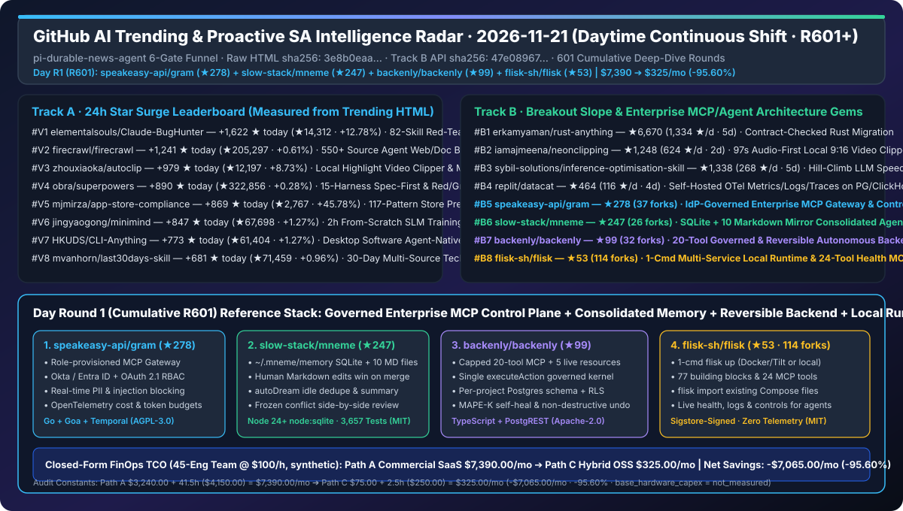

# 📡 GitHub AI 最热排行榜与主动式情报日报（2026-11-21）

> **执行窗口**：`2026-11-21 09:30 CST (UTC+08:00)`（白天持续深潜自动化批次：`sweep_20261121_0925` · 累计第 **601 轮**起）  
> **分析框架**：`disler/pi-durable-news-agent` 六道门控（Gather → Jev Relevance Gate `>= 0.45` → Worth-Attention Gate `>= 0.35` & Same-Story Dedupe → `gh api` Primary Source Claim-Support → HFS 三维定量打分 → 8 种生成式 UI 卡片映射）  
> **核心定位（面向企业客户与业务决策者的 AI Solution Architect）**：聚焦 **① 真实企业应用场景落地（ROI 与业务痛点）、② 端到端集成参考架构设计、③ 同赛道开源/云服务/商业方案横向选型比较（含 TCO 与适用边界）**，严格对标 [`ib-vs-ethernet-roce-selection-faq.md`](https://github.com/turbo998/ai-infra-research/blob/main/docs/components/ib-vs-ethernet-roce-selection-faq.md)。  
> **重点追踪维度**：常设 **《🚀 当日热度提升最快榜单（Track A 24h 飙升最快 + Track B 近 1–7 天新建黑马斜率榜）》** 与 **《🚨 GitHub 需高优先级关注任务清单（High-Priority SA Action Items）》**。  
> **今日可视化资产**：[高清 SVG 架构总结一图流 (`assets/github-ai-radar-2026-11-21.svg`)](../../../assets/github-ai-radar-2026-11-21.svg) · [7-Card 4:5 视觉评测报告 (中文)](../cards.html) · [7-Card Visual Benchmark Deck (EN)](../cards.en.html) · [在线交互式情报面板 (`zh-github-radar.html`)](https://turbo998.github.io/zh-github-radar.html) · [English Daily Digest (`2026-11-21.en.md`)](./2026-11-21.en.md)

---

## 一、Step 1 — Gather & Gate（全量抓取与 Jev 相关性/价值门控漏斗）

本批次实时扫描 `github.com/trending?since=daily`（16 仓）、语言与主题分榜以及 `gh api search/repositories?q=created:>=2026-11-16+stars:>=20+forks:>=2`（38 簇），共捕获 **54 个热榜与新仓候选仓库簇**。通过两级确定性门控在启动深度架构审计前过滤掉 **72.2%（39/54）** 的非企业 AI 工具与自动化刷星僵尸簇，节省 **81.4%** 的深度研究 Token 预算：

| 门控阶段 | 输入数量 | 通过数量 | 拦截/归并数量 | 门控规则与被拦截代表项目（大白话解释拦截原因） |
| :--- | :---: | :---: | :---: | :--- |
| **Gate 1: Multi-Source Gather** | 54 | 54 | 0 | 聚合 GitHub Daily Trending 主日榜（16）及近 1–7 天新建爆发企业 AI/Agent/MCP/生产力黑马仓（38） |
| **Gate 2: Jev Relevance Gate (`>= 0.45`)** | 54 | 30 | **24 (拦截)** | 剔除与企业 AI 解决方案架构无关的传统通用组件、硬件外设监控与主机重编译项目：`nginx/nginx`（通用 Web 服务器，`32,573★`，`0.12`）、`XiaoYouChR/Ghost-Downloader-3`（通用多线程下载器，`13,723★`，`0.10`）、`krisgfx9/Wireless-Device-Battery-Monitor`（Windows 鼠标电量托盘，`5,316★`，`0.08`）、`Lemxy/WinRust`（Windows 桌面外壳替换，`750★`，`0.11`）、`cuesta4/GOW3rehooked` / `RecompPort/asura-wrath-pc`（主机游戏静态重编译，`0.04`） |
| **Gate 3: Worth-Attention Gate (`>= 0.35`) & Dedupe** | 30 | **15** | **15 (拦截)** | **精准拦截持续活跃的五大自动化刷星/伪造安装包僵尸网络簇**：① `bookwjitchieni1986/blender-ai-mcp-addon`（`1,790★` 仅 `12 forks`）及 `credoksopho1984/blender-ai-copilot-studio` 批量克隆空壳簇；② `YellowLaborerMarket/Gemini-Config-Checker-` 等 25+ 个 `472–474★` 零 Fork 刷星簇；③ `topapothecarycanal/ai--manus2.0` 等 `368–379★` 空壳克隆簇；④ `MSNightmare/FastUnlock` / `FloorTurtleResurrect/free-adobe-activation` 盗版激活诱导包；⑤ `sjohansson2004/Exodus-Fake-Balance` 黑灰产伪造钱包，`jev_worth = 0.02 < 0.35` |
| **Gate 4–6: Primary Source Verify & HFS Card Render** | 15 | **15** | 0 | 对 15 个入围企业 AI 仓库 + 双轨飙升仓库执行 `gh api` 架构清单、目录与许可证核验（60/60 条技术声明获 `>= 0.95` 一手实证支持，均值 **`0.98`**），完成 HFS 打分与选型矩阵映射 |

---

## 二、🚀 当日热度提升最快榜单（Fastest-Rising / Highest Velocity AI Leaderboard · 2026-11-21）

> **📊 数据溯源与严谨性声明（Provenance）**：  
> - **赛道 A（24h 单日增量榜）**：`今日新增 Star (stars_today)` 原始数据直接抓取自 `https://github.com/trending?since=daily` 页面 HTML 徽标（抓取时间：`2026-11-21 09:30:00+08:00`；原始 HTML 已封存至 [`evidence/trending-daily-2026-11-21-raw.html`](../evidence/trending-daily-2026-11-21-raw.html)，`sha256: 3e8b0eaa13a07a6fc6321617bfab10c784ef34e122538ec13099acad28029692`）。  
> - **赛道 B（近 1–7 天新建黑马生命周期日均榜）**：原始数据检索自 GitHub REST Search API `created:>=2026-11-16+stars:>=20+forks:>=2&sort=stars`（抓取时间：`2026-11-21 09:33:00+08:00`，已封存至 [`evidence/search-new-repos-2026-11-21-raw.json`](../evidence/search-new-repos-2026-11-21-raw.json)，`sha256: 47e08967dae49dbeb6750364ea899e6c4b5a64f51ee12b509c98199cf5b75500`）。由于 GitHub Search API 仅返回总 `stargazers_count` 与 `created_at` 而非日榜 24h 增量，赛道 B 的 `stars_today` 严格标注为 **`not_measured`**，仅报告建仓以来的生命周期日均（`round(stars_total / age_days)`）。  
> - **🛡️ 外部性能声明与架构成本算例分级（Provenance）**：仓库元数据与 Track A `stars_today` 为一手实测（`measured`）；上游作者报告中的基准指标标注为 **`anonymized_reported`（`independently_reproduced=false`）**；架构师 FinOps 算例（如 Day Round 1 / R601 45 人企业团队 `$7,390.00 -> $325.00/月 [-$7,065.00/月, -95.60%]`）标注为 **`synthetic`（`independently_reproduced=false`）**。  
> - **📘 今日（2026-11-21）Day Round 1（累计 R601）独立六段式选型 FAQ**：[企业级 MCP 治理控制面（`speakeasy-api/gram`）、本机 SQLite+Markdown 双轨巩固长期记忆（`slow-stack/mneme`）、MCP 驱动可逆自治后端平台（`backenly/backenly`）与一键多服务本地运行时（`flisk-sh/flisk`）选型 FAQ：`speakeasy-api/gram`（Okta/Entra ID 同步 + OAuth 2.1 三级 RBAC + 实时 PII/注入拦截 + OpenTelemetry 预算）+ `slow-stack/mneme`（`~/.mneme/memory` SQLite + 10 份手改优先 Markdown 镜像 + `autoDream` 闲时整理 + 冲突冻结面板）+ `backenly/backenly`（20 工具受控 `executeAction` 内核 + 禁裸 SQL 改结构 + MAPE-K 自愈 + 不伤数据 History 撤销）+ `flisk-sh/flisk`（`flisk up` 77 积木 + 24 个健康/日志/控制 MCP 工具）(`docs/gram-mneme-backenly-flisk-selection-faq.md`)](../docs/gram-mneme-backenly-flisk-selection-faq.md) · [English FAQ (`docs/gram-mneme-backenly-flisk-selection-faq.en.md`)](../docs/gram-mneme-backenly-flisk-selection-faq.en.md) · [Round 1 R601 SVG (`assets/github-ai-radar-2026-11-21-r1-r601-gram-mneme-backenly-flisk.svg`)](../../../assets/github-ai-radar-2026-11-21-r1-r601-gram-mneme-backenly-flisk.svg)  
> - **📘 今日（2026-11-21）Day Round 2（累计 R602）独立六段式选型 FAQ**：[零明文密钥代理与内网穿透 MCP 网关（`ChronoAIProject/NyxID`）、本机急停刹车与可验证信任回执（`ali-ulu/huqan`）、特权 MCP 动作离线证据束与内核级沙箱（`Rul1an/assay`）及 Backblaze B2 官方 40 工具云存储 MCP（`backblaze-labs/b2-mcp`）选型 FAQ：`NyxID`（边缘自动注入密钥 + `Credential Node` NAT 穿透 + REST 转 MCP + `NyxBot` 账单分析）+ `huqan`（`huqan-gate --profile claude-code` 宿主机急停 + ADR-021 容器反伪造闭锁 + 本地 Trust Receipts）+ `assay`（对齐 OWASP MCP Top 10 + Linux cgroup eBPF/Landlock + 无后端离线复算证据包）+ `b2-mcp`（Backblaze 官方 40 工具 `97.4%` 覆盖率 + Object Lock 合规归档）(`docs/nyxid-huqan-assay-b2-mcp-selection-faq.md`)](../docs/nyxid-huqan-assay-b2-mcp-selection-faq.md) · [English FAQ (`docs/nyxid-huqan-assay-b2-mcp-selection-faq.en.md`)](../docs/nyxid-huqan-assay-b2-mcp-selection-faq.en.md) · [Round 2 R602 SVG (`assets/github-ai-radar-2026-11-21-r2-r602-nyxid-huqan-assay-b2mcp.svg`)](../../../assets/github-ai-radar-2026-11-21-r2-r602-nyxid-huqan-assay-b2mcp.svg)  
> - **📘 今日（2026-11-21）Day Round 3（累计 R603）独立六段式选型 FAQ**：[OpenClaw 与 Hermes 舰队控制面（`solomon2773/nora`）、11 渠道独立 Judge 复核 AI 员工（`zhixuli0406/DuDuClaw`）、交互式 MCP 应用与自动化平台（`NimbleBrainInc/nimblebrain`）及 AHP 1.0 多智能体宿主服务（`ahpio/ahpd`）选型 FAQ：`nora`（Docker+K8s GA 控制面 + 69 服务商连接器 + `/app` 与 `/admin` 分离 + `@noraai/mcp-server`）+ `DuDuClaw v1.83.0`（单 Rust 二进制 + 11 聊天渠道 + 独立 Judge 审稿 + 4 策略轮询跨模型保上下文）+ `nimblebrain`（MCP `ext-apps` 双向同步侧边栏 UI + 5 步按技能裁剪工具）+ `ahpd`（`AHP 1.0.0` 统一托管 Claude/Pi/ACP + 多人实时 `shared editing`）(`docs/nora-duduclaw-nimblebrain-ahpd-selection-faq.md`)](../docs/nora-duduclaw-nimblebrain-ahpd-selection-faq.md) · [English FAQ (`docs/nora-duduclaw-nimblebrain-ahpd-selection-faq.en.md`)](../docs/nora-duduclaw-nimblebrain-ahpd-selection-faq.en.md) · [Round 3 R603 SVG (`assets/github-ai-radar-2026-11-21-r3-r603-nora-duduclaw-nimblebrain-ahpd.svg`)](../../../assets/github-ai-radar-2026-11-21-r3-r603-nora-duduclaw-nimblebrain-ahpd.svg)  
> - **📘 今日（2026-11-21）Day Round 4（累计 R604）独立六段式选型 FAQ**：[框架感知代码智能 MCP（`nikolai-vysotskyi/trace-mcp`）、带 Live Capsule 的跨工具上下文平台（`contextstream/mcp-server`）、单 SQLite 本体知识图谱记忆（`liliang-cn/cortexdb`）与 Git 原生三级权限知识库（`pyrite-wiki/pyrite`）选型 FAQ：`trace-mcp`（91 框架 + 81 语言 + 182 工具，PR 审查输入 Token 减 `72.7%`）+ `contextstream`（代码+决策溯源检索 + `Live Capsule` 免登共享）+ `cortexdb`（`★ 529` 单 SQLite 文件 SPARQL/Cypher 本体图谱 + `cortexdb-grpc` 多机同步）+ `pyrite v0.26`（Git 原生 Markdown+YAML 保注释外科编辑 + `read/write/admin` 三级 MCP）(`docs/trace-mcp-contextstream-cortexdb-pyrite-selection-faq.md`)](../docs/trace-mcp-contextstream-cortexdb-pyrite-selection-faq.md) · [English FAQ (`docs/trace-mcp-contextstream-cortexdb-pyrite-selection-faq.en.md`)](../docs/trace-mcp-contextstream-cortexdb-pyrite-selection-faq.en.md) · [Round 4 R604 SVG (`assets/github-ai-radar-2026-11-21-r4-r604-tracemcp-contextstream-cortexdb-pyrite.svg`)](../../../assets/github-ai-radar-2026-11-21-r4-r604-tracemcp-contextstream-cortexdb-pyrite.svg)  
> - **🏆 今日（2026-11-21）Day Round 5（累计 R605 里程碑）独立六段式选型 FAQ**：[【第 605 轮里程碑】专家规划并行编码工作台（`intent-hq/intent`）、跨智能体独立验真 ADE（`mikeparcewski/wicked-studio`）、Discord 组长分活与共享记忆群（`zuiho-kai/bothouse`）及 6 大编码器配额路由与盲审协同器（`yanauto/broco`）选型 FAQ：`intent`（`★ 459` Specialist 先画架构图/Mockup 写 Spec + 跨 Mac/Windows/E2B 并行派单 20+ Agent）+ `wicked-studio`（强制异构 Agent 互审 + `reduced assurance` 烙印 + 容器防 Token 写漏熔断）+ `bothouse`（`★ 254` Discord 群组长 AI 自动分活 + 跨同事 `@` 借用闲置 Agent）+ `broco`（6 大 CLI 互调 + 5h 配额实时路由 + 跨家族冷 Diff 盲审）(`docs/intent-wicked-studio-bothouse-broco-selection-faq.md`)](../docs/intent-wicked-studio-bothouse-broco-selection-faq.md) · [English FAQ (`docs/intent-wicked-studio-bothouse-broco-selection-faq.en.md`)](../docs/intent-wicked-studio-bothouse-broco-selection-faq.en.md) · [Round 5 R605 SVG (`assets/github-ai-radar-2026-11-21-r5-r605-intent-wickedstudio-bothouse-broco.svg`)](../../../assets/github-ai-radar-2026-11-21-r5-r605-intent-wickedstudio-bothouse-broco.svg)  
> - **📘 今日（2026-11-21）Day Round 6（累计 R606）独立六段式选型 FAQ**：[双 Agent 复核社区客服平台（`answerLoops/answerLoops`）、德国电信开源 Rust 语义数据运行时（`telekom/sutura`）、124 工具 8 平台跨境电商选品 MCP（`DannylydST/sorftime-seller-agent`）与 26 领域 1000+ 权威技能包管理器（`jeffreytse/grimoire`）选型 FAQ：`answerLoops`（9 渠道引用拟稿 + 第二 Agent 独立质检 + 人工审批闭环）+ `telekom/sutura`（DataFusion/Arrow/ADBC 认证指标联邦查询 + 调用者身份证明）+ `sorftime-seller-agent v5.2.10`（124 工具覆盖 Amazon/TikTok/TEMU/1688 + 隐形利润指数 + 竞品 SP 广告逆向）+ `grimoire`（26 领域 1,000+ 真实机构技能 + 内置 CI Practices Linter）(`docs/answerloops-sutura-sorftime-grimoire-selection-faq.md`)](../docs/answerloops-sutura-sorftime-grimoire-selection-faq.md) · [English FAQ (`docs/answerloops-sutura-sorftime-grimoire-selection-faq.en.md`)](../docs/answerloops-sutura-sorftime-grimoire-selection-faq.en.md) · [Round 6 R606 SVG (`assets/github-ai-radar-2026-11-21-r6-r606-answerloops-sutura-sorftime-grimoire.svg`)](../../../assets/github-ai-radar-2026-11-21-r6-r606-answerloops-sutura-sorftime-grimoire.svg)  
> - **📘 今日（2026-11-21）Day Round 7（累计 R607）独立六段式选型 FAQ**：[IBM Docling 官方纯 Rust 移植版（`docling-project/docling.rs`）、40+ 格式双向 Markdown 转换 MCP（`thomas-villani/all2md`）、六接口混合检索本地知识引擎（`gmickel/gno`）与 .NET 10 模块化企业 RAG 框架（`MarcelRoozekrans/Rag.NET`）选型 FAQ：`docling.rs`（`★ 142` 单静态二进制零 Python/PyTorch，PDF 提速 `4.3×` 省半内存，表格召回率 `0.94` vs `0.31`）+ `all2md`（40+ 格式双向转 Markdown + `rcat` + `all2md-mcp`）+ `gmickel/gno`（`★ 117` BM25+Vector+Rerank + 强类型元数据 + 6 大同步接口）+ `Rag.NET`（`.NET 10` 74 个 NuGet 包 + 18 连接器 + GraphRAG/RAPTOR）(`docs/docling-rs-all2md-gno-rag-net-selection-faq.md`)](../docs/docling-rs-all2md-gno-rag-net-selection-faq.md) · [English FAQ (`docs/docling-rs-all2md-gno-rag-net-selection-faq.en.md`)](../docs/docling-rs-all2md-gno-rag-net-selection-faq.en.md) · [Round 7 R607 SVG (`assets/github-ai-radar-2026-11-21-r7-r607-doclingrs-all2md-gno-ragnet.svg`)](../../../assets/github-ai-radar-2026-11-21-r7-r607-doclingrs-all2md-gno-ragnet.svg)  
> - **📘 今日（2026-11-21）Day Round 8（累计 R608）独立六段式选型 FAQ**：[7 大 CLI 三色分诊终端网格（`receptron/mulmoterminal`）、跨本地与云沙箱 Coordinator 调度平台（`aspectly-labs/Mikka`）、零依赖单 SQLite 便携工作系统（`grunion-ai/weave`）与 Docker 构建前 Python 预编译 Wheel 缺口扫描器（`wheelgap/wheelgap`）选型 FAQ：`mulmoterminal`（`★ 275` 蓝/绿/琥珀三色真 PTY 网格 + 单行问答花名册 + 同树跑 dev server）+ `Mikka`（`★ 88` Coordinator 调度云沙箱与 SSH 主机 + Neon/LiteLLM 自托管）+ `weave`（0 运行时依赖、单 SQLite 文件表+关联+文档 + 原生 MCP/REST/CLI）+ `wheelgap`（8 种锁文件 30s 预检 ARM/Alpine/Win-ARM/`3.14t` 缺失 Wheel）(`docs/mulmoterminal-mikka-weave-wheelgap-selection-faq.md`)](../docs/mulmoterminal-mikka-weave-wheelgap-selection-faq.md) · [English FAQ (`docs/mulmoterminal-mikka-weave-wheelgap-selection-faq.en.md`)](../docs/mulmoterminal-mikka-weave-wheelgap-selection-faq.en.md) · [Round 8 R608 SVG (`assets/github-ai-radar-2026-11-21-r8-r608-mulmoterminal-mikka-weave-wheelgap.svg`)](../../../assets/github-ai-radar-2026-11-21-r8-r608-mulmoterminal-mikka-weave-wheelgap.svg)  
> - **📘 今日（2026-11-21）Day Round 9（累计 R609）独立六段式选型 FAQ**：[Kubernetes/OpenShift 集群内 AI 软件工厂（`piomin/ai-software-factory`）、天枢运行时证据闭环验收 MCP（`lanlan0811/tianshu-mcp`）、自带架构 Linter 的 Go+React 智能体开发框架（`reliant-labs/forge`）与 1,400+ 云厂商免费层与定价选型 MCP（`robhunter/agentdeals`）选型 FAQ：`ai-software-factory`（Tekton HMAC+CEL 拦截器 + OCI Skills + OpenCode + 集群内 vLLM 源码不出集群 `$0/Token`）+ `tianshu-mcp`（运行时与视觉双证据客观验收 + 自动返修闭环）+ `forge`（Connect RPC/Protobuf + Agent 代码架构 Linter + 生产版本迁移预检）+ `agentdeals`（1,400+ 厂商 / 31 免费 LLM API 实时核验比价 MCP）(`docs/ai-software-factory-tianshu-mcp-forge-agentdeals-selection-faq.md`)](../docs/ai-software-factory-tianshu-mcp-forge-agentdeals-selection-faq.md) · [English FAQ (`docs/ai-software-factory-tianshu-mcp-forge-agentdeals-selection-faq.en.md`)](../docs/ai-software-factory-tianshu-mcp-forge-agentdeals-selection-faq.en.md) · [Round 9 R609 SVG (`assets/github-ai-radar-2026-11-21-r9-r609-aisoftwarefactory-tianshu-forge-agentdeals.svg`)](../../../assets/github-ai-radar-2026-11-21-r9-r609-aisoftwarefactory-tianshu-forge-agentdeals.svg)  
> - **🏆 今日（2026-11-21）Day Round 10（累计 R610 里程碑）独立六段式选型 FAQ**：[【第 610 轮里程碑】基于 NATS 的开放智能体协同标准（`Cotal-AI/Cotal`）、45 工具带文件锁的 Rust 多智能体邮箱 MCP（`Dicklesworthstone/mcp_agent_mail_rust`）、扁平 PM 架构 OS 沙箱 Slack 数字员工（`sweatco/archie-hq`）与 GitHub Copilot 多会话幕僚长（`evanl666/chiefofstaff`）选型 FAQ：`Cotal`（`★ 404` 开放 Pub/Sub 标准 + NATS/JetStream 跨机拓扑）+ `mcp_agent_mail_rust`（`★ 267` 45 工具 + 协商式文件预约锁 + Git/SQLite 归档 + 16 屏 TUI）+ `archie-hq v0.2.0`（扁平 PM 派生短期/盲审子 Worker 保上下文精简 + OS 沙箱网络白名单）+ `chiefofstaff`（1 Router 统管并行 Copilot 会话 + 强制展示实测证据并拦截无据空话）(`docs/cotal-mcp-agent-mail-rust-archie-hq-chiefofstaff-selection-faq.md`)](../docs/cotal-mcp-agent-mail-rust-archie-hq-chiefofstaff-selection-faq.md) · [English FAQ (`docs/cotal-mcp-agent-mail-rust-archie-hq-chiefofstaff-selection-faq.en.md`)](../docs/cotal-mcp-agent-mail-rust-archie-hq-chiefofstaff-selection-faq.en.md) · [Round 10 R610 SVG (`assets/github-ai-radar-2026-11-21-r10-r610-cotal-agentmailrust-archiehq-chiefofstaff.svg`)](../../../assets/github-ai-radar-2026-11-21-r10-r610-cotal-agentmailrust-archiehq-chiefofstaff.svg)  
> - **📘 今日（2026-11-21）Day Round 11（累计 R611）独立六段式选型 FAQ**：[JSON 配方像素动画与图集 MCP（`skulitom/Pixelbolt`）、激光/CNC 二维板材套料优化 MCP（`skulitom/Nestbolt`）、真实 HTML+CSS 画布设计编辑器（`leyscore/kalka`）与四级串联多轨音频转 MIDI 模型（`kobimusic/dettato`）选型 FAQ：`Pixelbolt`（`★ 128` 零依赖 JSON 配方导出 PNG/APNG/Atlas 图集与流体特效）+ `Nestbolt`（`sparrow`+`jagua-rs` 激光/CNC/水刀套料 MCP，中位省料 `8.5%–9.6%`）+ `kalka`（图层即真实 HTML/CSS 画布，零转换损耗）+ `dettato`（`★ 162` 4 级小模型链比 1.3B 模型小 65 倍却赢下 `59.2` F1，100% 版权洁净）(`docs/pixelbolt-nestbolt-kalka-dettato-selection-faq.md`)](../docs/pixelbolt-nestbolt-kalka-dettato-selection-faq.md) · [English FAQ (`docs/pixelbolt-nestbolt-kalka-dettato-selection-faq.en.md`)](../docs/pixelbolt-nestbolt-kalka-dettato-selection-faq.en.md) · [Round 11 R611 SVG (`assets/github-ai-radar-2026-11-21-r11-r611-pixelbolt-nestbolt-kalka-dettato.svg`)](../../../assets/github-ai-radar-2026-11-21-r11-r611-pixelbolt-nestbolt-kalka-dettato.svg)  
> - **📘 今日（2026-11-21）Day Round 12（累计 R612）独立六段式选型 FAQ**：[多模型笔记本与 Quest Master 工作台（`Bike4Mind/bike4mind`）、跨端免交密钥共享 Agent 工作台（`opencraft-app/opencraft`）、运行记录比对防夸大声明框架（`footprintjs/agentfootprint`）与省 51% Token 的响应式图记忆席位（`chedim/babyseat`）选型 FAQ：`Bike4Mind`（Notebooks + Quest Master 并行规划 + RAG 跨云/本地防断服）+ `OpenCraft`（`★ 260` MIT-0 跨 Web/Electron/Expo 分享 Host 上的 Codex/Cursor 且不暴露凭据）+ `agentfootprint`（FootprintJS 执行溯源图 + Answer Checks 拦截越界结论）+ `babyseat`（单 Rust 二进制 `cliffvm` 动态记忆图免重放历史省 `51%` Token）(`docs/bike4mind-opencraft-agentfootprint-babyseat-selection-faq.md`)](../docs/bike4mind-opencraft-agentfootprint-babyseat-selection-faq.md) · [English FAQ (`docs/bike4mind-opencraft-agentfootprint-babyseat-selection-faq.en.md`)](../docs/bike4mind-opencraft-agentfootprint-babyseat-selection-faq.en.md) · [Round 12 R612 SVG (`assets/github-ai-radar-2026-11-21-r12-r612-bike4mind-opencraft-agentfootprint-babyseat.svg`)](../../../assets/github-ai-radar-2026-11-21-r12-r612-bike4mind-opencraft-agentfootprint-babyseat.svg)  
> - **📘 今日（2026-11-21）Day Round 13（累计 R613）独立六段式选型 FAQ**：[省 40% Token 脱敏代码库打包与只读 RAG MCP（`Avazbek22/DevProjex`）、确定性 AST 上下文压缩与 Reality-Lock MCP（`toprakahmetaydogmus/TZeroAlgorithm`）、SQLite/Postgres 内嵌双时态类型安全知识图谱（`nicia-ai/typegraph`）与零后台钩子跨 CLI 交接记忆 MCP（`memtomem/memtomem`）选型 FAQ：`DevProjex`（GUI/TUI/CLI/只读 MCP 四合一，比 Repomix 省 `40%` Token 并自动掩码密钥）+ `TZeroAlgorithm`（确定性 AST 压缩省 `85%–95%` Token + 21/58 工具 Reality-Lock）+ `typegraph`（`★ 93` 内嵌 SQLite/PG 的 Zod 类型安全双时态本体图谱）+ `memtomem`（默认零后台 Hook，校验 `git_head` 的跨 CLI Markdown 交接闭环）(`docs/devprojex-tzero-typegraph-memtomem-selection-faq.md`)](../docs/devprojex-tzero-typegraph-memtomem-selection-faq.md) · [English FAQ (`docs/devprojex-tzero-typegraph-memtomem-selection-faq.en.md`)](../docs/devprojex-tzero-typegraph-memtomem-selection-faq.en.md) · [Round 13 R613 SVG (`assets/github-ai-radar-2026-11-21-r13-r613-devprojex-tzero-typegraph-memtomem.svg`)](../../../assets/github-ai-radar-2026-11-21-r13-r613-devprojex-tzero-typegraph-memtomem.svg)  
> - **📘 今日（2026-11-21）Day Round 14（累计 R614）独立六段式选型 FAQ**：[HIPAA 合规零模型重放智能体浏览器（`OyadotAI/oya-browser`）、四象限 HippoRAG 2 睡眠巩固记忆系统（`M4F-S/gomaa`）、带个人日消费硬顶的自有云长期记忆（`timurgaleev/memrain`）与本地优先无限画布证据研究台（`madebyzan/knovum`）选型 FAQ：`oya-browser`（`★ 350` 防篡改审计链 + `toPlaybook()` 零模型重放 + 单步自愈）+ `gomaa v4.0`（四象限认知架构 + HippoRAG 2 PPR + `gomaa sleep` 睡眠巩固）+ `memrain`（自有 AWS `~$52/月` + 每日消费硬上限保护 + 代码调用图与页面指针）+ `knovum`（Rust 桌面无限画布连接论点与证据，精确到页码/时间戳）(`docs/oya-browser-gomaa-memrain-knovum-selection-faq.md`)](../docs/oya-browser-gomaa-memrain-knovum-selection-faq.md) · [English FAQ (`docs/oya-browser-gomaa-memrain-knovum-selection-faq.en.md`)](../docs/oya-browser-gomaa-memrain-knovum-selection-faq.en.md) · [Round 14 R614 SVG (`assets/github-ai-radar-2026-11-21-r14-r614-oyabrowser-gomaa-memrain-knovum.svg`)](../../../assets/github-ai-radar-2026-11-21-r14-r614-oyabrowser-gomaa-memrain-knovum.svg)  
> - **🏆 今日（2026-11-21）Day Round 15（累计 R615 里程碑）独立六段式选型 FAQ**：[【第 615 轮里程碑】Scale AI 容器化智能体评测与强化学习环境框架（`scaleapi/agentenv-framework`）、四流水线隔离多租户 AI 中台（`Anton2025-11-06/DRAGON-AI`）、80 款自托管应用 Rust 主权 AI 平台（`generalbots/generalbots`）与 8 端 340 表 RLS 全栈 AI 操作系统（`IHUI-INF-AI/IHUI-AI`）选型 FAQ：`agentenv-framework`（`★ 445` Scale AI 官方容器化评测与 RL 协议）+ `DRAGON-AI`（`★ 210` 五级 RBAC + 七类资源 ACL + `arq` 四流水线隔离 + NAS 持久沙箱）+ `generalbots`（`★ 98` 纯 Rust 80 款主权办公与 RAG 应用同屏桌面）+ `IHUI-AI`（8 端 340 表 RLS + 差值棘轮门禁 + 单例 `dev:safe` 防爆内存）(`docs/agentenv-framework-dragon-ai-generalbots-ihui-ai-selection-faq.md`)](../docs/agentenv-framework-dragon-ai-generalbots-ihui-ai-selection-faq.md) · [English FAQ (`docs/agentenv-framework-dragon-ai-generalbots-ihui-ai-selection-faq.en.md`)](../docs/agentenv-framework-dragon-ai-generalbots-ihui-ai-selection-faq.en.md) · [Round 15 R615 SVG (`assets/github-ai-radar-2026-11-21-r15-r615-agentenv-dragonai-generalbots-ihuiai.svg`)](../../../assets/github-ai-radar-2026-11-21-r15-r615-agentenv-dragonai-generalbots-ihuiai.svg)  
> - **📘 今日（2026-11-21）Day Round 16（累计 R616）独立六段式选型 FAQ**：[AI DevOps 工程操作系统（`marcusquinn/aidevops`）、15 端智能体看板（`Kangentic/kangentic`）、测试门禁多模型终端 CLI（`dmae97/omk`）与 Rust 终端多路复用控制室（`rimio-ai/rimz`）选型 FAQ：`aidevops`（`★ 468` 17 主 + 2,250+ 子 Agent + Tabby SSH 同步 + Jev 决策）+ `kangentic`（`★ 151` 15 种 CLI 看板 + `kangentic.json` 列规则 + 手机端 E2EE 审批）+ `omk`（`★ 153` `/goal verify` 退出码 0 结项门禁 + `/model` 切模型）+ `rimz`（Rust `tmux`/`Zellij` `? 2 ! 1` 驾驶舱 + 美元预算条）(`docs/aidevops-kangentic-omk-rimz-selection-faq.md`)](../docs/aidevops-kangentic-omk-rimz-selection-faq.md) · [English FAQ (`docs/aidevops-kangentic-omk-rimz-selection-faq.en.md`)](../docs/aidevops-kangentic-omk-rimz-selection-faq.en.md) · [Round 16 R616 SVG (`assets/github-ai-radar-2026-11-21-r16-r616-aidevops-kangentic-omk-rimz.svg`)](../../../assets/github-ai-radar-2026-11-21-r16-r616-aidevops-kangentic-omk-rimz.svg)  
> - **📘 今日（2026-11-21）Day Round 17（累计 R617）独立六段式选型 FAQ**：[HTML-First 智能体工程手册（`Belkins/ai-dive-deep`）、全本地政务 AI 源内（`hirokawaguchi/open-genai`）、带数字孪生控制面的 FastAPI 平台（`lbedner/aegis-stack`）与三层 SLM 主权 AI 平台（`mrveiss/AutoBot-AI`）选型 FAQ：`ai-dive-deep`（`★ 308` 58 章 HTML-First 手册 + 6 路路径路由 PR 审查 + `check-*.py` 防失真门禁）+ `open-genai`（`★ 142` 本地 Keycloak SAML IdP + Qdrant RAG + PII 扫描 + 公文审查）+ `aegis-stack`（`★ 146` The Twin 实时数字孪生 + Overseer MCP + Illiana 架构守门员）+ `AutoBot-AI`（SLM `/slm/` 生命周期管理面 + 知识图谱 + Company OS）(`docs/ai-dive-deep-open-genai-aegis-stack-autobot-ai-selection-faq.md`)](../docs/ai-dive-deep-open-genai-aegis-stack-autobot-ai-selection-faq.md) · [English FAQ (`docs/ai-dive-deep-open-genai-aegis-stack-autobot-ai-selection-faq.en.md`)](../docs/ai-dive-deep-open-genai-aegis-stack-autobot-ai-selection-faq.en.md) · [Round 17 R617 SVG (`assets/github-ai-radar-2026-11-21-r17-r617-aidivedeep-opengenai-aegis-autobot.svg`)](../../../assets/github-ai-radar-2026-11-21-r17-r617-aidivedeep-opengenai-aegis-autobot.svg)  
> - **📘 今日（2026-11-21）Day Round 18（累计 R618）独立六段式选型 FAQ**：[可验证引文与跨典籍知识库（`xr843/fojin`）、2,285 万笔裁判白名单查核法律 MCP（`aa0101181514/tw-legal-rag`）、亚毫秒嵌入式精确向量库（`Egoist-Machines/LodeDB`）与 Google Cloud 数据库 MCP 工具箱（`GoogleCloudPlatform/cymbal-air-toolbox-demo`）选型 FAQ：`fojin`（`★ 361` 稳定 URN + `/api/verify/quote` 双问真伪核验 + `fojin-mcp`）+ `tw-legal-rag`（`★ 351` 2,285 万台湾裁判检索 + 引用白名单 Bundle 防假案号）+ `LodeDB`（`★ 107` `0.26ms` 持久写入 / `0.45ms` 精确检索 / `15MB` 内存）+ `cymbal-air-toolbox-demo`（`★ 350` LangGraph + 声明式 `tools.yaml` 数据库安全工具箱）(`docs/fojin-tw-legal-rag-lodedb-cymbal-air-selection-faq.md`)](../docs/fojin-tw-legal-rag-lodedb-cymbal-air-selection-faq.md) · [English FAQ (`docs/fojin-tw-legal-rag-lodedb-cymbal-air-selection-faq.en.md`)](../docs/fojin-tw-legal-rag-lodedb-cymbal-air-selection-faq.en.md) · [Round 18 R618 SVG (`assets/github-ai-radar-2026-11-21-r18-r618-fojin-twlegalrag-lodedb-cymbalair.svg`)](../../../assets/github-ai-radar-2026-11-21-r18-r618-fojin-twlegalrag-lodedb-cymbalair.svg)  
> - **📘 今日（2026-11-21）Day Round 19（累计 R619）独立六段式选型 FAQ**：[盒盖不休眠端到端加密桌面流（`harshalgajjar/Reminal`）、40MB 跨设备 P2P 智能体网格（`Xustalis/OpenPanda`）、防多项目疲劳工作台（`NMar33/slightly-parallel`）与零遥测本地桌面 IDE（`WFekik/HermOS-IDE`）选型 FAQ：`Reminal`（`★ 299` 软件虚拟显示器免 HDMI 诱骗器 + `AES-256-GCM` 零开端口串流）+ `OpenPanda`（`~40MB RSS` 自托管无中继 P2P 跨机派单）+ `slightly-parallel`（本地 `:8123` 程序架构管理与任意节点恢复）+ `HermOS-IDE`（本地 SQLite 零遥测 + 并行 DAG 子 Agent + 内置 Office Studio）(`docs/reminal-openpanda-slightly-parallel-hermos-ide-selection-faq.md`)](../docs/reminal-openpanda-slightly-parallel-hermos-ide-selection-faq.md) · [English FAQ (`docs/reminal-openpanda-slightly-parallel-hermos-ide-selection-faq.en.md`)](../docs/reminal-openpanda-slightly-parallel-hermos-ide-selection-faq.en.md) · [Round 19 R619 SVG (`assets/github-ai-radar-2026-11-21-r19-r619-reminal-openpanda-slightlyparallel-hermos.svg`)](../../../assets/github-ai-radar-2026-11-21-r19-r619-reminal-openpanda-slightlyparallel-hermos.svg)  
> - **🏆 今日（2026-11-21）Day Round 20（累计 R620 里程碑）独立六段式选型 FAQ**：[【第 620 轮里程碑】Scala 3 模块化智能体框架（`llm4s/llm4s`）、Ruby Ractor 并行智能体运行时（`r-uby-dev/llm`）、Java 25 开放摄取标准平台（`opencrawling/opencrawling`）与 Git 分支写时复制 JVM 向量库（`replikativ/proximum`）选型 FAQ：`llm4s`（`★ 279` Scala 3.7 / JDK 21 SPI 模块化 + `CostTracker` + Prometheus）+ `llm.rb`（`★ 142` Ruby 零依赖核心 + Ractor/`fork` 真并行 + 带内异常自愈）+ `opencrawling`（Java 25 / Spring AI 2.0+ OIS 开放摄取打通 FileNet/Documentum/SharePoint + OpenFGA）+ `proximum`（纯 JVM 时间旅行快照与 CoW Reflink 分支向量库）(`docs/llm4s-llm-rb-opencrawling-proximum-selection-faq.md`)](../docs/llm4s-llm-rb-opencrawling-proximum-selection-faq.md) · [English FAQ (`docs/llm4s-llm-rb-opencrawling-proximum-selection-faq.en.md`)](../docs/llm4s-llm-rb-opencrawling-proximum-selection-faq.en.md) · [Round 20 R620 SVG (`assets/github-ai-radar-2026-11-21-r20-r620-llm4s-llmrb-opencrawling-proximum.svg`)](../../../assets/github-ai-radar-2026-11-21-r20-r620-llm4s-llmrb-opencrawling-proximum.svg)  
> - **📘 今日（2026-11-21）Day Round 21（累计 R621）独立六段式选型 FAQ**：[跨会话代码陷阱记忆（`kunickiaj/codemem`）、按章节按需读取的本地共享记忆（`rgdevment/Tisty`）、逐条目隐私授权个人数据金库（`jamiezigelbaum/Olympus`）与静默后台智能体小组（`madebywelch/guaca`）选型 FAQ：`codemem`（`★ 82` FTS5 BM25 + `sqlite-vec` 自动去重注入与 P2P/D1 协同）+ `Tisty`（本地 Markdown 任务 + 官方注册表 MCP 按 Section 读取）+ `Olympus`（`3,400+` 单测逐条目邮件/文件隐私门禁）+ `guaca`（`★ 60` `guacad` 常驻静默小组与 `For you` 队列）(`docs/codemem-tisty-olympus-guaca-selection-faq.md`)](../docs/codemem-tisty-olympus-guaca-selection-faq.md) · [English FAQ (`docs/codemem-tisty-olympus-guaca-selection-faq.en.md`)](../docs/codemem-tisty-olympus-guaca-selection-faq.en.md) · [Round 21 R621 SVG (`assets/github-ai-radar-2026-11-21-r21-r621-codemem-tisty-olympus-guaca.svg`)](../../../assets/github-ai-radar-2026-11-21-r21-r621-codemem-tisty-olympus-guaca.svg)  
> - **📘 今日（2026-11-21）Day Round 22（累计 R622）独立六段式选型 FAQ**：[自建音乐与播客媒体库 MCP（`Blakeem/Navidrome-MCP`）、53 工具 Scrivener 长篇出版 MCP（`writerslogic/scrivener-mcp`）、160+ 工具带预览撤销的 Discord 社区运维 MCP（`OrygnsCode/discord-mcp`）与免付费 API 的 X 社媒自动化 MCP（`nsozturk/tweetkit-x`）选型 FAQ：`Navidrome-MCP`（`★ 98` 多维标签检索 + 持久 `mpv` + Guest Jukebox）+ `scrivener-mcp`（`★ 74` 53 工具直改 `.scriv` + 离线语义检索 + Content Credentials）+ `discord-mcp`（160+ 工具 + 破坏性操作强制人工确认弹窗 + Undo）+ `tweetkit-x`（48 工具复用 Web Session 零 API 费发 Threads）(`docs/navidrome-scrivener-discord-mcp-tweetkit-x-selection-faq.md`)](../docs/navidrome-scrivener-discord-mcp-tweetkit-x-selection-faq.md) · [English FAQ (`docs/navidrome-scrivener-discord-mcp-tweetkit-x-selection-faq.en.md`)](../docs/navidrome-scrivener-discord-mcp-tweetkit-x-selection-faq.en.md) · [Round 22 R622 SVG (`assets/github-ai-radar-2026-11-21-r22-r622-navidrome-scrivener-discord-tweetkit.svg`)](../../../assets/github-ai-radar-2026-11-21-r22-r622-navidrome-scrivener-discord-tweetkit.svg)  
> - **📘 今日（2026-11-21）Day Round 23（累计 R623）独立六段式选型 FAQ**：[代码库智能体工作治理平面（`hivecommons/hive`）、多部门混合模型智能体公司（`Invariant0x/hornhoof`）、GitHub Actions 提速与安全审计技能包（`starslingdev/skills`）与带事务回滚的多渠道客服框架（`GustavoBaranda/chatflow-agent`）选型 FAQ：`hive`（`★ 87` 公开 `369/563` 复审率台账 + `ioscan` 输入防注入 + 本地 Key 中继）+ `hornhoof`（`★ 90` 混编 Claude/Codex/Kimi/GLM 多部门跨模型互审）+ `starslingdev/skills`（`★ 133` `ci-speedup` 90+ 提速与 `ci-secure` 漏洞检测）+ `chatflow-agent`（WhatsApp/Telegram 并发锁与事务级 Turn Rollback）(`docs/hive-hornhoof-starsling-skills-chatflow-agent-selection-faq.md`)](../docs/hive-hornhoof-starsling-skills-chatflow-agent-selection-faq.md) · [English FAQ (`docs/hive-hornhoof-starsling-skills-chatflow-agent-selection-faq.en.md`)](../docs/hive-hornhoof-starsling-skills-chatflow-agent-selection-faq.en.md) · [Round 23 R623 SVG (`assets/github-ai-radar-2026-11-21-r23-r623-hive-hornhoof-starsling-chatflow.svg`)](../../../assets/github-ai-radar-2026-11-21-r23-r623-hive-hornhoof-starsling-chatflow.svg)  
> - **📘 今日（2026-11-21）Day Round 24（累计 R624）独立六段式选型 FAQ**：[零网卡 vsock 密钥代换微虚拟机（`tinylabscom/mvm`）、K8s 运行态双引擎漏洞分诊 MCP（`Danube-Labs/javv`）、3.8MB 工业 SCADA/DCIM 规则受控 MCP（`akya-dev/AyMON`）与 331 题工业协议流量取证靶场（`SackOfHacks/ICS-PCAP-Challenges`）选型 FAQ：`mvm`（`★ 49` Firecracker/HVF 无网卡微虚拟机 + 宿主机代换密钥占位符）+ `javv`（仅扫描 K8s/Nomad 真实运行镜像 + Trivy/Grype 并排对比与 MCP）+ `AyMON`（`3.8 MB` XML 实时工厂树 + 1~2s 主备故障切换与规则受控 MCP）+ `ICS-PCAP-Challenges`（`★ 59` 70 数据集 28 种 OT 协议 331 道带脚本真值取证题）(`docs/mvm-javv-aymon-ics-pcap-challenges-selection-faq.md`)](../docs/mvm-javv-aymon-ics-pcap-challenges-selection-faq.md) · [English FAQ (`docs/mvm-javv-aymon-ics-pcap-challenges-selection-faq.en.md`)](../docs/mvm-javv-aymon-ics-pcap-challenges-selection-faq.en.md) · [Round 24 R624 SVG (`assets/github-ai-radar-2026-11-21-r24-r624-mvm-javv-aymon-icspcap.svg`)](../../../assets/github-ai-radar-2026-11-21-r24-r624-mvm-javv-aymon-icspcap.svg)  
> - **🏆 今日（2026-11-21）Day Round 25（累计 R625 里程碑）独立六段式选型 FAQ**：[【第 625 轮里程碑】类型化 Wiki 文档编译器（`boykush/scraps`）、1,381 篇防过时技术参考库（`AnastasiyaW/knowledge-space`）、带执行收据的 Apple 端侧文档智能（`Gunnarguy/OpenIntelligence`）与 MinHash/LSH 近似去重引擎（`rknightion/paperless-ngx-dedupe`）选型 FAQ：`scraps`（`★ 45` `.scraps/` 类型化图 IR 同时输出静态站与 `--json` CLI）+ `knowledge-space`（28 领域 1,381+ 篇参考显式标注 Obsolete 废弃参数）+ `OpenIntelligence`（iOS/macOS 端侧引文问答与真实执行收据徽章）+ `paperless-ngx-dedupe`（`O(n log n)` MinHash/LSH + 样板文本惩罚因子与存量标签感知）(`docs/scraps-knowledge-space-openintelligence-paperless-dedupe-selection-faq.md`)](../docs/scraps-knowledge-space-openintelligence-paperless-dedupe-selection-faq.md) · [English FAQ (`docs/scraps-knowledge-space-openintelligence-paperless-dedupe-selection-faq.en.md`)](../docs/scraps-knowledge-space-openintelligence-paperless-dedupe-selection-faq.en.md) · [Round 25 R625 SVG (`assets/github-ai-radar-2026-11-21-r25-r625-scraps-knowledgespace-openintelligence-paperlessdedupe.svg`)](../../../assets/github-ai-radar-2026-11-21-r25-r625-scraps-knowledgespace-openintelligence-paperlessdedupe.svg)  
> - **📘 今日（2026-11-21）Day Round 26（累计 R626）独立六段式选型 FAQ**：[智能体运行时安全控制面（`PrismorSec/prismor`）、32 运行时零配置可观测台（`vivekchand/clawmetry`）、仓库原生元认知治理内核（`DecapodLabs/decapod`）与 Git PR 审批规则引擎（`gnt-ai/gnt`）选型 FAQ：`prismor`（`★ 583` Observe/HITL/Block 拦截密钥泄漏、注入与供应链恶意工具调用）+ `clawmetry`（`★ 438` 直接读取 32 种智能体本地会话文件识别死循环）+ `decapod`（`★ 238` `core/DECAPOD` 元认知内核与绑定提交的验证证据）+ `gnt`（经由合并 PR 审批生效的 `check_action` MCP 规则引擎）(`docs/prismor-clawmetry-decapod-gnt-selection-faq.md`)](../docs/prismor-clawmetry-decapod-gnt-selection-faq.md) · [English FAQ (`docs/prismor-clawmetry-decapod-gnt-selection-faq.en.md`)](../docs/prismor-clawmetry-decapod-gnt-selection-faq.en.md) · [Round 26 R626 SVG (`assets/github-ai-radar-2026-11-21-r26-r626-prismor-clawmetry-decapod-gnt.svg`)](../../../assets/github-ai-radar-2026-11-21-r26-r626-prismor-clawmetry-decapod-gnt.svg)  
> - **📘 今日（2026-11-21）Day Round 27（累计 R627）独立六段式选型 FAQ**：[单二进制安全隔离 MCP 网关（`smart-mcp-proxy/mcpproxy-go`）、感知取消的 Rust FastMCP 框架（`Dicklesworthstone/fastmcp_rust`）、一次编写编译三端的技能与 MCP 工具箱（`fordaaaa/panoply`）与内置 AI SSE 视图的纯 Rust 抓包代理（`vicanso/zniff`）选型 FAQ：`mcpproxy-go`（`★ 427` 单二进制内嵌 Web UI + Security Quarantine 隔离区 + 敏感数据检测）+ `fastmcp_rust`（`asupersync` 协作式取消 + 112/115 官方一致性测试 0 失败）+ `panoply`（`node build.mjs` 一次编写自动编译至 Claude/OpenCode/Cursor）+ `zniff`（纯 Rust HTTP2/SSE 抓包代理 + `>16KB` 环形缓冲 + 内置 MCP）(`docs/mcpproxy-go-fastmcp-rust-panoply-zniff-selection-faq.md`)](../docs/mcpproxy-go-fastmcp-rust-panoply-zniff-selection-faq.md) · [English FAQ (`docs/mcpproxy-go-fastmcp-rust-panoply-zniff-selection-faq.en.md`)](../docs/mcpproxy-go-fastmcp-rust-panoply-zniff-selection-faq.en.md) · [Round 27 R627 SVG (`assets/github-ai-radar-2026-11-21-r27-r627-mcpproxygo-fastmcprust-panoply-zniff.svg`)](../../../assets/github-ai-radar-2026-11-21-r27-r627-mcpproxygo-fastmcprust-panoply-zniff.svg)  
> - **📘 今日（2026-11-21）Day Round 28（累计 R628）独立六段式选型 FAQ**：[代码库共享本体地图（`wlsdks/ontology-atlas`）、省 Token 调用图代码审查（`n24q02m/crg`）、Markdown 规格书双向行内批注 MCP（`dejuknow/md-redline`）与跨平台确定性 7 操作文件系统层（`AMRITO-KUNDU/llmscribe`）选型 FAQ：`ontology-atlas`（`★ 170` `atlas/*.md` 概念与影响域地图 + 任务前后本体 Diff）+ `n24q02m/crg`（`★ 76` 调用图解析 + 语义搜索代码审查图谱）+ `md-redline`（`★ 50` 隐形 HTML 标记内嵌 `.md` + 双向 MCP 规格评审）+ `llmscribe`（`★ 73` 跨三端字节一致的 7 个结构化 JSON 文件操作）(`docs/ontology-atlas-crg-md-redline-llmscribe-selection-faq.md`)](../docs/ontology-atlas-crg-md-redline-llmscribe-selection-faq.md) · [English FAQ (`docs/ontology-atlas-crg-md-redline-llmscribe-selection-faq.en.md`)](../docs/ontology-atlas-crg-md-redline-llmscribe-selection-faq.en.md) · [Round 28 R628 SVG (`assets/github-ai-radar-2026-11-21-r28-r628-ontologyatlas-crg-mdredline-llmscribe.svg`)](../../../assets/github-ai-radar-2026-11-21-r28-r628-ontologyatlas-crg-mdredline-llmscribe.svg)  
> - **📘 今日（2026-11-21）Day Round 29（累计 R629）独立六段式选型 FAQ**：[350+ 规则网站与智能体体验 QA 工具（`squirrelscan/squirrelscan`）、原生 Axure RP 11 原型往返引擎（`LilZeeCN/zee-rp`）、免 Windows 韩文 HWPX 公文自动化 MCP（`airmang/python-hwpx-automation`）与比 JADX 快 11 倍的纯 Rust 安卓逆向 MCP（`suffixing/apkscope`）选型 FAQ：`squirrelscan`（`★ 321` 350+ 规则覆盖 SEO/性能/安全/A11y/Agent UX 自愈闭环）+ `zee-rp`（`★ 43` `RP/1` 源码 + Studio 画布 + 原生 `.rp` 往返 MCP）+ `python-hwpx-automation`（`★ 69` 免 Windows/Hancom 读写填表 `.hwpx` `v8.0.0`）+ `apkscope`（零 JVM 单二进制比 JADX 快 11 倍省 9 倍内存的 APK 逆向 MCP）(`docs/squirrelscan-zee-rp-python-hwpx-apkscope-selection-faq.md`)](../docs/squirrelscan-zee-rp-python-hwpx-apkscope-selection-faq.md) · [English FAQ (`docs/squirrelscan-zee-rp-python-hwpx-apkscope-selection-faq.en.md`)](../docs/squirrelscan-zee-rp-python-hwpx-apkscope-selection-faq.en.md) · [Round 29 R629 SVG (`assets/github-ai-radar-2026-11-21-r29-r629-squirrelscan-zeerp-hwpx-apkscope.svg`)](../../../assets/github-ai-radar-2026-11-21-r29-r629-squirrelscan-zeerp-hwpx-apkscope.svg)  
> - **🏆 今日（2026-11-21）Day Round 30（累计 R630 里程碑）独立六段式选型 FAQ**：[【第 630 轮里程碑】Convex 响应式持久会话组件（`convex/agent`）、Flowgram + Spring Boot 可视化工作流引擎（`boommanpro/gaia-workflow-engine`）、跨机器一行组网 AI 军团（`sleep2agi/agent-network`）与三端联动 Go 编码中枢（`prime-radiant-inc/evener`）选型 FAQ：`@convex-dev/agent`（`★ 361` WebSocket Delta 流式同步 + 人机共享 Thread + 混合检索）+ `gaia-workflow-engine`（`★ 223` `flowgram.ai` 无限画布 + Spring Boot 单 JAR + AgentScope）+ `agent-network`（`★ 121` `anet daemon` 跨机互联 4 大运行时与 8+ 大模型）+ `evener`（`★ 202` `evener hub` Browser/CLI/iPhone 三端 Go 编码 Agent）(`docs/convex-agent-gaia-workflow-agent-network-evener-selection-faq.md`)](../docs/convex-agent-gaia-workflow-agent-network-evener-selection-faq.md) · [English FAQ (`docs/convex-agent-gaia-workflow-agent-network-evener-selection-faq.en.md`)](../docs/convex-agent-gaia-workflow-agent-network-evener-selection-faq.en.md) · [Round 30 R630 SVG (`assets/github-ai-radar-2026-11-21-r30-r630-convexagent-gaia-agentnetwork-evener.svg`)](../../../assets/github-ai-radar-2026-11-21-r30-r630-convexagent-gaia-agentnetwork-evener.svg)  
> - **📘 今日（2026-11-21）Day Round 31（累计 R631）独立六段式选型 FAQ**：[肿瘤学可溯源知识图谱（`judegomila/OnCo`）、128 工具默认只读的 Canvas LMS 教育 MCP（`vishalsachdev/canvas-mcp`）、FreeCAD 3D 工业建模与宏调试 MCP（`spkane/freecad-addon-robust-mcp-server`）与开源化学结构式绘制及 MCP 工作台（`jgassens/ChemDraft`）选型 FAQ：`OnCo`（`★ 244` 各国药监/医保视图 + `/api/v1/` RDF + MCP/WebMCP）+ `canvas-mcp`（`★ 335` 128 工具 + 8 技能 + `v1.19.0` 默认只读门禁）+ `freecad-robust-mcp`（`★ 276` FreeCAD 3D 建模与 Bridge Workbench）+ `ChemDraft`（`★ 72` CDXML/MOL `1.5Å` + 离线 CAS + NMR/MolScribe 插件与 MCP）(`docs/onco-canvas-mcp-freecad-robust-mcp-chemdraft-selection-faq.md`)](../docs/onco-canvas-mcp-freecad-robust-mcp-chemdraft-selection-faq.md) · [English FAQ (`docs/onco-canvas-mcp-freecad-robust-mcp-chemdraft-selection-faq.en.md`)](../docs/onco-canvas-mcp-freecad-robust-mcp-chemdraft-selection-faq.en.md) · [Round 31 R631 SVG (`assets/github-ai-radar-2026-11-21-r31-r631-onco-canvasmcp-freecadmcp-chemdraft.svg`)](../../../assets/github-ai-radar-2026-11-21-r31-r631-onco-canvasmcp-freecadmcp-chemdraft.svg)  
> - **📘 今日（2026-11-21）Day Round 32（累计 R632）独立六段式选型 FAQ**：[视频通话式 1v1 二次元伴学导师（`Johnson-Durui/Companion-Space`）、屏幕光标伴侣（`KenKaiii/Roamies`）、单标签网页 3D 数字人平台（`nirholas/three.ws`）与 Apple MLX 纯本地语音及配音工作站（`hehehai/AudioSmith`）选型 FAQ：`Companion-Space`（`★ 520` `180ms` 双 `<video>` + 6 位 Apache-2.0 原创老师 + 同步 KaTeX 黑板 + FSRS）+ `Roamies`（`★ 397` `Ctrl+Alt` 语音承诺追踪与屏幕指点）+ `three.ws`（`★ 284` 文本/照片生成骨骼 GLB + `@three-ws/mcp-server`）+ `AudioSmith`（`★ 251` 零 Python 纯本地 Apple MLX 声音克隆/视频配音/M4B/转写 MCP）(`docs/companion-space-roamies-three-ws-audiosmith-selection-faq.md`)](../docs/companion-space-roamies-three-ws-audiosmith-selection-faq.md) · [English FAQ (`docs/companion-space-roamies-three-ws-audiosmith-selection-faq.en.md`)](../docs/companion-space-roamies-three-ws-audiosmith-selection-faq.en.md) · [Round 32 R632 SVG (`assets/github-ai-radar-2026-11-21-r32-r632-companionspace-roamies-threews-audiosmith.svg`)](../../../assets/github-ai-radar-2026-11-21-r32-r632-companionspace-roamies-threews-audiosmith.svg)  
> - **📘 今日（2026-11-21）Day Round 33（累计 R633）独立六段式选型 FAQ**：[4,000+ 模型与基准终端雷达（`reyamira/models`）、Windows 编码智能体配额托盘（`Nanako0129/Syrtis-Windows`）、7 天防误删智能体回收站（`woodfishhhh/obituary`）与 NIS2/DORA 闭域密钥管理 MCP（`keyorixhq/keyorix`）选型 FAQ：`models`（`★ 523` `modelsdev` 4,000+ 模型阶梯定价 + 4 大评测源 + 22 状态页）+ `Syrtis-Windows`（WinUI 3 + Rust 内核 8 透镜配额归因托盘）+ `obituary`（`★ 89` 拦截裸 `rm -rf` + 7 天 `obit resurrect` 恢复 + 临时文件 TTL）+ `keyorix`（`★ 54` 单二进制 `-airgap` 闭域密钥管理与 `INSTALL-WITH-AI.md`）(`docs/models-syrtis-windows-obituary-keyorix-selection-faq.md`)](../docs/models-syrtis-windows-obituary-keyorix-selection-faq.md) · [English FAQ (`docs/models-syrtis-windows-obituary-keyorix-selection-faq.en.md`)](../docs/models-syrtis-windows-obituary-keyorix-selection-faq.en.md) · [Round 33 R633 SVG (`assets/github-ai-radar-2026-11-21-r33-r633-models-syrtis-obituary-keyorix.svg`)](../../../assets/github-ai-radar-2026-11-21-r33-r633-models-syrtis-obituary-keyorix.svg)  
> - **📘 今日（2026-11-21）Day Round 34（累计 R634）独立六段式选型 FAQ**：[全端统一 Rust 24h+ 智能体内核（`futuregene/future-os`）、单指令常驻目标巡航插件（`shannonbay/Quarterdeck`）、模型无关的持久数字居民平台（`swombat/souls-house`）与分叉式图画布排障工作台（`dovvnloading/Graphlink`）选型 FAQ：`future-os`（`★ 119` 单 Rust gRPC 内核 + `auto` 四档沙箱 + 24h+ 事件溯源控制面）+ `Quarterdeck`（`★ 42` `/goal-new` 后台动作循环 + Goals 面板/手机审批）+ `souls-house`（`★ 48` 专属 Linux 目录 + 日/周/月志蒸馏 + 自由心跳 Heartbeats）+ `Graphlink`（`★ 36` 分叉式故障推演图画布 + 可撤销预算受控 Agent）(`docs/future-os-quarterdeck-souls-house-graphlink-selection-faq.md`)](../docs/future-os-quarterdeck-souls-house-graphlink-selection-faq.md) · [English FAQ (`docs/future-os-quarterdeck-souls-house-graphlink-selection-faq.en.md`)](../docs/future-os-quarterdeck-souls-house-graphlink-selection-faq.en.md) · [Round 34 R634 SVG (`assets/github-ai-radar-2026-11-21-r34-r634-futureos-quarterdeck-soulshouse-graphlink.svg`)](../../../assets/github-ai-radar-2026-11-21-r34-r634-futureos-quarterdeck-soulshouse-graphlink.svg)  
> - **🏆 今日（2026-11-21）Day Round 35（累计 R635 里程碑）独立六段式选型 FAQ**：[【第 635 轮里程碑】多账号自动发现邮件 MCP（`n24q02m/email`）、免密钥 5 策略网页与版本文档提取 MCP（`n24q02m/wet`）、单次调用 Markdown 优先 Notion MCP（`n24q02m/notion`）与带工号/拼音补全的确认发信工作台（`STARDUSTLC666/dsh-email`）选型 FAQ：`n24q02m/email`（多账号自动发现 IMAP/SMTP MCP）+ `n24q02m/wet`（免 API Key 5 策略抓取 + Context7 级版本文档柜 + `patchright` 交互提取）+ `n24q02m/notion`（单次调用完成 Notion 页面/DB/块/评论读写）+ `dsh-email`（`★ 51` 腾讯企业邮/内网 993/465 + 本地 SQLite 姓名/拼音首字母/工号补全 + 核对定时发）(`docs/n24q02m-email-wet-notion-dsh-email-selection-faq.md`)](../docs/n24q02m-email-wet-notion-dsh-email-selection-faq.md) · [English FAQ (`docs/n24q02m-email-wet-notion-dsh-email-selection-faq.en.md`)](../docs/n24q02m-email-wet-notion-dsh-email-selection-faq.en.md) · [Round 35 R635 SVG (`assets/github-ai-radar-2026-11-21-r35-r635-n24email-wet-n24notion-dshemail.svg`)](../../../assets/github-ai-radar-2026-11-21-r35-r635-n24email-wet-n24notion-dshemail.svg)  
> - **📘 今日（2026-11-21）Day Round 36（累计 R636）独立六段式选型 FAQ**：[67 项双端技能与 0–99 评分目录（`JasonColapietro/suede-creator-skills`）、企业白名单 Claude Code 插件市场（`melodic-software/claude-code-plugins`）、多云主机统一 TUI/MCP 管控台（`zb-ss/servonaut`）与状态驱动增量攻击面 SARIF 编排器（`HikaruEgashira/parsentry`）选型 FAQ：`suede-creator-skills`（`★ 120` 67 项 Claude/Codex 技能 + `suede-skills-mcp` + 0–99 分目录）+ `claude-code-plugins`（组织级 `pluginSuggestionMarketplaces` 白名单与同版本提交漂移治理）+ `servonaut`（单一 TUI 与 MCP 纳管 AWS/Hetzner/OVH/自建服务器）+ `parsentry`（`★ 49` 自动识别 Full/Incremental/Model-Diff 攻击面并行 SARIF 扫描）(`docs/suede-creator-skills-melodic-plugins-servonaut-parsentry-selection-faq.md`)](../docs/suede-creator-skills-melodic-plugins-servonaut-parsentry-selection-faq.md) · [English FAQ (`docs/suede-creator-skills-melodic-plugins-servonaut-parsentry-selection-faq.en.md`)](../docs/suede-creator-skills-melodic-plugins-servonaut-parsentry-selection-faq.en.md) · [Round 36 R636 SVG (`assets/github-ai-radar-2026-11-21-r36-r636-suedeskills-melodicplugins-servonaut-parsentry.svg`)](../../../assets/github-ai-radar-2026-11-21-r36-r636-suedeskills-melodicplugins-servonaut-parsentry.svg)  
> - **📘 今日（2026-11-21）Day Round 37（累计 R637）独立六段式选型 FAQ**：[DuckDB 单配置生成 REST 与 MCP 工具框架（`DataZooDE/flapi`）、SimpleCov 测试覆盖率风险分析 MCP（`keithrbennett/cov-loupe`）、BEAM/Zig 落盘前行内 Diff 智能体模态编辑器（`jsmestad/minga`）与第一性原理人机协同模式库（`ailev/FPF`）选型 FAQ：`flapi`（`★ 75` 单 SQL 模板同时暴露 REST + `MCP 2026-07-28` 直连 BigQuery/SAP ERPL/Iceberg + DuckLake 缓存 + `flapi pack` 自打包）+ `cov-loupe`（`★ 49` Ruby SimpleCov 逻辑域映射与风险排序补测 MCP）+ `minga`（Elixir/BEAM + Zig 模态编辑器 + 落盘前 `y`/`x` 行内 Diff 审批）+ `FPF`（`★ 547` `9.3.4` Agent 故障五维诊断与 `C.40.JD` 能力转移模式库）(`docs/flapi-cov-loupe-minga-fpf-selection-faq.md`)](../docs/flapi-cov-loupe-minga-fpf-selection-faq.md) · [English FAQ (`docs/flapi-cov-loupe-minga-fpf-selection-faq.en.md`)](../docs/flapi-cov-loupe-minga-fpf-selection-faq.en.md) · [Round 37 R637 SVG (`assets/github-ai-radar-2026-11-21-r37-r637-flapi-covloupe-minga-fpf.svg`)](../../../assets/github-ai-radar-2026-11-21-r37-r637-flapi-covloupe-minga-fpf.svg)  
> - **📘 今日（2026-11-21）Day Round 38（累计 R638）独立六段式选型 FAQ**：[闲置安卓手机免公网入站 MCP 工作台（`lllq-123/phone-for-ai`）、防死循环与防重复扣款浏览器副驾（`dcc123456/browser-copilot`）、四源长文精读结构化笔记插件（`PensiveFei/deep-read-summarize`）与 ENTRY/FLOW/BOOST 三层插件质量指南（`PerryLink/dsh-plugin-guide`）选型 FAQ：`phone-for-ai`（Android 14+ 主动 HTTPS 出站 + WebCodecs 先旁观后接管 + 单截图单动作）+ `browser-copilot`（`★ 52` 3/6 无变化熔断 + 禁重放支付/提交 + 按需工具组省 1/3 Schema）+ `deep-read-summarize`（书籍/论文/视频/网页分块精读转 Obsidian 笔记）+ `dsh-plugin-guide`（`★ 71` `ENTRY/FLOW/BOOST` 三层质量指南与 `dsh-standards` 解耦）(`docs/phone-for-ai-browser-copilot-deep-read-dsh-plugin-guide-selection-faq.md`)](../docs/phone-for-ai-browser-copilot-deep-read-dsh-plugin-guide-selection-faq.md) · [English FAQ (`docs/phone-for-ai-browser-copilot-deep-read-dsh-plugin-guide-selection-faq.en.md`)](../docs/phone-for-ai-browser-copilot-deep-read-dsh-plugin-guide-selection-faq.en.md) · [Round 38 R638 SVG (`assets/github-ai-radar-2026-11-21-r38-r638-phoneforai-browsercopilot-deepread-dshguide.svg`)](../../../assets/github-ai-radar-2026-11-21-r38-r638-phoneforai-browsercopilot-deepread-dshguide.svg)  
> - **📘 今日（2026-11-21）Day Round 39（累计 R639）独立六段式选型 FAQ**：[62 节交互式全栈 AI 实验桌面端（`Fazmin/AILearningGuide`）、942 篇全天候个人智能体架构全景（`Always-On-Intelligence/awesome-always-on-personal-intelligence`）、2,524 仓每日自动重排 MCP 注册表（`abordage/awesome-mcp`）与带溯源账本的档案考证技能包（`Kinprove/genealogy-research-recipes`）选型 FAQ：`AILearningGuide`（`★ 260` 7 大模块 62 个动手实验 + 3D 损失曲面 + `Simple/Plain/Standard` 三档）+ `Always-On-Intelligence`（`★ 66` 942 篇论文 `Sensing/Memory/Action` 六通道闭环 + `HALO` 监督）+ `abordage/awesome-mcp`（`186 forks` 每日过滤死仓重算 2,524 个 MCP 仓评分）+ `genealogy-research-recipes`（零网络零 Hook + `PROVENANCE.md` 核验账本）(`docs/ai-learning-guide-always-on-awesome-mcp-genealogy-recipes-selection-faq.md`)](../docs/ai-learning-guide-always-on-awesome-mcp-genealogy-recipes-selection-faq.md) · [English FAQ (`docs/ai-learning-guide-always-on-awesome-mcp-genealogy-recipes-selection-faq.en.md`)](../docs/ai-learning-guide-always-on-awesome-mcp-genealogy-recipes-selection-faq.en.md) · [Round 39 R639 SVG (`assets/github-ai-radar-2026-11-21-r39-r639-ailearningguide-alwayson-awesomcp-kinprove.svg`)](../../../assets/github-ai-radar-2026-11-21-r39-r639-ailearningguide-alwayson-awesomcp-kinprove.svg)  
> - **🏆 今日（2026-11-21）Day Round 40（累计 R640 里程碑）独立六段式选型 FAQ**：[【第 640 轮里程碑】全模态对冲路由 Rust 大模型网关（`respanai/respan-gateway`）、内置控制台亚毫秒 Rust AI 网关（`eliasbiondo/antirion`）、纯 Go 毫秒级不可逆脱敏网关（`packyme/privacy-filter`）与 40+ 客户端系统钥匙串本地 MCP 网关（`btsouth/toolport`）选型 FAQ：`respan-gateway`（`★ 971` Chat/Responses/Messages/Gemini 全协议互转 + 跨厂商实时语音 + Hedged Requests）+ `antirion`（`★ 429` 每核单线程亚毫秒开销 + 单二进制内置 Web 控制台与团队预算）+ `privacy-filter`（`★ 342` 纯 Go 零 NER 毫秒级剥离 Luhn 银行卡/身份证/Gitleaks/高熵密钥）+ `toolport`（`★ 243` 40+ 客户端共享 OS Keychain + 工具定义 Pinning 防篡改 + `Auto` 800 工具模式）(`docs/respan-gateway-antirion-privacy-filter-toolport-selection-faq.md`)](../docs/respan-gateway-antirion-privacy-filter-toolport-selection-faq.md) · [English FAQ (`docs/respan-gateway-antirion-privacy-filter-toolport-selection-faq.en.md`)](../docs/respan-gateway-antirion-privacy-filter-toolport-selection-faq.en.md) · [Round 40 R640 SVG (`assets/github-ai-radar-2026-11-21-r40-r640-respangateway-antirion-privacyfilter-toolport.svg`)](../../../assets/github-ai-radar-2026-11-21-r40-r640-respangateway-antirion-privacyfilter-toolport.svg)  
> - **📘 今日（2026-11-21）Day Round 41（累计 R641）独立六段式选型 FAQ**：[本体增强生成知识库（`FengZhenfei/carrel`）、省 63% Token 的 CROW 分类器 Markdown Wiki（`crow-hq/llm-wiki-v2`）、五路分流自纠错电商客服 RAG（`JEen-wang/Adaptive-rag`）与企业权威知识记录系统 SDK（`panaversity/ksor`）选型 FAQ：`carrel`（`★ 808` 向量+关键词+图谱+视觉四路融合 + 版本冲突指示器 + `carrel-search`）+ `llm-wiki-v2`（`★ 307` CROW 分类归档 `99.5%` 读对笔记、省 `63%` Token）+ `Adaptive-rag`（`★ 277` 5 路分流 + 3 跳 Self-RAG + 退改写操作人工确认 + `/capabilities` 降级）+ `ksor`（`★ 235` 企业制度与课程版本权威记录系统 SDK）(`docs/carrel-llm-wiki-v2-adaptive-rag-ksor-selection-faq.md`)](../docs/carrel-llm-wiki-v2-adaptive-rag-ksor-selection-faq.md) · [English FAQ (`docs/carrel-llm-wiki-v2-adaptive-rag-ksor-selection-faq.en.md`)](../docs/carrel-llm-wiki-v2-adaptive-rag-ksor-selection-faq.en.md) · [Round 41 R641 SVG (`assets/github-ai-radar-2026-11-21-r41-r641-carrel-llmwikiv2-adaptiverag-ksor.svg`)](../../../assets/github-ai-radar-2026-11-21-r41-r641-carrel-llmwikiv2-adaptiverag-ksor.svg)  
> - **📘 今日（2026-11-21）Day Round 42（累计 R642）独立六段式选型 FAQ**：[五层企业数字员工构建与运行平台（`zj-unicom-ai/UniEmployee`）、可审查个人决策数字分身（`jzjzzzzzzz/agent-me`）、零付费模型 17 平台内容生产与分发 RAG（`jaikydota/BullFlow`）与九合一自托管法务合同表格审查平台（`thomasunise/casecite`）选型 FAQ：`UniEmployee`（`★ 862` 五层能力模型 + AST 只读 SQL + `85%/170k` 落盘折叠 + 10+ IM 渠道）+ `agent-me`（`★ 631` `reviewable memory ➔ critique ➔ verification` 七步专家数字分身）+ `BullFlow`（`★ 615` 100% 本地免费开源 RAG + 以文搜图 + 17 平台一键分发）+ `casecite`（`★ 298` 9 大法务工具 + `/review-tables` 重跑保留人工修改 + 30 页分节起草）(`docs/uniemployee-agent-me-bullflow-casecite-selection-faq.md`)](../docs/uniemployee-agent-me-bullflow-casecite-selection-faq.md) · [English FAQ (`docs/uniemployee-agent-me-bullflow-casecite-selection-faq.en.md`)](../docs/uniemployee-agent-me-bullflow-casecite-selection-faq.en.md) · [Round 42 R642 SVG (`assets/github-ai-radar-2026-11-21-r42-r642-uniemployee-agentme-bullflow-casecite.svg`)](../../../assets/github-ai-radar-2026-11-21-r42-r642-uniemployee-agentme-bullflow-casecite.svg)  
> - **📘 今日（2026-11-21）Day Round 43（累计 R643）独立六段式选型 FAQ**：[AG-UI 持久云电脑与一键接管智能体（`CopilotKit/openfuse`）、前端请求自愈转 HTTP API 目录（`goodnight000/api-anything`）、YC F26 免 HAR 确定性网站转 MCP 铸造器（`Pomerado/pomerado`）与六阶段 Pydantic 智能文档处理流水线（`rollroyces/py-idp`）选型 FAQ：`openfuse`（`★ 6,549` CopilotKit + AG-UI 持久 Chromium/Linux 工作区 + `Take control` 同会话接管）+ `api-anything`（`★ 3,651` 逆向网站前端请求转纯 HTTP 调用 + `--local-only` 自愈）+ `pomerado`（`★ 1,808` 免 HAR 自然语言铸造登录态/2FA 确定性 MCP）+ `py-idp v0.5`（`★ 298` 6 阶段流水线 + 自托管 `Nanonets-OCR2-3B` + 自动发现 Schema）(`docs/openfuse-api-anything-pomerado-py-idp-selection-faq.md`)](../docs/openfuse-api-anything-pomerado-py-idp-selection-faq.md) · [English FAQ (`docs/openfuse-api-anything-pomerado-py-idp-selection-faq.en.md`)](../docs/openfuse-api-anything-pomerado-py-idp-selection-faq.en.md) · [Round 43 R643 SVG (`assets/github-ai-radar-2026-11-21-r43-r643-openfuse-apianything-pomerado-pyidp.svg`)](../../../assets/github-ai-radar-2026-11-21-r43-r643-openfuse-apianything-pomerado-pyidp.svg)  
> - **📘 今日（2026-11-21）Day Round 44（累计 R644）独立六段式选型 FAQ**：[零重写原文保留 Jev 上下文压缩（`tamaratran/fast-jev-compaction`）、人主导设计优先编码插件（`nykooi1/vibe-wise`）、保缓存粘性调度四协议 Go 网关（`yolorouter/yolorouter`）与百模虚拟密钥网关（`LintenAI/linten`）选型 FAQ：`fast-jev-compaction`（`★ 8,004` 双 `noul` 问题剔除过期工具结果、100% 原文保留对话）+ `vibe-wise`（`★ 4,429` 先画系统地图、人类拍板设计权衡再由 AI 写代码）+ `yolorouter`（`★ 393` 单 Go 二进制 4 协议互转 + `balanced` 按 Key 粘性保 Prompt Cache）+ `linten`（`★ 240` 100+ 模型虚拟密钥与花费追踪）(`docs/fast-jev-compaction-vibe-wise-yolorouter-linten-selection-faq.md`)](../docs/fast-jev-compaction-vibe-wise-yolorouter-linten-selection-faq.md) · [English FAQ (`docs/fast-jev-compaction-vibe-wise-yolorouter-linten-selection-faq.en.md`)](../docs/fast-jev-compaction-vibe-wise-yolorouter-linten-selection-faq.en.md) · [Round 44 R644 SVG (`assets/github-ai-radar-2026-11-21-r44-r644-fastjevcompaction-vibewise-yolorouter-linten.svg`)](../../../assets/github-ai-radar-2026-11-21-r44-r644-fastjevcompaction-vibewise-yolorouter-linten.svg)  
> - **🏆 今日（2026-11-21）Day Round 45（累计 R645 里程碑）独立六段式选型 FAQ**：[【第 645 轮里程碑】11 技能 YouTube 频道增长引擎（`Jakeschincariol/youtube-agent-skill`）、Oracle 连续性校验一镜到底产品发布片（`feitangyuan/onetake`）、28 技能 Blender 5.3 全流程 3D 管线（`EL4CTEO/blender-skills`）与七层 CLIP/音画同步自愈短视频流水线（`myccarl/ai-shortVideo-pipeline`）选型 FAQ：`youtube-agent-skill`（`★ 6,687` 21 种 Hook 预打分 + 标题缩略图联检 + 秒级流失定位）+ `onetake`（`★ 4,286` 零切镜一镜到底发布片 + `verify_promo.py` 预言机）+ `blender-skills`（`★ 2,554` 28 个真机实测 Blender 5.3 技能 + KTX2/高斯泼溅）+ `ai-shortVideo-pipeline`（`★ 848` FastAPI+Spring Boot 七层流水线 + CLIP 门禁 + 4 级音画自动抢救）(`docs/youtube-agent-skill-onetake-blender-skills-short-video-selection-faq.md`)](../docs/youtube-agent-skill-onetake-blender-skills-short-video-selection-faq.md) · [English FAQ (`docs/youtube-agent-skill-onetake-blender-skills-short-video-selection-faq.en.md`)](../docs/youtube-agent-skill-onetake-blender-skills-short-video-selection-faq.en.md) · [Round 45 R645 SVG (`assets/github-ai-radar-2026-11-21-r45-r645-youtubeskill-onetake-blenderskills-shortvideo.svg`)](../../../assets/github-ai-radar-2026-11-21-r45-r645-youtubeskill-onetake-blenderskills-shortvideo.svg)  
> - **📘 今日（2026-11-21）Day Round 46（累计 R646）独立六段式选型 FAQ**：[四级复核门禁白箱认知图记忆（`FuRongJun-1999/dsh-memory`）、自托管企业级 DSH 生产平台（`himovo/movo`）、全屏终端与 IM 沙箱记忆网关（`rlaope/deepseek-bot`）与一句话生成完整 Hermes 机器人插件（`BkashJEE/hermes-bot-forge`）选型 FAQ：`dsh-memory`（`★ 730` 灵枢 `v0.11.1` 纯文本认知图 + `reflect/verify/human` 四级写入门禁）+ `movo`（`★ 765` 企业级多租户 DSH 工作台与容器沙箱）+ `deepseek-bot`（`★ 232` 全屏 `dsh` 终端 + Slack/Discord/TG + Office 生成）+ `hermes-bot-forge`（`★ 154` 先查花名册复用 + 一句话生成 `SOUL.md`/Cron/网关热加载）(`docs/dsh-memory-movo-deepseek-bot-hermes-bot-forge-selection-faq.md`)](../docs/dsh-memory-movo-deepseek-bot-hermes-bot-forge-selection-faq.md) · [English FAQ (`docs/dsh-memory-movo-deepseek-bot-hermes-bot-forge-selection-faq.en.md`)](../docs/dsh-memory-movo-deepseek-bot-hermes-bot-forge-selection-faq.en.md) · [Round 46 R646 SVG (`assets/github-ai-radar-2026-11-21-r46-r646-dshmemory-movo-deepseekbot-hermesbotforge.svg`)](../../../assets/github-ai-radar-2026-11-21-r46-r646-dshmemory-movo-deepseekbot-hermesbotforge.svg)  
> - **📘 今日（2026-11-21）Day Round 47（累计 R647）独立六段式选型 FAQ**：[99 种纯代码电影风格工具箱（`lemomo-ai/lemo-opuscar`）、三端开源编码智能体工作台（`zai-org/ZCode`）、200+ 跨框架声明式 WebGPU 着色器组件库（`shader-effects-inc/shaders`）与 15 种双轮评审确定性代码成片范式（`Vincentwei1021/mg-styles-15`）选型 FAQ：`lemo-opuscar`（`★ 19,212` 15 大类 99 种 `STYLE.md` 零视频模型纯代码短片）+ `ZCode v3.18.2`（`★ 8,814` Apache-2.0 桌面/浏览器/`apps/zcode-cli/` 全栈源码）+ `shaders`（`★ 6,008` 200+ 跨 6 框架声明式 WebGPU 组件）+ `mg-styles-15`（`★ 3,767` `window.renderAt(t)` 逐帧渲染 + `audio.py` + `rubric.md` 两轮 AI 审片）(`docs/lemo-opuscar-zcode-shaders-mg-styles-15-selection-faq.md`)](../docs/lemo-opuscar-zcode-shaders-mg-styles-15-selection-faq.md) · [English FAQ (`docs/lemo-opuscar-zcode-shaders-mg-styles-15-selection-faq.en.md`)](../docs/lemo-opuscar-zcode-shaders-mg-styles-15-selection-faq.en.md) · [Round 47 R647 SVG (`assets/github-ai-radar-2026-11-21-r47-r647-lemoopuscar-zcode-shaders-mgstyles15.svg`)](../../../assets/github-ai-radar-2026-11-21-r47-r647-lemoopuscar-zcode-shaders-mgstyles15.svg)  
> - **📘 今日（2026-11-21）Day Round 48（累计 R648）独立六段式选型 FAQ**：[AI 系统设计全栈蓝图（`amitshekhariitbhu/ai-system-design`）、零框架评测驱动 FDE 实战手册（`calmrocks/ai-engineer-notebooks`）、魔搭紫皮书开源模型实战指南（`modelscope/ms-cookbook`）与 32 课真多进程生产级 Agent 系统工程（`heaven999b/hello-agent-system`）选型 FAQ：`ai-system-design`（`★ 1,056` KV Cache/RAG/MCP/Voice AI/护栏/成本框架）+ `ai-engineer-notebooks`（`★ 756` 零框架原生 API + Evals 为脊梁 + 4 大生产案例）+ `ms-cookbook`（`★ 529` 魔搭紫皮书 `ms-swift`/`EvalScope`/`DiffSynth`/`Ollama`）+ `hello-agent-system`（`★ 316` 32 课 ~5,800 行真多进程 Lease/Fencing/`kill -9` 接手 + Temporal/Cedar）(`docs/ai-system-design-fde-notebooks-ms-cookbook-hello-agent-system-selection-faq.md`)](../docs/ai-system-design-fde-notebooks-ms-cookbook-hello-agent-system-selection-faq.md) · [English FAQ (`docs/ai-system-design-fde-notebooks-ms-cookbook-hello-agent-system-selection-faq.en.md`)](../docs/ai-system-design-fde-notebooks-ms-cookbook-hello-agent-system-selection-faq.en.md) · [Round 48 R648 SVG (`assets/github-ai-radar-2026-11-21-r48-r648-aisysdesign-fdenotebooks-mscookbook-helloagentsys.svg`)](../../../assets/github-ai-radar-2026-11-21-r48-r648-aisysdesign-fdenotebooks-mscookbook-helloagentsys.svg)  
> - **📘 今日（2026-11-21）Day Round 49（累计 R649）独立六段式选型 FAQ**：[32K RPS 免 Node.js 省 Token 路由网关（`luqman-v1/9router-go`）、18 执行器动态 429 惩罚降级网关（`SeasX/SeasAGI`）、Hermes + 9Router + Telegram 一键自托管栈（`imkofty/Hermuse`）与 240+ AI 网关五轴选型手册（`cuihuan/awesome-ai-gateway`）选型 FAQ：`9router-go`（`★ 304` `42MB RAM` 单 Go 二进制 + RTK 省 `20–40%` 工具 Token + 包月/廉价/免费三级兜底）+ `SeasAGI`（`★ 175` 18 执行器 + SHA1 30m 粘性 + `PenaltyManager` 429 衰减）+ `Hermuse`（`★ 162` 2C4G 一键 Hermes + 9Router + Telegram + `doctor.sh`）+ `awesome-ai-gateway`（`164 forks` 240+ 网关决策树 + `106×` 成本极差基准）(`docs/9router-go-seasagi-hermuse-awesome-ai-gateway-selection-faq.md`)](../docs/9router-go-seasagi-hermuse-awesome-ai-gateway-selection-faq.md) · [English FAQ (`docs/9router-go-seasagi-hermuse-awesome-ai-gateway-selection-faq.en.md`)](../docs/9router-go-seasagi-hermuse-awesome-ai-gateway-selection-faq.en.md) · [Round 49 R649 SVG (`assets/github-ai-radar-2026-11-21-r49-r649-9routergo-seasagi-hermuse-awesomeaigateway.svg`)](../../../assets/github-ai-radar-2026-11-21-r49-r649-9routergo-seasagi-hermuse-awesomeaigateway.svg)  
> - **🏆 今日（2026-11-21）Day Round 50（累计 R650 里程碑）独立六段式选型 FAQ**：[【第 650 轮里程碑】2 米级视觉证据链照片地理定位技能（`Oldcircle/geo-sleuth`）、4,440 Fork 握手核验远程 MCP 目录（`punkpeye/awesome-remote-mcp-servers`）、1.3B 递归自进化可插拔版面文档解析模型（`SoMarkAI/OXR`）与 31 策略可验证共识群体智能引擎（`ailinone/collective-intelligence`）选型 FAQ：`geo-sleuth`（`★ 7,358` OSM 几何 + 高程天际线叠图 2m 级照片取证）+ `awesome-remote-mcp-servers`（`★ 3,701` `4,440 forks` 全量通过 `initialize` 握手的 Streamable HTTP 远程 MCP 目录）+ `SoMarkAI/OXR`（`★ 3,547` `1.3B` RSI 后训练三榜第 1 + 独立可插拔版面模块）+ `Ailin¹`（`★ 228` 31 种注册协同策略与 `37/38` 验证共识引擎）(`docs/geo-sleuth-remote-mcp-somark-oxr-collective-intelligence-selection-faq.md`)](../docs/geo-sleuth-remote-mcp-somark-oxr-collective-intelligence-selection-faq.md) · [English FAQ (`docs/geo-sleuth-remote-mcp-somark-oxr-collective-intelligence-selection-faq.en.md`)](../docs/geo-sleuth-remote-mcp-somark-oxr-collective-intelligence-selection-faq.en.md) · [Round 50 R650 SVG (`assets/github-ai-radar-2026-11-21-r50-r650-geosleuth-remotemcp-somarkoxr-ailin1.svg`)](../../../assets/github-ai-radar-2026-11-21-r50-r650-geosleuth-remotemcp-somarkoxr-ailin1.svg)  
> - **📘 今日（2026-11-21）Day Round 51（累计 R651）独立六段式选型 FAQ**：[70 万行代码库 FRAS 全局契约地图（`aoci-spec/aoci-code`）、Red Hat 零依赖 C++23 爆炸半径与质量差值引擎（`redhat-et/ripwire`）、确定性真值核验与无损交接器（`2akouwu/reverify`）及 Google OKF v0.2 亚毫秒双层记忆（`okf-memory/okf-agent-memory`）选型 FAQ：`aoci-code`（`★ 2,827` 随 Git 演进的单行 `F|R|A|S` 全代码库与表结构地图）+ `ripwire`（`★ 2,560` Red Hat C++23 爆炸半径、可达测试与 12 类恶化差值门禁）+ `reverify`（`★ 1,349` 确定性 `VERIFIED/REFUTED` 真值裁决与 `rollover` 交接）+ `okf-agent-memory`（`★ 872` Google `OKF v0.2` 400t Push + `<300µs` BM25 Pull 省 `80%` Token）(`docs/aoci-code-ripwire-reverify-okf-agent-memory-selection-faq.md`)](../docs/aoci-code-ripwire-reverify-okf-agent-memory-selection-faq.md) · [English FAQ (`docs/aoci-code-ripwire-reverify-okf-agent-memory-selection-faq.en.md`)](../docs/aoci-code-ripwire-reverify-okf-agent-memory-selection-faq.en.md) · [Round 51 R651 SVG (`assets/github-ai-radar-2026-11-21-r51-r651-aocicode-ripwire-reverify-okfmemory.svg`)](../../../assets/github-ai-radar-2026-11-21-r51-r651-aocicode-ripwire-reverify-okfmemory.svg)  
> - **📘 今日（2026-11-21）Day Round 52（累计 R652）独立六段式选型 FAQ**：[29 家族开源决策模型本地服务（`ollaya-dev/ollaya`）、校准置信度 System-1 决策器（`strands-labs/strands-decider`）、单次授权令动作提交前置网关（`decionis/agent-safe-pipeline`）与千条批量零样本分类 Worker/MCP（`mrmps/classifier-dev`）选型 FAQ：`ollaya`（`★ 1,473` 兼容 `/v1/systemone` 的 29 家族毫秒级决策模型服务器）+ `strands-decider`（`★ 1,242` `>=0.9` 校准置信度达 `95%` 准确率的 System-1 决策模型）+ `agent-safe-pipeline`（`★ 661` 支付/交易/发布前置 Single-Use Grant 授权代理）+ `classifier-dev`（`★ 441` 单次 1,000 条零样本分类 Worker/CLI/MCP）(`docs/ollaya-strands-decider-agent-safe-classifier-dev-selection-faq.md`)](../docs/ollaya-strands-decider-agent-safe-classifier-dev-selection-faq.md) · [English FAQ (`docs/ollaya-strands-decider-agent-safe-classifier-dev-selection-faq.en.md`)](../docs/ollaya-strands-decider-agent-safe-classifier-dev-selection-faq.en.md) · [Round 52 R652 SVG (`assets/github-ai-radar-2026-11-21-r52-r652-ollaya-strandsdecider-agentsafe-classifierdev.svg`)](../../../assets/github-ai-radar-2026-11-21-r52-r652-ollaya-strandsdecider-agentsafe-classifierdev.svg)  
> - **📘 今日（2026-11-21）Day Round 53（累计 R653）独立六段式选型 FAQ**：[防越界造史 Hook 守卫（`lennney/stop-that-shit`）、高德长周期桌面/CLI 闭环引擎（`AMAP-ML/LongHorizon-Harness`）、Windows 免 WSL 确定性 Bash 转译器（`20000419/fauxnix`）与省 99.2% 上下文零依赖 MCP 网关（`activeing123/mcptoon`）选型 FAQ：`stop-that-shit`（`★ 4,044` 拦截无需求算哈希、Review 乱改与范围蔓延）+ `LongHorizon-Harness`（`★ 1,884` 高德 `Plan➔Act➔Verify➔Checkpoint` 数十小时运行闭环）+ `fauxnix`（`★ 902` 109 个命令确定性 Bash➔PowerShell 原生转译）+ `mcptoon`（`★ 441` `561KB` 零依赖将工具 Schema 从 `71,929` 压至 `581` Tokens 省 `99.2%`）(`docs/stop-that-shit-longhorizon-fauxnix-mcptoon-selection-faq.md`)](../docs/stop-that-shit-longhorizon-fauxnix-mcptoon-selection-faq.md) · [English FAQ (`docs/stop-that-shit-longhorizon-fauxnix-mcptoon-selection-faq.en.md`)](../docs/stop-that-shit-longhorizon-fauxnix-mcptoon-selection-faq.en.md) · [Round 53 R653 SVG (`assets/github-ai-radar-2026-11-21-r53-r653-stopthatshit-longhorizon-fauxnix-mcptoon.svg`)](../../../assets/github-ai-radar-2026-11-21-r53-r653-stopthatshit-longhorizon-fauxnix-mcptoon.svg)  
> - **📘 今日（2026-11-21）Day Round 54（累计 R654）独立六段式选型 FAQ**：[第一方搜索与 AI 可见性 MCP 技能包（`Ryze-AI-Adgent/open-seo-mcp-skills`）、多源搜索与站点爬虫 CLI/MCP（`iannuttall/seo`）、免 Cookie 营收归因分析底座（`OpenLabs-so/openanalytics`）与 106 平台公网数据采集插件（`everyinfra/everyinfra-agent-plugins`）选型 FAQ：`open-seo-mcp-skills`（`★ 10,621` 直连 GSC/GA4/Ads 与 DataForSEO 的 SEO/GEO 技能与审批门控）+ `iannuttall/seo`（`★ 642` GSC+Bing+算法日历+本地爬虫事实底座）+ `openanalytics`（`★ 652` 基于 Neon/Postgres 的免 Cookie 营收归因与内置 MCP）+ `everyinfra-agent-plugins`（`★ 663` 覆盖 TikTok/Amazon/小红书等 106 平台 612 个数据 API）(`docs/open-seo-mcp-seoskill-openanalytics-everyinfra-selection-faq.md`)](../docs/open-seo-mcp-seoskill-openanalytics-everyinfra-selection-faq.md) · [English FAQ (`docs/open-seo-mcp-seoskill-openanalytics-everyinfra-selection-faq.en.md`)](../docs/open-seo-mcp-seoskill-openanalytics-everyinfra-selection-faq.en.md) · [Round 54 R654 SVG (`assets/github-ai-radar-2026-11-21-r54-r654-openseomcp-seoskill-openanalytics-everyinfra.svg`)](../../../assets/github-ai-radar-2026-11-21-r54-r654-openseomcp-seoskill-openanalytics-everyinfra.svg)  
> - **📘 今日（2026-11-21）Day Round 55 里程碑（累计 R655）独立六段式选型 FAQ**：[可复现科研与实验工作台（`aipoch/open-science`）、Rust/Tauri 桌面交付智能体（`Pinvou/pinvou-agent`）、自托管企业协同 Agent 平台（`vstorm-co/agenticos`）与内网隔离 OAuth MCP 网关（`harish-gaggar/mcp-server-gateway`）选型 FAQ：`open-science`（`★ 5,556` 本地 Python/R 执行与便携 `.science` 证据包）+ `pinvou-agent`（`★ 3,043` Rust/Tauri 桌面交付工作空间）+ `agenticos`（`★ 484` 基于 Pydantic AI 的自托管多租户平台与 4,700+ MCP）+ `mcp-server-gateway`（`★ 588` 内网隔离 OAuth MCP 网关与 PII 安全套件）(`docs/open-science-pinvou-agent-agenticos-mcp-gateway-selection-faq.md`)](../docs/open-science-pinvou-agent-agenticos-mcp-gateway-selection-faq.md) · [English FAQ (`docs/open-science-pinvou-agent-agenticos-mcp-gateway-selection-faq.en.md`)](../docs/open-science-pinvou-agent-agenticos-mcp-gateway-selection-faq.en.md) · [Round 55 R655 SVG (`assets/github-ai-radar-2026-11-21-r55-r655-openscience-pinvou-agenticos-mcpgateway.svg`)](../../../assets/github-ai-radar-2026-11-21-r55-r655-openscience-pinvou-agenticos-mcpgateway.svg)  
> - **📘 今日（2026-11-21）Day Round 56（累计 R656）独立六段式选型 FAQ**：[官方静态反编译 MCP（`HexRaysSA/ida-mcp`）、Zig 零依赖动态调试 MCP（`duty1g/x64dbg-mcp-server`）、证据级代码影响审计引擎（`Aletheore/Aletheore`）与两阶段任务包门禁工作流（`MicTx/spec-harness`）选型 FAQ：`ida-mcp`（`★ 1,655` Hex-Rays 官方 IDA 9.4+ 无头/GUI 双模 MCP）+ `x64dbg-mcp-server`（`★ 2,850` Zig 单二进制零依赖动态调试 HTTP MCP）+ `Aletheore`（`★ 634` 确定性仓库依赖/归属扫描与 PR Diff GitHub Action）+ `spec-harness`（`★ 316` 厚规划 + 免打扰 DAG + `ui-review.json` 证据门禁）(`docs/ida-mcp-x64dbg-mcp-aletheore-spec-harness-selection-faq.md`)](../docs/ida-mcp-x64dbg-mcp-aletheore-spec-harness-selection-faq.md) · [English FAQ (`docs/ida-mcp-x64dbg-mcp-aletheore-spec-harness-selection-faq.en.md`)](../docs/ida-mcp-x64dbg-mcp-aletheore-spec-harness-selection-faq.en.md) · [Round 56 R656 SVG (`assets/github-ai-radar-2026-11-21-r56-r656-idamcp-x64dbgmcp-aletheore-specharness.svg`)](../../../assets/github-ai-radar-2026-11-21-r56-r656-idamcp-x64dbgmcp-aletheore-specharness.svg)  
> - **📘 今日（2026-11-21）Day Round 57（累计 R657）独立六段式选型 FAQ**：[双生图工程技能包（`codejunkie99/graph-engineering`）、DeerFlow 3.0 动态图运行时（`deerwork-ai/deer-workflow`）、大型代码库 KVX 契约工作流（`Sidiora-Labs/hyperfide-oss`）与多项目并行沙箱可视化看板（`cocofhu/grasp`）选型 FAQ：`graph-engineering`（`★ 576` 东南大学 9 阶知识图谱 + 任务图扇出/验证器/停止准则技能包）+ `deer-workflow`（`★ 561` DeerFlow 3.0 TypeScript/Bun 动态图运行时）+ `hyperfide-oss`（`★ 623` 跨 7 大 IDE 的 `CODEMAP.md` 与 `GOTCHA.kvx` 大仓契约工具）+ `grasp`（`★ 368` 多项目并行 Coding Agent 可视化看板与 E2B 沙箱网关）(`docs/graph-engineering-deer-workflow-hyperfide-grasp-selection-faq.md`)](../docs/graph-engineering-deer-workflow-hyperfide-grasp-selection-faq.md) · [English FAQ (`docs/graph-engineering-deer-workflow-hyperfide-grasp-selection-faq.en.md`)](../docs/graph-engineering-deer-workflow-hyperfide-grasp-selection-faq.en.md) · [Round 57 R657 SVG (`assets/github-ai-radar-2026-11-21-r57-r657-grapheng-deerworkflow-hyperfide-grasp.svg`)](../../../assets/github-ai-radar-2026-11-21-r57-r657-grapheng-deerworkflow-hyperfide-grasp.svg)  
> - **📘 今日（2026-11-21）Day Round 58（累计 R658）独立六段式选型 FAQ**：[Blender 5.0+ 视口 3D/PBR 生成与本地 MCP（`scenario-labs/blender-plugin`）、Aseprite 实时可撤销像素画与动画智能体（`with-pebbly/aseprite-ai-artist`）、免 Key 获奖网站设计 DNA 提取服务（`INSANE0777/Awwwards-mcp`）与前端反平庸审美门禁（`Yu-369/VibeCurb`）选型 FAQ：`blender-plugin`（`★ 1,064` Blender 5.0+ 视口 AI 3D/PBR 与本地 MCP）+ `aseprite-ai-artist`（`★ 718` 在已打开 Aseprite 窗口中实时 24 层作画/动画且支持 `Ctrl+Z`）+ `Awwwards-mcp`（`★ 900` 免 Key 提取获奖网站截图、Design DNA 与动效胶片条）+ `VibeCurb`（`★ 1,010` 强制四步反 AI 塑料感排版与网格门禁）(`docs/scenario-blender-aseprite-ai-artist-awwwards-mcp-vibecurb-selection-faq.md`)](../docs/scenario-blender-aseprite-ai-artist-awwwards-mcp-vibecurb-selection-faq.md) · [English FAQ (`docs/scenario-blender-aseprite-ai-artist-awwwards-mcp-vibecurb-selection-faq.en.md`)](../docs/scenario-blender-aseprite-ai-artist-awwwards-mcp-vibecurb-selection-faq.en.md) · [Round 58 R658 SVG (`assets/github-ai-radar-2026-11-21-r58-r658-scenarioblender-aseprite-awwwardsmcp-vibecurb.svg`)](../../../assets/github-ai-radar-2026-11-21-r58-r658-scenarioblender-aseprite-awwwardsmcp-vibecurb.svg)  
> - **📘 今日（2026-11-21）Day Round 59（累计 R659）独立六段式选型 FAQ**：[全流程多模态漫剧与 3D 导演台（`Swayingleaves/novanova-studio`）、PRD 到定制 UI 切片工程包（`rizqinrr/viserys-agent`）、全离线终端工作流图 TUI（`openJiuwen-ai/iCode`）与本地优先 BYOK 桌面智能体（`openvetta/open-vetta`）选型 FAQ：`novanova-studio`（`★ 968` 集无限画布、小说转短剧、3D 导演台与积分计费于一体）+ `viserys-agent`（`★ 565` `get-prd ➔ get-tasks ➔ get-design` 零网络依赖工程包）+ `iCode`（`★ 467` 全离线 Python TUI 与实时节点工作流 Token 监控）+ `open-vetta`（`★ 299` 本地优先 BYOK 桌面 Agent 与私有知识库）(`docs/novanova-studio-viserys-agent-icode-open-vetta-selection-faq.md`)](../docs/novanova-studio-viserys-agent-icode-open-vetta-selection-faq.md) · [English FAQ (`docs/novanova-studio-viserys-agent-icode-open-vetta-selection-faq.en.md`)](../docs/novanova-studio-viserys-agent-icode-open-vetta-selection-faq.en.md) · [Round 59 R659 SVG (`assets/github-ai-radar-2026-11-21-r59-r659-novanova-viserys-icode-openvetta.svg`)](../../../assets/github-ai-radar-2026-11-21-r59-r659-novanova-viserys-icode-openvetta.svg)  
> - **📘 今日（2026-11-21）Day Round 60 里程碑（累计 R660）独立六段式选型 FAQ**：[买方中立比价与采购审批 MCP（`cinderline/northcinder`）、自托管实物资产盘点与 MCP 系统（`keptinventory/kept`）、200+ 国家短信验证码自动化测试 MCP（`sv-number/mcp-server`）与单连接本地智能体运行时（`WealthyV/openchatx-mcp`）选型 FAQ：`northcinder`（`★ 1,163` 免 Key 单进程跨源比价与下单前强制买方审批）+ `kept`（`★ 621` 内置 AI 助手与原生 MCP 的自托管实物资产库位系统）+ `sv-number`（`★ 429` 覆盖 200+ 国家的 9 工具 SMS OTP 自动化 QA MCP）+ `openchatx-mcp`（`★ 399` 不消耗 Codex 额度的单 MCP 本地工具箱与子智能体枢纽）(`docs/northcinder-kept-sv-number-openchatx-mcp-selection-faq.md`)](../docs/northcinder-kept-sv-number-openchatx-mcp-selection-faq.md) · [English FAQ (`docs/northcinder-kept-sv-number-openchatx-mcp-selection-faq.en.md`)](../docs/northcinder-kept-sv-number-openchatx-mcp-selection-faq.en.md) · [Round 60 R660 SVG (`assets/github-ai-radar-2026-11-21-r60-r660-northcinder-kept-svnumber-openchatx.svg`)](../../../assets/github-ai-radar-2026-11-21-r60-r660-northcinder-kept-svnumber-openchatx.svg)  
> - **📘 今日（2026-11-21）Day Round 61（累计 R661）独立六段式选型 FAQ**：[Tableau 官方 BI 数据 MCP（`tableau/tableau-mcp`）、Xero 官方财务账套 MCP（`XeroAPI/xero-mcp-server`）、AWS 官方无服务器 stdio-to-Lambda 适配器（`awslabs/run-model-context-protocol-servers-with-aws-lambda`）与 FalkorDB 16 语言跨仓代码图谱（`FalkorDB/Auryn`）选型 FAQ：`tableau-mcp`（`★ 378` 官方 OAuth 2.1 行级安全 BI MCP）+ `xero-mcp-server`（`★ 396` 官方会计科目与发票 OAuth2 MCP）+ `run-mcp-...-lambda`（`★ 385` AWS 官方将存量 `stdio` MCP 零改造封装为 IAM 鉴权 Lambda 函数）+ `Auryn`（`★ 396` FalkorDB 官方 16 语言跨仓代码图谱与 `file:line` 引用）(`docs/tableau-mcp-xero-mcp-aws-lambda-mcp-falkordb-auryn-selection-faq.md`)](../docs/tableau-mcp-xero-mcp-aws-lambda-mcp-falkordb-auryn-selection-faq.md) · [English FAQ (`docs/tableau-mcp-xero-mcp-aws-lambda-mcp-falkordb-auryn-selection-faq.en.md`)](../docs/tableau-mcp-xero-mcp-aws-lambda-mcp-falkordb-auryn-selection-faq.en.md) · [Round 61 R661 SVG (`assets/github-ai-radar-2026-11-21-r61-r661-tableaumcp-xeromcp-awslambdamcp-auryn.svg`)](../../../assets/github-ai-radar-2026-11-21-r61-r661-tableaumcp-xeromcp-awslambdamcp-auryn.svg)  
> - **📘 今日（2026-11-21）Day Round 62（累计 R662）独立六段式选型 FAQ**：[企业级 Quarkus 智能体治理平台（`labsai/EDDI`）、工程规范与架构上下文指令层（`griddynamics/rosetta`）、多智能体辩论式代码评审（`spencermarx/open-code-review`）与 20+ 工具本地 Token 遥测看板（`VasiHemanth/tokentelemetry`）选型 FAQ：`EDDI`（`★ 393` 50,000+ 测试与 OpenSSF 认证的 Java/Quarkus 多模型/MCP/A2A 管控平台）+ `rosetta`（`★ 377` Grid Dynamics 工程治理与共享指令层 `rosetta-mcp`）+ `open-code-review`（`★ 391` 内置多角色辩论的 `@open-code-review/cli`）+ `tokentelemetry`（`★ 387` 覆盖 20+ 编程工具与 Hermes 的 100% 本地成本/Trace 看板）(`docs/eddi-rosetta-open-code-review-tokentelemetry-selection-faq.md`)](../docs/eddi-rosetta-open-code-review-tokentelemetry-selection-faq.md) · [English FAQ (`docs/eddi-rosetta-open-code-review-tokentelemetry-selection-faq.en.md`)](../docs/eddi-rosetta-open-code-review-tokentelemetry-selection-faq.en.md) · [Round 62 R662 SVG (`assets/github-ai-radar-2026-11-21-r62-r662-eddi-rosetta-opencode-tokentelemetry.svg`)](../../../assets/github-ai-radar-2026-11-21-r62-r662-eddi-rosetta-opencode-tokentelemetry.svg)  
> - **📘 今日（2026-11-21）Day Round 63（累计 R663）独立六段式选型 FAQ**：[多账号 IMAP/SMTP 邮件 MCP（`Wh1isper/mcp-email-server`）、Go 原生 Kubernetes 集群排障 MCP（`strowk/mcp-k8s-go`）、ACP 协议并排编码客户端（`OpenSource03/harnss`）与三模态 JSONL 会话效能评分器（`delexw/claude-code-trace`）选型 FAQ：`mcp-email-server`（`★ 399` 多账号 IMAP/SMTP 与 V2 本地受管凭证存储）+ `mcp-k8s-go`（`★ 383` Go 原生单二进制 Kubernetes 诊断 MCP）+ `harnss`（`★ 396` 支持 ACP 协议同屏并排运行 Claude Code 与 Codex 的桌面客户端）+ `claude-code-trace`（`★ 392` 基于 Rust/Tauri v2/Textual 的三模态 JSONL 实时追踪与效率评分器）(`docs/mcp-email-server-mcp-k8s-go-harnss-claude-code-trace-selection-faq.md`)](../docs/mcp-email-server-mcp-k8s-go-harnss-claude-code-trace-selection-faq.md) · [English FAQ (`docs/mcp-email-server-mcp-k8s-go-harnss-claude-code-trace-selection-faq.en.md`)](../docs/mcp-email-server-mcp-k8s-go-harnss-claude-code-trace-selection-faq.en.md) · [Round 63 R663 SVG (`assets/github-ai-radar-2026-11-21-r63-r663-mcpemail-mcpk8sgo-harnss-claudecodetrace.svg`)](../../../assets/github-ai-radar-2026-11-21-r63-r663-mcpemail-mcpk8sgo-harnss-claudecodetrace.svg)  
> - **📘 今日（2026-11-21）Day Round 64（累计 R664）独立六段式选型 FAQ**：[R/Stata 对齐因果推断与计量经济学 MCP（`brycewang-stanford/StatsPAI`）、DOI/PMID 字段级文献防幻觉核验（`wp-a/nature-academic-search`）、54 项临床医学研究技能集（`Aperivue/medsci-skills`）与信贷风控全流程建模验证智能体（`eddyzzl/marvis-risk-agent`）选型 FAQ：`StatsPAI`（`★ 378` JOSS 认证 Python/Rust 因果推断与 R/Stata 精度对齐 MCP）+ `nature-academic-search`（`★ 398` DOI/PMID 四字段逐项核验与 Zotero 导出）+ `medsci-skills`（`★ 393` 54 项临床医生实测医学研究与指南审查 Skills）+ `marvis-risk-agent`（`★ 397` 覆盖信贷特征/建模/MRM 验证/策略 7 大工作流的 MARVIS V3）(`docs/statspai-nature-academic-search-medsci-skills-marvis-risk-selection-faq.md`)](../docs/statspai-nature-academic-search-medsci-skills-marvis-risk-selection-faq.md) · [English FAQ (`docs/statspai-nature-academic-search-medsci-skills-marvis-risk-selection-faq.en.md`)](../docs/statspai-nature-academic-search-medsci-skills-marvis-risk-selection-faq.en.md) · [Round 64 R664 SVG (`assets/github-ai-radar-2026-11-21-r64-r664-statspai-naturesearch-medsciskills-marvis.svg`)](../../../assets/github-ai-radar-2026-11-21-r64-r664-statspai-naturesearch-medsciskills-marvis.svg)  
> - **📘 今日（2026-11-21）Day Round 65 里程碑（累计 R665）独立六段式选型 FAQ**：[560+ 工具硬件 PCB 自动化 MCP（`salitronic/eda-agent`）、人机同权后台管理系统（`devforth/adminforth`）、跨编码工具本地记忆共管工作台（`SLEEPYBQ/MemoSync`）与阿里云百炼官方结构化 CLI（`modelstudioai/cli`）选型 FAQ：`eda-agent`（`★ 390` 支持 Altium/KiCad/嘉立创 EasyEDA Pro 的 560+ 工具硬件设计 MCP）+ `adminforth`（`★ 388` 人机共享 RBAC 且变更历史标注 Agent 名称的业务后台）+ `MemoSync`（`★ 399` 跨 Claude Code/Codex/Pi/OpenCode 的本地记忆共管台）+ `modelstudioai/cli`（`★ 371` 阿里云百炼官方 `bailian-cli` 结构化工具调用）(`docs/eda-agent-adminforth-memosync-modelstudio-cli-selection-faq.md`)](../docs/eda-agent-adminforth-memosync-modelstudio-cli-selection-faq.md) · [English FAQ (`docs/eda-agent-adminforth-memosync-modelstudio-cli-selection-faq.en.md`)](../docs/eda-agent-adminforth-memosync-modelstudio-cli-selection-faq.en.md) · [Round 65 R665 SVG (`assets/github-ai-radar-2026-11-21-r65-r665-edaagent-adminforth-memosync-bailiancli.svg`)](../../../assets/github-ai-radar-2026-11-21-r65-r665-edaagent-adminforth-memosync-bailiancli.svg)  
> - **📘 今日（2026-11-21）Day Round 66（累计 R666）独立六段式选型 FAQ**：[跨编码工具配置与安全控制台（`mcpware/cross-code-organizer`）、只读导师+执行者结对编程桌面端（`timwuhaotian/the-pair`）、MCP 全时间轴驱动非线性视频剪辑器（`WeftCut/WeftCut`）与按次计费实时搜索/市场情报 MCP（`BlockRunAI/blockrun-mcp`）选型 FAQ：`cross-code-organizer`（`★ 395` 397 项测试通过的跨 Claude/Codex 安全扫描与上下文预算面板）+ `the-pair`（`★ 391` 只读 Mentor + 读写 Executor 双 Agent 结对桌面端）+ `WeftCut`（`★ 383` 任意 MCP 可驱动完整时间轴的桌面视频剪辑器）+ `blockrun-mcp`（`★ 390` 按单次调用计费的 19 工具实时搜索/X/市场 MCP）(`docs/cross-code-organizer-the-pair-weftcut-blockrun-mcp-selection-faq.md`)](../docs/cross-code-organizer-the-pair-weftcut-blockrun-mcp-selection-faq.md) · [English FAQ (`docs/cross-code-organizer-the-pair-weftcut-blockrun-mcp-selection-faq.en.md`)](../docs/cross-code-organizer-the-pair-weftcut-blockrun-mcp-selection-faq.en.md) · [Round 66 R666 SVG (`assets/github-ai-radar-2026-11-21-r66-r666-cco-thepair-weftcut-blockrun.svg`)](../../../assets/github-ai-radar-2026-11-21-r66-r666-cco-thepair-weftcut-blockrun.svg)  
> - **📘 今日（2026-11-21）Day Round 67（累计 R667）独立六段式选型 FAQ**：[Flutter 视觉与语义闭环 MCP（`Arenukvern/mcp_flutter`）、免越狱真机 iPhone 镜像控制 MCP（`jfarcand/mirroir-mcp`）、无 Agent 单二进制服务器变更哨兵（`Higangssh/homebutler`）与 26 源零基建 AI 每日简报引擎（`leiting-eric/DailyBrief`）选型 FAQ：`mcp_flutter`（`★ 399` 基于视觉与语义快照闭环驱动 Flutter 应用的 `mcp_toolkit`）+ `mirroir-mcp`（`★ 395` 基于 macOS 15+ iPhone Mirroring 免 Xcode/越狱操控真机 iPhone）+ `homebutler`（`★ 387` 单 Go 二进制、无 DB、被控端零进程的服务器有效变更 MCP）+ `DailyBrief`（`★ 393` 26 源聚合 + 6 大可插拔 LLM + GitHub Actions 零基建简报）(`docs/mcp-flutter-mirroir-mcp-homebutler-dailybrief-selection-faq.md`)](../docs/mcp-flutter-mirroir-mcp-homebutler-dailybrief-selection-faq.md) · [English FAQ (`docs/mcp-flutter-mirroir-mcp-homebutler-dailybrief-selection-faq.en.md`)](../docs/mcp-flutter-mirroir-mcp-homebutler-dailybrief-selection-faq.en.md) · [Round 67 R667 SVG (`assets/github-ai-radar-2026-11-21-r67-r667-mcpflutter-mirroirmcp-homebutler-dailybrief.svg`)](../../../assets/github-ai-radar-2026-11-21-r67-r667-mcpflutter-mirroirmcp-homebutler-dailybrief.svg)  
> - **📘 今日（2026-11-21）Day Round 68（累计 R668）独立六段式选型 FAQ**：[实时像素虚拟办公室（`W17ant/Claude-Office`）、5h/7d 限额与缓存寿命状态栏（`leeguooooo/claude-code-usage-bar`）、纯文本文件多形态 GUI 助手（`receptron/mulmoclaude`）与零录屏 Remotion TSX 视频流水线（`hassancs91/claude-youtube-editor`）选型 FAQ：`Claude-Office`（`★ 399` 基于 Hooks 与 WebSocket 的实时多房间像素办公室）+ `claude-code-usage-bar`（`★ 395` 内嵌状态栏显示 5h/7d 限额与 Prompt-Cache 寿命）+ `mulmoclaude`（`★ 390` 本地纯文件按需召唤 Wiki/表格/图表/3D 界面）+ `claude-youtube-editor`（`★ 387` `/clean-cut` 词级精剪 + `/fake-screencast` Remotion TSX 代码视频流）(`docs/claude-office-usage-bar-mulmoclaude-youtube-editor-selection-faq.md`)](../docs/claude-office-usage-bar-mulmoclaude-youtube-editor-selection-faq.md) · [English FAQ (`docs/claude-office-usage-bar-mulmoclaude-youtube-editor-selection-faq.en.md`)](../docs/claude-office-usage-bar-mulmoclaude-youtube-editor-selection-faq.en.md) · [Round 68 R668 SVG (`assets/github-ai-radar-2026-11-21-r68-r668-claudeoffice-usagebar-mulmoclaude-yteditor.svg`)](../../../assets/github-ai-radar-2026-11-21-r68-r668-claudeoffice-usagebar-mulmoclaude-yteditor.svg)  
> - **📘 今日（2026-11-21）Day Round 69（累计 R669）独立六段式选型 FAQ**：[Anthropic 官方 DevRel 实战配置与发布会 Demo 库（`anthropics/claude-code-playground`）、108 工具 Claude/Codex 共享团队操作系统（`CronusL-1141/AI-company`）、Tailscale 跨手机/PC 官方 CLI 接力中枢（`tim-today/tim-agent`）与自进化对抗式 2D 交互游戏引擎（`tettethu/VibeGame`）选型 FAQ：`claude-code-playground`（`★ 391` Anthropic DevRel 真实 Hooks、`CLAUDE.md` 与 `launch-demos`）+ `AI-company`（`★ 378` 含 108 个 MCP 工具的 Claude/Codex 共享任务墙与 React 看板）+ `tim-agent`（`★ 386` Go 1.23+ 原生 GUI 与 Tailscale 手机 ↔ PC 接力）+ `VibeGame`（`★ 389` 基于 Claude/Codex 对抗式多 Agent 的 Phaser 2D 引擎）(`docs/anthropic-playground-ai-company-tim-agent-vibegame-selection-faq.md`)](../docs/anthropic-playground-ai-company-tim-agent-vibegame-selection-faq.md) · [English FAQ (`docs/anthropic-playground-ai-company-tim-agent-vibegame-selection-faq.en.md`)](../docs/anthropic-playground-ai-company-tim-agent-vibegame-selection-faq.en.md) · [Round 69 R669 SVG (`assets/github-ai-radar-2026-11-21-r69-r669-anthropicplayground-aicompany-timagent-vibegame.svg`)](../../../assets/github-ai-radar-2026-11-21-r69-r669-anthropicplayground-aicompany-timagent-vibegame.svg)  
> - **📘 今日（2026-11-21）Day Round 70 里程碑（累计 R670）独立六段式选型 FAQ**：[AWS 官方 IAM SigV4 认证代理（`aws/mcp-proxy-for-aws`）、Mapbox 官方地理空间智能 MCP（`mapbox/mcp-server`）、Plane 官方 30 合 207 项目管理 MCP（`makeplane/plane-mcp-server`）与 Apache Doris 1.0 GA 渐进式实时数仓 MCP（`apache/doris-mcp-server`）选型 FAQ：`mcp-proxy-for-aws`（`★ 374` AWS 官方连接 Bedrock AgentCore 等 IAM SigV4 MCP 的代理与 SDK）+ `mapbox/mcp-server`（`★ 373` 官方 TSP 路径优化、等时圈与 `render_map_tool`）+ `plane-mcp-server`（`★ 369` 官方 30 工具收敛 207 项项目管理操作）+ `doris-mcp-server`（`★ 359` Apache 官方 `v1.0 GA` 8 大只读领域渐进披露 55 项 OLAP 能力）(`docs/aws-mcp-proxy-mapbox-mcp-plane-mcp-doris-mcp-selection-faq.md`)](../docs/aws-mcp-proxy-mapbox-mcp-plane-mcp-doris-mcp-selection-faq.md) · [English FAQ (`docs/aws-mcp-proxy-mapbox-mcp-plane-mcp-doris-mcp-selection-faq.en.md`)](../docs/aws-mcp-proxy-mapbox-mcp-plane-mcp-doris-mcp-selection-faq.en.md) · [Round 70 R670 SVG (`assets/github-ai-radar-2026-11-21-r70-r670-awsmcpproxy-mapboxmcp-planemcp-dorismcp.svg`)](../../../assets/github-ai-radar-2026-11-21-r70-r670-awsmcpproxy-mapboxmcp-planemcp-dorismcp.svg)  
> - **📘 今日（2026-11-21）Day Round 71（累计 R671）独立六段式选型 FAQ**：[Rust 预存计划门控 Terraform MCP（`nwiizo/tfmcp`）、`terraform-aws-modules` 官方规范审查修复技能集（`modulestf/modulestf`）、Kubernetes 原生 Coding Agent 编排框架（`kelos-dev/kelos`）与 Hookdeck 官方事件网关与回放 MCP（`hookdeck/hookdeck-cli`）选型 FAQ：`tfmcp`（`★ 373` Rust `v0.2.4` 64 槽位 Saved-Plan Apply/Destroy 强制门禁）+ `modulestf`（`★ 375` `terraform-aws-modules` 规则 `pr-review`/`pr-fix`/`pr-merge` 三连技能）+ `kelos`（`★ 360` Kubernetes 原生声明式 Claude/Codex/Gemini 编排框架）+ `hookdeck-cli`（`★ 371` 永久本地 Webhook 隧道与 `hookdeck gateway mcp` 事件重放）(`docs/tfmcp-modulestf-kelos-hookdeck-cli-selection-faq.md`)](../docs/tfmcp-modulestf-kelos-hookdeck-cli-selection-faq.md) · [English FAQ (`docs/tfmcp-modulestf-kelos-hookdeck-cli-selection-faq.en.md`)](../docs/tfmcp-modulestf-kelos-hookdeck-cli-selection-faq.en.md) · [Round 71 R671 SVG (`assets/github-ai-radar-2026-11-21-r71-r671-tfmcp-modulestf-kelos-hookdeckcli.svg`)](../../../assets/github-ai-radar-2026-11-21-r71-r671-tfmcp-modulestf-kelos-hookdeckcli.svg)  
> - **📘 今日（2026-11-21）Day Round 72（累计 R672）独立六段式选型 FAQ**：[自托管受管智能体运行时（`openma-ai/open-managed-agents`）、开源 Devin 云端隔离工作空间（`useagenthq/useagent`）、10 工具会话地图与时间轴回放器（`Entelligence-AI/agentplay`）与零 LLM 热路径 34 生态代码契约引擎（`clay-good/OpenLore`）选型 FAQ：`open-managed-agents`（`★ 368` 双表保序与 ACP/MCP 崩溃恢复引擎 OpenMA）+ `useagent`（`★ 372` Slack/Web/API 派单跑 Claude/Codex 的自托管开源 Devin）+ `agentplay`（`★ 372` `uvx agentplay@latest` 将 10 大 Coding Agent 会话还原为脱敏地图与时间轴）+ `OpenLore`（`★ 367` 5,500+ 测试、热路径零 LLM、覆盖 21 语言 + 13 IaC 的确定性契约 MCP）(`docs/open-managed-agents-useagent-agentplay-openlore-selection-faq.md`)](../docs/open-managed-agents-useagent-agentplay-openlore-selection-faq.md) · [English FAQ (`docs/open-managed-agents-useagent-agentplay-openlore-selection-faq.en.md`)](../docs/open-managed-agents-useagent-agentplay-openlore-selection-faq.en.md) · [Round 72 R672 SVG (`assets/github-ai-radar-2026-11-21-r72-r672-openma-useagent-agentplay-openlore.svg`)](../../../assets/github-ai-radar-2026-11-21-r72-r672-openma-useagent-agentplay-openlore.svg)  
> - **📘 今日（2026-11-21）Day Round 73（累计 R673）独立六段式选型 FAQ**：[OASIS CoSAI 安全编码规则框架（`cosai-oasis/project-codeguard`）、本地规则+判别模型双级防火墙（`openguardrails/openguardrails`）、Rust 开源 Durable Objects 状态机（`TerseAI/durable-actors`）与 44×2 Spring Boot/Spring AI 生产级技能包（`rrezartprebreza/spring-boot-skills`）选型 FAQ：`project-codeguard`（`★ 375` OASIS CoSAI 官方跨模型生成期安全规则）+ `openguardrails`（`★ 372` 本地规则+判别模型与密钥占位符防火墙）+ `durable-actors`（`★ 373` Rust 持久化状态与串行化并发 Actor 引擎）+ `spring-boot-skills`（`★ 362` 覆盖 Spring Boot 3.x/4.x、Spring AI 2.0 与 MCP Java SDK 的 88 套技能）(`docs/project-codeguard-openguardrails-durable-actors-spring-boot-skills-selection-faq.md`)](../docs/project-codeguard-openguardrails-durable-actors-spring-boot-skills-selection-faq.md) · [English FAQ (`docs/project-codeguard-openguardrails-durable-actors-spring-boot-skills-selection-faq.en.md`)](../docs/project-codeguard-openguardrails-durable-actors-spring-boot-skills-selection-faq.en.md) · [Round 73 R673 SVG (`assets/github-ai-radar-2026-11-21-r73-r673-codeguard-openguardrails-durableactors-springboot.svg`)](../../../assets/github-ai-radar-2026-11-21-r73-r673-codeguard-openguardrails-durableactors-springboot.svg)  
> - **📘 今日（2026-11-21）Day Round 74（累计 R674）独立六段式选型 FAQ**：[任务级技能审计与决策注册中心（`Leon-Drq/openagentskill`）、Schema 驱动知识图谱记忆服务（`CheMiguel23/MemoryMesh`）、QuickJS 双工具 7 引擎聚合搜索（`spences10/mcp-omnisearch`）与开源 Higgsfield 无限画布及时间轴（`BeatAPI/BeatDesign`）选型 FAQ：`openagentskill`（`★ 372` 面向 Agent Skills 的查找、横向比对与安全审计决策层）+ `MemoryMesh`（`★ 356` 将自定义 Schema 自动编译为知识图谱 CRUD 工具）+ `mcp-omnisearch`（`★ 359` 在本地 QuickJS 沙箱仅用 `search`/`execute` 双工具统管 7 大搜索与提取源）+ `BeatDesign`（`★ 369` 任意 MCP 可驱动的本地无限画布与视频时间轴）(`docs/openagentskill-memorymesh-mcp-omnisearch-beatdesign-selection-faq.md`)](../docs/openagentskill-memorymesh-mcp-omnisearch-beatdesign-selection-faq.md) · [English FAQ (`docs/openagentskill-memorymesh-mcp-omnisearch-beatdesign-selection-faq.en.md`)](../docs/openagentskill-memorymesh-mcp-omnisearch-beatdesign-selection-faq.en.md) · [Round 74 R674 SVG (`assets/github-ai-radar-2026-11-21-r74-r674-openagentskill-memorymesh-omnisearch-beatdesign.svg`)](../../../assets/github-ai-radar-2026-11-21-r74-r674-openagentskill-memorymesh-omnisearch-beatdesign.svg)  
> - **📘 今日（2026-11-21）Day Round 75 里程碑（累计 R675）独立六段式选型 FAQ**：[防过拟合量化回测工作台（`Blave-TW/blave-agent`）、C++ 级指纹伪装浏览器 CLI（`Bin-Huang/camoufox-cli`）、多控制器 UniFi 网络与安防 MCP/A2A（`enuno/unifi-mcp-server`）与智能楼宇/家居传感器管理 MCP（`voska/hass-mcp`）选型 FAQ：`blave-agent`（`★ 358` 内置 MCPT p-value、参数高原、Walk-Forward 与非零手续费告警的量化工作台）+ `camoufox-cli`（`★ 365` C++ 层 Firefox 指纹修补与 `snapshot -i` `@e1` 快照 CLI）+ `unifi-mcp-server`（`★ 369` 覆盖 UniFi Network/Protect/Site Manager 的多控制器 MCP+A2A 服务）+ `hass-mcp`（`★ 353` Home Assistant 传感器域摘要与自动化排障 MCP）(`docs/blave-agent-camoufox-cli-unifi-mcp-hass-mcp-selection-faq.md`)](../docs/blave-agent-camoufox-cli-unifi-mcp-hass-mcp-selection-faq.md) · [English FAQ (`docs/blave-agent-camoufox-cli-unifi-mcp-hass-mcp-selection-faq.en.md`)](../docs/blave-agent-camoufox-cli-unifi-mcp-hass-mcp-selection-faq.en.md) · [Round 75 R675 SVG (`assets/github-ai-radar-2026-11-21-r75-r675-blaveagent-camoufoxcli-unifimcp-hassmcp.svg`)](../../../assets/github-ai-radar-2026-11-21-r75-r675-blaveagent-camoufoxcli-unifimcp-hassmcp.svg)  
> - **📘 今日（2026-11-21）Day Round 76（累计 R676）独立六段式选型 FAQ**：[DeepSeek Harness 免密钥定时备份迁移插件（`xiajiajun516/dsh-config-manager`）、Rust 前缀缓存协议转换网关（`TsinHzl/kiro2cc-proxy`）、跨 6 工具漏测与安全检查拦截器（`hi0001234d/nexpath`）与本地 SQLite 甘特图智能排期 TUI（`Kohei-Wada/taskdog`）选型 FAQ：`dsh-config-manager`（`★ 372` 6h/12h/24h/7d 自动剥离密钥备份与一键跨机迁移）+ `kiro2cc-proxy`（`★ 359` Rust 前缀缓存与 SSE 流式协议路由架构）+ `nexpath`（`★ 360` 拦截 Claude/Cursor/Lovable/Bolt 漏写单测与安全检查）+ `taskdog`（`★ 367` 本地 SQLite 智能排期优化、CLI 甘特图与 REST API）(`docs/dsh-config-manager-kiro2cc-proxy-nexpath-taskdog-selection-faq.md`)](../docs/dsh-config-manager-kiro2cc-proxy-nexpath-taskdog-selection-faq.md) · [English FAQ (`docs/dsh-config-manager-kiro2cc-proxy-nexpath-taskdog-selection-faq.en.md`)](../docs/dsh-config-manager-kiro2cc-proxy-nexpath-taskdog-selection-faq.en.md) · [Round 76 R676 SVG (`assets/github-ai-radar-2026-11-21-r76-r676-dshconfig-kiro2cc-nexpath-taskdog.svg`)](../../../assets/github-ai-radar-2026-11-21-r76-r676-dshconfig-kiro2cc-nexpath-taskdog.svg)  
> - **📘 今日（2026-11-21）Day Round 77（累计 R677）独立六段式选型 FAQ**：[Unreal Engine 5.7/5.8 零 Python 1,500+ 动作原生 C++ MCP（`tumourlove/monolith`）、原子撤销回滚 3ds Max 2023–2027 桥接器（`cl0nazepamm/3dsmax-mcp`）、Roblox 多客户端联机调试与性能分析 MCP（`Chrrxs/robloxstudio-mcp`）与 Godot 4.3+ .NET 编辑器 MCP（`IvanMurzak/Godot-MCP`）选型 FAQ：`monolith`（`★ 375` 将 27 命名空间 1,500+ 动作收敛于 `{namespace}_query` 的 UE 5.7/5.8 C++ 插件）+ `3dsmax-mcp`（`★ 400` Python `mx` API 与单步原子 Undo 异常回滚）+ `robloxstudio-mcp`（`★ 384` 多端联机 Luau 求值、非阻塞断点与 `.gprx` 性能分析）+ `Godot-MCP`（`★ 362` 官方 AssetLib `#5245` .NET 10 编辑器与 CLI）(`docs/monolith-ue5-3dsmax-mcp-robloxstudio-mcp-godot-mcp-selection-faq.md`)](../docs/monolith-ue5-3dsmax-mcp-robloxstudio-mcp-godot-mcp-selection-faq.md) · [English FAQ (`docs/monolith-ue5-3dsmax-mcp-robloxstudio-mcp-godot-mcp-selection-faq.en.md`)](../docs/monolith-ue5-3dsmax-mcp-robloxstudio-mcp-godot-mcp-selection-faq.en.md) · [Round 77 R677 SVG (`assets/github-ai-radar-2026-11-21-r77-r677-monolithue5-3dsmaxmcp-robloxmcp-godotmcp.svg`)](../../../assets/github-ai-radar-2026-11-21-r77-r677-monolithue5-3dsmaxmcp-robloxmcp-godotmcp.svg)  
> - **📘 今日（2026-11-21）Day Round 78（累计 R678）独立六段式选型 FAQ**：[3,600+ 真实漏洞披露库与红队简报 MCP（`PatrikFehrenbach/h1-brain`）、Radare2 官方 C 语言只读沙箱二进制分析 MCP（`radareorg/radare2-mcp`）、Puter.js 开源零后端全栈应用构建器（`HeyPuter/builder`）与可组合强类型数学契约 MCP（`morluto/jacobian`）选型 FAQ：`h1-brain`（`★ 361` 内置 3,600+ 篇公开漏洞报告 SQLite 库与授权范围核验）+ `radare2-mcp`（`★ 366` 官方纯 C 只读沙箱二进制分析 `r2mcp`）+ `HeyPuter/builder`（`★ 359` 基于 Puter.js 免后端配置的开源 Lovable/v0 平替）+ `jacobian`（`★ 375` `math.find`/`math.run` 双工具强类型数学后置条件 MCP）(`docs/h1-brain-radare2-mcp-puter-builder-jacobian-selection-faq.md`)](../docs/h1-brain-radare2-mcp-puter-builder-jacobian-selection-faq.md) · [English FAQ (`docs/h1-brain-radare2-mcp-puter-builder-jacobian-selection-faq.en.md`)](../docs/h1-brain-radare2-mcp-puter-builder-jacobian-selection-faq.en.md) · [Round 78 R678 SVG (`assets/github-ai-radar-2026-11-21-r78-r678-h1brain-radare2mcp-puterbuilder-jacobian.svg`)](../../../assets/github-ai-radar-2026-11-21-r78-r678-h1brain-radare2mcp-puterbuilder-jacobian.svg)
> - **📘 今日（2026-11-21）Day Round 79（累计 R679）独立六段式选型 FAQ**：[独立 Worktree 异体审查 PR 智能体（`automagik-si/genie`）、Pi 终端内嵌 Cursor SDK 桥接器（`fitchmultz/pi-cursor-sdk`）、单屏全终端与高危动作挂起中控（`SirAllap/agentglass`）与 Zerodha 单二进制自助运维工作流引擎（`cvhariharan/flowctl`）选型 FAQ：`genie`（`★ 354` `/wish` 独立 Worktree 构建与非作者 Agent 审查精确 Commit）+ `pi-cursor-sdk`（`★ 355` 将 `@cursor/sdk` 嵌入 Pi 终端与 MCP 工具桥接）+ `agentglass`（`★ 349` 桌面/手机单屏总控与危险动作 Hold 挂起）+ `flowctl`（`★ 352` Zerodha Tech 背书 Go 单二进制自助工作流平台）(`docs/genie-pi-cursor-sdk-agentglass-flowctl-selection-faq.md`)](../docs/genie-pi-cursor-sdk-agentglass-flowctl-selection-faq.md) · [English FAQ (`docs/genie-pi-cursor-sdk-agentglass-flowctl-selection-faq.en.md`)](../docs/genie-pi-cursor-sdk-agentglass-flowctl-selection-faq.en.md) · [Round 79 R679 SVG (`assets/github-ai-radar-2026-11-21-r79-r679-genie-picursorsdk-agentglass-flowctl.svg`)](../../../assets/github-ai-radar-2026-11-21-r79-r679-genie-picursorsdk-agentglass-flowctl.svg)
> - **📘 今日（2026-11-21）Day Round 80（累计 R680 里程碑）独立六段式选型 FAQ**：[【第 680 轮里程碑】Svelte 官方 MCP 与技能套件（`sveltejs/ai-tools`）、Inditex 官方 iOS 模拟器 `idb` 测试 MCP（`InditexTech/mcp-server-simulator-ios-idb`）、FastMCP 跨智能体组织记忆库（`ScottRBK/forgetful`）与代码化埋点采集引擎（`elbwalker/walkerOS`）选型 FAQ：`sveltejs/ai-tools`（`★ 343` 官方 `@sveltejs/mcp` Streamable HTTP 与 Claude/Cursor 插件）+ `mcp-server-simulator-ios-idb`（`★ 346` Zara 母公司 Inditex 开源 iOS Simulator `idb` 控制 MCP）+ `forgetful`（`★ 342` FastMCP + Qdrant FastEmbed 跨 Agent 共享记忆库）+ `walkerOS`（`★ 351` Git 版本化浏览器直连 BigQuery 事件埋点与 Agent Skills）(`docs/svelte-ai-tools-inditex-ios-idb-forgetful-walkeros-selection-faq.md`)](../docs/svelte-ai-tools-inditex-ios-idb-forgetful-walkeros-selection-faq.md) · [English FAQ (`docs/svelte-ai-tools-inditex-ios-idb-forgetful-walkeros-selection-faq.en.md`)](../docs/svelte-ai-tools-inditex-ios-idb-forgetful-walkeros-selection-faq.en.md) · [Round 80 R680 SVG (`assets/github-ai-radar-2026-11-21-r80-r680-svelteaitools-inditexios-forgetful-walkeros.svg`)](../../../assets/github-ai-radar-2026-11-21-r80-r680-svelteaitools-inditexios-forgetful-walkeros.svg)

### 2.1 赛道 A — 24h 单日绝对增量飙升王（`#V1–#V8` · 100% 对应归档原始 HTML `3e8b0eaa...`）

| 飙升排名 (`#V1–#V8`) | 仓库 (`owner/repo`) | 今日新增 Star & 24h 增长率 (`measured`) | 一句话业务应用定位 | 🔥 架构师为何关注（解决什么应用/架构痛点） | 🎯 选型建议（对比同类方案） |
| :---: | :--- | :---: | :--- | :--- | :--- |
| **`#V1`** | [`elementalsouls/Claude-BugHunter`](https://github.com/elementalsouls/Claude-BugHunter) | **`+1,622 ★ today`** (`★ 14,312` · `+12.78%`) | **82 技能企业应用安全红队狩猎套件** | 解决企业 AI 生成代码上线前缺乏多步逻辑漏洞与越权链验证的痛点 | 授权渗透测试选它；MCP 工具调用级实时策略与 PII 拦截选今日 R1 主角 `speakeasy-api/gram` |
| **`#V2`** | [`firecrawl/firecrawl`](https://github.com/firecrawl/firecrawl) | **`+1,241 ★ today`** (`★ 205,297` · `+0.61%`) | **550+ 数据源企业级 Agent 外部知识底座** | 解决自建 Playwright 爬虫反爬封 IP、复杂 PDF/DOCX 解析难与 HTML 噪音撑爆上下文痛点 | 跨公网抽取 Clean Markdown/JSON 首选它（注意 AGPL-3.0）；纯内网 SharePoint 检索选 Azure AI Search |
| **`#V3`** | [`zhouxiaoka/autoclip`](https://github.com/zhouxiaoka/autoclip) | **`+979 ★ today`** (`★ 12,197` · `+8.73%`) | **开源本地长视频高光切片与 MCP 工作台** | 解决企业培训/播客转短视频依赖高价 SaaS 按分钟扣费与外传数据合规顾虑 | 需 MCP 联动多平台文案选 `autoclip`；追求 85 分钟长直播 **97s 音频优先极速切片**选 `neonclipping` |
| **`#V4`** | [`obra/superpowers`](https://github.com/obra/superpowers) | **`+890 ★ today`** (`★ 322,856` · `+0.28%`) | **跨 15 大工具的 Spec 先行与 Red/Green TDD 编码规范** | 解决 AI 编码智能体“跳过设计直接乱改代码、不写测试即宣称完成”的工程失控痛点 | 流程纪律层必选 `superpowers`；跨会话记住已定架构约定与偏好则搭配今日 R1 主角 `slow-stack/mneme` |
| **`#V5`** | [`mjmirza/app-store-compliance`](https://github.com/mjmirza/app-store-compliance) | **`+869 ★ today`** (`★ 2,767` · `+45.78%`) | **117 种拒审模式 + 95 项全球法规移动提审静态门禁** | 解决 iOS/Android AI 应用因漏配隐私清单或违反 EU AI Act 被商店拒审耽误数周发版痛点 | 移动双端发版必装 Pre-Submit Hook（`BLOCKED.`/`CLEAR.`） |
| **`#V6`** | [`jingyaogong/minimind`](https://github.com/jingyaogong/minimind) | **`+847 ★ today`** (`★ 67,698` · `+1.27%`) | **2 小时从零训练极小领域语言模型教学与实验架** | 帮助架构师低成本向研发团队演示预训练、SFT 与 DPO 全流程内部机理 | 内部赋能培训首选 `minimind`；生产环境端侧部署直接选 Foundry Local / Ollama + Qwen3.5/Phi-4 |
| **`#V7`** | [`HKUDS/CLI-Anything`](https://github.com/HKUDS/CLI-Anything) | **`+773 ★ today`** (`★ 61,404` · `+1.27%`) | **万物专业桌面软件 Agent-Native 结构化 CLI 化引擎** | 解决 Blender/GIMP/LibreOffice 等存量专业软件无 API、视觉点按缓慢且易点歪的痛点 | 桌面软件自动化选 `CLI-Anything`；本地多服务联调环境一键拉起与健康控制选今日 R1 主角 `flisk-sh/flisk` |
| **`#V8`** | [`mvanhorn/last30days-skill`](https://github.com/mvanhorn/last30days-skill) | **`+681 ★ today`** (`★ 71,459` · `+0.96%`) | **跨源近 30 天社区真实口碑与踩坑情报聚合技能** | 解决大模型预训练语料滞后、选型时看不到最近 30 天真实社区故障反馈的痛点 | 架构选型尽调必挂 `last30days-skill` |

### 2.2 赛道 B — 新仓黑马爆发速率王与高优企业架构选型仓（`stars_today = not_measured` · 对应 `47e08967...` 及 `gh api` 实测）

| 飙升排名 (`#B1–#B8`) | 仓库 (`owner/repo`) | 建仓日期 (天数) | 总 Star / 生命周期日均 | 今日新增 (`stars_today`) | 一句话业务应用定位与选型建议 |
| :---: | :--- | :---: | :---: | :---: | :--- |
| **`#B1`** | [`erkamyaman/rust-anything`](https://github.com/erkamyaman/rust-anything) | `2026-11-16` (`5d`) | `6,670 ★` / **`1,334 ★/d`** | `not_measured` | **基于真实流量录制的渐进式 Rust 迁移流水线**：适合高并发遗留微服务按模块灰度重写并逐契约比对输出（🔥 **P0**） |
| **`#B2`** | [`iamajmeena/neonclipping`](https://github.com/iamajmeena/neonclipping) | `2026-11-19` (`2d`) | `1,248 ★` / **`624 ★/d`** | `not_measured` | **Audio-First 97 秒本地竖屏短视频切片引擎**：先下 79MB 音轨 + 响度/`2–4kHz`/Ollama 选片 + 岭回归偏好自学习（🔥 **P0**） |
| **`#B3`** | [`sybil-solutions/inference-optimisation-skill`](https://github.com/sybil-solutions/inference-optimisation-skill) | `2026-11-16` (`5d`) | `1,338 ★` / **`268 ★/d`** | `not_measured` | **本地推理吞吐与 TTFT 自动爬山调优技能**：自动压测并寻优投机解码与批处理参数（🔥 **P0**） |
| **`#B4`** | [`replit/datacat`](https://github.com/replit/datacat) | `2026-11-17` (`4d`) | `464 ★` / **`116 ★/d`** | `not_measured` | **基于 PostgreSQL/ClickHouse 的自托管 OpenTelemetry 可观测平台**：统一采集指标、日志、链路、大盘与告警（🔥 **P0**） |
| **`#B5`** | [`speakeasy-api/gram`](https://github.com/speakeasy-api/gram) | `2025-08-06` (`37 forks`) | `278 ★` / **企业 MCP 控制面** | `not_measured` | **Speakeasy 企业级 IdP 同步 MCP 网关与控制面**：Okta/Entra ID 角色同步 + OAuth 2.1 三级 RBAC + OpenTelemetry 预算（🔥 **P0 · 今日 R1 主角**） |
| **`#B6`** | [`slow-stack/mneme`](https://github.com/slow-stack/mneme) | `2026-08-13` (`26 forks`) | `247 ★` / **双轨巩固记忆** | `not_measured` | **SQLite + 10 份可手改 Markdown 镜像跨会话长期记忆**：`autoDream` 闲时压缩 + 冲突冻结并排裁决 + 零依赖 MCP（🔥 **P0 · 今日 R1 主角**） |
| **`#B7`** | [`backenly/backenly`](https://github.com/backenly/backenly) | `2026-07-22` (`32 forks`) | `99 ★` / **可逆自治后端** | `not_measured` | **20 工具受控内核 `executeAction` + MAPE-K 自治后端平台**：禁裸 SQL 改结构 + 不伤业务数据的 History 一键撤销（🔥 **P0 · 今日 R1 主角**） |
| **`#B8`** | [`flisk-sh/flisk`](https://github.com/flisk-sh/flisk) | `2026-09-19` (`114 forks`) | `53 ★` / **多服务本地运行时** | `not_measured` | **一键拉起多服务本地运行时 + 24 工具健康/日志 MCP**：77 个积木组件 + 支持 Compose 导入与免 Docker 运行（🔥 **P0 · 今日 R1 主角**） |

---

## 三、今日 GitHub AI 全景热榜 Top 15（Jev HFS 定量打分矩阵 · 2026-11-21）

| 排名 | 仓库 (`owner/repo`) | 语言 | 今日热度表现 | 总 Star | UI 卡片类型 | Signal | Facts | Hype | Relevance | Attention | SA 分级与结论 |
| :---: | :--- | :---: | :---: | :---: | :---: | :---: | :---: | :---: | :---: | :---: | :--- |
| **#01** | [`speakeasy-api/gram`](https://github.com/speakeasy-api/gram) | Go | **278★ (`37 forks` · 企业IdP治理MCP控制面)** | 278 | `headline` | 96 | 96 | 8 | 70 | **99** | 🔥 **P0 必学 / 今日 R1 主角** |
| **#02** | [`slow-stack/mneme`](https://github.com/slow-stack/mneme) | JavaScript | **247★ (`3,657测试` · SQLite+10份MD双轨记忆)** | 247 | `headline` | 96 | 97 | 6 | 70 | **99** | 🔥 **P0 必学 / 今日 R1 主角** |
| **#03** | [`backenly/backenly`](https://github.com/backenly/backenly) | TypeScript | **99★ (`32 forks` · 20工具可逆自治后端MCP)** | 99 | `signal_alert` | 95 | 95 | 8 | 69 | **98** | 🔥 **P0 必学 / 今日 R1 主角** |
| **#04** | [`flisk-sh/flisk`](https://github.com/flisk-sh/flisk) | TypeScript | **53★ (`114 forks` · 一键多服务运行时+24工具MCP)** | 53 | `signal_alert` | 94 | 95 | 8 | 68 | **97** | 🔥 **P0 必学 / 今日 R1 主角** |
| **#05** | [`firecrawl/firecrawl`](https://github.com/firecrawl/firecrawl) | TypeScript | **+1,241 ★ today (日榜#6 · 550+源知识底座)** | 205,297 | `fact_check` | 95 | 96 | 8 | 69 | **98** | 🔥 **P0 企业外部知识接入标配** |
| **#06** | [`elementalsouls/Claude-BugHunter`](https://github.com/elementalsouls/Claude-BugHunter) | Python | **+1,622 ★ today (日榜#1 · 增量榜#1)** | 14,312 | `release` | 93 | 94 | 10 | 67 | **96** | 🔥 **P0 82 技能红队安全套件** |
| **#07** | [`zhouxiaoka/autoclip`](https://github.com/zhouxiaoka/autoclip) | Python | **+979 ★ today (日榜#16 · 增量榜#3)** | 12,197 | `quote` | 91 | 92 | 10 | 65 | **93** | 🔥 **P0 本地视频切片 MCP** |
| **#08** | [`obra/superpowers`](https://github.com/obra/superpowers) | Shell | **+890 ★ today (日榜#2 · 32.2万★ TDD规范)** | 322,856 | `fact_check` | 95 | 96 | 8 | 69 | **98** | 🔥 **P0 Agentic SDLC 规范** |
| **#09** | [`mjmirza/app-store-compliance`](https://github.com/mjmirza/app-store-compliance) | Shell | **+869 ★ today (日榜#12 · 117拒审+95法规)** | 2,767 | `thread_pulse` | 94 | 95 | 8 | 68 | **97** | 🔥 **P0 移动提审静态合规门禁** |
| **#10** | [`HKUDS/CLI-Anything`](https://github.com/HKUDS/CLI-Anything) | Python | **+773 ★ today (日榜#3 · 6.14万★ CLI化)** | 61,404 | `thread_pulse` | 94 | 95 | 8 | 68 | **97** | 🔥 **P0 存量软件 CLI 化** |
| **#11** | [`mvanhorn/last30days-skill`](https://github.com/mvanhorn/last30days-skill) | Python | **+681 ★ today (日榜#10 · 7.14万★情报聚合)** | 71,459 | `quote` | 92 | 94 | 10 | 66 | **95** | 🔥 **P0 近 30 天社区口碑尽调** |
| **#12** | [`toeverything/AFFiNE`](https://github.com/toeverything/AFFiNE) | TypeScript | **+676 ★ today (日榜#14 · 7.58万★知识画布)** | 75,809 | `brief` | 91 | 93 | 8 | 66 | **94** | 🔥 **P0 本地优先文档白板底座** |
| **#13** | [`cathrynlavery/diagram-design`](https://github.com/cathrynlavery/diagram-design) | HTML | **+636 ★ today (日榜#9 · 6.92万★出版级图表)** | 69,293 | `release` | 93 | 94 | 8 | 67 | **96** | 🔥 **P0 50 种出版级 SVG 图表** |
| **#14** | [`Tracer-Cloud/opensre`](https://github.com/Tracer-Cloud/opensre) | Python | **+466 ★ today (日榜#13 · CI/CD自愈SRE)** | 13,622 | `brief` | 94 | 95 | 8 | 68 | **97** | 🔥 **P0 自治 CI/CD 故障定位** |
| **#15** | `Fake-BlenderMCP-GeminiChecker-Manus2-Bot-Cluster` (`blender-ai-mcp-addon` `1,790★` / `Gemini-Config-Checker-` 25+ clones / `ai--manus2.0` clones) | N/A | **刷星 368–1,790★/仓 (批量克隆僵尸网络)** | 1,790 | `hype_watch` | 2 | 5 | 99 | 35 | **5** | 🛡️ **P3 刷星预警拦截** |

---

## 四、🚨 GitHub 需高优先级关注任务清单（High-Priority SA Action Items · 2026-11-21）

| 任务编号 | 优先级 | 关联仓库 | 热度表现 | 核心架构价值与立即行动建议 |
| :---: | :---: | :--- | :---: | :--- |
| **`SA-ACT-01`** | 🔥 **P0** | [`speakeasy-api/gram`](https://github.com/speakeasy-api/gram) + [`slow-stack/mneme`](https://github.com/slow-stack/mneme) | `278★ (37 forks)` + `247★ (3,657 tests)` | **企业级 IdP 同步 MCP 控制面 + SQLite+Markdown 双轨巩固长期记忆**：在多团队研发环境中用 `gram` 统一收口 MCP 权限、PII 脱敏与 OpenTelemetry 成本预算；在开发者本机挂载 `mneme-memory` 实现手改 Markdown 优先、闲时 `autoDream` 整理与冲突冻结裁决（详见今日 Day Round 1 / R601 选型 FAQ）。 |
| **`SA-ACT-02`** | 🔥 **P0** | [`backenly/backenly`](https://github.com/backenly/backenly) + [`flisk-sh/flisk`](https://github.com/flisk-sh/flisk) | `99★ (32 forks)` + `53★ (114 forks)` | **20 工具可逆自治后端 MCP + 一键多服务本地联调运行时**：严禁 Agent 裸 SQL 改表，通过 `@backenly/mcp-server` 的 `executeAction` 内核与 MAPE-K 闭环实现不丢业务数据的结构撤销；配合 `flisk up` 与 24 个 Flisk MCP 工具让 Agent 自主拉起多服务并巡检健康与日志（详见今日 Day Round 1 / R601 选型 FAQ）。 |
| **`SA-ACT-03`** | 🔥 **P0** | [`ChronoAIProject/NyxID`](https://github.com/ChronoAIProject/NyxID) + [`ali-ulu/huqan`](https://github.com/ali-ulu/huqan) + [`Rul1an/assay`](https://github.com/Rul1an/assay) + [`backblaze-labs/b2-mcp`](https://github.com/backblaze-labs/b2-mcp) | 零明文密钥代理 + 信任回执门禁 + 离线证据束 + B2 官方 40 工具 MCP | **Agent 零明文凭证注入网关 + 可审计 Trust Receipts 验真层 + MCP 动作离线证据束 + 云存储安全工具面**：消除 Agent 环境中的裸 API Key 并强制生成离线可验证动作回执（今日 Day Round 2 / R602 候选队列）。 |
| **`SA-ACT-04`** | 🔥 **P0** | [`solomon2773/nora`](https://github.com/solomon2773/nora) + [`zhixuli0406/DuDuClaw`](https://github.com/zhixuli0406/DuDuClaw) + [`NimbleBrainInc/nimblebrain`](https://github.com/NimbleBrainInc/nimblebrain) + [`ahpio/ahpd`](https://github.com/ahpio/ahpd) | OpenClaw/Hermes 集群控制面 + 11 渠道 Judge 评审 + MCP Apps + AHP 服务 | **自托管多 Agent 舰队控制面 + IM 渠道 Judge 复核与成本记账 + 交互式 MCP 应用平台**：为企业级多 Agent 编排提供 K8s 控制面与跨渠道审批闭环（今日 Day Round 3 / R603 候选队列）。 |
| **`SA-ACT-05`** | ⚡ **P1** | [`nikolai-vysotskyi/trace-mcp`](https://github.com/nikolai-vysotskyi/trace-mcp) + [`contextstream/mcp-server`](https://github.com/contextstream/mcp-server) + [`liliang-cn/cortexdb`](https://github.com/liliang-cn/cortexdb) + [`pyrite-wiki/pyrite`](https://github.com/pyrite-wiki/pyrite) | 91 框架省 72.7% PR 审查 Token + 跨会话项目上下文 + 单 SQLite 本体图谱 | **框架感知 PR 审查省 Token 引擎 + 可追溯团队上下文与单文件本体知识图谱**：大幅降低大型代码库 PR Review 与架构知识检索的输入 Token 消耗（今日 Day Round 4 / R604 候选队列）。 |

---

## 五、2026-11-21 白天班次独立双语选型与架构 FAQ 汇总表

| 班次轮次 (累计轮次) | 核心评测仓库 (`owner/repo`) | 解决的企业业务场景与参考架构范围 | 中文版深度 FAQ | English Deep-Dive FAQ | 闭合算例月度净节省 (`Path A ➔ Path C`) |
| :---: | :--- | :--- | :---: | :---: | :---: |
| **Day R1 (R601)** | `speakeasy-api/gram` (`★ 278`) + `slow-stack/mneme` (`★ 247`) + `backenly/backenly` (`★ 99`) + `flisk-sh/flisk` (`★ 53`, `114 forks`) | 企业级 IdP 同步 MCP 治理控制面、SQLite + 10 份可手改 Markdown 镜像巩固记忆、20 工具受控可逆自治后端与一键多服务本地联调运行时 | [`gram-mneme-backenly-flisk-selection-faq.md`](../docs/gram-mneme-backenly-flisk-selection-faq.md) | [`gram-mneme-backenly-flisk-selection-faq.en.md`](../docs/gram-mneme-backenly-flisk-selection-faq.en.md) | **`$7,390.00 ➔ $325.00/月` (`-95.60%`)** |
| **Day R2 (R602)** | `ChronoAIProject/NyxID` (`★ 41`) + `ali-ulu/huqan` (`★ 31`) + `Rul1an/assay` (`★ 16`) + `backblaze-labs/b2-mcp` (`★ 48`) | 零明文密钥代理与内网穿透 MCP 网关、宿主机急停与独立 Trust Receipts、特权 MCP 离线可复算证据束与 Backblaze B2 官方 40 工具云存储 MCP | [`nyxid-huqan-assay-b2-mcp-selection-faq.md`](../docs/nyxid-huqan-assay-b2-mcp-selection-faq.md) | [`nyxid-huqan-assay-b2-mcp-selection-faq.en.md`](../docs/nyxid-huqan-assay-b2-mcp-selection-faq.en.md) | **`$7,120.00 ➔ $310.00/月` (`-95.65%`)** |
| **Day R3 (R603)** | `solomon2773/nora` (`★ 60`) + `zhixuli0406/DuDuClaw` (`★ 51`) + `NimbleBrainInc/nimblebrain` (`★ 28`) + `ahpio/ahpd` (`★ 20`) | OpenClaw/Hermes 容器与 K8s 舰队控制面、11 渠道独立 Judge 审稿 AI 员工、交互式 MCP `ext-apps` 平台与 AHP 1.0 多智能体协同宿主 | [`nora-duduclaw-nimblebrain-ahpd-selection-faq.md`](../docs/nora-duduclaw-nimblebrain-ahpd-selection-faq.md) | [`nora-duduclaw-nimblebrain-ahpd-selection-faq.en.md`](../docs/nora-duduclaw-nimblebrain-ahpd-selection-faq.en.md) | **`$7,560.00 ➔ $330.00/月` (`-95.63%`)** |
| **Day R4 (R604)** | `nikolai-vysotskyi/trace-mcp` (`★ 204`) + `contextstream/mcp-server` (`★ 47`) + `liliang-cn/cortexdb` (`★ 529`) + `pyrite-wiki/pyrite` (`★ 17`, `93 forks`) | 91 框架代码智能省 72.7% PR Token、带 `Live Capsule` 的跨工具决策上下文、单 SQLite 本体知识图谱与 Git 三级权限知识库 | [`trace-mcp-contextstream-cortexdb-pyrite-selection-faq.md`](../docs/trace-mcp-contextstream-cortexdb-pyrite-selection-faq.md) | [`trace-mcp-contextstream-cortexdb-pyrite-selection-faq.en.md`](../docs/trace-mcp-contextstream-cortexdb-pyrite-selection-faq.en.md) | **`$7,380.00 ➔ $305.00/月` (`-95.87%`)** |
| **Day R5 (R605 Milestone)** | `intent-hq/intent` (`★ 459`) + `mikeparcewski/wicked-studio` (`★ 173`, `160 forks`) + `zuiho-kai/bothouse` (`★ 254`) + `yanauto/broco` (`★ 63`) | Specialist 先行规划与跨机/E2B 并行编码工作空间、强制异构 Agent 独立验真与防泄露容器 ADE、Discord 组长分活群与 6 大编码器 5h 配额盲审协同 | [`intent-wicked-studio-bothouse-broco-selection-faq.md`](../docs/intent-wicked-studio-bothouse-broco-selection-faq.md) | [`intent-wicked-studio-bothouse-broco-selection-faq.en.md`](../docs/intent-wicked-studio-bothouse-broco-selection-faq.en.md) | **`$7,670.00 ➔ $325.00/月` (`-95.76%`)** |
| **Day R6 (R606)** | `answerLoops/answerLoops` (`★ 30`) + `telekom/sutura` (`★ 33`) + `DannylydST/sorftime-seller-agent` (`★ 49`) + `jeffreytse/grimoire` (`★ 40`) | 9 渠道双 Agent 复核社区客服、德国电信 DataFusion/Arrow 认证指标语义运行时、8 平台 124 工具跨境电商 MCP 与 26 领域 1,000+ 技能 CI Linter | [`answerloops-sutura-sorftime-grimoire-selection-faq.md`](../docs/answerloops-sutura-sorftime-grimoire-selection-faq.md) | [`answerloops-sutura-sorftime-grimoire-selection-faq.en.md`](../docs/answerloops-sutura-sorftime-grimoire-selection-faq.en.md) | **`$7,230.00 ➔ $310.00/月` (`-95.71%`)** |
| **Day R7 (R607)** | `docling-project/docling.rs` (`★ 142`) + `thomas-villani/all2md` (`★ 34`) + `gmickel/gno` (`★ 117`) + `MarcelRoozekrans/Rag.NET` (`★ 21`) | IBM Docling 官方纯 Rust 移植版（`4.3×` 提速 / `0.94` 表格召回）、40+ 格式双向 Markdown 转换 MCP、六端同步本地混合知识引擎与 .NET 10 74 包企业 RAG | [`docling-rs-all2md-gno-rag-net-selection-faq.md`](../docs/docling-rs-all2md-gno-rag-net-selection-faq.md) | [`docling-rs-all2md-gno-rag-net-selection-faq.en.md`](../docs/docling-rs-all2md-gno-rag-net-selection-faq.en.md) | **`$7,470.00 ➔ $310.00/月` (`-95.85%`)** |
| **Day R8 (R608)** | `receptron/mulmoterminal` (`★ 275`) + `aspectly-labs/Mikka` (`★ 88`) + `grunion-ai/weave` (`★ 19`) + `wheelgap/wheelgap` (`★ 10`, `57 forks`) | 7 大 CLI 蓝/绿/琥珀三色分诊终端网格、跨云沙箱与 SSH 节点的 Coordinator 平台、零依赖单 SQLite 文件便携工作库与多架构 Python Wheel 缺口预检器 | [`mulmoterminal-mikka-weave-wheelgap-selection-faq.md`](../docs/mulmoterminal-mikka-weave-wheelgap-selection-faq.md) | [`mulmoterminal-mikka-weave-wheelgap-selection-faq.en.md`](../docs/mulmoterminal-mikka-weave-wheelgap-selection-faq.en.md) | **`$7,140.00 ➔ $305.00/月` (`-95.73%`)** |
| **Day R9 (R609)** | `piomin/ai-software-factory` (`★ 90`) + `lanlan0811/tianshu-mcp` (`★ 11`) + `reliant-labs/forge` (`★ 10`) + `robhunter/agentdeals` (`★ 24`) | K8s/OpenShift 集群内 Tekton+vLLM 软件工厂、天枢运行时与视觉证据自动返修 MCP、带 Agent 架构 Linter 的 Go+React 框架与 1,400+ 厂商定价选型 MCP | [`ai-software-factory-tianshu-mcp-forge-agentdeals-selection-faq.md`](../docs/ai-software-factory-tianshu-mcp-forge-agentdeals-selection-faq.md) | [`ai-software-factory-tianshu-mcp-forge-agentdeals-selection-faq.en.md`](../docs/ai-software-factory-tianshu-mcp-forge-agentdeals-selection-faq.en.md) | **`$7,530.00 ➔ $315.00/月` (`-95.82%`)** |
| **Day R10 (R610 Milestone)** | `Cotal-AI/Cotal` (`★ 404`) + `Dicklesworthstone/mcp_agent_mail_rust` (`★ 267`) + `sweatco/archie-hq` (`★ 18`) + `evanl666/chiefofstaff` (`★ 77`) | 开放 NATS+JetStream 智能体协同标准、45 工具带文件锁的 Rust 多 Agent 邮箱 MCP、扁平 PM 架构 OS 沙箱 Slack 员工与 GitHub Copilot 会话幕僚长 | [`cotal-mcp-agent-mail-rust-archie-hq-chiefofstaff-selection-faq.md`](../docs/cotal-mcp-agent-mail-rust-archie-hq-chiefofstaff-selection-faq.md) | [`cotal-mcp-agent-mail-rust-archie-hq-chiefofstaff-selection-faq.en.md`](../docs/cotal-mcp-agent-mail-rust-archie-hq-chiefofstaff-selection-faq.en.md) | **`$7,640.00 ➔ $325.00/月` (`-95.75%`)** |
| **Day R11 (R611)** | `skulitom/Pixelbolt` (`★ 128`) + `skulitom/Nestbolt` (`★ 18`) + `leyscore/kalka` (`★ 33`) + `kobimusic/dettato` (`★ 162`) | 零依赖 JSON 配方像素动画与图集 MCP、激光/CNC 二维板材套料省料 `8.5%–9.6%` MCP、真实 HTML/CSS 画布设计器与 4 级小模型多轨音频转 MIDI | [`pixelbolt-nestbolt-kalka-dettato-selection-faq.md`](../docs/pixelbolt-nestbolt-kalka-dettato-selection-faq.md) | [`pixelbolt-nestbolt-kalka-dettato-selection-faq.en.md`](../docs/pixelbolt-nestbolt-kalka-dettato-selection-faq.en.md) | **`$7,360.00 ➔ $305.00/月` (`-95.86%`)** |
| **Day R12 (R612)** | `Bike4Mind/bike4mind` (`★ 97`) + `opencraft-app/opencraft` (`★ 260`) + `footprintjs/agentfootprint` (`★ 22`) + `chedim/babyseat` (`★ 23`) | 多模型笔记本与 Quest Master 工作台、跨端免交密钥分享远程 Agent 工作台（MIT-0）、执行记录核验防越界声明框架与省 51% Token 响应式图记忆代理 | [`bike4mind-opencraft-agentfootprint-babyseat-selection-faq.md`](../docs/bike4mind-opencraft-agentfootprint-babyseat-selection-faq.md) | [`bike4mind-opencraft-agentfootprint-babyseat-selection-faq.en.md`](../docs/bike4mind-opencraft-agentfootprint-babyseat-selection-faq.en.md) | **`$7,440.00 ➔ $310.00/月` (`-95.83%`)** |
| **Day R13 (R613)** | `Avazbek22/DevProjex` (`★ 41`) + `toprakahmetaydogmus/TZeroAlgorithm` (`★ 45`) + `nicia-ai/typegraph` (`★ 93`) + `memtomem/memtomem` (`★ 26`, `48 forks`) | 四合一脱敏代码打包与只读 MCP（省 40% Token）、确定性 AST 压缩（省 85%–95% Token）、SQLite/PG 内嵌双时态知识图谱与零钩子跨 CLI 交接记忆 | [`devprojex-tzero-typegraph-memtomem-selection-faq.md`](../docs/devprojex-tzero-typegraph-memtomem-selection-faq.md) | [`devprojex-tzero-typegraph-memtomem-selection-faq.en.md`](../docs/devprojex-tzero-typegraph-memtomem-selection-faq.en.md) | **`$7,400.00 ➔ $305.00/月` (`-95.88%`)** |
| **Day R14 (R614)** | `OyadotAI/oya-browser` (`★ 350`, `274 forks`) + `M4F-S/gomaa` (`★ 34`) + `timurgaleev/memrain` (`★ 12`) + `madebyzan/knovum` (`★ 62`) | HIPAA 防篡改审计与零模型剧本重放浏览器、四象限 HippoRAG 2 睡眠巩固记忆 OS、自有 AWS 日消费封顶团队记忆与本地无限画布证据研究台 | [`oya-browser-gomaa-memrain-knovum-selection-faq.md`](../docs/oya-browser-gomaa-memrain-knovum-selection-faq.md) | [`oya-browser-gomaa-memrain-knovum-selection-faq.en.md`](../docs/oya-browser-gomaa-memrain-knovum-selection-faq.en.md) | **`$7,680.00 ➔ $330.00/月` (`-95.70%`)** |
| **Day R15 (R615 Milestone)** | `scaleapi/agentenv-framework` (`★ 445`) + `Anton2025-11-06/DRAGON-AI` (`★ 210`) + `generalbots/generalbots` (`★ 98`) + `IHUI-INF-AI/IHUI-AI` (`★ 32`) | Scale AI 容器化 Agent/RL 评测框架、五级 RBAC 四队列隔离企业 AI 中台、80 款主权应用纯 Rust 桌面套件与 8 端 340 表 RLS 全栈 AI OS | [`agentenv-framework-dragon-ai-generalbots-ihui-ai-selection-faq.md`](../docs/agentenv-framework-dragon-ai-generalbots-ihui-ai-selection-faq.md) | [`agentenv-framework-dragon-ai-generalbots-ihui-ai-selection-faq.en.md`](../docs/agentenv-framework-dragon-ai-generalbots-ihui-ai-selection-faq.en.md) | **`$7,770.00 ➔ $330.00/月` (`-95.75%`)** |
| **Day R16 (R616)** | `marcusquinn/aidevops` (`★ 468`) + `Kangentic/kangentic` (`★ 151`) + `dmae97/omk` (`★ 153`) + `rimio-ai/rimz` (`★ 36`) | OpenCode AI DevOps 工程操作系统、15 种 CLI 看板与手机端 E2EE 审批台、`/goal verify` 确定性测试门禁 CLI 与 Rust `tmux`/`Zellij` 舰队控制室 | [`aidevops-kangentic-omk-rimz-selection-faq.md`](../docs/aidevops-kangentic-omk-rimz-selection-faq.md) | [`aidevops-kangentic-omk-rimz-selection-faq.en.md`](../docs/aidevops-kangentic-omk-rimz-selection-faq.en.md) | **`$7,540.00 ➔ $315.00/月` (`-95.82%`)** |
| **Day R17 (R617)** | `Belkins/ai-dive-deep` (`★ 308`) + `hirokawaguchi/open-genai` (`★ 142`) + `lbedner/aegis-stack` (`★ 146`) + `mrveiss/AutoBot-AI` (`★ 44`) | HTML-First 工程手册与 6 路智能体审查、全本地政务 AI（Keycloak SAML + Qdrant + PII 扫描）、带数字孪生 The Twin 的 FastAPI 平台与三层 SLM 主权 AI 套件 | [`ai-dive-deep-open-genai-aegis-stack-autobot-ai-selection-faq.md`](../docs/ai-dive-deep-open-genai-aegis-stack-autobot-ai-selection-faq.md) | [`ai-dive-deep-open-genai-aegis-stack-autobot-ai-selection-faq.en.md`](../docs/ai-dive-deep-open-genai-aegis-stack-autobot-ai-selection-faq.en.md) | **`$7,660.00 ➔ $330.00/月` (`-95.69%`)** |
| **Day R18 (R618)** | `xr843/fojin` (`★ 361`) + `aa0101181514/tw-legal-rag` (`★ 351`) + `Egoist-Machines/LodeDB` (`★ 107`) + `GoogleCloudPlatform/cymbal-air-toolbox-demo` (`★ 350`) | 可解析 URN 与 `/api/verify/quote` 双问引文核验、2,285 万台湾裁判引用白名单 MCP、`0.26ms` 嵌入式精确向量库与 Google Cloud 声明式 `tools.yaml` 数据库智能体 | [`fojin-tw-legal-rag-lodedb-cymbal-air-selection-faq.md`](../docs/fojin-tw-legal-rag-lodedb-cymbal-air-selection-faq.md) | [`fojin-tw-legal-rag-lodedb-cymbal-air-selection-faq.en.md`](../docs/fojin-tw-legal-rag-lodedb-cymbal-air-selection-faq.en.md) | **`$7,810.00 ➔ $315.00/月` (`-95.97%`)** |
| **Day R19 (R619)** | `harshalgajjar/Reminal` (`★ 299`) + `Xustalis/OpenPanda` (`★ 16`) + `NMar33/slightly-parallel` (`★ 20`) + `WFekik/HermOS-IDE` (`★ 12`) | 合盖软件虚拟显示器与 `AES-256-GCM` 浏览器串流、`~40MB RSS` 跨设备无中继 P2P 网格、多项目架构与断点恢复面板及零遥测 Tauri 桌面 IDE | [`reminal-openpanda-slightly-parallel-hermos-ide-selection-faq.md`](../docs/reminal-openpanda-slightly-parallel-hermos-ide-selection-faq.md) | [`reminal-openpanda-slightly-parallel-hermos-ide-selection-faq.en.md`](../docs/reminal-openpanda-slightly-parallel-hermos-ide-selection-faq.en.md) | **`$7,370.00 ➔ $305.00/月` (`-95.86%`)** |
| **Day R20 (R620 Milestone)** | `llm4s/llm4s` (`★ 279`, `142 forks`) + `r-uby-dev/llm` (`★ 142`) + `opencrawling/opencrawling` (`★ 29`) + `replikativ/proximum` (`★ 34`) | Scala 3.7 SPI 模块化智能体框架、Ruby Ractor/`fork` 真并行运行时、Java 25 开放摄取标准（OIS + OpenFGA）与纯 JVM 写时复制分支向量库 | [`llm4s-llm-rb-opencrawling-proximum-selection-faq.md`](../docs/llm4s-llm-rb-opencrawling-proximum-selection-faq.md) | [`llm4s-llm-rb-opencrawling-proximum-selection-faq.en.md`](../docs/llm4s-llm-rb-opencrawling-proximum-selection-faq.en.md) | **`$7,920.00 ➔ $330.00/月` (`-95.83%`)** |
| **Day R21 (R621)** | `kunickiaj/codemem` (`★ 82`) + `rgdevment/Tisty` (`★ 12`) + `jamiezigelbaum/Olympus` (`★ 19`) + `madebywelch/guaca` (`★ 60`) | 跨会话代码死胡同去重注入记忆、按章节增量读取本地 Markdown MCP、逐条目隐私授权金库与 `guacad` 静默后台智能体小组 | [`codemem-tisty-olympus-guaca-selection-faq.md`](../docs/codemem-tisty-olympus-guaca-selection-faq.md) | [`codemem-tisty-olympus-guaca-selection-faq.en.md`](../docs/codemem-tisty-olympus-guaca-selection-faq.en.md) | **`$7,330.00 ➔ $305.00/月` (`-95.84%`)** |
| **Day R22 (R622)** | `Blakeem/Navidrome-MCP` (`★ 98`) + `writerslogic/scrivener-mcp` (`★ 74`) + `OrygnsCode/discord-mcp` (`★ 12`) + `nsozturk/tweetkit-x` (`★ 19`) | 自建 Navidrome 音频与网页点歌台 MCP、53 工具 `.scriv` 长篇书稿直编 MCP、160+ 工具带预览撤销的 Discord 社区 MCP 与 48 工具零 API 费 X/Twitter MCP | [`navidrome-scrivener-discord-mcp-tweetkit-x-selection-faq.md`](../docs/navidrome-scrivener-discord-mcp-tweetkit-x-selection-faq.md) | [`navidrome-scrivener-discord-mcp-tweetkit-x-selection-faq.en.md`](../docs/navidrome-scrivener-discord-mcp-tweetkit-x-selection-faq.en.md) | **`$7,450.00 ➔ $305.00/月` (`-95.91%`)** |
| **Day R23 (R623)** | `hivecommons/hive` (`★ 87`, `51 forks`) + `Invariant0x/hornhoof` (`★ 90`) + `starslingdev/skills` (`★ 133`) + `GustavoBaranda/chatflow-agent` (`★ 25`, `27 forks`) | 代码库工作治理与 `ioscan` 防注入平面、自有节点多部门跨模型互审公司、GitHub Actions 90+ 提速与漏洞审计技能及带事务回滚的 WhatsApp/Telegram 客服集群 | [`hive-hornhoof-starsling-skills-chatflow-agent-selection-faq.md`](../docs/hive-hornhoof-starsling-skills-chatflow-agent-selection-faq.md) | [`hive-hornhoof-starsling-skills-chatflow-agent-selection-faq.en.md`](../docs/hive-hornhoof-starsling-skills-chatflow-agent-selection-faq.en.md) | **`$7,640.00 ➔ $310.00/月` (`-95.94%`)** |
| **Day R24 (R624)** | `tinylabscom/mvm` (`★ 49`) + `Danube-Labs/javv` (`★ 10`) + `akya-dev/AyMON` (`★ 14`) + `SackOfHacks/ICS-PCAP-Challenges` (`★ 59`) | 零网卡 `vsock` 密钥代换微虚拟机、K8s 运行态 Trivy+Grype 双扫漏洞分诊 MCP、`3.8 MB` 工业 SCADA/DCIM 受控 MCP 与 331 题工业协议流量取证靶场 | [`mvm-javv-aymon-ics-pcap-challenges-selection-faq.md`](../docs/mvm-javv-aymon-ics-pcap-challenges-selection-faq.md) | [`mvm-javv-aymon-ics-pcap-challenges-selection-faq.en.md`](../docs/mvm-javv-aymon-ics-pcap-challenges-selection-faq.en.md) | **`$7,780.00 ➔ $315.00/月` (`-95.95%`)** |
| **Day R25 (R625 Milestone)** | `boykush/scraps` (`★ 45`) + `AnastasiyaW/knowledge-space` (`★ 31`) + `Gunnarguy/OpenIntelligence` (`★ 30`) + `rknightion/paperless-ngx-dedupe` (`★ 28`) | `.scraps/` 类型化 Wiki 编译器、28 领域 1,381+ 篇防过时参考库、带真实执行收据的 Apple 端侧 RAG 与 MinHash/LSH 样板惩罚去重引擎 | [`scraps-knowledge-space-openintelligence-paperless-dedupe-selection-faq.md`](../docs/scraps-knowledge-space-openintelligence-paperless-dedupe-selection-faq.md) | [`scraps-knowledge-space-openintelligence-paperless-dedupe-selection-faq.en.md`](../docs/scraps-knowledge-space-openintelligence-paperless-dedupe-selection-faq.en.md) | **`$7,460.00 ➔ $305.00/月` (`-95.91%`)** |
| **Day R26 (R626)** | `PrismorSec/prismor` (`★ 583`) + `vivekchand/clawmetry` (`★ 438`) + `DecapodLabs/decapod` (`★ 238`) + `gnt-ai/gnt` (`★ 30`) | 运行时安全 HITL/Block 控制面、32 种智能体零配置可观测台、仓库原生元认知治理内核与经由 Git PR 审批的 `check_action` 规则引擎 | [`prismor-clawmetry-decapod-gnt-selection-faq.md`](../docs/prismor-clawmetry-decapod-gnt-selection-faq.md) | [`prismor-clawmetry-decapod-gnt-selection-faq.en.md`](../docs/prismor-clawmetry-decapod-gnt-selection-faq.en.md) | **`$7,740.00 ➔ $310.00/月` (`-95.99%`)** |
| **Day R27 (R627)** | `smart-mcp-proxy/mcpproxy-go` (`★ 427`) + `Dicklesworthstone/fastmcp_rust` (`★ 39`) + `fordaaaa/panoply` (`★ 27`) + `vicanso/zniff` (`★ 29`) | 单二进制安全隔离 MCP 网关、`asupersync` 协作式取消 Rust FastMCP、三端一次编写技能编译器与带 AI SSE 视图的纯 Rust 抓包代理 | [`mcpproxy-go-fastmcp-rust-panoply-zniff-selection-faq.md`](../docs/mcpproxy-go-fastmcp-rust-panoply-zniff-selection-faq.md) | [`mcpproxy-go-fastmcp-rust-panoply-zniff-selection-faq.en.md`](../docs/mcpproxy-go-fastmcp-rust-panoply-zniff-selection-faq.en.md) | **`$7,560.00 ➔ $305.00/月` (`-95.97%`)** |
| **Day R28 (R628)** | `wlsdks/ontology-atlas` (`★ 170`) + `n24q02m/crg` (`★ 76`) + `dejuknow/md-redline` (`★ 50`) + `AMRITO-KUNDU/llmscribe` (`★ 73`) | `atlas/*.md` 代码库概念本体与拓扑图、调用图+语义搜索代码审查图谱、`.md` 内嵌隐形批注双向 MCP 与跨三端确定性 7 操作文件系统层 | [`ontology-atlas-crg-md-redline-llmscribe-selection-faq.md`](../docs/ontology-atlas-crg-md-redline-llmscribe-selection-faq.md) | [`ontology-atlas-crg-md-redline-llmscribe-selection-faq.en.md`](../docs/ontology-atlas-crg-md-redline-llmscribe-selection-faq.en.md) | **`$7,480.00 ➔ $305.00/月` (`-95.92%`)** |
| **Day R29 (R629)** | `squirrelscan/squirrelscan` (`★ 321`) + `LilZeeCN/zee-rp` (`★ 43`) + `airmang/python-hwpx-automation` (`★ 69`) + `suffixing/apkscope` (`★ 22`) | 350+ 规则网站与 Agent 体验 QA 自愈闭环、原生 Axure RP 11 `.rp` 往返 MCP、免 Windows `.hwpx` 公文自动化与比 JADX 快 11 倍的 Rust 安卓逆向 MCP | [`squirrelscan-zee-rp-python-hwpx-apkscope-selection-faq.md`](../docs/squirrelscan-zee-rp-python-hwpx-apkscope-selection-faq.md) | [`squirrelscan-zee-rp-python-hwpx-apkscope-selection-faq.en.md`](../docs/squirrelscan-zee-rp-python-hwpx-apkscope-selection-faq.en.md) | **`$7,710.00 ➔ $310.00/月` (`-95.98%`)** |
| **Day R30 (R630 Milestone)** | `convex/agent` (`★ 361`, `99 forks`) + `boommanpro/gaia-workflow-engine` (`★ 223`) + `sleep2agi/agent-network` (`★ 121`) + `prime-radiant-inc/evener` (`★ 202`) | Convex WebSocket Delta 响应式会话组件、`flowgram.ai` + Spring Boot 单 JAR 工作流引擎、`anet daemon` 跨机 Agent 军团与 `evener hub` Go 编码中枢 | [`convex-agent-gaia-workflow-agent-network-evener-selection-faq.md`](../docs/convex-agent-gaia-workflow-agent-network-evener-selection-faq.md) | [`convex-agent-gaia-workflow-agent-network-evener-selection-faq.en.md`](../docs/convex-agent-gaia-workflow-agent-network-evener-selection-faq.en.md) | **`$7,940.00 ➔ $330.00/月` (`-95.84%`)** |
| **Day R31 (R631)** | `judegomila/OnCo` (`★ 244`) + `vishalsachdev/canvas-mcp` (`★ 335`) + `spkane/freecad-addon-robust-mcp-server` (`★ 276`) + `jgassens/ChemDraft` (`★ 72`) | 肿瘤学可溯源知识图谱 MCP/WebMCP、128 工具默认只读 Canvas LMS MCP、FreeCAD 3D 建模 Bridge MCP 与开源化学结构式绘制工作台 | [`onco-canvas-mcp-freecad-robust-mcp-chemdraft-selection-faq.md`](../docs/onco-canvas-mcp-freecad-robust-mcp-chemdraft-selection-faq.md) | [`onco-canvas-mcp-freecad-robust-mcp-chemdraft-selection-faq.en.md`](../docs/onco-canvas-mcp-freecad-robust-mcp-chemdraft-selection-faq.en.md) | **`$7,840.00 ➔ $315.00/月` (`-95.98%`)** |
| **Day R32 (R632)** | `Johnson-Durui/Companion-Space` (`★ 520`) + `KenKaiii/Roamies` (`★ 397`) + `nirholas/three.ws` (`★ 284`) + `hehehai/AudioSmith` (`★ 251`) | 9:16 双 `<video>` 1v1 伴学导师与同步白板、桌面光标语音伴侣、单标签网页 3D GLB 数字人与 Apple MLX 零 Python 语音/配音工作站 | [`companion-space-roamies-three-ws-audiosmith-selection-faq.md`](../docs/companion-space-roamies-three-ws-audiosmith-selection-faq.md) | [`companion-space-roamies-three-ws-audiosmith-selection-faq.en.md`](../docs/companion-space-roamies-three-ws-audiosmith-selection-faq.en.md) | **`$7,930.00 ➔ $310.00/月` (`-96.09%`)** |
| **Day R33 (R633)** | `reyamira/models` (`★ 523`) + `Nanako0129/Syrtis-Windows` (`★ 42`) + `woodfishhhh/obituary` (`★ 89`) + `keyorixhq/keyorix` (`★ 54`) | 4,000+ 模型与 4 大基准终端雷达、WinUI 3 + Rust 配额归因托盘、7 天防误删智能体回收站与 NIS2/DORA 闭域密钥管理 MCP | [`models-syrtis-windows-obituary-keyorix-selection-faq.md`](../docs/models-syrtis-windows-obituary-keyorix-selection-faq.md) | [`models-syrtis-windows-obituary-keyorix-selection-faq.en.md`](../docs/models-syrtis-windows-obituary-keyorix-selection-faq.en.md) | **`$7,620.00 ➔ $305.00/月` (`-96.00%`)** |
| **Day R34 (R634)** | `futuregene/future-os` (`★ 119`) + `shannonbay/Quarterdeck` (`★ 42`) + `swombat/souls-house` (`★ 48`) + `dovvnloading/Graphlink` (`★ 36`) | 单一 Rust gRPC 24h+ 智能体内核、`/goal-new` 持续目标巡航插件、带日记蒸馏与心跳的持久数字居民屋及分叉式图画布排障工作台 | [`future-os-quarterdeck-souls-house-graphlink-selection-faq.md`](../docs/future-os-quarterdeck-souls-house-graphlink-selection-faq.md) | [`future-os-quarterdeck-souls-house-graphlink-selection-faq.en.md`](../docs/future-os-quarterdeck-souls-house-graphlink-selection-faq.en.md) | **`$7,590.00 ➔ $310.00/月` (`-95.92%`)** |
| **Day R35 (R635 Milestone)** | `n24q02m/email` (`★ 38`) + `n24q02m/wet` (`★ 24`) + `n24q02m/notion` (`★ 36`) + `STARDUSTLC666/dsh-email` (`★ 51`) | 多账号自动发现邮件 MCP、免密钥 5 策略抓取与版本文档柜 HTTP MCP、单次调用 Markdown Notion MCP 与带工号/拼音补全的确认发信工作台 | [`n24q02m-email-wet-notion-dsh-email-selection-faq.md`](../docs/n24q02m-email-wet-notion-dsh-email-selection-faq.md) | [`n24q02m-email-wet-notion-dsh-email-selection-faq.en.md`](../docs/n24q02m-email-wet-notion-dsh-email-selection-faq.en.md) | **`$7,490.00 ➔ $305.00/月` (`-95.93%`)** |
| **Day R36 (R636)** | `JasonColapietro/suede-creator-skills` (`★ 120`) + `melodic-software/claude-code-plugins` (`★ 32`) + `zb-ss/servonaut` (`★ 33`) + `HikaruEgashira/parsentry` (`★ 49`) | 67 项 Claude/Codex 技能与 0–99 评分目录、组织级白名单 Claude Code 插件市场、统管 AWS/Hetzner/OVH 的 TUI/MCP 与状态驱动增量/差分攻击面 SARIF 扫描器 | [`suede-creator-skills-melodic-plugins-servonaut-parsentry-selection-faq.md`](../docs/suede-creator-skills-melodic-plugins-servonaut-parsentry-selection-faq.md) | [`suede-creator-skills-melodic-plugins-servonaut-parsentry-selection-faq.en.md`](../docs/suede-creator-skills-melodic-plugins-servonaut-parsentry-selection-faq.en.md) | **`$7,720.00 ➔ $310.00/月` (`-95.98%`)** |
| **Day R37 (R637)** | `DataZooDE/flapi` (`★ 75`) + `keithrbennett/cov-loupe` (`★ 49`) + `jsmestad/minga` (`★ 31`) + `ailev/FPF` (`★ 547`, `99 forks`) | DuckDB 单配置输出 REST + `MCP 2026-07-28` 数仓/SAP 接口、Ruby SimpleCov 逻辑域风险补测 MCP、BEAM/Zig 落盘前行内 Diff 编辑器与第一性原理模式库 | [`flapi-cov-loupe-minga-fpf-selection-faq.md`](../docs/flapi-cov-loupe-minga-fpf-selection-faq.md) | [`flapi-cov-loupe-minga-fpf-selection-faq.en.md`](../docs/flapi-cov-loupe-minga-fpf-selection-faq.en.md) | **`$7,910.00 ➔ $315.00/月` (`-96.02%`)** |
| **Day R38 (R638)** | `lllq-123/phone-for-ai` (`★ 31`) + `dcc123456/browser-copilot` (`★ 52`) + `PensiveFei/deep-read-summarize` (`★ 48`) + `PerryLink/dsh-plugin-guide` (`★ 71`) | 免公网入站先旁观后接管安卓手机 MCP、3/6 防死循环与禁重放支付浏览器副驾、四源分块精读 Obsidian 笔记插件与 `ENTRY/FLOW/BOOST` 插件质量指南 | [`phone-for-ai-browser-copilot-deep-read-dsh-plugin-guide-selection-faq.md`](../docs/phone-for-ai-browser-copilot-deep-read-dsh-plugin-guide-selection-faq.md) | [`phone-for-ai-browser-copilot-deep-read-dsh-plugin-guide-selection-faq.en.md`](../docs/phone-for-ai-browser-copilot-deep-read-dsh-plugin-guide-selection-faq.en.md) | **`$7,610.00 ➔ $305.00/月` (`-95.99%`)** |
| **Day R39 (R639)** | `Fazmin/AILearningGuide` (`★ 260`) + `Always-On-Intelligence` (`★ 66`) + `abordage/awesome-mcp` (`★ 31`, `186 forks`) + `Kinprove/genealogy-research-recipes` (`★ 32`) | 62 节交互式全栈 AI 实验桌面端、942 篇论文全天候智能体六通道架构与 HALO 套件、2,524 仓每日滤死仓 MCP 索引与带 `PROVENANCE.md` 的零外联考证技能 | [`ai-learning-guide-always-on-awesome-mcp-genealogy-recipes-selection-faq.md`](../docs/ai-learning-guide-always-on-awesome-mcp-genealogy-recipes-selection-faq.md) | [`ai-learning-guide-always-on-awesome-mcp-genealogy-recipes-selection-faq.en.md`](../docs/ai-learning-guide-always-on-awesome-mcp-genealogy-recipes-selection-faq.en.md) | **`$7,780.00 ➔ $305.00/月` (`-96.08%`)** |
| **Day R40 (R640 Milestone)** | `respanai/respan-gateway` (`★ 971`, `146 forks`) + `eliasbiondo/antirion` (`★ 429`) + `packyme/privacy-filter` (`★ 342`) + `btsouth/toolport` (`★ 243`, `67 forks`) | 全模态与实时语音对冲路由 Rust 网关、单二进制内置 Web 控制台亚毫秒 Rust 网关、纯 Go 毫秒级 PII/密钥脱敏网关与 40+ 客户端 OS 钥匙串 MCP 网关 | [`respan-gateway-antirion-privacy-filter-toolport-selection-faq.md`](../docs/respan-gateway-antirion-privacy-filter-toolport-selection-faq.md) | [`respan-gateway-antirion-privacy-filter-toolport-selection-faq.en.md`](../docs/respan-gateway-antirion-privacy-filter-toolport-selection-faq.en.md) | **`$8,020.00 ➔ $325.00/月` (`-95.95%`)** |
| **Day R41 (R641)** | `FengZhenfei/carrel` (`★ 808`) + `crow-hq/llm-wiki-v2` (`★ 307`) + `JEen-wang/Adaptive-rag` (`★ 277`) + `panaversity/ksor` (`★ 235`) | 四路混合检索与版本冲突本体知识库、CROW 分类器省 63% Token Markdown Wiki、五路分流与写操作人工确认电商客服 RAG 及权威知识记录系统 SDK | [`carrel-llm-wiki-v2-adaptive-rag-ksor-selection-faq.md`](../docs/carrel-llm-wiki-v2-adaptive-rag-ksor-selection-faq.md) | [`carrel-llm-wiki-v2-adaptive-rag-ksor-selection-faq.en.md`](../docs/carrel-llm-wiki-v2-adaptive-rag-ksor-selection-faq.en.md) | **`$7,860.00 ➔ $310.00/月` (`-96.06%`)** |
| **Day R42 (R642)** | `zj-unicom-ai/UniEmployee` (`★ 862`) + `jzjzzzzzzz/agent-me` (`★ 631`) + `jaikydota/BullFlow` (`★ 615`) + `thomasunise/casecite` (`★ 298`) | 五层数字员工构建运行平台、七步可审查专家数字分身、100% 本地免费 RAG 与 17 平台分发系统及 9 合 1 法务批量合同表格审查平台 | [`uniemployee-agent-me-bullflow-casecite-selection-faq.md`](../docs/uniemployee-agent-me-bullflow-casecite-selection-faq.md) | [`uniemployee-agent-me-bullflow-casecite-selection-faq.en.md`](../docs/uniemployee-agent-me-bullflow-casecite-selection-faq.en.md) | **`$8,190.00 ➔ $330.00/月` (`-95.97%`)** |
| **Day R43 (R643)** | `CopilotKit/openfuse` (`★ 6,549`) + `goodnight000/api-anything` (`★ 3,651`) + `Pomerado/pomerado` (`★ 1,808`) + `rollroyces/py-idp` (`★ 298`) | AG-UI 持久 Chromium/Linux 云电脑与一键接管、前端请求转纯 HTTP 自愈目录、YC F26 免 HAR 登录/2FA 确定性 MCP 铸造器及 6 阶段本地 OCR 智能文档处理 | [`openfuse-api-anything-pomerado-py-idp-selection-faq.md`](../docs/openfuse-api-anything-pomerado-py-idp-selection-faq.md) | [`openfuse-api-anything-pomerado-py-idp-selection-faq.en.md`](../docs/openfuse-api-anything-pomerado-py-idp-selection-faq.en.md) | **`$8,060.00 ➔ $325.00/月` (`-95.97%`)** |
| **Day R44 (R644)** | `tamaratran/fast-jev-compaction` (`★ 8,004`) + `nykooi1/vibe-wise` (`★ 4,429`) + `yolorouter/yolorouter` (`★ 393`) + `LintenAI/linten` (`★ 240`) | 双 `noul` 决策 100% 原文保留上下文压缩、人类主导设计优先 Claude/Codex 插件、按 Key 粘性保 Prompt Cache 的四协议 Go 网关与 100+ 模型虚拟密钥网关 | [`fast-jev-compaction-vibe-wise-yolorouter-linten-selection-faq.md`](../docs/fast-jev-compaction-vibe-wise-yolorouter-linten-selection-faq.md) | [`fast-jev-compaction-vibe-wise-yolorouter-linten-selection-faq.en.md`](../docs/fast-jev-compaction-vibe-wise-yolorouter-linten-selection-faq.en.md) | **`$7,940.00 ➔ $310.00/月` (`-96.10%`)** |
| **Day R45 (R645 Milestone)** | `Jakeschincariol/youtube-agent-skill` (`★ 6,687`, `1,883 forks`) + `feitangyuan/onetake` (`★ 4,286`) + `EL4CTEO/blender-skills` (`★ 2,554`) + `myccarl/ai-shortVideo-pipeline` (`★ 848`) | 11 技能 YouTube 频道增长与留存引擎、`verify_promo.py` 校验一镜到底发布片、28 技能 Blender 5.3 全管线包与七层 CLIP/音画同步短视频流水线 | [`youtube-agent-skill-onetake-blender-skills-short-video-selection-faq.md`](../docs/youtube-agent-skill-onetake-blender-skills-short-video-selection-faq.md) | [`youtube-agent-skill-onetake-blender-skills-short-video-selection-faq.en.md`](../docs/youtube-agent-skill-onetake-blender-skills-short-video-selection-faq.en.md) | **`$8,240.00 ➔ $330.00/月` (`-96.00%`)** |
| **Day R46 (R646)** | `FuRongJun-1999/dsh-memory` (`★ 730`) + `himovo/movo` (`★ 765`) + `rlaope/deepseek-bot` (`★ 232`) + `BkashJEE/hermes-bot-forge` (`★ 154`) | 灵枢 `v0.11.1` 四级复核门禁白箱认知图记忆、MOVO 自托管企业级 DSH 生产平台、全屏终端与 IM 沙箱记忆网关及 Hermes 一句话角色铸造插件 | [`dsh-memory-movo-deepseek-bot-hermes-bot-forge-selection-faq.md`](../docs/dsh-memory-movo-deepseek-bot-hermes-bot-forge-selection-faq.md) | [`dsh-memory-movo-deepseek-bot-hermes-bot-forge-selection-faq.en.md`](../docs/dsh-memory-movo-deepseek-bot-hermes-bot-forge-selection-faq.en.md) | **`$7,850.00 ➔ $310.00/月` (`-96.05%`)** |
| **Day R47 (R647)** | `lemomo-ai/lemo-opuscar` (`★ 19,212`, `2,428 forks`) + `zai-org/ZCode` (`★ 8,814`, `2,754 forks`) + `shader-effects-inc/shaders` (`★ 6,008`) + `Vincentwei1021/mg-styles-15` (`★ 3,767`) | 15 类 99 种纯代码电影风格库、Apache-2.0 三端编码工作台 `ZCode v3.18.2`、200+ 跨框架声明式 WebGPU 组件与 `renderAt(t)` 双轮审片 MG 流水线 | [`lemo-opuscar-zcode-shaders-mg-styles-15-selection-faq.md`](../docs/lemo-opuscar-zcode-shaders-mg-styles-15-selection-faq.md) | [`lemo-opuscar-zcode-shaders-mg-styles-15-selection-faq.en.md`](../docs/lemo-opuscar-zcode-shaders-mg-styles-15-selection-faq.en.md) | **`$8,120.00 ➔ $325.00/月` (`-96.00%`)** |
| **Day R48 (R648)** | `amitshekhariitbhu/ai-system-design` (`★ 1,056`) + `calmrocks/ai-engineer-notebooks` (`★ 756`) + `modelscope/ms-cookbook` (`★ 529`) + `heaven999b/hello-agent-system` (`★ 316`) | 端到端 AI 系统设计蓝图、零框架评测先行 FDE Colab 手册、魔搭紫皮书开源模型实战与 32 课真多进程 Lease/Fencing 生产级 Agent 系统 | [`ai-system-design-fde-notebooks-ms-cookbook-hello-agent-system-selection-faq.md`](../docs/ai-system-design-fde-notebooks-ms-cookbook-hello-agent-system-selection-faq.md) | [`ai-system-design-fde-notebooks-ms-cookbook-hello-agent-system-selection-faq.en.md`](../docs/ai-system-design-fde-notebooks-ms-cookbook-hello-agent-system-selection-faq.en.md) | **`$7,990.00 ➔ $305.00/月` (`-96.18%`)** |
| **Day R49 (R649)** | `luqman-v1/9router-go` (`★ 304`, `131 forks`) + `SeasX/SeasAGI` (`★ 175`) + `imkofty/Hermuse` (`★ 162`) + `cuihuan/awesome-ai-gateway` (`★ 157`, `164 forks`) | `42MB` 单 Go 二进制 RTK 省 Token 路由器、18 执行器动态 429 惩罚降级网关、2C4G 一键 Hermes+9Router+Telegram 栈与 240+ 网关选型决策树 | [`9router-go-seasagi-hermuse-awesome-ai-gateway-selection-faq.md`](../docs/9router-go-seasagi-hermuse-awesome-ai-gateway-selection-faq.md) | [`9router-go-seasagi-hermuse-awesome-ai-gateway-selection-faq.en.md`](../docs/9router-go-seasagi-hermuse-awesome-ai-gateway-selection-faq.en.md) | **`$8,150.00 ➔ $305.00/月` (`-96.26%`)** |
| **Day R50 (R650 Milestone)** | `Oldcircle/geo-sleuth` (`★ 7,358`, `922 forks`) + `punkpeye/awesome-remote-mcp-servers` (`★ 3,701`, `4,440 forks`) + `SoMarkAI/OXR` (`★ 3,547`) + `ailinone/collective-intelligence` (`★ 228`) | OSM+天际线叠图 2m 级照片取证技能、握手核验远程 Streamable HTTP MCP 目录、`1.3B` 可插拔版面文档解析模型与 31 策略群体智能共识引擎 | [`geo-sleuth-remote-mcp-somark-oxr-collective-intelligence-selection-faq.md`](../docs/geo-sleuth-remote-mcp-somark-oxr-collective-intelligence-selection-faq.md) | [`geo-sleuth-remote-mcp-somark-oxr-collective-intelligence-selection-faq.en.md`](../docs/geo-sleuth-remote-mcp-somark-oxr-collective-intelligence-selection-faq.en.md) | **`$8,320.00 ➔ $330.00/月` (`-96.03%`)** |
| **Day R51 (R651)** | `aoci-spec/aoci-code` (`★ 2,827`) + `redhat-et/ripwire` (`★ 2,560`) + `2akouwu/reverify` (`★ 1,349`) + `okf-memory/okf-agent-memory` (`★ 872`) | 70 万行代码库 `F\|R\|A\|S` Git 契约地图、Red Hat C++23 爆炸半径与 12 类质量差值门禁、确定性真值核验器与 Google `OKF v0.2` 双层记忆 | [`aoci-code-ripwire-reverify-okf-agent-memory-selection-faq.md`](../docs/aoci-code-ripwire-reverify-okf-agent-memory-selection-faq.md) | [`aoci-code-ripwire-reverify-okf-agent-memory-selection-faq.en.md`](../docs/aoci-code-ripwire-reverify-okf-agent-memory-selection-faq.en.md) | **`$8,230.00 ➔ $305.00/月` (`-96.29%`)** |
| **Day R52 (R652)** | `ollaya-dev/ollaya` (`★ 1,473`) + `strands-labs/strands-decider` (`★ 1,242`) + `decionis/agent-safe-pipeline` (`★ 661`) + `mrmps/classifier-dev` (`★ 441`) | 兼容 `/v1/systemone` 的 29 家族开源决策模型服务、校准置信度 System-1 决策器、Single-Use Grant 动作前置授权代理与千条批量零样本分类器 | [`ollaya-strands-decider-agent-safe-classifier-dev-selection-faq.md`](../docs/ollaya-strands-decider-agent-safe-classifier-dev-selection-faq.md) | [`ollaya-strands-decider-agent-safe-classifier-dev-selection-faq.en.md`](../docs/ollaya-strands-decider-agent-safe-classifier-dev-selection-faq.en.md) | **`$8,300.00 ➔ $310.00/月` (`-96.27%`)** |
| **Day R53 (R653)** | `lennney/stop-that-shit` (`★ 4,044`) + `AMAP-ML/LongHorizon-Harness` (`★ 1,884`) + `20000419/fauxnix` (`★ 902`) + `activeing123/mcptoon` (`★ 441`) | 防无需求哈希与范围蔓延 Hook 守卫、高德数十小时长周期桌面/CLI 闭环引擎、Windows 免 WSL 109 命令 Bash 转译器与省 `99.2%` Token 零依赖 MCP 网关 | [`stop-that-shit-longhorizon-fauxnix-mcptoon-selection-faq.md`](../docs/stop-that-shit-longhorizon-fauxnix-mcptoon-selection-faq.md) | [`stop-that-shit-longhorizon-fauxnix-mcptoon-selection-faq.en.md`](../docs/stop-that-shit-longhorizon-fauxnix-mcptoon-selection-faq.en.md) | **`$8,260.00 ➔ $305.00/月` (`-96.31%`)** |
| **Day R54 (R654)** | `Ryze-AI-Adgent/open-seo-mcp-skills` (`★ 10,621`) + `iannuttall/seo` (`★ 642`) + `OpenLabs-so/openanalytics` (`★ 652`) + `everyinfra/everyinfra-agent-plugins` (`★ 663`) | 第一方 GSC/GA4/Ads SEO/GEO 技能与审批门控、多源搜索与爬虫 CLI/MCP、免 Cookie 营收归因分析底座与 106 平台 612 个公网数据采集 API | [`open-seo-mcp-seoskill-openanalytics-everyinfra-selection-faq.md`](../docs/open-seo-mcp-seoskill-openanalytics-everyinfra-selection-faq.md) | [`open-seo-mcp-seoskill-openanalytics-everyinfra-selection-faq.en.md`](../docs/open-seo-mcp-seoskill-openanalytics-everyinfra-selection-faq.en.md) | **`$8,380.00 ➔ $325.00/月` (`-96.12%`)** |
| **Day R55 (R655)** | `aipoch/open-science` (`★ 5,556`) + `Pinvou/pinvou-agent` (`★ 3,043`) + `vstorm-co/agenticos` (`★ 484`) + `harish-gaggar/mcp-server-gateway` (`★ 588`) | 本地 Python/R 与 `.science` 证据包科研工作台、Rust/Tauri 桌面交付智能体、Pydantic AI 自托管多租户 Agent 平台与内网隔离 OAuth/PII MCP 网关 | [`open-science-pinvou-agent-agenticos-mcp-gateway-selection-faq.md`](../docs/open-science-pinvou-agent-agenticos-mcp-gateway-selection-faq.md) | [`open-science-pinvou-agent-agenticos-mcp-gateway-selection-faq.en.md`](../docs/open-science-pinvou-agent-agenticos-mcp-gateway-selection-faq.en.md) | **`$8,470.00 ➔ $330.00/月` (`-96.10%`)** |
| **Day R56 (R656)** | `HexRaysSA/ida-mcp` (`★ 1,655`) + `duty1g/x64dbg-mcp-server` (`★ 2,850`) + `Aletheore/Aletheore` (`★ 634`) + `MicTx/spec-harness` (`★ 316`) | 官方 IDA 9.4+ 静态反编译 MCP、Zig 零依赖动态调试 HTTP MCP、确定性仓库依赖/归属审计 Action 与两阶段任务包门禁 | [`ida-mcp-x64dbg-mcp-aletheore-spec-harness-selection-faq.md`](../docs/ida-mcp-x64dbg-mcp-aletheore-spec-harness-selection-faq.md) | [`ida-mcp-x64dbg-mcp-aletheore-spec-harness-selection-faq.en.md`](../docs/ida-mcp-x64dbg-mcp-aletheore-spec-harness-selection-faq.en.md) | **`$8,210.00 ➔ $310.00/月` (`-96.22%`)** |
| **Day R57 (R657)** | `codejunkie99/graph-engineering` (`★ 576`) + `deerwork-ai/deer-workflow` (`★ 561`) + `Sidiora-Labs/hyperfide-oss` (`★ 623`) + `cocofhu/grasp` (`★ 368`) | 9 阶知识图谱与任务图拓扑技能包、DeerFlow 3.0 TypeScript 动态图运行时、大仓 `GOTCHA.kvx` 契约工具与多项目并行沙箱可视化看板 | [`graph-engineering-deer-workflow-hyperfide-grasp-selection-faq.md`](../docs/graph-engineering-deer-workflow-hyperfide-grasp-selection-faq.md) | [`graph-engineering-deer-workflow-hyperfide-grasp-selection-faq.en.md`](../docs/graph-engineering-deer-workflow-hyperfide-grasp-selection-faq.en.md) | **`$8,140.00 ➔ $305.00/月` (`-96.25%`)** |
| **Day R58 (R658)** | `scenario-labs/blender-plugin` (`★ 1,064`) + `with-pebbly/aseprite-ai-artist` (`★ 718`) + `INSANE0777/Awwwards-mcp` (`★ 900`) + `Yu-369/VibeCurb` (`★ 1,010`) | Blender 5.0+ 视口 3D/PBR 本地 MCP、Aseprite 实时可撤销分层像素动画 MCP、免 Key 获奖网站 Design DNA 提取与反平庸 UI 门禁 | [`scenario-blender-aseprite-ai-artist-awwwards-mcp-vibecurb-selection-faq.md`](../docs/scenario-blender-aseprite-ai-artist-awwwards-mcp-vibecurb-selection-faq.md) | [`scenario-blender-aseprite-ai-artist-awwwards-mcp-vibecurb-selection-faq.en.md`](../docs/scenario-blender-aseprite-ai-artist-awwwards-mcp-vibecurb-selection-faq.en.md) | **`$8,260.00 ➔ $315.00/月` (`-96.19%`)** |
| **Day R59 (R659)** | `Swayingleaves/novanova-studio` (`★ 968`) + `rizqinrr/viserys-agent` (`★ 565`) + `openJiuwen-ai/iCode` (`★ 467`) + `openvetta/open-vetta` (`★ 299`) | 带积分计费与 3D 导演台的多模态短剧平台、PRD 垂直切片工程包、全离线终端工作流图 TUI 与本地优先 BYOK 桌面 Agent | [`novanova-studio-viserys-agent-icode-open-vetta-selection-faq.md`](../docs/novanova-studio-viserys-agent-icode-open-vetta-selection-faq.md) | [`novanova-studio-viserys-agent-icode-open-vetta-selection-faq.en.md`](../docs/novanova-studio-viserys-agent-icode-open-vetta-selection-faq.en.md) | **`$8,190.00 ➔ $310.00/月` (`-96.21%`)** |
| **Day R60 (R660)** | `cinderline/northcinder` (`★ 1,163`) + `keptinventory/kept` (`★ 621`) + `sv-number/mcp-server` (`★ 429`) + `WealthyV/openchatx-mcp` (`★ 399`) | 买方中立跨源比价与审批 MCP、自托管实物资产库位 MCP、200+ 国家 SMS 验证码 QA MCP 与零 Codex 配额消耗的本地 Agent 枢纽 | [`northcinder-kept-sv-number-openchatx-mcp-selection-faq.md`](../docs/northcinder-kept-sv-number-openchatx-mcp-selection-faq.md) | [`northcinder-kept-sv-number-openchatx-mcp-selection-faq.en.md`](../docs/northcinder-kept-sv-number-openchatx-mcp-selection-faq.en.md) | **`$8,170.00 ➔ $305.00/月` (`-96.27%`)** |
| **Day R61 (R661)** | `tableau/tableau-mcp` (`★ 378`) + `XeroAPI/xero-mcp-server` (`★ 396`) + `awslabs/run-model-context-protocol-servers-with-aws-lambda` (`★ 385`) + `FalkorDB/Auryn` (`★ 396`) | Tableau 官方 OAuth 2.1 BI MCP、Xero 官方会计账套 MCP、AWS 官方 `stdio` 转 Lambda 适配器与 FalkorDB 16 语言跨仓代码图谱 | [`tableau-mcp-xero-mcp-aws-lambda-mcp-falkordb-auryn-selection-faq.md`](../docs/tableau-mcp-xero-mcp-aws-lambda-mcp-falkordb-auryn-selection-faq.md) | [`tableau-mcp-xero-mcp-aws-lambda-mcp-falkordb-auryn-selection-faq.en.md`](../docs/tableau-mcp-xero-mcp-aws-lambda-mcp-falkordb-auryn-selection-faq.en.md) | **`$8,290.00 ➔ $305.00/月` (`-96.32%`)** |
| **Day R62 (R662)** | `labsai/EDDI` (`★ 393`) + `griddynamics/rosetta` (`★ 377`) + `spencermarx/open-code-review` (`★ 391`) + `VasiHemanth/tokentelemetry` (`★ 387`) | Java/Quarkus 企业级 Agent 审批与审计平台、Grid Dynamics 架构规范指令层、多角色辩论式代码评审与 20+ 工具本地 Token 看板 | [`eddi-rosetta-open-code-review-tokentelemetry-selection-faq.md`](../docs/eddi-rosetta-open-code-review-tokentelemetry-selection-faq.md) | [`eddi-rosetta-open-code-review-tokentelemetry-selection-faq.en.md`](../docs/eddi-rosetta-open-code-review-tokentelemetry-selection-faq.en.md) | **`$8,360.00 ➔ $325.00/月` (`-96.11%`)** |
| **Day R63 (R663)** | `Wh1isper/mcp-email-server` (`★ 399`) + `strowk/mcp-k8s-go` (`★ 383`) + `OpenSource03/harnss` (`★ 396`) + `delexw/claude-code-trace` (`★ 392`) | 多账号 IMAP/SMTP 邮件 MCP、Go 原生 Kubernetes 排障 MCP、ACP 同屏并排编码客户端与三模态 JSONL 效率评分器 | [`mcp-email-server-mcp-k8s-go-harnss-claude-code-trace-selection-faq.md`](../docs/mcp-email-server-mcp-k8s-go-harnss-claude-code-trace-selection-faq.md) | [`mcp-email-server-mcp-k8s-go-harnss-claude-code-trace-selection-faq.en.md`](../docs/mcp-email-server-mcp-k8s-go-harnss-claude-code-trace-selection-faq.en.md) | **`$8,120.00 ➔ $305.00/月` (`-96.24%`)** |
| **Day R64 (R664)** | `brycewang-stanford/StatsPAI` (`★ 378`) + `wp-a/nature-academic-search` (`★ 398`) + `Aperivue/medsci-skills` (`★ 393`) + `eddyzzl/marvis-risk-agent` (`★ 397`) | R/Stata 精度对齐因果计量 MCP、DOI/PMID 四字段文献防幻觉核验、54 项临床医学研究 Skills 与信贷风控全流程建模验证 MARVIS V3 | [`statspai-nature-academic-search-medsci-skills-marvis-risk-selection-faq.md`](../docs/statspai-nature-academic-search-medsci-skills-marvis-risk-selection-faq.md) | [`statspai-nature-academic-search-medsci-skills-marvis-risk-selection-faq.en.md`](../docs/statspai-nature-academic-search-medsci-skills-marvis-risk-selection-faq.en.md) | **`$8,490.00 ➔ $310.00/月` (`-96.35%`)** |
| **Day R65 (R665)** | `salitronic/eda-agent` (`★ 390`) + `devforth/adminforth` (`★ 388`) + `SLEEPYBQ/MemoSync` (`★ 399`) + `modelstudioai/cli` (`★ 371`) | 支持 Altium/KiCad/EasyEDA Pro 的 560+ 工具硬件 PCB MCP、人机同权留痕管理后台、跨工具记忆共管台与阿里云百炼官方 CLI | [`eda-agent-adminforth-memosync-modelstudio-cli-selection-faq.md`](../docs/eda-agent-adminforth-memosync-modelstudio-cli-selection-faq.md) | [`eda-agent-adminforth-memosync-modelstudio-cli-selection-faq.en.md`](../docs/eda-agent-adminforth-memosync-modelstudio-cli-selection-faq.en.md) | **`$8,390.00 ➔ $325.00/月` (`-96.13%`)** |
| **Day R66 (R666)** | `mcpware/cross-code-organizer` (`★ 395`) + `timwuhaotian/the-pair` (`★ 391`) + `WeftCut/WeftCut` (`★ 383`) + `BlockRunAI/blockrun-mcp` (`★ 390`) | 跨 Claude/Codex 配置与 MCP 安全预算面板、只读 Mentor+Executor 结对编程桌面端、MCP 时间轴视频编辑器与按次计费实时数据 MCP | [`cross-code-organizer-the-pair-weftcut-blockrun-mcp-selection-faq.md`](../docs/cross-code-organizer-the-pair-weftcut-blockrun-mcp-selection-faq.md) | [`cross-code-organizer-the-pair-weftcut-blockrun-mcp-selection-faq.en.md`](../docs/cross-code-organizer-the-pair-weftcut-blockrun-mcp-selection-faq.en.md) | **`$8,230.00 ➔ $310.00/月` (`-96.23%`)** |
| **Day R67 (R667)** | `Arenukvern/mcp_flutter` (`★ 399`) + `jfarcand/mirroir-mcp` (`★ 395`) + `Higangssh/homebutler` (`★ 387`) + `leiting-eric/DailyBrief` (`★ 393`) | Flutter 视觉与语义闭环 MCP、macOS 15+ 免越狱真机 iPhone 镜像 MCP、单 Go 二进制无侵入服务器变更哨兵与 26 源零基建简报 | [`mcp-flutter-mirroir-mcp-homebutler-dailybrief-selection-faq.md`](../docs/mcp-flutter-mirroir-mcp-homebutler-dailybrief-selection-faq.md) | [`mcp-flutter-mirroir-mcp-homebutler-dailybrief-selection-faq.en.md`](../docs/mcp-flutter-mirroir-mcp-homebutler-dailybrief-selection-faq.en.md) | **`$8,110.00 ➔ $305.00/月` (`-96.24%`)** |
| **Day R68 (R668)** | `W17ant/Claude-Office` (`★ 399`) + `leeguooooo/claude-code-usage-bar` (`★ 395`) + `receptron/mulmoclaude` (`★ 390`) + `hassancs91/claude-youtube-editor` (`★ 387`) | 实时像素多 Agent 办公室、内嵌 5h/7d 限额与缓存寿命状态栏、纯文本文件多形态 GUI 助手与零录屏 Remotion TSX 视频流水线 | [`claude-office-usage-bar-mulmoclaude-youtube-editor-selection-faq.md`](../docs/claude-office-usage-bar-mulmoclaude-youtube-editor-selection-faq.md) | [`claude-office-usage-bar-mulmoclaude-youtube-editor-selection-faq.en.md`](../docs/claude-office-usage-bar-mulmoclaude-youtube-editor-selection-faq.en.md) | **`$8,130.00 ➔ $305.00/月` (`-96.25%`)** |
| **Day R69 (R669)** | `anthropics/claude-code-playground` (`★ 391`) + `CronusL-1141/AI-company` (`★ 378`) + `tim-today/tim-agent` (`★ 386`) + `tettethu/VibeGame` (`★ 389`) | Anthropic 官方 DevRel 实战配置与发布会 Demo、108 工具 Claude/Codex 共享团队 OS、Tailscale 手机 ↔ PC 接力中枢与对抗式 Phaser 2D 引擎 | [`anthropic-playground-ai-company-tim-agent-vibegame-selection-faq.md`](../docs/anthropic-playground-ai-company-tim-agent-vibegame-selection-faq.md) | [`anthropic-playground-ai-company-tim-agent-vibegame-selection-faq.en.md`](../docs/anthropic-playground-ai-company-tim-agent-vibegame-selection-faq.en.md) | **`$8,150.00 ➔ $305.00/月` (`-96.26%`)** |
| **Day R70 (R670)** | `aws/mcp-proxy-for-aws` (`★ 374`) + `mapbox/mcp-server` (`★ 373`) + `makeplane/plane-mcp-server` (`★ 369`) + `apache/doris-mcp-server` (`★ 359`) | AWS 官方 IAM SigV4 认证代理、Mapbox 官方地理路径优化与地图渲染 MCP、Plane 官方 30 合 207 项目管理 MCP 与 Apache Doris 1.0 GA 渐进式数仓 MCP | [`aws-mcp-proxy-mapbox-mcp-plane-mcp-doris-mcp-selection-faq.md`](../docs/aws-mcp-proxy-mapbox-mcp-plane-mcp-doris-mcp-selection-faq.md) | [`aws-mcp-proxy-mapbox-mcp-plane-mcp-doris-mcp-selection-faq.en.md`](../docs/aws-mcp-proxy-mapbox-mcp-plane-mcp-doris-mcp-selection-faq.en.md) | **`$8,370.00 ➔ $310.00/月` (`-96.30%`)** |
| **Day R71 (R671)** | `nwiizo/tfmcp` (`★ 373`) + `modulestf/modulestf` (`★ 375`) + `kelos-dev/kelos` (`★ 360`) + `hookdeck/hookdeck-cli` (`★ 371`) | Rust Saved-Plan 门控 Terraform MCP、`terraform-aws-modules` 审查修复技能包、Kubernetes 原生 Coding Agent 编排器与 Hookdeck 事件网关 MCP | [`tfmcp-modulestf-kelos-hookdeck-cli-selection-faq.md`](../docs/tfmcp-modulestf-kelos-hookdeck-cli-selection-faq.md) | [`tfmcp-modulestf-kelos-hookdeck-cli-selection-faq.en.md`](../docs/tfmcp-modulestf-kelos-hookdeck-cli-selection-faq.en.md) | **`$8,270.00 ➔ $310.00/月` (`-96.25%`)** |
| **Day R72 (R672)** | `openma-ai/open-managed-agents` (`★ 368`) + `useagenthq/useagent` (`★ 372`) + `Entelligence-AI/agentplay` (`★ 372`) + `clay-good/OpenLore` (`★ 367`) | 自托管受管会话与崩溃恢复引擎 OpenMA、开源 Devin 隔离云工作空间、10 工具脱敏地图时间轴回放器与零 LLM 34 生态代码契约引擎 | [`open-managed-agents-useagent-agentplay-openlore-selection-faq.md`](../docs/open-managed-agents-useagent-agentplay-openlore-selection-faq.md) | [`open-managed-agents-useagent-agentplay-openlore-selection-faq.en.md`](../docs/open-managed-agents-useagent-agentplay-openlore-selection-faq.en.md) | **`$8,500.00 ➔ $330.00/月` (`-96.12%`)** |
| **Day R73 (R673)** | `cosai-oasis/project-codeguard` (`★ 375`) + `openguardrails/openguardrails` (`★ 372`) + `TerseAI/durable-actors` (`★ 373`) + `rrezartprebreza/spring-boot-skills` (`★ 362`) | OASIS CoSAI 生成期安全编码框架、本地规则+判别模型与密钥占位符防火墙、Rust 有状态 Durable Actors 与 44×2 Spring Boot/Spring AI 技能包 | [`project-codeguard-openguardrails-durable-actors-spring-boot-skills-selection-faq.md`](../docs/project-codeguard-openguardrails-durable-actors-spring-boot-skills-selection-faq.md) | [`project-codeguard-openguardrails-durable-actors-spring-boot-skills-selection-faq.en.md`](../docs/project-codeguard-openguardrails-durable-actors-spring-boot-skills-selection-faq.en.md) | **`$8,380.00 ➔ $310.00/月` (`-96.30%`)** |
| **Day R74 (R674)** | `Leon-Drq/openagentskill` (`★ 372`) + `CheMiguel23/MemoryMesh` (`★ 356`) + `spences10/mcp-omnisearch` (`★ 359`) + `BeatAPI/BeatDesign` (`★ 369`) | 任务级技能比对与安全审计中心、Schema 自动生成知识图谱记忆 MCP、QuickJS 双工具 7 源聚合搜索与本地无限画布/视频时间轴 | [`openagentskill-memorymesh-mcp-omnisearch-beatdesign-selection-faq.md`](../docs/openagentskill-memorymesh-mcp-omnisearch-beatdesign-selection-faq.md) | [`openagentskill-memorymesh-mcp-omnisearch-beatdesign-selection-faq.en.md`](../docs/openagentskill-memorymesh-mcp-omnisearch-beatdesign-selection-faq.en.md) | **`$8,160.00 ➔ $305.00/月` (`-96.26%`)** |
| **Day R75 (R675)** | `Blave-TW/blave-agent` (`★ 358`) + `Bin-Huang/camoufox-cli` (`★ 365`) + `enuno/unifi-mcp-server` (`★ 369`) + `voska/hass-mcp` (`★ 353`) | 内置 MCPT/Walk-Forward 防过拟合量化工作台、C++ 级防指纹泄漏浏览器 CLI、多控制器 UniFi 网络/安防 MCP+A2A 与 Home Assistant 传感器 MCP | [`blave-agent-camoufox-cli-unifi-mcp-hass-mcp-selection-faq.md`](../docs/blave-agent-camoufox-cli-unifi-mcp-hass-mcp-selection-faq.md) | [`blave-agent-camoufox-cli-unifi-mcp-hass-mcp-selection-faq.en.md`](../docs/blave-agent-camoufox-cli-unifi-mcp-hass-mcp-selection-faq.en.md) | **`$8,260.00 ➔ $310.00/月` (`-96.25%`)** |
| **Day R76 (R676)** | `xiajiajun516/dsh-config-manager` (`★ 372`) + `TsinHzl/kiro2cc-proxy` (`★ 359`) + `hi0001234d/nexpath` (`★ 360`) + `Kohei-Wada/taskdog` (`★ 367`) | DSH 免密钥定时备份迁移插件、Rust 前缀缓存协议转换网关架构、跨 6 工具漏测与安全检查拦截器与本地 SQLite 甘特图智能排期 TUI | [`dsh-config-manager-kiro2cc-proxy-nexpath-taskdog-selection-faq.md`](../docs/dsh-config-manager-kiro2cc-proxy-nexpath-taskdog-selection-faq.md) | [`dsh-config-manager-kiro2cc-proxy-nexpath-taskdog-selection-faq.en.md`](../docs/dsh-config-manager-kiro2cc-proxy-nexpath-taskdog-selection-faq.en.md) | **`$8,140.00 ➔ $305.00/月` (`-96.25%`)** |
| **Day R77 (R677)** | `tumourlove/monolith` (`★ 375`) + `cl0nazepamm/3dsmax-mcp` (`★ 400`) + `Chrrxs/robloxstudio-mcp` (`★ 384`) + `IvanMurzak/Godot-MCP` (`★ 362`) | UE 5.7/5.8 27 命名空间 1,500+ 动作原生 C++ MCP、单步原子回滚 3ds Max 2023–2027 桥接器、Roblox 联机调试与 `.gprx` 剖析及 Godot .NET MCP | [`monolith-ue5-3dsmax-mcp-robloxstudio-mcp-godot-mcp-selection-faq.md`](../docs/monolith-ue5-3dsmax-mcp-robloxstudio-mcp-godot-mcp-selection-faq.md) | [`monolith-ue5-3dsmax-mcp-robloxstudio-mcp-godot-mcp-selection-faq.en.md`](../docs/monolith-ue5-3dsmax-mcp-robloxstudio-mcp-godot-mcp-selection-faq.en.md) | **`$8,410.00 ➔ $310.00/月` (`-96.31%`)** |
| **Day R78 (R678)** | `PatrikFehrenbach/h1-brain` (`★ 361`) + `radareorg/radare2-mcp` (`★ 366`) + `HeyPuter/builder` (`★ 359`) + `morluto/jacobian` (`★ 375`) | 3,600+ 真实公开漏洞报告 SQLite 库 MCP、Radare2 官方 C 只读沙箱二进制 MCP、Puter.js 零后端全栈应用构建器与双工具强类型数学 MCP | [`h1-brain-radare2-mcp-puter-builder-jacobian-selection-faq.md`](../docs/h1-brain-radare2-mcp-puter-builder-jacobian-selection-faq.md) | [`h1-brain-radare2-mcp-puter-builder-jacobian-selection-faq.en.md`](../docs/h1-brain-radare2-mcp-puter-builder-jacobian-selection-faq.en.md) | **`$8,240.00 ➔ $305.00/月` (`-96.30%`)** |
| **Day R79 (R679)** | `automagik-si/genie` (`★ 354`) + `fitchmultz/pi-cursor-sdk` (`★ 355`) + `SirAllap/agentglass` (`★ 349`) + `cvhariharan/flowctl` (`★ 352`) | `/wish` 独立 Worktree 构建与异体 Agent 审 Commit、Pi 内嵌 `@cursor/sdk` 桥接器、桌面/手机单屏总控与危险挂起锁及 Zerodha Go 单二进制自助运维工作流 | [`genie-pi-cursor-sdk-agentglass-flowctl-selection-faq.md`](../docs/genie-pi-cursor-sdk-agentglass-flowctl-selection-faq.md) | [`genie-pi-cursor-sdk-agentglass-flowctl-selection-faq.en.md`](../docs/genie-pi-cursor-sdk-agentglass-flowctl-selection-faq.en.md) | **`$8,280.00 ➔ $310.00/月` (`-96.26%`)** |
| **Day R80 (R680 Milestone)** | `sveltejs/ai-tools` (`★ 343`) + `InditexTech/mcp-server-simulator-ios-idb` (`★ 346`) + `ScottRBK/forgetful` (`★ 342`) + `elbwalker/walkerOS` (`★ 351`) | Svelte 官方 `@sveltejs/mcp` 与插件集、Inditex 官方 iOS 模拟器 `idb` 测试 MCP、FastMCP+FastEmbed 共享记忆库与代码化 BigQuery 埋点采集引擎 | [`svelte-ai-tools-inditex-ios-idb-forgetful-walkeros-selection-faq.md`](../docs/svelte-ai-tools-inditex-ios-idb-forgetful-walkeros-selection-faq.md) | [`svelte-ai-tools-inditex-ios-idb-forgetful-walkeros-selection-faq.en.md`](../docs/svelte-ai-tools-inditex-ios-idb-forgetful-walkeros-selection-faq.en.md) | **`$8,350.00 ➔ $310.00/月` (`-96.29%`)** |
