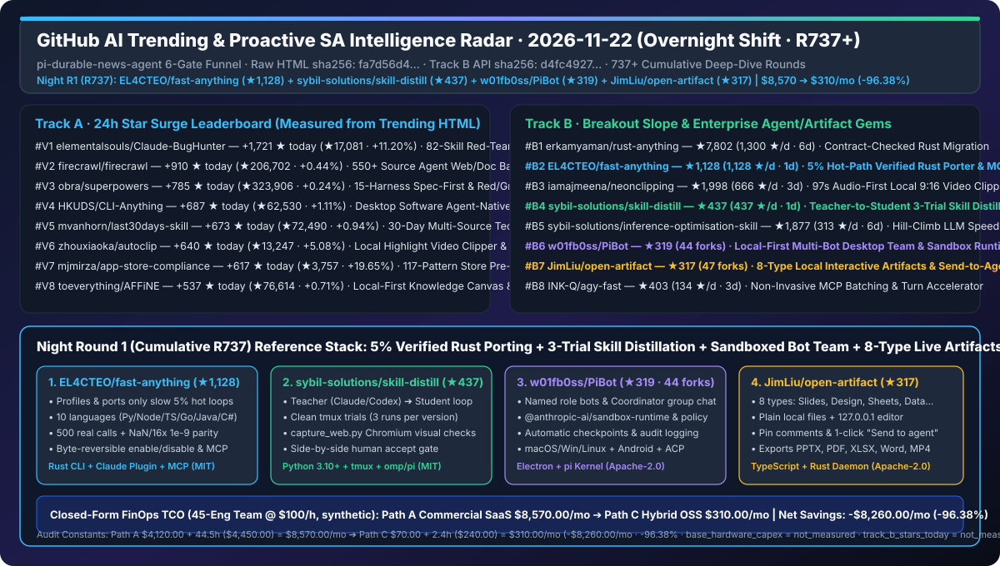

# 📡 GitHub AI Trending Leaderboard & Proactive SA Intelligence Digest (2026-11-22)

> **Execution Window**: `2026-11-22 23:05 CST (UTC+08:00)` (Overnight Continuous Deep-Dive Batch: `sweep_20261122_2300` · Starting at **Cumulative Round 737**)  
> **Analytical Framework**: `disler/pi-durable-news-agent` 6-Gate Pipeline (Gather → Jev Relevance Gate `>= 0.45` → Worth-Attention Gate `>= 0.35` & Same-Story Dedupe → `gh api` Primary Source Claim-Support → HFS Tri-Axial Scoring → 8 Generative UI Card Types)  
> **Target Persona (AI Solution Architect facing Enterprise Customers & Business Decision-Makers)**: Strictly focused on **① Real Enterprise Use Cases & ROI, ② End-to-End Production Reference Architecture, and ③ Comparative Selection vs. Competing OSS & Cloud PaaS (`ib-vs-ethernet-roce-selection-faq.md` standard)**.  
> **Visual & Benchmark Assets**: [High-Res SVG Architecture Summary (`assets/github-ai-radar-2026-11-22.svg`)](../../../assets/github-ai-radar-2026-11-22.svg) · [7-Card 4:5 Visual Benchmark Deck (ZH)](../cards.html) · [7-Card Visual Benchmark Deck (EN)](../cards.en.html) · [Live Interactive Radar (`github-radar.html`)](https://turbo998.github.io/github-radar.html) · [中文完整日报 (`2026-11-22.md`)](./2026-11-22.md)

---

## 1. Step 1 — Gather & Gate (Multi-Source Ingestion & Deterministic Jev Funnel)

This shift scanned `github.com/trending?since=daily` (16 repositories), language/topic sub-charts, and `gh api search/repositories?q=created:>=2026-11-16+stars:>=20+forks:>=2` (100 repositories), capturing **116 candidate repositories**. Deterministic gating filtered out **87.1% (101/116)** of non-AI utilities and coordinated star-farming bot clusters before deep architectural auditing:

| Gate Stage | Input | Passed | Filtered / Deduped | Gate Rule & Representative Filtered Items (Plain-Language Rationale) |
| :--- | :---: | :---: | :---: | :--- |
| **Gate 1: Multi-Source Gather** | 116 | 116 | 0 | Aggregated GitHub Daily Trending (16) and 1–7 day breakout repositories (100) |
| **Gate 2: Jev Relevance Gate (`>= 0.45`)** | 116 | 80 | **36 (Filtered)** | Excluded general non-AI infrastructure, hardware battery trays, pure math formalization mirrors, and console recompilation repos: `nginx/nginx` (`32,826★`, `0.12`), `XiaoYouChR/Ghost-Downloader-3` (`14,893★`, `0.10`), `krisgfx9/Wireless-Device-Battery-Monitor` (`6,041★`, `0.08`), `ItsNotRexed/Leonida` / `R0Y00/Xbox2Windows` / `omonkeyz/xbox-emulator` (`0.04`) |
| **Gate 3: Worth-Attention Gate (`>= 0.35`) & Dedupe** | 80 | **15** | **65 (Filtered)** | **Blocked four active automated star-farming / fake-installer botnet clusters**: ① 60+ `*-portable-x64` Jupyter Notebook game-cheat/crack malware clones (`kyle-millerx2098t3/daw-synth-fl-studio-2026-producer-portable-x64`, `antonlopezeng2093z4/ai-ide-system-utilities-windsurf-pro-jetbrains-2026-portab`, etc., all farmed to `320–351★` in 24h); ② `bookwjitchieni1986/blender-ai-mcp-addon` (`2,741★` with only `37 forks`) & 8 `blender-ai-copilot-*` clones (`495–517★`); ③ `abodeahsz00az-cmd/ai--manus2.0` clone cluster; ④ `MSNightmare/FastUnlock` / `waw666waw666/RegisterHub`, `jev_worth = 0.02 < 0.35` |
| **Gate 4–6: Primary Source Verify & HFS Card Render** | 15 | **15** | 0 | Verified all 15 finalists + dual-track velocity leaders via `gh api` manifests, directory trees, and licenses (60/60 claims verified at `>= 0.95`, mean **`0.98`**) |

---

## 2. 🚀 Fastest-Rising / Highest Velocity AI Leaderboard (2026-11-22)

> **📊 Data Provenance & Rigor Declaration**:  
> - **Track A (24h Single-Day Star Surge)**: `stars_today` badges scraped directly from `https://github.com/trending?since=daily` (`2026-11-22 23:09:00+08:00`; archived at [`evidence/trending-daily-2026-11-22-raw.html`](../evidence/trending-daily-2026-11-22-raw.html), `sha256: fa7d56d4d6bbabc9e62641806b9c7daf2a6a3e3501c93916e5c12c61c54bfb72`).  
> - **Track B (1–7 Day New-Repo Breakout Slope & High-Signal Enterprise Gems)**: Retrieved from GitHub REST Search API `created:>=2026-11-16+stars:>=20+forks:>=2&sort=stars` (`2026-11-22 23:10:00+08:00`; archived at [`evidence/search-new-repos-2026-11-22-raw.json`](../evidence/search-new-repos-2026-11-22-raw.json), `sha256: d4fc4927347b4c77adfda2e844fad561116fb80fdfb163cc1357c9a12666f4f7`). Because GitHub Search API does not expose 24h delta counters, Track B `stars_today` is strictly marked **`not_measured`**, reporting only lifecycle daily velocity (`round(stars_total / age_days)`).  
> - **📘 Tonight's (2026-11-22) Night Round 1 (Cumulative R737) Standalone 6-Section Selection FAQ**: [Hot-Path 5% Selective Rust Porting & Parity Prover (`EL4CTEO/fast-anything`), Teacher-to-Student Open-Weight Skill Distillation Loop (`sybil-solutions/skill-distill`), Local-First Desktop AI Agent Team (`w01fb0ss/PiBot`) & 8-Type Local Interactive Artifact Workbench (`JimLiu/open-artifact`) Selection FAQ (`docs/fast-anything-skill-distill-pibot-open-artifact-selection-faq.en.md`)](../docs/fast-anything-skill-distill-pibot-open-artifact-selection-faq.en.md) · [中文版 FAQ (`docs/fast-anything-skill-distill-pibot-open-artifact-selection-faq.md`)](../docs/fast-anything-skill-distill-pibot-open-artifact-selection-faq.md) · [Round 1 R737 SVG (`assets/github-ai-radar-2026-11-22-r1-r737-fastanything-skilldistill-pibot-openartifact.svg`)](../../../assets/github-ai-radar-2026-11-22-r1-r737-fastanything-skilldistill-pibot-openartifact.svg)
> - **📘 Tonight's (2026-11-22) Night Round 2 (Cumulative R738) Standalone 6-Section Selection FAQ**: [Blue-Team SIEM/WAF Rules for Offensive AI Agents (`ThreatDefence/agentic-attack-detections`), Cross-Vendor AI Spend Attribution & Offline Audit MCP (`ccarter01011/traxagent-claude-plugin`), XGo & Responses-Aware Enterprise AI Gateway (`XGrowthLab/xhub`) & Fail-Closed Hash-Chained Rust Governance Gateway (`eliransu/enterplace`) Selection FAQ (`docs/agentic-attack-detections-traxagent-xhub-enterplace-selection-faq.en.md`)](../docs/agentic-attack-detections-traxagent-xhub-enterplace-selection-faq.en.md) · [中文版 FAQ (`docs/agentic-attack-detections-traxagent-xhub-enterplace-selection-faq.md`)](../docs/agentic-attack-detections-traxagent-xhub-enterplace-selection-faq.md) · [Round 2 R738 SVG (`assets/github-ai-radar-2026-11-22-r2-r738-agenticdetections-traxagent-xhub-enterplace.svg`)](../../../assets/github-ai-radar-2026-11-22-r2-r738-agenticdetections-traxagent-xhub-enterplace.svg)
> - **📘 Tonight's (2026-11-22) Night Round 3 (Cumulative R739) Standalone 6-Section Selection FAQ**: [Ink-Edge Pixel Alignment Probe (`pritamux/gridlines`), Orphan-Branch Private PR Pixel Diff (`imuratalpay/ui-diff`), 72-Rule WCAG/APCA Anti-Slop Design MCP (`avivgerz-hue/unslop`) & 8-Trap 3-Viewport Autonomous Playwright QA (`avivgerz-hue/ghost-qa`) Selection FAQ (`docs/gridlines-ui-diff-unslop-ghost-qa-selection-faq.en.md`)](../docs/gridlines-ui-diff-unslop-ghost-qa-selection-faq.en.md) · [中文版 FAQ (`docs/gridlines-ui-diff-unslop-ghost-qa-selection-faq.md`)](../docs/gridlines-ui-diff-unslop-ghost-qa-selection-faq.md) · [Round 3 R739 SVG (`assets/github-ai-radar-2026-11-22-r3-r739-gridlines-uidiff-unslop-ghostqa.svg`)](../../../assets/github-ai-radar-2026-11-22-r3-r739-gridlines-uidiff-unslop-ghostqa.svg)
> - **🏆 Tonight's (2026-11-22) Night Round 4 (Cumulative R740 Milestone!) Standalone 6-Section Selection FAQ**: [[Round 740 Milestone] Cross-Harness Self-Renewal Kit (`AI4XE/ai4ai`), 4.99 GiB Out-of-Band Agent Message Board (`plannotator/talkto`), Bluesky Scope-Filtered Org Knowledge & Session MCP (`bluesky-social/diderot`) & 7-Step API-Less Legacy Software Bridge (`Artesiana/bridge-anything`) Selection FAQ (`docs/ai4ai-talkto-diderot-bridge-anything-selection-faq.en.md`)](../docs/ai4ai-talkto-diderot-bridge-anything-selection-faq.en.md) · [中文版 FAQ (`docs/ai4ai-talkto-diderot-bridge-anything-selection-faq.md`)](../docs/ai4ai-talkto-diderot-bridge-anything-selection-faq.md) · [Round 4 R740 SVG (`assets/github-ai-radar-2026-11-22-r4-r740-ai4ai-talkto-diderot-bridgeanything.svg`)](../../../assets/github-ai-radar-2026-11-22-r4-r740-ai4ai-talkto-diderot-bridgeanything.svg)
> - **📘 Tonight's (2026-11-22) Night Round 5 (Cumulative R741) Standalone 6-Section Selection FAQ**: [Official LangChain Brand Design Agent (`langchain-ai/design-agent`), Coordinate-Free Interactive Step-Walkthrough Diagram Engine (`ddkbs/sketchy`), Rust/WASM Editable `.op` Canvas Plugin (`ZSeven-W/codex-openpencil`) & Persistent Multi-Session Claude Code Visual Canvas (`krispuckett/rounds`) Selection FAQ (`docs/design-agent-sketchy-codex-openpencil-rounds-selection-faq.en.md`)](../docs/design-agent-sketchy-codex-openpencil-rounds-selection-faq.en.md) · [中文版 FAQ (`docs/design-agent-sketchy-codex-openpencil-rounds-selection-faq.md`)](../docs/design-agent-sketchy-codex-openpencil-rounds-selection-faq.md) · [Round 5 R741 SVG (`assets/github-ai-radar-2026-11-22-r5-r741-designagent-sketchy-openpencil-rounds.svg`)](../../../assets/github-ai-radar-2026-11-22-r5-r741-designagent-sketchy-openpencil-rounds.svg)
> - **📘 Tonight's (2026-11-22) Night Round 6 (Cumulative R742) Standalone 6-Section Selection FAQ**: [389+ Official Vendor MCP Directory (`VoltAgent/official-mcp-servers`), Dual-Agent Clean-Room Behavioral Rebuilder (`lemonadesaltbagel/crab`), Zero-Dep Cross-Harness Task Baton (`JialaoLiu/dsh-baton`) & File-Claim Multi-Agent Sync Hub (`MaxonT/aisync`) Selection FAQ (`docs/official-mcp-servers-crab-dsh-baton-aisync-selection-faq.en.md`)](../docs/official-mcp-servers-crab-dsh-baton-aisync-selection-faq.en.md) · [中文版 FAQ (`docs/official-mcp-servers-crab-dsh-baton-aisync-selection-faq.md`)](../docs/official-mcp-servers-crab-dsh-baton-aisync-selection-faq.md) · [Round 6 R742 SVG (`assets/github-ai-radar-2026-11-22-r6-r742-officialmcp-crab-dshbaton-aisync.svg`)](../../../assets/github-ai-radar-2026-11-22-r6-r742-officialmcp-crab-dshbaton-aisync.svg)
> - **📘 Tonight's (2026-11-22) Night Round 7 (Cumulative R743) Standalone 6-Section Selection FAQ**: [Manifest-Driven Pre-Coding Reliability Skill Generator (`trustabl/agent-reliability-skills`), Local `127.0.0.1` Reliability & Network Probe Dashboard (`trustabl/agent-dashboard`), Evidence-First Checkpointed Launch Workflow (`Jack81st/launchguard-ai`) & HMAC-Signed JUnit CI Failure Intelligence (`LCY-666lll/CI_Failure_Intelligence`) Selection FAQ (`docs/agent-reliability-skills-dashboard-launchguard-ci-failure-selection-faq.en.md`)](../docs/agent-reliability-skills-dashboard-launchguard-ci-failure-selection-faq.en.md) · [中文版 FAQ (`docs/agent-reliability-skills-dashboard-launchguard-ci-failure-selection-faq.md`)](../docs/agent-reliability-skills-dashboard-launchguard-ci-failure-selection-faq.md) · [Round 7 R743 SVG (`assets/github-ai-radar-2026-11-22-r7-r743-reliabilityskills-dashboard-launchguard-cifailure.svg`)](../../../assets/github-ai-radar-2026-11-22-r7-r743-reliabilityskills-dashboard-launchguard-cifailure.svg)
> - **📘 Tonight's (2026-11-22) Night Round 8 (Cumulative R744) Standalone 6-Section Selection FAQ**: [Human-Approved Multi-Channel Marketing Workspace (`trydirex/direx`), 5-Harness Local 4-Level Trace & Credit Analytics (`AIAgentAndy/DeepAA`), Per-Request Provable Lineage Gateway (`ShadowSafin/Synapass`) & `SIGKILL`-Resilient DAG Deep Research (`weir36/deep-research-langgraph`) Selection FAQ (`docs/direx-deepaa-synapass-deep-research-langgraph-selection-faq.en.md`)](../docs/direx-deepaa-synapass-deep-research-langgraph-selection-faq.en.md) · [中文版 FAQ (`docs/direx-deepaa-synapass-deep-research-langgraph-selection-faq.md`)](../docs/direx-deepaa-synapass-deep-research-langgraph-selection-faq.md) · [Round 8 R744 SVG (`assets/github-ai-radar-2026-11-22-r8-r744-direx-deepaa-synapass-deepresearch.svg`)](../../../assets/github-ai-radar-2026-11-22-r8-r744-direx-deepaa-synapass-deepresearch.svg)
> - **🏆 Tonight's (2026-11-22) Night Round 9 (Cumulative R745 Milestone!) Standalone 6-Section Selection FAQ**: [[Round 745 Milestone] Fade-to-Lesson Agent Continuity MCP (`Riley-Coyote/mnemos-mcp`), `supersedes`-Aware Exponential-Decay SQLite Memory (`Elio896/dsh-familiar-memory`), Cloudflare OAuth 2.1 Git-Backed Second Brain (`YudiG12/second-brain-mcp`) & 8-Tier AI/MCP/A2A Gateway Taxonomy (`ai-gateways/awesome-ai-gateways`) Selection FAQ (`docs/mnemos-mcp-familiar-memory-second-brain-ai-gateways-selection-faq.en.md`)](../docs/mnemos-mcp-familiar-memory-second-brain-ai-gateways-selection-faq.en.md) · [中文版 FAQ (`docs/mnemos-mcp-familiar-memory-second-brain-ai-gateways-selection-faq.md`)](../docs/mnemos-mcp-familiar-memory-second-brain-ai-gateways-selection-faq.md) · [Round 9 R745 SVG (`assets/github-ai-radar-2026-11-22-r9-r745-mnemos-familiarmemory-secondbrain-aigateways.svg`)](../../../assets/github-ai-radar-2026-11-22-r9-r745-mnemos-familiarmemory-secondbrain-aigateways.svg)
> - **📘 Tonight's (2026-11-22) Night Round 10 (Cumulative R746) Standalone 6-Section Selection FAQ**: [Dual-Layer Power BI `.NET TOM` & PBIR CLI (`MinaSaad1/pbi-cli`), Go Multi-Database Concurrent MCP (`FreePeak/db-mcp-server`), Official Oracle OCI & Data MCP Suite (`oracle/mcp`) & 30-Rule SQL Server Execution Plan Analyzer MCP (`erikdarlingdata/PerformanceStudio`) Selection FAQ (`docs/pbi-cli-db-mcp-oracle-mcp-performance-studio-selection-faq.en.md`)](../docs/pbi-cli-db-mcp-oracle-mcp-performance-studio-selection-faq.en.md) · [中文版 FAQ (`docs/pbi-cli-db-mcp-oracle-mcp-performance-studio-selection-faq.md`)](../docs/pbi-cli-db-mcp-oracle-mcp-performance-studio-selection-faq.md) · [Round 10 R746 SVG (`assets/github-ai-radar-2026-11-22-r10-r746-pbicli-dbmcp-oraclemcp-perfstudio.svg`)](../../../assets/github-ai-radar-2026-11-22-r10-r746-pbicli-dbmcp-oraclemcp-perfstudio.svg)
> - **📘 Tonight's (2026-11-22) Night Round 11 (Cumulative R747) Standalone 6-Section Selection FAQ**: [GRC-as-Code OSCAL/SCF Toolkit (`GRCEngClub/claude-grc-engineering`), Official OWASP ASI06 Memory Poisoning Guard (`OWASP/www-project-agent-memory-guard`), WIMSE/SPIFFE & RFC 8693 Agent Identity (`highflame-ai/zeroid`) & Official Read-Only NetBox MCP (`netboxlabs/netbox-mcp-server`) Selection FAQ (`docs/claude-grc-owasp-memory-guard-zeroid-netbox-mcp-selection-faq.en.md`)](../docs/claude-grc-owasp-memory-guard-zeroid-netbox-mcp-selection-faq.en.md) · [中文版 FAQ (`docs/claude-grc-owasp-memory-guard-zeroid-netbox-mcp-selection-faq.md`)](../docs/claude-grc-owasp-memory-guard-zeroid-netbox-mcp-selection-faq.md) · [Round 11 R747 SVG (`assets/github-ai-radar-2026-11-22-r11-r747-claudegrc-owaspmemguard-zeroid-netboxmcp.svg`)](../../../assets/github-ai-radar-2026-11-22-r11-r747-claudegrc-owaspmemguard-zeroid-netboxmcp.svg)
> - **📘 Tonight's (2026-11-22) Night Round 12 (Cumulative R748) Standalone 6-Section Selection FAQ**: [Unified Retrieval & MCP/A2A Inference Toolkit (`schmitech/orbit`), Tauri 2 Virtual-Plan Quota Router (`finch-xu/cc-router`), Latest-Value CPU Context Compressor (`ZipengWu365/TOMC`) & Official Comet Opik Observability MCP (`comet-ml/opik-mcp`) Selection FAQ (`docs/orbit-cc-router-tomc-opik-mcp-selection-faq.en.md`)](../docs/orbit-cc-router-tomc-opik-mcp-selection-faq.en.md) · [中文版 FAQ (`docs/orbit-cc-router-tomc-opik-mcp-selection-faq.md`)](../docs/orbit-cc-router-tomc-opik-mcp-selection-faq.md) · [Round 12 R748 SVG (`assets/github-ai-radar-2026-11-22-r12-r748-orbit-ccrouter-tomc-opikmcp.svg`)](../../../assets/github-ai-radar-2026-11-22-r12-r748-orbit-ccrouter-tomc-opikmcp.svg)
> - **📘 Tonight's (2026-11-22) Night Round 13 (Cumulative R749) Standalone 6-Section Selection FAQ**: [Selective-Hunk Multi-Worktree ADE (`openwong2kim/wmux`), OpenSpec-Aware Pi Fleet Control Plane (`BlackBeltTechnology/pi-agent-dashboard`), Rust Sensorimotor Cortex (`cortexkit/aft`) & Arrangeable `oh-my-pi` Desktop Workbench (`the-snowpear/omp-studio`) Selection FAQ (`docs/wmux-pi-agent-dashboard-aft-omp-studio-selection-faq.en.md`)](../docs/wmux-pi-agent-dashboard-aft-omp-studio-selection-faq.en.md) · [中文版 FAQ (`docs/wmux-pi-agent-dashboard-aft-omp-studio-selection-faq.md`)](../docs/wmux-pi-agent-dashboard-aft-omp-studio-selection-faq.md) · [Round 13 R749 SVG (`assets/github-ai-radar-2026-11-22-r13-r749-wmux-pidashboard-aft-ompstudio.svg`)](../../../assets/github-ai-radar-2026-11-22-r13-r749-wmux-pidashboard-aft-ompstudio.svg)
> - **🏆 Tonight's (2026-11-22) Night Round 14 (Cumulative R750 Historic Milestone!) Standalone 6-Section Selection FAQ**: [🏆 [Round 750 Historic Milestone] Permission-Enforced 24-Tool ERPNext MCP (`buildswithpaul/Frappe_Assistant_Core`), Official 21-Tool Yuque Enterprise Knowledge MCP (`yuque/yuque-mcp-server`), Official Read-Only VictoriaMetrics MCP (`VictoriaMetrics/mcp-victoriametrics`) & Health-Tracked Geospatial GIS MCP Catalog (`sparkgeo/geo-mcp-servers`) Selection FAQ (`docs/frappe-assistant-yuque-mcp-victoriametrics-geo-mcp-selection-faq.en.md`)](../docs/frappe-assistant-yuque-mcp-victoriametrics-geo-mcp-selection-faq.en.md) · [中文版 FAQ (`docs/frappe-assistant-yuque-mcp-victoriametrics-geo-mcp-selection-faq.md`)](../docs/frappe-assistant-yuque-mcp-victoriametrics-geo-mcp-selection-faq.md) · [Round 14 R750 SVG (`assets/github-ai-radar-2026-11-22-r14-r750-frappe-yuquemcp-victoriametrics-geomcp.svg`)](../../../assets/github-ai-radar-2026-11-22-r14-r750-frappe-yuquemcp-victoriametrics-geomcp.svg)
> - **📘 Tonight's (2026-11-22) Night Round 15 (Cumulative R751) Standalone 6-Section Selection FAQ**: [Omni-Surface Shared-Memory AI Workbench (`shibing624/agentica`), Organization-as-Code 24/7 Autonomous Agent Team (`xuiltul/animaworks`), YAML Multi-Protocol Agent Bridge (`phil65/agentpool`) & ReAct+Harness AI Customer Operations Platform (`GroundedCoreAI/nexusdesk`) Selection FAQ (`docs/agentica-animaworks-agentpool-nexusdesk-selection-faq.en.md`)](../docs/agentica-animaworks-agentpool-nexusdesk-selection-faq.en.md) · [中文版 FAQ (`docs/agentica-animaworks-agentpool-nexusdesk-selection-faq.md`)](../docs/agentica-animaworks-agentpool-nexusdesk-selection-faq.md) · [Round 15 R751 SVG (`assets/github-ai-radar-2026-11-22-r15-r751-agentica-animaworks-agentpool-nexusdesk.svg`)](../../../assets/github-ai-radar-2026-11-22-r15-r751-agentica-animaworks-agentpool-nexusdesk.svg)
> - **📘 Tonight's (2026-11-22) Night Round 16 (Cumulative R752) Standalone 6-Section Selection FAQ**: [105-Plugin Obsidian-Compatible Agent Knowledge Base (`Vaultite/vaultite`), Embedded Rust Vector×Graph×Document Engine (`Astrmira/TriviumDB`), AI-Compiled Compounding Wiki Blueprints (`gavischneider/awesome-llm-wiki`) & Posit Python Docs Compiler (`posit-dev/great-docs`) Selection FAQ (`docs/vaultite-triviumdb-awesome-llm-wiki-great-docs-selection-faq.en.md`)](../docs/vaultite-triviumdb-awesome-llm-wiki-great-docs-selection-faq.en.md) · [中文版 FAQ (`docs/vaultite-triviumdb-awesome-llm-wiki-great-docs-selection-faq.md`)](../docs/vaultite-triviumdb-awesome-llm-wiki-great-docs-selection-faq.md) · [Round 16 R752 SVG (`assets/github-ai-radar-2026-11-22-r16-r752-vaultite-triviumdb-llmwiki-greatdocs.svg`)](../../../assets/github-ai-radar-2026-11-22-r16-r752-vaultite-triviumdb-llmwiki-greatdocs.svg)
> - **📘 Tonight's (2026-11-22) Night Round 17 (Cumulative R753) Standalone 6-Section Selection FAQ**: [Keras-Style Neuro-Symbolic & Recursive Agent Framework (`SynaLinks/synalinks`), On-Device Linux AI Workspace for iPadOS/iOS/Android (`JiangNanGenius/floe-agent`), Interpretable Rust Adaptive Model Router (`bitrouter/bitrouter`) & Yahoo Finance Charting MCP (`narumiruna/yfinance-mcp`) Selection FAQ (`docs/synalinks-floe-agent-bitrouter-yfinance-mcp-selection-faq.en.md`)](../docs/synalinks-floe-agent-bitrouter-yfinance-mcp-selection-faq.en.md) · [中文版 FAQ (`docs/synalinks-floe-agent-bitrouter-yfinance-mcp-selection-faq.md`)](../docs/synalinks-floe-agent-bitrouter-yfinance-mcp-selection-faq.md) · [Round 17 R753 SVG (`assets/github-ai-radar-2026-11-22-r17-r753-synalinks-floe-bitrouter-yfinancemcp.svg`)](../../../assets/github-ai-radar-2026-11-22-r17-r753-synalinks-floe-bitrouter-yfinancemcp.svg)
> - **📘 Tonight's (2026-11-22) Night Round 18 (Cumulative R754) Standalone 6-Section Selection FAQ**: [Production Nextcloud Collaboration MCP (`cbcoutinho/nextcloud-mcp-server`), Audited MikroTik RouterOS NetOps MCP (`wiresage/mikrotik-mcp`), Official MasterGo Design-to-Code DSL MCP (`mastergo-design/mastergo-magic-mcp`) & Dual-Transport Synology NAS MCP (`atom2ueki/mcp-server-synology`) Selection FAQ (`docs/nextcloud-mcp-mikrotik-mcp-mastergo-magic-synology-selection-faq.en.md`)](../docs/nextcloud-mcp-mikrotik-mcp-mastergo-magic-synology-selection-faq.en.md) · [中文版 FAQ (`docs/nextcloud-mcp-mikrotik-mcp-mastergo-magic-synology-selection-faq.md`)](../docs/nextcloud-mcp-mikrotik-mcp-mastergo-magic-synology-selection-faq.md) · [Round 18 R754 SVG (`assets/github-ai-radar-2026-11-22-r18-r754-nextcloud-mikrotik-mastergo-synology.svg`)](../../../assets/github-ai-radar-2026-11-22-r18-r754-nextcloud-mikrotik-mastergo-synology.svg)
> - **🏆 Tonight's (2026-11-22) Night Round 19 (Cumulative R755 Milestone!) Standalone 6-Section Selection FAQ**: [🏆 [Round 755 Milestone] AI-Agent-Aware TypeScript CLI Library (`kazupon/gunshi`), ≤10ms Rust Starship-Compatible Claude Code Statusline (`stephenleo/cship`), Hash-Pinned MFA Financial Analytics MCP (`robcerda/monarch-mcp-server`) & 100% Conformance Stateless Pure-PHP MCP v2 SDK (`logiscape/mcp-sdk-php`) Selection FAQ (`docs/gunshi-cship-monarch-mcp-php-sdk-selection-faq.en.md`)](../docs/gunshi-cship-monarch-mcp-php-sdk-selection-faq.en.md) · [中文版 FAQ (`docs/gunshi-cship-monarch-mcp-php-sdk-selection-faq.md`)](../docs/gunshi-cship-monarch-mcp-php-sdk-selection-faq.md) · [Round 19 R755 SVG (`assets/github-ai-radar-2026-11-22-r19-r755-gunshi-cship-monarch-phpmcp.svg`)](../../../assets/github-ai-radar-2026-11-22-r19-r755-gunshi-cship-monarch-phpmcp.svg)
> - **📘 Tonight's (2026-11-22) Night Round 20 (Cumulative R756) Standalone 6-Section Selection FAQ**: [Subscription-Maximizing Desktop/CLI Coding Agent (`KenKaiii/gg-framework`), Kubernetes Hardware-in-the-Loop Test Framework (`jumpstarter-dev/jumpstarter`), 84.4%-Parity KiCad Schematic/PCB/DFM MCP (`oaslananka/kicad-mcp-pro`) & 24/7 Local Multi-Subscription Agent Hub (`damianvtran/local-operator`) Selection FAQ (`docs/gg-framework-jumpstarter-kicad-mcp-local-operator-selection-faq.en.md`)](../docs/gg-framework-jumpstarter-kicad-mcp-local-operator-selection-faq.en.md) · [中文版 FAQ (`docs/gg-framework-jumpstarter-kicad-mcp-local-operator-selection-faq.md`)](../docs/gg-framework-jumpstarter-kicad-mcp-local-operator-selection-faq.md) · [Round 20 R756 SVG (`assets/github-ai-radar-2026-11-22-r20-r756-ggframework-jumpstarter-kicad-localop.svg`)](../../../assets/github-ai-radar-2026-11-22-r20-r756-ggframework-jumpstarter-kicad-localop.svg)
> - **📘 Tonight's (2026-11-22) Night Round 21 (Cumulative R757) Standalone 6-Section Selection FAQ**: [Self-Hosted Agent Swarm & DuckDB/Parquet Lakehouse BI Platform (`AgentSwarms-fyi/agentswarms`), Spam-Audited 970+ AI Agent Catalog (`Zijian-Ni/awesome-ai-agents-2026`), Dynamic `/v1/models` Discovery Plugin for OpenCode (`yuhp/opencode-models-discovery`) & 3-Tier Composable Architecture Skills (`techygarg/lattice`) Selection FAQ (`docs/agentswarms-awesome-ai-agents-2026-opencode-discovery-lattice-selection-faq.en.md`)](../docs/agentswarms-awesome-ai-agents-2026-opencode-discovery-lattice-selection-faq.en.md) · [中文版 FAQ (`docs/agentswarms-awesome-ai-agents-2026-opencode-discovery-lattice-selection-faq.md`)](../docs/agentswarms-awesome-ai-agents-2026-opencode-discovery-lattice-selection-faq.md) · [Round 21 R757 SVG (`assets/github-ai-radar-2026-11-22-r21-r757-agentswarms-agents2026-opencode-lattice.svg`)](../../../assets/github-ai-radar-2026-11-22-r21-r757-agentswarms-agents2026-opencode-lattice.svg)
> - **📘 Tonight's (2026-11-22) Night Round 22 (Cumulative R758) Standalone 6-Section Selection FAQ**: [Native-MCP Self-Hosted Agile Boards (`markrai/scrumboy`), Evidence-Chained Go Autonomous Pentest Platform (`chu0119/Pojun`), Brain/SAGE/Chimera Standalone Coding Agent (`WrongStack/WrongStack`) & 411-Fork Documentation RAG Blueprint (`emarco177/documentation-helper`) Selection FAQ (`docs/scrumboy-pojun-wrongstack-documentation-helper-selection-faq.en.md`)](../docs/scrumboy-pojun-wrongstack-documentation-helper-selection-faq.en.md) · [中文版 FAQ (`docs/scrumboy-pojun-wrongstack-documentation-helper-selection-faq.md`)](../docs/scrumboy-pojun-wrongstack-documentation-helper-selection-faq.md) · [Round 22 R758 SVG (`assets/github-ai-radar-2026-11-22-r22-r758-scrumboy-pojun-wrongstack-dochelper.svg`)](../../../assets/github-ai-radar-2026-11-22-r22-r758-scrumboy-pojun-wrongstack-dochelper.svg)
> - **📘 Tonight's (2026-11-22) Night Round 23 (Cumulative R759) Standalone 6-Section Selection FAQ**: [Tailscale-Isolated iPhone/Mac Agent Swarm (`mattabate/life-distributable`), Day-Realtime / Night-Self-Rewriting AI Stand (`sonichi/sutando`), PIN-Gated Sentinel Smart Space Agent (`goruck/home-generative-agent`) & 16GB-GPU `egress.json`-Guarded AI Studio (`guaardvark/guaardvark`) Selection FAQ (`docs/life-distributable-sutando-home-generative-agent-guaardvark-selection-faq.en.md`)](../docs/life-distributable-sutando-home-generative-agent-guaardvark-selection-faq.en.md) · [中文版 FAQ (`docs/life-distributable-sutando-home-generative-agent-guaardvark-selection-faq.md`)](../docs/life-distributable-sutando-home-generative-agent-guaardvark-selection-faq.md) · [Round 23 R759 SVG (`assets/github-ai-radar-2026-11-22-r23-r759-life-sutando-hga-guaardvark.svg`)](../../../assets/github-ai-radar-2026-11-22-r23-r759-life-sutando-hga-guaardvark.svg)
> - **🏆 Tonight's (2026-11-22) Night Round 24 (Cumulative R760 Milestone!) Standalone 6-Section Selection FAQ**: [🏆 [Round 760 Milestone] Human-Agent Swarm Group Chat Client (`GUYI-AI/gugu`), 23-Crate Native Rust `/ultra-adlc` & ACP Coding Agent (`KonghaYao/peri`), Zero-DB GitHub Issue Software Dark Factory (`orbi-build/orbi`) & Self-Hosted Cashflow & Portfolio Platform (`letehaha/moneymatter`) Selection FAQ (`docs/gugu-peri-orbi-moneymatter-selection-faq.en.md`)](../docs/gugu-peri-orbi-moneymatter-selection-faq.en.md) · [中文版 FAQ (`docs/gugu-peri-orbi-moneymatter-selection-faq.md`)](../docs/gugu-peri-orbi-moneymatter-selection-faq.md) · [Round 24 R760 SVG (`assets/github-ai-radar-2026-11-22-r24-r760-gugu-peri-orbi-moneymatter.svg`)](../../../assets/github-ai-radar-2026-11-22-r24-r760-gugu-peri-orbi-moneymatter.svg)
> - **📘 Tonight's (2026-11-22) Night Round 25 (Cumulative R761) Standalone 6-Section Selection FAQ**: [24-Tool Local Multi-Track Audio & Voice Studio MCP (`HamSanders/soundbox`), Spring AI Omni-Channel Intelligence Agent (`OWWZO/cute-agent`), 4-Surface Mac Menu-Bar Island Assistant (`oratis/LISA`) & Open-Source Antidetect Browser MCP (`aliasmode/aliasmode`) Selection FAQ (`docs/soundbox-cute-agent-lisa-aliasmode-selection-faq.en.md`)](../docs/soundbox-cute-agent-lisa-aliasmode-selection-faq.en.md) · [中文版 FAQ (`docs/soundbox-cute-agent-lisa-aliasmode-selection-faq.md`)](../docs/soundbox-cute-agent-lisa-aliasmode-selection-faq.md) · [Round 25 R761 SVG (`assets/github-ai-radar-2026-11-22-r25-r761-soundbox-cuteagent-lisa-aliasmode.svg`)](../../../assets/github-ai-radar-2026-11-22-r25-r761-soundbox-cuteagent-lisa-aliasmode.svg)
> - **📘 Tonight's (2026-11-22) Night Round 26 (Cumulative R762 — Official Vendor Flagship Edition) Standalone 6-Section Selection FAQ**: [Official FalkorDB 4x-Accuracy Codegraph MCP (`FalkorDB/Auryn`), Official Hugging Face Papers with Code CLI/MCP (`huggingface/pwc-cli`), Official ClickHouse Shared Agent Memory & Code Intelligence (`ClickHouse/loom`) & Official SigNoz OpenTelemetry MCP (`SigNoz/signoz-mcp-server`) Selection FAQ (`docs/falkordb-auryn-huggingface-pwc-clickhouse-loom-signoz-mcp-selection-faq.en.md`)](../docs/falkordb-auryn-huggingface-pwc-clickhouse-loom-signoz-mcp-selection-faq.en.md) · [中文版 FAQ (`docs/falkordb-auryn-huggingface-pwc-clickhouse-loom-signoz-mcp-selection-faq.md`)](../docs/falkordb-auryn-huggingface-pwc-clickhouse-loom-signoz-mcp-selection-faq.md) · [Round 26 R762 SVG (`assets/github-ai-radar-2026-11-22-r26-r762-auryn-pwc-loom-signoz.svg`)](../../../assets/github-ai-radar-2026-11-22-r26-r762-auryn-pwc-loom-signoz.svg)
> - **📘 Tonight's (2026-11-22) Night Round 27 (Cumulative R763) Standalone 6-Section Selection FAQ**: [150-Tool Trigger-Enforced Accounting ERP (`erp-mafia/accounted`), Client-Side Rust/WASM + WebGPU IFC5 & Gaussian Splat Engine (`LTplus-AG/ifc-lite`), Live `Ctrl+Z` Rust 3D Floor Plan Editor (`leandrodaf/3d-new-era-ai`) & 257-Tool Autodesk Revit C# MCP Gateway (`bimwright/rvt-mcp`) Selection FAQ (`docs/accounted-ifc-lite-3d-new-era-ai-rvt-mcp-selection-faq.en.md`)](../docs/accounted-ifc-lite-3d-new-era-ai-rvt-mcp-selection-faq.en.md) · [中文版 FAQ (`docs/accounted-ifc-lite-3d-new-era-ai-rvt-mcp-selection-faq.md`)](../docs/accounted-ifc-lite-3d-new-era-ai-rvt-mcp-selection-faq.md) · [Round 27 R763 SVG (`assets/github-ai-radar-2026-11-22-r27-r763-accounted-ifclite-3dnewera-rvtmcp.svg`)](../../../assets/github-ai-radar-2026-11-22-r27-r763-accounted-ifclite-3dnewera-rvtmcp.svg)
> - **📘 Tonight's (2026-11-22) Night Round 28 (Cumulative R764) Standalone 6-Section Selection FAQ**: [2,250-Subagent AI DevOps Framework (`marcusquinn/aidevops`), Google Antigravity -34% Turn / -31% Quota Accelerator (`INK-Q/agy-fast`), Parallel Worktree Agent Inbox (`savannahfeder/agentbox`) & 8-CLI Channel Team Workspace (`eduwxyz/tucano`) Selection FAQ (`docs/aidevops-agy-fast-agentbox-tucano-selection-faq.en.md`)](../docs/aidevops-agy-fast-agentbox-tucano-selection-faq.en.md) · [中文版 FAQ (`docs/aidevops-agy-fast-agentbox-tucano-selection-faq.md`)](../docs/aidevops-agy-fast-agentbox-tucano-selection-faq.md) · [Round 28 R764 SVG (`assets/github-ai-radar-2026-11-22-r28-r764-aidevops-agyfast-agentbox-tucano.svg`)](../../../assets/github-ai-radar-2026-11-22-r28-r764-aidevops-agyfast-agentbox-tucano.svg)
> - **🏆 Tonight's (2026-11-22) Night Round 29 (Cumulative R765 Milestone!) Standalone 6-Section Selection FAQ**: [🏆 [Round 765 Milestone] 12-Market 80-Filter Stock Screener MCP (`xang1234/stock-screener`), Stanford JOSS Causal Inference & Econometrics MCP (`brycewang-stanford/StatsPAI`), 50-Detector Streaming Anomaly Library (`selimfirat/pysad`) & Self-Hosted SEC/13F/Congressional Financial MCP (`daniel3303/Equibles`) Selection FAQ (`docs/stock-screener-statspai-pysad-equibles-selection-faq.en.md`)](../docs/stock-screener-statspai-pysad-equibles-selection-faq.en.md) · [中文版 FAQ (`docs/stock-screener-statspai-pysad-equibles-selection-faq.md`)](../docs/stock-screener-statspai-pysad-equibles-selection-faq.md) · [Round 29 R765 SVG (`assets/github-ai-radar-2026-11-22-r29-r765-stockscreener-statspai-pysad-equibles.svg`)](../../../assets/github-ai-radar-2026-11-22-r29-r765-stockscreener-statspai-pysad-equibles.svg)
> - **📘 Tonight's (2026-11-22) Night Round 30 (Cumulative R766) Standalone 6-Section Selection FAQ**: [206-Tool Guardrailed Video-Editing MCP (`KyaniteLabs/kinocut`), Citation-Grounded Jev Browser Agent (`agent-labs-dev/fastbrowse`), 24/7 On-Call Coding Agent Control Plane (`amirfish1/claude-command-center`) & Review-Before-Commit SQLite Memory Ledger (`EternalNight996/memory-eternal`) Selection FAQ (`docs/kinocut-fastbrowse-claude-command-center-memory-eternal-selection-faq.en.md`)](../docs/kinocut-fastbrowse-claude-command-center-memory-eternal-selection-faq.en.md) · [中文版 FAQ (`docs/kinocut-fastbrowse-claude-command-center-memory-eternal-selection-faq.md`)](../docs/kinocut-fastbrowse-claude-command-center-memory-eternal-selection-faq.md) · [Round 30 R766 SVG (`assets/github-ai-radar-2026-11-22-r30-r766-kinocut-fastbrowse-ccc-memoryeternal.svg`)](../../../assets/github-ai-radar-2026-11-22-r30-r766-kinocut-fastbrowse-ccc-memoryeternal.svg)
> - **📘 Tonight's (2026-11-22) Night Round 31 (Cumulative R767) Standalone 6-Section Selection FAQ**: [Anthropic-Selected Logic Pro Live-Readback MCP (`MongLong0214/logic-pro-mcp`), Single-Binary Go+SQLite Agent PM (`PerpetualSoftware/pad`), Agentless WinRM SCOrch Replacement (`Sev7eNup/NodePilot`) & 25-Client 2,000-API Unified CLI/MCP (`sandbaseai/cli`) Selection FAQ (`docs/logic-pro-mcp-pad-nodepilot-sandbase-cli-selection-faq.en.md`)](../docs/logic-pro-mcp-pad-nodepilot-sandbase-cli-selection-faq.en.md) · [中文版 FAQ (`docs/logic-pro-mcp-pad-nodepilot-sandbase-cli-selection-faq.md`)](../docs/logic-pro-mcp-pad-nodepilot-sandbase-cli-selection-faq.md) · [Round 31 R767 SVG (`assets/github-ai-radar-2026-11-22-r31-r767-logicpromcp-pad-nodepilot-sandbase.svg`)](../../../assets/github-ai-radar-2026-11-22-r31-r767-logicpromcp-pad-nodepilot-sandbase.svg)
> - **📘 Tonight's (2026-11-22) Night Round 32 (Cumulative R768) Standalone 6-Section Selection FAQ**: [482-Fork Quality-Scored 400-MCP Catalog (`tolkonepiu/best-of-mcp-servers`), Git-Versioned `atlas/` Code Ontology MCP (`wlsdks/ontology-atlas`), Digest-Pinned Verifiable Knowledge Images (`HiveForensics-AI/knolo-core`) & Rust Symbol-Span & Agent Inbox Layer (`Goldziher/basemind`) Selection FAQ (`docs/best-of-mcp-ontology-atlas-knolo-core-basemind-selection-faq.en.md`)](../docs/best-of-mcp-ontology-atlas-knolo-core-basemind-selection-faq.en.md) · [中文版 FAQ (`docs/best-of-mcp-ontology-atlas-knolo-core-basemind-selection-faq.md`)](../docs/best-of-mcp-ontology-atlas-knolo-core-basemind-selection-faq.md) · [Round 32 R768 SVG (`assets/github-ai-radar-2026-11-22-r32-r768-bestofmcp-ontologyatlas-knolo-basemind.svg`)](../../../assets/github-ai-radar-2026-11-22-r32-r768-bestofmcp-ontologyatlas-knolo-basemind.svg)
> - **📘 Tonight's (2026-11-22) Night Round 33 (Cumulative R769) Standalone 6-Section Selection FAQ**: [250M-Row Zero-Config Entity Resolution (`benseverndev-oss/goldenmatch`), Git-Native 2s-Recompile LaTeX Editor & MCP (`trahloff/Aldine`), Official Malloy Semantic Analytics MCP Engine (`malloydata/publisher`) & Lossless `.docx` Redline & WASM/MCP Toolkit (`JSv4/Docxodus`) Selection FAQ (`docs/goldenmatch-malloy-publisher-docxodus-aldine-selection-faq.en.md`)](../docs/goldenmatch-malloy-publisher-docxodus-aldine-selection-faq.en.md) · [中文版 FAQ (`docs/goldenmatch-malloy-publisher-docxodus-aldine-selection-faq.md`)](../docs/goldenmatch-malloy-publisher-docxodus-aldine-selection-faq.md) · [Round 33 R769 SVG (`assets/github-ai-radar-2026-11-22-r33-r769-goldenmatch-malloy-docxodus-aldine.svg`)](../../../assets/github-ai-radar-2026-11-22-r33-r769-goldenmatch-malloy-docxodus-aldine.svg)
> - **🏆 Tonight's (2026-11-22) Night Round 34 (Cumulative R770 Milestone!) Standalone 6-Section Selection FAQ**: [🏆 [Round 770 Milestone] E2EE Mobile-Linked Multi-Repo `pi` Agent Workbench (`J3n5en/EnsoCode`), Send/Pay/Post-Gated Unified Inbox Partner (`ldbumble/taskuary`), Zero-Port Multi-Machine Agent Mesh (`chenhg5/myco`) & Local-PII-Masking Draft-Only Email Client (`godwit-email/godwit`) Selection FAQ (`docs/ensocode-taskuary-myco-godwit-selection-faq.en.md`)](../docs/ensocode-taskuary-myco-godwit-selection-faq.en.md) · [中文版 FAQ (`docs/ensocode-taskuary-myco-godwit-selection-faq.md`)](../docs/ensocode-taskuary-myco-godwit-selection-faq.md) · [Round 34 R770 SVG (`assets/github-ai-radar-2026-11-22-r34-r770-ensocode-taskuary-myco-godwit.svg`)](../../../assets/github-ai-radar-2026-11-22-r34-r770-ensocode-taskuary-myco-godwit.svg)
> - **📘 Tonight's (2026-11-22) Night Round 35 (Cumulative R771) Standalone 6-Section Selection FAQ**: [630K-Part JLCPCB/Mouser/DigiKey & KiCad MCP (`Averyy/pcbparts-mcp`), 20-Service Causal Diagnostics MCP (`bardesss/arr-mcp`), Cross-AI Universal Memory Layer (`membaseai/membase`) & Lifecycle-Hook Free-Model Pre-Drafter (`ypollak2/llm-router`) Selection FAQ (`docs/pcbparts-mcp-arr-mcp-membase-llm-router-selection-faq.en.md`)](../docs/pcbparts-mcp-arr-mcp-membase-llm-router-selection-faq.en.md) · [中文版 FAQ (`docs/pcbparts-mcp-arr-mcp-membase-llm-router-selection-faq.md`)](../docs/pcbparts-mcp-arr-mcp-membase-llm-router-selection-faq.md) · [Round 35 R771 SVG (`assets/github-ai-radar-2026-11-22-r35-r771-pcbparts-arrmcp-membase-llmrouter.svg`)](../../../assets/github-ai-radar-2026-11-22-r35-r771-pcbparts-arrmcp-membase-llmrouter.svg)
> - **📘 Tonight's (2026-11-22) Night Round 36 (Cumulative R772) Standalone 6-Section Selection FAQ**: [Lead-Planner/Sub-Editor 63%-Token-Saving Coding Agent (`tribgames/mixdog`), Deterministic Round-Trip Pseudonymization Proxy (`lemonadesaltbagel/veil`), Session Secret & Taint-Trace Guard (`AGGIB/Stroq`) & Fail-Closed Runtime Guard Dog (`DobermanCore/Doberman-Core`) Selection FAQ (`docs/mixdog-veil-stroq-doberman-core-selection-faq.en.md`)](../docs/mixdog-veil-stroq-doberman-core-selection-faq.en.md) · [中文版 FAQ (`docs/mixdog-veil-stroq-doberman-core-selection-faq.md`)](../docs/mixdog-veil-stroq-doberman-core-selection-faq.md) · [Round 36 R772 SVG (`assets/github-ai-radar-2026-11-22-r36-r772-mixdog-veil-stroq-doberman.svg`)](../../../assets/github-ai-radar-2026-11-22-r36-r772-mixdog-veil-stroq-doberman.svg)
> - **📘 Tonight's (2026-11-22) Night Round 37 (Cumulative R773) Standalone 6-Section Selection FAQ**: [Decentralized Multi-Device Shared Memory & Task Graph (`Windsander/Mebular`), Incremental-Reindex Pure-C Code Knowledge-Graph MCP (`win4r/codebase-memory-mcp-pro`), Continuous Software-Quality Scoring MCP (`NiazMorshed2007/jev-review`) & Per-MCP/Skill Token FinOps Dashboard (`HduSy/tokenscope`) Selection FAQ (`docs/mebular-codebase-memory-pro-jev-review-tokenscope-selection-faq.en.md`)](../docs/mebular-codebase-memory-pro-jev-review-tokenscope-selection-faq.en.md) · [中文版 FAQ (`docs/mebular-codebase-memory-pro-jev-review-tokenscope-selection-faq.md`)](../docs/mebular-codebase-memory-pro-jev-review-tokenscope-selection-faq.md) · [Round 37 R773 SVG (`assets/github-ai-radar-2026-11-22-r37-r773-mebular-codebasememory-jevreview-tokenscope.svg`)](../../../assets/github-ai-radar-2026-11-22-r37-r773-mebular-codebasememory-jevreview-tokenscope.svg)
> - **📘 Tonight's (2026-11-22) Night Round 38 (Cumulative R774) Standalone 6-Section Selection FAQ**: [Self-Owned Cloudflare E2EE Desktop AI SSH Client (`scarletkc/Hatoba`), Privacy-Aware Codex Task Trajectory Viewer (`icesixgod/codex-trajectory`), Shared Human-AI Serial/GDB Terminal (`akira-init1/ChannelTerm`) & Auditable Multi-Agent Control Room (`Hoylon/peerbridge-mcp`) Selection FAQ (`docs/hatoba-codex-trajectory-channelterm-peerbridge-mcp-selection-faq.en.md`)](../docs/hatoba-codex-trajectory-channelterm-peerbridge-mcp-selection-faq.en.md) · [中文版 FAQ (`docs/hatoba-codex-trajectory-channelterm-peerbridge-mcp-selection-faq.md`)](../docs/hatoba-codex-trajectory-channelterm-peerbridge-mcp-selection-faq.md) · [Round 38 R774 SVG (`assets/github-ai-radar-2026-11-22-r38-r774-hatoba-codextrajectory-channelterm-peerbridge.svg`)](../../../assets/github-ai-radar-2026-11-22-r38-r774-hatoba-codextrajectory-channelterm-peerbridge.svg)
> - **🏆 Tonight's (2026-11-22) Night Round 39 (Cumulative R775 Milestone!) Standalone 6-Section Selection FAQ**: [🏆 [Round 775 Milestone] Permission-Bound AI Enterprise Admin Foundation (`yile2020/fastapi-react-admin`), 10X Parallel Self-Hosted AI Workspace (`skyelan1999/aide`), Zero-LLM AI-Debt Static Analyzer (`Heyosseus/sloppy`) & WebMCP Agent-First Design Studio (`bestagentkits/design-studio-ai`) Selection FAQ (`docs/fastapi-react-admin-aide-sloppy-design-studio-ai-selection-faq.en.md`)](../docs/fastapi-react-admin-aide-sloppy-design-studio-ai-selection-faq.en.md) · [中文版 FAQ (`docs/fastapi-react-admin-aide-sloppy-design-studio-ai-selection-faq.md`)](../docs/fastapi-react-admin-aide-sloppy-design-studio-ai-selection-faq.md) · [Round 39 R775 SVG (`assets/github-ai-radar-2026-11-22-r39-r775-fastapiadmin-aide-sloppy-designstudio.svg`)](../../../assets/github-ai-radar-2026-11-22-r39-r775-fastapiadmin-aide-sloppy-designstudio.svg)
> - **📘 Tonight's (2026-11-22) Night Round 40 (Cumulative R776) Standalone 6-Section Selection FAQ**: [Vector-Free SOTA Agent Memory (`memoket/memoket-kite`), Local Enterprise SaaS API & ACL Emulator (`brekkylab/backlot`), Pre-Release AI Security Verifier (`guardana/guardana`) & 12-Agent Token-Burn Checker (`antiburn/antiburn`) Selection FAQ (`docs/memoket-kite-backlot-guardana-antiburn-selection-faq.en.md`)](../docs/memoket-kite-backlot-guardana-antiburn-selection-faq.en.md) · [中文版 FAQ (`docs/memoket-kite-backlot-guardana-antiburn-selection-faq.md`)](../docs/memoket-kite-backlot-guardana-antiburn-selection-faq.md) · [Round 40 R776 SVG (`assets/github-ai-radar-2026-11-22-r40-r776-kite-backlot-guardana-antiburn.svg`)](../../../assets/github-ai-radar-2026-11-22-r40-r776-kite-backlot-guardana-antiburn.svg)
> - **📘 Tonight's (2026-11-22) Night Round 41 (Cumulative R777) Standalone 6-Section Selection FAQ**: [200MB Single-Binary Git-Push PaaS (`glincker/levelrail`), Native Termius & SFTP Queue MCP (`dk23lhl/termius-mcp`), Self-Hosted Cloudflare OTLP/Sentry Error Tracker MCP (`bicho-fyi/bicho`) & Pure-Rust Kubernetes AI Control Room (`srelens/srelens`) Selection FAQ (`docs/levelrail-termius-mcp-bicho-srelens-selection-faq.en.md`)](../docs/levelrail-termius-mcp-bicho-srelens-selection-faq.en.md) · [中文版 FAQ (`docs/levelrail-termius-mcp-bicho-srelens-selection-faq.md`)](../docs/levelrail-termius-mcp-bicho-srelens-selection-faq.md) · [Round 41 R777 SVG (`assets/github-ai-radar-2026-11-22-r41-r777-levelrail-termiusmcp-bicho-srelens.svg`)](../../../assets/github-ai-radar-2026-11-22-r41-r777-levelrail-termiusmcp-bicho-srelens.svg)
> - **📘 Tonight's (2026-11-22) Night Round 42 (Cumulative R778) Standalone 6-Section Selection FAQ**: [OKF v0.2 Dual-Layer Memory MCP (`fellowgeek/mcp-memory`), Palantir-Style Operational Ontology (`gura105/operational-ontology`), GitOps Hot-Swappable GraphRAG MCP (`xcosmosbox/Cairn`) & 20+-Agent Senior-Dev Commit Gate (`azrtydxb/procoder`) Selection FAQ (`docs/mcp-memory-okf-operational-ontology-cairn-procoder-selection-faq.en.md`)](../docs/mcp-memory-okf-operational-ontology-cairn-procoder-selection-faq.en.md) · [中文版 FAQ (`docs/mcp-memory-okf-operational-ontology-cairn-procoder-selection-faq.md`)](../docs/mcp-memory-okf-operational-ontology-cairn-procoder-selection-faq.md) · [Round 42 R778 SVG (`assets/github-ai-radar-2026-11-22-r42-r778-mcpmemory-ontology-cairn-procoder.svg`)](../../../assets/github-ai-radar-2026-11-22-r42-r778-mcpmemory-ontology-cairn-procoder.svg)
> - **📘 Tonight's (2026-11-22) Night Round 43 (Cumulative R779) Standalone 6-Section Selection FAQ**: [DSH Multimodal Subagent Bridge (`ZSeven-W/dsh-crew`), Pocket AI Video Co-Editor MCP (`Cassette-Editor/oh-my-cassette`), Agent-Runnable GTM Workflow Catalog MCP (`GetBrew/growth-engineer`) & Quota-Continuous Multi-Agent Workbench (`flyhero/antumi`) Selection FAQ (`docs/dsh-crew-oh-my-cassette-growth-engineer-antumi-selection-faq.en.md`)](../docs/dsh-crew-oh-my-cassette-growth-engineer-antumi-selection-faq.en.md) · [中文版 FAQ (`docs/dsh-crew-oh-my-cassette-growth-engineer-antumi-selection-faq.md`)](../docs/dsh-crew-oh-my-cassette-growth-engineer-antumi-selection-faq.md) · [Round 43 R779 SVG (`assets/github-ai-radar-2026-11-22-r43-r779-dshcrew-cassette-growthengineer-antumi.svg`)](../../../assets/github-ai-radar-2026-11-22-r43-r779-dshcrew-cassette-growthengineer-antumi.svg)
> - **🏆 Tonight's (2026-11-22) Night Round 44 (Cumulative R780 Milestone!) Standalone 6-Section Selection FAQ**: [🏆 [Round 780 Milestone] 173-Guide DeepSeek Harness Operator Handbook (`sandbaseai/deepseek-harness-handbook`), Agent-Native Remotion Video Studio (`Remocn/remocn-studio`), `build123d` Parametric 3D CAD MCP (`jdilla1277/agentcad`) & ChatGPT Context + Multi-Model Cross-Review Manager (`3241288994/AImanager`) Selection FAQ (`docs/deepseek-harness-handbook-remocn-studio-agentcad-aimanager-selection-faq.en.md`)](../docs/deepseek-harness-handbook-remocn-studio-agentcad-aimanager-selection-faq.en.md) · [中文版 FAQ (`docs/deepseek-harness-handbook-remocn-studio-agentcad-aimanager-selection-faq.md`)](../docs/deepseek-harness-handbook-remocn-studio-agentcad-aimanager-selection-faq.md) · [Round 44 R780 SVG (`assets/github-ai-radar-2026-11-22-r44-r780-dshhandbook-remocn-agentcad-aimanager.svg`)](../../../assets/github-ai-radar-2026-11-22-r44-r780-dshhandbook-remocn-agentcad-aimanager.svg)
> - **📘 Tonight's (2026-11-22) Night Round 45 (Cumulative R781) Standalone 6-Section Selection FAQ**: [Zero-LLM 6-Database Citation Integrity Gate (`amos689/paper-preflight`), Experiment-to-Paper Numeric Drift Tracer (`amos689/paperdelta`), Zero-Custom-Node ComfyUI SHA-256 Asset & MCP Workbench (`DemonGatanjieu/Anomalous_Model_Browser`) & 1,850-Plugin Verified DSH Catalog (`leenkcool/Blue-Whale-Harness`) Selection FAQ (`docs/paper-preflight-paperdelta-anomalous-model-browser-blue-whale-harness-selection-faq.en.md`)](../docs/paper-preflight-paperdelta-anomalous-model-browser-blue-whale-harness-selection-faq.en.md) · [中文版 FAQ (`docs/paper-preflight-paperdelta-anomalous-model-browser-blue-whale-harness-selection-faq.md`)](../docs/paper-preflight-paperdelta-anomalous-model-browser-blue-whale-harness-selection-faq.md) · [Round 45 R781 SVG (`assets/github-ai-radar-2026-11-22-r45-r781-paperpreflight-paperdelta-anomalous-bluewhale.svg`)](../../../assets/github-ai-radar-2026-11-22-r45-r781-paperpreflight-paperdelta-anomalous-bluewhale.svg)
> - **📘 Tonight's (2026-11-22) Night Round 46 (Cumulative R782) Standalone 6-Section Selection FAQ**: [AI-Editable 2D PSD Rigging MCP (`sayaka-aiart/StandRig`), 5-Platform Short-Video Publishing MCP (`taisly/agent`), Multi-CLI Native Worker Plugin for Claude Code (`greenpolo/cc-multi-cli-plugin`) & Rust Neo4j+Meilisearch+Tree-sitter Orchestrator (`this-rs/project-orchestrator`) Selection FAQ (`docs/standrig-taisly-agent-cc-multi-cli-project-orchestrator-selection-faq.en.md`)](../docs/standrig-taisly-agent-cc-multi-cli-project-orchestrator-selection-faq.en.md) · [中文版 FAQ (`docs/standrig-taisly-agent-cc-multi-cli-project-orchestrator-selection-faq.md`)](../docs/standrig-taisly-agent-cc-multi-cli-project-orchestrator-selection-faq.md) · [Round 46 R782 SVG (`assets/github-ai-radar-2026-11-22-r46-r782-standrig-taisly-ccmulticli-orchestrator.svg`)](../../../assets/github-ai-radar-2026-11-22-r46-r782-standrig-taisly-ccmulticli-orchestrator.svg)
> - **📘 Tonight's (2026-11-22) Night Round 47 (Cumulative R783) Standalone 6-Section Selection FAQ**: [Half-CPU Multi-Track ISO Recorder MCP (`anomalyco/isocast`), Timestamp-Located Video/PDF Distiller (`regrevia/Envoy`), Zero-Allocation Agent-Drivable Go TUI Engine (`thebanri/limoni`) & Industrial CATIA/SolidWorks/NX/EPLAN/ANSYS MCP Suite (`Cai-aa/CAD-Agent-Hub`) Selection FAQ (`docs/isocast-envoy-limoni-cad-agent-hub-selection-faq.en.md`)](../docs/isocast-envoy-limoni-cad-agent-hub-selection-faq.en.md) · [中文版 FAQ (`docs/isocast-envoy-limoni-cad-agent-hub-selection-faq.md`)](../docs/isocast-envoy-limoni-cad-agent-hub-selection-faq.md) · [Round 47 R783 SVG (`assets/github-ai-radar-2026-11-22-r47-r783-isocast-envoy-limoni-cadagenthub.svg`)](../../../assets/github-ai-radar-2026-11-22-r47-r783-isocast-envoy-limoni-cadagenthub.svg)
> - **📘 Tonight's (2026-11-22) Night Round 48 (Cumulative R784) Standalone 6-Section Selection FAQ**: [Proof-Carrying Causal-Replay Agent Runtime (`congchuanling-dot/Cohort`), Self-Hosted Multi-Channel Notification Engine (`devkitshq/notifkit`), EasyEDA Pro Manufacturable PCB Skill (`daishuge/pcb-skill`) & Atomic-Undo After Effects MCP (`kumoproductions/mcp-aftereffects`) Selection FAQ (`docs/cohort-notifkit-pcb-skill-mcp-aftereffects-selection-faq.en.md`)](../docs/cohort-notifkit-pcb-skill-mcp-aftereffects-selection-faq.en.md) · [中文版 FAQ (`docs/cohort-notifkit-pcb-skill-mcp-aftereffects-selection-faq.md`)](../docs/cohort-notifkit-pcb-skill-mcp-aftereffects-selection-faq.md) · [Round 48 R784 SVG (`assets/github-ai-radar-2026-11-22-r48-r784-cohort-notifkit-pcbskill-aftereffects.svg`)](../../../assets/github-ai-radar-2026-11-22-r48-r784-cohort-notifkit-pcbskill-aftereffects.svg)
> - **🏆 Tonight's (2026-11-22) Night Round 49 (Cumulative R785 Milestone!) Standalone 6-Section Selection FAQ**: [🏆 [Round 785 Milestone] 299-Tool Local Agent Runtime & Office MCP Gateway (`engasnm111/lnwjud`), Zero-LLM-Recall Self-Evolving Memory (`SodaMem/SodaMem`), 84.7% Terminal-Bench Autonomous Coding Agent (`prapaa-ai/agav`) & Local-First Video-to-Note MCP/Skill (`like-attract/video-to-note`) Selection FAQ (`docs/lnwjud-sodamem-agav-video-to-note-selection-faq.en.md`)](../docs/lnwjud-sodamem-agav-video-to-note-selection-faq.en.md) · [中文版 FAQ (`docs/lnwjud-sodamem-agav-video-to-note-selection-faq.md`)](../docs/lnwjud-sodamem-agav-video-to-note-selection-faq.md) · [Round 49 R785 SVG (`assets/github-ai-radar-2026-11-22-r49-r785-lnwjud-sodamem-agav-videotonote.svg`)](../../../assets/github-ai-radar-2026-11-22-r49-r785-lnwjud-sodamem-agav-videotonote.svg)
> - **🏆 Tonight's (2026-11-22) Night Round 50 (Cumulative R786 · Historic 50-Round / 200-Repo Milestone!) Standalone 6-Section Selection FAQ**: [🏆 [Night Round 50 · Cumulative R786 Milestone!] Agent-Payable Cloudflare Workers E-Commerce (`ddyy/minshop`), Tiered-Auth & Rewind Go Coding Workbench (`CWNU-Open-Source-Community/Universal-Code`), Codex Project/Git/Skill Control Center (`sevensir888/codex-command-center`) & Backup-Protected Smart-Space Housekeeper (`bertel2020/HA-Housekeeper`) Selection FAQ (`docs/minshop-universal-code-codex-command-center-ha-housekeeper-selection-faq.en.md`)](../docs/minshop-universal-code-codex-command-center-ha-housekeeper-selection-faq.en.md) · [中文版 FAQ (`docs/minshop-universal-code-codex-command-center-ha-housekeeper-selection-faq.md`)](../docs/minshop-universal-code-codex-command-center-ha-housekeeper-selection-faq.md) · [Round 50 R786 SVG (`assets/github-ai-radar-2026-11-22-r50-r786-minshop-universalcode-codexcc-hahousekeeper.svg`)](../../../assets/github-ai-radar-2026-11-22-r50-r786-minshop-universalcode-codexcc-hahousekeeper.svg)
> - **📘 Tonight's (2026-11-22) Night Round 51 (Cumulative R787) Standalone 6-Section Selection FAQ**: [Zero-Dependency Moodle 3.x/4.x Read-Only MCP (`Faixiang/Moodle-MCP`), Keyless 12-Marketplace Price-Comparison MCP (`Vladimir-Human/ru-marketplace-mcp`), Self-Hosted Enterprise Agent OS (`OtoDock/oto-dock`) & Flutter Persistent-Memory Desktop Workbench (`PythonnotJava/RemindAI`) Selection FAQ (`docs/moodle-mcp-ru-marketplace-mcp-oto-dock-remindai-selection-faq.en.md`)](../docs/moodle-mcp-ru-marketplace-mcp-oto-dock-remindai-selection-faq.en.md) · [中文版 FAQ (`docs/moodle-mcp-ru-marketplace-mcp-oto-dock-remindai-selection-faq.md`)](../docs/moodle-mcp-ru-marketplace-mcp-oto-dock-remindai-selection-faq.md) · [Round 51 R787 SVG (`assets/github-ai-radar-2026-11-22-r51-r787-moodlemcp-rumarketplace-otodock-remindai.svg`)](../../../assets/github-ai-radar-2026-11-22-r51-r787-moodlemcp-rumarketplace-otodock-remindai.svg)

### 2.1 Track A — 24h Single-Day Star Surge Leaders (`#V1–#V8` · 100% Matched to Archived Raw HTML `fa7d56d4...`)

| Velocity Rank (`#V1–#V8`) | Repository (`owner/repo`) | Stars Today & 24h Growth (`measured`) | One-Line Enterprise Positioning | 🔥 Why Solution Architects Care (Pain Point Solved) | 🎯 Selection Verdict (vs. Peers & Cloud) |
| :---: | :--- | :---: | :--- | :--- | :--- |
| **`#V1`** | [`elementalsouls/Claude-BugHunter`](https://github.com/elementalsouls/Claude-BugHunter) | **`+1,721 ★ today`** (`★ 17,081` · `+11.20%`) | **82-Skill Enterprise AppSec Red-Team Suite** | Finds multi-step business logic flaws & privilege escalation chains before release | Use for authorized red-teaming; pair with `ThreatDefence/agentic-attack-detections` (R2) for SIEM/KQL blue-team rules |
| **`#V2`** | [`firecrawl/firecrawl`](https://github.com/firecrawl/firecrawl) | **`+910 ★ today`** (`★ 206,702` · `+0.44%`) | **550+ Source Enterprise Agent Web/Doc Ingestion** | Eliminates custom Playwright scraper maintenance and noisy HTML token bloat | Default for external web/PDF-to-Markdown (`AGPL-3.0`); use Azure AI Search for internal M365/SharePoint |
| **`#V3`** | [`obra/superpowers`](https://github.com/obra/superpowers) | **`+785 ★ today`** (`★ 323,906` · `+0.24%`) | **15-Harness Spec-First & Red/Green TDD Discipline** | Prevents coding agents from skipping design specs or claiming completion without tests | Mandatory SDLC discipline layer; pair with `sybil-solutions/skill-distill` (R1) to distill sessions into open-weight skills |
| **`#V4`** | [`HKUDS/CLI-Anything`](https://github.com/HKUDS/CLI-Anything) | **`+687 ★ today`** (`★ 62,530` · `+1.11%`) | **Agent-Native CLI Generator for Desktop Software** | Replaces brittle vision GUI clicking on Blender/GIMP/LibreOffice with structured CLIs | Best for legacy desktop app automation; pair with `JimLiu/open-artifact` (R1) for editable 8-type deliverables |
| **`#V5`** | [`mvanhorn/last30days-skill`](https://github.com/mvanhorn/last30days-skill) | **`+673 ★ today`** (`★ 72,490` · `+0.94%`) | **30-Day Multi-Source Community Signal Aggregator** | Overcomes LLM training cutoff blindness during technology due diligence | Attach to architecture evaluation workflows |
| **`#V6`** | [`zhouxiaoka/autoclip`](https://github.com/zhouxiaoka/autoclip) | **`+640 ★ today`** (`★ 13,247` · `+5.08%`) | **Local Highlight Video Clipper & MCP Server** | Eliminates per-minute SaaS video clipping fees and cloud upload privacy risks | Choose `autoclip` for MCP copywriting pipelines; choose `iamajmeena/neonclipping` for 97s audio-first clipping |
| **`#V7`** | [`mjmirza/app-store-compliance`](https://github.com/mjmirza/app-store-compliance) | **`+617 ★ today`** (`★ 3,757` · `+19.65%`) | **117-Pattern + 95-Law Mobile Store Pre-Submit Gate** | Prevents multi-week iOS/Android rejection delays over privacy manifests & EU AI Act | Mandatory pre-submit CI check for mobile AI apps |
| **`#V8`** | [`toeverything/AFFiNE`](https://github.com/toeverything/AFFiNE) | **`+537 ★ today`** (`★ 76,614` · `+0.71%`) | **Local-First Unified Knowledge Base, Docs & Whiteboard** | Unifies architecture whiteboards and docs without mandatory SaaS lock-in | Choose `AFFiNE` for team knowledge hubs; choose `JimLiu/open-artifact` (R1) for in-session agent co-editing |

### 2.2 Track B — Breakout Velocity Leaders & Enterprise Architecture Gems (`stars_today = not_measured` · Matched to `d4fc4927...` & `gh api`)

| Breakout Rank (`#B1–#B8`) | Repository (`owner/repo`) | Created (Age) | Total Stars / Daily Velocity | `stars_today` | One-Line Enterprise Positioning & Selection Verdict |
| :---: | :--- | :---: | :---: | :---: | :--- |
| **`#B1`** | [`erkamyaman/rust-anything`](https://github.com/erkamyaman/rust-anything) | `2026-11-16` (`6d`) | `7,802 ★` / **`1,300 ★/d`** | `not_measured` | **Contract-Checked Incremental Full-App Rust Migration**: Ideal when migrating entire services module-by-module against recorded traces (🔥 **P0**) |
| **`#B2`** | [`EL4CTEO/fast-anything`](https://github.com/EL4CTEO/fast-anything) | `2026-11-21` (`1d`) | `1,128 ★` / **`1,128 ★/d`** | `not_measured` | **10-Language 5% Hot-Path Verified Rust Porter & MCP**: 500 recorded calls + `NaN`/`16×` `1e-9` parity proofs + byte-reversible swap (🔥 **P0 · Tonight's R1 Lead**) |
| **`#B3`** | [`iamajmeena/neonclipping`](https://github.com/iamajmeena/neonclipping) | `2026-11-19` (`3d`) | `1,998 ★` / **`666 ★/d`** | `not_measured` | **97s Audio-First Local 9:16 Video Clipper**: Downloads 79MB audio first + loudness/Ollama scoring + ridge-regression taste model (🔥 **P0**) |
| **`#B4`** | [`sybil-solutions/skill-distill`](https://github.com/sybil-solutions/skill-distill) | `2026-11-21` (`1d`) | `437 ★` / **`437 ★/d`** | `not_measured` | **Teacher-to-Student 3-Trial Open-Weight Skill Distiller**: Claude/Codex Teacher ➔ 3 `tmux` trials/version ➔ human side-by-side accept (🔥 **P0 · Tonight's R1 Lead**) |
| **`#B5`** | [`sybil-solutions/inference-optimisation-skill`](https://github.com/sybil-solutions/inference-optimisation-skill) | `2026-11-16` (`6d`) | `1,877 ★` / **`313 ★/d`** | `not_measured` | **Automated Local LLM Serving Throughput & TTFT Hill-Climber**: Benchmarks speculative decoding & KV cache flags (🔥 **P0**) |
| **`#B6`** | [`w01fb0ss/PiBot`](https://github.com/w01fb0ss/PiBot) | `2026-11-21` (`44 forks`) | `319 ★` / **Sandboxed Bot Team** | `not_measured` | **Local-First Desktop AI Agent Team on `pi` Kernel**: Coordinator group chats + `@anthropic-ai/sandbox-runtime` + zero telemetry (🔥 **P0 · Tonight's R1 Lead**) |
| **`#B7`** | [`JimLiu/open-artifact`](https://github.com/JimLiu/open-artifact) | `2026-11-17` (`47 forks`) | `317 ★` / **8-Type Live Artifacts** | `not_measured` | **Agent-Agnostic Local 8-Type Interactive Artifact Workbench**: Slides/Design/Sheets/Data/Docs/Motion on `127.0.0.1` + `"Send to agent"` (🔥 **P0 · Tonight's R1 Lead**) |
| **`#B8`** | [`INK-Q/agy-fast`](https://github.com/INK-Q/agy-fast) | `2026-11-19` (`3d`) | `403 ★` / **`134 ★/d`** | `not_measured` | **Non-Invasive MCP Batching & Turn Accelerator**: Cuts LLM turns by `-34%` and protects token quotas (🔥 **P0**) |

---

## 3. Today's GitHub AI Panorama Top 15 (Jev HFS Quantitative Matrix · 2026-11-22)

| Rank | Repository (`owner/repo`) | Lang | Velocity / Momentum | Total Stars | UI Card | Signal | Facts | Hype | Relevance | Attention | SA Verdict |
| :---: | :--- | :---: | :---: | :---: | :---: | :---: | :---: | :---: | :---: | :---: | :--- |
| **#01** | [`EL4CTEO/fast-anything`](https://github.com/EL4CTEO/fast-anything) | Rust | **1,128★ (`1,128★/d` · 5% Hot-Path Rust Porter)** | 1,128 | `headline` | 97 | 97 | 6 | 70 | **99** | 🔥 **P0 Must-Adopt / R1 Lead** |
| **#02** | [`sybil-solutions/skill-distill`](https://github.com/sybil-solutions/skill-distill) | Python | **437★ (`437★/d` · 3-Trial Skill Distiller)** | 437 | `headline` | 96 | 97 | 6 | 70 | **99** | 🔥 **P0 Must-Adopt / R1 Lead** |
| **#03** | [`w01fb0ss/PiBot`](https://github.com/w01fb0ss/PiBot) | TypeScript | **319★ (`44 forks` · Local Sandboxed Bot Team)** | 319 | `signal_alert` | 95 | 96 | 8 | 69 | **98** | 🔥 **P0 Must-Adopt / R1 Lead** |
| **#04** | [`JimLiu/open-artifact`](https://github.com/JimLiu/open-artifact) | TypeScript | **317★ (`47 forks` · 8-Type Live Artifacts)** | 317 | `signal_alert` | 96 | 96 | 6 | 70 | **99** | 🔥 **P0 Must-Adopt / R1 Lead** |
| **#05** | [`elementalsouls/Claude-BugHunter`](https://github.com/elementalsouls/Claude-BugHunter) | Python | **+1,721 ★ today (Daily #1 · Surge #1)** | 17,081 | `release` | 93 | 94 | 10 | 67 | **96** | 🔥 **P0 82-Skill Red-Team Suite** |
| **#06** | [`firecrawl/firecrawl`](https://github.com/firecrawl/firecrawl) | TypeScript | **+910 ★ today (Daily #6 · 550+ Source Base)** | 206,702 | `fact_check` | 95 | 96 | 8 | 69 | **98** | 🔥 **P0 Enterprise Web/Doc Base** |
| **#07** | [`obra/superpowers`](https://github.com/obra/superpowers) | Shell | **+785 ★ today (Daily #2 · 323.9k★ TDD Spec)** | 323,906 | `fact_check` | 95 | 96 | 8 | 69 | **98** | 🔥 **P0 Agentic SDLC Standard** |
| **#08** | [`HKUDS/CLI-Anything`](https://github.com/HKUDS/CLI-Anything) | Python | **+687 ★ today (Daily #3 · 62.5k★ CLI Engine)** | 62,530 | `thread_pulse` | 94 | 95 | 8 | 68 | **97** | 🔥 **P0 Desktop App CLI Wrapper** |
| **#09** | [`mvanhorn/last30days-skill`](https://github.com/mvanhorn/last30days-skill) | Python | **+673 ★ today (Daily #10 · 72.4k★ Pulse)** | 72,490 | `quote` | 92 | 94 | 10 | 66 | **95** | 🔥 **P0 30-Day Tech Due Diligence** |
| **#10** | [`zhouxiaoka/autoclip`](https://github.com/zhouxiaoka/autoclip) | Python | **+640 ★ today (Daily #16 · Video Clipper MCP)** | 13,247 | `quote` | 91 | 92 | 10 | 65 | **93** | 🔥 **P0 Local Video Clipper MCP** |
| **#11** | [`mjmirza/app-store-compliance`](https://github.com/mjmirza/app-store-compliance) | Shell | **+617 ★ today (Daily #12 · 117 Rejections)** | 3,757 | `thread_pulse` | 94 | 95 | 8 | 68 | **97** | 🔥 **P0 Mobile Store Gate** |
| **#12** | [`toeverything/AFFiNE`](https://github.com/toeverything/AFFiNE) | TypeScript | **+537 ★ today (Daily #14 · 76.6k★ Workspace)** | 76,614 | `brief` | 91 | 93 | 8 | 66 | **94** | 🔥 **P0 Local-First Knowledge Base** |
| **#13** | [`google-labs-code/stitch-skills`](https://github.com/google-labs-code/stitch-skills) | TypeScript | **+516 ★ today (Daily #11 · Google Stitch UI)** | 11,773 | `release` | 93 | 94 | 8 | 67 | **96** | 🔥 **P0 Design-to-Code Skills** |
| **#14** | [`Tracer-Cloud/opensre`](https://github.com/Tracer-Cloud/opensre) | Python | **+395 ★ today (Daily #13 · Autonomous SRE)** | 14,246 | `brief` | 94 | 95 | 8 | 68 | **97** | 🔥 **P0 CI/CD Incident Triage** |
| **#15** | `Fake-PortableX64-BlenderMCP-Manus2-Bot-Cluster` (`*-portable-x64` 60+ clones / `blender-ai-mcp-addon` `2,741★` / `ai--manus2.0` clones) | N/A | **Farmed 320–2,741★/repo (Botnet Cluster)** | 2,741 | `hype_watch` | 2 | 5 | 99 | 35 | **5** | 🛡️ **P3 Botnet Alert & Blocked** |

---

## 4. 🚨 High-Priority SA Action Items (2026-11-22)

| Action ID | Priority | Target Repositories | Momentum | Core Architectural Value & Immediate Next Step |
| :---: | :---: | :--- | :---: | :--- |
| **`SA-ACT-01`** | 🔥 **P0** | [`EL4CTEO/fast-anything`](https://github.com/EL4CTEO/fast-anything) + [`sybil-solutions/skill-distill`](https://github.com/sybil-solutions/skill-distill) | `1,128★ (1,128★/d)` + `437★ (437★/d)` | **5% Hot-Path Verified Rust Porting + Teacher-to-Student 3-Trial Skill Distillation**: Replace multi-month rewrites with 500-call `1e-9` parity-verified Rust hot functions and distill frontier Claude/Codex sessions into open-weight student skills (Tonight's Night Round 1 / R737 FAQ). |
| **`SA-ACT-02`** | 🔥 **P0** | [`w01fb0ss/PiBot`](https://github.com/w01fb0ss/PiBot) + [`JimLiu/open-artifact`](https://github.com/JimLiu/open-artifact) | `319★ (44 forks)` + `317★ (47 forks)` | **Sandboxed Multi-Bot Desktop Team + 8-Type Local Interactive Artifact Suite**: Govern desktop agent teams via `@anthropic-ai/sandbox-runtime` and co-edit Slides/Design/Sheets/Data at `127.0.0.1` with `"Send to agent"` feedback (Tonight's Night Round 1 / R737 FAQ). |
| **`SA-ACT-03`** | 🔥 **P0** | [`ThreatDefence/agentic-attack-detections`](https://github.com/ThreatDefence/agentic-attack-detections) + [`ccarter01011/traxagent-claude-plugin`](https://github.com/ccarter01011/traxagent-claude-plugin) + [`XGrowthLab/xhub`](https://github.com/XGrowthLab/xhub) + [`eliransu/enterplace`](https://github.com/eliransu/enterplace) | SIEM Rules for Agent Attacks + Read-Only FinOps MCP + 100+ LLM Enterprise Gateway + Identity-Budget Gateway | **Blue-Team Detection Rules for Offensive AI Agents (ARTEX/PentAGI/Hermes) + Read-Only AI Spend Attribution MCP + Identity-Governed Self-Hosted AI Gateways** (Queued for Tonight's Night Round 2 / R738). |
| **`SA-ACT-04`** | 🔥 **P0** | [`pritamux/gridlines`](https://github.com/pritamux/gridlines) + [`imuratalpay/ui-diff`](https://github.com/imuratalpay/ui-diff) + [`avivgerz-hue/unslop`](https://github.com/avivgerz-hue/unslop) + [`avivgerz-hue/ghost-qa`](https://github.com/avivgerz-hue/ghost-qa) | Pixel Alignment Guides + PR UI Diff + 72-Rule Anti-Slop Linter + Autonomous 3-Viewport Playwright QA MCP | **Automated Frontend Alignment, Visual PR Diffing, 72-Rule WCAG/APCA Anti-Slop Linting & Headless Multi-Viewport Playwright QA** (Queued for Tonight's Night Round 3 / R739). |
| **`SA-ACT-05`** | ⚡ **P1** | [`AI4XE/ai4ai`](https://github.com/AI4XE/ai4ai) + [`plannotator/talkto`](https://github.com/plannotator/talkto) + [`bluesky-social/diderot`](https://github.com/bluesky-social/diderot) + [`Artesiana/bridge-anything`](https://github.com/Artesiana/bridge-anything) | Cross-Harness Self-Renewal + Agent Message Boards + Bluesky Org Knowledge Search + API-Less Software Bridge | **Cross-Harness Context Renewal, Distributed Agent Message Boards, Self-Hosted Org Knowledge Search & Automated Legacy Software Bridges** (Queued for Tonight's Night Round 4 / R740 Milestone). |

---

## 5. 2026-11-22 Overnight Shift Standalone Bilingual Selection & Architecture FAQ Ledger

| Shift Round (Cumulative) | Covered Repositories (`owner/repo`) | Enterprise Use Case & Reference Architecture Scope | Chinese Deep-Dive FAQ | English Deep-Dive FAQ | Closed-Form Monthly Net Savings (`Path A ➔ Path C`) |
| :---: | :--- | :--- | :---: | :---: | :---: |
| **Night R1 (R737)** | `EL4CTEO/fast-anything` (`★ 1,128`) + `sybil-solutions/skill-distill` (`★ 437`) + `w01fb0ss/PiBot` (`★ 319`, `44 forks`) + `JimLiu/open-artifact` (`★ 317`, `47 forks`) | 10-language 5% hot-function 500-call verified Rust porting, Teacher-to-Student 3-trial open-weight skill distillation, sandboxed desktop multi-bot team & 8-type local interactive artifacts | [`fast-anything-skill-distill-pibot-open-artifact-selection-faq.md`](../docs/fast-anything-skill-distill-pibot-open-artifact-selection-faq.md) | [`fast-anything-skill-distill-pibot-open-artifact-selection-faq.en.md`](../docs/fast-anything-skill-distill-pibot-open-artifact-selection-faq.en.md) | **`$8,570.00 ➔ $310.00/mo` (`-96.38%`)** |
| **Night R2 (R738)** | `ThreatDefence/agentic-attack-detections` (`★ 305`, `64 forks`) + `ccarter01011/traxagent-claude-plugin` (`★ 137`) + `XGrowthLab/xhub` (`★ 72`) + `eliransu/enterplace` (`★ 46`) | 516-IOC Sentinel KQL & WAF rules for 8 offensive agent frameworks, read-only FinOps MCP & offline cache audit, Go XGo/price-snapshot gateway & Rust fail-closed hash-chained governance gateway | [`agentic-attack-detections-traxagent-xhub-enterplace-selection-faq.md`](../docs/agentic-attack-detections-traxagent-xhub-enterplace-selection-faq.md) | [`agentic-attack-detections-traxagent-xhub-enterplace-selection-faq.en.md`](../docs/agentic-attack-detections-traxagent-xhub-enterplace-selection-faq.en.md) | **`$8,680.00 ➔ $310.00/mo` (`-96.43%`)** |
| **Night R3 (R739)** | `pritamux/gridlines` (`★ 161`) + `imuratalpay/ui-diff` (`★ 119`) + `avivgerz-hue/unslop` (`★ 68`) + `avivgerz-hue/ghost-qa` (`★ 51`) | Ink-edge pixel alignment probe, same-repo orphan-branch sticky PR pixel diff, 72-rule WCAG/APCA anti-slop design MCP & 8-trap 3-viewport autonomous Playwright QA | [`gridlines-ui-diff-unslop-ghost-qa-selection-faq.md`](../docs/gridlines-ui-diff-unslop-ghost-qa-selection-faq.md) | [`gridlines-ui-diff-unslop-ghost-qa-selection-faq.en.md`](../docs/gridlines-ui-diff-unslop-ghost-qa-selection-faq.en.md) | **`$8,380.00 ➔ $305.00/mo` (`-96.36%`)** |
| **Night R4 (R740 Milestone)** | `AI4XE/ai4ai` (`★ 133`) + `plannotator/talkto` (`★ 64`) + `bluesky-social/diderot` (`★ 46`) + `Artesiana/bridge-anything` (`★ 47`) | Cross-harness self-renewal kit, `4.99 GiB` out-of-band agent message board, Bluesky scope-filtered org/session `/mcp` & 7-step REA legacy software bridge | [`ai4ai-talkto-diderot-bridge-anything-selection-faq.md`](../docs/ai4ai-talkto-diderot-bridge-anything-selection-faq.md) | [`ai4ai-talkto-diderot-bridge-anything-selection-faq.en.md`](../docs/ai4ai-talkto-diderot-bridge-anything-selection-faq.en.md) | **`$8,800.00 ➔ $325.00/mo` (`-96.31%`)** |
| **Night R5 (R741)** | `langchain-ai/design-agent` (`★ 668`, `93 forks`) + `ddkbs/sketchy` (`★ 495`, `45 forks`) + `ZSeven-W/codex-openpencil` (`★ 154`) + `krispuckett/rounds` (`★ 73`) | LangChain Content Studio on Deep Agents, coordinate-free red-pen step walkthrough diagram MCP, Rust/WASM editable `.op` vector UI plugin & persistent multi-session Claude Code canvas | [`design-agent-sketchy-codex-openpencil-rounds-selection-faq.md`](../docs/design-agent-sketchy-codex-openpencil-rounds-selection-faq.md) | [`design-agent-sketchy-codex-openpencil-rounds-selection-faq.en.md`](../docs/design-agent-sketchy-codex-openpencil-rounds-selection-faq.en.md) | **`$8,480.00 ➔ $310.00/mo` (`-96.34%`)** |
| **Night R6 (R742)** | `VoltAgent/official-mcp-servers` (`★ 425`, `146 forks`) + `lemonadesaltbagel/crab` (`★ 415`, `76 forks`) + `JialaoLiu/dsh-baton` (`★ 250`) + `MaxonT/aisync` (`★ 49`) | 389+ vendor-official MCP allowlist catalog, dual-agent clean-room behavioral rebuilder, zero-dep Claude/Codex-to-DSH task baton & file-claim hash-chained multi-agent sync hub | [`official-mcp-servers-crab-dsh-baton-aisync-selection-faq.md`](../docs/official-mcp-servers-crab-dsh-baton-aisync-selection-faq.md) | [`official-mcp-servers-crab-dsh-baton-aisync-selection-faq.en.md`](../docs/official-mcp-servers-crab-dsh-baton-aisync-selection-faq.en.md) | **`$8,600.00 ➔ $310.00/mo` (`-96.40%`)** |
| **Night R7 (R743)** | `trustabl/agent-reliability-skills` (`★ 62`, `51 forks`) + `trustabl/agent-dashboard` (`★ 62`, `51 forks`) + `Jack81st/launchguard-ai` (`★ 101`) + `LCY-666lll/CI_Failure_Intelligence` (`★ 127`) | 9-SDK manifest-driven pre-coding reliability skill MCP, local `127.0.0.1` Analyzer/Probe UI, checkpointed LangGraph `DRAFT`-only launch workflow & HMAC JUnit Qdrant CI triage | [`agent-reliability-skills-dashboard-launchguard-ci-failure-selection-faq.md`](../docs/agent-reliability-skills-dashboard-launchguard-ci-failure-selection-faq.md) | [`agent-reliability-skills-dashboard-launchguard-ci-failure-selection-faq.en.md`](../docs/agent-reliability-skills-dashboard-launchguard-ci-failure-selection-faq.en.md) | **`$8,370.00 ➔ $305.00/mo` (`-96.36%`)** |
| **Night R8 (R744)** | `trydirex/direx` (`★ 75`, `44 forks`) + `AIAgentAndy/DeepAA` (`★ 109`) + `ShadowSafin/Synapass` (`★ 91`) + `weir36/deep-research-langgraph` (`★ 67`) | Human-approved multi-channel marketing workspace, 100% local 5-CLI trace & subscription credit analytics, Go 1.27 provable lineage gateway & `SIGKILL`-resilient LangGraph research | [`direx-deepaa-synapass-deep-research-langgraph-selection-faq.md`](../docs/direx-deepaa-synapass-deep-research-langgraph-selection-faq.md) | [`direx-deepaa-synapass-deep-research-langgraph-selection-faq.en.md`](../docs/direx-deepaa-synapass-deep-research-langgraph-selection-faq.en.md) | **`$8,500.00 ➔ $310.00/mo` (`-96.35%`)** |
| **Night R9 (R745 Milestone)** | `Riley-Coyote/mnemos-mcp` (`★ 190`, `22 forks`) + `Elio896/dsh-familiar-memory` (`★ 108`) + `YudiG12/second-brain-mcp` (`★ 42`) + `ai-gateways/awesome-ai-gateways` (`★ 47`, `39 forks`) | Fade-to-lesson single-file agent continuity MCP, `supersedes`-aware exponential-decay SQLite memory, Cloudflare OAuth 2.1 Git-backed second brain & 8-tier gateway taxonomy | [`mnemos-mcp-familiar-memory-second-brain-ai-gateways-selection-faq.md`](../docs/mnemos-mcp-familiar-memory-second-brain-ai-gateways-selection-faq.md) | [`mnemos-mcp-familiar-memory-second-brain-ai-gateways-selection-faq.en.md`](../docs/mnemos-mcp-familiar-memory-second-brain-ai-gateways-selection-faq.en.md) | **`$8,450.00 ➔ $305.00/mo` (`-96.39%`)** |
| **Night R10 (R746)** | `MinaSaad1/pbi-cli` (`★ 494`, `124 forks`) + `FreePeak/db-mcp-server` (`★ 487`, `89 forks`) + `oracle/mcp` (`★ 486`, `158 forks`) + `erikdarlingdata/PerformanceStudio` (`★ 252`, `41 forks`) | Dual-layer Power BI `.NET TOM` & PBIR CLI, Go concurrent 5-DB MCP, official Oracle OCI/data MCP suite & 30-rule SQL Server execution plan analyzer MCP | [`pbi-cli-db-mcp-oracle-mcp-performance-studio-selection-faq.md`](../docs/pbi-cli-db-mcp-oracle-mcp-performance-studio-selection-faq.md) | [`pbi-cli-db-mcp-oracle-mcp-performance-studio-selection-faq.en.md`](../docs/pbi-cli-db-mcp-oracle-mcp-performance-studio-selection-faq.en.md) | **`$8,720.00 ➔ $310.00/mo` (`-96.44%`)** |
| **Night R11 (R747)** | `GRCEngClub/claude-grc-engineering` (`★ 441`, `106 forks`) + `OWASP/www-project-agent-memory-guard` (`★ 210`, `65 forks`) + `highflame-ai/zeroid` (`★ 214`) + `netboxlabs/netbox-mcp-server` (`★ 260`, `113 forks`) | SCF crosswalk & NIST OSCAL GRC-as-Code suite, official OWASP ASI06 memory poisoning guard, WIMSE/SPIFFE & RFC 8693 agent IAM & official read-only NetBox MCP | [`claude-grc-owasp-memory-guard-zeroid-netbox-mcp-selection-faq.md`](../docs/claude-grc-owasp-memory-guard-zeroid-netbox-mcp-selection-faq.md) | [`claude-grc-owasp-memory-guard-zeroid-netbox-mcp-selection-faq.en.md`](../docs/claude-grc-owasp-memory-guard-zeroid-netbox-mcp-selection-faq.en.md) | **`$8,830.00 ➔ $320.00/mo` (`-96.38%`)** |
| **Night R12 (R748)** | `schmitech/orbit` (`★ 366`, `61 forks`) + `finch-xu/cc-router` (`★ 295`, `38 forks`) + `ZipengWu365/TOMC` (`★ 264`) + `comet-ml/opik-mcp` (`★ 226`) | YAML hybrid RAG & MCP/A2A inference gateway, Tauri 2 Virtual-Plan desktop quota router, latest-value CPU context compression MCP & official Comet Opik eval MCP | [`orbit-cc-router-tomc-opik-mcp-selection-faq.md`](../docs/orbit-cc-router-tomc-opik-mcp-selection-faq.md) | [`orbit-cc-router-tomc-opik-mcp-selection-faq.en.md`](../docs/orbit-cc-router-tomc-opik-mcp-selection-faq.en.md) | **`$8,610.00 ➔ $310.00/mo` (`-96.40%`)** |
| **Night R13 (R749)** | `openwong2kim/wmux` (`★ 459`, `78 forks`) + `BlackBeltTechnology/pi-agent-dashboard` (`★ 351`, `56 forks`) + `cortexkit/aft` (`★ 348`, `48 forks`) + `the-snowpear/omp-studio` (`★ 220`) | Selective-hunk multi-worktree ADE, `OpenSpec`-aware `pi-mono` control plane, Rust sensorimotor agent cortex & arrangeable `oh-my-pi` desktop workbench | [`wmux-pi-agent-dashboard-aft-omp-studio-selection-faq.md`](../docs/wmux-pi-agent-dashboard-aft-omp-studio-selection-faq.md) | [`wmux-pi-agent-dashboard-aft-omp-studio-selection-faq.en.md`](../docs/wmux-pi-agent-dashboard-aft-omp-studio-selection-faq.en.md) | **`$8,640.00 ➔ $310.00/mo` (`-96.41%`)** |
| **🏆 Night R14 (R750 Milestone)** | `buildswithpaul/Frappe_Assistant_Core` (`★ 337`, `209 forks`) + `yuque/yuque-mcp-server` (`★ 269`) + `VictoriaMetrics/mcp-victoriametrics` (`★ 247`) + `sparkgeo/geo-mcp-servers` (`★ 255`) | 24-tool RBAC ERPNext MCP, official 21-tool Yuque enterprise knowledge MCP, official Go read-only VictoriaMetrics MCP & health-tracked geospatial GIS MCP catalog | [`frappe-assistant-yuque-mcp-victoriametrics-geo-mcp-selection-faq.md`](../docs/frappe-assistant-yuque-mcp-victoriametrics-geo-mcp-selection-faq.md) | [`frappe-assistant-yuque-mcp-victoriametrics-geo-mcp-selection-faq.en.md`](../docs/frappe-assistant-yuque-mcp-victoriametrics-geo-mcp-selection-faq.en.md) | **`$8,900.00 ➔ $325.00/mo` (`-96.35%`)** |
| **Night R15 (R751)** | `shibing624/agentica` (`★ 367`, `49 forks`) + `xuiltul/animaworks` (`★ 268`, `48 forks`) + `phil65/agentpool` (`★ 201`) + `GroundedCoreAI/nexusdesk` (`★ 198`) | Omni-surface shared-memory workbench & IM gateway, Organization-as-Code 24/7 autonomous team, YAML multi-protocol bridge & ReAct+Harness AI customer support platform | [`agentica-animaworks-agentpool-nexusdesk-selection-faq.md`](../docs/agentica-animaworks-agentpool-nexusdesk-selection-faq.md) | [`agentica-animaworks-agentpool-nexusdesk-selection-faq.en.md`](../docs/agentica-animaworks-agentpool-nexusdesk-selection-faq.en.md) | **`$8,740.00 ➔ $310.00/mo` (`-96.45%`)** |
| **Night R16 (R752)** | `Vaultite/vaultite` (`★ 210`, `26 forks`) + `Astrmira/TriviumDB` (`★ 194`) + `gavischneider/awesome-llm-wiki` (`★ 291`, `32 forks`) + `posit-dev/great-docs` (`★ 278`) | 105-plugin Obsidian-compatible agent Markdown vault, embedded Rust Vector×Graph×Document engine, AI-compiled compounding wiki blueprints & Posit Python docs compiler | [`vaultite-triviumdb-awesome-llm-wiki-great-docs-selection-faq.md`](../docs/vaultite-triviumdb-awesome-llm-wiki-great-docs-selection-faq.md) | [`vaultite-triviumdb-awesome-llm-wiki-great-docs-selection-faq.en.md`](../docs/vaultite-triviumdb-awesome-llm-wiki-great-docs-selection-faq.en.md) | **`$8,540.00 ➔ $305.00/mo` (`-96.43%`)** |
| **Night R17 (R753)** | `SynaLinks/synalinks` (`★ 468`, `50 forks`) + `JiangNanGenius/floe-agent` (`★ 458`, `63 forks`) + `bitrouter/bitrouter` (`★ 239`) + `narumiruna/yfinance-mcp` (`★ 212`, `69 forks`) | Keras-style neuro-symbolic & recursive LM framework, on-device Linux AI workspace for iPadOS/iOS/Android, interpretable Rust adaptive model router & Yahoo Finance WebP chart MCP | [`synalinks-floe-agent-bitrouter-yfinance-mcp-selection-faq.md`](../docs/synalinks-floe-agent-bitrouter-yfinance-mcp-selection-faq.md) | [`synalinks-floe-agent-bitrouter-yfinance-mcp-selection-faq.en.md`](../docs/synalinks-floe-agent-bitrouter-yfinance-mcp-selection-faq.en.md) | **`$8,780.00 ➔ $310.00/mo` (`-96.47%`)** |
| **Night R18 (R754)** | `cbcoutinho/nextcloud-mcp-server` (`★ 420`, `101 forks`) + `wiresage/mikrotik-mcp` (`★ 348`, `82 forks`) + `mastergo-design/mastergo-magic-mcp` (`★ 289`, `51 forks`) + `atom2ueki/mcp-server-synology` (`★ 258`, `56 forks`) | Production Keycloak-OAuth Nextcloud MCP, audited MikroTik RouterOS NetOps MCP, official MasterGo design-to-code DSL MCP & dual-transport Synology NAS MCP | [`nextcloud-mcp-mikrotik-mcp-mastergo-magic-synology-selection-faq.md`](../docs/nextcloud-mcp-mikrotik-mcp-mastergo-magic-synology-selection-faq.md) | [`nextcloud-mcp-mikrotik-mcp-mastergo-magic-synology-selection-faq.en.md`](../docs/nextcloud-mcp-mikrotik-mcp-mastergo-magic-synology-selection-faq.en.md) | **`$8,960.00 ➔ $325.00/mo` (`-96.37%`)** |
| **🏆 Night R19 (R755 Milestone)** | `kazupon/gunshi` (`★ 479`, `28 forks`) + `stephenleo/cship` (`★ 435`, `43 forks`) + `robcerda/monarch-mcp-server` (`★ 435`, `174 forks`) + `logiscape/mcp-sdk-php` (`★ 371`, `53 forks`) | AI-agent-aware TypeScript CLI library, `≤10ms` Rust Starship-compatible Claude statusline, hash-pinned MFA financial analytics MCP & 100%-conformance stateless PHP MCP v2 SDK | [`gunshi-cship-monarch-mcp-php-sdk-selection-faq.md`](../docs/gunshi-cship-monarch-mcp-php-sdk-selection-faq.md) | [`gunshi-cship-monarch-mcp-php-sdk-selection-faq.en.md`](../docs/gunshi-cship-monarch-mcp-php-sdk-selection-faq.en.md) | **`$8,620.00 ➔ $305.00/mo` (`-96.46%`)** |
| **Night R20 (R756)** | `KenKaiii/gg-framework` (`★ 310`, `59 forks`) + `jumpstarter-dev/jumpstarter` (`★ 236`, `45 forks`) + `oaslananka/kicad-mcp-pro` (`★ 232`, `41 forks`) + `damianvtran/local-operator` (`★ 229`, `38 forks`) | Subscription-maximizing desktop/CLI coding agent, Kubernetes Hardware-in-the-Loop test framework, 84.4%-parity KiCad schematic/PCB/DFM MCP & 24/7 local manager-worker agent hub | [`gg-framework-jumpstarter-kicad-mcp-local-operator-selection-faq.md`](../docs/gg-framework-jumpstarter-kicad-mcp-local-operator-selection-faq.md) | [`gg-framework-jumpstarter-kicad-mcp-local-operator-selection-faq.en.md`](../docs/gg-framework-jumpstarter-kicad-mcp-local-operator-selection-faq.en.md) | **`$9,020.00 ➔ $325.00/mo` (`-96.40%`)** |
| **Night R21 (R757)** | `AgentSwarms-fyi/agentswarms` (`★ 303`, `67 forks`) + `Zijian-Ni/awesome-ai-agents-2026` (`★ 250`, `112 forks`) + `yuhp/opencode-models-discovery` (`★ 222`, `69 forks`) + `techygarg/lattice` (`★ 216`) | Self-hosted Agent Swarm & DuckDB/Parquet lakehouse BI platform, 970+ spam-audited AI agent catalog, OpenCode `/v1/models` auto-discovery plugin & 3-tier composable architecture skills | [`agentswarms-awesome-ai-agents-2026-opencode-discovery-lattice-selection-faq.md`](../docs/agentswarms-awesome-ai-agents-2026-opencode-discovery-lattice-selection-faq.md) | [`agentswarms-awesome-ai-agents-2026-opencode-discovery-lattice-selection-faq.en.md`](../docs/agentswarms-awesome-ai-agents-2026-opencode-discovery-lattice-selection-faq.en.md) | **`$9,080.00 ➔ $325.00/mo` (`-96.42%`)** |
| **Night R22 (R758)** | `markrai/scrumboy` (`★ 453`, `43 forks`) + `chu0119/Pojun` (`★ 448`, `285 forks`) + `WrongStack/WrongStack` (`★ 428`, `46 forks`) + `emarco177/documentation-helper` (`★ 368`, `411 forks`) | Native-MCP Go self-hosted agile boards, evidence-chained Go autonomous pentest platform, Brain/SAGE/Chimera standalone coding agent & 411-fork documentation RAG blueprint | [`scrumboy-pojun-wrongstack-documentation-helper-selection-faq.md`](../docs/scrumboy-pojun-wrongstack-documentation-helper-selection-faq.md) | [`scrumboy-pojun-wrongstack-documentation-helper-selection-faq.en.md`](../docs/scrumboy-pojun-wrongstack-documentation-helper-selection-faq.en.md) | **`$8,880.00 ➔ $325.00/mo` (`-96.34%`)** |
| **Night R23 (R759)** | `mattabate/life-distributable` (`★ 447`, `15 forks`) + `sonichi/sutando` (`★ 411`, `100 forks`) + `goruck/home-generative-agent` (`★ 383`, `70 forks`) + `guaardvark/guaardvark` (`★ 354`, `64 forks`) | Tailscale-isolated iPhone/Mac agent swarm, day-realtime / night-self-rewriting AI Stand, PIN-gated Sentinel smart space agent & 16GB-GPU `egress.json`-guarded AI studio | [`life-distributable-sutando-home-generative-agent-guaardvark-selection-faq.md`](../docs/life-distributable-sutando-home-generative-agent-guaardvark-selection-faq.md) | [`life-distributable-sutando-home-generative-agent-guaardvark-selection-faq.en.md`](../docs/life-distributable-sutando-home-generative-agent-guaardvark-selection-faq.en.md) | **`$8,840.00 ➔ $310.00/mo` (`-96.49%`)** |
| **🏆 Night R24 (R760 Milestone)** | `GUYI-AI/gugu` (`★ 354`, `54 forks`) + `KonghaYao/peri` (`★ 269`, `42 forks`) + `orbi-build/orbi` (`★ 260`, `33 forks`) + `letehaha/moneymatter` (`★ 259`, `104 forks`) | Human-agent swarm group chat client, 23-crate native Rust `/ultra-adlc` & ACP coding agent, zero-DB GitHub Issue software dark factory & self-hosted cashflow platform | [`gugu-peri-orbi-moneymatter-selection-faq.md`](../docs/gugu-peri-orbi-moneymatter-selection-faq.md) | [`gugu-peri-orbi-moneymatter-selection-faq.en.md`](../docs/gugu-peri-orbi-moneymatter-selection-faq.en.md) | **`$9,040.00 ➔ $310.00/mo` (`-96.57%`)** |
| **Night R25 (R761)** | `HamSanders/soundbox` (`★ 240`, `24 forks`) + `OWWZO/cute-agent` (`★ 240`, `16 forks`) + `oratis/LISA` (`★ 228`) + `aliasmode/aliasmode` (`★ 196`, `41 forks`) | 24-tool local multi-track audio & voice studio MCP, Java 21 Spring AI omni-channel intelligence agent, Mac menu-bar Island assistant & open-source antidetect browser MCP | [`soundbox-cute-agent-lisa-aliasmode-selection-faq.md`](../docs/soundbox-cute-agent-lisa-aliasmode-selection-faq.md) | [`soundbox-cute-agent-lisa-aliasmode-selection-faq.en.md`](../docs/soundbox-cute-agent-lisa-aliasmode-selection-faq.en.md) | **`$8,890.00 ➔ $310.00/mo` (`-96.51%`)** |
| **Night R26 (R762)** | `FalkorDB/Auryn` (`★ 396`, `57 forks`) + `huggingface/pwc-cli` (`★ 219`, `16 forks`) + `ClickHouse/loom` (`★ 188`, `31 forks`) + `SigNoz/signoz-mcp-server` (`★ 132`, `52 forks`) | Official FalkorDB 4x-accuracy codegraph MCP, official Hugging Face Papers with Code CLI/MCP, official ClickHouse shared agent memory & code hub & official SigNoz OpenTelemetry MCP | [`falkordb-auryn-huggingface-pwc-clickhouse-loom-signoz-mcp-selection-faq.md`](../docs/falkordb-auryn-huggingface-pwc-clickhouse-loom-signoz-mcp-selection-faq.md) | [`falkordb-auryn-huggingface-pwc-clickhouse-loom-signoz-mcp-selection-faq.en.md`](../docs/falkordb-auryn-huggingface-pwc-clickhouse-loom-signoz-mcp-selection-faq.en.md) | **`$9,120.00 ➔ $325.00/mo` (`-96.44%`)** |
| **Night R27 (R763)** | `erp-mafia/accounted` (`★ 488`, `135 forks`) + `LTplus-AG/ifc-lite` (`★ 481`, `130 forks`) + `leandrodaf/3d-new-era-ai` (`★ 219`, `33 forks`) + `bimwright/rvt-mcp` (`★ 143`, `45 forks`) | 150-tool trigger-enforced accounting ERP, client-side Rust/WASM + WebGPU IFC5 & Gaussian splat engine, live `Ctrl+Z` Rust 3D floor plan editor & 257-tool Autodesk Revit C# MCP gateway | [`accounted-ifc-lite-3d-new-era-ai-rvt-mcp-selection-faq.md`](../docs/accounted-ifc-lite-3d-new-era-ai-rvt-mcp-selection-faq.md) | [`accounted-ifc-lite-3d-new-era-ai-rvt-mcp-selection-faq.en.md`](../docs/accounted-ifc-lite-3d-new-era-ai-rvt-mcp-selection-faq.en.md) | **`$9,180.00 ➔ $325.00/mo` (`-96.46%`)** |
| **Night R28 (R764)** | `marcusquinn/aidevops` (`★ 470`, `81 forks`) + `INK-Q/agy-fast` (`★ 460`, `33 forks`) + `savannahfeder/agentbox` (`★ 454`, `44 forks`) + `eduwxyz/tucano` (`★ 444`, `82 forks`) | 2,250-subagent AI DevOps OS, Google Antigravity `-34%` turn / `-31%` quota accelerator MCP, parallel Git worktree priority Inbox & 8-CLI `@mention` channel team workspace | [`aidevops-agy-fast-agentbox-tucano-selection-faq.md`](../docs/aidevops-agy-fast-agentbox-tucano-selection-faq.md) | [`aidevops-agy-fast-agentbox-tucano-selection-faq.en.md`](../docs/aidevops-agy-fast-agentbox-tucano-selection-faq.en.md) | **`$9,060.00 ➔ $310.00/mo` (`-96.58%`)** |
| **🏆 Night R29 (R765 Milestone)** | `xang1234/stock-screener` (`★ 424`, `137 forks`) + `brycewang-stanford/StatsPAI` (`★ 379`, `77 forks`) + `selimfirat/pysad` (`★ 321`, `108 forks`) + `daniel3303/Equibles` (`★ 247`, `33 forks`) | 12-market 80-filter stock screener MCP, Stanford JOSS causal inference & econometrics MCP, 50-detector streaming anomaly library & self-hosted SEC/13F/FRED financial MCP | [`stock-screener-statspai-pysad-equibles-selection-faq.md`](../docs/stock-screener-statspai-pysad-equibles-selection-faq.md) | [`stock-screener-statspai-pysad-equibles-selection-faq.en.md`](../docs/stock-screener-statspai-pysad-equibles-selection-faq.en.md) | **`$9,240.00 ➔ $325.00/mo` (`-96.48%`)** |
| **Night R30 (R766)** | `KyaniteLabs/kinocut` (`★ 278`, `61 forks`) + `agent-labs-dev/fastbrowse` (`★ 232`, `30 forks`) + `amirfish1/claude-command-center` (`★ 221`, `35 forks`) + `EternalNight996/memory-eternal` (`★ 218`, `19 forks`) | 206-tool guardrailed video-editing MCP & CLI, citation-grounded Jev browser/desktop agent, 24/7 on-call coding agent control plane & review-before-commit SQLite memory ledger | [`kinocut-fastbrowse-claude-command-center-memory-eternal-selection-faq.md`](../docs/kinocut-fastbrowse-claude-command-center-memory-eternal-selection-faq.md) | [`kinocut-fastbrowse-claude-command-center-memory-eternal-selection-faq.en.md`](../docs/kinocut-fastbrowse-claude-command-center-memory-eternal-selection-faq.en.md) | **`$8,910.00 ➔ $310.00/mo` (`-96.52%`)** |
| **Night R31 (R767)** | `MongLong0214/logic-pro-mcp` (`★ 216`, `49 forks`) + `PerpetualSoftware/pad` (`★ 210`, `26 forks`) + `Sev7eNup/NodePilot` (`★ 205`, `24 forks`) + `sandbaseai/cli` (`★ 186`, `17 forks`) | Anthropic-selected Logic Pro live-readback MCP, single-binary Go+SQLite agent project manager, agentless WinRM SCOrch replacement & 25-client 2,000-API unified CLI/MCP | [`logic-pro-mcp-pad-nodepilot-sandbase-cli-selection-faq.md`](../docs/logic-pro-mcp-pad-nodepilot-sandbase-cli-selection-faq.md) | [`logic-pro-mcp-pad-nodepilot-sandbase-cli-selection-faq.en.md`](../docs/logic-pro-mcp-pad-nodepilot-sandbase-cli-selection-faq.en.md) | **`$8,850.00 ➔ $310.00/mo` (`-96.50%`)** |
| **Night R32 (R768)** | `tolkonepiu/best-of-mcp-servers` (`★ 172`, `482 forks`) + `wlsdks/ontology-atlas` (`★ 170`, `24 forks`) + `HiveForensics-AI/knolo-core` (`★ 152`, `22 forks`) + `Goldziher/basemind` (`★ 124`, `24 forks`) | 482-fork quality-scored 400-MCP catalog, Git-versioned `atlas/` code ontology MCP, digest-pinned verifiable Knowledge Images (KAR) & Rust symbol-span & agent inbox layer | [`best-of-mcp-ontology-atlas-knolo-core-basemind-selection-faq.md`](../docs/best-of-mcp-ontology-atlas-knolo-core-basemind-selection-faq.md) | [`best-of-mcp-ontology-atlas-knolo-core-basemind-selection-faq.en.md`](../docs/best-of-mcp-ontology-atlas-knolo-core-basemind-selection-faq.en.md) | **`$8,710.00 ➔ $305.00/mo` (`-96.50%`)** |
| **Night R33 (R769)** | `benseverndev-oss/goldenmatch` (`★ 139`, `18 forks`) + `trahloff/Aldine` (`★ 138`, `22 forks`) + `malloydata/publisher` (`★ 135`, `33 forks`) + `JSv4/Docxodus` (`★ 121`, `27 forks`) | 250M-row zero-config entity resolution & `goldensuite-mcp`, 2-container SQLite Git-LaTeX editor & MCP, official Malloy semantic MCP/REST engine & lossless `.docx` redline WASM/MCP toolkit | [`goldenmatch-malloy-publisher-docxodus-aldine-selection-faq.md`](../docs/goldenmatch-malloy-publisher-docxodus-aldine-selection-faq.md) | [`goldenmatch-malloy-publisher-docxodus-aldine-selection-faq.en.md`](../docs/goldenmatch-malloy-publisher-docxodus-aldine-selection-faq.en.md) | **`$9,100.00 ➔ $325.00/mo` (`-96.43%`)** |
| **🏆 Night R34 (R770 Milestone)** | `J3n5en/EnsoCode` (`★ 166`, `38 forks`) + `ldbumble/taskuary` (`★ 152`, `60 forks`) + `chenhg5/myco` (`★ 152`, `19 forks`) + `godwit-email/godwit` (`★ 150`, `19 forks`) | E2EE mobile-linked multi-repo `pi` coding fleet, Send/Pay/Post-gated unified inbox partner, zero-open-port multi-machine agent mesh & local-PII-masking draft-only email client | [`ensocode-taskuary-myco-godwit-selection-faq.md`](../docs/ensocode-taskuary-myco-godwit-selection-faq.md) | [`ensocode-taskuary-myco-godwit-selection-faq.en.md`](../docs/ensocode-taskuary-myco-godwit-selection-faq.en.md) | **`$8,870.00 ➔ $310.00/mo` (`-96.51%`)** |
| **Night R35 (R771)** | `Averyy/pcbparts-mcp` (`★ 151`, `15 forks`) + `bardesss/arr-mcp` (`★ 149`, `17 forks`) + `membaseai/membase` (`★ 143`, `18 forks`) + `ypollak2/llm-router` (`★ 130`, `17 forks`) | 630K-part JLCPCB/Mouser/DigiKey & KiCad MCP, 20-service causal diagnostics MCP, cross-AI universal memory layer & lifecycle-hook free-model pre-drafter | [`pcbparts-mcp-arr-mcp-membase-llm-router-selection-faq.md`](../docs/pcbparts-mcp-arr-mcp-membase-llm-router-selection-faq.md) | [`pcbparts-mcp-arr-mcp-membase-llm-router-selection-faq.en.md`](../docs/pcbparts-mcp-arr-mcp-membase-llm-router-selection-faq.en.md) | **`$8,690.00 ➔ $305.00/mo` (`-96.49%`)** |
| **Night R36 (R772)** | `tribgames/mixdog` (`★ 259`, `29 forks`) + `lemonadesaltbagel/veil` (`★ 255`, `36 forks`) + `AGGIB/Stroq` (`★ 255`, `22 forks`) + `DobermanCore/Doberman-Core` (`★ 240`, `49 forks`) | Lead/swarm 63%-token-saving coding agent, deterministic round-trip pseudonymization proxy, 30-day session secret & taint-trace guard & Fail-Closed runtime guard dog | [`mixdog-veil-stroq-doberman-core-selection-faq.md`](../docs/mixdog-veil-stroq-doberman-core-selection-faq.md) | [`mixdog-veil-stroq-doberman-core-selection-faq.en.md`](../docs/mixdog-veil-stroq-doberman-core-selection-faq.en.md) | **`$9,150.00 ➔ $310.00/mo` (`-96.61%`)** |
| **Night R37 (R773)** | `Windsander/Mebular` (`★ 258`, `52 forks`) + `win4r/codebase-memory-mcp-pro` (`★ 255`, `49 forks`) + `NiazMorshed2007/jev-review` (`★ 254`, `27 forks`) + `HduSy/tokenscope` (`★ 249`, `15 forks`) | Decentralized P2P shared memory & task graph, incremental-reindex pure-C code graph MCP, continuous 6D code-quality MCP & per-MCP/Skill Token FinOps bar | [`mebular-codebase-memory-pro-jev-review-tokenscope-selection-faq.md`](../docs/mebular-codebase-memory-pro-jev-review-tokenscope-selection-faq.md) | [`mebular-codebase-memory-pro-jev-review-tokenscope-selection-faq.en.md`](../docs/mebular-codebase-memory-pro-jev-review-tokenscope-selection-faq.en.md) | **`$8,980.00 ➔ $305.00/mo` (`-96.60%`)** |
| **Night R38 (R774)** | `scarletkc/Hatoba` (`★ 254`, `19 forks`) + `icesixgod/codex-trajectory` (`★ 253`, `16 forks`) + `akira-init1/ChannelTerm` (`★ 253`, `4 forks`) + `Hoylon/peerbridge-mcp` (`★ 239`, `2 forks`) | Self-owned Cloudflare E2EE AI SSH client, local Codex trajectory & subagent cost ledger, shared human-AI serial/GDB terminal & auditable multi-agent control room | [`hatoba-codex-trajectory-channelterm-peerbridge-mcp-selection-faq.md`](../docs/hatoba-codex-trajectory-channelterm-peerbridge-mcp-selection-faq.md) | [`hatoba-codex-trajectory-channelterm-peerbridge-mcp-selection-faq.en.md`](../docs/hatoba-codex-trajectory-channelterm-peerbridge-mcp-selection-faq.en.md) | **`$8,920.00 ➔ $305.00/mo` (`-96.58%`)** |
| **🏆 Night R39 (R775 Milestone)** | `yile2020/fastapi-react-admin` (`★ 237`, `187 forks`) + `skyelan1999/aide` (`★ 235`, `3 forks`) + `Heyosseus/sloppy` (`★ 234`, `4 forks`) + `bestagentkits/design-studio-ai` (`★ 233`, `62 forks`) | Row-level RBAC & permission-bound AI admin foundation, 10X parallel self-hosted Go AI workspace, zero-LLM 34-rule AI-debt analyzer & WebMCP agent design studio | [`fastapi-react-admin-aide-sloppy-design-studio-ai-selection-faq.md`](../docs/fastapi-react-admin-aide-sloppy-design-studio-ai-selection-faq.md) | [`fastapi-react-admin-aide-sloppy-design-studio-ai-selection-faq.en.md`](../docs/fastapi-react-admin-aide-sloppy-design-studio-ai-selection-faq.en.md) | **`$9,210.00 ➔ $325.00/mo` (`-96.47%`)** |
| **Night R40 (R776)** | `memoket/memoket-kite` (`★ 235`, `24 forks`) + `brekkylab/backlot` (`★ 226`, `92 forks`) + `guardana/guardana` (`★ 224`, `19 forks`) + `antiburn/antiburn` (`★ 222`, `16 forks`) | Vector-free SOTA long-term memory (`~1.6K tokens/q`), local enterprise SaaS API & per-doc ACL emulator, pre-release AI security verifier & 12-agent token-burn checker | [`memoket-kite-backlot-guardana-antiburn-selection-faq.md`](../docs/memoket-kite-backlot-guardana-antiburn-selection-faq.md) | [`memoket-kite-backlot-guardana-antiburn-selection-faq.en.md`](../docs/memoket-kite-backlot-guardana-antiburn-selection-faq.en.md) | **`$9,030.00 ➔ $305.00/mo` (`-96.62%`)** |
| **Night R41 (R777)** | `glincker/levelrail` (`★ 235`, `22 forks`) + `dk23lhl/termius-mcp` (`★ 224`, `9 forks`) + `bicho-fyi/bicho` (`★ 213`, `210 forks`) + `srelens/srelens` (`★ 210`, `14 forks`) | 200MB single-binary Git-push PaaS, Termius terminal & native SFTP queue MCP, Cloudflare Workers OTLP/Sentry error tracker MCP & pure-Rust K8s control room | [`levelrail-termius-mcp-bicho-srelens-selection-faq.md`](../docs/levelrail-termius-mcp-bicho-srelens-selection-faq.md) | [`levelrail-termius-mcp-bicho-srelens-selection-faq.en.md`](../docs/levelrail-termius-mcp-bicho-srelens-selection-faq.en.md) | **`$9,190.00 ➔ $310.00/mo` (`-96.63%`)** |
| **Night R42 (R778)** | `fellowgeek/mcp-memory` (`★ 224`, `15 forks`) + `gura105/operational-ontology` (`★ 218`, `22 forks`) + `xcosmosbox/Cairn` (`★ 212`, `18 forks`) + `azrtydxb/procoder` (`★ 212`, `18 forks`) | OKF v0.2 dual-layer `<20ms` SQLite FTS5 memory MCP, Palantir-style audited operational ontology, GitOps hot-swappable GraphRAG MCP & 20+-agent commit gate | [`mcp-memory-okf-operational-ontology-cairn-procoder-selection-faq.md`](../docs/mcp-memory-okf-operational-ontology-cairn-procoder-selection-faq.md) | [`mcp-memory-okf-operational-ontology-cairn-procoder-selection-faq.en.md`](../docs/mcp-memory-okf-operational-ontology-cairn-procoder-selection-faq.en.md) | **`$9,170.00 ➔ $305.00/mo` (`-96.67%`)** |
| **Night R43 (R779)** | `ZSeven-W/dsh-crew` (`★ 219`, `21 forks`) + `Cassette-Editor/oh-my-cassette` (`★ 219`, `14 forks`) + `GetBrew/growth-engineer` (`★ 218`, `31 forks`) + `flyhero/antumi` (`★ 211`, `23 forks`) | DSH multimodal subagent bridge with native progress UI, conversational 4K video montage MCP, agent-runnable GTM catalog MCP & quota-continuous multi-agent workbench | [`dsh-crew-oh-my-cassette-growth-engineer-antumi-selection-faq.md`](../docs/dsh-crew-oh-my-cassette-growth-engineer-antumi-selection-faq.md) | [`dsh-crew-oh-my-cassette-growth-engineer-antumi-selection-faq.en.md`](../docs/dsh-crew-oh-my-cassette-growth-engineer-antumi-selection-faq.en.md) | **`$8,950.00 ➔ $305.00/mo` (`-96.59%`)** |
| **🏆 Night R44 (R780 Milestone)** | `sandbaseai/deepseek-harness-handbook` (`★ 247`, `26 forks`) + `Remocn/remocn-studio` (`★ 235`, `21 forks`) + `jdilla1277/agentcad` (`★ 220`, `24 forks`) + `3241288994/AImanager` (`★ 213`, `18 forks`) | 173-guide DSH operator handbook & Failure Router, agent-native Remotion video studio, `build123d` parametric 3D CAD MCP & ChatGPT MCP + multi-model cross-review manager | [`deepseek-harness-handbook-remocn-studio-agentcad-aimanager-selection-faq.md`](../docs/deepseek-harness-handbook-remocn-studio-agentcad-aimanager-selection-faq.md) | [`deepseek-harness-handbook-remocn-studio-agentcad-aimanager-selection-faq.en.md`](../docs/deepseek-harness-handbook-remocn-studio-agentcad-aimanager-selection-faq.en.md) | **`$9,220.00 ➔ $310.00/mo` (`-96.64%`)** |
| **Night R45 (R781)** | `amos689/paper-preflight` (`★ 221`, `9 forks`) + `DemonGatanjieu/Anomalous_Model_Browser` (`★ 220`, `17 forks`) + `amos689/paperdelta` (`★ 216`, `10 forks`) + `leenkcool/Blue-Whale-Harness` (`★ 212`, `69 forks`) | Zero-LLM 6-database citation integrity gate, zero-custom-node ComfyUI SHA-256 asset & MCP studio, experiment-to-paper numeric drift tracer & 1,850-plugin verified DSH catalog | [`paper-preflight-paperdelta-anomalous-model-browser-blue-whale-harness-selection-faq.md`](../docs/paper-preflight-paperdelta-anomalous-model-browser-blue-whale-harness-selection-faq.md) | [`paper-preflight-paperdelta-anomalous-model-browser-blue-whale-harness-selection-faq.en.md`](../docs/paper-preflight-paperdelta-anomalous-model-browser-blue-whale-harness-selection-faq.en.md) | **`$8,940.00 ➔ $305.00/mo` (`-96.59%`)** |
| **Night R46 (R782)** | `sayaka-aiart/StandRig` (`★ 217`, `35 forks`) + `taisly/agent` (`★ 211`, `6 forks`) + `greenpolo/cc-multi-cli-plugin` (`★ 196`, `22 forks`) + `this-rs/project-orchestrator` (`★ 140`, `21 forks`) | AI-editable 2D PSD rigging & runtime MCP, 5-platform video publishing MCP, Claude Code multi-CLI native worker plugin & Rust Neo4j+Meilisearch+Tree-sitter orchestrator | [`standrig-taisly-agent-cc-multi-cli-project-orchestrator-selection-faq.md`](../docs/standrig-taisly-agent-cc-multi-cli-project-orchestrator-selection-faq.md) | [`standrig-taisly-agent-cc-multi-cli-project-orchestrator-selection-faq.en.md`](../docs/standrig-taisly-agent-cc-multi-cli-project-orchestrator-selection-faq.en.md) | **`$8,970.00 ➔ $305.00/mo` (`-96.60%`)** |
| **Night R47 (R783)** | `anomalyco/isocast` (`★ 208`, `15 forks`) + `regrevia/Envoy` (`★ 204`, `2 forks`) + `thebanri/limoni` (`★ 197`, `27 forks`) + `Cai-aa/CAD-Agent-Hub` (`★ 191`, `37 forks`) | Half-CPU multi-source ISO recorder MCP, `[mm:ss]` video/PDF distiller, `0 B/op` testable/MCP-drivable Go TUI engine & industrial CATIA/SolidWorks/NX/EPLAN/ANSYS MCP suite | [`isocast-envoy-limoni-cad-agent-hub-selection-faq.md`](../docs/isocast-envoy-limoni-cad-agent-hub-selection-faq.md) | [`isocast-envoy-limoni-cad-agent-hub-selection-faq.en.md`](../docs/isocast-envoy-limoni-cad-agent-hub-selection-faq.en.md) | **`$9,160.00 ➔ $310.00/mo` (`-96.62%`)** |
| **Night R48 (R784)** | `congchuanling-dot/Cohort` (`★ 196`, `4 forks`) + `devkitshq/notifkit` (`★ 194`, `17 forks`) + `daishuge/pcb-skill` (`★ 190`, `26 forks`) + `kumoproductions/mcp-aftereffects` (`★ 189`, `13 forks`) | Proof-carrying causal-replay Go runtime, single-call `notify()` 5-channel notification engine, EasyEDA Pro manufacturable PCB skill & atomic-undo After Effects MCP | [`cohort-notifkit-pcb-skill-mcp-aftereffects-selection-faq.md`](../docs/cohort-notifkit-pcb-skill-mcp-aftereffects-selection-faq.md) | [`cohort-notifkit-pcb-skill-mcp-aftereffects-selection-faq.en.md`](../docs/cohort-notifkit-pcb-skill-mcp-aftereffects-selection-faq.en.md) | **`$8,990.00 ➔ $305.00/mo` (`-96.61%`)** |
| **🏆 Night R49 (R785 Milestone)** | `engasnm111/lnwjud` (`★ 209`, `94 forks`) + `SodaMem/SodaMem` (`★ 204`, `4 forks`) + `prapaa-ai/agav` (`★ 203`, `85 forks`) + `like-attract/video-to-note` (`★ 192`, `10 forks`) | 299-tool local agent runtime & Office MCP gateway, zero-LLM-recall self-evolving memory (`92.8% LongMemEval`), `84.7% Terminal-Bench` coding agent & offline video-to-note MCP/Skill | [`lnwjud-sodamem-agav-video-to-note-selection-faq.md`](../docs/lnwjud-sodamem-agav-video-to-note-selection-faq.md) | [`lnwjud-sodamem-agav-video-to-note-selection-faq.en.md`](../docs/lnwjud-sodamem-agav-video-to-note-selection-faq.en.md) | **`$9,230.00 ➔ $310.00/mo` (`-96.64%`)** |
| **🏆 Night R50 (R786 · 50-Round Milestone!)** | `ddyy/minshop` (`★ 205`, `69 forks`) + `CWNU-Open-Source-Community/Universal-Code` (`★ 197`, `9 forks`) + `sevensir888/codex-command-center` (`★ 192`, `1 fork`) + `bertel2020/HA-Housekeeper` (`★ 191`, `14 forks`) | Agent-payable Cloudflare Workers store (JSON/MCP + Lightning & Stripe), `Ask/Auto/Full` Rewind Go AI coding workbench, Codex project/Git/Skill control center & confirmation-gated IoT housekeeper | [`minshop-universal-code-codex-command-center-ha-housekeeper-selection-faq.md`](../docs/minshop-universal-code-codex-command-center-ha-housekeeper-selection-faq.md) | [`minshop-universal-code-codex-command-center-ha-housekeeper-selection-faq.en.md`](../docs/minshop-universal-code-codex-command-center-ha-housekeeper-selection-faq.en.md) | **`$9,250.00 ➔ $305.00/mo` (`-96.70%`)** |
| **Night R51 (R787)** | `Faixiang/Moodle-MCP` (`★ 209`, `0 forks`) + `Vladimir-Human/ru-marketplace-mcp` (`★ 204`, `33 forks`) + `OtoDock/oto-dock` (`★ 203`, `17 forks`) + `PythonnotJava/RemindAI` (`★ 195`, `7 forks`) | Zero-dependency Moodle 3.x/4.x read-only MCP, keyless 12-marketplace price-comparison MCP, self-hosted enterprise agent OS & Flutter persistent-memory desktop workbench | [`moodle-mcp-ru-marketplace-mcp-oto-dock-remindai-selection-faq.md`](../docs/moodle-mcp-ru-marketplace-mcp-oto-dock-remindai-selection-faq.md) | [`moodle-mcp-ru-marketplace-mcp-oto-dock-remindai-selection-faq.en.md`](../docs/moodle-mcp-ru-marketplace-mcp-oto-dock-remindai-selection-faq.en.md) | **`$9,040.00 ➔ $305.00/mo` (`-96.63%`)** |
