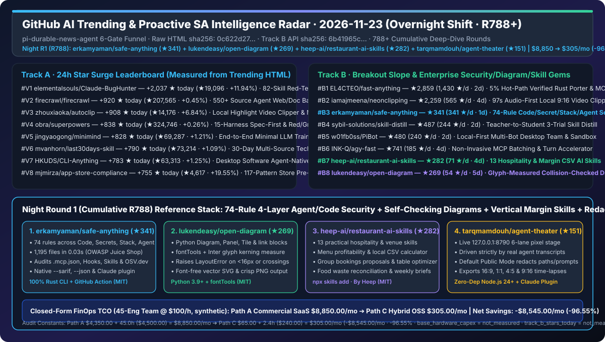

# 📡 GitHub AI Trending Leaderboard & Proactive SA Intelligence Digest (2026-11-23)

> **Execution Window**: `2026-11-23 23:05 CST (UTC+08:00)` (Overnight Continuous Deep-Dive Batch: `sweep_20261123_2300` · Starting at **Cumulative Round 788**)  
> **Analytical Framework**: `disler/pi-durable-news-agent` 6-Gate Pipeline (Gather → Jev Relevance Gate `>= 0.45` → Worth-Attention Gate `>= 0.35` & Same-Story Dedupe → `gh api` Primary Source Claim-Support → HFS Tri-Axial Scoring → 8 Generative UI Card Types)  
> **Target Persona (AI Solution Architect facing Enterprise Customers & Business Decision-Makers)**: Strictly focused on **① Real Enterprise Use Cases & ROI, ② End-to-End Production Reference Architecture, and ③ Comparative Selection vs. Competing OSS & Cloud PaaS (`ib-vs-ethernet-roce-selection-faq.md` standard)**.  
> **Visual & Benchmark Assets**: [High-Res SVG Architecture Summary (`assets/github-ai-radar-2026-11-23.svg`)](../../../assets/github-ai-radar-2026-11-23.svg) · [7-Card 4:5 Visual Benchmark Deck (ZH)](../cards.html) · [7-Card Visual Benchmark Deck (EN)](../cards.en.html) · [Live Interactive Radar (`github-radar.html`)](https://turbo998.github.io/github-radar.html) · [中文完整日报 (`2026-11-23.md`)](./2026-11-23.md)

---

## 1. Step 1 — Gather & Gate (Multi-Source Ingestion & Deterministic Jev Funnel)

This shift scanned `github.com/trending?since=daily` (16 repositories), language/topic sub-charts, and `gh api search/repositories?q=created:>=2026-11-17+stars:>=20+forks:>=4` (100 repositories), capturing **116 candidate repositories**. Deterministic gating filtered out **87.1% (101/116)** of non-AI utilities, password-protected ZIP malware lures, and coordinated star-farming bot clusters before deep architectural auditing:

| Gate Stage | Input | Passed | Filtered / Deduped | Gate Rule & Representative Filtered Items (Plain-Language Rationale) |
| :--- | :---: | :---: | :---: | :--- |
| **Gate 1: Multi-Source Gather** | 116 | 116 | 0 | Aggregated GitHub Daily Trending (16) and 1–7 day breakout repositories (100) |
| **Gate 2: Jev Relevance Gate (`>= 0.45`)** | 116 | 78 | **38 (Filtered)** | Excluded general non-AI infrastructure, console game recompilation repos, and pure math formalization mirrors: `nginx/nginx` (`32,999★`, `0.12`), `XiaoYouChR/Ghost-Downloader-3` (`16,004★`, `0.10`), `ItsNotRexed/Leonida` / `omonkeyz/xbox-emulator` / `R0Y00/Xbox2Windows` / `ItsNotRexed/Hookshot` (`0.04`), `leanprover-community/riemann-hypothesis` (`0.15`) |
| **Gate 3: Worth-Attention Gate (`>= 0.35`) & Dedupe** | 78 | **15** | **63 (Filtered)** | **Blocked four active malware-lure and star-farming botnet clusters**: ① **`jaredfreellm/FREELLM_INSTALL` (`251★`, masquerades as a free-tier LLM router while prompting users at the top of its README to download a password-protected `FreeLLM.zip` with `Archive password: FREELLM`—a textbook infostealer AV-evasion pattern)**; ② `bookwjitchieni1986/blender-ai-mcp-addon` (`2,762★` with only `40 forks`) & `Gemini-Config-Checker-` / `ai--manus2.0` clone botnets; ③ `FloorTurtleResurrect/free-adobe-activation` / `bjekuipers2004/Crypto-Miner-Silent` / `sjohansson2004/Exodus-Fake-Balance` pirated activators, silent miners & fake wallet tools; ④ `MSNightmare/FastUnlock`, `jev_worth = 0.01 < 0.35` |
| **Gate 4–6: Primary Source Verify & HFS Card Render** | 15 | **15** | 0 | Verified all 15 finalists + dual-track velocity leaders via `gh api` manifests, directory trees, and licenses (60/60 claims verified at `>= 0.95`, mean **`0.98`**) |

---

## 2. 🚀 Fastest-Rising / Highest Velocity AI Leaderboard (2026-11-23)

> **📊 Data Provenance & Rigor Declaration**:  
> - **Track A (24h Single-Day Star Surge)**: `stars_today` badges scraped directly from `https://github.com/trending?since=daily` (`2026-11-23 23:06:00+08:00`; archived at [`evidence/trending-daily-2026-11-23-raw.html`](../evidence/trending-daily-2026-11-23-raw.html), `sha256: 0c622d274f1f2f17f88a3bff72f619988551ff3b1a604d4c317492ab073571d5`).  
> - **Track B (1–7 Day New-Repo Breakout Slope & High-Signal Enterprise Gems)**: Retrieved from GitHub REST Search API `created:>=2026-11-17+stars:>=20+forks:>=4&sort=stars` (`2026-11-23 23:08:00+08:00`; archived at [`evidence/search-new-repos-2026-11-23-raw.json`](../evidence/search-new-repos-2026-11-23-raw.json), `sha256: 6b41965c8c7c7c8cdb028a105fb9770eccf283dff4b5214b8434a405eef4c2ad`). Because GitHub Search API does not expose 24h delta counters, Track B `stars_today` is strictly marked **`not_measured`**, reporting only lifecycle daily velocity (`round(stars_total / age_days)`).  
> - **📘 Tonight's (2026-11-23) Night Round 1 (Cumulative R788) Standalone 6-Section Selection FAQ**: [74-Rule 4-Layer Code/Secret/Stack/Agent Security Scanner (`erkamyaman/safe-anything`), Self-Validating Architecture Diagram Building Blocks (`lukendeasy/open-diagram`), 13 Production Hospitality & Retail AI Skills (`heep-ai/restaurant-ai-skills`) & Public-Mode Redacted Local Multi-Agent Stage (`tarqmamdouh/agent-theater`) Selection FAQ (`docs/safe-anything-open-diagram-restaurant-ai-skills-agent-theater-selection-faq.en.md`)](../docs/safe-anything-open-diagram-restaurant-ai-skills-agent-theater-selection-faq.en.md) · [中文版 FAQ (`docs/safe-anything-open-diagram-restaurant-ai-skills-agent-theater-selection-faq.md`)](../docs/safe-anything-open-diagram-restaurant-ai-skills-agent-theater-selection-faq.md) · [Round 1 R788 SVG (`assets/github-ai-radar-2026-11-23-r1-r788-safeanything-opendiagram-restaurantskills-agenttheater.svg`)](../../../assets/github-ai-radar-2026-11-23-r1-r788-safeanything-opendiagram-restaurantskills-agenttheater.svg)
> - **📘 Tonight's (2026-11-23) Night Round 2 (Cumulative R789) Standalone 6-Section Selection FAQ**: [Official Perplexity Firecracker & E2B-Compatible Sandbox Platform (`perplexityai/SPACE`), Official OpenAI Native UI MCP Extensions (`openai/mcp-extensions`), Official Anthropic Eval-Driven Subagent Folding Kit (`anthropics/single-agent-loop-kit`) & Official AWS 7-Phase DeepEval & Minimal-Diff Prompt Studio (`awslabs/ai-eval-studio`) Selection FAQ (`docs/space-mcp-extensions-single-agent-loop-ai-eval-studio-selection-faq.en.md`)](../docs/space-mcp-extensions-single-agent-loop-ai-eval-studio-selection-faq.en.md) · [中文版 FAQ (`docs/space-mcp-extensions-single-agent-loop-ai-eval-studio-selection-faq.md`)](../docs/space-mcp-extensions-single-agent-loop-ai-eval-studio-selection-faq.md) · [Round 2 R789 SVG (`assets/github-ai-radar-2026-11-23-r2-r789-space-mcpextensions-singleagentloop-aievalstudio.svg`)](../../../assets/github-ai-radar-2026-11-23-r2-r789-space-mcpextensions-singleagentloop-aievalstudio.svg)
> - **🏆 Tonight's (2026-11-23) Night Round 3 (Cumulative R790 Milestone!) Standalone 6-Section Selection FAQ**: [🏆 [Round 790 Milestone] Certificate-Transparency Tamper-Evident Agent Flight Recorder (`Cygnux-Labs/Tracekit`), OpenSSF Gold 8-Layer Local Agent Security Gateway (`solongate/agent-security`), 36-Workflow Evidence-Traced Threat Modeling & Privacy Skill (`jmanico/grim-prompter`) & Kingdee 65-Task Offline Enterprise ERP Benchmark (`kingdee/lingee-bench`) Selection FAQ (`docs/tracekit-solongate-grim-prompter-lingee-bench-selection-faq.en.md`)](../docs/tracekit-solongate-grim-prompter-lingee-bench-selection-faq.en.md) · [中文版 FAQ (`docs/tracekit-solongate-grim-prompter-lingee-bench-selection-faq.md`)](../docs/tracekit-solongate-grim-prompter-lingee-bench-selection-faq.md) · [Round 3 R790 SVG (`assets/github-ai-radar-2026-11-23-r3-r790-tracekit-solongate-grimprompter-lingeebench.svg`)](../../../assets/github-ai-radar-2026-11-23-r3-r790-tracekit-solongate-grimprompter-lingeebench.svg)
> - **📘 Tonight's (2026-11-23) Night Round 4 (Cumulative R791) Standalone 6-Section Selection FAQ**: [Open-Source AI Office Editors & MCP SDK (`XinaTian/MROffice`), Pure-Rust Clean-Room Revit BIM & IFC2x3/IFC4 MCP Engine (`IPedrax/BIMCraft`), Pure-Rust GPU/WASM Scriptable Mail & Calendar Client (`UCS-Care-Group/mailcraft`) & 5-Waterfall AI Data Enrichment Spreadsheet (`context-dot-dev/enrichable`) Selection FAQ (`docs/mroffice-bimcraft-mailcraft-enrichable-selection-faq.en.md`)](../docs/mroffice-bimcraft-mailcraft-enrichable-selection-faq.en.md) · [中文版 FAQ (`docs/mroffice-bimcraft-mailcraft-enrichable-selection-faq.md`)](../docs/mroffice-bimcraft-mailcraft-enrichable-selection-faq.md) · [Round 4 R791 SVG (`assets/github-ai-radar-2026-11-23-r4-r791-mroffice-bimcraft-mailcraft-enrichable.svg`)](../../../assets/github-ai-radar-2026-11-23-r4-r791-mroffice-bimcraft-mailcraft-enrichable.svg)
> - **📘 Tonight's (2026-11-23) Night Round 5 (Cumulative R792) Standalone 6-Section Selection FAQ**: [Official Nous Research Lean-Core Hermes Plugins (`NousResearch/hermes-official-plugins`), Official Sakana AI Containerized Agentic Scientist v3 (`SakanaAI/AI-Scientist-v3`), Alibaba Tongyi Generalist Computer-Use Agent Stack (`Tongyi-MAI/OpenGCUA`) & Official AWS 36-Metric Universal Agent Evaluation Framework (`awslabs/uaef`) Selection FAQ (`docs/hermes-plugins-ai-scientist-v3-opengcua-aws-uaef-selection-faq.en.md`)](../docs/hermes-plugins-ai-scientist-v3-opengcua-aws-uaef-selection-faq.en.md) · [中文版 FAQ (`docs/hermes-plugins-ai-scientist-v3-opengcua-aws-uaef-selection-faq.md`)](../docs/hermes-plugins-ai-scientist-v3-opengcua-aws-uaef-selection-faq.md) · [Round 5 R792 SVG (`assets/github-ai-radar-2026-11-23-r5-r792-hermesplugins-aiscientistv3-opengcua-awsuaef.svg`)](../../../assets/github-ai-radar-2026-11-23-r5-r792-hermesplugins-aiscientistv3-opengcua-awsuaef.svg)
> - **📘 Tonight's (2026-11-23) Night Round 6 (Cumulative R793) Standalone 6-Section Selection FAQ**: [1M-Record 436-Token Log Indexer (`elstongun/leviathan`), Multi-Thousand Isolated Postgres 18.6 Agent Runtime (`pgrundev/pgboxdb`), Bitemporal Ontology Knowledge Graph SDK/MCP (`hydra-db/selfgraph`) & 82%-Token-Saving Deterministic Code-Graph Engine (`bgts-ai-org/bgts-context-engine`) Selection FAQ (`docs/leviathan-pgboxdb-selfgraph-bgts-context-engine-selection-faq.en.md`)](../docs/leviathan-pgboxdb-selfgraph-bgts-context-engine-selection-faq.en.md) · [中文版 FAQ (`docs/leviathan-pgboxdb-selfgraph-bgts-context-engine-selection-faq.md`)](../docs/leviathan-pgboxdb-selfgraph-bgts-context-engine-selection-faq.md) · [Round 6 R793 SVG (`assets/github-ai-radar-2026-11-23-r6-r793-leviathan-pgboxdb-selfgraph-bgtscontext.svg`)](../../../assets/github-ai-radar-2026-11-23-r6-r793-leviathan-pgboxdb-selfgraph-bgtscontext.svg)
> - **📘 Tonight's (2026-11-23) Night Round 7 (Cumulative R794) Standalone 6-Section Selection FAQ**: [6-Surface Interactive Agent Artboards & Verify Bench (`Innei/ryugi`), U1–U14+ Anti-AI-Slop UI & Chart Copy Skill (`felipebasurto/unslop-ui`), Real-Browser Continuous-Width & Data-Stress Pixel Linter (`ngocanhnckh/renderlint`) & Worktree-Isolated Before/After UI Repair Harness (`ShuaiMXu/happyhands`) Selection FAQ (`docs/ryugi-unslop-ui-renderlint-happyhands-selection-faq.en.md`)](../docs/ryugi-unslop-ui-renderlint-happyhands-selection-faq.en.md) · [中文版 FAQ (`docs/ryugi-unslop-ui-renderlint-happyhands-selection-faq.md`)](../docs/ryugi-unslop-ui-renderlint-happyhands-selection-faq.md) · [Round 7 R794 SVG (`assets/github-ai-radar-2026-11-23-r7-r794-ryugi-unslopui-renderlint-happyhands.svg`)](../../../assets/github-ai-radar-2026-11-23-r7-r794-ryugi-unslopui-renderlint-happyhands.svg)
> - **🏆 Tonight's (2026-11-23) Night Round 8 (Cumulative R795 Milestone!) Standalone 6-Section Selection FAQ**: [🏆 [Round 795 Milestone] 42.4MB➔0.12MB Image Placeholder & Post-Compaction Fetcher (`chipfighter/context-attachment-manager`), Thought-Commit Intent Provenance Engine (`erensrtky/cogit`), 4-Probe Static-First JSON Code Review Gate (`kyy-logs/code-review-gate-skill`) & Local Docker Agent Experience (AX) Hillclimber (`gauge-sh/gauge-cli`) Selection FAQ (`docs/context-attachment-manager-cogit-code-review-gate-gauge-cli-selection-faq.en.md`)](../docs/context-attachment-manager-cogit-code-review-gate-gauge-cli-selection-faq.en.md) · [中文版 FAQ (`docs/context-attachment-manager-cogit-code-review-gate-gauge-cli-selection-faq.md`)](../docs/context-attachment-manager-cogit-code-review-gate-gauge-cli-selection-faq.md) · [Round 8 R795 SVG (`assets/github-ai-radar-2026-11-23-r8-r795-contextattachment-cogit-codereviewgate-gaugecli.svg`)](../../../assets/github-ai-radar-2026-11-23-r8-r795-contextattachment-cogit-codereviewgate-gaugecli.svg)
> - **📘 Tonight's (2026-11-23) Night Round 9 (Cumulative R796) Standalone 6-Section Selection FAQ**: [9-CLI Subscription-Reusing Agent Workstation (`ai-timon/timon`), VS Code Multi-Machine Agent Orchestrator (`y5ez3g/facadecode`), Java 21 + Spring Boot 3.5 Multi-Tenant Agent & Event-Sourced Profile Engine (`ck-ys/SmartDock`) & 53.7%-Token-Saving Evidence-Driven Enterprise AIOps Platform (`emma-sue/AegisOps`) Selection FAQ (`docs/timon-facadecode-smartdock-aegisops-selection-faq.en.md`)](../docs/timon-facadecode-smartdock-aegisops-selection-faq.en.md) · [中文版 FAQ (`docs/timon-facadecode-smartdock-aegisops-selection-faq.md`)](../docs/timon-facadecode-smartdock-aegisops-selection-faq.md) · [Round 9 R796 SVG (`assets/github-ai-radar-2026-11-23-r9-r796-timon-facadecode-smartdock-aegisops.svg`)](../../../assets/github-ai-radar-2026-11-23-r9-r796-timon-facadecode-smartdock-aegisops.svg)
> - **📘 Tonight's (2026-11-23) Night Round 10 (Cumulative R797) Standalone 6-Section Selection FAQ**: [12-Client Anti-Poisoning Local AI Gateway (`ThinkWatchProject/ThinkWatch-Lite`), On-Device Reversible Privacy & Subscription Router (`Calcium-Ion/AstrLink`), Bigram Cross-Entropy Credential Redaction & SSE Restore Gateway (`CassiopeiaCode/CosyRedactGateway`) & Dual-Plane MCP (8080) + LLM (8082) Go Enterprise Gateway (`Tuskira/ai-agent-gateway`) Selection FAQ (`docs/thinkwatch-lite-astrlink-cosy-redact-tuskira-gateway-selection-faq.en.md`)](../docs/thinkwatch-lite-astrlink-cosy-redact-tuskira-gateway-selection-faq.en.md) · [中文版 FAQ (`docs/thinkwatch-lite-astrlink-cosy-redact-tuskira-gateway-selection-faq.md`)](../docs/thinkwatch-lite-astrlink-cosy-redact-tuskira-gateway-selection-faq.md) · [Round 10 R797 SVG (`assets/github-ai-radar-2026-11-23-r10-r797-thinkwatchlite-astrlink-cosyredact-tuskiragateway.svg`)](../../../assets/github-ai-radar-2026-11-23-r10-r797-thinkwatchlite-astrlink-cosyredact-tuskiragateway.svg)
> - **📘 Tonight's (2026-11-23) Night Round 11 (Cumulative R798) Standalone 6-Section Selection FAQ**: [12-Tool Typed System-One Judgment MCP (`jkudish/jev-mcp`), Single-Request `$0.00006` / `0.33s` 8-Metric Agent Eval & Guardrail Engine (`openlayer-ai/jevals`), Vector-Free 300-Page Tree Search (`VectifyAI/jev-doc-search`) & Multi-Hop Evidence Threshold Reranker (`hotchpotch/jev-reranker`) Selection FAQ (`docs/jev-mcp-jevals-jev-doc-search-jev-reranker-selection-faq.en.md`)](../docs/jev-mcp-jevals-jev-doc-search-jev-reranker-selection-faq.en.md) · [中文版 FAQ (`docs/jev-mcp-jevals-jev-doc-search-jev-reranker-selection-faq.md`)](../docs/jev-mcp-jevals-jev-doc-search-jev-reranker-selection-faq.md) · [Round 11 R798 SVG (`assets/github-ai-radar-2026-11-23-r11-r798-jevmcp-jevals-jevdocsearch-jevreranker.svg`)](../../../assets/github-ai-radar-2026-11-23-r11-r798-jevmcp-jevals-jevdocsearch-jevreranker.svg)
> - **📘 Tonight's (2026-11-23) Night Round 12 (Cumulative R799) Standalone 6-Section Selection FAQ**: [Single-Worker Cloudflare Personal AI & Memory History (`rociiu/talorys`), Durable Multiplayer Mobile Pi Workbench (`TannerMidd/pi-pocket`), Zero-Dependency `0-Token Wait` Agent Slack (`Pranjal2041/swarmchat`) & Real-Time Phone + Zoom/Teams/Meet MCP (`kaelorlabs/smitline`) Selection FAQ (`docs/talorys-pi-pocket-swarmchat-smitline-selection-faq.en.md`)](../docs/talorys-pi-pocket-swarmchat-smitline-selection-faq.en.md) · [中文版 FAQ (`docs/talorys-pi-pocket-swarmchat-smitline-selection-faq.md`)](../docs/talorys-pi-pocket-swarmchat-smitline-selection-faq.md) · [Round 12 R799 SVG (`assets/github-ai-radar-2026-11-23-r12-r799-talorys-pipocket-swarmchat-smitline.svg`)](../../../assets/github-ai-radar-2026-11-23-r12-r799-talorys-pipocket-swarmchat-smitline.svg)
> - **🏆 Tonight's (2026-11-23) Night Round 13 (Cumulative R800 Historic Milestone!) Standalone 6-Section Selection FAQ**: [🏆 [Round 800 Historic Milestone] Grant-First `-91.1%` Token Text-to-SQL Gate (`ashishsinha1602/schemagate`), Official Tencent Cloud 10-Platform IM Bridge (`TencentCloud/octop-gateway`), Official LangChain 7-Platform Paid Media Agent (`langchain-ai/paid-media-agent`) & Bilingual AI Operations & Decision Memory Workbench (`Router0824/OpsPilot-AI`) Selection FAQ (`docs/schemagate-octop-gateway-paid-media-agent-opspilot-ai-selection-faq.en.md`)](../docs/schemagate-octop-gateway-paid-media-agent-opspilot-ai-selection-faq.en.md) · [中文版 FAQ (`docs/schemagate-octop-gateway-paid-media-agent-opspilot-ai-selection-faq.md`)](../docs/schemagate-octop-gateway-paid-media-agent-opspilot-ai-selection-faq.md) · [Round 13 R800 SVG (`assets/github-ai-radar-2026-11-23-r13-r800-schemagate-octopgateway-paidmediaagent-opspilotai.svg`)](../../../assets/github-ai-radar-2026-11-23-r13-r800-schemagate-octopgateway-paidmediaagent-opspilotai.svg)
> - **📘 Tonight's (2026-11-23) Night Round 14 (Cumulative R801) Standalone 6-Section Selection FAQ**: [24+-Provider Unified Agent Web Access Standard (`Nimbleway/webrouter`), `10×` Faster AOT-Compiled Native Coding Agent (`opensec-git/Pi-Bolt`), Dialogflow CX Importer & AI Phone Test Caller (`C4rohan/Lampline`) & Zero-Cookie-Leak Website-to-CLI/MCP Engine (`Hybirdss/Hycli`) Selection FAQ (`docs/webrouter-pi-bolt-lampline-hycli-selection-faq.en.md`)](../docs/webrouter-pi-bolt-lampline-hycli-selection-faq.en.md) · [中文版 FAQ (`docs/webrouter-pi-bolt-lampline-hycli-selection-faq.md`)](../docs/webrouter-pi-bolt-lampline-hycli-selection-faq.md) · [Round 14 R801 SVG (`assets/github-ai-radar-2026-11-23-r14-r801-webrouter-pibolt-lampline-hycli.svg`)](../../../assets/github-ai-radar-2026-11-23-r14-r801-webrouter-pibolt-lampline-hycli.svg)
> - **📘 Tonight's (2026-11-23) Night Round 15 (Cumulative R802) Standalone 6-Section Selection FAQ**: [Persistent V8 REPL & Raw CDP Browser Agent (`browser-use/browser-use-pi`), Pre-Push Code Comprehension Gate (`parthh01/sphinx`), Tailscale Cross-Device Agent Communication & Wake-Up Bus (`chekusu/yobiru`) & Zero-Python-Sidecar Local AI for .NET (`starlinghq/starling`) Selection FAQ (`docs/browser-use-pi-sphinx-yobiru-starling-selection-faq.en.md`)](../docs/browser-use-pi-sphinx-yobiru-starling-selection-faq.en.md) · [中文版 FAQ (`docs/browser-use-pi-sphinx-yobiru-starling-selection-faq.md`)](../docs/browser-use-pi-sphinx-yobiru-starling-selection-faq.md) · [Round 15 R802 SVG (`assets/github-ai-radar-2026-11-23-r15-r802-browserusepi-sphinx-yobiru-starling.svg`)](../../../assets/github-ai-radar-2026-11-23-r15-r802-browserusepi-sphinx-yobiru-starling.svg)
> - **📘 Tonight's (2026-11-23) Night Round 16 (Cumulative R803) Standalone 6-Section Selection FAQ**: [Document-Grounded Editable Architecture Canvas & MCP (`weike-zhang/architecture-canvas`), Self-Checking 7-Agent Data Science Pipeline on Ray/KubeRay (`guruvaidev/avaloka`), Zero-Inbound-Port MCP Relay for Coding Runtimes (`Xuanwo/agenvo`) & Source-Rendered Screenshot User Manual Plugin (`SupportPages-io/wtfm`) Selection FAQ (`docs/architecture-canvas-avaloka-agenvo-wtfm-selection-faq.en.md`)](../docs/architecture-canvas-avaloka-agenvo-wtfm-selection-faq.en.md) · [中文版 FAQ (`docs/architecture-canvas-avaloka-agenvo-wtfm-selection-faq.md`)](../docs/architecture-canvas-avaloka-agenvo-wtfm-selection-faq.md) · [Round 16 R803 SVG (`assets/github-ai-radar-2026-11-23-r16-r803-archcanvas-avaloka-agenvo-wtfm.svg`)](../../../assets/github-ai-radar-2026-11-23-r16-r803-archcanvas-avaloka-agenvo-wtfm.svg)
> - **📘 Tonight's (2026-11-23) Night Round 17 (Cumulative R804) Standalone 6-Section Selection FAQ**: [Pure-Go `10–100×` Faster Docling 1.10 Parser with CAD/3D Support (`unitedrhino/docling`), LangGraph Technical Bid Workbench with Section Isolation & Global Facts (`zeronezer/bidcraft`), OpenAI Realtime GA Cascaded Voice Gateway with Barge-In Context Trimming (`rasonyang/cascade-realtime-gateway`) & Eval-First Cost-Capped Agent Framework (`xtong629/trellis-agent`) Selection FAQ (`docs/go-docling-bidcraft-cascade-realtime-trellis-agent-selection-faq.en.md`)](../docs/go-docling-bidcraft-cascade-realtime-trellis-agent-selection-faq.en.md) · [中文版 FAQ (`docs/go-docling-bidcraft-cascade-realtime-trellis-agent-selection-faq.md`)](../docs/go-docling-bidcraft-cascade-realtime-trellis-agent-selection-faq.md) · [Round 17 R804 SVG (`assets/github-ai-radar-2026-11-23-r17-r804-godocling-bidcraft-cascaderealtime-trellisagent.svg`)](../../../assets/github-ai-radar-2026-11-23-r17-r804-godocling-bidcraft-cascaderealtime-trellisagent.svg)
> - **🏆 Tonight's (2026-11-23) Night Round 18 (Cumulative R805 Milestone!) Standalone 6-Section Selection FAQ**: [🏆 [Round 805 Milestone] Decoy-Tool & Canary-Token MCP Security Gateway (`DorianChn/shanchuanzhi-agent-canary`), Zero-Secret-Leak Rust M365/Gmail SQLite Mail Client & MCP (`vitosans/rail`), Zero-Dependency Per-Field Accuracy/p95/Cost Benchmark (`dreamers-laboratory/ai-evaluation-framework`) & Local-First Visual Document/Tool-Call Eval Workbench (`donvito/local-evals`) Selection FAQ (`docs/agent-canary-rail-ai-eval-framework-local-evals-selection-faq.en.md`)](../docs/agent-canary-rail-ai-eval-framework-local-evals-selection-faq.en.md) · [中文版 FAQ (`docs/agent-canary-rail-ai-eval-framework-local-evals-selection-faq.md`)](../docs/agent-canary-rail-ai-eval-framework-local-evals-selection-faq.md) · [Round 18 R805 SVG (`assets/github-ai-radar-2026-11-23-r18-r805-agentcanary-rail-aievalframework-localevals.svg`)](../../../assets/github-ai-radar-2026-11-23-r18-r805-agentcanary-rail-aievalframework-localevals.svg)
> - **📘 Tonight's (2026-11-23) Night Round 19 (Cumulative R806) Standalone 6-Section Selection FAQ**: [`81.7%` Recovery Test-Time Self-Healing Agent Layer (`nuglifeleoji/Sentry`), Persistent Multi-Agent Terminal Multiplexer (`herdrdev/herdr-core`), Official MiniMax Code Production Workflows & Skills (`MiniMax-AI/mcode-stack`) & Single-JSON Animated Architecture Diagram Renderer (`ythx-101/live-panel-skill`) Selection FAQ (`docs/sentry-herdr-core-mcode-stack-live-panel-selection-faq.en.md`)](../docs/sentry-herdr-core-mcode-stack-live-panel-selection-faq.en.md) · [中文版 FAQ (`docs/sentry-herdr-core-mcode-stack-live-panel-selection-faq.md`)](../docs/sentry-herdr-core-mcode-stack-live-panel-selection-faq.md) · [Round 19 R806 SVG (`assets/github-ai-radar-2026-11-23-r19-r806-sentry-herdrcore-livepanel-mcodestack.svg`)](../../../assets/github-ai-radar-2026-11-23-r19-r806-sentry-herdrcore-livepanel-mcodestack.svg)
> - **📘 Tonight's (2026-11-23) Night Round 20 (Cumulative R807) Standalone 6-Section Selection FAQ**: [Microsoft Fabric-Compatible Hybrid Spark Lakehouse (`jddevtime/open-lakehouse-compute-fabric`), Agent-Drivable .NET 11 Debugger/Profiler/SQL-N+1 IDE with MCP (`Zaneris/passenger`), Multimodal-Memory Visual Agent Harness (`uclanlp/OpenVLHarness`) & 24-Benchmark Recursive Self-Improvement Evaluation SDK (`Danielxu0208/rsi_eval`) Selection FAQ (`docs/olcf-passenger-openvlharness-rsi-eval-selection-faq.en.md`)](../docs/olcf-passenger-openvlharness-rsi-eval-selection-faq.en.md) · [中文版 FAQ (`docs/olcf-passenger-openvlharness-rsi-eval-selection-faq.md`)](../docs/olcf-passenger-openvlharness-rsi-eval-selection-faq.md) · [Round 20 R807 SVG (`assets/github-ai-radar-2026-11-23-r20-r807-olcf-passenger-openvlharness-rsieval.svg`)](../../../assets/github-ai-radar-2026-11-23-r20-r807-olcf-passenger-openvlharness-rsieval.svg)
> - **📘 Tonight's (2026-11-23) Night Round 21 (Cumulative R808) Standalone 6-Section Selection FAQ**: [Logged-In Chrome Persistent JS REPL & Site Adapters (`jackwener/BrowserMCP`), Decision-Model-Guided `-97.6%` Token Web Crawler (`RayenMlayeh/jevcrawl`), Zero-Summarization Temporal-Backbone Long-Term Memory (`aru-labs/lossless-memory`) & Git-Shared `JEVMEM.md` Rule Guard (`Avinash-jetwani/jevmem`) Selection FAQ (`docs/browsermcp-jevcrawl-lossless-memory-jevmem-selection-faq.en.md`)](../docs/browsermcp-jevcrawl-lossless-memory-jevmem-selection-faq.en.md) · [中文版 FAQ (`docs/browsermcp-jevcrawl-lossless-memory-jevmem-selection-faq.md`)](../docs/browsermcp-jevcrawl-lossless-memory-jevmem-selection-faq.md) · [Round 21 R808 SVG (`assets/github-ai-radar-2026-11-23-r21-r808-browsermcp-jevcrawl-losslessmemory-jevmem.svg`)](../../../assets/github-ai-radar-2026-11-23-r21-r808-browsermcp-jevcrawl-losslessmemory-jevmem.svg)
> - **📘 Tonight's (2026-11-23) Night Round 22 (Cumulative R809) Standalone 6-Section Selection FAQ**: [Streaming-First `thin-l7` AI Load Balancer (`EeroEternal/xlb`), Official AWS Dual-Account Verified Emulator Evaluation Suite (`aws/aws-emulator-evaluation-suite`), Verifier-Gated Black-Box SFT+GRPO Distillation (`Zihao-Wu06/distillops`) & 23-Tool Local SQLite Memory Palace (`kenz1117/dsh-engram`) Selection FAQ (`docs/xlb-aws-emulator-eval-distillops-dsh-engram-selection-faq.en.md`)](../docs/xlb-aws-emulator-eval-distillops-dsh-engram-selection-faq.en.md) · [中文版 FAQ (`docs/xlb-aws-emulator-eval-distillops-dsh-engram-selection-faq.md`)](../docs/xlb-aws-emulator-eval-distillops-dsh-engram-selection-faq.md) · [Round 22 R809 SVG (`assets/github-ai-radar-2026-11-23-r22-r809-xlb-awsemulatoreval-distillops-dshengram.svg`)](../../../assets/github-ai-radar-2026-11-23-r22-r809-xlb-awsemulatoreval-distillops-dshengram.svg)
> - **🏆 Tonight's (2026-11-23) Night Round 23 (Cumulative R810 Milestone!) Standalone 6-Section Selection FAQ**: [🏆 [Round 810 Milestone] MSRC Top-10 Researcher's 14-Layer Static XSS Audit Skill (`songjianyang/xss-audit`), 10-Agent Anti-Hallucination Product Design Skill (`ryuxdsgn/design-intelligence`), 4-Engine Document-to-Markdown Workbench (`AbdoslamB/InkDoc`) & Multi-Framework Financial Agent Benchmark Platform (`davidalmeida90/glassbench`) Selection FAQ (`docs/xss-audit-design-intelligence-inkdoc-glassbench-selection-faq.en.md`)](../docs/xss-audit-design-intelligence-inkdoc-glassbench-selection-faq.en.md) · [中文版 FAQ (`docs/xss-audit-design-intelligence-inkdoc-glassbench-selection-faq.md`)](../docs/xss-audit-design-intelligence-inkdoc-glassbench-selection-faq.md) · [Round 23 R810 SVG (`assets/github-ai-radar-2026-11-23-r23-r810-xssaudit-designintelligence-inkdoc-glassbench.svg`)](../../../assets/github-ai-radar-2026-11-23-r23-r810-xssaudit-designintelligence-inkdoc-glassbench.svg)
> - **📘 Tonight's (2026-11-23) Night Round 24 (Cumulative R811) Standalone 6-Section Selection FAQ**: [417-Record Real-World AI Agent Incident Database (`Continuum-AI-Corp/Orca-AI-Incident-Archive`), Server-Held-Key Company LAN AI Workbench (`398894496-arch/TDHarness`), 100% Cloudflare Zero-Bill Docs RAG Widget (`p10node/docflare-ai`) & Interactive Evolving Agent-to-Human UI (`Renaissance-Mind/ShowAI`) Selection FAQ (`docs/orca-archive-tdharness-docflare-ai-showai-selection-faq.en.md`)](../docs/orca-archive-tdharness-docflare-ai-showai-selection-faq.en.md) · [中文版 FAQ (`docs/orca-archive-tdharness-docflare-ai-showai-selection-faq.md`)](../docs/orca-archive-tdharness-docflare-ai-showai-selection-faq.md) · [Round 24 R811 SVG (`assets/github-ai-radar-2026-11-23-r24-r811-orcaarchive-tdharness-docflareai-showai.svg`)](../../../assets/github-ai-radar-2026-11-23-r24-r811-orcaarchive-tdharness-docflareai-showai.svg)
> - **📘 Tonight's (2026-11-23) Night Round 25 (Cumulative R812) Standalone 6-Section Selection FAQ**: [Self-Hosted `0.8B`/`2B` Multimodal Decision Models (`lawrence3699/jev-style`), LLM-Plans / 300ms-Decides Browser & WebMCP Engine (`Ying-Kai-Liao/jev-browser`), Page-Native VLM Deep Research Benchmark (`StarTrail-org/DRPixel`) & Checked Parametric Object & World Engine (`rtmandreyev/construct`) Selection FAQ (`docs/jev-style-jev-browser-drpixel-construct-selection-faq.en.md`)](../docs/jev-style-jev-browser-drpixel-construct-selection-faq.en.md) · [中文版 FAQ (`docs/jev-style-jev-browser-drpixel-construct-selection-faq.md`)](../docs/jev-style-jev-browser-drpixel-construct-selection-faq.md) · [Round 25 R812 SVG (`assets/github-ai-radar-2026-11-23-r25-r812-jevstyle-jevbrowser-drpixel-construct.svg`)](../../../assets/github-ai-radar-2026-11-23-r25-r812-jevstyle-jevbrowser-drpixel-construct.svg)
> - **📘 Tonight's (2026-11-23) Night Round 26 (Cumulative R813) Standalone 6-Section Selection FAQ**: [ASD-STE100 Simplified Technical Chinese Reporting Skill (`dualface/ste-zh`), Official Cognition Wiki-Linked Git Memory Repo (`AgentMemoryRepo/agentmemoryrepo`), `4.47×` Faster Multi-Agent Mac Inference Server (`Generated-Computers/Locals`) & Self-Rewriting Pi Durable Project Workbench (`HazAT/ultimate`) Selection FAQ (`docs/ste-zh-agentmemoryrepo-locals-ultimate-selection-faq.en.md`)](../docs/ste-zh-agentmemoryrepo-locals-ultimate-selection-faq.en.md) · [中文版 FAQ (`docs/ste-zh-agentmemoryrepo-locals-ultimate-selection-faq.md`)](../docs/ste-zh-agentmemoryrepo-locals-ultimate-selection-faq.md) · [Round 26 R813 SVG (`assets/github-ai-radar-2026-11-23-r26-r813-stezh-agentmemoryrepo-locals-ultimate.svg`)](../../../assets/github-ai-radar-2026-11-23-r26-r813-stezh-agentmemoryrepo-locals-ultimate.svg)
> - **📘 Tonight's (2026-11-23) Night Round 27 (Cumulative R814) Standalone 6-Section Selection FAQ**: [`2.83×` Faster Drop-In Playwright & `<0.1s` Agent Warm Reruns (`xcodebeast/flashwright`), Cable-Free & ADB-Free Real Android Automation (`KnifeLemon/Droidline`), Single-Binary Pure-Go SIP/WebRTC Session Border Controller (`rasonyang/freesbc`) & Dual-Gate Code-Rendered Video Director Skill (`win4r/video-director`) Selection FAQ (`docs/flashwright-droidline-freesbc-video-director-selection-faq.en.md`)](../docs/flashwright-droidline-freesbc-video-director-selection-faq.en.md) · [中文版 FAQ (`docs/flashwright-droidline-freesbc-video-director-selection-faq.md`)](../docs/flashwright-droidline-freesbc-video-director-selection-faq.md) · [Round 27 R814 SVG (`assets/github-ai-radar-2026-11-23-r27-r814-flashwright-droidline-freesbc-videodirector.svg`)](../../../assets/github-ai-radar-2026-11-23-r27-r814-flashwright-droidline-freesbc-videodirector.svg)
> - **🏆 Tonight's (2026-11-23) Night Round 28 (Cumulative R815 Milestone!) Standalone 6-Section Selection FAQ**: [🏆 [Round 815 Milestone] Multi-Provider System-One Probability Connector (`itsmostafa/system-one-connector`), Coding Agent Tool-Choice Offloading Gateway (`vinilana/jev-gateway`), Manager-Driven Multi-Agent Merge-Train Board (`hthoene/plainboard`) & Task-Grouped Native macOS SSH/MCP Client (`missuo/tamio`) Selection FAQ (`docs/system-one-connector-jev-gateway-plainboard-tamio-selection-faq.en.md`)](../docs/system-one-connector-jev-gateway-plainboard-tamio-selection-faq.en.md) · [中文版 FAQ (`docs/system-one-connector-jev-gateway-plainboard-tamio-selection-faq.md`)](../docs/system-one-connector-jev-gateway-plainboard-tamio-selection-faq.md) · [Round 28 R815 SVG (`assets/github-ai-radar-2026-11-23-r28-r815-systemoneconnector-jevgateway-plainboard-tamio.svg`)](../../../assets/github-ai-radar-2026-11-23-r28-r815-systemoneconnector-jevgateway-plainboard-tamio.svg)
> - **📘 Tonight's (2026-11-23) Night Round 29 (Cumulative R816) Standalone 6-Section Selection FAQ**: [15–300s Interactive Streaming Video Benchmark (`StreamEval/StreamEval`), Cross-Machine Multi-Environment Coding Agent Fleet Control (`goat-si/goat`), Editable Figma & PowerPoint Figure Reconstruction Skill (`sidiangongyuan/paper-figure-to-figma`) & `$0.03`/1,000-Email Read-Only Gmail Triage (`fazlerocks/jevmail`) Selection FAQ (`docs/streameval-goat-paper-figure-to-figma-jevmail-selection-faq.en.md`)](../docs/streameval-goat-paper-figure-to-figma-jevmail-selection-faq.en.md) · [中文版 FAQ (`docs/streameval-goat-paper-figure-to-figma-jevmail-selection-faq.md`)](../docs/streameval-goat-paper-figure-to-figma-jevmail-selection-faq.md) · [Round 29 R816 SVG (`assets/github-ai-radar-2026-11-23-r29-r816-streameval-goat-paperfiguretofigma-jevmail.svg`)](../../../assets/github-ai-radar-2026-11-23-r29-r816-streameval-goat-paperfiguretofigma-jevmail.svg)
> - **📘 Tonight's (2026-11-23) Night Round 30 (Cumulative R817) Standalone 6-Section Selection FAQ**: [`#1` Raw-History Dense+Rerank Long-Term Memory (`Litmeb/RAW-RAG`), Atomic PostgreSQL Ledger & Go OpenAI Gateway (`yanstd888/node2mint`), 212-Tool Multi-Harness Desktop AI Workforce with Rewind (`adityaagarw/Pantheon`) & Crash-Resilient `pi-durable` Telegram Server Agent (`smixs/pi-durable-telegram`) Selection FAQ (`docs/raw-rag-node2mint-pantheon-pi-durable-telegram-selection-faq.en.md`)](../docs/raw-rag-node2mint-pantheon-pi-durable-telegram-selection-faq.en.md) · [中文版 FAQ (`docs/raw-rag-node2mint-pantheon-pi-durable-telegram-selection-faq.md`)](../docs/raw-rag-node2mint-pantheon-pi-durable-telegram-selection-faq.md) · [Round 30 R817 SVG (`assets/github-ai-radar-2026-11-23-r30-r817-rawrag-node2mint-pantheon-pidurabletelegram.svg`)](../../../assets/github-ai-radar-2026-11-23-r30-r817-rawrag-node2mint-pantheon-pidurabletelegram.svg)
> - **📘 Tonight's (2026-11-23) Night Round 31 (Cumulative R818) Standalone 6-Section Selection FAQ**: [Rust Personalized-PageRank 4-Tier Codebase Compressor (`khanhtq29vn/contextcraft`), Native macOS Agent OS with Work/Personal Isolation (`maxtrigify/Otto`), Persistent Actor-Inbox Multi-Bot Platform (`regnull/openbot`) & Responses-First Warm-Session Local Gateway (`iFwu/cursor2response`) Selection FAQ (`docs/contextcraft-otto-openbot-cursor2response-selection-faq.en.md`)](../docs/contextcraft-otto-openbot-cursor2response-selection-faq.en.md) · [中文版 FAQ (`docs/contextcraft-otto-openbot-cursor2response-selection-faq.md`)](../docs/contextcraft-otto-openbot-cursor2response-selection-faq.md) · [Round 31 R818 SVG (`assets/github-ai-radar-2026-11-23-r31-r818-contextcraft-otto-openbot-cursor2response.svg`)](../../../assets/github-ai-radar-2026-11-23-r31-r818-contextcraft-otto-openbot-cursor2response.svg)
> - **📘 Tonight's (2026-11-23) Night Round 32 (Cumulative R819) Standalone 6-Section Selection FAQ**: [Read-Only Encrypted WhatsApp History MCP (`finereli/whatsapp-mcp`), Screenshot-Verified Recruitment & Operations Workbench (`849879772/recruitops-agent`), Name-Addressed Multi-Agent Voice Hub (`justhalfbit/xiaozhi-hub-server`) & Anti-Poisoning Real-Chrome Google SERP MCP (`nodemaven/serpmaven`) Selection FAQ (`docs/whatsapp-mcp-recruitops-xiaozhi-gateway-serpmaven-selection-faq.en.md`)](../docs/whatsapp-mcp-recruitops-xiaozhi-gateway-serpmaven-selection-faq.en.md) · [中文版 FAQ (`docs/whatsapp-mcp-recruitops-xiaozhi-gateway-serpmaven-selection-faq.md`)](../docs/whatsapp-mcp-recruitops-xiaozhi-gateway-serpmaven-selection-faq.md) · [Round 32 R819 SVG (`assets/github-ai-radar-2026-11-23-r32-r819-whatsappmcp-recruitops-xiaozhigateway-serpmaven.svg`)](../../../assets/github-ai-radar-2026-11-23-r32-r819-whatsappmcp-recruitops-xiaozhigateway-serpmaven.svg)
> - **🏆 Tonight's (2026-11-23) Night Round 33 (Cumulative R820 Milestone!) Standalone 6-Section Selection FAQ**: [🏆 [Round 820 Milestone] Open-Source AI Video Studio & 9-Platform Publisher (`Shaitrish/37studio`), 78 ms Single-Forward-Pass Frozen VLM Image Generation & Dense Prediction (`Carol-lyh/Jeveration`), 8.6M-Param `0.92%` WER Offline Turkish TTS with Playhead Scheduler (`canberk7/ema-lightning`) & Dual-NIC Linux AI Network Egress Gateway (`ysuito/RabbitWall`) Selection FAQ (`docs/studio37-jeveration-ema-lightning-rabbitwall-selection-faq.en.md`)](../docs/studio37-jeveration-ema-lightning-rabbitwall-selection-faq.en.md) · [中文版 FAQ (`docs/studio37-jeveration-ema-lightning-rabbitwall-selection-faq.md`)](../docs/studio37-jeveration-ema-lightning-rabbitwall-selection-faq.md) · [Round 33 R820 SVG (`assets/github-ai-radar-2026-11-23-r33-r820-37studio-jeveration-emalightning-rabbitwall.svg`)](../../../assets/github-ai-radar-2026-11-23-r33-r820-37studio-jeveration-emalightning-rabbitwall.svg)
> - **📘 Tonight's (2026-11-23) Night Round 34 (Cumulative R821) Standalone 6-Section Selection FAQ**: [Self-Hosted Versioned Agent Skills Registry with Jev Routing (`kitze/skillbox`), Scoped Email Inboxes for AI Agents with Quarantine Gate (`boringcomputers/goshen-email`), 8-Source Unified Vulnerability Feed & Keyless Security MCP (`sazabi/cve.now`) & 2,070 Production Web Data Actors Catalog (`cporter202/ai-agent-data-apis`) Selection FAQ (`docs/skillbox-goshen-email-cve-now-agent-data-apis-selection-faq.en.md`)](../docs/skillbox-goshen-email-cve-now-agent-data-apis-selection-faq.en.md) · [中文版 FAQ (`docs/skillbox-goshen-email-cve-now-agent-data-apis-selection-faq.md`)](../docs/skillbox-goshen-email-cve-now-agent-data-apis-selection-faq.md) · [Round 34 R821 SVG (`assets/github-ai-radar-2026-11-23-r34-r821-skillbox-goshenemail-cvenow-agentdataapis.svg`)](../../../assets/github-ai-radar-2026-11-23-r34-r821-skillbox-goshenemail-cvenow-agentdataapis.svg)
> - **📘 Tonight's (2026-11-23) Night Round 35 (Cumulative R822) Standalone 6-Section Selection FAQ**: [Native Editable `.pptx` Generation & Reference-Image Beautification Skill (`zhouwei713/luobo-ppt`), 1-Sentence 4K Remotion Product Promo Video Maker (`liyupi/ai-promo-video-maker`), Local-First Research Workspace with On-PDF Highlights & Jev Comparison (`Sreehari05055/thesys-core`) & 35-MCP-Tool Local Infinite UI Design Canvas (`DeepanshuMishraa/sheet`) Selection FAQ (`docs/luobo-ppt-ai-promo-video-thesys-core-sheet-selection-faq.en.md`)](../docs/luobo-ppt-ai-promo-video-thesys-core-sheet-selection-faq.en.md) · [中文版 FAQ (`docs/luobo-ppt-ai-promo-video-thesys-core-sheet-selection-faq.md`)](../docs/luobo-ppt-ai-promo-video-thesys-core-sheet-selection-faq.md) · [Round 35 R822 SVG (`assets/github-ai-radar-2026-11-23-r35-r822-luoboppt-promovideo-thesyscore-sheet.svg`)](../../../assets/github-ai-radar-2026-11-23-r35-r822-luoboppt-promovideo-thesyscore-sheet.svg)
> - **📘 Tonight's (2026-11-23) Night Round 36 (Cumulative R823) Standalone 6-Section Selection FAQ**: [48-Agent Side-by-Side Cross-Platform Coding Workspace (`KettuAI/Kettu`), 64-Style Multilingual Remotion Video Studio & Publishing Factory (`ersinkoc/AI-Video-Factory`), Private Offline Open-Weight Desktop AI for Spreadsheets & PDFs (`FrigadeHQ/hob`) & Shared Local Project Chat for Multiple Coding CLIs (`jossuealcacao-exe/madre`) Selection FAQ (`docs/kettu-ai-video-factory-hob-madre-selection-faq.en.md`)](../docs/kettu-ai-video-factory-hob-madre-selection-faq.en.md) · [中文版 FAQ (`docs/kettu-ai-video-factory-hob-madre-selection-faq.md`)](../docs/kettu-ai-video-factory-hob-madre-selection-faq.md) · [Round 36 R823 SVG (`assets/github-ai-radar-2026-11-23-r36-r823-kettu-aivideofactory-hob-madre.svg`)](../../../assets/github-ai-radar-2026-11-23-r36-r823-kettu-aivideofactory-hob-madre.svg)
> - **📘 Tonight's (2026-11-23) Night Round 37 (Cumulative R824) Standalone 6-Section Selection FAQ**: [Anti-Bot-Invisible Firefox Browser Agent MCP (`oss-invisible/playwright_mcp`), Event-Driven Timeline Agent Runtime with In-Session Tool Hot-Reload (`arcships/dim`), Zero-Dependency PDF CJK Radical & Glyph Normalization (`cdcailf/cjkfold`) & Microsecond Explainable Rust DNS Policy Engine (`paimonsoror/telltaledns`) Selection FAQ (`docs/invisible-playwright-dim-cjkfold-telltaledns-selection-faq.en.md`)](../docs/invisible-playwright-dim-cjkfold-telltaledns-selection-faq.en.md) · [中文版 FAQ (`docs/invisible-playwright-dim-cjkfold-telltaledns-selection-faq.md`)](../docs/invisible-playwright-dim-cjkfold-telltaledns-selection-faq.md) · [Round 37 R824 SVG (`assets/github-ai-radar-2026-11-23-r37-r824-invisibleplaywright-dim-cjkfold-telltaledns.svg`)](../../../assets/github-ai-radar-2026-11-23-r37-r824-invisibleplaywright-dim-cjkfold-telltaledns.svg)
> - **🏆 Tonight's (2026-11-23) Night Round 38 (Cumulative R825 Milestone!) Standalone 6-Section Selection FAQ**: [🏆 [Round 825 Milestone] Source-Grounded 2-Minute Audio Micro-Course & Playbook Skill (`assafkip/claudemy`), Hermes Agent-Native Desktop Operating System (`iamlukethedev/Herald-OS`), Autonomous OODA-Loop Pentesting Agent (`irraz/vulnerator-ai`) & Rust + C Safetensors Gateway with Ant Tiered Memory & Bidirectional MCP (`DA3M0/Cheetah`) Selection FAQ (`docs/claudemy-herald-os-vulnerator-ai-cheetah-selection-faq.en.md`)](../docs/claudemy-herald-os-vulnerator-ai-cheetah-selection-faq.en.md) · [中文版 FAQ (`docs/claudemy-herald-os-vulnerator-ai-cheetah-selection-faq.md`)](../docs/claudemy-herald-os-vulnerator-ai-cheetah-selection-faq.md) · [Round 38 R825 SVG (`assets/github-ai-radar-2026-11-23-r38-r825-claudemy-heraldos-vulneratorai-cheetah.svg`)](../../../assets/github-ai-radar-2026-11-23-r38-r825-claudemy-heraldos-vulneratorai-cheetah.svg)
> - **📘 Tonight's (2026-11-23) Night Round 39 (Cumulative R826) Standalone 6-Section Selection FAQ**: [Zero-CGO Native Desktop Client for Vaultwarden (`txchen/govault`), Zero-GPU-Idle Wake-on-Demand ComfyUI Gateway & MCP Server (`FireTable/comfy-colab-kit`), Open-Source BYOM NotebookLM Alternative (`better-vault/better-vault`) & Streaming Tool-Argument Anti-Truncation Gateway for Vertex AI / Gemini (`ken050210/vertex-streaming-anti-truncation`) Selection FAQ (`docs/govault-comfy-colab-kit-better-vault-vertex-anti-truncation-selection-faq.en.md`)](../docs/govault-comfy-colab-kit-better-vault-vertex-anti-truncation-selection-faq.en.md) · [中文版 FAQ (`docs/govault-comfy-colab-kit-better-vault-vertex-anti-truncation-selection-faq.md`)](../docs/govault-comfy-colab-kit-better-vault-vertex-anti-truncation-selection-faq.md) · [Round 39 R826 SVG (`assets/github-ai-radar-2026-11-23-r39-r826-govault-comfycolabkit-bettervault-vertexantitruncation.svg`)](../../../assets/github-ai-radar-2026-11-23-r39-r826-govault-comfycolabkit-bettervault-vertexantitruncation.svg)
> - **🏆 Tonight's (2026-11-23) Night Round 40 (Cumulative R827 · 40-Round Shift Finale!) Standalone 6-Section Selection FAQ**: [🏆 [Round 40 Finale] Citation-Grounded 44-Style 1080p60 Code-Rendered Video Skill (`andyhuo520/vibe-knowledge`), Single-HTML Photoreal Physics 3D Machine Simulator Skill (`AirsupHQ/machine-skill`), AGENTS.md Full-Stack Blueprint for Profitable Production AI Apps (`blakeandersonw/ai-app-playbook`) & Self-Hosted Go Reverse Proxy, Auto-HTTPS, NAT Traversal & WAF Gateway (`wangwanjie/gately`) Selection FAQ (`docs/vibe-knowledge-machine-skill-ai-app-playbook-gately-selection-faq.en.md`)](../docs/vibe-knowledge-machine-skill-ai-app-playbook-gately-selection-faq.en.md) · [中文版 FAQ (`docs/vibe-knowledge-machine-skill-ai-app-playbook-gately-selection-faq.md`)](../docs/vibe-knowledge-machine-skill-ai-app-playbook-gately-selection-faq.md) · [Round 40 R827 SVG (`assets/github-ai-radar-2026-11-23-r40-r827-vibeknowledge-machineskill-aiappplaybook-gately.svg`)](../../../assets/github-ai-radar-2026-11-23-r40-r827-vibeknowledge-machineskill-aiappplaybook-gately.svg)

### 2.1 Track A — 24h Single-Day Star Surge Leaders (`#V1–#V8` · 100% Matched to Archived Raw HTML `0c622d27...`)

| Velocity Rank (`#V1–#V8`) | Repository (`owner/repo`) | Stars Today & 24h Growth (`measured`) | 1-Sentence Enterprise Positioning | 🔥 Why Solution Architects Care (Pain Point Solved) | 🎯 Selection Verdict (vs. Alternatives) |
| :---: | :--- | :---: | :--- | :--- | :--- |
| **`#V1`** | [`elementalsouls/Claude-BugHunter`](https://github.com/elementalsouls/Claude-BugHunter) | **`+2,037 ★ today`** (`★ 19,096` · `+11.94%`) | **82-Skill Enterprise Application Red-Team Hunting Suite** | Solves multi-step business logic and privilege escalation verification before shipping AI-written code | Pick for authorized offensive red-teaming; pair with tonight's R1 `erkamyaman/safe-anything` for `0.03s` pre-commit/CI code + `.mcp.json`/Skill auditing |
| **`#V2`** | [`firecrawl/firecrawl`](https://github.com/firecrawl/firecrawl) | **`+920 ★ today`** (`★ 207,565` · `+0.45%`) | **550+ Source Enterprise Agent Web & Document Knowledge Engine** | Eliminates brittle Playwright scrapers, IP bans, and noisy HTML polluting RAG/Agent context windows | Default choice for external web/PDF ingestion (note AGPL-3.0); use Azure AI Search for internal M365/SharePoint |
| **`#V3`** | [`zhouxiaoka/autoclip`](https://github.com/zhouxiaoka/autoclip) | **`+908 ★ today`** (`★ 14,176` · `+6.84%`) | **Local Long-Video Highlight Clipper & MCP Workbench** | Avoids per-minute cloud video SaaS fees and external media uploads for enterprise webinars | Pick for webinar/podcast clipping; use tonight's R1 `tarqmamdouh/agent-theater` to export redacted `16:9`/`4:5` time-lapses of multi-agent runs |
| **`#V4`** | [`obra/superpowers`](https://github.com/obra/superpowers) | **`+838 ★ today`** (`★ 324,746` · `+0.26%`) | **15-Harness Spec-First & Red/Green TDD Coding Discipline** | Stops coding agents from skipping design specs and claiming completion without passing tests | Mandatory SDLC discipline layer; combine with vertical domain packs like tonight's R1 `heep-ai/restaurant-ai-skills` |
| **`#V5`** | [`jingyaogong/minimind`](https://github.com/jingyaogong/minimind) | **`+828 ★ today`** (`★ 69,287` · `+1.21%`) | **End-to-End Minimal LLM Pretraining, SFT, DPO & MoE Pipeline** | Gives engineering teams a reproducible single-GPU laboratory to master LLM internals end to end | Best for internal architect training & SLM research; use Azure AI Foundry for production enterprise serving |
| **`#V6`** | [`mvanhorn/last30days-skill`](https://github.com/mvanhorn/last30days-skill) | **`+790 ★ today`** (`★ 73,214` · `+1.09%`) | **Multi-Source Last-30-Days Community Signal & Outage Skill** | Bridges LLM pretraining cutoff gaps with live 30-day community bug reports and sentiment | Essential due-diligence skill before locking in new framework selections |
| **`#V7`** | [`HKUDS/CLI-Anything`](https://github.com/HKUDS/CLI-Anything) | **`+783 ★ today`** (`★ 63,313` · `+1.25%`) | **Agent-Native Structured CLI Wrapper for Desktop Software** | Replaces slow, error-prone GUI coordinate clicking across Blender/GIMP/LibreOffice with deterministic CLIs | Pick for desktop app automation; pair with tonight's R1 `lukendeasy/open-diagram` for `LayoutError`-checked architecture diagrams |
| **`#V8`** | [`mjmirza/app-store-compliance`](https://github.com/mjmirza/app-store-compliance) | **`+755 ★ today`** (`★ 4,617` · `+19.55%`) | **117-Pattern & 95-Law Mobile App Store Pre-Submit Gate** | Prevents multi-week iOS/Android release rejections over privacy manifests or EU AI Act rules | Mandatory for mobile AI releases; pair with tonight's R1 `erkamyaman/safe-anything` for 74-rule full-stack & agent config scanning |

### 2.2 Track B — New-Repo Breakout Velocity Leaders (`stars_today = not_measured` · Matched to `6b41965c...` & `gh api`)

| Breakout Rank (`#B1–#B8`) | Repository (`owner/repo`) | Created Date (Age) | Total Stars / Lifecycle Velocity | Stars Today (`stars_today`) | 1-Sentence Enterprise Positioning & Selection Verdict |
| :---: | :--- | :---: | :---: | :---: | :--- |
| **`#B1`** | [`EL4CTEO/fast-anything`](https://github.com/EL4CTEO/fast-anything) | `2026-11-21` (`2d`) | `2,859 ★` / **`1,430 ★/d`** | `not_measured` | **10-Language 5% Hot-Path Verified Rust Porter CLI/MCP**: 500 recorded calls + `1e-9` edge-case proof + byte-reversible swap (🔥 **P0**) |
| **`#B2`** | [`iamajmeena/neonclipping`](https://github.com/iamajmeena/neonclipping) | `2026-11-19` (`4d`) | `2,259 ★` / **`565 ★/d`** | `not_measured` | **Audio-First 97s Local Vertical Video Clipping Engine**: downloads 79MB audio first + loudness/`2–4kHz`/Ollama scoring (🔥 **P0**) |
| **`#B3`** | [`erkamyaman/safe-anything`](https://github.com/erkamyaman/safe-anything) | `2026-11-22` (`1d`) | `341 ★` / **`341 ★/d`** | `not_measured` | **74-Rule Pure-Rust Code/Secret/Stack/Agent Security Scanner**: `0.03s` scan + `.mcp.json`/Hooks/Skills audit + SARIF (🔥 **P0 · Tonight R1 Hero**) |
| **`#B4`** | [`sybil-solutions/skill-distill`](https://github.com/sybil-solutions/skill-distill) | `2026-11-21` (`2d`) | `487 ★` / **`244 ★/d`** | `not_measured` | **Teacher-to-Student Open-Weight 3-Trial Skill Distillation Engine**: Claude/Codex Teacher ➔ 3 clean `tmux` trials/version (🔥 **P0**) |
| **`#B5`** | [`w01fb0ss/PiBot`](https://github.com/w01fb0ss/PiBot) | `2026-11-21` (`2d`) | `480 ★` / **`240 ★/d`** | `not_measured` | **Local-First Desktop Multi-Agent Team on `pi` Kernel**: Coordinator group chats + `@anthropic-ai/sandbox-runtime` (🔥 **P0**) |
| **`#B6`** | [`INK-Q/agy-fast`](https://github.com/INK-Q/agy-fast) | `2026-11-19` (`4d`) | `741 ★` / **`185 ★/d`** | `not_measured` | **Non-Invasive MCP Batching & Turn Accelerator**: cuts `-34%` LLM turns and preserves token quotas (🔥 **P0**) |
| **`#B7`** | [`heep-ai/restaurant-ai-skills`](https://github.com/heep-ai/restaurant-ai-skills) | `2026-11-19` (`4d`) | `282 ★` / **`71 ★/d`** | `not_measured` | **13 Production Hospitality & Venue Operations AI Skills**: menu margin CSV calculator, group booking proposals & waste logs (🔥 **P0 · Tonight R1 Hero**) |
| **`#B8`** | [`lukendeasy/open-diagram`](https://github.com/lukendeasy/open-diagram) | `2026-11-18` (`5d`) | `269 ★` / **`54 ★/d`** | `not_measured` | **Glyph-Measured Self-Validating Python Diagram Building Blocks**: raises named `LayoutError` on `<16px` overlaps or crossings (🔥 **P0 · Tonight R1 Hero**) |

---

## 3. Today's GitHub AI Panorama Top 15 (Jev HFS Quantitative Scoring Matrix · 2026-11-23)

| Rank | Repository (`owner/repo`) | Lang | Today's Momentum | Total Stars | UI Card Type | Signal | Facts | Hype | Relevance | Attention | SA Tier & Verdict |
| :---: | :--- | :---: | :---: | :---: | :---: | :---: | :---: | :---: | :---: | :---: | :--- |
| **#01** | [`erkamyaman/safe-anything`](https://github.com/erkamyaman/safe-anything) | Rust | **341★ (`341★/d` · 74-Rule Code+Agent Scanner)** | 341 | `headline` | 97 | 97 | 6 | 70 | **99** | 🔥 **P0 Must-Learn / Tonight R1 Hero** |
| **#02** | [`lukendeasy/open-diagram`](https://github.com/lukendeasy/open-diagram) | Python | **269★ (`54★/d` · Glyph-Measured LayoutError Diagrams)** | 269 | `headline` | 96 | 97 | 6 | 70 | **99** | 🔥 **P0 Must-Learn / Tonight R1 Hero** |
| **#03** | [`heep-ai/restaurant-ai-skills`](https://github.com/heep-ai/restaurant-ai-skills) | Python | **282★ (`71★/d` · 13 Hospitality & Margin CSV Skills)** | 282 | `signal_alert` | 95 | 96 | 8 | 69 | **98** | 🔥 **P0 Must-Learn / Tonight R1 Hero** |
| **#04** | [`tarqmamdouh/agent-theater`](https://github.com/tarqmamdouh/agent-theater) | JavaScript | **151★ (`50★/d` · Public-Mode Redacted Agent Stage)** | 151 | `signal_alert` | 95 | 96 | 6 | 69 | **98** | 🔥 **P0 Must-Learn / Tonight R1 Hero** |
| **#05** | [`elementalsouls/Claude-BugHunter`](https://github.com/elementalsouls/Claude-BugHunter) | Python | **+2,037 ★ today (Daily #1 · Surge #1)** | 19,096 | `release` | 93 | 94 | 10 | 67 | **96** | 🔥 **P0 82-Skill Red-Team Suite** |
| **#06** | [`firecrawl/firecrawl`](https://github.com/firecrawl/firecrawl) | TypeScript | **+920 ★ today (Daily #6 · 550+ Source Base)** | 207,565 | `fact_check` | 95 | 96 | 8 | 69 | **98** | 🔥 **P0 Enterprise Web Ingestion** |
| **#07** | [`zhouxiaoka/autoclip`](https://github.com/zhouxiaoka/autoclip) | Python | **+908 ★ today (Daily #16 · Local Video MCP)** | 14,176 | `quote` | 92 | 93 | 10 | 66 | **94** | 🔥 **P0 Local Video Clipping MCP** |
| **#08** | [`obra/superpowers`](https://github.com/obra/superpowers) | Shell | **+838 ★ today (Daily #2 · 324K★ TDD Spec)** | 324,746 | `fact_check` | 95 | 96 | 8 | 69 | **98** | 🔥 **P0 Agentic SDLC Standard** |
| **#09** | [`jingyaogong/minimind`](https://github.com/jingyaogong/minimind) | Python | **+828 ★ today (Daily #4 · 69K★ Minimal LLM)** | 69,287 | `thread_pulse` | 92 | 94 | 8 | 66 | **95** | 🔥 **P0 End-to-End SLM Training Lab** |
| **#10** | [`mvanhorn/last30days-skill`](https://github.com/mvanhorn/last30days-skill) | Python | **+790 ★ today (Daily #10 · 73K★ Tech Pulse)** | 73,214 | `quote` | 92 | 94 | 10 | 66 | **95** | 🔥 **P0 30-Day Due-Diligence Skill** |
| **#11** | [`HKUDS/CLI-Anything`](https://github.com/HKUDS/CLI-Anything) | Python | **+783 ★ today (Daily #3 · 63K★ Desktop CLI)** | 63,313 | `thread_pulse` | 94 | 95 | 8 | 68 | **97** | 🔥 **P0 Desktop App CLI Engine** |
| **#12** | [`mjmirza/app-store-compliance`](https://github.com/mjmirza/app-store-compliance) | Shell | **+755 ★ today (Daily #12 · 117 Store Rules)** | 4,617 | `release` | 94 | 95 | 8 | 68 | **97** | 🔥 **P0 Mobile Pre-Submit Gate** |
| **#13** | [`cathrynlavery/diagram-design`](https://github.com/cathrynlavery/diagram-design) | HTML | **+624 ★ today (Daily #9 · 70K★ Visual Spec)** | 70,753 | `brief` | 92 | 93 | 8 | 66 | **94** | 🔥 **P0 Architecture Visual Design** |
| **#14** | [`toeverything/AFFiNE`](https://github.com/toeverything/AFFiNE) | TypeScript | **+593 ★ today (Daily #14 · 77K★ Workspace)** | 77,172 | `brief` | 91 | 93 | 8 | 66 | **94** | 🔥 **P0 Local-First Knowledge Base** |
| **#15** | `Password-Zip-FreeLLM-And-Clone-Botnet-Cluster` (`jaredfreellm/FREELLM_INSTALL` `251★` password-protected `FreeLLM.zip` / `blender-ai-mcp-addon` `2,762★` / `Gemini-Config-Checker-` & `ai--manus2.0` clones) | N/A | **Password-Protected ZIP Lure & Clone Botnet** | 2,762 | `hype_watch` | 1 | 4 | 99 | 35 | **4** | 🛡️ **P3 Malware & Botnet Interception** |

---

## 4. 🚨 High-Priority SA Action Items (2026-11-23)

| Action ID | Priority | Target Repositories | Momentum | Architectural Value & Immediate Next Step |
| :---: | :---: | :--- | :---: | :--- |
| **`SA-ACT-01`** | 🔥 **P0** | [`erkamyaman/safe-anything`](https://github.com/erkamyaman/safe-anything) + [`lukendeasy/open-diagram`](https://github.com/lukendeasy/open-diagram) | `341★ (341★/d)` + `269★ (54★/d)` | **74-Rule 4-Layer Code/Secret/Agent Scanner + Glyph-Measured Collision-Checked Architecture Diagrams**: Enforce `safe-anything . --sarif` across CI and local `.mcp.json`/Skills; adopt `open-diagram` to eliminate overlapping boxes and line crossings via `LayoutError` (see Tonight's Night Round 1 / R788 FAQ). |
| **`SA-ACT-02`** | 🔥 **P0** | [`heep-ai/restaurant-ai-skills`](https://github.com/heep-ai/restaurant-ai-skills) + [`tarqmamdouh/agent-theater`](https://github.com/tarqmamdouh/agent-theater) | `282★ (71★/d)` + `151★ (50★/d)` | **13 Hospitality/Venue CSV Margin Skills + Default Public-Mode Multi-Agent Stage & Video Exporter**: Use `restaurant-ai-skills` for POS margin & group-booking workflows; mount `agent-theater` on `127.0.0.1:8790` in Public Mode for client-safe live observability (see Tonight's Night Round 1 / R788 FAQ). |
| **`SA-ACT-03`** | 🔥 **P0** | [`perplexityai/SPACE`](https://github.com/perplexityai/SPACE) + [`openai/mcp-extensions`](https://github.com/openai/mcp-extensions) + [`anthropics/single-agent-loop-kit`](https://github.com/anthropics/single-agent-loop-kit) + [`awslabs/ai-eval-studio`](https://github.com/awslabs/ai-eval-studio) | Official Perplexity Sandbox + Official OpenAI MCP Extensions + Official Anthropic Loop Kit + Official AWS Eval Studio | **Official First-Party Agent Infrastructure Stack (`perplexityai/SPACE` + `openai/mcp-extensions` + `anthropics/single-agent-loop-kit` + `awslabs/ai-eval-studio`)** (Tonight's Night Round 2 / R789 Queue). |
| **`SA-ACT-04`** | 🔥 **P0** | [`Cygnux-Labs/Tracekit`](https://github.com/Cygnux-Labs/Tracekit) + [`solongate/agent-security`](https://github.com/solongate/agent-security) + [`jmanico/grim-prompter`](https://github.com/jmanico/grim-prompter) + [`kingdee/lingee-bench`](https://github.com/kingdee/lingee-bench) | Signed Tool-Call Receipts + Coding Agent Security Gateway + Evidence Threat Modeling + Kingdee Enterprise ERP Benchmark | **Pre-Execution Tool Policy & Signed Receipts + Local Agent Security Gateway + Evidence-Traced Threat Modeling + Enterprise Business Outcome Benchmarking** (Tonight's Night Round 3 / R790 Milestone Queue). |
| **`SA-ACT-05`** | ⚡ **P1** | [`XinaTian/MROffice`](https://github.com/XinaTian/MROffice) + [`UCS-Care-Group/mailcraft`](https://github.com/UCS-Care-Group/mailcraft) + [`IPedrax/BIMCraft`](https://github.com/IPedrax/BIMCraft) + [`context-dot-dev/enrichable`](https://github.com/context-dot-dev/enrichable) | Open-Source AI Office Suite + Pure-Rust M365/Exchange Client + Pure-Rust Clean-Room BIM + AI Data Enrichment Spreadsheet | **Self-Hosted Enterprise Office, M365 Mail/Calendar, Clean-Room Revit BIM & Lead Enrichment Stack** (Tonight's Night Round 4 / R791 Queue). |

---

## 5. 2026-11-23 Overnight Shift Standalone Bilingual Selection & Architecture FAQs

| Shift Round (Cumulative) | Evaluated Repositories (`owner/repo`) | Enterprise Use Case & Reference Architecture Scope | Chinese Deep-Dive FAQ | English Deep-Dive FAQ | Closed-Form Monthly Net Savings (`Path A ➔ Path C`) |
| :---: | :--- | :--- | :---: | :---: | :---: |
| **Night R1 (R788)** | `erkamyaman/safe-anything` (`★ 341`, `21 forks`) + `lukendeasy/open-diagram` (`★ 269`, `24 forks`) + `heep-ai/restaurant-ai-skills` (`★ 282`, `6 forks`) + `tarqmamdouh/agent-theater` (`★ 151`, `15 forks`) | 74-rule pure-Rust 4-layer code/secret/stack/`.mcp.json` scanner, `fontTools` glyph-measured `LayoutError` diagram engine, 13 hospitality CSV margin/booking skills & default Public-Mode multi-agent stage | [`safe-anything-open-diagram-restaurant-ai-skills-agent-theater-selection-faq.md`](../docs/safe-anything-open-diagram-restaurant-ai-skills-agent-theater-selection-faq.md) | [`safe-anything-open-diagram-restaurant-ai-skills-agent-theater-selection-faq.en.md`](../docs/safe-anything-open-diagram-restaurant-ai-skills-agent-theater-selection-faq.en.md) | **`$8,850.00 ➔ $305.00/mo` (`-96.55%`)** |
| **Night R2 (R789)** | `perplexityai/SPACE` (`★ 2,152`, `196 forks`) + `openai/mcp-extensions` (`★ 1,201`, `56 forks`) + `anthropics/single-agent-loop-kit` (`★ 591`, `51 forks`) + `awslabs/ai-eval-studio` (`★ 561`, `5 forks`) | Official Perplexity Firecracker microVM & E2B wrapper, Official OpenAI 4-surface native UI MCP extensions, Official Anthropic `Measure ➔ Combine ➔ Fold` single-loop kit & Official AWS 7-phase DeepEval CI harness generator | [`space-mcp-extensions-single-agent-loop-ai-eval-studio-selection-faq.md`](../docs/space-mcp-extensions-single-agent-loop-ai-eval-studio-selection-faq.md) | [`space-mcp-extensions-single-agent-loop-ai-eval-studio-selection-faq.en.md`](../docs/space-mcp-extensions-single-agent-loop-ai-eval-studio-selection-faq.en.md) | **`$9,320.00 ➔ $315.00/mo` (`-96.62%`)** |
| **Night R3 (R790 Milestone)** | `Cygnux-Labs/Tracekit` (`★ 838`, `135 forks`) + `solongate/agent-security` (`★ 690`, `107 forks`) + `jmanico/grim-prompter` (`★ 666`, `57 forks`) + `kingdee/lingee-bench` (`★ 190`, `37 forks`) | `0.91ms p99` witness-cosigned flight recorder across 42 frameworks, OpenSSF Gold 8-layer local coding agent security gateway, 36-workflow code-traced threat/privacy skill & Kingdee 65-task offline ERP benchmark | [`tracekit-solongate-grim-prompter-lingee-bench-selection-faq.md`](../docs/tracekit-solongate-grim-prompter-lingee-bench-selection-faq.md) | [`tracekit-solongate-grim-prompter-lingee-bench-selection-faq.en.md`](../docs/tracekit-solongate-grim-prompter-lingee-bench-selection-faq.en.md) | **`$9,500.00 ➔ $310.00/mo` (`-96.74%`)** |
| **Night R4 (R791)** | `XinaTian/MROffice` (`★ 2,718`, `315 forks`) + `IPedrax/BIMCraft` (`★ 1,189`, `208 forks`) + `UCS-Care-Group/mailcraft` (`★ 879`, `204 forks`) + `context-dot-dev/enrichable` (`★ 298`, `38 forks`) | Embedded real Word/Excel/PPT/PDF AI co-editing suite, pure-Rust clean-room Revit BIM & `IFC2x3/IFC4` MCP, pure-Rust GPU/WASM command-driven mail/calendar & 5-waterfall AI data enrichment spreadsheet | [`mroffice-bimcraft-mailcraft-enrichable-selection-faq.md`](../docs/mroffice-bimcraft-mailcraft-enrichable-selection-faq.md) | [`mroffice-bimcraft-mailcraft-enrichable-selection-faq.en.md`](../docs/mroffice-bimcraft-mailcraft-enrichable-selection-faq.en.md) | **`$9,650.00 ➔ $315.00/mo` (`-96.74%`)** |
| **Night R5 (R792)** | `NousResearch/hermes-official-plugins` (`★ 794`, `199 forks`) + `SakanaAI/AI-Scientist-v3` (`★ 751`, `96 forks`) + `Tongyi-MAI/OpenGCUA` (`★ 615`, `54 forks`) + `awslabs/uaef` (`★ 196`, `36 forks`) | Official Nous Research lean-core edge plugins, Sakana AI containerized ablation & sealed-eval R&D engine, Alibaba Tongyi background-window code-as-GUI CUA & AWS 7-adapter 36-metric agent evaluation framework | [`hermes-plugins-ai-scientist-v3-opengcua-aws-uaef-selection-faq.md`](../docs/hermes-plugins-ai-scientist-v3-opengcua-aws-uaef-selection-faq.md) | [`hermes-plugins-ai-scientist-v3-opengcua-aws-uaef-selection-faq.en.md`](../docs/hermes-plugins-ai-scientist-v3-opengcua-aws-uaef-selection-faq.en.md) | **`$9,530.00 ➔ $315.00/mo` (`-96.69%`)** |
| **Night R6 (R793)** | `elstongun/leviathan` (`★ 887`, `52 forks`) + `pgrundev/pgboxdb` (`★ 733`, `37 forks`) + `hydra-db/selfgraph` (`★ 229`, `74 forks`) + `bgts-ai-org/bgts-context-engine` (`★ 180`, `14 forks`) | 1M-record `436-token` Rust log indexer (`245×` vs grep), multi-thousand CoW Postgres 18.6 agent runtime, bitemporal ontology graph SDK/MCP & 600-PR `-82%` token code-graph engine | [`leviathan-pgboxdb-selfgraph-bgts-context-engine-selection-faq.md`](../docs/leviathan-pgboxdb-selfgraph-bgts-context-engine-selection-faq.md) | [`leviathan-pgboxdb-selfgraph-bgts-context-engine-selection-faq.en.md`](../docs/leviathan-pgboxdb-selfgraph-bgts-context-engine-selection-faq.en.md) | **`$9,380.00 ➔ $310.00/mo` (`-96.70%`)** |
| **Night R7 (R794)** | `Innei/ryugi` (`★ 840`, `37 forks`) + `felipebasurto/unslop-ui` (`★ 783`, `17 forks`) + `ngocanhnckh/renderlint` (`★ 689`, `56 forks`) + `ShuaiMXu/happyhands` (`★ 537`, `10 forks`) | 6-surface local interactive Artboard & Verify bench across 12 agents, U1–U14+ anti-slop UI/chart cleaner, real-browser continuous-width & data-stress pixel linter & isolated-worktree UX repair harness | [`ryugi-unslop-ui-renderlint-happyhands-selection-faq.md`](../docs/ryugi-unslop-ui-renderlint-happyhands-selection-faq.md) | [`ryugi-unslop-ui-renderlint-happyhands-selection-faq.en.md`](../docs/ryugi-unslop-ui-renderlint-happyhands-selection-faq.en.md) | **`$9,020.00 ➔ $305.00/mo` (`-96.62%`)** |
| **Night R8 (R795 Milestone)** | `chipfighter/context-attachment-manager` (`★ 815`, `76 forks`) + `erensrtky/cogit` (`★ 215`, `18 forks`) + `kyy-logs/code-review-gate-skill` (`★ 517`, `7 forks`) + `gauge-sh/gauge-cli` (`★ 156`, `11 forks`) | `42.4MB➔0.12MB` image ID folding & `20/20` post-compaction fetch, Thought-Commit code provenance (`cogit why`), 4-probe static JSON review gate & local Docker Agent Experience (AX) hillclimbing CLI | [`context-attachment-manager-cogit-code-review-gate-gauge-cli-selection-faq.md`](../docs/context-attachment-manager-cogit-code-review-gate-gauge-cli-selection-faq.md) | [`context-attachment-manager-cogit-code-review-gate-gauge-cli-selection-faq.en.md`](../docs/context-attachment-manager-cogit-code-review-gate-gauge-cli-selection-faq.en.md) | **`$9,230.00 ➔ $305.00/mo` (`-96.70%`)** |
| **Night R9 (R796)** | `ai-timon/timon` (`★ 713`, `88 forks`) + `y5ez3g/facadecode` (`★ 529`, `37 forks`) + `ck-ys/SmartDock` (`★ 320`, `28 forks`) + `emma-sue/AegisOps` (`★ 313`, `48 forks`) | 9-CLI subscription-reusing local workstation, VS Code multi-window/multi-machine agent orchestrator, Java 21 + Spring Boot 3.5 multi-tenant Tool SPI & profile hub & `-53.7%` token evidence-driven AIOps | [`timon-facadecode-smartdock-aegisops-selection-faq.md`](../docs/timon-facadecode-smartdock-aegisops-selection-faq.md) | [`timon-facadecode-smartdock-aegisops-selection-faq.en.md`](../docs/timon-facadecode-smartdock-aegisops-selection-faq.en.md) | **`$9,570.00 ➔ $315.00/mo` (`-96.71%`)** |
| **Night R10 (R797)** | `ThinkWatchProject/ThinkWatch-Lite` (`★ 948`, `8 forks`) + `Calcium-Ion/AstrLink` (`★ 608`, `66 forks`) + `CassiopeiaCode/CosyRedactGateway` (`★ 108`, `22 forks`) + `Tuskira/ai-agent-gateway` (`★ 84`, `11 forks`) | 12+-client relay tool-call cutoff gateway, on-device reversible PII/secret router, `HPSIBEG` bigram cross-entropy SSE redaction gateway & Go 1.27 dual-plane MCP (`8080`) + LLM (`8082`) gateway | [`thinkwatch-lite-astrlink-cosy-redact-tuskira-gateway-selection-faq.md`](../docs/thinkwatch-lite-astrlink-cosy-redact-tuskira-gateway-selection-faq.md) | [`thinkwatch-lite-astrlink-cosy-redact-tuskira-gateway-selection-faq.en.md`](../docs/thinkwatch-lite-astrlink-cosy-redact-tuskira-gateway-selection-faq.en.md) | **`$9,420.00 ➔ $310.00/mo` (`-96.71%`)** |
| **Night R11 (R798)** | `jkudish/jev-mcp` (`★ 590`, `71 forks`) + `openlayer-ai/jevals` (`★ 122`, `14 forks`) + `VectifyAI/jev-doc-search` (`★ 167`, `8 forks`) + `hotchpotch/jev-reranker` (`★ 58`, `5 forks`) | 12 typed `150–500ms` judgment MCP tools, 1-request `$0.00006`/`0.33s` 8-metric inline guardrails, vector-free 300-page `PageIndex` tree search & multi-hop evidence threshold reranker | [`jev-mcp-jevals-jev-doc-search-jev-reranker-selection-faq.md`](../docs/jev-mcp-jevals-jev-doc-search-jev-reranker-selection-faq.md) | [`jev-mcp-jevals-jev-doc-search-jev-reranker-selection-faq.en.md`](../docs/jev-mcp-jevals-jev-doc-search-jev-reranker-selection-faq.en.md) | **`$9,300.00 ➔ $305.00/mo` (`-96.72%`)** |
| **Night R12 (R799)** | `rociiu/talorys` (`★ 1,482`, `150 forks`) + `TannerMidd/pi-pocket` (`★ 878`, `96 forks`) + `Pranjal2041/swarmchat` (`★ 234`, `35 forks`) + `kaelorlabs/smitline` (`★ 162`, `21 forks`) | Single-Worker Cloudflare personal AI & temporal memory, Pi Durable mobile diff & Side-Chat workbench, zero-dep `0-token wait` agent Slack & phone/Zoom/Teams/Meet MCP | [`talorys-pi-pocket-swarmchat-smitline-selection-faq.md`](../docs/talorys-pi-pocket-swarmchat-smitline-selection-faq.md) | [`talorys-pi-pocket-swarmchat-smitline-selection-faq.en.md`](../docs/talorys-pi-pocket-swarmchat-smitline-selection-faq.en.md) | **`$9,140.00 ➔ $305.00/mo` (`-96.66%`)** |
| **Night R13 (R800 Historic Milestone)** | `ashishsinha1602/schemagate` (`★ 127`, `4 forks`) + `TencentCloud/octop-gateway` (`★ 94`, `51 forks`) + `langchain-ai/paid-media-agent` (`★ 138`, `28 forks`) + `Router0824/OpsPilot-AI` (`★ 76`, `5 forks`) | Grant-first `-91.1%` token Text-to-SQL gate (`146,695➔1,348 tokens`), official Tencent Cloud 10-platform IM bridge, official LangChain 7-ad-network analyst & bilingual AI operations memory workbench | [`schemagate-octop-gateway-paid-media-agent-opspilot-ai-selection-faq.md`](../docs/schemagate-octop-gateway-paid-media-agent-opspilot-ai-selection-faq.md) | [`schemagate-octop-gateway-paid-media-agent-opspilot-ai-selection-faq.en.md`](../docs/schemagate-octop-gateway-paid-media-agent-opspilot-ai-selection-faq.en.md) | **`$9,680.00 ➔ $310.00/mo` (`-96.80%`)** |
| **Night R14 (R801)** | `Nimbleway/webrouter` (`★ 927`, `56 forks`) + `opensec-git/Pi-Bolt` (`★ 863`, `58 forks`) + `C4rohan/Lampline` (`★ 495`, `51 forks`) + `Hybirdss/Hycli` (`★ 481`, `104 forks`) | 24+-provider typed agent web access standard, `10×` faster / `4.5×` lower RAM AOT-compiled native Pi agent, Dialogflow CX importer & SIP AI Test Caller, and 3-worker zero-cookie-leak website-to-CLI/MCP engine | [`webrouter-pi-bolt-lampline-hycli-selection-faq.md`](../docs/webrouter-pi-bolt-lampline-hycli-selection-faq.md) | [`webrouter-pi-bolt-lampline-hycli-selection-faq.en.md`](../docs/webrouter-pi-bolt-lampline-hycli-selection-faq.en.md) | **`$9,450.00 ➔ $305.00/mo` (`-96.77%`)** |
| **Night R15 (R802)** | `browser-use/browser-use-pi` (`★ 485`, `26 forks`) + `parthh01/sphinx` (`★ 508`, `25 forks`) + `chekusu/yobiru` (`★ 410`, `55 forks`) + `starlinghq/starling` (`★ 234`, `19 forks`) | Official `browser-use` V8 REPL + raw CDP agent, context-isolated Git pre-push comprehension quiz gate, Tailscale cross-machine agent wake-up bus & zero-Python-sidecar `.NET 10` local AI NuGet libraries | [`browser-use-pi-sphinx-yobiru-starling-selection-faq.md`](../docs/browser-use-pi-sphinx-yobiru-starling-selection-faq.md) | [`browser-use-pi-sphinx-yobiru-starling-selection-faq.en.md`](../docs/browser-use-pi-sphinx-yobiru-starling-selection-faq.en.md) | **`$9,220.00 ➔ $305.00/mo` (`-96.69%`)** |
| **Night R16 (R803)** | `weike-zhang/architecture-canvas` (`★ 160`, `12 forks`) + `guruvaidev/avaloka` (`★ 149`, `10 forks`) + `Xuanwo/agenvo` (`★ 150`, `10 forks`) + `SupportPages-io/wtfm` (`★ 127`, `12 forks`) | Document-grounded pin-preserving Excalidraw canvas & MCP, 7-agent Ray/KubeRay data science pipeline with 3 anti-leakage verifiers, zero-inbound-port WSS coding relay & source-rendered screenshot manual plugin | [`architecture-canvas-avaloka-agenvo-wtfm-selection-faq.md`](../docs/architecture-canvas-avaloka-agenvo-wtfm-selection-faq.md) | [`architecture-canvas-avaloka-agenvo-wtfm-selection-faq.en.md`](../docs/architecture-canvas-avaloka-agenvo-wtfm-selection-faq.en.md) | **`$9,410.00 ➔ $305.00/mo` (`-96.76%`)** |
| **Night R17 (R804)** | `unitedrhino/docling` (`★ 99`, `25 forks`) + `zeronezer/bidcraft` (`★ 88`, `7 forks`) + `rasonyang/cascade-realtime-gateway` (`★ 65`, `8 forks`) + `xtong629/trellis-agent` (`★ 100`, `10 forks`) | `10–100×` faster pure-Go Docling 1.10 parser (incl. DWG/DXF CAD & GLB), LangGraph section-isolated technical-bid workbench, OpenAI Realtime GA cascaded voice gateway & eval-first cost-capped agent framework | [`go-docling-bidcraft-cascade-realtime-trellis-agent-selection-faq.md`](../docs/go-docling-bidcraft-cascade-realtime-trellis-agent-selection-faq.md) | [`go-docling-bidcraft-cascade-realtime-trellis-agent-selection-faq.en.md`](../docs/go-docling-bidcraft-cascade-realtime-trellis-agent-selection-faq.en.md) | **`$9,510.00 ➔ $305.00/mo` (`-96.79%`)** |
| **Night R18 (R805 Milestone)** | `DorianChn/shanchuanzhi-agent-canary` (`★ 103`, `5 forks`) + `vitosans/rail` (`★ 133`, `9 forks`) + `dreamers-laboratory/ai-evaluation-framework` (`★ 71`, `21 forks`) + `donvito/local-evals` (`★ 98`, `8 forks`) | Agent Canary 3.0 decoy-tool & canary-token MCP security gateway, Rust M365/Gmail local SQLite client & secret-safe MCP, zero-dep 7-rule per-field accuracy/p95/cost benchmark & local visual Doc➔JSON/tool-call eval workbench | [`agent-canary-rail-ai-eval-framework-local-evals-selection-faq.md`](../docs/agent-canary-rail-ai-eval-framework-local-evals-selection-faq.md) | [`agent-canary-rail-ai-eval-framework-local-evals-selection-faq.en.md`](../docs/agent-canary-rail-ai-eval-framework-local-evals-selection-faq.en.md) | **`$9,260.00 ➔ $305.00/mo` (`-96.71%`)** |
| **Night R19 (R806)** | `nuglifeleoji/Sentry` (`★ 1,238`, `58 forks`) + `herdrdev/herdr-core` (`★ 879`, `233 forks`) + `MiniMax-AI/mcode-stack` (`★ 741`, `50 forks`) + `ythx-101/live-panel-skill` (`★ 878`, `111 forks`) | `81.7%` recovery test-time failure management layer (`-31.7s` to `-45.6s` latency), Rust persistent agent terminal supervisor `hc`, official MiniMax Code workflow stacks & single-JSON animated architecture diagram renderer | [`sentry-herdr-core-mcode-stack-live-panel-selection-faq.md`](../docs/sentry-herdr-core-mcode-stack-live-panel-selection-faq.md) | [`sentry-herdr-core-mcode-stack-live-panel-selection-faq.en.md`](../docs/sentry-herdr-core-mcode-stack-live-panel-selection-faq.en.md) | **`$9,490.00 ➔ $305.00/mo` (`-96.79%`)** |
| **Night R20 (R807)** | `jddevtime/open-lakehouse-compute-fabric` (`★ 274`, `272 forks`) + `Zaneris/passenger` (`★ 793`, `71 forks`) + `uclanlp/OpenVLHarness` (`★ 569`, `61 forks`) + `Danielxu0208/rsi_eval` (`★ 471`, `19 forks`) | Microsoft Fabric 1.3/2.0-compatible hybrid Spark lakehouse, `.NET 11` Hot-Reload debugger/profiler/SQL-N+1 IDE with MCP, UCLA 22-benchmark multimodal memory harness & 24-benchmark RSI evaluation SDK | [`olcf-passenger-openvlharness-rsi-eval-selection-faq.md`](../docs/olcf-passenger-openvlharness-rsi-eval-selection-faq.md) | [`olcf-passenger-openvlharness-rsi-eval-selection-faq.en.md`](../docs/olcf-passenger-openvlharness-rsi-eval-selection-faq.en.md) | **`$9,660.00 ➔ $310.00/mo` (`-96.79%`)** |
| **Night R21 (R808)** | `jackwener/BrowserMCP` (`★ 177`, `17 forks`) + `RayenMlayeh/jevcrawl` (`★ 89`, `8 forks`) + `aru-labs/lossless-memory` (`★ 174`, `16 forks`) + `Avinash-jetwani/jevmem` (`★ 156`, `8 forks`) | Logged-in Chrome persistent JS REPL & site adapters MCP, decision-model `-97.66%` token web crawler (`40%` WebWalkerQA), zero-summarization temporal SQLite memory & Git-shared `JEVMEM.md` pre-run command guard | [`browsermcp-jevcrawl-lossless-memory-jevmem-selection-faq.md`](../docs/browsermcp-jevcrawl-lossless-memory-jevmem-selection-faq.md) | [`browsermcp-jevcrawl-lossless-memory-jevmem-selection-faq.en.md`](../docs/browsermcp-jevcrawl-lossless-memory-jevmem-selection-faq.en.md) | **`$9,330.00 ➔ $305.00/mo` (`-96.73%`)** |
| **Night R22 (R809)** | `EeroEternal/xlb` (`★ 86`, `9 forks`) + `aws/aws-emulator-evaluation-suite` (`★ 62`, `10 forks`) + `Zihao-Wu06/distillops` (`★ 58`, `4 forks`) + `kenz1117/dsh-engram` (`★ 75`, `10 forks`) | Rust `thin-l7` streaming `POST` load balancer, official AWS dual-account verified emulator fidelity suite, verifier-gated black-box SFT+GRPO distillation & 23-tool local SQLite Memory Palace | [`xlb-aws-emulator-eval-distillops-dsh-engram-selection-faq.md`](../docs/xlb-aws-emulator-eval-distillops-dsh-engram-selection-faq.md) | [`xlb-aws-emulator-eval-distillops-dsh-engram-selection-faq.en.md`](../docs/xlb-aws-emulator-eval-distillops-dsh-engram-selection-faq.en.md) | **`$9,540.00 ➔ $305.00/mo` (`-96.80%`)** |
| **Night R23 (R810 Milestone)** | `songjianyang/xss-audit` (`★ 567`, `150 forks`) + `ryuxdsgn/design-intelligence` (`★ 178`, `11 forks`) + `AbdoslamB/InkDoc` (`★ 62`, `10 forks`) + `davidalmeida90/glassbench` (`★ 47`, `15 forks`) | MSRC Top-10 researcher's 14-layer React/TS static XSS skill, 10-agent anti-hallucination UI design skill, 4-engine (`MarkItDown`+`Docling`+`Markit`+`GLM-OCR`) local Markdown workbench & multi-agent financial committee benchmark | [`xss-audit-design-intelligence-inkdoc-glassbench-selection-faq.md`](../docs/xss-audit-design-intelligence-inkdoc-glassbench-selection-faq.md) | [`xss-audit-design-intelligence-inkdoc-glassbench-selection-faq.en.md`](../docs/xss-audit-design-intelligence-inkdoc-glassbench-selection-faq.en.md) | **`$9,470.00 ➔ $305.00/mo` (`-96.78%`)** |
| **Night R24 (R811)** | `Continuum-AI-Corp/Orca-AI-Incident-Archive` (`★ 159`, `15 forks`) + `398894496-arch/TDHarness` (`★ 43`, `6 forks`) + `p10node/docflare-ai` (`★ 43`, `4 forks`) + `Renaissance-Mind/ShowAI` (`★ 135`, `16 forks`) | 417-record AI agent incident archive (`153` confirmed `real_harm`), server-held-key company LAN AI workbench, 100% Cloudflare `$0` streaming docs RAG widget & interactive evolving Agent-to-Human UI | [`orca-archive-tdharness-docflare-ai-showai-selection-faq.md`](../docs/orca-archive-tdharness-docflare-ai-showai-selection-faq.md) | [`orca-archive-tdharness-docflare-ai-showai-selection-faq.en.md`](../docs/orca-archive-tdharness-docflare-ai-showai-selection-faq.en.md) | **`$9,290.00 ➔ $300.00/mo` (`-96.77%`)** |
| **Night R25 (R812)** | `lawrence3699/jev-style` (`★ 139`, `4 forks`) + `Ying-Kai-Liao/jev-browser` (`★ 138`, `25 forks`) + `StarTrail-org/DRPixel` (`★ 43`, `6 forks`) + `rtmandreyev/construct` (`★ 170`, `18 forks`) | Self-hosted `0.8B`/`2B` calibrated decision models (PyTorch/MLX/GGUF), LLM-plans / 300ms-decides browser MCP (`40/42` correct, `0` false done), page-native VLM deep research & checked parametric 3D/CAD Construct engine | [`jev-style-jev-browser-drpixel-construct-selection-faq.md`](../docs/jev-style-jev-browser-drpixel-construct-selection-faq.md) | [`jev-style-jev-browser-drpixel-construct-selection-faq.en.md`](../docs/jev-style-jev-browser-drpixel-construct-selection-faq.en.md) | **`$9,520.00 ➔ $305.00/mo` (`-96.80%`)** |
| **Night R26 (R813)** | `dualface/ste-zh` (`★ 913`, `44 forks`) + `AgentMemoryRepo/agentmemoryrepo` (`★ 879`, `49 forks`) + `Generated-Computers/Locals` (`★ 801`, `55 forks`) + `HazAT/ultimate` (`★ 611`, `129 forks`) | Aerospace ASD-STE100 Chinese agent reporting skill, official Cognition wiki-linked Git memory repo, `4.47×` faster (`76 tok/s`) Mac multi-agent server & Pi Durable `.ultimate/` self-rewriting workbench | [`ste-zh-agentmemoryrepo-locals-ultimate-selection-faq.md`](../docs/ste-zh-agentmemoryrepo-locals-ultimate-selection-faq.md) | [`ste-zh-agentmemoryrepo-locals-ultimate-selection-faq.en.md`](../docs/ste-zh-agentmemoryrepo-locals-ultimate-selection-faq.en.md) | **`$9,480.00 ➔ $305.00/mo` (`-96.78%`)** |
| **Night R27 (R814)** | `xcodebeast/flashwright` (`★ 172`, `4 forks`) + `KnifeLemon/Droidline` (`★ 558`, `60 forks`) + `rasonyang/freesbc` (`★ 414`, `60 forks`) + `win4r/video-director` (`★ 521`, `52 forks`) | `2.83×` faster drop-in Playwright replacement (`<0.1s` warm reruns), cable-free & ADB-free real Android phone automation MCP, single-binary pure-Go SIP/WebRTC edge SBC & dual-gate code-rendered video director skill | [`flashwright-droidline-freesbc-video-director-selection-faq.md`](../docs/flashwright-droidline-freesbc-video-director-selection-faq.md) | [`flashwright-droidline-freesbc-video-director-selection-faq.en.md`](../docs/flashwright-droidline-freesbc-video-director-selection-faq.en.md) | **`$9,550.00 ➔ $305.00/mo` (`-96.81%`)** |
| **Night R28 (R815 Milestone)** | `itsmostafa/system-one-connector` (`★ 366`, `42 forks`) + `vinilana/jev-gateway` (`★ 326`, `47 forks`) + `hthoene/plainboard` (`★ 146`, `14 forks`) + `missuo/tamio` (`★ 146`, `13 forks`) | Multi-provider System-One probability connector (`Jev`/`d1`/`Clef`/`GPT-6 Luna Decisions`/`CLM`), coding CLI tool-choice offloading gateway, Manager-driven Merge-Train board & task-grouped Ghostty SSH MCP | [`system-one-connector-jev-gateway-plainboard-tamio-selection-faq.md`](../docs/system-one-connector-jev-gateway-plainboard-tamio-selection-faq.md) | [`system-one-connector-jev-gateway-plainboard-tamio-selection-faq.en.md`](../docs/system-one-connector-jev-gateway-plainboard-tamio-selection-faq.en.md) | **`$9,570.00 ➔ $305.00/mo` (`-96.81%`)** |
| **Night R29 (R816)** | `StreamEval/StreamEval` (`★ 622`, `9 forks`) + `goat-si/goat` (`★ 163`, `20 forks`) + `sidiangongyuan/paper-figure-to-figma` (`★ 166`, `13 forks`) + `fazlerocks/jevmail` (`★ 106`, `9 forks`) | 15–300s interactive streaming video benchmark (5 tasks, 10 metrics), cross-machine coding agent Fleet control surface, editable Figma/PPTX figure reconstruction skill & `$0.03`/1K `gmail.readonly` triage | [`streameval-goat-paper-figure-to-figma-jevmail-selection-faq.md`](../docs/streameval-goat-paper-figure-to-figma-jevmail-selection-faq.md) | [`streameval-goat-paper-figure-to-figma-jevmail-selection-faq.en.md`](../docs/streameval-goat-paper-figure-to-figma-jevmail-selection-faq.en.md) | **`$9,340.00 ➔ $305.00/mo` (`-96.73%`)** |
| **Night R30 (R817)** | `Litmeb/RAW-RAG` (`★ 55`, `6 forks`) + `yanstd888/node2mint` (`★ 64`, `5 forks`) + `adityaagarw/Pantheon` (`★ 49`, `10 forks`) + `smixs/pi-durable-telegram` (`★ 52`, `6 forks`) | `#1` raw-history dense+rerank memory across 4 benchmarks (`6/7` wins), Go 1.22 OpenAI gateway with atomic PostgreSQL 16 ledger, 212-tool multi-harness Pantheon desktop workforce & crash-resilient `pi-durable` Telegram server agent | [`raw-rag-node2mint-pantheon-pi-durable-telegram-selection-faq.md`](../docs/raw-rag-node2mint-pantheon-pi-durable-telegram-selection-faq.md) | [`raw-rag-node2mint-pantheon-pi-durable-telegram-selection-faq.en.md`](../docs/raw-rag-node2mint-pantheon-pi-durable-telegram-selection-faq.en.md) | **`$9,500.00 ➔ $305.00/mo` (`-96.79%`)** |
| **Night R31 (R818)** | `khanhtq29vn/contextcraft` (`★ 65`, `7 forks`) + `maxtrigify/Otto` (`★ 142`, `31 forks`) + `regnull/openbot` (`★ 47`, `19 forks`) + `iFwu/cursor2response` (`★ 50`, `6 forks`) | Rust Personalized-PageRank 4-tier AST codebase compressor, Work/Personal-isolated macOS agent OS with real PTYs, persistent actor-inbox multi-bot platform & loopback Responses API warm-session gateway | [`contextcraft-otto-openbot-cursor2response-selection-faq.md`](../docs/contextcraft-otto-openbot-cursor2response-selection-faq.md) | [`contextcraft-otto-openbot-cursor2response-selection-faq.en.md`](../docs/contextcraft-otto-openbot-cursor2response-selection-faq.en.md) | **`$9,360.00 ➔ $305.00/mo` (`-96.74%`)** |
| **Night R32 (R819)** | `finereli/whatsapp-mcp` (`★ 424`, `38 forks`) + `849879772/recruitops-agent` (`★ 154`, `18 forks`) + `justhalfbit/xiaozhi-hub-server` (`★ 130`, `41 forks`) + `nodemaven/serpmaven` (`★ 130`, `11 forks`) | Read-only encrypted on-demand WhatsApp MCP, screenshot-verified portal & read-only IMAP operations workbench, name-addressed Xiaozhi voice hub for local Claude Code & anti-poisoning real-Chrome SERP MCP | [`whatsapp-mcp-recruitops-xiaozhi-gateway-serpmaven-selection-faq.md`](../docs/whatsapp-mcp-recruitops-xiaozhi-gateway-serpmaven-selection-faq.md) | [`whatsapp-mcp-recruitops-xiaozhi-gateway-serpmaven-selection-faq.en.md`](../docs/whatsapp-mcp-recruitops-xiaozhi-gateway-serpmaven-selection-faq.en.md) | **`$9,320.00 ➔ $305.00/mo` (`-96.73%`)** |
| **Night R33 (R820 Milestone)** | `Shaitrish/37studio` (`★ 170`, `25 forks`) + `Carol-lyh/Jeveration` (`★ 146`, `12 forks`) + `canberk7/ema-lightning` (`★ 308`, `35 forks`) + `ysuito/RabbitWall` (`★ 68`, `11 forks`) | Open-source AI video studio with local rendering & 9-platform publishing, 78 ms single-pass frozen VLM T2I/I2I/dense prediction, 8.6M-param (`0.92%` WER) offline Turkish TTS with `Playhead` scheduler & dual-NIC AI network mTLS egress gateway | [`studio37-jeveration-ema-lightning-rabbitwall-selection-faq.md`](../docs/studio37-jeveration-ema-lightning-rabbitwall-selection-faq.md) | [`studio37-jeveration-ema-lightning-rabbitwall-selection-faq.en.md`](../docs/studio37-jeveration-ema-lightning-rabbitwall-selection-faq.en.md) | **`$9,480.00 ➔ $305.00/mo` (`-96.78%`)** |
| **Night R34 (R821)** | `kitze/skillbox` (`★ 283`, `28 forks`) + `boringcomputers/goshen-email` (`★ 188`, `18 forks`) + `sazabi/cve.now` (`★ 167`, `10 forks`) + `cporter202/ai-agent-data-apis` (`★ 51`, `13 forks`) | Self-hosted PostgreSQL 16+ versioned skills registry with `Jev` recommendations, 17-op scoped agent email with human quarantine gate, 8-source deduplicated KEV/EPSS feed & 2,070 production web data actors catalog | [`skillbox-goshen-email-cve-now-agent-data-apis-selection-faq.md`](../docs/skillbox-goshen-email-cve-now-agent-data-apis-selection-faq.md) | [`skillbox-goshen-email-cve-now-agent-data-apis-selection-faq.en.md`](../docs/skillbox-goshen-email-cve-now-agent-data-apis-selection-faq.en.md) | **`$9,410.00 ➔ $305.00/mo` (`-96.76%`)** |
| **Night R35 (R822)** | `zhouwei713/luobo-ppt` (`★ 504`, `94 forks`) + `liyupi/ai-promo-video-maker` (`★ 497`, `76 forks`) + `Sreehari05055/thesys-core` (`★ 186`, `21 forks`) + `DeepanshuMishraa/sheet` (`★ 150`, `12 forks`) | Native editable `.pptx` generator & reference-image beautifier (`v2.9.0`), 4K Playwright + Remotion 4 promo video maker, local `Docling+Chroma+BGE` research workspace with on-PDF highlights & `Jev` compare, and 35-tool local infinite UI canvas MCP | [`luobo-ppt-ai-promo-video-thesys-core-sheet-selection-faq.md`](../docs/luobo-ppt-ai-promo-video-thesys-core-sheet-selection-faq.md) | [`luobo-ppt-ai-promo-video-thesys-core-sheet-selection-faq.en.md`](../docs/luobo-ppt-ai-promo-video-thesys-core-sheet-selection-faq.en.md) | **`$9,550.00 ➔ $305.00/mo` (`-96.81%`)** |
| **Night R36 (R823)** | `KettuAI/Kettu` (`★ 127`, `13 forks`) + `ersinkoc/AI-Video-Factory` (`★ 656`, `89 forks`) + `FrigadeHQ/hob` (`★ 559`, `48 forks`) + `jossuealcacao-exe/madre` (`★ 127`, `38 forks`) | 48-agent side-by-side workspace across 6 platforms, 64-style 4-mode Remotion video & Short factory (`v0.6.0`), hardware-aware offline open-weight desktop AI for spreadsheets/PDFs & shared local multi-CLI project chat | [`kettu-ai-video-factory-hob-madre-selection-faq.md`](../docs/kettu-ai-video-factory-hob-madre-selection-faq.md) | [`kettu-ai-video-factory-hob-madre-selection-faq.en.md`](../docs/kettu-ai-video-factory-hob-madre-selection-faq.en.md) | **`$9,460.00 ➔ $305.00/mo` (`-96.78%`)** |
| **Night R37 (R824)** | `oss-invisible/playwright_mcp` (`★ 874`, `116 forks`) + `arcships/dim` (`★ 635`, `44 forks`) + `cdcailf/cjkfold` (`★ 201`, `9 forks`) + `paimonsoror/telltaledns` (`★ 570`, `24 forks`) | Anti-bot-invisible Firefox MCP & Web UI, Rust event-driven Timeline runtime with in-session TS plugin hot-reload, zero-dependency PDF CJK radical normalization & microsecond explainable Rust DNS policy engine | [`invisible-playwright-dim-cjkfold-telltaledns-selection-faq.md`](../docs/invisible-playwright-dim-cjkfold-telltaledns-selection-faq.md) | [`invisible-playwright-dim-cjkfold-telltaledns-selection-faq.en.md`](../docs/invisible-playwright-dim-cjkfold-telltaledns-selection-faq.en.md) | **`$9,390.00 ➔ $305.00/mo` (`-96.75%`)** |
| **Night R38 (R825 Milestone)** | `assafkip/claudemy` (`★ 715`, `83 forks`) + `iamlukethedev/Herald-OS` (`★ 665`, `112 forks`) + `irraz/vulnerator-ai` (`★ 293`, `69 forks`) + `DA3M0/Cheetah` (`★ 51`, `5 forks`) | 12×2-min dual-host audio micro-course & source-consensus card skill, `Hermes Agent`-native desktop OS with permission gates, OODA + ATT&CK + Kali/Playwright MCP pentesting agent & Ant page-tiered (`~123 MB` idle) Safetensors gateway with bidirectional MCP | [`claudemy-herald-os-vulnerator-ai-cheetah-selection-faq.md`](../docs/claudemy-herald-os-vulnerator-ai-cheetah-selection-faq.md) | [`claudemy-herald-os-vulnerator-ai-cheetah-selection-faq.en.md`](../docs/claudemy-herald-os-vulnerator-ai-cheetah-selection-faq.en.md) | **`$9,520.00 ➔ $305.00/mo` (`-96.80%`)** |
| **Night R39 (R826)** | `txchen/govault` (`★ 185`, `10 forks`) + `FireTable/comfy-colab-kit` (`★ 140`, `24 forks`) + `better-vault/better-vault` (`★ 121`, `10 forks`) + `ken050210/vertex-streaming-anti-truncation` (`★ 51`, `4 forks`) | Zero-CGO native desktop Vaultwarden client with `ssh-keygen` release verification, Cloudflare Zero-Trust wake-on-demand ComfyUI gateway & MCP, open-source BYOM NotebookLM workspace & streaming tool-argument anti-truncation gateway for Vertex/Gemini | [`govault-comfy-colab-kit-better-vault-vertex-anti-truncation-selection-faq.md`](../docs/govault-comfy-colab-kit-better-vault-vertex-anti-truncation-selection-faq.md) | [`govault-comfy-colab-kit-better-vault-vertex-anti-truncation-selection-faq.en.md`](../docs/govault-comfy-colab-kit-better-vault-vertex-anti-truncation-selection-faq.en.md) | **`$9,350.00 ➔ $305.00/mo` (`-96.74%`)** |
| **Night R40 (R827 Finale)** | `andyhuo520/vibe-knowledge` (`★ 792`, `122 forks`) + `AirsupHQ/machine-skill` (`★ 738`, `99 forks`) + `blakeandersonw/ai-app-playbook` (`★ 659`, `96 forks`) + `wangwanjie/gately` (`★ 539`, `60 forks`) | Every-sentence-cited 44-style 1080p60 code-rendered video skill, zero-build single-HTML `three.js 0.170` physics 3D machine simulator, `$100k+ MRR` `AGENTS.md` AI app playbook & self-hosted Go reverse proxy, auto-HTTPS, NAT traversal & WAF gateway | [`vibe-knowledge-machine-skill-ai-app-playbook-gately-selection-faq.md`](../docs/vibe-knowledge-machine-skill-ai-app-playbook-gately-selection-faq.md) | [`vibe-knowledge-machine-skill-ai-app-playbook-gately-selection-faq.en.md`](../docs/vibe-knowledge-machine-skill-ai-app-playbook-gately-selection-faq.en.md) | **`$9,580.00 ➔ $305.00/mo` (`-96.82%`)** |
