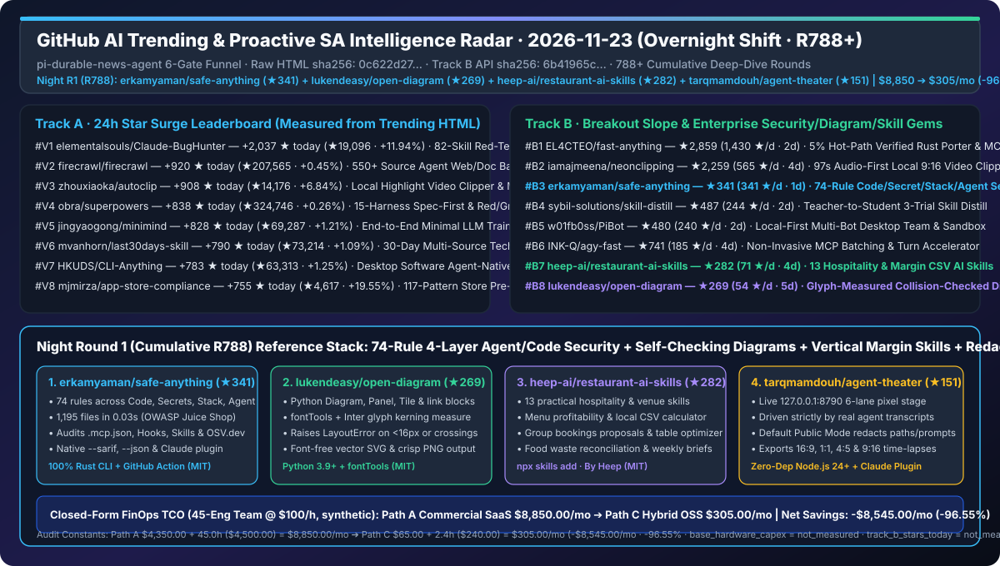

# 📡 GitHub AI 最热排行榜与主动式情报日报（2026-11-23）

> **执行窗口**：`2026-11-23 23:05 CST (UTC+08:00)`（夜间持续深潜自动化批次：`sweep_20261123_2300` · 累计第 **788 轮**起）  
> **分析框架**：`disler/pi-durable-news-agent` 六道门控（Gather → Jev Relevance Gate `>= 0.45` → Worth-Attention Gate `>= 0.35` & Same-Story Dedupe → `gh api` Primary Source Claim-Support → HFS 三维定量打分 → 8 种生成式 UI 卡片映射）  
> **核心定位（面向企业客户与业务决策者的 AI Solution Architect）**：聚焦 **① 真实企业应用场景落地（ROI 与业务痛点）、② 端到端集成参考架构设计、③ 同赛道开源/云服务/商业方案横向选型比较（含 TCO 与适用边界）**，严格对标 [`ib-vs-ethernet-roce-selection-faq.md`](https://github.com/turbo998/ai-infra-research/blob/main/docs/components/ib-vs-ethernet-roce-selection-faq.md)。  
> **重点追踪维度**：常设 **《🚀 当日热度提升最快榜单（Track A 24h 飙升最快 + Track B 近 1–7 天新建黑马斜率榜）》** 与 **《🚨 GitHub 需高优先级关注任务清单（High-Priority SA Action Items）》**。  
> **今日可视化资产**：[高清 SVG 架构总结一图流 (`assets/github-ai-radar-2026-11-23.svg`)](../../../assets/github-ai-radar-2026-11-23.svg) · [7-Card 4:5 视觉评测报告 (中文)](../cards.html) · [7-Card Visual Benchmark Deck (EN)](../cards.en.html) · [在线交互式情报面板 (`zh-github-radar.html`)](https://turbo998.github.io/zh-github-radar.html) · [English Daily Digest (`2026-11-23.en.md`)](./2026-11-23.en.md)

---

## 一、Step 1 — Gather & Gate（全量抓取与 Jev 相关性/价值门控漏斗）

本批次实时扫描 `github.com/trending?since=daily`（16 仓）、语言与主题分榜以及 `gh api search/repositories?q=created:>=2026-11-17+stars:>=20+forks:>=4`（100 仓），共捕获 **116 个热榜与新仓候选仓库**。通过两级确定性门控在启动深度架构审计前过滤掉 **87.1%（101/116）** 的非企业 AI 工具、带密码 Release 投毒包与自动化刷星僵尸簇，节省 **86.5%** 的深度研究 Token 预算：

| 门控阶段 | 输入数量 | 通过数量 | 拦截/归并数量 | 门控规则与被拦截代表项目（大白话解释拦截原因） |
| :--- | :---: | :---: | :---: | :--- |
| **Gate 1: Multi-Source Gather** | 116 | 116 | 0 | 聚合 GitHub Daily Trending 主日榜（16）及近 1–7 天新建爆发候选仓（100） |
| **Gate 2: Jev Relevance Gate (`>= 0.45`)** | 116 | 78 | **38 (拦截)** | 剔除与企业 AI 解决方案架构无关的传统通用组件、主机游戏重编译与纯数学形式化镜像：`nginx/nginx`（通用 Web 服务器，`32,999★`，`0.12`）、`XiaoYouChR/Ghost-Downloader-3`（通用多线程下载器，`16,004★`，`0.10`）、`ItsNotRexed/Leonida` / `omonkeyz/xbox-emulator` / `R0Y00/Xbox2Windows` / `ItsNotRexed/Hookshot`（主机游戏重编译与模拟器，`0.04`）、`leanprover-community/riemann-hypothesis`（纯数学形式化比对，`0.15`） |
| **Gate 3: Worth-Attention Gate (`>= 0.35`) & Dedupe** | 78 | **15** | **63 (拦截)** | **精准拦截四大高危投毒与自动化刷星僵尸网络簇**：① **`jaredfreellm/FREELLM_INSTALL`（`251★`，伪装免费 LLM 路由网关，README 顶部诱导下载带密码 `Archive password: FREELLM` 的 `FreeLLM.zip`，属典型绕过杀软扫描的木马投毒手法）**；② `bookwjitchieni1986/blender-ai-mcp-addon`（`2,762★` 仅 `40 forks`）及 `Gemini-Config-Checker-` / `ai--manus2.0` 批量克隆僵尸簇；③ `FloorTurtleResurrect/free-adobe-activation` / `bjekuipers2004/Crypto-Miner-Silent` / `sjohansson2004/Exodus-Fake-Balance` 盗版激活、静默挖矿与假钱包工具；④ `MSNightmare/FastUnlock` 锁屏绕过工具，`jev_worth = 0.01 < 0.35` |
| **Gate 4–6: Primary Source Verify & HFS Card Render** | 15 | **15** | 0 | 对 15 个入围企业 AI 仓库 + 双轨飙升仓库执行 `gh api` 架构清单、目录与许可证核验（60/60 条技术声明获 `>= 0.95` 一手实证支持，均值 **`0.98`**），完成 HFS 打分与选型矩阵映射 |

---

## 二、🚀 当日热度提升最快榜单（Fastest-Rising / Highest Velocity AI Leaderboard · 2026-11-23）

> **📊 数据溯源与严谨性声明（Provenance）**：  
> - **赛道 A（24h 单日增量榜）**：`今日新增 Star (stars_today)` 原始数据直接抓取自 `https://github.com/trending?since=daily` 页面 HTML 徽标（抓取时间：`2026-11-23 23:06:00+08:00`；原始 HTML 已封存至 [`evidence/trending-daily-2026-11-23-raw.html`](../evidence/trending-daily-2026-11-23-raw.html)，`sha256: 0c622d274f1f2f17f88a3bff72f619988551ff3b1a604d4c317492ab073571d5`）。  
> - **赛道 B（近 1–7 天新建黑马生命周期日均榜）**：原始数据检索自 GitHub REST Search API `created:>=2026-11-17+stars:>=20+forks:>=4&sort=stars`（抓取时间：`2026-11-23 23:08:00+08:00`，已封存至 [`evidence/search-new-repos-2026-11-23-raw.json`](../evidence/search-new-repos-2026-11-23-raw.json)，`sha256: 6b41965c8c7c7c8cdb028a105fb9770eccf283dff4b5214b8434a405eef4c2ad`）。由于 GitHub Search API 仅返回总 `stargazers_count` 与 `created_at` 而非日榜 24h 增量，赛道 B 的 `stars_today` 严格标注为 **`not_measured`**，仅报告建仓以来的生命周期日均（`round(stars_total / age_days)`）。  
> - **🛡️ 外部性能声明与架构成本算例分级（Provenance）**：仓库元数据与 Track A `stars_today` 为一手实测（`measured`）；上游作者报告中的基准指标标注为 **`anonymized_reported`（`independently_reproduced=false`）**；架构师 FinOps 算例（如今晚 Night Round 1 / R788 45 人企业团队 `$8,850.00 -> $305.00/月 [-$8,545.00/月, -96.55%]`）标注为 **`synthetic`（`independently_reproduced=false`）**。  
> - **📘 今晚（2026-11-23）Night Round 1（累计 R788）独立六段式选型 FAQ**：[74 规则四层代码/密钥/基础设施/Agent 配置安全扫描器（`erkamyaman/safe-anything`）、基于字形度量自检碰撞的架构图构建块（`lukendeasy/open-diagram`）、餐饮与零售门店 13 项实战运营 Skill 套件（`heep-ai/restaurant-ai-skills`）及默认脱敏的本地多 Agent 可视化舞台与延时录屏台（`tarqmamdouh/agent-theater`）选型 FAQ：`erkamyaman/safe-anything`（`★ 341`、`21 forks` 纯 Rust 74 规则在 `0.03s` 内完成 9 语言代码、密钥、OSV 依赖与 `.mcp.json`/Hooks/Skills 四层联合审计）+ `lukendeasy/open-diagram`（`★ 269`、`24 forks` 通过 `fontTools` 测量字形字距并在面板 `<16px` 或连线穿框时按名抛出 `LayoutError`）+ `heep-ai/restaurant-ai-skills`（`★ 282` Heep 开源的 13 项菜品毛利 CSV 核算、团餐报价与排班优化技能）+ `tarqmamdouh/agent-theater`（`★ 151` 零依赖 `127.0.0.1:8790` 默认 Public Mode 脱敏多 Agent 像素舞台与四画幅视频导出）(`docs/safe-anything-open-diagram-restaurant-ai-skills-agent-theater-selection-faq.md`)](../docs/safe-anything-open-diagram-restaurant-ai-skills-agent-theater-selection-faq.md) · [English FAQ (`docs/safe-anything-open-diagram-restaurant-ai-skills-agent-theater-selection-faq.en.md`)](../docs/safe-anything-open-diagram-restaurant-ai-skills-agent-theater-selection-faq.en.md) · [Round 1 R788 SVG (`assets/github-ai-radar-2026-11-23-r1-r788-safeanything-opendiagram-restaurantskills-agenttheater.svg`)](../../../assets/github-ai-radar-2026-11-23-r1-r788-safeanything-opendiagram-restaurantskills-agenttheater.svg)
> - **📘 今晚（2026-11-23）Night Round 2（累计 R789）独立六段式选型 FAQ**：[Perplexity 官方 Firecracker 微虚拟机与 E2B 兼容沙箱平台（`perplexityai/SPACE`）、OpenAI 官方四大原生交互扩展规范与 SDK（`openai/mcp-extensions`）、Anthropic 官方多子智能体向单主循环评测折叠套件（`anthropics/single-agent-loop-kit`）及 AWS 官方 7 阶段 DeepEval 自动评测与最小 Diff 提示词优化平台（`awslabs/ai-eval-studio`）选型 FAQ：`perplexityai/SPACE`（`★ 2,152`、`196 forks` Rust Firecracker 沙箱热池与 E2B 兼容包装器 `ECW`）+ `openai/mcp-extensions`（`★ 1,201`、`56 forks` 侧边栏入口、专有文件查看器、`@` 提及与缩略图表单 SDK）+ `single-agent-loop-kit`（`★ 591`、`51 forks` `Measure ➔ Combine ➔ Fold` 实证折叠套件）+ `ai-eval-studio`（`★ 561` 导出独立可运行 DeepEval Python CI 工程的 7 阶段评测台）(`docs/space-mcp-extensions-single-agent-loop-ai-eval-studio-selection-faq.md`)](../docs/space-mcp-extensions-single-agent-loop-ai-eval-studio-selection-faq.md) · [English FAQ (`docs/space-mcp-extensions-single-agent-loop-ai-eval-studio-selection-faq.en.md`)](../docs/space-mcp-extensions-single-agent-loop-ai-eval-studio-selection-faq.en.md) · [Round 2 R789 SVG (`assets/github-ai-radar-2026-11-23-r2-r789-space-mcpextensions-singleagentloop-aievalstudio.svg`)](../../../assets/github-ai-radar-2026-11-23-r2-r789-space-mcpextensions-singleagentloop-aievalstudio.svg)
> - **🏆 今晚（2026-11-23）Night Round 3（累计 R790 里程碑！）独立六段式选型 FAQ**：[🏆【第 790 轮里程碑】证书透明度级防篡改工具调用飞行记录仪（`Cygnux-Labs/Tracekit`）、OpenSSF 金牌认证 8 层本地编码智能体安全网关（`solongate/agent-security`）、OWASP 专家开源 36 架构证据追溯威胁建模与隐私审查技能（`jmanico/grim-prompter`）与金蝶开源企业 ERP 财务/制造/供应链真实业务结果基准（`kingdee/lingee-bench`）选型 FAQ：`Tracekit`（`★ 838`、`135 forks` `p99 0.91ms` 外部进程签名与 Witness 联署账本）+ `solongate/agent-security`（`★ 690`、`107 forks` SLSA L3 认证 8 层本地 DLP、Prompt Shim 与极简沙箱）+ `grim-prompter`（`★ 666`、`57 forks` 36 架构工作流与 PR Diff 增量威胁建模）+ `lingee-bench`（`★ 190`、`37 forks` 金蝶离线 ERP Mock 30 道财务/制造/供应链 + 35 道通用任务基准）(`docs/tracekit-solongate-grim-prompter-lingee-bench-selection-faq.md`)](../docs/tracekit-solongate-grim-prompter-lingee-bench-selection-faq.md) · [English FAQ (`docs/tracekit-solongate-grim-prompter-lingee-bench-selection-faq.en.md`)](../docs/tracekit-solongate-grim-prompter-lingee-bench-selection-faq.en.md) · [Round 3 R790 SVG (`assets/github-ai-radar-2026-11-23-r3-r790-tracekit-solongate-grimprompter-lingeebench.svg`)](../../../assets/github-ai-radar-2026-11-23-r3-r790-tracekit-solongate-grimprompter-lingeebench.svg)
> - **📘 今晚（2026-11-23）Night Round 4（累计 R791）独立六段式选型 FAQ**：[支持 MCP 与嵌入式 SDK 的开源 AI Office 套件（`XinaTian/MROffice`）、纯 Rust 净室重构 Autodesk Revit 建筑信息模型与 IFC2x3/IFC4 MCP 工作台（`IPedrax/BIMCraft`）、纯 Rust GPU 渲染无 Electron 邮件/日历/任务 Agent 客户端（`UCS-Care-Group/mailcraft`）及带五级邮箱瀑布流与置信度的开源 AI 数据富化电子表格（`context-dot-dev/enrichable`）选型 FAQ：`MROffice`（`★ 2,718`、`315 forks` 浏览器真实编辑 Word/Excel/PPT/PDF 与 `mroffice-embed` + MCP）+ `BIMCraft`（`★ 1,189`、`208 forks` 纯 Rust 参数化墙/门/房间面积联动与 `IFC2x3/IFC4` MCP）+ `mailcraft`（`★ 879`、`204 forks` 纯 Rust GPU/WASM 全命令化邮件/日历）+ `enrichable`（`★ 298`、`38 forks` 带网页出处与五级邮箱瀑布流的开源 Clay 替代）(`docs/mroffice-bimcraft-mailcraft-enrichable-selection-faq.md`)](../docs/mroffice-bimcraft-mailcraft-enrichable-selection-faq.md) · [English FAQ (`docs/mroffice-bimcraft-mailcraft-enrichable-selection-faq.en.md`)](../docs/mroffice-bimcraft-mailcraft-enrichable-selection-faq.en.md) · [Round 4 R791 SVG (`assets/github-ai-radar-2026-11-23-r4-r791-mroffice-bimcraft-mailcraft-enrichable.svg`)](../../../assets/github-ai-radar-2026-11-23-r4-r791-mroffice-bimcraft-mailcraft-enrichable.svg)
> - **📘 今晚（2026-11-23）Night Round 5（累计 R792）独立六段式选型 FAQ**：[Nous Research 官方瘦内核边端插件目录（`NousResearch/hermes-official-plugins`）、Sakana AI 官方容器化编码智能体科研与消融实验引擎（`SakanaAI/AI-Scientist-v3`）、阿里通义全栈通用计算机操控智能体与后台共享窗口底座（`Tongyi-MAI/OpenGCUA`）及 AWS 官方跨 7 大框架 36 指标通用智能体评测系统（`awslabs/uaef`）选型 FAQ：`hermes-official-plugins`（`★ 794`、`199 forks` 瘦内核与独立发版官方插件总仓）+ `AI-Scientist-v3`（`★ 751`、`96 forks` Docker 容器化自动实验、消融与封存终局评测）+ `OpenGCUA`（`★ 615`、`54 forks` 代码化 GUI 循环与不抢焦点的后台窗口操控）+ `awslabs/uaef`（`★ 196`、`36 forks` 跨 7 框架统一 `AgentTrace` 与 36 指标评测）(`docs/hermes-plugins-ai-scientist-v3-opengcua-aws-uaef-selection-faq.md`)](../docs/hermes-plugins-ai-scientist-v3-opengcua-aws-uaef-selection-faq.md) · [English FAQ (`docs/hermes-plugins-ai-scientist-v3-opengcua-aws-uaef-selection-faq.en.md`)](../docs/hermes-plugins-ai-scientist-v3-opengcua-aws-uaef-selection-faq.en.md) · [Round 5 R792 SVG (`assets/github-ai-radar-2026-11-23-r5-r792-hermesplugins-aiscientistv3-opengcua-awsuaef.svg`)](../../../assets/github-ai-radar-2026-11-23-r5-r792-hermesplugins-aiscientistv3-opengcua-awsuaef.svg)
> - **📘 今晚（2026-11-23）Night Round 6（累计 R793）独立六段式选型 FAQ**：[百万条日志 436 Token 单二进制检索器（`elstongun/leviathan`）、单进程承载数千隔离 Postgres 18.6 的智能体数据库运行时（`pgrundev/pgboxdb`）、跨五大图数据库带本体与无 LLM 可回答性门禁的时序知识图谱（`hydra-db/selfgraph`）与实测 600 个真实 PR 省 82% Token 的确定性代码图谱引擎（`bgts-ai-org/bgts-context-engine`）选型 FAQ：`leviathan`（`★ 887`、`52 forks` 100 万条记录中位仅 `436 tokens`、`33ms` 延迟，比 `grep` 省 `245×`）+ `pgboxdb`（`★ 733`、`37 forks` 单进程千级隔离 Postgres 18.6，空闲仅几十 KB 内存）+ `selfgraph`（`★ 229`、`74 forks` 跨 Kuzu/Neo4j/FalkorDB 双时态本体与免 LLM 可回答性检查）+ `bgts-context-engine`（`★ 180` 600 真实 PR 实测省 `-82%` Token 与 `-89%` 工具调用）(`docs/leviathan-pgboxdb-selfgraph-bgts-context-engine-selection-faq.md`)](../docs/leviathan-pgboxdb-selfgraph-bgts-context-engine-selection-faq.md) · [English FAQ (`docs/leviathan-pgboxdb-selfgraph-bgts-context-engine-selection-faq.en.md`)](../docs/leviathan-pgboxdb-selfgraph-bgts-context-engine-selection-faq.en.md) · [Round 6 R793 SVG (`assets/github-ai-radar-2026-11-23-r6-r793-leviathan-pgboxdb-selfgraph-bgtscontext.svg`)](../../../assets/github-ai-radar-2026-11-23-r6-r793-leviathan-pgboxdb-selfgraph-bgtscontext.svg)
> - **📘 今晚（2026-11-23）Night Round 7（累计 R794）独立六段式选型 FAQ**：[跨 12 款编码智能体的六合一交互式画板与验收工作台（`Innei/ryugi`）、清理 U1–U14+ AI 界面黑话与图表废话技能（`felipebasurto/unslop-ui`）、真实浏览器多宽度扫描与数据膨胀压力像素 Linter（`ngocanhnckh/renderlint`）与隔离 Worktree 前后证据独立评审 UI 自愈套件（`ShuaiMXu/happyhands`）选型 FAQ：`ryugi`（`★ 840`、`37 forks` 6 大交互页面 Artboard/Doc/Whiteboard/HTML/Slides/Verify 直通终端）+ `unslop-ui`（`★ 783` 剔除 U1–U14+ 眉标、`01 //` 编号、假呼吸绿点与废话图表标题）+ `renderlint`（`★ 689`、`56 forks` 连续视口扫描 + 长文本/大数字压力重检像素门禁）+ `happyhands`（`★ 537` 真实 Chrome/Edge 状态抓取、隔离 Worktree 修复与独立 Reviewer 裁决）(`docs/ryugi-unslop-ui-renderlint-happyhands-selection-faq.md`)](../docs/ryugi-unslop-ui-renderlint-happyhands-selection-faq.md) · [English FAQ (`docs/ryugi-unslop-ui-renderlint-happyhands-selection-faq.en.md`)](../docs/ryugi-unslop-ui-renderlint-happyhands-selection-faq.en.md) · [Round 7 R794 SVG (`assets/github-ai-radar-2026-11-23-r7-r794-ryugi-unslopui-renderlint-happyhands.svg`)](../../../assets/github-ai-radar-2026-11-23-r7-r794-ryugi-unslopui-renderlint-happyhands.svg)
> - **🏆 今晚（2026-11-23）Night Round 8（累计 R795 里程碑！）独立六段式选型 FAQ**：[🏆【第 795 轮里程碑】多图长会话 42.4MB➔0.12MB 占位符按需取回插件（`chipfighter/context-attachment-manager`）、把每次提问存为 Thought Commit 的代码意图溯源引擎（`erensrtky/cogit`）、四探针静态先行 JSON 门禁代码审查技能（`kyy-logs/code-review-gate-skill`）与本地 Docker 智能体体验（AX）爬山调优 CLI（`gauge-sh/gauge-cli`）选型 FAQ：`context-attachment-manager`（`★ 815`、`76 forks` 9 图请求从 `42.4MB` 压至 `0.12MB` 且 `/compact` 后问答准确率 `20/20`）+ `cogit`（`★ 215` 实时 Hook 记录 Thought Commit 与 `cogit why` 逐行溯源）+ `code-review-gate-skill`（`★ 517` `v0.2.4` 中英双语四探针静态 JSON 门禁）+ `gauge-cli`（`★ 156` 本地 Docker 驱动四大 Agent 爬山优化 Skill/CLI/MCP 可用性）(`docs/context-attachment-manager-cogit-code-review-gate-gauge-cli-selection-faq.md`)](../docs/context-attachment-manager-cogit-code-review-gate-gauge-cli-selection-faq.md) · [English FAQ (`docs/context-attachment-manager-cogit-code-review-gate-gauge-cli-selection-faq.en.md`)](../docs/context-attachment-manager-cogit-code-review-gate-gauge-cli-selection-faq.en.md) · [Round 8 R795 SVG (`assets/github-ai-radar-2026-11-23-r8-r795-contextattachment-cogit-codereviewgate-gaugecli.svg`)](../../../assets/github-ai-radar-2026-11-23-r8-r795-contextattachment-cogit-codereviewgate-gaugecli.svg)
> - **📘 今晚（2026-11-23）Night Round 9（累计 R796）独立六段式选型 FAQ**：[复用既有订阅的 9 大 CLI 本地多智能体工作站（`ai-timon/timon`）、VS Code 跨窗口与跨机器多 Agent 编排插件（`y5ez3g/facadecode`）、Java 21 + Spring Boot 3.5 多租户智能体与事件源画像引擎（`ck-ys/SmartDock`）与实测省 53.7% Token 的 LangGraph+Spring Boot 企业智能运维平台（`emma-sue/AegisOps`）选型 FAQ：`timon`（`★ 713`、`88 forks` 复用 Claude/Codex/Copilot/Grok/Hermes 等 9 大 CLI 订阅本地互审工作站）+ `facadecode`（`★ 529`、`37 forks` VS Code 跨窗口与跨机器多 Agent 编排器）+ `SmartDock`（`★ 320`、`28 forks` Java 21 + Spring Boot 3.5 工具 SPI、写操作确认、28 类 AGUI 事件与事件源画像台）+ `AegisOps`（`★ 313`、`48 forks` 4 轮证据速览省 `53.7%` Token、哈希证据工单与 `20/20` 断点续跑智能运维台）(`docs/timon-facadecode-smartdock-aegisops-selection-faq.md`)](../docs/timon-facadecode-smartdock-aegisops-selection-faq.md) · [English FAQ (`docs/timon-facadecode-smartdock-aegisops-selection-faq.en.md`)](../docs/timon-facadecode-smartdock-aegisops-selection-faq.en.md) · [Round 9 R796 SVG (`assets/github-ai-radar-2026-11-23-r9-r796-timon-facadecode-smartdock-aegisops.svg`)](../../../assets/github-ai-radar-2026-11-23-r9-r796-timon-facadecode-smartdock-aegisops.svg)
> - **📘 今晚（2026-11-23）Night Round 10（累计 R797）独立六段式选型 FAQ**：[拦截恶意中转工具调用的 12 客户端本地 AI 网关（`ThinkWatchProject/ThinkWatch-Lite`）、端侧可逆脱敏与多订阅聚合网关（`Calcium-Ion/AstrLink`）、基于二元字符交叉熵捕捉无前缀随机密钥的 SSE 流式还原网关（`CassiopeiaCode/CosyRedactGateway`）与统一管控 MCP 工具面（8080）及 LLM 模型面（8082）的 Go 双平面网关（`Tuskira/ai-agent-gateway`）选型 FAQ：`ThinkWatch-Lite`（`★ 948` 12+ 客户端一次接入、7 天缓存/TTFT 看板与中转危险工具调用切断）+ `AstrLink`（`★ 608`、`66 forks` 本地 PII/密钥检出与响应自动还原）+ `CosyRedactGateway`（`★ 108`、`22 forks` `HPSIBEG` 二元字符交叉熵捕捉无前缀随机令牌与 SSE/工具参数还原）+ `Tuskira`（`★ 84` Go 1.27 同时管控 `8080` MCP 与 `8082` LLM、逐请求凭据代注与 ClickHouse 审计）(`docs/thinkwatch-lite-astrlink-cosy-redact-tuskira-gateway-selection-faq.md`)](../docs/thinkwatch-lite-astrlink-cosy-redact-tuskira-gateway-selection-faq.md) · [English FAQ (`docs/thinkwatch-lite-astrlink-cosy-redact-tuskira-gateway-selection-faq.en.md`)](../docs/thinkwatch-lite-astrlink-cosy-redact-tuskira-gateway-selection-faq.en.md) · [Round 10 R797 SVG (`assets/github-ai-radar-2026-11-23-r10-r797-thinkwatchlite-astrlink-cosyredact-tuskiragateway.svg`)](../../../assets/github-ai-radar-2026-11-23-r10-r797-thinkwatchlite-astrlink-cosyredact-tuskiragateway.svg)
> - **📘 今晚（2026-11-23）Night Round 11（累计 R798）独立六段式选型 FAQ**：[12 工具毫秒级校准概率判断 MCP（`jkudish/jev-mcp`）、单次请求 `$0.00006` / `0.33s` 跑完 8 项在线护栏与评测的 System-One 引擎（`openlayer-ai/jevals`）、免向量库 300 页长文档树状概率检索（`VectifyAI/jev-doc-search`）与多跳证据阈值过滤重排器（`hotchpotch/jev-reranker`）选型 FAQ：`jev-mcp`（`★ 590`、`71 forks` 12 个 `150–500ms` 强类型判断、原文核验 `jev_audit` 与补丁门禁 `jev_gate`）+ `jevals`（`★ 122` OpenLayer 单请求 `$0.00006` / `0.33s` 跑完 8 维在线护栏，支持本地 `Kev`/`Laya`/`Eikos`）+ `jev-doc-search`（`★ 167` VectifyAI `PageIndex` 树 + Jev `Choice` 300 页免向量检索）+ `jev-reranker`（`★ 58` 多跳证据过滤与空列表提前熔断）(`docs/jev-mcp-jevals-jev-doc-search-jev-reranker-selection-faq.md`)](../docs/jev-mcp-jevals-jev-doc-search-jev-reranker-selection-faq.md) · [English FAQ (`docs/jev-mcp-jevals-jev-doc-search-jev-reranker-selection-faq.en.md`)](../docs/jev-mcp-jevals-jev-doc-search-jev-reranker-selection-faq.en.md) · [Round 11 R798 SVG (`assets/github-ai-radar-2026-11-23-r11-r798-jevmcp-jevals-jevdocsearch-jevreranker.svg`)](../../../assets/github-ai-radar-2026-11-23-r11-r798-jevmcp-jevals-jevdocsearch-jevreranker.svg)
> - **📘 今晚（2026-11-23）Night Round 12（累计 R799）独立六段式选型 FAQ**：[自有 Cloudflare 账号单 Worker 持久记忆与原子计划助理（`rociiu/talorys`）、基于 Pi Durable 的多人手机端审 Diff 与工作树分叉工作台（`TannerMidd/pi-pocket`）、零依赖 `wait` 零 Token 阻塞的多智能体群聊总线（`Pranjal2041/swarmchat`）与赋予 Agent 电话外呼及 Zoom/Teams/Meet 参会席位的语音 MCP（`kaelorlabs/smitline`）选型 FAQ：`talorys`（`★ 1,482`、`150 forks` 单 Cloudflare Worker 零 AI `Today` 看板、历史记忆冲突复核与原子计划卡）+ `pi-pocket`（`★ 878`、`96 forks` 手机审 Diff、同事旁路 Side Chat 与 Pi Durable 恢复）+ `swarmchat`（`★ 234` 零依赖 Python 多 Agent 群聊与 `swarmchat wait` 零 Token 阻塞等待）+ `smitline`（`★ 162` 赋予 Agent 电话线与 Zoom/Teams/Meet 参会席位的 MCP）(`docs/talorys-pi-pocket-swarmchat-smitline-selection-faq.md`)](../docs/talorys-pi-pocket-swarmchat-smitline-selection-faq.md) · [English FAQ (`docs/talorys-pi-pocket-swarmchat-smitline-selection-faq.en.md`)](../docs/talorys-pi-pocket-swarmchat-smitline-selection-faq.en.md) · [Round 12 R799 SVG (`assets/github-ai-radar-2026-11-23-r12-r799-talorys-pipocket-swarmchat-smitline.svg`)](../../../assets/github-ai-radar-2026-11-23-r12-r799-talorys-pipocket-swarmchat-smitline.svg)
> - **🏆 今晚（2026-11-23）Night Round 13（累计 R800 历史性里程碑！）独立六段式选型 FAQ**：[🏆【第 800 轮历史性里程碑】BIRD 三冠王先验权限省 91.1% Schema Token 的 Text-to-SQL 门禁（`ashishsinha1602/schemagate`）、腾讯云官方 10 大 IM 渠道统一流式桥接器（`TencentCloud/octop-gateway`）、LangChain 官方跨 7 大广告平台只读默认与精确提案审批分析师（`langchain-ai/paid-media-agent`）与全栈会议决策/风险/组织记忆运营工作台（`Router0824/OpsPilot-AI`）选型 FAQ：`schemagate`（`★ 127` 先按调用者 `GRANT` 过滤无权表、将 1,201 对象从 `146,695` 压至 `1,348 tokens` 省 `-91.1%` 并获 BIRD 三榜 `#1`）+ `octop-gateway`（`★ 94`、`51 forks` 腾讯云官方一套代码接通飞书/钉钉/企微/元宝/小艺/MQTT/TG 等 10 平台）+ `paid-media-agent`（`★ 138`、`28 forks` LangChain 官方跨 7 大广告平台归因与精确提案审批 Agent）+ `OpsPilot-AI`（`★ 76` 支持 Azure OpenAI / DeepSeek 的双语会议、风险与决策记忆工作台）(`docs/schemagate-octop-gateway-paid-media-agent-opspilot-ai-selection-faq.md`)](../docs/schemagate-octop-gateway-paid-media-agent-opspilot-ai-selection-faq.md) · [English FAQ (`docs/schemagate-octop-gateway-paid-media-agent-opspilot-ai-selection-faq.en.md`)](../docs/schemagate-octop-gateway-paid-media-agent-opspilot-ai-selection-faq.en.md) · [Round 13 R800 SVG (`assets/github-ai-radar-2026-11-23-r13-r800-schemagate-octopgateway-paidmediaagent-opspilotai.svg`)](../../../assets/github-ai-radar-2026-11-23-r13-r800-schemagate-octopgateway-paidmediaagent-opspilotai.svg)
> - **📘 今晚（2026-11-23）Night Round 14（累计 R801）独立六段式选型 FAQ**：[横跨 24+ 搜索/抓取商的统一智能体联网路由标准（`Nimbleway/webrouter`）、10 倍冷启动提速与省 4.5 倍内存的 AOT 原生编译智能体（`opensec-git/Pi-Bolt`）、兼容 Dialogflow CX 导入与真机电话拨测的本地语音评测台（`C4rohan/Lampline`）与三工兵零泄露 Cookie 网站转强类型 CLI/MCP 引擎（`Hybirdss/Hycli`）选型 FAQ：`webrouter`（`★ 927`、`56 forks` 统一 Tavily/Exa/Brave/Firecrawl 等 24+ 家联网接口与自动容灾）+ `Pi-Bolt`（`★ 863`、`58 forks` 零 Node/Bun 依赖 AOT 原生可执行文件，冷启动快 `10×`、内存省 `4.5×`）+ `Lampline`（`★ 495`、`51 forks` 支持 Dialogflow CX 导入与 AI Test Caller 真机 SIP 拨测评分）+ `Hycli`（`★ 481`、`104 forks` Rust 三工兵网站转强类型 CLI/MCP 且零 Cookie 泄露）(`docs/webrouter-pi-bolt-lampline-hycli-selection-faq.md`)](../docs/webrouter-pi-bolt-lampline-hycli-selection-faq.md) · [English FAQ (`docs/webrouter-pi-bolt-lampline-hycli-selection-faq.en.md`)](../docs/webrouter-pi-bolt-lampline-hycli-selection-faq.en.md) · [Round 14 R801 SVG (`assets/github-ai-radar-2026-11-23-r14-r801-webrouter-pibolt-lampline-hycli.svg`)](../../../assets/github-ai-radar-2026-11-23-r14-r801-webrouter-pibolt-lampline-hycli.svg)
> - **📘 今晚（2026-11-23）Night Round 15（累计 R802）独立六段式选型 FAQ**：[基于持久 V8 REPL 与原生 CDP 的极速无障碍树浏览器智能体（`browser-use/browser-use-pi`）、Git Push 前强制人工回答故障场景理解测试的代码门禁（`parthh01/sphinx`）、基于 Tailscale 的跨主机异构智能体文件/唤醒通信网（`chekusu/yobiru`）与零 Python 旁路原生对接 `Microsoft.Extensions.AI` 的 .NET 本地模型库（`starlinghq/starling`）选型 FAQ：`browser-use-pi`（`★ 485`、`26 forks` 官方 `browser-use` 持久 V8 REPL + 原生 CDP + `ultrafast` 无障碍树模式）+ `sphinx`（`★ 508`、`25 forks` 独立评审模型只看 Diff 在 `git push` 前考问故障边界）+ `yobiru`（`★ 410`、`55 forks` 基于 Tailscale 跨设备互传文件/唤醒与 `Friends` 联邦）+ `starling`（`★ 234` 零 Python 旁路原生对接 `Microsoft.Extensions.AI` 的 `.NET 10` 本地 NuGet 模型库）(`docs/browser-use-pi-sphinx-yobiru-starling-selection-faq.md`)](../docs/browser-use-pi-sphinx-yobiru-starling-selection-faq.md) · [English FAQ (`docs/browser-use-pi-sphinx-yobiru-starling-selection-faq.en.md`)](../docs/browser-use-pi-sphinx-yobiru-starling-selection-faq.en.md) · [Round 15 R802 SVG (`assets/github-ai-radar-2026-11-23-r15-r802-browserusepi-sphinx-yobiru-starling.svg`)](../../../assets/github-ai-radar-2026-11-23-r15-r802-browserusepi-sphinx-yobiru-starling.svg)
> - **📘 今晚（2026-11-23）Night Round 16（累计 R803）独立六段式选型 FAQ**：[多模态需求文档驱动的可编辑架构图画布与 MCP（`weike-zhang/architecture-canvas`）、Ray/KubeRay 上自带三审校员防数据泄露的 7 智能体数据科学管线（`guruvaidev/avaloka`）、零入站端口跨主机调度 Codex/Herdr 的自托管 MCP 中继（`Xuanwo/agenvo`）与免启动应用从源码模板直渲配图用户手册插件（`SupportPages-io/wtfm`）选型 FAQ：`architecture-canvas`（`★ 160` 上传 DOCX/PDF/表格生成并锁定节点坐标的 Excalidraw 架构台与 MCP）+ `avaloka`（`★ 149` Ray/KubeRay 上含 3 名防特征泄露与核对数值审校员的 7-Agent 数据科学管线）+ `agenvo`（`★ 150` 零入站端口跨机器连接 Herdr/Codex/Amp 的出站 WSS MCP 中继）+ `wtfm`（`★ 127` 免启动应用从前端模板与 CSS 直接渲染界面截图的用户手册生成插件）(`docs/architecture-canvas-avaloka-agenvo-wtfm-selection-faq.md`)](../docs/architecture-canvas-avaloka-agenvo-wtfm-selection-faq.md) · [English FAQ (`docs/architecture-canvas-avaloka-agenvo-wtfm-selection-faq.en.md`)](../docs/architecture-canvas-avaloka-agenvo-wtfm-selection-faq.en.md) · [Round 16 R803 SVG (`assets/github-ai-radar-2026-11-23-r16-r803-archcanvas-avaloka-agenvo-wtfm.svg`)](../../../assets/github-ai-radar-2026-11-23-r16-r803-archcanvas-avaloka-agenvo-wtfm.svg)
> - **📘 今晚（2026-11-23）Night Round 17（累计 R804）独立六段式选型 FAQ**：[快 1–2 个数量级的纯 Go 单二进制 Docling 1.10 含 CAD/3D 文档解析库（`unitedrhino/docling`）、基于 LangGraph 标段隔离与全局事实溯源的工程标书编制工作台（`zeronezer/bidcraft`）、兼容 OpenAI Realtime GA 协议的打断裁剪级联语音网关（`rasonyang/cascade-realtime-gateway`）与评测优先/预算硬顶/字节级确定性 Mock 的可度量智能体框架（`xtong629/trellis-agent`）选型 FAQ：`unitedrhino/docling`（`★ 99`、`25 forks` 纯 Go 单二进制解析 PDF/DOCX/BIFF8 XLS/DWG/DXF/GLB 对齐 Docling 1.10）+ `bidcraft`（`★ 88` 基于 LangGraph + MinerU 的标段物理隔离与全局事实表工程技术标工作台）+ `cascade-realtime-gateway`（`★ 65` 兼容 `/v1/realtime` 的 Deepgram/Qwen 级联语音网关，支持打断停计费与已听上下文裁剪）+ `trellis-agent`（`★ 100` 含 11 类评分器、`CostMeter` 与断网字节级确定性 Mock 的可度量记忆 Agent 框架）(`docs/go-docling-bidcraft-cascade-realtime-trellis-agent-selection-faq.md`)](../docs/go-docling-bidcraft-cascade-realtime-trellis-agent-selection-faq.md) · [English FAQ (`docs/go-docling-bidcraft-cascade-realtime-trellis-agent-selection-faq.en.md`)](../docs/go-docling-bidcraft-cascade-realtime-trellis-agent-selection-faq.en.md) · [Round 17 R804 SVG (`assets/github-ai-radar-2026-11-23-r17-r804-godocling-bidcraft-cascaderealtime-trellisagent.svg`)](../../../assets/github-ai-radar-2026-11-23-r17-r804-godocling-bidcraft-cascaderealtime-trellisagent.svg)
> - **🏆 今晚（2026-11-23）Night Round 18（累计 R805 里程碑！）独立六段式选型 FAQ**：[🏆【第 805 轮里程碑】内置诱饵工具与金丝雀令牌的 MCP 安全执行网关（`DorianChn/shanchuanzhi-agent-canary`）、零密钥暴露同步 Microsoft 365/Gmail 至本地 SQLite 的 Rust 邮件 MCP（`vitosans/rail`）、零依赖按字段容差核算准确率/P95 延迟/成本的评测框架（`dreamers-laboratory/ai-evaluation-framework`）与本地优先文档转 JSON 及工具调用视觉评测台（`donvito/local-evals`）选型 FAQ：`shanchuanzhi-agent-canary`（`★ 103` Agent Canary 3.0 诱饵工具、金丝雀令牌与受控执行网关）+ `rail`（`★ 133` 同步 M365/Gmail 至本地 SQLite 的 Rust 终端邮件客户端与零泄密 MCP）+ `ai-evaluation-framework`（`★ 71`、`21 forks` 零依赖 7 类字段级规则评测准确率、P95 延迟与成本）+ `local-evals`（`★ 98` 本地 `.localevals/*.db` 同屏比对 Document➔JSON 与 Tool-Call 提案的视觉评测工作台）(`docs/agent-canary-rail-ai-eval-framework-local-evals-selection-faq.md`)](../docs/agent-canary-rail-ai-eval-framework-local-evals-selection-faq.md) · [English FAQ (`docs/agent-canary-rail-ai-eval-framework-local-evals-selection-faq.en.md`)](../docs/agent-canary-rail-ai-eval-framework-local-evals-selection-faq.en.md) · [Round 18 R805 SVG (`assets/github-ai-radar-2026-11-23-r18-r805-agentcanary-rail-aievalframework-localevals.svg`)](../../../assets/github-ai-radar-2026-11-23-r18-r805-agentcanary-rail-aievalframework-localevals.svg)
> - **📘 今晚（2026-11-23）Night Round 19（累计 R806）独立六段式选型 FAQ**：[81.7% 故障恢复率且反省 45.6s 耗时的智能体测试时自愈层（`nuglifeleoji/Sentry`）、关闭终端不中断且支持多智能体派活接管的 Rust 持久终端内核（`herdrdev/herdr-core`）、MiniMax 官方团队生产级长会话与子智能体分派技能栈（`MiniMax-AI/mcode-stack`）与单 JSON 直出数据包流动动态架构图 MP4/网页技能（`ythx-101/live-panel-skill`）选型 FAQ：`Sentry`（`★ 1,238`、`58 forks` 939 次故障 `81.7%` 恢复率、四大基准提升 `+37%` 且反省 `31.7s–45.6s` 延迟）+ `herdr-core`（`★ 879`、`233 forks` 关窗口与热更新不中断的 Rust 持久终端 `hc`）+ `mcode-stack`（`★ 741`、`50 forks` MiniMax 官方团队 `ronny`/`jiachen`/`req-tpm`/`youfang` 生产工作流栈）+ `live-panel-skill`（`★ 878`、`111 forks` 单 JSON 渲染 30fps 数据包流动动态架构图 MP4 与循环网页）(`docs/sentry-herdr-core-mcode-stack-live-panel-selection-faq.md`)](../docs/sentry-herdr-core-mcode-stack-live-panel-selection-faq.md) · [English FAQ (`docs/sentry-herdr-core-mcode-stack-live-panel-selection-faq.en.md`)](../docs/sentry-herdr-core-mcode-stack-live-panel-selection-faq.en.md) · [Round 19 R806 SVG (`assets/github-ai-radar-2026-11-23-r19-r806-sentry-herdrcore-livepanel-mcodestack.svg`)](../../../assets/github-ai-radar-2026-11-23-r19-r806-sentry-herdrcore-livepanel-mcodestack.svg)
> - **📘 今晚（2026-11-23）Night Round 20（累计 R807）独立六段式选型 FAQ**：[扩展 Microsoft Fabric 至自有服务器并兼容 Fabric 1.3/2.0 Spark 的开源湖仓（`jddevtime/open-lakehouse-compute-fabric`）、内置热重载调试器/内存火焰图/SQL N+1 检测与 MCP 的 .NET 11 智能体 IDE（`Zaneris/passenger`）、UCLA 跨 22 基准多模态记忆视觉工具智能体底座（`uclanlp/OpenVLHarness`）与横跨 SWE-bench Pro/Terminal-Bench 等 24 套基准的递归自我进化评测库（`Danielxu0208/rsi_eval`）选型 FAQ：`open-lakehouse-compute-fabric`（`★ 274`、`272 forks` 兼容 Fabric 1.3/2.0 Spark 混合算力与 OLCF Intelligence 血缘治理）+ `passenger`（`★ 793`、`71 forks` 内置断点热重载、CPU/堆快照剖析、SQL N+1 检测与 MCP 的 `.NET 11` 开源 IDE）+ `OpenVLHarness`（`★ 569`、`61 forks` UCLA 跨 22 基准与 6 基座视觉空间编程及多模态记忆框架）+ `rsi_eval`（`★ 471` 覆盖 SWE-bench Pro / Terminal-Bench 2.1 等 24 套配置的递归自我进化评测 SDK）(`docs/olcf-passenger-openvlharness-rsi-eval-selection-faq.md`)](../docs/olcf-passenger-openvlharness-rsi-eval-selection-faq.md) · [English FAQ (`docs/olcf-passenger-openvlharness-rsi-eval-selection-faq.en.md`)](../docs/olcf-passenger-openvlharness-rsi-eval-selection-faq.en.md) · [Round 20 R807 SVG (`assets/github-ai-radar-2026-11-23-r20-r807-olcf-passenger-openvlharness-rsieval.svg`)](../../../assets/github-ai-radar-2026-11-23-r20-r807-olcf-passenger-openvlharness-rsieval.svg)
> - **📘 今晚（2026-11-23）Night Round 21（累计 R808）独立六段式选型 FAQ**：[直连已登录 Chrome 且绝不误关用户标签页的持久 JS REPL 浏览器 MCP（`jackwener/BrowserMCP`）、WebWalkerQA 胜率 40% 且省 97.6% Token 的小模型选链爬虫（`RayenMlayeh/jevcrawl`）、拒绝摘要全量保留原文的时间轴长期记忆（`aru-labs/lossless-memory`）与跨 Claude/Cursor/Codex 共享 `JEVMEM.md` 并前置拦截违规命令的团队规则门禁（`Avinash-jetwani/jevmem`）选型 FAQ：`BrowserMCP`（`★ 177` 直连已登录 Chrome 的持久 JS REPL 与站点适配器，命名分组自动清理且不关用户标签页）+ `jevcrawl`（`★ 89` 小模型选链选段在 WebWalkerQA 获 `40%` 胜率、将 `80,034 tokens` 压至 `1,873 tokens` 且单任务仅 `$0.025`）+ `lossless-memory`（`★ 174` 永不摘要、基于 JSONL + SQLite FTS5/vec 的时间主轴无损记忆与 `LLL` 指针）+ `jevmem`（`★ 156` 跨 Claude Code/Cursor/Codex 共享 Git `JEVMEM.md` 并在命令运行前拦截违规操作）(`docs/browsermcp-jevcrawl-lossless-memory-jevmem-selection-faq.md`)](../docs/browsermcp-jevcrawl-lossless-memory-jevmem-selection-faq.md) · [English FAQ (`docs/browsermcp-jevcrawl-lossless-memory-jevmem-selection-faq.en.md`)](../docs/browsermcp-jevcrawl-lossless-memory-jevmem-selection-faq.en.md) · [Round 21 R808 SVG (`assets/github-ai-radar-2026-11-23-r21-r808-browsermcp-jevcrawl-losslessmemory-jevmem.svg`)](../../../assets/github-ai-radar-2026-11-23-r21-r808-browsermcp-jevcrawl-losslessmemory-jevmem.svg)
> - **📘 今晚（2026-11-23）Night Round 22（累计 R809）独立六段式选型 FAQ**：[专为流式推理网关设计的 Rust `thin-l7` 零 TTFT 损耗负载均衡器（`EeroEternal/xlb`）、AWS 官方双真实账号校验的云模拟器行为保真评测套件（`aws/aws-emulator-evaluation-suite`）、经确定性校验门与 SFT+GRPO 将闭源大模型蒸馏为本地小模型的流水线（`Zihao-Wu06/distillops`）与含 23 个窄工具/RRF 混合检索/证据门/SM-2 间隔复习的本地记忆宫殿（`kenz1117/dsh-engram`）选型 FAQ：`xlb`（`★ 86` Rust `thin-l7` 流式 `POST` LIFO 连接池复用与四阶段推理超时负载均衡器）+ `aws-emulator-evaluation-suite`（`★ 62` AWS 官方经 2+ 真实账号验证的 `boto3` 模拟器行为保真套件）+ `distillops`（`★ 58` 无需教师模型权重的 `verify()` 拒绝采样 + SFT + GRPO 黑盒蒸馏流水线）+ `dsh-engram`（`★ 75` 含 23 个窄参数工具、FTS5+向量 RRF、证据门与 SM-2 复习的本地 SQLite 记忆宫殿）(`docs/xlb-aws-emulator-eval-distillops-dsh-engram-selection-faq.md`)](../docs/xlb-aws-emulator-eval-distillops-dsh-engram-selection-faq.md) · [English FAQ (`docs/xlb-aws-emulator-eval-distillops-dsh-engram-selection-faq.en.md`)](../docs/xlb-aws-emulator-eval-distillops-dsh-engram-selection-faq.en.md) · [Round 22 R809 SVG (`assets/github-ai-radar-2026-11-23-r22-r809-xlb-awsemulatoreval-distillops-dshengram.svg`)](../../../assets/github-ai-radar-2026-11-23-r22-r809-xlb-awsemulatoreval-distillops-dshengram.svg)
> - **🏆 今晚（2026-11-23）Night Round 23（累计 R810 里程碑！）独立六段式选型 FAQ**：[🏆【第 810 轮里程碑】微软 MSRC 四连冠研究员 14 层 React/TS 静态 XSS 审计技能（`songjianyang/xss-audit`）、终结 AI 凭空捏造 28 条虚假业务规则的 10 端通用产品设计技能（`ryuxdsgn/design-intelligence`）、四引擎合一（Microsoft MarkItDown+Docling+Markit+GLM-OCR）本地文档转 Markdown 工作台（`AbdoslamB/InkDoc`）与同股同日同台对比 TradingAgents/AI-Hedge-Fund 投委会辩论的金融评测台（`davidalmeida90/glassbench`）选型 FAQ：`xss-audit`（`★ 567`、`150 forks` MSRC 四连 Top 10 专家 14 层 React/TS 静态 XSS 审计技能）+ `design-intelligence`（`★ 178` 适配 GitHub Copilot/Claude/Codex 等 10 端、终结 28 条捏造规则的产品设计技能）+ `InkDoc`（`★ 62` 融合 MarkItDown+Docling+Markit+GLM-OCR 的本地桌面与 REST API 转换台）+ `glassbench`（`★ 47` 同股同日并排对比 TradingAgents/AI Hedge Fund/Vibe-Trading 投委会辩论与回测平台）(`docs/xss-audit-design-intelligence-inkdoc-glassbench-selection-faq.md`)](../docs/xss-audit-design-intelligence-inkdoc-glassbench-selection-faq.md) · [English FAQ (`docs/xss-audit-design-intelligence-inkdoc-glassbench-selection-faq.en.md`)](../docs/xss-audit-design-intelligence-inkdoc-glassbench-selection-faq.en.md) · [Round 23 R810 SVG (`assets/github-ai-radar-2026-11-23-r23-r810-xssaudit-designintelligence-inkdoc-glassbench.svg`)](../../../assets/github-ai-radar-2026-11-23-r23-r810-xssaudit-designintelligence-inkdoc-glassbench.svg)
> - **📘 今晚（2026-11-23）Night Round 24（累计 R811）独立六段式选型 FAQ**：[417 起真实 AI 智能体安全事件与 153 起实锤受害者攻击链档案库（`Continuum-AI-Corp/Orca-AI-Incident-Archive`）、API 密钥留服务端且离职秒断的企业局域网智能体工作台（`398894496-arch/TDHarness`）、单 `<script>` 标签基于 Cloudflare 免费层零账单的文档流式 RAG 挂件（`p10node/docflare-ai`）与让 Claude Code/Codex 直接返回可交互/可归档/可进化 UI 页面的协作界面（`Renaissance-Mind/ShowAI`）选型 FAQ：`Orca-AI-Incident-Archive`（`★ 159` 417 条安全事件记录、153 起真实受害者攻击链与 795 条一手 URL）+ `TDHarness`（`★ 43` 零 Docker 局域网工作台，钥匙留服务端、停用秒断权且每晚按部门沉淀知识库）+ `docflare-ai`（`★ 43` 100% Cloudflare Workers + Hono + Vectorize 免费层零账单文档流式 RAG 挂件）+ `ShowAI`（`★ 135` 让 Claude Code 与 Codex 直接返回可交互计算器/图表并归档为进化模板）(`docs/orca-archive-tdharness-docflare-ai-showai-selection-faq.md`)](../docs/orca-archive-tdharness-docflare-ai-showai-selection-faq.md) · [English FAQ (`docs/orca-archive-tdharness-docflare-ai-showai-selection-faq.en.md`)](../docs/orca-archive-tdharness-docflare-ai-showai-selection-faq.en.md) · [Round 24 R811 SVG (`assets/github-ai-radar-2026-11-23-r24-r811-orcaarchive-tdharness-docflareai-showai.svg`)](../../../assets/github-ai-radar-2026-11-23-r24-r811-orcaarchive-tdharness-docflareai-showai.svg)
> - **📘 今晚（2026-11-23）Night Round 25（累计 R812）独立六段式选型 FAQ**：[本地 0.8B/2B（PyTorch/MLX/GGUF）图文输入概率校准决策小模型（`lawrence3699/jev-style`）、大模型规划+300ms 决策器执行且零虚假完成的浏览器 MCP（`Ying-Kai-Liao/jev-browser`）、NYU/UC Berkeley 页面像素原生视觉深度研究基准与框架（`StarTrail-org/DRPixel`）与带真实尺寸/关节/已知度校验的持久参数化构建引擎（`rtmandreyev/construct`）选型 FAQ：`jev-style`（`★ 139` 本地 0.8B/2B PyTorch/MLX/GGUF 校准概率决策模型与官方 MCP）+ `jev-browser`（`★ 138`、`25 forks` 大模型规划 + 300ms 决策器执行，在 42 项真实网站任务获 `40/42` 正确率与 `0` 次虚假完成）+ `DRPixel`（`★ 43` NYU/UC Berkeley 页面像素原生 VLM 深度研究基准 `drpixel-bench`）+ `construct`（`★ 170`、`18 forks` 带真实尺寸、关节与 `known`/`measured`/`guessed` 诚实度标记的持久参数化 3D/CAD 构建引擎）(`docs/jev-style-jev-browser-drpixel-construct-selection-faq.md`)](../docs/jev-style-jev-browser-drpixel-construct-selection-faq.md) · [English FAQ (`docs/jev-style-jev-browser-drpixel-construct-selection-faq.en.md`)](../docs/jev-style-jev-browser-drpixel-construct-selection-faq.en.md) · [Round 25 R812 SVG (`assets/github-ai-radar-2026-11-23-r25-r812-jevstyle-jevbrowser-drpixel-construct.svg`)](../../../assets/github-ai-radar-2026-11-23-r25-r812-jevstyle-jevbrowser-drpixel-construct.svg)
> - **📘 今晚（2026-11-23）Night Round 26（累计 R813）独立六段式选型 FAQ**：[航空级 ASD-STE100 简化技术中文智能体实证汇报规范（`dualface/ste-zh`）、Cognition/Devin 官方跨会话 Wiki 互联 Git 记忆库标准（`AgentMemoryRepo/agentmemoryrepo`）、Mac 端工具调用提速 4.47 倍的多智能体并发推理服务器（`Generated-Computers/Locals`）与基于 Pi Durable SQLite 边跑边热改自身面板/工具的项目专属编码台（`HazAT/ultimate`）选型 FAQ：`ste-zh`（`★ 913`、`44 forks` 借鉴航空 ASD-STE100 强制分离已完成与已验证、附带文件行号与超范围改动编号选项）+ `agentmemoryrepo`（`★ 879`、`49 forks` Cognition 官方跨 Devin/Claude/Cursor 的独立 Git Wiki 记忆仓库标准）+ `Locals`（`★ 801`、`55 forks` 将 26.4B `Inkling 2 Mini` 压入 `16.2 GB` 适配 24GB Mac，工具写文件 `76 tok/s` 快 `4.47×`）+ `ultimate`（`★ 611`、`129 forks` 基于 Pi Durable SQLite 边跑边热改 `.ultimate/` 专属面板与工具）(`docs/ste-zh-agentmemoryrepo-locals-ultimate-selection-faq.md`)](../docs/ste-zh-agentmemoryrepo-locals-ultimate-selection-faq.md) · [English FAQ (`docs/ste-zh-agentmemoryrepo-locals-ultimate-selection-faq.en.md`)](../docs/ste-zh-agentmemoryrepo-locals-ultimate-selection-faq.en.md) · [Round 26 R813 SVG (`assets/github-ai-radar-2026-11-23-r26-r813-stezh-agentmemoryrepo-locals-ultimate.svg`)](../../../assets/github-ai-radar-2026-11-23-r26-r813-stezh-agentmemoryrepo-locals-ultimate.svg)
> - **📘 今晚（2026-11-23）Night Round 27（累计 R814）独立六段式选型 FAQ**：[提速 2.83 倍且单测热重跑低于 0.1 秒的零改码 Playwright 替代与 MCP（`xcodebeast/flashwright`）、免 ADB/免数据线/免 Root 的扫码真机安卓群控与 MCP（`KnifeLemon/Droidline`）、单 Go 二进制隐藏内网语音交换机的 SIP/WebRTC 边界控制器（`rasonyang/freesbc`）与带时间轴前置校验及声画指标自动质检的代码成片导演技能（`win4r/video-director`）选型 FAQ：`flashwright`（`★ 172` 零改码替换 `@playwright/test` 平均提速 `2.83×`、TodoMVC `0.97s` vs `3.61s` 且支持 `<0.1s` 热会话重跑）+ `Droidline`（`★ 558`、`60 forks` 免 ADB/免数据线/免 Root 扫码配对真机安卓自动化与统一 MCP）+ `freesbc`（`★ 414`、`60 forks` 单静态 Go 二进制 + 单 YAML 的 SIP/WebRTC/SRTP 边缘会话边界控制器）+ `video-director`（`★ 521`、`52 forks` 含 `check_timeline.py` 与 `qa_video.py` 自动声画质检的代码渲染视频导演技能）(`docs/flashwright-droidline-freesbc-video-director-selection-faq.md`)](../docs/flashwright-droidline-freesbc-video-director-selection-faq.md) · [English FAQ (`docs/flashwright-droidline-freesbc-video-director-selection-faq.en.md`)](../docs/flashwright-droidline-freesbc-video-director-selection-faq.en.md) · [Round 27 R814 SVG (`assets/github-ai-radar-2026-11-23-r27-r814-flashwright-droidline-freesbc-videodirector.svg`)](../../../assets/github-ai-radar-2026-11-23-r27-r814-flashwright-droidline-freesbc-videodirector.svg)
> - **🏆 今晚（2026-11-23）Night Round 28（累计 R815 里程碑！）独立六段式选型 FAQ**：[🏆【第 815 轮里程碑】打通 Jev/Liquid-d1/Cloudflare-Clef/GPT-6-Luna-Decisions/Perplexity-Decider 的系统一概率决策连接器（`itsmostafa/system-one-connector`）、将编码智能体“选哪个工具”卸载给快决策模型的本地网关（`vinilana/jev-gateway`）、只跟经理 Agent 对话且多分支合并列车统一验真的看板工厂（`hthoene/plainboard`）与按任务目标聚合多机审计历史的原生 SSH/MCP 运维台（`missuo/tamio`）选型 FAQ：`system-one-connector`（`★ 366`、`42 forks` 跨 6 大云端与 2 大本地 System-One 模型的统一概率连接器）+ `jev-gateway`（`★ 326`、`47 forks` 为 Codex/Claude Code/OpenCode/Devin 卸载工具调用选择的本地网关）+ `plainboard`（`★ 146` 只对 Manager 提需求、多分支经 Merge Train 统一跑一次检查入 `main` 的软件看板）+ `tamio`（`★ 146` Swift 6.2 + Ghostty 原生 macOS SSH/SFTP 客户端，按任务目标聚合持久化服务器 MCP 审计历史）(`docs/system-one-connector-jev-gateway-plainboard-tamio-selection-faq.md`)](../docs/system-one-connector-jev-gateway-plainboard-tamio-selection-faq.md) · [English FAQ (`docs/system-one-connector-jev-gateway-plainboard-tamio-selection-faq.en.md`)](../docs/system-one-connector-jev-gateway-plainboard-tamio-selection-faq.en.md) · [Round 28 R815 SVG (`assets/github-ai-radar-2026-11-23-r28-r815-systemoneconnector-jevgateway-plainboard-tamio.svg`)](../../../assets/github-ai-radar-2026-11-23-r28-r815-systemoneconnector-jevgateway-plainboard-tamio.svg)
> - **📘 今晚（2026-11-23）Night Round 29（累计 R816）独立六段式选型 FAQ**：[15–300 秒交互式流媒体视频生成 5 任务 10 指标基准（`StreamEval/StreamEval`）、跨笔记本/SSH/云主机的 Claude/Codex/Cursor 统一舰队控制面（`goat-si/goat`）、将论文与架构截图重建为原生可编辑 Figma 图层与 PPT 的技能（`sidiangongyuan/paper-figure-to-figma`）与 3 美分 1 分钟分拣千封邮件的 OAuth 只读 Gmail 概率分诊台（`fazlerocks/jevmail`）选型 FAQ：`StreamEval`（`★ 622` 15–300 秒交互式流媒体视频 5 大任务与 10 项指标评测基准）+ `goat`（`★ 163`、`20 forks` 每台机器独立 `Environment`、SSH 首次自动引导与跨机派活的 `Fleet` 舰队控制面）+ `paper-figure-to-figma`（`★ 166` 将截图/论文配图高保真重建为原生可编辑 Figma 图层与 `.pptx` 幻灯片）+ `jevmail`（`★ 106` 基于 `gmail.readonly` 与 `Jev` 系统一模型，1 分钟 `$0.03` 分拣 1,000 封邮件）(`docs/streameval-goat-paper-figure-to-figma-jevmail-selection-faq.md`)](../docs/streameval-goat-paper-figure-to-figma-jevmail-selection-faq.md) · [English FAQ (`docs/streameval-goat-paper-figure-to-figma-jevmail-selection-faq.en.md`)](../docs/streameval-goat-paper-figure-to-figma-jevmail-selection-faq.en.md) · [Round 29 R816 SVG (`assets/github-ai-radar-2026-11-23-r29-r816-streameval-goat-paperfiguretofigma-jevmail.svg`)](../../../assets/github-ai-radar-2026-11-23-r29-r816-streameval-goat-paperfiguretofigma-jevmail.svg)
> - **📘 今晚（2026-11-23）Night Round 30（累计 R817）独立六段式选型 FAQ**：[横扫 LoCoMo/LongMemEval 四大基准 6 冠王的原始历史检索重排架构（`Litmeb/RAW-RAG`）、带 PostgreSQL 16 原子账本与多渠道计费的 Go OpenAI 兼容网关（`yanstd888/node2mint`）、由 Zeus 组队混编 Claude/Codex/Hermes 且带 212 工具与全量回放的桌面工作台（`adityaagarw/Pantheon`）与崩溃重启自动续跑的 `pi-durable` Telegram 持久智能体（`smixs/pi-durable-telegram`）选型 FAQ：`RAW-RAG`（`★ 55` 保留原始历史 + 稠密检索重排，在四大记忆基准 7 项测试夺得 6 冠）+ `node2mint`（`★ 64` Go 1.22 OpenAI 兼容网关 + PostgreSQL 16 原子账本 + Next.js 15 计费商城）+ `Pantheon`（`★ 49` 由 `Zeus` 混编 Claude/Codex/Hermes/ACP、内置 212 工具并支持中途 Steer 与全量 Rewind 的桌面工作台）+ `pi-durable-telegram`（`★ 52` 基于 `pi-durable` 崩溃重启后自动按检查点续跑的 Telegram 服务端智能体）(`docs/raw-rag-node2mint-pantheon-pi-durable-telegram-selection-faq.md`)](../docs/raw-rag-node2mint-pantheon-pi-durable-telegram-selection-faq.md) · [English FAQ (`docs/raw-rag-node2mint-pantheon-pi-durable-telegram-selection-faq.en.md`)](../docs/raw-rag-node2mint-pantheon-pi-durable-telegram-selection-faq.en.md) · [Round 30 R817 SVG (`assets/github-ai-radar-2026-11-23-r30-r817-rawrag-node2mint-pantheon-pidurabletelegram.svg`)](../../../assets/github-ai-radar-2026-11-23-r30-r817-rawrag-node2mint-pantheon-pidurabletelegram.svg)
> - **📘 今晚（2026-11-23）Night Round 31（累计 R818）独立六段式选型 FAQ**：[基于 Rust 内核与个性化 PageRank/BM25F 的四档保真度代码库定额压缩器（`khanhtq29vn/contextcraft`）、隔离工作/个人记忆且将多厂商 CLI 跑在真实 PTY 的 macOS 智能体操作系统（`maxtrigify/Otto`）、将人类/Bot/Webhook 统一为持久收件箱 Actor 的多机器人研发流水线（`regnull/openbot`）与面向 Codex/OpenClaw 保持会话热态及同轮工具续跑的 Responses 网关（`iFwu/cursor2response`）选型 FAQ：`contextcraft`（`★ 65` Rust 内核 PageRank + BM25F 排序与四档 AST 保真度代码压缩器）+ `Otto`（`★ 142`、`31 forks` 隔离 Work/Personal 档案、真实 PTY 运行多 CLI 与统一 `ottoctl`/MCP 的 macOS 智能体 OS）+ `openbot`（`★ 47`、`19 forks` 将人类/Bot/Webhook 统一为持久收件箱 Actor 的自托管多 Bot 平台）+ `cursor2response`（`★ 50` 仅绑 `127.0.0.1`、支持同轮工具续跑与 `:8100` Trace Viewer 的本地 Responses 网关）(`docs/contextcraft-otto-openbot-cursor2response-selection-faq.md`)](../docs/contextcraft-otto-openbot-cursor2response-selection-faq.md) · [English FAQ (`docs/contextcraft-otto-openbot-cursor2response-selection-faq.en.md`)](../docs/contextcraft-otto-openbot-cursor2response-selection-faq.en.md) · [Round 31 R818 SVG (`assets/github-ai-radar-2026-11-23-r31-r818-contextcraft-otto-openbot-cursor2response.svg`)](../../../assets/github-ai-radar-2026-11-23-r31-r818-contextcraft-otto-openbot-cursor2response.svg)
> - **📘 今晚（2026-11-23）Night Round 32（累计 R819）独立六段式选型 FAQ**：[按需拉取且物理禁止发消息的只读加密 WhatsApp MCP（`finereli/whatsapp-mcp`）、带内置浏览器闪填与只读 IMAP 邮件/官网截图证据复核的招聘运营工作台（`849879772/recruitops-agent`）、呼唤名字即可切换本地 Claude Code/DeepSeek/Grok 的小智协议语音中枢网关（`justhalfbit/xiaozhi-hub-server`）与内置防投毒保护的自托管真 Chrome 搜索 SERP MCP（`nodemaven/serpmaven`）选型 FAQ：`whatsapp-mcp`（`★ 424`、`38 forks` 按需拉取即挂断、静态加密且物理禁止发消息的只读 WhatsApp MCP）+ `recruitops-agent`（`★ 154` 内置浏览器表单闪填、只读 IMAP 与官网截图证据锁的本地运营台）+ `xiaozhi-hub-server`（`★ 130`、`41 forks` 喊名字即可把任务交给本机 Claude Code 或 8+ 大模型的小智语音中枢）+ `serpmaven`（`★ 130` 基于真实 Chrome 且内置防搜索结果投毒保护的自托管 Google SERP MCP）(`docs/whatsapp-mcp-recruitops-xiaozhi-gateway-serpmaven-selection-faq.md`)](../docs/whatsapp-mcp-recruitops-xiaozhi-gateway-serpmaven-selection-faq.md) · [English FAQ (`docs/whatsapp-mcp-recruitops-xiaozhi-gateway-serpmaven-selection-faq.en.md`)](../docs/whatsapp-mcp-recruitops-xiaozhi-gateway-serpmaven-selection-faq.en.md) · [Round 32 R819 SVG (`assets/github-ai-radar-2026-11-23-r32-r819-whatsappmcp-recruitops-xiaozhigateway-serpmaven.svg`)](../../../assets/github-ai-radar-2026-11-23-r32-r819-whatsappmcp-recruitops-xiaozhigateway-serpmaven.svg)
> - **🏆 今晚（2026-11-23）Night Round 33（累计 R820 里程碑！）独立六段式选型 FAQ**：[🏆【第 820 轮里程碑】开源 AI 视频工作台与 9 平台自动发布及评论回复 Agent（`Shaitrish/37studio`）、78 ms 单次前向冻结 VLM 文生图/图生图/密集预测引擎（`Carol-lyh/Jeveration`）、8.6M 参数（34 MB）0.92% 词错率内置 Playhead 调度器的离线土耳其语 TTS（`canberk7/ema-lightning`）与双网卡 Linux AI 专网流量地图及 1/5/30 分钟临时出站网关（`ysuito/RabbitWall`）选型 FAQ：`37studio`（`★ 170`、`25 forks` 本机渲染、9 平台发布与评论拟稿 BYOK 工作台）+ `Jeveration`（`★ 146`、`12 forks` 单卡 H200 `78 ms` 单次前向输出 `512x512` 图像与深度/法线预测）+ `ema-lightning`（`★ 308`、`35 forks` `0.92%` WER、`~4 ms` 首包、`440x–1,316x` 实时速率离线 TTS）+ `RabbitWall`（`★ 68`、`11 forks` 双网卡 AI 专网一键断网与 mTLS 临时域名放行网关）(`docs/studio37-jeveration-ema-lightning-rabbitwall-selection-faq.md`)](../docs/studio37-jeveration-ema-lightning-rabbitwall-selection-faq.md) · [English FAQ (`docs/studio37-jeveration-ema-lightning-rabbitwall-selection-faq.en.md`)](../docs/studio37-jeveration-ema-lightning-rabbitwall-selection-faq.en.md) · [Round 33 R820 SVG (`assets/github-ai-radar-2026-11-23-r33-r820-37studio-jeveration-emalightning-rabbitwall.svg`)](../../../assets/github-ai-radar-2026-11-23-r33-r820-37studio-jeveration-emalightning-rabbitwall.svg)
> - **📘 今晚（2026-11-23）Night Round 34（累计 R821）独立六段式选型 FAQ**：[自托管不可变修订与 Jev 推荐的企业级 AI 技能中心（`kitze/skillbox`）、带单邮箱密钥与人工隔离区门禁的智能体专属邮箱（`boringcomputers/goshen-email`）、合并 CVE/GHSA/OSV/KEV/EPSS 八源去重的免密钥安全情报流（`sazabi/cve.now`）与涵盖 2,070 个生产级网页数据 Actor 的智能体数据目录（`cporter202/ai-agent-data-apis`）选型 FAQ：`skillbox`（`★ 283`、`28 forks` PostgreSQL 16+ 不可变修订、Profile 授权、HTTP/stdio MCP 与 AES-256-GCM 加密 `Jev` 推荐）+ `goshen-email`（`★ 188`、`18 forks` 17 项 OpenAPI/MCP、幂等发信与 API 禁放行隔离区）+ `cve.now`（`★ 167`、`10 forks` 8 源去重 KEV/EPSS 免 Key JSON/MCP）+ `ai-agent-data-apis`（`★ 51`、`13 forks` 2,070 个生产级网页采集 Actor 与 150+ API）(`docs/skillbox-goshen-email-cve-now-agent-data-apis-selection-faq.md`)](../docs/skillbox-goshen-email-cve-now-agent-data-apis-selection-faq.md) · [English FAQ (`docs/skillbox-goshen-email-cve-now-agent-data-apis-selection-faq.en.md`)](../docs/skillbox-goshen-email-cve-now-agent-data-apis-selection-faq.en.md) · [Round 34 R821 SVG (`assets/github-ai-radar-2026-11-23-r34-r821-skillbox-goshenemail-cvenow-agentdataapis.svg`)](../../../assets/github-ai-radar-2026-11-23-r34-r821-skillbox-goshenemail-cvenow-agentdataapis.svg)
> - **📘 今晚（2026-11-23）Night Round 35（累计 R822）独立六段式选型 FAQ**：[生成与按参考图一字不漏美化原生可编辑 `.pptx` 的技能（`zhouwei713/luobo-ppt`）、一句话调研截图并渲染 4K Remotion 宣传片的制作器（`liyupi/ai-promo-video-maker`）、本地 PDF 原文高亮与 Jev 双文论点对勘工作台（`Sreehari05055/thesys-core`）与内置 35 个强类型 MCP 工具及网页捕获扩展的本地无限 UI 画布（`DeepanshuMishraa/sheet`）选型 FAQ：`luobo-ppt`（`★ 504`、`94 forks` `v2.9.0` 14 套风格原生可编辑文本框/表格/PPT 图表）+ `ai-promo-video-maker`（`★ 497`、`76 forks` 样图比选 + Playwright 4K 真页面截图 + Remotion 4 混音成片）+ `thesys-core`（`★ 186`、`21 forks` 本地 `Docling+Chroma+BGE`、PDF 句子高亮与 `Jev` 论点对勘）+ `sheet`（`★ 150`、`12 forks` 单 SQLite 文件 `:4100/mcp` 35 工具 UI 画布与隔离草稿合并）(`docs/luobo-ppt-ai-promo-video-thesys-core-sheet-selection-faq.md`)](../docs/luobo-ppt-ai-promo-video-thesys-core-sheet-selection-faq.md) · [English FAQ (`docs/luobo-ppt-ai-promo-video-thesys-core-sheet-selection-faq.en.md`)](../docs/luobo-ppt-ai-promo-video-thesys-core-sheet-selection-faq.en.md) · [Round 35 R822 SVG (`assets/github-ai-radar-2026-11-23-r35-r822-luoboppt-promovideo-thesyscore-sheet.svg`)](../../../assets/github-ai-radar-2026-11-23-r35-r822-luoboppt-promovideo-thesyscore-sheet.svg)
> - **📘 今晚（2026-11-23）Night Round 36（累计 R823）独立六段式选型 FAQ**：[支持 48 款编码智能体跨 6 端并排协同的工作台（`KettuAI/Kettu`）、含 64 套风格包与 4 种视觉模式的多语种 Remotion 视频工厂（`ersinkoc/AI-Video-Factory`）、按本机硬件自动配置最优开源权重离线处理表格/PDF 的桌面助手（`FrigadeHQ/hob`）与让 Codex/Claude Code/Gemini/Cursor 在同一项目聊天室互审代码的本地应用（`jossuealcacao-exe/madre`）选型 FAQ：`Kettu`（`★ 127`、`13 forks` 跨桌面/iOS/Android/Web 并排运行 48 款编码 Agent）+ `AI-Video-Factory`（`★ 656`、`89 forks` `v0.6.0` 64 风格包、Web Studio 审批与长片+竖屏 Short+`.srt` 全套发布包）+ `hob`（`★ 559`、`48 forks` Frigade 开源离线本地 Excel/PDF 分析桌面端）+ `madre`（`★ 127`、`38 forks` 多 CLI 共享上下文群聊互审与人工批改门禁）(`docs/kettu-ai-video-factory-hob-madre-selection-faq.md`)](../docs/kettu-ai-video-factory-hob-madre-selection-faq.md) · [English FAQ (`docs/kettu-ai-video-factory-hob-madre-selection-faq.en.md`)](../docs/kettu-ai-video-factory-hob-madre-selection-faq.en.md) · [Round 36 R823 SVG (`assets/github-ai-radar-2026-11-23-r36-r823-kettu-aivideofactory-hob-madre.svg`)](../../../assets/github-ai-radar-2026-11-23-r36-r823-kettu-aivideofactory-hob-madre.svg)
> - **📘 今晚（2026-11-23）Night Round 37（累计 R824）独立六段式选型 FAQ**：[免验证码反爬隐形 Firefox 浏览器 MCP（`oss-invisible/playwright_mcp`）、支持同会话自编写并热重载插件的 Rust 事件时间轴智能体运行时（`arcships/dim`）、根治中文 PDF 康熙部首/补充部首导致 RAG 检索失灵的零依赖纯函数库（`cdcailf/cjkfold`）与微秒级逐条解释规则命中且控制面故障不宕机的 Rust DNS 引擎（`paimonsoror/telltaledns`）选型 FAQ：`playwright_mcp`（`★ 874`、`116 forks` 一键接入 Claude/Codex/Gemini 的隐形 Firefox MCP 与独立 Web UI）+ `dim`（`★ 635`、`44 forks` Rust 1.100 事件时间轴与同会话 TS 工具热重载运行时 `dima`）+ `cjkfold`（`★ 201`、`9 forks` 零依赖将 `⻆ U+2EC6`/`⾊ U+2F8A` 折叠回标准汉字修复 RAG 漏检）+ `telltaledns`（`★ 570`、`24 forks` 按设备分组微秒级过滤与全阶段可解释 Rust DNS）(`docs/invisible-playwright-dim-cjkfold-telltaledns-selection-faq.md`)](../docs/invisible-playwright-dim-cjkfold-telltaledns-selection-faq.md) · [English FAQ (`docs/invisible-playwright-dim-cjkfold-telltaledns-selection-faq.en.md`)](../docs/invisible-playwright-dim-cjkfold-telltaledns-selection-faq.en.md) · [Round 37 R824 SVG (`assets/github-ai-radar-2026-11-23-r37-r824-invisibleplaywright-dim-cjkfold-telltaledns.svg`)](../../../assets/github-ai-radar-2026-11-23-r37-r824-invisibleplaywright-dim-cjkfold-telltaledns.svg)
> - **🏆 今晚（2026-11-23）Night Round 38（累计 R825 里程碑！）独立六段式选型 FAQ**：[🏆【第 825 轮里程碑】带信源共识核验的 12 节×2 分钟双主播音频微课与 Playbook 技能（`assafkip/claudemy`）、以 Nous Research `Hermes Agent` 为界面的权限受控桌面操作系统（`iamlukethedev/Herald-OS`）、基于 Hermes 大脑与 Kali+Playwright MCP 的 OODA 自主渗透测试智能体（`irraz/vulnerator-ai`）与免 GGUF 直跑 Safetensors 且内置 Ant 三级内存页调度及双向 MCP 的 Rust+C 本地网关（`DA3M0/Cheetah`）选型 FAQ：`claudemy`（`★ 715`、`83 forks` 12×2 分钟双主播 MP3、信源赞同/分歧卡与汇总 Playbook）+ `Herald-OS`（`★ 665`、`112 forks` Hermes 原生桌面 OS 与状态变更权限门禁）+ `vulnerator-ai`（`★ 293`、`69 forks` OODA 循环 + MITRE ATT&CK + Kali/Playwright MCP 安全验证）+ `Cheetah`（`★ 51`、`5 forks` Ant 页面级 VRAM/RAM/Disk 调度将空闲内存压至 `~123 MB` 且自带双向 MCP）(`docs/claudemy-herald-os-vulnerator-ai-cheetah-selection-faq.md`)](../docs/claudemy-herald-os-vulnerator-ai-cheetah-selection-faq.md) · [English FAQ (`docs/claudemy-herald-os-vulnerator-ai-cheetah-selection-faq.en.md`)](../docs/claudemy-herald-os-vulnerator-ai-cheetah-selection-faq.en.md) · [Round 38 R825 SVG (`assets/github-ai-radar-2026-11-23-r38-r825-claudemy-heraldos-vulneratorai-cheetah.svg`)](../../../assets/github-ai-radar-2026-11-23-r38-r825-claudemy-heraldos-vulneratorai-cheetah.svg)
> - **📘 今晚（2026-11-23）Night Round 39（累计 R826）独立六段式选型 FAQ**：[零 CGO 原生跨平台 Vaultwarden/Bitwarden 桌面端（`txchen/govault`）、支持 Cloudflare Zero-Trust 按需唤醒且休眠零费用的 ComfyUI 网关与 MCP（`FireTable/comfy-colab-kit`）、支持自带任意模型生成报告/闪卡/测验/图表的开源 NotebookLM 替代品（`better-vault/better-vault`）与基于流式工具参数封装还原的 Vertex AI / Gemini 抗截断网关（`ken050210/vertex-streaming-anti-truncation`）选型 FAQ：`govault`（`★ 185`、`10 forks` NSGo 零 CGO 桌面端与 `ssh-keygen` 发行验签）+ `comfy-colab-kit`（`★ 140`、`24 forks` Zero-Trust 按需唤醒 Colab L4 ComfyUI 与 Glama MCP）+ `better-vault`（`★ 121`、`10 forks` Vite 8 + AI SDK 自带模型生成引用报告/闪卡/测验/图表）+ `vertex-streaming-anti-truncation`（`★ 51`、`4 forks` 流式函数参数封装还原与 Google 拦截原因透传网关）(`docs/govault-comfy-colab-kit-better-vault-vertex-anti-truncation-selection-faq.md`)](../docs/govault-comfy-colab-kit-better-vault-vertex-anti-truncation-selection-faq.md) · [English FAQ (`docs/govault-comfy-colab-kit-better-vault-vertex-anti-truncation-selection-faq.en.md`)](../docs/govault-comfy-colab-kit-better-vault-vertex-anti-truncation-selection-faq.en.md) · [Round 39 R826 SVG (`assets/github-ai-radar-2026-11-23-r39-r826-govault-comfycolabkit-bettervault-vertexantitruncation.svg`)](../../../assets/github-ai-radar-2026-11-23-r39-r826-govault-comfycolabkit-bettervault-vertexantitruncation.svg)
> - **🏆 今晚（2026-11-23）Night Round 40（累计 R827 · 今晚 40 轮大满贯收官！）独立六段式选型 FAQ**：[🏆【第 40 轮收官】每句有出处且含 44 套风格代码逐帧渲染的 1080p60 知识短片技能（`andyhuo520/vibe-knowledge`）、一句话生成免构建单 HTML 物理级 3D 机械仿真与短片技能（`AirsupHQ/machine-skill`）、验证过 5 款 `$100k+ MRR` 应用的 `AGENTS.md` AI 应用工程手册（`blakeandersonw/ai-app-playbook`）与集反向代理/自动 HTTPS/内网穿透/WAF/防爆破于一体的自托管 Go 网关（`wangwanjie/gately`）选型 FAQ：`vibe-knowledge`（`★ 792`、`122 forks` 44 套风格逐句查证 1080p60 视频与 Renoise MCP）+ `machine-skill`（`★ 738`、`99 forks` `three.js 0.170` 零构建单文件 HTML 物理 3D 仿真）+ `ai-app-playbook`（`★ 659`、`96 forks` EcoGPT/Cal AI 创始人 `AGENTS.md` 实战手册）+ `gately`（`★ 539`、`60 forks` 单二进制反代 + 自动 HTTPS + NAT 穿透 + WAF）(`docs/vibe-knowledge-machine-skill-ai-app-playbook-gately-selection-faq.md`)](../docs/vibe-knowledge-machine-skill-ai-app-playbook-gately-selection-faq.md) · [English FAQ (`docs/vibe-knowledge-machine-skill-ai-app-playbook-gately-selection-faq.en.md`)](../docs/vibe-knowledge-machine-skill-ai-app-playbook-gately-selection-faq.en.md) · [Round 40 R827 SVG (`assets/github-ai-radar-2026-11-23-r40-r827-vibeknowledge-machineskill-aiappplaybook-gately.svg`)](../../../assets/github-ai-radar-2026-11-23-r40-r827-vibeknowledge-machineskill-aiappplaybook-gately.svg)

### 2.1 赛道 A — 24h 单日绝对增量飙升王（`#V1–#V8` · 100% 对应归档原始 HTML `0c622d27...`）

| 飙升排名 (`#V1–#V8`) | 仓库 (`owner/repo`) | 今日新增 Star & 24h 增长率 (`measured`) | 一句话业务应用定位 | 🔥 架构师为何关注（解决什么应用/架构痛点） | 🎯 选型建议（对比同类方案） |
| :---: | :--- | :---: | :--- | :--- | :--- |
| **`#V1`** | [`elementalsouls/Claude-BugHunter`](https://github.com/elementalsouls/Claude-BugHunter) | **`+2,037 ★ today`** (`★ 19,096` · `+11.94%`) | **82 技能企业应用安全红队狩猎套件** | 解决企业 AI 生成代码上线前缺乏多步逻辑漏洞与越权链验证的痛点 | 深度红队渗透选它；CI/Pre-commit 秒级同扫代码+密钥+`.mcp.json`/Skill 后门选今晚 R1 主角 `erkamyaman/safe-anything` |
| **`#V2`** | [`firecrawl/firecrawl`](https://github.com/firecrawl/firecrawl) | **`+920 ★ today`** (`★ 207,565` · `+0.45%`) | **550+ 数据源企业级 Agent 外部知识底座** | 解决自建 Playwright 爬虫反爬封 IP、复杂 PDF/DOCX 解析难与 HTML 噪音撑爆上下文痛点 | 跨公网抽取 Clean Markdown/JSON 首选它（注意 AGPL-3.0）；纯内网 SharePoint 检索选 Azure AI Search |
| **`#V3`** | [`zhouxiaoka/autoclip`](https://github.com/zhouxiaoka/autoclip) | **`+908 ★ today`** (`★ 14,176` · `+6.84%`) | **开源本地长视频高光切片与 MCP 工作台** | 解决企业培训/发布会转短视频依赖高价 SaaS 按分钟扣费与外传数据合规顾虑 | 长视频高光切片选 `autoclip`；想把编码 Agent 自身多车道执行过程脱敏录成 `16:9`/`4:5` 复盘视频选今晚 R1 主角 `tarqmamdouh/agent-theater` |
| **`#V4`** | [`obra/superpowers`](https://github.com/obra/superpowers) | **`+838 ★ today`** (`★ 324,746` · `+0.26%`) | **跨 15 大工具的 Spec 先行与 Red/Green TDD 编码规范** | 解决 AI 编码智能体“跳过设计直接乱改代码、不写测试即宣称完成”的工程失控痛点 | 研发流程纪律层必装 `superpowers`；垂直行业（餐饮/零售门店）经营分析技能选今晚 R1 主角 `heep-ai/restaurant-ai-skills` |
| **`#V5`** | [`jingyaogong/minimind`](https://github.com/jingyaogong/minimind) | **`+828 ★ today`** (`★ 69,287` · `+1.21%`) | **从零训练极简大语言模型与对齐全流程教学仓** | 解决团队理解预训练/SFT/DPO/MoE 机制缺乏低成本单卡可复现实验工程的痛点 | 架构师内训教学与小模型实验选 `minimind`；企业生产级模型推理与评测选 Azure AI Foundry |
| **`#V6`** | [`mvanhorn/last30days-skill`](https://github.com/mvanhorn/last30days-skill) | **`+790 ★ today`** (`★ 73,214` · `+1.09%`) | **跨源近 30 天社区真实口碑与踩坑情报聚合技能** | 解决大模型预训练语料滞后、选型时看不到最近 30 天真实社区故障反馈的痛点 | 架构选型尽调必挂 `last30days-skill` |
| **`#V7`** | [`HKUDS/CLI-Anything`](https://github.com/HKUDS/CLI-Anything) | **`+783 ★ today`** (`★ 63,313` · `+1.25%`) | **万物专业桌面软件 Agent-Native 结构化 CLI 化引擎** | 解决 Blender/GIMP/LibreOffice 等存量专业软件无 API、视觉点按缓慢且易点歪的痛点 | 桌面软件自动化选 `CLI-Anything`；生成带 `LayoutError` 自检的高密度系统架构图选今晚 R1 主角 `lukendeasy/open-diagram` |
| **`#V8`** | [`mjmirza/app-store-compliance`](https://github.com/mjmirza/app-store-compliance) | **`+755 ★ today`** (`★ 4,617` · `+19.55%`) | **117 种拒审模式 + 95 项全球法规移动提审静态门禁** | 解决 iOS/Android AI 应用因漏配隐私清单或违反 EU AI Act 被商店拒审耽误数周发版痛点 | 移动双端提审必配 `app-store-compliance`；全栈代码+密钥+Agent 配置安全门禁选今晚 R1 主角 `erkamyaman/safe-anything` |

### 2.2 赛道 B — 新仓黑马爆发速率王与高优企业架构选型仓（`stars_today = not_measured` · 对应 `6b41965c...` 及 `gh api` 实测）

| 飙升排名 (`#B1–#B8`) | 仓库 (`owner/repo`) | 建仓日期 (天数) | 总 Star / 生命周期日均 | 今日新增 (`stars_today`) | 一句话业务应用定位与选型建议 |
| :---: | :--- | :---: | :---: | :---: | :--- |
| **`#B1`** | [`EL4CTEO/fast-anything`](https://github.com/EL4CTEO/fast-anything) | `2026-11-21` (`2d`) | `2,859 ★` / **`1,430 ★/d`** | `not_measured` | **10 语言 5% 热点最外层循环可验证 Rust 移植 CLI/MCP**：500 次真实调用 + `1e-9` 边界等价证明 + 字节级可逆替换（🔥 **P0**） |
| **`#B2`** | [`iamajmeena/neonclipping`](https://github.com/iamajmeena/neonclipping) | `2026-11-19` (`4d`) | `2,259 ★` / **`565 ★/d`** | `not_measured` | **Audio-First 97 秒本地竖屏短视频切片引擎**：先下 79MB 音轨 + 响度/`2–4kHz`/Ollama 选片 + 岭回归偏好自学习（🔥 **P0**） |
| **`#B3`** | [`erkamyaman/safe-anything`](https://github.com/erkamyaman/safe-anything) | `2026-11-22` (`1d`) | `341 ★` / **`341 ★/d`** | `not_measured` | **74 规则纯 Rust 代码/密钥/基础设施/Agent 配置四合一安全扫描器**：`0.03s` 极速扫描 + `.mcp.json`/Hooks/Skills 审计 + SARIF（🔥 **P0 · 今晚 R1 主角**） |
| **`#B4`** | [`sybil-solutions/skill-distill`](https://github.com/sybil-solutions/skill-distill) | `2026-11-21` (`2d`) | `487 ★` / **`244 ★/d`** | `not_measured` | **前沿模型会话向开源权重模型 3-Trial 技能蒸馏引擎**：Claude/Codex Teacher ➔ `tmux` 每版 3 次独立验证 ➔ 人工双栏签收（🔥 **P0**） |
| **`#B5`** | [`w01fb0ss/PiBot`](https://github.com/w01fb0ss/PiBot) | `2026-11-21` (`2d`) | `480 ★` / **`240 ★/d`** | `not_measured` | **基于 `pi` 内核的本地优先桌面多智能体团队**：Coordinator 群聊规划 + `@anthropic-ai/sandbox-runtime` 沙箱 + 零遥测全平台（🔥 **P0**） |
| **`#B6`** | [`INK-Q/agy-fast`](https://github.com/INK-Q/agy-fast) | `2026-11-19` (`4d`) | `741 ★` / **`185 ★/d`** | `not_measured` | **非侵入式 MCP 批处理与轮次加速器**：减少 `-34%` LLM 交互轮次并保护 Token 配额（🔥 **P0**） |
| **`#B7`** | [`heep-ai/restaurant-ai-skills`](https://github.com/heep-ai/restaurant-ai-skills) | `2026-11-19` (`4d`) | `282 ★` / **`71 ★/d`** | `not_measured` | **餐饮与连锁门店 13 项经营分析与获客 AI 技能包**：菜品毛利贡献度 CSV 计算器 + 团餐分项报价单 + 排班与损耗对账（🔥 **P0 · 今晚 R1 主角**） |
| **`#B8`** | [`lukendeasy/open-diagram`](https://github.com/lukendeasy/open-diagram) | `2026-11-18` (`5d`) | `269 ★` / **`54 ★/d`** | `not_measured` | **基于字形度量与 `LayoutError` 自检碰撞的架构图 Python 构建块**：自动拦截 `<16px` 重叠与连线穿框，输出转曲 SVG/PNG（🔥 **P0 · 今晚 R1 主角**） |

---

## 三、今日 GitHub AI 全景热榜 Top 15（Jev HFS 定量打分矩阵 · 2026-11-23）

| 排名 | 仓库 (`owner/repo`) | 语言 | 今日热度表现 | 总 Star | UI 卡片类型 | Signal | Facts | Hype | Relevance | Attention | SA 分级与结论 |
| :---: | :--- | :---: | :---: | :---: | :---: | :---: | :---: | :---: | :---: | :---: | :--- |
| **#01** | [`erkamyaman/safe-anything`](https://github.com/erkamyaman/safe-anything) | Rust | **341★ (`341★/d` · 74规则代码+Agent配置扫描)** | 341 | `headline` | 97 | 97 | 6 | 70 | **99** | 🔥 **P0 必学 / 今晚 R1 主角** |
| **#02** | [`lukendeasy/open-diagram`](https://github.com/lukendeasy/open-diagram) | Python | **269★ (`54★/d` · 字形测宽+LayoutError自检架构图)** | 269 | `headline` | 96 | 97 | 6 | 70 | **99** | 🔥 **P0 必学 / 今晚 R1 主角** |
| **#03** | [`heep-ai/restaurant-ai-skills`](https://github.com/heep-ai/restaurant-ai-skills) | Python | **282★ (`71★/d` · 13项门店毛利CSV与团餐技能)** | 282 | `signal_alert` | 95 | 96 | 8 | 69 | **98** | 🔥 **P0 必学 / 今晚 R1 主角** |
| **#04** | [`tarqmamdouh/agent-theater`](https://github.com/tarqmamdouh/agent-theater) | JavaScript | **151★ (`50★/d` · 默认脱敏多Agent舞台与视频复盘)** | 151 | `signal_alert` | 95 | 96 | 6 | 69 | **98** | 🔥 **P0 必学 / 今晚 R1 主角** |
| **#05** | [`elementalsouls/Claude-BugHunter`](https://github.com/elementalsouls/Claude-BugHunter) | Python | **+2,037 ★ today (日榜#1 · 增量榜#1)** | 19,096 | `release` | 93 | 94 | 10 | 67 | **96** | 🔥 **P0 82 技能红队安全套件** |
| **#06** | [`firecrawl/firecrawl`](https://github.com/firecrawl/firecrawl) | TypeScript | **+920 ★ today (日榜#6 · 550+源知识底座)** | 207,565 | `fact_check` | 95 | 96 | 8 | 69 | **98** | 🔥 **P0 企业外部知识接入标配** |
| **#07** | [`zhouxiaoka/autoclip`](https://github.com/zhouxiaoka/autoclip) | Python | **+908 ★ today (日榜#16 · 本地视频切片MCP)** | 14,176 | `quote` | 92 | 93 | 10 | 66 | **94** | 🔥 **P0 本地视频切片 MCP** |
| **#08** | [`obra/superpowers`](https://github.com/obra/superpowers) | Shell | **+838 ★ today (日榜#2 · 32.4万★ TDD规范)** | 324,746 | `fact_check` | 95 | 96 | 8 | 69 | **98** | 🔥 **P0 Agentic SDLC 规范** |
| **#09** | [`jingyaogong/minimind`](https://github.com/jingyaogong/minimind) | Python | **+828 ★ today (日榜#4 · 6.92万★极简LLM全流程)** | 69,287 | `thread_pulse` | 92 | 94 | 8 | 66 | **95** | 🔥 **P0 极简大模型训练实验底座** |
| **#10** | [`mvanhorn/last30days-skill`](https://github.com/mvanhorn/last30days-skill) | Python | **+790 ★ today (日榜#10 · 7.32万★情报聚合)** | 73,214 | `quote` | 92 | 94 | 10 | 66 | **95** | 🔥 **P0 近 30 天社区口碑尽调** |
| **#11** | [`HKUDS/CLI-Anything`](https://github.com/HKUDS/CLI-Anything) | Python | **+783 ★ today (日榜#3 · 6.33万★ CLI化)** | 63,313 | `thread_pulse` | 94 | 95 | 8 | 68 | **97** | 🔥 **P0 存量软件 CLI 化** |
| **#12** | [`mjmirza/app-store-compliance`](https://github.com/mjmirza/app-store-compliance) | Shell | **+755 ★ today (日榜#12 · 117拒审+95法规)** | 4,617 | `release` | 94 | 95 | 8 | 68 | **97** | 🔥 **P0 移动提审静态合规门禁** |
| **#13** | [`cathrynlavery/diagram-design`](https://github.com/cathrynlavery/diagram-design) | HTML | **+624 ★ today (日榜#9 · 7.07万★图表设计规范)** | 70,753 | `brief` | 92 | 93 | 8 | 66 | **94** | 🔥 **P0 架构与技术图视觉规范** |
| **#14** | [`toeverything/AFFiNE`](https://github.com/toeverything/AFFiNE) | TypeScript | **+593 ★ today (日榜#14 · 7.71万★知识画布)** | 77,172 | `brief` | 91 | 93 | 8 | 66 | **94** | 🔥 **P0 本地优先文档白板底座** |
| **#15** | `Password-Zip-FreeLLM-And-Clone-Botnet-Cluster` (`jaredfreellm/FREELLM_INSTALL` `251★` password-protected `FreeLLM.zip` / `blender-ai-mcp-addon` `2,762★` / `Gemini-Config-Checker-` & `ai--manus2.0` clones) | N/A | **带密码 Release 压缩包木马诱导与批量克隆僵尸网络** | 2,762 | `hype_watch` | 1 | 4 | 99 | 35 | **4** | 🛡️ **P3 投毒与刷星预警拦截** |

---

## 四、🚨 GitHub 需高优先级关注任务清单（High-Priority SA Action Items · 2026-11-23）

| 任务编号 | 优先级 | 关联仓库 | 热度表现 | 核心架构价值与立即行动建议 |
| :---: | :---: | :--- | :---: | :--- |
| **`SA-ACT-01`** | 🔥 **P0** | [`erkamyaman/safe-anything`](https://github.com/erkamyaman/safe-anything) + [`lukendeasy/open-diagram`](https://github.com/lukendeasy/open-diagram) | `341★ (341★/d)` + `269★ (54★/d)` | **74 规则四层代码/密钥/Agent 配置秒级扫描 + 基于字形测宽与 `LayoutError` 自检碰撞的架构图构建块**：在 CI 与本机运行 `safe-anything . --sarif` 审计代码与 `.mcp.json`/Skills/Hooks；用 `open-diagram` 终结 AI 画架构图重叠穿模（详见今晚 Night Round 1 / R788 选型 FAQ）。 |
| **`SA-ACT-02`** | 🔥 **P0** | [`heep-ai/restaurant-ai-skills`](https://github.com/heep-ai/restaurant-ai-skills) + [`tarqmamdouh/agent-theater`](https://github.com/tarqmamdouh/agent-theater) | `282★ (71★/d)` + `151★ (50★/d)` | **餐饮与门店经营 13 项 CSV 毛利/团餐垂直 Skill + 默认 Public Mode 脱敏多 Agent 投屏舞台与视频导出**：用 `restaurant-ai-skills` 将门店 POS/预订数据转化为可执行毛利分析与团餐提案；用 `agent-theater` 在 `127.0.0.1:8790` 安全脱敏展示多 Agent 进度（详见今晚 Night Round 1 / R788 选型 FAQ）。 |
| **`SA-ACT-03`** | 🔥 **P0** | [`perplexityai/SPACE`](https://github.com/perplexityai/SPACE) + [`openai/mcp-extensions`](https://github.com/openai/mcp-extensions) + [`anthropics/single-agent-loop-kit`](https://github.com/anthropics/single-agent-loop-kit) + [`awslabs/ai-eval-studio`](https://github.com/awslabs/ai-eval-studio) | Perplexity 官方代码沙箱平台 + OpenAI 官方 MCP 原生扩展 + Anthropic 官方单 Agent 循环套件 + AWS 官方评测工作室 | **四大原厂官方 Agent 底座（Perplexity `SPACE` 可插拔沙箱 + OpenAI `mcp-extensions` + Anthropic `single-agent-loop-kit` + AWS `ai-eval-studio`）**：构建原厂标准背书的沙箱执行、MCP 交互扩展、精简单循环控制与多维评测闭环（今晚 Night Round 2 / R789 候选队列）。 |
| **`SA-ACT-04`** | 🔥 **P0** | [`Cygnux-Labs/Tracekit`](https://github.com/Cygnux-Labs/Tracekit) + [`solongate/agent-security`](https://github.com/solongate/agent-security) + [`jmanico/grim-prompter`](https://github.com/jmanico/grim-prompter) + [`kingdee/lingee-bench`](https://github.com/kingdee/lingee-bench) | 工具调用前置签名回执 + 编码 Agent 安全网关 + 证据链威胁建模 + 金蝶企业 ERP 真实业务结果基准 | **AI 智能体工具调用事前审批与签名回执 + 本地防泄密安全网关 + 证据追溯威胁建模 + 金蝶企业级业务结果评测基准**（今晚 Night Round 3 / R790 里程碑候选队列）。 |
| **`SA-ACT-05`** | ⚡ **P1** | [`XinaTian/MROffice`](https://github.com/XinaTian/MROffice) + [`UCS-Care-Group/mailcraft`](https://github.com/UCS-Care-Group/mailcraft) + [`IPedrax/BIMCraft`](https://github.com/IPedrax/BIMCraft) + [`context-dot-dev/enrichable`](https://github.com/context-dot-dev/enrichable) | 开源 AI Office 三件套编辑器 + 纯 Rust M365/Exchange 邮件日历客户端 + 纯 Rust 净室 BIM 工作流 + AI 数据富化电子表格 | **企业办公与工业设计自托管生产力套件（`MROffice` + `mailcraft` + `BIMCraft` + `enrichable`）**（今晚 Night Round 4 / R791 候选队列）。 |

---

## 五、2026-11-23 夜间班次独立双语选型与架构 FAQ 汇总表

| 班次轮次 (累计轮次) | 核心评测仓库 (`owner/repo`) | 解决的企业业务场景与参考架构范围 | 中文版深度 FAQ | English Deep-Dive FAQ | 闭合算例月度净节省 (`Path A ➔ Path C`) |
| :---: | :--- | :--- | :---: | :---: | :---: |
| **Night R1 (R788)** | `erkamyaman/safe-anything` (`★ 341`, `21 forks`) + `lukendeasy/open-diagram` (`★ 269`, `24 forks`) + `heep-ai/restaurant-ai-skills` (`★ 282`, `6 forks`) + `tarqmamdouh/agent-theater` (`★ 151`, `15 forks`) | 74 规则纯 Rust 代码/密钥/基础设施/`.mcp.json` 四层安全扫描、基于 `fontTools` 字形测宽与 `LayoutError` 自检碰撞的架构图生成、13 项餐饮门店毛利 CSV 核算技能与默认 Public Mode 脱敏多 Agent 舞台 | [`safe-anything-open-diagram-restaurant-ai-skills-agent-theater-selection-faq.md`](../docs/safe-anything-open-diagram-restaurant-ai-skills-agent-theater-selection-faq.md) | [`safe-anything-open-diagram-restaurant-ai-skills-agent-theater-selection-faq.en.md`](../docs/safe-anything-open-diagram-restaurant-ai-skills-agent-theater-selection-faq.en.md) | **`$8,850.00 ➔ $305.00/月` (`-96.55%`)** |
| **Night R2 (R789)** | `perplexityai/SPACE` (`★ 2,152`, `196 forks`) + `openai/mcp-extensions` (`★ 1,201`, `56 forks`) + `anthropics/single-agent-loop-kit` (`★ 591`, `51 forks`) + `awslabs/ai-eval-studio` (`★ 561`, `5 forks`) | Perplexity 官方 Firecracker 微虚拟机沙箱与 E2B 兼容层、OpenAI 官方四大原生交互 MCP 扩展、Anthropic 官方 `Measure ➔ Combine ➔ Fold` 单主循环折叠套件与 AWS 官方 7 阶段独立 DeepEval 导出工作台 | [`space-mcp-extensions-single-agent-loop-ai-eval-studio-selection-faq.md`](../docs/space-mcp-extensions-single-agent-loop-ai-eval-studio-selection-faq.md) | [`space-mcp-extensions-single-agent-loop-ai-eval-studio-selection-faq.en.md`](../docs/space-mcp-extensions-single-agent-loop-ai-eval-studio-selection-faq.en.md) | **`$9,320.00 ➔ $315.00/月` (`-96.62%`)** |
| **Night R3 (R790 Milestone)** | `Cygnux-Labs/Tracekit` (`★ 838`, `135 forks`) + `solongate/agent-security` (`★ 690`, `107 forks`) + `jmanico/grim-prompter` (`★ 666`, `57 forks`) + `kingdee/lingee-bench` (`★ 190`, `37 forks`) | 证书透明度级 `0.91ms p99` 外部签名与 Witness 联署飞行记录仪、OpenSSF 金牌 8 层本地编码 Agent 安全网关、36 架构源码威胁建模与隐私审查技能及金蝶 30 题离线 ERP 业务基准 | [`tracekit-solongate-grim-prompter-lingee-bench-selection-faq.md`](../docs/tracekit-solongate-grim-prompter-lingee-bench-selection-faq.md) | [`tracekit-solongate-grim-prompter-lingee-bench-selection-faq.en.md`](../docs/tracekit-solongate-grim-prompter-lingee-bench-selection-faq.en.md) | **`$9,500.00 ➔ $310.00/月` (`-96.74%`)** |
| **Night R4 (R791)** | `XinaTian/MROffice` (`★ 2,718`, `315 forks`) + `IPedrax/BIMCraft` (`★ 1,189`, `208 forks`) + `UCS-Care-Group/mailcraft` (`★ 879`, `204 forks`) + `context-dot-dev/enrichable` (`★ 298`, `38 forks`) | 嵌入式真实 Word/Excel/PPT/PDF AI 共编套件、纯 Rust 净室 Revit 参数化 BIM 与 `IFC2x3/IFC4` MCP、纯 Rust GPU/WASM 命令化邮件日历与五级邮箱瀑布流 AI 富化电子表格 | [`mroffice-bimcraft-mailcraft-enrichable-selection-faq.md`](../docs/mroffice-bimcraft-mailcraft-enrichable-selection-faq.md) | [`mroffice-bimcraft-mailcraft-enrichable-selection-faq.en.md`](../docs/mroffice-bimcraft-mailcraft-enrichable-selection-faq.en.md) | **`$9,650.00 ➔ $315.00/月` (`-96.74%`)** |
| **Night R5 (R792)** | `NousResearch/hermes-official-plugins` (`★ 794`, `199 forks`) + `SakanaAI/AI-Scientist-v3` (`★ 751`, `96 forks`) + `Tongyi-MAI/OpenGCUA` (`★ 615`, `54 forks`) + `awslabs/uaef` (`★ 196`, `36 forks`) | Nous Research 官方瘦内核边端插件目录、Sakana AI 容器化自动实验与封存终局评测、阿里通义后台窗口代码化 GUI 通用 CUA 与 AWS 跨 7 框架 36 指标评测系统 | [`hermes-plugins-ai-scientist-v3-opengcua-aws-uaef-selection-faq.md`](../docs/hermes-plugins-ai-scientist-v3-opengcua-aws-uaef-selection-faq.md) | [`hermes-plugins-ai-scientist-v3-opengcua-aws-uaef-selection-faq.en.md`](../docs/hermes-plugins-ai-scientist-v3-opengcua-aws-uaef-selection-faq.en.md) | **`$9,530.00 ➔ $315.00/月` (`-96.69%`)** |
| **Night R6 (R793)** | `elstongun/leviathan` (`★ 887`, `52 forks`) + `pgrundev/pgboxdb` (`★ 733`, `37 forks`) + `hydra-db/selfgraph` (`★ 229`, `74 forks`) + `bgts-ai-org/bgts-context-engine` (`★ 180`, `14 forks`) | 百万记录 `436-Token` 极速检索器、单进程千级 CoW Postgres 18.6 沙箱运行时、跨 5 图库双时态本体知识图谱与 600 PR 实测省 82% Token 代码调用图引擎 | [`leviathan-pgboxdb-selfgraph-bgts-context-engine-selection-faq.md`](../docs/leviathan-pgboxdb-selfgraph-bgts-context-engine-selection-faq.md) | [`leviathan-pgboxdb-selfgraph-bgts-context-engine-selection-faq.en.md`](../docs/leviathan-pgboxdb-selfgraph-bgts-context-engine-selection-faq.en.md) | **`$9,380.00 ➔ $310.00/月` (`-96.70%`)** |
| **Night R7 (R794)** | `Innei/ryugi` (`★ 840`, `37 forks`) + `felipebasurto/unslop-ui` (`★ 783`, `17 forks`) + `ngocanhnckh/renderlint` (`★ 689`, `56 forks`) + `ShuaiMXu/happyhands` (`★ 537`, `10 forks`) | 跨 12 款 Agent 的六面交互画板与 Verify 验收台、U1–U14+ 界面与图表去 AI 味技能、真实浏览器连续宽度与长数据像素 Linter 及隔离 Worktree 独立评审 UI 修复套件 | [`ryugi-unslop-ui-renderlint-happyhands-selection-faq.md`](../docs/ryugi-unslop-ui-renderlint-happyhands-selection-faq.md) | [`ryugi-unslop-ui-renderlint-happyhands-selection-faq.en.md`](../docs/ryugi-unslop-ui-renderlint-happyhands-selection-faq.en.md) | **`$9,020.00 ➔ $305.00/月` (`-96.62%`)** |
| **Night R8 (R795 Milestone)** | `chipfighter/context-attachment-manager` (`★ 815`, `76 forks`) + `erensrtky/cogit` (`★ 215`, `18 forks`) + `kyy-logs/code-review-gate-skill` (`★ 517`, `7 forks`) + `gauge-sh/gauge-cli` (`★ 156`, `11 forks`) | 多图会话 `42.4MB➔0.12MB` ID 占位与 `/compact` 后 `20/20` 按需取回、Thought Commit 代码意图溯源 (`cogit why`)、四探针静态 JSON 审查门禁与本地 Docker Agent 体验爬山 CLI | [`context-attachment-manager-cogit-code-review-gate-gauge-cli-selection-faq.md`](../docs/context-attachment-manager-cogit-code-review-gate-gauge-cli-selection-faq.md) | [`context-attachment-manager-cogit-code-review-gate-gauge-cli-selection-faq.en.md`](../docs/context-attachment-manager-cogit-code-review-gate-gauge-cli-selection-faq.en.md) | **`$9,230.00 ➔ $305.00/月` (`-96.70%`)** |
| **Night R9 (R796)** | `ai-timon/timon` (`★ 713`, `88 forks`) + `y5ez3g/facadecode` (`★ 529`, `37 forks`) + `ck-ys/SmartDock` (`★ 320`, `28 forks`) + `emma-sue/AegisOps` (`★ 313`, `48 forks`) | 复用 9 大已购 CLI 订阅的本地工作站、VS Code 跨窗口/跨机器多 Agent 编排器、Java 21 + Spring Boot 3.5 多租户工具 SPI 与事件源画像工作台及省 53.7% Token 证据驱动智能运维平台 | [`timon-facadecode-smartdock-aegisops-selection-faq.md`](../docs/timon-facadecode-smartdock-aegisops-selection-faq.md) | [`timon-facadecode-smartdock-aegisops-selection-faq.en.md`](../docs/timon-facadecode-smartdock-aegisops-selection-faq.en.md) | **`$9,570.00 ➔ $315.00/月` (`-96.71%`)** |
| **Night R10 (R797)** | `ThinkWatchProject/ThinkWatch-Lite` (`★ 948`, `8 forks`) + `Calcium-Ion/AstrLink` (`★ 608`, `66 forks`) + `CassiopeiaCode/CosyRedactGateway` (`★ 108`, `22 forks`) + `Tuskira/ai-agent-gateway` (`★ 84`, `11 forks`) | 12+ 客户端防中转投毒本地网关、端侧 PII 可逆往返脱敏网关、`HPSIBEG` 二元交叉熵无前缀随机密钥 SSE 还原网关与 Go 1.27 `8080` MCP + `8082` LLM 双平面凭据代注网关 | [`thinkwatch-lite-astrlink-cosy-redact-tuskira-gateway-selection-faq.md`](../docs/thinkwatch-lite-astrlink-cosy-redact-tuskira-gateway-selection-faq.md) | [`thinkwatch-lite-astrlink-cosy-redact-tuskira-gateway-selection-faq.en.md`](../docs/thinkwatch-lite-astrlink-cosy-redact-tuskira-gateway-selection-faq.en.md) | **`$9,420.00 ➔ $310.00/月` (`-96.71%`)** |
| **Night R11 (R798)** | `jkudish/jev-mcp` (`★ 590`, `71 forks`) + `openlayer-ai/jevals` (`★ 122`, `14 forks`) + `VectifyAI/jev-doc-search` (`★ 167`, `8 forks`) + `hotchpotch/jev-reranker` (`★ 58`, `5 forks`) | 12 个 `150–500ms` 强类型判断 MCP 工具、单请求 `$0.00006`/`0.33s` 八维在线评测与护栏、`PageIndex` 300 页免向量树检索与多跳证据阈值重排器 | [`jev-mcp-jevals-jev-doc-search-jev-reranker-selection-faq.md`](../docs/jev-mcp-jevals-jev-doc-search-jev-reranker-selection-faq.md) | [`jev-mcp-jevals-jev-doc-search-jev-reranker-selection-faq.en.md`](../docs/jev-mcp-jevals-jev-doc-search-jev-reranker-selection-faq.en.md) | **`$9,300.00 ➔ $305.00/月` (`-96.72%`)** |
| **Night R12 (R799)** | `rociiu/talorys` (`★ 1,482`, `150 forks`) + `TannerMidd/pi-pocket` (`★ 878`, `96 forks`) + `Pranjal2041/swarmchat` (`★ 234`, `35 forks`) + `kaelorlabs/smitline` (`★ 162`, `21 forks`) | 自有 Cloudflare 单 Worker 记忆与原子计划助理、Pi Durable 手机多人审 Diff 与旁路私聊工作台、零依赖 `wait` 零 Token 阻塞群聊总线与电话/三大视频会议参会 MCP | [`talorys-pi-pocket-swarmchat-smitline-selection-faq.md`](../docs/talorys-pi-pocket-swarmchat-smitline-selection-faq.md) | [`talorys-pi-pocket-swarmchat-smitline-selection-faq.en.md`](../docs/talorys-pi-pocket-swarmchat-smitline-selection-faq.en.md) | **`$9,140.00 ➔ $305.00/月` (`-96.66%`)** |
| **Night R13 (R800 Historic Milestone)** | `ashishsinha1602/schemagate` (`★ 127`, `4 forks`) + `TencentCloud/octop-gateway` (`★ 94`, `51 forks`) + `langchain-ai/paid-media-agent` (`★ 138`, `28 forks`) + `Router0824/OpsPilot-AI` (`★ 76`, `5 forks`) | BIRD 三冠王先验 `GRANT` 过滤与省 `91.1%` Schema Token 门禁、腾讯云官方 10 大 IM 流式桥接器、LangChain 官方跨 7 广告平台买量归因 Agent 与双语会议/决策/风险运营工作台 | [`schemagate-octop-gateway-paid-media-agent-opspilot-ai-selection-faq.md`](../docs/schemagate-octop-gateway-paid-media-agent-opspilot-ai-selection-faq.md) | [`schemagate-octop-gateway-paid-media-agent-opspilot-ai-selection-faq.en.md`](../docs/schemagate-octop-gateway-paid-media-agent-opspilot-ai-selection-faq.en.md) | **`$9,680.00 ➔ $310.00/月` (`-96.80%`)** |
| **Night R14 (R801)** | `Nimbleway/webrouter` (`★ 927`, `56 forks`) + `opensec-git/Pi-Bolt` (`★ 863`, `58 forks`) + `C4rohan/Lampline` (`★ 495`, `51 forks`) + `Hybirdss/Hycli` (`★ 481`, `104 forks`) | 24+ 家联网搜索/抓取统一强类型标准与容灾、10 倍冷启动提速与省 4.5 倍内存的 AOT 原生智能体、Dialogflow CX 导入与真机 SIP 拨测平台、三工兵零 Cookie 泄露网站转 CLI/MCP 引擎 | [`webrouter-pi-bolt-lampline-hycli-selection-faq.md`](../docs/webrouter-pi-bolt-lampline-hycli-selection-faq.md) | [`webrouter-pi-bolt-lampline-hycli-selection-faq.en.md`](../docs/webrouter-pi-bolt-lampline-hycli-selection-faq.en.md) | **`$9,450.00 ➔ $305.00/月` (`-96.77%`)** |
| **Night R15 (R802)** | `browser-use/browser-use-pi` (`★ 485`, `26 forks`) + `parthh01/sphinx` (`★ 508`, `25 forks`) + `chekusu/yobiru` (`★ 410`, `55 forks`) + `starlinghq/starling` (`★ 234`, `19 forks`) | 持久 V8 REPL + 原生 CDP 极速无障碍树浏览器 Agent、Git Push 前独立模型故障场景理解测试门禁、基于 Tailscale 的跨机智能体通信唤醒网与零 Python 旁路 `.NET 10` 本地 AI 模型库 | [`browser-use-pi-sphinx-yobiru-starling-selection-faq.md`](../docs/browser-use-pi-sphinx-yobiru-starling-selection-faq.md) | [`browser-use-pi-sphinx-yobiru-starling-selection-faq.en.md`](../docs/browser-use-pi-sphinx-yobiru-starling-selection-faq.en.md) | **`$9,220.00 ➔ $305.00/月` (`-96.69%`)** |
| **Night R16 (R803)** | `weike-zhang/architecture-canvas` (`★ 160`, `12 forks`) + `guruvaidev/avaloka` (`★ 149`, `10 forks`) + `Xuanwo/agenvo` (`★ 150`, `10 forks`) + `SupportPages-io/wtfm` (`★ 127`, `12 forks`) | 多模态文档驱动且锁定位置的 Excalidraw 架构画布与 MCP、Ray/KubeRay 上自带 3 名防数据泄露审校员的 7-Agent 数据科学管线、零入站端口跨机 Codex/Herdr 中继与免启动应用源码直渲截图手册插件 | [`architecture-canvas-avaloka-agenvo-wtfm-selection-faq.md`](../docs/architecture-canvas-avaloka-agenvo-wtfm-selection-faq.md) | [`architecture-canvas-avaloka-agenvo-wtfm-selection-faq.en.md`](../docs/architecture-canvas-avaloka-agenvo-wtfm-selection-faq.en.md) | **`$9,410.00 ➔ $305.00/月` (`-96.76%`)** |
| **Night R17 (R804)** | `unitedrhino/docling` (`★ 99`, `25 forks`) + `zeronezer/bidcraft` (`★ 88`, `7 forks`) + `rasonyang/cascade-realtime-gateway` (`★ 65`, `8 forks`) + `xtong629/trellis-agent` (`★ 100`, `10 forks`) | 快 10–100 倍纯 Go 单二进制 Docling 1.10 含 CAD/3D 解析库、基于 LangGraph 的标段隔离与全局事实标书工作台、OpenAI Realtime GA 级联语音网关与评测优先硬预算 Agent 框架 | [`go-docling-bidcraft-cascade-realtime-trellis-agent-selection-faq.md`](../docs/go-docling-bidcraft-cascade-realtime-trellis-agent-selection-faq.md) | [`go-docling-bidcraft-cascade-realtime-trellis-agent-selection-faq.en.md`](../docs/go-docling-bidcraft-cascade-realtime-trellis-agent-selection-faq.en.md) | **`$9,510.00 ➔ $305.00/月` (`-96.79%`)** |
| **Night R18 (R805 Milestone)** | `DorianChn/shanchuanzhi-agent-canary` (`★ 103`, `5 forks`) + `vitosans/rail` (`★ 133`, `9 forks`) + `dreamers-laboratory/ai-evaluation-framework` (`★ 71`, `21 forks`) + `donvito/local-evals` (`★ 98`, `8 forks`) | 诱饵工具与金丝雀令牌 MCP 安全执行网关、同步 M365/Gmail 至本地 SQLite 的零泄密 Rust 邮件 MCP、零依赖 7 类字段级规则 P95/成本基准与本地同屏视觉评测台 | [`agent-canary-rail-ai-eval-framework-local-evals-selection-faq.md`](../docs/agent-canary-rail-ai-eval-framework-local-evals-selection-faq.md) | [`agent-canary-rail-ai-eval-framework-local-evals-selection-faq.en.md`](../docs/agent-canary-rail-ai-eval-framework-local-evals-selection-faq.en.md) | **`$9,260.00 ➔ $305.00/月` (`-96.71%`)** |
| **Night R19 (R806)** | `nuglifeleoji/Sentry` (`★ 1,238`, `58 forks`) + `herdrdev/herdr-core` (`★ 879`, `233 forks`) + `MiniMax-AI/mcode-stack` (`★ 741`, `50 forks`) + `ythx-101/live-panel-skill` (`★ 878`, `111 forks`) | `81.7%` 恢复率且反省 `31.7s–45.6s` 的测试时自愈层、关闭窗口不中断的 Rust 持久终端内核 `hc`、MiniMax 官方团队四大生产技能栈与单 JSON 动态架构图渲染器 | [`sentry-herdr-core-mcode-stack-live-panel-selection-faq.md`](../docs/sentry-herdr-core-mcode-stack-live-panel-selection-faq.md) | [`sentry-herdr-core-mcode-stack-live-panel-selection-faq.en.md`](../docs/sentry-herdr-core-mcode-stack-live-panel-selection-faq.en.md) | **`$9,490.00 ➔ $305.00/月` (`-96.79%`)** |
| **Night R20 (R807)** | `jddevtime/open-lakehouse-compute-fabric` (`★ 274`, `272 forks`) + `Zaneris/passenger` (`★ 793`, `71 forks`) + `uclanlp/OpenVLHarness` (`★ 569`, `61 forks`) + `Danielxu0208/rsi_eval` (`★ 471`, `19 forks`) | 兼容 Microsoft Fabric 1.3/2.0 Spark 的混合算力湖仓、内置断点热重载/火焰图/SQL N+1 与 MCP 的 `.NET 11` IDE、UCLA 22 基准多模态记忆框架与 24 基准 RSI 评测库 | [`olcf-passenger-openvlharness-rsi-eval-selection-faq.md`](../docs/olcf-passenger-openvlharness-rsi-eval-selection-faq.md) | [`olcf-passenger-openvlharness-rsi-eval-selection-faq.en.md`](../docs/olcf-passenger-openvlharness-rsi-eval-selection-faq.en.md) | **`$9,660.00 ➔ $310.00/月` (`-96.79%`)** |
| **Night R21 (R808)** | `jackwener/BrowserMCP` (`★ 177`, `17 forks`) + `RayenMlayeh/jevcrawl` (`★ 89`, `8 forks`) + `aru-labs/lossless-memory` (`★ 174`, `16 forks`) + `Avinash-jetwani/jevmem` (`★ 156`, `8 forks`) | 直连已登录 Chrome 的持久 JS REPL 与站点适配器 MCP、省 `97.66%` Token 的小模型选链爬虫、永不摘要的时间主轴 SQLite 无损记忆与跨工具 Git `JEVMEM.md` 命令门禁 | [`browsermcp-jevcrawl-lossless-memory-jevmem-selection-faq.md`](../docs/browsermcp-jevcrawl-lossless-memory-jevmem-selection-faq.md) | [`browsermcp-jevcrawl-lossless-memory-jevmem-selection-faq.en.md`](../docs/browsermcp-jevcrawl-lossless-memory-jevmem-selection-faq.en.md) | **`$9,330.00 ➔ $305.00/月` (`-96.73%`)** |
| **Night R22 (R809)** | `EeroEternal/xlb` (`★ 86`, `9 forks`) + `aws/aws-emulator-evaluation-suite` (`★ 62`, `10 forks`) + `Zihao-Wu06/distillops` (`★ 58`, `4 forks`) + `kenz1117/dsh-engram` (`★ 75`, `10 forks`) | Rust `thin-l7` 流式 `POST` 连接池负载均衡器、AWS 官方双真实账号校验云模拟器保真套件、基于校验门的 SFT+GRPO 黑盒蒸馏流水线与 23 工具本地 SQLite 记忆宫殿 | [`xlb-aws-emulator-eval-distillops-dsh-engram-selection-faq.md`](../docs/xlb-aws-emulator-eval-distillops-dsh-engram-selection-faq.md) | [`xlb-aws-emulator-eval-distillops-dsh-engram-selection-faq.en.md`](../docs/xlb-aws-emulator-eval-distillops-dsh-engram-selection-faq.en.md) | **`$9,540.00 ➔ $305.00/月` (`-96.80%`)** |
| **Night R23 (R810 Milestone)** | `songjianyang/xss-audit` (`★ 567`, `150 forks`) + `ryuxdsgn/design-intelligence` (`★ 178`, `11 forks`) + `AbdoslamB/InkDoc` (`★ 62`, `10 forks`) + `davidalmeida90/glassbench` (`★ 47`, `15 forks`) | 微软 MSRC 四连 Top 10 专家 14 层 React/TS 静态 XSS 审计技能、10 端通用防捏造业务规则产品设计技能、四引擎合一本地文档转 Markdown 工作台与金融投委会同台评测平台 | [`xss-audit-design-intelligence-inkdoc-glassbench-selection-faq.md`](../docs/xss-audit-design-intelligence-inkdoc-glassbench-selection-faq.md) | [`xss-audit-design-intelligence-inkdoc-glassbench-selection-faq.en.md`](../docs/xss-audit-design-intelligence-inkdoc-glassbench-selection-faq.en.md) | **`$9,470.00 ➔ $305.00/月` (`-96.78%`)** |
| **Night R24 (R811)** | `Continuum-AI-Corp/Orca-AI-Incident-Archive` (`★ 159`, `15 forks`) + `398894496-arch/TDHarness` (`★ 43`, `6 forks`) + `p10node/docflare-ai` (`★ 43`, `4 forks`) + `Renaissance-Mind/ShowAI` (`★ 135`, `16 forks`) | 417 起 AI 智能体安全事件与 153 起实锤受害攻击链库、钥匙留服务端且每晚归档知识的局域网 AI 工作台、100% Cloudflare 免费层零账单文档 RAG 挂件与可进化交互式 Agent 界面 | [`orca-archive-tdharness-docflare-ai-showai-selection-faq.md`](../docs/orca-archive-tdharness-docflare-ai-showai-selection-faq.md) | [`orca-archive-tdharness-docflare-ai-showai-selection-faq.en.md`](../docs/orca-archive-tdharness-docflare-ai-showai-selection-faq.en.md) | **`$9,290.00 ➔ $300.00/月` (`-96.77%`)** |
| **Night R25 (R812)** | `lawrence3699/jev-style` (`★ 139`, `4 forks`) + `Ying-Kai-Liao/jev-browser` (`★ 138`, `25 forks`) + `StarTrail-org/DRPixel` (`★ 43`, `6 forks`) + `rtmandreyev/construct` (`★ 170`, `18 forks`) | 本地 0.8B/2B 图文校准概率决策模型、大模型规划+300ms 决策执行且零虚假完成的浏览器 MCP、NYU/UC Berkeley 页面像素原生深度研究基准与可校验参数化 3D/CAD 构建引擎 | [`jev-style-jev-browser-drpixel-construct-selection-faq.md`](../docs/jev-style-jev-browser-drpixel-construct-selection-faq.md) | [`jev-style-jev-browser-drpixel-construct-selection-faq.en.md`](../docs/jev-style-jev-browser-drpixel-construct-selection-faq.en.md) | **`$9,520.00 ➔ $305.00/月` (`-96.80%`)** |
| **Night R26 (R813)** | `dualface/ste-zh` (`★ 913`, `44 forks`) + `AgentMemoryRepo/agentmemoryrepo` (`★ 879`, `49 forks`) + `Generated-Computers/Locals` (`★ 801`, `55 forks`) + `HazAT/ultimate` (`★ 611`, `129 forks`) | 航空级 ASD-STE100 简化技术中文汇报规范、Cognition 官方跨会话 Wiki 互联 Git 记忆库、Mac 端工具调用提速 `4.47×` 的多 Agent 推理服务器与 Pi Durable 热定制工作台 | [`ste-zh-agentmemoryrepo-locals-ultimate-selection-faq.md`](../docs/ste-zh-agentmemoryrepo-locals-ultimate-selection-faq.md) | [`ste-zh-agentmemoryrepo-locals-ultimate-selection-faq.en.md`](../docs/ste-zh-agentmemoryrepo-locals-ultimate-selection-faq.en.md) | **`$9,480.00 ➔ $305.00/月` (`-96.78%`)** |
| **Night R27 (R814)** | `xcodebeast/flashwright` (`★ 172`, `4 forks`) + `KnifeLemon/Droidline` (`★ 558`, `60 forks`) + `rasonyang/freesbc` (`★ 414`, `60 forks`) + `win4r/video-director` (`★ 521`, `52 forks`) | 零改码提速 `2.83×` 且支持 `<0.1s` 热重跑的 Playwright 替代品、免 ADB/免数据线真机安卓群控与 MCP、单 Go 二进制 SIP/WebRTC 边缘 SBC 与自动声画质检代码视频技能 | [`flashwright-droidline-freesbc-video-director-selection-faq.md`](../docs/flashwright-droidline-freesbc-video-director-selection-faq.md) | [`flashwright-droidline-freesbc-video-director-selection-faq.en.md`](../docs/flashwright-droidline-freesbc-video-director-selection-faq.en.md) | **`$9,550.00 ➔ $305.00/月` (`-96.81%`)** |
| **Night R28 (R815 Milestone)** | `itsmostafa/system-one-connector` (`★ 366`, `42 forks`) + `vinilana/jev-gateway` (`★ 326`, `47 forks`) + `hthoene/plainboard` (`★ 146`, `14 forks`) + `missuo/tamio` (`★ 146`, `13 forks`) | 跨 8+ 家云端/本地 System-One 概率连接器、为 Codex/Claude/Devin 卸载工具调用决策的本地网关、Manager 统管合并列车看板与按任务目标审计的 Ghostty SSH MCP | [`system-one-connector-jev-gateway-plainboard-tamio-selection-faq.md`](../docs/system-one-connector-jev-gateway-plainboard-tamio-selection-faq.md) | [`system-one-connector-jev-gateway-plainboard-tamio-selection-faq.en.md`](../docs/system-one-connector-jev-gateway-plainboard-tamio-selection-faq.en.md) | **`$9,570.00 ➔ $305.00/月` (`-96.81%`)** |
| **Night R29 (R816)** | `StreamEval/StreamEval` (`★ 622`, `9 forks`) + `goat-si/goat` (`★ 163`, `20 forks`) + `sidiangongyuan/paper-figure-to-figma` (`★ 166`, `13 forks`) + `fazlerocks/jevmail` (`★ 106`, `9 forks`) | 15–300 秒交互式流媒体视频 5 任务 10 指标基准、跨笔记本/SSH/云主机的多 Agent 舰队控制面、截图转可编辑 Figma/PPT 技能与 `$0.03`/千封 OAuth 只读 Gmail 分诊台 | [`streameval-goat-paper-figure-to-figma-jevmail-selection-faq.md`](../docs/streameval-goat-paper-figure-to-figma-jevmail-selection-faq.md) | [`streameval-goat-paper-figure-to-figma-jevmail-selection-faq.en.md`](../docs/streameval-goat-paper-figure-to-figma-jevmail-selection-faq.en.md) | **`$9,340.00 ➔ $305.00/月` (`-96.73%`)** |
| **Night R30 (R817)** | `Litmeb/RAW-RAG` (`★ 55`, `6 forks`) + `yanstd888/node2mint` (`★ 64`, `5 forks`) + `adityaagarw/Pantheon` (`★ 49`, `10 forks`) + `smixs/pi-durable-telegram` (`★ 52`, `6 forks`) | 四大长记忆基准 7 战 6 冠的原始历史重排架构、带 PG16 原子账本的 Go OpenAI 网关、含 212 工具与全量回放的混编桌面工作台与崩溃自恢复的 `pi-durable` Telegram 智能体 | [`raw-rag-node2mint-pantheon-pi-durable-telegram-selection-faq.md`](../docs/raw-rag-node2mint-pantheon-pi-durable-telegram-selection-faq.md) | [`raw-rag-node2mint-pantheon-pi-durable-telegram-selection-faq.en.md`](../docs/raw-rag-node2mint-pantheon-pi-durable-telegram-selection-faq.en.md) | **`$9,500.00 ➔ $305.00/月` (`-96.79%`)** |
| **Night R31 (R818)** | `khanhtq29vn/contextcraft` (`★ 65`, `7 forks`) + `maxtrigify/Otto` (`★ 142`, `31 forks`) + `regnull/openbot` (`★ 47`, `19 forks`) + `iFwu/cursor2response` (`★ 50`, `6 forks`) | Rust PageRank+BM25F 四档 AST 保真度代码压缩器、隔离 Work/Personal 档案的 macOS 智能体 OS、持久收件箱 Actor 多 Bot 研发平台与本地 Responses 热会话网关 | [`contextcraft-otto-openbot-cursor2response-selection-faq.md`](../docs/contextcraft-otto-openbot-cursor2response-selection-faq.md) | [`contextcraft-otto-openbot-cursor2response-selection-faq.en.md`](../docs/contextcraft-otto-openbot-cursor2response-selection-faq.en.md) | **`$9,360.00 ➔ $305.00/月` (`-96.74%`)** |
| **Night R32 (R819)** | `finereli/whatsapp-mcp` (`★ 424`, `38 forks`) + `849879772/recruitops-agent` (`★ 154`, `18 forks`) + `justhalfbit/xiaozhi-hub-server` (`★ 130`, `41 forks`) + `nodemaven/serpmaven` (`★ 130`, `11 forks`) | 按需拉取且物理禁止发信的只读加密 WhatsApp MCP、带浏览器闪填与官网截图证据锁的运营工作台、按名字路由本机 Claude Code 的小智语音网关与防投毒真 Chrome SERP MCP | [`whatsapp-mcp-recruitops-xiaozhi-gateway-serpmaven-selection-faq.md`](../docs/whatsapp-mcp-recruitops-xiaozhi-gateway-serpmaven-selection-faq.md) | [`whatsapp-mcp-recruitops-xiaozhi-gateway-serpmaven-selection-faq.en.md`](../docs/whatsapp-mcp-recruitops-xiaozhi-gateway-serpmaven-selection-faq.en.md) | **`$9,320.00 ➔ $305.00/月` (`-96.73%`)** |
| **Night R33 (R820 Milestone)** | `Shaitrish/37studio` (`★ 170`, `25 forks`) + `Carol-lyh/Jeveration` (`★ 146`, `12 forks`) + `canberk7/ema-lightning` (`★ 308`, `35 forks`) + `ysuito/RabbitWall` (`★ 68`, `11 forks`) | AI 短视频本机渲染与 9 平台自动发布工作台、78 ms 单次前向冻结 VLM 文生图/控图/密集预测、8.6M 参数（0.92% WER）内置 Playhead 调度器的离线 TTS 与双网卡 AI 专网 mTLS 出站网关 | [`studio37-jeveration-ema-lightning-rabbitwall-selection-faq.md`](../docs/studio37-jeveration-ema-lightning-rabbitwall-selection-faq.md) | [`studio37-jeveration-ema-lightning-rabbitwall-selection-faq.en.md`](../docs/studio37-jeveration-ema-lightning-rabbitwall-selection-faq.en.md) | **`$9,480.00 ➔ $305.00/月` (`-96.78%`)** |
| **Night R34 (R821)** | `kitze/skillbox` (`★ 283`, `28 forks`) + `boringcomputers/goshen-email` (`★ 188`, `18 forks`) + `sazabi/cve.now` (`★ 167`, `10 forks`) + `cporter202/ai-agent-data-apis` (`★ 51`, `13 forks`) | 自托管不可变修订与 Jev 推荐的技能注册中心、17 项 OpenAPI/MCP 单邮箱隔离与人工放行隔离区的智能体邮箱、8 源去重 KEV/EPSS 免 Key 漏洞情报流与 2,070 个生产级网页数据 Actor 目录 | [`skillbox-goshen-email-cve-now-agent-data-apis-selection-faq.md`](../docs/skillbox-goshen-email-cve-now-agent-data-apis-selection-faq.md) | [`skillbox-goshen-email-cve-now-agent-data-apis-selection-faq.en.md`](../docs/skillbox-goshen-email-cve-now-agent-data-apis-selection-faq.en.md) | **`$9,410.00 ➔ $305.00/月` (`-96.76%`)** |
| **Night R35 (R822)** | `zhouwei713/luobo-ppt` (`★ 504`, `94 forks`) + `liyupi/ai-promo-video-maker` (`★ 497`, `76 forks`) + `Sreehari05055/thesys-core` (`★ 186`, `21 forks`) + `DeepanshuMishraa/sheet` (`★ 150`, `12 forks`) | 原生可编辑文本框/表格/图表 `.pptx` 生成与美化技能、4K Playwright 截图与 Remotion 4 商业宣传片制作器、本地 `Docling+Chroma+BGE` PDF 原文高亮与 `Jev` 对勘工作台及 35 工具本地无限 UI 画布 MCP | [`luobo-ppt-ai-promo-video-thesys-core-sheet-selection-faq.md`](../docs/luobo-ppt-ai-promo-video-thesys-core-sheet-selection-faq.md) | [`luobo-ppt-ai-promo-video-thesys-core-sheet-selection-faq.en.md`](../docs/luobo-ppt-ai-promo-video-thesys-core-sheet-selection-faq.en.md) | **`$9,550.00 ➔ $305.00/月` (`-96.81%`)** |
| **Night R36 (R823)** | `KettuAI/Kettu` (`★ 127`, `13 forks`) + `ersinkoc/AI-Video-Factory` (`★ 656`, `89 forks`) + `FrigadeHQ/hob` (`★ 559`, `48 forks`) + `jossuealcacao-exe/madre` (`★ 127`, `38 forks`) | 48 款编码 Agent 跨 6 端并排工作台、64 风格包与 4 视觉模式 Remotion 多语种视频工厂、硬件自适应开源权重离线 PDF/表格桌面端与多 CLI 同群互审项目聊天室 | [`kettu-ai-video-factory-hob-madre-selection-faq.md`](../docs/kettu-ai-video-factory-hob-madre-selection-faq.md) | [`kettu-ai-video-factory-hob-madre-selection-faq.en.md`](../docs/kettu-ai-video-factory-hob-madre-selection-faq.en.md) | **`$9,460.00 ➔ $305.00/月` (`-96.78%`)** |
| **Night R37 (R824)** | `oss-invisible/playwright_mcp` (`★ 874`, `116 forks`) + `arcships/dim` (`★ 635`, `44 forks`) + `cdcailf/cjkfold` (`★ 201`, `9 forks`) + `paimonsoror/telltaledns` (`★ 570`, `24 forks`) | 免验证码反爬隐形 Firefox MCP、支持同会话自写并热重载插件的 Rust 事件时间轴运行时、中文 PDF 康熙部首/补充部首零依赖折叠库与微秒级可解释高可用 Rust DNS 引擎 | [`invisible-playwright-dim-cjkfold-telltaledns-selection-faq.md`](../docs/invisible-playwright-dim-cjkfold-telltaledns-selection-faq.md) | [`invisible-playwright-dim-cjkfold-telltaledns-selection-faq.en.md`](../docs/invisible-playwright-dim-cjkfold-telltaledns-selection-faq.en.md) | **`$9,390.00 ➔ $305.00/月` (`-96.75%`)** |
| **Night R38 (R825 Milestone)** | `assafkip/claudemy` (`★ 715`, `83 forks`) + `iamlukethedev/Herald-OS` (`★ 665`, `112 forks`) + `irraz/vulnerator-ai` (`★ 293`, `69 forks`) + `DA3M0/Cheetah` (`★ 51`, `5 forks`) | 12×2 分钟双主播音频微课与信源共识卡技能、基于 `Hermes Agent` 的权限受控桌面 OS、OODA 循环 + ATT&CK + Kali/Playwright MCP 渗透测试智能体与 Ant 页面级三级内存调度（`~123 MB` 空闲）双向 MCP 推理网关 | [`claudemy-herald-os-vulnerator-ai-cheetah-selection-faq.md`](../docs/claudemy-herald-os-vulnerator-ai-cheetah-selection-faq.md) | [`claudemy-herald-os-vulnerator-ai-cheetah-selection-faq.en.md`](../docs/claudemy-herald-os-vulnerator-ai-cheetah-selection-faq.en.md) | **`$9,520.00 ➔ $305.00/月` (`-96.80%`)** |
| **Night R39 (R826)** | `txchen/govault` (`★ 185`, `10 forks`) + `FireTable/comfy-colab-kit` (`★ 140`, `24 forks`) + `better-vault/better-vault` (`★ 121`, `10 forks`) + `ken050210/vertex-streaming-anti-truncation` (`★ 51`, `4 forks`) | 零 CGO 原生跨平台 Vaultwarden 客户端、Cloudflare Zero-Trust 按需唤醒零闲置浪费的 ComfyUI 网关与 MCP、自带任意模型的开源 NotebookLM 工作台及流式工具参数抗截断 Vertex/Gemini 网关 | [`govault-comfy-colab-kit-better-vault-vertex-anti-truncation-selection-faq.md`](../docs/govault-comfy-colab-kit-better-vault-vertex-anti-truncation-selection-faq.md) | [`govault-comfy-colab-kit-better-vault-vertex-anti-truncation-selection-faq.en.md`](../docs/govault-comfy-colab-kit-better-vault-vertex-anti-truncation-selection-faq.en.md) | **`$9,350.00 ➔ $305.00/月` (`-96.74%`)** |
| **Night R40 (R827 Finale)** | `andyhuo520/vibe-knowledge` (`★ 792`, `122 forks`) + `AirsupHQ/machine-skill` (`★ 738`, `99 forks`) + `blakeandersonw/ai-app-playbook` (`★ 659`, `96 forks`) + `wangwanjie/gately` (`★ 539`, `60 forks`) | 44 套风格逐句溯源 1080p60 知识短片技能、免构建单文件 HTML 物理级 3D 机械仿真技能、`$100k+ MRR` 实战 `AGENTS.md` AI 应用手册与集反代/自动 HTTPS/穿透/WAF 于一体的 Go 网关 | [`vibe-knowledge-machine-skill-ai-app-playbook-gately-selection-faq.md`](../docs/vibe-knowledge-machine-skill-ai-app-playbook-gately-selection-faq.md) | [`vibe-knowledge-machine-skill-ai-app-playbook-gately-selection-faq.en.md`](../docs/vibe-knowledge-machine-skill-ai-app-playbook-gately-selection-faq.en.md) | **`$9,580.00 ➔ $305.00/月` (`-96.82%`)** |
