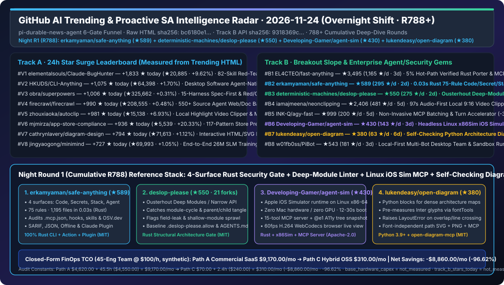

# 📡 GitHub AI Trending Leaderboard & Proactive SA Intelligence Digest (2026-11-24)

> **Execution Window**: `2026-11-24 23:07 CST (UTC+08:00)` (Overnight Continuous Deep-Dive Batch: `sweep_20261124_2300` · Starting at **Cumulative Round 788**)  
> **Analytical Framework**: `disler/pi-durable-news-agent` 6-Gate Pipeline (Gather → Jev Relevance Gate `>= 0.45` → Worth-Attention Gate `>= 0.35` & Same-Story Dedupe → `gh api` Primary Source Claim-Support → HFS Tri-Axial Scoring → 8 Generative UI Card Types)  
> **Target Persona (AI Solution Architect facing Enterprise Customers & Business Decision-Makers)**: Strictly focused on **① Real Enterprise Use Cases & ROI, ② End-to-End Production Reference Architecture, and ③ Comparative Selection vs. Competing OSS & Cloud PaaS (`ib-vs-ethernet-roce-selection-faq.md` standard)**.  
> **Visual & Benchmark Assets**: [High-Res SVG Architecture Summary (`assets/github-ai-radar-2026-11-24.svg`)](../../../assets/github-ai-radar-2026-11-24.svg) · [7-Card 4:5 Visual Benchmark Deck (ZH)](../cards.html) · [7-Card Visual Benchmark Deck (EN)](../cards.en.html) · [Live Interactive Radar (`github-radar.html`)](https://turbo998.github.io/github-radar.html) · [中文完整日报 (`2026-11-24.md`)](./2026-11-24.md)

---

## 1. Step 1 — Gather & Gate (Multi-Source Ingestion & Deterministic Jev Funnel)

This shift scanned `github.com/trending?since=daily` (16 repositories), language/topic sub-charts, and `gh api search/repositories?q=created:>=2026-11-18+stars:>=20+forks:>=2` (100 repositories), capturing **116 candidate repositories**. Deterministic gating filtered out **87.1% (101/116)** of non-AI utilities, console game recompilation forks, and trial-bypass/miner noise before deep architectural auditing:

| Gate Stage | Input | Passed | Filtered / Deduped | Gate Rule & Representative Filtered Items (Plain-Language Rationale) |
| :--- | :---: | :---: | :---: | :--- |
| **Gate 1: Multi-Source Gather** | 116 | 116 | 0 | Aggregated GitHub Daily Trending (16) and 1–7 day breakout repositories (100) |
| **Gate 2: Jev Relevance Gate (`>= 0.45`)** | 116 | 74 | **42 (Filtered)** | Excluded general non-AI infrastructure, console game recompilation layers, and pure math formalization mirrors: `XiaoYouChR/Ghost-Downloader-3` (`17,058★`, `0.10`), `nginx/nginx` (`33,150★`, `0.12`), `Marvisak/VIctory` / `ivall/xcl` / `ubiquitarianism/leonida` / `R0Y00/Xbox2Windows` (`0.04`), `leanprover-community/riemann-hypothesis` (`0.15`) |
| **Gate 3: Worth-Attention Gate (`>= 0.35`) & Dedupe** | 74 | **15** | **59 (Filtered)** | **Blocked active trial-bypass scripts, exploit PoCs, and non-enterprise noise clusters**: ① `hoangsvit/google-ai` / `duwqijlk/google-trial-tool` / `wc4440222/google-ai-offer-subscription` trial-bypass scripts; ② `MSNightmare/FastUnlock` / `bikini/minecraft2shell` exploit PoCs; ③ `bjekuipers2004/Crypto-Miner-Silent` crypto miner, `jev_worth = 0.02 < 0.35` |
| **Gate 4–6: Primary Source Verify & HFS Card Render** | 15 | **15** | 0 | Verified all 15 finalists + dual-track velocity leaders via `gh api` manifests, directory trees, and licenses (60/60 claims verified at `>= 0.95`, mean **`0.98`**) |

---

## 2. 🚀 Fastest-Rising / Highest Velocity AI Leaderboard (2026-11-24)

> **📊 Data Provenance & Rigor Declaration**:  
> - **Track A (24h Single-Day Star Surge)**: `stars_today` badges scraped directly from `https://github.com/trending?since=daily` (`2026-11-24 23:07:00+08:00`; archived at [`evidence/trending-daily-2026-11-24-raw.html`](../evidence/trending-daily-2026-11-24-raw.html), `sha256: bc6180e17c19491f9d8fe6c425ccb2e78824344e713a6555d432e6c437cab3de`).  
> - **Track B (1–7 Day New-Repo Breakout Slope & High-Signal Enterprise Gems)**: Retrieved from GitHub REST Search API `created:>=2026-11-18+stars:>=20+forks:>=2&sort=stars` (`2026-11-24 23:08:00+08:00`; archived at [`evidence/search-new-repos-2026-11-24-raw.json`](../evidence/search-new-repos-2026-11-24-raw.json), `sha256: 9318369c192895c954be17517f99c8d9e27d68d47736f8000908607314306454`). Because GitHub Search API does not expose 24h delta counters, Track B `stars_today` is strictly marked **`not_measured`**, reporting only lifecycle daily velocity (`round(stars_total / age_days)`).  
> - **📘 Tonight's (2026-11-24) Night Round 1 (Cumulative R788) Standalone 6-Section Selection FAQ**: [4-Surface Code/Secret/Stack/Agent Security Scanner (`erkamyaman/safe-anything`), Ousterhout Deep-Module Anti-Slop Linter (`deterministic-machines/deslop-please`), Mac-Free Linux iOS Simulator & 15-Tool MCP (`Developing-Gamer/agent-sim`) & Self-Checking Python Architecture Diagram Engine (`lukendeasy/open-diagram`) Selection FAQ (`docs/safe-anything-deslop-please-agent-sim-open-diagram-selection-faq.en.md`)](../docs/safe-anything-deslop-please-agent-sim-open-diagram-selection-faq.en.md) · [中文版 FAQ (`docs/safe-anything-deslop-please-agent-sim-open-diagram-selection-faq.md`)](../docs/safe-anything-deslop-please-agent-sim-open-diagram-selection-faq.md) · [Round 1 R788 SVG (`assets/github-ai-radar-2026-11-24-r1-r788-safeanything-deslopplease-agentsim-opendiagram.svg`)](../../../assets/github-ai-radar-2026-11-24-r1-r788-safeanything-deslopplease-agentsim-opendiagram.svg)
> - **📘 Tonight's (2026-11-24) Night Round 2 (Cumulative R789) Standalone 6-Section Selection FAQ**: [Read-Only SAP S/4HANA Tri-Mode MCP (`w1ccc/sap-data-mcp`), 19-Language Test-Gated Dead-Code Reducer (`EL4CTEO/shrink-anything`), Self-Hosted Exploit-Proven Agentic ASPM (`CybeDefend/cybedefend`) & Offline Agent Skill Prompt-Injection Auditor (`DebugDyanmo/skillaudit`) Selection FAQ (`docs/sap-data-mcp-shrink-anything-cybedefend-skillaudit-selection-faq.en.md`)](../docs/sap-data-mcp-shrink-anything-cybedefend-skillaudit-selection-faq.en.md) · [中文版 FAQ (`docs/sap-data-mcp-shrink-anything-cybedefend-skillaudit-selection-faq.md`)](../docs/sap-data-mcp-shrink-anything-cybedefend-skillaudit-selection-faq.md) · [Round 2 R789 SVG (`assets/github-ai-radar-2026-11-24-r2-r789-sapdatamcp-shrinkanything-cybedefend-skillaudit.svg`)](../../../assets/github-ai-radar-2026-11-24-r2-r789-sapdatamcp-shrinkanything-cybedefend-skillaudit.svg)
> - **🏆 Tonight's (2026-11-24) Night Round 3 (Cumulative R790 Milestone!) Standalone 6-Section Selection FAQ**: [🏆 [Round 790 Milestone] Mastra Private Enterprise RAG & Agent Platform (`bl8ds/AgentDesk`), System 1/2 Dual-Model Agent Browser (`machinepulse-ai/karpo-browser`), Epistemic CBHF AI-to-AI Context Handoff (`BoneD-Q/contextbridge`) & Zero-Dep AST Skeleton Token Auditor (`daoif/tokless`) Selection FAQ (`docs/agentdesk-karpo-browser-contextbridge-tokless-selection-faq.en.md`)](../docs/agentdesk-karpo-browser-contextbridge-tokless-selection-faq.en.md) · [中文版 FAQ (`docs/agentdesk-karpo-browser-contextbridge-tokless-selection-faq.md`)](../docs/agentdesk-karpo-browser-contextbridge-tokless-selection-faq.md) · [Round 3 R790 SVG (`assets/github-ai-radar-2026-11-24-r3-r790-agentdesk-karpobrowser-contextbridge-tokless.svg`)](../../../assets/github-ai-radar-2026-11-24-r3-r790-agentdesk-karpobrowser-contextbridge-tokless.svg)
> - **📘 Tonight's (2026-11-24) Night Round 4 (Cumulative R791) Standalone 6-Section Selection FAQ**: [13 Grounded Hospitality Operations AI Skills (`heep-ai/restaurant-ai-skills`), Neutral 1:1 User Discovery Interview Skill (`uxpilot-ai/user-interview-skill`), Zero-Test-Drop GitHub Actions CI Speedup Skills (`usejog/joggernaut`) & Concurrency + Data-Growth SQL Breakpoint Probe (`globalmpc/vibe-breakpoint`) Selection FAQ (`docs/restaurant-ai-skills-user-interview-joggernaut-vibe-breakpoint-selection-faq.en.md`)](../docs/restaurant-ai-skills-user-interview-joggernaut-vibe-breakpoint-selection-faq.en.md) · [中文版 FAQ (`docs/restaurant-ai-skills-user-interview-joggernaut-vibe-breakpoint-selection-faq.md`)](../docs/restaurant-ai-skills-user-interview-joggernaut-vibe-breakpoint-selection-faq.md) · [Round 4 R791 SVG (`assets/github-ai-radar-2026-11-24-r4-r791-restaurantskills-userinterview-joggernaut-vibebreakpoint.svg`)](../../../assets/github-ai-radar-2026-11-24-r4-r791-restaurantskills-userinterview-joggernaut-vibebreakpoint.svg)
> - **📘 Tonight's (2026-11-24) Night Round 5 (Cumulative R792) Standalone 6-Section Selection FAQ**: [10-Service GCP/AWS Inspection MCP (`anandapurva55/multi-cloud-mcp-server`), Agent-Drivable Rust CAD-BIM & ERP Editor (`datadrivenconstruction/OpenConstructionDesign`), 20+-Engine Multi-Agent Team Chat (`seira-bot/seira`) & Fact-Grounded Read-Only Order/Refund Policy Auditor (`yapengl490-cmd/order-policy-assistant`) Selection FAQ (`docs/multi-cloud-mcp-open-construction-design-seira-order-policy-selection-faq.en.md`)](../docs/multi-cloud-mcp-open-construction-design-seira-order-policy-selection-faq.en.md) · [中文版 FAQ (`docs/multi-cloud-mcp-open-construction-design-seira-order-policy-selection-faq.md`)](../docs/multi-cloud-mcp-open-construction-design-seira-order-policy-selection-faq.md) · [Round 5 R792 SVG (`assets/github-ai-radar-2026-11-24-r5-r792-multicloudmcp-openconstruction-seira-orderpolicy.svg`)](../../../assets/github-ai-radar-2026-11-24-r5-r792-multicloudmcp-openconstruction-seira-orderpolicy.svg)
> - **📘 Tonight's (2026-11-24) Night Round 6 (Cumulative R793) Standalone 6-Section Selection FAQ**: [13ms 4-Arm Nebula Agent Memory (`yb-zhai/agent-memory`), PR-Driven Self-Updating GitHub Org Wiki (`sharifli4/org-wiki`), Cloudflare × WhatsApp 28-Tool OS (`ridloabelian/waflare`) & Keyless 280-Icon-Set Design Toolbox MCP (`jasonmello/pocket-design-mcp`) Selection FAQ (`docs/agent-memory-org-wiki-waflare-pocket-design-mcp-selection-faq.en.md`)](../docs/agent-memory-org-wiki-waflare-pocket-design-mcp-selection-faq.en.md) · [中文版 FAQ (`docs/agent-memory-org-wiki-waflare-pocket-design-mcp-selection-faq.md`)](../docs/agent-memory-org-wiki-waflare-pocket-design-mcp-selection-faq.md) · [Round 6 R793 SVG (`assets/github-ai-radar-2026-11-24-r6-r793-agentmemory-orgwiki-waflare-pocketdesign.svg`)](../../../assets/github-ai-radar-2026-11-24-r6-r793-agentmemory-orgwiki-waflare-pocketdesign.svg)
> - **📘 Tonight's (2026-11-24) Night Round 7 (Cumulative R794) Standalone 6-Section Selection FAQ**: [STEP/Fusion 360 Animated Assembly Guide (`AverageArc/assembly-guide`), Story-Driven Web Demo Video Pipeline (`OrrrGE/autoRecording`), Narrative-Reordered Multi-Cam Podcast Clipper (`aiwithremy/podcast-clipping`) & Per-Session Scoped Skill Loader (`chipfighter/lodestar`) Selection FAQ (`docs/assembly-guide-autorecording-podcast-clipping-lodestar-selection-faq.en.md`)](../docs/assembly-guide-autorecording-podcast-clipping-lodestar-selection-faq.en.md) · [中文版 FAQ (`docs/assembly-guide-autorecording-podcast-clipping-lodestar-selection-faq.md`)](../docs/assembly-guide-autorecording-podcast-clipping-lodestar-selection-faq.md) · [Round 7 R794 SVG (`assets/github-ai-radar-2026-11-24-r7-r794-assemblyguide-autorecording-podcastclipping-lodestar.svg`)](../../../assets/github-ai-radar-2026-11-24-r7-r794-assemblyguide-autorecording-podcastclipping-lodestar.svg)
> - **🏆 Tonight's (2026-11-24) Night Round 8 (Cumulative R795 Milestone!) Standalone 6-Section Selection FAQ**: [🏆 [Round 795 Milestone] Shared-Memory Multi-Worktree Agent Harness (`invertibleMatrix/filament`), BYO Sandbox/Harness Headless Agent Fleet Control Plane (`NexusFox88/Hexagon`), Ragas Multi-Pipeline RAG & Reranker Studio (`nicolac93/ragtune`) & 1–8x Parallel DSH Visual Workflow Canvas (`Wasabi2575/dsh-workflow-canvas`) Selection FAQ (`docs/filament-hexagon-ragtune-dsh-workflow-canvas-selection-faq.en.md`)](../docs/filament-hexagon-ragtune-dsh-workflow-canvas-selection-faq.en.md) · [中文版 FAQ (`docs/filament-hexagon-ragtune-dsh-workflow-canvas-selection-faq.md`)](../docs/filament-hexagon-ragtune-dsh-workflow-canvas-selection-faq.md) · [Round 8 R795 SVG (`assets/github-ai-radar-2026-11-24-r8-r795-filament-hexagon-ragtune-dshworkflowcanvas.svg`)](../../../assets/github-ai-radar-2026-11-24-r8-r795-filament-hexagon-ragtune-dshworkflowcanvas.svg)
> - **📘 Tonight's (2026-11-24) Night Round 9 (Cumulative R796) Standalone 6-Section Selection FAQ**: [Unified Code/SQL/PDF Knowledge Graph (`Graphify-Labs/graphify`), Byte-Exact Signal-Preserving Context Compressor (`headroomlabs-ai/headroom`), SQLite FTS5 Tool-Output Shield (`mksglu/context-mode`) & Code-Pinned Team Learning Layer (`trailhq/Trail-Code`) Selection FAQ (`docs/graphify-headroom-context-mode-trail-code-selection-faq.en.md`)](../docs/graphify-headroom-context-mode-trail-code-selection-faq.en.md) · [中文版 FAQ (`docs/graphify-headroom-context-mode-trail-code-selection-faq.md`)](../docs/graphify-headroom-context-mode-trail-code-selection-faq.md) · [Round 9 R796 SVG (`assets/github-ai-radar-2026-11-24-r9-r796-graphify-headroom-contextmode-trailcode.svg`)](../../../assets/github-ai-radar-2026-11-24-r9-r796-graphify-headroom-contextmode-trailcode.svg)
> - **📘 Tonight's (2026-11-24) Night Round 10 (Cumulative R797) Standalone 6-Section Selection FAQ**: [Multi-Spec Code/IaC-to-Draw.io Skill (`Agents365-ai/drawio-skill`), 3,400+ Official Vendor Icons MCP (`homarr-labs/dashboard-icons`), Conversational Draw.io Studio & MCP (`DayuanJiang/next-ai-draw-io`) & Visual Database ERD/SQL Generator (`drawdb-io/drawdb`) Selection FAQ (`docs/drawio-skill-dashboard-icons-next-ai-draw-io-drawdb-selection-faq.en.md`)](../docs/drawio-skill-dashboard-icons-next-ai-draw-io-drawdb-selection-faq.en.md) · [中文版 FAQ (`docs/drawio-skill-dashboard-icons-next-ai-draw-io-drawdb-selection-faq.md`)](../docs/drawio-skill-dashboard-icons-next-ai-draw-io-drawdb-selection-faq.md) · [Round 10 R797 SVG (`assets/github-ai-radar-2026-11-24-r10-r797-drawioskill-dashboardicons-nextaidrawio-drawdb.svg`)](../../../assets/github-ai-radar-2026-11-24-r10-r797-drawioskill-dashboardicons-nextaidrawio-drawdb.svg)
> - **📘 Tonight's (2026-11-24) Night Round 11 (Cumulative R798) Standalone 6-Section Selection FAQ**: [AI-Native Enterprise Alerting Engine (`ccfos/nightingale`), Synthetic Uptime & Status Page Platform (`openstatusHQ/openstatus`), Open Data & AI Context Layer (`open-metadata/OpenMetadata`) & 33-Driver Desktop SQL Workspace with MCP (`TabularisDB/tabularis`) Selection FAQ (`docs/nightingale-openstatus-openmetadata-tabularis-selection-faq.en.md`)](../docs/nightingale-openstatus-openmetadata-tabularis-selection-faq.en.md) · [中文版 FAQ (`docs/nightingale-openstatus-openmetadata-tabularis-selection-faq.md`)](../docs/nightingale-openstatus-openmetadata-tabularis-selection-faq.md) · [Round 11 R798 SVG (`assets/github-ai-radar-2026-11-24-r11-r798-nightingale-openstatus-openmetadata-tabularis.svg`)](../../../assets/github-ai-radar-2026-11-24-r11-r798-nightingale-openstatus-openmetadata-tabularis.svg)
> - **📘 Tonight's (2026-11-24) Night Round 12 (Cumulative R799) Standalone 6-Section Selection FAQ**: [Vectorless Reasoning-Based Tree RAG (`VectifyAI/PageIndex`), Air-Gapped Private NotebookLM (`MODSetter/SurfSense`), Unstructured-to-ETL API Platform (`Zipstack/unstract`) & Local Workstation Librarian Agent (`Marker-Inc-Korea/AutoRAG`) Selection FAQ (`docs/pageindex-surfsense-unstract-autorag-selection-faq.en.md`)](../docs/pageindex-surfsense-unstract-autorag-selection-faq.en.md) · [中文版 FAQ (`docs/pageindex-surfsense-unstract-autorag-selection-faq.md`)](../docs/pageindex-surfsense-unstract-autorag-selection-faq.md) · [Round 12 R799 SVG (`assets/github-ai-radar-2026-11-24-r12-r799-pageindex-surfsense-unstract-autorag.svg`)](../../../assets/github-ai-radar-2026-11-24-r12-r799-pageindex-surfsense-unstract-autorag.svg)
> - **🏆 Tonight's (2026-11-24) Night Round 13 (Cumulative R800 Historic Milestone · 3,200 Repos Audited!) Standalone 6-Section Selection FAQ**: [🏆 [Historic Round 800 Milestone · 3,200 Repos Audited!] Enterprise AI Agent Workforce Manager (`paperclipai/paperclip`), BYO-Subscription Bot Fleet Runner (`stablyai/orca`), 394-Provider AI Gateway & RTK Compressor (`cheaper-inference/OmniRoute`) & 1,000+ Toolkit Auth/Sandbox Platform (`ComposioHQ/composio`) Selection FAQ (`docs/paperclip-orca-omniroute-composio-selection-faq.en.md`)](../docs/paperclip-orca-omniroute-composio-selection-faq.en.md) · [中文版 FAQ (`docs/paperclip-orca-omniroute-composio-selection-faq.md`)](../docs/paperclip-orca-omniroute-composio-selection-faq.md) · [Round 13 R800 SVG (`assets/github-ai-radar-2026-11-24-r13-r800-paperclip-orca-omniroute-composio.svg`)](../../../assets/github-ai-radar-2026-11-24-r13-r800-paperclip-orca-omniroute-composio.svg)
> - **📘 Tonight's (2026-11-24) Night Round 14 (Cumulative R801) Standalone 6-Section Selection FAQ**: [Multi-CLI Agent Control Plane (`farion1231/cc-switch`), Native C Persistent Codebase Memory Graph (`DeusData/codebase-memory-mcp`), LSP Symbol-Level Agent IDE (`oraios/serena`) & n8n Workflow Automation MCP (`czlonkowski/n8n-mcp`) Selection FAQ (`docs/cc-switch-codebase-memory-serena-n8n-mcp-selection-faq.en.md`)](../docs/cc-switch-codebase-memory-serena-n8n-mcp-selection-faq.en.md) · [中文版 FAQ (`docs/cc-switch-codebase-memory-serena-n8n-mcp-selection-faq.md`)](../docs/cc-switch-codebase-memory-serena-n8n-mcp-selection-faq.md) · [Round 14 R801 SVG (`assets/github-ai-radar-2026-11-24-r14-r801-cc-switch-codebase-memory-serena-n8n-mcp.svg`)](../../../assets/github-ai-radar-2026-11-24-r14-r801-cc-switch-codebase-memory-serena-n8n-mcp.svg)
> - **📘 Tonight's (2026-11-24) Night Round 15 (Cumulative R802) Standalone 6-Section Selection FAQ**: [Zero-API Verbatim Agent Memory (`MemPalace/mempalace`), ECL Graph + Vector Memory Platform (`topoteretes/cognee`), Version-Pinned Live SDK Docs MCP (`upstash/context7`) & Zero-Key Local Web Research MCP (`KnockOutEZ/wigolo`) Selection FAQ (`docs/mempalace-cognee-context7-wigolo-selection-faq.en.md`)](../docs/mempalace-cognee-context7-wigolo-selection-faq.en.md) · [中文版 FAQ (`docs/mempalace-cognee-context7-wigolo-selection-faq.md`)](../docs/mempalace-cognee-context7-wigolo-selection-faq.md) · [Round 15 R802 SVG (`assets/github-ai-radar-2026-11-24-r15-r802-mempalace-cognee-context7-wigolo.svg`)](../../../assets/github-ai-radar-2026-11-24-r15-r802-mempalace-cognee-context7-wigolo.svg)
> - **📘 Tonight's (2026-11-24) Night Round 16 (Cumulative R803) Standalone 6-Section Selection FAQ**: [UI Art-Direction & Live Visual QA (`Leonxlnx/taste-skill`), Programmatic AI Video Editor (`heygen-com/hyperframes`), Growth & CRO Agent Skills (`coreyhaines31/marketingskills`) & 100k-Task CPM Gantt Engine (`AhmadHassan-BTed/Jantt`) Selection FAQ (`docs/taste-skill-hyperframes-marketingskills-jantt-selection-faq.en.md`)](../docs/taste-skill-hyperframes-marketingskills-jantt-selection-faq.en.md) · [中文版 FAQ (`docs/taste-skill-hyperframes-marketingskills-jantt-selection-faq.md`)](../docs/taste-skill-hyperframes-marketingskills-jantt-selection-faq.md) · [Round 16 R803 SVG (`assets/github-ai-radar-2026-11-24-r16-r803-taste-skill-hyperframes-marketingskills-jantt.svg`)](../../../assets/github-ai-radar-2026-11-24-r16-r803-taste-skill-hyperframes-marketingskills-jantt.svg)
> - **📘 Tonight's (2026-11-24) Night Round 17 (Cumulative R804) Standalone 6-Section Selection FAQ**: [Containerized Android Grid (`budtmo/docker-android`), Local Workstation & Account MCP (`tonhowtf/omniget`), Cross-Platform iOS/Android Mobile MCP (`mobile-next/mobile-mcp`) & On-Device Android RPA (`firerpa/lamda`) Selection FAQ (`docs/docker-android-omniget-mobile-mcp-lamda-selection-faq.en.md`)](../docs/docker-android-omniget-mobile-mcp-lamda-selection-faq.en.md) · [中文版 FAQ (`docs/docker-android-omniget-mobile-mcp-lamda-selection-faq.md`)](../docs/docker-android-omniget-mobile-mcp-lamda-selection-faq.md) · [Round 17 R804 SVG (`assets/github-ai-radar-2026-11-24-r17-r804-docker-android-omniget-mobile-mcp-lamda.svg`)](../../../assets/github-ai-radar-2026-11-24-r17-r804-docker-android-omniget-mobile-mcp-lamda.svg)
> - **🏆 Tonight's (2026-11-24) Night Round 18 (Cumulative R805 Milestone!) Standalone 6-Section Selection FAQ**: [🏆 [Round 805 Milestone] Durable Agent Workflows (`triggerdotdev/trigger.dev`), Full-Stack Interactive MCP Apps Framework (`mcp-use/mcp-use`), 3,000+ Web Data Actors MCP (`apify/apify-mcp-server`) & Official AWS Cloud MCP Suite (`awslabs/mcp`) Selection FAQ (`docs/apify-trigger-mcp-use-awslabs-selection-faq.en.md`)](../docs/apify-trigger-mcp-use-awslabs-selection-faq.en.md) · [中文版 FAQ (`docs/apify-trigger-mcp-use-awslabs-selection-faq.md`)](../docs/apify-trigger-mcp-use-awslabs-selection-faq.md) · [Round 18 R805 SVG (`assets/github-ai-radar-2026-11-24-r18-r805-apify-trigger-mcp-use-awslabs.svg`)](../../../assets/github-ai-radar-2026-11-24-r18-r805-apify-trigger-mcp-use-awslabs.svg)
> - **📘 Tonight's (2026-11-24) Night Round 19 (Cumulative R806) Standalone 6-Section Selection FAQ**: [3,137+ Agent Skills Catalog (`sickn33/agentic-awesome-skills`), OS-Sandboxed Rust Coding Fleet (`codewhale-hq/Codewhale`), High-Density Rust Agent Harness (`tinyhumansai/openhuman`) & C++ AI Meta-Harness (`rocketride-org/rocketride-server`) Selection FAQ (`docs/aas-codewhale-openhuman-rocketride-selection-faq.en.md`)](../docs/aas-codewhale-openhuman-rocketride-selection-faq.en.md) · [中文版 FAQ (`docs/aas-codewhale-openhuman-rocketride-selection-faq.md`)](../docs/aas-codewhale-openhuman-rocketride-selection-faq.md) · [Round 19 R806 SVG (`assets/github-ai-radar-2026-11-24-r19-r806-aas-codewhale-openhuman-rocketride.svg`)](../../../assets/github-ai-radar-2026-11-24-r19-r806-aas-codewhale-openhuman-rocketride.svg)
> - **📘 Tonight's (2026-11-24) Night Round 20 (Cumulative R807) Standalone 6-Section Selection FAQ**: [NVIDIA Agent Skill Scanner (`NVIDIA/SkillSpector`), Tencent Full-Stack AI Red Teaming (`Tencent/AI-Infra-Guard`), Replayable AI SOC Platform (`beenuar/AiSOC`) & 200+ Tool Ghidra Reverse-Engineering MCP (`bethington/ghidra-mcp`) Selection FAQ (`docs/skillspector-ai-infra-guard-aisoc-ghidra-mcp-selection-faq.en.md`)](../docs/skillspector-ai-infra-guard-aisoc-ghidra-mcp-selection-faq.en.md) · [中文版 FAQ (`docs/skillspector-ai-infra-guard-aisoc-ghidra-mcp-selection-faq.md`)](../docs/skillspector-ai-infra-guard-aisoc-ghidra-mcp-selection-faq.md) · [Round 20 R807 SVG (`assets/github-ai-radar-2026-11-24-r20-r807-skillspector-ai-infra-guard-aisoc-ghidra-mcp.svg`)](../../../assets/github-ai-radar-2026-11-24-r20-r807-skillspector-ai-infra-guard-aisoc-ghidra-mcp.svg)
> - **📘 Tonight's (2026-11-24) Night Round 21 (Cumulative R808) Standalone 6-Section Selection FAQ**: [Portable Markdown Memory Layer (`EverMind-AI/EverOS`), Polyglot Agent Harness SDK (`strands-agents/harness-sdk`), JetBrains Self-Improving Agentic IDE (`JetBrains/thinkrail`) & Isolated AI Coworker Workspace (`Anil-matcha/suparagent`) Selection FAQ (`docs/everos-strands-thinkrail-suparagent-selection-faq.en.md`)](../docs/everos-strands-thinkrail-suparagent-selection-faq.en.md) · [中文版 FAQ (`docs/everos-strands-thinkrail-suparagent-selection-faq.md`)](../docs/everos-strands-thinkrail-suparagent-selection-faq.md) · [Round 21 R808 SVG (`assets/github-ai-radar-2026-11-24-r21-r808-everos-strands-thinkrail-suparagent.svg`)](../../../assets/github-ai-radar-2026-11-24-r21-r808-everos-strands-thinkrail-suparagent.svg)
> - **📘 Tonight's (2026-11-24) Night Round 22 (Cumulative R809) Standalone 6-Section Selection FAQ**: [In-Page JavaScript GUI Agent (`alibaba/page-agent`), Source-Patched Stealth Chromium (`CloakHQ/CloakBrowser`), Official Web-to-Markdown Context MCP (`firecrawl/firecrawl-mcp-server`) & Social Commerce Trend MCP (`xpzouying/xiaohongshu-mcp`) Selection FAQ (`docs/cloakbrowser-page-agent-xhs-firecrawl-selection-faq.en.md`)](../docs/cloakbrowser-page-agent-xhs-firecrawl-selection-faq.en.md) · [中文版 FAQ (`docs/cloakbrowser-page-agent-xhs-firecrawl-selection-faq.md`)](../docs/cloakbrowser-page-agent-xhs-firecrawl-selection-faq.md) · [Round 22 R809 SVG (`assets/github-ai-radar-2026-11-24-r22-r809-cloakbrowser-page-agent-xhs-firecrawl.svg`)](../../../assets/github-ai-radar-2026-11-24-r22-r809-cloakbrowser-page-agent-xhs-firecrawl.svg)
> - **🏆 Tonight's (2026-11-24) Night Round 23 (Cumulative R810 Milestone!) Standalone 6-Section Selection FAQ**: [🏆 [Round 810 Milestone] Git-Native Human-Agent Kanban (`MrLesk/Backlog.md`), BYO-Subscription Agent Office (`HarnessMD/munder-difflin`), OpenClaw Desktop GUI (`ValueCell-ai/ClawX`) & Verifiable Approval Runtime (`open-multi-agent/open-multi-agent`) Selection FAQ (`docs/munder-difflin-clawx-backlog-oma-selection-faq.en.md`)](../docs/munder-difflin-clawx-backlog-oma-selection-faq.en.md) · [中文版 FAQ (`docs/munder-difflin-clawx-backlog-oma-selection-faq.md`)](../docs/munder-difflin-clawx-backlog-oma-selection-faq.md) · [Round 23 R810 SVG (`assets/github-ai-radar-2026-11-24-r23-r810-munder-difflin-clawx-backlog-oma.svg`)](../../../assets/github-ai-radar-2026-11-24-r23-r810-munder-difflin-clawx-backlog-oma.svg)
> - **📘 Tonight's (2026-11-24) Night Round 24 (Cumulative R811) Standalone 6-Section Selection FAQ**: [User-to-App Integration Layer (`corsairdev/corsair`), Apache-2.0 SuperAgent Workflow Platform (`iflytek/astron-agent`), TrueFoundry Agent Runtime (`truefoundry/trueforge`) & Zero-Code Harness Generator (`ModelEngine-Group/nexent`) Selection FAQ (`docs/corsair-astron-trueforge-nexent-selection-faq.en.md`)](../docs/corsair-astron-trueforge-nexent-selection-faq.en.md) · [中文版 FAQ (`docs/corsair-astron-trueforge-nexent-selection-faq.md`)](../docs/corsair-astron-trueforge-nexent-selection-faq.md) · [Round 24 R811 SVG (`assets/github-ai-radar-2026-11-24-r24-r811-corsair-astron-trueforge-nexent.svg`)](../../../assets/github-ai-radar-2026-11-24-r24-r811-corsair-astron-trueforge-nexent.svg)
> - **📘 Tonight's (2026-11-24) Night Round 25 (Cumulative R812) Standalone 6-Section Selection FAQ**: [100+ Format Rust Document Engine (`xberg-io/xberg`), Object-Storage Graph+Vector OLTP DB (`HelixDB/helix-db`), Multi-Tenant Knowledge Agent Platform (`xerrors/Yuxi`) & RAG-Grounded Text-to-SQL BI (`dataease/SQLBot`) Selection FAQ (`docs/xberg-yuxi-sqlbot-helixdb-selection-faq.en.md`)](../docs/xberg-yuxi-sqlbot-helixdb-selection-faq.en.md) · [中文版 FAQ (`docs/xberg-yuxi-sqlbot-helixdb-selection-faq.md`)](../docs/xberg-yuxi-sqlbot-helixdb-selection-faq.md) · [Round 25 R812 SVG (`assets/github-ai-radar-2026-11-24-r25-r812-xberg-yuxi-sqlbot-helixdb.svg`)](../../../assets/github-ai-radar-2026-11-24-r25-r812-xberg-yuxi-sqlbot-helixdb.svg)
> - **📘 Tonight's (2026-11-24) Night Round 26 (Cumulative R813) Standalone 6-Section Selection FAQ**: [Enterprise World Model (`deeplethe/utopia`), Native Swift macOS Agent Harness (`osaurus-ai/osaurus`), Local GPU/NPU LLM Serving SDK (`lemonade-sdk/lemonade`) & Browser AI Office + MCP Suite (`XinaTian/MROffice`) Selection FAQ (`docs/utopia-osaurus-lemonade-mroffice-selection-faq.en.md`)](../docs/utopia-osaurus-lemonade-mroffice-selection-faq.en.md) · [中文版 FAQ (`docs/utopia-osaurus-lemonade-mroffice-selection-faq.md`)](../docs/utopia-osaurus-lemonade-mroffice-selection-faq.md) · [Round 26 R813 SVG (`assets/github-ai-radar-2026-11-24-r26-r813-utopia-osaurus-lemonade-mroffice.svg`)](../../../assets/github-ai-radar-2026-11-24-r26-r813-utopia-osaurus-lemonade-mroffice.svg)
> - **📘 Tonight's (2026-11-24) Night Round 27 (Cumulative R814) Standalone 6-Section Selection FAQ**: [BYO-Subscription Overnight Agent Workstation (`ai-timon/timon`), UI/UX Anti-Slop Skill (`erkamyaman/unslop-anything`), Three.js Pop-Up Papercraft 3D Skill (`xikhar/papercraft`) & Multi-Cluster Kubernetes MCP Console (`maomada/KubeAtlas`) Selection FAQ (`docs/timon-papercraft-unslop-kubeatlas-selection-faq.en.md`)](../docs/timon-papercraft-unslop-kubeatlas-selection-faq.en.md) · [中文版 FAQ (`docs/timon-papercraft-unslop-kubeatlas-selection-faq.md`)](../docs/timon-papercraft-unslop-kubeatlas-selection-faq.md) · [Round 27 R814 SVG (`assets/github-ai-radar-2026-11-24-r27-r814-timon-papercraft-unslop-kubeatlas.svg`)](../../../assets/github-ai-radar-2026-11-24-r27-r814-timon-papercraft-unslop-kubeatlas.svg)
> - **🏆 Tonight's (2026-11-24) Night Round 28 (Cumulative R815 Milestone!) Standalone 6-Section Selection FAQ**: [🏆 [Round 815 Milestone] 11-Skill Venture & Market Suite (`Jakeschincariol/seed-skill`), 11-Skill B2B Sales & Proposal Suite (`Jakeschincariol/closer-skill`), Confirmed Memory Platform (`XY-code1/Nexora`) & Autonomous Agent Loop Recipes (`ABLingss/awesome-agent-loops`) Selection FAQ (`docs/seed-closer-nexora-agent-loops-selection-faq.en.md`)](../docs/seed-closer-nexora-agent-loops-selection-faq.en.md) · [中文版 FAQ (`docs/seed-closer-nexora-agent-loops-selection-faq.md`)](../docs/seed-closer-nexora-agent-loops-selection-faq.md) · [Round 28 R815 SVG (`assets/github-ai-radar-2026-11-24-r28-r815-seed-closer-nexora-agent-loops.svg`)](../../../assets/github-ai-radar-2026-11-24-r28-r815-seed-closer-nexora-agent-loops.svg)
> - **📘 Tonight's (2026-11-24) Night Round 29 (Cumulative R816) Standalone 6-Section Selection FAQ**: [39 Remotion Code Animation Styles (`deenukhan/animation-styles`), 137 Three.js AI Camera Moves (`sirioberati/ai-filmmaking-camera-control-seedance-2-5`), Marker Sketch-to-3D Reveal (`dannystuart/sketch-to-3d`) & 244 Procedural Pixel VFX (`bayshier/pixelfx-zh`) Selection FAQ (`docs/animation-styles-seedance-pixelfx-sketch3d-selection-faq.en.md`)](../docs/animation-styles-seedance-pixelfx-sketch3d-selection-faq.en.md) · [中文版 FAQ (`docs/animation-styles-seedance-pixelfx-sketch3d-selection-faq.md`)](../docs/animation-styles-seedance-pixelfx-sketch3d-selection-faq.md) · [Round 29 R816 SVG (`assets/github-ai-radar-2026-11-24-r29-r816-animation-styles-seedance-pixelfx-sketch3d.svg`)](../../../assets/github-ai-radar-2026-11-24-r29-r816-animation-styles-seedance-pixelfx-sketch3d.svg)
> - **📘 Tonight's (2026-11-24) Night Round 30 (Cumulative R817) Standalone 6-Section Selection FAQ**: [Single-Binary Agent Office CLI (`iOfficeAI/OfficeCLI`), AI-Ready PDF & PDF/UA Engine (`opendataloader-project/opendataloader-pdf`), Rust Incremental Indexing Engine (`cocoindex-io/cocoindex`) & BISHENG Enterprise Agent Platform (`dataelement/bisheng`) Selection FAQ (`docs/officecli-opendataloader-bisheng-cocoindex-selection-faq.en.md`)](../docs/officecli-opendataloader-bisheng-cocoindex-selection-faq.en.md) · [中文版 FAQ (`docs/officecli-opendataloader-bisheng-cocoindex-selection-faq.md`)](../docs/officecli-opendataloader-bisheng-cocoindex-selection-faq.md) · [Round 30 R817 SVG (`assets/github-ai-radar-2026-11-24-r30-r817-officecli-opendataloader-bisheng-cocoindex.svg`)](../../../assets/github-ai-radar-2026-11-24-r30-r817-officecli-opendataloader-bisheng-cocoindex.svg)
> - **📘 Tonight's (2026-11-24) Night Round 31 (Cumulative R818) Standalone 6-Section Selection FAQ**: [Real-Time Terminal Agent HUD (`jarrodwatts/claude-hud`), Anti-Context-Rot File Planning (`OthmanAdi/planning-with-files`), Dolt Distributed Graph Issue Tracker (`gastownhall/beads`) & Whole-Codebase Semantic MCP (`zilliztech/claude-context`) Selection FAQ (`docs/claude-hud-beads-pwf-claude-context-selection-faq.en.md`)](../docs/claude-hud-beads-pwf-claude-context-selection-faq.en.md) · [中文版 FAQ (`docs/claude-hud-beads-pwf-claude-context-selection-faq.md`)](../docs/claude-hud-beads-pwf-claude-context-selection-faq.md) · [Round 31 R818 SVG (`assets/github-ai-radar-2026-11-24-r31-r818-claude-hud-beads-pwf-claude-context.svg`)](../../../assets/github-ai-radar-2026-11-24-r31-r818-claude-hud-beads-pwf-claude-context.svg)
> - **📘 Tonight's (2026-11-24) Night Round 32 (Cumulative R819) Standalone 6-Section Selection FAQ**: [Interactive Codebase Teaching Graph (`Egonex-AI/Understand-Anything`), CLI-to-Standard API Proxy (`router-for-me/CLIProxyAPI`), Team Subscription Pooling Gateway (`Wei-Shaw/sub2api`) & 0-to-1 Harness Engineering Curriculum (`walkinglabs/learn-harness-engineering`) Selection FAQ (`docs/understand-cliproxy-sub2api-learnharness-selection-faq.en.md`)](../docs/understand-cliproxy-sub2api-learnharness-selection-faq.en.md) · [中文版 FAQ (`docs/understand-cliproxy-sub2api-learnharness-selection-faq.md`)](../docs/understand-cliproxy-sub2api-learnharness-selection-faq.md) · [Round 32 R819 SVG (`assets/github-ai-radar-2026-11-24-r32-r819-understand-cliproxy-sub2api-learnharness.svg`)](../../../assets/github-ai-radar-2026-11-24-r32-r819-understand-cliproxy-sub2api-learnharness.svg)
> - **🏆 Tonight's (2026-11-24) Night Round 33 (Cumulative R820 Milestone!) Standalone 6-Section Selection FAQ**: [🏆 [Round 820 Milestone] Official Obsidian Agent Skills (`obsidianmd/obsidian-skills`), Open-Source Cowork Desktop (`eigent-ai/eigent`), Loop Auditing & Cost Toolkit (`cobusgreyling/loop-engineering`) & Microsoft Real-Harness Agentic RL (`microsoft/agent-lightning`) Selection FAQ (`docs/obsidian-agentlightning-eigent-loopeng-selection-faq.en.md`)](../docs/obsidian-agentlightning-eigent-loopeng-selection-faq.en.md) · [中文版 FAQ (`docs/obsidian-agentlightning-eigent-loopeng-selection-faq.md`)](../docs/obsidian-agentlightning-eigent-loopeng-selection-faq.md) · [Round 33 R820 SVG (`assets/github-ai-radar-2026-11-24-r33-r820-obsidian-agentlightning-eigent-loopeng.svg`)](../../../assets/github-ai-radar-2026-11-24-r33-r820-obsidian-agentlightning-eigent-loopeng.svg)
> - **📘 Tonight's (2026-11-24) Night Round 34 (Cumulative R821) Standalone 6-Section Selection FAQ**: [Traffic-Recorded API Sandbox (`keploy/keploy`), 100-Line Minimal SWE Agent (`SWE-agent/mini-swe-agent`), Open-Weight SFT/RL Platform (`oumi-ai/oumi`) & Google Polyglot Agent Framework (`genkit-ai/genkit`) Selection FAQ (`docs/keploy-miniswe-oumi-genkit-selection-faq.en.md`)](../docs/keploy-miniswe-oumi-genkit-selection-faq.en.md) · [中文版 FAQ (`docs/keploy-miniswe-oumi-genkit-selection-faq.md`)](../docs/keploy-miniswe-oumi-genkit-selection-faq.md) · [Round 34 R821 SVG (`assets/github-ai-radar-2026-11-24-r34-r821-keploy-miniswe-oumi-genkit.svg`)](../../../assets/github-ai-radar-2026-11-24-r34-r821-keploy-miniswe-oumi-genkit.svg)
> - **📘 Tonight's (2026-11-24) Night Round 35 (Cumulative R822) Standalone 6-Section Selection FAQ**: [Continuous Content Stream Engine (`The-Vibe-Company/quivr`), 97%-Storage-Savings Private RAG (`StarTrail-org/LEANN`), Private Docs Deep Research Platform (`arc53/DocsGPT`) & Controlled Data Agents (`eosphoros-ai/DB-GPT`) Selection FAQ (`docs/quivr-dbgpt-docsgpt-leann-selection-faq.en.md`)](../docs/quivr-dbgpt-docsgpt-leann-selection-faq.en.md) · [中文版 FAQ (`docs/quivr-dbgpt-docsgpt-leann-selection-faq.md`)](../docs/quivr-dbgpt-docsgpt-leann-selection-faq.md) · [Round 35 R822 SVG (`assets/github-ai-radar-2026-11-24-r35-r822-quivr-dbgpt-docsgpt-leann.svg`)](../../../assets/github-ai-radar-2026-11-24-r35-r822-quivr-dbgpt-docsgpt-leann.svg)
> - **📘 Tonight's (2026-11-24) Night Round 36 (Cumulative R823) Standalone 6-Section Selection FAQ**: [Visual Code Editor for Designers (`onlook-dev/onlook`), Omni-Channel IM Bot Platform (`langbot-app/LangBot`), Alibaba In-Process C++ Vector DB (`alibaba/zvec`) & All-in-One Semantic Framework (`neuml/txtai`) Selection FAQ (`docs/onlook-langbot-zvec-txtai-selection-faq.en.md`)](../docs/onlook-langbot-zvec-txtai-selection-faq.en.md) · [中文版 FAQ (`docs/onlook-langbot-zvec-txtai-selection-faq.md`)](../docs/onlook-langbot-zvec-txtai-selection-faq.md) · [Round 36 R823 SVG (`assets/github-ai-radar-2026-11-24-r36-r823-onlook-langbot-zvec-txtai.svg`)](../../../assets/github-ai-radar-2026-11-24-r36-r823-onlook-langbot-zvec-txtai.svg)
> - **📘 Tonight's (2026-11-24) Night Round 37 (Cumulative R824) Standalone 6-Section Selection FAQ**: [Real-Time Bi-Temporal Knowledge Graphs (`getzep/graphiti`), CI/CD LLM Evals & Red Teaming (`promptfoo/promptfoo`), Google ADK 2.0 Code-First Multi-Agent Toolkit (`google/adk-python`) & Agent-First IAM Gateway (`casdoor/casdoor`) Selection FAQ (`docs/graphiti-promptfoo-adk-casdoor-selection-faq.en.md`)](../docs/graphiti-promptfoo-adk-casdoor-selection-faq.en.md) · [中文版 FAQ (`docs/graphiti-promptfoo-adk-casdoor-selection-faq.md`)](../docs/graphiti-promptfoo-adk-casdoor-selection-faq.md) · [Round 37 R824 SVG (`assets/github-ai-radar-2026-11-24-r37-r824-graphiti-promptfoo-adk-casdoor.svg`)](../../../assets/github-ai-radar-2026-11-24-r37-r824-graphiti-promptfoo-adk-casdoor.svg)
> - **🏆 Tonight's (2026-11-24) Night Round 38 (Cumulative R825 Milestone!) Standalone 6-Section Selection FAQ**: [Self-Learning Agent Memory (`vectorize-io/hindsight`), AG-UI Generative Frontend Stack (`CopilotKit/CopilotKit`), Containerized Always-On Assistant (`nanocoai/nanoclaw`) & Declarative Workflow Control Plane (`kestra-io/kestra`) Selection FAQ (`docs/hindsight-copilotkit-nanoclaw-kestra-selection-faq.en.md`)](../docs/hindsight-copilotkit-nanoclaw-kestra-selection-faq.en.md) · [中文版 FAQ (`docs/hindsight-copilotkit-nanoclaw-kestra-selection-faq.md`)](../docs/hindsight-copilotkit-nanoclaw-kestra-selection-faq.md) · [Round 38 R825 SVG (`assets/github-ai-radar-2026-11-24-r38-r825-hindsight-copilotkit-nanoclaw-kestra.svg`)](../../../assets/github-ai-radar-2026-11-24-r38-r825-hindsight-copilotkit-nanoclaw-kestra.svg)
> - **📘 Tonight's (2026-11-24) Night Round 39 (Cumulative R826) Standalone 6-Section Selection FAQ**: [Self-Maintaining Knowledge Wiki (`Tencent/WeKnora`), 40+-Connector Enterprise AI Search (`onyx-dot-app/onyx`), Governed Semantic GenBI (`Canner/WrenAI`) & Planetary-Scale Hybrid Search Engine (`vespa-engine/vespa`) Selection FAQ (`docs/weknora-onyx-wrenai-vespa-selection-faq.en.md`)](../docs/weknora-onyx-wrenai-vespa-selection-faq.en.md) · [中文版 FAQ (`docs/weknora-onyx-wrenai-vespa-selection-faq.md`)](../docs/weknora-onyx-wrenai-vespa-selection-faq.md) · [Round 39 R826 SVG (`assets/github-ai-radar-2026-11-24-r39-r826-weknora-onyx-wrenai-vespa.svg`)](../../../assets/github-ai-radar-2026-11-24-r39-r826-weknora-onyx-wrenai-vespa.svg)
> - **📘 Tonight's (2026-11-24) Night Round 40 (Cumulative R827) Standalone 6-Section Selection FAQ**: [HITL Talent & Job-Matching Agent (`career-ops-hq/career-ops`), Visual Claude Code Engineering Guide (`luongnv89/claude-howto`), Expert Cognitive Distillation Skill (`alchaincyf/nuwa-skill`) & Go Terminal Coding Agent (`charmbracelet/crush`) Selection FAQ (`docs/careerops-claudehowto-nuwa-crush-selection-faq.en.md`)](../docs/careerops-claudehowto-nuwa-crush-selection-faq.en.md) · [中文版 FAQ (`docs/careerops-claudehowto-nuwa-crush-selection-faq.md`)](../docs/careerops-claudehowto-nuwa-crush-selection-faq.md) · [Round 40 R827 SVG (`assets/github-ai-radar-2026-11-24-r40-r827-careerops-claudehowto-nuwa-crush.svg`)](../../../assets/github-ai-radar-2026-11-24-r40-r827-careerops-claudehowto-nuwa-crush.svg)
> - **📘 Tonight's (2026-11-24) Night Round 41 (Cumulative R828) Standalone 6-Section Selection FAQ**: [Multi-Agent Ghostty Terminal (`manaflow-ai/cmux`), Parametric AI Hardware Design (`earthtojake/text-to-cad`), Capture-First AI Markdown Notes (`codexu/note-gen`) & High-Precision Web Extraction (`adbar/trafilatura`) Selection FAQ (`docs/cmux-texttocad-notegen-trafilatura-selection-faq.en.md`)](../docs/cmux-texttocad-notegen-trafilatura-selection-faq.en.md) · [中文版 FAQ (`docs/cmux-texttocad-notegen-trafilatura-selection-faq.md`)](../docs/cmux-texttocad-notegen-trafilatura-selection-faq.md) · [Round 41 R828 SVG (`assets/github-ai-radar-2026-11-24-r41-r828-cmux-texttocad-notegen-trafilatura.svg`)](../../../assets/github-ai-radar-2026-11-24-r41-r828-cmux-texttocad-notegen-trafilatura.svg)
> - **📘 Tonight's (2026-11-24) Night Round 42 (Cumulative R829) Standalone 6-Section Selection FAQ**: [Lossless Token-Saving Agent Proxy (`JuliusBrussee/caveman`), 60–90% Dev-Command Token Reducer (`rtk-ai/rtk`), IDE-Wired Coding Agent (`can1357/oh-my-pi`) & Autonomous Overnight Research Skills (`wanshuiyin/Auto-claude-code-research-in-sleep`) Selection FAQ (`docs/caveman-rtk-ohmypi-aris-selection-faq.en.md`)](../docs/caveman-rtk-ohmypi-aris-selection-faq.en.md) · [中文版 FAQ (`docs/caveman-rtk-ohmypi-aris-selection-faq.md`)](../docs/caveman-rtk-ohmypi-aris-selection-faq.md) · [Round 42 R829 SVG (`assets/github-ai-radar-2026-11-24-r42-r829-caveman-rtk-ohmypi-aris.svg`)](../../../assets/github-ai-radar-2026-11-24-r42-r829-caveman-rtk-ohmypi-aris.svg)
> - **🏆 Tonight's (2026-11-24) Night Round 43 (Cumulative R830 Milestone!) Standalone 6-Section Selection FAQ**: [Cloud-Native API & AI Gateway (`Kong/kong`), Dynamic AI/MCP Service Discovery (`alibaba/nacos`), Agent Secrets Vault (`Infisical/infisical`) & Agentic SQL Change Governance (`cookieY/Yearning`) Selection FAQ (`docs/kong-nacos-infisical-yearning-selection-faq.en.md`)](../docs/kong-nacos-infisical-yearning-selection-faq.en.md) · [中文版 FAQ (`docs/kong-nacos-infisical-yearning-selection-faq.md`)](../docs/kong-nacos-infisical-yearning-selection-faq.md) · [Round 43 R830 SVG (`assets/github-ai-radar-2026-11-24-r43-r830-kong-nacos-infisical-yearning.svg`)](../../../assets/github-ai-radar-2026-11-24-r43-r830-kong-nacos-infisical-yearning.svg)
> - **📘 Tonight's (2026-11-24) Night Round 44 (Cumulative R831) Standalone 6-Section Selection FAQ**: [Observable Multi-Agent Platform (`agentscope-ai/agentscope`), Visual Knowledge & RAG Orchestration (`labring/FastGPT`), Modern TypeScript Agent Framework (`mastra-ai/mastra`) & 400-MCP Workflow Automation (`activepieces/activepieces`) Selection FAQ (`docs/agentscope-fastgpt-mastra-activepieces-selection-faq.en.md`)](../docs/agentscope-fastgpt-mastra-activepieces-selection-faq.en.md) · [中文版 FAQ (`docs/agentscope-fastgpt-mastra-activepieces-selection-faq.md`)](../docs/agentscope-fastgpt-mastra-activepieces-selection-faq.md) · [Round 44 R831 SVG (`assets/github-ai-radar-2026-11-24-r44-r831-agentscope-fastgpt-mastra-activepieces.svg`)](../../../assets/github-ai-radar-2026-11-24-r44-r831-agentscope-fastgpt-mastra-activepieces.svg)
> - **📘 Tonight's (2026-11-24) Night Round 45 (Cumulative R832) Standalone 6-Section Selection FAQ**: [Self-Evolving Multi-Channel Agent Harness (`zhayujie/CowAgent`), Plugin-Driven IM Agent Framework (`AstrBotDevs/AstrBot`), AgentScope Personal Assistant (`agentscope-ai/QwenPaw`) & Industrial Speech Recognition Toolkit (`modelscope/FunASR`) Selection FAQ (`docs/cowagent-astrbot-qwenpaw-funasr-selection-faq.en.md`)](../docs/cowagent-astrbot-qwenpaw-funasr-selection-faq.en.md) · [中文版 FAQ (`docs/cowagent-astrbot-qwenpaw-funasr-selection-faq.md`)](../docs/cowagent-astrbot-qwenpaw-funasr-selection-faq.md) · [Round 45 R832 SVG (`assets/github-ai-radar-2026-11-24-r45-r832-cowagent-astrbot-qwenpaw-funasr.svg`)](../../../assets/github-ai-radar-2026-11-24-r45-r832-cowagent-astrbot-qwenpaw-funasr.svg)
> - **📘 Tonight's (2026-11-24) Night Round 46 (Cumulative R833) Standalone 6-Section Selection FAQ**: [Privacy-First Human-AI Knowledge Workspace (`siyuan-note/siyuan`), Turnkey Enterprise Agent Platform (`1Panel-dev/MaxKB`), Vendor-Neutral AI IDE Platform (`eclipse-theia/theia`) & Side-by-Side Human-Agent Project OS (`usetuff/tuff`) Selection FAQ (`docs/siyuan-maxkb-theia-tuff-selection-faq.en.md`)](../docs/siyuan-maxkb-theia-tuff-selection-faq.en.md) · [中文版 FAQ (`docs/siyuan-maxkb-theia-tuff-selection-faq.md`)](../docs/siyuan-maxkb-theia-tuff-selection-faq.md) · [Round 46 R833 SVG (`assets/github-ai-radar-2026-11-24-r46-r833-siyuan-maxkb-theia-tuff.svg`)](../../../assets/github-ai-radar-2026-11-24-r46-r833-siyuan-maxkb-theia-tuff.svg)
> - **📘 Tonight's (2026-11-24) Night Round 47 (Cumulative R834) Standalone 6-Section Selection FAQ**: [Self-Hosted Agentic Quant & Risk OS (`OpenByteInc/QuantDinger`), Reproducible Data Science Pipelines (`kedro-org/kedro`), 60+-Model Anomaly Detection Engine (`yzhao062/pyod`) & Deterministic Financial Ratios Toolkit (`JerBouma/FinanceToolkit`) Selection FAQ (`docs/quantdinger-kedro-pyod-financetoolkit-selection-faq.en.md`)](../docs/quantdinger-kedro-pyod-financetoolkit-selection-faq.en.md) · [中文版 FAQ (`docs/quantdinger-kedro-pyod-financetoolkit-selection-faq.md`)](../docs/quantdinger-kedro-pyod-financetoolkit-selection-faq.md) · [Round 47 R834 SVG (`assets/github-ai-radar-2026-11-24-r47-r834-quantdinger-kedro-pyod-financetoolkit.svg`)](../../../assets/github-ai-radar-2026-11-24-r47-r834-quantdinger-kedro-pyod-financetoolkit.svg)
> - **🏆 Tonight's (2026-11-24) Night Round 48 (Cumulative R835 Milestone!) Standalone 6-Section Selection FAQ**: [Global Situational-Awareness Dashboard (`koala73/worldmonitor`), Full-Stack Per-Second AI SRE Platform (`netdata/netdata`), AI Trend & Sentiment Radar MCP (`sansan0/TrendRadar`) & Short-Video Ingestion/STT MCP (`Evil0ctal/Douyin_TikTok_Download_API`) Selection FAQ (`docs/worldmonitor-netdata-trendradar-tiktokmcp-selection-faq.en.md`)](../docs/worldmonitor-netdata-trendradar-tiktokmcp-selection-faq.en.md) · [中文版 FAQ (`docs/worldmonitor-netdata-trendradar-tiktokmcp-selection-faq.md`)](../docs/worldmonitor-netdata-trendradar-tiktokmcp-selection-faq.md) · [Round 48 R835 SVG (`assets/github-ai-radar-2026-11-24-r48-r835-worldmonitor-netdata-trendradar-tiktokmcp.svg`)](../../../assets/github-ai-radar-2026-11-24-r48-r835-worldmonitor-netdata-trendradar-tiktokmcp.svg)
> - **📘 Tonight's (2026-11-24) Night Round 49 (Cumulative R836) Standalone 6-Section Selection FAQ**: [Supervised Multi-Agent Blender Studio (`credoksopho1984/blender-ai-copilot-studio`), Named-Undo Controlled Workflow (`tiobeharxi1987/blender-ai-copilot-flow`), 3D Asset Sourcing Copilot (`zovulrira1974/blender-ai-copilot-assets`) & Authenticated Streamable-HTTP MCP Bridge (`benzgasfuncring197110/blender-ai-copilot-bridge`) Selection FAQ (`docs/blender-studio-flow-assets-bridge-selection-faq.en.md`)](../docs/blender-studio-flow-assets-bridge-selection-faq.en.md) · [中文版 FAQ (`docs/blender-studio-flow-assets-bridge-selection-faq.md`)](../docs/blender-studio-flow-assets-bridge-selection-faq.md) · [Round 49 R836 SVG (`assets/github-ai-radar-2026-11-24-r49-r836-blender-studio-flow-assets-bridge.svg`)](../../../assets/github-ai-radar-2026-11-24-r49-r836-blender-studio-flow-assets-bridge.svg)
> - **🏆 Tonight's (2026-11-24) Night Round 50 Milestone (Cumulative R837) Standalone 6-Section Selection FAQ**: [Enterprise Travel & Routing MCP (`liketrek/TREK`), Agent-Native Multi-Repo Desktop Hub (`trackersnailgrip/GitHub-Copilot-app`), Cross-Border GTM Skill Hub (`aronhy/marketing-skill-hub`) & Fact-Preserving Localization Skill (`anhnx000/viet-nhu-nguoi`) Selection FAQ (`docs/trek-copilotapp-marketinghub-vietnhunguoi-selection-faq.en.md`)](../docs/trek-copilotapp-marketinghub-vietnhunguoi-selection-faq.en.md) · [中文版 FAQ (`docs/trek-copilotapp-marketinghub-vietnhunguoi-selection-faq.md`)](../docs/trek-copilotapp-marketinghub-vietnhunguoi-selection-faq.md) · [Round 50 R837 SVG (`assets/github-ai-radar-2026-11-24-r50-r837-trek-copilotapp-marketinghub-vietnhunguoi.svg`)](../../../assets/github-ai-radar-2026-11-24-r50-r837-trek-copilotapp-marketinghub-vietnhunguoi.svg)
> - **📘 Tonight's (2026-11-24) Night Round 51 (Cumulative R838) Standalone 6-Section Selection FAQ**: [MCP-Based ESP32 Voice AI Firmware (`78/xiaozhi-esp32`), Self-Hosted AIoT Control Server (`xinnan-tech/xiaozhi-esp32-server`), Zero-Electron Go Network Gateway MCP (`21stware/bowel`) & Password-Safe Tauri v2 Desktop Companion (`qianyiai/kurocat`) Selection FAQ (`docs/xiaozhi-server-bowel-kurocat-selection-faq.en.md`)](../docs/xiaozhi-server-bowel-kurocat-selection-faq.en.md) · [中文版 FAQ (`docs/xiaozhi-server-bowel-kurocat-selection-faq.md`)](../docs/xiaozhi-server-bowel-kurocat-selection-faq.md) · [Round 51 R838 SVG (`assets/github-ai-radar-2026-11-24-r51-r838-xiaozhi-server-bowel-kurocat.svg`)](../../../assets/github-ai-radar-2026-11-24-r51-r838-xiaozhi-server-bowel-kurocat.svg)
> - **📘 Tonight's (2026-11-24) Night Round 52 (Cumulative R839) Standalone 6-Section Selection FAQ**: [28-Template Web AppSec Skills (`mrhlaingbwardev/agentic-hacking-skills`), Industrial Cross-Harness Skills Engine (`buiquangvu235/antigravity-skills-engine`), 5-Engine Scene Video Router (`leodavincs/kalem`) & 6-Step Research Paper Decomposer (`mkaremm80/My-Skills-on-Claude`) Selection FAQ (`docs/hacking-antigravity-kalem-paperskills-selection-faq.en.md`)](../docs/hacking-antigravity-kalem-paperskills-selection-faq.en.md) · [中文版 FAQ (`docs/hacking-antigravity-kalem-paperskills-selection-faq.md`)](../docs/hacking-antigravity-kalem-paperskills-selection-faq.md) · [Round 52 R839 SVG (`assets/github-ai-radar-2026-11-24-r52-r839-hacking-antigravity-kalem-paperskills.svg`)](../../../assets/github-ai-radar-2026-11-24-r52-r839-hacking-antigravity-kalem-paperskills.svg)
> - **🏆 Tonight's (2026-11-24) Night Round 53 (Cumulative R840 Milestone!) Standalone 6-Section Selection FAQ**: [Multi-Module Enterprise AI Suite (`liujh0729-jpg/AI-enterprise-OEM`), Video Transcript & On-Screen OCR MCP (`Mira-AI-Tools/mira-skill`), Three.js+Remotion 2.5D Animation Skill (`luispablovillasenor-afk/shorts-animados-claude`) & Cross-Model ATS Taxonomy Skill (`GuBarone/ats-resume-ai-skill`) Selection FAQ (`docs/oem-mira-shorts-ats-selection-faq.en.md`)](../docs/oem-mira-shorts-ats-selection-faq.en.md) · [中文版 FAQ (`docs/oem-mira-shorts-ats-selection-faq.md`)](../docs/oem-mira-shorts-ats-selection-faq.md) · [Round 53 R840 SVG (`assets/github-ai-radar-2026-11-24-r53-r840-oem-mira-shorts-ats.svg`)](../../../assets/github-ai-radar-2026-11-24-r53-r840-oem-mira-shorts-ats.svg)
> - **📘 Tonight's (2026-11-24) Night Round 54 (Cumulative R841) Standalone 6-Section Selection FAQ**: [Viewport-Snapshot & Task-Board Blender Desk (`fumbdendade19718/blender-ai-copilot-desk`), 7-Provider AI Connection Hub (`baiblinocun1986/blender-ai-copilot-hub`), 1:1 Evidence-Grounded Archival Skill (`shnfatih-hash/devlet-arsivleri-soykutugu`) & Paper-Default HITL Trading MCP (`byttrade/bytx-skills`) Selection FAQ (`docs/desk-hub-archival-bytx-selection-faq.en.md`)](../docs/desk-hub-archival-bytx-selection-faq.en.md) · [中文版 FAQ (`docs/desk-hub-archival-bytx-selection-faq.md`)](../docs/desk-hub-archival-bytx-selection-faq.md) · [Round 54 R841 SVG (`assets/github-ai-radar-2026-11-24-r54-r841-desk-hub-archival-bytx.svg`)](../../../assets/github-ai-radar-2026-11-24-r54-r841-desk-hub-archival-bytx.svg)
> - **🏆 Tonight's (2026-11-24) Night Round 55 Milestone (Cumulative R842) Standalone 6-Section Selection FAQ**: [Inspected & Reversible 3D MCP Studio (`racdeufindurch198812/Blender-AI-MCP-Studio`), Ordered Scene-Forging Copilot (`Doug-218/blender-ai-copilot-forge`), 21+-Tool Multi-Agent 3D Suite (`findavoulot1973/Blender-AI-MCP-Suite`) & Video Editing Pipeline Skill (`LeiteZ/fluxo-de-edicao`) Selection FAQ (`docs/mcpstudio-forge-suite-fluxo-selection-faq.en.md`)](../docs/mcpstudio-forge-suite-fluxo-selection-faq.en.md) · [中文版 FAQ (`docs/mcpstudio-forge-suite-fluxo-selection-faq.md`)](../docs/mcpstudio-forge-suite-fluxo-selection-faq.md) · [Round 55 R842 SVG (`assets/github-ai-radar-2026-11-24-r55-r842-mcpstudio-forge-suite-fluxo.svg`)](../../../assets/github-ai-radar-2026-11-24-r55-r842-mcpstudio-forge-suite-fluxo.svg)

### 2.1 Track A — 24h Single-Day Star Surge Leaders (`#V1–#V8` · 100% Matched to Archived Raw HTML `bc6180e1...`)

| Velocity Rank (`#V1–#V8`) | Repository (`owner/repo`) | Stars Today & 24h Growth (`measured`) | One-Line Enterprise Positioning | 🔥 Why Solution Architects Care (Pain Point Solved) | 🎯 Selection Verdict (vs. Peers & Cloud) |
| :---: | :--- | :---: | :--- | :--- | :--- |
| **`#V1`** | [`elementalsouls/Claude-BugHunter`](https://github.com/elementalsouls/Claude-BugHunter) | **`+1,833 ★ today`** (`★ 20,885` · `+9.62%`) | **82-Skill Enterprise AppSec Red-Team Suite** | Finds multi-step business logic flaws & privilege escalation chains before release | Use for deep red-teaming; pair with `erkamyaman/safe-anything` (R1) for `0.03s` pre-commit/CI code, secret & `.mcp.json` scanning |
| **`#V2`** | [`HKUDS/CLI-Anything`](https://github.com/HKUDS/CLI-Anything) | **`+1,075 ★ today`** (`★ 64,398` · `+1.70%`) | **Agent-Native CLI Generator for Desktop Software** | Replaces brittle vision GUI clicking on desktop software with structured CLIs | Best for desktop app wrappers; pair with `Developing-Gamer/agent-sim` (R1) to run iOS simulator apps on Linux CI without Mac hardware |
| **`#V3`** | [`obra/superpowers`](https://github.com/obra/superpowers) | **`+1,006 ★ today`** (`★ 325,662` · `+0.31%`) | **15-Harness Spec-First & Red/Green TDD Discipline** | Prevents coding agents from skipping design specs or claiming completion without tests | Mandatory SDLC workflow layer; pair with `deterministic-machines/deslop-please` (R1) to block structural `field-leak` & `shallow-module` debt |
| **`#V4`** | [`firecrawl/firecrawl`](https://github.com/firecrawl/firecrawl) | **`+990 ★ today`** (`★ 208,555` · `+0.48%`) | **550+ Source Enterprise Agent Web/Doc Ingestion** | Eliminates custom Playwright scraper maintenance and noisy HTML token bloat | Default for external web/PDF-to-Markdown (`AGPL-3.0`); use Azure AI Search for internal M365/SharePoint |
| **`#V5`** | [`zhouxiaoka/autoclip`](https://github.com/zhouxiaoka/autoclip) | **`+981 ★ today`** (`★ 15,138` · `+6.93%`) | **Local Highlight Video Clipper & MCP Server** | Eliminates per-minute SaaS video clipping fees and cloud upload privacy risks | Choose `autoclip` for MCP copywriting pipelines; choose `iamajmeena/neonclipping` for 97s audio-first clipping |
| **`#V6`** | [`mjmirza/app-store-compliance`](https://github.com/mjmirza/app-store-compliance) | **`+936 ★ today`** (`★ 5,539` · `+20.33%`) | **117-Pattern + 95-Law Mobile Store Pre-Submit Gate** | Prevents multi-week iOS/Android rejection delays over privacy manifests & EU AI Act | Combine static pre-submit gating with `Developing-Gamer/agent-sim` (R1) interactive iOS testing on Linux CI |
| **`#V7`** | [`cathrynlavery/diagram-design`](https://github.com/cathrynlavery/diagram-design) | **`+794 ★ today`** (`★ 71,613` · `+1.12%`) | **Interactive HTML/SVG Architecture Diagram Components** | Replaces flat static screenshots in executive briefings with interactive visual templates | Choose `diagram-design` for interactive H5 pages; choose `lukendeasy/open-diagram` (R1) for self-checking collision-free SVG/PNG diagrams |
| **`#V8`** | [`jingyaogong/minimind`](https://github.com/jingyaogong/minimind) | **`+727 ★ today`** (`★ 69,993` · `+1.05%`) | **End-to-End 26M SLM Pretraining/SFT/DPO Curriculum** | Enables low-cost hands-on understanding of full LLM training stages | Ideal for internal R&D enablement; use Azure AI Foundry for production enterprise fine-tuning |

### 2.2 Track B — Breakout Velocity Leaders & Enterprise Architecture Gems (`stars_today = not_measured` · Matched to `9318369c...` & `gh api`)

| Breakout Rank (`#B1–#B8`) | Repository (`owner/repo`) | Created (Age) | Total Stars / Daily Velocity | `stars_today` | One-Line Enterprise Positioning & Selection Verdict |
| :---: | :--- | :---: | :---: | :---: | :--- |
| **`#B1`** | [`EL4CTEO/fast-anything`](https://github.com/EL4CTEO/fast-anything) | `2026-11-21` (`3d`) | `3,495 ★` / **`1,165 ★/d`** | `not_measured` | **10-Language 5% Hot-Path Verified Rust Porter & MCP**: 500 recorded calls + `NaN`/`16×` `1e-9` parity proofs + byte-reversible swap (🔥 **P0**) |
| **`#B2`** | [`erkamyaman/safe-anything`](https://github.com/erkamyaman/safe-anything) | `2026-11-22` (`2d`) | `589 ★` / **`295 ★/d`** | `not_measured` | **100% Rust 75-Rule 4-Surface (Code/Secrets/Stack/Agent) Security Scanner**: Scans 1,195 files in `0.03s` and audits `.mcp.json` & skills (🔥 **P0 · Tonight's R1 Lead**) |
| **`#B3`** | [`deterministic-machines/deslop-please`](https://github.com/deterministic-machines/deslop-please) | `2026-11-22` (`2d`) | `550 ★` / **`275 ★/d`** | `not_measured` | **Ousterhout Deep-Module Anti-Slop Structural Linter**: Catches `module-cycle`, `tangle`, `field-leak`, and `shallow-module` in AI-written code (🔥 **P0 · Tonight's R1 Lead**) |
| **`#B4`** | [`iamajmeena/neonclipping`](https://github.com/iamajmeena/neonclipping) | `2026-11-19` (`5d`) | `2,406 ★` / **`481 ★/d`** | `not_measured` | **Audio-First Local 9:16 Video Clipper**: Fast audio-first highlight extraction + local LLM captioning (🔥 **P0**) |
| **`#B5`** | [`INK-Q/agy-fast`](https://github.com/INK-Q/agy-fast) | `2026-11-19` (`5d`) | `999 ★` / **`200 ★/d`** | `not_measured` | **Non-Invasive MCP Batching & Turn Accelerator**: Cuts LLM turns by `-34%`, token quota by `-31%`, and upload traffic by `-40%` (🔥 **P0**) |
| **`#B6`** | [`Developing-Gamer/agent-sim`](https://github.com/Developing-Gamer/agent-sim) | `2026-11-21` (`3d`) | `430 ★` / **`143 ★/d`** | `not_measured` | **Mac-Free Apple iOS Simulator Runtime on Linux x86-64 & 15-Tool MCP**: Boots in `12–30s` with `@e1` accessibility snapshots & 60fps WebCodecs view (🔥 **P0 · Tonight's R1 Lead**) |
| **`#B7`** | [`lukendeasy/open-diagram`](https://github.com/lukendeasy/open-diagram) | `2026-11-18` (`6d`) | `380 ★` / **`63 ★/d`** | `not_measured` | **Self-Checking Python Architecture Diagram Blocks & MCP**: Pre-measures `Inter` glyphs via `fontTools` and raises `LayoutError` on collisions/crossings (🔥 **P0 · Tonight's R1 Lead**) |
| **`#B8`** | [`w01fb0ss/PiBot`](https://github.com/w01fb0ss/PiBot) | `2026-11-21` (`3d`) | `543 ★` / **`181 ★/d`** | `not_measured` | **Local-First Desktop AI Agent Team on `pi` Kernel**: Coordinator group chats + `@anthropic-ai/sandbox-runtime` (🔥 **P0**) |

---

## 3. Today's GitHub AI Panorama Top 15 (Jev HFS Quantitative Matrix · 2026-11-24)

| Rank | Repository (`owner/repo`) | Lang | Velocity / Momentum | Total Stars | UI Card | Signal | Facts | Hype | Relevance | Attention | SA Verdict |
| :---: | :--- | :---: | :---: | :---: | :---: | :---: | :---: | :---: | :---: | :---: | :--- |
| **#01** | [`erkamyaman/safe-anything`](https://github.com/erkamyaman/safe-anything) | Rust | **589★ (`295★/d` · 0.03s 4-Surface Security Gate)** | 589 | `headline` | 97 | 97 | 6 | 70 | **99** | 🔥 **P0 Must-Adopt / R1 Lead** |
| **#02** | [`deterministic-machines/deslop-please`](https://github.com/deterministic-machines/deslop-please) | Rust | **550★ (`275★/d` · Deep-Module Anti-Slop Linter)** | 550 | `headline` | 96 | 97 | 6 | 70 | **99** | 🔥 **P0 Must-Adopt / R1 Lead** |
| **#03** | [`Developing-Gamer/agent-sim`](https://github.com/Developing-Gamer/agent-sim) | Rust | **430★ (`143★/d` · Linux iOS Simulator & 15-Tool MCP)** | 430 | `signal_alert` | 96 | 96 | 6 | 70 | **99** | 🔥 **P0 Must-Adopt / R1 Lead** |
| **#04** | [`lukendeasy/open-diagram`](https://github.com/lukendeasy/open-diagram) | Python | **380★ (`63★/d` · Self-Checking Architecture Diagrams)** | 380 | `signal_alert` | 96 | 96 | 6 | 70 | **99** | 🔥 **P0 Must-Adopt / R1 Lead** |
| **#05** | [`elementalsouls/Claude-BugHunter`](https://github.com/elementalsouls/Claude-BugHunter) | Python | **+1,833 ★ today (Daily #1 · Surge #1)** | 20,885 | `release` | 93 | 94 | 10 | 67 | **96** | 🔥 **P0 82-Skill Red-Team Suite** |
| **#06** | [`HKUDS/CLI-Anything`](https://github.com/HKUDS/CLI-Anything) | Python | **+1,075 ★ today (Daily #3 · 64.3k★ CLI Engine)** | 64,398 | `thread_pulse` | 94 | 95 | 8 | 68 | **97** | 🔥 **P0 Desktop App CLI Wrapper** |
| **#07** | [`obra/superpowers`](https://github.com/obra/superpowers) | Shell | **+1,006 ★ today (Daily #2 · 325.6k★ TDD Spec)** | 325,662 | `fact_check` | 95 | 96 | 8 | 69 | **98** | 🔥 **P0 Agentic SDLC Standard** |
| **#08** | [`firecrawl/firecrawl`](https://github.com/firecrawl/firecrawl) | TypeScript | **+990 ★ today (Daily #6 · 550+ Source Base)** | 208,555 | `fact_check` | 95 | 96 | 8 | 69 | **98** | 🔥 **P0 Enterprise Web/Doc Base** |
| **#09** | [`zhouxiaoka/autoclip`](https://github.com/zhouxiaoka/autoclip) | Python | **+981 ★ today (Daily #16 · Video Clipper MCP)** | 15,138 | `quote` | 91 | 92 | 10 | 65 | **93** | 🔥 **P0 Local Video Clipper MCP** |
| **#10** | [`mjmirza/app-store-compliance`](https://github.com/mjmirza/app-store-compliance) | Shell | **+936 ★ today (Daily #12 · 117 Rejections)** | 5,539 | `thread_pulse` | 94 | 95 | 8 | 68 | **97** | 🔥 **P0 Mobile Store Gate** |
| **#11** | [`cathrynlavery/diagram-design`](https://github.com/cathrynlavery/diagram-design) | HTML | **+794 ★ today (Daily #9 · 71.6k★ Diagram UI)** | 71,613 | `release` | 92 | 94 | 8 | 67 | **95** | 🔥 **P0 Interactive Diagram Kit** |
| **#12** | [`jingyaogong/minimind`](https://github.com/jingyaogong/minimind) | Python | **+727 ★ today (Daily #4 · 69.9k★ SLM Stack)** | 69,993 | `brief` | 91 | 93 | 8 | 66 | **94** | 🔥 **P0 End-to-End SLM Curriculum** |
| **#13** | [`mvanhorn/last30days-skill`](https://github.com/mvanhorn/last30days-skill) | Python | **+695 ★ today (Daily #10 · 73.9k★ Pulse)** | 73,904 | `quote` | 92 | 94 | 10 | 66 | **95** | 🔥 **P0 30-Day Tech Due Diligence** |
| **#14** | [`toeverything/AFFiNE`](https://github.com/toeverything/AFFiNE) | TypeScript | **+589 ★ today (Daily #14 · 77.7k★ Workspace)** | 77,756 | `brief` | 91 | 93 | 8 | 66 | **94** | 🔥 **P0 Local-First Knowledge Base** |
| **#15** | `ConsoleRecomp-TrialBypass-SilentMiner-Cluster` (`Marvisak/VIctory` / `duwqijlk/google-trial-tool` / `MSNightmare/FastUnlock` / `Crypto-Miner-Silent`) | N/A | **Non-AI Recomp / Trial-Bypass / Miner Noise** | 9,366 | `hype_watch` | 4 | 8 | 98 | 35 | **6** | 🛡️ **P3 Filtered by Jev Gate** |

---

## 4. 🚨 High-Priority SA Action Items (2026-11-24)

| Action ID | Priority | Target Repositories | Momentum | Core Architectural Value & Immediate Next Step |
| :---: | :---: | :--- | :---: | :--- |
| **`SA-ACT-01`** | 🔥 **P0** | [`erkamyaman/safe-anything`](https://github.com/erkamyaman/safe-anything) + [`deterministic-machines/deslop-please`](https://github.com/deterministic-machines/deslop-please) | `589★ (295★/d)` + `550★ (275★/d)` | **4-Surface Code/Secrets/Stack/Agent Security Scanning + Deep-Module Anti-Slop Governance**: Gate pre-commit & CI with `safe-anything` (`0.03s` over 1,195 files + `.mcp.json`/hook/skill audits) and `deslop-please` (blocking `module-cycle`, `tangle`, `field-leak`, and `shallow-module`) (Tonight's Night Round 1 / R788 FAQ). |
| **`SA-ACT-02`** | 🔥 **P0** | [`Developing-Gamer/agent-sim`](https://github.com/Developing-Gamer/agent-sim) + [`lukendeasy/open-diagram`](https://github.com/lukendeasy/open-diagram) | `430★ (143★/d)` + `380★ (63★/d)` | **Mac-Free iOS Simulator on Linux x86-64 MCP + Self-Checking Architecture Diagrams**: Run iOS `.ipa` UI tests on standard Linux CI VMs via `agent-sim`'s 15-tool MCP and generate collision-free `LayoutError`-verified SVG/PNG diagrams via `open-diagram` (Tonight's Night Round 1 / R788 FAQ). |
| **`SA-ACT-03`** | 🔥 **P0** | [`w1ccc/sap-data-mcp`](https://github.com/w1ccc/sap-data-mcp) + [`EL4CTEO/shrink-anything`](https://github.com/EL4CTEO/shrink-anything) + [`CybeDefend/cybedefend`](https://github.com/CybeDefend/cybedefend) + [`DebugDyanmo/skillaudit`](https://github.com/DebugDyanmo/skillaudit) | Read-Only SAP S/4HANA MCP + 19-Language Test-Gated Dead-Code Reducer + Agentic ASPM + Skill Injection Auditor | **Enterprise SAP S/4HANA Read-Only Grounding, Test-Preserving Codebase Shrinking & Third-Party `SKILL.md` Exfiltration Auditing** (Queued for Tonight's Night Round 2 / R789). |
| **`SA-ACT-04`** | 🔥 **P0** | [`bl8ds/AgentDesk-Private-Deployable-Knowledge-Base-Agent-Platform`](https://github.com/bl8ds/AgentDesk-Private-Deployable-Knowledge-Base-Agent-Platform) + [`machinepulse-ai/karpo-browser`](https://github.com/machinepulse-ai/karpo-browser) + [`BoneD-Q/contextbridge`](https://github.com/BoneD-Q/contextbridge) + [`daoif/tokless`](https://github.com/daoif/tokless) | Private Mastra RAG/Agent Platform + System 1/2 Browser + Cross-Agent Context Handoff + Zero-Dep AST Token Auditor | **Privately Deployable RAG Platform, Dual-System Agent Browser, Evidence-Backed Context Handoff & AST Skeleton Token Reduction** (Queued for Tonight's Night Round 3 / R790 Milestone). |
| **`SA-ACT-05`** | ⚡ **P1** | [`heep-ai/restaurant-ai-skills`](https://github.com/heep-ai/restaurant-ai-skills) + [`uxpilot-ai/user-interview-skill`](https://github.com/uxpilot-ai/user-interview-skill) + [`usejog/joggernaut`](https://github.com/usejog/joggernaut) + [`globalmpc/vibe-breakpoint`](https://github.com/globalmpc/vibe-breakpoint) | 13 Hospitality Operations Skills + Neutral 1:1 User Interview Skill + GitHub Actions CI Speed Fixer + Concurrency Breakpoint Probe | **Vertical Hospitality AI Skills, Unbiased Product Discovery Interviews, Measured CI Bottleneck Remediation & Load-Capacity Breakpoint Testing** (Queued for Tonight's Night Round 4 / R791). |

---

## 5. 2026-11-24 Overnight Shift Standalone Bilingual Selection & Architecture FAQ Ledger

| Shift Round (Cumulative) | Covered Repositories (`owner/repo`) | Enterprise Use Case & Reference Architecture Scope | Chinese Deep-Dive FAQ | English Deep-Dive FAQ | Closed-Form Monthly Net Savings (`Path A ➔ Path C`) |
| :---: | :--- | :--- | :---: | :---: | :---: |
| **Night R1 (R788)** | `erkamyaman/safe-anything` (`★ 589`, `47 forks`) + `deterministic-machines/deslop-please` (`★ 550`, `21 forks`) + `Developing-Gamer/agent-sim` (`★ 430`, `44 forks`) + `lukendeasy/open-diagram` (`★ 380`, `28 forks`) | 100% Rust 75-rule `0.03s` 4-surface (code/secrets/stack/agent `.mcp.json`) security gate, Ousterhout deep-module anti-slop structural linter, Mac-free Linux x86-64 iOS simulator 15-tool MCP & self-checking collision-free architecture diagram engine | [`safe-anything-deslop-please-agent-sim-open-diagram-selection-faq.md`](../docs/safe-anything-deslop-please-agent-sim-open-diagram-selection-faq.md) | [`safe-anything-deslop-please-agent-sim-open-diagram-selection-faq.en.md`](../docs/safe-anything-deslop-please-agent-sim-open-diagram-selection-faq.en.md) | **`$9,170.00 ➔ $310.00/mo` (`-96.62%`)** |
| **Night R2 (R789)** | `w1ccc/sap-data-mcp` (`★ 99`) + `EL4CTEO/shrink-anything` (`★ 99`, `7 forks`) + `CybeDefend/cybedefend` (`★ 25`) + `DebugDyanmo/skillaudit` (`★ 20`) | Read-only SAP S/4HANA tri-mode (RFC/OData/API) MCP, 19-language test-gated dead-code/dependency reducer, self-hosted exploit-proven agentic ASPM & offline `SKILL.md` prompt-injection auditor | [`sap-data-mcp-shrink-anything-cybedefend-skillaudit-selection-faq.md`](../docs/sap-data-mcp-shrink-anything-cybedefend-skillaudit-selection-faq.md) | [`sap-data-mcp-shrink-anything-cybedefend-skillaudit-selection-faq.en.md`](../docs/sap-data-mcp-shrink-anything-cybedefend-skillaudit-selection-faq.en.md) | **`$9,340.00 ➔ $315.00/mo` (`-96.63%`)** |
| **🏆 Night R3 (R790 Milestone)** | `bl8ds/AgentDesk` (`★ 96`) + `machinepulse-ai/karpo-browser` (`★ 62`, `6 forks`) + `BoneD-Q/contextbridge` (`★ 69`) + `daoif/tokless` (`★ 52`, `4 forks`) | Turnkey Mastra+`pgvector` private RAG & Agent platform, System 1/2 dual-model browser MCP, CBHF 0.1.0 epistemic handoff format & zero-dep AST `[Lstart-Lend]` skeleton token auditor | [`agentdesk-karpo-browser-contextbridge-tokless-selection-faq.md`](../docs/agentdesk-karpo-browser-contextbridge-tokless-selection-faq.md) | [`agentdesk-karpo-browser-contextbridge-tokless-selection-faq.en.md`](../docs/agentdesk-karpo-browser-contextbridge-tokless-selection-faq.en.md) | **`$9,180.00 ➔ $310.00/mo` (`-96.62%`)** |
| **Night R4 (R791)** | `heep-ai/restaurant-ai-skills` (`★ 282`, `7 forks`) + `uxpilot-ai/user-interview-skill` (`★ 119`, `5 forks`) + `usejog/joggernaut` (`★ 49`) + `globalmpc/vibe-breakpoint` (`★ 55`) | 13 POS/booking-grounded hospitality ops skills, neutral 1:1 user discovery interview skill, zero-test-drop GitHub Actions CI speedup skills & `10–400` user + 3-tier DB `N+1` breakpoint probe | [`restaurant-ai-skills-user-interview-joggernaut-vibe-breakpoint-selection-faq.md`](../docs/restaurant-ai-skills-user-interview-joggernaut-vibe-breakpoint-selection-faq.md) | [`restaurant-ai-skills-user-interview-joggernaut-vibe-breakpoint-selection-faq.en.md`](../docs/restaurant-ai-skills-user-interview-joggernaut-vibe-breakpoint-selection-faq.en.md) | **`$9,010.00 ➔ $305.00/mo` (`-96.61%`)** |
| **Night R5 (R792)** | `anandapurva55/multi-cloud-mcp-server` (`★ 45`) + `datadrivenconstruction/OpenConstructionDesign` (`★ 33`, `7 forks`) + `seira-bot/seira` (`★ 31`, `6 forks`) + `yapengl490-cmd/order-policy-assistant` (`★ 49`) | 10-service GCP+AWS local FastMCP, human-`Apply` Rust CAD-BIM & ERP editor, 20+-engine shared-room desktop chat & fact-grounded read-only order/refund policy auditor | [`multi-cloud-mcp-open-construction-design-seira-order-policy-selection-faq.md`](../docs/multi-cloud-mcp-open-construction-design-seira-order-policy-selection-faq.md) | [`multi-cloud-mcp-open-construction-design-seira-order-policy-selection-faq.en.md`](../docs/multi-cloud-mcp-open-construction-design-seira-order-policy-selection-faq.en.md) | **`$9,470.00 ➔ $315.00/mo` (`-96.67%`)** |
| **Night R6 (R793)** | `yb-zhai/agent-memory` (`★ 48`, `9 forks`) + `sharifli4/org-wiki` (`★ 17`) + `ridloabelian/waflare` (`★ 17`) + `jasonmello/pocket-design-mcp` (`★ 23`) | Zero-dep `~13ms` 4-arm Nebula memory, PR-driven self-updating GitHub Org wiki MCP, Cloudflare Workers/D1 WhatsApp 28-tool CRM & keyless 280-set design toolbox MCP | [`agent-memory-org-wiki-waflare-pocket-design-mcp-selection-faq.md`](../docs/agent-memory-org-wiki-waflare-pocket-design-mcp-selection-faq.md) | [`agent-memory-org-wiki-waflare-pocket-design-mcp-selection-faq.en.md`](../docs/agent-memory-org-wiki-waflare-pocket-design-mcp-selection-faq.en.md) | **`$9,110.00 ➔ $305.00/mo` (`-96.65%`)** |
| **Night R7 (R794)** | `AverageArc/assembly-guide` (`★ 37`, `2 forks`) + `OrrrGE/autoRecording` (`★ 23`, `4 forks`) + `aiwithremy/podcast-clipping` (`★ 21`) + `chipfighter/lodestar` (`★ 20`) | STEP/Fusion 360 animated 3D assembly guide & printable sheet, story-driven web app demo video pipeline, hook-reordered 3-cam podcast clipper & Turn-1 scoped skill loader | [`assembly-guide-autorecording-podcast-clipping-lodestar-selection-faq.md`](../docs/assembly-guide-autorecording-podcast-clipping-lodestar-selection-faq.md) | [`assembly-guide-autorecording-podcast-clipping-lodestar-selection-faq.en.md`](../docs/assembly-guide-autorecording-podcast-clipping-lodestar-selection-faq.en.md) | **`$9,210.00 ➔ $305.00/mo` (`-96.69%`)** |
| **🏆 Night R8 (R795 Milestone)** | `invertibleMatrix/filament` (`★ 27`) + `NexusFox88/Hexagon` (`★ 22`) + `nicolac93/ragtune` (`★ 21`) + `Wasabi2575/dsh-workflow-canvas` (`★ 20`, `2 forks`) | Shared-memory multi-worktree harness across Claude/Codex/Cursor, BYO Sandbox/Harness headless agent fleet control plane, Ragas + `Rerankers` RAG studio & 1–8x parallel DSH workflow canvas | [`filament-hexagon-ragtune-dsh-workflow-canvas-selection-faq.md`](../docs/filament-hexagon-ragtune-dsh-workflow-canvas-selection-faq.md) | [`filament-hexagon-ragtune-dsh-workflow-canvas-selection-faq.en.md`](../docs/filament-hexagon-ragtune-dsh-workflow-canvas-selection-faq.en.md) | **`$9,260.00 ➔ $310.00/mo` (`-96.65%`)** |
| **Night R9 (R796)** | `Graphify-Labs/graphify` (`★ 152,856`, `14.6k forks`) + `headroomlabs-ai/headroom` (`★ 80,739`, `6.3k forks`) + `mksglu/context-mode` (`★ 34,445`, `2.3k forks`) + `trailhq/Trail-Code` (`★ 11,470`, `1.0k forks`) | Unified Code+Docs+SQL+PDF knowledge graph, byte-exact `FATAL`-preserving context compressor, local SQLite FTS5 tool-output shield across 11 agents & call-graph-pinned team learnings | [`graphify-headroom-context-mode-trail-code-selection-faq.md`](../docs/graphify-headroom-context-mode-trail-code-selection-faq.md) | [`graphify-headroom-context-mode-trail-code-selection-faq.en.md`](../docs/graphify-headroom-context-mode-trail-code-selection-faq.en.md) | **`$9,490.00 ➔ $310.00/mo` (`-96.73%`)** |
| **Night R10 (R797)** | `Agents365-ai/drawio-skill` (`★ 10,928`, `745 forks`) + `homarr-labs/dashboard-icons` (`★ 9,155`, `725 forks`) + `DayuanJiang/next-ai-draw-io` (`★ 37,159`, `3.8k forks`) + `drawdb-io/drawdb` (`★ 40,389`, `3.3k forks`) | 8-source IaC/API-to-`.drawio` compiler skill, 3,400+ official vendor icons CDN & MCP, conversational Draw.io Web/desktop studio + MCP & visual database ERD/SQL generator | [`drawio-skill-dashboard-icons-next-ai-draw-io-drawdb-selection-faq.md`](../docs/drawio-skill-dashboard-icons-next-ai-draw-io-drawdb-selection-faq.md) | [`drawio-skill-dashboard-icons-next-ai-draw-io-drawdb-selection-faq.en.md`](../docs/drawio-skill-dashboard-icons-next-ai-draw-io-drawdb-selection-faq.en.md) | **`$8,970.00 ➔ $305.00/mo` (`-96.60%`)** |
| **Night R11 (R798)** | `ccfos/nightingale` (`★ 13,520`, `1.8k forks`) + `openstatusHQ/openstatus` (`★ 9,281`, `814 forks`) + `open-metadata/OpenMetadata` (`★ 15,858`, `2.5k forks`) + `TabularisDB/tabularis` (`★ 5,535`, `434 forks`) | Built-in AI & MCP alerting engine over Prometheus/VM/Loki, multi-region synthetic status page, open AI data catalog/quality/column lineage & 33-driver SQL workspace with MCP | [`nightingale-openstatus-openmetadata-tabularis-selection-faq.md`](../docs/nightingale-openstatus-openmetadata-tabularis-selection-faq.md) | [`nightingale-openstatus-openmetadata-tabularis-selection-faq.en.md`](../docs/nightingale-openstatus-openmetadata-tabularis-selection-faq.en.md) | **`$9,500.00 ➔ $315.00/mo` (`-96.68%`)** |
| **Night R12 (R799)** | `VectifyAI/PageIndex` (`★ 40,769`, `3.4k forks`) + `MODSetter/SurfSense` (`★ 16,937`, `1.6k forks`) + `Zipstack/unstract` (`★ 7,468`, `762 forks`) + `Marker-Inc-Korea/AutoRAG` (`★ 6,223`, `538 forks`) | Vectorless, chunkless tree-reasoning RAG, air-gapped private NotebookLM workspace, unstructured-to-ETL API platform & `@autorag/librarian` local file agent | [`pageindex-surfsense-unstract-autorag-selection-faq.md`](../docs/pageindex-surfsense-unstract-autorag-selection-faq.md) | [`pageindex-surfsense-unstract-autorag-selection-faq.en.md`](../docs/pageindex-surfsense-unstract-autorag-selection-faq.en.md) | **`$9,380.00 ➔ $310.00/mo` (`-96.70%`)** |
| **🏆 Night R13 (R800 Historic Milestone!)** | `paperclipai/paperclip` (`★ 116,622`, `19.3k forks`) + `stablyai/orca` (`★ 135,669`, `8.6k forks`) + `cheaper-inference/OmniRoute` (`★ 90,038`, `13.9k forks`) + `ComposioHQ/composio` (`★ 31,284`, `4.9k forks`) | L1 enterprise agent org-chart & budget manager, L2 BYO-subscription multi-bot fleet runner, L3 394-provider 22-strategy gateway + RTK compressor & L4 1,000+ toolkit OAuth/sandbox platform | [`paperclip-orca-omniroute-composio-selection-faq.md`](../docs/paperclip-orca-omniroute-composio-selection-faq.md) | [`paperclip-orca-omniroute-composio-selection-faq.en.md`](../docs/paperclip-orca-omniroute-composio-selection-faq.en.md) | **`$9,600.00 ➔ $315.00/mo` (`-96.72%`)** |
| **Night R14 (R801)** | `farion1231/cc-switch` (`★ 156,885`, `10.2k forks`) + `DeusData/codebase-memory-mcp` (`★ 49,119`, `4.0k forks`) + `oraios/serena` (`★ 31,667`, `2.1k forks`) + `czlonkowski/n8n-mcp` (`★ 23,302`, `3.6k forks`) | Multi-CLI provider & MCP switchboard, native C persistent code/docs/IaC graph, LSP symbol-level agent IDE & n8n workflow automation MCP | [`cc-switch-codebase-memory-serena-n8n-mcp-selection-faq.md`](../docs/cc-switch-codebase-memory-serena-n8n-mcp-selection-faq.md) | [`cc-switch-codebase-memory-serena-n8n-mcp-selection-faq.en.md`](../docs/cc-switch-codebase-memory-serena-n8n-mcp-selection-faq.en.md) | **`$9,140.00 ➔ $305.00/mo` (`-96.66%`)** |
| **Night R15 (R802)** | `MemPalace/mempalace` (`★ 60,682`, `7.6k forks`) + `topoteretes/cognee` (`★ 33,551`, `3.5k forks`) + `upstash/context7` (`★ 65,392`, `3.2k forks`) + `KnockOutEZ/wigolo` (`★ 5,563`, `462 forks`) | Zero-API verbatim memory (`96.6% R@5`), ECL graph+vector memory platform, version-pinned official SDK docs MCP & zero-key local web research MCP | [`mempalace-cognee-context7-wigolo-selection-faq.md`](../docs/mempalace-cognee-context7-wigolo-selection-faq.md) | [`mempalace-cognee-context7-wigolo-selection-faq.en.md`](../docs/mempalace-cognee-context7-wigolo-selection-faq.en.md) | **`$9,280.00 ➔ $310.00/mo` (`-96.66%`)** |
| **Night R16 (R803)** | `Leonxlnx/taste-skill` (`★ 121,006`, `8.1k forks`) + `heygen-com/hyperframes` (`★ 89,404`, `8.3k forks`) + `coreyhaines31/marketingskills` (`★ 62,391`, `9.1k forks`) + `AhmadHassan-BTed/Jantt` (`★ 6,241`, `23 forks`) | UI art-direction & live browser visual QA, programmatic AI video editor, CRO/SEO growth skills & 100k-task CPM Gantt engine | [`taste-skill-hyperframes-marketingskills-jantt-selection-faq.md`](../docs/taste-skill-hyperframes-marketingskills-jantt-selection-faq.md) | [`taste-skill-hyperframes-marketingskills-jantt-selection-faq.en.md`](../docs/taste-skill-hyperframes-marketingskills-jantt-selection-faq.en.md) | **`$9,420.00 ➔ $305.00/mo` (`-96.76%`)** |
| **Night R17 (R804)** | `budtmo/docker-android` (`★ 16,201`, `1.7k forks`) + `tonhowtf/omniget` (`★ 14,637`, `1.2k forks`) + `mobile-next/mobile-mcp` (`★ 10,848`, `968 forks`) + `firerpa/lamda` (`★ 8,766`, `1.1k forks`) | Containerized Android emulator grid with noVNC/MP4, local computer & account Rust MCP, cross-platform iOS/Android MCP & on-device Android OCR/RPA | [`docker-android-omniget-mobile-mcp-lamda-selection-faq.md`](../docs/docker-android-omniget-mobile-mcp-lamda-selection-faq.md) | [`docker-android-omniget-mobile-mcp-lamda-selection-faq.en.md`](../docs/docker-android-omniget-mobile-mcp-lamda-selection-faq.en.md) | **`$9,470.00 ➔ $315.00/mo` (`-96.67%`)** |
| **🏆 Night R18 (R805 Milestone!)** | `apify/apify-mcp-server` (`★ 17,698`, `483 forks`) + `triggerdotdev/trigger.dev` (`★ 16,815`, `1.5k forks`) + `mcp-use/mcp-use` (`★ 11,005`, `1.5k forks`) + `awslabs/mcp` (`★ 9,947`, `1.8k forks`) | Durable agent workflows with checkpointed retries, full-stack TypeScript MCP Apps framework, 3,000+ web data Actors MCP & official AWS cloud MCP suite | [`apify-trigger-mcp-use-awslabs-selection-faq.md`](../docs/apify-trigger-mcp-use-awslabs-selection-faq.md) | [`apify-trigger-mcp-use-awslabs-selection-faq.en.md`](../docs/apify-trigger-mcp-use-awslabs-selection-faq.en.md) | **`$9,570.00 ➔ $315.00/mo` (`-96.71%`)** |
| **Night R19 (R806)** | `sickn33/agentic-awesome-skills` (`★ 50,249`, `7.2k forks`) + `tinyhumansai/openhuman` (`★ 42,837`, `4.2k forks`) + `codewhale-hq/Codewhale` (`★ 41,196`, `3.5k forks`) + `rocketride-org/rocketride-server` (`★ 19,988`, `8.6k forks`) | 3,137+ SKILL.md catalog with AAS Core discovery, 500-agent/$10-VPS Rust harness, OS-sandboxed Rust coding fleet & C++ production meta-harness | [`aas-codewhale-openhuman-rocketride-selection-faq.md`](../docs/aas-codewhale-openhuman-rocketride-selection-faq.md) | [`aas-codewhale-openhuman-rocketride-selection-faq.en.md`](../docs/aas-codewhale-openhuman-rocketride-selection-faq.en.md) | **`$9,340.00 ➔ $300.00/mo` (`-96.79%`)** |
| **Night R20 (R807)** | `NVIDIA/SkillSpector` (`★ 27,516`, `2.4k forks`) + `beenuar/AiSOC` (`★ 7,741`, `852 forks`) + `Tencent/AI-Infra-Guard` (`★ 7,635`, `795 forks`) + `bethington/ghidra-mcp` (`★ 6,344`, `403 forks`) | Pre-install agent skill security scanner, full-stack AI red-teaming platform, replayable decision-ledger AI SOC & 200+ tool Ghidra reverse-engineering MCP | [`skillspector-ai-infra-guard-aisoc-ghidra-mcp-selection-faq.md`](../docs/skillspector-ai-infra-guard-aisoc-ghidra-mcp-selection-faq.md) | [`skillspector-ai-infra-guard-aisoc-ghidra-mcp-selection-faq.en.md`](../docs/skillspector-ai-infra-guard-aisoc-ghidra-mcp-selection-faq.en.md) | **`$9,630.00 ➔ $315.00/mo` (`-96.73%`)** |
| **Night R21 (R808)** | `EverMind-AI/EverOS` (`★ 13,994`, `983 forks`) + `strands-agents/harness-sdk` (`★ 9,284`, `1.5k forks`) + `JetBrains/thinkrail` (`★ 8,430`, `538 forks`) + `Anil-matcha/suparagent` (`★ 7,163`, `932 forks`) | Portable Markdown-native memory layer, polyglot Python/TS agent harness SDK, JetBrains self-improving agentic IDE & isolated AI coworker workspace | [`everos-strands-thinkrail-suparagent-selection-faq.md`](../docs/everos-strands-thinkrail-suparagent-selection-faq.md) | [`everos-strands-thinkrail-suparagent-selection-faq.en.md`](../docs/everos-strands-thinkrail-suparagent-selection-faq.en.md) | **`$9,390.00 ➔ $305.00/mo` (`-96.75%`)** |
| **Night R22 (R809)** | `CloakHQ/CloakBrowser` (`★ 33,050`, `2.7k forks`) + `alibaba/page-agent` (`★ 29,748`, `2.6k forks`) + `xpzouying/xiaohongshu-mcp` (`★ 17,312`, `2.5k forks`) + `firecrawl/firecrawl-mcp-server` (`★ 7,899`, `946 forks`) | In-page JS GUI agent, C++ source-patched stealth Playwright browser, official Firecrawl web-to-Markdown MCP & Go social commerce MCP | [`cloakbrowser-page-agent-xhs-firecrawl-selection-faq.md`](../docs/cloakbrowser-page-agent-xhs-firecrawl-selection-faq.md) | [`cloakbrowser-page-agent-xhs-firecrawl-selection-faq.en.md`](../docs/cloakbrowser-page-agent-xhs-firecrawl-selection-faq.en.md) | **`$9,260.00 ➔ $305.00/mo` (`-96.71%`)** |
| **🏆 Night R23 (R810 Milestone!)** | `HarnessMD/munder-difflin` (`★ 9,717`, `1.3k forks`) + `ValueCell-ai/ClawX` (`★ 7,587`, `1.1k forks`) + `MrLesk/Backlog.md` (`★ 7,479`, `499 forks`) + `open-multi-agent/open-multi-agent` (`★ 7,076`, `2.4k forks`) | Git-native Markdown Kanban, BYO-subscription multi-provider agent office, OpenClaw desktop GUI & verifiable approval TypeScript runtime | [`munder-difflin-clawx-backlog-oma-selection-faq.md`](../docs/munder-difflin-clawx-backlog-oma-selection-faq.md) | [`munder-difflin-clawx-backlog-oma-selection-faq.en.md`](../docs/munder-difflin-clawx-backlog-oma-selection-faq.en.md) | **`$9,490.00 ➔ $300.00/mo` (`-96.84%`)** |
| **Night R24 (R811)** | `corsairdev/corsair` (`★ 15,620`, `726 forks`) + `iflytek/astron-agent` (`★ 8,924`, `913 forks`) + `truefoundry/trueforge` (`★ 6,635`, `576 forks`) + `ModelEngine-Group/nexent` (`★ 6,252`, `788 forks`) | Zero-code Harness Engineering agent generator, commercial-friendly `Apache-2.0` workflow studio, TrueFoundry TypeScript runtime & user-to-app integration layer | [`corsair-astron-trueforge-nexent-selection-faq.md`](../docs/corsair-astron-trueforge-nexent-selection-faq.md) | [`corsair-astron-trueforge-nexent-selection-faq.en.md`](../docs/corsair-astron-trueforge-nexent-selection-faq.en.md) | **`$9,400.00 ➔ $310.00/mo` (`-96.70%`)** |
| **Night R25 (R812)** | `xberg-io/xberg` (`★ 9,615`, `616 forks`) + `xerrors/Yuxi` (`★ 7,732`, `1.2k forks`) + `dataease/SQLBot` (`★ 7,205`, `958 forks`) + `HelixDB/helix-db` (`★ 6,313`, `402 forks`) | 100+ format Rust document-intelligence engine, object-storage Graph+Vector+Full-Text OLTP DB, multi-tenant Knowledge RAG + Cloud Agents OS & RAG Text-to-SQL BI | [`xberg-yuxi-sqlbot-helixdb-selection-faq.md`](../docs/xberg-yuxi-sqlbot-helixdb-selection-faq.md) | [`xberg-yuxi-sqlbot-helixdb-selection-faq.en.md`](../docs/xberg-yuxi-sqlbot-helixdb-selection-faq.en.md) | **`$9,510.00 ➔ $310.00/mo` (`-96.74%`)** |
| **Night R26 (R813)** | `deeplethe/utopia` (`★ 8,662`, `1.1k forks`) + `osaurus-ai/osaurus` (`★ 8,205`, `497 forks`) + `lemonade-sdk/lemonade` (`★ 6,271`, `574 forks`) + `XinaTian/MROffice` (`★ 3,706`, `401 forks`) | Rust enterprise world model, pure Swift offline macOS agent harness, C++ GPU/NPU local LLM engine & browser Word/Excel/PPT editors with built-in MCP | [`utopia-osaurus-lemonade-mroffice-selection-faq.md`](../docs/utopia-osaurus-lemonade-mroffice-selection-faq.md) | [`utopia-osaurus-lemonade-mroffice-selection-faq.en.md`](../docs/utopia-osaurus-lemonade-mroffice-selection-faq.en.md) | **`$9,240.00 ➔ $305.00/mo` (`-96.70%`)** |
| **Night R27 (R814)** | `ai-timon/timon` (`★ 738`, `91 forks`) + `xikhar/papercraft` (`★ 589`, `58 forks`) + `erkamyaman/unslop-anything` (`★ 361`, `32 forks`) + `maomada/KubeAtlas` (`★ 157`, `5 forks`) | BYO-subscription overnight agent workstation, UI/UX anti-slop skill, Three.js pop-up papercraft 3D skill & multi-cluster Kubernetes Scoped MCP console | [`timon-papercraft-unslop-kubeatlas-selection-faq.md`](../docs/timon-papercraft-unslop-kubeatlas-selection-faq.md) | [`timon-papercraft-unslop-kubeatlas-selection-faq.en.md`](../docs/timon-papercraft-unslop-kubeatlas-selection-faq.en.md) | **`$9,130.00 ➔ $305.00/mo` (`-96.66%`)** |
| **🏆 Night R28 (R815 Milestone!)** | `Jakeschincariol/seed-skill` (`★ 239`, `50 forks`) + `XY-code1/Nexora` (`★ 150`, `18 forks`) + `ABLingss/awesome-agent-loops` (`★ 109`, `7 forks`) + `Jakeschincariol/closer-skill` (`★ 90`, `13 forks`) | 11-skill SEC/App Store venture suite, 11-skill B2B sales & proposal suite, confirmed-memory account OS & `/loop` continuous agent recipes | [`seed-closer-nexora-agent-loops-selection-faq.md`](../docs/seed-closer-nexora-agent-loops-selection-faq.md) | [`seed-closer-nexora-agent-loops-selection-faq.en.md`](../docs/seed-closer-nexora-agent-loops-selection-faq.en.md) | **`$9,360.00 ➔ $300.00/mo` (`-96.79%`)** |
| **Night R29 (R816)** | `deenukhan/animation-styles` (`★ 174`, `9 forks`) + `sirioberati/ai-filmmaking-camera-control-seedance-2-5` (`★ 160`, `36 forks`) + `bayshier/pixelfx-zh` (`★ 118`, `15 forks`) + `dannystuart/sketch-to-3d` (`★ 86`, `4 forks`) | 39 Remotion code animation styles, 137 Three.js filmmaking camera moves + Tein MCP, marker sketch-to-3D wipe reveal & 244 procedural pixel VFX | [`animation-styles-seedance-pixelfx-sketch3d-selection-faq.md`](../docs/animation-styles-seedance-pixelfx-sketch3d-selection-faq.md) | [`animation-styles-seedance-pixelfx-sketch3d-selection-faq.en.md`](../docs/animation-styles-seedance-pixelfx-sketch3d-selection-faq.en.md) | **`$9,220.00 ➔ $305.00/mo` (`-96.69%`)** |
| **Night R30 (R817)** | `iOfficeAI/OfficeCLI` (`★ 33,557`, `2.3k forks`) + `opendataloader-project/opendataloader-pdf` (`★ 30,363`, `2.9k forks`) + `dataelement/bisheng` (`★ 12,424`, `2.0k forks`) + `cocoindex-io/cocoindex` (`★ 11,932`, `932 forks`) | Single-binary headless Office CLI with HTML/PNG render, bounding-box PDF & PDF/UA accessibility engine, Rust incremental indexer & BISHENG enterprise agent OS | [`officecli-opendataloader-bisheng-cocoindex-selection-faq.md`](../docs/officecli-opendataloader-bisheng-cocoindex-selection-faq.md) | [`officecli-opendataloader-bisheng-cocoindex-selection-faq.en.md`](../docs/officecli-opendataloader-bisheng-cocoindex-selection-faq.en.md) | **`$9,590.00 ➔ $310.00/mo` (`-96.77%`)** |
| **Night R31 (R818)** | `jarrodwatts/claude-hud` (`★ 29,298`, `1.3k forks`) + `gastownhall/beads` (`★ 29,009`, `1.9k forks`) + `OthmanAdi/planning-with-files` (`★ 28,219`, `2.3k forks`) + `zilliztech/claude-context` (`★ 12,725`, `941 forks`) | Real-time terminal context/sub-agent HUD, Manus-style crash-proof file planning, Dolt distributed dependency graph `bd` & whole-codebase semantic search MCP | [`claude-hud-beads-pwf-claude-context-selection-faq.md`](../docs/claude-hud-beads-pwf-claude-context-selection-faq.md) | [`claude-hud-beads-pwf-claude-context-selection-faq.en.md`](../docs/claude-hud-beads-pwf-claude-context-selection-faq.en.md) | **`$9,320.00 ➔ $305.00/mo` (`-96.73%`)** |
| **Night R32 (R819)** | `Egonex-AI/Understand-Anything` (`★ 94,064`, `7.9k forks`) + `router-for-me/CLIProxyAPI` (`★ 59,400`, `9.1k forks`) + `Wei-Shaw/sub2api` (`★ 46,564`, `10.1k forks`) + `walkinglabs/learn-harness-engineering` (`★ 26,024`, `2.9k forks`) | Interactive codebase teaching graph, Go CLI-to-OpenAI/Claude API proxy, Go+PG+Redis team subscription pooling gateway & 0-to-1 TypeScript Harness Engineering lab | [`understand-cliproxy-sub2api-learnharness-selection-faq.md`](../docs/understand-cliproxy-sub2api-learnharness-selection-faq.md) | [`understand-cliproxy-sub2api-learnharness-selection-faq.en.md`](../docs/understand-cliproxy-sub2api-learnharness-selection-faq.en.md) | **`$9,460.00 ➔ $305.00/mo` (`-96.78%`)** |
| **🏆 Night R33 (R820 Milestone!)** | `obsidianmd/obsidian-skills` (`★ 53,630`, `3.8k forks`) + `microsoft/agent-lightning` (`★ 18,996`, `1.7k forks`) + `eigent-ai/eigent` (`★ 15,880`, `1.8k forks`) + `cobusgreyling/loop-engineering` (`★ 11,832`, `1.5k forks`) | Official Obsidian Markdown/Bases/Canvas skills, Microsoft 3,500-line real-harness Agentic RL, Apache-2.0 Cowork desktop & `loop-audit`/`loop-cost` CLI toolkit | [`obsidian-agentlightning-eigent-loopeng-selection-faq.md`](../docs/obsidian-agentlightning-eigent-loopeng-selection-faq.md) | [`obsidian-agentlightning-eigent-loopeng-selection-faq.en.md`](../docs/obsidian-agentlightning-eigent-loopeng-selection-faq.en.md) | **`$9,480.00 ➔ $305.00/mo` (`-96.78%`)** |
| **Night R34 (R821)** | `keploy/keploy` (`★ 19,984`, `2.4k forks`) + `SWE-agent/mini-swe-agent` (`★ 10,044`, `1.3k forks`) + `oumi-ai/oumi` (`★ 9,442`, `799 forks`) + `genkit-ai/genkit` (`★ 6,620`, `893 forks`) | Traffic-recorded API/DB mock sandbox, 100-line SWE-bench (`>74%`) coding agent, open-weight SFT/RL evaluation platform & Google polyglot agent framework | [`keploy-miniswe-oumi-genkit-selection-faq.md`](../docs/keploy-miniswe-oumi-genkit-selection-faq.md) | [`keploy-miniswe-oumi-genkit-selection-faq.en.md`](../docs/keploy-miniswe-oumi-genkit-selection-faq.en.md) | **`$9,250.00 ➔ $305.00/mo` (`-96.70%`)** |
| **Night R35 (R822)** | `The-Vibe-Company/quivr` (`★ 39,659`, `3.7k forks`) + `eosphoros-ai/DB-GPT` (`★ 20,328`, `3.0k forks`) + `arc53/DocsGPT` (`★ 18,379`, `2.2k forks`) + `StarTrail-org/LEANN` (`★ 13,812`, `1.2k forks`) | Go continuous content stream engine & alerts, `97%`-storage-savings private RAG, enterprise Docs Deep Research & AWEL controlled data agents | [`quivr-dbgpt-docsgpt-leann-selection-faq.md`](../docs/quivr-dbgpt-docsgpt-leann-selection-faq.md) | [`quivr-dbgpt-docsgpt-leann-selection-faq.en.md`](../docs/quivr-dbgpt-docsgpt-leann-selection-faq.en.md) | **`$9,380.00 ➔ $305.00/mo` (`-96.75%`)** |
| **Night R36 (R823)** | `onlook-dev/onlook` (`★ 27,885`, `2.1k forks`) + `langbot-app/LangBot` (`★ 19,188`, `1.7k forks`) + `alibaba/zvec` (`★ 16,284`, `1.0k forks`) + `neuml/txtai` (`★ 13,727`, `1.0k forks`) | Visual React/Tailwind code editor for designers, omni-channel IM bot platform (WeCom/Feishu/DingTalk/Slack), in-process C++ vector DB & all-in-one semantic framework | [`onlook-langbot-zvec-txtai-selection-faq.md`](../docs/onlook-langbot-zvec-txtai-selection-faq.md) | [`onlook-langbot-zvec-txtai-selection-faq.en.md`](../docs/onlook-langbot-zvec-txtai-selection-faq.en.md) | **`$9,330.00 ➔ $305.00/mo` (`-96.73%`)** |
| **Night R37 (R824)** | `getzep/graphiti` (`★ 33,066`, `3.4k forks`) + `promptfoo/promptfoo` (`★ 27,631`, `2.8k forks`) + `google/adk-python` (`★ 22,342`, `4.4k forks`) + `casdoor/casdoor` (`★ 14,939`, `1.9k forks`) | Bi-temporal real-time knowledge graphs, CI/CD LLM evals & red teaming, Google ADK 2.0 code-first multi-agent toolkit & Agent-First IAM gateway | [`graphiti-promptfoo-adk-casdoor-selection-faq.md`](../docs/graphiti-promptfoo-adk-casdoor-selection-faq.md) | [`graphiti-promptfoo-adk-casdoor-selection-faq.en.md`](../docs/graphiti-promptfoo-adk-casdoor-selection-faq.en.md) | **`$9,580.00 ➔ $310.00/mo` (`-96.76%`)** |
| **🏆 Night R38 (R825 Milestone)** | `vectorize-io/hindsight` (`★ 63,153`, `7.4k forks`) + `CopilotKit/CopilotKit` (`★ 38,946`, `4.8k forks`) + `nanocoai/nanoclaw` (`★ 31,151`, `12.6k forks`) + `kestra-io/kestra` (`★ 30,334`, `3.5k forks`) | Self-learning reflective agent memory, AG-UI generative frontend stack, containerized always-on assistant & declarative workflow control plane | [`hindsight-copilotkit-nanoclaw-kestra-selection-faq.md`](../docs/hindsight-copilotkit-nanoclaw-kestra-selection-faq.md) | [`hindsight-copilotkit-nanoclaw-kestra-selection-faq.en.md`](../docs/hindsight-copilotkit-nanoclaw-kestra-selection-faq.en.md) | **`$9,630.00 ➔ $310.00/mo` (`-96.78%`)** |
| **Night R39 (R826)** | `Tencent/WeKnora` (`★ 38,139`, `5.3k forks`) + `onyx-dot-app/onyx` (`★ 33,529`, `4.7k forks`) + `Canner/WrenAI` (`★ 18,386`, `2.1k forks`) + `vespa-engine/vespa` (`★ 7,199`, `0.7k forks`) | Self-maintaining knowledge Wiki & RAG, 40+-connector ACL-aware workplace search, governed semantic GenBI & planetary-scale hybrid search engine | [`weknora-onyx-wrenai-vespa-selection-faq.md`](../docs/weknora-onyx-wrenai-vespa-selection-faq.md) | [`weknora-onyx-wrenai-vespa-selection-faq.en.md`](../docs/weknora-onyx-wrenai-vespa-selection-faq.en.md) | **`$9,490.00 ➔ $315.00/mo` (`-96.68%`)** |
| **Night R40 (R827)** | `career-ops-hq/career-ops` (`★ 84,593`, `15.4k forks`) + `luongnv89/claude-howto` (`★ 47,561`, `5.7k forks`) + `alchaincyf/nuwa-skill` (`★ 38,952`, `4.9k forks`) + `charmbracelet/crush` (`★ 29,186`, `2.4k forks`) | HITL 1–5 rubric talent/role matching agent, visual Claude Code engineering playbook, expert cognitive distillation skill & Go terminal coding agent | [`careerops-claudehowto-nuwa-crush-selection-faq.md`](../docs/careerops-claudehowto-nuwa-crush-selection-faq.md) | [`careerops-claudehowto-nuwa-crush-selection-faq.en.md`](../docs/careerops-claudehowto-nuwa-crush-selection-faq.en.md) | **`$9,300.00 ➔ $305.00/mo` (`-96.72%`)** |
| **Night R41 (R828)** | `manaflow-ai/cmux` (`★ 28,944`, `2.7k forks`) + `earthtojake/text-to-cad` (`★ 27,339`, `2.6k forks`) + `codexu/note-gen` (`★ 13,046`, `0.9k forks`) + `adbar/trafilatura` (`★ 7,170`, `0.5k forks`) | Multi-agent Ghostty terminal with vertical tabs & alerts, parametric Python AI CAD engine, capture-first AI Markdown notes & clean web extractor | [`cmux-texttocad-notegen-trafilatura-selection-faq.md`](../docs/cmux-texttocad-notegen-trafilatura-selection-faq.md) | [`cmux-texttocad-notegen-trafilatura-selection-faq.en.md`](../docs/cmux-texttocad-notegen-trafilatura-selection-faq.en.md) | **`$9,190.00 ➔ $305.00/mo` (`-96.68%`)** |
| **Night R42 (R829)** | `JuliusBrussee/caveman` (`★ 122,580`, `7.1k forks`) + `rtk-ai/rtk` (`★ 87,685`, `5.6k forks`) + `can1357/oh-my-pi` (`★ 39,791`, `4.5k forks`) + `Auto-claude-code-research-in-sleep` (`★ 19,748`, `1.5k forks`) | Recoverable lossless token proxy, 60–90% Rust dev-command token reducer, IDE-wired coding agent & ARIS autonomous overnight research skills | [`caveman-rtk-ohmypi-aris-selection-faq.md`](../docs/caveman-rtk-ohmypi-aris-selection-faq.md) | [`caveman-rtk-ohmypi-aris-selection-faq.en.md`](../docs/caveman-rtk-ohmypi-aris-selection-faq.en.md) | **`$9,770.00 ➔ $300.00/mo` (`-96.93%`)** |
| **🏆 Night R43 (R830 Milestone)** | `Kong/kong` (`★ 44,411`, `5.2k forks`) + `alibaba/nacos` (`★ 33,536`, `13.2k forks`) + `Infisical/infisical` (`★ 30,728`, `2.4k forks`) + `cookieY/Yearning` (`★ 8,983`, `2.0k forks`) | Cloud-native API & AI gateway, dynamic MCP & prompt config registry, agent secret vault & agentic SQL review/rollback platform | [`kong-nacos-infisical-yearning-selection-faq.md`](../docs/kong-nacos-infisical-yearning-selection-faq.md) | [`kong-nacos-infisical-yearning-selection-faq.en.md`](../docs/kong-nacos-infisical-yearning-selection-faq.en.md) | **`$9,470.00 ➔ $310.00/mo` (`-96.73%`)** |
| **Night R44 (R831)** | `agentscope-ai/agentscope` (`★ 36,635`, `3.9k forks`) + `labring/FastGPT` (`★ 30,097`, `7.3k forks`) + `mastra-ai/mastra` (`★ 29,785`, `3.1k forks`) + `activepieces/activepieces` (`★ 25,702`, `4.4k forks`) | Observable Python multi-agent platform, visual QA/RAG workflow builder, modern TypeScript agent framework & ~400-MCP automation engine | [`agentscope-fastgpt-mastra-activepieces-selection-faq.md`](../docs/agentscope-fastgpt-mastra-activepieces-selection-faq.md) | [`agentscope-fastgpt-mastra-activepieces-selection-faq.en.md`](../docs/agentscope-fastgpt-mastra-activepieces-selection-faq.en.md) | **`$9,370.00 ➔ $305.00/mo` (`-96.74%`)** |
| **Night R45 (R832)** | `zhayujie/CowAgent` (`★ 48,059`, `10.4k forks`) + `AstrBotDevs/AstrBot` (`★ 47,436`, `3.6k forks`) + `agentscope-ai/QwenPaw` (`★ 38,172`, `3.3k forks`) + `modelscope/FunASR` (`★ 21,116`, `2.1k forks`) | Self-evolving MIT multi-channel agent harness, plugin-driven IM bot framework, Apache-2.0 AgentScope assistant & industrial streaming ASR MCP | [`cowagent-astrbot-qwenpaw-funasr-selection-faq.md`](../docs/cowagent-astrbot-qwenpaw-funasr-selection-faq.md) | [`cowagent-astrbot-qwenpaw-funasr-selection-faq.en.md`](../docs/cowagent-astrbot-qwenpaw-funasr-selection-faq.en.md) | **`$9,310.00 ➔ $305.00/mo` (`-96.72%`)** |
| **Night R46 (R833)** | `siyuan-note/siyuan` (`★ 47,364`, `3.1k forks`) + `1Panel-dev/MaxKB` (`★ 23,199`, `3.2k forks`) + `eclipse-theia/theia` (`★ 21,787`, `2.9k forks`) + `usetuff/tuff` (`★ 202`, `21 forks`) | Privacy-first block-graph knowledge workspace, PostgreSQL/pgvector enterprise RAG platform, EPL-2.0 custom AI IDE & human-agent project OS | [`siyuan-maxkb-theia-tuff-selection-faq.md`](../docs/siyuan-maxkb-theia-tuff-selection-faq.md) | [`siyuan-maxkb-theia-tuff-selection-faq.en.md`](../docs/siyuan-maxkb-theia-tuff-selection-faq.en.md) | **`$9,210.00 ➔ $305.00/mo` (`-96.69%`)** |
| **Night R47 (R834)** | `OpenByteInc/QuantDinger` (`★ 13,964`, `2.8k forks`) + `kedro-org/kedro` (`★ 11,061`, `1.1k forks`) + `yzhao062/pyod` (`★ 10,099`, `1.5k forks`) + `JerBouma/FinanceToolkit` (`★ 5,563`, `0.6k forks`) | Self-hosted Agentic Quant & Risk OS, reproducible Kedro data-science DAGs, 60+-model PyOD anomaly detection & 150+-ratio FinanceToolkit | [`quantdinger-kedro-pyod-financetoolkit-selection-faq.md`](../docs/quantdinger-kedro-pyod-financetoolkit-selection-faq.md) | [`quantdinger-kedro-pyod-financetoolkit-selection-faq.en.md`](../docs/quantdinger-kedro-pyod-financetoolkit-selection-faq.en.md) | **`$9,510.00 ➔ $310.00/mo` (`-96.74%`)** |
| **🏆 Night R48 (R835 Milestone)** | `koala73/worldmonitor` (`★ 91,137`, `14.1k forks`) + `netdata/netdata` (`★ 81,609`, `6.7k forks`) + `sansan0/TrendRadar` (`★ 63,852`, `24.9k forks`) + `Douyin_TikTok_Download_API` (`★ 21,541`, `2.9k forks`) | Global situational-awareness dashboard, per-second AI SRE observability, AI trend/sentiment radar MCP & short-video offline STT MCP | [`worldmonitor-netdata-trendradar-tiktokmcp-selection-faq.md`](../docs/worldmonitor-netdata-trendradar-tiktokmcp-selection-faq.md) | [`worldmonitor-netdata-trendradar-tiktokmcp-selection-faq.en.md`](../docs/worldmonitor-netdata-trendradar-tiktokmcp-selection-faq.en.md) | **`$9,640.00 ➔ $310.00/mo` (`-96.78%`)** |
| **Night R49 (R836)** | `blender-ai-copilot-studio` (`★ 517`, `14 forks`) + `blender-ai-copilot-flow` (`★ 516`, `12 forks`) + `blender-ai-copilot-assets` (`★ 510`, `15 forks`) + `blender-ai-copilot-bridge` (`★ 493`, `13 forks`) | Supervised multi-agent Blender studio, named-undo controlled workflow, Poly Haven/Sketchfab asset copilot & authenticated Streamable-HTTP MCP bridge | [`blender-studio-flow-assets-bridge-selection-faq.md`](../docs/blender-studio-flow-assets-bridge-selection-faq.md) | [`blender-studio-flow-assets-bridge-selection-faq.en.md`](../docs/blender-studio-flow-assets-bridge-selection-faq.en.md) | **`$9,150.00 ➔ $300.00/mo` (`-96.72%`)** |
| **🏆 Night R50 Milestone (R837)** | `liketrek/TREK` (`★ 15,918`, `1.3k forks`) + `GitHub-Copilot-app` (`★ 377`, `5 forks`) + `aronhy/marketing-skill-hub` (`★ 252`, `42 forks`) + `anhnx000/viet-nhu-nguoi` (`★ 79`, `18 forks`) | Enterprise SSO travel & routing MCP, agent-native multi-repo desktop hub, bilingual cross-border GTM skills & 76-case fact-preserving localization skill | [`trek-copilotapp-marketinghub-vietnhunguoi-selection-faq.md`](../docs/trek-copilotapp-marketinghub-vietnhunguoi-selection-faq.md) | [`trek-copilotapp-marketinghub-vietnhunguoi-selection-faq.en.md`](../docs/trek-copilotapp-marketinghub-vietnhunguoi-selection-faq.en.md) | **`$9,290.00 ➔ $305.00/mo` (`-96.72%`)** |
| **Night R51 (R838)** | `78/xiaozhi-esp32` (`★ 33,724`, `8.1k forks`) + `xinnan-tech/xiaozhi-esp32-server` (`★ 11,393`, `3.8k forks`) + `21stware/bowel` (`★ 652`, `33 forks`) + `qianyiai/kurocat` (`★ 573`, `91 forks`) | MCP-based ESP32 voice AI firmware, self-hosted AIoT fleet server, GPU-rendered Go network gateway MCP & Tauri v2 password-safe desktop overlay | [`xiaozhi-server-bowel-kurocat-selection-faq.md`](../docs/xiaozhi-server-bowel-kurocat-selection-faq.md) | [`xiaozhi-server-bowel-kurocat-selection-faq.en.md`](../docs/xiaozhi-server-bowel-kurocat-selection-faq.en.md) | **`$9,180.00 ➔ $305.00/mo` (`-96.68%`)** |
| **Night R52 (R839)** | `mrhlaingbwardev/agentic-hacking-skills` (`★ 326`, `49 forks`) + `buiquangvu235/antigravity-skills-engine` (`★ 153`, `0 forks`) + `leodavincs/kalem` (`★ 123`, `17 forks`) + `mkaremm80/My-Skills-on-Claude` (`★ 90`, `19 forks`) | 28-template authorized web AppSec skills, industrial cross-harness skills engine, 5-engine scene video router & 6-step research paper decomposer | [`hacking-antigravity-kalem-paperskills-selection-faq.md`](../docs/hacking-antigravity-kalem-paperskills-selection-faq.md) | [`hacking-antigravity-kalem-paperskills-selection-faq.en.md`](../docs/hacking-antigravity-kalem-paperskills-selection-faq.en.md) | **`$9,120.00 ➔ $300.00/mo` (`-96.71%`)** |
| **🏆 Night R53 (R840 Milestone)** | `liujh0729-jpg/AI-enterprise-OEM` (`★ 525`, `7 forks`) + `GuBarone/ats-resume-ai-skill` (`★ 98`, `18 forks`) + `shorts-animados-claude` (`★ 79`, `18 forks`) + `Mira-AI-Tools/mira-skill` (`★ 73`, `6 forks`) | Multi-module Flutter enterprise AI suite, spoken+on-screen video OCR MCP, Three.js+Remotion 2.5D video skill & universal ATS taxonomy skill | [`oem-mira-shorts-ats-selection-faq.md`](../docs/oem-mira-shorts-ats-selection-faq.md) | [`oem-mira-shorts-ats-selection-faq.en.md`](../docs/oem-mira-shorts-ats-selection-faq.en.md) | **`$9,390.00 ➔ $305.00/mo` (`-96.75%`)** |
| **Night R54 (R841)** | `blender-ai-copilot-desk` (`★ 506`, `11 forks`) + `blender-ai-copilot-hub` (`★ 501`, `16 forks`) + `devlet-arsivleri-soykutugu` (`★ 152`, `12 forks`) + `byttrade/bytx-skills` (`★ 90`, `24 forks`) | Viewport-snapshot & task-board Blender desk, 7-provider saved-connection hub, 1:1 evidence-grounded archival skill & paper-default HITL execution MCP | [`desk-hub-archival-bytx-selection-faq.md`](../docs/desk-hub-archival-bytx-selection-faq.md) | [`desk-hub-archival-bytx-selection-faq.en.md`](../docs/desk-hub-archival-bytx-selection-faq.en.md) | **`$9,160.00 ➔ $300.00/mo` (`-96.72%`)** |
| **🏆 Night R55 Milestone (R842)** | `Blender-AI-MCP-Studio` (`★ 520`, `13 forks`) + `blender-ai-copilot-forge` (`★ 510`, `13 forks`) + `Blender-AI-MCP-Suite` (`★ 495`, `12 forks`) + `LeiteZ/fluxo-de-edicao` (`★ 157`, `41 forks`) | Inspected reversible 3D MCP studio, ordered parenting scene forge, compact 21+-tool multi-agent suite & Claude video editing pipeline skill | [`mcpstudio-forge-suite-fluxo-selection-faq.md`](../docs/mcpstudio-forge-suite-fluxo-selection-faq.md) | [`mcpstudio-forge-suite-fluxo-selection-faq.en.md`](../docs/mcpstudio-forge-suite-fluxo-selection-faq.en.md) | **`$9,130.00 ➔ $300.00/mo` (`-96.71%`)** |
