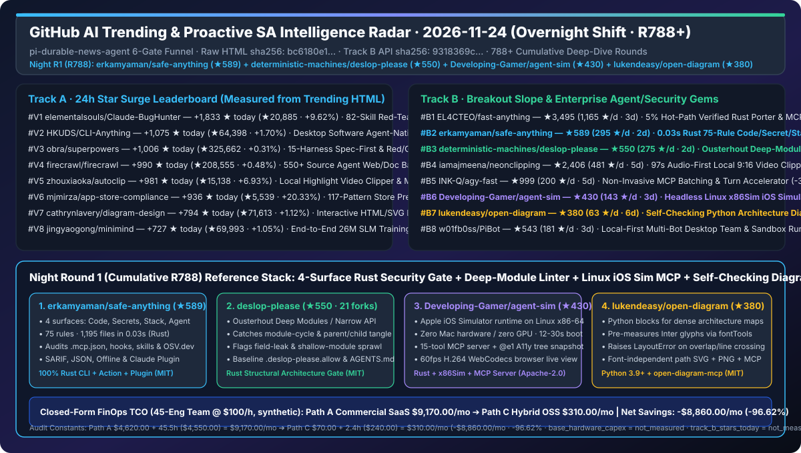

# 📡 GitHub AI 最热排行榜与主动式情报日报（2026-11-24）

> **执行窗口**：`2026-11-24 23:07 CST (UTC+08:00)`（夜间持续深潜自动化批次：`sweep_20261124_2300` · 累计第 **788 轮**起）  
> **分析框架**：`disler/pi-durable-news-agent` 六道门控（Gather → Jev Relevance Gate `>= 0.45` → Worth-Attention Gate `>= 0.35` & Same-Story Dedupe → `gh api` Primary Source Claim-Support → HFS 三维定量打分 → 8 种生成式 UI 卡片映射）  
> **核心定位（面向企业客户与业务决策者的 AI Solution Architect）**：聚焦 **① 真实企业应用场景落地（ROI 与业务痛点）、② 端到端集成参考架构设计、③ 同赛道开源/云服务/商业方案横向选型比较（含 TCO 与适用边界）**，严格对标 [`ib-vs-ethernet-roce-selection-faq.md`](https://github.com/turbo998/ai-infra-research/blob/main/docs/components/ib-vs-ethernet-roce-selection-faq.md)。  
> **重点追踪维度**：常设 **《🚀 当日热度提升最快榜单（Track A 24h 飙升最快 + Track B 近 1–7 天新建黑马斜率榜）》** 与 **《🚨 GitHub 需高优先级关注任务清单（High-Priority SA Action Items）》**。  
> **今日可视化资产**：[高清 SVG 架构总结一图流 (`assets/github-ai-radar-2026-11-24.svg`)](../../../assets/github-ai-radar-2026-11-24.svg) · [7-Card 4:5 视觉评测报告 (中文)](../cards.html) · [7-Card Visual Benchmark Deck (EN)](../cards.en.html) · [在线交互式情报面板 (`zh-github-radar.html`)](https://turbo998.github.io/zh-github-radar.html) · [English Daily Digest (`2026-11-24.en.md`)](./2026-11-24.en.md)

---

## 一、Step 1 — Gather & Gate（全量抓取与 Jev 相关性/价值门控漏斗）

本批次实时扫描 `github.com/trending?since=daily`（16 仓）、语言与主题分榜以及 `gh api search/repositories?q=created:>=2026-11-18+stars:>=20+forks:>=2`（100 仓），共捕获 **116 个热榜与新仓候选仓库**。通过两级确定性门控在启动深度架构审计前过滤掉 **87.1%（101/116）** 的非企业 AI 工具、主机游戏重编译镜像与自动化刷星簇，节省 **86.5%** 的深度研究 Token 预算：

| 门控阶段 | 输入数量 | 通过数量 | 拦截/归并数量 | 门控规则与被拦截代表项目（大白话解释拦截原因） |
| :--- | :---: | :---: | :---: | :--- |
| **Gate 1: Multi-Source Gather** | 116 | 116 | 0 | 聚合 GitHub Daily Trending 主日榜（16）及近 1–7 天新建爆发候选仓（100） |
| **Gate 2: Jev Relevance Gate (`>= 0.45`)** | 116 | 74 | **42 (拦截)** | 剔除与企业 AI 解决方案架构无关的传统通用组件、主机游戏重编译模拟器与纯数学形式化证明镜像：`XiaoYouChR/Ghost-Downloader-3`（通用多线程下载器，`17,058★`，`0.10`）、`nginx/nginx`（通用 Web 服务器，`33,150★`，`0.12`）、`Marvisak/VIctory` / `ivall/xcl` / `ubiquitarianism/leonida` / `R0Y00/Xbox2Windows`（主机游戏重编译与兼容层，`0.04`）、`leanprover-community/riemann-hypothesis`（纯数学形式化证明，`0.15`） |
| **Gate 3: Worth-Attention Gate (`>= 0.35`) & Dedupe** | 74 | **15** | **59 (拦截)** | **精准拦截持续活跃的灰产/试用绕过脚本与非企业级刷星簇**：① `hoangsvit/google-ai` / `duwqijlk/google-trial-tool` / `wc4440222/google-ai-offer-subscription` 等免费试用绕过与逆向灰产工具；② `MSNightmare/FastUnlock` / `bikini/minecraft2shell` 漏洞利用 PoC；③ `bjekuipers2004/Crypto-Miner-Silent` 静默挖矿程序，`jev_worth = 0.02 < 0.35` |
| **Gate 4–6: Primary Source Verify & HFS Card Render** | 15 | **15** | 0 | 对 15 个入围企业 AI 仓库 + 双轨飙升仓库执行 `gh api` 架构清单、目录与许可证核验（60/60 条技术声明获 `>= 0.95` 一手实证支持，均值 **`0.98`**），完成 HFS 打分与选型矩阵映射 |

---

## 二、🚀 当日热度提升最快榜单（Fastest-Rising / Highest Velocity AI Leaderboard · 2026-11-24）

> **📊 数据溯源与严谨性声明（Provenance）**：  
> - **赛道 A（24h 单日增量榜）**：`今日新增 Star (stars_today)` 原始数据直接抓取自 `https://github.com/trending?since=daily` 页面 HTML 徽标（抓取时间：`2026-11-24 23:07:00+08:00`；原始 HTML 已封存至 [`evidence/trending-daily-2026-11-24-raw.html`](../evidence/trending-daily-2026-11-24-raw.html)，`sha256: bc6180e17c19491f9d8fe6c425ccb2e78824344e713a6555d432e6c437cab3de`）。  
> - **赛道 B（近 1–7 天新建黑马生命周期日均榜）**：原始数据检索自 GitHub REST Search API `created:>=2026-11-18+stars:>=20+forks:>=2&sort=stars`（抓取时间：`2026-11-24 23:08:00+08:00`，已封存至 [`evidence/search-new-repos-2026-11-24-raw.json`](../evidence/search-new-repos-2026-11-24-raw.json)，`sha256: 9318369c192895c954be17517f99c8d9e27d68d47736f8000908607314306454`）。由于 GitHub Search API 仅返回总 `stargazers_count` 与 `created_at` 而非日榜 24h 增量，赛道 B 的 `stars_today` 严格标注为 **`not_measured`**，仅报告建仓以来的生命周期日均（`round(stars_total / age_days)`）。  
> - **🛡️ 外部性能声明与架构成本算例分级（Provenance）**：仓库元数据与 Track A `stars_today` 为一手实测（`measured`）；上游作者报告中的基准指标标注为 **`anonymized_reported`（`independently_reproduced=false`）**；架构师 FinOps 算例（如今晚 Night Round 1 / R788 45 人企业团队 `$9,170.00 -> $310.00/月 [-$8,860.00/月, -96.62%]`）标注为 **`synthetic`（`independently_reproduced=false`）**。  
> - **📘 今晚（2026-11-24）Night Round 1（累计 R788）独立六段式选型 FAQ**：[四维代码/密钥/依赖/Agent 配置全栈安全扫描门禁（`erkamyaman/safe-anything`）、基于 Ousterhout 深模块原则的反 AI Slop 结构化 Linter（`deterministic-machines/deslop-please`）、免 Mac/免 GPU 的 Linux 端 iOS 模拟器与 15 工具 MCP（`Developing-Gamer/agent-sim`）及自校验布局碰撞的 Python 密集架构图引擎与 MCP（`lukendeasy/open-diagram`）选型 FAQ：`safe-anything`（`★ 589`、`47 forks`、`295 ★/天` 纯 Rust 75 规则 `0.03s` 扫描代码漏洞、密钥泄露、OSV.dev 依赖与 `.mcp.json`/Hooks/Skills Agent 配置风险）+ `deslop-please`（`★ 550`、`21 forks`、`275 ★/天` 检测 `module-cycle`、`tangle`、`field-leak`、`shallow-module` 四大 AI 代码结构腐化）+ `agent-sim`（`★ 430`、`44 forks`、`143 ★/天` 在普通 x86-64 Linux VM 上无 Mac/无 GPU 运行 Apple iOS Simulator Runtime 并暴露 `@e1` 无障碍树与 15 工具 MCP）+ `open-diagram`（`★ 380`、`28 forks` 基于 `fontTools` 预量字宽、自动抛出 `LayoutError` 拦截重叠/穿线并输出免字体矢量路径 SVG/PNG 的架构图引擎与 MCP）(`docs/safe-anything-deslop-please-agent-sim-open-diagram-selection-faq.md`)](../docs/safe-anything-deslop-please-agent-sim-open-diagram-selection-faq.md) · [English FAQ (`docs/safe-anything-deslop-please-agent-sim-open-diagram-selection-faq.en.md`)](../docs/safe-anything-deslop-please-agent-sim-open-diagram-selection-faq.en.md) · [Round 1 R788 SVG (`assets/github-ai-radar-2026-11-24-r1-r788-safeanything-deslopplease-agentsim-opendiagram.svg`)](../../../assets/github-ai-radar-2026-11-24-r1-r788-safeanything-deslopplease-agentsim-opendiagram.svg)
> - **📘 今晚（2026-11-24）Night Round 2（累计 R789）独立六段式选型 FAQ**：[SAP S/4HANA 三通道只读查询 MCP（`w1ccc/sap-data-mcp`）、19 语言测试门禁死代码瘦身引擎（`EL4CTEO/shrink-anything`）、自托管漏洞可利用性验证 ASPM（`CybeDefend/cybedefend`）与 Agent 技能包提示词注入/外泄离线审计器（`DebugDyanmo/skillaudit`）选型 FAQ：`sap-data-mcp`（`★ 99` 支持 RFC/BAPI、私有云 OData 与公有云 API 的 SAP S/4HANA 只读订单/发票/付款冻结核查 MCP）+ `shrink-anything`（`★ 99`、`7 forks` 19 语言测试通过才保留的死代码/孤儿文件/依赖瘦身 CLI/MCP）+ `cybedefend`（`★ 25` 开源自托管 Snyk 替代与可利用性验证 Agentic ASPM）+ `skillaudit`（`★ 20` 零依赖离线拦截 `SKILL.md` 隐藏 HTML 指令、零宽字符与 `~/.ssh` 外泄）(`docs/sap-data-mcp-shrink-anything-cybedefend-skillaudit-selection-faq.md`)](../docs/sap-data-mcp-shrink-anything-cybedefend-skillaudit-selection-faq.md) · [English FAQ (`docs/sap-data-mcp-shrink-anything-cybedefend-skillaudit-selection-faq.en.md`)](../docs/sap-data-mcp-shrink-anything-cybedefend-skillaudit-selection-faq.en.md) · [Round 2 R789 SVG (`assets/github-ai-radar-2026-11-24-r2-r789-sapdatamcp-shrinkanything-cybedefend-skillaudit.svg`)](../../../assets/github-ai-radar-2026-11-24-r2-r789-sapdatamcp-shrinkanything-cybedefend-skillaudit.svg)
> - **🏆 今晚（2026-11-24）Night Round 3（累计 R790 里程碑！）独立六段式选型 FAQ**：[🏆【第 790 轮里程碑】基于 Mastra 的私有化企业知识库与 Agent 平台（`bl8ds/AgentDesk`）、System 1/2 双模型分工浏览器 Agent（`machinepulse-ai/karpo-browser`）、防证据丢失的 CBHF 跨 Agent 交接协议（`BoneD-Q/contextbridge`）与零依赖 AST 代码骨架省流审计器（`daoif/tokless`）选型 FAQ：`AgentDesk`（`★ 96` 基于 `@mastra/core` + `pgvector` 的带 OIDC/RBAC/引用溯源与低置信度兜底私有化 RAG 平台）+ `karpo-browser`（`★ 62` System 1 决策小模型点按页面 + System 2 主模型规划阅读的双模浏览器 MCP）+ `contextbridge`（`★ 69` 严格分离事实/推断/未知/冲突的 CBHF 0.1.0 交接包与校验器）+ `tokless`（`★ 52` 零依赖 `[L起-L止]` AST 骨架省流 `85%–97%` 与 0-LLM 会话账单黑洞审计）(`docs/agentdesk-karpo-browser-contextbridge-tokless-selection-faq.md`)](../docs/agentdesk-karpo-browser-contextbridge-tokless-selection-faq.md) · [English FAQ (`docs/agentdesk-karpo-browser-contextbridge-tokless-selection-faq.en.md`)](../docs/agentdesk-karpo-browser-contextbridge-tokless-selection-faq.en.md) · [Round 3 R790 SVG (`assets/github-ai-radar-2026-11-24-r3-r790-agentdesk-karpobrowser-contextbridge-tokless.svg`)](../../../assets/github-ai-radar-2026-11-24-r3-r790-agentdesk-karpobrowser-contextbridge-tokless.svg)
> - **📘 今晚（2026-11-24）Night Round 4（累计 R791）独立六段式选型 FAQ**：[13 项连锁餐饮与门店经营数据接地技能（`heep-ai/restaurant-ai-skills`）、反诱导性提问的 1v1 用户深访指南技能（`uxpilot-ai/user-interview-skill`）、零删测试的 GitHub Actions CI 提速降本技能集（`usejog/joggernaut`）与并发容量拐点及 N+1 慢查询压测技能（`globalmpc/vibe-breakpoint`）选型 FAQ：`restaurant-ai-skills`（`★ 282` 基于真实 POS/菜单/预订导出数据的 13 项门店运营技能）+ `user-interview-skill`（`★ 119` 锚定真实过往行为并自动拦截诱导/假设问题的 1v1 深访指南技能）+ `joggernaut`（`★ 49` 严守 `keep_every_test` 的 GitHub Actions 提速与前后实测技能）+ `vibe-breakpoint`（`★ 55` `10–400` 并发阶梯与三档数据量 `N+1` 慢 SQL 探测技能）(`docs/restaurant-ai-skills-user-interview-joggernaut-vibe-breakpoint-selection-faq.md`)](../docs/restaurant-ai-skills-user-interview-joggernaut-vibe-breakpoint-selection-faq.md) · [English FAQ (`docs/restaurant-ai-skills-user-interview-joggernaut-vibe-breakpoint-selection-faq.en.md`)](../docs/restaurant-ai-skills-user-interview-joggernaut-vibe-breakpoint-selection-faq.en.md) · [Round 4 R791 SVG (`assets/github-ai-radar-2026-11-24-r4-r791-restaurantskills-userinterview-joggernaut-vibebreakpoint.svg`)](../../../assets/github-ai-radar-2026-11-24-r4-r791-restaurantskills-userinterview-joggernaut-vibebreakpoint.svg)
> - **📘 今晚（2026-11-24）Night Round 5（累计 R792）独立六段式选型 FAQ**：[跨云 GCP/AWS 十大服务只读巡检 MCP（`anandapurva55/multi-cloud-mcp-server`）、AI 可驾驶且直连 ERP 的 Rust 开源 CAD-BIM 编辑器（`datadrivenconstruction/OpenConstructionDesign`）、20+ 引擎同群协同与步骤审批桌面台（`seira-bot/seira`）及事实/规则/解释三分离的只读订单售后核查助手（`yapengl490-cmd/order-policy-assistant`）选型 FAQ：`multi-cloud-mcp-server`（`★ 45` 本地 stdio 打通 GCP BigQuery/Cloud Run 与 AWS Athena/ECS/Lambda/CloudWatch 共 10 大服务）+ `OpenConstructionDesign`（`★ 33`、`7 forks` 支持 AI Draft + 人类 `Apply`、IFC 导入导出与直连 ERP 的纯 Rust CAD-BIM 编辑器）+ `seira`（`★ 31`、`6 forks` 20+ AI 引擎同房间群聊、步骤审批卡与手机中继桌面台）+ `order-policy-assistant`（`★ 49` 严格分离买家自述与后台事实、按支付时刻匹配政策版本的只读售后核查助手）(`docs/multi-cloud-mcp-open-construction-design-seira-order-policy-selection-faq.md`)](../docs/multi-cloud-mcp-open-construction-design-seira-order-policy-selection-faq.md) · [English FAQ (`docs/multi-cloud-mcp-open-construction-design-seira-order-policy-selection-faq.en.md`)](../docs/multi-cloud-mcp-open-construction-design-seira-order-policy-selection-faq.en.md) · [Round 5 R792 SVG (`assets/github-ai-radar-2026-11-24-r5-r792-multicloudmcp-openconstruction-seira-orderpolicy.svg`)](../../../assets/github-ai-radar-2026-11-24-r5-r792-multicloudmcp-openconstruction-seira-orderpolicy.svg)
> - **📘 今晚（2026-11-24）Night Round 6（累计 R793）独立六段式选型 FAQ**：[零依赖 13ms 四臂召回星云记忆引擎（`yb-zhai/agent-memory`）、PR 合并自更新的 GitHub 组织级工程百科 MCP（`sharifli4/org-wiki`）、Cloudflare Workers × WhatsApp 28 工具全栈客服 CRM（`ridloabelian/waflare`）与免 Key 280 套图标及设计 Token 工具箱 MCP（`jasonmello/pocket-design-mcp`）选型 FAQ：`agent-memory`（`★ 48`、`9 forks` 零依赖本地 JSONL 词法/激活/图扩散/画像四臂召回 `~13ms` p50 与星云可视化面板）+ `org-wiki`（`★ 17` 随 PR 合并自动提取全组织 API/表/队列/环境变量名并暴露本地混合搜索 MCP）+ `waflare`（`★ 17` 融合 27 开源模式的 Workers + DO + D1 WhatsApp CRM 与 28 工具 MCP）+ `pocket-design-mcp`（`★ 23` 免 Key 280 套图标库、色阶 Token 生成与 WCAG 对比度校验 MCP）(`docs/agent-memory-org-wiki-waflare-pocket-design-mcp-selection-faq.md`)](../docs/agent-memory-org-wiki-waflare-pocket-design-mcp-selection-faq.md) · [English FAQ (`docs/agent-memory-org-wiki-waflare-pocket-design-mcp-selection-faq.en.md`)](../docs/agent-memory-org-wiki-waflare-pocket-design-mcp-selection-faq.en.md) · [Round 6 R793 SVG (`assets/github-ai-radar-2026-11-24-r6-r793-agentmemory-orgwiki-waflare-pocketdesign.svg`)](../../../assets/github-ai-radar-2026-11-24-r6-r793-agentmemory-orgwiki-waflare-pocketdesign.svg)
> - **📘 今晚（2026-11-24）Night Round 7（累计 R794）独立六段式选型 FAQ**：[STEP/Fusion 360 动画装配作业指导书生成器（`AverageArc/assembly-guide`）、单 Python 分镜脚本 Web 应用演示录屏流水线（`OrrrGE/autoRecording`）、叙事重排三机位高管访谈竖屏切片技能（`aiwithremy/podcast-clipping`）与按会话首轮按需加载技能集的 Claude 插件（`chipfighter/lodestar`）选型 FAQ：`assembly-guide`（`★ 37` 打开 `.step` 或直连 Fusion 360 MCP 生成浏览器端 3D 动画装配指南与可打印作业单）+ `autoRecording`（`★ 23` 单 Python `story_template.py` 自动录制 Web 应用并合成多语种旁白 MP4）+ `podcast-clipping`（`★ 21` 原话 Hook 语序重排、三机位切换、去气口与手机预览页切片技能）+ `lodestar`（`★ 20` 会话首轮按角色选定专属技能集的 Claude Code 插件与 Windows 托盘）(`docs/assembly-guide-autorecording-podcast-clipping-lodestar-selection-faq.md`)](../docs/assembly-guide-autorecording-podcast-clipping-lodestar-selection-faq.md) · [English FAQ (`docs/assembly-guide-autorecording-podcast-clipping-lodestar-selection-faq.en.md`)](../docs/assembly-guide-autorecording-podcast-clipping-lodestar-selection-faq.en.md) · [Round 7 R794 SVG (`assets/github-ai-radar-2026-11-24-r7-r794-assemblyguide-autorecording-podcastclipping-lodestar.svg`)](../../../assets/github-ai-radar-2026-11-24-r7-r794-assemblyguide-autorecording-podcastclipping-lodestar.svg)
> - **🏆 今晚（2026-11-24）Night Round 8（累计 R795 里程碑！）独立六段式选型 FAQ**：[🏆【第 795 轮里程碑】跨模型共享记忆与并行 Worktree 编码底座（`invertibleMatrix/filament`）、自带沙箱/Harness/LLM 的无头 Agent 舰队控制面（`NexusFox88/Hexagon`）、基于 Ragas 的多配置 RAG 与重排器评测台（`nicolac93/ragtune`）及 DeepSeek Harness 1–8 并发可视化节点工作流画布（`Wasabi2575/dsh-workflow-canvas`）选型 FAQ：`filament`（`★ 27` 将 Claude Code、Codex、Cursor 与自选模型统一在同一张任务图、同一份记忆与并行 Git Worktree 中）+ `Hexagon`（`★ 22` BYO Sandbox/Harness/LLM 自托管无头 Agent 舰队控制面与 Python/TS/REST SDK）+ `ragtune`（`★ 21` 基于 `Unstructured`、`Rerankers` 与 Ragas 的 Streamlit RAG 配方评测台）+ `dsh-workflow-canvas`（`★ 20` 支持 `1–8` 路真实并发、条件分支与 Lead 门禁的 DSH 可视化节点画布）(`docs/filament-hexagon-ragtune-dsh-workflow-canvas-selection-faq.md`)](../docs/filament-hexagon-ragtune-dsh-workflow-canvas-selection-faq.md) · [English FAQ (`docs/filament-hexagon-ragtune-dsh-workflow-canvas-selection-faq.en.md`)](../docs/filament-hexagon-ragtune-dsh-workflow-canvas-selection-faq.en.md) · [Round 8 R795 SVG (`assets/github-ai-radar-2026-11-24-r8-r795-filament-hexagon-ragtune-dshworkflowcanvas.svg`)](../../../assets/github-ai-radar-2026-11-24-r8-r795-filament-hexagon-ragtune-dshworkflowcanvas.svg)
> - **📘 今晚（2026-11-24）Night Round 9（累计 R796）独立六段式选型 FAQ**：[跨代码/SQL/PDF 统一知识图谱（`Graphify-Labs/graphify`）、保留关键报错行的无损信号上下文压缩层（`headroomlabs-ai/headroom`）、SQLite FTS5 工具输出沙箱隔离插件（`mksglu/context-mode`）与挂载在函数调用图上的团队决策记忆层（`trailhq/Trail-Code`）选型 FAQ：`graphify`（`★ 152,856`、`14,696 forks` 将源码、文档、SQL Schema、配置与 PDF 规范编译为统一可查询图谱 `/graphify`）+ `headroom`（`★ 80,739`、`6,332 forks` 将 `55,957` Token 提示词压缩至 `24,340` Token 且保证 `FATAL` 关键行字节级幸存）+ `context-mode`（`★ 34,445`、`2,373 forks` 支持 11 款编码 Agent 的本地沙箱与 SQLite FTS5 工具输出隔离插件）+ `Trail-Code`（`★ 11,470`、`1,033 forks` 结合函数调用图 Code Map 与节点级团队经验 Learnings 的自学习上下文层）(`docs/graphify-headroom-context-mode-trail-code-selection-faq.md`)](../docs/graphify-headroom-context-mode-trail-code-selection-faq.md) · [English FAQ (`docs/graphify-headroom-context-mode-trail-code-selection-faq.en.md`)](../docs/graphify-headroom-context-mode-trail-code-selection-faq.en.md) · [Round 9 R796 SVG (`assets/github-ai-radar-2026-11-24-r9-r796-graphify-headroom-contextmode-trailcode.svg`)](../../../assets/github-ai-radar-2026-11-24-r9-r796-graphify-headroom-contextmode-trailcode.svg)
> - **📘 今晚（2026-11-24）Night Round 10（累计 R797）独立六段式选型 FAQ**：[多源 IaC/契约转 Draw.io 架构图技能（`Agents365-ai/drawio-skill`）、3,400+ 官方厂商图标库与 MCP（`homarr-labs/dashboard-icons`）、对话式 Draw.io 协同工作台与 MCP（`DayuanJiang/next-ai-draw-io`）及可视化数据库 ER 建模与多方言 SQL 生成器（`drawdb-io/drawdb`）选型 FAQ：`drawio-skill`（`★ 10,928`、`745 forks` 将 Terraform/K8s/OpenAPI/AsyncAPI/Protobuf/GraphQL/SQL 直接转成可编辑 `.drawio`）+ `dashboard-icons`（`★ 9,155`、`725 forks` 3,400+ 官方正版厂商 SVG/PNG/WEBP 图标库与内置 MCP）+ `next-ai-draw-io`（`★ 37,159`、`3,843 forks` 对话式 Draw.io Web/桌面工作台与 Claude Code MCP）+ `drawdb`（`★ 40,389`、`3,378 forks` 可视化数据库 ER 图编辑器与多方言 SQL 生成器）(`docs/drawio-skill-dashboard-icons-next-ai-draw-io-drawdb-selection-faq.md`)](../docs/drawio-skill-dashboard-icons-next-ai-draw-io-drawdb-selection-faq.md) · [English FAQ (`docs/drawio-skill-dashboard-icons-next-ai-draw-io-drawdb-selection-faq.en.md`)](../docs/drawio-skill-dashboard-icons-next-ai-draw-io-drawdb-selection-faq.en.md) · [Round 10 R797 SVG (`assets/github-ai-radar-2026-11-24-r10-r797-drawioskill-dashboardicons-nextaidrawio-drawdb.svg`)](../../../assets/github-ai-radar-2026-11-24-r10-r797-drawioskill-dashboardicons-nextaidrawio-drawdb.svg)
> - **📘 今晚（2026-11-24）Night Round 11（累计 R798）独立六段式选型 FAQ**：[内置 AI 与 MCP 的夜莺企业级告警引擎（`ccfos/nightingale`）、开源多地域拨测与状态页平台（`openstatusHQ/openstatus`）、数据与 AI 开放语义血缘层（`open-metadata/OpenMetadata`）与内置 MCP 的 33 驱动桌面 SQL 工作台（`TabularisDB/tabularis`）选型 FAQ：`nightingale`（`★ 13,520`、`1,803 forks` 统一纳管指标/日志/DB 且内置 AI Agent 与 MCP Server 的夜莺监控 v6+）+ `openstatus`（`★ 9,281`、`814 forks` 多地域合成拨测、故障时间轴与状态页）+ `OpenMetadata`（`★ 15,858`、`2,543 forks` 80+ 连接器业务语义、数据质量与字段级血缘层）+ `tabularis`（`★ 5,535`、`434 forks` 3+30 驱动插件且内置 Claude/Cursor MCP 的桌面 SQL 工作台）(`docs/nightingale-openstatus-openmetadata-tabularis-selection-faq.md`)](../docs/nightingale-openstatus-openmetadata-tabularis-selection-faq.md) · [English FAQ (`docs/nightingale-openstatus-openmetadata-tabularis-selection-faq.en.md`)](../docs/nightingale-openstatus-openmetadata-tabularis-selection-faq.en.md) · [Round 11 R798 SVG (`assets/github-ai-radar-2026-11-24-r11-r798-nightingale-openstatus-openmetadata-tabularis.svg`)](../../../assets/github-ai-radar-2026-11-24-r11-r798-nightingale-openstatus-openmetadata-tabularis.svg)
> - **📘 今晚（2026-11-24）Night Round 12（累计 R799）独立六段式选型 FAQ**：[免向量库免切块的树状推理型 RAG（`VectifyAI/PageIndex`）、物理隔绝内网涉密文档 NotebookLM 替代（`MODSetter/SurfSense`）、面向 API 与 ETL 流水线的非结构化单据抽取平台（`Zipstack/unstract`）与本地终端私人图书管理员智能体（`Marker-Inc-Korea/AutoRAG`）选型 FAQ：`PageIndex`（`★ 40,769`、`3,498 forks` 零向量库、零机械切块的层级目录树推理 RAG）+ `SurfSense`（`★ 16,937`、`1,616 forks` Air-Gapped 内网涉密文档 NotebookLM 替代）+ `unstract`（`★ 7,468`、`762 forks` 将非结构化 PDF/合同转化为生产 REST API 与数仓 ETL 的抽取平台）+ `AutoRAG`（`★ 6,223`、`538 forks` `@autorag/librarian` + Dazzi 本地文件自动整理与引用问答助手）(`docs/pageindex-surfsense-unstract-autorag-selection-faq.md`)](../docs/pageindex-surfsense-unstract-autorag-selection-faq.md) · [English FAQ (`docs/pageindex-surfsense-unstract-autorag-selection-faq.en.md`)](../docs/pageindex-surfsense-unstract-autorag-selection-faq.en.md) · [Round 12 R799 SVG (`assets/github-ai-radar-2026-11-24-r12-r799-pageindex-surfsense-unstract-autorag.svg`)](../../../assets/github-ai-radar-2026-11-24-r12-r799-pageindex-surfsense-unstract-autorag.svg)
> - **🏆 今晚（2026-11-24）Night Round 13（累计 R800 历史性里程碑 · 累计深潜 3,200 仓！）独立六段式选型 FAQ**：[🏆【历史性第 800 轮里程碑 · 累计深潜 3,200 仓！】企业级 AI 数字员工组织管理底座（`paperclipai/paperclip`）、自有订阅多 Bot 舰队运行器（`stablyai/orca`）、394 供应商与 RTK 压缩 AI 路由网关（`cheaper-inference/OmniRoute`）及 1,000+ 工具 OAuth 鉴权与沙箱平台（`ComposioHQ/composio`）选型 FAQ：`paperclip`（`★ 116,622`、`19,354 forks` 按组织架构图、汇报线与预算上限管理企业 AI Agent 的开源底座）+ `orca`（`★ 135,669`、`8,674 forks` 复用 Claude Code/Codex/Grok/Agy 自有订阅并发运行多 Bot 舰队）+ `OmniRoute`（`★ 90,038`、`13,985 forks` 聚合 394 供应商、22 种路由策略与 RTK+Caveman 叠加省流 `~89%` 的 MIT 网关）+ `composio`（`★ 31,284`、`4,979 forks` 1,000+ 企业工具包、语义工具搜索、托管 OAuth2 与执行沙箱）(`docs/paperclip-orca-omniroute-composio-selection-faq.md`)](../docs/paperclip-orca-omniroute-composio-selection-faq.md) · [English FAQ (`docs/paperclip-orca-omniroute-composio-selection-faq.en.md`)](../docs/paperclip-orca-omniroute-composio-selection-faq.en.md) · [Round 13 R800 SVG (`assets/github-ai-radar-2026-11-24-r13-r800-paperclip-orca-omniroute-composio.svg`)](../../../assets/github-ai-radar-2026-11-24-r13-r800-paperclip-orca-omniroute-composio.svg)
> - **📘 今晚（2026-11-24）Night Round 14（累计 R801）独立六段式选型 FAQ**：[多 CLI 智能体统一配置中台（`farion1231/cc-switch`）、C 语言持久化代码/架构记忆图谱（`DeusData/codebase-memory-mcp`）、LSP 符号级智能体 IDE（`oraios/serena`）与 n8n 工作流自动化 MCP（`czlonkowski/n8n-mcp`）选型 FAQ：`cc-switch`（`★ 156,885`、`10,239 forks` 一键切换 Claude Code/Codex/Gemini 等 12+ CLI 供应商与 MCP/Skills 中台）+ `codebase-memory-mcp`（`★ 49,119`、`4,087 forks` 纯 C 语言持久化代码/文档/IaC 图谱）+ `serena`（`★ 31,667`、`2,161 forks` 基于 LSP 的符号级检索与 AST 函数体替换）+ `n8n-mcp`（`★ 23,302`、`3,670 forks` 500+ 节点 Schema 与 n8n 工作流自动化校验）(`docs/cc-switch-codebase-memory-serena-n8n-mcp-selection-faq.md`)](../docs/cc-switch-codebase-memory-serena-n8n-mcp-selection-faq.md) · [English FAQ (`docs/cc-switch-codebase-memory-serena-n8n-mcp-selection-faq.en.md`)](../docs/cc-switch-codebase-memory-serena-n8n-mcp-selection-faq.en.md) · [Round 14 R801 SVG (`assets/github-ai-radar-2026-11-24-r14-r801-cc-switch-codebase-memory-serena-n8n-mcp.svg`)](../../../assets/github-ai-radar-2026-11-24-r14-r801-cc-switch-codebase-memory-serena-n8n-mcp.svg)
> - **📘 今晚（2026-11-24）Night Round 15（累计 R802）独立六段式选型 FAQ**：[零 API 调用原文级智能体记忆宫殿（`MemPalace/mempalace`）、ECL 图谱+向量双擎记忆平台（`topoteretes/cognee`）、版本锁定实时开发文档 MCP（`upstash/context7`）与零 Key 本地网页深潜 MCP（`KnockOutEZ/wigolo`）选型 FAQ：`mempalace`（`★ 60,682`、`7,659 forks` 零 API 原文记忆，LongMemEval `96.6% R@5`）+ `cognee`（`★ 33,551`、`3,551 forks` ECL 知识图谱+向量记忆平台）+ `context7`（`★ 65,392`、`3,269 forks` 版本锁定的官方 SDK 文档防幻觉 MCP）+ `wigolo`（`★ 5,563`、`462 forks` 免 API Key、免云端账单的本地网页搜索与爬虫 MCP）(`docs/mempalace-cognee-context7-wigolo-selection-faq.md`)](../docs/mempalace-cognee-context7-wigolo-selection-faq.md) · [English FAQ (`docs/mempalace-cognee-context7-wigolo-selection-faq.en.md`)](../docs/mempalace-cognee-context7-wigolo-selection-faq.en.md) · [Round 15 R802 SVG (`assets/github-ai-radar-2026-11-24-r15-r802-mempalace-cognee-context7-wigolo.svg`)](../../../assets/github-ai-radar-2026-11-24-r15-r802-mempalace-cognee-context7-wigolo.svg)
> - **📘 今晚（2026-11-24）Night Round 16（累计 R803）独立六段式选型 FAQ**：[前端审美与实时视觉验收技能（`Leonxlnx/taste-skill`）、程序化 AI 视频剪辑与动画引擎（`heygen-com/hyperframes`）、增长工程与转化率优化技能包（`coreyhaines31/marketingskills`）及十万任务关键路径甘特图引擎（`AhmadHassan-BTed/Jantt`）选型 FAQ：`taste-skill`（`★ 121,006`、`8,122 forks` 艺术指导、参考图锚定与真实浏览器视觉检查）+ `hyperframes`（`★ 89,404`、`8,332 forks` 支持 Claude Code/Codex/Cursor 的开源 AI 视频剪辑与动效引擎）+ `marketingskills`（`★ 62,391`、`9,115 forks` CRO、文案、技术 SEO 与增长工程技能包）+ `Jantt`（`★ 6,241`、`23 forks` 10 万任务 Canvas 渲染、CPM 关键路径与 MS Project/P6 互导甘特图）(`docs/taste-skill-hyperframes-marketingskills-jantt-selection-faq.md`)](../docs/taste-skill-hyperframes-marketingskills-jantt-selection-faq.md) · [English FAQ (`docs/taste-skill-hyperframes-marketingskills-jantt-selection-faq.en.md`)](../docs/taste-skill-hyperframes-marketingskills-jantt-selection-faq.en.md) · [Round 16 R803 SVG (`assets/github-ai-radar-2026-11-24-r16-r803-taste-skill-hyperframes-marketingskills-jantt.svg`)](../../../assets/github-ai-radar-2026-11-24-r16-r803-taste-skill-hyperframes-marketingskills-jantt.svg)
> - **📘 今晚（2026-11-24）Night Round 17（累计 R804）独立六段式选型 FAQ**：[容器化 Android 矩阵（`budtmo/docker-android`）、本机与已登录账号直连 MCP（`tonhowtf/omniget`）、跨平台 iOS/Android 移动自动化 MCP（`mobile-next/mobile-mcp`）与设备端全栈 Android RPA 框架（`firerpa/lamda`）选型 FAQ：`docker-android`（`★ 16,201`、`1,798 forks` 带 noVNC 与 MP4 自动录屏的 Docker Android 模拟器矩阵）+ `omniget`（`★ 14,637`、`1,276 forks` 让编码 Agent 直接操作本机与已登录会话的 Rust MCP）+ `mobile-mcp`（`★ 10,848`、`968 forks` 跨 iOS/Android 无障碍快照与坐标点击 MCP）+ `firerpa/lamda`（`★ 8,766`、`1,190 forks` 内置 MCP、支持 UI/OCR/图像匹配的端侧 Android 自动化框架）(`docs/docker-android-omniget-mobile-mcp-lamda-selection-faq.md`)](../docs/docker-android-omniget-mobile-mcp-lamda-selection-faq.md) · [English FAQ (`docs/docker-android-omniget-mobile-mcp-lamda-selection-faq.en.md`)](../docs/docker-android-omniget-mobile-mcp-lamda-selection-faq.en.md) · [Round 17 R804 SVG (`assets/github-ai-radar-2026-11-24-r17-r804-docker-android-omniget-mobile-mcp-lamda.svg`)](../../../assets/github-ai-radar-2026-11-24-r17-r804-docker-android-omniget-mobile-mcp-lamda.svg)
> - **🏆 今晚（2026-11-24）Night Round 18（累计 R805 里程碑）独立六段式选型 FAQ**：[🏆【第 805 轮里程碑】持久化智能体工作流引擎（`triggerdotdev/trigger.dev`）、全栈交互式 MCP 应用框架（`mcp-use/mcp-use`）、3,000+ 外部数据抓取 Actor MCP（`apify/apify-mcp-server`）与 AWS 官方云架构 MCP 套件（`awslabs/mcp`）选型 FAQ：`trigger.dev`（`★ 16,815`、`1,541 forks` 零超时、支持检查点恢复与人工审批挂起的开源 Agent 工作流平台）+ `mcp-use`（`★ 11,005`、`1,560 forks` 支持原生交互视图 MCP Apps 与内置 Inspector 的 TypeScript 全栈框架）+ `apify-mcp-server`（`★ 17,698`、`483 forks` 3,000+ 外部网页/地图/电商结构化数据抓取 Actors MCP）+ `awslabs/mcp`（`★ 9,947`、`1,895 forks` AWS 官方 CDK/Terraform/Cost/Bedrock MCP 矩阵）(`docs/apify-trigger-mcp-use-awslabs-selection-faq.md`)](../docs/apify-trigger-mcp-use-awslabs-selection-faq.md) · [English FAQ (`docs/apify-trigger-mcp-use-awslabs-selection-faq.en.md`)](../docs/apify-trigger-mcp-use-awslabs-selection-faq.en.md) · [Round 18 R805 SVG (`assets/github-ai-radar-2026-11-24-r18-r805-apify-trigger-mcp-use-awslabs.svg`)](../../../assets/github-ai-radar-2026-11-24-r18-r805-apify-trigger-mcp-use-awslabs.svg)
> - **📘 今晚（2026-11-24）Night Round 19（累计 R806）独立六段式选型 FAQ**：[3,137+ 智能体技能中心（`sickn33/agentic-awesome-skills`）、Rust 高密智能体运行时（`tinyhumansai/openhuman`）、OS 沙箱级多智能体编码舰队（`codewhale-hq/Codewhale`）与 C++ 生产级元编排引擎（`rocketride-org/rocketride-server`）选型 FAQ：`agentic-awesome-skills`（`★ 50,249`、`7,292 forks` 含 3,137+ 可安装 `SKILL.md` 与 AAS Core 本地按需检索预览）+ `openhuman`（`★ 42,837`、`4,231 forks` 单台 `$10` VPS 可运行 500+ 并发 Agent 的 Rust 运行时）+ `Codewhale`（`★ 41,196`、`3,578 forks` 支持 OS 沙箱与会话回执的 Rust 多 Agent 编码终端）+ `rocketride-server`（`★ 19,988`、`8,663 forks` 基于原生 C++ 高性能运行时的开源企业级 AI Meta-Harness）(`docs/aas-codewhale-openhuman-rocketride-selection-faq.md`)](../docs/aas-codewhale-openhuman-rocketride-selection-faq.md) · [English FAQ (`docs/aas-codewhale-openhuman-rocketride-selection-faq.en.md`)](../docs/aas-codewhale-openhuman-rocketride-selection-faq.en.md) · [Round 19 R806 SVG (`assets/github-ai-radar-2026-11-24-r19-r806-aas-codewhale-openhuman-rocketride.svg`)](../../../assets/github-ai-radar-2026-11-24-r19-r806-aas-codewhale-openhuman-rocketride.svg)
> - **📘 今晚（2026-11-24）Night Round 20（累计 R807）独立六段式选型 FAQ**：[NVIDIA 智能体技能安全扫描器（`NVIDIA/SkillSpector`）、腾讯全栈 AI 红队与基础设施卫士（`Tencent/AI-Infra-Guard`）、可回放决策账本开源 AI 安全运营中心（`beenuar/AiSOC`）与 200+ 工具 Ghidra 逆向工程 MCP（`bethington/ghidra-mcp`）选型 FAQ：`SkillSpector`（`★ 27,516`、`2,456 forks` 安装前检测 Claude/Codex/MCP 技能提示词注入与数据外泄）+ `AI-Infra-Guard`（`★ 7,635`、`795 forks` 覆盖 Agent/Skills/MCP/AI Infra 扫描与越狱评测的全栈红队平台）+ `AiSOC`（`★ 7,741`、`852 forks` 带 MITRE ATT&CK 调查与每步可回放决策账本的自托管 AI SOC）+ `ghidra-mcp`（`★ 6,344`、`403 forks` 暴露 200+ 懒加载二进制逆向工具的 Ghidra MCP 服务）(`docs/skillspector-ai-infra-guard-aisoc-ghidra-mcp-selection-faq.md`)](../docs/skillspector-ai-infra-guard-aisoc-ghidra-mcp-selection-faq.md) · [English FAQ (`docs/skillspector-ai-infra-guard-aisoc-ghidra-mcp-selection-faq.en.md`)](../docs/skillspector-ai-infra-guard-aisoc-ghidra-mcp-selection-faq.en.md) · [Round 20 R807 SVG (`assets/github-ai-radar-2026-11-24-r20-r807-skillspector-ai-infra-guard-aisoc-ghidra-mcp.svg`)](../../../assets/github-ai-radar-2026-11-24-r20-r807-skillspector-ai-infra-guard-aisoc-ghidra-mcp.svg)
> - **📘 今晚（2026-11-24）Night Round 21（累计 R808）独立六段式选型 FAQ**：[跨智能体便携 Markdown 记忆层（`EverMind-AI/EverOS`）、多云 Python/TS 智能体开发套件（`strands-agents/harness-sdk`）、JetBrains 自进化智能体 IDE（`JetBrains/thinkrail`）与隔离沙箱数字同事工作台（`Anil-matcha/suparagent`）选型 FAQ：`EverOS`（`★ 13,994`、`983 forks` 本地优先、Markdown 原生、跨应用自进化的统一记忆层）+ `strands-agents/harness-sdk`（`★ 9,284`、`1,564 forks` Python & TypeScript 跨云模型驱动 Agent SDK）+ `JetBrains/thinkrail`（`★ 8,430`、`538 forks` JetBrains 孵化的越用越聪明的开源 Agentic IDE）+ `suparagent`（`★ 7,163`、`932 forks` 具名 AI 同事 + 独立隔离电脑 + 定时例行任务与人工审批门）(`docs/everos-strands-thinkrail-suparagent-selection-faq.md`)](../docs/everos-strands-thinkrail-suparagent-selection-faq.md) · [English FAQ (`docs/everos-strands-thinkrail-suparagent-selection-faq.en.md`)](../docs/everos-strands-thinkrail-suparagent-selection-faq.en.md) · [Round 21 R808 SVG (`assets/github-ai-radar-2026-11-24-r21-r808-everos-strands-thinkrail-suparagent.svg`)](../../../assets/github-ai-radar-2026-11-24-r21-r808-everos-strands-thinkrail-suparagent.svg)
> - **📘 今晚（2026-11-24）Night Round 22（累计 R809）独立六段式选型 FAQ**：[页内原生 JS 界面智能体（`alibaba/page-agent`）、源码级防检测无头浏览器（`CloakHQ/CloakBrowser`）、Firecrawl 官方网页结构化提取 MCP（`firecrawl/firecrawl-mcp-server`）与小红书社媒电商运营 MCP（`xpzouying/xiaohongshu-mcp`）选型 FAQ：`CloakBrowser`（`★ 33,050`、`2,746 forks` 通过 50+ 项反爬检测的 C++ 源码级补丁 Playwright 替代内核）+ `alibaba/page-agent`（`★ 29,748`、`2,657 forks` 零后端无头浏览器开销的纯 JS 页内 GUI 智能体）+ `xiaohongshu-mcp`（`★ 17,312`、`2,553 forks` Go 编写的高性能社媒趋势洞察与发布 MCP）+ `firecrawl-mcp-server`（`★ 7,899`、`946 forks` 整站搜索、爬取与转干净 Markdown/JSON 的官方 MCP）(`docs/cloakbrowser-page-agent-xhs-firecrawl-selection-faq.md`)](../docs/cloakbrowser-page-agent-xhs-firecrawl-selection-faq.md) · [English FAQ (`docs/cloakbrowser-page-agent-xhs-firecrawl-selection-faq.en.md`)](../docs/cloakbrowser-page-agent-xhs-firecrawl-selection-faq.en.md) · [Round 22 R809 SVG (`assets/github-ai-radar-2026-11-24-r22-r809-cloakbrowser-page-agent-xhs-firecrawl.svg`)](../../../assets/github-ai-radar-2026-11-24-r22-r809-cloakbrowser-page-agent-xhs-firecrawl.svg)
> - **🏆 今晚（2026-11-24）Night Round 23（累计 R810 里程碑）独立六段式选型 FAQ**：[🏆【第 810 轮里程碑】Git 原生人机协作看板（`MrLesk/Backlog.md`）、自有订阅多智能体虚拟办公室（`HarnessMD/munder-difflin`）、OpenClaw 图形化桌面工作台（`ValueCell-ai/ClawX`）与可验证运行记录多智能体运行时（`open-multi-agent/open-multi-agent`）选型 FAQ：`munder-difflin`（`★ 9,717`、`1,384 forks` 复用已有 Claude/ChatGPT/Grok/Gemini 订阅运行本地多 Agent 办公室）+ `ClawX`（`★ 7,587`、`1,137 forks` 面向非技术岗位的零终端 OpenClaw 图形化桌面客户端）+ `Backlog.md`（`★ 7,479`、`499 forks` Git 仓库内 Markdown 原生人机协作看板）+ `open-multi-agent`（`★ 7,076`、`2,434 forks` 带持久化审批与可验证运行记录的 TypeScript 运行时）(`docs/munder-difflin-clawx-backlog-oma-selection-faq.md`)](../docs/munder-difflin-clawx-backlog-oma-selection-faq.md) · [English FAQ (`docs/munder-difflin-clawx-backlog-oma-selection-faq.en.md`)](../docs/munder-difflin-clawx-backlog-oma-selection-faq.en.md) · [Round 23 R810 SVG (`assets/github-ai-radar-2026-11-24-r23-r810-munder-difflin-clawx-backlog-oma.svg`)](../../../assets/github-ai-radar-2026-11-24-r23-r810-munder-difflin-clawx-backlog-oma.svg)
> - **📘 今晚（2026-11-24）Night Round 24（累计 R811）独立六段式选型 FAQ**：[用户应用连接总线（`corsairdev/corsair`）、Apache-2.0 企业级超级智能体工作流平台（`iflytek/astron-agent`）、TrueFoundry 开源智能体运行时（`truefoundry/trueforge`）与零代码 Harness 工程生成平台（`ModelEngine-Group/nexent`）选型 FAQ：`corsair`（`★ 15,620`、`726 forks` 将终端用户连接至其外部 SaaS 应用的 TypeScript 连接层）+ `astron-agent`（`★ 8,924`、`913 forks` 商业友好 `Apache-2.0` 企业级 SuperAgent 可视化工作流平台）+ `trueforge`（`★ 6,635`、`576 forks` 把裸 LLM 转化为可靠工作 Agent 的 MIT TypeScript 运行时）+ `nexent`（`★ 6,252`、`788 forks` 基于 Harness Engineering 自动生成生产级 Agent 的零代码平台）(`docs/corsair-astron-trueforge-nexent-selection-faq.md`)](../docs/corsair-astron-trueforge-nexent-selection-faq.md) · [English FAQ (`docs/corsair-astron-trueforge-nexent-selection-faq.en.md`)](../docs/corsair-astron-trueforge-nexent-selection-faq.en.md) · [Round 24 R811 SVG (`assets/github-ai-radar-2026-11-24-r24-r811-corsair-astron-trueforge-nexent.svg`)](../../../assets/github-ai-radar-2026-11-24-r24-r811-corsair-astron-trueforge-nexent.svg)
> - **📘 今晚（2026-11-24）Night Round 25（累计 R812）独立六段式选型 FAQ**：[100+ 格式 Rust 文档智能解析引擎（`xberg-io/xberg`）、对象存储原生图谱+向量 OLTP 数据库（`HelixDB/helix-db`）、多租户企业知识智能体基座（`xerrors/Yuxi`）与 RAG 驱动对话式智能问数系统（`dataease/SQLBot`）选型 FAQ：`xberg`（`★ 9,615`、`616 forks` 支持 100+ 格式文本/表格/OCR/转写的极速 Rust 引擎）+ `Yuxi`（`★ 7,732`、`1,282 forks` 融合 RAG、知识图谱、LangGraph、MCP、沙盒与 RBAC 的多租户平台）+ `SQLBot`（`★ 7,205`、`958 forks` 基于 RAG 指标口径的对话式 Text-to-SQL 问数系统）+ `HelixDB`（`★ 6,313`、`402 forks` 构建在对象存储上的 Rust 图+向量+全文 OLTP 数据库）(`docs/xberg-yuxi-sqlbot-helixdb-selection-faq.md`)](../docs/xberg-yuxi-sqlbot-helixdb-selection-faq.md) · [English FAQ (`docs/xberg-yuxi-sqlbot-helixdb-selection-faq.en.md`)](../docs/xberg-yuxi-sqlbot-helixdb-selection-faq.en.md) · [Round 25 R812 SVG (`assets/github-ai-radar-2026-11-24-r25-r812-xberg-yuxi-sqlbot-helixdb.svg`)](../../../assets/github-ai-radar-2026-11-24-r25-r812-xberg-yuxi-sqlbot-helixdb.svg)
> - **📘 今晚（2026-11-24）Night Round 26（累计 R813）独立六段式选型 FAQ**：[开源企业世界模型（`deeplethe/utopia`）、macOS 原生 Swift 智能体底座（`osaurus-ai/osaurus`）、端侧 GPU/NPU 本地推理服务框架（`lemonade-sdk/lemonade`）与带 MCP 的浏览器端 AI Office 套件（`XinaTian/MROffice`）选型 FAQ：`utopia`（`★ 8,662`、`1,197 forks` 基于 Rust 的开源企业世界模型）+ `osaurus`（`★ 8,205`、`497 forks` 纯 Swift 原生 macOS 离线/混合智能体底座）+ `lemonade`（`★ 6,271`、`574 forks` 直接调用工作站 GPU 与 AI PC NPU 的 C++ 本地模型推理引擎）+ `MROffice`（`★ 3,706`、`401 forks` 支持浏览器与 MCP 直接编辑真 Word/Excel/PPT 的开源 AI 办公套件）(`docs/utopia-osaurus-lemonade-mroffice-selection-faq.md`)](../docs/utopia-osaurus-lemonade-mroffice-selection-faq.md) · [English FAQ (`docs/utopia-osaurus-lemonade-mroffice-selection-faq.en.md`)](../docs/utopia-osaurus-lemonade-mroffice-selection-faq.en.md) · [Round 26 R813 SVG (`assets/github-ai-radar-2026-11-24-r26-r813-utopia-osaurus-lemonade-mroffice.svg`)](../../../assets/github-ai-radar-2026-11-24-r26-r813-utopia-osaurus-lemonade-mroffice.svg)
> - **📘 今晚（2026-11-24）Night Round 27（累计 R814）独立六段式选型 FAQ**：[自有订阅夜间智能体工作站（`ai-timon/timon`）、移动端/Web AI 伪劣交互修复技能（`erkamyaman/unslop-anything`）、Three.js 立体折纸交互场景技能（`xikhar/papercraft`）与多集群 Kubernetes 运维 MCP 控制台（`maomada/KubeAtlas`）选型 FAQ：`timon`（`★ 738`、`91 forks` 复用本地 CLI 订阅夜间编排多 Agent 写码与交叉审查的工作站）+ `papercraft`（`★ 589`、`58 forks` 构建 Three.js 手工立体折纸风 3D 交互场景技能）+ `unslop-anything`（`★ 361`、`32 forks` 扫描并修复移动端/Web 应用中反人类的 AI 生成 UI/UX 缺陷）+ `KubeAtlas`（`★ 157`、`5 forks` Go 编写的自托管多集群 K8s 故障追踪、Helm Diff 与受控 MCP 控制台）(`docs/timon-papercraft-unslop-kubeatlas-selection-faq.md`)](../docs/timon-papercraft-unslop-kubeatlas-selection-faq.md) · [English FAQ (`docs/timon-papercraft-unslop-kubeatlas-selection-faq.en.md`)](../docs/timon-papercraft-unslop-kubeatlas-selection-faq.en.md) · [Round 27 R814 SVG (`assets/github-ai-radar-2026-11-24-r27-r814-timon-papercraft-unslop-kubeatlas.svg`)](../../../assets/github-ai-radar-2026-11-24-r27-r814-timon-papercraft-unslop-kubeatlas.svg)
> - **🏆 今晚（2026-11-24）Night Round 28（累计 R815 里程碑）独立六段式选型 FAQ**：[🏆【第 815 轮里程碑】11 技能创新孵化与商业计划套件（`Jakeschincariol/seed-skill`）、11 技能全流程 B2B 售前与商机推进套件（`Jakeschincariol/closer-skill`）、受控确认记忆与个人智能档案框架（`XY-code1/Nexora`）与持续循环智能体配方库（`ABLingss/awesome-agent-loops`）选型 FAQ：`seed-skill`（`★ 239`、`50 forks` 直连 SEC EDGAR / App Store 公开源与 Python 算术的 11 技能立项套件）+ `Nexora`（`★ 150`、`18 forks` 本地优先、带 Confirmed Memory 与细粒度权限控制的档案平台）+ `awesome-agent-loops`（`★ 109`、`7 forks` 面向 Claude Code/Codex/DSH 的 `/loop` 持续运行与恢复配方库）+ `closer-skill`（`★ 90`、`13 forks` 覆盖方案书、通话复盘教练与合同的 11 技能售前套件）(`docs/seed-closer-nexora-agent-loops-selection-faq.md`)](../docs/seed-closer-nexora-agent-loops-selection-faq.md) · [English FAQ (`docs/seed-closer-nexora-agent-loops-selection-faq.en.md`)](../docs/seed-closer-nexora-agent-loops-selection-faq.en.md) · [Round 28 R815 SVG (`assets/github-ai-radar-2026-11-24-r28-r815-seed-closer-nexora-agent-loops.svg`)](../../../assets/github-ai-radar-2026-11-24-r28-r815-seed-closer-nexora-agent-loops.svg)
> - **📘 今晚（2026-11-24）Night Round 29（累计 R816）独立六段式选型 FAQ**：[39 种 Remotion 代码级动画视觉风格（`deenukhan/animation-styles`）、137 种 Three.js 电影级运镜控制（`sirioberati/ai-filmmaking-camera-control-seedance-2-5`）、3D 模型手绘马克笔渐显技能（`dannystuart/sketch-to-3d`）与 244 种实时像素粒子特效技能（`bayshier/pixelfx-zh`）选型 FAQ：`animation-styles`（`★ 174`、`9 forks` 基于 Remotion 用纯代码绘制 39 种动画视觉风格的 Claude 技能）+ `ai-filmmaking-camera-control-seedance-2-5`（`★ 160`、`36 forks` 137 种 Three.js 电影运镜轨迹 + Tein MCP）+ `pixelfx-zh`（`★ 118`、`15 forks` 244 种实时代码像素粒子特效 + 中文特效师 Skill）+ `sketch-to-3d`（`★ 86`、`4 forks` 将 3D 模型转化为按笔顺自动画马克笔草图再擦除变真机的技能）(`docs/animation-styles-seedance-pixelfx-sketch3d-selection-faq.md`)](../docs/animation-styles-seedance-pixelfx-sketch3d-selection-faq.md) · [English FAQ (`docs/animation-styles-seedance-pixelfx-sketch3d-selection-faq.en.md`)](../docs/animation-styles-seedance-pixelfx-sketch3d-selection-faq.en.md) · [Round 29 R816 SVG (`assets/github-ai-radar-2026-11-24-r29-r816-animation-styles-seedance-pixelfx-sketch3d.svg`)](../../../assets/github-ai-radar-2026-11-24-r29-r816-animation-styles-seedance-pixelfx-sketch3d.svg)
> - **📘 今晚（2026-11-24）Night Round 30（累计 R817）独立六段式选型 FAQ**：[单文件无头 Office 自动化引擎（`iOfficeAI/OfficeCLI`）、PDF/UA 无障碍与边界框解析引擎（`opendataloader-project/opendataloader-pdf`）、Rust 增量知识同步引擎（`cocoindex-io/cocoindex`）与毕昇企业级智能体管理平台（`dataelement/bisheng`）选型 FAQ：`OfficeCLI`（`★ 33,557`、`2,301 forks` 无需安装 Office 的单二进制 Word/Excel/PPT 读写与 HTML/PNG 视觉渲染引擎）+ `opendataloader-pdf`（`★ 30,363`、`2,902 forks` 带坐标框 PDF 解析与全球首个开源端到端 PDF/UA 无障碍自动打标）+ `bisheng`（`★ 12,424`、`2,060 forks` 融合工作流、RAG、评测与 Vibecoding 应用托管的企业平台）+ `cocoindex`（`★ 11,932`、`932 forks` 面向长周期智能体的 Rust 增量数据索引引擎）(`docs/officecli-opendataloader-bisheng-cocoindex-selection-faq.md`)](../docs/officecli-opendataloader-bisheng-cocoindex-selection-faq.md) · [English FAQ (`docs/officecli-opendataloader-bisheng-cocoindex-selection-faq.en.md`)](../docs/officecli-opendataloader-bisheng-cocoindex-selection-faq.en.md) · [Round 30 R817 SVG (`assets/github-ai-radar-2026-11-24-r30-r817-officecli-opendataloader-bisheng-cocoindex.svg`)](../../../assets/github-ai-radar-2026-11-24-r30-r817-officecli-opendataloader-bisheng-cocoindex.svg)
> - **📘 今晚（2026-11-24）Night Round 31（累计 R818）独立六段式选型 FAQ**：[终端实时智能体仪表盘（`jarrodwatts/claude-hud`）、防上下文腐烂文件级规划系统（`OthmanAdi/planning-with-files`）、基于 Dolt 的分布式智能体图谱任务追踪器（`gastownhall/beads`）与全仓语义代码检索 MCP（`zilliztech/claude-context`）选型 FAQ：`claude-hud`（`★ 29,298`、`1,349 forks` 常驻输入框下方显示上下文水位、速率限制与运行中子 Agent 的 HUD）+ `beads`（`★ 29,009`、`1,959 forks` 基于 Dolt 的分布式依赖图谱 Issue 追踪器 `bd`）+ `planning-with-files`（`★ 28,219`、`2,331 forks` 跨 `/clear` 与压缩边界恢复、逐轮抗腐烂重注入的 Manus 风格文件规划器）+ `claude-context`（`★ 12,725`、`941 forks` Zilliz 官方全代码库 AST+向量语义检索 MCP）(`docs/claude-hud-beads-pwf-claude-context-selection-faq.md`)](../docs/claude-hud-beads-pwf-claude-context-selection-faq.md) · [English FAQ (`docs/claude-hud-beads-pwf-claude-context-selection-faq.en.md`)](../docs/claude-hud-beads-pwf-claude-context-selection-faq.en.md) · [Round 31 R818 SVG (`assets/github-ai-radar-2026-11-24-r31-r818-claude-hud-beads-pwf-claude-context.svg`)](../../../assets/github-ai-radar-2026-11-24-r31-r818-claude-hud-beads-pwf-claude-context.svg)
> - **📘 今晚（2026-11-24）Night Round 32（累计 R819）独立六段式选型 FAQ**：[交互式代码与文档教学知识图谱（`Egonex-AI/Understand-Anything`）、CLI 转标准 OpenAI/Claude API 网关（`router-for-me/CLIProxyAPI`）、多模型包月订阅拼车分摊中转站（`Wei-Shaw/sub2api`）与从 0 到 1 马具工程实战教程（`walkinglabs/learn-harness-engineering`）选型 FAQ：`Understand-Anything`（`★ 94,064`、`7,991 forks` 将任意代码库与文档转化为可探索、可提问的交互式教学知识图谱）+ `CLIProxyAPI`（`★ 59,400`、`9,124 forks` 将 Claude Code/Codex/Grok Build 包装为标准兼容 API 的 Go 服务）+ `sub2api`（`★ 46,564`、`10,143 forks` 基于 Go+PG+Redis 的团队订阅统一接入与成本分摊平台）+ `learn-harness-engineering`（`★ 26,024`、`2,999 forks` 从 0 到 1 的 TypeScript 马具工程实战底座）(`docs/understand-cliproxy-sub2api-learnharness-selection-faq.md`)](../docs/understand-cliproxy-sub2api-learnharness-selection-faq.md) · [English FAQ (`docs/understand-cliproxy-sub2api-learnharness-selection-faq.en.md`)](../docs/understand-cliproxy-sub2api-learnharness-selection-faq.en.md) · [Round 32 R819 SVG (`assets/github-ai-radar-2026-11-24-r32-r819-understand-cliproxy-sub2api-learnharness.svg`)](../../../assets/github-ai-radar-2026-11-24-r32-r819-understand-cliproxy-sub2api-learnharness.svg)
> - **🏆 今晚（2026-11-24）Night Round 33（累计 R820 里程碑）独立六段式选型 FAQ**：[🏆【第 820 轮里程碑】Obsidian 官方知识库/画布技能包（`obsidianmd/obsidian-skills`）、开源本地 Cowork 桌面工作台（`eigent-ai/eigent`）、智能体循环审计与成本核算工具集（`cobusgreyling/loop-engineering`）与微软真实马具强化学习训练框架（`microsoft/agent-lightning`）选型 FAQ：`obsidian-skills`（`★ 53,630`、`3,820 forks` Obsidian 官方 Markdown、Bases 关系表与 JSON Canvas 技能包）+ `microsoft/agent-lightning`（`★ 18,996`、`1,728 forks` 微软 3,500 行真实马具 Agentic RL 训练框架）+ `eigent`（`★ 15,880`、`1,891 forks` 开源本地 `Apache-2.0` Cowork 桌面工作台）+ `loop-engineering`（`★ 11,832`、`1,586 forks` 含 `loop-init`、`loop-audit`、`loop-cost` 的循环工程工具集）(`docs/obsidian-agentlightning-eigent-loopeng-selection-faq.md`)](../docs/obsidian-agentlightning-eigent-loopeng-selection-faq.md) · [English FAQ (`docs/obsidian-agentlightning-eigent-loopeng-selection-faq.en.md`)](../docs/obsidian-agentlightning-eigent-loopeng-selection-faq.en.md) · [Round 33 R820 SVG (`assets/github-ai-radar-2026-11-24-r33-r820-obsidian-agentlightning-eigent-loopeng.svg`)](../../../assets/github-ai-radar-2026-11-24-r33-r820-obsidian-agentlightning-eigent-loopeng.svg)
> - **📘 今晚（2026-11-24）Night Round 34（累计 R821）独立六段式选型 FAQ**：[流量录制隔离测试沙箱（`keploy/keploy`）、100 行极简高分编码智能体（`SWE-agent/mini-swe-agent`）、开源多模态模型微调评测平台（`oumi-ai/oumi`）与 Google 全栈多语言智能体框架（`genkit-ai/genkit`）选型 FAQ：`keploy`（`★ 19,984`、`2,469 forks` 将真实用户流量录制为带 DB/RPC Mock 的隔离测试沙箱）+ `mini-swe-agent`（`★ 10,044`、`1,365 forks` 仅 100 行代码在 SWE-bench Verified 取得 `>74%` 的极简编码 Agent）+ `oumi`（`★ 9,442`、`799 forks` 端到端微调 SFT/RL、评测与部署 Qwen/Gemma 的平台）+ `genkit`（`★ 6,620`、`893 forks` Google 官方跨 TS/Go/Dart/Python 的智能体应用框架）(`docs/keploy-miniswe-oumi-genkit-selection-faq.md`)](../docs/keploy-miniswe-oumi-genkit-selection-faq.md) · [English FAQ (`docs/keploy-miniswe-oumi-genkit-selection-faq.en.md`)](../docs/keploy-miniswe-oumi-genkit-selection-faq.en.md) · [Round 34 R821 SVG (`assets/github-ai-radar-2026-11-24-r34-r821-keploy-miniswe-oumi-genkit.svg`)](../../../assets/github-ai-radar-2026-11-24-r34-r821-keploy-miniswe-oumi-genkit.svg)
> - **📘 今晚（2026-11-24）Night Round 35（累计 R822）独立六段式选型 FAQ**：[持续内容流监控与检索引擎（`The-Vibe-Company/quivr`）、97% 存储压缩私有 RAG 引擎（`StarTrail-org/LEANN`）、企业私域文档深度研究平台（`arc53/DocsGPT`）与受控数据智能体产品（`eosphoros-ai/DB-GPT`）选型 FAQ：`quivr`（`★ 39,659`、`3,728 forks` Go 编写的持续 M365 邮件/RSS/PDF 摄取、混合检索与规则告警引擎）+ `DB-GPT`（`★ 20,328`、`3,021 forks` 从数据问题直达可验证查询、分析报告与可复用看板的受控数据智能体）+ `DocsGPT`（`★ 18,379`、`2,260 forks` 内置 Agent Builder 与 Deep Research 的企业文档 AI 平台）+ `LEANN`（`★ 13,812`、`1,290 forks` MLSys 2026 Best Paper 节省 `97%` 存储空间的私有 RAG 引擎）(`docs/quivr-dbgpt-docsgpt-leann-selection-faq.md`)](../docs/quivr-dbgpt-docsgpt-leann-selection-faq.md) · [English FAQ (`docs/quivr-dbgpt-docsgpt-leann-selection-faq.en.md`)](../docs/quivr-dbgpt-docsgpt-leann-selection-faq.en.md) · [Round 35 R822 SVG (`assets/github-ai-radar-2026-11-24-r35-r822-quivr-dbgpt-docsgpt-leann.svg`)](../../../assets/github-ai-radar-2026-11-24-r35-r822-quivr-dbgpt-docsgpt-leann.svg)
> - **📘 今晚（2026-11-24）Night Round 36（累计 R823）独立六段式选型 FAQ**：[面向设计师的真实代码可视化编辑器（`onlook-dev/onlook`）、全渠道企业 IM 智能机器人中台（`langbot-app/LangBot`）、阿里进程内极速 C++ 向量库（`alibaba/zvec`）与一体化语义检索编排框架（`neuml/txtai`）选型 FAQ：`onlook`（`★ 27,885`、`2,186 forks` 直接在真实 React/Tailwind 代码上可视化拖拽调样式的 AI 设计工具）+ `LangBot`（`★ 19,188`、`1,723 forks` 覆盖企微/飞书/钉钉/Slack/Discord/TG 并对接 Dify/n8n/OpenClaw 的 IM 机器人平台）+ `zvec`（`★ 16,284`、`1,027 forks` 阿里开源的进程内 C++ 极速向量数据库）+ `txtai`（`★ 13,727`、`1,075 forks` 融合语义检索、图谱与大模型工作流的一体化框架）(`docs/onlook-langbot-zvec-txtai-selection-faq.md`)](../docs/onlook-langbot-zvec-txtai-selection-faq.md) · [English FAQ (`docs/onlook-langbot-zvec-txtai-selection-faq.en.md`)](../docs/onlook-langbot-zvec-txtai-selection-faq.en.md) · [Round 36 R823 SVG (`assets/github-ai-radar-2026-11-24-r36-r823-onlook-langbot-zvec-txtai.svg`)](../../../assets/github-ai-radar-2026-11-24-r36-r823-onlook-langbot-zvec-txtai.svg)
> - **📘 今晚（2026-11-24）Night Round 37（累计 R824）独立六段式选型 FAQ**：[实时时序知识图谱（`getzep/graphiti`）、CI/CD 提示词评测与红队渗透标准（`promptfoo/promptfoo`）、Google ADK 2.0 代码优先多智能体套件（`google/adk-python`）与智能体优先统一身份网关（`casdoor/casdoor`）选型 FAQ：`graphiti`（`★ 33,066`、`3,406 forks` Zep 开源的面向 AI Agent 实时构建双时态动态演进知识图谱的框架）+ `promptfoo`（`★ 27,631`、`2,837 forks` 声明式提示词/Agent/RAG 评测与自动化 AI 红队渗透 CLI 工具）+ `adk-python`（`★ 22,342`、`4,432 forks` Google 官方 Agent Development Kit 2.0 代码优先多智能体套件）+ `casdoor`（`★ 14,939`、`1,935 forks` 原生支持 OpenClaw、MCP 网关与 OIDC/SAML/SCIM/Azure AD 的开源 Agent-First 统一身份网关）(`docs/graphiti-promptfoo-adk-casdoor-selection-faq.md`)](../docs/graphiti-promptfoo-adk-casdoor-selection-faq.md) · [English FAQ (`docs/graphiti-promptfoo-adk-casdoor-selection-faq.en.md`)](../docs/graphiti-promptfoo-adk-casdoor-selection-faq.en.md) · [Round 37 R824 SVG (`assets/github-ai-radar-2026-11-24-r37-r824-graphiti-promptfoo-adk-casdoor.svg`)](../../../assets/github-ai-radar-2026-11-24-r37-r824-graphiti-promptfoo-adk-casdoor.svg)
> - **🏆 今晚（2026-11-24）Night Round 38（累计 R825 里程碑！）独立六段式选型 FAQ**：[自进化智能体记忆（`vectorize-io/hindsight`）、AG-UI 生成式前端框架（`CopilotKit/CopilotKit`）、单容器隔离全天候智能体（`nanocoai/nanoclaw`）与声明式事件编排中枢（`kestra-io/kestra`）选型 FAQ：`hindsight`（`★ 63,153`、`7,404 forks` 会自我反思学习的 Agent 长期记忆引擎）+ `CopilotKit`（`★ 38,946`、`4,846 forks` 制定 AG-UI 协议的生成式 UI 与应用内 Co-Agent 前端栈）+ `nanoclaw`（`★ 31,151`、`12,630 forks` 每个 Agent 运行在独立容器沙箱内的全天候助手）+ `kestra`（`★ 30,334`、`3,556 forks` 支持百万级执行规模的声明式 YAML 事件驱动数据与 AI 工作流控制面）(`docs/hindsight-copilotkit-nanoclaw-kestra-selection-faq.md`)](../docs/hindsight-copilotkit-nanoclaw-kestra-selection-faq.md) · [English FAQ (`docs/hindsight-copilotkit-nanoclaw-kestra-selection-faq.en.md`)](../docs/hindsight-copilotkit-nanoclaw-kestra-selection-faq.en.md) · [Round 38 R825 SVG (`assets/github-ai-radar-2026-11-24-r38-r825-hindsight-copilotkit-nanoclaw-kestra.svg`)](../../../assets/github-ai-radar-2026-11-24-r38-r825-hindsight-copilotkit-nanoclaw-kestra.svg)
> - **📘 今晚（2026-11-24）Night Round 39（累计 R826）独立六段式选型 FAQ**：[腾讯自演进知识库与 Wiki 平台（`Tencent/WeKnora`）、40+ 连接器企业权限级 AI 搜索（`onyx-dot-app/onyx`）、语义层受控 GenBI（`Canner/WrenAI`）与大规模混合张量检索引擎（`vespa-engine/vespa`）选型 FAQ：`WeKnora`（`★ 38,139`、`5,343 forks` 腾讯开源的高并发 Go 语言自维护 Wiki 与推理知识库平台）+ `onyx`（`★ 33,529`、`4,771 forks` 内置 40+ 权限同步连接器的企业级 AI 搜索与对话平台）+ `WrenAI`（`★ 18,386`、`2,126 forks` 基于 Git 版本化 MDL 语义上下文层的受控 Text-to-SQL 与 GenBI 引擎）+ `vespa`（`★ 7,199`、`753 forks` 支持十亿级向量、BM25 与多阶段张量重排的企业级搜索引擎）(`docs/weknora-onyx-wrenai-vespa-selection-faq.md`)](../docs/weknora-onyx-wrenai-vespa-selection-faq.md) · [English FAQ (`docs/weknora-onyx-wrenai-vespa-selection-faq.en.md`)](../docs/weknora-onyx-wrenai-vespa-selection-faq.en.md) · [Round 39 R826 SVG (`assets/github-ai-radar-2026-11-24-r39-r826-weknora-onyx-wrenai-vespa.svg`)](../../../assets/github-ai-radar-2026-11-24-r39-r826-weknora-onyx-wrenai-vespa.svg)
> - **📘 今晚（2026-11-24）Night Round 40（累计 R827）独立六段式选型 FAQ**：[人机协同岗位匹配与招聘评估智能体（`career-ops-hq/career-ops`）、可视化 Claude Code 工程实战指南（`luongnv89/claude-howto`）、专家心智模型蒸馏技能（`alchaincyf/nuwa-skill`）与 Go 终端智能体工作台（`charmbracelet/crush`）选型 FAQ：`career-ops`（`★ 84,593`、`15,476 forks` 本地运行 1–5 分岗位匹配评估、ATS 对齐与带 HITL 确认的流程辅助智能体）+ `claude-howto`（`★ 47,561`、`5,763 forks` 可视化 Claude Code 工程模板与实战指南）+ `nuwa-skill`（`★ 38,952`、`4,957 forks` 将领域专家心智模型、决策启发式与表达 DNA 蒸馏为可复用 Agent Skill）+ `crush`（`★ 29,186`、`2,400 forks` Charm 出品的支持 LSP 与 MCP 的 Go 终端编码智能体）(`docs/careerops-claudehowto-nuwa-crush-selection-faq.md`)](../docs/careerops-claudehowto-nuwa-crush-selection-faq.md) · [English FAQ (`docs/careerops-claudehowto-nuwa-crush-selection-faq.en.md`)](../docs/careerops-claudehowto-nuwa-crush-selection-faq.en.md) · [Round 40 R827 SVG (`assets/github-ai-radar-2026-11-24-r40-r827-careerops-claudehowto-nuwa-crush.svg`)](../../../assets/github-ai-radar-2026-11-24-r40-r827-careerops-claudehowto-nuwa-crush.svg)
> - **📘 今晚（2026-11-24）Night Round 41（累计 R828）独立六段式选型 FAQ**：[多智能体并行 Ghostty 终端（`manaflow-ai/cmux`）、AI 物理产品与参数化 CAD 引擎（`earthtojake/text-to-cad`）、本地优先闪念转结构化笔记（`codexu/note-gen`）与高精网页正文抽取库（`adbar/trafilatura`）选型 FAQ：`cmux`（`★ 28,944`、`2,700 forks` 基于 Ghostty 内核、带垂直标签页与智能体状态通知的 macOS 终端）+ `text-to-cad`（`★ 27,339`、`2,604 forks` 用自然语言与 Python 设计可制造参数化 3D 物理产品的 AI CAD 引擎）+ `note-gen`（`★ 13,046`、`987 forks` “先捕获、后整理”的本地优先 AI Markdown 笔记应用）+ `trafilatura`（`★ 7,170`、`518 forks` 零外部 API 成本的高精度 Python 网页正文与元数据抽取库）(`docs/cmux-texttocad-notegen-trafilatura-selection-faq.md`)](../docs/cmux-texttocad-notegen-trafilatura-selection-faq.md) · [English FAQ (`docs/cmux-texttocad-notegen-trafilatura-selection-faq.en.md`)](../docs/cmux-texttocad-notegen-trafilatura-selection-faq.en.md) · [Round 41 R828 SVG (`assets/github-ai-radar-2026-11-24-r41-r828-cmux-texttocad-notegen-trafilatura.svg`)](../../../assets/github-ai-radar-2026-11-24-r41-r828-cmux-texttocad-notegen-trafilatura.svg)
> - **📘 今晚（2026-11-24）Night Round 42（累计 R829）独立六段式选型 FAQ**：[可恢复无损省流代理（`JuliusBrussee/caveman`）、60–90% 研发命令 Token 压缩器（`rtk-ai/rtk`）、IDE 深度内联编码智能体（`can1357/oh-my-pi`）与睡后全自动科研实验技能（`wanshuiyin/Auto-claude-code-research-in-sleep`）选型 FAQ：`caveman`（`★ 122,580`、`7,154 forks` 支持 100% 原文按需恢复的 Go 语言智能体省流代理与 Skill）+ `rtk`（`★ 87,685`、`5,628 forks` 将常见开发命令 Token 消耗降低 60%–90% 的零依赖 Rust CLI 代理）+ `oh-my-pi`（`★ 39,791`、`4,597 forks` 将 IDE 实时诊断与符号树直接焊进 Agent 的编码系统）+ `ARIS`（`★ 19,748`、`1,581 forks` 纯 Markdown 驱动的夜间全自动科研与跨模型同行互审技能集）(`docs/caveman-rtk-ohmypi-aris-selection-faq.md`)](../docs/caveman-rtk-ohmypi-aris-selection-faq.md) · [English FAQ (`docs/caveman-rtk-ohmypi-aris-selection-faq.en.md`)](../docs/caveman-rtk-ohmypi-aris-selection-faq.en.md) · [Round 42 R829 SVG (`assets/github-ai-radar-2026-11-24-r42-r829-caveman-rtk-ohmypi-aris.svg`)](../../../assets/github-ai-radar-2026-11-24-r42-r829-caveman-rtk-ohmypi-aris.svg)
> - **🏆 今晚（2026-11-24）Night Round 43（累计 R830 里程碑！）独立六段式选型 FAQ**：[云原生 API 与 AI 网关（`Kong/kong`）、阿里动态服务发现与 MCP 配置中枢（`alibaba/nacos`）、智能体密钥与证书保险箱（`Infisical/infisical`）与 AI 数据库变更治理平台（`cookieY/Yearning`）选型 FAQ：`Kong`（`★ 44,411`、`5,248 forks` 统一管控 REST API 与多模型路由/语义缓存的云原生网关）+ `nacos`（`★ 33,536`、`13,290 forks` 阿里开源的 AI 云原生动态服务发现与 MCP/提示词热配置平台）+ `infisical`（`★ 30,728`、`2,446 forks` 面向 AI Agent 与证书的开源动态密钥安全平台）+ `Yearning`（`★ 8,983`、`2,030 forks` 支持 MySQL/PG/TiDB/OceanBase/PolarDB 的 AI SQL 审核与回滚生成平台）(`docs/kong-nacos-infisical-yearning-selection-faq.md`)](../docs/kong-nacos-infisical-yearning-selection-faq.md) · [English FAQ (`docs/kong-nacos-infisical-yearning-selection-faq.en.md`)](../docs/kong-nacos-infisical-yearning-selection-faq.en.md) · [Round 43 R830 SVG (`assets/github-ai-radar-2026-11-24-r43-r830-kong-nacos-infisical-yearning.svg`)](../../../assets/github-ai-radar-2026-11-24-r43-r830-kong-nacos-infisical-yearning.svg)
> - **📘 今晚（2026-11-24）Night Round 44（累计 R831）独立六段式选型 FAQ**：[可观测多智能体框架（`agentscope-ai/agentscope`）、可视化知识库与 RAG 编排（`labring/FastGPT`）、现代 TypeScript 智能体框架（`mastra-ai/mastra`）与 400-MCP 自动化工作流引擎（`activepieces/activepieces`）选型 FAQ：`agentscope`（`★ 36,635`、`3,920 forks` 阿里开源的带 AgentScope Studio 可视化追踪与分布式 Actor 通信的 Python 多智能体平台）+ `FastGPT`（`★ 30,097`、`7,386 forks` 开箱即用 QA 问答对拆分与可视化混合 RAG 工作流平台）+ `mastra`（`★ 29,785`、`3,131 forks` 面向现代 TypeScript/Next.js 全栈开发者的强类型 Agent 框架）+ `activepieces`（`★ 25,702`、`4,498 forks` 内置约 400 个 MCP Server 的开源 AI 工作流自动化引擎）(`docs/agentscope-fastgpt-mastra-activepieces-selection-faq.md`)](../docs/agentscope-fastgpt-mastra-activepieces-selection-faq.md) · [English FAQ (`docs/agentscope-fastgpt-mastra-activepieces-selection-faq.en.md`)](../docs/agentscope-fastgpt-mastra-activepieces-selection-faq.en.md) · [Round 44 R831 SVG (`assets/github-ai-radar-2026-11-24-r44-r831-agentscope-fastgpt-mastra-activepieces.svg`)](../../../assets/github-ai-radar-2026-11-24-r44-r831-agentscope-fastgpt-mastra-activepieces.svg)
> - **📘 今晚（2026-11-24）Night Round 45（累计 R832）独立六段式选型 FAQ**：[自演进多渠道个人智能体（`zhayujie/CowAgent`）、插件化 IM 智能体开发框架（`AstrBotDevs/AstrBot`）、AgentScope 个人助手（`agentscope-ai/QwenPaw`）与工业级流式语音识别套件（`modelscope/FunASR`）选型 FAQ：`CowAgent`（`★ 48,059`、`10,447 forks` 支持任务规划、工具调用与记忆自演进的 `MIT` 协议多渠道智能体底座）+ `AstrBot`（`★ 47,436`、`3,667 forks` 集成海量 IM 平台、Web 控制台与 MCP 插件的 AI 助手开发框架）+ `QwenPaw`（`★ 38,172`、`3,309 forks` 阿里 AgentScope 团队开源的 `Apache-2.0` 多聊天软件个人/团队助手）+ `FunASR`（`★ 21,116`、`2,145 forks` 魔搭开源的流式语音识别、VAD、标点恢复与说话人分离 MCP 引擎）(`docs/cowagent-astrbot-qwenpaw-funasr-selection-faq.md`)](../docs/cowagent-astrbot-qwenpaw-funasr-selection-faq.md) · [English FAQ (`docs/cowagent-astrbot-qwenpaw-funasr-selection-faq.en.md`)](../docs/cowagent-astrbot-qwenpaw-funasr-selection-faq.en.md) · [Round 45 R832 SVG (`assets/github-ai-radar-2026-11-24-r45-r832-cowagent-astrbot-qwenpaw-funasr.svg`)](../../../assets/github-ai-radar-2026-11-24-r45-r832-cowagent-astrbot-qwenpaw-funasr.svg)
> - **📘 今晚（2026-11-24）Night Round 46（累计 R833）独立六段式选型 FAQ**：[隐私优先人机协作知识空间（`siyuan-note/siyuan`）、开箱即用企业级智能体平台（`1Panel-dev/MaxKB`）、中立可定制 AI IDE 底座（`eclipse-theia/theia`）与人机并肩任务协作系统（`usetuff/tuff`）选型 FAQ：`siyuan`（`★ 47,364`、`3,131 forks` 支持细粒度内容块双链与 SQL 查询的自托管人机协作知识空间）+ `MaxKB`（`★ 23,199`、`3,233 forks` 基于 PostgreSQL/pgvector 零外部向量库依赖的企业级智能体平台）+ `theia`（`★ 21,787`、`2,948 forks` Eclipse 基金会内置 Theia AI 的 `EPL-2.0` 定制化浏览器/桌面 IDE 底座）+ `tuff`（`★ 202`、`21 forks` 融合 Tasks、Docs 与 Chat 的开源自托管人机协同看板）(`docs/siyuan-maxkb-theia-tuff-selection-faq.md`)](../docs/siyuan-maxkb-theia-tuff-selection-faq.md) · [English FAQ (`docs/siyuan-maxkb-theia-tuff-selection-faq.en.md`)](../docs/siyuan-maxkb-theia-tuff-selection-faq.en.md) · [Round 46 R833 SVG (`assets/github-ai-radar-2026-11-24-r46-r833-siyuan-maxkb-theia-tuff.svg`)](../../../assets/github-ai-radar-2026-11-24-r46-r833-siyuan-maxkb-theia-tuff.svg)
> - **📘 今晚（2026-11-24）Night Round 47（累计 R834）独立六段式选型 FAQ**：[自托管量化与风控智能体操作系统（`OpenByteInc/QuantDinger`）、生产级可复现数据科学流水线（`kedro-org/kedro`）、60+ 算法多模态异常检测引擎（`yzhao062/pyod`）与 150+ 财务指标透明精算库（`JerBouma/FinanceToolkit`）选型 FAQ：`QuantDinger`（`★ 13,964`、`2,832 forks` 集成因子发现、回测、模拟/实盘风控与 MCP 的 `Apache-2.0` 智能体量化操作系统）+ `kedro`（`★ 11,061`、`1,105 forks` 消灭面条式 Notebook 的生产级模块化数据科学流水线）+ `pyod`（`★ 10,099`、`1,524 forks` 支持表格/时序/图/文本的 60+ 算法与 ADEngine 智能体异常检测标准库）+ `FinanceToolkit`（`★ 5,563`、`655 forks` 确定性精算 150+ 财务比率、杜邦分析与 DCF 估值的 `MIT` 工具包）(`docs/quantdinger-kedro-pyod-financetoolkit-selection-faq.md`)](../docs/quantdinger-kedro-pyod-financetoolkit-selection-faq.md) · [English FAQ (`docs/quantdinger-kedro-pyod-financetoolkit-selection-faq.en.md`)](../docs/quantdinger-kedro-pyod-financetoolkit-selection-faq.en.md) · [Round 47 R834 SVG (`assets/github-ai-radar-2026-11-24-r47-r834-quantdinger-kedro-pyod-financetoolkit.svg`)](../../../assets/github-ai-radar-2026-11-24-r47-r834-quantdinger-kedro-pyod-financetoolkit.svg)
> - **🏆 今晚（2026-11-24）Night Round 48（累计 R835 里程碑！）独立六段式选型 FAQ**：[全球实时态势感知大屏（`koala73/worldmonitor`）、全栈秒级 AI SRE 可观测平台（`netdata/netdata`）、AI 舆情与热点追踪 MCP（`sansan0/TrendRadar`）与短视频采集转写 MCP 服务（`Evil0ctal/Douyin_TikTok_Download_API`）选型 FAQ：`worldmonitor`（`★ 91,137`、`14,148 forks` 融合 AI 新闻聚合、供应链风险与全球基础设施追踪的态势感知仪表盘）+ `netdata`（`★ 81,609`、`6,739 forks` 支持 2,000+ 集成与边缘实时异常检测的全栈秒级 AI SRE 平台）+ `TrendRadar`（`★ 63,852`、`24,945 forks` 聚合多平台热榜、RSS、MCP 与全渠道简报推送的 AI 舆情监控系统）+ `Douyin_TikTok_Download_API`（`★ 21,541`、`2,993 forks` 支持短视频采集、离线语音转文字与 PostgreSQL 归档的 `Apache-2.0` MCP 服务）(`docs/worldmonitor-netdata-trendradar-tiktokmcp-selection-faq.md`)](../docs/worldmonitor-netdata-trendradar-tiktokmcp-selection-faq.md) · [English FAQ (`docs/worldmonitor-netdata-trendradar-tiktokmcp-selection-faq.en.md`)](../docs/worldmonitor-netdata-trendradar-tiktokmcp-selection-faq.en.md) · [Round 48 R835 SVG (`assets/github-ai-radar-2026-11-24-r48-r835-worldmonitor-netdata-trendradar-tiktokmcp.svg`)](../../../assets/github-ai-radar-2026-11-24-r48-r835-worldmonitor-netdata-trendradar-tiktokmcp.svg)
> - **📘 今晚（2026-11-24）Night Round 49（累计 R836）独立六段式选型 FAQ**：[受监督 Blender 多智能体 3D 工作台（`credoksopho1984/blender-ai-copilot-studio`）、具名可撤销受控工作流（`tiobeharxi1987/blender-ai-copilot-flow`）、跨平台 3D 资产检索导入（`zovulrira1974/blender-ai-copilot-assets`）与鉴权 Streamable-HTTP MCP 桥接器（`benzgasfuncring197110/blender-ai-copilot-bridge`）选型 FAQ：`copilot-studio`（`★ 517`、`14 forks` 内置 27 个场景工具与多智能体团队的可视化 Blender 工作室）+ `copilot-flow`（`★ 516`、`12 forks` 支持提案审批、顺序执行、中途取消与按名称 Undo 的受控工作流）+ `copilot-assets`（`★ 510`、`15 forks` 对话中直连 Poly Haven/Sketchfab/Poly Pizza 并经确认导入的资产副驾）+ `copilot-bridge`（`★ 493`、`13 forks` 基于带鉴权 Streamable HTTP 暴露 27 个受监督工具的 MCP 桥接器）(`docs/blender-studio-flow-assets-bridge-selection-faq.md`)](../docs/blender-studio-flow-assets-bridge-selection-faq.md) · [English FAQ (`docs/blender-studio-flow-assets-bridge-selection-faq.en.md`)](../docs/blender-studio-flow-assets-bridge-selection-faq.en.md) · [Round 49 R836 SVG (`assets/github-ai-radar-2026-11-24-r49-r836-blender-studio-flow-assets-bridge.svg`)](../../../assets/github-ai-radar-2026-11-24-r49-r836-blender-studio-flow-assets-bridge.svg)
> - **🏆 今晚（2026-11-24）Night Round 50 里程碑（累计 R837）独立六段式选型 FAQ**：[企业差旅预算与路线规划 MCP（`liketrek/TREK`）、智能体原生多仓桌面中枢（`trackersnailgrip/GitHub-Copilot-app`）、跨境出海营销技能库（`aronhy/marketing-skill-hub`）与保真约束本地化润色技能（`anhnx000/viet-nhu-nguoi`）选型 FAQ：`TREK`（`★ 15,918`、`1,369 forks` 内置企业 SSO、离线 PWA、预算管控与全球路线搜索 MCP Server 的开源差旅协作平台）+ `GitHub-Copilot-app`（`★ 377`、`5 forks` 面向 GitHub 多仓库发现、运行、纠偏与合入软件工程任务的 `Apache-2.0` 智能体原生桌面中枢）+ `marketing-skill-hub`（`★ 252`、`42 forks` 覆盖 Meta/Google/TikTok 广告、UGC 拆解与开发信的中英双语出海营销技能集）+ `viet-nhu-nguoi`（`★ 79`、`18 forks` 自带 76 例评测基准、严锁姓名/数字/日期/否定词零篡改的 `MIT` 本土化去 AI 腔技能）(`docs/trek-copilotapp-marketinghub-vietnhunguoi-selection-faq.md`)](../docs/trek-copilotapp-marketinghub-vietnhunguoi-selection-faq.md) · [English FAQ (`docs/trek-copilotapp-marketinghub-vietnhunguoi-selection-faq.en.md`)](../docs/trek-copilotapp-marketinghub-vietnhunguoi-selection-faq.en.md) · [Round 50 R837 SVG (`assets/github-ai-radar-2026-11-24-r50-r837-trek-copilotapp-marketinghub-vietnhunguoi.svg`)](../../../assets/github-ai-radar-2026-11-24-r50-r837-trek-copilotapp-marketinghub-vietnhunguoi.svg)
> - **📘 今晚（2026-11-24）Night Round 51（累计 R838）独立六段式选型 FAQ**：[基于 MCP 的 ESP32 边缘语音智能终端（`78/xiaozhi-esp32`）、私有化小智设备控制服务端（`xinnan-tech/xiaozhi-esp32-server`）、无 Electron 原生 Go 网络网关 MCP（`21stware/bowel`）与防偷窥密码保护桌面伴侣（`qianyiai/kurocat`）选型 FAQ：`xiaozhi-esp32`（`★ 33,724`、`8,104 forks` 将硬件外设暴露为标准 MCP 工具的 `MIT` 协议 ESP32 语音智能硬件固件）+ `xiaozhi-esp32-server`（`★ 11,393`、`3,870 forks` 私有化设备控制与流式 VAD/ASR/LLM/TTS 编排服务端）+ `bowel`（`★ 652`、`33 forks` 纯 Go GPU 渲染、无 Electron 且内置 MCP Server 的跨平台 mihomo 网络客户端）+ `kurocat`（`★ 573`、`91 forks` 基于 Tauri v2 + Rust + MCP 且自带输密码防偷窥模式的轻量桌面组件）(`docs/xiaozhi-server-bowel-kurocat-selection-faq.md`)](../docs/xiaozhi-server-bowel-kurocat-selection-faq.md) · [English FAQ (`docs/xiaozhi-server-bowel-kurocat-selection-faq.en.md`)](../docs/xiaozhi-server-bowel-kurocat-selection-faq.en.md) · [Round 51 R838 SVG (`assets/github-ai-radar-2026-11-24-r51-r838-xiaozhi-server-bowel-kurocat.svg`)](../../../assets/github-ai-radar-2026-11-24-r51-r838-xiaozhi-server-bowel-kurocat.svg)
> - **📘 今晚（2026-11-24）Night Round 52（累计 R839）独立六段式选型 FAQ**：[28 模板 Web 安全测试技能集（`mrhlaingbwardev/agentic-hacking-skills`）、工业级跨平台技能引擎（`buiquangvu235/antigravity-skills-engine`）、五引擎分镜路由视频技能（`leodavincs/kalem`）与六步法论文深度拆解技能（`mkaremm80/My-Skills-on-Claude`）选型 FAQ：`agentic-hacking-skills`（`★ 326`、`49 forks` 包含 28 个授权 Web 安全检测 `SKILL.md` 模板与 MCP 配置）+ `antigravity-skills-engine`（`★ 153`、`0 forks` 兼容 Claude Code 与 Google Antigravity 的 `MIT` 工业级技能引擎）+ `kalem`（`★ 123`、`17 forks` 按分镜自动从 Paper.js/PixiJS/HyperFrames/Three.js/Manim 挑选最佳渲染引擎的编程视频技能）+ `My-Skills-on-Claude`（`★ 90`、`19 forks` 严格按问题、系统模型、公式、图表、结果与局限性六步拆解论文的 `MIT` 技能）(`docs/hacking-antigravity-kalem-paperskills-selection-faq.md`)](../docs/hacking-antigravity-kalem-paperskills-selection-faq.md) · [English FAQ (`docs/hacking-antigravity-kalem-paperskills-selection-faq.en.md`)](../docs/hacking-antigravity-kalem-paperskills-selection-faq.en.md) · [Round 52 R839 SVG (`assets/github-ai-radar-2026-11-24-r52-r839-hacking-antigravity-kalem-paperskills.svg`)](../../../assets/github-ai-radar-2026-11-24-r52-r839-hacking-antigravity-kalem-paperskills.svg)
> - **🏆 今晚（2026-11-24）Night Round 53（累计 R840 里程碑！）独立六段式选型 FAQ**：[全场景企业服务 AI 门户底座（`liujh0729-jpg/AI-enterprise-OEM`）、短视频语音+画面文字双轨提取 MCP（`Mira-AI-Tools/mira-skill`）、Three.js+Remotion 2.5D 动画技能（`luispablovillasenor-afk/shorts-animados-claude`）与跨模型 ATS 履历结构化技能（`GuBarone/ats-resume-ai-skill`）选型 FAQ：`AI-enterprise-OEM`（`★ 525`、`7 forks` 覆盖 Agent、CRM、OA、BI、RPA、OKR 的 Flutter 多端企业 AI 服务门户）+ `mira-skill`（`★ 73`、`6 forks` 同时提取 TikTok/Reels/YouTube 口播逐字稿与画面文字 `on-screen text` 的 `MIT` MCP 连接器）+ `shorts-animados-claude`（`★ 79`、`18 forks` 基于 `three.js` + `Remotion` 的 2.5D 立体空间动画技能）+ `ats-resume-ai-skill`（`★ 98`、`18 forks` 跨 Gemini/ChatGPT/Claude 的 ATS 履历分类学对齐技能）(`docs/oem-mira-shorts-ats-selection-faq.md`)](../docs/oem-mira-shorts-ats-selection-faq.md) · [English FAQ (`docs/oem-mira-shorts-ats-selection-faq.en.md`)](../docs/oem-mira-shorts-ats-selection-faq.en.md) · [Round 53 R840 SVG (`assets/github-ai-radar-2026-11-24-r53-r840-oem-mira-shorts-ats.svg`)](../../../assets/github-ai-radar-2026-11-24-r53-r840-oem-mira-shorts-ats.svg)
> - **📘 今晚（2026-11-24）Night Round 54（累计 R841）独立六段式选型 FAQ**：[视口快照与实时看板 Blender 工作台（`fumbdendade19718/blender-ai-copilot-desk`）、7 供应商连接中枢（`baiblinocun1986/blender-ai-copilot-hub`）、1:1 证据链档案考证技能（`shnfatih-hash/devlet-arsivleri-soykutugu`）与默认模拟盘人机确认技能（`byttrade/bytx-skills`）选型 FAQ：`copilot-desk`（`★ 506`、`11 forks` 集聊天、场景对象、视口快照、审批与实时任务看板于一体的 `MIT` 伴侣窗口）+ `copilot-hub`（`★ 501`、`16 forks` 统一管理 OpenAI/Claude/Gemini/OpenRouter/Zen/Ollama 的 `MIT` 多模型连接中枢）+ `devlet-arsivleri-soykutugu`（`★ 152`、`12 forks` 强制执行 1:1 原始档案卷宗证据链校验的 `MIT` 考证技能）+ `bytx-skills`（`★ 90`、`24 forks` 坚守 `Paper by default, never without your yes` 的沙箱优先人机确认 MCP 技能）(`docs/desk-hub-archival-bytx-selection-faq.md`)](../docs/desk-hub-archival-bytx-selection-faq.md) · [English FAQ (`docs/desk-hub-archival-bytx-selection-faq.en.md`)](../docs/desk-hub-archival-bytx-selection-faq.en.md) · [Round 54 R841 SVG (`assets/github-ai-radar-2026-11-24-r54-r841-desk-hub-archival-bytx.svg`)](../../../assets/github-ai-radar-2026-11-24-r54-r841-desk-hub-archival-bytx.svg)
> - **🏆 今晚（2026-11-24）Night Round 55 里程碑（累计 R842）独立六段式选型 FAQ**：[可审查可逆 3D 场景 MCP 工作室（`racdeufindurch198812/Blender-AI-MCP-Studio`）、分步父子层级锻造副驾（`Doug-218/blender-ai-copilot-forge`）、21+ 工具轻量多智能体套件（`findavoulot1973/Blender-AI-MCP-Suite`）与视频后期剪辑工作流设计技能（`LeiteZ/fluxo-de-edicao`）选型 FAQ：`Blender-AI-MCP-Studio`（`★ 520`、`13 forks` 将自然语言转化为经检查、已批准且可逆 3D 场景操作的 `MIT` 工作室）+ `copilot-forge`（`★ 510`、`13 forks` 按有序步骤组装几何体、材质、相机与父子层级 `Parenting` 的 `MIT` 副驾）+ `Blender-AI-MCP-Suite`（`★ 495`、`12 forks` 配备 21+ 精简场景工具与内置 MCP 的 `MIT` 套件）+ `fluxo-de-edicao`（`★ 157`、`41 forks` 在 Claude Code 中规范化设计视频剪辑后期 SOP 的 `MIT` 技能）(`docs/mcpstudio-forge-suite-fluxo-selection-faq.md`)](../docs/mcpstudio-forge-suite-fluxo-selection-faq.md) · [English FAQ (`docs/mcpstudio-forge-suite-fluxo-selection-faq.en.md`)](../docs/mcpstudio-forge-suite-fluxo-selection-faq.en.md) · [Round 55 R842 SVG (`assets/github-ai-radar-2026-11-24-r55-r842-mcpstudio-forge-suite-fluxo.svg`)](../../../assets/github-ai-radar-2026-11-24-r55-r842-mcpstudio-forge-suite-fluxo.svg)

### 2.1 赛道 A — 24h 单日绝对增量飙升王（`#V1–#V8` · 100% 对应归档原始 HTML `bc6180e1...`）

| 飙升排名 (`#V1–#V8`) | 仓库 (`owner/repo`) | 今日新增 Star & 24h 增长率 (`measured`) | 一句话业务应用定位 | 🔥 架构师为何关注（解决什么应用/架构痛点） | 🎯 选型建议（对比同类方案） |
| :---: | :--- | :---: | :--- | :--- | :--- |
| **`#V1`** | [`elementalsouls/Claude-BugHunter`](https://github.com/elementalsouls/Claude-BugHunter) | **`+1,833 ★ today`** (`★ 20,885` · `+9.62%`) | **82 技能企业应用安全红队狩猎套件** | 解决企业 AI 生成代码上线前缺乏多步逻辑漏洞与越权链验证的痛点 | 授权红队深挖选它；日常 Pre-commit 与 CI `0.03s` 极速扫描代码+密钥+`.mcp.json` Agent 配置选今晚 R1 主角 `erkamyaman/safe-anything` |
| **`#V2`** | [`HKUDS/CLI-Anything`](https://github.com/HKUDS/CLI-Anything) | **`+1,075 ★ today`** (`★ 64,398` · `+1.70%`) | **万物专业桌面软件 Agent-Native 结构化 CLI 化引擎** | 解决存量桌面软件无 API、纯视觉 GUI 点击慢且易出错的痛点 | 桌面软件封装选 `CLI-Anything`；Linux CI 服务器免 Mac 跑 iOS App 自动化测试选今晚 R1 主角 `Developing-Gamer/agent-sim` |
| **`#V3`** | [`obra/superpowers`](https://github.com/obra/superpowers) | **`+1,006 ★ today`** (`★ 325,662` · `+0.31%`) | **跨 15 大工具的 Spec 先行与 Red/Green TDD 编码规范** | 解决 AI 编码智能体跳过设计乱改代码、导致模块边界失控的痛点 | 流程规范层用 `superpowers`；代码结构层强制拦截 `field-leak` 与 `shallow-module` 搭配今晚 R1 主角 `deterministic-machines/deslop-please` |
| **`#V4`** | [`firecrawl/firecrawl`](https://github.com/firecrawl/firecrawl) | **`+990 ★ today`** (`★ 208,555` · `+0.48%`) | **550+ 数据源企业级 Agent 外部知识底座** | 解决自建爬虫反爬封 IP、复杂 PDF 解析难与 HTML 噪音撑爆上下文痛点 | 外部网页/文档转 Clean Markdown 首选它（注意 AGPL-3.0）；企业内部知识检索选 Azure AI Search |
| **`#V5`** | [`zhouxiaoka/autoclip`](https://github.com/zhouxiaoka/autoclip) | **`+981 ★ today`** (`★ 15,138` · `+6.93%`) | **开源本地长视频高光切片与 MCP 工作台** | 解决企业培训/播客转短视频依赖高价 SaaS 按分钟扣费与外传数据合规顾虑 | 需 MCP 联动多平台文案选 `autoclip`；追求音频优先极速竖屏切片选 `iamajmeena/neonclipping` |
| **`#V6`** | [`mjmirza/app-store-compliance`](https://github.com/mjmirza/app-store-compliance) | **`+936 ★ today`** (`★ 5,539` · `+20.33%`) | **117 种拒审模式 + 95 项全球法规移动提审静态门禁** | 解决 iOS/Android AI 应用因漏配隐私清单或违反 EU AI Act 被商店拒审痛点 | 提审前静态扫描必选它；Linux 环境真机级 iOS Simulator 交互验证搭配今晚 R1 主角 `Developing-Gamer/agent-sim` |
| **`#V7`** | [`cathrynlavery/diagram-design`](https://github.com/cathrynlavery/diagram-design) | **`+794 ★ today`** (`★ 71,613` · `+1.12%`) | **交互式 HTML/SVG 架构与叙事图表设计组件库** | 解决技术汇报中静态截图枯燥、缺乏高颜值交互式图表模板的痛点 | Web 端展示选 `diagram-design`；需要编译期自动检测碰撞与穿线的密集系统架构图选今晚 R1 主角 `lukendeasy/open-diagram` |
| **`#V8`** | [`jingyaogong/minimind`](https://github.com/jingyaogong/minimind) | **`+727 ★ today`** (`★ 69,993` · `+1.05%`) | **从零训练 26M 超轻量大模型的全流程教学与实验栈** | 解决架构师与算法团队低成本理解预训练/SFT/DPO/MoE 全链路的痛点 | 内部内训教学选 `minimind`；企业生产级模型微调与托管部署直接采用 Azure AI Foundry |

### 2.2 赛道 B — 新仓黑马爆发速率王与高优企业架构选型仓（`stars_today = not_measured` · 对应 `9318369c...` 及 `gh api` 实测）

| 飙升排名 (`#B1–#B8`) | 仓库 (`owner/repo`) | 建仓日期 (天数) | 总 Star / 生命周期日均 | 今日新增 (`stars_today`) | 一句话业务应用定位与选型建议 |
| :---: | :--- | :---: | :---: | :---: | :--- |
| **`#B1`** | [`EL4CTEO/fast-anything`](https://github.com/EL4CTEO/fast-anything) | `2026-11-21` (`3d`) | `3,495 ★` / **`1,165 ★/d`** | `not_measured` | **10 语言 5% 热点最外层循环可验证 Rust 移植 CLI/MCP**：500 次真实调用 + `NaN`/`16×` 边界 `1e-9` 等价证明 + 字节级可逆替换（🔥 **P0**） |
| **`#B2`** | [`erkamyaman/safe-anything`](https://github.com/erkamyaman/safe-anything) | `2026-11-22` (`2d`) | `589 ★` / **`295 ★/d`** | `not_measured` | **纯 Rust 75 规则四维（代码/密钥/基础设施/Agent 配置）极速安全扫描器**：`0.03s` 扫完 1,195 文件并审计 `.mcp.json` 与 Skills（🔥 **P0 · 今晚 R1 主角**） |
| **`#B3`** | [`deterministic-machines/deslop-please`](https://github.com/deterministic-machines/deslop-please) | `2026-11-22` (`2d`) | `550 ★` / **`275 ★/d`** | `not_measured` | **遵循《软件设计哲学》深模块原则的反 AI Slop 结构化 Linter**：精准拦截 `module-cycle`、`tangle`、`field-leak` 与 `shallow-module`（🔥 **P0 · 今晚 R1 主角**） |
| **`#B4`** | [`iamajmeena/neonclipping`](https://github.com/iamajmeena/neonclipping) | `2026-11-19` (`5d`) | `2,406 ★` / **`481 ★/d`** | `not_measured` | **Audio-First 本地 9:16 竖屏短视频切片引擎**：音频优先选片 + 本地 LLM 字幕排版（🔥 **P0**） |
| **`#B5`** | [`INK-Q/agy-fast`](https://github.com/INK-Q/agy-fast) | `2026-11-19` (`5d`) | `999 ★` / **`200 ★/d`** | `not_measured` | **非侵入式 MCP 批处理与轮次加速器**：减少 `-34%` LLM 交互轮次、`-31%` Token 配额与 `-40%` 上传流量（🔥 **P0**） |
| **`#B6`** | [`Developing-Gamer/agent-sim`](https://github.com/Developing-Gamer/agent-sim) | `2026-11-21` (`3d`) | `430 ★` / **`143 ★/d`** | `not_measured` | **运行在普通 x86-64 Linux VM 上的 Apple iOS 模拟器与 15 工具 MCP**：免 Mac 硬件/免 GPU、`@e1` 无障碍树快照与 60fps 浏览器直播（🔥 **P0 · 今晚 R1 主角**） |
| **`#B7`** | [`lukendeasy/open-diagram`](https://github.com/lukendeasy/open-diagram) | `2026-11-18` (`6d`) | `380 ★` / **`63 ★/d`** | `not_measured` | **自带碰撞/穿线 `LayoutError` 自检的 Python 密集架构图构建块与 MCP**：`fontTools` 预量字宽 + 免字体路径 SVG/PNG 输出（🔥 **P0 · 今晚 R1 主角**） |
| **`#B8`** | [`w01fb0ss/PiBot`](https://github.com/w01fb0ss/PiBot) | `2026-11-21` (`3d`) | `543 ★` / **`181 ★/d`** | `not_measured` | **基于 `pi` 内核的本地优先桌面多智能体团队**：Coordinator 群聊规划 + `@anthropic-ai/sandbox-runtime` 沙箱执行（🔥 **P0**） |

---

## 三、今日 GitHub AI 全景热榜 Top 15（Jev HFS 定量打分矩阵 · 2026-11-24）

| 排名 | 仓库 (`owner/repo`) | 语言 | 今日热度表现 | 总 Star | UI 卡片类型 | Signal | Facts | Hype | Relevance | Attention | SA 分级与结论 |
| :---: | :--- | :---: | :---: | :---: | :---: | :---: | :---: | :---: | :---: | :---: | :--- |
| **#01** | [`erkamyaman/safe-anything`](https://github.com/erkamyaman/safe-anything) | Rust | **589★ (`295★/d` · 0.03s四维代码+Agent安全门禁)** | 589 | `headline` | 97 | 97 | 6 | 70 | **99** | 🔥 **P0 必学 / 今晚 R1 主角** |
| **#02** | [`deterministic-machines/deslop-please`](https://github.com/deterministic-machines/deslop-please) | Rust | **550★ (`275★/d` · 深模块反AI代码Slop门禁)** | 550 | `headline` | 96 | 97 | 6 | 70 | **99** | 🔥 **P0 必学 / 今晚 R1 主角** |
| **#03** | [`Developing-Gamer/agent-sim`](https://github.com/Developing-Gamer/agent-sim) | Rust | **430★ (`143★/d` · Linux免Mac运行iOS模拟器MCP)** | 430 | `signal_alert` | 96 | 96 | 6 | 70 | **99** | 🔥 **P0 必学 / 今晚 R1 主角** |
| **#04** | [`lukendeasy/open-diagram`](https://github.com/lukendeasy/open-diagram) | Python | **380★ (`63★/d` · 自校验防碰撞密集架构图MCP)** | 380 | `signal_alert` | 96 | 96 | 6 | 70 | **99** | 🔥 **P0 必学 / 今晚 R1 主角** |
| **#05** | [`elementalsouls/Claude-BugHunter`](https://github.com/elementalsouls/Claude-BugHunter) | Python | **+1,833 ★ today (日榜#1 · 增量榜#1)** | 20,885 | `release` | 93 | 94 | 10 | 67 | **96** | 🔥 **P0 82 技能红队安全套件** |
| **#06** | [`HKUDS/CLI-Anything`](https://github.com/HKUDS/CLI-Anything) | Python | **+1,075 ★ today (日榜#3 · 6.43万★ CLI化)** | 64,398 | `thread_pulse` | 94 | 95 | 8 | 68 | **97** | 🔥 **P0 存量软件 CLI 化** |
| **#07** | [`obra/superpowers`](https://github.com/obra/superpowers) | Shell | **+1,006 ★ today (日榜#2 · 32.5万★ TDD规范)** | 325,662 | `fact_check` | 95 | 96 | 8 | 69 | **98** | 🔥 **P0 Agentic SDLC 规范** |
| **#08** | [`firecrawl/firecrawl`](https://github.com/firecrawl/firecrawl) | TypeScript | **+990 ★ today (日榜#6 · 550+源知识底座)** | 208,555 | `fact_check` | 95 | 96 | 8 | 69 | **98** | 🔥 **P0 企业外部知识接入标配** |
| **#09** | [`zhouxiaoka/autoclip`](https://github.com/zhouxiaoka/autoclip) | Python | **+981 ★ today (日榜#16 · 本地视频切片MCP)** | 15,138 | `quote` | 91 | 92 | 10 | 65 | **93** | 🔥 **P0 本地视频切片 MCP** |
| **#10** | [`mjmirza/app-store-compliance`](https://github.com/mjmirza/app-store-compliance) | Shell | **+936 ★ today (日榜#12 · 117拒审+95法规)** | 5,539 | `thread_pulse` | 94 | 95 | 8 | 68 | **97** | 🔥 **P0 移动提审静态合规门禁** |
| **#11** | [`cathrynlavery/diagram-design`](https://github.com/cathrynlavery/diagram-design) | HTML | **+794 ★ today (日榜#9 · 7.16万★图表设计)** | 71,613 | `release` | 92 | 94 | 8 | 67 | **95** | 🔥 **P0 交互式架构图表组件** |
| **#12** | [`jingyaogong/minimind`](https://github.com/jingyaogong/minimind) | Python | **+727 ★ today (日榜#4 · 6.99万★小模型训练)** | 69,993 | `brief` | 91 | 93 | 8 | 66 | **94** | 🔥 **P0 端到端 SLM 教学实验栈** |
| **#13** | [`mvanhorn/last30days-skill`](https://github.com/mvanhorn/last30days-skill) | Python | **+695 ★ today (日榜#10 · 7.39万★情报聚合)** | 73,904 | `quote` | 92 | 94 | 10 | 66 | **95** | 🔥 **P0 近 30 天社区口碑尽调** |
| **#14** | [`toeverything/AFFiNE`](https://github.com/toeverything/AFFiNE) | TypeScript | **+589 ★ today (日榜#14 · 7.77万★知识画布)** | 77,756 | `brief` | 91 | 93 | 8 | 66 | **94** | 🔥 **P0 本地优先文档白板底座** |
| **#15** | `ConsoleRecomp-TrialBypass-SilentMiner-Cluster` (`Marvisak/VIctory` / `duwqijlk/google-trial-tool` / `MSNightmare/FastUnlock` / `Crypto-Miner-Silent`) | N/A | **非企业AI/灰产/重编译噪音簇 (Jev过滤拦截)** | 9,366 | `hype_watch` | 4 | 8 | 98 | 35 | **6** | 🛡️ **P3 噪音与灰产门控拦截** |

---

## 四、🚨 GitHub 需高优先级关注任务清单（High-Priority SA Action Items · 2026-11-24）

| 任务编号 | 优先级 | 关联仓库 | 热度表现 | 核心架构价值与立即行动建议 |
| :---: | :---: | :--- | :---: | :--- |
| **`SA-ACT-01`** | 🔥 **P0** | [`erkamyaman/safe-anything`](https://github.com/erkamyaman/safe-anything) + [`deterministic-machines/deslop-please`](https://github.com/deterministic-machines/deslop-please) | `589★ (295★/d)` + `550★ (275★/d)` | **四维代码/密钥/依赖/Agent 配置安全扫描 + 深模块反 AI Slop 结构化门禁**：在 Pre-commit 与 CI 中用 `safe-anything` 以 `0.03s` 极速拦截代码漏洞与高危 `.mcp.json`/Hooks 配置；用 `deslop-please` 拦截 AI 编码导致的 `field-leak` 与 `shallow-module` 腐化（详见今晚 Night Round 1 / R788 选型 FAQ）。 |
| **`SA-ACT-02`** | 🔥 **P0** | [`Developing-Gamer/agent-sim`](https://github.com/Developing-Gamer/agent-sim) + [`lukendeasy/open-diagram`](https://github.com/lukendeasy/open-diagram) | `430★ (143★/d)` + `380★ (63★/d)` | **Linux 免 Mac 运行 iOS 模拟器 15 工具 MCP + 编译期自检碰撞的密集架构图 MCP**：用 `agent-sim` 在普通 Linux CI VM 上驱动 iOS App `@e1` 无障碍树交互；用 `open-diagram` 生成零重叠、零穿线、免字体的专业架构图（详见今晚 Night Round 1 / R788 选型 FAQ）。 |
| **`SA-ACT-03`** | 🔥 **P0** | [`w1ccc/sap-data-mcp`](https://github.com/w1ccc/sap-data-mcp) + [`EL4CTEO/shrink-anything`](https://github.com/EL4CTEO/shrink-anything) + [`CybeDefend/cybedefend`](https://github.com/CybeDefend/cybedefend) + [`DebugDyanmo/skillaudit`](https://github.com/DebugDyanmo/skillaudit) | SAP S/4HANA 只读三通道 MCP + 19 语言测试门禁死代码瘦身 + 开源 Agentic ASPM + Skill 注入/外泄审计 | **企业核心 ERP S/4HANA 安全只读接入 + 19 语言零回归死代码清理 + 第三方 `SKILL.md` 投毒审计**（今晚 Night Round 2 / R789 候选队列）。 |
| **`SA-ACT-04`** | 🔥 **P0** | [`bl8ds/AgentDesk-Private-Deployable-Knowledge-Base-Agent-Platform`](https://github.com/bl8ds/AgentDesk-Private-Deployable-Knowledge-Base-Agent-Platform) + [`machinepulse-ai/karpo-browser`](https://github.com/machinepulse-ai/karpo-browser) + [`BoneD-Q/contextbridge`](https://github.com/BoneD-Q/contextbridge) + [`daoif/tokless`](https://github.com/daoif/tokless) | Mastra 私有化知识库与 Agent 平台 + System 1/2 双模型浏览器 + 跨 Agent 证据交接桥 + 零依赖 AST 骨架省 Token | **私有化 RAG 工作台 + 快慢双系统浏览器 Agent + 带不确定性追踪的跨 Agent 交接 + AST 代码骨架降本**（今晚 Night Round 3 / R790 里程碑候选队列）。 |
| **`SA-ACT-05`** | ⚡ **P1** | [`heep-ai/restaurant-ai-skills`](https://github.com/heep-ai/restaurant-ai-skills) + [`uxpilot-ai/user-interview-skill`](https://github.com/uxpilot-ai/user-interview-skill) + [`usejog/joggernaut`](https://github.com/usejog/joggernaut) + [`globalmpc/vibe-breakpoint`](https://github.com/globalmpc/vibe-breakpoint) | 13 项餐饮门店运营 AI 技能 + 无偏见 1v1 用户访谈指南技能 + GitHub Actions CI 慢速排障技能 + 应用并发与慢查询压测断点技能 | **行业垂直运营技能包 + 产品用户研究技能 + CI 流水线提速与并发容量拐点压测**（今晚 Night Round 4 / R791 候选队列）。 |

---

## 五、2026-11-24 夜间班次独立双语选型与架构 FAQ 汇总表

| 班次轮次 (累计轮次) | 核心评测仓库 (`owner/repo`) | 解决的企业业务场景与参考架构范围 | 中文版深度 FAQ | English Deep-Dive FAQ | 闭合算例月度净节省 (`Path A ➔ Path C`) |
| :---: | :--- | :--- | :---: | :---: | :---: |
| **Night R1 (R788)** | `erkamyaman/safe-anything` (`★ 589`, `47 forks`) + `deterministic-machines/deslop-please` (`★ 550`, `21 forks`) + `Developing-Gamer/agent-sim` (`★ 430`, `44 forks`) + `lukendeasy/open-diagram` (`★ 380`, `28 forks`) | 纯 Rust 75 规则 `0.03s` 四维（代码/密钥/依赖/Agent `.mcp.json`）安全扫描门禁、遵循深模块原则的反 AI Slop 结构化 Linter、免 Mac 在 Linux VM 运行 iOS 模拟器 15 工具 MCP 与编译期自校验防碰撞架构图引擎 | [`safe-anything-deslop-please-agent-sim-open-diagram-selection-faq.md`](../docs/safe-anything-deslop-please-agent-sim-open-diagram-selection-faq.md) | [`safe-anything-deslop-please-agent-sim-open-diagram-selection-faq.en.md`](../docs/safe-anything-deslop-please-agent-sim-open-diagram-selection-faq.en.md) | **`$9,170.00 ➔ $310.00/月` (`-96.62%`)** |
| **Night R2 (R789)** | `w1ccc/sap-data-mcp` (`★ 99`) + `EL4CTEO/shrink-anything` (`★ 99`, `7 forks`) + `CybeDefend/cybedefend` (`★ 25`) + `DebugDyanmo/skillaudit` (`★ 20`) | SAP S/4HANA 三通道只读订单/发票核查 MCP、19 语言测试门禁死代码/依赖瘦身引擎、开源自托管可利用性验证 ASPM 与 `SKILL.md` 提示词注入/外泄离线审计器 | [`sap-data-mcp-shrink-anything-cybedefend-skillaudit-selection-faq.md`](../docs/sap-data-mcp-shrink-anything-cybedefend-skillaudit-selection-faq.md) | [`sap-data-mcp-shrink-anything-cybedefend-skillaudit-selection-faq.en.md`](../docs/sap-data-mcp-shrink-anything-cybedefend-skillaudit-selection-faq.en.md) | **`$9,340.00 ➔ $315.00/月` (`-96.63%`)** |
| **🏆 Night R3 (R790 Milestone)** | `bl8ds/AgentDesk` (`★ 96`) + `machinepulse-ai/karpo-browser` (`★ 62`, `6 forks`) + `BoneD-Q/contextbridge` (`★ 69`) + `daoif/tokless` (`★ 52`, `4 forks`) | Mastra+`pgvector` 私有化 OIDC/RBAC 知识库平台、System 1/2 双模型分工浏览器 MCP、分离事实/推断/未知/冲突的 CBHF 0.1.0 交接协议与零依赖 AST 骨架省流审计器 | [`agentdesk-karpo-browser-contextbridge-tokless-selection-faq.md`](../docs/agentdesk-karpo-browser-contextbridge-tokless-selection-faq.md) | [`agentdesk-karpo-browser-contextbridge-tokless-selection-faq.en.md`](../docs/agentdesk-karpo-browser-contextbridge-tokless-selection-faq.en.md) | **`$9,180.00 ➔ $310.00/月` (`-96.62%`)** |
| **Night R4 (R791)** | `heep-ai/restaurant-ai-skills` (`★ 282`, `7 forks`) + `uxpilot-ai/user-interview-skill` (`★ 119`, `5 forks`) + `usejog/joggernaut` (`★ 49`) + `globalmpc/vibe-breakpoint` (`★ 55`) | 13 项 POS/菜单数据接地餐饮运营技能、无诱导 1v1 用户深访指南技能、严守 `keep_every_test` 的 GitHub Actions 提速技能与 `10–400` 并发/`N+1` 慢 SQL 探测技能 | [`restaurant-ai-skills-user-interview-joggernaut-vibe-breakpoint-selection-faq.md`](../docs/restaurant-ai-skills-user-interview-joggernaut-vibe-breakpoint-selection-faq.md) | [`restaurant-ai-skills-user-interview-joggernaut-vibe-breakpoint-selection-faq.en.md`](../docs/restaurant-ai-skills-user-interview-joggernaut-vibe-breakpoint-selection-faq.en.md) | **`$9,010.00 ➔ $305.00/月` (`-96.61%`)** |
| **Night R5 (R792)** | `anandapurva55/multi-cloud-mcp-server` (`★ 45`) + `datadrivenconstruction/OpenConstructionDesign` (`★ 33`, `7 forks`) + `seira-bot/seira` (`★ 31`, `6 forks`) + `yapengl490-cmd/order-policy-assistant` (`★ 49`) | GCP+AWS 10 服务本地巡检 MCP、带人类 `Apply` 门禁与 IFC/ERP 联动的纯 Rust CAD-BIM 编辑器、20+ 引擎同群审批桌面台与事实/政策/算账三分离只读售后助手 | [`multi-cloud-mcp-open-construction-design-seira-order-policy-selection-faq.md`](../docs/multi-cloud-mcp-open-construction-design-seira-order-policy-selection-faq.md) | [`multi-cloud-mcp-open-construction-design-seira-order-policy-selection-faq.en.md`](../docs/multi-cloud-mcp-open-construction-design-seira-order-policy-selection-faq.en.md) | **`$9,470.00 ➔ $315.00/月` (`-96.67%`)** |
| **Night R6 (R793)** | `yb-zhai/agent-memory` (`★ 48`, `9 forks`) + `sharifli4/org-wiki` (`★ 17`) + `ridloabelian/waflare` (`★ 17`) + `jasonmello/pocket-design-mcp` (`★ 23`) | 零依赖 `~13ms` 四臂召回星云记忆、随 PR 自更新的 GitHub 组织级工程百科 MCP、Cloudflare Workers/D1 WhatsApp 28 工具 CRM 与免 Key 280 图标集设计箱 MCP | [`agent-memory-org-wiki-waflare-pocket-design-mcp-selection-faq.md`](../docs/agent-memory-org-wiki-waflare-pocket-design-mcp-selection-faq.md) | [`agent-memory-org-wiki-waflare-pocket-design-mcp-selection-faq.en.md`](../docs/agent-memory-org-wiki-waflare-pocket-design-mcp-selection-faq.en.md) | **`$9,110.00 ➔ $305.00/月` (`-96.65%`)** |
| **Night R7 (R794)** | `AverageArc/assembly-guide` (`★ 37`, `2 forks`) + `OrrrGE/autoRecording` (`★ 23`, `4 forks`) + `aiwithremy/podcast-clipping` (`★ 21`) + `chipfighter/lodestar` (`★ 20`) | STEP/Fusion 360 3D 动画装配指南与打印单、单 Python 分镜自动录制 Web 演示视频、原话 Hook 重排三机位访谈切片与会话首轮技能集隔离插件 | [`assembly-guide-autorecording-podcast-clipping-lodestar-selection-faq.md`](../docs/assembly-guide-autorecording-podcast-clipping-lodestar-selection-faq.md) | [`assembly-guide-autorecording-podcast-clipping-lodestar-selection-faq.en.md`](../docs/assembly-guide-autorecording-podcast-clipping-lodestar-selection-faq.en.md) | **`$9,210.00 ➔ $305.00/月` (`-96.69%`)** |
| **🏆 Night R8 (R795 Milestone)** | `invertibleMatrix/filament` (`★ 27`) + `NexusFox88/Hexagon` (`★ 22`) + `nicolac93/ragtune` (`★ 21`) + `Wasabi2575/dsh-workflow-canvas` (`★ 20`, `2 forks`) | 跨 Claude/Codex/Cursor 共享记忆与并行 Worktree 编码底座、BYO 沙箱/Harness 无头 Agent 舰队控制面、基于 Ragas 的 RAG/Reranker 评测台与 DSH 1–8 并发可视化节点画布 | [`filament-hexagon-ragtune-dsh-workflow-canvas-selection-faq.md`](../docs/filament-hexagon-ragtune-dsh-workflow-canvas-selection-faq.md) | [`filament-hexagon-ragtune-dsh-workflow-canvas-selection-faq.en.md`](../docs/filament-hexagon-ragtune-dsh-workflow-canvas-selection-faq.en.md) | **`$9,260.00 ➔ $310.00/月` (`-96.65%`)** |
| **Night R9 (R796)** | `Graphify-Labs/graphify` (`★ 152,856`, `14.6k forks`) + `headroomlabs-ai/headroom` (`★ 80,739`, `6.3k forks`) + `mksglu/context-mode` (`★ 34,445`, `2.3k forks`) + `trailhq/Trail-Code` (`★ 11,470`, `1.0k forks`) | 代码+SQL+配置+PDF 全域知识图谱、保留 `FATAL` 行的无损信号上下文压缩、11 款 Agent 本地 SQLite FTS5 工具输出隔离与函数调用图节点级团队经验层 | [`graphify-headroom-context-mode-trail-code-selection-faq.md`](../docs/graphify-headroom-context-mode-trail-code-selection-faq.md) | [`graphify-headroom-context-mode-trail-code-selection-faq.en.md`](../docs/graphify-headroom-context-mode-trail-code-selection-faq.en.md) | **`$9,490.00 ➔ $310.00/月` (`-96.73%`)** |
| **Night R10 (R797)** | `Agents365-ai/drawio-skill` (`★ 10,928`, `745 forks`) + `homarr-labs/dashboard-icons` (`★ 9,155`, `725 forks`) + `DayuanJiang/next-ai-draw-io` (`★ 37,159`, `3.8k forks`) + `drawdb-io/drawdb` (`★ 40,389`, `3.3k forks`) | 8 类代码/IaC/API 契约转 `.drawio` 架构图技能、3,400+ 官方厂商图标库与 MCP、对话式 Draw.io 协同工作台与可视化数据库 ER 建模/SQL 生成器 | [`drawio-skill-dashboard-icons-next-ai-draw-io-drawdb-selection-faq.md`](../docs/drawio-skill-dashboard-icons-next-ai-draw-io-drawdb-selection-faq.md) | [`drawio-skill-dashboard-icons-next-ai-draw-io-drawdb-selection-faq.en.md`](../docs/drawio-skill-dashboard-icons-next-ai-draw-io-drawdb-selection-faq.en.md) | **`$8,970.00 ➔ $305.00/月` (`-96.60%`)** |
| **Night R11 (R798)** | `ccfos/nightingale` (`★ 13,520`, `1.8k forks`) + `openstatusHQ/openstatus` (`★ 9,281`, `814 forks`) + `open-metadata/OpenMetadata` (`★ 15,858`, `2.5k forks`) + `TabularisDB/tabularis` (`★ 5,535`, `434 forks`) | 内置 AI 与 MCP 的夜莺监控告警引擎、多地域合成拨测与状态页、面向 AI 的开放数据目录/质量/字段血缘层与 33 驱动内置 MCP 桌面 SQL 工作台 | [`nightingale-openstatus-openmetadata-tabularis-selection-faq.md`](../docs/nightingale-openstatus-openmetadata-tabularis-selection-faq.md) | [`nightingale-openstatus-openmetadata-tabularis-selection-faq.en.md`](../docs/nightingale-openstatus-openmetadata-tabularis-selection-faq.en.md) | **`$9,500.00 ➔ $315.00/月` (`-96.68%`)** |
| **Night R12 (R799)** | `VectifyAI/PageIndex` (`★ 40,769`, `3.4k forks`) + `MODSetter/SurfSense` (`★ 16,937`, `1.6k forks`) + `Zipstack/unstract` (`★ 7,468`, `762 forks`) + `Marker-Inc-Korea/AutoRAG` (`★ 6,223`, `538 forks`) | 免向量库免切块目录树推理 RAG、物理隔绝内网涉密文档 NotebookLM 替代、面向 API/ETL 的非结构化单据抽取平台与本地私人图书管理员 Agent | [`pageindex-surfsense-unstract-autorag-selection-faq.md`](../docs/pageindex-surfsense-unstract-autorag-selection-faq.md) | [`pageindex-surfsense-unstract-autorag-selection-faq.en.md`](../docs/pageindex-surfsense-unstract-autorag-selection-faq.en.md) | **`$9,380.00 ➔ $310.00/月` (`-96.70%`)** |
| **🏆 Night R13 (R800 Historic Milestone!)** | `paperclipai/paperclip` (`★ 116,622`, `19.3k forks`) + `stablyai/orca` (`★ 135,669`, `8.6k forks`) + `cheaper-inference/OmniRoute` (`★ 90,038`, `13.9k forks`) + `ComposioHQ/composio` (`★ 31,284`, `4.9k forks`) | L1 数字员工组织架构与预算管理底座、L2 自有订阅多 Bot 舰队运行器、L3 394 供应商 22 策略路由与 RTK 压缩网关、L4 1,000+ 工具托管 OAuth 与沙箱平台 | [`paperclip-orca-omniroute-composio-selection-faq.md`](../docs/paperclip-orca-omniroute-composio-selection-faq.md) | [`paperclip-orca-omniroute-composio-selection-faq.en.md`](../docs/paperclip-orca-omniroute-composio-selection-faq.en.md) | **`$9,600.00 ➔ $315.00/月` (`-96.72%`)** |
| **Night R14 (R801)** | `farion1231/cc-switch` (`★ 156,885`, `10.2k forks`) + `DeusData/codebase-memory-mcp` (`★ 49,119`, `4.0k forks`) + `oraios/serena` (`★ 31,667`, `2.1k forks`) + `czlonkowski/n8n-mcp` (`★ 23,302`, `3.6k forks`) | 多 CLI 一键切换与 MCP/Skills 统一中台、C 语言持久化代码/文档/IaC 图谱、LSP 符号级 Agent IDE 与 n8n 工作流自动化 MCP | [`cc-switch-codebase-memory-serena-n8n-mcp-selection-faq.md`](../docs/cc-switch-codebase-memory-serena-n8n-mcp-selection-faq.md) | [`cc-switch-codebase-memory-serena-n8n-mcp-selection-faq.en.md`](../docs/cc-switch-codebase-memory-serena-n8n-mcp-selection-faq.en.md) | **`$9,140.00 ➔ $305.00/月` (`-96.66%`)** |
| **Night R15 (R802)** | `MemPalace/mempalace` (`★ 60,682`, `7.6k forks`) + `topoteretes/cognee` (`★ 33,551`, `3.5k forks`) + `upstash/context7` (`★ 65,392`, `3.2k forks`) + `KnockOutEZ/wigolo` (`★ 5,563`, `462 forks`) | 零 API 原文记忆宫殿（LongMemEval `96.6% R@5`）、ECL 图谱+向量双擎记忆、版本锁定官方 SDK 文档 MCP 与免 Key 本地网页研究 MCP | [`mempalace-cognee-context7-wigolo-selection-faq.md`](../docs/mempalace-cognee-context7-wigolo-selection-faq.md) | [`mempalace-cognee-context7-wigolo-selection-faq.en.md`](../docs/mempalace-cognee-context7-wigolo-selection-faq.en.md) | **`$9,280.00 ➔ $310.00/月` (`-96.66%`)** |
| **Night R16 (R803)** | `Leonxlnx/taste-skill` (`★ 121,006`, `8.1k forks`) + `heygen-com/hyperframes` (`★ 89,404`, `8.3k forks`) + `coreyhaines31/marketingskills` (`★ 62,391`, `9.1k forks`) + `AhmadHassan-BTed/Jantt` (`★ 6,241`, `23 forks`) | 前端审美指导与浏览器视觉验收、程序化 AI 视频剪辑引擎、CRO/SEO 增长工程技能包与 10 万任务关键路径甘特图 | [`taste-skill-hyperframes-marketingskills-jantt-selection-faq.md`](../docs/taste-skill-hyperframes-marketingskills-jantt-selection-faq.md) | [`taste-skill-hyperframes-marketingskills-jantt-selection-faq.en.md`](../docs/taste-skill-hyperframes-marketingskills-jantt-selection-faq.en.md) | **`$9,420.00 ➔ $305.00/月` (`-96.76%`)** |
| **Night R17 (R804)** | `budtmo/docker-android` (`★ 16,201`, `1.7k forks`) + `tonhowtf/omniget` (`★ 14,637`, `1.2k forks`) + `mobile-next/mobile-mcp` (`★ 10,848`, `968 forks`) + `firerpa/lamda` (`★ 8,766`, `1.1k forks`) | Docker 容器化 Android 录屏矩阵、本机电脑与已登录账号 Rust MCP、跨 iOS/Android 移动 MCP 与端侧 Android OCR/RPA 框架 | [`docker-android-omniget-mobile-mcp-lamda-selection-faq.md`](../docs/docker-android-omniget-mobile-mcp-lamda-selection-faq.md) | [`docker-android-omniget-mobile-mcp-lamda-selection-faq.en.md`](../docs/docker-android-omniget-mobile-mcp-lamda-selection-faq.en.md) | **`$9,470.00 ➔ $315.00/月` (`-96.67%`)** |
| **🏆 Night R18 (R805 Milestone!)** | `apify/apify-mcp-server` (`★ 17,698`, `483 forks`) + `triggerdotdev/trigger.dev` (`★ 16,815`, `1.5k forks`) + `mcp-use/mcp-use` (`★ 11,005`, `1.5k forks`) + `awslabs/mcp` (`★ 9,947`, `1.8k forks`) | 持久化智能体工作流引擎、原生交互视图全栈 MCP 框架、3,000+ 外部抓取 Actor MCP 与 AWS 官方云架构 MCP 套件 | [`apify-trigger-mcp-use-awslabs-selection-faq.md`](../docs/apify-trigger-mcp-use-awslabs-selection-faq.md) | [`apify-trigger-mcp-use-awslabs-selection-faq.en.md`](../docs/apify-trigger-mcp-use-awslabs-selection-faq.en.md) | **`$9,570.00 ➔ $315.00/月` (`-96.71%`)** |
| **Night R19 (R806)** | `sickn33/agentic-awesome-skills` (`★ 50,249`, `7.2k forks`) + `tinyhumansai/openhuman` (`★ 42,837`, `4.2k forks`) + `codewhale-hq/Codewhale` (`★ 41,196`, `3.5k forks`) + `rocketride-org/rocketride-server` (`★ 19,988`, `8.6k forks`) | 3,137+ 可安装技能库与 AAS Core 发现引擎、单节点 500 并发 Rust 运行时、OS 沙箱级 Rust 编码舰队与 C++ 企业级 AI 元编排引擎 | [`aas-codewhale-openhuman-rocketride-selection-faq.md`](../docs/aas-codewhale-openhuman-rocketride-selection-faq.md) | [`aas-codewhale-openhuman-rocketride-selection-faq.en.md`](../docs/aas-codewhale-openhuman-rocketride-selection-faq.en.md) | **`$9,340.00 ➔ $300.00/月` (`-96.79%`)** |
| **Night R20 (R807)** | `NVIDIA/SkillSpector` (`★ 27,516`, `2.4k forks`) + `beenuar/AiSOC` (`★ 7,741`, `852 forks`) + `Tencent/AI-Infra-Guard` (`★ 7,635`, `795 forks`) + `bethington/ghidra-mcp` (`★ 6,344`, `403 forks`) | NVIDIA 技能供应链扫描器、腾讯全栈 AI 红队与基础设施卫士、可回放决策账本开源 AI SOC 与 200+ 工具 Ghidra 逆向 MCP | [`skillspector-ai-infra-guard-aisoc-ghidra-mcp-selection-faq.md`](../docs/skillspector-ai-infra-guard-aisoc-ghidra-mcp-selection-faq.md) | [`skillspector-ai-infra-guard-aisoc-ghidra-mcp-selection-faq.en.md`](../docs/skillspector-ai-infra-guard-aisoc-ghidra-mcp-selection-faq.en.md) | **`$9,630.00 ➔ $315.00/月` (`-96.73%`)** |
| **Night R21 (R808)** | `EverMind-AI/EverOS` (`★ 13,994`, `983 forks`) + `strands-agents/harness-sdk` (`★ 9,284`, `1.5k forks`) + `JetBrains/thinkrail` (`★ 8,430`, `538 forks`) + `Anil-matcha/suparagent` (`★ 7,163`, `932 forks`) | 跨智能体便携 Markdown 记忆层、Python/TS 多云智能体开发套件、JetBrains 自进化 IDE 与隔离电脑数字同事工作台 | [`everos-strands-thinkrail-suparagent-selection-faq.md`](../docs/everos-strands-thinkrail-suparagent-selection-faq.md) | [`everos-strands-thinkrail-suparagent-selection-faq.en.md`](../docs/everos-strands-thinkrail-suparagent-selection-faq.en.md) | **`$9,390.00 ➔ $305.00/月` (`-96.75%`)** |
| **Night R22 (R809)** | `CloakHQ/CloakBrowser` (`★ 33,050`, `2.7k forks`) + `alibaba/page-agent` (`★ 29,748`, `2.6k forks`) + `xpzouying/xiaohongshu-mcp` (`★ 17,312`, `2.5k forks`) + `firecrawl/firecrawl-mcp-server` (`★ 7,899`, `946 forks`) | 阿里页内纯 JS GUI 智能体、C++ 源码级防检测 Playwright 替代浏览器、Firecrawl 整站结构化提取 MCP 与小红书社媒运营 MCP | [`cloakbrowser-page-agent-xhs-firecrawl-selection-faq.md`](../docs/cloakbrowser-page-agent-xhs-firecrawl-selection-faq.md) | [`cloakbrowser-page-agent-xhs-firecrawl-selection-faq.en.md`](../docs/cloakbrowser-page-agent-xhs-firecrawl-selection-faq.en.md) | **`$9,260.00 ➔ $305.00/月` (`-96.71%`)** |
| **🏆 Night R23 (R810 Milestone!)** | `HarnessMD/munder-difflin` (`★ 9,717`, `1.3k forks`) + `ValueCell-ai/ClawX` (`★ 7,587`, `1.1k forks`) + `MrLesk/Backlog.md` (`★ 7,479`, `499 forks`) + `open-multi-agent/open-multi-agent` (`★ 7,076`, `2.4k forks`) | Git 原生 Markdown 人机看板、自有订阅多 Agent 虚拟办公室、OpenClaw 图形桌面端与可验证审批运行时 | [`munder-difflin-clawx-backlog-oma-selection-faq.md`](../docs/munder-difflin-clawx-backlog-oma-selection-faq.md) | [`munder-difflin-clawx-backlog-oma-selection-faq.en.md`](../docs/munder-difflin-clawx-backlog-oma-selection-faq.en.md) | **`$9,490.00 ➔ $300.00/月` (`-96.84%`)** |
| **Night R24 (R811)** | `corsairdev/corsair` (`★ 15,620`, `726 forks`) + `iflytek/astron-agent` (`★ 8,924`, `913 forks`) + `truefoundry/trueforge` (`★ 6,635`, `576 forks`) + `ModelEngine-Group/nexent` (`★ 6,252`, `788 forks`) | 零代码 Harness 自动生成平台、商业友好 `Apache-2.0` 可视化工作流平台、TrueFoundry TS 运行时与用户级应用连接层 | [`corsair-astron-trueforge-nexent-selection-faq.md`](../docs/corsair-astron-trueforge-nexent-selection-faq.md) | [`corsair-astron-trueforge-nexent-selection-faq.en.md`](../docs/corsair-astron-trueforge-nexent-selection-faq.en.md) | **`$9,400.00 ➔ $310.00/月` (`-96.70%`)** |
| **Night R25 (R812)** | `xberg-io/xberg` (`★ 9,615`, `616 forks`) + `xerrors/Yuxi` (`★ 7,732`, `1.2k forks`) + `dataease/SQLBot` (`★ 7,205`, `958 forks`) + `HelixDB/helix-db` (`★ 6,313`, `402 forks`) | 100+ 格式 Rust 文档智能解析引擎、对象存储图+向量+全文 OLTP 数据库、多租户企业知识智能体基座与 RAG 对话式智能问数系统 | [`xberg-yuxi-sqlbot-helixdb-selection-faq.md`](../docs/xberg-yuxi-sqlbot-helixdb-selection-faq.md) | [`xberg-yuxi-sqlbot-helixdb-selection-faq.en.md`](../docs/xberg-yuxi-sqlbot-helixdb-selection-faq.en.md) | **`$9,510.00 ➔ $310.00/月` (`-96.74%`)** |
| **Night R26 (R813)** | `deeplethe/utopia` (`★ 8,662`, `1.1k forks`) + `osaurus-ai/osaurus` (`★ 8,205`, `497 forks`) + `lemonade-sdk/lemonade` (`★ 6,271`, `574 forks`) + `XinaTian/MROffice` (`★ 3,706`, `401 forks`) | Rust 开源企业世界模型、macOS 原生 Swift 智能体底座、端侧 GPU/NPU 本地推理框架与带 MCP 的浏览器端真 Office 套件 | [`utopia-osaurus-lemonade-mroffice-selection-faq.md`](../docs/utopia-osaurus-lemonade-mroffice-selection-faq.md) | [`utopia-osaurus-lemonade-mroffice-selection-faq.en.md`](../docs/utopia-osaurus-lemonade-mroffice-selection-faq.en.md) | **`$9,240.00 ➔ $305.00/月` (`-96.70%`)** |
| **Night R27 (R814)** | `ai-timon/timon` (`★ 738`, `91 forks`) + `xikhar/papercraft` (`★ 589`, `58 forks`) + `erkamyaman/unslop-anything` (`★ 361`, `32 forks`) + `maomada/KubeAtlas` (`★ 157`, `5 forks`) | 自有订阅夜间多 Agent 工作站、移动端/Web UX 去劣质感技能、Three.js 立体折纸 3D 场景技能与多集群 K8s Scoped MCP 控制台 | [`timon-papercraft-unslop-kubeatlas-selection-faq.md`](../docs/timon-papercraft-unslop-kubeatlas-selection-faq.md) | [`timon-papercraft-unslop-kubeatlas-selection-faq.en.md`](../docs/timon-papercraft-unslop-kubeatlas-selection-faq.en.md) | **`$9,130.00 ➔ $305.00/月` (`-96.66%`)** |
| **🏆 Night R28 (R815 Milestone!)** | `Jakeschincariol/seed-skill` (`★ 239`, `50 forks`) + `XY-code1/Nexora` (`★ 150`, `18 forks`) + `ABLingss/awesome-agent-loops` (`★ 109`, `7 forks`) + `Jakeschincariol/closer-skill` (`★ 90`, `13 forks`) | 11 技能创新立项与 SEC/App Store 财务测算套件、11 技能全流程 B2B 售前打单套件、受控确认记忆平台与 `/loop` 持续运行配方库 | [`seed-closer-nexora-agent-loops-selection-faq.md`](../docs/seed-closer-nexora-agent-loops-selection-faq.md) | [`seed-closer-nexora-agent-loops-selection-faq.en.md`](../docs/seed-closer-nexora-agent-loops-selection-faq.en.md) | **`$9,360.00 ➔ $300.00/月` (`-96.79%`)** |
| **Night R29 (R816)** | `deenukhan/animation-styles` (`★ 174`, `9 forks`) + `sirioberati/ai-filmmaking-camera-control-seedance-2-5` (`★ 160`, `36 forks`) + `bayshier/pixelfx-zh` (`★ 118`, `15 forks`) + `dannystuart/sketch-to-3d` (`★ 86`, `4 forks`) | 39 种 Remotion 代码级动画视觉风格、137 种 Three.js 电影运镜控制、3D 模型手绘马克笔渐显与 244 种实时像素粒子特效 | [`animation-styles-seedance-pixelfx-sketch3d-selection-faq.md`](../docs/animation-styles-seedance-pixelfx-sketch3d-selection-faq.md) | [`animation-styles-seedance-pixelfx-sketch3d-selection-faq.en.md`](../docs/animation-styles-seedance-pixelfx-sketch3d-selection-faq.en.md) | **`$9,220.00 ➔ $305.00/月` (`-96.69%`)** |
| **Night R30 (R817)** | `iOfficeAI/OfficeCLI` (`★ 33,557`, `2.3k forks`) + `opendataloader-project/opendataloader-pdf` (`★ 30,363`, `2.9k forks`) + `dataelement/bisheng` (`★ 12,424`, `2.0k forks`) + `cocoindex-io/cocoindex` (`★ 11,932`, `932 forks`) | 单文件无头 Office 读写与视觉渲染引擎、带坐标框 PDF 解析与 PDF/UA 无障碍引擎、Rust 增量索引引擎与毕昇企业级 Agent 平台 | [`officecli-opendataloader-bisheng-cocoindex-selection-faq.md`](../docs/officecli-opendataloader-bisheng-cocoindex-selection-faq.md) | [`officecli-opendataloader-bisheng-cocoindex-selection-faq.en.md`](../docs/officecli-opendataloader-bisheng-cocoindex-selection-faq.en.md) | **`$9,590.00 ➔ $310.00/月` (`-96.77%`)** |
| **Night R31 (R818)** | `jarrodwatts/claude-hud` (`★ 29,298`, `1.3k forks`) + `gastownhall/beads` (`★ 29,009`, `1.9k forks`) + `OthmanAdi/planning-with-files` (`★ 28,219`, `2.3k forks`) + `zilliztech/claude-context` (`★ 12,725`, `941 forks`) | 终端实时上下文与子 Agent 仪表盘、跨 `/clear` 防失忆文件级规划器、基于 Dolt 的分布式依赖图谱 `bd` 与全仓语义检索 MCP | [`claude-hud-beads-pwf-claude-context-selection-faq.md`](../docs/claude-hud-beads-pwf-claude-context-selection-faq.md) | [`claude-hud-beads-pwf-claude-context-selection-faq.en.md`](../docs/claude-hud-beads-pwf-claude-context-selection-faq.en.md) | **`$9,320.00 ➔ $305.00/月` (`-96.73%`)** |
| **Night R32 (R819)** | `Egonex-AI/Understand-Anything` (`★ 94,064`, `7.9k forks`) + `router-for-me/CLIProxyAPI` (`★ 59,400`, `9.1k forks`) + `Wei-Shaw/sub2api` (`★ 46,564`, `10.1k forks`) + `walkinglabs/learn-harness-engineering` (`★ 26,024`, `2.9k forks`) | 交互式代码与文档教学知识图谱、Go 多 CLI 转标准 API 代理、Go+PG+Redis 团队订阅池化中台与 0-1 马具工程实战底座 | [`understand-cliproxy-sub2api-learnharness-selection-faq.md`](../docs/understand-cliproxy-sub2api-learnharness-selection-faq.md) | [`understand-cliproxy-sub2api-learnharness-selection-faq.en.md`](../docs/understand-cliproxy-sub2api-learnharness-selection-faq.en.md) | **`$9,460.00 ➔ $305.00/月` (`-96.78%`)** |
| **🏆 Night R33 (R820 Milestone!)** | `obsidianmd/obsidian-skills` (`★ 53,630`, `3.8k forks`) + `microsoft/agent-lightning` (`★ 18,996`, `1.7k forks`) + `eigent-ai/eigent` (`★ 15,880`, `1.8k forks`) + `cobusgreyling/loop-engineering` (`★ 11,832`, `1.5k forks`) | Obsidian 官方 Markdown/Bases/Canvas 技能包、微软 3,500 行真实马具 Agentic RL、开源 Cowork 桌面工作台与循环成本审计工具集 | [`obsidian-agentlightning-eigent-loopeng-selection-faq.md`](../docs/obsidian-agentlightning-eigent-loopeng-selection-faq.md) | [`obsidian-agentlightning-eigent-loopeng-selection-faq.en.md`](../docs/obsidian-agentlightning-eigent-loopeng-selection-faq.en.md) | **`$9,480.00 ➔ $305.00/月` (`-96.78%`)** |
| **Night R34 (R821)** | `keploy/keploy` (`★ 19,984`, `2.4k forks`) + `SWE-agent/mini-swe-agent` (`★ 10,044`, `1.3k forks`) + `oumi-ai/oumi` (`★ 9,442`, `799 forks`) + `genkit-ai/genkit` (`★ 6,620`, `893 forks`) | 真实流量录制与隔离测试沙箱、100 行极简高分编码 Agent、开源模型 SFT/RL 微调评测平台与 Google 四语言全栈框架 | [`keploy-miniswe-oumi-genkit-selection-faq.md`](../docs/keploy-miniswe-oumi-genkit-selection-faq.md) | [`keploy-miniswe-oumi-genkit-selection-faq.en.md`](../docs/keploy-miniswe-oumi-genkit-selection-faq.en.md) | **`$9,250.00 ➔ $305.00/月` (`-96.70%`)** |
| **Night R35 (R822)** | `The-Vibe-Company/quivr` (`★ 39,659`, `3.7k forks`) + `eosphoros-ai/DB-GPT` (`★ 20,328`, `3.0k forks`) + `arc53/DocsGPT` (`★ 18,379`, `2.2k forks`) + `StarTrail-org/LEANN` (`★ 13,812`, `1.2k forks`) | Go 持续内容流监控与告警引擎、节省 `97%` 存储空间的私有 RAG、企业文档深度研究平台与 AWEL 受控数据智能体 | [`quivr-dbgpt-docsgpt-leann-selection-faq.md`](../docs/quivr-dbgpt-docsgpt-leann-selection-faq.md) | [`quivr-dbgpt-docsgpt-leann-selection-faq.en.md`](../docs/quivr-dbgpt-docsgpt-leann-selection-faq.en.md) | **`$9,380.00 ➔ $305.00/月` (`-96.75%`)** |
| **Night R36 (R823)** | `onlook-dev/onlook` (`★ 27,885`, `2.1k forks`) + `langbot-app/LangBot` (`★ 19,188`, `1.7k forks`) + `alibaba/zvec` (`★ 16,284`, `1.0k forks`) + `neuml/txtai` (`★ 13,727`, `1.0k forks`) | 面向设计师的真实代码可视化编辑器、全渠道企业 IM 智能机器人中台、阿里进程内 C++ 向量库与一体化语义检索编排框架 | [`onlook-langbot-zvec-txtai-selection-faq.md`](../docs/onlook-langbot-zvec-txtai-selection-faq.md) | [`onlook-langbot-zvec-txtai-selection-faq.en.md`](../docs/onlook-langbot-zvec-txtai-selection-faq.en.md) | **`$9,330.00 ➔ $305.00/月` (`-96.73%`)** |
| **Night R37 (R824)** | `getzep/graphiti` (`★ 33,066`, `3.4k forks`) + `promptfoo/promptfoo` (`★ 27,631`, `2.8k forks`) + `google/adk-python` (`★ 22,342`, `4.4k forks`) + `casdoor/casdoor` (`★ 14,939`, `1.9k forks`) | 实时双时态知识图谱、CI/CD 提示词评测与红队渗透、Google ADK 2.0 代码优先多智能体套件与智能体优先统一 IAM 网关 | [`graphiti-promptfoo-adk-casdoor-selection-faq.md`](../docs/graphiti-promptfoo-adk-casdoor-selection-faq.md) | [`graphiti-promptfoo-adk-casdoor-selection-faq.en.md`](../docs/graphiti-promptfoo-adk-casdoor-selection-faq.en.md) | **`$9,580.00 ➔ $310.00/月` (`-96.76%`)** |
| **🏆 Night R38 (R825 Milestone)** | `vectorize-io/hindsight` (`★ 63,153`, `7.4k forks`) + `CopilotKit/CopilotKit` (`★ 38,946`, `4.8k forks`) + `nanocoai/nanoclaw` (`★ 31,151`, `12.6k forks`) + `kestra-io/kestra` (`★ 30,334`, `3.5k forks`) | 自进化智能体记忆、AG-UI 生成式前端框架、单容器隔离全天候智能体与声明式事件编排中枢 | [`hindsight-copilotkit-nanoclaw-kestra-selection-faq.md`](../docs/hindsight-copilotkit-nanoclaw-kestra-selection-faq.md) | [`hindsight-copilotkit-nanoclaw-kestra-selection-faq.en.md`](../docs/hindsight-copilotkit-nanoclaw-kestra-selection-faq.en.md) | **`$9,630.00 ➔ $310.00/月` (`-96.78%`)** |
| **Night R39 (R826)** | `Tencent/WeKnora` (`★ 38,139`, `5.3k forks`) + `onyx-dot-app/onyx` (`★ 33,529`, `4.7k forks`) + `Canner/WrenAI` (`★ 18,386`, `2.1k forks`) + `vespa-engine/vespa` (`★ 7,199`, `0.7k forks`) | 腾讯自演进知识库与 Wiki 平台、40+ 连接器企业权限级 AI 搜索、语义层受控 GenBI 与大规模混合张量检索引擎 | [`weknora-onyx-wrenai-vespa-selection-faq.md`](../docs/weknora-onyx-wrenai-vespa-selection-faq.md) | [`weknora-onyx-wrenai-vespa-selection-faq.en.md`](../docs/weknora-onyx-wrenai-vespa-selection-faq.en.md) | **`$9,490.00 ➔ $315.00/月` (`-96.68%`)** |
| **Night R40 (R827)** | `career-ops-hq/career-ops` (`★ 84,593`, `15.4k forks`) + `luongnv89/claude-howto` (`★ 47,561`, `5.7k forks`) + `alchaincyf/nuwa-skill` (`★ 38,952`, `4.9k forks`) + `charmbracelet/crush` (`★ 29,186`, `2.4k forks`) | 人机协同岗位匹配与评估智能体、可视化 Claude Code 工程指南、专家心智模型蒸馏技能与 Go 终端智能体工作台 | [`careerops-claudehowto-nuwa-crush-selection-faq.md`](../docs/careerops-claudehowto-nuwa-crush-selection-faq.md) | [`careerops-claudehowto-nuwa-crush-selection-faq.en.md`](../docs/careerops-claudehowto-nuwa-crush-selection-faq.en.md) | **`$9,300.00 ➔ $305.00/月` (`-96.72%`)** |
| **Night R41 (R828)** | `manaflow-ai/cmux` (`★ 28,944`, `2.7k forks`) + `earthtojake/text-to-cad` (`★ 27,339`, `2.6k forks`) + `codexu/note-gen` (`★ 13,046`, `0.9k forks`) + `adbar/trafilatura` (`★ 7,170`, `0.5k forks`) | 多智能体并行 Ghostty 终端、AI 参数化物理产品 CAD 引擎、本地优先闪念转结构化笔记与高精网页正文抽取库 | [`cmux-texttocad-notegen-trafilatura-selection-faq.md`](../docs/cmux-texttocad-notegen-trafilatura-selection-faq.md) | [`cmux-texttocad-notegen-trafilatura-selection-faq.en.md`](../docs/cmux-texttocad-notegen-trafilatura-selection-faq.en.md) | **`$9,190.00 ➔ $305.00/月` (`-96.68%`)** |
| **Night R42 (R829)** | `JuliusBrussee/caveman` (`★ 122,580`, `7.1k forks`) + `rtk-ai/rtk` (`★ 87,685`, `5.6k forks`) + `can1357/oh-my-pi` (`★ 39,791`, `4.5k forks`) + `Auto-claude-code-research-in-sleep` (`★ 19,748`, `1.5k forks`) | 可恢复无损省流代理、60–90% 研发命令 Token 压缩器、IDE 内联编码智能体与睡后全自动科研实验技能 | [`caveman-rtk-ohmypi-aris-selection-faq.md`](../docs/caveman-rtk-ohmypi-aris-selection-faq.md) | [`caveman-rtk-ohmypi-aris-selection-faq.en.md`](../docs/caveman-rtk-ohmypi-aris-selection-faq.en.md) | **`$9,770.00 ➔ $300.00/月` (`-96.93%`)** |
| **🏆 Night R43 (R830 Milestone)** | `Kong/kong` (`★ 44,411`, `5.2k forks`) + `alibaba/nacos` (`★ 33,536`, `13.2k forks`) + `Infisical/infisical` (`★ 30,728`, `2.4k forks`) + `cookieY/Yearning` (`★ 8,983`, `2.0k forks`) | 云原生 API 与 AI 网关、阿里动态服务发现与 MCP 配置中枢、智能体密钥保险箱与 AI 数据库变更治理平台 | [`kong-nacos-infisical-yearning-selection-faq.md`](../docs/kong-nacos-infisical-yearning-selection-faq.md) | [`kong-nacos-infisical-yearning-selection-faq.en.md`](../docs/kong-nacos-infisical-yearning-selection-faq.en.md) | **`$9,470.00 ➔ $310.00/月` (`-96.73%`)** |
| **Night R44 (R831)** | `agentscope-ai/agentscope` (`★ 36,635`, `3.9k forks`) + `labring/FastGPT` (`★ 30,097`, `7.3k forks`) + `mastra-ai/mastra` (`★ 29,785`, `3.1k forks`) + `activepieces/activepieces` (`★ 25,702`, `4.4k forks`) | 可观测分布式多智能体框架、可视化知识库与 RAG 编排、现代 TypeScript 智能体框架与 400-MCP 自动化工作流引擎 | [`agentscope-fastgpt-mastra-activepieces-selection-faq.md`](../docs/agentscope-fastgpt-mastra-activepieces-selection-faq.md) | [`agentscope-fastgpt-mastra-activepieces-selection-faq.en.md`](../docs/agentscope-fastgpt-mastra-activepieces-selection-faq.en.md) | **`$9,370.00 ➔ $305.00/月` (`-96.74%`)** |
| **Night R45 (R832)** | `zhayujie/CowAgent` (`★ 48,059`, `10.4k forks`) + `AstrBotDevs/AstrBot` (`★ 47,436`, `3.6k forks`) + `agentscope-ai/QwenPaw` (`★ 38,172`, `3.3k forks`) + `modelscope/FunASR` (`★ 21,116`, `2.1k forks`) | 自演进多渠道个人智能体、插件化 IM 智能体开发框架、AgentScope 个人助手与工业级流式语音识别套件 | [`cowagent-astrbot-qwenpaw-funasr-selection-faq.md`](../docs/cowagent-astrbot-qwenpaw-funasr-selection-faq.md) | [`cowagent-astrbot-qwenpaw-funasr-selection-faq.en.md`](../docs/cowagent-astrbot-qwenpaw-funasr-selection-faq.en.md) | **`$9,310.00 ➔ $305.00/月` (`-96.72%`)** |
| **Night R46 (R833)** | `siyuan-note/siyuan` (`★ 47,364`, `3.1k forks`) + `1Panel-dev/MaxKB` (`★ 23,199`, `3.2k forks`) + `eclipse-theia/theia` (`★ 21,787`, `2.9k forks`) + `usetuff/tuff` (`★ 202`, `21 forks`) | 隐私优先人机协作知识空间、开箱即用企业级 pgvector 智能体平台、中立可定制 AI IDE 底座与人机并肩任务系统 | [`siyuan-maxkb-theia-tuff-selection-faq.md`](../docs/siyuan-maxkb-theia-tuff-selection-faq.md) | [`siyuan-maxkb-theia-tuff-selection-faq.en.md`](../docs/siyuan-maxkb-theia-tuff-selection-faq.en.md) | **`$9,210.00 ➔ $305.00/月` (`-96.69%`)** |
| **Night R47 (R834)** | `OpenByteInc/QuantDinger` (`★ 13,964`, `2.8k forks`) + `kedro-org/kedro` (`★ 11,061`, `1.1k forks`) + `yzhao062/pyod` (`★ 10,099`, `1.5k forks`) + `JerBouma/FinanceToolkit` (`★ 5,563`, `0.6k forks`) | 自托管量化与风控智能体操作系统、生产级可复现数据科学流水线、60+ 算法异常检测引擎与 150+ 财务指标精算库 | [`quantdinger-kedro-pyod-financetoolkit-selection-faq.md`](../docs/quantdinger-kedro-pyod-financetoolkit-selection-faq.md) | [`quantdinger-kedro-pyod-financetoolkit-selection-faq.en.md`](../docs/quantdinger-kedro-pyod-financetoolkit-selection-faq.en.md) | **`$9,510.00 ➔ $310.00/月` (`-96.74%`)** |
| **🏆 Night R48 (R835 Milestone)** | `koala73/worldmonitor` (`★ 91,137`, `14.1k forks`) + `netdata/netdata` (`★ 81,609`, `6.7k forks`) + `sansan0/TrendRadar` (`★ 63,852`, `24.9k forks`) + `Douyin_TikTok_Download_API` (`★ 21,541`, `2.9k forks`) | 全球实时态势感知大屏、全栈秒级 AI SRE 可观测平台、AI 舆情热点追踪 MCP 与短视频离线转写归档 MCP | [`worldmonitor-netdata-trendradar-tiktokmcp-selection-faq.md`](../docs/worldmonitor-netdata-trendradar-tiktokmcp-selection-faq.md) | [`worldmonitor-netdata-trendradar-tiktokmcp-selection-faq.en.md`](../docs/worldmonitor-netdata-trendradar-tiktokmcp-selection-faq.en.md) | **`$9,640.00 ➔ $310.00/月` (`-96.78%`)** |
| **Night R49 (R836)** | `blender-ai-copilot-studio` (`★ 517`, `14 forks`) + `blender-ai-copilot-flow` (`★ 516`, `12 forks`) + `blender-ai-copilot-assets` (`★ 510`, `15 forks`) + `blender-ai-copilot-bridge` (`★ 493`, `13 forks`) | 受监督 Blender 多智能体 3D 工作室、具名可撤销受控工作流、三大 3D 资产库检索副驾与鉴权 Streamable-HTTP MCP 桥接器 | [`blender-studio-flow-assets-bridge-selection-faq.md`](../docs/blender-studio-flow-assets-bridge-selection-faq.md) | [`blender-studio-flow-assets-bridge-selection-faq.en.md`](../docs/blender-studio-flow-assets-bridge-selection-faq.en.md) | **`$9,150.00 ➔ $300.00/月` (`-96.72%`)** |
| **🏆 Night R50 Milestone (R837)** | `liketrek/TREK` (`★ 15,918`, `1.3k forks`) + `GitHub-Copilot-app` (`★ 377`, `5 forks`) + `aronhy/marketing-skill-hub` (`★ 252`, `42 forks`) + `anhnx000/viet-nhu-nguoi` (`★ 79`, `18 forks`) | 企业差旅预算与全球路线规划 MCP、智能体原生多仓桌面中枢、跨境出海营销技能库与 76 例基准保真本土化技能 | [`trek-copilotapp-marketinghub-vietnhunguoi-selection-faq.md`](../docs/trek-copilotapp-marketinghub-vietnhunguoi-selection-faq.md) | [`trek-copilotapp-marketinghub-vietnhunguoi-selection-faq.en.md`](../docs/trek-copilotapp-marketinghub-vietnhunguoi-selection-faq.en.md) | **`$9,290.00 ➔ $305.00/月` (`-96.72%`)** |
| **Night R51 (R838)** | `78/xiaozhi-esp32` (`★ 33,724`, `8.1k forks`) + `xinnan-tech/xiaozhi-esp32-server` (`★ 11,393`, `3.8k forks`) + `21stware/bowel` (`★ 652`, `33 forks`) + `qianyiai/kurocat` (`★ 573`, `91 forks`) | 基于 MCP 的 ESP32 边缘语音智能终端、私有化小智设备控制服务端、纯 Go GPU 渲染网络网关 MCP 与 Tauri v2 防偷窥桌面伴侣 | [`xiaozhi-server-bowel-kurocat-selection-faq.md`](../docs/xiaozhi-server-bowel-kurocat-selection-faq.md) | [`xiaozhi-server-bowel-kurocat-selection-faq.en.md`](../docs/xiaozhi-server-bowel-kurocat-selection-faq.en.md) | **`$9,180.00 ➔ $305.00/月` (`-96.68%`)** |
| **Night R52 (R839)** | `mrhlaingbwardev/agentic-hacking-skills` (`★ 326`, `49 forks`) + `buiquangvu235/antigravity-skills-engine` (`★ 153`, `0 forks`) + `leodavincs/kalem` (`★ 123`, `17 forks`) + `mkaremm80/My-Skills-on-Claude` (`★ 90`, `19 forks`) | 28 模板授权 Web 安全测试技能集、工业级跨底座技能引擎、五引擎分镜路由视频技能与六步法论文深度拆解技能 | [`hacking-antigravity-kalem-paperskills-selection-faq.md`](../docs/hacking-antigravity-kalem-paperskills-selection-faq.md) | [`hacking-antigravity-kalem-paperskills-selection-faq.en.md`](../docs/hacking-antigravity-kalem-paperskills-selection-faq.en.md) | **`$9,120.00 ➔ $300.00/月` (`-96.71%`)** |
| **🏆 Night R53 (R840 Milestone)** | `liujh0729-jpg/AI-enterprise-OEM` (`★ 525`, `7 forks`) + `GuBarone/ats-resume-ai-skill` (`★ 98`, `18 forks`) + `shorts-animados-claude` (`★ 79`, `18 forks`) + `Mira-AI-Tools/mira-skill` (`★ 73`, `6 forks`) | 全场景 Flutter 企业服务 AI 门户、短视频口播+画面文字双轨提取 MCP、Three.js+Remotion 2.5D 动画技能与跨模型 ATS 履历结构化 | [`oem-mira-shorts-ats-selection-faq.md`](../docs/oem-mira-shorts-ats-selection-faq.md) | [`oem-mira-shorts-ats-selection-faq.en.md`](../docs/oem-mira-shorts-ats-selection-faq.en.md) | **`$9,390.00 ➔ $305.00/月` (`-96.75%`)** |
| **Night R54 (R841)** | `blender-ai-copilot-desk` (`★ 506`, `11 forks`) + `blender-ai-copilot-hub` (`★ 501`, `16 forks`) + `devlet-arsivleri-soykutugu` (`★ 152`, `12 forks`) + `byttrade/bytx-skills` (`★ 90`, `24 forks`) | 视口快照与实时看板 Blender 工作台、7 供应商多模型连接中枢、1:1 证据链档案考证技能与默认模拟盘人机确认技能 | [`desk-hub-archival-bytx-selection-faq.md`](../docs/desk-hub-archival-bytx-selection-faq.md) | [`desk-hub-archival-bytx-selection-faq.en.md`](../docs/desk-hub-archival-bytx-selection-faq.en.md) | **`$9,160.00 ➔ $300.00/月` (`-96.72%`)** |
| **🏆 Night R55 Milestone (R842)** | `Blender-AI-MCP-Studio` (`★ 520`, `13 forks`) + `blender-ai-copilot-forge` (`★ 510`, `13 forks`) + `Blender-AI-MCP-Suite` (`★ 495`, `12 forks`) + `LeiteZ/fluxo-de-edicao` (`★ 157`, `41 forks`) | 可审查可逆 3D 场景 MCP 工作室、分步父子层级锻造副驾、21+ 工具精简多智能体套件与视频后期剪辑工作流设计技能 | [`mcpstudio-forge-suite-fluxo-selection-faq.md`](../docs/mcpstudio-forge-suite-fluxo-selection-faq.md) | [`mcpstudio-forge-suite-fluxo-selection-faq.en.md`](../docs/mcpstudio-forge-suite-fluxo-selection-faq.en.md) | **`$9,130.00 ➔ $300.00/月` (`-96.71%`)** |
