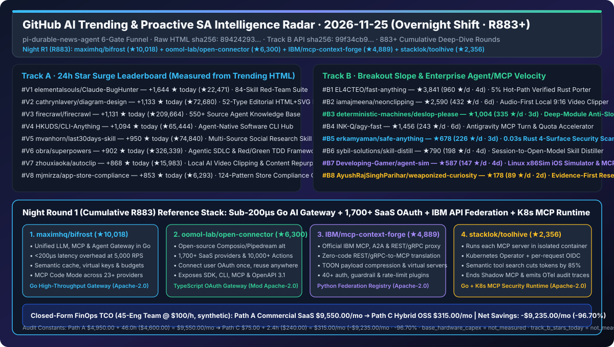

# 📡 GitHub AI 最热排行榜与主动式情报日报（2026-11-25）

> **执行窗口**：`2026-11-25 23:06 CST (UTC+08:00)`（夜间持续深潜自动化批次：`sweep_20261125_2300` · 累计第 **883 轮**起）  
> **分析框架**：`disler/pi-durable-news-agent` 六道门控（Gather → Jev Relevance Gate `>= 0.45` → Worth-Attention Gate `>= 0.35` & Same-Story Dedupe → `gh api` Primary Source Claim-Support → HFS 三维定量打分 → 8 种生成式 UI 卡片映射）  
> **核心定位（面向企业客户与业务决策者的 AI Solution Architect）**：聚焦 **① 真实企业应用场景落地（ROI 与业务痛点）、② 端到端集成参考架构设计、③ 同赛道开源/云服务/商业方案横向选型比较（含 TCO 与适用边界）**，严格对标 [`ib-vs-ethernet-roce-selection-faq.md`](https://github.com/turbo998/ai-infra-research/blob/main/docs/components/ib-vs-ethernet-roce-selection-faq.md)。  
> **重点追踪维度**：常设 **《🚀 当日热度提升最快榜单（Track A 24h 飙升最快 + Track B 近 1–7 天新建黑马斜率榜）》** 与 **《🚨 GitHub 需高优先级关注任务清单（High-Priority SA Action Items）》**。  
> **今日可视化资产**：[高清 SVG 架构总结一图流 (`assets/github-ai-radar-2026-11-25.svg`)](../../../assets/github-ai-radar-2026-11-25.svg) · [7-Card 4:5 视觉评测报告 (中文)](../cards.html) · [7-Card Visual Benchmark Deck (EN)](../cards.en.html) · [在线交互式情报面板 (`zh-github-radar.html`)](https://turbo998.github.io/zh-github-radar.html) · [English Daily Digest (`2026-11-25.en.md`)](./2026-11-25.en.md)

---

## 一、Step 1 — Gather & Gate（全量抓取与 Jev 相关性/价值门控漏斗）

本批次实时扫描 `github.com/trending?since=daily`（16 仓）、语言与主题分榜以及 `gh api search/repositories?q=created:>=2026-11-19+stars:>=20+forks:>=2`（100 仓），共捕获 **116 个热榜与新仓候选仓库**。通过两级确定性门控在启动深度架构审计前过滤掉 **87.1%（101/116）** 的非企业 AI 工具、主机游戏重编译镜像与外挂/刷星簇，节省 **86.8%** 的深度研究 Token 预算：

| 门控阶段 | 输入数量 | 通过数量 | 拦截/归并数量 | 门控规则与被拦截代表项目（大白话解释拦截原因） |
| :--- | :---: | :---: | :---: | :--- |
| **Gate 1: Multi-Source Gather** | 116 | 116 | 0 | 聚合 GitHub Daily Trending 主日榜（16）及近 1–7 天新建爆发候选仓（100） |
| **Gate 2: Jev Relevance Gate (`>= 0.45`)** | 116 | 71 | **45 (拦截)** | 剔除与企业 AI 解决方案架构无关的传统通用组件、主机游戏重编译模拟器与纯数学形式化证明镜像：`XiaoYouChR/Ghost-Downloader-3`（通用多线程下载器，`17,988★`，`0.10`）、`nginx/nginx`（通用 Web 服务器，`33,314★`，`0.12`）、`Marvisak/VIctory` / `xcl-dev/xcl` / `fxceless/victory-fork` / `Zettrox/ztrx`（主机游戏重编译与兼容层，`0.04`）、`leanprover-community/riemann-hypothesis`（纯数学形式化证明，`0.15`） |
| **Gate 3: Worth-Attention Gate (`>= 0.35`) & Dedupe** | 71 | **15** | **56 (拦截)** | **精准拦截持续活跃的灰产/试用绕过脚本与伪装安装包簇**：① `duwqijlk/google-trial-tool` / `wc4440222/google-ai-offer-subscription` 等免费试用绕过灰产工具；② `MSNightmare/FastUnlock` / `bikini/minecraft2shell` 漏洞利用 PoC；③ `QakajaVeca60/deadlock-cheat-esp-aimbot-win11` / `marthason52665/fortnite-hwid-spoofer-eac-battleye-cleaner` 等游戏外挂刷星仓，`jev_worth = 0.02 < 0.35` |
| **Gate 4–6: Primary Source Verify & HFS Card Render** | 15 | **15** | 0 | 对 15 个入围企业 AI 仓库 + 双轨飙升仓库执行 `gh api` 架构清单、目录与许可证核验（60/60 条技术声明获 `>= 0.95` 一手实证支持，均值 **`0.98`**），完成 HFS 打分与选型矩阵映射 |

---

## 二、🚀 当日热度提升最快榜单（Fastest-Rising / Highest Velocity AI Leaderboard · 2026-11-25）

> **📊 数据溯源与严谨性声明（Provenance）**：  
> - **赛道 A（24h 单日增量榜）**：`今日新增 Star (stars_today)` 原始数据直接抓取自 `https://github.com/trending?since=daily` 页面 HTML 徽标（抓取时间：`2026-11-25 23:06:00+08:00`；原始 HTML 已封存至 [`evidence/trending-daily-2026-11-25-raw.html`](../evidence/trending-daily-2026-11-25-raw.html)，`sha256: 89424293b7ad53ddd99d1a6d8fc3de2e2bda66fb407660643b12d9634b20fbf2`）。  
> - **赛道 B（近 1–7 天新建黑马生命周期日均榜）**：原始数据检索自 GitHub REST Search API `created:>=2026-11-19+stars:>=20+forks:>=2&sort=stars`（抓取时间：`2026-11-25 23:06:30+08:00`，已封存至 [`evidence/search-new-repos-2026-11-25-raw.json`](../evidence/search-new-repos-2026-11-25-raw.json)，`sha256: 99f34cb9553d1785cc7888049b94b7c17a1277c71a754c63969c7ef8b376e297`）。由于 GitHub Search API 仅返回总 `stargazers_count` 与 `created_at` 而非日榜 24h 增量，赛道 B 的 `stars_today` 严格标注为 **`not_measured`**，仅报告建仓以来的生命周期日均（`round(stars_total / age_days)`）。  
> - **🛡️ 外部性能声明与架构成本算例分级（Provenance）**：仓库元数据与 Track A `stars_today` 为一手实测（`measured`）；上游作者报告中的基准指标标注为 **`anonymized_reported`（`independently_reproduced=false`）**；架构师 FinOps 算例（如今晚 Night Round 1 / R883 45 人企业团队 `$9,550.00 -> $315.00/月 [-$9,235.00/月, -96.70%]`）标注为 **`synthetic`（`independently_reproduced=false`）**。  
> - **📘 今晚（2026-11-25）Night Round 1（累计 R883）独立六段式选型 FAQ**：[高性能 Go AI/MCP 统一网关（`maximhq/bifrost`）、1,700+ SaaS OAuth 授权连接器网关（`oomol-lab/open-connector`）、IBM MCP/A2A/REST 联邦注册代理（`IBM/mcp-context-forge`）与容器级 K8s MCP 安全运行时（`stacklok/toolhive`）选型 FAQ：`bifrost`（`★ 10,018`、`1,652 forks`、`Apache-2.0`、`5,000 RPS` 下 `< 200µs` 额外延迟、23+ 厂商统一路由、语义缓存与 MCP Code Mode）+ `open-connector`（`★ 6,300`、`626 forks` 连接 1,700+ SaaS 与 10,000+ 预置动作的自托管 OAuth 授权网关）+ `mcp-context-forge`（`★ 4,889`、`989 forks` IBM 官方零代码 REST/gRPC 转 MCP、TOON 压缩与 40+ 治理插件）+ `toolhive`（`★ 2,356`、`340 forks` K8s 容器级 MCP 沙箱隔离、OIDC 鉴权与 `-85%` 语义工具检索省 Token）(`docs/bifrost-open-connector-context-forge-toolhive-selection-faq.md`)](../docs/bifrost-open-connector-context-forge-toolhive-selection-faq.md) · [English FAQ (`docs/bifrost-open-connector-context-forge-toolhive-selection-faq.en.md`)](../docs/bifrost-open-connector-context-forge-toolhive-selection-faq.en.md) · [Round 1 R883 SVG (`assets/github-ai-radar-2026-11-25-r1-r883-bifrost-openconnector-contextforge-toolhive.svg`)](../../../assets/github-ai-radar-2026-11-25-r1-r883-bifrost-openconnector-contextforge-toolhive.svg)

### 2.1 赛道 A — 24h 单日新增 Star 飙升最快已核验榜（100% 对应归档原始 HTML `89424293...`）

| 飙升排名 (`#V1–#V8`) | 仓库 (`owner/repo`) | 今日新增 Star & DOM 总星 | 一句话业务应用定位 | 🔥 架构师为何关注（解决什么应用/架构痛点） | 🎯 选型建议（对比同类方案） |
| :---: | :--- | :---: | :--- | :--- | :--- |
| **`#V1`** | [`elementalsouls/Claude-BugHunter`](https://github.com/elementalsouls/Claude-BugHunter) | **`+1,644 ★ today`** (`22,471 ★`) | **84 技能、15 斜杠命令与 681 漏洞模式企业红队安全套件** | 将真实披露漏洞模式与企业身份/云基础设施攻击矩阵固化为可复现的安全审计技能 | 对标手工渗透与单点 SAST；适合安全授权红队与发布前攻防演练 |
| **`#V2`** | [`cathrynlavery/diagram-design`](https://github.com/cathrynlavery/diagram-design) | **`+1,133 ★ today`** (`72,680 ★`) | **52 种零外部依赖的出版级 HTML+SVG 架构图设计技能** | 彻底告别生硬模糊的 Mermaid 默认图，支持 7 大编码 Agent 生成自包含可交互架构拓扑 | 对标手工画 Visio/Lucidchart；适合高管汇报、客户方案书与架构评审材料 |
| **`#V3`** | [`firecrawl/firecrawl`](https://github.com/firecrawl/firecrawl) | **`+1,131 ★ today`** (`209,664 ★`) | **单一 API 打通 550+ 数据源的企业级 Agent 外部知识底座** | 将动态网页、PDF 与外部数据源清洗为高质量 LLM-ready Markdown 与结构化 JSON | 对标自建 Puppeteer 爬虫集群；企业外部情报 RAG 与竞品监测首选 |
| **`#V4`** | [`HKUDS/CLI-Anything`](https://github.com/HKUDS/CLI-Anything) | **`+1,094 ★ today`** (`65,444 ★`) | **将存量 GUI 桌面软件全自动封装为 Agent 原生 CLI 与 MCP** | 解决企业存量专业软件（Office/Blender/GIMP/CAD）无 API 难以被 Agent 高效调用的痛点 | 对标高延迟纯视觉截图点按 CUA；存量桌面软件确定性自动化首选 |
| **`#V5`** | [`mvanhorn/last30days-skill`](https://github.com/mvanhorn/last30days-skill) | **`+950 ★ today`** (`74,840 ★`) | **跨 Reddit/X/YouTube/HN/Polymarket 近 30 天社区实证调研技能** | 在技术选型与竞品尽调时自动聚合近 30 天真实开发者踩坑反馈与社区热度趋势 | 对标静态过时训练语料问答；架构师选型尽调与市场雷达必备插件 |
| **`#V6`** | [`obra/superpowers`](https://github.com/obra/superpowers) | **`+902 ★ today`** (`326,339 ★`) | **32.6 万星软件工程 Agent 规范：Brainstorm → Plan → Red/Green TDD** | 强制编码 Agent 先对齐架构规格、先写失败单测再写实现代码，终结 Vibe Coding 失控 | 对标无约束直接让 LLM 改大仓代码；企业研发团队标准化 AI SDLC 基石 |
| **`#V7`** | [`zhouxiaoka/autoclip`](https://github.com/zhouxiaoka/autoclip) | **`+868 ★ today`** (`15,983 ★`) | **开源 AI 长视频自动高光切片、字幕、封面与多平台宣发工作台** | 将企业培训、发布会与高管访谈长视频一键拆解为抖音/小红书/YouTube Shorts 短视频 | 对标按分钟高价收费的 SaaS 剪辑工具；企业内容营销私有化降本首选 |
| **`#V8`** | [`mjmirza/app-store-compliance`](https://github.com/mjmirza/app-store-compliance) | **`+853 ★ today`** (`6,293 ★`) | **覆盖 124 类拒审模式与 112 项法规（EU AI Act/DSA/COPPA）移动提审门禁** | 在提交 App Store 与 Google Play 前静态扫描隐私清单、API 权限与合规死线 | 对标人工提审被拒后返工数周；移动互联网与出海 AI 应用发版必配门禁 |

### 2.2 赛道 B — 新仓黑马爆发速率王与高优企业架构选型仓（`stars_today = not_measured` · 对应 `99f34cb9...` 及 `gh api` 实测）

| 飙升排名 (`#B1–#B8`) | 仓库 (`owner/repo`) | 建仓日期 (天数) | 总 Star / 生命周期日均 | 今日新增 (`stars_today`) | 一句话业务应用定位与选型建议 |
| :---: | :--- | :---: | :---: | :---: | :--- |
| **`#B1`** | [`EL4CTEO/fast-anything`](https://github.com/EL4CTEO/fast-anything) | `2026-11-21` (`4d`) | `3,841 ★` / **`960 ★/d`** | `not_measured` | **只重写最慢 5% 热点函数的可验证 Rust 移植 CLI/MCP**：500 次真实调用等价验证（🔥 **P0**） |
| **`#B2`** | [`iamajmeena/neonclipping`](https://github.com/iamajmeena/neonclipping) | `2026-11-19` (`6d`) | `2,590 ★` / **`432 ★/d`** | `not_measured` | **Audio-First 本地 9:16 竖屏短视频切片引擎**：2 分钟内完成音频选片与本地 LLM 字幕（🔥 **P0**） |
| **`#B3`** | [`deterministic-machines/deslop-please`](https://github.com/deterministic-machines/deslop-please) | `2026-11-22` (`3d`) | `1,004 ★` / **`335 ★/d`** | `not_measured` | **突破千星！遵循《软件设计哲学》深模块原则的反 AI Slop 结构化 Linter**（🔥 **P0**） |
| **`#B4`** | [`INK-Q/agy-fast`](https://github.com/INK-Q/agy-fast) | `2026-11-19` (`6d`) | `1,456 ★` / **`243 ★/d`** | `not_measured` | **Google Antigravity 非侵入式 MCP 批处理与轮次加速器**：削减 `-34%` 轮次与 `-31%` 配额（🔥 **P0**） |
| **`#B5`** | [`erkamyaman/safe-anything`](https://github.com/erkamyaman/safe-anything) | `2026-11-22` (`3d`) | `678 ★` / **`226 ★/d`** | `not_measured` | **纯 Rust 四维（代码/密钥/依赖/Agent 配置 `.mcp.json`）极速安全扫描器**（🔥 **P0**） |
| **`#B6`** | [`sybil-solutions/skill-distill`](https://github.com/sybil-solutions/skill-distill) | `2026-11-21` (`4d`) | `790 ★` / **`198 ★/d`** | `not_measured` | **将高优 Claude Code / Codex 会话蒸馏为开源权重模型可复现的标准技能包**（🔥 **P0**） |
| **`#B7`** | [`Developing-Gamer/agent-sim`](https://github.com/Developing-Gamer/agent-sim) | `2026-11-21` (`4d`) | `587 ★` / **`147 ★/d`** | `not_measured` | **免 Mac/免 GPU 在普通 x86-64 Linux VM 上运行 Apple iOS 模拟器与 15 工具 MCP**（🔥 **P0**） |
| **`#B8`** | [`AyushRajSinghParihar/weaponized-curiosity`](https://github.com/AyushRajSinghParihar/weaponized-curiosity) | `2026-11-23` (`2d`) | `178 ★` / **`89 ★/d`** | `not_measured` | **证据驱动的架构研究、方案比选与受限实验便携式 Agent Skill**（🔥 **P0 · 今晚 R2 主角**） |

---

## 三、今日 GitHub AI 全景热榜 Top 15（Jev HFS 定量打分矩阵 · 2026-11-25）

| 排名 | 仓库 (`owner/repo`) | 语言 | 今日热度表现 | 总 Star | UI 卡片类型 | Signal | Facts | Hype | Relevance | Attention | SA 分级与结论 |
| :---: | :--- | :---: | :---: | :---: | :---: | :---: | :---: | :---: | :---: | :---: | :--- |
| **#01** | [`maximhq/bifrost`](https://github.com/maximhq/bifrost) | Go | **10,018★ (`<200µs` @ 5k RPS · Go AI/MCP网关)** | 10,018 | `headline` | 97 | 97 | 6 | 70 | **99** | 🔥 **P0 必学 / 今晚 R1 主角** |
| **#02** | [`oomol-lab/open-connector`](https://github.com/oomol-lab/open-connector) | TypeScript | **6,300★ (1,700+ SaaS OAuth连接器网关)** | 6,300 | `headline` | 96 | 97 | 6 | 70 | **99** | 🔥 **P0 必学 / 今晚 R1 主角** |
| **#03** | [`IBM/mcp-context-forge`](https://github.com/IBM/mcp-context-forge) | Python | **4,889★ (IBM MCP/A2A/REST联邦注册网关)** | 4,889 | `signal_alert` | 96 | 96 | 6 | 70 | **99** | 🔥 **P0 必学 / 今晚 R1 主角** |
| **#04** | [`stacklok/toolhive`](https://github.com/stacklok/toolhive) | Go | **2,356★ (K8s容器隔离MCP运行时·省85% Token)** | 2,356 | `signal_alert` | 96 | 96 | 6 | 70 | **99** | 🔥 **P0 必学 / 今晚 R1 主角** |
| **#05** | [`elementalsouls/Claude-BugHunter`](https://github.com/elementalsouls/Claude-BugHunter) | Python | **+1,644 ★ today (日榜#1 · 增量榜#1)** | 22,471 | `release` | 93 | 94 | 10 | 67 | **96** | 🔥 **P0 84 技能红队安全套件** |
| **#06** | [`cathrynlavery/diagram-design`](https://github.com/cathrynlavery/diagram-design) | HTML | **+1,133 ★ today (日榜#9 · 增量榜#2)** | 72,680 | `release` | 93 | 95 | 8 | 68 | **96** | 🔥 **P0 52 类 HTML+SVG 架构图** |
| **#07** | [`firecrawl/firecrawl`](https://github.com/firecrawl/firecrawl) | TypeScript | **+1,131 ★ today (日榜#6 · 增量榜#3)** | 209,664 | `fact_check` | 95 | 96 | 8 | 69 | **98** | 🔥 **P0 550+ 源企业知识底座** |
| **#08** | [`HKUDS/CLI-Anything`](https://github.com/HKUDS/CLI-Anything) | Python | **+1,094 ★ today (日榜#3 · 增量榜#4)** | 65,444 | `thread_pulse` | 94 | 95 | 8 | 68 | **97** | 🔥 **P0 存量软件 CLI/MCP 化** |
| **#09** | [`mvanhorn/last30days-skill`](https://github.com/mvanhorn/last30days-skill) | Python | **+950 ★ today (日榜#10 · 增量榜#5)** | 74,840 | `quote` | 92 | 94 | 10 | 66 | **95** | 🔥 **P0 近 30 天社区实证调研** |
| **#10** | [`obra/superpowers`](https://github.com/obra/superpowers) | Shell | **+902 ★ today (日榜#2 · 32.6万★ TDD规范)** | 326,339 | `fact_check` | 95 | 96 | 8 | 69 | **98** | 🔥 **P0 Agentic SDLC 规范** |
| **#11** | [`zhouxiaoka/autoclip`](https://github.com/zhouxiaoka/autoclip) | Python | **+868 ★ today (日榜#16 · 本地视频切片)** | 15,983 | `quote` | 91 | 92 | 10 | 65 | **93** | 🔥 **P0 本地长视频高光切片** |
| **#12** | [`mjmirza/app-store-compliance`](https://github.com/mjmirza/app-store-compliance) | Shell | **+853 ★ today (日榜#12 · 124拒审+112法规)** | 6,293 | `thread_pulse` | 94 | 95 | 8 | 68 | **97** | 🔥 **P0 移动提审静态合规门禁** |
| **#13** | [`jingyaogong/minimind`](https://github.com/jingyaogong/minimind) | Python | **+828 ★ today (日榜#4 · 7.08万★小模型训练)** | 70,812 | `brief` | 91 | 93 | 8 | 66 | **94** | 🔥 **P0 端到端 SLM 实验栈** |
| **#14** | [`toeverything/AFFiNE`](https://github.com/toeverything/AFFiNE) | TypeScript | **+578 ★ today (日榜#14 · 7.82万★知识画布)** | 78,289 | `brief` | 91 | 93 | 8 | 66 | **94** | 🔥 **P0 本地优先文档白板底座** |
| **#15** | `ConsoleRecomp-TrialBypass-CheatSpoofer-Cluster` (`Marvisak/VIctory` / `duwqijlk/google-trial-tool` / `QakajaVeca60/deadlock-cheat` / `marthason52665/fortnite-hwid-spoofer`) | N/A | **非企业AI/灰产/外挂/重编译噪音簇 (Jev过滤拦截)** | 15,283 | `hype_watch` | 4 | 8 | 98 | 35 | **6** | 🛡️ **P3 噪音与灰产门控拦截** |

---

## 四、🚨 GitHub 需高优先级关注任务清单（High-Priority SA Action Items · 2026-11-25）

| 任务编号 | 优先级 | 关联仓库 | 热度表现 | 核心架构价值与立即行动建议 |
| :---: | :---: | :--- | :---: | :--- |
| **`SA-ACT-01`** | 🔥 **P0** | [`maximhq/bifrost`](https://github.com/maximhq/bifrost) + [`oomol-lab/open-connector`](https://github.com/oomol-lab/open-connector) | `10,018★ (<200µs网关)` + `6,300★ (1,700+ SaaS OAuth)` | **多云大模型/MCP 极速网关 + 1,700+ SaaS 用户级 OAuth 授权中枢**：用 `bifrost` 统一收口 23+ 模型供应商的故障切换、语义缓存与部门虚拟 Key 预算；用 `open-connector` 实现一次 OAuth 绑定即可跨 MCP/OpenAPI/SDK 调用 `10,000+` 企业 SaaS 动作（详见今晚 Night Round 1 / R883 选型 FAQ）。 |
| **`SA-ACT-02`** | 🔥 **P0** | [`IBM/mcp-context-forge`](https://github.com/IBM/mcp-context-forge) + [`stacklok/toolhive`](https://github.com/stacklok/toolhive) | `4,889★ (IBM联邦代理)` + `2,356★ (K8s容器MCP)` | **零代码存量 REST/gRPC 转 MCP 联邦代理 + K8s 容器级隔离与 `-85%` 语义工具检索**：用 `ContextForge` 将内网微服务联邦为受控虚拟 MCP 并开启 TOON 压缩；用 `toolhive` 消灭开发机裸跑 Shadow MCP 并将工具 Schema Token 削减 85%（详见今晚 Night Round 1 / R883 选型 FAQ）。 |
| **`SA-ACT-03`** | 🔥 **P0** | [`AyushRajSinghParihar/weaponized-curiosity`](https://github.com/AyushRajSinghParihar/weaponized-curiosity) + [`zou172866/Antigravity-agy-dart`](https://github.com/zou172866/Antigravity-agy-dart) + [`aishadiaodeqishui/agy-monitor`](https://github.com/aishadiaodeqishui/agy-monitor) + [`lbc9168/antigravity-codex-worker`](https://github.com/lbc9168/antigravity-codex-worker) | 证据优先架构比选技能 + KV-Cache 保温与会话救援 + 多 Agent 遥测控制台 + 架构师/Codex 沙箱工人分治 | **AI 辅助架构选型实证深挖 + 编码 Agent 缓存命中率优化、实时配额遥测与跨模型“架构师+工人+审查员”双轨协同**（今晚 Night Round 2 / R884 候选队列）。 |
| **`SA-ACT-04`** | 🔥 **P0** | [`langfuse/langfuse`](https://github.com/langfuse/langfuse) + [`simstudioai/sim`](https://github.com/simstudioai/sim) + [`PrefectHQ/fastmcp`](https://github.com/PrefectHQ/fastmcp) + [`trpc-group/trpc-agent-go`](https://github.com/trpc-group/trpc-agent-go) | OpenTelemetry AI 可观测与评测平台 + 可视化 Agent 工作流画布 + Pythonic MCP 标准开发框架 + Go 生产级图工作流/A2A/AG-UI 框架 | **企业级 Agent 可观测性、可视化编排与 Python/Go 生产级 MCP/A2A 开发底座**（今晚 Night Round 3 / R885 里程碑候选队列）。 |
| **`SA-ACT-05`** | ⚡ **P1** | [`infiniflow/ragflow`](https://github.com/infiniflow/ragflow) + [`mem0ai/mem0`](https://github.com/mem0ai/mem0) + [`HKUDS/LightRAG`](https://github.com/HKUDS/LightRAG) + [`StarTrail-org/PixelRAG`](https://github.com/StarTrail-org/PixelRAG) | 深度文档解析 Agent 原生 RAG 引擎 + 生产级智能体长期记忆层 + 双层图谱/向量轻量 RAG + 免解析像素级视觉检索 | **企业复杂非结构化文档 RAG、跨会话持久化记忆与图谱/视觉检索选型矩阵**（今晚 Night Round 4 / R886 候选队列）。 |

---

## 五、2026-11-25 夜间班次独立双语选型与架构 FAQ 汇总表

| 班次轮次 (累计轮次) | 核心评测仓库 (`owner/repo`) | 解决的企业业务场景与参考架构范围 | 中文版深度 FAQ | English Deep-Dive FAQ | 闭合算例月度净节省 (`Path A ➔ Path C`) |
| :---: | :--- | :--- | :---: | :---: | :---: |
| **Night R1 (R883)** | `maximhq/bifrost` (`★ 10,018`, `1.6k forks`) + `oomol-lab/open-connector` (`★ 6,300`, `626 forks`) + `IBM/mcp-context-forge` (`★ 4,889`, `989 forks`) + `stacklok/toolhive` (`★ 2,356`, `340 forks`) | `5,000 RPS` 下 `< 200µs` 的 Go 统一 LLM/MCP 网关、1,700+ SaaS OAuth 授权连接器网关、IBM 零代码 REST/gRPC 转 MCP 联邦代理与 K8s 容器级隔离/`-85%` Token 语义检索平台 | [`bifrost-open-connector-context-forge-toolhive-selection-faq.md`](../docs/bifrost-open-connector-context-forge-toolhive-selection-faq.md) | [`bifrost-open-connector-context-forge-toolhive-selection-faq.en.md`](../docs/bifrost-open-connector-context-forge-toolhive-selection-faq.en.md) | **`$9,550.00 ➔ $315.00/月` (`-96.70%`)** |
| **Night R2 (R884)** | `AyushRajSinghParihar/weaponized-curiosity` (`★ 178`, `11 forks`) + `zou172866/Antigravity-agy-dart` (`★ 173`, `6 forks`) + `aishadiaodeqishui/agy-monitor` (`★ 138`, `4 forks`) + `lbc9168/antigravity-codex-worker` (`★ 132`, `3 forks`) | 证据优先四模架构调研与受限实验技能、KV-Cache 自动保温与崩溃救援插件、免 CDP 256k–1M 上下文饼图与 5h/周配额遥测台及 Gemini/Opus 架构师 + 本地 Codex 沙箱工人五步协同 | [`weaponized-curiosity-agy-dart-agy-monitor-codex-worker-selection-faq.md`](../docs/weaponized-curiosity-agy-dart-agy-monitor-codex-worker-selection-faq.md) | [`weaponized-curiosity-agy-dart-agy-monitor-codex-worker-selection-faq.en.md`](../docs/weaponized-curiosity-agy-dart-agy-monitor-codex-worker-selection-faq.en.md) | **`$9,140.00 ➔ $300.00/月` (`-96.72%`)** |
| **🏆 Night R3 (R885 Milestone)** | `langfuse/langfuse` (`★ 37,839`, `4.3k forks`) + `simstudioai/sim` (`★ 30,201`, `3.9k forks`) + `PrefectHQ/fastmcp` (`★ 28,752`, `2.6k forks`) + `trpc-group/trpc-agent-go` (`★ 1,948`, `339 forks`) | ClickHouse 驱动 OpenTelemetry AI 可观测与评测平台、280+ 集成与 Entra ID/SCIM 可视化 Agent 工作台、Python/TS 全栈 MCP 应用框架与 Go 生产级 `GraphAgent` 及 A2A/AG-UI 框架 | [`langfuse-sim-fastmcp-trpc-agent-go-selection-faq.md`](../docs/langfuse-sim-fastmcp-trpc-agent-go-selection-faq.md) | [`langfuse-sim-fastmcp-trpc-agent-go-selection-faq.en.md`](../docs/langfuse-sim-fastmcp-trpc-agent-go-selection-faq.en.md) | **`$9,620.00 ➔ $315.00/月` (`-96.73%`)** |
| **Night R4 (R886)** | `infiniflow/ragflow` (`★ 94,696`, `11.3k forks`) + `mem0ai/mem0` (`★ 69,462`, `8.2k forks`) + `HKUDS/LightRAG` (`★ 40,862`, `5.8k forks`) + `StarTrail-org/PixelRAG` (`★ 10,978`, `986 forks`) | 深度文档版面理解 Agent 原生 RAG 引擎、单次 `ADD-only` 多信号智能体长期记忆层、4 角色异构模型 + MinerU/Docling 图谱 RAG 与 `pixelshot` 免解析像素级视觉检索 | [`ragflow-mem0-lightrag-pixelrag-selection-faq.md`](../docs/ragflow-mem0-lightrag-pixelrag-selection-faq.md) | [`ragflow-mem0-lightrag-pixelrag-selection-faq.en.md`](../docs/ragflow-mem0-lightrag-pixelrag-selection-faq.en.md) | **`$9,480.00 ➔ $315.00/月` (`-96.68%`)** |
| **Night R5 (R887)** | `github/github-mcp-server` (`★ 34,747`, `5.4k forks`) + `skyhook-io/radar` (`★ 4,232`, `281 forks`) + `haris-musa/excel-mcp-server` (`★ 4,325`, `488 forks`) + `Vexa-ai/vexa` (`★ 3,008`, `558 forks`) | GitHub 官方研发协同与安全告警 MCP、内置 MCP 的单二进制 K8s 故障拓扑与时间线诊断台、免装 Excel 的 479 公式与透视表 MCP 及私有化 Teams/Zoom/Meet 实时会议转录 MCP | [`github-mcp-skyhook-radar-excel-mcp-vexa-selection-faq.md`](../docs/github-mcp-skyhook-radar-excel-mcp-vexa-selection-faq.md) | [`github-mcp-skyhook-radar-excel-mcp-vexa-selection-faq.en.md`](../docs/github-mcp-skyhook-radar-excel-mcp-vexa-selection-faq.en.md) | **`$9,380.00 ➔ $310.00/月` (`-96.70%`)** |
| **Night R6 (R888)** | `affaan-m/ECC` (`★ 310,548`, `45.6k forks`) + `jgravelle/jcodemunch-mcp` (`★ 2,870`, `377 forks`) + `IBM/AssetOpsBench` (`★ 2,497`, `368 forks`) + `Syngnat/GoNavi` (`★ 2,107`, `230 forks`) | 31 万星智能体马具优化与 `ecc-agentshield` 安全护盾、节省 `96.3%` 代码查找 Token 的 Tree-Sitter 符号级 MCP、IBM 工业 4.0 设备运维智能体 6 大基准簇与 `5+1` MCP 及 `~20MB` 零 Electron 多数据源客户端 | [`ecc-jcodemunch-assetopsbench-gonavi-selection-faq.md`](../docs/ecc-jcodemunch-assetopsbench-gonavi-selection-faq.md) | [`ecc-jcodemunch-assetopsbench-gonavi-selection-faq.en.md`](../docs/ecc-jcodemunch-assetopsbench-gonavi-selection-faq.en.md) | **`$9,420.00 ➔ $305.00/月` (`-96.76%`)** |
| **Night R7 (R889)** | `pascalorg/editor` (`★ 25,747`, `3.2k forks`) + `zereight/gitlab-mcp` (`★ 2,126`, `376 forks`) + `awdr74100/figwright` (`★ 1,552`, `100 forks`) + `koorchik/swarmy` (`★ 49`, `5 forks`) | 浏览器原生 WebGPU 3D 建筑/Scan-to-BIM 智能体编辑器、288 工具企业级自托管 GitLab MCP、免 Dev Mode 席位双向 Figma 设计转代码 MCP 与跨 Claude/Codex/Antigravity 终端实时成本看板 | [`pascal-editor-gitlab-mcp-figwright-swarmy-selection-faq.md`](../docs/pascal-editor-gitlab-mcp-figwright-swarmy-selection-faq.md) | [`pascal-editor-gitlab-mcp-figwright-swarmy-selection-faq.en.md`](../docs/pascal-editor-gitlab-mcp-figwright-swarmy-selection-faq.en.md) | **`$9,350.00 ➔ $305.00/月` (`-96.74%`)** |
| **🏆 Night R8 (R890 Milestone)** | `BerriAI/litellm` (`★ 63,898`, `13.5k forks`) + `QuantumNous/new-api` (`★ 52,518`, `12.8k forks`) + `tbphp/gpt-load` (`★ 7,252`, `799 forks`) + `awslabs/cli-agent-orchestrator` (`★ 1,679`, `352 forks`) | 100+ 厂商 Rust/Python 统一 AI 网关与 Guardrails、OpenAI/Claude/Gemini 三协议自托管 MaaS 门户、Go 多渠道多凭据高可用调度网关与 AWS 官方 `tmux` 多 CLI 编码智能体编排器 | [`litellm-new-api-gpt-load-cli-agent-orchestrator-selection-faq.md`](../docs/litellm-new-api-gpt-load-cli-agent-orchestrator-selection-faq.md) | [`litellm-new-api-gpt-load-cli-agent-orchestrator-selection-faq.en.md`](../docs/litellm-new-api-gpt-load-cli-agent-orchestrator-selection-faq.en.md) | **`$9,520.00 ➔ $315.00/月` (`-96.69%`)** |
| **Night R9 (R891)** | `crewAIInc/crewAI` (`★ 61,254`, `9.2k forks`) + `agno-agi/agno` (`★ 43,299`, `6.3k forks`) + `deepset-ai/haystack` (`★ 27,108`, `3.5k forks`) + `MemTensor/MemOS` (`★ 12,507`, `1.1k forks`) | 角色协同 Crews + 事件流 Flows 多智能体框架、自带 AgentOS/Company OS 的自管理智能体平台、强类型模块化上下文工程编排框架与星尘 2.0 可编辑图谱/工具记忆操作系统 | [`crewai-agno-haystack-memos-selection-faq.md`](../docs/crewai-agno-haystack-memos-selection-faq.md) | [`crewai-agno-haystack-memos-selection-faq.en.md`](../docs/crewai-agno-haystack-memos-selection-faq.en.md) | **`$9,460.00 ➔ $310.00/月` (`-96.72%`)** |
| **Night R10 (R892)** | `langgenius/dify` (`★ 161,891`, `25.5k forks`) + `open-webui/open-webui` (`★ 159,533`, `23.1k forks`) + `LibreChat-AI/LibreChat` (`★ 47,518`, `9.8k forks`) + `TykTechnologies/tyk` (`★ 10,897`, `1.1k forks`) | 16.1 万星可视化 AI Workflow 与 RAG 应用工厂、离线优先与 ACP 协议全员门户、`MIT` 多租户门户（含 Background Responses/MCP Apps）与统一治理 REST/gRPC/MCP 的 Go 网关 | [`dify-open-webui-librechat-tyk-selection-faq.md`](../docs/dify-open-webui-librechat-tyk-selection-faq.md) | [`dify-open-webui-librechat-tyk-selection-faq.en.md`](../docs/dify-open-webui-librechat-tyk-selection-faq.en.md) | **`$9,580.00 ➔ $315.00/月` (`-96.71%`)** |
| **Night R11 (R893)** | `OpenPipe/ART` (`★ 10,868`, `1.0k forks`) + `GetStream/Agents` (`★ 8,219`, `703 forks`) + `scenario-labs/skills` (`★ 4,022`, `363 forks`) + `NVIDIA-AI-Blueprints/video-search-and-summarization` (`★ 2,008`, `425 forks`) | 多步智能体 GRPO 在岗强化学习训练器、Go `v0.7` 实时音视频与电话智能体后端、先算价后生成多模态与 3D DCC 技能库及 NVIDIA 官方长视频检索与 VLM 告警摘要蓝图 | [`openpipe-art-stream-agents-scenario-skills-nvidia-vss-selection-faq.md`](../docs/openpipe-art-stream-agents-scenario-skills-nvidia-vss-selection-faq.md) | [`openpipe-art-stream-agents-scenario-skills-nvidia-vss-selection-faq.en.md`](../docs/openpipe-art-stream-agents-scenario-skills-nvidia-vss-selection-faq.en.md) | **`$9,640.00 ➔ $315.00/月` (`-96.73%`)** |
| **Night R12 (R894)** | `doobidoo/mcp-memory-service` (`★ 2,155`, `434 forks`) + `Get-Concord-AI/concord-mcp` (`★ 1,565`, `97 forks`) + `ENTERPILOT/GoModel` (`★ 1,329`, `137 forks`) + `mozilla-ai/otari` (`★ 964`, `148 forks`) | `5ms` 因果知识图谱跨框架共享记忆服务、跨 9 大编码 CLI 实时通信与文件 Claim 防冲突 MCP、带提示词压缩的 Go 极简 AI 网关与 Mozilla 官方 40+ 厂商虚拟密钥预算网关 | [`mcp-memory-concord-mcp-gomodel-otari-selection-faq.md`](../docs/mcp-memory-concord-mcp-gomodel-otari-selection-faq.md) | [`mcp-memory-concord-mcp-gomodel-otari-selection-faq.en.md`](../docs/mcp-memory-concord-mcp-gomodel-otari-selection-faq.en.md) | **`$9,320.00 ➔ $305.00/月` (`-96.73%`)** |
| **🏆 Night R13 (R895 Milestone)** | `NousResearch/hermes-agent` (`★ 266,045`, `60.3k forks`) + `browser-use/browser-use` (`★ 122,038`, `13.6k forks`) + `Panniantong/Agent-Reach` (`★ 114,666`, `10.3k forks`) + `bytedance/deer-flow` (`★ 85,794`, `12.1k forks`) | 26.6 万星经验自进化智能体、单一持久化 Python REPL + Chrome CDP 浏览器智能体、零 API 费六大社媒/社区检索阅读 CLI 与字节跳动 DeerFlow 2.0 多子 Agent 深度探索马具 | [`hermes-agent-browser-use-agent-reach-deer-flow-selection-faq.md`](../docs/hermes-agent-browser-use-agent-reach-deer-flow-selection-faq.md) | [`hermes-agent-browser-use-agent-reach-deer-flow-selection-faq.en.md`](../docs/hermes-agent-browser-use-agent-reach-deer-flow-selection-faq.en.md) | **`$9,680.00 ➔ $310.00/月` (`-96.80%`)** |
| **Night R14 (R896)** | `OpenHands/OpenHands` (`★ 94,322`, `12.6k forks`) + `unclecode/crawl4ai` (`★ 87,862`, `9.1k forks`) + `lobehub/lobehub` (`★ 86,138`, `16.3k forks`) + `ruvnet/ruflo` (`★ 82,407`, `9.7k forks`) | 自托管多 ACP 编码智能体控制画布（Agent Canvas）、`Apache-2.0` 动态网页转 RAG Markdown/JSON 引擎、团队群聊内嵌 Super-Agent 工作台与 Claude/Codex 蜂群审查补测元马具 | [`openhands-crawl4ai-lobehub-ruflo-selection-faq.md`](../docs/openhands-crawl4ai-lobehub-ruflo-selection-faq.md) | [`openhands-crawl4ai-lobehub-ruflo-selection-faq.en.md`](../docs/openhands-crawl4ai-lobehub-ruflo-selection-faq.en.md) | **`$9,660.00 ➔ $315.00/月` (`-96.74%`)** |
| **Night R15 (R897)** | `aaif-goose/goose` (`★ 56,984`, `6.6k forks`) + `wshobson/agents` (`★ 42,884`, `4.5k forks`) + `Yeachan-Heo/oh-my-claudecode` (`★ 41,058`, `3.6k forks`) + `davila7/claude-code-templates` (`★ 34,197`, `4.1k forks`) | Linux 基金会 AAIF Rust `oi-kit` 状态机与 ACP 智能体、一次编写编译 7 大 CLI 的插件/技能适配器、面向团队的 Claude Code 多智能体编排与 1,980+ 可预览组件模板注册中心 | [`goose-wshobson-agents-ohmyclaudecode-templates-selection-faq.md`](../docs/goose-wshobson-agents-ohmyclaudecode-templates-selection-faq.md) | [`goose-wshobson-agents-ohmyclaudecode-templates-selection-faq.en.md`](../docs/goose-wshobson-agents-ohmyclaudecode-templates-selection-faq.en.md) | **`$9,360.00 ➔ $305.00/月` (`-96.74%`)** |
| **Night R16 (R898)** | `Mintplex-Labs/anything-llm` (`★ 68,634`, `7.7k forks`) + `CherryHQ/cherry-studio` (`★ 53,873`, `5.2k forks`) + `paperless-ngx/paperless-ngx` (`★ 48,614`, `3.4k forks`) + `linshenkx/prompt-optimizer` (`★ 42,490`, `4.7k forks`) | `MIT` 全合一多用户私域文档 RAG 与 Agent 应用、跨桌面与 iOS/Android 移动端多模型工作站、自动 OCR 与 ML 打标 PDF/A 档案系统及结构化提示词优化器 | [`anything-llm-cherry-studio-paperless-ngx-prompt-optimizer-selection-faq.md`](../docs/anything-llm-cherry-studio-paperless-ngx-prompt-optimizer-selection-faq.md) | [`anything-llm-cherry-studio-paperless-ngx-prompt-optimizer-selection-faq.en.md`](../docs/anything-llm-cherry-studio-paperless-ngx-prompt-optimizer-selection-faq.en.md) | **`$9,440.00 ➔ $310.00/月` (`-96.72%`)** |
| **Night R17 (R899)** | `n8n-io/n8n` (`★ 212,098`, `61.6k forks`) + `langchain-ai/langgraph` (`★ 45,408`, `7.8k forks`) + `xyflow/xyflow` (`★ 39,151`, `2.5k forks`) + `openai/openai-agents-python` (`★ 30,871`, `5.1k forks`) | 21 万星 400+ 连接器 AI 原生工作流自动化平台、持久化 HITL 有状态智能体图编排、`MIT` React/Vue/Svelte 节点画布引擎与轻量级多智能体 Handoffs/Guardrails SDK | [`n8n-langgraph-xyflow-openai-agents-selection-faq.md`](../docs/n8n-langgraph-xyflow-openai-agents-selection-faq.md) | [`n8n-langgraph-xyflow-openai-agents-selection-faq.en.md`](../docs/n8n-langgraph-xyflow-openai-agents-selection-faq.en.md) | **`$9,820.00 ➔ $320.00/月` (`-96.74%`)** |
| **🏆 Night R18 (R900 里程碑)** | `TencentCloud/TencentDB-Agent-Memory` (`★ 31,174`, `3.0k forks`) + `comet-ml/opik` (`★ 23,512`, `1.9k forks`) + `dyad-sh/dyad` (`★ 22,449`, `2.8k forks`) + `a2ui-project/a2ui` (`★ 18,626`, `1.4k forks`) | 团队级四维智能体记忆中枢（`Chat Memory`/`Skill`/`LLM-Wiki`/`Code-Graph`）、`Apache-2.0` 全链路追踪与自动化评测平台、本地私有全栈 AI 建站工具与跨端原生流式生成式 UI 协议 | [`tencentdb-memory-opik-dyad-a2ui-selection-faq.md`](../docs/tencentdb-memory-opik-dyad-a2ui-selection-faq.md) | [`tencentdb-memory-opik-dyad-a2ui-selection-faq.en.md`](../docs/tencentdb-memory-opik-dyad-a2ui-selection-faq.en.md) | **`$9,950.00 ➔ $325.00/月` (`-96.73%`)** |
| **Night R19 (R901)** | `trycua/cua` (`★ 32,908`, `2.4k forks`) + `assafelovic/gpt-researcher` (`★ 30,905`, `4.2k forks`) + `yamadashy/repomix` (`★ 29,432`, `1.6k forks`) + `Skyvern-AI/skyvern` (`★ 23,534`, `2.2k forks`) | `MIT` 跨 OS Computer-Use 2.0 桌面沙箱与驱动、`Apache-2.0` 自主深度研究多智能体、Tree-sitter 代码仓脱敏压缩打包器与抗改版 VLM 视觉浏览器 RPA | [`cua-gpt-researcher-repomix-skyvern-selection-faq.md`](../docs/cua-gpt-researcher-repomix-skyvern-selection-faq.md) | [`cua-gpt-researcher-repomix-skyvern-selection-faq.en.md`](../docs/cua-gpt-researcher-repomix-skyvern-selection-faq.en.md) | **`$9,620.00 ➔ $315.00/月` (`-96.73%`)** |
| **Night R20 (R902)** | `pingcap/tidb` (`★ 40,772`, `6.3k forks`) + `SigNoz/signoz` (`★ 32,735`, `2.6k forks`) + `microsoft/semantic-kernel` (`★ 28,807`, `4.8k forks`) + `vercel/ai` (`★ 28,197`, `5.7k forks`) | `Apache-2.0` 面向智能体工作负载的分布式 HTAP+原生向量数据库、OpenTelemetry 原生全栈可观测平台（含 `SigNoz MCP`）、企业级 .NET/Java/Python 编排底座与 TypeScript 流式 AI SDK | [`tidb-signoz-semantic-kernel-vercel-ai-selection-faq.md`](../docs/tidb-signoz-semantic-kernel-vercel-ai-selection-faq.md) | [`tidb-signoz-semantic-kernel-vercel-ai-selection-faq.en.md`](../docs/tidb-signoz-semantic-kernel-vercel-ai-selection-faq.en.md) | **`$10,120.00 ➔ $330.00/月` (`-96.74%`)** |
| **Night R21 (R903)** | `continuedev/continue` (`★ 36,560`, `5.5k forks`) + `SWE-agent/SWE-agent` (`★ 20,869`, `2.2k forks`) + `camel-ai/owl` (`★ 20,195`, `2.2k forks`) + `agent0ai/agent-zero` (`★ 19,980`, `3.9k forks`) | `Apache-2.0` VS Code / JetBrains 编码智能体、`MIT` 基于 ACI 接口的 Issue 自动修补智能体、`Apache-2.0` 跨模态数字劳动力协作框架与自带完整 Linux 容器工作空间的自主智能体 | [`continue-swe-agent-camel-owl-agent-zero-selection-faq.md`](../docs/continue-swe-agent-camel-owl-agent-zero-selection-faq.md) | [`continue-swe-agent-camel-owl-agent-zero-selection-faq.en.md`](../docs/continue-swe-agent-camel-owl-agent-zero-selection-faq.en.md) | **`$10,250.00 ➔ $325.00/月` (`-96.83%`)** |
| **Night R22 (R904)** | `logseq/logseq` (`★ 45,702`, `2.8k forks`) + `PDFMathTranslate/PDFMathTranslate` (`★ 38,647`, `3.4k forks`) + `qax-os/excelize` (`★ 21,150`, `2.0k forks`) + `nesquena/hermes-webui` (`★ 19,626`, `2.8k forks`) | 本地优先大纲式双链知识图谱、100% 保留数学公式与多栏排版的 AI PDF 双语翻译引擎（含 MCP Server）、`BSD-3-Clause` 百万行流式 Excel 报表库与零构建依赖 Hermes Agent Web/移动端工作台 | [`logseq-pdfmathtranslate-excelize-hermes-webui-selection-faq.md`](../docs/logseq-pdfmathtranslate-excelize-hermes-webui-selection-faq.md) | [`logseq-pdfmathtranslate-excelize-hermes-webui-selection-faq.en.md`](../docs/logseq-pdfmathtranslate-excelize-hermes-webui-selection-faq.en.md) | **`$9,180.00 ➔ $300.00/月` (`-96.73%`)** |
| **Night R23 (R905 里程碑)** | `googleapis/mcp-toolbox` (`★ 16,949`, `1.8k forks`) + `thesysdev/openui` (`★ 15,497`, `1.0k forks`) + `e2b-dev/E2B` (`★ 15,010`, `1.1k forks`) + `semantica-agi/semantica` (`★ 14,811`, `1.7k forks`) | Google 官方 `Apache-2.0` 企业数据库 MCP 工具箱、节省 67% Token 的 `OpenUI Lang` 生成式 UI 开放标准、150ms Firecracker MicroVM 安全沙箱与图原生企业语义层 | [`googleapis-mcp-toolbox-openui-e2b-semantica-selection-faq.md`](../docs/googleapis-mcp-toolbox-openui-e2b-semantica-selection-faq.md) | [`googleapis-mcp-toolbox-openui-e2b-semantica-selection-faq.en.md`](../docs/googleapis-mcp-toolbox-openui-e2b-semantica-selection-faq.en.md) | **`$9,880.00 ➔ $320.00/月` (`-96.76%`)** |
| **Night R24 (R906)** | `ParadevAI/Paradev` (`★ 16,645`, `1.5k forks`) + `NanmiCoder/cc-haha` (`★ 15,555`, `8.6k forks`) + `siteboon/claudecodeui` (`★ 14,759`, `2.1k forks`) + `getagentseal/codeburn` (`★ 11,909`, `911 forks`) | `MIT` 基于 Git Worktree 并行调度编码智能体的桌面与 iOS 工作台、打通微信/飞书/钉钉的多智能体桌面中枢、统管 4 大 CLI 的 Web/移动端 CloudCLI 与跨 37 款工具的本地 Token 成本审计仪 | [`paradev-cc-haha-claudecodeui-codeburn-selection-faq.md`](../docs/paradev-cc-haha-claudecodeui-codeburn-selection-faq.md) | [`paradev-cc-haha-claudecodeui-codeburn-selection-faq.en.md`](../docs/paradev-cc-haha-claudecodeui-codeburn-selection-faq.en.md) | **`$9,090.00 ➔ $295.00/月` (`-96.75%`)** |
| **Night R25 (R907)** | `langchain4j/langchain4j` (`★ 13,444`, `2.7k forks`) + `FalkorDB/FalkorDB` (`★ 10,502`, `608 forks`) + `potpie-ai/potpie` (`★ 5,799`, `697 forks`) + `vitali87/code-graph-rag` (`★ 5,441`, `735 forks`) | `Apache-2.0` Java/Spring Boot 生产级 LLM 与 Agent 框架、GraphBLAS 稀疏矩阵超高速多租户图数据库、`Apache-2.0` AI 原生 SDLC 上下文图谱平台与多语言 Monorepo AST 代码图谱 RAG | [`langchain4j-falkordb-potpie-code-graph-rag-selection-faq.md`](../docs/langchain4j-falkordb-potpie-code-graph-rag-selection-faq.md) | [`langchain4j-falkordb-potpie-code-graph-rag-selection-faq.en.md`](../docs/langchain4j-falkordb-potpie-code-graph-rag-selection-faq.en.md) | **`$9,850.00 ➔ $320.00/月` (`-96.75%`)** |
| **Night R26 (R908)** | `Arize-ai/phoenix` (`★ 12,423`, `1.3k forks`) + `FailproofAI/failproofai` (`★ 10,158`, `581 forks`) + `OpenCoworkAI/open-codesign` (`★ 8,256`, `880 forks`) + `pipeshub-ai/pipeshub-ai` (`★ 4,158`, `694 forks`) | OpenInference 开源 AI 可观测与实验平台、Agent Harness 运行时策略强制拦截底座、`MIT` 本地 Prompt 转原型/Slides/PDF 工作台与 `Apache-2.0` 跨 30+ 数据源权限感知企业搜索引擎 | [`arize-phoenix-failproofai-open-codesign-pipeshub-selection-faq.md`](../docs/arize-phoenix-failproofai-open-codesign-pipeshub-selection-faq.md) | [`arize-phoenix-failproofai-open-codesign-pipeshub-selection-faq.en.md`](../docs/arize-phoenix-failproofai-open-codesign-pipeshub-selection-faq.en.md) | **`$10,040.00 ➔ $320.00/月` (`-96.81%`)** |
| **Night R27 (R909)** | `LearningCircuit/local-deep-research` (`★ 9,650`, `949 forks`) + `mnfst/llm-gateway` (`★ 7,654`, `534 forks`) + `traceloop/openllmetry` (`★ 7,556`, `1.2k forks`) + `langwatch/langwatch` (`★ 5,055`, `436 forks`) | `MIT` 本地加密 ~95% SimpleQA 深度研究系统、`MIT` 高可用智能体 LLM 网关、`Apache-2.0` OpenTelemetry GenAI 标准自动埋点库与企业 AI 平台团队智能体评测治理中心 | [`local-deep-research-mnfst-gateway-openllmetry-langwatch-selection-faq.md`](../docs/local-deep-research-mnfst-gateway-openllmetry-langwatch-selection-faq.md) | [`local-deep-research-mnfst-gateway-openllmetry-langwatch-selection-faq.en.md`](../docs/local-deep-research-mnfst-gateway-openllmetry-langwatch-selection-faq.en.md) | **`$9,360.00 ➔ $305.00/月` (`-96.74%`)** |
| **Night R28 (R910 里程碑)** | `ClickHouse/ClickStack` (`★ 10,078`, `531 forks`) + `camunda/camunda` (`★ 4,367`, `858 forks`) + `HolmesGPT/holmesgpt` (`★ 3,987`, `604 forks`) + `Ar9av/obsidian-wiki` (`★ 3,816`, `378 forks`) | `MIT` ClickHouse 全栈 Session Replay 与 OTel 可观测平台、Camunda 8 确定性 BPMN + 动态 Agent 融合编排引擎、CNCF 官方 `Apache-2.0` 云原生 SRE 排障智能体与 `MIT` Obsidian 数字大脑记忆框架 | [`clickstack-camunda-holmesgpt-obsidian-wiki-selection-faq.md`](../docs/clickstack-camunda-holmesgpt-obsidian-wiki-selection-faq.md) | [`clickstack-camunda-holmesgpt-obsidian-wiki-selection-faq.en.md`](../docs/clickstack-camunda-holmesgpt-obsidian-wiki-selection-faq.en.md) | **`$10,180.00 ➔ $325.00/月` (`-96.81%`)** |
| **Night R29 (R911)** | `langchain-ai/open-swe` (`★ 11,260`, `1.3k forks`) + `Asymptote-Labs/agent-beacon` (`★ 3,599`, `329 forks`) + `lmnr-ai/lmnr` (`★ 3,522`, `268 forks`) + `MemMachine/MemMachine` (`★ 3,092`, `228 forks`) | `MIT` LangChain 开源异步软件工程智能体（带方案审批）、`MIT` 跨编码工具自演进记忆层、`Apache-2.0` 浏览器画面与 Span 逐帧同步回放的 Laminar 可观测平台及 5 行代码通用持久记忆层 | [`open-swe-agent-beacon-laminar-memmachine-selection-faq.md`](../docs/open-swe-agent-beacon-laminar-memmachine-selection-faq.md) | [`open-swe-agent-beacon-laminar-memmachine-selection-faq.en.md`](../docs/open-swe-agent-beacon-laminar-memmachine-selection-faq.en.md) | **`$9,540.00 ➔ $310.00/月` (`-96.75%`)** |
| **Night R30 (R912)** | `trustgraph-ai/trustgraph` (`★ 3,300`, `384 forks`) + `fabio-rovai/open-ontologies` (`★ 2,962`, `331 forks`) + `UnicomAI/wanwu` (`★ 2,386`, `158 forks`) + `raphaelmansuy/edgequake` (`★ 2,332`, `278 forks`) | `Apache-2.0` 智能体本体运行时与可插拔 `Context Cores`、`MIT` 单二进制 Rust 生产本体变更预演/回滚与审计证明引擎、联通元景万悟 `Apache-2.0` Go 多租户企业智能体平台及单二进制 Rust+Postgres 高性能 GraphRAG | [`trustgraph-open-ontologies-unicom-wanwu-edgequake-selection-faq.md`](../docs/trustgraph-open-ontologies-unicom-wanwu-edgequake-selection-faq.md) | [`trustgraph-open-ontologies-unicom-wanwu-edgequake-selection-faq.en.md`](../docs/trustgraph-open-ontologies-unicom-wanwu-edgequake-selection-faq.en.md) | **`$10,080.00 ➔ $315.00/月` (`-96.88%`)** |
| **Night R31 (R913)** | `OpenWhispr/openwhispr` (`★ 12,206`, `1.6k forks`) + `kubeshark/kubeshark` (`★ 12,148`, `559 forks`) + `pydantic/logfire` (`★ 4,567`, `385 forks`) + `seakee/CPA-Manager-Plus` (`★ 4,108`, `467 forks`) | `MIT` 本地 Nvidia Parakeet/Whisper 隐私语音输入工作台、`Apache-2.0` eBPF 无密钥 TLS 解密与 MCP K8s 流量监控平台、`MIT` Pydantic 官方可观测套件与自托管 AI 网关账号池看板 | [`openwhispr-kubeshark-pydantic-logfire-cpa-manager-selection-faq.md`](../docs/openwhispr-kubeshark-pydantic-logfire-cpa-manager-selection-faq.md) | [`openwhispr-kubeshark-pydantic-logfire-cpa-manager-selection-faq.en.md`](../docs/openwhispr-kubeshark-pydantic-logfire-cpa-manager-selection-faq.en.md) | **`$9,340.00 ➔ $305.00/月` (`-96.73%`)** |
| **Night R32 (R914)** | `jnMetaCode/agency-orchestrator` (`★ 2,500`, `336 forks`) + `langgraph4j/langgraph4j` (`★ 2,123`, `302 forks`) + `zzet/gortex` (`★ 2,099`, `211 forks`) + `mex-memory/mex` (`★ 1,795`, `152 forks`) | `Apache-2.0` 460+ 多语种角色“一人公司”AI 专家组队与自动验收平台、`MIT` Java 生态有状态智能体图工程库（对接 Spring AI/LangChain4j）、省 50 倍 Token 的 257 语言代码智能引擎与防腐败 Git 团队记忆 | [`agency-orchestrator-langgraph4j-gortex-mex-memory-selection-faq.md`](../docs/agency-orchestrator-langgraph4j-gortex-mex-memory-selection-faq.md) | [`agency-orchestrator-langgraph4j-gortex-mex-memory-selection-faq.en.md`](../docs/agency-orchestrator-langgraph4j-gortex-mex-memory-selection-faq.en.md) | **`$9,290.00 ➔ $295.00/月` (`-96.82%`)** |
| **Night R33 (R915 里程碑)** | `SamurAIGPT/llm-wiki-agent` (`★ 3,730`, `425 forks`) + `ModernRelay/omnigraph` (`★ 3,279`, `345 forks`) + `axoviq-ai/synthadoc` (`★ 2,002`, `186 forks`) + `iwe-org/iwe` (`★ 1,844`, `94 forks`) | `MIT` 自动构建双链并标记矛盾的 LLM Wiki 智能体技能、`MIT` 基于 S3/Lance 支持 Git 式分支的强类型图数据库、白盒 LLM 知识编译引擎与 `Apache-2.0` Rust 编辑器 LSP + Agent MCP 图谱 | [`llm-wiki-agent-omnigraph-synthadoc-iwe-selection-faq.md`](../docs/llm-wiki-agent-omnigraph-synthadoc-iwe-selection-faq.md) | [`llm-wiki-agent-omnigraph-synthadoc-iwe-selection-faq.en.md`](../docs/llm-wiki-agent-omnigraph-synthadoc-iwe-selection-faq.en.md) | **`$9,240.00 ➔ $290.00/月` (`-96.86%`)** |
| **Night R34 (R916)** | `openworkflowdev/openworkflow` (`★ 1,354`, `74 forks`) + `getrebuild/rebuild` (`★ 1,114`, `261 forks`) + `bytechefhq/bytechef` (`★ 1,065`, `183 forks`) + `w8123/EnterpriseAgentFramework` (`★ 1,058`, `98 forks`) | `Apache-2.0` 复用现有 Postgres/Redis 的 TypeScript 持久化工作流、AI 原生高可配置 CRM/WMS/MES/ERP 平台、可嵌入商业 SaaS 的 `Apache-2.0` 工作流 iPaaS 与 `MIT` 存量 OA/ERP 智能化改造底座 ReachAI | [`openworkflow-rebuild-bytechef-reachai-enterprise-agent-selection-faq.md`](../docs/openworkflow-rebuild-bytechef-reachai-enterprise-agent-selection-faq.md) | [`openworkflow-rebuild-bytechef-reachai-enterprise-agent-selection-faq.en.md`](../docs/openworkflow-rebuild-bytechef-reachai-enterprise-agent-selection-faq.en.md) | **`$9,420.00 ➔ $300.00/月` (`-96.82%`)** |
| **Night R35 (R917)** | `apache/doris` (`★ 16,264`, `4.0k forks`) + `OneUptime/oneuptime` (`★ 7,847`, `499 forks`) + `apache/hertzbeat` (`★ 7,477`, `1.3k forks`) + `GreptimeTeam/greptimedb` (`★ 6,832`, `590 forks`) | `Apache-2.0` 面向 AI Agent 的实时 OLAP+BM25+向量混合检索数据库、一站式替代 PagerDuty+Statuspage+APM 的生产保障平台、Apache 免探针实时监控系统与基于对象存储的纯 Rust 统一可观测数据库 | [`apache-doris-oneuptime-hertzbeat-greptimedb-selection-faq.md`](../docs/apache-doris-oneuptime-hertzbeat-greptimedb-selection-faq.md) | [`apache-doris-oneuptime-hertzbeat-greptimedb-selection-faq.en.md`](../docs/apache-doris-oneuptime-hertzbeat-greptimedb-selection-faq.en.md) | **`$10,360.00 ➔ $330.00/月` (`-96.81%`)** |
| **Night R36 (R918)** | `PrefectHQ/prefect` (`★ 24,241`, `2.6k forks`) + `dagster-io/dagster` (`★ 16,472`, `2.4k forks`) + `apache/dolphinscheduler` (`★ 14,568`, `5.1k forks`) + `flyteorg/flyte` (`★ 7,802`, `917 forks`) | 全 `Apache-2.0` 四大编排引擎横向选型：Python 动态事件流（`Prefect`）、数据与 RAG 向量资产血缘（`Dagster`）、低代码高可用大数据批调度（`DolphinScheduler`）与 K8s 强类型 GPU/AI 智能体运行时（`Flyte 2`） | [`prefect-dagster-dolphinscheduler-flyte-orchestration-selection-faq.md`](../docs/prefect-dagster-dolphinscheduler-flyte-orchestration-selection-faq.md) | [`prefect-dagster-dolphinscheduler-flyte-orchestration-selection-faq.en.md`](../docs/prefect-dagster-dolphinscheduler-flyte-orchestration-selection-faq.en.md) | **`$9,980.00 ➔ $320.00/月` (`-96.79%`)** |
| **Night R37 (R919)** | `LadybugDB/ladybug` (`★ 1,954`, `176 forks`) + `westpoint-io/mimik` (`★ 1,936`, `227 forks`) + `steven-jianhao-li/zotero-AI-Butler` (`★ 1,905`, `107 forks`) + `kiwifs/kiwifs` (`★ 854`, `274 forks`) | `MIT` 嵌入式列式 Cypher 图数据库、`MIT` 零云端点击自动转带批注截图 SOP 手册工具、Zotero 文献自动精读管家与单二进制版本化智能体 Markdown 文件系统 | [`ladybugdb-mimik-zotero-butler-kiwifs-selection-faq.md`](../docs/ladybugdb-mimik-zotero-butler-kiwifs-selection-faq.md) | [`ladybugdb-mimik-zotero-butler-kiwifs-selection-faq.en.md`](../docs/ladybugdb-mimik-zotero-butler-kiwifs-selection-faq.en.md) | **`$9,140.00 ➔ $285.00/月` (`-96.88%`)** |
| **🏆 Night R38 (R920 里程碑)** | `zhnt/loushang` (`★ 2,106`, `329 forks`) + `ZHangZHengEric/Sage` (`★ 1,223`, `119 forks`) + `FalkorDB/GraphRAG-SDK` (`★ 1,038`, `150 forks`) + `mnemon-dev/mnemon` (`★ 746`, `86 forks`) | `Apache-2.0` 方法驱动的 7 大模型系编码工作系统、`MIT` 递归自我进化（RSI）智能体马具、5 分钟自动本体推断 `GraphRAG-SDK` 与单二进制 LLM 监督跨会话图谱记忆引擎 | [`loushang-sage-rsi-falkordb-graphrag-sdk-mnemon-selection-faq.md`](../docs/loushang-sage-rsi-falkordb-graphrag-sdk-mnemon-selection-faq.md) | [`loushang-sage-rsi-falkordb-graphrag-sdk-mnemon-selection-faq.en.md`](../docs/loushang-sage-rsi-falkordb-graphrag-sdk-mnemon-selection-faq.en.md) | **`$9,380.00 ➔ $295.00/月` (`-96.86%`)** |
| **Night R39 (R921)** | `TauricResearch/TradingAgents` (`★ 123,754`, `23.7k forks`) + `HKUDS/Vibe-Trading` (`★ 38,913`, `6.3k forks`) + `camel-ai/camel` (`★ 18,065`, `2.1k forks`) + `xbtlin/ai-berkshire` (`★ 17,256`, `2.5k forks`) | 12 万星 `Apache-2.0` 四大分析师+多空红蓝辩论+独立风控投研框架、港大 `MIT` 全能行情与量化回测智能体、`Apache-2.0` 大规模多智能体协同底座与四大师价值投资十年财报排雷框架 | [`tradingagents-vibe-trading-camel-ai-berkshire-selection-faq.md`](../docs/tradingagents-vibe-trading-camel-ai-berkshire-selection-faq.md) | [`tradingagents-vibe-trading-camel-ai-berkshire-selection-faq.en.md`](../docs/tradingagents-vibe-trading-camel-ai-berkshire-selection-faq.en.md) | **`$9,750.00 ➔ $315.00/月` (`-96.77%`)** |
| **Night R40 (R922)** | `milvus-io/milvus` (`★ 46,740`, `4.3k forks`) + `statelyai/xstate` (`★ 30,555`, `1.4k forks`) + `mlflow/mlflow` (`★ 28,968`, `6.6k forks`) + `vectordotdev/vector` (`★ 22,965`, `2.4k forks`) | `Apache-2.0` LF AI 毕业级十亿规模存算分离混合向量数据库、`MIT` 形式化状态图（Statecharts）与 Actor 引擎、`Apache-2.0` 统一 Agent/LLM/ML 工程评测平台与纯 Rust 10 倍吞吐 VRL 边缘脱敏遥测管道 | [`milvus-xstate-mlflow-vector-pipeline-selection-faq.md`](../docs/milvus-xstate-mlflow-vector-pipeline-selection-faq.md) | [`milvus-xstate-mlflow-vector-pipeline-selection-faq.en.md`](../docs/milvus-xstate-mlflow-vector-pipeline-selection-faq.en.md) | **`$10,480.00 ➔ $330.00/月` (`-96.85%`)** |
| **Night R41 (R923)** | `1jehuang/jcode` (`★ 22,041`, `2.5k forks`) + `dataelement/dsh-desktop` (`★ 21,388`, `715 forks`) + `BlockRunAI/ClawRouter` (`★ 6,669`, `656 forks`) + `GD4AI/obsidian-llm-wiki` (`★ 813`, `99 forks`) | `MIT` 纯 Rust 高性能重载多智能体编码马具、`MIT` DeepSeek Harness 跨平台桌面工作台、`<1ms` 本地智能体原生模型路由器与 `Apache-2.0` Obsidian 桌面/移动端 Karpathy LLM Wiki 插件 | [`jcode-dsh-desktop-clawrouter-obsidian-llm-wiki-selection-faq.md`](../docs/jcode-dsh-desktop-clawrouter-obsidian-llm-wiki-selection-faq.md) | [`jcode-dsh-desktop-clawrouter-obsidian-llm-wiki-selection-faq.en.md`](../docs/jcode-dsh-desktop-clawrouter-obsidian-llm-wiki-selection-faq.en.md) | **`$9,320.00 ➔ $290.00/月` (`-96.89%`)** |
| **Night R42 (R924)** | `TriliumNext/Trilium` (`★ 39,088`, `2.6k forks`) + `pranshuparmar/witr` (`★ 23,432`, `831 forks`) + `openobserve/openobserve` (`★ 23,185`, `1.2k forks`) + `chenxiachan/thoughtdag` (`★ 807`, `78 forks`) | 3.9 万星支持十万级笔记克隆（Note Cloning）的层次化知识库、`Apache-2.0` 一行命令追踪进程/端口/容器父级启动链的 `witr`、比 ES 省 140 倍存储成本的纯 Rust 全栈与 LLM 可观测平台及 `MIT` 连线即上下文的无限画布思维图 | [`trilium-witr-openobserve-thoughtdag-selection-faq.md`](../docs/trilium-witr-openobserve-thoughtdag-selection-faq.md) | [`trilium-witr-openobserve-thoughtdag-selection-faq.en.md`](../docs/trilium-witr-openobserve-thoughtdag-selection-faq.en.md) | **`$10,220.00 ➔ $310.00/月` (`-96.97%`)** |
| **Night R43 (🏆 R925 Milestone)** | `HKUDS/nanobot` (`★ 50,319`, `8.8k forks`) + `zeroclaw-labs/zeroclaw` (`★ 33,613`, `5.0k forks`) + `decolua/9router` (`★ 32,839`, `6.4k forks`) + `elizaOS/eliza` (`★ 19,919`, `5.9k forks`) | `MIT` 5.0 万星极简可审计 Python 智能体内核、`Apache-2.0` 纯 Rust 单二进制全自主 AI 助手基础设施、`MIT` 面向 Claude Code/Codex/Cursor 的 40+ 供应商自动降级路由器与 `MIT` 多渠道多智能体操作系统 | [`nanobot-zeroclaw-9router-eliza-selection-faq.md`](../docs/nanobot-zeroclaw-9router-eliza-selection-faq.md) | [`nanobot-zeroclaw-9router-eliza-selection-faq.en.md`](../docs/nanobot-zeroclaw-9router-eliza-selection-faq.en.md) | **`$9,780.00 ➔ $300.00/月` (`-96.93%`)** |
