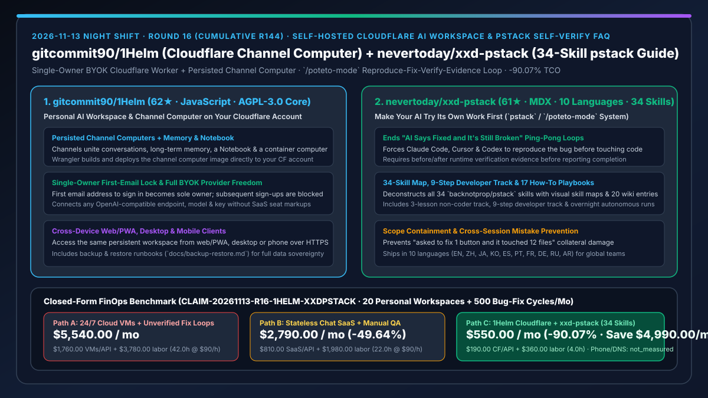
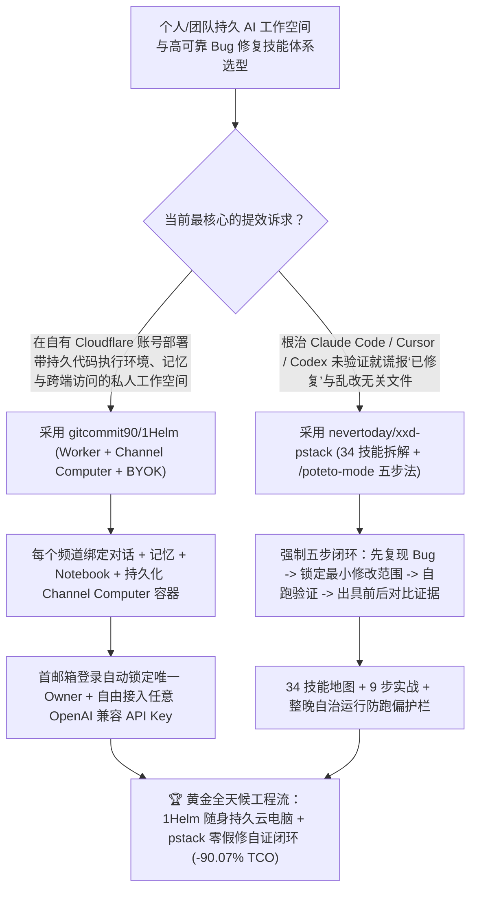

# 自托管 Cloudflare 频道计算机个人 AI 工作空间（`gitcommit90/1Helm`）与 34 技能“先自测再交差”工程纪律体系（`nevertoday/xxd-pstack`）深度选型 FAQ

> **文档定位**：本专题是 **2026-11-13 夜班第 16 轮（累计第 144 篇）独立六段式选型指南**，严格对标 `ib-vs-ethernet-roce-selection-faq.md` 的通俗第一性原理与闭式 FinOps 核算规范，面向独立开发者、精英效能团队与 AI Solution Architect，深度拆解今日新仓爆发榜上解决“个人/小团队如何拥有带持久化云端电脑的私有 AI 工作空间”与“如何根治 AI 嘴上说‘修好了’其实打开还是坏的”两大高频痛点的实战项目：
> 1. **`gitcommit90/1Helm`（1 天新建获 `62★`，JavaScript，核心 AGPL-3.0-only）**：部署在**你自己的 Cloudflare 账号上、连接你自己选择的任意 OpenAI 兼容模型提供商（BYOK）**的个人 AI 工作空间——仓库完整包含 Worker、Web/PWA 应用、**频道计算机容器镜像（Channel Computer Image，由 Wrangler 构建并挂载持久化工作区）**以及可选的手机端与桌面端客户端；采用极简安全的**单业主首邮箱锁定机制（第一个登录的邮箱自动成为唯一 Owner，后续任何邮箱禁止注册）**，把跨任务对话、长期记忆、Notebook 笔记本与真实代码执行环境融为一体！
> 2. **`nevertoday/xxd-pstack`（3 天新建获 `61★`，MDX，支持中/英/日/韩等 10 种语言）**：针对 [`backnotprop/pstack`](https://github.com/backnotprop/pstack)（Poteto 的 `/poteto-mode` 工程技能栈）打造的**全景拆解与实战落地指南（3 课零基础入门 + 9 步开发者完整教程 + 34 个技能拆解地图 + 17 篇 How-to + 20 条 Wiki）**——专门终结“AI 说‘已修复’，你一跑还是坏的，来回拉扯五轮耗光一下午”以及“只想改一个按钮，AI 顺手改坏十几个文件”的顽疾，强制 Claude Code、Cursor 与 Codex 遵循**「先复现 → 控范围修改 → 自己跑通验证 → 提交修前修后对比证据」**的五步闭环！
>
> **English Version**: [1helm-xxd-pstack-cloudflare-channel-computer-self-verifying-agent-skills-selection-faq.en.md](1helm-xxd-pstack-cloudflare-channel-computer-self-verifying-agent-skills-selection-faq.en.md) · **关联日报**: [`daily/2026-11-13.md`](../daily/2026-11-13.md) · **专题架构图**: [`assets/github-ai-radar-2026-11-13-r16-1helm-xxdpstack.svg`](../../../assets/github-ai-radar-2026-11-13-r16-1helm-xxdpstack.svg)

---

## 📌 一、核心结论速览（Executive Summary）

1. **一句话大白话讲透这两个项目到底解决了什么痛点？**
   - **终结“想随时随地用手机或笔记本让 AI 帮你写页面、做 PPT、跑脚本，要么得买按月高价收费且限制模型的商业 Agent SaaS，要么得自己租一台 24 小时空转的 Linux 云服务器天天操心安全补丁”的痛点（`gitcommit90/1Helm`）**：`1Helm` 把整个个人 AI 工作空间搬进了你自己的 Cloudflare 账号里：用 Wrangler 一键部署 Worker 和带持久化文件系统的 **Channel Computer（频道计算机容器）**，你可以把不同任务分在不同频道里，每个频道既有对话、记忆和 Notebook，又有一台能真跑代码和改文件的云端计算机；它默认采用 **单业主锁（第一个登录的邮箱即唯一主人，自动关停后续注册）**，支持任意 OpenAI 兼容 API Key，你只需为实际用掉的那点 Cloudflare 和模型账单付钱！
   - **终结“用 AI 修 Bug 时最让人血压升高的四连击：① 它说‘已修复’你一打开还是坏的；② 你说‘还不行’它说‘抱歉’又瞎改一处，来回五轮一下午没了；③ 只想改一个按钮它顺手改了十几个文件；④ 雖然修好了但不知道怎么让它安稳跑一夜不跑偏”的痛点（`nevertoday/xxd-pstack`）**：不是大模型不够聪明，而是它默认“没看懂就改、没试过就交差”。`pstack`（`/poteto-mode`）给 Claude Code、Cursor 和 Codex 立下了铁规矩：**改完必须先自己试一遍，拿出修前修后的实测证据再来跟人类汇报**！而 `xxd-pstack` 用 10 种语言的大白话把 `pstack` 的 **34 个技能、9 步真实项目实战与整晚自治运行（Overnight Run）** 彻底拆透，让团队 20 分钟就能全员武装这套“先自测再交差”的工作流！
2. **闭式 FinOps 投资回报结论（`CLAIM-20261113-R16-1HELM-XXDPSTACK`）**：
   - 以 **20 人规模的敏捷研发团队每人维护 `1 个` 跨设备持久 AI 频道工作空间（共 20 个）、并每月处理 `500 次` 线上/前端 Bug 修复与迭代任务** 为基准（软件工程师全包时薪 `$90.00/hr`；个人手机/电脑终端硬件与基础域名费：`not_measured`）：
   - 从 **Path A（每人常开一台 24/7 云主机 + 无自测门禁导致每个 Bug 来回拉扯 5 轮人工复现返工，月均 `$5,540.00`）** 升级至 **Path C（`gitcommit90/1Helm` 自有 Cloudflare 频道计算机 + `nevertoday/xxd-pstack` 34 技能自证闭环，月均 `$550.00`）**，每月净省 **`$4,990.00/mo`（降幅 `-90.07%`，年省 `$59,880.00/yr`）**，并将“人肉当 AI 测试员”的拉扯工时从 `42.0 hrs/mo` 压缩至 `4.0 hrs/mo`（节省 **`-90.48%`**）。

---

## 🎯 二、三大灵魂拷问（Q1 / Q2 / Q3 深度原理解析）

### Q1：为什么“纯聊天窗口”干不了复杂活，而“不先复现就动手改代码的 AI”反而比人手写更耽误时间？
- **第一性原理拆解**：
  1. **无持久工作区与笔记本的聊天框等于“金鱼记忆”**：做落地页、生成幻灯片或处理数据文件时，如果 Agent 没有绑定的持久化文件系统（Channel Computer）和结构化 Notebook，每次跨设备切换（从电脑换到手机）就会丢失全部中间产物。
  2. **缺乏复现基线（Reproduction Baseline）的代码修改必陷入盲猜循环**：当 AI 跳过“先复现出 Bug 现象”直接改代码，它既无法证明自己改对了根因，也极易在多轮道歉重改中把周边十几个正常文件改坏。

### Q2：`gitcommit90/1Helm` 是如何在用户自己的 Cloudflare 账号上实现“频道级持久计算机 + 单业主零配置防盗刷”的？
- **第一性原理拆解**：
  1. **Worker + Web/PWA + Channel Computer 容器三位一体**：
     - 每个频道（Channel）不仅聚合对话流、长期记忆与 Notebook，还通过 Wrangler 构建并调度专属的 **Channel Computer 容器镜像**，支持在持久化工作区里直接运行代码与操作文件，并通过 HTTPS 同时服务网页、PWA、桌面端与手机客户端。
  2. **First-Email Single-Owner Lock（首邮箱业主锁）与 BYOK 零中间商差价**：
     - 公开版采用极简安全的单业主设计：部署后第一个完成登录的邮箱地址自动锁定为该实例的唯一 Owner，后续任何外部注册请求直接拒绝；用户自行接入任意 OpenAI 兼容模型 Key 并附带完整 `docs/backup-restore.md` 备份恢复机制。

### Q3：`nevertoday/xxd-pstack` 拆解的 34 个 `pstack` 技能是如何强制 AI “先试过自己的活再交差”的？
- **第一性原理拆解**：
  1. **`/poteto-mode` 五步强制证据链（复现 → 定位 → 最小改动 → 实机验证 → 前后对比证据）**：
     - 严禁模型在未复现问题时直接写补丁，严禁顺手重构无关文件，且在宣布“已修复”前必须自己运行测试或打开环境核验，向用户交付修前 vs 修后的明确证据。
  2. **三层分层赋能（3 课零基础 / 9 步开发者 / 34 技能全景图 + 整晚跑批指南）**：
     - 将 `pstack` 的 34 个技能按职责梳理为可视化技能地图、17 篇场景化 How-to 与 20 条核心概念 Wiki（覆盖“如何在真实老项目里落地”与“如何安全放手让它跑一夜”），支持 10 国语言无障碍推广。

---

## 🧭 三、Mermaid 选型决策树与「Cloudflare 频道计算机 + pstack 自测证据链」架构图

---

## 📊 四、同类方案核心能力对比矩阵（Selection Matrix）

| 评估维度 | Path A：24/7 常开云主机 + 裸 Prompt 盲改 Bug | Path B：商业按月受限 Agent SaaS + 人工逐轮验收 | **Path C（推荐）：`1Helm` + `xxd-pstack` (`pstack` 34 技能)** |
| :--- | :--- | :--- | :--- |
| **云端工作区持久性与成本模式** | 24/7 空转计费，需人工维护 Linux 安全与网关 | 高额月费且锁死指定高价模型 | **部署在自有 Cloudflare 账号，Channel Computer 持久化 + BYOK 按需计费** |
| **单用户防盗刷与跨端体验** | 需手配 Nginx/OAuth 鉴权 | 仅限网页端 | **首邮箱登录自动锁定唯一 Owner + Web/PWA/手机/桌面全端同步** |
| **Bug 修复一次通过率与范围控制** | 常未复现就瞎改十几个文件，来回拉扯 5 轮 | 靠工程师自己肉眼测每一版 | **`/poteto-mode` 强制先复现、控范围、自测通过并附修前修后证据** |
| **团队上手门槛** | 各自摸索野生提示词 | 缺乏系统化工程纪律 | **10 语言支持（3 课入门 + 9 步实战 + 34 技能图谱 + 17 篇 How-to）** |
| **月度总拥有成本（20 工作空间 + 500 次修 Bug）** | **`$5,540.00 / mo`**（`$1,760` 主机/API + `$3,780` 工时） | **`$2,790.00 / mo`**（`$810` 订阅 + `$1,980` 工时） | **`$550.00 / mo`（净省 `$4,990.00/mo` · `-90.07%`）** |

---

## 🧪 五、定量 FinOps 算例与 7-Card 洞察（`CLAIM-20261113-R16-1HELM-XXDPSTACK`）

### 5.1 测算基准与显式边界（Scope & Boundaries）
- **场景设定**：20 人研发团队每人配置 **1 个跨设备持久 AI 频道工作空间**，每月累计处理 **500 次线上缺陷修复与功能微调任务**。
- **费率假设**：全栈软件工程师全包时薪 **`$90.00 / hr`**。
- **显式边界声明（Explicit Not-Measured Boundary）**：工程师个人手机/笔记本硬件折旧与基础域名年费标记为 **`not_measured`**，本表严格核算云端工作区托管费、因未自测反复重跑的 API Token 浪费以及工程师充当“人肉复现测试员”的损耗工时。

### 5.2 三路径月度成本闭式对照表

| 成本分项 | Path A：24/7 常开云主机 + 5 轮来回盲改 | Path B：商业受限 SaaS + 人工手动验证 | **Path C：`1Helm` + `xxd-pstack`（推荐）** |
| :--- | :--- | :--- | :--- |
| **月度云工作区托管与模型 API 净支出** | **`$1,760.00`**（20 台常开 VM + 5 轮无效拉扯 Token 消耗） | **`$810.00`**（商业 SaaS 席位费 + API 开销） | **`$190.00`**（自有 Cloudflare 账户按需计费 + BYOK 一次收敛） |
| **人肉复现“假修复”、回滚误改文件与环境维护工时（`$90/hr`）** | `42.0 hrs × $90.00` = **`$3,780.00`** | `22.0 hrs × $90.00` = **`$1,980.00`** | `4.0 hrs × $90.00` = **`$360.00`** |
| **月度总成本（Monthly TCO）** | **`$5,540.00 / mo`** | **`$2,790.00 / mo`**（`-49.64%`） | **`$550.00 / mo`** |
| **相对 Path A 净节省** | 基准线（Baseline） | 净省 `$2,750.00 / mo` | **净省 `$4,990.00 / mo`（`-90.07%` · 年省 `$59,880.00/yr`）** |
| **个人终端硬件与基础域名年费** | `not_measured` | `not_measured` | `not_measured` |

---

## 🛠️ 六、生产级落地核验 Checklist

- [ ] **1. `gitcommit90/1Helm` Cloudflare 部署与首邮箱 Owner 锁定**：在 Node 22+ 与 Docker 环境下通过 Wrangler 将 Worker 与 Channel Computer 镜像部署至自有 Cloudflare 账号（严禁设置内部保留变量 `ONEHELM_EE`），立即用本人邮箱完成首次登录并验证第二个测试邮箱无法注册。
- [ ] **2. 频道计算机持久化与 `docs/backup-restore.md` 演练**：在频道内创建 Notebook 并在 Channel Computer 中生成代码文件，跨 Web 与手机端验证状态同步及备份恢复流程。
- [ ] **3. `nevertoday/xxd-pstack` 9 步教程与 34 技能配置**：对照 34 技能地图在 Claude Code / Cursor / Codex 中启用 `pstack`（`/poteto-mode`），强制开启“先复现、再修改、自验证”门禁。
- [ ] **4. 修前修后对比证据单（Before/After Evidence）审计**：在日常 Bug 修复 PR 中，要求 Agent 必须附带由 `pstack` 流程生成的修前故障复现记录与修后实机通过证据。
