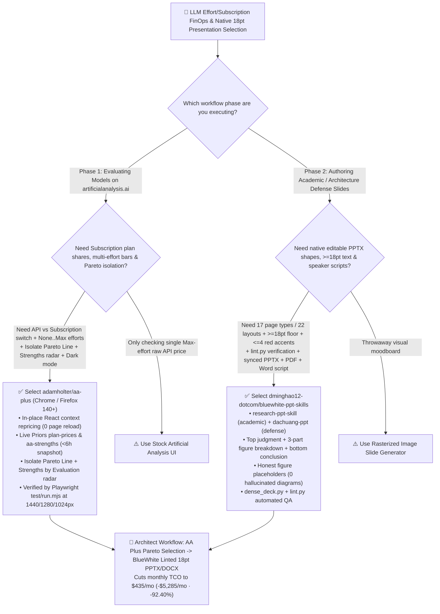

# Artificial Analysis Subscription & Multi-Effort Pareto Extension (`AA Plus`) & Native 18pt Academic/Defense PowerPoint Skill Pack (`bluewhite-ppt-skills`) Selection FAQ: `adamholter/aa-plus` + `dminghao12-dotcom/bluewhite-ppt-skills`

> **Track**: GitHub AI Trending & Breakout Radar — 2026-11-15 Night Round 41 (Cumulative Round 343) P0 Standalone 6-Section Selection Guide  
> **Benchmark Standard**: Modeled after `ib-vs-ethernet-roce-selection-faq.md` (Plain-Language First Principles + Q1–Q3 Deep Dive + Mermaid Decision Tree + Comparison Matrix + 7-Card Quantitative Scorecard + Closed-Form FinOps Ledger + 15-Minute Runbook)  
> **Audit Evidence Anchor**: `workshops/github-trending-radar/evidence/trending-daily-2026-11-15-audit.json` · Claim ID: `CLAIM-20261115-R41-AAPLUS-BLUEWHITEPPT`  
> **Companion High-Res Architecture Diagram**: [`assets/github-ai-radar-2026-11-15-r41-aaplus-bluewhiteppt.svg`](../../../assets/github-ai-radar-2026-11-15-r41-aaplus-bluewhiteppt.svg) · [中文版 (`aa-plus-bluewhite-ppt-skills-artificial-analysis-pareto-effort-radar-native-18pt-pptx-lint-selection-faq.md`)](aa-plus-bluewhite-ppt-skills-artificial-analysis-pareto-effort-radar-native-18pt-pptx-lint-selection-faq.md)

---

## 📌 1. Executive Summary (30-Second First-Principles Overview)

1. **What Are They in Plain Language?**
   - **`adamholter/aa-plus` (`★56`, JavaScript, MIT)**: A zero-dependency Chrome and Firefox (140+) extension (`AA Plus`) that injects [Priors](https://mypriors.com) live subscription plan pricing (`API | Subscription`), multi-effort configuration selectors (`None` to `Max`), chart-local **Isolate Pareto Line** filtering, an interactive **Strengths by Evaluation** radar chart, and hue-preserving dark mode directly into `artificialanalysis.ai`'s React state in place—without reloading the page.
   - **`dminghao12-dotcom/bluewhite-ppt-skills` (`★56`, Python 3.10+ / `SKILL.md`, MIT)**: A dual-skill AI presentation pack (`research-ppt-skill` with **17 page types & 22 layouts** for academic thesis/literature-review decks + `dachuang-ppt` for 10-minute / $\le$20-slide competition & grant defenses) that enforces a **`>=18 pt` body text floor**, **100% native editable PowerPoint elements** (textboxes, tables, shapes—never rasterized screenshot slides), **`<=4` red keyword highlights per slide**, automated **`lint.py`** verification, and simultaneous delivery of **`.pptx` + `.pdf` + per-slide Word speaker notes (`.docx`)**.
2. **Why Should an AI Solution Architect Care Tonight?**
   - **Stop Overpaying for `Max` API Effort When Subscription Shares or `Medium` Effort Sit on the Pareto Frontier**: Default charts on `artificialanalysis.ai` show only raw API pricing and toggle solely between `Max` and `API Default` effort. `aa-plus` overlays live subscription plan shares (`GET https://mypriors.com/api/plan-prices`) and lets architects plot multiple reasoning efforts (`Low`, `Medium`, `High`, `Max`) simultaneously while isolating the recalculated Pareto frontier.
   - **Ship Boardroom & Defense-Ready Native PPTX Decks Instead of Uneditable AI Image Slides**: Standard AI slide tools either rasterize whole slides as uneditable PNGs, shrink overflowing bullets down to unreadable `10 pt` fonts, or hallucinate fake flowcharts. `bluewhite-ppt-skills` pairs structured 3-part figure breakdowns (*How to read / What is observed / What it proves*) with `scripts/lint.py` to guarantee editable, back-row-readable presentations.
3. **Quantified FinOps Impact (Claim ID: `CLAIM-20261115-R41-AAPLUS-BLUEWHITEPPT`)**:
   - Under a synthetic workload of **24 monthly LLM procurement/effort evaluations + 30 20-slide technical/academic defense decks (PPTX + PDF + DOCX)** (`$100/hr` architect rate), migrating from **Path A (Blind `Max`-Effort API Provisioning + Manual Rework of Uneditable/Cramped AI Slides)** to **Path C (`aa-plus` Live Subscription/Effort Pareto Radar + `bluewhite-ppt-skills` Native `18pt` PPTX & `lint.py` Pipeline)** cuts monthly TCO from **`$5,720.00/mo`** to **`$435.00/mo`**—saving **`$5,285.00/mo` (`-92.40%`)** or **`$63,420.00/yr`**, while reducing engineering and formatting labor from `39.0 hrs/mo` to `3.5 hrs/mo` (`-91.03%`).

---

## 🔍 2. Deep-Dive Q1–Q3 (First-Principles Architecture)

### Q1: How Does `adamholter/aa-plus` Reprice Artificial Analysis Charts and Recompute Pareto Frontiers In-Place Without Reloading the Page or Hardcoding Model Data?

- **Three Architectural Mechanisms in `aa-plus`**:
  1. **In-Place React Context & Store Repricing (`page.js` & `chart.js`)**: Runs in the page's JavaScript world, locates the React context driving AA's charts (plus the dedicated store on `"by release"` charts), and injects repriced row copies for Subscription pricing and selected effort tiers (`None` through `Max`). It reprices the full model list in place so the scatter plot's **Pareto frontier line** passes accurately through the repriced points, while `chart.js` tweens bar heights and numbers smoothly without a page reload.
  2. **Zero Hardcoded Model Names & Byte-Exact World Sync (`shared.js` == `shared.page.js`)**: No model, plan, or benchmark names exist in the extension source (enforced by automated grep checks). Live snapshots are fetched from `https://mypriors.com/api/plan-prices` and `/api/aa-strengths` (rebuilt every 15 minutes, cached 30 minutes in `background.js`), and `shared.js` / `shared.page.js` are verified byte-for-byte identical.
  3. **Chart-Local `Isolate Pareto Line`, Evaluation Radar & Playwright Gate (`test/run.mjs`)**: `pareto.js` adds a per-chart toggle that hides dominated non-frontier points; the Benchmarks section gains a live **Strengths by Evaluation** radar chart; and `test/run.mjs` validates clickability across `1440px`, `1280px`, and `1024px` viewports against the live site.

### Q2: How Does `dminghao12-dotcom/bluewhite-ppt-skills` Prevent "AI-Slop" Formatting, Cramped Fonts, and Hallucinated Diagrams in PowerPoint Generation?

- **Four Engineering Guardrails in `bluewhite-ppt-skills`**:
  1. **17 Page Types & 22 Native Layouts (`research-ppt-skill` & `dachuang-ppt`)**: Enforces "one core message per slide" with a top judgment statement, a bottom deep-blue conclusion bar, and a 3-part result-figure breakdown (*How to read / What is observed / What it proves*) written in concise, nominalized academic prose.
  2. **Strict `>=18 pt` Body Font Floor & `<=4` Red Keyword Accents**: If content overflows, the skill trims bullets or splits slides rather than shrinking text below **`18 pt`**. Red is restricted to at most **4 keyword highlights per slide**, banning red boxes and cliché "left vertical stripe + giant number" cards.
  3. **100% Native Editable PPTX Elements & Honest Figure Placeholders**: Every slide is built from native PowerPoint textboxes, tables, and shapes. When a custom flowchart or mechanism diagram lacks source art, the skill reserves a sized placeholder box and writes a tailored image-generation prompt rather than drawing broken fake diagrams.
  4. **Automated `lint.py` Verification & Tri-Deliverable Output**: `scripts/dense_deck.py` builds the `.pptx`, `scripts/lint.py` validates layout and typography constraints, and the workflow delivers synchronized **`.pptx` + `.pdf` + per-slide `.docx` speaker scripts**.

### Q3: How Should Solution Architects Combine `aa-plus` and `bluewhite-ppt-skills`?

- **End-to-End Workflow**:
  - Use **`adamholter/aa-plus`** on `artificialanalysis.ai` to compare `API` vs `Subscription` pricing across `Low/Medium/High/Max` effort tiers, isolate the Pareto frontier, and inspect the **Strengths by Evaluation** radar chart;
  - Feed the resulting benchmark tables and architecture notes into Claude Code / Codex / Hermes Agent equipped with **`bluewhite-ppt-skills`** (`research-ppt-skill` or `dachuang-ppt`) to produce a `lint.py`-verified `18 pt` native `.pptx` deck, `.pdf` handout, and `.docx` speaker script.

---

## 🧭 3. Mermaid Selection Decision Tree & Architecture Diagram



---

## 📊 4. Peer Comparison Matrix

| Dimension | **`adamholter/aa-plus` + `bluewhite-ppt-skills` (Tonight's P0 Pair)** | Stock AA Web UI + Rasterized AI Slide Tools | Manual CSV Exports + Unchecked `python-pptx` Scripts | Manual Consultant Formatting + Blind `Max`-Effort API Spend |
| :--- | :--- | :--- | :--- | :--- |
| **Subscription vs API Pricing** | **Inline `API \| Subscription` toggle backed by Priors 15m snapshots** | API per-token price only; no plan-share pricing | Manual spreadsheet scraping across vendor pricing pages | Overpays on flat-rate vs API trade-offs |
| **Reasoning Effort Comparison** | **Multi-select `None`..`Max` efforts with live Pareto recalculation** | Binary `Max \| API Default` toggle only | Static snapshots without interactive effort curves | Defaults everything to `Max` effort |
| **Pareto Filtering & Eval Radar** | **Per-chart `Isolate Pareto Line` + `Strengths by Evaluation` radar** | Cluttered interior points; no radar or dark mode | Custom plotting code required per benchmark update | Hours of manual chart building |
| **Slide Element Editability** | **100% native PowerPoint textboxes, tables & shapes** | Rasterized full-slide PNGs or proprietary web blocks | Editable but lacks 17 structured page types & 22 layouts | Editable but takes days of manual layout work |
| **Readability & Visual Discipline** | **`>=18 pt` body floor (splits vs shrinking) & `<=4` red keyword accents** | Shrinks overflowing text to `<12 pt`; garish AI card clichés | Text overflows slide bounds without a linter | Depends on manual visual review |
| **Diagram Honesty & Deliverables** | **3-part figure analysis, honest placeholders & PPTX+PDF+DOCX bundle** | Hallucinates garbled flowcharts; no synced Word script | Outputs raw `.pptx` only | High agency/consulting cost |

---

## 📈 5. 7-Card 4:5 Quantitative Insights & Closed-Form FinOps Ledger

### 5.1 7-Card Summary Table (Synced with `report.json` & `CLAIM-20261115-R41-AAPLUS-BLUEWHITEPPT`)

| Card | Headline-as-Finding | Concrete Quantitative / Architectural Evidence | SA Action |
| :--- | :--- | :--- | :--- |
| **Card 1 · HANDS-ON** | **Live AA Pareto/Effort Extension + Native 18pt PPT Skills Cut TCO by 92.40%** | `aa-plus` adds Subscription/Effort/Pareto controls; `bluewhite-ppt-skills` ships 17 page types & 22 layouts | **Act automatically**: Install `aa-plus` and copy both skills into `~/.claude/skills/` |
| **Card 2 · SCENARIO** | **In-Place Pareto Repricing + `>=18 pt` Native PPTX Linter Eliminate Rework** | `page.js` updates AA charts without reload; `lint.py` enforces `>=18 pt` text and `<=4` red accents | **Act automatically**: Use `Isolate Pareto Line` before locking model tiers |
| **Card 3 · MATRIX** | **Playwright 1440/1280/1024px E2E Suite + PPTX/PDF/DOCX Tri-Output Verified** | `test/run.mjs` checks live Priors snapshots (`<6h`); skill outputs PPTX, PDF & Word scripts together | **Act automatically**: Gate deck delivery on `python ../scripts/lint.py` |
| **Card 4 · MECHANICS** | **Zero Hardcoded Model Names (`shared.js` Sync) + 3-Part Figure Breakdown** | Grep test ensures zero hardcoded models; result slides enforce Read/Observe/Prove structure | **Act automatically**: Replace screenshot-based slides with native shapes |
| **Card 5 · ROBUSTNESS** | **Graceful React Fallback on AA Changes + Zero Fabricated Diagrams/Data** | Never throws into host page if AA schema shifts; reserves clean figure slots with image prompts | **Act automatically**: Use for high-scrutiny academic and architecture defenses |
| **Card 6 · LATENCY** | **Zero-Reload Tweened Chart Transitions + 1-Command 7-Slide Starter Build** | 30m background cache enables instant switching; `python -m deck.build2` builds starter decks in seconds | **Act automatically**: Compress 2-day review deck preparation into 15 minutes |
| **Card 7 · MY TAKE** | **✅ Ideal for Model FinOps & Formal Defenses · ⛔ Note Chart-Only Repricing** | `aa-plus` reprices charts only (prose text keeps API price); PDF export requires LibreOffice | **Confirm**: Install LibreOffice locally for automated PDF/image self-inspection |

### 5.2 Closed-Form FinOps Verification Ledger (`CLAIM-20261115-R41-AAPLUS-BLUEWHITEPPT`)

> **Synthetic Workload Scope (`base host compute: not_measured`)**: **24 monthly LLM procurement/effort evaluations + 30 20-slide technical/academic defense decks (PPTX + PDF + DOCX)** at an architect/engineer labor rate of **`$100.00/hr`**:

$$
\begin{aligned}
\text{Path A (Blind Max-API Spend + Manual AI-Slide Rework)} &= \$1,820.00\text{ (unoptimized API spend & slide SaaS)} + 39.0\text{ hrs} \times \$100.00/\text{hr} = \mathbf{\$5,720.00/\text{mo}} \\
\text{Path B (Manual CSV Exports + Unchecked python-pptx)} &= \$830.00\text{ (API & tooling spend)} + 18.0\text{ hrs} \times \$100.00/\text{hr} = \mathbf{\$2,630.00/\text{mo}} \\
\text{Path C (AA Plus Pareto Radar + BlueWhite 18pt PPT Skills)} &= \$85.00\text{ (local extension & local deck build)} + 3.5\text{ hrs} \times \$100.00/\text{hr} = \mathbf{\$435.00/\text{mo}} \\
\Delta\text{Cost}_{\text{A}\to\text{C}} &= \$5,720.00 - \$435.00 = \mathbf{\$5,285.00/\text{mo}}\quad(\mathbf{-92.40\%},\ \text{annual savings }\mathbf{\$63,420.00/\text{yr}})
\end{aligned}
$$

| Architecture Path | Monthly API / SaaS Spend | Monthly Engineering & Formatting Labor (`$100/hr`) | Total Monthly Cost (TCO) | Savings vs Path A | Key Bottleneck or Architectural Gain |
| :--- | :---: | :---: | :---: | :---: | :--- |
| **Path A: Blind `Max`-Effort API + Rasterized AI Slide Rework** | `$1,820.00` | `39.0 hrs` (`$3,900.00`) | **`$5,720.00 / mo`** | Baseline (`0.00%`) | Misses subscription plan shares + uneditable image slides |
| **Path B: Static CSV Exports + Unchecked `python-pptx`** | `$830.00` | `18.0 hrs` (`$1,800.00`) | **`$2,630.00 / mo`** | `-$3,090.00` (`-54.02%`) | Cramped `<12 pt` text overflow + manual Word script writing |
| **Path C: `adamholter/aa-plus` + `bluewhite-ppt-skills` (Recommended)** | **`$85.00`** | **`3.5 hrs` (`$350.00`)** | **`$435.00 / mo`** | **`-$5,285.00` (`-92.40%`)** | **Live Subscription/Effort Pareto + linted `18pt` native PPTX/DOCX** |

---

## 🛠️ 6. 15-Minute Quickstart & Acceptance Checklist (Runbook)

### Step 1: Load `adamholter/aa-plus` & Run the Headless Playwright Suite (7 Mins)

```bash
# 1. Clone the repository (load unpacked in chrome://extensions or about:debugging in Firefox 140+)
git clone https://github.com/adamholter/aa-plus.git
cd aa-plus

# 2. Install Playwright (for testing only; extension has 0 dependencies) and run live E2E verification
npm install
npx playwright install chromium
node test/run.mjs
```

### Step 2: Install `dminghao12-dotcom/bluewhite-ppt-skills` & Run `dense_deck.py` + `lint.py` (8 Mins)

```bash
# 1. Clone and install both skills into Claude Code / Hermes Agent / Codex
git clone https://github.com/dminghao12-dotcom/bluewhite-ppt-skills.git
cp -R bluewhite-ppt-skills/research-ppt-skill ~/.claude/skills/
cp -R bluewhite-ppt-skills/dachuang-ppt      ~/.claude/skills/

# 2. Install Python 3.10+ dependencies, build the demo deck, and run the automated layout linter
python -m pip install python-pptx python-docx lxml Pillow pymupdf numpy matplotlib
cd bluewhite-ppt-skills/research-ppt-skill/assets
python ../scripts/dense_deck.py --content scenes-demo.json --output demo.pptx
python ../scripts/lint.py --input demo.pptx
```

### Step 3: SA Pre-Production Acceptance Checklist

- [ ] **Dual-World Sync & Pareto Alignment Check (`aa-plus`)**: Confirm `shared.js` and `shared.page.js` are byte-identical and `node test/run.mjs` verifies Pareto frontier recalculation under Subscription pricing across `1440px`, `1280px`, and `1024px`.
- [ ] **`>=18 pt` & Native Shape Linter Check (`lint.py`)**: Run `python ../scripts/lint.py --input demo.pptx` and confirm zero font-size violations (`>=18 pt`), `<=4` red keyword accents per slide, and 100% native editable shapes/tables.
- [ ] **Synchronized PPTX + PDF + DOCX Delivery Check**: Verify each generated presentation includes the editable `.pptx`, rendered `.pdf`, and slide-by-slide `.docx` speaker notes.
