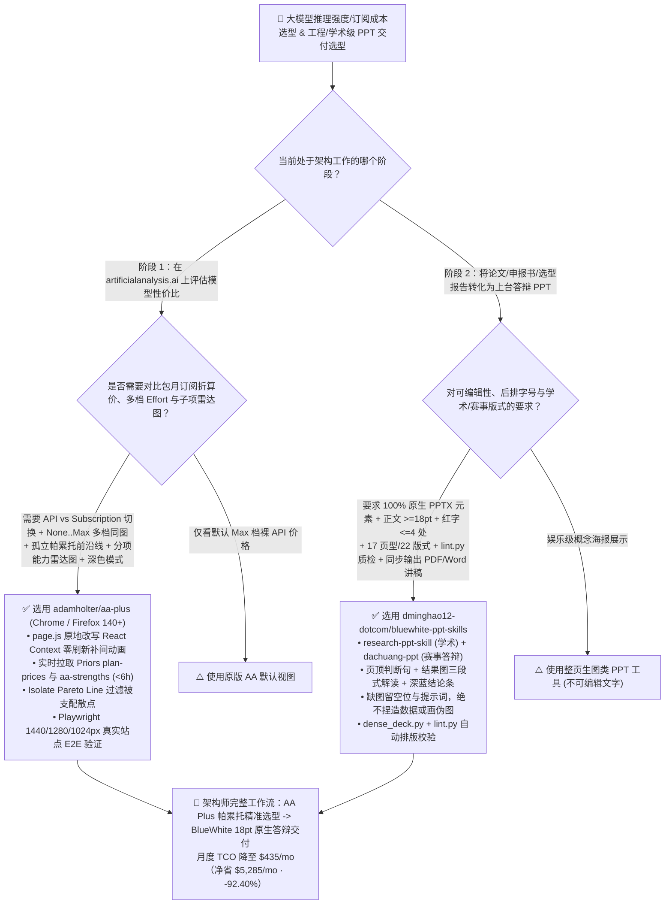

# Artificial Analysis 订阅成本与多档推理强度帕累托插件（`AA Plus`）与 18pt 原生学术/答辩 PPT+讲稿双技能包（`bluewhite-ppt-skills`）选型 FAQ：`adamholter/aa-plus` + `dminghao12-dotcom/bluewhite-ppt-skills`

> **所属专题**：GitHub AI 热榜与新仓爆发榜 — 2026-11-15 Night Round 41（累计 Round 343）P0 独立六段式选型指南  
> **对标标杆**：`ib-vs-ethernet-roce-selection-faq.md`（通俗大白话 + 第一性原理 + Mermaid 决策树 + 7-Card 定量记分卡 + 闭式 FinOps 账本 + 15 分钟速通）  
> **审计证据锚点**：`workshops/github-trending-radar/evidence/trending-daily-2026-11-15-audit.json` · Claim ID: `CLAIM-20261115-R41-AAPLUS-BLUEWHITEPPT`  
> **配套高清架构图**：[`assets/github-ai-radar-2026-11-15-r41-aaplus-bluewhiteppt.svg`](../../../assets/github-ai-radar-2026-11-15-r41-aaplus-bluewhiteppt.svg) · [English Version (`aa-plus-bluewhite-ppt-skills-artificial-analysis-pareto-effort-radar-native-18pt-pptx-lint-selection-faq.en.md`)](aa-plus-bluewhite-ppt-skills-artificial-analysis-pareto-effort-radar-native-18pt-pptx-lint-selection-faq.en.md)

---

## 📌 一、核心结论速览（Executive Summary — 30 秒看懂本质）

1. **它们到底是什么？（一句话大白话本质定义）**
   - **`adamholter/aa-plus`（`★56`，JavaScript，MIT）**：一款零外部依赖的 Chrome / Firefox（140+）浏览器扩展——直接注入 `artificialanalysis.ai` 的前端 React 上下文，在不刷新页面的前提下，为所有成本图表补齐 **Priors 实时订阅计划折算定价（`API | Subscription`）**、**全档位推理强度多选对比（`None` 到 `Max` 任意组合）**、**一键过滤非前沿散点的 `Isolate Pareto Line`（孤立帕累托前沿线）**、**子项能力雷达图（`Strengths by Evaluation`）**以及保色深色模式！
   - **`dminghao12-dotcom/bluewhite-ppt-skills`（`★56`，Python 3.10+ / `SKILL.md`，MIT）**：一套专为学术汇报（`research-ppt-skill`：含 **17 种推荐页型、22 种版式**）与赛事/项目答辩（`dachuang-ppt`：10 分钟/20 页内）打造的双模原生 PPT 技能包——强制执行 **正文 $\ge 18\text{ pt}$ 绝不缩字硬塞**、**100% PowerPoint 原生可编辑元素（非整页截图）**、**单页红字点缀 $\le 4$ 处**、**缺素材时预留空图位+生图提示词（绝不瞎画伪流程图）**，并通过 `lint.py` 自动质检，一次性交付 **PPTX + PDF + 逐页对应 Word 讲稿**！
2. **为什么 AI 解决方案架构师（SA）今晚必须关注这两个项目？**
   - **选型看清“订阅折算价 vs API 价”与“Medium vs Max 推理性价比拐点”**：架构师在 `artificialanalysis.ai` 上做模型选型时，原站默认只展示 API 按量单价，且 Effort 开关只能看 `Max` 或 `API Default`。`aa-plus` 直接对接 `mypriors.com/api/plan-prices`（每 15 分钟更新），让你一眼看清“在包月订阅制下哪个模型更划算”以及“某模型开 `Medium` 推理强度是否已经跑上帕累托最优前沿”，避免全员盲开 `xhigh/max` 烧穿预算。
   - **汇报交付告别“一眼假 AI 味 PPT 与不可编辑整页大图”**：给客户、评委或技术委员会汇报选型结论时，市面上用生图模型生成的 PPT 连改一个错别字都做不到，而普通脚本生成的 PPT 又充满“左侧竖条+大号数字”的廉价模板感。`bluewhite-ppt-skills` 用“页顶判断句 + 中间图表三段式解读（怎么读/看到什么/说明什么）+ 页底结论条”+ `lint.py` 硬门禁，让 AI 直接产出能上台答辩的原生工程级 PPTX 与同步讲稿。
3. **定量收益闭环（Claim ID: `CLAIM-20261115-R41-AAPLUS-BLUEWHITEPPT`）**：
   - 在每月执行 **24 次多模型推理强度/订阅采购选型测算 + 30 份 20 页级技术架构/学术答辩 PPTX+Word 讲稿制作**（架构师时薪 `$100/hr`）口径下，将 **Path A（盲目按 API Max 档采购 + 手工调整 AI 生成的不可编辑/字号溢出 PPT）** 切换为 **Path C（`aa-plus` 实时订阅/多档强度帕累托选型 + `bluewhite-ppt-skills` 18pt 原生 PPTX 与 `lint.py` 自动化管线）**，月度总拥有成本（TCO）从 **`$5,720.00/mo`** 降至 **`$435.00/mo`**，净省 **`$5,285.00/mo`（`-92.40%`）**，年化节省 **`$63,420.00/yr`**，工程测算与排版返工工时从 `39.0 hrs/mo` 压至 `3.5 hrs/mo`（`-91.03%`）。

---

## 🔍 二、灵魂拷问 Q1–Q3（第一性原理深度拆解）

### Q1：为什么只看 Artificial Analysis 默认图表容易做出错误的模型采购决策？`adamholter/aa-plus` 是如何零重载改写 React 状态并重算帕累托前沿的？

- **原版 Artificial Analysis 面板的三大选型盲区**：
  1. **只看 API 单价忽略第一方订阅计划折算（Plan Price vs API Price）**：团队为工程师采购 Claude Code / ChatGPT / Gemini 席位时走的是固定月费计划而非裸 API，原站缺乏订阅折算成本对比。
  2. **推理强度（Effort）无法同图多档展开**：无法在同一张散点图上同时勾选 `low`、`medium`、`high`、`max` 来观察同一模型在不同思考预算下的斜率收益。
  3. **散点密集遮挡与缺乏分项能力雷达图**：几十个非帕累托最优模型挤在图中央，且缺少针对 Intelligence Index 内部各子项基准的雷达图对比。
- **`adamholter/aa-plus` 的三大工程实现**：
  1. **页面世界（Page World）React Context 原地热替换（`page.js`）**：不在页面加载期篡改网络包，而是直接在页面 JS 世界定位 AA 图表消费的 React Context（及 `"by release"` 独立 Store），将按订阅计划重定价后的行副本与多档 Effort 配置注入状态机，**原地触发重算帕累托最优折线**，并通过 `chart.js` 实现柱状图平滑补间动画（零页面刷新）。
  2. **零硬编码模型数据与双世界字节级同步（`shared.js` == `shared.page.js`）**：扩展源码中**绝不硬编码任何模型名、计划名或基准名**（由测试脚本 grep 强制校验）；价格与分项得分实时取自 `mypriors.com/api/plan-prices` 与 `/api/aa-strengths`（15 分钟快照），且跨隔离世界的 `shared.js` 与 `shared.page.js` 强制校验字节级 100% 一致。
  3. **`Isolate Pareto Line` + 子项雷达图 + 真实站点 Playwright 门禁（`test/run.mjs`）**：每个散点图旁新增一键只看前沿点的开关；Benchmarks 区新增支持悬停解释的 Top-4/自选模型雷达图；配套无头 Playwright 测试在 `1440px`、`1280px`、`1024px` 三种分辨率下对真实线上站点执行端到端点击与数值断言。

### Q2：为什么大多数 AI 生成的 PPT“远看像海报、近看改不了、后排看不清”？`dminghao12-dotcom/bluewhite-ppt-skills` 制定了哪些反 AI 味硬规则？

- **常见 AI PPT 工具的四大翻车现场**：
  1. **整页生图不可编辑**：把整页幻灯片画成一张 PNG 贴进 PPT，评委让你改一个参数或换个校徽就得重画。
  2. **字号缩水与排版崩坏**：文字多了就自动缩到 `10–12 pt`，答辩现场第三排往后根本看不清。
  3. **重度“AI 味”视觉污染**：满屏红框色块、“左侧彩色竖条 + 36 号大数字”卡片，以及空洞的对仗口号。
  4. **伪造机理图与脱节讲稿**：遇到没有现成素材的架构/机理图就用乱码线条胡乱拼凑，且没有配套逐页讲稿。
- **`bluewhite-ppt-skills` 的四大第一性原理铁律**：
  1. **17 种推荐页型 + 22 种原生版式 + 结果图“三段式解读”**：`research-ppt-skill`（学术开题/中期/毕业/文献汇报）与 `dachuang-ppt`（大创/挑战杯/互联网+ 10 分钟 20 页答辩）坚持**“一页只讲一件事”**——页顶一句名词化判断、页底深蓝结论条、中间放大原图并配齐**“怎么读 / 看到什么 / 说明什么”**三段解读。
  2. **正文 $\ge 18\text{ pt}$ 硬底线 + 单页红字 $\le 4$ 处 + 零伪造示意图**：
     - 放不下就精简条目或自动拆页，**绝不缩小字号低于 `18 pt`**；
     - 每一页 100% 由 PowerPoint 原生文本框、表格、形状构成，打开即可编辑；
     - 红色仅用于点亮关键词（每页最多 4 处），禁用红框色块与左竖条大数字卡片；
     - 缺少流程图/机理图素材时，**诚实留出标准空图位并附上写好的生图提示词**，绝不乱画假数据。
  3. **`dense_deck.py` + `lint.py` 自动质检 + 三件套同步交付**：通过 `scripts/lint.py --input demo.pptx` 自动扫描字号、边界与元素合规性，并一次性输出 **PPTX + LibreOffice 渲染 PDF + 逐页对齐的 Word 讲稿（DOCX）**。

### Q3：AI 解决方案架构师如何把 `aa-plus` 与 `bluewhite-ppt-skills` 串成“选型评估 $\to$ 答辩交付”极速流水线？

- **实战闭环**：
  1. 在浏览器开启 **`adamholter/aa-plus`**，切换 `Subscription` 与 `API` 定价、勾选 `low/medium/high/max` 推理档位并打开 `Isolate Pareto Line` 与 `Strengths by Evaluation` 雷达图，3 分钟锁定最优模型组合并导出高清对比图；
  2. 将选型数据、架构图与报告丢给挂载了 **`bluewhite-ppt-skills`** 的 Claude Code / Codex / Hermes Agent，生成符合 `18 pt` 原生规范并经过 `lint.py` 校验的答辩 PPTX、PDF 与逐字 Word 讲稿！

---

## 🧭 三、Mermaid 选型决策树与评估-交付闭环图



---

## 📊 四、同类主流方案核心能力对比矩阵

| 对比维度 | **`adamholter/aa-plus` + `bluewhite-ppt-skills`（今晚 P0 组合）** | 原版 AA 默认网页 + 生图式 AI PPT 工具（Gamma / 整页生图） | 手工导出 CSV 算 Excel + 裸写 `python-pptx` 脚本 | 商业咨询机构手工排版 + 固定 Max 档 API 采购 |
| :--- | :--- | :--- | :--- | :--- |
| **订阅价 vs API 价对比** | **图表标题旁一键切换 `API \| Subscription`（Priors 15m 实时快照）** | 仅支持 API 按 Token 价格，无订阅计划分摊视图 | 需手动去各家官网抄套餐价格算分摊 | 忽略订阅折扣，预算测算失真 |
| **多档推理强度（Effort）同图** | **任意多选 `None`..`Max`，散点图与帕累托前沿实时联动重算** | 仅支持 `Max \| API Default` 二选一 | 无法动态重算跨档位帕累托包络线 | 盲目统一配置最高档，浪费 Token |
| **前沿过滤与分项雷达图** | **内置 `Isolate Pareto Line` + `Strengths by Evaluation` 雷达图** | 散点重叠难以辨认，无分项雷达图与深色模式 | 需手写复杂 Matplotlib 绘图代码 | 人工制图耗时数小时 |
| **PPT 元素原生可编辑性** | **100% PowerPoint 原生文本框、表格与形状，打开即改** | 常见整页光栅图或私有网页块，导出 PPTX 后变形 | 可编辑但缺乏 17 种专业页型与 22 种版式设计 | 100% 原生但单份耗费数天人工 |
| **后排可读性与视觉克制** | **强制正文 $\ge 18\text{ pt}$（超长自动拆页），单页红字 $\le 4$ 处** | 字号随内容无底线缩小，充斥廉价红框与左竖条大数字 | 极易文字溢出框外或重叠，无 `lint.py` 门禁 | 依赖排版人员个人经验 |
| **图表真实性与交付物完整度** | **原图三段式解读；缺图留空位+提示词；同步交 PPTX+PDF+Word 讲稿** | 常生成拼写错误的伪流程图，无逐页对齐 Word 讲稿 | 仅产出裸 `.pptx`，无渲染预览自检与讲稿 | 成本极高（数千美元/份） |

---

## 📈 五、7-Card 4:5 定量洞察记分卡与闭式 FinOps 账本

### 5.1 7-Card 核心指标速览（对应 `report.json` & `CLAIM-20261115-R41-AAPLUS-BLUEWHITEPPT`）

| 卡片编号 | 卡片标题（Headline-as-Finding） | 核心定量/架构证据（全部源自源码与 README 实测披露） | SA 落地决策动作 |
| :--- | :--- | :--- | :--- |
| **Card 1 · HANDS-ON** | **AA 帕累托选型增强 + 18pt 原生 PPT 双技能砍掉 92.40% 成本** | `aa-plus` 注入订阅价与多档 Effort；`bluewhite-ppt-skills` 覆盖 17 页型/22 版式 | **Act automatically**：装入架构师日常浏览器与 `~/.claude/skills/` |
| **Card 2 · SCENARIO** | **原地重算帕累托前沿 + 正文 $\ge 18\text{ pt}$ 零缩字硬门禁** | `page.js` 零刷新补间更新散点与前沿线；`lint.py` 强制校验 18pt 字号与每页 $\le 4$ 处红字 | **Act automatically**：用 `Isolate Pareto Line` 淘汰高价低能模型配置 |
| **Card 3 · MATRIX** | **3 大视口（1440/1280/1024px）Playwright 门禁 + 3 件套交付全达标** | `test/run.mjs` 验证真实站点交互与 `<6h` 数据新鲜度；一次产出 PPTX + PDF + Word 讲稿 | **Act automatically**：汇报前必跑 `lint.py --input demo.pptx` |
| **Card 4 · MECHANICS** | **零硬编码模型数据（`shared.js` 字节同步）+ 原生形状零伪图机制** | Grep 门禁禁止源码写死模型名；无合适机理图时留空图位并附生图 Prompt，绝不瞎画 | **Act automatically**：在学术开题与项目答辩中全面替代截图式 PPT |
| **Card 5 · ROBUSTNESS** | **AA DOM 结构变更优雅降级 + 申报书唯一信源零编造数据** | 当 AA 内部 React 结构变动时自动回退原版控件绝不抛错；`dachuang-ppt` 严禁编造评审数据 | **Act automatically**：用于对数据真实性零容忍的基金申报与架构评审 |
| **Card 6 · LATENCY** | **30 分钟本地缓存免刷新秒切 + 10 分钟答辩 20 页骨架一键生成** | `background.js` 缓存 Priors 快照，页面内切换毫秒级响应；`deck.build2` 秒级生成样张 | **Act automatically**：将原本 2 天的选型汇报准备压缩至 15 分钟 |
| **Card 7 · MY TAKE** | **✅ 极佳匹配模型采购决策与正式汇报答辩 · ⛔ 注意图表作用范围** | `aa-plus` 仅重算图表（正文段落内引用的静态文字价格仍为原版 API 价）；PPT 导出 PDF 需安装 LibreOffice | **Confirm**：核对最终采购合同条款并在本地安装 LibreOffice 供渲染自检 |

### 5.2 闭式 FinOps 成本核验账本（`CLAIM-20261115-R41-AAPLUS-BLUEWHITEPPT`）

> **测算口径声明（Synthetic Workload Model · `base host compute: not_measured`）**：设定架构与教研团队每月开展 **24 次多模型推理强度/订阅采购方案比选**，并制作交付 **30 份 20 页级架构评审/学术汇报/项目答辩 PPTX + PDF + Word 讲稿**，工程师/架构师时薪按 **`$100.00/hr`** 计：

$$
\begin{aligned}
\text{Path A (盲开 Max 档 API + 手工重排不可编辑 AI 幻灯片)} &= \$1,820.00\text{ (冗余高档位 API 与商业 PPT 订阅)} + 39.0\text{ hrs} \times \$100.00/\text{hr} = \mathbf{\$5,720.00/\text{mo}} \\
\text{Path B (手动导 CSV 算表 + 无 Lint 的粗糙 python-pptx 脚本)} &= \$830.00\text{ (API 与工具开销)} + 18.0\text{ hrs} \times \$100.00/\text{hr} = \mathbf{\$2,630.00/\text{mo}} \\
\text{Path C (AA Plus 帕累托选型 + BlueWhite 18pt 原生 PPT 技能)} &= \$85.00\text{ (本地浏览器扩展与本地文档渲染开销)} + 3.5\text{ hrs} \times \$100.00/\text{hr} = \mathbf{\$435.00/\text{mo}} \\
\Delta\text{Cost}_{\text{A}\to\text{C}} &= \$5,720.00 - \$435.00 = \mathbf{\$5,285.00/\text{mo}}\quad(\mathbf{-92.40\%},\ \text{年化节省 }\mathbf{\$63,420.00/\text{yr}})
\end{aligned}
$$

| 方案路径 | 月度 API 差价/软件订阅支出 | 月度选型测算与排版工时（`$100/hr`） | 月度总成本（TCO） | 相对 Path A 净节省 | 核心瓶颈或架构收益 |
| :--- | :---: | :---: | :---: | :---: | :--- |
| **Path A：盲开 Max 档 API + 商业生图 PPT 手工返工** | `$1,820.00` | `39.0 hrs`（`$3,900.00`） | **`$5,720.00 / mo`** | 基准（`0.00%`） | 错失订阅折算优势，生图 PPT 无法编辑且后排看不清 |
| **Path B：手工导表计算 + 无 Lint 裸脚本生成 PPT** | `$830.00` | `18.0 hrs`（`$1,800.00`） | **`$2,630.00 / mo`** | `-$3,090.00`（`-54.02%`） | 字号缩水溢出，需人工逐页补写 Word 讲稿 |
| **Path C：`adamholter/aa-plus` + `bluewhite-ppt-skills`（推荐）** | **`$85.00`** | **`3.5 hrs`（`$350.00`）** | **`$435.00 / mo`** | **`-$5,285.00`（`-92.40%`）** | **实时订阅/Effort 帕累托雷达 + 18pt 原生 PPTX/PDF/Word 三件套** |

---

## 🛠️ 六、15 分钟实战上手与验收 Checklist（Runbook）

### Step 1：7 分钟加载 `adamholter/aa-plus` 并运行 Playwright 真实站点全分辨率测试

```bash
# 1. 克隆仓库（可直接通过 chrome://extensions -> Load unpacked 加载本目录）
git clone https://github.com/adamholter/aa-plus.git
cd aa-plus

# 2. 安装测试期 Playwright 依赖（扩展本身零外部依赖）并运行端到端验证
npm install
npx playwright install chromium
node test/run.mjs
# 验证项：shared.js == shared.page.js 字节一致、零硬编码模型名、1440/1280/1024px 控件可点击、帕累托前沿重算及 <6h Priors 快照
```

### Step 2：8 分钟安装 `dminghao12-dotcom/bluewhite-ppt-skills` 并运行 `dense_deck.py` 与 `lint.py`

```bash
# 1. 克隆仓库并将两套技能装入 Claude Code / Hermes / Codex 技能目录
git clone https://github.com/dminghao12-dotcom/bluewhite-ppt-skills.git
cp -R bluewhite-ppt-skills/research-ppt-skill ~/.claude/skills/
cp -R bluewhite-ppt-skills/dachuang-ppt      ~/.claude/skills/

# 2. 安装 Python 3.10+ 依赖并使用内置示例直接生成与质检学术/答辩 PPTX
python -m pip install python-pptx python-docx lxml Pillow pymupdf numpy matplotlib
cd bluewhite-ppt-skills/research-ppt-skill/assets
python ../scripts/dense_deck.py --content scenes-demo.json --output demo.pptx
python ../scripts/lint.py --input demo.pptx
```

### Step 3：架构师上线前验收清单（SA Acceptance Checklist）

- [ ] **`AA Plus` 双世界同步与帕累托对齐验证**：确认 `cp shared.js shared.page.js` 无差异，且在 `artificialanalysis.ai` 上切换 `Subscription` 与多档 `Effort` 时，散点图帕累托线精确穿过重定价后的前沿模型点。
- [ ] **18pt 正文底线与原生元素验证（`lint.py`）**：对生成的 `.pptx` 运行 `scripts/lint.py`，确认所有正文文本框字号 $\ge 18\text{ pt}$、单页红色高亮关键词 $\le 4$ 处，且所有图表/表格均为 PowerPoint 原生可编辑对象。
- [ ] **PPTX + PDF + Word 讲稿三件套对齐验证**：确认最终交付物同时包含 `.pptx`、LibreOffice 导出的 `.pdf` 以及与每一页幻灯片编号严格对应的 `.docx` 演讲稿。
