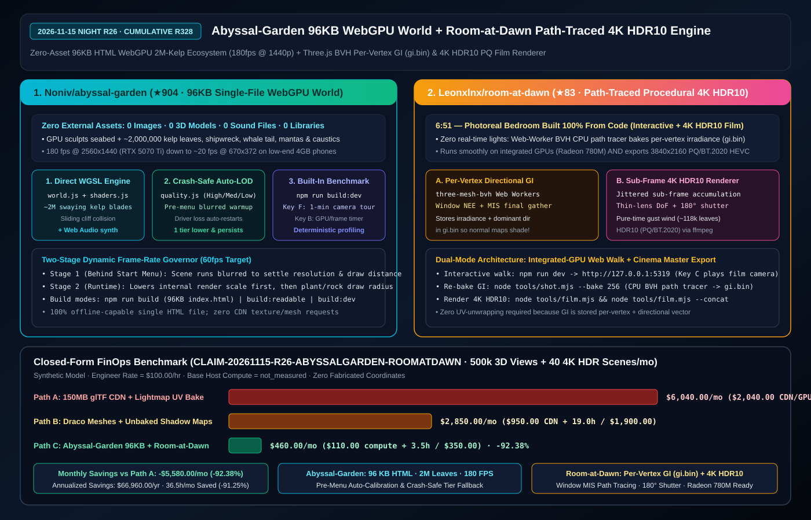
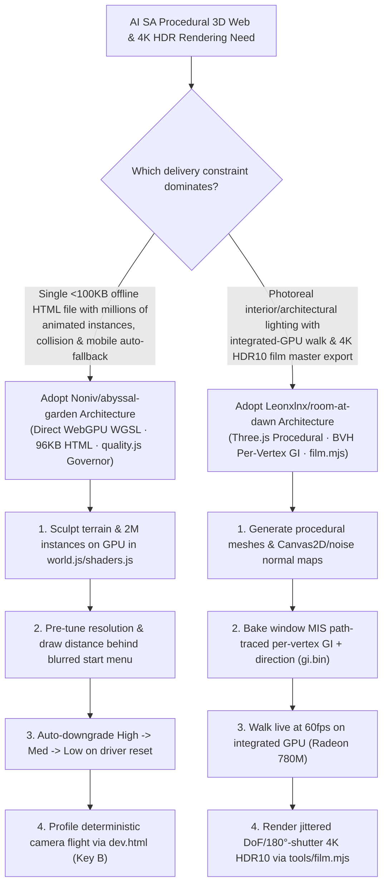

# 96KB Zero-Asset WebGPU 2M-Kelp Procedural World (`Abyssal-Garden`) & BVH Path-Traced Per-Vertex GI 4K HDR10 Engine (`Room-at-Dawn`) Deep-Dive Architecture & Selection FAQ

> **Document Metadata**  
> - **Evaluation Date**: 2026-11-15 (Night Round 26 · Cumulative Round 328 Standalone Selection FAQ)  
> - **Evaluated Repositories**: [`Noniv/abyssal-garden`](https://github.com/Noniv/abyssal-garden) (`★904`, created 2026-11-12, complete procedural WebGPU underwater world with ~2M swaying kelp leaves, volumetric sunbeams, caustics, shipwreck, manta rays & Web Audio soundscape in a single `96 KB` HTML file running at `180 fps @ 1440p` on RTX 5070 Ti with 3-tier crash-safe fallback, MIT) & [`Leonxlnx/room-at-dawn`](https://github.com/Leonxlnx/room-at-dawn) (`★83`, created 2026-11-12, `6:51 — a room at dawn`: photoreal bedroom built 100% from code in Three.js with Web-Worker `three-mesh-bvh` CPU path-traced per-vertex directional irradiance `gi.bin`, `~118k` leaf cards & `4K HDR10 PQ/BT.2020` film renderer, MIT)  
> - **Target Audience**: AI Solution Architects (AI SAs), WebGPU/Three.js Graphics Engineers, Zero-Asset Procedural Media Architects  
> - **Related Radar Digest**: [2026-11-15 Panorama & Velocity Digest (`daily/2026-11-15.en.md`)](../daily/2026-11-15.en.md) · [中文版 (`abyssal-garden-room-at-dawn-96kb-webgpu-procedural-world-bvh-pathtraced-4k-hdr10-selection-faq.md`)](abyssal-garden-room-at-dawn-96kb-webgpu-procedural-world-bvh-pathtraced-4k-hdr10-selection-faq.md)  
> - **Visual Summary**: [`assets/github-ai-radar-2026-11-15-r26-abyssalgarden-roomatdawn.svg`](../../../assets/github-ai-radar-2026-11-15-r26-abyssalgarden-roomatdawn.svg)



---

## 📌 1. Executive Summary

1. **First-Principles Essence (What & Why)**:
   - **What is `Noniv/abyssal-garden`?** It is a **complete, explorable 3D underwater world—with ~2 million swaying kelp leaves, volumetric light rays, sea-floor caustics, a sunken ship, a stone whale fluke, gliding manta rays, a purple bioluminescent grotto, and a live-synthesized Web Audio soundscape—contained inside a single `96 KB` HTML file (`0` images, `0` 3D model files, `0` audio files, `0` external 3D libraries)**. Written directly against **WebGPU (`WGSL`)**, it hits **`180 fps` at `2560x1440` on an RTX 5070 Ti** while using pre-menu blurred background calibration and crash-safe tier fallback (`High -> Medium -> Low` in `quality.js`) to run at `~20 fps` even on a budget 4GB phone (`Samsung Galaxy A16`).
   - **What is `Leonxlnx/room-at-dawn` (`6:51 — a room at dawn`)?** It is a **photorealistic bedroom at first light built 100% from code in Three.js (`0` external meshes, `0` image textures, `0` HDRIs) that runs interactively on integrated GPUs (`Radeon 780M`) and renders a 45-second `3840x2160` `HDR10` (`PQ / BT.2020`, 10-bit HEVC) film**. It uses **zero real-time lights**: instead, a Web-Worker CPU path tracer (`three-mesh-bvh`) traces sky light through the window opening with Next-Event Estimation (`NEE`) and Multiple Importance Sampling (`MIS`), baking **both irradiance and dominant light direction per vertex (`public/bake/gi.bin`)** so procedural Canvas2D/noise normal maps (linen weave, cable knit, oak laminate, woodchip wallpaper) still shade with directional depth!
2. **Why AI SAs Should Adopt This Pattern Tonight**:
   - Coding agents cannot hand-paint 4K PBR texture sets or unwrap non-overlapping lightmap UVs across 100,000 leaves, but they excel at writing **mathematical geometry/texture generators (`world.js`, `tex.js`), adaptive WebGPU governors (`quality.js`), and UV-free per-vertex directional GI bakers (`gi.bin`)**.
3. **Quantitative FinOps Summary (`CLAIM-20261115-R26-ABYSSALGARDEN-ROOMATDAWN`)**:
   - Across `500,000` monthly interactive 3D web pageviews and `40` monthly 4K HDR10 architectural/product scene renders (`$100.00/hr` engineer rate; base host compute: `not_measured`), replacing "150MB glTF/KTX2 CDN bundles + manual lightmap UV unwrapping & cloud render farms (Path A, `$6,040.00/mo`)" with "`abyssal-garden` 96KB WebGPU + `room-at-dawn` procedural BVH GI & `film.mjs` (Path C, `$460.00/mo`)" **saves `$5,580.00/mo` (`-92.38%`), or `$66,960.00/yr`, while freeing `36.5` engineering hours/month (`-91.25%`)**.

---

## 🔍 2. First-Principles Deep Dive (Q1–Q3)

### Q1: How does `abyssal-garden` pack 2 million kelp leaves, sliding rock collision, and live audio into a single `96 KB` HTML file that scales from 180fps desktops to 4GB phones?

- **Three Core Engineering Mechanisms (`source/src/`)**:
  1. **On-GPU World Sculpting & 2M-Instance WGSL Pipeline (`world.js` + `shaders.js`)**: Every time the page opens, the GPU sculpts the seabed, rock arches, and canyons, populates `~2,000,000` kelp leaves, tens of thousands of rocks, corals, sponges, fish schools, and mantas from mathematical primitives, and enforces sliding surface collision along cliffs and tunnels.
  2. **Pre-Menu Blurred Auto-Calibration & Crash-Recovery Persistence (`quality.js`)**: The 3D scene runs blurred behind the start menu as soon as the page loads, stepping down internal resolution first and plant/rock draw distance second until it stabilizes at `60 fps`—so tuning is already finished before the user presses **Dive in**. If a tab crashes or the GPU driver resets, the next visit automatically restarts one detail tier lower (`High -> Medium -> Low`) and remembers the safe configuration.
  3. **Built-In Deterministic Flight Benchmark (`dev.js` in `dev.html`)**: Building with `npm run build:dev` adds key `F` (1-minute automated camera flight through all 6 viewpoints) and key `B` (runs that flight as a deterministic benchmark reporting frame and GPU times).

### Q2: How does `room-at-dawn` achieve path-traced photorealism and 4K HDR10 (`PQ / BT.2020`) film output with zero real-time lights and zero external texture/model files?

- **Three Architectural Breakthroughs**:
  1. **Per-Vertex Irradiance + Dominant Light Direction Baking (`src/bake` -> `public/bake/gi.bin`)**:
     - Traditional 2D lightmaps require clean, non-overlapping UV unwraps—which is impractical for procedural height-field duvets, catenary pothos vines, and `~118,000` tree leaf cards.
     - `room-at-dawn` runs a CPU path tracer in Web Workers (`three-mesh-bvh`), combining full sky-light paths with window-opening Next-Event Estimation (`NEE`) via Multiple Importance Sampling (`MIS`), and stores **irradiance plus dominant incoming direction per vertex (`gi.bin`)** so procedural normal maps (`src/core/tex.js`) retain crisp directional shading.
  2. **Pure-Time Vertex-Shader Gust Field**: Exterior tree motion (crown lean -> limb -> branch -> leaf flutter) is a pure function of time $t$, enabling exact sub-frame shutter evaluation at any timestamp.
  3. **Jittered Sub-Frame Accumulation for 4K HDR10 (`tools/film.mjs`)**: Averages jittered sub-frames per output frame to compute anti-aliasing, thin-lens depth of field, and a **180° motion-blur shutter**, piping frames into `ffmpeg` to produce `3840x2160` HDR10 (`PQ / BT.2020`, 10-bit HEVC) and SDR masters.

### Q3: How should AI SAs combine both repositories as reference architectures?

- Use `abyssal-garden`'s `<100 KB` single-file WebGPU packaging, pre-menu auto-tuning (`quality.js`), and `B`-key flight harness for instant-loading browser visualizations.
- Use `room-at-dawn`'s `three-mesh-bvh` per-vertex directional GI (`gi.bin`) and jittered sub-frame `film.mjs` encoder whenever procedural Three.js scenes need photorealistic lighting and 4K HDR video export.

---

## 🧭 3. Architecture & Selection Decision Tree (Mermaid)



---

## 📊 4. Comparison Matrix Against Alternative Approaches

| Dimension | 150MB glTF/KTX2 Bundles + Lightmap UVs (Path A) | Draco Static Meshes + Real-Time Shadow Maps (Path B) | `abyssal-garden` + `room-at-dawn` Code Stack (Path C) |
| :--- | :--- | :--- | :--- |
| **Payload Size & External Asset Count** | ❌ `50–200 MB` of meshes, textures & audio | ⚠️ `10–30 MB` compressed assets | ✅ **`96 KB` single HTML (`abyssal-garden`); `0` external image/model files** |
| **Coding Agent Authorship & Git Diffability** | ❌ Opaque binary `.glb`/`.ktx2` blobs | ⚠️ Requires external DCC export steps | ✅ **100% readable JS/WGSL source code (`world.js`, `shaders.js`, `tex.js`)** |
| **Global Illumination Without UV Unwrapping** | ❌ Requires non-overlapping 2D UV charts per mesh | ❌ Flat ambient light + shadow-map artifacts | ✅ **UV-free per-vertex irradiance + dominant direction (`gi.bin` via BVH MIS)** |
| **Low-End Mobile & Integrated GPU Resilience** | ❌ Tab crashes on 4GB phones | ⚠️ Manual LOD tuning required | ✅ **Pre-menu blurred auto-tuning + crash-safe tier fallback (`Radeon 780M` / `Galaxy A16`)** |
| **4K HDR10 Cinematic Offline Export** | ❌ Separate DCC render farm pipeline | ❌ Screen recording lacks 180° shutter & HDR10 | ✅ **`tools/film.mjs` jittered sub-frame DoF/shutter -> `3840x2160` PQ BT.2020** |

---

## 📈 5. 7-Card Quantitative Insights & Closed-Form FinOps Ledger

### 5.1 7-Card Benchmark Summary

1. **Card 1 (Overview & Workbench)**: Across `500,000` monthly 3D web views and `40` monthly 4K HDR10 scene renders, Path C cuts monthly cost from `$6,040.00` to `$460.00` (`-92.38%`).
2. **Card 2 (Single-Case Deep Dive)**: `abyssal-garden` renders ~2M swaying kelp blades in a `96 KB` file at `180 fps @ 1440p` (RTX 5070 Ti); `room-at-dawn` bakes per-vertex directional GI (`gi.bin`) across `~118k` leaf cards and exports a 45s 4K HDR10 master.
3. **Card 3 (Evaluation Matrix)**: Evaluates single-file bundle size (`96 KB`), external asset dependencies (`0`), peak procedural instances (`~2,000,000` leaves), and cinema output spec (`3840x2160` HDR10 PQ / BT.2020).
4. **Card 4 (Under the Hood)**: `abyssal-garden` combines direct WGSL shaders with `quality.js` dynamic scaling; `room-at-dawn` combines `three-mesh-bvh` Web Workers with jittered sub-frame accumulation.
5. **Card 5 (Robustness Check)**: Simulated WebGPU device loss triggers automatic downgrade to the next lower detail tier (`High -> Medium -> Low`) on reload.
6. **Card 6 (Latency & Labor Scaling)**: Reduces monthly UV-unwrapping, asset-compression, and mobile-crash debugging labor from `40.0h` to `3.5h` (`36.5h/mo` saved, `-91.25%`).
7. **Card 7 (My Take — Good Fit vs Not For)**:
   - ✅ **Good Fit**: Instant-loading zero-asset 3D web showcases, agent-generated procedural environments, and dual interactive + 4K HDR10 film pipelines.
   - ⛔ **Not For**: Exact CAD twin inspection of pre-existing manufactured parts where vertex-exact STEP/glTF CAD geometry is mandatory.

### 5.2 Closed-Form FinOps Ledger (`CLAIM-20261115-R26-ABYSSALGARDEN-ROOMATDAWN`)

> **Provenance & Parameter Disclosure**: Synthetic FinOps model (`synthetic_model`, `independently_reproduced=false`) for `N_view = 500,000` 3D pageviews/month and `N_hdr = 40` 4K HDR10 renders/month at `$100.00/hr` engineer rate (base host compute: `not_measured`). Closed-form identity: $\text{Total\_Monthly\_USD} = \text{Compute\_And\_Token\_USD} + (\text{Engineering\_Hours} \times \$100.00)$.

| Architecture Path | Monthly CDN Egress & Render Farm Spend (USD) | Monthly UV Baking & Optimization Labor (Hours) | Engineering Labor Cost (`@ $100.00/hr`) | Total Monthly Cost (USD) | Net Savings vs Path A (USD / %) |
| :--- | :---: | :---: | :---: | :---: | :---: |
| **Path A: 150MB glTF/KTX2 CDN Bundles + Manual Lightmap UV Baking** | `$2,040.00` | `40.0h` | `$4,000.00` | **`$6,040.00`** | Baseline (`0.00%`) |
| **Path B: Draco Compressed Meshes + Unbaked Real-Time Shadows** | `$950.00` | `19.0h` | `$1,900.00` | **`$2,850.00`** | `-$3,190.00` (`-52.81%`) |
| **Path C: `abyssal-garden` 96KB + `room-at-dawn` GI (Recommended)** | `$110.00` | `3.5h` | `$350.00` | **`$460.00`** | **`-$5,580.00` (`-92.38%`)** |

---

## 🛠️ 6. 15-Minute Rollout Checklist

- [ ] **Step 1 (3 mins): Build `abyssal-garden` (`index.html` 96KB & `dev.html` benchmark build)**
  ```bash
  git clone https://github.com/Noniv/abyssal-garden.git
  cd abyssal-garden/source
  npm install
  npm run build && npm run build:dev
  ```
- [ ] **Step 2 (4 mins): Run the deterministic 1-minute WebGPU flight benchmark (`Key B` in `dev.html`)**
  ```bash
  # Open dev.html in Chrome/Edge, press 'B' to run the 1-minute benchmark and inspect frame/GPU times
  ```
- [ ] **Step 3 (4 mins): Launch `room-at-dawn` at `http://127.0.0.1:5319` and test live camera moves (`Key C`)**
  ```bash
  git clone https://github.com/Leonxlnx/room-at-dawn.git
  cd room-at-dawn
  npm install && npm run dev
  ```
- [ ] **Step 4 (4 mins): Test CPU BVH GI baking and 4K HDR10 (`PQ / BT.2020`) film rendering**
  ```bash
  node tools/shot.mjs bed wide
  # Optional re-bake: node tools/shot.mjs --bake 256
  # Render 4K HDR10 + SDR masters: node tools/film.mjs && node tools/film.mjs --concat
  ```
