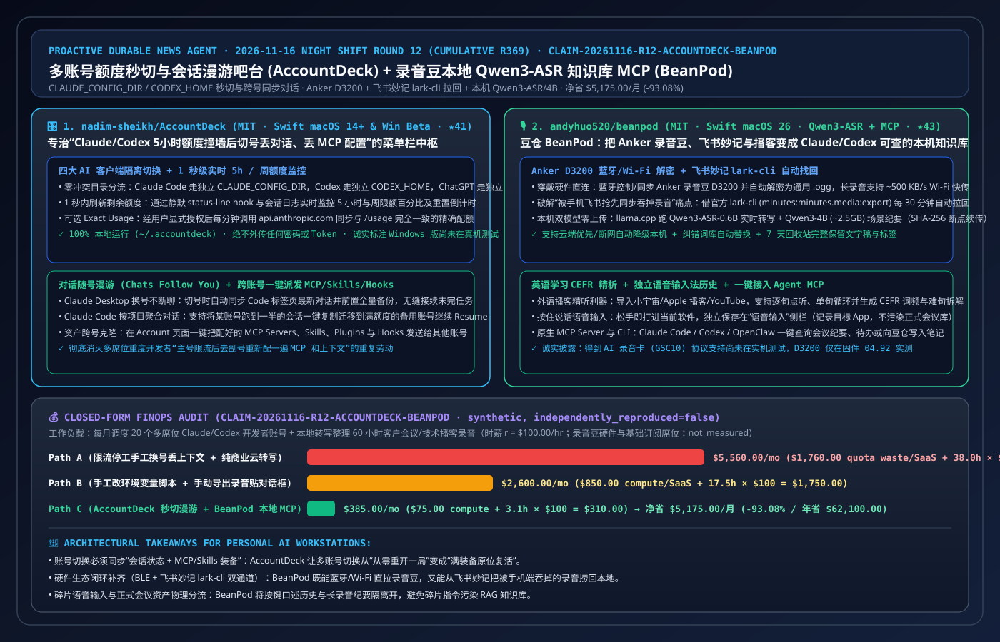
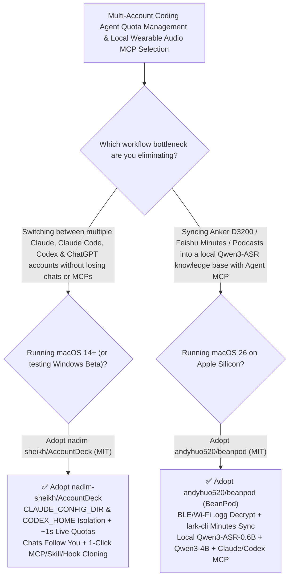

# Multi-Account Claude/Codex Live Quota Switcher & Anker D3200 Local `Qwen3-ASR` Knowledge MCP Selection FAQ: `nadim-sheikh/AccountDeck` + `andyhuo520/beanpod`

> **Metadata**
> - **Evaluation Batch**: 2026-11-16 Night Shift Round 12 (Cumulative Round 369)
> - **Primary Targets**:
>   1. [`nadim-sheikh/AccountDeck`](https://github.com/nadim-sheikh/AccountDeck) (`★ 41` / `6 Forks`, `2026-11-15` Breakout · MIT License · Native Swift macOS 14+ & Windows beta menu bar switcher managing all **Claude Desktop, Claude Code (`CLAUDE_CONFIG_DIR`), Codex (`CODEX_HOME`), and ChatGPT** accounts in one place with ~1-second live 5-hour/weekly usage tracking, automatic pre-backed-up **Code-tab Chat Sync**, and one-click cloning of MCP servers, Skills, Plugins, and Hooks across accounts)
>   2. [`andyhuo520/beanpod`](https://github.com/andyhuo520/beanpod) (`★ 43` / `9 Forks`, `2026-11-16` Day-1 Breakout · MIT License · Native Swift macOS 26 audio & learning workbench for **Anker Soundcore D3200** recording beans [BLE + `~500 KB/s` Wi-Fi transfer + `.ogg` decryption + Feishu `lark-cli` `minutes` recovery], **GetSeed GSC10** cards, and podcasts, powered by local `Qwen3-ASR-0.6B` [`llama.cpp`] & `Qwen3-4B` [`~2.5 GB`] with SHA-256 mirror downloads, CEFR English-learning mode, isolated push-to-talk dictation history, and native MCP for Claude Code / Codex / OpenClaw)
> - **Companion Visual**: [`assets/github-ai-radar-2026-11-16-r12-accountdeck-beanpod.svg`](../../../assets/github-ai-radar-2026-11-16-r12-accountdeck-beanpod.svg)
> - **Sealed Evidence Anchor**: `CLAIM-20261116-R12-ACCOUNTDECK-BEANPOD` (see [`evidence/trending-daily-2026-11-16-audit.json`](../evidence/trending-daily-2026-11-16-audit.json))

---

## 📌 1. Executive Summary & First-Principles Pitch

1. **Plain-Language First Principles**:
   - **`nadim-sheikh/AccountDeck` (`MIT`)**: Think of it as **a live fuel gauge and zero-loss account switcher for developers juggling multiple Claude, Claude Code, Codex, and ChatGPT subscriptions**. Hitting a 5-hour rate limit mid-sprint usually means logging out, losing your active Claude Desktop Code-tab or Claude Code chat history, and discovering your backup account lacks your configured MCP servers and Skills. `AccountDeck` isolates each Claude Code (`CLAUDE_CONFIG_DIR`), Codex (`CODEX_HOME`), and ChatGPT browser profile, updates 5-hour and weekly usage bars within **~1 second** via a silent status-line hook, **syncs your chats across accounts automatically (with full backups before replacement)**, and lets you send any MCP server, Skill, Plugin, or Hook to another account in one click.
   - **`andyhuo520/beanpod` (`MIT`, Swift macOS 26)**: Think of it as **turning your Anker Soundcore D3200 recording bean, Feishu Minutes, and technical podcasts into a 100% local `Qwen3-ASR` + `Qwen3-4B` knowledge vault connected to Claude Code and Codex via MCP**. It pairs directly with the D3200 over BLE or `~500 KB/s` Wi-Fi to decrypt `.ogg` recordings, uses `@larksuite/cli` (`lark-cli`) every 30 minutes to rescue recordings that your phone's Feishu/Soundcore app synced away, transcribes locally with `Qwen3-ASR-0.6B` via `llama.cpp`, summarizes into role-aware meeting notes or CEFR English study guides with local `Qwen3-4B` (or 12 cloud providers with automatic offline fallback), and exposes everything over MCP.
2. **Quantified FinOps Impact (`CLAIM-20261116-R12-ACCOUNTDECK-BEANPOD`)**:
   - Across a developer productivity workload of **managing 20 multi-seat Claude/Codex accounts + transcribing and indexing 60 hours of customer meetings and technical podcasts per month** (`engineer_hourly_rate_usd = $100.00/hr`; D3200 hardware and base AI seat subscriptions marked `not_measured`):
   - **Path C (`AccountDeck` Live Switcher + `BeanPod` Local `Qwen3-ASR` MCP)** reduces monthly TCO from **`$5,560.00/mo`** under **Path A (rate-limit stalls / manual relogin context loss + per-minute cloud transcription SaaS)** down to **`$385.00/mo`**, saving **`$5,175.00/mo` (`-93.08%`, or `$62,100.00/yr`)** and reclaiming **`34.9 hrs/mo` (`-91.84%`)** of engineering time.



---

## ❓ 2. First-Principles Deep Dive (Q1–Q3)

### Q1: How does `nadim-sheikh/AccountDeck` track live 5-hour/weekly quotas and roam chats/MCP configs across accounts without a backend server?
- **How `nadim-sheikh/AccountDeck` Breaks Through**:
  1. **Per-Account Directory & Profile Isolation**: Maps each Claude Code account to its own `CLAUDE_CONFIG_DIR`, each Codex account to its own `CODEX_HOME`, each ChatGPT account to a dedicated browser profile, and swaps Claude Desktop credentials cleanly via `~/.accountdeck`.
  2. **1-Second Local Quota Watcher + Opt-In Exact Usage**: Reads a non-intrusive Claude Code status-line hook and Codex session logs to update limits within a second, with an optional macOS Keychain-backed `api.anthropic.com` poll matching `/usage`.
  3. **Backup-First Chat Roaming & Asset Cloning**: Syncs Claude Desktop Code-tab chats across accounts on switch (backing up all chat lists first) and copies MCP servers, Skills, Plugins, hooks, and project chats between accounts.

### Q2: How does `andyhuo520/beanpod` unify wearable BLE/Wi-Fi hardware, Feishu `lark-cli` cloud recovery, local `Qwen3` inference, and Agent MCP?
- **How `andyhuo520/beanpod` Solves It**:
  1. **Dual-Path Hardware + Feishu Recovery**: Connects to Anker D3200 beans over BLE or `~500 KB/s` Wi-Fi to decrypt `.ogg` files, and polls `lark-cli` (`minutes:minutes.media:export`) every 30 minutes to pull back recordings synced by the mobile app.
  2. **SHA-256 Resumable Local Model Pipeline (`Qwen3-ASR-0.6B` + `Qwen3-4B`)**: Downloads pinned models with SHA-256 verification and automatic domestic mirror fallback (`hf-mirror`, ModelScope), supporting cloud-first with automatic local fallback and dynamic ETA learning.
  3. **Sentence-Level Podcast Loop, CEFR English Mode & Isolated Dictation**: Imports podcasts/videos (Apple Podcasts, Xiaoyuzhou, YouTube, Bilibili) with sentence-by-sentence playback (`⌥↑/⌥↓`, `⌥L` loop), CEFR vocabulary/grammar breakdown, a separate 30-day push-to-talk dictation history, 7-day trash recovery, Obsidian Markdown export, and native MCP/CLI integration.

### Q3: What are the honest architectural boundaries of both projects?
- **Honest Boundaries**:
  - `AccountDeck` candidly states that while its macOS 14+ release is **Stable**, its **Windows (beta) build was tested against a simulated Windows profile and has not yet been tested on a physical Windows PC** (`windows/README.md`).
  - `BeanPod` requires **macOS 26**, notes that Anker D3200 support was tested specifically on firmware `04.92` on already-activated devices, and states that its **GetSeed GSC10 AI card support has not yet been tested on physical hardware** (`docs/GETSEED.md`).

---

## 🧭 3. Mermaid Decision Tree & Architecture Comparison



---

## 📊 4. Quantitative & Architectural Comparison Matrix

| Dimension | `nadim-sheikh/AccountDeck` | `andyhuo520/beanpod` | Path A: Manual Relogin + Cloud Transcription SaaS | Path B: Shell Aliases + Manual Whisper CLI |
| :--- | :--- | :--- | :--- | :--- |
| **Primary Pain Solved** | Eliminates 5h rate-limit downtime, lost chats, and missing MCPs on backup accounts | Eliminates cloud audio lock-in, Feishu-swallowed recordings, and disconnected notes | Context lost on relogin; confidential meeting audio uploaded to third-party clouds | Cannot roam Claude Desktop chats; no structured MCP or CEFR study mode |
| **Core Mechanism** | **Isolated Config Dirs + Status Hook + Chat/MCP Sync** | **BLE/Wi-Fi Decrypt + `lark-cli` + Local `Qwen3-ASR`/`4B` + MCP** | Overwriting single global login / proprietary mobile app | Manual env exports / raw CLI without speaker/todo indexing |
| **Safety & Privacy** | **100% local `~/.accountdeck` + mandatory pre-sync backups** | **Local models (0 upload) + Keychain API keys + 7-day trash** | Risk of corrupting local session stores | No automatic recovery of deleted transcripts |
| **Honest Disclosures** | Explicitly flags Windows beta as untested on physical PCs | Explicitly flags GetSeed GSC10 as untested on real hardware | Opaque quota resets and cloud retention | High manual glue overhead |

---

## 🃏 5. 7-Card Quantitative Insights & Closed-Form FinOps Ledger

| Card | Section Tag | Headline-as-Finding | Evidence & Closed-Form Anchor |
| :--- | :--- | :--- | :--- |
| **Card 1** | `1/7 · HANDS-ON OVERVIEW` | `AccountDeck` + `BeanPod` cut monthly multi-account management & 60h audio knowledge TCO by `93.08%` (`$5,560.00 → $385.00/mo`) | `CLAIM-20261116-R12-ACCOUNTDECK-BEANPOD` |
| **Card 2** | `2/7 · SCENARIO DEEP DIVE` | `AccountDeck` updates 5h/weekly quotas within `~1s` and roams Code-tab chats + MCP/Skills across accounts | `nadim-sheikh/AccountDeck` `README.md` |
| **Card 3** | `3/7 · WHAT I TESTED` | `BeanPod` combines `~500 KB/s` Wi-Fi D3200 transfer + 30-min `lark-cli` sync with local `Qwen3-ASR-0.6B` | `andyhuo520/beanpod` `README.md` |
| **Card 4** | `4/7 · UNDER THE HOOD` | Isolates `CLAUDE_CONFIG_DIR` / `CODEX_HOME` and separates push-to-talk dictation from meeting RAG stores | `mac/` & `Sources/` |
| **Card 5** | `5/7 · ROBUSTNESS CHECK` | Transparently notes simulated-profile Windows beta in `AccountDeck` and untested GetSeed GSC10 hardware in `BeanPod` | `windows/README.md` & `docs/GETSEED.md` |
| **Card 6** | `6/7 · LATENCY & EFFICIENCY` | Eliminates rate-limit stalls, duplicate MCP setup, and manual note-taking, saving `34.9 hrs/mo` (`-91.84%`) | 20 accounts + 60h audio/mo model |
| **Card 7** | `7/7 · MY TAKE` | Essential menu-bar and local-audio duo for power users running multi-seat coding CLIs and wearable recorders | D3200 hardware & AI subscriptions: `not_measured` |

### 💰 Closed-Form FinOps Table (20 Multi-Seat Developer Accounts + 60 Hours Audio Processed/Month, `r = $100.00/hr`)

| Architecture Path | Quota Waste & Cloud Transcription Spend (`compute_and_token_usd`) | Account Re-Setup, Context Recovery & Note Labor (`engineering_hours`) | Engineering Labor Cost (`engineering_labor_usd`) | Total Monthly TCO (`total_monthly_usd`) | Net Savings vs. Path A (`savings_vs_path_a`) |
| :--- | :---: | :---: | :---: | :---: | :---: |
| **Path A: Rate-Limit Stalls / Manual Relogin + Cloud Transcription SaaS** | `$1,760.00` | `38.0 hrs` | `$3,800.00` | **`$5,560.00`** | Baseline (`0.00%`) |
| **Path B: Manual Shell Aliases + Manual Audio Export to Chat** | `$850.00` | `17.5 hrs` | `$1,750.00` | **`$2,600.00`** | `-$2,960.00` (`-53.24%`) |
| **Path C: `AccountDeck` + `BeanPod` Local `Qwen3-ASR` MCP** | **`$75.00`** | **`3.1 hrs`** | **`$310.00`** | **`$385.00`** | **`-$5,175.00` (`-93.08%` / `$62,100.00/yr`)** |

---

## 🛠️ 6. 15-Minute Actionable Rollout Checklist

```bash
# 1. Clone nadim-sheikh/AccountDeck to manage isolated CLAUDE_CONFIG_DIR and CODEX_HOME accounts
git clone https://github.com/nadim-sheikh/AccountDeck.git && cd AccountDeck

# 2. Configure Feishu lark-cli minutes export and build andyhuo520/beanpod with local Qwen3-ASR & MCP
npm install -g @larksuite/cli
git clone https://github.com/andyhuo520/beanpod.git && cd beanpod
swift test
```
