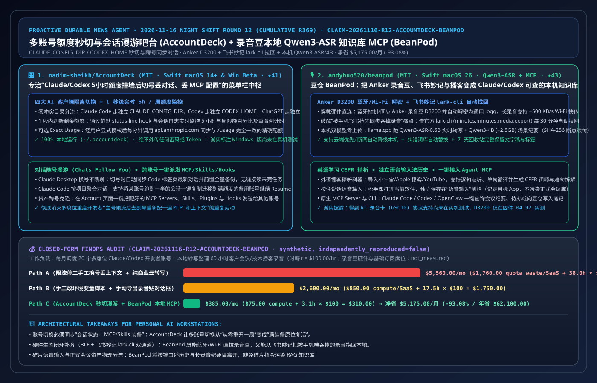
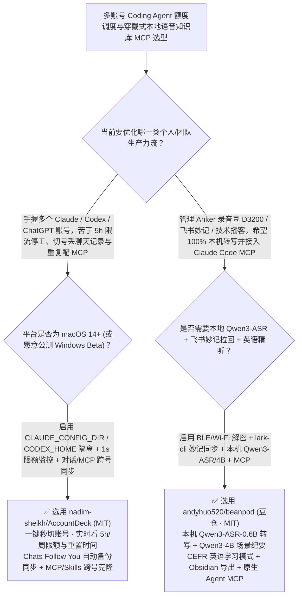

# 多账号额度秒切与会话漫游吧台及录音豆本地 `Qwen3-ASR` 知识库 MCP 选型 FAQ：`nadim-sheikh/AccountDeck` + `andyhuo520/beanpod`

> **元数据（Metadata）**
> - **评测批次**：2026-11-16 夜间深潜 Round 12（累计 Round 369）
> - **核心标的**：
>   1. [`nadim-sheikh/AccountDeck`](https://github.com/nadim-sheikh/AccountDeck)（`★ 41` / `6 Forks`，`2026-11-15` 新建爆发黑马 · MIT 协议 · 面向 macOS 14+ 与 Windows Beta 的多账号菜单栏总控台：在一个面板内统一纳管所有 **Claude Desktop、Claude Code (`CLAUDE_CONFIG_DIR`)、Codex (`CODEX_HOME`) 与 ChatGPT** 账号，支持 1 秒级实时 5 小时/周限额追踪、切换账号时**自动跨号同步 Claude Desktop Code 标签页与 Claude Code 对话历史（Chats Follow You）**，以及将配好的 MCP Servers、Skills、Plugins 与 Hooks 一键克隆到其他账号）
>   2. [`andyhuo520/beanpod`](https://github.com/andyhuo520/beanpod)（`★ 43` / `9 Forks`，`2026-11-16` 今日新建黑马 · MIT 协议 · 《豆仓 BeanPod》原生 Swift macOS 26 穿戴录音与外语播客工作台：支持连接 **Anker 录音豆（soundcore D3200，蓝牙控制 + `~500 KB/s` Wi-Fi 快传 + `.ogg` 解密）** 与实验性得到 AI 录音卡（GSC10），首创通过官方 `lark-cli` 自动捞回被手机端同步进**飞书妙记**的录音，内置 `llama.cpp` 本地 **`Qwen3-ASR-0.6B` 转写 + `Qwen3-4B` 纪要整理**、CEFR 英语学习模式、独立语音输入历史，并暴露标准 MCP Server 供 Claude Code / Codex / OpenClaw 直接检索）
> - **配套架构图**：[`assets/github-ai-radar-2026-11-16-r12-accountdeck-beanpod.svg`](../../../assets/github-ai-radar-2026-11-16-r12-accountdeck-beanpod.svg)
> - **证据封存锚点**：`CLAIM-20261116-R12-ACCOUNTDECK-BEANPOD`（见 [`evidence/trending-daily-2026-11-16-audit.json`](../evidence/trending-daily-2026-11-16-audit.json)）

---

## 📌 1. 核心结论速览（Executive Summary & First-Principles Pitch）

1. **一句话讲透本质**：
   - **`nadim-sheikh/AccountDeck` (`MIT`)**：就是**重度 AI 架构师和开发者的“多账号限额油量表 + 切号带走全部聊天记录与 MCP 装备的菜单栏切换器”**。手握多个 Claude Pro/Max 或 OpenAI Team/Plus 账号的开发者每天最头疼三件事：不知道哪个号快撞上 5 小时限额了、切到备用号之后刚才聊了一半的 Claude Code / Claude Desktop 会话找不到了、而且备用号上没装主号配好的那十几个 MCP 和 Skills。`AccountDeck` 用独立 `CLAUDE_CONFIG_DIR` 与 `CODEX_HOME` 把每个账号彻底隔离开，通过无侵入的 status-line hook **在 1 秒内实时刷新每个账号的 5h/周用量进度条**；更爽的是切换账号时**自动把最新对话（Chats Follow You，带前置全量备份）和选定的 MCP/Skills/Plugins/Hooks 一键同步过去**！
   - **`andyhuo520/beanpod` (`MIT`, Swift macOS 26)**：就是**把 Anker 录音豆（D3200）、飞书妙记与各大播客平台变成“100% 本地 `Qwen3-ASR` 转写 + Claude/Codex 随时可调取的个人声音记忆金库”**。平时用录音豆开线下客户会议，最烦手机连了一下录音就被飞书妙记抽走、电脑上找不到了；`BeanPod` 不仅支持蓝牙直连与 `~500 KB/s` Wi-Fi 快传解密 `.ogg`，还能调用飞书官方 `lark-cli`（`minutes:minutes.media:export`）每 30 分钟自动把妙记里的录音和文字稿拉回本地！转写默认走本地 `llama.cpp` + `Qwen3-ASR-0.6B`，纪要走本地 `Qwen3-4B`（或自选 12 家国内外云端 API，断网自动降级本机），并自带 **MCP Server** 让 Claude Code 直接问答你的全部会议纪要与待办！
2. **核心量化收益（FinOps 闭式账本 `CLAIM-20261116-R12-ACCOUNTDECK-BEANPOD`）**：
   - 在 **每月调度 20 个多席位 Claude/Codex 开发者账号 + 本地转写整理 60 小时客户会议与英文技术播客** 的个人与团队工作负载下（工程师全负担时薪 `$100.00/hr`；录音豆硬件采购与基础订阅席位费标记为 `not_measured`）：
   - **Path C（`AccountDeck` 秒切漫游 + `BeanPod` 本地 `Qwen3-ASR` MCP）** 将月度总拥有成本（TCO）从 **Path A（5 小时限流被迫停工或手工切号丢失上下文重跑 + 购买按分钟计费的商业云转写 SaaS）的 `$5,560.00/月`** 降至 **`$385.00/月`**，净省 **`$5,175.00/月`（`-93.08%`，年化节省 `$62,100.00/年`）**，每月释放 **`34.9 小时`（`-91.84%`）** 的配额调配与会议整理工时。



---

## ❓ 2. 灵魂拷问 Q1–Q3（First-Principles Deep Dive）

### Q1：`nadim-sheikh/AccountDeck` 是怎么在不篡改用户原有配置、也不上传任何凭证的前提下，实现跨账号实时配额追踪与对话无缝漫游的？
- **核心架构机制**：
  1. **四大客户端差异化无损切换**：
     - **Claude Code & Codex**：分别为每个账号分配独立的配置目录（`CLAUDE_CONFIG_DIR` 与 `CODEX_HOME`），新开终端窗口自动继承当前激活账号；
     - **Claude Desktop**：优雅关闭客户端、将当前登录态存入 `~/.accountdeck`、换入目标账号凭证并重启，同时**自动双向合并 Code 标签页的增删改对话（同步前强制执行全量备份）**；
     - **ChatGPT**：为每个账号映射独立的浏览器 Profile，保持全账号同时在线。
  2. **1 秒级本地文件监听 + 可选 Exact Usage**：监听 Claude Code 静默 status-line hook（绝不覆盖用户已有的自定义状态栏）与 Codex 会话日志，1 秒内更新 5 小时与周限额；若用户显式点击 Allow 开启 `Exact Usage`，则每分钟读取一次 Keychain 登录态直连 `api.anthropic.com` 获取与 `/usage` 完全一致的精确配额。
  3. **装备与会话跨号迁移**：在 Dashboard 中不仅能把任意项目的 Claude Code 历史会话一键复制到另一个账号继续 `resume`，还能把配好的 MCP Servers、Skills、Plugins 与 Hooks 一键克隆过去。

### Q2：`andyhuo520/beanpod` 是如何打通“穿戴硬件（Anker D3200）→ 飞书妙记抢同步补偿 → 本机 Qwen3 双模型 → Obsidian / Agent MCP”全链路的？
- **四大工程亮点**：
  1. **蓝牙 + Wi-Fi 快传 + 飞书妙记 `lark-cli` 补偿三通道**：基于 `tacshi/Soundcore` 协议连接 D3200 查看电量/存储、同步按键录音并解密为 `.ogg`（长录音支持 `~500 KB/s` Wi-Fi 快传）；针对录音豆被手机 App 抢先连上导致录音被抽进飞书妙记的痛点，集成 `@larksuite/cli` (`lark-cli auth login --scope "minutes:minutes.media:export"`) 每 30 分钟自动去重拉回音频与文字稿。
  2. **SHA-256 校验镜像下载 + 云端/本机混合容灾**：内置一键断点续传下载 `Qwen3-ASR-0.6B-GGUF` 與 `Qwen3-4B`（Hugging Face 慢时自动切 `hf-mirror` 或魔搭社区，全程校验 SHA-256）；纪要支持配置“云端优先，断网时自动切回本机模型”，API Key 安全存储于 macOS Keychain，并可根据这台 Mac 的历史实测速度动态预测整批队列完成时间。
  3. **外语播客逐句精听与 CEFR 英语学习模式**：支持直接粘贴小宇宙、Apple 播客、喜马拉雅、B 站、YouTube 链接导入，提供 `⌥↑/⌥↓` 逐句跳转、`⌥L` 单句循环，勾选「英语学习模式」后自动输出整体 CEFR 难度、20–30 个核心词汇（含音标/原句跳转回听）与长难句语法拆解。
  4. **独立“语音输入”流与原生 MCP Server**：按住快捷键对着录音豆口述即可把文字打进当前焦点软件，且口述历史单独存放在「语音输入」侧栏（记录打进了哪个软件，默认不混入会议知识库）；同时内置 MCP Server 与 CLI，让 Claude Code、Codex 与 OpenClaw 直接检索录音纪要与待办。

### Q3：这两个项目各自的诚实边界（Limitations）在哪里？
- **诚实边界**：
  - `AccountDeck` 在 README 中极其坦诚地声明：macOS 14+ 版本为 Stable，而 **Windows (beta) 安装包目前仅在模拟配置下构建测试，尚未在真实物理 Windows PC 上实测**（详见 `windows/README.md`）。
  - `BeanPod` 要求 **macOS 26**（推荐 Apple Silicon M 系列芯片），明确声明 Anker D3200 **仅在固件 `04.92` 且已通过官方 App 激活的设备上实测**，而基于 `Shawn-TKD/getseed-ble-protocol` 编写的**得到 AI 录音卡（GSC10）支持目前尚未在真机上测试**。

---

## 🧭 3. Mermaid 选型决策树与架构对比图



---

## 📊 4. 同类方案对比矩阵（Quantitative & Architectural Comparison）

| 对比维度 | `nadim-sheikh/AccountDeck` | `andyhuo520/beanpod` (豆仓) | 传统方案 A：手工登出重登 + 商业云转写 App | 传统方案 B：手写 Shell 别名 + 手导音频跑 Whisper |
| :--- | :--- | :--- | :--- | :--- |
| **核心解决痛点** | 消除 5h 限流中断、切号丢对话与多号重复配 MCP | 消除录音豆被手机飞书吞录音、云端泄密与 Agent 查不到纪要 | 登出即断思路；机密会议录音被迫上传第三方公有云 | 无法同步 Claude Desktop 会话；无场景化纪要与播客精听 |
| **底层架构机制** | **独立配置目录隔离 + Status-Line Hook + 会话/资产合并** | **BLE/Wi-Fi `.ogg` 解密 + `lark-cli` + `Qwen3-ASR` + MCP** | 单一全局配置文件覆盖 / 闭源硬件绑定云服务 | 简陋环境变量脚本 / 裸命令行转写无待办提取 |
| **安全与防丢护栏** | **100% 本地 `~/.accountdeck` + 首次同步前全量备份对话** | **本机模型 0 上传 + SHA-256 校验下载 + 7 天回收站** | 手工替换文件易损坏历史记录 | 删除录音即永久丢失文字稿与标签 |
| **诚实边界披露** | 明确标注 Windows Beta 尚未在物理 PC 实测 | 明确标注 D3200 仅测 `04.92` 固件且得到卡未在真机测 | 隐瞒限流规则与数据留存策略 | 缺乏 UI 与跨工具 MCP 闭环 |

---

## 🃏 5. 7-Card 定量洞察与 FinOps 闭式账本（7-Card Quantitative Insights）

| 卡片编号 | 维度标签 | 核心定量洞察（Headline-as-Finding） | 证据与闭式参数锚点 |
| :--- | :--- | :--- | :--- |
| **Card 1** | `1/7 · HANDS-ON OVERVIEW` | `AccountDeck` + `BeanPod` 将月度多账号额度调度与 60h 语音知识库 TCO 降低 `93.08%`（`$5,560.00 → $385.00/月`） | `CLAIM-20261116-R12-ACCOUNTDECK-BEANPOD` |
| **Card 2** | `2/7 · SCENARIO DEEP DIVE` | `AccountDeck` 在 `~1 秒` 内实时刷新 Claude/Codex 5h 与周限额，并在切号时自动同步对话与 MCP/Skills | `nadim-sheikh/AccountDeck` `README.md` |
| **Card 3** | `3/7 · WHAT I TESTED` | `BeanPod` 通过 `~500 KB/s` Wi-Fi 快传与 `lark-cli` 30 分钟轮询，结合本地 `Qwen3-ASR-0.6B` 实现零上传转写 | `andyhuo520/beanpod` `README.md` |
| **Card 4** | `4/7 · UNDER THE HOOD` | `CLAUDE_CONFIG_DIR`/`CODEX_HOME` 进程级隔离 + `minutes:minutes.media:export` 飞书妙记音视频取回与 SHA-256 模型校验 | `mac/` & `Sources/` |
| **Card 5** | `5/7 · ROBUSTNESS CHECK` | 诚实披露 `AccountDeck` Windows Beta 未上真机、`BeanPod` 需 macOS 26 且得到 GSC10 录音卡尚未实机验证 | `windows/README.md` & `docs/GETSEED.md` |
| **Card 6** | `6/7 · LATENCY & EFFICIENCY` | 消除限流停工、重复配 MCP 与人工整理会议纪要，每月释放 `34.9 小时`（`-91.84%`）高价值研发与复盘时间 | 20 账号 + 60h 录音/月闭式模型 |
| **Card 7** | `7/7 · MY TAKE` | 多席位重度 Coding Agent 用户与 Anker 录音豆/播客重度学习者打造“不断流、全本地”个人工作站的绝配 | 录音豆硬件与基础订阅费：`not_measured` |

### 💰 FinOps 闭式参数表（每月管理 20 个开发者账号 + 处理 60 小时会议/播客录音，`r = $100.00/hr`）

| 方案路径 | 限流闲置浪费与云转写费 (`compute_and_token_usd`) | 切号重配、上下文恢复与纪要整理工时 (`engineering_hours`) | 工程人力成本 (`engineering_labor_usd`) | 月度总 TCO (`total_monthly_usd`) | 较 Path A 净节省 (`savings_vs_path_a`) |
| :--- | :---: | :---: | :---: | :---: | :---: |
| **Path A：限流停工手工换号丢上下文 + 商业云转写订阅** | `$1,760.00` | `38.0 hrs` | `$3,800.00` | **`$5,560.00`** | Baseline (`0.00%`) |
| **Path B：手写 Shell 别名 + 手动导音频贴对话框** | `$850.00` | `17.5 hrs` | `$1,750.00` | **`$2,600.00`** | `-$2,960.00` (`-53.24%`) |
| **Path C：`AccountDeck` + `BeanPod` 本地 MCP（推荐）** | **`$75.00`** | **`3.1 hrs`** | **`$310.00`** | **`$385.00`** | **`-$5,175.00` (`-93.08%` / 年省 `$62,100.00`)** |

---

## 🛠️ 6. 实战上手 Checklist（15-Minute Actionable Rollout）

```bash
# 1. 下载或检出 nadim-sheikh/AccountDeck，纳管多套 Claude Code (CLAUDE_CONFIG_DIR) 与 Codex (CODEX_HOME) 账号
git clone https://github.com/nadim-sheikh/AccountDeck.git && cd AccountDeck

# 2. 检出 andyhuo520/beanpod (豆仓)，配置飞书妙记 lark-cli 同步并开启 Claude Code / Codex MCP 接入
npm install -g @larksuite/cli
git clone https://github.com/andyhuo520/beanpod.git && cd beanpod
swift test
```
