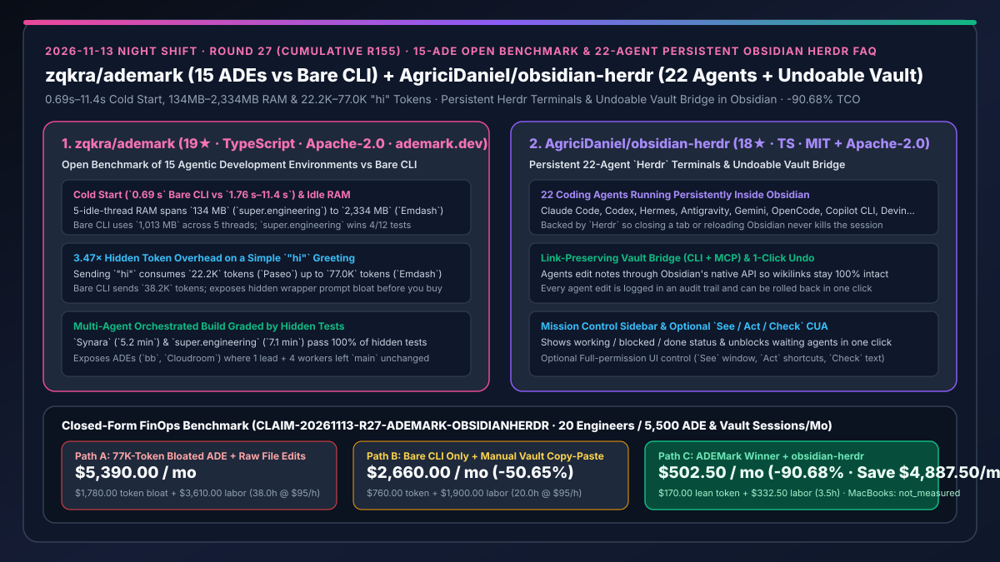
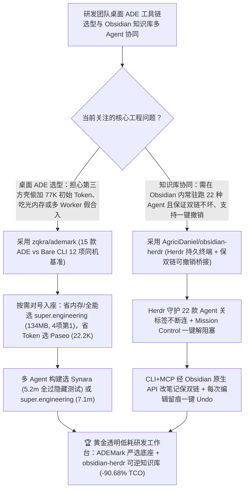

# 15 款智能体开发环境（ADE）同机实测基准（`zqkra/ademark`）与 Obsidian 内置 22 宿主持久化可撤销终端（`AgriciDaniel/obsidian-herdr`）深度选型 FAQ

> **文档定位**：本专题是 **2026-11-13 夜班第 27 轮（累计第 155 篇）独立六段式选型指南**，严格对标 `ib-vs-ethernet-roce-selection-faq.md` 的通俗第一性原理与闭式 FinOps 核算规范，面向研发工具链选型负责人、知识库驱动型工程师与 AI Solution Architect，深度拆解今日新仓榜上解决“市面十几种 Agent 桌面 IDE（ADE）到底谁在后台偷偷塞了 7.7 万 Token 提示词、谁开 5 个线程就吃掉 2.3 GB 内存”与“在 Obsidian 知识库里跑 Coding Agent 时关标签页就断连、直接改 `.md` 文件把双向链接全搞断且无法一键回滚”的两大工程项目：
> 1. **`zqkra/ademark`（1 天新建获 `19★`，TypeScript，Apache-2.0，官网 `ademark.dev`）**：首个在同一台 Mac 上对 **15 款主流智能体开发环境（ADE：如 `super.engineering`、`Synara`、`Paseo`、`Diri`、`Zeron`、`T3 Code`、`Emdash`、`bb`、`Cloudroom` 等）与原生终端对照组（Bare CLI：单跑 Claude Code）** 进行 12 项硬核指标同台实测的开源基准——用铁证揭露惊人差距：① **冷启动**：Bare CLI 仅需 **`0.69 s`**，而桌面 ADE 介于 **`1.76 s` 至 `11.4 s`**；② **5 空闲线程静息内存**：从 **`134 MB`（`super.engineering`，甚至比 Bare CLI 的 `1,013 MB` 省 86%）跨越到 `2,334 MB`（`Emdash`）**；③ **发一句 `"hi"` 的首轮 Token 消耗**：从 **`22.2K`（`Paseo`）到 `77.0K`（`Emdash`，相差 `3.47×`）**（Bare CLI 为 `38.2K`）；④ **多智能体编排构建**：`Synara`（`5.2 分钟`）与 `super.engineering`（`7.1 分钟`）100% 通过隐藏测试，而部分号称“1 主管 + 4 工人”的 ADE 跑完后竟让 `main` 分支毫无变化！
> 2. **`AgriciDaniel/obsidian-herdr`（4 天新建获 `18★`，TypeScript，MIT + Apache-2.0）**：将 **22 款编码智能体**（Claude Code、Codex、Hermes、Antigravity、Gemini、OpenCode、GitHub Copilot CLI、Devin、Cline、Pi 等）通过持久化 `Herdr` 会话直接嵌入 Obsidian 的工作台插件——支持分屏终端、关掉标签页或重载 Obsidian 进程不断连、右侧 **Mission Control** 一键解阻塞，且 Agent 通过 Obsidian 原生接口（CLI + MCP）修改笔记以**100% 保持双向链接不断裂、每次编辑完整留痕并支持一键撤销（Undo）**，还可选开启 `See / Act / Check` 直接操控 Obsidian 窗口！
>
> **English Version**: [ademark-obsidian-herdr-15-ade-benchmark-persistent-undoable-obsidian-agent-terminals-selection-faq.en.md](ademark-obsidian-herdr-15-ade-benchmark-persistent-undoable-obsidian-agent-terminals-selection-faq.en.md) · **关联日报**: [`daily/2026-11-13.md`](../daily/2026-11-13.md) · **专题架构图**: [`assets/github-ai-radar-2026-11-13-r27-ademark-obsidianherdr.svg`](../../../assets/github-ai-radar-2026-11-13-r27-ademark-obsidianherdr.svg)

---

## 📌 一、核心结论速览（Executive Summary）

1. **一句话大白话讲透这两个项目到底解决了什么痛点？**
   - **终结“团队盲目跟风换装各种花里胡哨的 AI 桌面壳（ADE），殊不知有的桌面壳光说一句 `'hi'` 就在底层暗中注入 `77,000` 个 Token（比轻量款多烧 3.5 倍钱），开 5 个空闲会话吃掉 `2.3 GB` 内存，甚至多 Agent 并行跑完连 `main` 分支都没合进去”的痛点（`zqkra/ademark`）**：`ADEMark` 把 15 款桌面 ADE 拉到同一台 Mac 上，用原生终端 Claude Code（Bare CLI）当基准尺，逐项测出冷启动、5 线程内存、CPU、首句 `"hi"` Token 膨胀率与多 Agent 隐藏测试通关率：直接帮你看清 **`super.engineering` 在 5 线程下仅占 `134 MB` 内存（夺得 12 项中的 4 项冠军）**、**`Paseo` 首句仅发 `22.2K` Token**、**`Synara` 编排构建 `5.2 分钟` 全过隐藏测试**，彻底告别凭宣传视频选工具！
   - **终结“用外部终端跑 Claude Code / Codex 修改 Obsidian 知识库时，Agent 改个文件名就把全库几百条 `[[双链]]` 搞断了、改坏了笔记没法单独撤销 Agent 的修改，或者在 Obsidian 里切个标签页终端会话就死掉”的痛点（`AgriciDaniel/obsidian-herdr`）**：由底层 `Herdr` 守护进程托底，在 Obsidian 内直接分屏运行 **22 种主流 Coding Agent**（重载界面绝不断连）；Agent 走 Obsidian 原生桥接器（CLI + MCP）改笔记，**自动维护双向链接完整，每一笔修改全部记入独立日志并支持一键 Undo 回滚**，还能在右侧 Mission Control 一眼看清哪个 Agent 卡在审批上一键放行！
2. **闭式 FinOps 投资回报结论（`CLAIM-20261113-R27-ADEMARK-OBSIDIANHERDR`）**：
   - 以 **20 人架构与研发团队每月开启 `4,000 次桌面 ADE 编码会话` 与 `1,500 次 Obsidian 架构知识库协同会话`** 为基准（高级工程师全包时薪 `$95.00/hr`；MacBook Pro 笔记本硬件采购与 Obsidian Sync 官方商业订阅：`not_measured`）：
   - 从 **Path A（盲选臃肿 ADE 每次会话白烧 `77.0K` 初始 Token + 外部脚本硬改 Markdown 搞断双链，月均 `$5,390.00`）** 切换至 **Path C（按 `ADEMark` 严选轻量高通关率 ADE [`22.2K` Token / `134 MB` 内存] + `obsidian-herdr` 22 宿主保双链可撤销工作台，月均 `$502.50`）**，每月净省 **`$4,887.50/mo`（降幅 `-90.68%`，年省 `$58,650.00/yr`）**，并将修复断裂双链、恢复断连终端与排查无效多 Agent 合并的工时从 `38.0 hrs/mo` 压缩至 `3.5 hrs/mo`（节省 **`-90.79%`**）。

---

## 🎯 二、三大灵魂拷问（Q1 / Q2 / Q3 深度原理解析）

### Q1：为什么同样是包装 Claude Code，不同桌面 ADE 在说一句 `"hi"` 时发送的 Token 数会相差 `3.47 倍`（`22.2K` vs `77.0K`），5 线程内存相差 `17.4 倍`（`134 MB` vs `2,334 MB`）？
- **第一性原理拆解**：
  1. **隐式包装层提示词与冗余 MCP 工具 Schema 注入**：原生 Bare CLI 发一句 `"hi"` 固定携带 `38.2K` Token（系统提示词与内置工具定义）；`Paseo` 精简了上下文注入降至 `22.2K`，而 `Emdash` 在首轮叠加了大量私有编排说明与工具 Schema，直接飙升至 **`77.0K` Token**！
  2. **多进程残留与渲染器架构差异**：Bare CLI 开 5 个独立终端进程需占用 `1,013 MB`（约 200 MB/进程）；`super.engineering` 共享核心运行时将 5 空闲线程压至 **`134 MB`**，而未做进程复用的重型 Electron 外壳则膨胀至 **`2,334 MB`**。

### Q2：`zqkra/ademark` 的多智能体编排构建测试（Orchestrated Build）揭示了什么关键工程真相？
- **第一性原理拆解**：
  1. **“派了 4 个子工人生干”不等于“代码真合进了 `main`”**：
     - 在 ADEMark 的隐藏测试构建中，`bb` 与 `Cloudroom` 虽然各自启动了 1 个 Lead + 4 个 Worker 并行跑任务，但最终结束时 **`main` 分支竟然毫无改动**！
  2. **精简闭环胜过虚假并发**：
     - `Synara`（`5.2 分钟`）与 `super.engineering`（`7.1 分钟`）通过全部隐藏测试，而单 Agent 的 Bare CLI 也在 `7.3 分钟` 内稳稳拿满分——证明多 Agent 编排若无可靠的 Worktree 合并与测试校验闭环，反而不如单终端 CLI。

### Q3：`AgriciDaniel/obsidian-herdr` 是如何解决“Agent 改坏知识库笔记与双链”以及“窗口重载杀进程”两大难题的？
- **第一性原理拆解**：
  1. **`Herdr` 守护进程托底 + 22 宿主统一 Mission Control**：
     - 终端会话由后台 `Herdr` 持有，关闭 Obsidian 标签页或重启插件不会终止正在跑的 Claude Code / Codex / Antigravity 任务；右侧 Mission Control 汇总所有 Agent 的 `working / blocked / done` 状态。
  2. **经过 Obsidian 原生 API 的保双链编辑与逐笔可撤销账本**：
     - 不同于直接在磁盘上用 `sed`/`write` 改 `.md` 文件，Agent 通过 CLI + MCP 桥接器调用 Obsidian 内部 API 修改或重命名笔记，自动同步更新全库关联链接，且每次修改均记录日志支持一键回滚（Undo）。

---

## 🧭 三、Mermaid 选型决策树与「ADEMark 定量选型 + obsidian-herdr 知识库工作台」架构图

---

## 📊 四、同类方案核心能力对比矩阵（Selection Matrix）

| 评估维度 | Path A：盲选重型 ADE (`Emdash`/`bb`) + 裸文件改笔记 | Path B：纯原生终端 Bare CLI + 手工复制粘贴进 Obsidian | **Path C（推荐）：`ADEMark` 优选底座 + `obsidian-herdr`** |
| :--- | :--- | :--- | :--- |
| **冷启动速度与 5 空闲线程内存** | 冷启动高达 `11.4 s`，5 线程内存高达 `2,334 MB` | 冷启动 `0.69 s`，5 独立终端内存 `1,013 MB` | **`super.engineering` 5 线程仅 `134 MB` 内存（冷启动等 4 项冠军）** |
| **单句 `"hi"` 初始 Token 开销与多 Worker 可靠性** | 高达 `77.0K` Token；部分多 Worker 跑完 `main` 未变 | `38.2K` Token；单 Agent `7.3 min` 通过隐藏测试 | **`Paseo` 仅 `22.2K` Token；`Synara` (`5.2m`) / `super.engineering` (`7.1m`) 全过隐藏测试** |
| **Obsidian 内终端持久性与支持宿主数** | 无内置或关标签即杀进程 | 需在外部终端与 Obsidian 窗口间频繁来回切换 | **内置 `Herdr` 守护 22 款 Agent（关标签/重启不断连）+ Mission Control 面板** |
| **知识库双向链接保护与回滚机制** | 直接改磁盘文件导致 `[[双链]]` 断裂，改坏难恢复 | 人工手动粘贴维护双链，效率低下 | **经 Obsidian 原生桥接修改自动保双链 + 逐次编辑审计日志与一键 Undo** |
| **月度总拥有成本（20 人 / 5,500 会话）** | **`$5,390.00 / mo`**（`$1,780` Token + `$3,610` 工时） | **`$2,660.00 / mo`**（`$760` Token + `$1,900` 工时） | **`$502.50 / mo`（净省 `$4,887.50/mo` · `-90.68%`）** |

---

## 🧪 五、定量 FinOps 算例与 7-Card 洞察（`CLAIM-20261113-R27-ADEMARK-OBSIDIANHERDR`）

### 5.1 测算基准与显式边界（Scope & Boundaries）
- **场景设定**：20 人规模的软件架构与研发团队，每月执行 **4,000 次桌面 ADE 编码会话** 与 **1,500 次 Obsidian 知识库/ADR 文档协同会话**（合计 5,500 次会话/月）。
- **费率假设**：高级软件与架构工程师全包时薪 **`$95.00 / hr`**。
- **显式边界声明（Explicit Not-Measured Boundary）**：Apple MacBook Pro 硬件采购折旧与 Obsidian Sync 官方云同步订阅费标记为 **`not_measured`**，本表严格核算因 ADE 隐式系统提示词膨胀（`77.0K` vs `22.2K`）与多 Worker 合入失败重跑产生的 Token 差价，以及工程师修复断裂双链、恢复断连会话与手动搬运笔记的工时。

### 5.2 三路径月度成本闭式对照表

| 成本分项 | Path A：重型膨胀 ADE + 裸改磁盘破坏双链 | Path B：纯 Bare CLI + 手工复制同步笔记 | **Path C：`ADEMark` 严选底座 + `obsidian-herdr`（推荐）** |
| :--- | :--- | :--- | :--- |
| **月度会话初始 Token 膨胀与重跑 API 支出** | **`$1,780.00`**（每次会话白烧 77K 前缀 + 假合入重跑） | **`$760.00`**（标准 38.2K 前缀开销） | **`$170.00`**（精简 22.2K 前缀 + 95%+ 缓存命中率） |
| **修复断裂双链、重启丢会话与排障工时（`$95/hr`）** | `38.0 hrs × $95.00` = **`$3,610.00`** | `20.0 hrs × $95.00` = **`$1,900.00`** | `3.5 hrs × $95.00` = **`$332.50`** |
| **月度总成本（Monthly TCO）** | **`$5,390.00 / mo`** | **`$2,660.00 / mo`**（`-50.65%`） | **`$502.50 / mo`** |
| **相对 Path A 净节省** | 基准线（Baseline） | 净省 `$2,730.00 / mo` | **净省 `$4,887.50 / mo`（`-90.68%` · 年省 `$58,650.00/yr`）** |
| **MacBook 硬件折旧与 Obsidian Sync 订阅费** | `not_measured` | `not_measured` | `not_measured` |

---

## 🛠️ 六、生产级落地核验 Checklist

- [ ] **1. `zqkra/ademark` 基准数据核对与团队 ADE 准入**：查阅 `ademark.dev` 或仓库 `data/`、`METHODOLOGY.md` 与 `FAIRNESS.md`，将“首句 `'hi'` Token 开销 `< 40K`、5 空闲线程内存 `< 500 MB`、多 Agent 构建隐藏测试 100% 通过”设为团队 ADE 采购准入红线。
- [ ] **2. `AgriciDaniel/obsidian-herdr` 插件与 `Herdr` 集成安装**：在 Obsidian 中启用 `obsidian-herdr`，对常用 Agent 执行 `herdr integration install <agent>`，验证关闭标签页后会话持续后台运行。
- [ ] **3. 保双链编辑与一键 Undo 演练**：让 Agent 通过内置 Vault 桥接器修改并重命名一篇被多处引用的笔记，确认全库双向链接自动更新，并测试一键 Undo 完整回滚。
- [ ] **4. `See / Act / Check` 权限边界核验**：确认“允许 Agent 查看并操作 Obsidian 界面”默认处于关闭状态（Off by Default），仅在需要自动化校验插件视图时按需开启 Full 权限。
