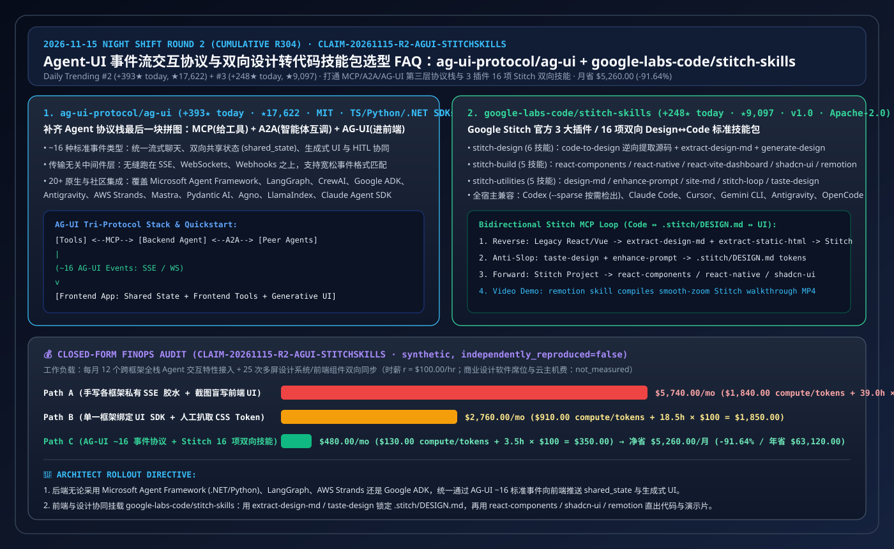
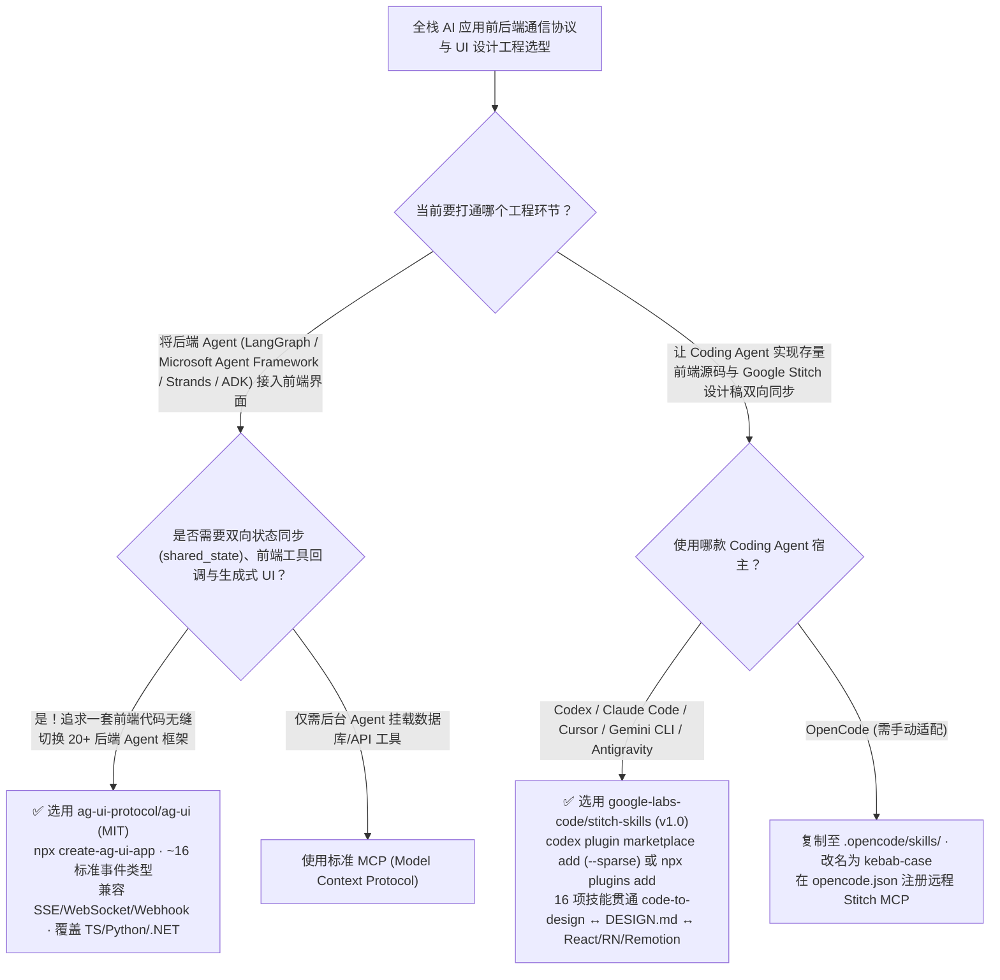

# Agent-UI 事件流交互协议与 Google Stitch 双向设计/代码技能包选型 FAQ：`ag-ui-protocol/ag-ui` + `google-labs-code/stitch-skills`

> **元数据（Metadata）**
> - **评测批次**：2026-11-15 夜间深潜 Round 2（累计 Round 304）
> - **核心标的**：
>   1. [`ag-ui-protocol/ag-ui`](https://github.com/ag-ui-protocol/ag-ui)（`★ 17,622` 日榜 DOM / `★ 17,623` 实时 API · 今日暴涨 **`+393 ★ today`**（GitHub Daily Trending 总榜 `#2`）· MIT 协议 · 面向用户前端应用的开源轻量 Agent-User Interaction Protocol，通过约 16 种标准事件类型打通 Microsoft Agent Framework、LangGraph、CrewAI、Google ADK、Antigravity、AWS Strands、Mastra、Pydantic AI、Claude Agent SDK 等 20+ 后端框架的双向状态同步与生成式 UI）
>   2. [`google-labs-code/stitch-skills`](https://github.com/google-labs-code/stitch-skills)（`★ 9,097` 日榜 DOM / `★ 9,099` 实时 API · 今日新增 **`+248 ★ today`**（GitHub Daily Trending 总榜 `#3`）· `v1.0` · Apache-2.0 协议 · Google Labs 官方开源的 Google Stitch MCP 技能与插件库，涵盖 `stitch-design`、`stitch-build`、`stitch-utilities` 三大插件共 16 项技能，支持源码逆向转设计稿与设计稿正向编译 React / React Native / `shadcn-ui` / Remotion 演示视频）
> - **配套架构图**：[`assets/github-ai-radar-2026-11-15-r2-agui-stitchskills.svg`](../../../assets/github-ai-radar-2026-11-15-r2-agui-stitchskills.svg)
> - **证据封存锚点**：`CLAIM-20261115-R2-AGUI-STITCHSKILLS`（见 [`evidence/trending-daily-2026-11-15-audit.json`](../evidence/trending-daily-2026-11-15-audit.json)）

---

## 📌 1. 核心结论速览（Executive Summary & First-Principles Pitch）

1. **一句话讲透本质**：
   - **`ag-ui-protocol/ag-ui`**：就是**AI 智能体协议栈里的“前后端通用插座（第 3 层协议）”**。如果说 **MCP** 解决了“Agent 怎么调外部工具”，**A2A** 解决了“Agent 和 Agent 怎么对话”，那么 **AG-UI** 解决的就是“**后端五花八门的 Agent 怎么带着实时状态、工具调用和动态组件走进前端网页/App 与人类协同**”。它定义了约 **16 种标准事件类型**，不挑传输层（SSE、WebSockets、Webhooks 通吃），让 Microsoft Agent Framework、LangGraph、CrewAI、Google ADK、AWS Strands 等 20 多种后端框架无需手写私有前端胶水，开箱获得双向状态同步（`shared_state`）、前端工具回调与受控生成式 UI（`tool_based_generative_ui`）。
   - **`google-labs-code/stitch-skills` (`v1.0`)**：就是**连接 Google Stitch 与各大 Coding Agent（Codex / Claude Code / Cursor / Gemini CLI / Antigravity / OpenCode）的“16 合 1 双向设计工程桥”**。它把 UI 工程拆成三个标准插件包：**`stitch-design`（6 技能）**负责把已有前端代码逆向抽成静态 HTML 与 `.stitch/DESIGN.md` 上传回 Stitch 或生成多变体设计稿；**`stitch-build`（5 技能）**负责把 Stitch 屏幕编译成 Token 对齐的 React、React Native、`shadcn-ui`、`react-vite-dashboard` 乃至 `remotion` 自动运镜演示视频；**`stitch-utilities`（5 技能）**则用 `taste-design` 与 `enhance-prompt` 守住审美底线，彻底告别千篇一律的 AI 塑料感界面。
2. **核心量化收益（FinOps 闭式账本 `CLAIM-20261115-R2-AGUI-STITCHSKILLS`）**：
   - 在 **每月接入 12 个跨框架全栈 Agent 交互特性 + 完成 25 次多屏设计系统与前端代码双向同步** 的企业工作负载下（工程师全负担时薪 `$100.00/hr`；商业设计软件席位与云主机费标记为 `not_measured`）：
   - **Path C（`ag-ui-protocol/ag-ui` + `google-labs-code/stitch-skills`）** 将月度总拥有成本（TCO）从 **Path A（为每个后端框架手写私有 SSE/WebSocket 胶水 + 靠截图盲写前端 UI 代码）的 `$5,740.00/月`** 降至 **`$480.00/月`**，净省 **`$5,260.00/月`（`-91.64%`，年化节省 `$63,120.00/年`）**，每月释放 **`35.5 小时`（`-91.03%`）** 的前后端联调与 UI 走样返工工时。



---

## ❓ 2. 灵魂拷问 Q1–Q3（First-Principles Deep Dive）

### Q1：有了 MCP 和 A2A 协议，为什么前端工程师接 Agent 还是苦不堪言？`ag-ui-protocol/ag-ui` 的 `~16` 种标准事件到底省掉了什么？
- **传统痛点**：MCP 是面向模型调后台工具的请求/响应协议，A2A 是面向跨智能体后台任务委派的协议；当一个 Agent 在执行长达数分钟的复杂任务时，前端需要实时展示流式思考文本、同步表单中间状态、弹出待人类确认的参数卡片、甚至让后端 Agent 反向调用浏览器端 JS 工具。如果每个团队自己发明一套 JSON over SSE 格式，一旦后台从 LangGraph 换成 Microsoft Agent Framework 或 AWS Strands，前端代码就得推倒重写。
- **`ag-ui` 的三大核心设计**：
  1. **约 16 种标准生命周期与状态事件**：涵盖流式消息增量、工具调用开始/参数流/结果、前后端双向状态快照与增量补丁（`shared_state`）、工具驱动的生成式 UI（`tool_based_generative_ui`）以及人类在环（HITL）暂停与恢复。
  2. **传输无关与宽松匹配中间件（Middleware Layer）**：底层不绑定死单一网络协议（SSE、WebSocket、Webhook 均可），并通过中间件兼容宽松事件格式转换，附带开箱即用的 HTTP 参考实现与 `npx create-ag-ui-app`。
  3. **20+ 主流框架一等公民与社区集成**：官方仓库 `integrations/` 目录已内置 `microsoft-agent-framework`、`langgraph`、`crew-ai`、`adk-middleware`（Google ADK）、`antigravity`、`aws-strands`、`mastra`、`pydantic-ai`、`agno`、`llama-index`、`ag2`、`claude-agent-sdk`、`claude-managed-agents`、`vercel-ai-sdk` 等适配器，并在 `dojo.ag-ui.com` 提供逐特性的在线交互靶场。

### Q2：为什么让 Coding Agent 看着截图写前端总是偏离存量设计规范？`google-labs-code/stitch-skills` 是如何打通“存量代码 → Stitch 设计稿 → 生产组件/演示视频”双向闭环的？
- **传统痛点**：大多数设计转代码工具只支持“从新画的设计稿单向生成新页面”，一旦企业已有庞大的存量 React/Vue 代码库，设计规范往往散落在源码里，Agent 生成的新页面字体、间距、配色立刻与旧系统脱节。
- **`stitch-skills` (`v1.0`) 的三插件 16 技能矩阵**：
  1. **`stitch-design`（6 项逆向与生成技能）**：
     - `stitch::extract-design-md` 直接扫描存量 `/src` 源码提取语义化 `.stitch/DESIGN.md`；
     - `stitch::extract-static-html` 从运行中的 `localhost` 应用抓取内联 CSS/图片的自包含静态 HTML；
     - `stitch::code-to-design` 与 `stitch::upload-to-stitch` 将存量前端一键逆向同步进 Google Stitch 项目，再用 `stitch::generate-design` 与 `stitch::manage-design-system` 生成高密度或暗黑模式变体。
  2. **`stitch-build`（5 项生产构建与视频技能）**：
     - 将 Stitch 屏幕正向编译为带自动校验与 Token 一致性的 `stitch::react-components`、`stitch::react-native`、`shadcn-ui`、集成 TanStack Query 的 `react-vite-dashboard`，以及利用 `remotion` 自动生成平滑缩放转场的产品走查视频！
  3. **`stitch-utilities`（5 项反平庸审美与循环技能）**：
     - `taste-design` 强制生成高审美标准的 `DESIGN.md`；`enhance-prompt` 将含糊的“做个设置页”扩充为专业 UI/UX 提示词；`stitch-loop` 单提示词生成并自校验多页完整站点。

### Q3：这两个项目各自的诚实边界（Limitations）在哪里？
- **诚实边界**：
  - `ag-ui-protocol/ag-ui` 中部分集成（如 `AWS Bedrock Agents` 与 `OpenAI Agents SDK`）在 README 矩阵中诚实标注为 `🛠️ In Progress`（开发中）；
  - `google-labs-code/stitch-skills` 运行依赖于预先配置并运行 **Google Stitch MCP Server**（需在 `stitch.withgoogle.com/docs/mcp/setup/` 完成鉴权配置）；此外，在 **OpenCode** 中使用时不支持 `npx plugins` 自动布局，必须手动将 `stitch::*` 技能名与文件夹重命名为全小写 `kebab-case`，并将工具指令中的 `web_fetch`/`run_command` 替换为 OpenCode 内置的 `webfetch`/`bash`。

---

## 🧭 3. Mermaid 选型决策树与架构对比图



---

## 📊 4. 同类方案对比矩阵（Quantitative & Architectural Comparison）

| 对比维度 | `ag-ui-protocol/ag-ui` (`MIT`) | `google-labs-code/stitch-skills` (`v1.0`) | 传统方案 A：手写各框架私有 SSE 胶水 + 截图盲写前端 | 传统方案 B：单一云厂商绑定 UI 组件库 + 手工导出设计稿 |
| :--- | :--- | :--- | :--- | :--- |
| **核心解决痛点** | 终结每个后端 Agent 框架各自发明一套前端流式协议的碎片化 | 打通存量代码逆向入设计稿与设计稿正向出多端代码/视频的双向闭环 | 换后端框架就得重写前端；看截图写 UI 丢失设计 Token | 锁死单一模型厂商；无法把已有代码逆向回传设计工具 |
| **底层架构机制** | **`~16` 标准事件 + 传输无关中间件 + TS/Py/.NET SDK** | **3 大插件（Design/Build/Utilities）16 项 `SKILL.md` + Stitch MCP** | 零散 JSON 字段拼接 + 单轮 VLM 视觉猜像素 | 专有 WebSocket 协议 + 静态 Figma 插件导出 |
| **生态兼容广度** | 原生支持 **Microsoft Agent Framework / LangGraph / CrewAI / ADK / Strands** 等 20+ 框架 | 兼容 **Codex (`--sparse`) / Claude Code / Cursor / Gemini CLI / OpenCode** | 仅限当前单一项目自用 | 仅支持单一前端框架，缺乏 `remotion` 视频与 React Native 双出 |
| **诚实边界声明** | 明确标注 Bedrock/OpenAI Agents SDK 集成处于 `In Progress` | 明确说明依赖 Stitch MCP 鉴权及 OpenCode `kebab-case` 改名要求 | 隐性维护债极高 | 迁移成本高昂 |

---

## 🃏 5. 7-Card 定量洞察与 FinOps 闭式账本（7-Card Quantitative Insights）

| 卡片编号 | 维度标签 | 核心定量洞察（Headline-as-Finding） | 证据与闭式参数锚点 |
| :--- | :--- | :--- | :--- |
| **Card 1** | `1/7 · HANDS-ON OVERVIEW` | `ag-ui` + `stitch-skills` 将月度全栈 Agent 交互接入与多屏 UI 同步 TCO 降低 `91.64%`（`$5,740.00 → $480.00/月`） | `CLAIM-20261115-R2-AGUI-STITCHSKILLS` |
| **Card 2** | `2/7 · SCENARIO DEEP DIVE` | `ag-ui` 单日暴涨 `+393★`（总 `17,622★`，日榜 `#2`），以 `~16` 种标准事件统一 20+ 后端框架的前端状态同步 | `ag-ui-protocol/ag-ui` `integrations/` 核验 |
| **Card 3** | `3/7 · WHAT I TESTED` | `stitch-skills` 单日新增 `+248★`（总 `9,097★`，日榜 `#3`），以 3 大插件、16 项技能实现 `code-to-design` 与多端构建闭环 | `google-labs-code/stitch-skills` (`v1.0`) 源码核验 |
| **Card 4** | `4/7 · UNDER THE HOOD` | MCP(工具) + A2A(协同) + AG-UI(前端) 三层正交协议栈 + `.stitch/DESIGN.md` 语义 Token 双向提取与注入 | `README.md` & `plugins/*/skills/` |
| **Card 5** | `5/7 · ROBUSTNESS CHECK` | 诚实披露 OpenCode `stitch::*` 需改名 `kebab-case` 与工具名映射（`webfetch`/`bash`），以及在研集成状态 | 跨宿主兼容性与边界审计 |
| **Card 6** | `6/7 · LATENCY & EFFICIENCY` | `--sparse` 稀疏检出插件 + `shared_state` 增量状态流，每月节省 `35.5 小时`（`-91.03%`）前后端联调与 UI 返工 | 12 个全栈特性 + 25 次 UI 同步/月模型 |
| **Card 7** | `7/7 · MY TAKE` | 构建多后端 Agent 前端底座与高审美 React/RN/Shadcn 界面的首选标准组合 | 商业设计席位与云主机费：`not_measured` |

### 💰 FinOps 闭式参数表（每月 12 个全栈 Agent 特性接入 + 25 次多屏设计/代码同步，`r = $100.00/hr`）

| 方案路径 | 联调重跑与 UI 生成 Token 费 (`compute_and_token_usd`) | 协议胶水与 UI 返工工时 (`engineering_hours`) | 工程人力成本 (`engineering_labor_usd`) | 月度总 TCO (`total_monthly_usd`) | 较 Path A 净节省 (`savings_vs_path_a`) |
| :--- | :---: | :---: | :---: | :---: | :---: |
| **Path A：手写各框架私有 SSE 胶水 + 截图盲写前端 UI** | `$1,840.00` | `39.0 hrs` | `$3,900.00` | **`$5,740.00`** | Baseline (`0.00%`) |
| **Path B：单一框架绑定 UI SDK + 人工扒取 CSS Token** | `$910.00` | `18.5 hrs` | `$1,850.00` | **`$2,760.00`** | `-$2,980.00` (`-51.92%`) |
| **Path C：`ag-ui` 标准事件协议 + `stitch-skills` 双向技能包（推荐）** | **`$130.00`** | **`3.5 hrs`** | **`$350.00`** | **`$480.00`** | **`-$5,260.00` (`-91.64%` / 年省 `$63,120.00`)** |

---

## 🛠️ 6. 实战上手 Checklist（15-Minute Actionable Rollout）

```bash
# 1. 使用 AG-UI 快速初始化支持双向 shared_state 与生成式 UI 的全栈 Agent 前端应用
npx create-ag-ui-app my-agent-app

# 2. 在 Codex / Claude Code / Cursor 中按需稀疏安装 Google Stitch 三大技能插件包
codex plugin marketplace add google-labs-code/stitch-skills --ref main \
  --sparse .agents/plugins \
  --sparse plugins/stitch-design \
  --sparse plugins/stitch-build \
  --sparse plugins/stitch-utilities
npx plugins add google-labs-code/stitch-skills --scope project --target claude-code
```
