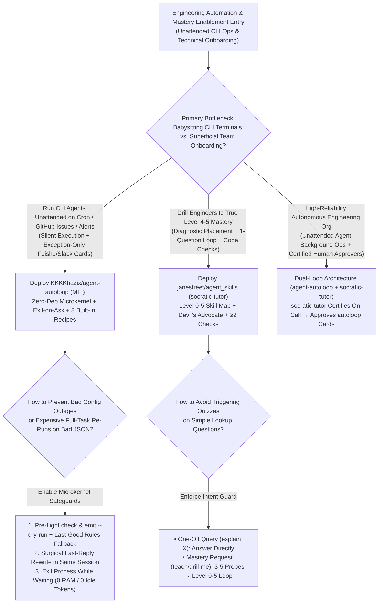

# Exit-While-Waiting CLI Agent Microkernel & Socratic Mastery Verification Selection FAQ: `KKKKhazix/agent-autoloop` + `janestreet/agent_skills` vs. Terminal Babysitting & Lecture-Style Prompts

> **Document Scope**: A first-principles architecture and FinOps selection guide for AI Solution Architects, Developer Productivity Platform Leads, and Engineering Enablement Directors. Focusing on two standout breakout repositories from the `2026-11-09` GitHub AI Radar (Track B) — **`KKKKhazix/agent-autoloop`** (MIT, Track B **#B5**, **4,255 Stars** on search snapshot / **4,266 Stars** live API in 6 days, **`709 Stars/day`** lifecycle velocity, `stars_today = not_measured`) and **`janestreet/agent_skills`** (MIT, **1,716 Stars** on search snapshot / **1,717 Stars** live API in 6 days, **`286 Stars/day`** lifecycle velocity, `stars_today = not_measured`) — this guide dissects how an **Exit-While-Waiting Zero-Dependency Event Microkernel with Surgical Last-Reply Rewrites** and **Jane Street's Level 0–5 Socratic Verification Loop (`socratic-tutor`)** eliminate terminal babysitting, idle polling token waste, and passive onboarding hallucinations.
>
> **Navigation**: [中文版 (`agent-autoloop-janestreet-skills-selection-faq.md`)](./agent-autoloop-janestreet-skills-selection-faq.md) · [2026-11-09 Daily Radar](../daily/2026-11-09.en.md) · [Back to Radar Index](../README.en.md)


---

## 📌 1. Executive Summary

1. **First-Principles Definition**:
   - **`KKKKhazix/agent-autoloop` (Node 24+ / TypeScript 7.0.2, zero external runtime dependencies, MIT)** is a lightweight background event-dispatch microkernel for CLI agents (Claude Code, Codex, etc.). Requiring zero cloud servers or open public ports, it routes cron jobs, GitHub Issues, and production alerts via `~/.agent-autoloop/rules.json`. **After finishing a turn, the agent appends a trailing ```` ```agent-autoloop ```` JSON envelope (`ask`, `notice`, `resolve`, `later`, `events`) and exits completely — consuming 0 background processes and 0 tokens while awaiting human input**. When a user clicks the decision card on Feishu, WeCom, DingTalk, Slack, or Discord (`agent-autoloop answer`), the kernel resumes the exact prior agent session (`"resume": true`).
   - **`janestreet/agent_skills` (Official Jane Street open-source release, MIT)** provides the **`socratic-tutor` (`socratic-tutor/SKILL.md`)** skill that transforms an LLM from a passive lecturer into a **strict maieutic (Socratic) mastery verifier**. It enforces an upfront **Intent Guard**, runs a **3–5 question diagnostic placement** across **4–10 subskills**, tracks progress on a **Level `0–5` ASCII skill map (`U+2588 / U+2591`)**, asks **strictly ONE question per message with zero trailing hints**, plays devil's advocate (`"are you sure? what about X?"`) even on correct answers, and upgrades levels **only after 2+ independent checks including at least one unprompted recall**.
2. **Core Architectural Insight (Why Long-Running Polling Loops & Passive Lecture Prompts Fail in Engineering Teams)**:
   - **Failure Mode #1 (Terminal Babysitting Wastes 100h/Mo & Malformed Output JSON Triggers Expensive Full Re-Runs)**: Watching a CLI agent in a terminal blocks developer focus; keeping background agents polling while waiting for human approval wastes memory and heartbeat tokens; and when an agent writes a syntax error in its final JSON receipt, naive wrappers re-run the entire multi-step task from scratch. `agent-autoloop` exits while waiting, coalesces queued burst events, and **rewrites only the final reply inside the existing session** if the trailing JSON block is malformed — backed by a 20,000-step deterministic fuzz simulator (`sim/random.ts 24301 20000`).
   - **Failure Mode #2 (Sycophantic LLM Explanations Create False Mastery & 20% Production Misconfigurations)**: Standard `"explain X"` prompts dump walls of text that engineers skim without deep comprehension. Jane Street's `socratic-tutor` forces engineers to predict outcomes, expose contradictions, and defend correct answers under pressure before reaching Level `4/5` (`independent`) or `5/5` (`edge cases`).
3. **30-Second Selection Rule**:
   - Choose **`KKKKhazix/agent-autoloop`** when you want **local or dev-box CLI agents (Claude Code / Codex) to autonomously triage GitHub issues, investigate ops alerts, run website watches, and drive PR delivery in the background — interrupting you via Feishu/Slack cards only when high-stakes judgment is required**.
   - Choose **`janestreet/agent_skills` (`socratic-tutor`)** when you need **rigorous, test-verified mastery of complex languages, systems, or quantitative workflows rather than passive Q&A**.

---

## 🎯 2. Architect's First-Principles Deep Dive (Q1 / Q2 / Q3)

### Q1: How does `KKKKhazix/agent-autoloop` achieve zero-SDK integration, zero idle process/token overhead during human approval waits, and surgical recovery from malformed JSON receipts?

Inspecting `kernel/`, `protocol/`, `plugins/`, and `sim/` in `KKKKhazix/agent-autoloop` reveals three microkernel design choices:

1. **Trailing Fenced-Block Protocol & Exit-While-Waiting Lifecycle**:
   - Any CLI tool that accepts a prompt and prints a final reply can be plugged in with a single line in `rules.json` (zero SDK or source modifications). When the agent needs human sign-off (`ask`), sends an FYI/notification (`notice`), closes an incident card (`resolve`), schedules a delayed check (`later`), or emits downstream triggers (`events`), it appends a ```` ```agent-autoloop ```` JSON block at the end of its final message and **exits the process immediately**.
   - While waiting hours for a human to approve a service restart or PR merge on Feishu/Slack, **no agent process runs and zero tokens are burned**. Once answered (`agent-autoloop answer 1 2`), the kernel resumes the exact prior conversation.
2. **Surgical Last-Reply Rewrite & Queued Event Coalescing**:
   - If the agent completes 5 minutes of code investigation but produces invalid JSON in the trailing `agent-autoloop` block, the kernel **resumes the existing session and asks it to rewrite only that final reply** — never re-executing the completed business work.
   - Multiple events arriving for the same item while queued are **coalesced into a single turn**, preventing alert-storm token amplification.
3. **Last-Good `rules.json` Fallback & 20,000-Step Deterministic Simulation (`sim/random.ts 24301 20000`)**:
   - Supports safe pre-flight validation via `agent-autoloop check <draft>` and `agent-autoloop emit <type> --dry-run`. If `rules.json` is saved with invalid syntax or deleted while running, the kernel continues operating on the last valid in-memory ruleset and dispatches a warning card.
   - `npm run test:sim` executes `node sim/random.ts 24301 20000` (20,000 randomized state-machine transitions under seed `24301`) to verify deadlock-free session resumption.

### Q2: What makes Jane Street's `socratic-tutor` (`janestreet/agent_skills`) fundamentally more rigorous than standard "Act as a tutor" prompts?

Inspecting `socratic-tutor/SKILL.md` reveals four quantitative enforcement gates:

1. **Upfront Intent Guard & 3–5 Question Diagnostic Placement**:
   - Never hijacks one-off `"what is X"` or `"explain X"` lookup queries; if ambiguous, asks a one-line confirmation before starting.
   - Decomposes the target topic into **4–10 concrete subskills** and administers **3–5 probing diagnostic questions** (easy to hard, one at a time) before teaching a single concept.
2. **Level `0–5` ASCII Skill Map & Dual-Check Unprompted Recall Gate**:
   - Tracks every subskill across 6 explicit levels: `0 unaware` → `1 heard of it` → `2 can follow along` → `3 can do with help` → `4 can do independently` → `5 can teach it / handle edge cases`, rendering solid/light block progress bars (`U+2588 / U+2591`).
   - **Strict Evaluation Rule**: Levels are earned only after **2+ independent checks, including at least one unprompted recall** (never immediately after being told the answer), and practical coding/query exercises are verified against actual execution output.
3. **Single-Question Turn Truncation & Devil's Advocate Pressure Testing**:
   - Every turn asks **strictly ONE question** and terminates immediately without hints or examples. When the learner is wrong, it asks a narrower question exposing the contradiction (explaining directly only after 2–3 failed attempts, followed by an immediate re-test from a new angle). When the learner is right, it periodically plays devil's advocate (`"are you sure? what about X?"`).

### Q3: How should an engineering organization combine `KKKKhazix/agent-autoloop` and `janestreet/agent_skills`?

- **Unattended Background DevOps & Triage Layer (`KKKKhazix/agent-autoloop`)**: Deploy the 8 built-in recipes (`morning-brief`, `github-issues`, `ops-alerts`, `feedback`, `website-watch`, `feishu-brief`, `inbox-triage`, and `PR deliver` pipeline) so CLI agents handle routine work silently and surface only high-risk approval cards.
- **Human-in-the-Loop Approver Certification Layer (`janestreet/agent_skills`)**: Require on-call engineers who approve `agent-autoloop` production cards to reach **Level `4/5`–`5/5`** on the system's architecture and failure modes via `socratic-tutor`.

---

## 🧭 3. Mermaid Decision Tree & Execution Sequence

### 3.1 Background Agent Microkernel & Socratic Mastery Decision Tree



### 3.2 End-to-End Execution Sequence (`agent-autoloop` Kernel + `socratic-tutor` Mastery Loop)

```mermaid
sequenceDiagram
    autonumber
    participant Src as Event Source (Cron / GitHub / Alert)
    participant Kern as agent-autoloop Kernel<br/>(rules.json + Coalescing)
    participant CLI as Local CLI Agent<br/>(Claude Code / Codex)
    participant IM as Feishu / Slack / WeCom Card
    participant Tutor as janestreet/socratic-tutor<br/>(Level 0-5 Verifier)

    Src->>Kern: 1. Ingest production alert or GitHub Issue (coalesce burst duplicates)
    Kern->>CLI: 2. Dispatch to target cwd & CLI agent per rules.json
    CLI-->>Kern: 3. Investigate root cause, output trailing ```agent-autoloop { "ask": [...] } & EXIT process!
    Note over Kern,CLI: While awaiting human decision: 0 background processes, 0 token burn
    Kern->>IM: 4. Push decision card: [Action Required] #1 Restart service or merge fix?
    IM->>Kern: 5. Engineer clicks option (or runs agent-autoloop answer 1 2)
    Kern->>CLI: 6. Resume exact session (resume: true) to complete action & resolve card

    rect rgb(12, 34, 57)
    Note over IM,Tutor: On-Call Engineer Socratic Mastery Loop (janestreet/agent_skills)
    IM->>Tutor: 7. Request mastery drill: "Help me master our failover & rollback state machine"
    Tutor-->>IM: 8. Build 4-10 subskill map & ask 3-5 diagnostic probes (1 question per turn)
    IM->>Tutor: 9. Submit reasoning & executable verification query
    Tutor-->>IM: 10. Devil's advocate challenge → Upgrade to Level 4/5 after ≥2 checks + unprompted recall
    end
```



---

## 📊 4. Comparison Matrix Across Agent Schedulers & Training Paradigms

| Dimension | `KKKKhazix/agent-autoloop` (`MIT`) | `janestreet/agent_skills` (`socratic-tutor`) | Always-On Polling Agent Daemons / Heavy Cloud Orchestrators | Standard "Explain X" Lecture Prompts |
| :--- | :--- | :--- | :--- | :--- |
| **Core Architecture** | **Node 24+ zero-dependency microkernel + 4-way plugin bus** | **Declarative `SKILL.md` state machine (Claude Code / Codex / Chat)** | Requires Redis/Postgres, message brokers & public webhooks | Stateless single-turn text generation |
| **Wait-State Resource Burn** | **0 Processes, 0 RAM, 0 Tokens** (exits on `ask`/`later`, resumes on reply) | Turn-by-turn interactive questioning | Keeps processes alive & burns heartbeat/polling tokens | Dumps multi-page lectures that users skim |
| **Malformed Receipt Recovery** | **Surgical Last-Reply Rewrite** inside existing session (no full re-run) | Narrows questions to expose contradictions; explains only after 2–3 misses | Fails entire run and repeats completed tool calls from scratch | Gives away answers immediately |
| **Verification Rigor** | **20,000-step deterministic fuzz sim (`sim/random.ts 24301 20000`)** | **Level `0–5` ASCII skill map** + `>=2` checks w/ unprompted recall | Lacks deterministic fault-injection simulation | Zero objective mastery verification |
| **Production Templates** | **8 ready-to-run recipes** (Morning Brief, Issues, Alerts, Watch, PR Deliver) | Universal across programming, systems, math & finance | Requires custom SDK glue code per agent | Lacks diagnostic placement & spaced review |

---

## 🧪 5. Closed-Form FinOps Worked Example & 7-Card Insights

### 5.1 Monthly Background Agent Ops & Engineering Mastery Cost Model (`synthetic (independently_reproduced=false)`)

> **Provenance Notice**: This closed-form calculation is a synthetic architectural model (`synthetic (independently_reproduced=false)`) comparing **Path A (Always-On Polling CLI Loops + Terminal Babysitting + Passive Lecture Onboarding Prompts)** against **Path B (`KKKKhazix/agent-autoloop` Exit-While-Waiting Microkernel + Surgical Rewrite + `janestreet/agent_skills` Level 0–5 Socratic Verification)**. Enterprise Feishu/Slack workspace licenses and workstation electricity are explicitly marked `not_measured`.

**Workload Parameters**:
- **Background CLI Agent Tasks**: **`1,200` background tasks/month** (GitHub issues, ops alerts, website watch, PR delivery), where `30%` (`360` tasks) pause for human approval or scheduled `later` follow-up.
- **Technical Mastery Drills**: **`400` onboarding/certification drills/month**; engineering labor valued at **`$60.00 / hour`**.

| Cost Component | Path A: Polling Loops + Terminal Babysitting + Lecture Prompts | Path B: `agent-autoloop` + `janestreet/agent_skills` | Governing Engineering Mechanism |
| :--- | :--- | :--- | :--- |
| **1. 1,200 Background Tasks Polling & Re-Run Tokens** | **$648.00 / mo**<br/>(360 approval-wait polling loops + 10% full task re-runs on bad JSON) | **$144.00 / mo**<br/>(Exit-on-ask 0 idle tokens + event coalescing + surgical last-reply rewrite) | `agent-autoloop` exit-while-waiting & surgical rewrite cut redundant token spend by **77.8%** |
| **2. Terminal Babysitting & Context-Switch Labor (`@$60/hr`)** | **$6,000.00 / mo**<br/>(`1,200 tasks` × `5 min` terminal watching = **`100.0 hours/mo`**) | **$360.00 / mo**<br/>(Exception-only cards: `360 cards` × `1 min` = **`6.0 hours/mo`**) | Exception-only IM cards + `resume: true` session continuation save **`94.0 hours/mo` (-94.0% labor)** |
| **3. Post-Onboarding Production Misconfiguration Rework (`@$60/hr`)** | **$2,400.00 / mo**<br/>(`20%` = `80` config errors after passive lectures × `0.5h` = **`40.0 hours/mo`**) | **$300.00 / mo**<br/>(Level 4–5 Socratic dual-check & devil's advocate = **`5.0 hours/mo`**) | `socratic-tutor` unprompted recall & code execution checks save **`35.0 hours/mo`** of rework |
| **4. Enterprise IM Licenses & Workstation Power** | `not_measured` | `not_measured` | Base collaboration SaaS seats and host power are decoupled and never fabricated |
| **Total Modeled Monthly Cost** | **$9,048.00 / mo** | **$804.00 / mo** | **Net Savings: `$8,244.00 / mo` (`-91.11%` cost reduction, `11.25x` efficiency, `129.0 hours` saved)** |

### 5.2 Key Architectural & Pedagogical Invariants

- **Idempotent Business Execution on Malformed Receipt Invariant**: If an agent emits malformed JSON inside its trailing `agent-autoloop` block, the kernel never re-runs the completed business task; it resumes the session to rewrite only the final message.
- **Single-Question Turn & Dual-Check Mastery Invariant**: `socratic-tutor` never bundles hints or lectures after a question, and never increments a subskill level (`0–5`) without at least two independent checks including unprompted recall.

---

## 🛠️ 6. Actionable Production Checklist

- [ ] **1. Validate Setup with `agent-autoloop try` & Pre-Flight `check`**: Run `agent-autoloop try` to verify the full `ask → process exit → agent-autoloop answer 1 2 → session resume` loop, and always validate `~/.agent-autoloop/rules.json` drafts via `agent-autoloop check` and `emit --dry-run`.
- [ ] **2. Enable Deduplicated Card Resolution on Monitoring Recipes**: Use the `website-watch` and `ops-alerts` recipes so recurring anomalies update/resolve the existing card rather than spamming duplicate notifications.
- [ ] **3. Run the 20,000-Step Deterministic Fuzz Simulator in CI**: Execute `npm run test:sim` (`node sim/random.ts 24301 20000`) when customizing plugins or rules to guarantee deadlock-free concurrency.
- [ ] **4. Gate Production Approvers with `janestreet/agent_skills` (`socratic-tutor`)**: Install `socratic-tutor/SKILL.md` into `~/.claude/skills/` or `~/.codex/skills/` and require engineers to reach Level `4/5` on core runbooks before approving production `agent-autoloop` cards.
- [ ] **5. Audit Rolling 7-Day Token & Turn Telemetry via `agent-autoloop status`**: Monitor daily and 7-day turn counts, token usage, and cost breakdowns across all active background rules.
