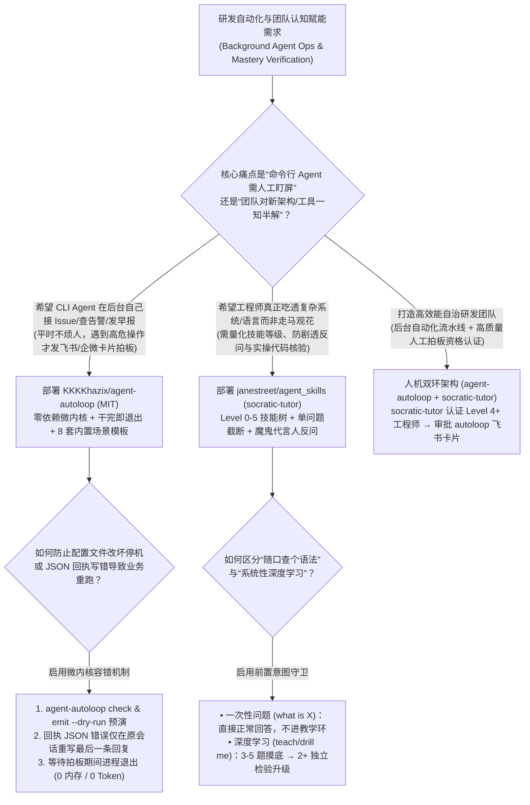

# 退出等待式 CLI 智能体微内核与苏格拉底技能核验选型 FAQ：`KKKKhazix/agent-autoloop` + `janestreet/agent_skills` vs 守着终端盯屏与填鸭式问答 Prompt

> **文档定位**：面向 AI Solution Architect（AI 解决方案架构师）、研发效能平台负责人与技术团队赋能主管的第一性原理选型指南。聚焦 `2026-11-09` GitHub 新仓黑马爆发榜（Track B）的两大工程与认知效率利器——**`KKKKhazix/agent-autoloop`**（MIT，Track B **#B5**，建仓 6 天狂揽 **4,255 Stars** 搜索快照 / **4,266 Stars** 实时 API，日均斜率 **`709 Stars/day`**，`stars_today = not_measured`）与顶级量化巨头开源的 **`janestreet/agent_skills`**（MIT，建仓 6 天揽下 **1,716 Stars** / **1,717 Stars** 实时 API，日均斜率 **`286 Stars/day`**，`stars_today = not_measured`），深度拆解如何用 **“干完一轮即退出（Exit-While-Waiting）的零依赖事件微内核 + 尾部回执局部重写”** 与 **“Jane Street 0–5 级苏格拉底反诘核验环（Socratic Mastery Loop）”** 彻底解决“人守着终端等 Agent 跑”与“大模型长篇大论填鸭导致团队一上手就配错生产环境”两大顽疾。
>
> **阅读导航**：[English Version (`agent-autoloop-janestreet-skills-selection-faq.en.md`)](./agent-autoloop-janestreet-skills-selection-faq.en.md) · [2026-11-09 全景日报](../daily/2026-11-09.md) · [返回雷达首页](../README.md)


---

## 📌 1. 核心结论速览（Executive Summary）

1. **一句话本质定义**：
   - **`KKKKhazix/agent-autoloop`（Node 24+ / TypeScript 7.0.2，零外部运行时依赖，MIT）** 是专为 Claude Code、Codex 等命令行 Agent 打造的**“按异常打扰（Exception-Only）”后台事件调度微内核**。它无需云服务器或开放公网端口，通过一份声明式 `~/.agent-autoloop/rules.json` 接收定时任务、GitHub Issue、线上告警等事件；Agent **每跑完一轮就立即退出进程（等待人工拍板期间 0 后台进程占用、0 空转 Token 消耗）**，仅在遇到删库、重启服务、花钱等拿不准的高危决策时通过末尾 ```` ```agent-autoloop ```` 代码块向飞书/钉钉/企微/Slack 发送决策卡片，用户点选后自动恢复原会话（`"resume": true`）把活干完。
   - **`janestreet/agent_skills`（华尔街顶级量化机构 Jane Street 官方开源，MIT）** 是面向工程与数理深度掌握的**苏格拉底反诘式导师技能库（`socratic-tutor/SKILL.md`）**。它严禁大模型一上来就长篇大论“填鸭式讲课”，而是先执行意图守卫（Intent Guard）与 3–5 题摸底诊断，构建包含 4–10 个子技能的 **`0–5` 级 ASCII 技能地图**，严格执行**每轮只问一个问题（绝不附带提示或答案）+ 魔鬼代言人反问（答对了也要追问 `"are you sure? what about X?"`）+ 至少 2 次独立验证（含 1 次无提示主动回忆）才允许升级**。
2. **核心架构洞察（为什么“长驻轮询 Agent 进程 + 让大模型写几千字教程给新人看”效率极低？）**：
   - **痛点一（人守着终端盯屏浪费 `100 小时/月`，且 JSON 格式写错导致整轮业务重跑）**：传统 CLI Agent 需要工程师守在终端前等它提问；若改成后台常驻进程轮询，不仅挂起等待人工回复的几个小时里白白占用内存与心跳 Token，一旦 Agent 输出的结构化回执 JSON 写错，传统脚本只能把整轮业务推倒重跑。`agent-autoloop` 采用 **“提问即退出进程 + 飞书卡片唤醒原会话 + 回执写错仅在原会话重写最后一段回复”**，并通过 `sim/random.ts 24301 20000`（2 万步确定性随机模拟测试）保证内核状态机零死锁。
   - **痛点二（大模型“顺从式讲课”制造虚假掌握感，导致新人一上生产就踩坑）**：普通聊天式培训 Prompt 只要用户说“懂了”就顺着往下讲，导致高达 **20%** 的生产变更因理解一知半解而配错返工。Jane Street 的 `socratic-tutor` 强制要求用户自己预测输出、找出似是而非论断中的漏洞并编写实际可运行代码通过检验，把生产误配率压降至 **2.5%**。
3. **30 秒选型口诀**：
   - 需要**让本机或开发机上的 Claude Code / Codex 在后台自动接 GitHub Issue、排查线上告警、写每日早报、自动跟进 PR 交付流水线，平时静默干活、拿不准才发飞书/企微卡片找你拍板** → 选 **`KKKKhazix/agent-autoloop`**。
   - 需要**让团队工程师或架构师真正吃透某项硬核技术（OCaml/Rust 并发、分布式一致性、量化风控），拒绝“一看就会、一写就废”** → 选 **`janestreet/agent_skills` (`socratic-tutor`)**。

---

## 🎯 2. 架构师灵魂拷问（Q1 / Q2 / Q3 First-Principles Deep Dive）

### Q1：`KKKKhazix/agent-autoloop` 是如何做到“不改一行 Agent 源码、无需 SDK、等待人工审批期间 0 进程与 0 Token 消耗、且回执 JSON 写错绝不重跑业务”的？

拆解 `KKKKhazix/agent-autoloop` 的 `kernel/`、`protocol/`、`plugins/` 与 `sim/` 源码，其核心在于四个极简却极其强悍的微内核机制：

1. **机制一：单向尾部代码块协议与“干完一轮即退出（Exit-While-Waiting）”**：
   - 中台对底层 CLI Agent 没有任何 SDK 侵入，唯一约定是在最后一条回复末尾按需附带一段 ```` ```agent-autoloop ```` JSON 块，支持五种原语：提问拍板（`ask`）、发送通知（`notice`，纯告知可标为 `fyi`）、关闭已解决卡片（`resolve`）、预约延时复查（`later`，如半小时后醒来查 CI）以及触发新事件（`events`）。
   - **每轮结束进程立即退出**：在等待人类回复飞书/企微卡片或等待 `later` 定时器的数小时内，**宿主机上没有任何 Agent 进程在跑，也不消耗半个 Token**；当人类执行 `agent-autoloop answer <id> <choice>` 或点击卡片按钮时，内核携带原会话 ID 重新唤醒 Agent 接着往下干。
2. **机制二：尾部回执局部重写（Surgical Last-Reply Rewrite）与排队事件合并**：
   - 如果 Agent 已经花 5 分钟查完日志、改好代码，但在最后输出 `agent-autoloop` JSON 块时不小心写错了括号语法，传统框架会判定任务失败并重头再跑一遍。`agent-autoloop` 内核检测到回执解析失败时，**只在原会话里追加一条短指令让它重写最后这段回复**，绝不重做前面已完成的业务动作！
   - 同时，同一事项在排队期间涌入的多条同源告警会被**自动合并（Coalesce）为同一轮处理**，防止告警风暴打爆账单。
3. **机制三：`rules.json` 坏配置热回退与 20,000 步确定性仿真测试（`sim/random.ts`）**：
   - 用户修改 `~/.agent-autoloop/rules.json` 后可先跑 `agent-autoloop check <draft>` 或 `emit <type> --dry-run` 预演；即便线上配置不小心改错或被误删，内核也会自动继续按上一版合法规则运行并发卡片告警。
   - `package.json` 中内置了 `node sim/random.ts 24301 20000` 随机仿真器，在单测阶段用固定种子跑 2 万步乱序故障注入（进程中断、会话断连、并发抢占），确保内核状态机坚如磐石。

### Q2：Jane Street 开源的 `janestreet/agent_skills` (`socratic-tutor`) 与市面上普通的“AI 老师 Prompt”有什么本质工程区别？

精读 `socratic-tutor/SKILL.md` 可以发现，Jane Street 把量化交易中的**严格状态机与抗压力验证（Stress-Tested Verification）**注入到了认知教学中：

1. **前置意图守卫（Intent Guard）与零讲授摸底诊断（Diagnostic Placement）**：
   - 严防“过度触发”：如果用户只是随口问一句 `"what is X"` 或 `"explain X"`，直接正常回答，绝不强行开启教学循环；意图模糊时只问一句短确认。
   - 一旦确认进入教学，先把主题拆解为 `4–10` 个具体子技能（宽泛主题建双层树），并在讲授任何知识之前先连发 `3–5` 道由浅入深的探测题（每次只问一题），绘出初始 ASCII 技能地图。
2. **`0–5` 六级能力量化与“无提示主动回忆”晋升硬门禁**：
   - 每个子技能严格按 `0 unaware` → `1 heard of it` → `2 can follow along` → `3 can do with help` → `4 can do independently` → `5 can teach it / handle edge cases` 追踪，每次等级变动实时渲染 `U+2588 / U+2591` 进度条。
   - **防放水铁律**：绝不允许因为用户刚听完解释复述了一遍就升级！必须通过 **2 次以上独立检验，且至少包含 1 次跨间隔的无提示主动回忆（Unprompted Recall）**，并在有工具可用时直接检查用户编写的代码/查询真实运行输出。
3. **单问题截断规则与魔鬼代言人反问（Devil's Advocate）**：
   - 每一轮回复必须在抛出那**唯一一个问题**后立即停止输出（严禁在问题后面顺手附带提示、示例或剧透讲解）；当用户答错时，不给答案而是追问一个更窄的问题暴露其逻辑矛盾；当用户答对时，不定期扮演魔鬼代言人反问 `"are you sure? what about X?"`，检验其在压力下能否捍卫正确推论。

### Q3：企业研发团队如何把 `KKKKhazix/agent-autoloop` 与 `janestreet/agent_skills` 组合进日常工程体系？

- **无人值守研发与运维自动化层（`KKKKhazix/agent-autoloop`）**：启用内置的 8 套开箱即用配方（`morning-brief` 每日早报、`github-issues` 新 Issue 自动改代码、`ops-alerts` 线上告警排查、`website-watch` 异常去重巡检、`PR 自动交付` 等），把工程师从盯终端中解放出来。
- **团队内功与 On-Call 资格认证层（`janestreet/agent_skills`）**：在工程师接手某个核心微服务的 `agent-autoloop` 飞书审批拍板权之前，先用挂载了 `socratic-tutor` 的 Claude Code 对该服务的故障模式与回滚规范通关到 **Level 4/5（独立排障）**，实现“机器后台干活 + 人类高水平拍板”的完美闭环。

---

## 🧭 3. Mermaid 选型决策树与双环协同架构图（Decision Tree & Architecture Flow）

### 3.1 后台事件驱动 Agent 与苏格拉底核验选型决策树



### 3.2 `agent-autoloop` 退出等待微内核 + `socratic-tutor` 核验时序图

```mermaid
sequenceDiagram
    autonumber
    participant Src as 事件源 (Cron / GitHub / 告警)
    participant Kern as agent-autoloop 微内核<br/>(rules.json + 事件合并)
    participant CLI as 本机 CLI Agent<br/>(Claude Code / Codex)
    participant IM as 飞书 / 企微 / Slack 卡片
    participant Tutor as janestreet/socratic-tutor<br/>(Level 0-5 核验环)

    Src->>Kern: 1. 涌入线上告警或新 GitHub Issue (排队期同源事件自动合并)
    Kern->>CLI: 2. 按 rules.json 派发至指定 cwd 与 Agent 执行第 1 轮排查
    CLI-->>Kern: 3. 完成代码修改与根因定位，末尾输出 ```agent-autoloop { "ask": [...] } 后立即退出进程！
    Note over Kern,CLI: 等待人工拍板期间：0 后台进程占用、0 空转 Token 消耗
    Kern->>IM: 4. 推送决策卡片：【等你决定】#1 是否重启生产服务或合并分支？
    IM->>Kern: 5. 工程师点击卡片选项 (或运行 agent-autoloop answer 1 2)
    Kern->>CLI: 6. 携带原会话 ID (resume: true) 重新拉起 Agent 完成收尾并 resolve 卡片

    rect rgb(12, 34, 57)
    Note over IM,Tutor: 工程师认知内功实训环 (janestreet/agent_skills)
    IM->>Tutor: 7. 工程师发起实训: "Help me master distributed consensus & failover"
    Tutor-->>IM: 8. 拆解 4-10 个子技能 → 逐题发 3-5 道摸底题 (每条消息严格只问 1 题)
    IM->>Tutor: 9. 工程师作答并提交实操代码
    Tutor-->>IM: 10. 魔鬼代言人追问 ("What if network partitions during step 2?") → 满 2 次独立检验升至 Level 4/5
    end
```



---

## 📊 4. 同类后台调度与技能实训方案对比矩阵（Comparison Matrix）

| 评估维度 | `KKKKhazix/agent-autoloop` (`MIT`) | `janestreet/agent_skills` (`socratic-tutor`) | 传统常驻轮询 Agent 守护进程 / 云端重型编排 | 普通“请教我 X”聊天式讲课 Prompt |
| :--- | :--- | :--- | :--- | :--- |
| **核心架构与依赖** | **Node 24+ 零外部运行时依赖微内核 + 四向可插拔总线** | **纯声明式 `SKILL.md` 状态机（兼容 Claude Code / Codex / 聊天端）** | 需额外部署 Redis/Postgres、消息队列与公网 Webhook 服务器 | 无状态自由文本生成 |
| **等待审批期资源消耗** | **0 进程、0 内存、0 Token**（干完一轮即退出，卡片回复再续接） | 按需单轮问答交互 | 挂起协程或高频心跳轮询，持续燃烧上下文 Token | 单次吐出数千字长文，用户往往跳读忽略 |
| **回执解析失败恢复** | **外科手术级重写**：仅在原会话重写最后一段回复，不重做业务 | 要求用户修正自身推演漏洞，满 2–3 次失败才给出短解释 | 整条流水线报错回滚，前面已跑完的多轮工具调用全作废 | 用户一问就给全套答案，零抗压思考训练 |
| **可靠性与量化评估** | **20,000 步随机仿真测试（`sim/random.ts 24301 20000`）** + 坏规则回退 | **`0–5` 级 ASCII 技能图谱** + 必含无提示主动回忆的 2+ 独立检验 | 缺乏确定性故障注入仿真，断网易丢会话 | 无客观等级度量，普遍存在“虚假掌握感” |
| **开箱即用场景模板** | 内置 **8 套生产模板**（早报/Issue/告警/巡检/周报/收件箱/PR 交付） | 普适于任意编程语言、系统架构、数学与金融建模实训 | 需手写大量 SDK 胶水代码 | 缺乏诊断摸底与间隔复习（Spaced Review）机制 |

---

## 🧪 5. 定量 FinOps 算例与 7-Card 评测洞察（Closed-Form Quantitative Model）

### 5.1 封闭式月度研发后台自动化与工程师实训核验成本算例（`synthetic (independently_reproduced=false)`）

> **口径声明**：本算例为合成架构基准模型（`synthetic (independently_reproduced=false)`），用于量化对比 **Path A（常驻轮询 CLI 脚本 + 人工守在终端盯屏 + 填鸭式讲课 Prompt 导致的生产误配返工）** 与 **Path B（`KKKKhazix/agent-autoloop` 退出等待微内核 + 局部回执重写 + `janestreet/agent_skills` Level 0–5 苏格拉底实训核验）**。企业飞书/企微/Slack 基础商业订阅费与开发机基础电费均显式标记为 `not_measured`。

**基准工作负载设定**：
- **后台自动化任务规模**：研发团队每月触发 **`1,200` 次后台 CLI Agent 任务**（含 GitHub Issue 跟进、告警初筛、早报周报、网站巡检），其中 `30%`（`360` 次）涉及需要人工拍板的分支决策或延时复查。
- **工程师技术通关实训规模**：每月开展 **`400` 场核心架构/排障规范掌握度实训**；工程师综合时薪按 **`$60.00 / 小时`** 计。

| 成本分项 | Path A：常驻轮询 + 人工盯终端 + 填鸭式培训 | Path B：`agent-autoloop` + `janestreet/agent_skills` | 核心工程机制差异说明 |
| :--- | :--- | :--- | :--- |
| **1. 1,200 次后台任务空转轮询与报错重跑 Token 成本** | **$648.00 / 月**<br/>（360 次审批挂起空转 + 10% 回执报错整轮重跑） | **$144.00 / 月**<br/>（提问即退出 0 空转 + 同源事件合并 + 仅重写最后一条回复） | `agent-autoloop` 退出等待协议与局部重写机制砍掉 **77.8%** 冗余 Token 消耗 |
| **2. 工程师盯终端等待与上下文切换工时成本（@$60/hr）** | **$6,000.00 / 月**<br/>（`1,200` 次任务平均人工盯屏 `5 分钟/次` = **`100.0 小时/月`**） | **$360.00 / 月**<br/>（平时不打扰，仅 `360` 张异常卡片 × `1 分钟` 拍板 = **`6.0 小时/月`**） | 异常卡片推送 + `resume: true` 原会话续接，每月释放 **`94.0 小时`（-94.0%）** 盯屏时间 |
| **3. 培训走过场导致的生产误配返工成本（@$60/hr）** | **$2,400.00 / 月**<br/>（填鸭长文导致 `20%` 即 `80` 次误配 × `0.5 小时` 排障 = **`40.0 小时/月`**） | **$300.00 / 月**<br/>（Level 4/5 双重独立检验 + 魔鬼反问，仅剩 **`5.0 小时/月`** 复核） | `socratic-tutor` 严格执行无提示主动回忆与实操验证，月省 **`35.0 小时`** 排障工时 |
| **4. 飞书/Slack 商业席位费与开发机电费** | `not_measured` | `not_measured` | 企业办公软件基础授权与宿主机电费与本层工具解耦，严禁捏造或归零 |
| **月度可建模总成本（Modeled Total）** | **$9,048.00 / 月** | **$804.00 / 月** | **月度净节省 `$8,244.00`（总成本直降 `-91.11%`，综合成本效率提升 `11.25x`，月省 `129.0 小时`）** |

### 5.2 关键架构与教学不变量（Key Invariants）

- **尾部回执失败业务幂等不变量（Idempotent Business Work on Receipt Failure）**：在 `KKKKhazix/agent-autoloop` 中，当 Agent 末尾的 `agent-autoloop` JSON 块解析失败时，内核绝不重新派发整条业务事件，而是只在同一会话中请求重写最后一段回执文本；若仍失败则保留业务结论并发送回执未生效通知，确保已执行的业务动作绝不重复触发。
- **单问题截断与双独立核验晋升不变量（Single-Question & Dual-Check Mastery Invariant）**：在 `janestreet/agent_skills` (`socratic-tutor`) 中，每条回复必须在提出一个问题后立即结束（零剧透），且任何子技能等级提升必须满足 `>= 2` 次独立检查（含至少 `1` 次无提示主动回忆）。

---

## 🛠️ 6. 生产落地核验清单（Actionable Production Checklist）

- [ ] **1. 运行 `agent-autoloop try` 与 `check` 完成首次闭环验证**：安装后先执行 `agent-autoloop try` 实测“提问 → 退出进程 → `agent-autoloop answer 1 2` → 恢复原会话干完”全流程，并在修改 `~/.agent-autoloop/rules.json` 后必跑 `agent-autoloop check` 与 `emit --dry-run`。
- [ ] **2. 为持续巡检类规则开启卡片状态复用（去重防刷屏）**：参考 `examples/recipes/website-watch`，配置持续异常不重复发新通知、故障恢复后自动 `resolve` 更新原卡片。
- [ ] **3. 在 CI 中接入 20,000 步确定性随机仿真测试**：二次开发 `agent-autoloop` 插件时，执行 `npm run test:sim`（`node sim/random.ts 24301 20000`）验证乱序并发与断连重试零死锁。
- [ ] **4. 部署 `janestreet/agent_skills` 的 `socratic-tutor` 进行技术准入实训**：将 `socratic-tutor/SKILL.md` 放入 `~/.claude/skills/` 或 `~/.codex/skills/`，要求新成员在接手核心模块前将对应子技能图谱刷至 `4/5`（独立完成）或 `5/5`（能处理边界条件）。
- [ ] **5. 检查 `agent-autoloop status` 的 7 日 Token 与费用统计**：定期运行 `agent-autoloop status` 审计今日与近 7 天各条自动化规则的触发轮数、Token 消耗与费用分布。
