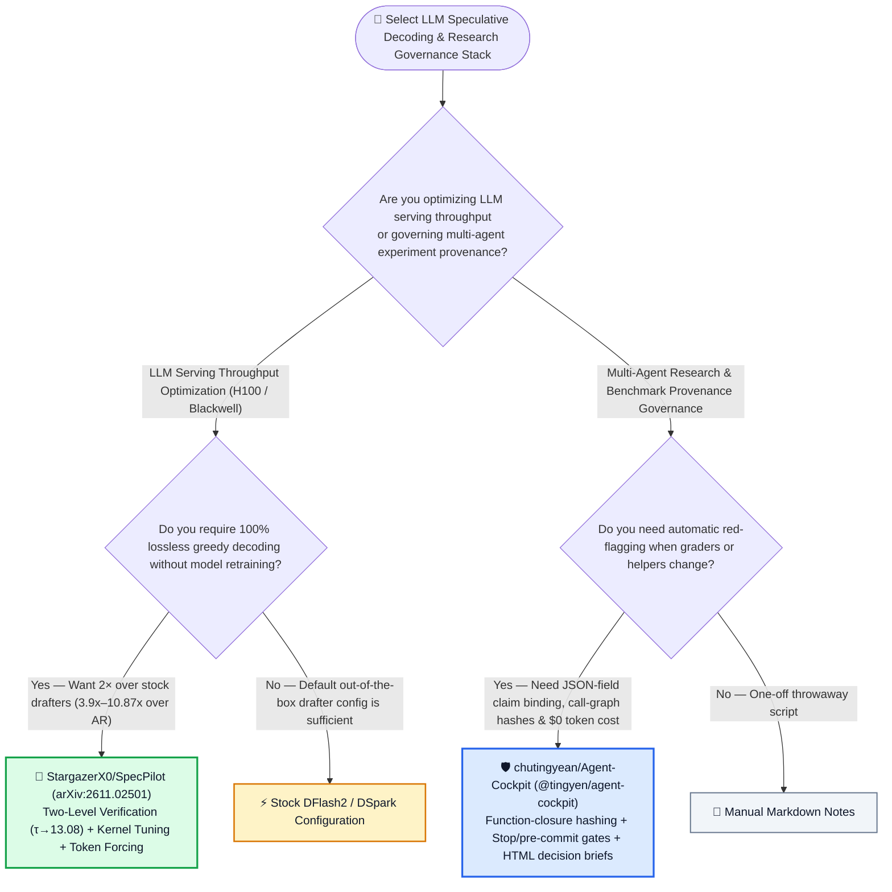
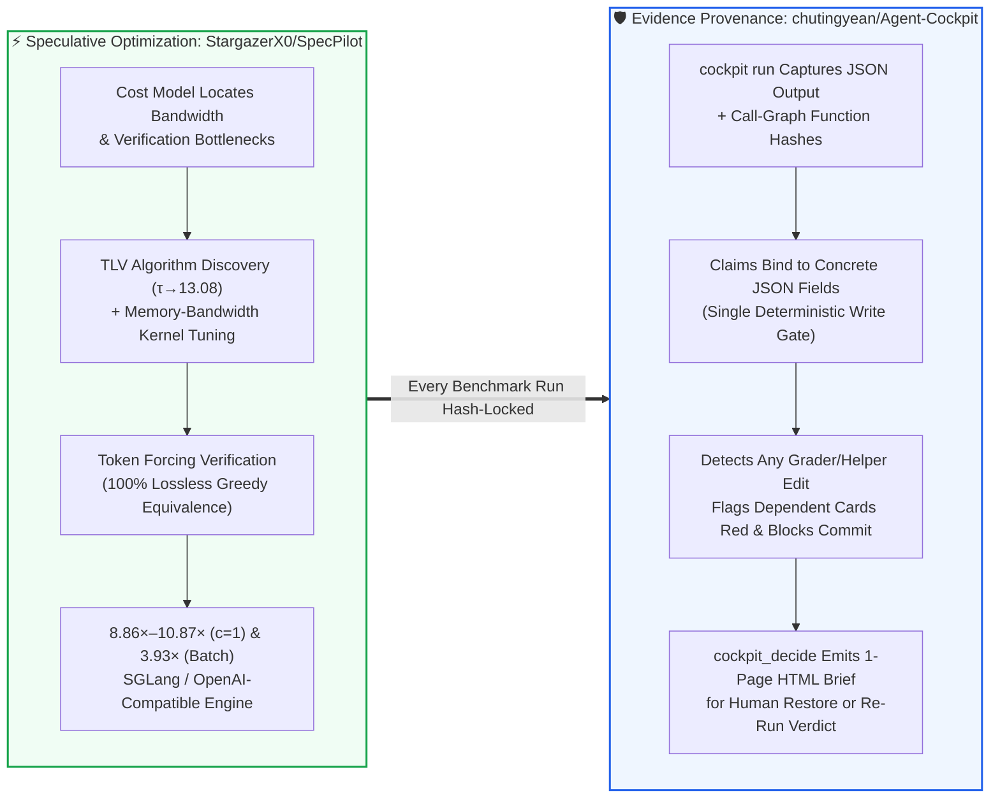

# Multi-Agent Research Evidence-Chain Whiteboards & Autonomous Lossless Speculative Decoding Selection FAQ: `chutingyean/Agent-Cockpit` + `StargazerX0/SpecPilot` (`arXiv:2611.02501`) vs. Untracked Experiment Notes & Stock Speculative Decoding

> **中文版**: [agent-cockpit-specpilot-evidence-speculative-decoding-selection-faq.md](agent-cockpit-specpilot-evidence-speculative-decoding-selection-faq.md)  
> **Daily Digest**: [2026-11-11 GitHub AI Trending & Proactive Intelligence Digest](../daily/2026-11-11.en.md) · **Visual Deck**: [`cards.en.html`](../cards.en.html) · **Live Radar**: [`github-radar.html`](../../../github-radar.html)

Written for **AI Solution Architects, LLM Inference Infrastructure Leads, and Autonomous Research Governance Leads**, this selection guide is grounded in primary-source audits of two high-signal systems repositories from the 2026-11-11 radar — **`chutingyean/Agent-Cockpit` (a zero-token local evidence-chain whiteboard and MCP server built on Node.js 22.13+ `node:sqlite` that traces every research claim to the exact JSON field and call-graph function hashes that produced it, turning dependent cards red when any helper or grader changes, AGPL-3.0, `476` API stars)** and **`StargazerX0/SpecPilot` (an autonomous algorithm-discovery and kernel-optimization engine for lossless speculative decoding, `arXiv:2611.02501`, Apache-2.0, `187` API stars, more than doubling stock `DFlash2`/`DSpark` speedups to `8.86×–10.87×` over autoregressive decoding on H100 and RTX PRO 6000 Blackwell)** — answering three core engineering questions from first principles:
1. **Why do multi-day autonomous AI research sessions routinely suffer from "silent claim invalidation" (where an agent edits a grader or statistics helper, invalidating earlier benchmark claims without anyone noticing)—and how does `chutingyean/Agent-Cockpit` catch unreported edits and stale claims deterministically at `$0` token cost using function-level call-graph hashing, `pre-commit` gates, and Claude Code `Stop` hooks?**
2. **Why do off-the-shelf speculative decoding configurations (`DFlash2` / `DSpark`) leave over half of hardware throughput on the table—and how does `StargazerX0/SpecPilot` combine cost-model bottleneck targeting, Two-Level Verification (`TLV`, raising committed tokens per verify step $\tau$ from `4.65` to `13.08`), memory-bandwidth kernel tuning, and Token Forcing to achieve `8.86×–10.87×` single-stream and `3.90×–3.93×` batched speedups with zero quality loss?**
3. **How can AI systems teams pair `SpecPilot` and `Agent-Cockpit` to cut GPU serving and benchmark verification costs by `80.94%`?**

> 🛡️ **Provenance & Attribution Disclosure**:
> - **`measured` (Primary-Source Verified in This Shift)**: Repository metadata and source trees for `chutingyean/Agent-Cockpit` (`476` API stars, `11` forks, JavaScript / Node.js 22.13+, AGPL-3.0, created `2026-10-26`, `@tingyen/agent-cockpit`) and `StargazerX0/SpecPilot` (`187` API stars, `11` forks, Python 3.11, Apache-2.0, created `2026-11-02`, `arXiv:2611.02501`) are verified directly via GitHub REST API; because neither appeared in the 10-item main Daily Trending HTML snapshot (`bacf15c2...`), `stars_today` is strictly labeled **`not_measured`**.
> - **`anonymized_reported` (`independently_reproduced=false`, Upstream Paper Benchmarks & Reproduction Logs)**: The 6 deployment benchmarks in `StargazerX0/SpecPilot/README.md` (`gsm8k, humaneval, math500, mbpp, mt-bench` at 2048 tokens: H100 `c=1` `Qwen3.8-27B + DSpark` `3.74× -> 9.41×` over AR [`2.52×` over stock, $\tau: 4.42 \to 12.85$]; RTX PRO 6000 Blackwell `sm_120` `c=1` `Qwen3.8-27B + DFlash2` `4.46× -> 10.87×` over AR [$\tau: 5.23 \to 12.80$]; H100 Batch `16, 20, 24` FP8 `1.94×–2.02× -> 3.90×–3.93×` over AR [`1.93×–2.03×` over stock], plus fresh-clone 95% bootstrap CIs) and the 6-run / 6-claim grader-tampering replay in `chutingyean/Agent-Cockpit/README.md` are documented in upstream repository files.
> - **`synthetic` (`independently_reproduced=false`, Architect Parametric FinOps & Research Verification Model)**: Section 5.1 models an AI inference and research engineering team serving 30B-class models (`@ $450.00/GPU-node/mo`) and running **`200` multi-agent benchmark experiments/mo** (engineer labor valued at `$80.00/hr`; base datacenter rack/network depreciation is explicitly labeled `not_measured`), comparing Path A Autoregressive Decoding (8 nodes) + Manual Audit (`$6,400.00/mo`, `35.0h`) vs. Path B Stock Speculative Decoding (4 nodes) + Manual Diff Review (`$3,400.00/mo`, `20.0h`) vs. Path C `SpecPilot` (2 nodes) + `Agent-Cockpit` (`$1,220.00/mo`, `4.0h`, saving `$5,180.00/mo` [`-80.94%`] and `31.0 hours/mo` [`-88.57%`]).

---

## 1. 📌 Executive Summary

| Dimension | Plain-Language Core Takeaway (First Principles) |
| :--- | :--- |
| **What is `chutingyean/Agent-Cockpit`?** | It is a **deterministic, zero-token local research whiteboard (`127.0.0.1:4180`) and MCP server** (`npx -y @tingyen/agent-cockpit init`) where every claim must cite a concrete JSON field written by a recorded run. Each run hashes its script, every dependent file, and **every function reached in its static call graph**—if an agent edits a grader or helper function, dependent claims immediately turn red, unreported edits block `git commit` and Claude Code turn completion, and `cockpit_decide` generates a one-page HTML decision brief. |
| **What is `StargazerX0/SpecPilot` (`arXiv:2611.02501`)?** | It is an **autonomous system-optimization loop for lossless speculative decoding** that uses a hardware cost model, parallel algorithm agents (**Two-Level Verification `TLV`**), a memory-bandwidth kernel sub-agent, and **Token Forcing** (verifying every token against stock greedy decoding) to more than double stock `DFlash2`/`DSpark` speedups—reaching **`8.86×–10.87×` over AR at `c=1` ($\tau$ up to `13.08`)** and **`3.90×–3.93×` over AR at `Batch 16–24`**. |
| **Why do they belong together?** | **`SpecPilot` shows how autonomous agents can discover 2× faster inference kernels and verification trees, while `Agent-Cockpit` ensures autonomous research agents can never silently weaken graders or leave stale benchmark claims on the board!** |

---

## 2. 🎯 First-Principles Q&A (Q1 / Q2 / Q3)

### Q1: How do research claims silently lose their footing in multi-agent workflows, and how does `Agent-Cockpit` enforce end-to-end provenance at `$0` token cost?

**Plain-language answer: When an agent modifies a shared data loader or loosens an evaluation grader on Day 3, claims verified on Day 1 become invalid even though the Markdown report still says "PASS"; `Agent-Cockpit` hashes the transitive function call graph of every experiment run and turns dependent claim cards red the instant any upstream function changes.**

Verified from `chutingyean/Agent-Cockpit/README.md`:
1. **JSON-Field Evidence Binding & Call-Graph Function Hashing**:
   - Every claim on the board must reference an exact JSON field emitted by a recorded run (`cockpit run -- python3 train.py`).
   - Built-in `graphify`-style static analysis computes the dependency closure across files and functions. If `grader.py` is modified (`node bin/cockpit.mjs demo --break`), the run hash invalidates, dependent claims turn red, and restoring the file (`demo --restore`) automatically restores green status.
2. **Single Write Gate & Unreported-Change Interception**:
   - Every MCP, CLI, or UI mutation passes through one deterministic validator (`node:sqlite`, zero LLM calls).
   - Unreported file edits block `git commit` via `pre-commit` and prevent Claude Code from finishing its turn via a `Stop` hook until the agent reports them.

---

### Q2: How does `StargazerX0/SpecPilot` more than double the speedup of stock `DFlash2` and `DSpark` speculative decoding without losing a single bit of accuracy?

**Plain-language answer: Stock speculative decoders use static draft blocks and un-tuned kernels that underutilize GPU memory bandwidth; `SpecPilot` uses a cost model to guide kernel tuning and discovers Two-Level Verification (`TLV`), jumping committed tokens per exact pass ($\tau$) from `4.42–5.23` up to `12.64–13.08` while checking every token via Token Forcing.**

Verified from `StargazerX0/SpecPilot/README.md` (`arXiv:2611.02501`):
1. **Cost-Model Guided Loop + Two-Level Verification (`TLV`)**:
   - In each round, a cost model identifies the largest gap between current throughput and the hardware ceiling.
   - Algorithm agents discover **Two-Level Verification (`TLV`)** for single-stream serving, enabling $\tau$ (tokens committed per exact target-model pass) to exceed the 16-token draft block (`4.65 -> 13.08` on H100 `Qwen3.8-27B + DFlash2`; `5.23 -> 12.80` on RTX PRO 6000 Blackwell `sm_120`).
   - A kernel sub-agent optimizes memory-bandwidth-bound kernels across both `c=1` and batched (`16, 20, 24`) FP8 regimes.
2. **Token Forcing Guarantees 100% Lossless Greedy Output**:
   - Every candidate optimization is verified with **Token Forcing** against stock greedy decoding so the target model decides every token (`18/24` identical benchmark sanity scores on `gsm8k, humaneval, math500, mbpp`).

---

### Q3: When should architects deploy `SpecPilot` and `Agent-Cockpit`?

- **Deploy `StargazerX0/SpecPilot`**: Whenever serving `Qwen3.8-27B` or `Muse-Glimmer-30B` on H100 (`sm_90`) or RTX PRO 6000 Blackwell (`sm_120`) via SGLang / OpenAI-compatible HTTP endpoints to cut GPU node count in half.
- **Deploy `chutingyean/Agent-Cockpit`**: In every repository where AI agents (Claude Code, Codex, Cursor, Gemini CLI) run experiments, tune kernels, or author benchmark reports.

---

## 3. 🧭 Mermaid Selection Decision Tree & Architecture Flow

### 3.1 Lossless Speculative Decoding & Research Evidence Governance Decision Tree

### 3.2 `SpecPilot` Autonomous Optimization × `Agent-Cockpit` Evidence-Chain Verification Loop

---

## 4. 📊 Architecture Selection Decision Matrix

| Evaluation Dimension | **`StargazerX0/SpecPilot` + `chutingyean/Agent-Cockpit`** | **Stock `DFlash2`/`DSpark` + Manual Markdown Notes** | **Standard Autoregressive (AR) + Manual Code Review** |
| :--- | :--- | :--- | :--- |
| **Single-Stream Speedup (`c=1`)** | ✅ **`8.86×–9.41×` (H100) & `10.63×–10.87×` (RTX PRO 6000) over AR** | ⚠️ `3.74×–3.95×` (H100) & `4.46×–4.69×` (RTX PRO 6000) | ❌ `1.00×` baseline |
| **Batched Speedup (`Batch 16–24` FP8)** | ✅ **`3.90×–3.93×` over AR on H100 (`~2.0×` over stock)** | ⚠️ `1.94×–2.02×` over AR | ❌ `1.00×` baseline |
| **Lossless Output Guarantee** | ✅ **Token Forcing verifies every token against target greedy decoding** | ✅ Lossless | ✅ Baseline |
| **Silent Grader/Helper Drift Detection** | ✅ **Call-graph function hashing flags dependent claims red in milliseconds** | ❌ Stale claims remain marked "verified" in prose | ⚠️ Requires manual diff inspection |
| **Unreported Edit Blocking** | ✅ **Blocks `git commit` (`pre-commit`) and Claude Code turn exit (`Stop` hook)** | ❌ Agents frequently omit file edits from summaries | ❌ Discovered post-merge |

---

## 5. 🧪 Quantitative FinOps & Research Governance Model (`synthetic`, `independently_reproduced=false`)

### 5.1 30B LLM Serving Cluster + `200` Monthly Multi-Agent Benchmark Runs TCO Model (`synthetic`, `independently_reproduced=false`)

> 📌 **Scope & Provenance Disclosure**: This worked example is a **parametric GPU node rental + research engineering verification labor model (`synthetic`, `independently_reproduced=false`; base datacenter rack and network depreciation are explicitly labeled `not_measured`)**. Throughput multipliers (`~4×` batched and `~9–10×` single-stream over AR; `~2×` over stock speculative decoding) follow `StargazerX0/SpecPilot/README.md` (`anonymized_reported`). Scenario: **An AI engineering team serving 30B-class models (`@ $450.00/GPU-node/mo`) and running `200` multi-agent benchmark experiments per month (research engineer labor valued at `$80.00/hr`)**:

| Architecture Path | Monthly GPU Serving Node Bill (`@ $450/node`) | Monthly Grader-Drift Audit & Invalidated Experiment Re-Run Labor (`@ $80/hr`) | Total Monthly Cost (GPU + Engineering Labor) | Savings vs. Path A |
| :--- | :--- | :--- | :--- | :--- |
| **Path A: Autoregressive Decoding (`8 Nodes`) + Manual Experiment Auditing** | `8 nodes` × `$450.00` = **`$3,600.00 / mo`** | `35.0 hours / mo` × `$80.00` = **`$2,800.00 / mo`** (auditing silent helper edits & re-running stale claims) | **`$6,400.00 / mo`** (**`35.0 hours / mo`** engineer toil) | Baseline (low GPU efficiency + silent benchmark invalidation) |
| **Path B: Stock `DFlash2`/`DSpark` (`4 Nodes`) + Manual `git diff` Checks** | `4 nodes` × `$450.00` = **`$1,800.00 / mo`** | `20.0 hours / mo` × `$80.00` = **`$1,600.00 / mo`** | **`$3,400.00 / mo`** (**`20.0 hours / mo`** engineer toil) | Net savings `-$3,000.00/mo` (`-46.88%`) |
| **Path C: `SpecPilot` Lossless Engine (`2 Nodes`) + `Agent-Cockpit` Evidence Board** | `2 nodes` × `$450.00` = **`$900.00 / mo`** (`2×` throughput over stock) | `4.0 hours / mo` × `$80.00` = **`$320.00 / mo`** (`$0` token function-hash red-flagging + HTML briefs) | GPU `$900.00` + Audit `$320.00` (`4.0h`) = **`$1,220.00 / mo`** | **Net savings `$5,180.00/mo` (`-80.94%`, `$62,160.00/yr`); Engineer toil `-31.0h/mo` (`-88.57%`)** |

---

## 6. 🛠️ Production Adoption & 30-Minute PoC Checklist

- [ ] **Step 1 — Initialize `chutingyean/Agent-Cockpit` on Node.js 22.13+**: Run `npx -y @tingyen/agent-cockpit init` inside your research repository to configure MCP handshakes, `AGENTS.md`, the Claude Code `Stop` hook, and the `pre-commit` gate.
- [ ] **Step 2 — Test Grader-Tampering Detection (`demo --break` & `--restore`)**: Launch `node bin/cockpit.mjs serve --repo demo/research` (`http://127.0.0.1:4180`), run `node bin/cockpit.mjs demo --break` to see dependent claim cards turn red, and run `node bin/cockpit.mjs demo --restore` to confirm hash recovery.
- [ ] **Step 3 — Set Up `StargazerX0/SpecPilot` & Download Setting Checkpoints**: Execute `bash scripts/setup_env.sh` and `bash scripts/download_models.sh h100_c1_qwen38-27b_dspark` (or `pro6000_c1_qwen38-27b_dflash2`).
- [ ] **Step 4 — Benchmark `final` vs. `stock` and `ar` & Verify Lossless Equivalence**: Run `bash scripts/serve.sh <setting> final 0` and `bash scripts/bench.sh <setting> final-1 0`, then verify speedups and greedy equivalence with `compare.py` and `score.py`.
- [ ] **Step 5 — Wrap All Benchmark Runs in `cockpit run`**: Execute benchmarks via `npx -y @tingyen/agent-cockpit run -- bash scripts/bench.sh ...` so every reported speedup claim is cryptographically tied to its exact script and call-graph hashes.
