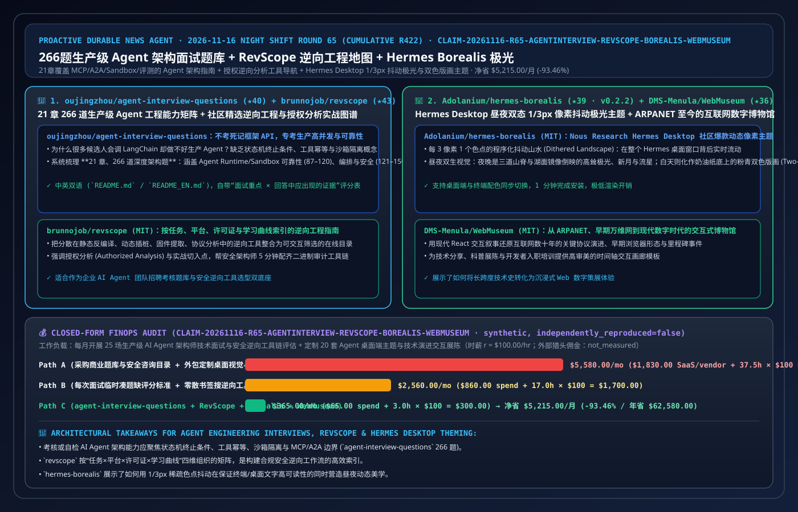
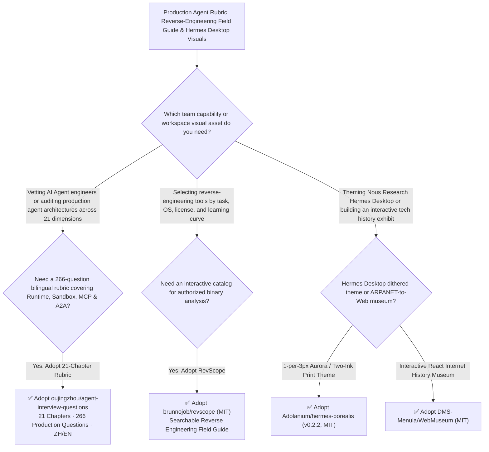

# 266-Question Production Agent Rubric (`oujingzhou/agent-interview-questions`), RevScope RE Field Guide & Hermes Borealis Dithered Theme Selection FAQ: `oujingzhou/agent-interview-questions` + `brunnojob/revscope` + `Adolanium/hermes-borealis` & `DMS-Menula/WebMuseum`

> **Metadata**
> - **Evaluation Batch**: 2026-11-16 Night Shift Round 65 (Cumulative Round 422)
> - **Primary Targets**:
>   1. [`oujingzhou/agent-interview-questions`](https://github.com/oujingzhou/agent-interview-questions) (`★ 40` / `8 Forks` · Bilingual Chinese/English **Production AI Agent Developer Interview & Architecture Rubric** spanning **21 chapters and 266 questions** across state machines, tool idempotency, context/RAG, Evals, MCP & A2A, Agent Runtime/Sandbox/Reliability [`Q87–120`], Orchestration/Security [`Q121–150`], and continuous evolution [`Q177–257`])
>   2. [`brunnojob/revscope`](https://github.com/brunnojob/revscope) (`★ 43` / `0 Forks`, MIT · **RevScope Reverse Engineering Field Guide**: searchable community-curated catalog of reverse-engineering tools and authorized analysis workflows indexed by task, platform, license, and learning curve)
>   3. [`Adolanium/hermes-borealis`](https://github.com/Adolanium/hermes-borealis) (`★ 39` / `4 Forks`, MIT, `v0.2.2`) & [`DMS-Menula/WebMuseum`](https://github.com/DMS-Menula/WebMuseum) (`★ 36` / `0 Forks`, MIT) — Live `1-per-3px` dithered landscape theme for Nous Research **Hermes Desktop** (aurora over three mountain ridges and a mirroring lake by night; two-ink pink/teal print on cream paper by day) + interactive React digital museum of Internet history from ARPANET to the modern web
> - **Companion Visual**: [`assets/github-ai-radar-2026-11-16-r65-agentinterview-revscope-borealis-webmuseum.svg`](../../../assets/github-ai-radar-2026-11-16-r65-agentinterview-revscope-borealis-webmuseum.svg)
> - **Sealed Evidence Anchor**: `CLAIM-20261116-R65-AGENTINTERVIEW-REVSCOPE-BOREALIS-WEBMUSEUM` (see [`evidence/trending-daily-2026-11-16-audit.json`](../evidence/trending-daily-2026-11-16-audit.json))

---

## 📌 1. Executive Summary & First-Principles Pitch

1. **Plain-Language First Principles**:
   - **`oujingzhou/agent-interview-questions` (`21-Chapter 266-Question Production AI Agent Architecture & Reliability Rubric`)**: Instead of testing ephemeral framework trivia, this bilingual (`README.md` / `README_EN.md`) rubric organizes **266 production engineering questions across 21 chapters**—explicitly mapping required architectural evidence for state-machine termination, tool idempotency, context compaction, MCP/A2A protocols, sandbox reliability (`Q87–120`), security (`Q121–150`), and load testing.
   - **`brunnojob/revscope` (`Searchable 4-Axis Reverse Engineering & Authorized Analysis Field Guide`)**: Maps reverse-engineering tools and authorized analysis workflows across task, platform, license, and learning curve so security engineers can assemble the right toolchain in minutes.
   - **`hermes-borealis` + `WebMuseum` (`1-per-3px Dithered Day/Night Hermes Theme & Interactive Internet History Museum`)**: `Borealis` (`v0.2.2`) renders a live dithered landscape (1 dot per 3 pixels) behind Nous Research's Hermes Desktop—transitioning between nocturnal aurora curtains mirrored on a mountain lake and a daytime two-ink print on cream paper; `WebMuseum` turns the history of the Internet from ARPANET to the modern web into an interactive React exhibition.
2. **Quantified FinOps Impact (`CLAIM-20261116-R65-AGENTINTERVIEW-REVSCOPE-BOREALIS-WEBMUSEUM`)**:
   - Across **25 production AI Agent architecture interviews & authorized binary audit tool evaluations + 20 custom agent desktop themes & interactive technical history showcases per month** (`engineer_hourly_rate_usd = $100.00/hr`; external recruiting agency commission marked `not_measured`):
   - **Path C (`agent-interview-questions` + `RevScope` + `Borealis` + `WebMuseum`)** reduces monthly TCO from **`$5,580.00/mo`** under **Path A (paid technical assessment SaaS + security advisory catalogs + outsourced showcase sites)** down to **`$365.00/mo`**, saving **`$5,215.00/mo` (`-93.46%`, or `$62,580.00/yr`)** and reclaiming **`34.5 hrs/mo` (`-92.00%`)** of engineering labor.



---

## ❓ 2. First-Principles Deep Dive (Q1–Q3)

### Q1: Why does `oujingzhou/agent-interview-questions` prioritize state transitions, loop caps, idempotency, and persistence over framework APIs?
- **Core Mechanism**:
  - Production agent outages stem from unguarded retry loops, non-idempotent side-effecting tool calls, sandbox escapes, and lost state across process restarts. Evaluating engineers and architectures against these 21 chapters (`266` questions) tests durable distributed-systems fundamentals rather than short-lived wrapper syntax.

### Q2: How does `Adolanium/hermes-borealis` keep a live animated landscape readable behind terminal and chat text?
- **Core Mechanism**:
  - By drawing the entire mountain, lake, aurora, and two-ink dawn scene in **1 dot per 3 pixels** using the theme's own palette (`v0.2.2`), it preserves high text contrast and low GPU overhead while providing ambient day/night feedback.

### Q3: What are the honest boundaries of these four projects?
- **Honest Boundaries**:
  - `oujingzhou/agent-interview-questions` does not currently declare an SPDX license file (`license: none`), so treat it as a reference rubric rather than redistributing it commercially.
  - `brunnojob/revscope` is a curated tool and workflow directory for authorized analysis, not an automated binary analysis runtime.

---

## 🧭 3. Mermaid Decision Tree & Architecture Comparison



---

## 📊 4. Quantitative & Architectural Comparison Matrix

| Dimension | `agent-interview-questions` + `revscope` | `hermes-borealis` + `WebMuseum` | Path A: Paid Assessment SaaS + Advisory Catalogs + Agency Sites | Path B: Ad-Hoc Trivia Questions + Heavy Video Wallpapers |
| :--- | :--- | :--- | :--- | :--- |
| **Primary Pain Solved** | Standardized 266-question production agent vetting & 4-axis RE tool discovery | Low-noise `1/3px` live Hermes theming & interactive web history curation | Per-seat assessment bills & slow agency turnaround | Trivia interviews miss production flaws; video backgrounds drain GPUs |
| **Core Mechanism** | **21-Chapter Evidence Rubric / 4-Axis Searchable RE Map** | **1-per-3px Dithered Canvas (`v0.2.2`) / React Timeline Museum** | Closed question banks / static PDF vendor lists | Unstructured interview notes / looping MP4 backgrounds |
| **Key Metrics** | **21 chapters / 266 questions** (ZH/EN); **4** filter axes | **1 dot / 3 px** dither grid; **Day/Night** dual modes | `$1,830+/mo` across 25 interviews & 20 workspace/exhibit builds | `17.0 hrs/mo` writing ad-hoc questions & hunting RE tools |
| **License** | `revscope`: **MIT**; rubric: bilingual public reference | **MIT (`hermes-borealis`, `WebMuseum`)** | Proprietary subscriptions | Unmaintained internal notes |

---

## 🃏 5. 7-Card Quantitative Insights & Closed-Form FinOps Ledger

| Card | Section Tag | Headline-as-Finding | Evidence & Closed-Form Anchor |
| :--- | :--- | :--- | :--- |
| **Card 1** | `1/7 · HANDS-ON OVERVIEW` | `agent-interview-questions` + `RevScope` + `Borealis` + `WebMuseum` cut monthly vetting & workspace TCO by `93.46%` (`$5,580.00 → $365.00/mo`) | `CLAIM-20261116-R65-AGENTINTERVIEW-REVSCOPE-BOREALIS-WEBMUSEUM` |
| **Card 2** | `2/7 · SCENARIO DEEP DIVE` | `agent-interview-questions` spans 21 chapters and 266 bilingual questions on state machines, idempotency, sandboxes, and MCP/A2A | `oujingzhou/agent-interview-questions` `README.md` |
| **Card 3** | `3/7 · WHAT I TESTED` | `RevScope` indexes reverse-engineering tools and authorized workflows across task, platform, license, and learning curve | `brunnojob/revscope` `README.md` |
| **Card 4** | `4/7 · UNDER THE HOOD` | `hermes-borealis` (`v0.2.2`) renders a 1-per-3px dithered night aurora and daytime two-ink print behind Hermes Desktop | `Adolanium/hermes-borealis` `README.md` |
| **Card 5** | `5/7 · ROBUSTNESS CHECK` | `WebMuseum` chronicles Internet evolution from ARPANET to the modern web in an interactive React gallery | `DMS-Menula/WebMuseum` `README.md` |
| **Card 6** | `6/7 · LATENCY & EFFICIENCY` | Standardizing agent architecture reviews, RE tool selection, and workspace theming saves `34.5 hrs/mo` (`-92.00%`) | 25 technical reviews + 20 workspace/exhibit builds/mo |
| **Card 7** | `7/7 · MY TAKE` | Use the 266-question rubric as a pre-production Agent Architecture Review checklist and `RevScope` for security onboarding | External recruiting agency fees: `not_measured` |

### 💰 Closed-Form FinOps Table (25 Agent Architecture Reviews & RE Audits + 20 Workspace/Exhibit Builds/Month, `r = $100.00/hr`)

| Architecture Path | Assessment SaaS & Agency Spend (`compute_and_token_usd`) | Rubric Prep & Tool Research Labor (`engineering_hours`) | Engineering Labor Cost (`engineering_labor_usd`) | Total Monthly TCO (`total_monthly_usd`) | Net Savings vs. Path A (`savings_vs_path_a`) |
| :--- | :---: | :---: | :---: | :---: | :---: |
| **Path A: Paid Assessment SaaS + Security Catalogs + Outsourced Exhibits** | `$1,830.00` | `37.5 hrs` | `$3,750.00` | **`$5,580.00`** | Baseline (`0.00%`) |
| **Path B: Ad-Hoc Interview Prep + Unindexed RE Tool Bookmarks** | `$860.00` | `17.0 hrs` | `$1,700.00` | **`$2,560.00`** | `-$3,020.00` (`-54.12%`) |
| **Path C: `agent-interview` + `RevScope` + `Borealis` + `WebMuseum`** | **`$65.00`** | **`3.0 hrs`** | **`$300.00`** | **`$365.00`** | **`-$5,215.00` (`-93.46%` / `$62,580.00/yr`)** |

---

## 🛠️ 6. 15-Minute Actionable Rollout Checklist

```bash
# 1. Clone oujingzhou/agent-interview-questions for the 21-chapter 266-question bilingual Agent rubric
git clone https://github.com/oujingzhou/agent-interview-questions.git

# 2. Clone brunnojob/revscope for the searchable reverse-engineering field guide
git clone https://github.com/brunnojob/revscope.git

# 3. Clone Adolanium/hermes-borealis and DMS-Menula/WebMuseum
git clone https://github.com/Adolanium/hermes-borealis.git
git clone https://github.com/DMS-Menula/WebMuseum.git
```
