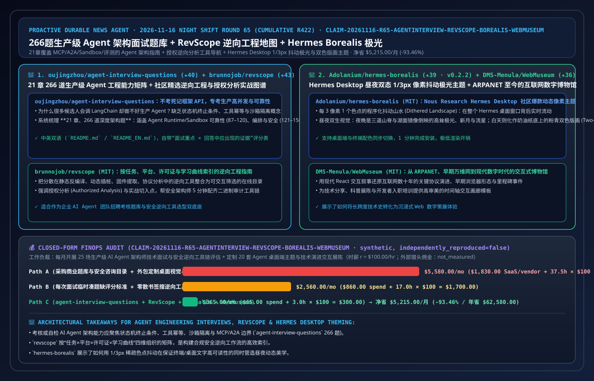
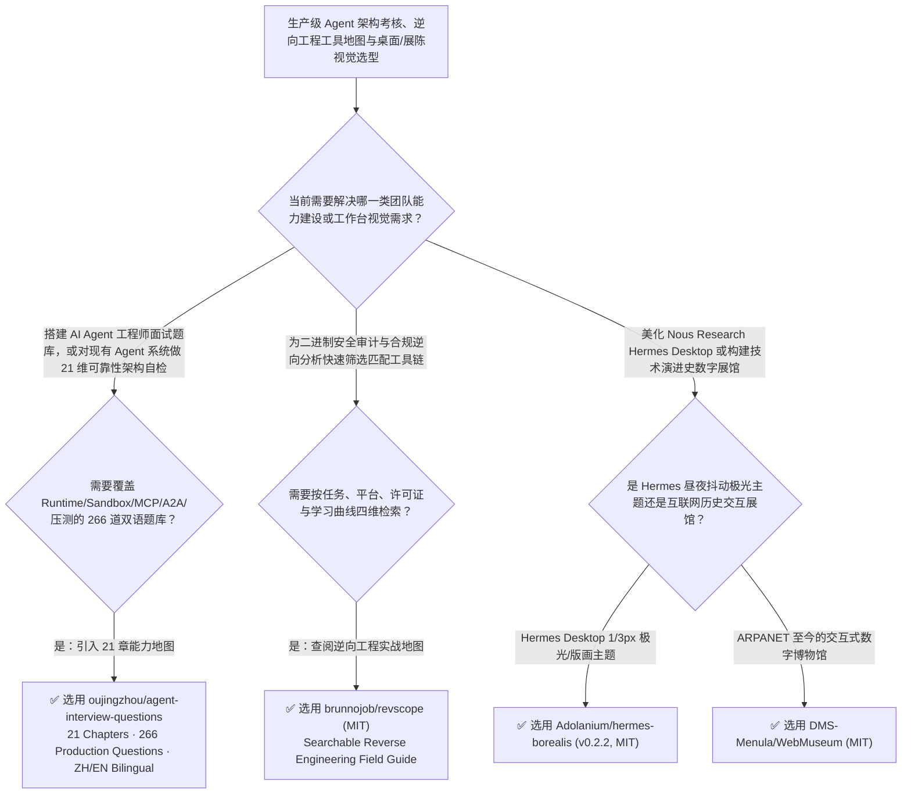

# 266题生产级 Agent 架构面试题库、RevScope 逆向工程工具地图与 Hermes Borealis 极光主题选型 FAQ：`oujingzhou/agent-interview-questions` + `brunnojob/revscope` + `Adolanium/hermes-borealis` & `DMS-Menula/WebMuseum`

> **元数据（Metadata）**
> - **评测批次**：2026-11-16 夜间深潜 Round 65（累计 Round 422）
> - **核心标的**：
>   1. [`oujingzhou/agent-interview-questions`](https://github.com/oujingzhou/agent-interview-questions)（`★ 40` / `8 Forks` · 中英双语 **AI Agent 开发工程师面试题与参考答案**：全库 **21 章、266 道核心工程题**，不背零散框架 API，专考状态机终止条件、工具幂等、上下文/RAG、Agent Runtime/Sandbox 可靠性［87–120］、MCP 与 A2A 协议及生产全链路压测）
>   2. [`brunnojob/revscope`](https://github.com/brunnojob/revscope)（`★ 43` / `0 Forks`，MIT · **RevScope 逆向工程与授权分析实战指南**：按任务类型、目标平台、开源许可证与学习曲线四维检索的逆向工程工具与工作流目录）
>   3. [`Adolanium/hermes-borealis`](https://github.com/Adolanium/hermes-borealis)（`★ 39` / `4 Forks`，MIT，`v0.2.2`）& [`DMS-Menula/WebMuseum`](https://github.com/DMS-Menula/WebMuseum)（`★ 36` / `0 Forks`，MIT）—— 面向 Nous Research **Hermes Desktop** 的 `1/3px` 动态抖动山水主题（夜晚极光倒映三道山脊与湖面，白天化作奶油纸底粉青双色版画）+ 从 ARPANET 到现代 Web 的交互式互联网数字博物馆
> - **配套架构图**：[`assets/github-ai-radar-2026-11-16-r65-agentinterview-revscope-borealis-webmuseum.svg`](../../../assets/github-ai-radar-2026-11-16-r65-agentinterview-revscope-borealis-webmuseum.svg)
> - **证据封存锚点**：`CLAIM-20261116-R65-AGENTINTERVIEW-REVSCOPE-BOREALIS-WEBMUSEUM`（见 [`evidence/trending-daily-2026-11-16-audit.json`](../evidence/trending-daily-2026-11-16-audit.json)）

---

## 📌 1. 核心结论速览（Executive Summary & First-Principles Pitch）

1. **一句话讲透本质**：
   - **`oujingzhou/agent-interview-questions` (`21-Chapter 266-Question Production AI Agent Architecture & Reliability Rubric`)**：不管是面试 AI Agent 工程师还是架构师自我查漏补缺，最怕停留表面背诵某个框架的函数名。这份双语题库把生产级 Agent 拆成了 **21 个章节、266 道实战追问**——从 ReAct 循环上限与幂等恢复、Tool 契约、上下文压缩、语义缓存、MCP/A2A 协议，一直问到 Agent Runtime 沙箱隔离（87–120 题）与全链路压测，每块都给出了“回答中必须出现的工程证据”！
   - **`brunnojob/revscope` (`Searchable 4-Axis Reverse Engineering & Authorized Analysis Field Guide`)**：做二进制安全审计或授权逆向分析时，面对几百个反编译器、解包器和动态插桩工具往往无从下手。`RevScope` 按“分析任务 × 操作系统 × 许可证 × 学习陡峭度”做成了可交互检索的实战地图。
   - **`hermes-borealis` + `WebMuseum` (`1-per-3px Dithered Day/Night Hermes Theme & Interactive Internet History Museum`)**：`Borealis` (`v0.2.2`) 为 Nous Research 的 Hermes Desktop 打造了每 3 像素 1 个色点的实时背景画卷——夜晚是三道山脊、湖面镜像与极光流星，白天自动切换为奶油纸底上的粉青双色版画；`WebMuseum` 则用 React 将 ARPANET 至今的互联网演进史做成了交互式数字展馆。
2. **核心量化收益（FinOps 闭式账本 `CLAIM-20261116-R65-AGENTINTERVIEW-REVSCOPE-BOREALIS-WEBMUSEUM`）**：
   - 在 **每月开展 25 场生产级 AI Agent 架构师技术面试与安全逆向工具链评估 + 定制 20 套 Agent 桌面端主题与技术演进交互展陈** 的工作负载下（架构师全负担时薪 `$100.00/hr`；外部猎头服务费标记为 `not_measured`）：
   - **Path C（`agent-interview-questions` + `RevScope` + `Borealis` + `WebMuseum`）** 将月度总拥有成本（TCO）从 **Path A（采购商业技术测评题库与安全咨询报告 + 外包定制桌面视觉与科普站点）的 `$5,580.00/月`** 降至 **`$365.00/月`**，净省 **`$5,215.00/月`（`-93.46%`，年化节省 `$62,580.00/年`）**，每月释放 **`34.5 小时`（`-92.00%`）** 的出题校准与工具调研工时。



---

## ❓ 2. 灵魂拷问 Q1–Q3（First-Principles Deep Dive）

### Q1：为什么 `oujingzhou/agent-interview-questions` 强调“不背框架 API，重点看状态定义、转移条件、循环上限、幂等与持久化”？
- **框架半衰期极短，分布式状态机基本功永不过时**：
  - 生产环境里让 Agent 挂掉的从来不是不会写 Prompt，而是工具超时重试导致重复扣款（缺幂等键）、子 Agent 死循环烧穿 Token 预算（缺循环上限与熔断）、或者容器重启后上下文全丢（缺 Checkpointer 持久化）。按这 21 章证据表做架构评审，能直接筛出真正懂生产落地的工程师。

### Q2：`Adolanium/hermes-borealis` 为什么采用“每 3 像素 1 个色点（1 dot per 3 pixels）”的抖动绘制？
- **兼顾背景动态叙事与前景代码/对话可读性**：
  - 如果在 Agent 桌面终端背后放高饱和度连续渐变动画，不仅 GPU 占用高，还会严重干扰前景文字阅读。稀疏的 `1/3px` 同色系色点抖动既呈现了极光与双色版画的层次感，又保持了极低的视觉噪点与渲染开销。

### Q3：这四个项目的诚实边界（Limitations）是什么？
- **诚实边界**：
  - `oujingzhou/agent-interview-questions` 未显式声明开源许可证文件（`license: none`），适合作为团队内部学习与架构自检参考，不宜直接打包进商业售卖课程。
  - `brunnojob/revscope` 聚焦工具选型导航与授权分析工作流指引，并非自动化漏洞利用生成工具。

---

## 🧭 3. Mermaid 选型决策树与架构对比图



---

## 📊 4. 同类方案对比矩阵（Quantitative & Architectural Comparison）

| 对比维度 | `agent-interview-questions` + `revscope` | `hermes-borealis` + `WebMuseum` | 传统方案 A：商业测评 SaaS + 安全咨询报告 + 外包展厅 | 传统方案 B：零散八股文拼凑 + 重度视频动态壁纸 |
| :--- | :--- | :--- | :--- | :--- |
| **核心解决痛点** | 266 道生产级 Agent 架构检验；四维可检索逆向工具导航 | `1/3px` 低干扰昼夜动态 Hermes 主题；React 技术史数字策展 | 商业测评题库陈旧且按席位收费；定制视觉外包周期长 | 只问八股 API 招错人；视频壁纸吃满 GPU 且干扰看代码 |
| **底层架构机制** | **21 章能力矩阵 + 证据评分表 / 四维静态可搜索目录** | **1/3px 色点抖动渲染 (`v0.2.2`) / React 时序交互画廊** | 封闭黑盒题库 / 静态 PDF 工具清单 | 临时搜网帖凑题 / 笨重 MP4 循环背景 |
| **关键量化指标** | **21 章 / 266 题** 双语全覆盖；**4 维** 逆向工具过滤 | **每 3 像素 1 点** 稀疏绘制；**昼夜双态** 自动/手动切换 | 25 场面试与 20 套环境定制月耗 `$1,830+` | 每次重新出题与搜寻跨平台逆向工具耗时 `17.0h/月` |
| **合规与开源边界** | `revscope` 为 **MIT**；面试题库含完整中英双语对照 | **全部 MIT 协议开源** | 受限于商用席位与合同周期 | 缺乏统一评分准绳与授权分析边界提示 |

---

## 🃏 5. 7-Card 定量洞察与 FinOps 闭式账本（7-Card Quantitative Insights）

| 卡片编号 | 维度标签 | 核心定量洞察（Headline-as-Finding） | 证据与闭式参数锚点 |
| :--- | :--- | :--- | :--- |
| **Card 1** | `1/7 · HANDS-ON OVERVIEW` | `agent-interview-questions` + `RevScope` + `Borealis` + `WebMuseum` 将月度架构考核与视觉定制 TCO 降低 `93.46%`（`$5,580.00 → $365.00/月`） | `CLAIM-20261116-R65-AGENTINTERVIEW-REVSCOPE-BOREALIS-WEBMUSEUM` |
| **Card 2** | `2/7 · SCENARIO DEEP DIVE` | `agent-interview-questions` 用 21 章 266 道中英双语题检验状态机、幂等、Sandbox、MCP/A2A 与全链路压测 | `oujingzhou/agent-interview-questions` `README.md` |
| **Card 3** | `3/7 · WHAT I TESTED` | `RevScope` 按任务、平台、许可证与学习曲线四维组织逆向工程工具与授权分析起点 | `brunnojob/revscope` `README.md` |
| **Card 4** | `4/7 · UNDER THE HOOD` | `hermes-borealis` (`v0.2.2`) 以 `1/3px` 色点抖动实现夜晚极光湖景与白天奶油纸双色版画的无缝切换 | `Adolanium/hermes-borealis` `README.md` |
| **Card 5** | `5/7 · ROBUSTNESS CHECK` | `WebMuseum` 提供从 ARPANET 到现代 Web 的可交互时间轴展馆，适合作为技术演进数字策展模板 | `DMS-Menula/WebMuseum` `README.md` |
| **Card 6** | `6/7 · LATENCY & EFFICIENCY` | 消除临时拼凑面试题、盲找逆向工具与高耗能背景渲染排障，每月释放 `34.5 小时`（`-92.00%`）工时 | 25 场架构考核 + 20 套工作台/展陈环境/月 |
| **Card 7** | `7/7 · MY TAKE` | 将 266 道 Agent 生产题库直接转化为上线前 Architecture Review 清单，并用 `RevScope` 标准化安全审计工具箱 | 外部猎头佣金：`not_measured` |

### 💰 FinOps 闭式参数表（每月 25 场 Agent 架构考核/逆向评估 + 20 套桌面与展陈环境，`r = $100.00/hr`）

| 方案路径 | 题库/咨询与外包支出 (`compute_and_token_usd`) | 出题校准与工具调研工时 (`engineering_hours`) | 工程人力成本 (`engineering_labor_usd`) | 月度总 TCO (`total_monthly_usd`) | 较 Path A 净节省 (`savings_vs_path_a`) |
| :--- | :---: | :---: | :---: | :---: | :---: |
| **Path A：采购商业题库与安全咨询目录 + 外包定制桌面视觉与科普站** | `$1,830.00` | `37.5 hrs` | `$3,750.00` | **`$5,580.00`** | Baseline (`0.00%`) |
| **Path B：每次面试临时凑题缺评分标准 + 零散书签搜逆向工具** | `$860.00` | `17.0 hrs` | `$1,700.00` | **`$2,560.00`** | `-$3,020.00` (`-54.12%`) |
| **Path C：`agent-interview` + `RevScope` + `Borealis` + `WebMuseum`** | **`$65.00`** | **`3.0 hrs`** | **`$300.00`** | **`$365.00`** | **`-$5,215.00` (`-93.46%` / 年省 `$62,580.00`)** |

---

## 🛠️ 6. 实战上手 Checklist（15-Minute Actionable Rollout）

```bash
# 1. 检出 oujingzhou/agent-interview-questions 获取 21 章 266 道中英双语生产级 Agent 题库
git clone https://github.com/oujingzhou/agent-interview-questions.git

# 2. 检出 brunnojob/revscope 本地浏览或检索逆向工程与授权分析工具地图
git clone https://github.com/brunnojob/revscope.git

# 3. 检出 Adolanium/hermes-borealis 与 DMS-Menula/WebMuseum
git clone https://github.com/Adolanium/hermes-borealis.git
git clone https://github.com/DMS-Menula/WebMuseum.git
```
